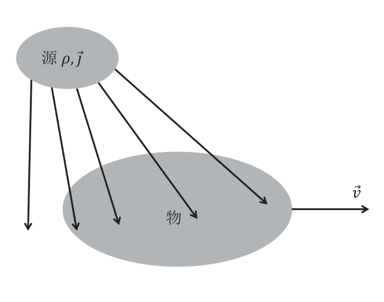
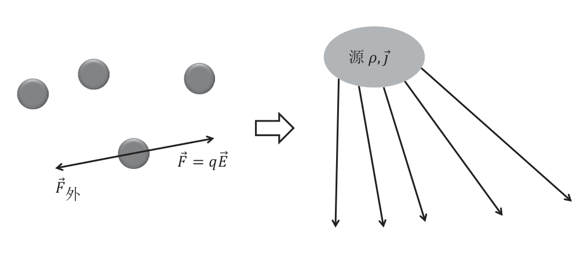
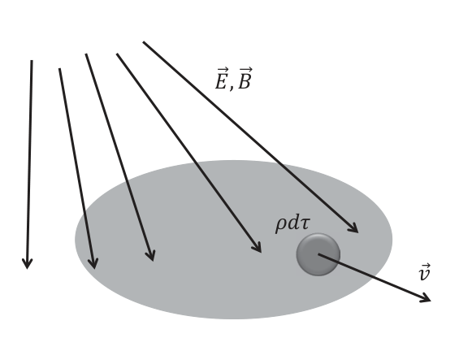
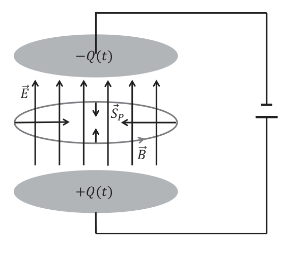
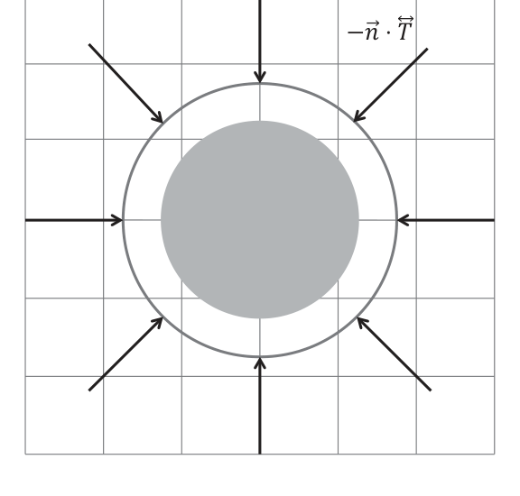
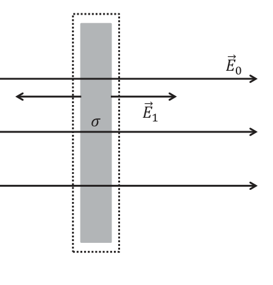
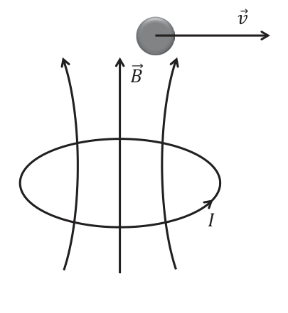
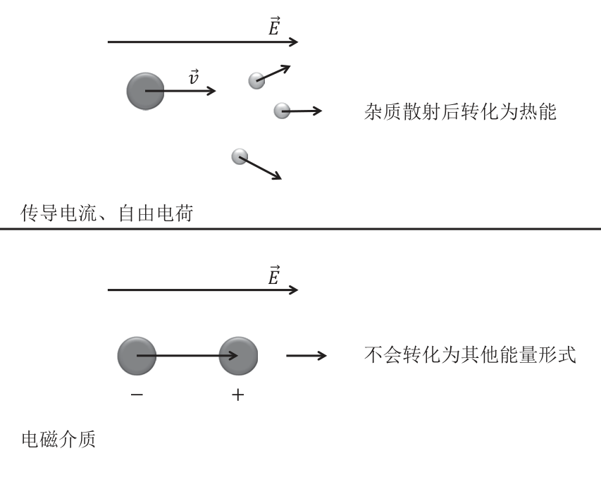
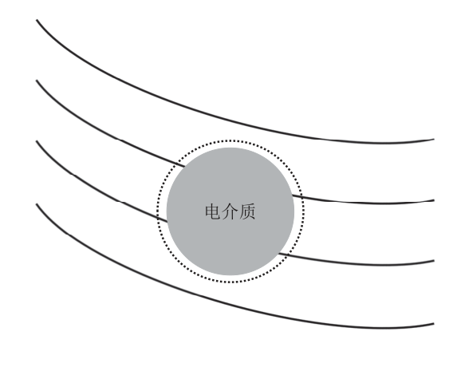
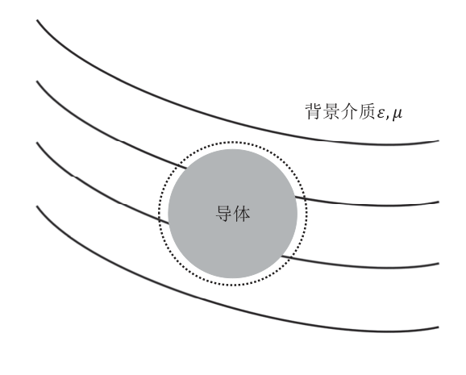

# 第二章 电磁场的守恒定律和对称性

电磁场作为一种物质的存在方式，具有能量、动量以及角动量。如何得到这样一个结论呢？可以从两方面来看。

1. 假设空间存在一电磁场 $\vec{E} (\vec{r},t),\vec{B} (\vec{r},t)$ ，由置于远处的源电荷（电流）激发。在此空间中放置一带电体，则后者会受到电场的作用力而能量增加。同时带电体运动后产生电流，而电流又会受到磁场的作用力因此带电体的动量发生改变。这些机械能及机械动量的增加不是无中生有的，只能是电磁场本身具有的能量以及动量转化而来的。你可能会Argue说：这些能量动量可以是源电荷的机械能及机械动量贡献的！然而实验发现，即使我们将源关掉，在一段时间内，空间的电磁场不会立刻消失，仍然具有对带电体做功及改变其动量的能力，这证明带电体的能量动量不是由源电荷/电流直接提供的，而是由电磁场提供的。
2. 另一方面，也可以考虑源电荷/电流在建立电磁场时的能量/动量变化。以电场为例，考虑产生最终电场的电荷是原本散落在无限远处的一系列点电荷组成的。为了建立这个电场分布 $\vec{E} (\vec{r},t)$，这些电荷从

无限远处被准静态地一个个搬了过来。在这个“搬动”的过程中一直必须有外力来平衡电场对电荷的作用力，因此一直需要不断的外力对体系做功。最后建立完最终的电场后，外力在此过程中做的总功到哪里去了？——全部转化成电磁场的能量！动量也是完全一样的Argument。

在《电磁学》的学习中，我们利用第2个图像计算了电容器中静电场的总能 $U_{E}=\frac{1}{2}CV^{2}$ 以及电感中的静磁场的总能 $U_{B}=\frac{1}{2}LI^{2}$ 。然而这样的推导不能告诉我们局域的场的能量密度——我们得到能量密度只能通过相当不严格的类比。下面我们将利用第一种方法来系统研究电磁场的局域能/动量密度。

## 2.1 真空中电磁场的能量守恒定律

先考察电磁场对处于其中的带电体所作的功．电磁场不能直接“看到”任何物质，而只能“看到”物质中的电荷/电流，场对一块物质的作用力是通过对其中的电荷/电流作用发生的。因此我们下面研究电磁场对处于其中的电荷所作的功。由于磁场作用在运动电荷的力总与速度方向垂直，磁场对电荷不作功，所以我们只需求电场对电荷所作的功即可。若空间电

荷分布为 $\rho$ 则 $d\tau$ 内的电荷为 $\rho d\tau$ ，它在dt时间内移动的距离 $d\vec{l}=\vec{v}dt$ ， $\vec{v}$ 为电荷体积元 $\rho d\tau$ 的运动速度，于是场在dt时间内对 $\rho d\tau$ 所做的功为

$$
\frac{d R}{d t} = \int \vec{E} \cdot \vec{j} d \tau \tag{2.1.1}
$$

场对带电体做功增加了带电体的机械能 $W_{m}$ ，故

$$
\frac{d W_{m}}{d t} = \int \vec{E} \cdot \vec{j} d \tau \tag{2.1.2}
$$

下面我们利用Maxwell方程将$\vec{j}$消除，而使得方场中仅仅留下电磁场$\vec{E}$、$\vec{B}$等。由麦克斯韦方程组中的第四式可见

$$
\vec{j} = \frac{1}{\mu_0} \nabla \times \vec{B} - \varepsilon_0 \frac{\partial \vec{E}}{\partial t} \tag{2.1.3}
$$

于是得到

$$
\vec{j} \cdot \vec{E} = \frac{1}{\mu_0} (\nabla \times \vec{B}) \cdot \vec{E} - \frac{\varepsilon_0}{2} \frac{\partial}{\partial t} E^2 \tag{2.1.4}
$$

因为所有的守恒律都满足类似电荷（流）守恒的一个公式，我们的任务是试图将2.1.4改写成对时间、空间的全微分形式。注意到矢量运算恒等式

$$
\nabla \cdot (\vec{B} \times \vec{E}) = \vec{E} \cdot (\nabla \times \vec{B}) - \vec{B} \cdot (\nabla \times \vec{E}) \tag{2.1.5}
$$

Tips：这个公式可以通过类比矢量混合积$\vec{A} \cdot (\vec{B} \times \vec{C}) = \vec{B} \cdot (\vec{C} \times \vec{A}) - \vec{C} \cdot (\vec{A} \times \vec{B})$，以及注意到必须对括号内的所有量都进行微分运算来得到。

可得

$$
\vec{j} \cdot E = \frac{1}{\mu_0} \nabla \cdot (\vec{B} \times \vec{E}) + \frac{1}{\mu_0} \vec{B} \cdot (\nabla \times \vec{E}) - \frac{\varepsilon_0}{2} \frac{\partial}{\partial t} E^2 \tag{2.1.6}
$$

上式第1，3项已都是全微分的形式。对第2项，根据Maxwell方程组中的第二式$\nabla \times \vec{E} = -\frac{\partial \vec{B}}{\partial t}$，可得

$$
\frac{1}{\mu_0} \vec{B} \cdot (\vec{\nabla} \times \vec{E}) = -\frac{1}{\mu_0} \vec{B} \cdot \frac{\partial \vec{B}}{\partial t} = -\frac{\partial}{\partial t} \left( \frac{1}{2\mu_0} \vec{B} \cdot \vec{B} \right) \tag{2.1.7}
$$

也成为全微分的形式。将上式代入2.1.6可得

$$
\vec{j} \cdot \bar{E} = -\frac{1}{\mu_0} \nabla \cdot (\vec{E} \times \vec{B}) - \frac{1}{2} \frac{\partial}{\partial t} \left( \varepsilon_0 E^2 + \frac{1}{\mu_0} B^2 \right) \tag{2.1.8}
$$

令

$$
\vec{S}_P(\vec{r}, t) = \frac{1}{\mu_0} \vec{E} \times \vec{B} = \vec{E} \times \vec{H} \tag{2.1.9}
$$

$$
u(\vec{r}, t) = \frac{1}{2} \left( \varepsilon_0 E^2 + \frac{1}{\mu} B^2 \right) \tag{2.1.10}
$$

于是利用上述这些等式，2.1.2式可最终写成

$$
\frac{d W_{m}}{d t} = - \int \nabla \cdot \vec{S}_{P} d \tau - \frac{\partial}{\partial t} \int u d \tau \tag{2.1.11}
$$

$$
= - \oint \vec{S}_{P} \cdot d \vec{S} - \frac{\partial}{\partial t} \int u d \tau \tag{2.1.12}
$$

将上式进一步改写为

$$
\frac{d}{d t} \left[ W_{m} + \int u d \tau \right] = - \oint \vec{S}_{P} \cdot d \vec{S} \tag{2.1.13}
$$

物理意义非常明晰——在一个闭合空间内物理量 $W_{m} + \int ud\tau$ 的增加等于从边界流入闭合空间的 $\vec{S}_P$ 的大小。对应电荷-电流守恒定律，显然前者是这个闭合空间中的总能量，而后者是能量流密度。因为 $W_{m}$ 是空间里物质的机械能量，$u(\vec{r},t)$ 应当描述其他的能量形式，这里其它的能量形式只能是电磁场的能量！因此其物理意义是 $r$ 点处 $t$ 时刻电磁场的能量密度，$\vec{S}_P(\vec{r},t)$ 即为相应的能流密度，叫做坡印廷矢量。当考察区域是全空间时，由于电流和电荷分布在有限区域，在无穷远边界上电磁场应为零，故 $\vec{S}_P \equiv 0$ 。此时有

$$
\frac{d W_{m}}{d t} = - \frac{d W_{e , m}}{d t} \tag{2.1.14}
$$

其中

$$
W_{e, m} = \int_{\infty} u (\vec{r}, t) d \tau \tag{2.1.15}
$$

为空间电磁总能量。2.1.14式表明机械能与电磁场能量可以相互转化，但总和为守恒量。在无源空间内没有任何其他的能量形式， $W_{m}=0$ ，2.1.13式变为

$$
\nabla \cdot \vec{S}_{P} (\vec{r}, t) + \frac{\partial}{\partial t} u (\vec{r}, t) = 0 \tag{2.1.16}
$$

这与电荷守恒的连续性方程完全一样，又一次说明了电磁场是一种物质。

[例1] 试考察正在缓慢充电的电容器的能流

解：设电容器由两块圆形平板构成．它们的半径均为 $r$ ，间距为 $h$ ，其中电场为 $E(t) = \frac{Q(t)}{\pi r^2\varepsilon_0}$ ，则电容器中的总能量为

$$
W = \frac{1}{2} \varepsilon_{0} E^{2} \cdot \Omega \tag{2.1.17}
$$

其中 $\Omega = \pi r^2 h$ 是电容器的体积。我们来看一下能流流动的情况。在充电过程中 $E$ 在缓慢变化，设 $\vec{E} = E(t)\vec{e}_z$ ，则由麦克斯韦方程组的第四式可知，变化电场会产生位移电流从而进一步产生磁场：

$$
\oint \vec{B} \cdot d \vec{l} = \mu_{0} \varepsilon_{0} \int_{S} \frac{\partial \vec{E}}{\partial t} \cdot d \vec{S} \tag{2.1.18}
$$

可得电容器内磁场(选取柱坐数系 $\rho,\phi,z$ )为

$$
\vec{B} = \frac{1}{2 \pi \rho} \mu_{0} \varepsilon_{0} \pi \rho^{2} \frac{\partial E}{\partial t} \vec{e}_{\phi} \tag{2.1.19}
$$

所以能流密度矢量为

$$
\vec{S}_{P} = \frac{1}{\mu_{0}} \vec{E} \times \vec{B} = \frac{\varepsilon_{0}}{2} E \frac{\partial E}{\partial t} \rho (- \vec{e}_{\rho}) \tag{2.1.20}
$$

其方向指向电容器中心轴线。对电容器侧面积分则得流入电容器的能量为

$$
\int \vec{S}_{P} \cdot d \vec{S} = \frac{\varepsilon_{0}}{2} E \frac{\partial E}{\partial t} r \cdot 2 \pi r h = \pi r^{2} h \varepsilon_{0} E \frac{\partial E}{\partial t} = \frac{\partial}{\partial t} W_{e, m} \tag{2.1.21}
$$

它正好等于电容器中能量的增加率。这说明能量不是从导线中流过来的，而是从电容器外面的空间中通过电容器侧面流进电容器的。显然，通常认为能量是从导线中流过来的直觉是错误的。

注：考虑任何一个静电状态，都必须考虑对应的电荷分布是如何建立的，而考虑这个电荷建立的过程，就不可避免地引入电场的变化，从而因位移电流进一步产生磁场。这样一来，在整个建立场的过程中就有能流存在，最终的静电能正是通过这些能流一点点建立起来的。

## 2.2 电磁场的动量守恒定律

下面要利用相似的方法考虑电磁场的动量。根据力的定义，带电体的机械动量的变化为场对带电体的作用力。带电体受电磁场的Lorentz力，则其机械动量的变化率为：

$$
\frac{d G_{m}}{d t} = \int (\rho d \tau \vec{E} + \rho d \tau \vec{v} \times \vec{B}) = \int (\rho \vec{E} + \vec{j} \times \vec{B}) d \tau = \int \vec{f} d \tau \tag{2.2.1}
$$

利用场方程把等式右边的 $\rho$ 和 $\vec{j}$ 消去，力密度改写为

$$
\vec{f} = \varepsilon_{0} \left(\nabla \cdot \vec{E}\right) \vec{E} + \frac{1}{\mu_{0}} \left(\nabla \times \vec{B} - \mu_{0} \varepsilon_{0} \frac{\partial \vec{E}}{\partial t}\right) \times \vec{B} \tag{2.2.2}
$$

仿照电磁能量的推导，我们希望能将上式改写成对时间、空间的全微分。先考虑时间部分，配分可得

$$
- \varepsilon_{0} \frac{\partial \vec{E}}{\partial t} \times \vec{B} = - \varepsilon_{0} \frac{\partial}{\partial t} \left(\vec{E} \times \vec{B}\right) + \varepsilon_{0} \vec{E} \times \frac{\partial \vec{B}}{\partial t} = - \varepsilon_{0} \frac{\partial}{\partial t} \left(\vec{E} \times \vec{B}\right) - \varepsilon_{0} \vec{E} \times \left(\nabla \times \vec{E}\right) \tag{2.2.3}
$$

带入2.2.2式后，考虑所有与电场 $\vec{E}$ 有关的项：

$$
\left(\nabla \cdot \vec{E}\right) \vec{E} - \vec{E} \times \left(\nabla \times \vec{E}\right) = \left(\nabla \cdot \vec{E}\right) \vec{E} - \left[ \frac{1}{2} \nabla \left(\vec{E} \cdot \vec{E}\right) - \left(\vec{E} \cdot \nabla\right) \vec{E} \right] \tag{2.2.4}
$$

$$
= \nabla \cdot \left(\vec{E} \vec{E}\right) - \nabla \left(\frac{1}{2} E^{2}\right) \tag{2.2.5}
$$

$$
= \nabla \cdot \left(\vec{E} \vec{E}\right) - \nabla \cdot \left(\frac{1}{2} E^{2} \vec{I}\right) \tag{2.2.6}
$$

注：倒数第二步用到了并矢运算公式

$$
\nabla \cdot \left(\vec{A} \vec{B}\right) = \left(\nabla \cdot \vec{A}\right) \vec{B} + \left(\vec{A} \cdot \nabla\right) \vec{B} \tag{2.2.7}
$$

证明如下

$$
\partial_{i} \left(A_{i} B_{j}\right) \hat{e}_{j} = \left(\partial_{i} A_{i}\right) B_{j} \hat{e}_{j} + A_{i} \left(\partial_{i} B_{j}\right) \hat{e}_{j} \tag{2.2.8}
$$

倒数第一步用到了恒等式

$$
\nabla \varphi = \nabla \cdot \left(\varphi \vec{I}\right) \tag{2.2.9}
$$

证明如下

$$
\nabla \cdot \left(\varphi \vec{I}\right) = \partial_{i} \left(\varphi \vec{I}\right)_{i j} \hat{e}_{j} = \partial_{i} \left(\varphi \delta_{i j}\right) \hat{e}_{j} = \partial_{i} (\varphi) \hat{e}_{i} = \nabla \varphi \tag{2.2.10}
$$

下面考虑2.2.2式中与磁场相关的项 $\frac{1}{\mu_0}\left(\nabla \times \vec{B}\right)\times \vec{B}$ 。与电场类比，可以加上一项恒为0的 $\frac{1}{\mu_0}\left(\nabla \cdot \vec{B}\right)\vec{B}$ ，故有与磁场相关的项为

$$
\left(\nabla \cdot \vec{B}\right) \vec{B} + \left(\nabla \times \vec{B}\right) \times \vec{B} = \nabla \cdot \left(\vec{B} \vec{B}\right) - \nabla \cdot \left(\frac{1}{2} B^{2} \vec{I}\right) \tag{2.2.11}
$$

利用这些关系式，2.2.2式可写成

$$
\vec{f} = - \nabla \cdot \vec{T} - \frac{\partial}{\partial t} \vec{g} \tag{2.2.12}
$$

其中

$$
\vec{T} = \frac{1}{2} \left(\varepsilon_{0} E^{2} + \frac{1}{\mu_{0}} B^{2}\right) \vec{I} - \varepsilon_{0} \vec{E} \vec{E} - \frac{1}{\mu_{0}} \vec{B} \vec{B} \tag{2.2.13}
$$

$$
\vec{g} = \varepsilon_{0} \left(\vec{E} \times \vec{B}\right) = \frac{1}{c^{2}} \vec{S}_{P} \tag{2.2.14}
$$

根据以上三式及2.2.1式，我们就得到

$$
\frac{d \vec{G}_{m}}{d t} = - \oint d \vec{S} \cdot \vec{T} - \frac{d}{d t} \int \vec{g} d \tau \tag{2.2.15}
$$

完全类似对电磁能量的讨论，上式显示 $\vec{g}$ 就是电磁场的动量密度，而 $\vec{T}$ 是动量流密度，是个张量（并矢），这是因为动量是个矢量，与能量不同。对每个动量分量（如 $x$ 分量），2.2.15可以改写成

$$
\frac{d G_{m}^{x}}{d t} = - \oint d \vec{S} \cdot \vec{T}_{x} - \frac{d}{d t} \int g_{x} d \tau \tag{2.2.16}
$$

即为我们熟悉的形式。而

$$
\vec{G}_{e, m} = \int_{\Delta \Omega} \varepsilon_{0} \left(\vec{E} \times \vec{B}\right) d \tau \tag{2.2.17}
$$

就是 $\Delta \Omega$ 体积内的电磁场所携带的总动量。

注：

1. 与电磁能量不同，动量密度的存在要求必须有磁场。另外，我们注意到动量密度与能流密度相关，这里有什么物理值得我们深思呢？
2. 许多年来，人们往往被牛顿力学中的“力”、“功”、“力矩”等概念所“毒害”，其实现代科学发现早已摒弃了这些机械的概念，因为它们不本质，一般情况下难以定义。取而代之的是“动量”、“能量”，“角动量”等更本质的概念。受力可以描述为动量在改变，做功=能量发生变化；受到力矩表现为角动量发生变化。至于为什么只有这7个守恒量？那是因为我们所处的是 $3+1$ 维空间，3维空间的平移不变性给出动量守恒、各向同性给出角动量守恒，至于能量守恒是因为时间轴的均匀性决定的。

利用2.2.15式可以方便地讨论电磁场对物质的作用力。考虑一个放置于电磁场中的物体，取闭合曲面恰好包围此物体，则电磁场对闭合区域内的带电体的作用总力 $\vec{F}_{em}$ 可由下式计算：

$$
\vec{F}_{em} = \frac{\partial \vec{G}_m}{\partial t} = - \oint_S d\vec{S} \cdot \vec{T} - \int_V \frac{\partial}{\partial t} \vec{g} d\tau \quad (2.2.18)
$$

讨论：

1. 等式右边第一项 $-\oint_S d\vec{S} \cdot \vec{T}$ 是电磁场单位时间内通过界面从外面传递到曲面内部的总动量，根据力的定义，这就是外面的电磁场通过界面对闭合区域内的物质施加的总力。如弹性力学中的张力一样，$-\vec{e}_n \cdot \vec{T}$ 代表面外的场作用在面内的场的单位面积上的应力，故又称 $\vec{T}$ 为麦克斯韦应力张量。可以形象地把电磁场想象成一个网，网

   

   格之间有张力，网中间放置一钢球，即我们考虑的物质。对网施加扰动，则动量通过界面“流入”闭合区域，一部分变成了区域内部的网的动量，另一部分传递给钢球，给钢球施加了作用力。也可将电磁场想象成水，水中有一钢球。取一闭合界面，则外面的水物质一直对里面的水施加压力。

2. 然而这些“总力”不见得都作用到区域内的物质上，还作用到区域内的电磁场上，引发区域内的电磁场的动量的增加。等式第二项就是减去这部分的贡献的。

3. 在稳态或是场随时间谐变的情况下，第2项为0，或是其时间平均值为0。此时物质在电磁场中的受力完全由Maxwell张量的面积分决定。小心设计一些特定的电磁场结构，比如一束高斯型光束，处于光场之中的介质小球就会受到力的作用，其在光场中收“光力”会产生移动最终到达平衡位置。因此我们可以通过改变光束的位置来有效地移动小球，这就是“光镊”（Optical Tweezers）的基本工作原理，目前在生物、医学中应用广泛。

[例2] 求放置于均匀电场 $\vec{E}$ 中的一个均匀带电板（面积为 $A$ ，电荷密度为 $\sigma$ ，忽略边缘效应）的受力。

解：如图所示，空间的总场为

$$
\vec{E}_{right} = \vec{E}_{0} + \frac{\sigma}{2 \varepsilon_{0}} \hat{e}_{x} \quad \vec{E}_{left} = \vec{E}_{0} - \frac{\sigma}{2 \varepsilon_{0}} \hat{e}_{x} \tag{2.2.19}
$$

则Maxwell张量为

$$
\ddot{T} = \frac{1}{2} \varepsilon_{0} E^{2} \ddot{I} - \varepsilon_{0} \vec{E} \vec{E} \tag{2.2.20}
$$

$$
= \frac{1}{2} \varepsilon_{0} E^{2} (\hat{x} \hat{x} + \hat{y} \hat{y} + \hat{z} \hat{z}) - \varepsilon_{0} E^{2} \hat{x} \hat{x} \tag{2.2.21}
$$

$$
= - \frac{1}{2} \varepsilon_{0} E^{2} \hat{x} \hat{x} + \frac{1}{2} \varepsilon_{0} E^{2} (\hat{y} \hat{y} + \hat{z} \hat{z}) \tag{2.2.22}
$$

包围平板做一闭合曲面，如图中虚线所示，计算电磁场对物质的力：

$$
\vec{F} = - \oint \vec{n} \cdot \vec{T} d S \tag{2.2.23}
$$

$$
= - A \hat{x} \cdot \left[ \vec{T}_{\text{right}} - \vec{T}_{\text{left}} \right] \tag{2.2.24}
$$

$$
= A \hat{x} \frac{1}{2} \varepsilon_{0} \left[ E_{\text{right}}^{2} - E_{\text{left}}^{2} \right] \tag{2.2.25}
$$

$$
= A \hat{x} \frac{1}{2} \varepsilon_{0} 4 \cdot E_{0} \cdot \frac{\sigma}{2 \varepsilon_{0}} \tag{2.2.26}
$$

$$
= \hat{x} E_{0} \cdot Q \tag{2.2.27}
$$

正是我们预期的结果。

注：这个例子当然有些“杀鸡用牛刀”的感觉，你可以Argue说不用Maxwell张量也可以直接写出结果来。然而当电磁场及介质形状均为一般情况时，你就必须使用“牛”刀杀“鸡”了。

[例3] 质量为 $m$，带电为 $q$ 的粒子在稳定磁场中运动，试求带电粒子在磁场中的总动量。

解：电荷在磁场中运动时，不仅自己带有机械动量，而且因为其本身带电产生电场，与磁场相互作用后使得空间总的电磁场会带有动量。这些动量是空间电磁场的，但与电荷存在于磁场中这个事实相关，因此通常算到电荷的总动量里。电磁场的动量为：

$$
\vec{G}_{e, m} = \int_{V} \varepsilon_{0} \left(\vec{E} \times \vec{B}\right) d \tau^{\prime} = \int_{V} \varepsilon_{0} \vec{E} \times \left(\nabla \times \vec{A}\right) d \tau^{\prime} \tag{2.2.28}
$$

当运动电荷的速度远远小于光速时，可以近似认为运动的电荷只产生电场，其产生的磁场可以忽略，因此有

$$
\nabla \times \vec{E} = 0 \quad \nabla \cdot \vec{E} = \varepsilon_{0} q \delta (\vec{r} - \vec{v} d t) \tag{2.2.29}
$$

而空间的磁场完全由稳定的外磁场贡献，因此有

$$
\nabla \cdot \vec{A} = 0 \qquad (\text{稳定磁场的要求}) \tag{2.2.30}
$$

利用矢量运算公式：

$$
\nabla \left(\vec{A} \cdot \vec{E}\right) = \left(\vec{A} \cdot \nabla\right) \vec{E} + \left(\vec{E} \cdot \nabla\right) \vec{A} + \vec{E} \times \left(\nabla \times \vec{A}\right) + \vec{A} \times \left(\nabla \times \vec{E}\right) \tag{2.2.31}
$$

以及 $\nabla \times \vec{E} = 0$ 的事实，可以推出

$$
\vec{E} \times \left(\nabla \times \vec{A}\right) = \nabla \left(\vec{A} \cdot \vec{E}\right) - \left(\vec{A} \cdot \nabla\right) \vec{E} - \left(\vec{E} \cdot \nabla\right) \vec{A} \tag{2.2.32}
$$

利用矢量运算恒等式 $\nabla \cdot (\vec{a}\vec{b}) = (\nabla \cdot \vec{a})\vec{b} + (\vec{a} \cdot \nabla)\vec{b}$ 将2.2.32式配分成全微分

$$
\vec{E} \times \left(\nabla \times \vec{A}\right) = \nabla \cdot \left[ \left(\vec{A} \cdot \vec{E}\right) \vec{I} \right] - \nabla \cdot \left(\vec{A} \vec{E} + \vec{E} \vec{A}\right) + \left(\nabla \cdot \vec{A}\right) \vec{E} + \left(\nabla \cdot \vec{E}\right) \vec{A} \tag{2.2.33}
$$

$$
= \nabla \cdot \left[ \left(\vec{A} \cdot \vec{E}\right) \vec{I} - \vec{A} \vec{E} - \vec{E} \vec{A} \right] + (q / \varepsilon_{0}) \delta (\vec{r} - \vec{v} t) \vec{A} \tag{2.2.34}
$$

把它代入上式后，注意到第一项对空间的积分可以转化成在中括号里面的场在无穷远处表面的面积分，当电流分布在空间有限区域中时，这一项=0。我们得到

$$
\vec{G}_{e,m} = \int q \vec{A} \delta(\vec{r} - \vec{v}t) d\tau' = q \vec{A}(\vec{v}t) \tag{2.2.35}
$$

由此我们可以得到带电的运动粒子在外磁场中的总动量为

$$
\vec{p} = m\vec{v} + q\vec{A} \tag{2.2.36}
$$

式中 $m\vec{v}$ 是带电粒子的机械动量，而 $q\vec{A}$ 为电荷与外磁场共同拥有的“附加”电磁动量，$\vec{p}$ 则是总动量，又叫做正则动量。2.2.36式是量子力学中极为重要的关系式。几点讨论：

1. 这个附加的动量是电荷与磁场的“相互作用”引起的。没有磁场或是没有电荷都没有这一项贡献；单独只有电荷或是磁场单独存在时也没有这一动量；

2. 这个结果是在低速情况下得到的；

3. 如何理解这个相互作用引起的“附加动量”？可以考虑建立这个状态的过程，一开始电荷处于无穷远处，没有电磁场动量；当电荷靠近时，线圈与运动电荷之间有相互作用力，要达到最终的状态，必须有外力输入。因此，则在此过程中一直有外力对体系（线圈+电荷）输入动量（冲量），这部分动量被储存在体系中作为电荷的附加动量。

4. $\vec{p}$ 是总动量，对粒子的运动量子化后其对应的算符一定是 $\vec{p}\to -i\hbar\nabla$。然而磁场不对带电粒子做功，因此带电粒子的动能仍然是 $\frac{1}{2m}(m|\vec{v}|)^2 = \frac{1}{2m}(\vec{p}-q\vec{A})^2$，写成算符形式为 $\frac{1}{2m}(-i\hbar\nabla - q\vec{A})^2$。

## 2.3 介质中的电磁能量和动量守恒定律

### 2.3.1 电磁能量

在真空中，电磁场只对传导电流做功，情况相对简单。在电磁介质中，电磁场会把介质极化或者磁化，从而产生极化电流（荷）和磁化电流，场进一步又会对这些附加电流（荷）产生作用，情况变得复杂。在这种情况下，让我们忘记电磁介质的存在，而只关注因极化和磁化而产生的附加电荷/电流。前面我们已经指出，电磁场“分不清”什么是自由电荷/电流，只要是电荷/电流，电磁场就会对其施加力的作用。因此，此时，电磁场对极化电流和磁化电流同时做功。故，场对 $d\tau$ 体积内的电荷/电流在单位时间内所作的总功为

$$
\frac{d R}{d t} = \int (\vec{j}_{f} + \vec{j}_{p} + \vec{j}_{m}) \cdot \vec{E} d \tau \tag{2.3.1}
$$

在计算之前，我们仔细分析一下这几项的物理意义。

1. $\vec{j}_f \cdot \vec{E}$ 对应的是电磁场对自由电荷做的功，这部分功转化成电荷运动的机械动能（电流），通常（超导除外）这些机械动能与外部环境发生交换（通过杂质的散射），变成了环境的热能。这就是为什么在稳恒电流的条件下，电场不断对电荷做功，但电荷运动的机械能却不发生改变（表现为电流稳恒不变）的原因-那些功被环境以热能的形式带走。因此这部分功是可以转化成其他的能量形式，而且通常这种转化是不可逆的。

2. $(\vec{j}_p + \vec{j}_m) \cdot \vec{E}$ 对应的是电磁场对电磁介质中的束缚电荷（流）所做的功，这部分功转化成介质中电荷拉开后的弹性或者化学势能，以及这些电荷跟随电场运动时的机械动能。但这部分能量被束缚在电磁介质中，不会被环境以热能的形式拿走。而当电磁场离开介质时，这些能

量又会以电磁辐射的形式重新返还给电磁场。本质上讲，这部分能量虽然不是电磁场的能量，但它们却是电磁场将介质极磁化后储存到电磁介质中的能量，它们依附于电磁场而存在。

搞清楚这两类功的不同，我们可以将第2项功对应的能量——极(磁)化能——归于电磁场在介质的能量中，而只考虑电磁场对第一项的贡献。换句话说，我们把电磁场和电磁介质看成一体，而把传导电流分出来单独考虑。具体来说，我们计算场对 $d\tau$ 体积内的自由电荷/电流在单位时间内所作的总功：

$$
\frac{dR_f}{dt} = \int \vec{j}_f \cdot \vec{E} d\tau \tag{2.3.2}
$$

利用 $\nabla \times \vec{H} = \vec{j}_f + \frac{\partial \vec{D}}{\partial t}$ 将自由电流消去，可得

$$
\vec{j}_f \cdot \vec{E} = \left( \nabla \times \vec{H} - \frac{\partial \vec{D}}{\partial t} \right) \cdot \vec{E} \tag{2.3.3}
$$

将空间部分配分成全微分的形式，得

$$
\left(\nabla \times \vec{H}\right) \cdot \vec{E} = \nabla \cdot \left(\vec{H} \times \vec{E}\right) + \vec{H} \cdot \left(\nabla \times \vec{E}\right) \tag{2.3.4}
$$

$$
= \nabla \cdot \left(\vec{H} \times \vec{E}\right) - \vec{H} \cdot \frac{\partial \vec{B}}{\partial t} \tag{2.3.5}
$$

这里我们用到了Faraday定律 $\nabla \times \vec{E} = -\partial \vec{B} /\partial t$ 。对线性无色散介质，有本构关系：

$$
\vec{D} = \varepsilon \vec{E} \quad \vec{B} = \mu \vec{H} \tag{2.3.6}
$$

则2.3.3式可以改写成

$$
\vec{j}_{f} \cdot \vec{E} = - \nabla \cdot \left(\vec{E} \times \vec{H}\right) - \vec{E} \frac{\partial \vec{D}}{\partial t} - \vec{H} \frac{\partial \vec{B}}{\partial t} \tag{2.3.7}
$$

$$
= - \nabla \cdot \vec{S}_{P} - \frac{\partial u}{\partial t} \tag{2.3.8}
$$

其中能流密度及能量密度分别定义为

$$
\vec{S}_{P} = \vec{E} \times \vec{H} \tag{2.3.9}
$$

$$
u = \frac{1}{2} \left(\vec{E} \cdot \vec{D} + \vec{B} \cdot \vec{H}\right) = \frac{1}{2} \left(\varepsilon E^{2} + \mu H^{2}\right) \tag{2.3.10}
$$

根据2.3.8式，我们写出介质中的能量转化方程：

$$
\frac{\partial W^{\prime}}{\partial t} = \int_{V} \vec{j}_{f} \cdot \vec{E} d \tau = - \oint \vec{S}_{P} \cdot d \vec{S} - \frac{\partial}{\partial t} \int_{V} u d \tau \tag{2.3.11}
$$

其中 $\int_{V}ud\tau$ 为体积内的电磁场能量以及电磁介质中储存的能量，$W'$ 为体积内去除上述能量后的其他的能量形式（传导电荷的机械能，或者进一步与环境交换出去的热能），而 $\vec{S}_P$ 为能流密度，物理意义是电磁场以及附属于电磁场的极磁化场单位时间内流过单位面积的能量。显然真空中的能量密度和能流密度可以认为是2.3.9与2.3.10式的特例。

思考：

1. 能流密度 $\vec{S}_P$ 与真空中的不同，这是因为其中包含了介质极磁化后的电荷/流随电磁场的运动而贡献的能量流动，然而仔细计算后发现额

外的贡献为 $\vec{S}_P - \vec{S}_0 = \vec{E} \times \vec{H} - \vec{E} \times \vec{B} / \mu_0 = -\vec{E} \times \vec{M}$ 。这样处理对不对？为什么只有磁化的贡献？

2. 你也许有兴趣分清楚介质中的极磁化的能量到底为多少。不假思索的计算将给出：

$$
u - u_{0} = \frac{1}{2} \left(\vec{D} \cdot \vec{E} + \vec{B} \times \vec{H}\right) - \frac{1}{2} \left(\varepsilon_{0} \vec{E} \cdot \vec{E} + \vec{B} \cdot \vec{B} / \mu_{0}\right) \tag{2.3.12}
$$

$$
= \frac{1}{2} \vec{P} \cdot \vec{E} - \frac{1}{2} \vec{M} \cdot \vec{B} \tag{2.3.13}
$$

这个结果是否合理？电磁部分不对称的原因？1/2的来源？（正确的处理请参照Jackson P165-169, Landau P48）

### 2.3.2 电磁动量

利用同样的方法可以讨论介质中的电磁动量。介质里的总电荷分布为 $\rho_{f} + \rho_{p}$，总电流分布为 $\vec{j}_f + \vec{j}_p + \vec{j}_m$，因此场对带电体及介质的作用力也就是对上述电荷和电流的作用，其力密度为

$$
\vec{f}_{t} = (\rho_{f} + \rho_{p}) \vec{E} + (\vec{j}_{f} + \vec{j}_{p} + \vec{j}_{m}) \times \vec{B} \tag{2.3.14}
$$

当电荷电流是总电荷、总电流时，Maxwell方程与真空中的一样。因此，与上节中推导一样，我们得到

$$
\vec{f}_{t} = - \nabla \cdot \stackrel{\leftrightarrow}{T}^{*} - \frac{\partial \vec{g}^{*}}{\partial t} \tag{2.3.15}
$$

其中

$$
\ddot{T}^{*} = \frac{1}{2} \left(\varepsilon_{0} E^{2} + \frac{1}{\mu_{0}} B^{2}\right) \ddot{I} - \varepsilon_{0} \vec{E} \vec{E} - \frac{1}{\mu_{0}} \vec{B} \vec{B} \tag{2.3.16}
$$

$$
\vec{g}^{*} = \varepsilon_{0} \vec{E} \times \vec{B} \tag{2.3.17}
$$

2.3.15式及其 $\vec{T}^{*}$ 和 $\vec{g}^{*}$ 的表达式虽然和真空中形式一样，但其中的 $\vec{E}$ 和 $\vec{B}$ 电磁介质中的总场，即不仅含有自由电荷、电流激发的“源”场，还包含了 $\rho_{p}$，$\vec{j}_{p}$，$\vec{j}_{m}$ 的全部贡献。

若把力密度 $\vec{f}$ 分成两部分：

$$
\vec{f}_{t} = \vec{f} + \vec{f}^{\prime} \tag{2.3.18}
$$

其中

$$
\vec{f} = \rho_{f} \vec{E} + \vec{j}_{f} \times \vec{B} \tag{2.3.19}
$$

$$
\vec{f}^{\prime} = \rho_{p} \vec{E} + (\vec{j}_{p} + \vec{j}_{m}) \times \vec{B} \tag{2.3.20}
$$

显然 $\vec{f}$ 代表场对带自由电荷的带电体（导体）的作用力，$\vec{f}'$ 代表场对介质的作用力。当我们把电磁场与附着于其而存在的介质看成一体时，$\vec{f}'$ 属于内力，它只是帮助把一些动量存储在介质中。于是对线性无色散介质，我们有

$$
\rho_{f} \vec{E} + \vec{j}_{f} \times \vec{B} = - \nabla \cdot \vec{T}^{\prime} - \frac{\partial \vec{q}^{\prime}}{\partial t} \tag{2.3.21}
$$

其中

$$
\vec{T}^{\prime} = \frac{1}{2} \left(\vec{E} \cdot \vec{D} + \vec{B} \cdot \vec{H}\right) \vec{I} - \vec{D} \vec{E} - \vec{B} \vec{H} \tag{2.3.22}
$$

$$
\vec{g}^{\prime} = \vec{D} \times \vec{B} \tag{2.3.23}
$$

这样的定义下，我们其实把电磁介质和电磁场看为一个整体，$\vec{g}' = \vec{D} \times \vec{B}$ 中不仅包含了电磁场本身的动量，而且包含了束缚于电磁介质体上的机械动量。后者尽管不是电磁场的动量，但因为它们并不能单独存在，只能束缚于电磁场存在，因此我们把它们也可以归为电磁动量里。

分别讨论一下两种表达式的适用范围：

1. 2.3.15式描述的是场对一块体积内的所有的电荷/电流的作用力，因此若计算某一个电磁介质物体在真空中的某一电磁场中，则此时，显然应用2.3.15式来计算介质物体受到的电磁场的力：

$$
\vec{F} = - \oint d \vec{S} \cdot \vec{T}^{*} + \frac{d}{d t} \int \vec{g}^{*} d \tau \tag{2.3.24}
$$

静态或是电磁场随时间简谐变化时，第二项对时间的平均值为0，故，实际有效力为

$$
\langle \vec{F} \rangle = -\oint d\vec{S}\cdot\left\langle \overleftrightarrow{T}^{*} \right\rangle \tag{2.3.25}
$$

2. 2.3.22和2.3.23式适用于计算电磁场对处于介质环境中的金属导体物体的作用力。比如在血液中放置一个金属物体，外加电磁场来控制其运动。此时，应当利用

$$
\langle \vec{F} \rangle = -\oint d\vec{S}\cdot\left\langle \overleftrightarrow{T} \right\rangle \tag{2.3.26}
$$

计算其受力。若利用2.3.25计算其受力的话，则同时计算了处于导体/介质表面处的介质上的极、磁化电荷的受力，而后者并不能传递到导体物体的上面。

$\mathit{Tips}$：

1. 这些公式形式千变万化，但搞清楚你的问题后，其实并不难分辨应当应用哪一个。

2. 2.3.15针对的是电磁场对电荷/电流的作用力，然而对束缚电荷的作用力会使得介质产生畸变，从而产生一种内部的应力，这却是其不能描述的。好在，这些内部应力是内力，平均下来为0。因此用2.3.25式计算总力的时候没问题。这其实是一个目前学界尚未完全解决的前沿问题。

3. 对电磁动量的不同定义也有争论，核心问题是介质内部的力平衡要考虑形变带来的张力。

总之，连续介质中的许多问题远比真空中的电磁理论来得复杂和有趣。
