# 第三章 静电学I – 导体静电学

第一二两章给出了电磁场的基本规律及守恒定律。从本章开始，我们将由简入深介绍这些电磁规律在不同的具体情况下的应用。第三、四两章将介绍最简单的情况——静电学。我们将分成两个部分来介绍静电学，本章主要研究与导体相关的静电学，而下一章主要关注与介质相关的静电问题。但是这种划分并不是严格的，其实两类问题满足相同的方程，只不过解决问题的方法和侧重点有所不同而已。

### 3.1 静电问题

#### 3.1.1 静电基本方程

静电现象（Eletrostatics）研究的是电磁学中这样的一类问题：

$$
\frac{\partial}{\partial t}\ \text{（物理量）} = 0 \qquad \text{和} \qquad \vec{j} = 0 \tag{3.1.1}
$$

即所有物理量都不随时间改变（指“静”），且电荷静止不动（指“电”）。把静电条件代入麦克斯韦方程中，显然空间不会激发磁场（即

没有电流，也没有变化电场），故只有静电场，满足

$$
\begin{cases}
\nabla \cdot \vec{D} = \rho \\
\nabla \times \vec{E} = 0
\end{cases} \tag{3.1.2}
$$

根据 $\nabla\times\vec{E}=0$，可以引入标势 $\vec{E}=-\nabla\varphi$，进一步带入3.1.2中第一式，有

$$
\nabla \cdot [\varepsilon(\vec{r})\nabla\varphi(\vec{r})] = -\rho(\vec{r}) \tag{3.1.3}
$$

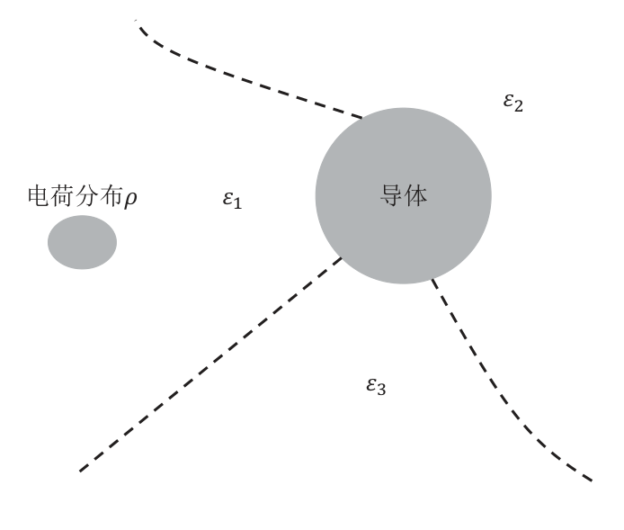

图内文字：电荷分布 $\rho$，$\varepsilon_1$，导体，$\varepsilon_2$，$\varepsilon_3$

一个标准的静电问题如图3.1所示。在一块均匀介质的内部有 $\varepsilon(\vec{r})=\varepsilon$，则上式转化成标准的Poisson方程

$$
\nabla^2\varphi(\vec{r}) = -\rho(\vec{r})/\varepsilon \tag{3.1.4}
$$

在不同物质交界面上场及势要满足相应的边界条件。本章主要研究不用求解Poisson方程的前提下，有关导体的静电状态我们到底能知道多少。要解微分方程，必须知道边界条件。下面我们将讲述导体与介质的交界面上的边界条件。

#### 3.1.2 静电条件下导体的边界条件

所谓导体即是能导电的介质，当它内部存在电场时就会引起传导电流。在导体中有关系式 $\vec{j}=\sigma_c\vec{E}$，可见在静电学(即 $\vec{j}=0$)的前提下，导体内的电场强度必须处处为零，否则必定引起电流。根据 $\vec{D}=\varepsilon\vec{E}=0$ 的关系知 $\nabla\cdot\vec{D}=\rho=0$，即导体内部不可能有电荷分布。所以对导体来讲，电荷只能分布在表面上。进一步分析导体表面的电荷是如何分布的：若导体表面上切向电场不为0，则表面电荷必然在电场的作用下在表面上运动，引起表面电流，这与静电条件不符。因此，静电条件下导体表面的电场的切向分量为0，亦即，导体表面的标势处处相等。导体表面电场的法向分量可以不为0，这与切向电场很不相同——导体电荷在表面处受到非静电来源的束缚能——即“功函数”，自由电荷受到垂直电场的作用不会飞出导体。根据Gauss定理，垂直电场与此处的表面电荷面密度成正比（$D_\perp=\sigma\Rightarrow E_\perp=\sigma/\varepsilon$）。总结下来，与导体相关的电场行为满足

$$
\begin{cases}
\vec{E}_{in} = 0 \qquad \rho_{in} = 0 \\[6pt]
\vec{E}_{\parallel}^{surface} = 0 \\[6pt]
\vec{E}_{\perp}^{surface} = \sigma/\varepsilon
\end{cases} \tag{3.1.5}
$$

需要强调指出的是：导体表面上的电荷分布和表面垂直电场均是未知量！进一步将上面关于场的边界条件转化成对势的边界条件，有

$$
\begin{cases}
\left.\varphi\right|_{\text{Boundary}} = \text{Constant} \\[10pt]
\left.\dfrac{\partial\varphi}{\partial n}\right|_{\text{Boundary}} = -\dfrac{\sigma}{\varepsilon} \qquad Q = -\varepsilon \oint \dfrac{\partial\varphi}{\partial n} dS
\end{cases} \tag{3.1.6}
$$

所有这些条件都是因为导体内部有自由电荷这个性质决定的！

原则上，导体相关的静电问题就是在边界条件3.1.6下求解3.1.4。这里可能有两类问题：

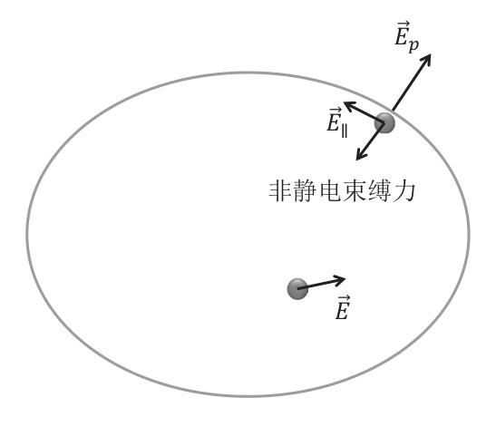

图内文字：$\vec{E}_p$，$\vec{E}_\parallel$，非静电束缚力，$\vec{E}$

1. 等势问题——假设考虑的导体与外界大的带电导体相连并达到静电平衡，$\varphi=const.$（注意：此时导体上的总电荷不能预先设定）。

2. 孤立导体问题——假设导体孤立，则 $Q$ 已知，但此时 $\varphi$ 不能预先设定。某种意义上讲，$Q$，$\varphi$ 是一对共轭量，不可能同时预先设定。

### 3.2 格林互易定理

在讨论具体问题之前，先介绍一个一般的定理——格林互易定理，其在导体静电学中相当有用。它的表述如下：

当 $m$ 个导体上的电荷为 $q_1$，$q_2$，$\cdots$，$q_m$ 时，它们的电势等于 $\phi_1$，$\phi_2$，$\cdots$，$\phi_m$；当导体上的电荷为 $q_1'$，$q_2'$，$\cdots$，$q_m'$ 时，它们的电势等于 $\phi_1'$，$\phi_2'$，$\cdots$，$\phi_m'$，那么有关系式

$$
\sum_{i=1}^{m} q_i \phi_i' = \sum_{i=1}^{m} q_i' \phi_i \tag{3.2.1}
$$

证明：

证明Green互易定理之前，我们先证明一个数学恒等式。取任意的一个闭合曲面$S$，假设$\Phi$，$\Psi$是$S$包围的体积$V$内的2个连续可微的函数，则由高斯定理可得

$$
\int_V \nabla \cdot (\Phi \nabla \Psi)\, d\tau = \oint_S \Phi \nabla \Psi \cdot d\vec{S} \tag{3.2.2}
$$

将$\Phi$，$\Psi$位置互换，有

$$
\int_V \nabla \cdot (\Psi \nabla \Phi)\, d\tau = \oint_S \Psi \nabla \Phi \cdot d\vec{S} \tag{3.2.3}
$$

两式相减，我们就得到

$$
\int_V \left( \Psi \nabla^2 \Phi - \Phi \nabla^2 \Psi \right) d\tau = \oint_S \left( \Psi \nabla \Phi - \Phi \nabla \Psi \right) \cdot d\vec{S} \tag{3.2.4}
$$

此式即是格林定理，它的重要性是将任意两个标量函数的空间的性质转化为边界处的行为。下面我们进一步利用格林定理证明格林互易定理。

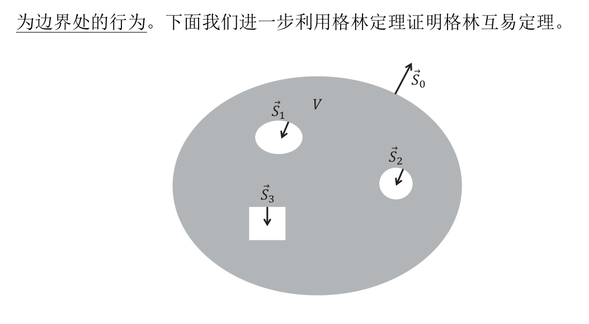
图内文字：$\vec{S}_1$，$V$，$\vec{S}_0$，$\vec{S}_2$，$\vec{S}_3$，图 3.3

对包含$m$个导体的空间，取无限远处为封闭曲面$\vec{S}_0$，然后再在其中挖掉所有$m$个导体，因此产生$m$个封闭曲面$\vec{S}_i$。剩余的空间，体积为$V$，是一个多连通的闭合区域，其边界由$\vec{S}_0$及$\vec{S}_i$共同确定，记为$S$。考虑两个状态，其中导体上分别带有电荷$\{q_i\}$和$\{q'_i\}$，此时对应的电势分布分别为$\varphi(\vec{r})$，$\varphi'(\vec{r})$。由于电荷都分布在导体表面上，所以在体积$V$内$\nabla^2 \varphi = 0$，

$\nabla^2 \varphi' = 0$。我们现在令$\Psi = \varphi$，$\Phi = \varphi'$，代入3.2.4式，则3.2.4左边$=0$。取$\vec{S}_0$在无限远处，因3.2.4中右边项以$r^{-3}$在无穷远处趋向于$0$，则易知其对$\vec{S}_0$的积分$=0$。故有

$$
\sum_{i=1}^{m} \oint_{S_i} (\varphi \nabla \varphi' - \varphi' \nabla \varphi) \cdot d\vec{S}_i = 0 = \sum_{i=1}^{m} \oint_{S_i} \left( \varphi \frac{\partial \varphi'}{\partial n} - \varphi' \frac{\partial \varphi}{\partial n} \right) \cdot dS_i \tag{3.2.5}
$$

对每个导体表面的积分，注意导体表面的电荷分布是

$$
\sigma_i = \varepsilon \left. \frac{\partial \varphi}{\partial n} \right|_{S_i} \qquad \sigma_i' = \varepsilon \left. \frac{\partial \varphi'}{\partial n} \right|_{S_i} \tag{3.2.6}
$$

（这里取$+$号是因为$\vec{S}_i$的方向定义为垂直表面向导体内部），以及导体表面是等势体

$$
\phi_i = \left. \varphi \right|_{S_i} \qquad \phi_i' = \left. \varphi' \right|_{S_i} \tag{3.2.7}
$$

将他们代入3.2.5式得

$$
\sum_i \left( \oint_{S_i} \phi_i \sigma_i' dS_i - \oint_{S_i} \phi_i' \sigma_i dS_i \right) = 0 \tag{3.2.8}
$$

积分可得格林互易定理：

$$
\sum_{i=1}^{m} q_i \phi_i' = \sum_{i=1}^{m} q_i' \phi_i \tag{3.2.9}
$$

由格林互易定理，我们可以马上得到一个重要的结果。令$q_1' = q_3' = q_4' = \cdots = q_n' = 0$，$q_2 = q_3 = q_4 = \cdots = q_n = 0$，则有

$$
q_2' \phi_2 = q_1 \phi_1' \tag{3.2.10}
$$

再令$q_1 = q_2'$，则得

$$
\phi_1' = \phi_2 \tag{3.2.11}
$$

这就是说，带电$q$的导体B在不带电的导体A上（感应）产生的电势等于带电$q$的导体A在不带电的导体B上（感应）产生的电势。

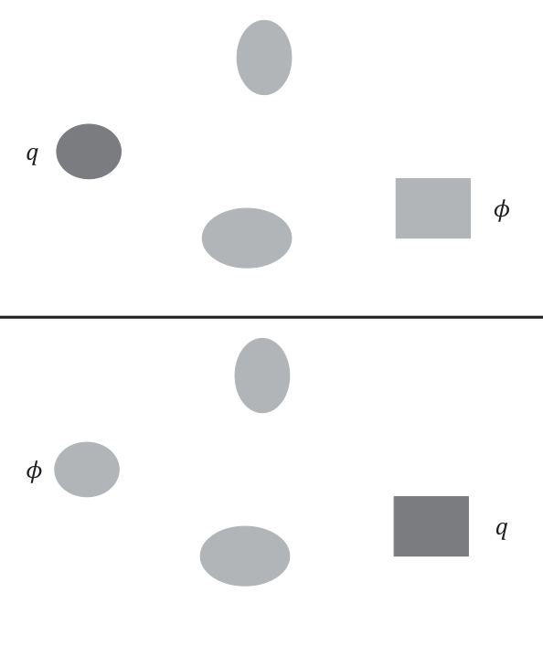
图内文字：$q$，$\phi$，$\phi$，$q$，图 3.4

注：你可能Argue说这没什么啊，比如一个点电荷产生的势为$\varphi = \dfrac{q}{4\pi\varepsilon_0 r}$，只与观察点与源的距离相关，显然有上述互易性质。但注意上面的定理显示这种互易关系在任意导体形状下、任意的其他导体分布情况下均成立。这并不显然，因为场会引发导体上的电荷的再分布（即使总体不带电），使得问题变得非常复杂。格林互易定理在处理导体相关问题上很有优势。格林互易定理从本质上讲述的是源——观察点之间的对称关系。

[例1] 在一个接地导体球（半径为$R$）外距球心距离为$r$的地方放置一个带电量为$q$的点电荷，求在导体球上的感应电荷。

解：对这个由两个导体组成的导体系，对应电荷分布$\{q, q_R\}$，电势分布为$\{\varphi_q, 0\}$，其中$q_R$为导体球上的感应电荷，$\varphi_q$为点电荷所在地的电势，均未知。现制备另外一个电荷分布$\{0, q_R'\}$，则非常容易求出空间的电场为$\vec{E} = \dfrac{1}{4\pi\varepsilon_0}\dfrac{1}{r^2}\hat{r}$，故，两个导体上的电势分别为$\dfrac{q_R'}{4\pi\varepsilon_0}\left\{\dfrac{1}{r}, \dfrac{1}{R}\right\}$，因此，根据

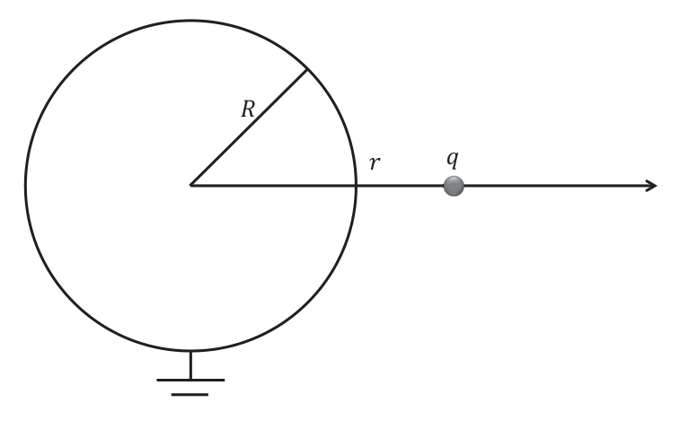
图内文字：$R$，$r$，$q$，图 3.5

格林互易定理，可得

$$
q\frac{1}{r} + q_R\frac{1}{R} = 0 \Rightarrow q_R = -\frac{R}{r}q \tag{3.2.12}
$$

因此导体球上的感应电荷为$-\dfrac{R}{r}q$

*Tips*：有同学会被“导体球接地”这个条件所迷惑，当设计第二个状态时仍然把导体球接地，这样就无法改变球的电势状态从而达到利用格林定理的目的。“接地”只是把导体球的电势设为0而已，并不意味着我需要一直连一根导线到地。

### 3.3 导体系的能量、固有能和相互作用能

#### 3.3.1 利用静电标势来表示静电能量

静电场能量可以用电势$\varphi$来表述。假设一系列导体放置在介电常数为$\varepsilon$的线性电介质背景中，则体系的静电总能量为

$$
W = \frac{1}{2} \int \left( \vec{E} \cdot \vec{D} \right) d\tau \tag{3.3.1}
$$

利用$\vec{E} = -\nabla \varphi$，上式可写成

$$
W = -\frac{1}{2} \int (\nabla \varphi) \cdot \vec{D} d\tau \tag{3.3.2}
$$

$$
= -\frac{1}{2} \int \nabla \cdot (\varphi \vec{D}) d\tau + \frac{1}{2} \int \varphi \nabla \cdot \vec{D} d\tau \tag{3.3.3}
$$

$$
= -\frac{1}{2} \oint \varphi \vec{D} \cdot d\vec{S} + \frac{1}{2} \int \varphi \rho d\tau \tag{3.3.4}
$$

其中用到了$\nabla \cdot \vec{D} = \rho$。若我们考察的是体系的总能量，则3.3.1式的体积分是对全空间进行的，因此上述等式右边的面积分是对无穷大的面进行。对电荷体系分布在有限区域内的情况，$\varphi \vec{D}$以$r^{-3}$形式在无穷远处趋向0，因此面积分的值为零。另一方面，导体上的电荷分布全部集中在导体的表面，而导体表面上的势为常数。因此，能量的表达式变为

$$
W = \frac{1}{2} \int \varphi \rho d\tau = \frac{1}{2} \sum_i \phi_i Q_i \tag{3.3.5}
$$

其中$\phi_i$，$Q_i$为第$i$个导体的势和总电荷。

注：

1. 上式虽然只与自由电荷相关，却是包含了极化能的电磁总能量。从物理上讲，静电总能可以被理解成建立这样一个导体体系，外界做的总功。因此3.3.5也可这样推出：假设电荷从处于无限远处一点点搬来的，将这些电荷一点点搬来做的功的总和即是3.3.5。试着推导一下，并解释为什么有$1/2$因子？

2. 从上面的分析我们看到静电能有两种表达式，一种是$W = \dfrac{1}{2}\int \vec{E} \cdot \vec{D} d\tau$，这表示静电能是以密度$u = \dfrac{1}{2}\vec{E} \cdot \vec{D}$的形式在介质空间连续分布，场强的地方能量也大。另一种表达式是$W = \dfrac{1}{2}\int \varphi \rho d\tau$，它表示能量只与存在着电荷分布的空间有关。以上两种表达式只有在求静电场的总能量时才等效，而当讨论空间某一有限范围内的电磁能量时两者不再等效，因为面积分在有限范围内的值一般不会为零，我们只能

应用第一种表达式。第二种表达式并不意味着$\dfrac{1}{2}\varphi\rho$是电场的能量密度——没有电荷就没有能量的看法是错误的！

#### 3.3.2 电容

一个有多个导体组成的体系，每个导体都是等势体，其电势为$\{\phi_i\}$，同时每个导体上带有不同的电量$\{Q_i\}$。这个导体体系的状态既可以用$\{\phi_i\}$来刻画，也可以用$\{Q_i\}$来刻画。那么，$\{\phi_i\}$与$\{Q_i\}$之间是什么关系呢？

利用线性叠加原理可以证明：任意一个导体上的电势$\phi_i$是各个导体上的电量的线性函数。用数学表述为：$\{\phi_i\}$一定可以表示为$\{Q_i\}$的线性函数

$$
\phi_i = \sum_j C_{ij}^{-1} Q_j \tag{3.3.6}
$$

式中的比例系数$C_{ij}^{-1}$与导体的形状和相对位置有关，其量纲是长度量纲的负一次方。反之亦然：

$$
Q_i = \sum_j C_{ij} \phi_j \tag{3.3.7}
$$

这里的$C_{ij}$是$C_{ij}^{-1}$的逆阵元素。

证明上式并不容易，因为所有的带电体均可呈现任意形状，任何一个带电体上的电荷增减都会影响到其它带电体上的电荷分布，从而影响到整个体系的电势分布！但仔细考虑静电平衡和线性叠加原理发现问题可以得到证明。

分三步考虑：

1. 如图3.6所示，只在第1个导体上放置单位电量的电荷，其它所有导体上不放置电荷，即电荷分布为$\{1, \cdots, 0, \cdots\}$。当此体系达到静电平衡时，对应的电势分布为$\{\varphi_1^{(1)}, \varphi_2^{(1)}, \cdots, \varphi_j^{(1)}, \cdots\}$，同时记下所有导

体上的面电荷分布$\{\sigma_1, \cdots, \sigma_j, \cdots\}$，注意此时其它导体上虽不带净电荷，电荷分布却未必为0！

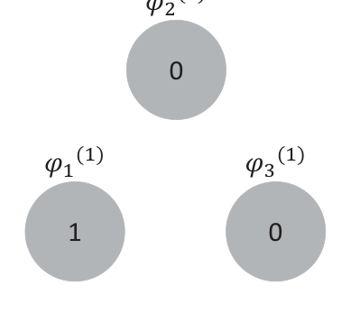
图内文字：$\varphi_2^{(1)}$，$0$，$\varphi_1^{(1)}$，$1$，$\varphi_3^{(1)}$，$0$，图 3.6

2. 当第1个导体上的电荷线性增加$q_1$倍时，如图3.7所示，即分布为$\{q_1, 0, \cdots, \cdots\}$时，达到静电平衡时的导体面电荷分布一定为$\{q_1\sigma_1, \cdots, q_1\sigma_j, \cdots\}$，根据线性叠加原理，对应的电势分布一定为$\{q_1\varphi_1^{(1)}, q_1\varphi_2^{(1)}, \cdots, q_1\varphi_j^{(1)}, \cdots\}$。

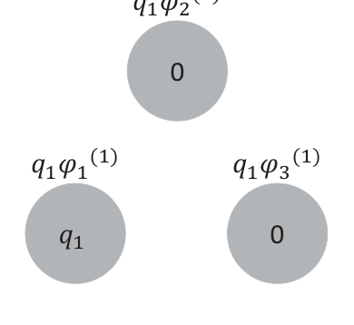
图内文字：$q_1\varphi_2^{(1)}$，$0$，$q_1\varphi_1^{(1)}$，$q_1$，$q_1\varphi_3^{(1)}$，$0$，图 3.7

3. 换第二个带电体，在其上充电$q_2$（其它带电体上不充电），则得到电势分布$\{q_2\varphi_1^{(2)}, q_2\varphi_2^{(2)}, \cdots, q_2\varphi_j^{(2)}, \cdots\}$，如图3.8所示。将这个状态与（2）中的状态线性叠加，得到的电荷分布状态状态一定也是静电平衡态，其对应电荷分布为$\{q_1, q_2, \cdots, \cdots\}$的状态。将这样的过程循环往复，我们发现对应于$\{q_1, q_2, \cdots, q_j, \cdots\}$的状态，第$i$个带电体上的

电势为$\phi_i = \sum_j q_j \varphi_i^{(j)}$，对比3.3.6发现问题得证，而$C_{ij}^{-1} = \varphi_i^{(j)}$，物理意义为：只在第$j$个带电体上充单位电量时在第$i$个带电体上诱导的电势。

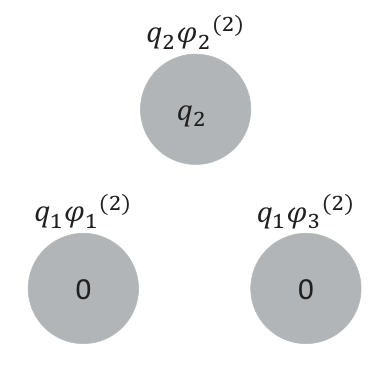
图内文字：$q_2\varphi_2^{(2)}$，$q_2$，$q_1\varphi_1^{(2)}$，$0$，$q_1\varphi_3^{(2)}$，$0$，图 3.8

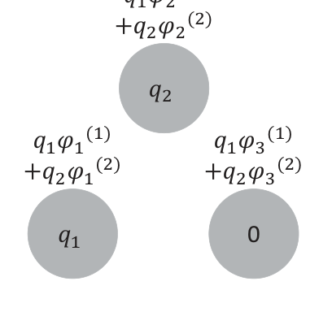
图内文字：$q_1\varphi_2^{(1)} + q_2\varphi_2^{(2)}$，$q_2$，$q_1\varphi_1^{(1)} + q_2\varphi_1^{(2)}$，$q_1$，$q_1\varphi_3^{(1)} + q_2\varphi_3^{(2)}$，$0$，图 3.9

将导体系能量的用电势或电荷表示：

$$
W = \frac{1}{2} \sum_{ij} C_{ij} \varphi_i \varphi_j = \frac{1}{2} \sum_{ij} C_{ij}^{-1} Q_i Q_j \tag{3.3.8}
$$

为了看清$C_{ij}$的物理含义，设只有一个导体，则

$$
Q_1 = C_{11} \varphi_1 \tag{3.3.9}
$$

注意到对一个半径为 $R$ 的金属球，$Q=4\pi\varepsilon_0 R\varphi$。显然，这里的 $C_{11}=4\pi\varepsilon_0 R$ 是导体的电容，几何的意义就是电荷之间的“有效距离”，物理上具有长度量纲（除去不重要的常数 $\varepsilon_0$）。这个距离越大，当然体系就可以“装下”更多的电荷，因此电容也就越大。

————以下为选读内容————

这里电容完全是个经典的概念。在量子力学世界中，电荷不再是经典的粒子，而是由一个几率函数描述的物质波。这里有许多有趣的新问题值得研究：

1. 此时电容如何定义？如何计算？（加拿大MaGill大学的郭鸿教授做了许多这方面的研究）；

2. 电容能的本质是“库仑相互作用”，对一个量子点，其静电能可写成 $U=Q^2/2C$。设量子点内部只有一个电子填充时的能级为 $E_n$；当量子点中已有一个电子填充的时候，此时再向里面填充一个电子就要付出 $1/2C$ 的能量，因此此时电子的能级为 $E_n+1/2C$。考虑如图3.10所示的隧穿机制，设外部环境中的电子能级与 $E_n$ 匹配的时候，电子可以通过跃迁到量子点中的此能级而穿过量子点；然而当量子点中已有一个电子存在的时候，能级发生了改变，电子不能进行共振隧穿。这种现象叫做“库仑阻塞”——由于库仑力阻塞了电子的运动。

3. “Mott相变”等问题的研究根据量子的能带理论，当能带没有被填满时，固体中的电子可以自由流动从而固体表现为金属。然而在50-60年代，英国物理学家Mott指出对半填充的固体存在一种新的绝缘体——金属相变机制。固体中的电子在两个原子之间跃迁时，能量上可以降低 $t$（Hopping 常数）。然而当能带半满时，每个原子上

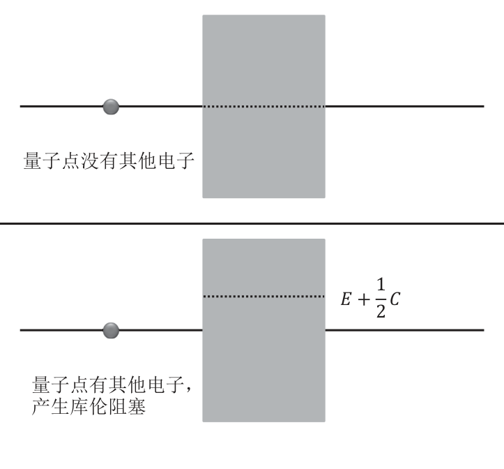

图内文字：量子点没有其他电子，量子点有其他电子，产生库仑阻塞，$E+\frac{1}{2}C$

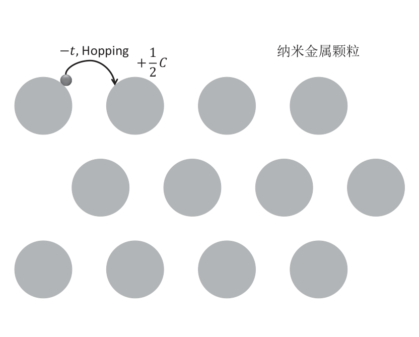

图内文字：$-t$，Hopping，$\frac{1}{2}C$，纳米金属颗粒

已经存在一个电子，此时当电子从一个原子跳到另一个原子上时，会和那上面的电子有静电相互作用，使得能量上升。这两个因素（$t$ 以及静电相互作用能 $U$）互相制约，如图3.11所示。当原子之间远离时，$t$ 很小，因此电子不喜欢跳跃，此时体系表现为绝缘体。当给晶格施加压力使得原子之间的间距变短提高 $t$ 的时候，有可能使得 $t$ 大到可以克服 $U$ 将绝缘体变成一个导体。然而自然的Mott相变得例子极少。随着科技的发展，人们可以人工合成一些由纳米金属颗粒排成的人工晶格，利用这种体系来研究Mott相变。此时作为最低级近似，对体系的静电能部分的描述就是经典的电容能 $U=Q^2/2C$。定量描述这个问题就需要知道体系的电容系数。

————以上为选读内容————

[例2] 《电磁学》中，两个带 $\pm Q$ 电荷的导体的互电容定义为 $C=Q/(\varphi_2-\varphi_1)$。在《电动力学》中，我们更多地会使用电容系数，试用电容系数表示互电容。

解：这个两导体的体系当电荷分布为 $\{Q_1=-Q,Q_2=+Q\}$ 时，电势分布为 $\{\varphi_1,\varphi_2\}$。根据电容系数的定义：

$$
\varphi_1 = C_{11}^{-1}Q_1 + C_{12}^{-1}Q_2 = C_{11}^{-1}(-Q) + C_{12}^{-1}(+Q) \tag{3.3.10}
$$

$$
\varphi_2 = C_{22}^{-1}Q_2 + C_{21}^{-1}Q_1 = C_{22}^{-1}(+Q) + C_{21}^{-1}(-Q) \tag{3.3.11}
$$

因此

$$
\varphi_2 - \varphi_1 = Q\left(C_{11}^{-1} - 2C_{12}^{-1} + C_{22}^{-1}\right) \tag{3.3.12}
$$

与互电容的定义 $\varphi_2-\varphi_1=C^{-1}Q$ 比较可知

$$
\frac{1}{C} = C_{11}^{-1} - 2C_{12}^{-1} + C_{22}^{-1} \tag{3.3.13}
$$

#### 3.3.3 固有能和相互作用能

设有两个带电体1和2，他们各自独立存在时在空间激发的电场分别为 $\vec{E}_1$ 和 $\vec{E}_2$。将它们放在一起，当如下条件之一存在时：

1. 两个带电体自身的尺寸远远小于它们之间的距离时；

2. 一个带电体的电量及尺寸远远小于另一个带电体的电量及尺寸。

两个带电体上的电荷分布不因两个它们之间的相对构型的改变而产生显著变化。则空间总的电场可近似写为 $\vec{E}=\vec{E}_1+\vec{E}_2$。因此，体系的总能量

$$
W = \frac{\varepsilon}{2}\int \vec{E}^2 d\tau = \underbrace{\frac{\varepsilon}{2}\int E_1^2 d\tau + \frac{\varepsilon}{2}\int E_2^2 d\tau}_{W_1+W_2} + \underbrace{\varepsilon\int \vec{E}_1\cdot\vec{E}_2 d\tau}_{W_{int}} \tag{3.3.14}
$$

由上式可以看出，系统的总能量由两部分组成。在这个条件下，上式右方

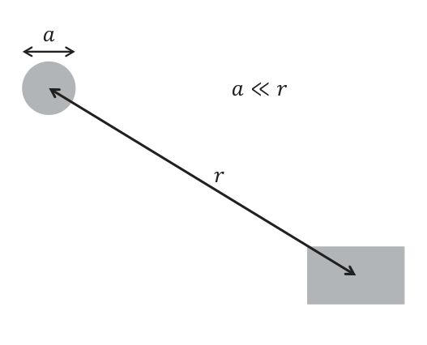

图内文字：$a$，$a\ll r$，$r$

第一和第二项表示1或2带电体单独存在时的能量 $W_1$ 和 $W_2$，称为固有能；上式右方的第三项表示两个体系合起来之后与原来单独存在时的能量差，称为相互作用能，可写成

$$
W_{int} = \varepsilon\int \vec{E}_1\cdot\vec{E}_2 d\tau = \varepsilon\int \nabla\varphi_1\cdot\nabla\varphi_2 d\tau \tag{3.3.15}
$$

其中 $\varphi_1$，$\varphi_2$ 为两个带电体单独存在时的空间的电势分布，分别满足

$$
\nabla^2\varphi_1 = -\rho_1/\varepsilon \qquad \nabla^2\varphi_2 = -\rho_2/\varepsilon \tag{3.3.16}
$$

其中 $\rho_1$，$\rho_2$ 为两个带电体的电荷分布。可以利用分部积分将上式进一步简化：

$$
W_{int} = \varepsilon\int \nabla\cdot(\varphi_1\nabla\varphi_2)\,d\tau - \varepsilon\int \varphi_1\nabla^2\varphi_2\,d\tau \tag{3.3.17}
$$

$$
= \int \varphi_1(\vec{r})\rho_2(\vec{r})\,d\tau \tag{3.3.18}
$$

在许多情况下带电体的自身的尺寸远小于它们之间的间距，$\varphi_1$ 在带电体2的所处的区间内近似为一常数，则

$$
W_{12} \approx \varphi_1\int_V \rho_2 d\tau = \varphi_1 q_2 \tag{3.3.19}
$$

此即是相互作用能的表达式。显然3.3.19可以应用于小的电荷体系（如点电荷）在大的电荷体系产生的电场中（满足条件（2）），以及点电荷之间的相互作用能（满足条件（1））。

#### 点电荷在外电场中

对一个点电荷 $q$ 放置于外电场中，设点电荷所在的位置处外电场的电势为 $\varphi_{ext}(\vec{r})$，则这个体系的相互作用能为

$$
W_{int} = q\varphi_{ext}(\vec{r}) \tag{3.3.20}
$$

注：这个相互作用能是点电荷和外场共有的，不是点电荷自身的。可以与运动粒子在静磁场中的附加动量 $\Delta\vec{P}=q\vec{A}_{ext}(\vec{r})$ 相比较，均为带电体与外场共有的“相互作用能（动）量”。

#### 电荷系的相互作用能

现在考虑由一系列点电荷组成的体系的相互作用能。首先考虑相距为 $R$ 的两个点电荷 $q_1$ 和 $q_2$ 的相互作用能

$$
W_{int,12} = q_1\varphi_2 = \frac{q_1 q_2}{4\pi\varepsilon_0 R} \tag{3.3.21}
$$

其中 $\varphi_2$ 是电荷 $q_2$ 在电荷 $q_1$ 处的势。同理我们也可以把 $W_{int,12}$ 表示为 $q_2\varphi_1$，其中 $\varphi_2$ 为电荷 $q_1$ 在电荷 $q_2$ 处产生的势，所以相互作用能可以写为

$$
W_{int,12} = \frac{1}{2}(q_1\varphi_1 + q_2\varphi_2) \tag{3.3.22}
$$

因此，将上式推广到 $n$ 个电荷组成的体系，相互作用能可表示为

$$
W_{int} = \frac{1}{2}\sum_{\alpha}^{n} q_\alpha \phi_\alpha \tag{3.3.23}
$$

其中 $\phi_\alpha$ 为除电荷 $q_\alpha$ 之外所有其余电荷在电荷 $q_\alpha$ 处的势之和。

注:此处3.3.23的形式虽然与 $W$ 的形式很类似，但 $\phi_\alpha$ 的含义与总能量中 $\varphi_\alpha$ 的含义不同——前者刨去了自己对自己的贡献，也就是能量中的固有能。相互作用能可正可负，但总能量严格为正。

### 3.4 静电体系的稳定性问题

我们前面研究了当导体位置确定时的静电问题。然而有几个问题并没有得到回答：

1. 静电体系处在给定的构型下是否稳定？

2. 稳定时体系中电荷分布及导体的构型应满足什么条件？

要回答这些问题，我们需要研究体系的能量，因为体系的稳定状态对应于能量取极小值时的状态。一个荷电导体系的总静电能为

$$
W = \frac{\varepsilon_0}{2}\int E^2 d\tau = \frac{\varepsilon_0}{2}\int \rho(\vec{r})\varphi(\vec{r}) d\tau \tag{3.4.1}
$$

一个体系的状态可以由电荷分布 $\rho(\vec{r})$ 描述，也可以由电势分布 $\varphi(\vec{r})$ 唯一描述，这两个量一一对应。对应于不同的电荷分布 $\rho(\vec{r})$（假设可以给定，无论其稳定与否），体系具有不同的能量。因此能量 $W$ 是 $\rho(\vec{r})$ 或 $\varphi(\vec{r})$ 的泛函：$W=W[\rho(\vec{r})]$。现在的问题是：

**对应怎样的电荷分布（或电势分布），体系的能量为极小值？**

问题进一步转化成：对给定的 $\rho(\vec{r})$ 做一个虚变动 $\rho(\vec{r})\to\rho(\vec{r})+\delta\rho(\vec{r})$，则要求

$$
\frac{\delta W}{\delta \rho} = 0 \tag{3.4.2}
$$

下面就根据3.4.2的要求讨论静电体系的平衡问题。电荷分布的变动 $\delta\rho(\vec{r})$ 有两类：一种是导体位置不动，电荷在导体上的再分布；另一种是由导电体的位置变动引起的（当然严格来说这个情况下会同时引起单个导体上的电荷再分布）。我们下面分别研究这两种情况，这两个问题的解答分部给出两个重要定理。

#### 3.4.1 汤姆孙定理

先考虑一种相对简单的情况：假设每个导体都是不动的，但电荷在导体上可以自由再分布。显然，这种扰动必须满足如下约束条件：

$$
\int \delta\rho_i d\tau = \delta Q_i = 0 \tag{3.4.3}
$$

让我们考虑由于电荷分布的扰动而引起的能量的变化

$$
\delta W = W(\rho+\delta\rho) - W(\rho) = \varepsilon\int \vec{E}\cdot\delta\vec{E} d\tau = -\varepsilon\int \nabla\varphi\cdot\delta\vec{E} d\tau \tag{3.4.4}
$$

其中 $\delta\vec{E}$ 为 $\delta\rho$ 所产生的电场，满足

$$
\nabla\cdot\delta\vec{E} = \delta\rho/\varepsilon \tag{3.4.5}
$$

对3.4.4进行分步积分可得

$$
\delta W = -\varepsilon\int \nabla\cdot\left(\varphi\delta\vec{E}\right)d\tau + \varepsilon\int \varphi\nabla\cdot\delta\vec{E} d\tau \tag{3.4.6}
$$

$$
= \int \varphi\delta\rho d\tau = \sum_i \int \varphi\delta\rho_i d\tau \tag{3.4.7}
$$

上式第一项可利用高斯定理变为面积分，其结果为零。由于约束3.4.3的存在，极值条件须引入拉格朗日不定乘子 $\lambda_i$，可得

$$
0 = \delta W - \sum_i \lambda_i \delta Q_i \tag{3.4.8}
$$

$$
= \sum_i \int \varphi(\vec{r}_i)\delta\rho_i d\tau_i - \sum_i \lambda_i \int \delta\rho_i d\tau_i \tag{3.4.9}
$$

$$
= \sum_i \int \left[\varphi(\vec{r}_i) - \lambda_i\right]\delta\rho_i(\vec{r})d\tau_i \tag{3.4.10}
$$

因为 $\delta\rho_i(\vec{r})$ 相互独立，上式导致

$$
\varphi(\vec{r}_i) = \lambda_i \tag{3.4.11}
$$

因此，若导体系中每个导体的位置固定不变，每一导体上放置一定量的电荷，则当电荷的分布使所有导体均为等势体时，能量到达极小值，体系处于平衡状态。（思考：严格来说还需证明 $\delta^2 W/\delta\rho^2 > 0$，你能否证明？）这就是汤姆孙定理。我们在前面讨论讲导体静电平衡条件时曾通过物理的Argument得到过这个结论，这里根据能量在约束条件下达到极小这一平衡判据对这个结论给出了数学上的严格证明。但得到这样的静电平衡状态有两个条件：

1. 导体上的电荷不会离开导体；

2. 每个导体的位置保持不变。

对条件1我们已经知道有非静电来源的表面束缚能（功函数）阻止电荷脱离导体。如果我们将条件2放松，使得导体的位置可以发生变化，那么这种导体构型的变动必然导致电荷密度的再分布进一步改变体系的总能量。

下面的问题是：

什么样的构型是体系的稳定状态呢？

#### 3.4.2 恩肖定理

在讨论由于导体构型的变化而产生的能量改变时，我们做如下假设：

1. “绝热近似”——即带电体的运动速度很慢使得每个时刻上面的电荷分布都有足够的时间达到平衡（即称为等势体）。

2. 带电体之间的距离足够远，带电体的运动带来的每个导体上的电荷再分布可以忽略。

在此近似下，我们可以不考虑体系的固有能（因为在构型发生改变时固有能不变），而只考虑相互作用能：

$$
W_{int}=\frac{1}{2}\sum_{\alpha=1}^{n}q_{\alpha}\varphi_{\alpha} \tag{3.4.12}
$$

$W_{int}$是各个导体位置$\{\vec{r}_{\alpha}\}$的函数：$W_{int}(\{\vec{r}_{\alpha}\})$，其具有极小值的充要条件是：$W_{int}$对所有电荷的坐标的一阶微商必须为零，而二阶微商必须恒大于零。简单起见，这里我们只考虑其中一个导体的位置发生了变化$\vec{r}_{\alpha} \to \vec{r}_{\alpha}+\delta\vec{r}_{\alpha}$，则变分后第一个条件要求

$$
\nabla_{\alpha}W_{int}=0 \Rightarrow \nabla\varphi_{\alpha}=0 \Rightarrow \vec{E}_{\alpha}=0 \tag{3.4.13}
$$

亦即，在每个导体所在处，由其他导体产生的电场必须相互抵消恒为0。

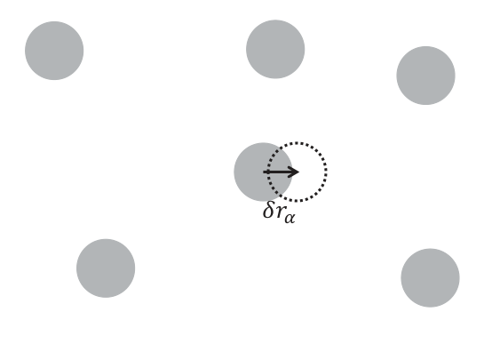
图内文字：$\delta\vec{r}_{\alpha}$

这一条件依赖于具体的导体构型。假设这一个条件能够实现，我们进一步考察这种状态的稳定性问题。让我们检查$W$在某一个“平衡位置”附近对其中一个导体位置做相应扰动$\vec{r}_{\alpha} \to \vec{r}_{\alpha}+d\vec{r}_{\alpha}$，保留到2阶，有

$$
\delta^2 W=\frac{1}{2}\sum_{i,j=x,y,z}\frac{\partial^2 W}{\partial r_{\alpha}^i \partial r_{\alpha}^j}dr_{\alpha}^i dr_{\alpha}^j \tag{3.4.14}
$$

$$
=\frac{q_{\alpha}}{2}\sum_{i,j=x,y,z}\frac{\partial^2 \phi_{\alpha}}{\partial r_{\alpha}^i \partial r_{\alpha}^j}dr_{\alpha}^i dr_{\alpha}^j \tag{3.4.15}
$$

$$
=\sum_{i,j=x,y,z}B_{i,j}dr_{\alpha}^i dr_{\alpha}^j \tag{3.4.16}
$$

其中$B_{ij}=\dfrac{q_{\alpha}}{2}\dfrac{\partial^2 \phi_{\alpha}}{\partial r_{\alpha}^i \partial r_{\alpha}^j}$为一个对称矩阵。（这里少一个$1/2$，原因是我们计算$\vec{r}_{\alpha}$的变化时，不仅考虑其它导体对第$\alpha$个导体的电势变化，还要考虑第$\alpha$个导体在其它带电体处的电势变化，根据对称性，这两项贡献相等）。要使得体系稳定，$\delta^2 W$应当针对任意的变动恒为正！单独从3.4.16式中得不出任何结论，因为不同的方向上的虚位移耦合在一起。可以将$B$矩阵对角化，得到一系列本征值$b_i$，则有

$$
\delta^2 W=\sum_{i=1,2,3}b_i\left(d\tilde{r}_{\alpha}^i\right)^2 \tag{3.4.17}
$$

其中$d\tilde{r}_{\alpha}^i$对应这一本征值的本征矢量，可以理解为这些扰动的“简正”模式。要得到稳定状态，则要求所有可能的扰动均导致能量上升，

从3.4.17中可以看出我们要所有的本征值均大于0:

$$
b_i>0 \qquad i=1,2,3 \tag{3.4.18}
$$

另一方面，考虑$\phi_{\alpha}$是除$q_{\alpha}$之外所有其他电荷在第$\alpha$个电荷处产生的势，故根据Poisson方程（因为$\vec{r}_{\alpha}$处没有电荷）

$$
\nabla_{\alpha}^2\phi_{\alpha}=\sum_i\frac{\partial^2\phi_{\alpha}}{\partial r_{\alpha}^i\partial r_{\alpha}^i} \tag{3.4.19}
$$

所以，根据$B_{i,j}$矩阵的定义，我们有

$$
2\sum_{i=1,2,3}b_i=2Tr\left(B_{i,j}\right)=q_{\alpha}\nabla_{\alpha}^2\phi_{\alpha}=0 \tag{3.4.20}
$$

很显然，3.4.18与3.4.20相互矛盾！故$W_{int}$不可能有极小值，只可能存在“鞍点”类型的极值点（某些方向为极小，某些方向为极大值）。因此只有静电相互作用的电荷体系不可能形成稳定状态，任何稳定的静电体系的形成都必须有其他约束力参与。如果没有一种非静电的约束力，导体上的各电荷元将在相互斥力的作用下向各个方向飞散到无限远处，孤立的带电导体就不复存在。为此，在静电学中我们总是假定存在着某种非静电的约束力。

注：这里所有的讨论都是针对“静电力”，也就是满足$\nabla\times\vec{E}=0$的力。当电场随时间变化时，此时的力不再受这个定理的约束。另外，量子力学中可能存在其他来源复杂的力（如交换耦合力），也不受这个定理的约束。

### 3.5 导体表面所受的静电力

置于静电场内的导体会受到静电场的作用力，这种静电力作用在导体的表面，因为电荷在静电平衡时只堆积在导体表面。我们可以从两个不同的角度进行计算。

#### 3.5.1 方法1：Maxwell张量

在上一章，我们已经详细介绍了如何计算一个放置于电磁场中的物体受力问题。在定态（不随时间变化）或者时谐场条件下，物体的受力就是Maxwell张量的面积分：

$$
\vec{F}=-\oint d\vec{S}\cdot\overleftrightarrow{T} \tag{3.5.1}
$$

因为导体内的场$\vec{E}_{\text{内}}=0$，故只有导体的外表面受力。单位面积所受的力为

$$
\vec{F}_S=-\vec{e}_n\cdot\overleftrightarrow{T} \tag{3.5.2}
$$

静电条件下，真空中的麦克斯韦张力张量为

$$
\overleftrightarrow{T}=\varepsilon_0\left(\frac{1}{2}E^2\overleftrightarrow{I}-\vec{E}\vec{E}\right) \tag{3.5.3}
$$

导体外表面的场只有法向分量，故

$$
\vec{F}_S=\frac{\varepsilon_0}{2}E^2\vec{e}_n \tag{3.5.4}
$$

可见导体表面单位面积受力的大小等于静电场的能量密度，方向指向导体外法线方向，也就是说，导体受到一种“负压力”。

注：你也许会问：这是电场作用到自由电荷上的力啊！不一定就是作用到导体上的力！其实，导体中的自由电荷在静电平衡时全都集中在导体表面，由于有非静电的束缚力才使得电荷不能飞离导体。因而场对自由电荷的作用力通过非静电来源的平衡力转嫁到导体上。换一句话说，把导体和其中的电荷看成一个整体，则外界对电荷的力就等于对整个导体的作用力。

导体表面的场也可用面电荷表示，即

$$
\vec{E}=\frac{\sigma}{\varepsilon_0}\vec{e}_n \tag{3.5.5}
$$

代入3.5.4式可得

$$
\vec{F}_S=\frac{1}{2\varepsilon_0}\sigma^2\vec{e}_n \tag{3.5.6}
$$

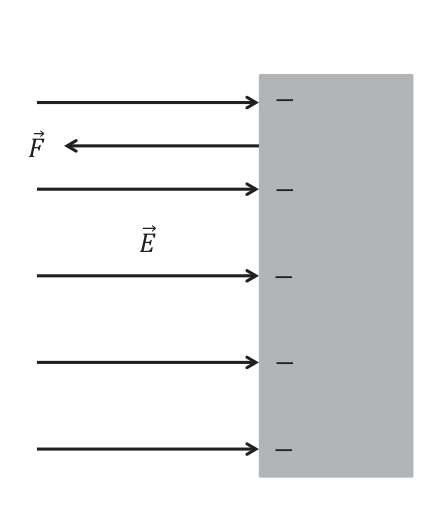
图内文字：$\vec{F}$、$\vec{E}$

#### 3.5.2 方法2：直接计算电荷受力

如前所述，导体表面受力实际上是电场对面电荷的作用力，所以我们可以直接用洛伦兹力来计算

$$
\vec{F}=\int\rho\vec{E}d\tau \tag{3.5.7}
$$

然而直接利用上式有困难，因为理想的导体模型为导体的电荷分布为面电荷分布：$\rho(\vec{r})=\sigma(\vec{r}_{\parallel})\delta(z)$，然而电场在导体的内外表面不连续：$\vec{E}_+=\sigma/\varepsilon_0$，$\vec{E}_-=0$。代入3.5.7时，有

$$
\vec{F}=\int\sigma(\vec{r}_{\parallel})\delta(z)\vec{E}(\vec{r}_{\parallel},z)d\vec{r}_{\parallel}dz \tag{3.5.8}
$$

此时对$z$的积分不容易进行，因为将$z=0$代入$\vec{E}$的表达式时我们不知道该取$\vec{E}_+$还是$\vec{E}_-$。

这个问题的产生是因为其实导体上的电荷本来就非完全分布于表面上的，面电荷分布只是我们对导体的一个理想化的模型处理。真实情况下，电荷是分布在一个非常薄的表面层内的。模型计算表明，这个过渡区约为$10^{-10}m$。让我们取最简单的情况，假设电荷均匀地分布在这个厚度为$l$的过渡层中，亦即

$$
\rho(\vec{r})=
\begin{cases}
0 & z<-l\\
\rho_0 & -l<z<0\\
0 & z>0
\end{cases} \tag{3.5.9}
$$

利用Gauss定理可容易计算出电场分布，即

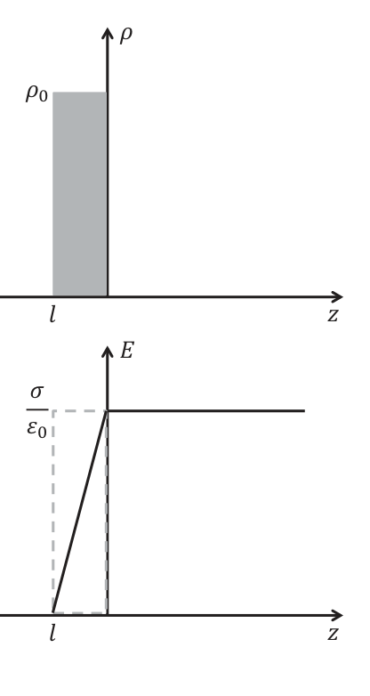
图内文字：$\rho$、$\rho_0$、$l$、$z$、$E$、$\dfrac{\sigma}{\varepsilon_0}$

$$
E=
\begin{cases}
0 & z<-l\\
\dfrac{1}{\varepsilon_0}\rho_0(z+l) & -l<z<0\\
\dfrac{1}{\varepsilon_0}\rho_0 l & z>0
\end{cases} \tag{3.5.10}
$$

则导体表面所受的力为

$$
\vec{F}=\int dS\int_{-l}^{0}\rho_0\vec{E}dz \tag{3.5.11}
$$

$$
=\int dS\int_{-l}^{0}\frac{1}{\varepsilon_0}\rho_0^2(z+l)\vec{e}_n dz \tag{3.5.12}
$$

$$
=\frac{1}{2\varepsilon_0}(\rho l)^2\vec{e}_n dS \tag{3.5.13}
$$

当此过渡层非常小，而我们又不关心过渡层内部的电场时，过渡层的电荷可以等价成面电荷分布：

$$
\sigma=\lim_{l\to 0}(\rho l) \tag{3.5.14}
$$

所以，导体表面单位面积所受的力为

$$
\vec{F}_S=\frac{1}{2\varepsilon_0}(\rho l)^2\vec{e}_n=\frac{1}{2\varepsilon_0}\sigma^2\vec{e}_n \tag{3.5.15}
$$

结果与利用麦克斯韦张力张量所作的计算一致。

*Tips*：这个世界上本来没有奇性，人们为了计算以及表述的方便引入了奇异的物理量（如面电荷分布），但未必给你强调这种方便的代价及适用范围。我们在学习的过程中一定要深入掌握原理的来龙去脉，才能对问题理解的更加透彻，在遇到新问题时不会上当或是手足无措。另外，05级物理系的一位同学曾经证明，上述结论在电荷分布是任意幂次（未必是线性）的情况下都成立。
