# 第四章 静电学II - 电介质静电学

上一章中我们研究了静电学的第一部分——与导体相关的静电问题。在那里，我们没有真正求解电势的方程，而是根据导体具有自由电荷这一特点研究了与导体相关的一些静电基本定理——汤姆逊定理、恩肖定理、格林互易定理，以及一些基本量的行为——如相互作用能、导体受力、电容系数等等。但要具体计算出这些物理量，我们仍需知晓空间的电势分布 $\varphi(\vec{r})$。在这一章中，我们转而研究电介质中的静电场的行为，目的就是计算 $\varphi(\vec{r})$。与导体不同，电介质中的电场不为0，电场的标势由方程

$$
\nabla\cdot\left[\varepsilon(\vec{r})\nabla\varphi\right]=-\rho_f(\vec{r}) \tag{4.0.1}
$$

决定，其中 $\varepsilon$ 可以是位置的函数（针对非均匀介质的情形）。在一块均匀介质内部，$\varepsilon$ 是常数，故上式变为

$$
\nabla^2\varphi=-\frac{1}{\varepsilon}\rho_f \tag{4.0.2}
$$

为大家熟知的泊松方程。

电介质中电场问题就转化成在合适的边界条件下解上述Poisson方程。这些边界条件包括我们上一章讨论过的介质/导体表面边界条件，以及我

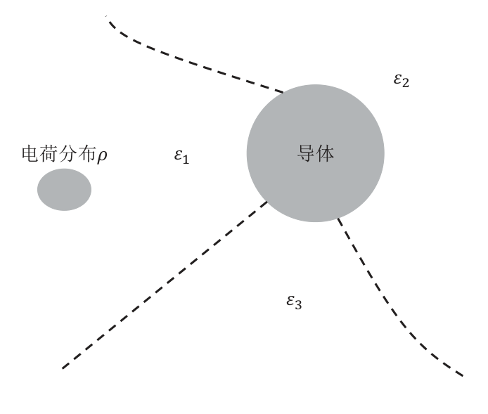
图内文字：电荷分布 $\rho$，$\varepsilon_1$，导体，$\varepsilon_2$，$\varepsilon_3$

图 4.1

们下面要介绍的介质/介质边界条件。

### 4.1 电介质边界条件

由Maxwell方程我们已导出场在两个介质分界面的边值关系

$$
\vec{e}_n\cdot\left(\vec{D}_1-\vec{D}_2\right)=\sigma_f \tag{4.1.1}
$$

$$
\vec{E}_{1t}=\vec{E}_{2t} \tag{4.1.2}
$$

其中 $\vec{e}_n$ 为垂直于界面上2指向1的单位矢量，而 $t$ 指的是界面上两个独立方向矢量。这里需要强调指出的是 $\sigma_f$ 是自由电荷面密度，它们是外加的原本不属于介质的源电荷，而且分布在介质分界面的一个薄层里所以被当作奇性的面电荷分布处理（不关心过渡层中的电场）。根据 $\vec{D}=\varepsilon\vec{E}=-\varepsilon\nabla\varphi$，容易由4.1.1导出

$$
\varepsilon_1\frac{\partial\varphi_1}{\partial n}-\varepsilon_2\frac{\partial\varphi_2}{\partial n}=-\sigma_f \tag{4.1.3}
$$

再将 $\vec{E}=-\nabla\varphi$ 带入4.1.2可得

$$
\frac{\partial\varphi_1}{\partial n_\parallel}=\frac{\partial\varphi_2}{\partial n_\parallel}\Rightarrow\frac{\partial\left(\varphi_1-\varphi_2\right)}{\partial n_\parallel}=0 \tag{4.1.4}
$$

$$
\Rightarrow\left(\varphi_1-\varphi_2\right)\Big|_{surface}=const. \tag{4.1.5}
$$

其中 $n_\parallel$ 为界面上的两个独立方向，而 $const.$ 是个与界面上位置无关的一个常数。亦即：在两个介质的界面上，左右两边的标势值最多只差一个对此界面通用的常数值。下面来考虑这个常数。根据势的定义：

$$
\varphi_2-\varphi_1=\int_2^1\vec{E}\cdot d\vec{l}\xrightarrow{h\to0}E_{2,n}h/2+E_{1,n}h/2=\left(\frac{E_{2,n}+E_{1,n}}{2}\right)h \tag{4.1.6}
$$

其中，$h$ 为1，2两个点之间的距离，而 $E_{2,n}$，$E_{1,n}$ 为界面两端的垂直电场分量。在 $h\to0$ 时，显然4.1.6式只有在电场存在奇性（$E_{1,n}\to\infty$，$E_{2,n}\to\infty$）的时候才不为0！在所有我们考虑的情况下，电场都不会发散——即使有面电荷存在，两边的电场不会发散（尽管可以不连续），因此上面右端=0，即

$$
\varphi_1=\varphi_2 \tag{4.1.7}
$$

4.1.3及4.1.7就是关于势的边界条件。显然，边界条件4.1.7直接导致关于场的边界条件4.1.2。

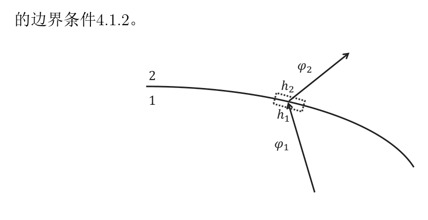
图内文字：2，1，$\varphi_2$，$h_2$，$h_1$，$\varphi_1$

图 4.2

注：关于电势条件4.1.7，唯一的例外是点电荷，因为点电荷的场在原点是发散的，的确 $\varphi|_{0+}$，$\varphi|_{0-}$ 是不连续的。只要将点电荷描述成一个带电

为 $q$ 的半径为 $a$ 的小球，则一切问题均解决了。这再一次显示了点电荷只是一个数学模型而已。

### 4.2 唯一性定理

有了边界条件，原则上可以解Poisson方程以得到所有关于场的信息。在介绍静电方程的解的具体方法之前，首先介绍一个重要的定理——唯一性定理。

**定理**：如果静电体系内存在电荷分布 $\rho(\vec{r})$ 和电介质分布 $\varepsilon(\vec{r})$，且关系式 $\vec{D}=\varepsilon\vec{E}$ 成立，则体系的电场由边界条件（即边界上的 $\varphi$ 或 $\vec{e}_n\cdot\vec{D}$）唯一确定——即，不可能存在两组不同的电场解，都满足同样的边界条件（参照4.1节上面的图）。

**证明**：我们利用反证法证明。设对同一个体系存在有两个解 $\varphi'$ 和 $\varphi''$，$\vec{E}'=-\nabla\varphi'$，$\vec{E}''=-\nabla\varphi''$；$\vec{D}'=\varepsilon\vec{E}'$，$\vec{D}''=\varepsilon\vec{E}''$，下面我们将证明它们其实是同样的：

$$
\vec{D}'=\vec{D}''\qquad\vec{E}'=\vec{E}'' \tag{4.2.1}
$$

根据定义，这两个场都要满足同样的边界条件，即在边界处有

$$
\varphi'=\varphi''\quad\text{或者}\quad\vec{D}'\cdot\vec{e}_n=\vec{D}''\cdot\vec{e}_n \tag{4.2.2}
$$

因此定义一个函数，$\vec{Z}(\vec{r})=(\varphi'-\varphi'')(\vec{D}'-\vec{D}'')$，其在边界上的积分一定为0：

$$
0=\oint_S(\varphi'-\varphi'')(\vec{D}'-\vec{D}'')\cdot d\vec{S} \tag{4.2.3}
$$

$$
=\oint_S\vec{Z}(\vec{r})\cdot d\vec{S} \tag{4.2.4}
$$

$$
=\int_V\nabla\cdot\vec{Z}(\vec{r})d\tau \tag{4.2.5}
$$

检查对 $\vec{Z}(\vec{r})$ 的散度，发现

$$
\nabla\cdot\vec{Z}(\vec{r})=(\varphi'-\varphi'')\left(\nabla\cdot\vec{D}'-\nabla\cdot\vec{D}''\right)+\left(\nabla\varphi'-\nabla\varphi''\right)\cdot\left(\vec{D}'-\vec{D}''\right) \tag{4.2.6}
$$

由于讨论的是同一个体系，必有 $\nabla\cdot\vec{D}'=\nabla\cdot\vec{D}''=\rho$，故

$$
\nabla\cdot\vec{Z}(\vec{r})=-\left(\vec{E}'-\vec{E}''\right)\cdot\left(\vec{D}'-\vec{D}''\right) \tag{4.2.7}
$$

将上式带入4.2.5可得

$$
\int_V\left(\vec{E}'-\vec{E}''\right)\cdot\left(\vec{D}'-\vec{D}''\right)d\tau=-\int_V\nabla\cdot\vec{Z}(\vec{r})d\tau=0 \tag{4.2.8}
$$

根据已知条件

$$
\vec{D}'=\varepsilon\vec{E}'\qquad\vec{D}''=\varepsilon\vec{E}'' \tag{4.2.9}
$$

带入上式可得

$$
\int_V\varepsilon(\vec{r})\left|\vec{E}'-\vec{E}''\right|^2d\tau=0 \tag{4.2.10}
$$

而由于 $\varepsilon\ge1$，所以有

$$
\vec{E}'=\vec{E}'' \tag{4.2.11}
$$

两个解相同，静电场是唯一的。由 $\vec{E}=-\nabla\varphi$ 可知，电势 $\varphi'$ 与 $\varphi''$ 之间最多差一个任意常数。我们对此作一些讨论：

1. 在某一些介质中 $\vec{D}$ 和 $\vec{E}$ 之间并不一定是线性的，一般说来 $\vec{D}$ 是 $\vec{E}$ 的函数。这时，只要 $\vec{D}$ 是 $\vec{E}$ 的单值单调递增函数，则由4.2.8式可看出，定理仍成立。对铁电介质来说，上述唯一性定理不成立，因为有电滞回线存在，$\vec{D}$ 和 $\vec{E}$ 不再是单值的。的确，此时对应同样的边界条件可以不同的解。物理上，这是因为铁电介质中的状态不仅与边界条件有关，还与历史有关。

2. 唯一性定理对静电学的重要性在于：只要我们得到了一个解，其满足Poisson方程以及相应的边界条件，它一定就是问题的严格解。因此，有些时候，我们根据物理直觉可以猜出一些问题的解，其正确性有唯一性定理保证。

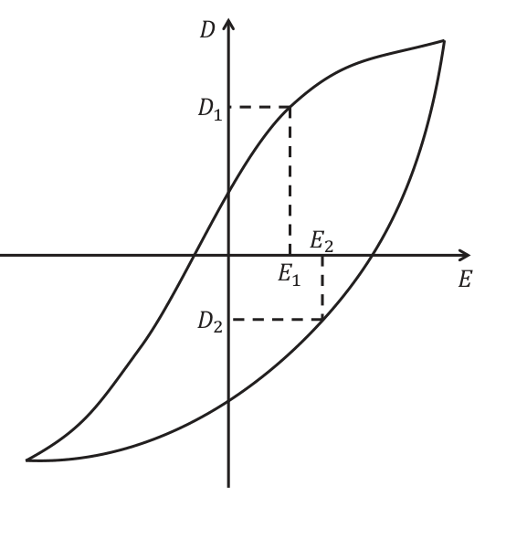
图内文字：$D$，$D_1$，$D_2$，$E$，$E_1$，$E_2$

图 4.3

————以下为选读内容————

静电问题原则上就是在一定的边界条件下解Poisson方程，这变成了一个纯粹的数学问题。下面我们将介绍两种解决方法，它们仅仅适用于一些特殊的具有高对称性的问题。在一般情况下，电荷分布、边界形状都是任意的，此时解决问题必须要用到计算机及合适的数值计算方法。目前有许多成功的计算方法-其中之一就是"有限元方法"，现成的软件为COMSOL。这个方法的精髓就是将任意空间分成一个个的小区间，分而治之。还有一些其他的方法，如"边界元"方法等。原则上讲，解析方法和数值方法对我们都同要重要，前者给我们许多灵感和insight但可解的东西有限；后者可以解决很多问题，而且可以给我们许多直观的图像，但如果太依赖于它，又有可能失去许多严格的结论以及物理的嗅觉。二者应当结合起来，相得益彰。

————以上为选读内容————

### 4.3 镜像法

镜像法是解静电边值问题的一种特殊解法，这种解法的基本精神是将静电问题中边界对场的影响用边界外部虚设的像电荷代替，特别适合研究空间内有源电荷的情况。原则上讲，区域内的电势是由区域内的电荷和处在边界处的电荷（假设边界外的空间为导体，没有电荷）共同决定的：

$$
\varphi=\varphi_0+\varphi'=\frac{1}{4\pi\varepsilon}\int\frac{\rho(\vec{r}')d\tau'}{R}+\frac{1}{4\pi\varepsilon}\int\frac{\sigma_b(\vec{r}')ds'}{R} \tag{4.3.1}
$$

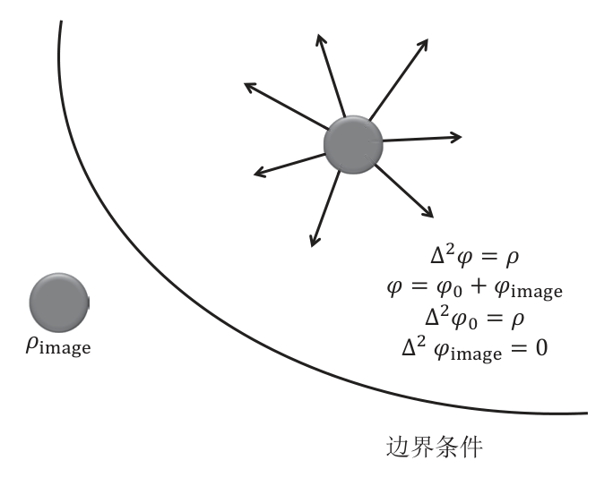
图内文字：$\rho_{image}$；$\nabla^2\varphi=\rho$，$\varphi=\varphi_0+\varphi_{image}$，$\nabla^2\varphi_0=\rho$，$\nabla^2\varphi_{image}=0$；边界条件

图 4.4

区域内的电荷分布已知，因此电势容易计算。但边界处的电荷密度 $\sigma_b(\vec{r}'')$ 通常是未知数——对设定电势的情形电荷本来就不确定；对孤立导体情形我们只知道总电荷，不知道电荷分布，这给我们解决问题带来了不便。幸运的是，在某些特定情形下，后一部分的影响可以等价于处于区域外部的一些虚拟电荷对区域内的影响，亦即

$$
\varphi=\varphi_0+\varphi_{image}=\frac{1}{4\pi\varepsilon}\int\frac{\rho(\vec{r}')d\tau'}{R}+\frac{1}{4\pi\varepsilon}\int\frac{\rho_{image}(\vec{r}'')d\tau''}{R} \tag{4.3.2}
$$

其中后一个积分区域在考虑的区域外。因像电荷放在边界的外部，故有

$$
\nabla^2\varphi_{image}\equiv0 \tag{4.3.3}
$$

因此我们仍有Poisson方程

$$
\nabla^2\varphi=-\rho/\varepsilon \tag{4.3.4}
$$

因此只要调整像电荷的位置和大小，使它总电势 $\varphi$ 满足所给的边界条件，那么我们便找到了问题的解。这种解法的正确性可由唯一性定理保证。下面我们将借助一个典型例题来说明这种问题的解法。

[例1] 设一点电荷附近有一接地导体球面，求空间电势分布。

解：如图所示，取球心为坐标原点，球心到点电荷 $q$ 的方向为 $x$ 轴。设 $q$ 的坐标为 $(d,0,0)$，球半径为 $R$，球内的电势为零，这是显然的，故只要讨论球外空间的电势即可。

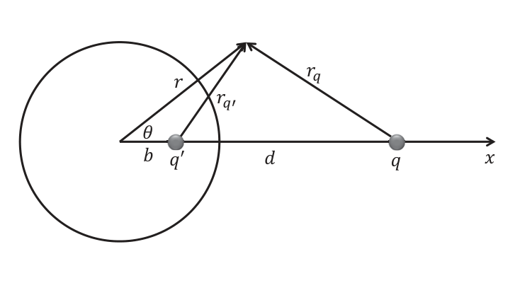
图内文字：$r$，$r_q$，$r_{q'}$，$\theta$，$b$，$q'$，$d$，$q$，$x$

图 4.5

球外空间的电势所满足的方程和边界条件是

$$
\begin{cases}
\nabla^2\varphi=-\frac{1}{\varepsilon_0}q\delta(x-d,y,z)\\
\left.\varphi\right|_{r=a}=0\\
\left.\varphi\right|_{r=\infty}=0
\end{cases} \tag{4.3.5}
$$

球外空间的电势由两部分组成，即点电荷 $q$ 所产生的电势和球面感应电荷所产生的电势。根据镜像法的精神，可以试图找到界面外的一个像电荷来等价这部分贡献。根据问题对称性，容易明白此像电荷（如果存在的话）应在球内 $(b,0,0)$ 处，设其电量为 $-q'$。因此，我们得到球外空间的试解为

$$
\varphi=\frac{1}{4\pi\varepsilon_0}\left(\frac{q}{r_q}-\frac{q'}{r_{q'}}\right) \tag{4.3.6}
$$

其中

$$
r_q=\sqrt{r^2+d^2-2rd\cos\theta} \tag{4.3.7}
$$

$$
r'_q=\sqrt{r^2+b^2-2rb\cos\theta} \tag{4.3.8}
$$

下面的工作是看能否确定适当的 $b$ 和 $q'$，使试解满足边界条件（Poisson 方程自动满足，这是镜像法的一大优点！）。

无穷远处的边界条件自动满足，只需考虑势在球面 $(r=R)$ 上为零的边界条件。为此，把条件 $\varphi\big|_{r=R}=0$ 代入试解，转换成球坐标表示，则有

$$
\frac{q}{\sqrt{d^2+R^2-2Rd\cos\theta}}-\frac{q'}{\sqrt{b^2+R^2-2Rb\cos\theta}}=0 \tag{4.3.9}
$$

即

$$
q^2\left(b^2+R^2-2Rb\cos\theta\right)=q'^2\left(d^2+R^2-2Rd\cos\theta\right) \tag{4.3.10}
$$

因为对任意 $\theta$ 值，上式都应成立，故有

$$
\begin{cases}
q^2\left(b^2+R^2\right)=q'^2\left(d^2+R^2\right)\\
q^2b=q'^2d
\end{cases}
\tag{4.3.11}
$$

这有两组解

$$
\begin{cases}
b=d\\
q'=q
\end{cases}
\qquad
\begin{cases}
b=\dfrac{R^2}{d}\\[6pt]
q'=\dfrac{R}{d}q
\end{cases}
\tag{4.3.12}
$$

解 $(b=d,\ q'=q)$ 不符合要求（像电荷不应在源电荷的空间内），只有解 $(b=\dfrac{R^2}{d},\ q'=\dfrac{R}{d}q)$ 满足要求。于是得到问题的解为

$$
\varphi=\frac{1}{4\pi\varepsilon_0}
\begin{cases}
\dfrac{q}{\sqrt{r^2+d^2-2rd\cos\theta}}-\dfrac{\dfrac{R}{d}q}{\sqrt{r^2+\left(\dfrac{R^2}{d}\right)^2-2r\dfrac{R^2}{d}\cos\theta}} & r>R\\[18pt]
0 & r<R
\end{cases}
\tag{4.3.13}
$$

知道了电势的分布便可求出球面上的电荷面密度

$$
\sigma=\varepsilon_0 E_r=-\varepsilon_0\left.\frac{\partial\varphi}{\partial r}\right|_{r=R} \tag{4.3.14}
$$

$$
=-\frac{q}{4\pi R^2}\left(\frac{R}{d}\right)\frac{1-\dfrac{R^2}{d^2}}{\left(1+\dfrac{R^2}{d^2}-2\dfrac{R}{d}\cos\theta\right)^{3/2}} \tag{4.3.15}
$$

$$
=-\frac{q'}{4\pi R^2}F(\theta) \tag{4.3.16}
$$

其中

$$
F(\theta)=\frac{1-\dfrac{R^2}{d^2}}{\left(1+\dfrac{R^2}{d^2}-2\dfrac{R}{d}\cos\theta\right)^{3/2}} \tag{4.3.17}
$$

为一个角分布函数。

**在两个极限条件下考虑面点荷（电场）分布：**

1. $R/d\to 0$，此时源电荷离导体球很远，对整个导体球来讲近似为均匀电场。此时，角分布为 $F(\theta)=1+3\dfrac{R}{d}\cos\theta$。这意味着导体的面电荷基本为均匀分布，但有一个因电场而产生与角度相关的调制（其实这点调制正是形成了一个偶极子，后面会讲到）；

2. $R/d\to 1$，此时源电荷离导体球很近，其看到的导体表面基本上是一

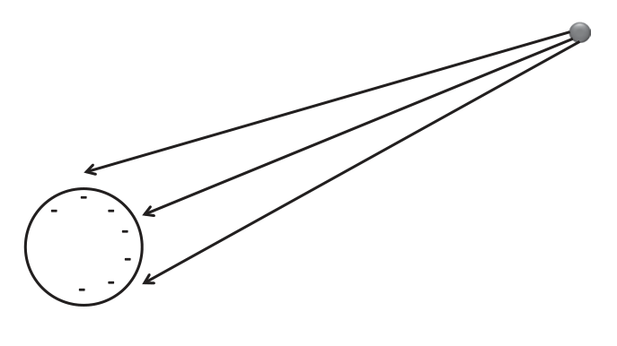

个无限大平面。的确

$$
F(\theta)=
\begin{cases}
\infty & \cos\theta\to 1\\
0 & \cos\theta\to -1
\end{cases}
\tag{4.3.18}
$$

感应电荷只出现在靠近源电荷的一边。

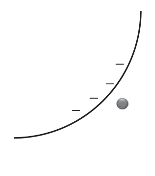

然而无论怎样，总感应电荷为

$$
\int\sigma \mathrm{d}S=\int\sigma(\theta)2\pi R^2\sin\theta\,\mathrm{d}\theta=-\frac{R}{d}q=-q' \tag{4.3.19}
$$

即像电荷的大小等于导体面上的感应电荷。注意：这个结果与之前利用 Green 互易定理得到的结论一致。

导体球所受的静电力等于电场作用到导体球上的感应电荷的作用力。导体表面单位面积受的作用力为

$$
\vec{f}=\frac{\sigma^2}{2\varepsilon_0}\hat{r} \tag{4.3.20}
$$

导体球受的总力可以由积分求得。根据对称性，只有 $x$ 分量非 0。经过一个繁复的积分可得

$$
F=\oint\vec{f}\cdot\hat{x}\,\mathrm{d}S=\frac{1}{4\pi\varepsilon_0}\cdot\frac{q^2}{R^2}\left(\frac{R^3}{d^3}\right)\Bigg/\left(1-\frac{R^2}{d^2}\right)^2 \tag{4.3.21}
$$

简单计算可得

$$
F=\frac{1}{4\pi\varepsilon_0}qq'/(d-b)^2 \tag{4.3.22}
$$

这个力正好是点电荷 $q$ 对像电荷 $q'$ 的作用力；根据牛顿第 3 定律，点电荷受到导体上像电荷等量反向的作用力，称为“镜像力”。

利用上面得到的结果，我们可以引申出来许多题目，并得到解答。

1. 当 $R/d\to 1$ 时，设 $d=R+\delta$，$\delta\to 0$，有

$$
b=R^2/(R+\delta)\approx R-\delta \tag{4.3.23}
$$

$$
q'=qR/(R+d)\approx q(1-d/R)\approx q \tag{4.3.24}
$$

2. **导体球接电势 $V_0$**

此时边界条件为：$\varphi\big|_{r=R}=V_0$ 是已知常数。为了满足此边界条件，应在原解（$\varphi|_{r=R}=0$）的基础上再加上镜像电荷（处于导体内部），其作用是在导体表面上产生一个常数电势。简单的分析发现此像电荷应处于导体球中心，电量为 $q''=4\pi\varepsilon_0 V_0 R$。故此时的解为

$$
\varphi=\frac{1}{4\pi\varepsilon_0}\left(\frac{q}{r_d}-\frac{q'}{r_b}+\frac{q''}{r}\right)=\frac{1}{4\pi\varepsilon_0}\left(\frac{q}{r_d}-\frac{q'}{r_b}\right)+\frac{V_0 R}{r} \tag{4.3.25}
$$

3. **导体球为孤立导体带电 $Q$**

这种情况的边界条件为 $\varphi\big|_{r=R}=$ 常数（未知），以及

$$
-\varepsilon_0\oint\frac{\partial\varphi}{\partial n}\,\mathrm{d}S=Q \tag{4.3.26}
$$

根据与上题相同的 Argument，必须加上一个放在球心电量为 $q''$ 的像电荷。于是，球外电势为

$$
\varphi=\frac{1}{4\pi\varepsilon_0}\left(\frac{q}{r_q}-\frac{q'}{r_{q'}}+\frac{q''}{r}\right) \tag{4.3.27}
$$

此时计算球面上的电荷可知

$$
Q=-\varepsilon_0\oint\frac{\partial\varphi}{\partial n}\,\mathrm{d}S=-q'+q''\Rightarrow q''=Q+q' \tag{4.3.28}
$$

问题得解。

4. **点电荷 $q$ 在导体球壳内，距球心 $d$ 处**

这类问题要复杂许多，先考虑一个简单的情形：**球壳接地**。

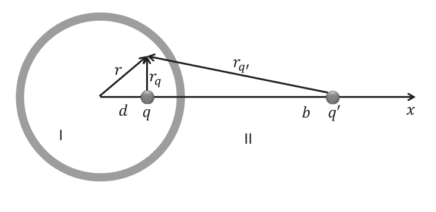

此时球内（I）外（II）区域内都可以存在电场及电势，其分别满足

$$
\begin{cases}
\nabla^2\varphi_I=-q\delta(x-d,y,z)/\varepsilon_0\\
\nabla^2\varphi_{II}=0
\end{cases}
\tag{4.3.29}
$$

而边界条件为

$$
\begin{cases}
\varphi_I=\varphi_{II}=0 & r=R\\
\varphi_{II}\to 0 & r\to\infty
\end{cases}
\tag{4.3.30}
$$

先考虑球内的电势。根据镜像法的精神，球内的电势应当是由真实电荷 $q$ 和球外的“像电荷”$-q'$ 的叠加：

$$
\varphi_I=\frac{1}{4\pi\varepsilon_0}\left(\frac{q}{r_q}-\frac{q'}{r_{q'}}\right) \tag{4.3.31}
$$

与电荷在球（壳）外面的情形类似，可以解得 $q'=q\dfrac{R}{d},\ b=\dfrac{R^2}{d}$。考虑球壳外的电势，注意到此区域没有真实电荷，$r=R$ 与 $r\to\infty$ 的边界上电势均为 0，因此，满足此边界条件的解只有

$$
\varphi_{II}=0 \tag{4.3.32}
$$

接下来考虑一个复杂一点的情形，假设球壳的电势设为 $V_0$，因此边条（1）改为 $\varphi_I=\varphi_{II}=V_0,\ r=R$。此时原来得到的解不能满足边界条件（1），需再设“像电荷”才行。简单的分析发现任何处于 II 区的像电荷都不能满足条件（1），又不能在原点设像电荷（因处于考察区），怎么办呢？

解决的办法是注意到 $\varphi=V_0$ 本身就是 Poisson 方程的解。在以前电荷放置于球外的问题中我们不用这个解，因为那时考察区域在球外，这个解不能满足边界条件 $\varphi\to 0,\ r\to\infty$。但现在考察区在球内，不需要满足 $\varphi\to 0,\ r\to\infty$ 这个边界条件，故 $\varphi=V_0$ 可以采用。因此，I 区电势的最终解为

$$
\varphi_I=\frac{1}{4\pi\varepsilon_0}\left(\frac{q}{r_q}-\frac{q'}{r_{q'}}\right)+V_0 \tag{4.3.33}
$$

其满足所有的边界条件同时满足 Poisson 方程，故唯一性定理保证其正确性。下面考虑 II 区中的电势。这个区域内无源，电势应当是某些处于其它区域的像电荷产生，考虑修好后的边条（1）：$\varphi_I=\varphi_{II}=$

$V_0,\ r=R$，显然“像电荷”为处于原点（I 区）的电量为 $4\pi\varepsilon_0 V_0 R$ 的点电荷。因此，II 区电势：

$$
\varphi_{II}=\frac{V_0 R}{r} \tag{4.3.34}
$$

4.3.33 与 4.3.34 就是问题的解，满足所有的方程以及边条。问题虽然得解，但物理图像不清楚：比如此时导体球壳上带电荷为多少？为什么 I 区的电场与外部条件无关？要搞清楚这些问题，必须意识到事实上导体球壳不是无限薄的，而是一个具有有限厚度（尽管很薄）的一个金属壳层，其具有内外两个界面。静电平衡时电荷分布在两个界面上，球壳内部的电荷密度为 0。内表面上的电荷密度可以容易由

$$
\sigma_{in}=-\varepsilon_0 E_{in}=\varepsilon_0\frac{\partial\varphi_I}{\partial r} \tag{4.3.35}
$$

$$
=-\frac{q}{4\pi R^2}\frac{1-(d/R)^2}{\left[1+(d/R)^2-2(d/R)\cos\theta\right]^{3/2}} \tag{4.3.36}
$$

$$
=-\frac{q}{4\pi R^2}\tilde{F}(\theta) \tag{4.3.37}
$$

求出，其总电荷可以由上式积分求出，但更容易地，可由 Gauss 定理求出：

$$
0=\oint\vec{E}\cdot\mathrm{d}\vec{S}=q_{in}+q\Rightarrow q_{in}=-q \tag{4.3.38}
$$

而外表面上电荷均匀分布，总电量为

$$
q_{out}=\oint\sigma_{out}\cdot\mathrm{d}S=4\pi\varepsilon_0 R V_0 \tag{4.3.39}
$$

**因此物理图像是：**

(a) 球内的电荷在球壳内表面感应出等量异号的电荷即达到平衡，再外加任何电荷都不会跑到内表面而只会呆在外表面。

(b) 这些均匀分布在外表面的电荷起的作用不过是改变整个球壳的电势，但对内电场没有丝毫影响。

(c) $\sigma_{in}$ 对应于 II 区处于 $b$ 处的“像电荷”，而 $\sigma_{out}$ 对应于贡献 $\varphi=V_0$ 的像电荷（对应于一个球对称的势的“像电荷”也应当对称分布）。

### 4.4 本征函数展开法

本节介绍的是静电学的一个相当普适的方法，大家学习时应仔细体会。这种方法其实可以推广到求解其他许多类似的问题（如电磁波的散射）。以静电问题为例，在很多问题中，我们求解的空间中无源，但其处在某一种外场中，这种外场通常可以以边界条件的形式反映出来。此时空间中电势满足拉普拉斯方程：

$$
\nabla^2\varphi=0 \tag{4.4.1}
$$

根据不同的边界形状（空间的对称性），我们可以选取适当的坐标系，用分离变量法求解拉普拉斯方程的通解。假设我们得到了这组解 $\{\varphi_n,n=1,2,\cdots\}$，它们通常是正交完备的：$\langle\varphi_n|\varphi_m\rangle=\delta_{n,m}$。根据完备性，我们一定可以将 $\varphi$ 展开成这组本征态的线性叠加：

$$
\varphi=\sum C_n\varphi_n \tag{4.4.2}
$$

4.4.2 一定是 4.4.1 的解，但不一定满足所要求的边界条件。必须根据边界条件及本征函数的正交性来确定展开系数 $C_n$。比如通常的边界条件是

$$
\varphi\big|_{boundary}=\varphi_0(\xi) \tag{4.4.3}
$$

其中 $\xi$ 是界面上的位置变量。根据本征函数的正交性，我们很容易得到展开系数的表达式：

$$
C_n=\langle\varphi_n|\varphi_0\rangle=\int\varphi_n(\xi)\varphi_0(\xi)\mathrm{d}\xi \tag{4.4.4}
$$

下面总结一下不同坐标系下的本征函数及它们的正交性。我们应当根据所面临的问题的对称性选择合适的通解形式进行求解。

#### 4.4.1 轴对称的球坐标系问题（与变量$\phi$无关）

对此类问题，Laplace方程的本征解为$r^l P_l(\cos\theta)$，$r^{-(l+1)}P_l(\cos\theta)$。因此通解可以一般写成：

$$
\varphi = \sum_{l=0}^{\infty} \left[A_l r^l + B_l r^{-(l+1)}\right] P_l(\cos\theta) \tag{4.4.5}
$$

径向波函数$r^l$在$r=0$处收敛，$r^{-(l+1)}$在$r\to\infty$时收敛。$P_l(x)$为Legendre多项式，低阶的几项为

$$
\left\{
\begin{aligned}
P_0(x) &= 1 \\
P_1(x) &= x \\
P_2(x) &= \frac{1}{2}(3x^2 - 1) \\
&\cdots
\end{aligned}
\right. \tag{4.4.6}
$$

本征函数之间满足如下正交关系

$$
\int P_l(\cos\theta)P_{l'}(\cos\theta)d\cos\theta = \frac{2}{2l+1}\delta_{l,l'} \tag{4.4.7}
$$

#### 4.4.2 与$z$无关的柱对称问题

对此类问题，Laplace方程的本征解为$\rho^{\pm n}e^{\pm in\phi}$，$\ln\rho$，$1$。因此其通解为

$$
\varphi = A_0 + B_0\ln\rho + \sum_{n=1}^{\infty}\left(A_n\rho^n + B_n\rho^{-n}\right)\cos(n\phi) + \sum_{n=1}^{\infty}\left(C_n\rho^n + D_n\rho^{-n}\right)\sin(n\phi) \tag{4.4.8}
$$

本征函数之间的正交性为

$$
\int \cos(n\phi)\sin(n\phi)d\phi = 0 \tag{4.4.9}
$$

$$
\int \cos(n\phi)\cos(n'\phi)d\phi = \int \cos(n\phi)\sin(n'\phi)d\phi = 0 \qquad n \ne n' \tag{4.4.10}
$$

下面，我们通过几个实例来介绍这种方法。为增强信心，先考虑一个简单的情形。

[例2] 一半径为$R$的接地导体球置于一均匀外场$\vec{E}_0$中，求空间场的分布。

解：如图所示，取$\vec{E}_0$方向为$z$轴，这是一个绕$z$轴旋转对称的问题。球外空间没有电荷，电势在无穷远处趋向于均匀电场的电势，总的来说，电势满足

$$
\left\{
\begin{aligned}
&\nabla^2\varphi = 0 \\
&\varphi = 0 \qquad r = R \\
&\varphi \to -E_0 r\cos\theta \qquad r \to \infty
\end{aligned}
\right. \tag{4.4.11}
$$

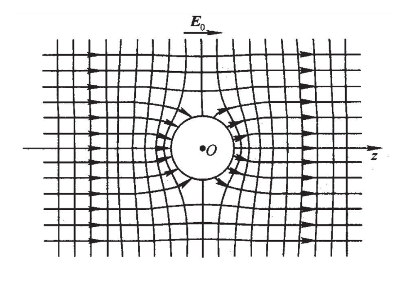
图内文字：$\vec{E}_0$，$O$，$z$

这个问题的通解即为

$$
\varphi = \sum_{l=0}^{\infty}\left[A_l r^l + B_l r^{-(l+1)}\right]P_l(\cos\theta) \tag{4.4.12}
$$

通解中有无穷多常数，虽然看上去很难确定这些常数，其实仔细分析之后发现这些常数均可由问题的边界条件确定。将试解带入边条（2），发现

$$
\sum_{l=0}^{\infty} A_l r^l P_l(\cos\theta) \xrightarrow{r\to\infty} -E_0 r\cos\theta \tag{4.4.13}
$$

根据$P_l(\cos\theta)$函数的**相互正交性**，我们可以分别比较4.4.13式左右两边中不同$P_l(\cos\theta)$函数的系数，使得它们相等。因此可得

$$
A_1 = -E_0 \qquad A_l = 0 \qquad l = 0,2,3,\cdots \tag{4.4.14}
$$

再将试解带入边条（1），得到

$$
\left(-E_0 R + \frac{B_1}{R^2}\right)\cos\theta + \sum_{l\ne 1}^{\infty}\frac{B_l}{R^{l+1}}P_l(\cos\theta) = 0 \tag{4.4.15}
$$

再次利用$P_l(\cos\theta)$函数的相互正交性，不同$P_l(\cos\theta)$的参数应当分别为0，故

$$
B_1 = E_0 R^3 \qquad B_l = 0 \qquad l = 0,2,3,\cdots \tag{4.4.16}
$$

将4.4.14与4.4.16代入试解，我们得到最终的结果

$$
\varphi = -E_0 r\cos\theta + \frac{E_0 R^3}{r^2}\cos\theta \tag{4.4.17}
$$

至此，我们已完成了这个问题的求解。注意到$r^{-2}$依赖关系是偶极子势的特征，可将4.4.17改为

$$
\varphi = -\vec{E}_0\cdot\vec{r} + \frac{\vec{p}\cdot\vec{r}}{4\pi\varepsilon_0 r^3} \tag{4.4.18}
$$

其中

$$
\vec{p} = 4\pi\varepsilon_0 R^3\vec{E}_0 \tag{4.4.19}
$$

我们看到此时除了外加的均匀电场的贡献外，还有一个偶极子的电场。这是由于导体球在电场的作用下正电荷堆积在一侧，而负电荷堆积在电场的另一侧，因此对外面的作用等效为一个偶极子，其偶极矩正比于外加电场以及球的体积！

讨论：

1. 我们可以认为偶极子的场就是这个体系对外场的散射场。外场是均匀电场，其只具有$l=1$的项（$-E_0 r\cos\theta$），因此体系的响应也就只有$l=1$项，所以只产生偶极子。若外场不是均匀场，而是具有高$l$的项，则体系的响应也一定有高$l$项。这恰恰是唯一性定理的一个体现——边条唯一确定解的形式，这里边条的对称性决定了解的对称性。

2. 我们之前研究导体球外有点电荷的问题时，曾经考虑过当点电荷离导体球非常远的情形。那时我们的结论是导体球在外场下的电荷分布是形成了一个偶极子。其实当电荷离目标很远时，其电场就是近似为均匀场！将其与现在我们考虑的情况建立一个联系将是非常有意思的事情。

注：人们会问边界条件$\varphi \to -E_0 r\cos\theta$，$r \to \infty$为什么不能加上一个常数电势$\varphi_0$？若加上的话，这个常数是什么意思？其实无限大空间均匀电场的问题从来不是一个"well-defined"的问题。因为我们通常取无限远处为电势零点，但无限区域中的均匀电场要求无限远处有电荷以及电势不是0。真正的实验上实现均匀场只能在有限空间，比如用平板电容器，此时问题是Well-defined，但求解这样一个问题就比现在我们考虑的复杂许多，因为极板会引入无穷多镜像电荷$\cdots$。因此我们现在考虑的是真实情况的一种理想化，是实验上不能实现的。在我们今后的学习中，我们还要考虑这种理想情形，因为这类问题可以解析求解且给我们许多insight。需要说明的是，此时我们总是假设$\varphi_0$为0，相当于我们选择了坐标原点为电势零点。

[例3] 半径为$R$、介电常数为$\varepsilon_2$的均匀介质球，被置于均匀外场$\vec{E}_0$中，球外空间充满均匀介电常数为$\varepsilon_1$的介质。求空间电势的分布。

解：如图所示，取$\vec{E}_0$方向为极轴$z$方向。与上一道例题不同的是，此处介质球内可以存在电场。为此我们把空间分为球内球外两个区域

（I、II），电势分别为$\varphi_1$，$\varphi_2$，则它们满足的方程

$$
\nabla^2\varphi_1 = 0 \qquad \nabla^2\varphi_2 = 0 \tag{4.4.20}
$$

相应的边条为

$$
\left\{
\begin{aligned}
&\varepsilon_1 \to -E_0 r\cos\theta \qquad r \to \infty \\
&\varphi_1 = \varphi_2 \qquad r = R \\
&\varepsilon_1\left.\frac{\partial\varphi_1}{\partial r}\right|_{r=R} = \varepsilon_2\left.\frac{\partial\varphi_2}{\partial r}\right|_{r=R} \\
&\varphi_2\ \text{有限} \qquad r = 0
\end{aligned}
\right. \tag{4.4.21}
$$

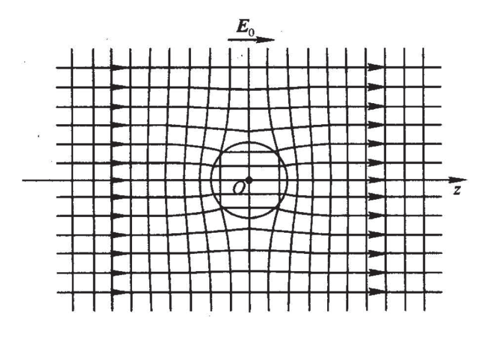
图内文字：$\vec{E}_0$，$O$，$z$

本问题为三维轴对称球坐标系下的问题，因此可选取合适的本征函数将$\varphi_1$，$\varphi_2$展开。显然应当选择4.4.5，即

$$
\varphi_1 = \sum_{l=0}^{\infty}\left[A_l r^l + B_l r^{-(l+1)}\right]P_l(\cos\theta) \tag{4.4.22}
$$

$$
\varphi_2 = \sum_{l=0}^{\infty}\left[A'_l r^l + B'_l r^{-(l+1)}\right]P_l(\cos\theta) \tag{4.4.23}
$$

其中$\{A_l, A'_l, B_l, B'_l\}$为一列展开系数，需要由边界条件确定。根据我们上次课对均匀电场中的金属球的问题的求解，我们已有了经验——均匀电场的边界条件（1）只包含$l=1$项的贡献，而球这种良好的几何形状保证了它不会将$l=1$的模式散射到其它$l$的模式上去。因此4.4.22与4.4.23中只有$l=1$项的系数非0。故有

$$
\varphi_1 = \left(A_1 r + B_1 r^{-2}\right)\cos\theta \tag{4.4.24}
$$

$$
\varphi_2 = \left(A'_1 r + B'_1 r^{-2}\right)\cos\theta \tag{4.4.25}
$$

————以下为选读内容————

**下面我们利用本征函数的正交性对上述论断做严格证明。**

对I区来讲，边条（1）决定了除了$A_1$外所有的$\{A_l\}$均为0。因$P_1(\cos\theta)=\cos\theta$，易知：

$$
A_1 = -E_0 \qquad A_l = 0 \qquad l \ne 1 \tag{4.4.26}
$$

对II区来讲，边条（4）决定了

$$
B'_l = 0 \qquad l = 0,1,\cdots\infty \tag{4.4.27}
$$

下面考虑边条（2）。代入可知

$$
\sum_{l=0}^{\infty}\left[A_l R^l + B_l R^{-(l+1)}\right]P_l(\cos\theta) = \sum_{l=0}^{\infty}\left[A'_l R^l + B'_l R^{-(l+1)}\right]P_l(\cos\theta) \tag{4.4.28}
$$

$$
\varepsilon_1\sum_{l=0}^{\infty}\left[lA_l R^{l-1} - (l+1)B_l R^{-(l+2)}\right]P_l(\cos\theta) = \varepsilon_2\sum_{l=0}^{\infty}\left[lA'_l R^{l-1} - (l+1)B'_l R^{-(l+2)}\right]P_l(\cos\theta) \tag{4.4.29}
$$

根据本征函数的正交性，上面两式中每个$l$项的系数必须分别相等，即

$$
A_l R^l + B_l R^{-(l+1)} = A'_l R^l + B'_l R^{-(l+1)} \tag{4.4.30}
$$

$$
\varepsilon_1\left[lA_l R^{l-1} - (l+1)B_l R^{-(l+2)}\right] = \varepsilon_2\left[lA'_l R^{l-1} - (l+1)B'_l R^{-(l+2)}\right] \tag{4.4.31}
$$

对所有$l \ne 1$的项，我们有

$$
\left\{
\begin{aligned}
&B_l R^{-(l+1)} = A'_l R^l \\
&\varepsilon_1\left[-(l+1)B_l R^{-(l+2)}\right] = \varepsilon_2\left[lA'_l R^{l-1}\right]
\end{aligned}
\right. \tag{4.4.32}
$$

$$
\Rightarrow
\left\{
\begin{aligned}
&B_l = A'_l R^{(2l+1)} \\
&B_l = -A'_l R^{(2l+1)}\frac{l\varepsilon_2}{(l+1)\varepsilon_1}
\end{aligned}
\right. \tag{4.4.33}
$$

显然有

$$
A'_l = B_l = 0 \qquad l \ne 1 \tag{4.4.34}
$$

因此只有$l=1$的项有非零解。

————以上为选读内容————

代入边条（1）-（4）分别可得

$$
\left\{
\begin{aligned}
&A_1 = -E_0 \\
&A_1 R + B_1 R^{-2} = A'_1 R + B'_1 R^{-2} \\
&\varepsilon_1\left(A_1 - 2B_1 R^{-3}\right) = \varepsilon_2\left(A'_1 - 2B'_1 R^{-3}\right) \\
&B'_1 = 0
\end{aligned}
\right. \tag{4.4.35}
$$

解之可得

$$
\left\{
\begin{aligned}
&A_1 = -E_0 \\
&B_1 = \frac{\varepsilon_2 - \varepsilon_1}{2\varepsilon_1 + \varepsilon_2}E_0 R^3 \\
&A'_1 = -\frac{3\varepsilon_1}{2\varepsilon_1 + \varepsilon_2}E_0 \\
&B'_1 = 0
\end{aligned}
\right. \tag{4.4.36}
$$

故

$$
\varphi_1 = -E_0 r\cos\theta + \frac{\varepsilon_2 - \varepsilon_1}{2\varepsilon_1 + \varepsilon_2}R^3 E_0\frac{1}{r^2}\cos\theta \tag{4.4.37}
$$

$$
\varphi_2 = -\frac{3\varepsilon_1}{2\varepsilon_1 + \varepsilon_2}E_0 r\cos\theta \tag{4.4.38}
$$

作如下的讨论：

1. 先做极限分析：当$\varepsilon_2 = \varepsilon_1$时，介质球与环境的介电常数一样，故其对外场的响应消失。带入发现，$\varphi_1 = \varphi_2 = -E_0 r\cos\theta$，即空间的电场就是均匀电场！

2. 球面上的束缚电荷就是球对外场的响应来源。其对球外区域的贡献为：$\frac{\varepsilon_2 - \varepsilon_1}{2\varepsilon_1 + \varepsilon_2}R^3 E_0\frac{1}{r^2}\cos\theta$。回想一个偶极子（偶极矩为$\vec{p}$）的电势为$\varphi_p = \frac{\vec{p}\cdot\vec{r}}{4\pi\varepsilon_0 r^3}$，对比发现这些束缚电荷对外场的贡献相当于一个放在原点的偶极子，其大小为

$$
\vec{p} = 4\pi\varepsilon_0\frac{\varepsilon_2 - \varepsilon_1}{2\varepsilon_1 + \varepsilon_2}R^3\vec{E}_0 \tag{4.4.39}
$$

注：这个结论是严格的，并非在远场成立，这一点是否让你感到很意外？

3. 球内的场为外场与束缚电荷所产生的附加电场之和，结果为一均匀电场：

$$
\vec{E}_{内} = -\frac{\partial\varphi_2}{\partial z}\vec{e}_z = \frac{3\varepsilon_1}{2\varepsilon_1 + \varepsilon_2}\vec{E}_0 \tag{4.4.40}
$$

4. 当$\varepsilon_2 \to -\infty$时，介质球内的场为$\vec{E}_{内} \to 0$，其效果相当于一个导体球。而此时，$\vec{p} = 4\pi\varepsilon_0 R^3\vec{E}_0$，也回到上堂课我们求解的导体球的解。其实，这样的一个推论（导体相当于$\varepsilon_2 \to -\infty$的介质）具有普遍意义，后面我们可以严格证明。

下面我们考虑一个简单的情况，即$\varepsilon_1 = \varepsilon_0$（背景介质是空气），$\varepsilon_2 = \varepsilon_0\varepsilon_r$，此时的物理图像更加清楚。因介质球内的场为均匀场，故整个介质球被均匀极化，极化强度为

$$
\vec{P} = \chi\varepsilon_0\vec{E}_{内} = \varepsilon_0(\varepsilon_r - 1)\frac{3}{2 + \varepsilon_r}\vec{E}_0 \tag{4.4.41}
$$

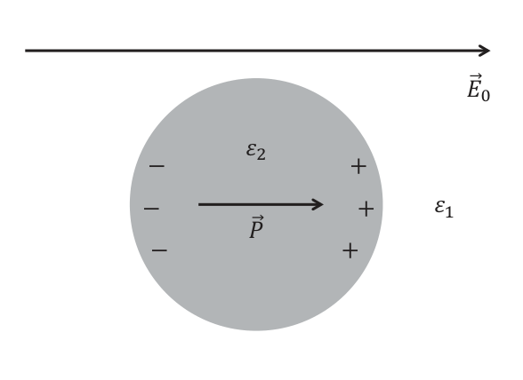
图内文字：$\varepsilon_2$、$\varepsilon_1$、$\vec{E}_0$、$\vec{p}$，球面两侧标有 $+$、$-$ 电荷。

而同时，4.4.39可化成

$$
\vec{p} = 4\pi\varepsilon_0\frac{\varepsilon_r - 1}{2 + \varepsilon_r}R^3\vec{E}_0 = \varepsilon_0(\varepsilon_r - 1)\frac{3}{2 + \varepsilon_r}\vec{E}_0 \times (4\pi R^3/3) \tag{4.4.42}
$$

上面两式对比发现，此时极化强度正好就是偶极子的电偶极距/体积：

$$
\vec{P} = \frac{\vec{p}}{4\pi R^3/3} \tag{4.4.43}
$$

这当然是合理的，因为极化强度的定义就是 $\vec{P} = \frac{\sum_{\Omega}\vec{p}_i}{\Omega}$。因 $\varepsilon_2 > \varepsilon_0$，我们发现 $\vec{E}_{内} < \vec{E}$，这是因为极化电荷在球内产生了电场抵消了部分外电场的贡献。这部分由极化电荷在球内产生的电场为

$$
\vec{E}_{p内} = \vec{E}_{内} - \vec{E}_0 = -\frac{\varepsilon_2 - \varepsilon_0}{2\varepsilon_0 + \varepsilon_2}\vec{E}_0 = -\frac{1}{3\varepsilon_0}\vec{P} \tag{4.4.44}
$$

这个场通常被称为“退极场”——由于极化产生的极化电荷产生的场，其作用是“退”掉外场的作用。整理后的结果为

$$
\vec{E}_{内} = \vec{E}_0 - \frac{1}{3\varepsilon_0}\vec{P} \tag{4.4.45}
$$

上面两式在很多情况下成立的，一般来说，退极场可以写成

$$
\vec{E}_{退} = -L\cdot\vec{P}/\varepsilon_0 \tag{4.4.46}
$$

$L$称为退极化因子，只依赖于物体的几何形状，其越大，说明退极效应越显著。容易证明：对平板$L=1$，对球$L=\frac{1}{3}$，对细针$L=0$，对椭球，针对长短轴的不同，$L$可以由$0 \sim 1$不等。总结下来，介质在外场下的静电行为是

- 被外场极化

- 极化电荷在球外的贡献为偶极子

- 极化电荷对球内的贡献为均匀电场——退极场（depolarization field）

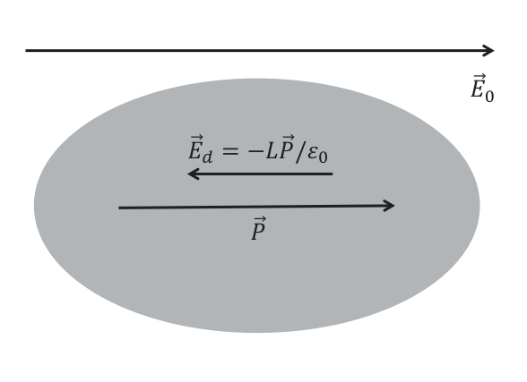
图内文字：$\vec{E}_0$、$\vec{E}_d = -L\vec{P}/\varepsilon_0$、$\vec{P}$。

思考题：

1. 若外部介质不是空气，而是具有介电常数$\varepsilon_1$的某种电介质，极化强度$\vec{P}$是多少？4.4.43是否仍然成立？若不成立，为什么？

2. 有兴趣的同学请找文献查一查椭球体的“退极因子”的推导。

[例4] 在均匀外电场$\vec{E} = E_0\vec{e}_x$中有一半径为$R$、电荷线密度为$\lambda$的无限长导体圆柱. 柱轴与外场垂直，求空间中的电场分布。

解：柱内区域的场为零，只需考虑柱外区域的电势，其满足方程

$$
\nabla^2\varphi = 0 \tag{4.4.47}
$$

边界条件为

$$
\begin{cases}
\vec{E}_{\rho\to\infty} = E_0\hat{x} \\[4pt]
\varphi\big|_{\rho=R} = \text{常数} \\[4pt]
\oint \frac{\partial\varphi}{\partial\rho}\Big|_{\rho=R} = \lambda/\varepsilon_0
\end{cases} \tag{4.4.48}
$$

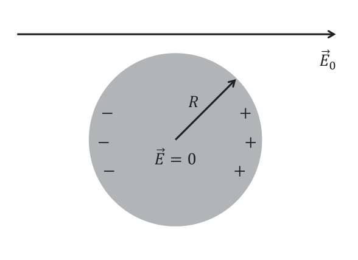
图内文字：$\vec{E}_0$、$R$、$\vec{E}=0$，圆柱两侧标有 $+$、$-$ 电荷。

注：第一个边条值得讨论一下。处理均匀外场中的散射体的问题时，如果散射体是三维物体（如球），则任何感应（极化）电荷均在空间局域，因此在无穷远处，它们对场或者势的贡献都趋向于0，此时我们可以将边条（1）进一步改写成 $\varphi\big|_{r\to\infty} = -\vec{E}\cdot\vec{r}$。然而处理2维问题（如无限长柱子）时，感应（极化）电荷会出现在无穷远处（因为柱子会延伸到无限远处），它们对电势的贡献不趋向于0！幸运的是，此时，它们对电场的贡献 $\sim \frac{1}{\rho}$，故对电场的贡献仍趋于0。处理无限大平面问题时这个问题更严重——感应（极化）电荷沿着两个方向散布到无限远，故电场、电势均不趋向于0！不过通常1维问题根本无须这样求解。

此问题为与$z$无关的柱对称问题，故可以利用4.4.8展开

$$
\varphi = A_0 + B_0\ln\rho + \sum_{n=1}^{\infty}\left(A_n\rho^n + B_n\rho^{-n}\right)\cos(n\phi) + \sum_{n=1}^{\infty}\left(C_n\rho^n + D_n\rho^{-n}\right)\sin(n\phi) \tag{4.4.49}
$$

注意到

$$
\vec{E} = -\nabla\varphi = -\frac{\partial\varphi}{\partial\rho}\vec{e}_\rho - \frac{1}{\rho}\frac{\partial\varphi}{\partial\phi}\vec{e}_\phi \tag{4.4.50}
$$

电场中$\rho$的阶数比电势中的低一阶。根据边条（1），势函数中所有比$\rho^1$发散快的项都不可以保留，故

$$
A_n = C_n = 0 \qquad n > 1 \tag{4.4.51}
$$

进一步利用边条（1）比较系数

$$
E_\rho\big|_{\rho\to\infty} = -\frac{\partial\varphi}{\partial\rho} = -A_1\cos\phi - C_1\sin\phi = E_0\cos\phi \tag{4.4.52}
$$

因为$\sin\phi$与$\cos\phi$正交，可得

$$
A_1 = -E_0 \qquad C_1 = 0 \tag{4.4.53}
$$

考虑边条（2），因$\varphi\big|_{\rho=R}$应与$\phi$无关，故有

$$
\begin{cases}
A_nR^n + B_nR^{-n} = 0 \\[4pt]
C_nR^n + D_nR^{-n} = 0
\end{cases}
\quad\Rightarrow\quad
\begin{cases}
B_1 = E_0R^2 \\[4pt]
B_n = 0 \qquad n > 1 \\[4pt]
D_n = 0
\end{cases} \tag{4.4.54}
$$

现考虑边条（3），对角度的积分过程中所有$n>1$的项都没有贡献（因为与角度有关），只有$A_0$、$B_0$两项留下来。最后结果为

$$
B_0\frac{1}{R}2\pi R = -\lambda \Rightarrow B_0 = -\frac{\lambda}{2\pi\varepsilon_0} \tag{4.4.55}
$$

$A$为一常数，不能唯一确定。总结下来，最终的电势为

$$
\varphi = A_0 - \frac{\lambda}{2\pi\varepsilon_0}\ln\rho - E_0\rho\cos\phi + \frac{E_0R^2}{\rho}\cos\phi \tag{4.4.56}
$$

分析4.4.56，我们发现空间电势由三部分贡献叠加而成：外场，无限长带电导体棒，以及一个2维偶极子（$\vec{p} = 2\pi\varepsilon_0E_0R^2$，参考补充题）的场：$\varphi_p^{(2)} = \frac{1}{2\pi\varepsilon_0}\frac{\vec{p}\cdot\hat{\rho}}{\rho}$。柱外电场强度为

$$
\vec{E} = \left(\frac{\lambda}{2\pi\varepsilon_0}\frac{1}{\rho} + E_0\cos\phi + \frac{E_0R^2}{\rho^2}\cos\phi\right)\vec{e}_\rho + \left(-E_0\sin\phi + \frac{E_0R^2}{\rho^2}\sin\phi\right)\vec{e}_\phi \tag{4.4.57}
$$

注：由这个问题的求解我们又发现一个规律，即均匀外电场下无限长柱子的静电问题我们只需要考虑$l = 1$项的贡献。这里的物理是均匀电场只包含$l = 1$项，而同时柱子的良好几何特征保证了不会将不同$l$的项耦合，因此最终的散射场不会激发其他$l$项的贡献。

### 4.5 多极矩法

之前对静电边值问题我们已经介绍了2种严格的方法——镜像法及本征函数展开法。然而这些方法只能处理一些具有良好对称性的问题。在实际问题中，激发电场的电荷分布不见得具有良好的对称性，此时应如何处理？一般来讲这类问题我们只能数值处理。不过对某一类特定问题，电荷分布全部集中在一个很小的区域内，而我们想要求的是远离带电体空间的电场，这时我们可采用一种近似的方法——多极矩展开法。

如图4.14所示，若电荷分布在有限体积$V$内，电荷密度为$\rho(\vec{r}')$，这个体积的线度为$l$，考查的是$P$点的电场，而$P$点和体积$V$内任一点$O$的距离为$\vec{r}$。多极矩法是讨论在$|\vec{r}| \gg l$情况下的场分布。$P$点电势的准确解的形式为

$$
\varphi(\vec{r}) = \frac{1}{4\pi\varepsilon_0}\int\frac{\rho(\vec{r}')d\tau'}{R} \tag{4.5.1}
$$

这里，$\vec{R} = \vec{r} - \vec{r}'$。由于$P$点离源较远，有$r' \ll r$，因此作为$\vec{r}'$的函数$\frac{1}{R}$可

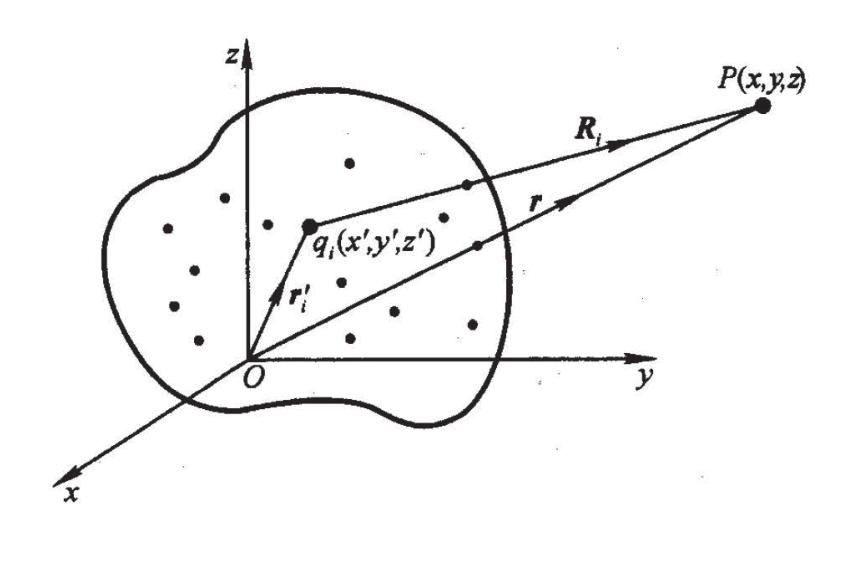
图内文字：坐标轴 $x$、$y$、$z$；点 $P(x,y,z)$；$R_i$、$\vec{r}$、$\vec{r}'_i$、$q_i(x',y',z')$；原点 $O$。

以在$r'=0$附近作Taylor展开：

$$
\frac{1}{R} = \frac{1}{r} + \sum_{i=x,y,z}(-r_i')\frac{\partial}{\partial r_i}\left(\frac{1}{R}\right)\Bigg|_{r'=0} + \frac{1}{2!}\sum_{i,j=x,y,z}r_i'r_j'\frac{\partial^2}{\partial r_i\partial r_j}\left(\frac{1}{R}\right)\Bigg|_{r'=0} + \cdots \tag{4.5.2}
$$

$$
= \frac{1}{r} - \sum_{i=x,y,z}r_i'\frac{\partial}{\partial r_i}\left(\frac{1}{r}\right) + \frac{1}{2!}\sum_{i,j=x,y,z}r_i'r_j'\frac{\partial^2}{\partial r_i\partial r_j}\left(\frac{1}{r}\right) + \cdots \tag{4.5.3}
$$

上式可以写成更紧凑的数学上完全等价的矢量（并矢）的形式：

$$
\frac{1}{R} = \frac{1}{r} - \vec{r}'\cdot\nabla\frac{1}{r} + \frac{1}{2}\vec{r}'\vec{r}':\nabla\nabla\frac{1}{r} + \cdots \tag{4.5.4}
$$

因此，电势可以展开为

$$
\varphi = \varphi_0 + \varphi_1 + \varphi_2 + \cdots \tag{4.5.5}
$$

$$
\varphi_0 = \frac{Q}{4\pi\varepsilon_0} \qquad Q = \int\rho(\vec{r}')d\tau' \tag{4.5.6}
$$

$$
\varphi_1 = -\frac{\vec{p}}{4\pi\varepsilon_0}\cdot\nabla\frac{1}{r} \qquad \vec{p} = \int\rho(\vec{r}')\vec{r}'d\tau' \tag{4.5.7}
$$

$$
\varphi_2 = -\frac{1}{4\pi\varepsilon_0}\cdot\frac{1}{2}\int\rho(\vec{r}')\vec{r}'\vec{r}'d\tau':\nabla\nabla\frac{1}{r} \tag{4.5.8}
$$

$$
= \frac{1}{4\pi\varepsilon_0}\cdot\frac{1}{6}\overleftrightarrow{D}:\nabla\nabla\frac{1}{r} \tag{4.5.9}
$$

$$
\overleftrightarrow{D} = 3\int\rho(\vec{r}')\vec{r}'\vec{r}'d\tau' \tag{4.5.10}
$$

各项的物理意义如下：

- 第一项是一个点电荷的势，相当于$V$内电荷都集中在坐标原点时在$P$点所产生的势。

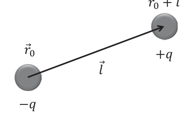
图内文字：$\vec{r}_0$、$\vec{r}_0 + \vec{l}$、$\vec{l}$、$-q$、$+q$。

- 第二项是偶极子的势，$\varphi_1 = \frac{\vec{p}\cdot\hat{r}}{4\pi\varepsilon_0r^2}$，体系相应的偶极矩为$\vec{p} = \int\rho\vec{r}'d\tau'$。为便于理解，考虑由一正一负两个点电荷组成体系，电荷位置分别处于$\vec{r}_0$及$\vec{r}_0 + \vec{l}$处，经过简单计算可得

$$
Q = 0 \qquad \vec{p} = q\vec{l} \tag{4.5.11}
$$

此即我们熟悉的电偶极距。4.5.7是电偶极矩在一般情况下的定义，相当于4.5.11式的推广。

- 第三项称为体系的四极矩的势，$\overleftrightarrow{D} = 3\int\rho(\vec{r}')\vec{r}'\vec{r}'d\tau'$为体系的四极矩。就像偶极矩可以看做两个大小相等负号相反的电荷（单极矩）靠近组成的体系一样，四极矩可以看作是由大小相等方向相反的偶极子组成的系统，最简单的情况如图所示。 此时，容易证明，$\overleftrightarrow{D}$中唯一

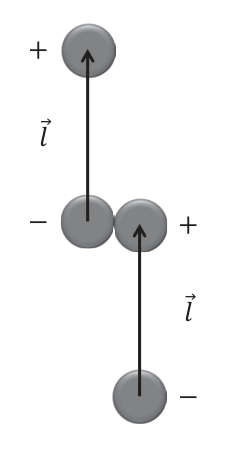
图内文字：$\vec{l}$、$+$、$-$、$-$、$+$。

不为0的分量是

$$
D_{zz} = 6l^2q \tag{4.5.12}
$$

一般的电荷分布情况下，电四极矩的定义是4.5.10式。$\overleftrightarrow{D}$是一个并矢，或者说是个$3 \times 3$矩阵，共有九个分量，由于它是对称的，所以只有六个独立分量。$\overleftrightarrow{D}$中还有一个隐含的不独立分量，注意到在$r \neq 0$处总有$\nabla^2\frac{1}{r} = 0$（空间无电荷分布），亦即

$$
\nabla^2\frac{1}{r} = \sum_{ij}\frac{\partial^2}{\partial r_i\partial r_j}\left(\frac{1}{r}\right)\delta_{ij} = \overleftrightarrow{I}:\nabla\nabla\frac{1}{r} = 0 \tag{4.5.13}
$$

上式显示对任意一个常数$C$，均有

$$
C\overleftrightarrow{I}:\nabla\nabla\frac{1}{r} \equiv 0 \tag{4.5.14}
$$

若选择此常数正比于$\overleftrightarrow{D}$矩阵的迹

$$
C \propto Tr\{\overleftrightarrow{D}\}/3 = (D_{xx} + D_{yy} + D_{zz})/3 \tag{4.5.15}
$$

根据4.5.10和4.5.14式，我们发现$\varphi_2$可改写为

$$
\varphi_2 = \frac{1}{4\pi\varepsilon_0}\frac{1}{6}\left(\ddot{\vec{D}} - \frac{Tr\{\ddot{\vec{D}}\}}{3}\ddot{\vec{I}}\right):\nabla\nabla\frac{1}{r} \tag{4.5.16}
$$

$$
= \frac{1}{4\pi\varepsilon_0}\frac{1}{6}\ddot{\vec{D}}:\nabla\nabla\frac{1}{r} \tag{4.5.17}
$$

其中

$$
\ddot{\vec{D}} = \int\left(3\vec{r}'\vec{r}' - \vec{r}'^2\ddot{\vec{I}}\right)\rho d\tau' \tag{4.5.18}
$$

$\ddot{\vec{D}}$称为约化四极矩，显然它是对称的无迹张量，即

$$
\ddot{D}_{ij} = \ddot{D}_{ji} \qquad \ddot{D}_{11} + \ddot{D}_{22} + \ddot{D}_{33} = 0 \tag{4.5.19}
$$

只有5个独立分量。

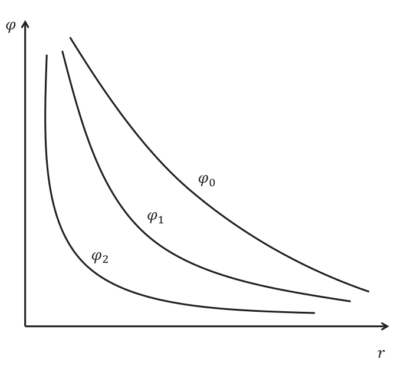
图内文字：横轴 $r$，纵轴 $\varphi$，三条曲线依次为 $\varphi_0$、$\varphi_1$、$\varphi_2$

根据4.5.6-4.5.10可以看出，随着多极矩级数的增加，其对远处的势的贡献更快地减小$\varphi_0 \gg \varphi_1 \gg \varphi_2$。换言之，随着距离的推进，我们逐渐感知到电荷体的电荷、偶极子、四极子、$\cdots$的贡献。

————以下为选读内容————

直角坐标系中的多极矩表达式比较容易被人理解，但科研中更常用的是球坐标系中的多极矩展开。在球坐标下对$\varphi(\vec{r}) = \frac{1}{4\pi\varepsilon_0}\int\frac{\rho(\vec{r}')d\tau'}{R}$作Taylor展开。根据恒等式

$$
\frac{1}{R} = \frac{1}{|\vec{r} - \vec{r}'|} = \sum_{l,m}\frac{4\pi}{2l + 1}\frac{r'^l}{r^{l+1}}Y_{lm}^{*}(\theta',\phi')Y_{lm}(\theta,\phi) \qquad r > r' \tag{4.5.20}
$$

电势为

$$
\varphi(\vec{r}) = \frac{1}{4\pi\varepsilon_0}\sum_{l,m}\frac{4\pi}{2l + 1}q_{lm}\frac{Y_{lm}(\theta,\phi)}{r^{l+1}} \tag{4.5.21}
$$

$q_{lm} = \int r'^l Y_{lm}^{*}(\theta',\phi')\rho(\vec{r}')d\tau'$称为多极矩，它实质上是笛卡儿坐标系中的多极矩在球坐标系中的表示。非常容易理解$l = 0,1,2,\cdots$分别对应于点电荷、偶极矩、电四极矩、$\cdots$的贡献，而他们分别具有$2l + 1$个独立分量（不同的$m$值），而这些矩所对应的“波函数——$\varphi$”类似原子物理中$s,p,d,f,\cdots$轨道电子的波函数。其实，我们可以这样来进一步理解多极矩。无源区Laplace的通解（假设$r \to \infty$时收敛）为

$$
\varphi(\vec{r}) = \sum_{l,m}\frac{B_{lm}}{r^{l+1}}Y_{lm}(\theta,\phi) = \sum_l\frac{\tilde{B}_l}{r^{l+1}}P_l(\cos\theta) \tag{4.5.22}
$$

其中第二个表达式为轴对称条件下的形式。对比4.5.21和4.5.22，我们理解多极矩展开不过是把无源区势函数展开成本征函数的形式，而展开系数由外界条件（进一步由源区的电荷分布）唯一确定！

思考题：比较直角坐标系和球坐标系下的多极矩表达式，在不同$l$子空间下建立它们之间的联系，讨论其中的物理（可以以$l = 1$为例）。

————以上为选读内容————

[例5] 利用多极矩展开法计算一个长度为$L$的带电棒（线电荷密度为$\lambda$）的电势（展开到电四极矩）。

解：设棒的中心在坐标原点，则

$$
Q = L\lambda \tag{4.5.23}
$$

$$
\vec{p} = \int\lambda zdz = 0 \tag{4.5.24}
$$

$$
D_{zz} = \int_{-L/2}^{L/2}3\lambda z^2dz = \frac{\lambda L^3}{4} \tag{4.5.25}
$$

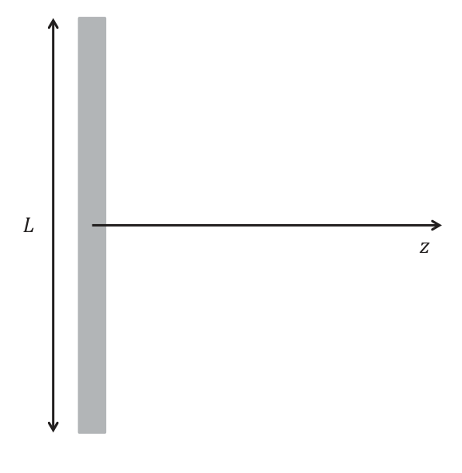
图内文字：$L$，$z$

因此，电势为

$$
\varphi(\vec{r}) = \frac{1}{4\pi\varepsilon_0}\left[\frac{Q}{r} + \frac{1}{6}D_{zz}\cdot\frac{\partial^2}{\partial z^2}\left(\frac{1}{r}\right)\right] + \cdots \tag{4.5.26}
$$

$$
= \frac{1}{4\pi\varepsilon_0}\left[\frac{\lambda L}{r} + \frac{\lambda L^3}{24}\frac{3z^2 - r^2}{r^5}\right] + \cdots \tag{4.5.27}
$$

$$
= \frac{1}{4\pi\varepsilon_0}\left[\lambda\left(\frac{L}{r}\right) + \frac{\lambda}{24}\left(\frac{L}{r}\right)^3\left(3\cos^2\theta - 1\right)\right] + \cdots \tag{4.5.28}
$$

你也可选择直接积分求出电势，然后按照$(L/r)$的幂次展开，结果应当一致。这里我们可以清晰地看出多极矩展开其实是将电势作幂次展开，展开的特征小量是（尺度/距离）。

#### Tips:

1. 从物理上讲，电偶极距考量的是体系是否破缺镜面反射对称性（$x$与$-x$，$y$与$-y$，$z$与$-z$）；电四极距考量的是体系的更细节的东西：$x,y,z$之间的对称性是否被破坏——若破坏，则必有电四极距出现。

2. 函数形式$3\cos^2\theta - 1$似曾相识，事实上它就是$P_2 = (3x^2 - 1)/2$，也可以认为就是$l = 2$，$m = 0$的波函数$Y_{2,0}$（这里有轴对称）。

### 4.6 多极矩同外场的相互作用

讨论一块电荷集中在小区域内体系的多极矩，不仅可以容易地得到其在远处产生的电场，还可以容易地计算出一个任意的带电体系与外场的相互作用。尽管这两类问题看上去很不相同，但使用的方法非常类似。上一

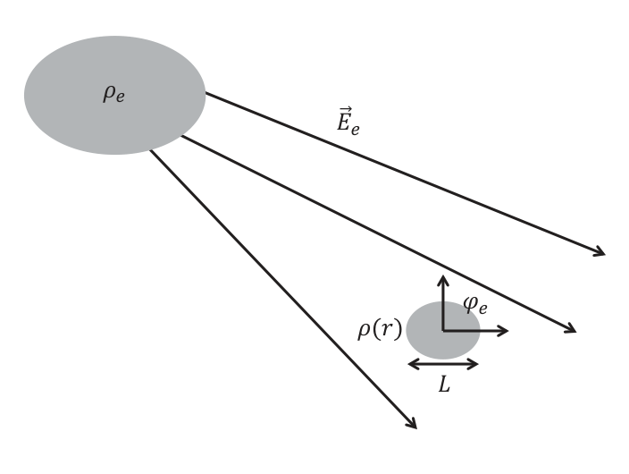
图内文字：$\rho_e$，$\vec{E}_e$，$\rho(r)$，$\varphi_e$，$L$

章中我们知道当一个点电荷放置在远处的带电体（电荷密度$\rho_e$）产生的电势$\varphi_e$中时，其与外场的相互作用能为$q\varphi_e(\vec{r})$。现考虑处于$\varphi_e$中的连续带

电体（电荷密度为$\rho$，处在坐标原点附近），则带电体与外场的相互作用能为

$$
U_i = \int\rho(\vec{r})\varphi_e(\vec{r})d\tau \tag{4.6.1}
$$

应当注意我们得到这个结论的前提是体系与源相距甚远，以至于源的电荷密度不因体系的改变而变化。因为$V$很小，所以可将$\varphi_e$在参考点附近（即原点）作泰勒级数展开：

$$
\varphi_e(\vec{r}) = \varphi_e(0) + \vec{r}\cdot\nabla\varphi_e\big|_{\vec{r}=0} + \frac{1}{2!}\vec{r}\vec{r}:\nabla\nabla\varphi_e\big|_{\vec{r}=0} + \cdots \tag{4.6.2}
$$

代入4.6.1式得

$$
U_i = U_i^{(0)} + U_i^{(1)} + U_i^{(2)} + \cdots \tag{4.6.3}
$$

其中

$$
U_i^{(0)} = Q\varphi_e(0) \tag{4.6.4}
$$

$$
U_i^{(1)} = \vec{p}\cdot\nabla\varphi_e\big|_0 = -\vec{p}\cdot\vec{E}_e(\vec{r} = 0) \tag{4.6.5}
$$

$$
U_i^{(2)} = \frac{1}{6}\ddot{\vec{D}}:\nabla\nabla\varphi_e\big|_0 \tag{4.6.6}
$$

因为$(\nabla^2\varphi_e)_0 = -\frac{1}{\varepsilon_0}\rho_{e0}$，而作为外源的$\rho_{e0}$一般分布在离$V$很远处，故在$V$区域内$\rho_e = 0$，因此有$C\ddot{\vec{I}}:\nabla\nabla\varphi_e\big|_0 = C\nabla^2\varphi_e\big|_0 = 0$。再一次，若我们选择常数$C$满足$C \propto Tr\{\ddot{\vec{D}}\}/3$，则有

$$
U_i^{(2)} = \frac{1}{6}\ddot{\vec{D}}:\nabla\nabla\varphi_e\big|_0 \tag{4.6.7}
$$

$$
= \frac{1}{6}\left[\ddot{\vec{D}} - \frac{1}{3}Tr\{\ddot{\vec{D}}\}\ddot{\vec{I}}\right]:\nabla\nabla\varphi_e\big|_0 \tag{4.6.8}
$$

$$
= \frac{1}{6}\ddot{\vec{D}}:\nabla\nabla\varphi_e\big|_0 \tag{4.6.9}
$$

$$
= -\frac{1}{6}\ddot{\vec{D}}:\nabla\vec{E} \tag{4.6.10}
$$

$U_i^{(0)}$，$U_i^{(1)}$和$U_i^{(2)}$分别代表点电荷、电偶极矩和电四极矩与外电场的相互作用能。

我们发现，电荷感知到外场的积分效应，电偶极子感知到电场，而电四极子感受到电场的微分效应——因此，多极矩随着级数的增加，愈加能感知到外场细微的变化，因为其本身就是结构的细微不对称给出的。

下面，我们将根据电偶极矩与外场的相互作用能$U_i^{(1)} = -\vec{p}\cdot\vec{E}_e$，来求出电偶极矩在外场中所受的力和力矩。

#### 4.6.1 电偶极矩在外场中受的力

设电偶极子在电场$\vec{E}_e$中受到电场的作用力$\vec{F}_e$，方向大小未知。假设施加外力$\vec{F}' = -\vec{F}_e$，则偶极子达到平衡，静止不动。现在在此基础之上对偶极子沿给定方向附加非常小的外力$\delta\vec{F}' \to 0$，使得偶极子无限缓慢地平移$\delta\vec{r}$。将偶极子与外场看成一个体系，则在这个过程中，外力对体系（偶极子+外场）做的功为

$$
\delta W' = \left(\vec{F}' + \delta\vec{F}'\right)\cdot\delta\vec{r} = \vec{F}'\cdot\delta\vec{r} = -\vec{F}_e\cdot\delta\vec{r} \tag{4.6.11}
$$

整个体系（电偶极子+外场）的能量增加为

$$
\delta U = -\vec{p}\cdot\vec{E}\left(\vec{r} + \delta\vec{r}\right) + \vec{p}\cdot\vec{E}(\vec{r}) = -\delta\vec{r}\cdot\nabla\left[\vec{p}\cdot\vec{E}(\vec{r})\right] \tag{4.6.12}
$$

注：因为偶极子运动无限缓慢，故动能没有增加。

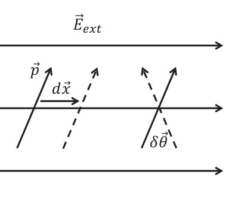
图内文字：$\vec{E}_{ext}$，$\vec{p}$，$d\vec{x}$，$\delta\theta$

根据能量守恒上面2式应相等，因此电场对偶极子的作用力为

$$
\vec{F}_e = \nabla\left(\vec{p}\cdot\vec{E}\right) = \vec{p}\cdot\nabla\vec{E} + \vec{p}\times\left(\nabla\times\vec{E}\right) \tag{4.6.13}
$$

利用静电场$\nabla\times\vec{E} = 0$，得

$$
\vec{F}_e = \vec{p}\cdot\nabla\vec{E} \tag{4.6.14}
$$

一个电偶极子在均匀电场中不受力，只有电场非均匀时才受到电场的作用力!

#### 4.6.2 电偶极矩在外场中受的力矩

完全类比于力的处理，设电场对偶极子的力矩为$\vec{M}_e$，则施加外力矩$\vec{M}' = -\vec{M}_e$将偶极矩准静态地转动一个$\delta\vec{\theta}$，外力矩作的功为$\vec{M}'\cdot\delta\vec{\theta} = -\vec{M}_e\cdot\delta\vec{\theta}$，体系（偶极子+外场）的能量增加为$\delta\left(-\vec{p}\cdot\vec{E}\right)$，故根据能量守恒有

$$
-\vec{M}_e\cdot\delta\vec{\theta} = -\delta\left(\vec{p}\cdot\vec{E}\right) = -\delta\vec{p}\cdot\vec{E} \tag{4.6.15}
$$

因为$\vec{p}$的大小不变，仅改变方向，故

$$
\delta\vec{p} = \delta\vec{\theta}\times\vec{p} \tag{4.6.16}
$$

这样

$$
\vec{M}_e\cdot\delta\vec{\theta} = \left(\delta\vec{\theta}\times\vec{p}\right)\cdot\vec{E} = \left(\vec{p}\times\vec{E}\right)\cdot\delta\vec{\theta} \tag{4.6.17}
$$

即

$$
\vec{M} = \vec{p}\times\vec{E} \tag{4.6.18}
$$

因此，无论电场均匀与否，只要电偶极子的方向与此处的局域电场方向不一致，则其就会受到一个力矩的作用使其平行于电场！
