# 第五章 静磁场

本章中我们将学习静磁场的处理。静磁场是由稳恒电流产生的不随时间变化的场。电流是由电场驱动电荷运动而产生的。因为电流在流动过程中一定有能量耗散（将动能交给杂质，以热能形式给环境），静电场本身产生的电流一定不能稳恒！必须有外加的非静电来源的场（电动势）一直给体系提供能量才能保持电流稳恒！因为课程的时间限制，这里我们将略去对稳恒电流的来源及其满足的规律的讨论，而只假设我们得到某种一定分布的稳恒电流 $\vec{j}$，讨论由其产生的静磁场的基本行为。

### 5.1 磁场的矢势方程和边值关系

静磁场的基本方程是

$$
\begin{cases}
\nabla \cdot \vec{B} = 0 \\
\nabla \times \vec{H} = \vec{j}
\end{cases}
\tag{5.1.1}
$$

本构关系（假设为线性、各向同性介质）为 $\vec{B} = \mu \vec{H}$。在两个磁介质的交

界面上相应的边值关系为

$$
\begin{cases}
\vec{e}_n \cdot \left( \vec{B}_1 - \vec{B}_2 \right) = 0 \\
\vec{e}_n \times \left( \vec{H}_1 - \vec{H}_2 \right) = \vec{\alpha}
\end{cases}
\tag{5.1.2}
$$

类似于静电情形，设法把磁场方程化到标准形式。利用 $\vec{B} = \nabla \times \vec{A}$，可得

$$
\nabla \left( \nabla \cdot \vec{A} \right) - \nabla^2 \vec{A} = \mu \vec{j}
\tag{5.1.3}
$$

静磁场满足 $\nabla \cdot \vec{A} = 0$（此结论可由 Biot-Sarvert 定律推出，见第一章），上式变成

$$
\nabla^2 \vec{A} = -\mu \vec{j}
\tag{5.1.4}
$$

5.1.4 式即为我们熟知的泊松方程，只不过现在其表现成矢量得方程——亦即每一个 $\vec{A}$ 的分量场都满足泊松方程。所以矢势 $\vec{A}$ 和标势 $\varphi$ 在静场时满足同一形式的方程。

为了求解 5.1.4，我们还要导出关于 $\vec{A}$ 的边值关系。在介质分区均匀时，对应 5.1.1 式我们有

$$
\vec{e}_n \cdot \left[ \left( \nabla \times \vec{A} \right)_1 - \left( \nabla \times \vec{A} \right)_2 \right] = 0
\tag{5.1.5}
$$

$$
\vec{e}_n \times \left[ \frac{1}{\mu_1} \left( \nabla \times \vec{A} \right)_1 - \frac{1}{\mu_2} \left( \nabla \times \vec{A} \right)_2 \right] = \vec{\alpha}_f
\tag{5.1.6}
$$

5.1.5 式可进一步简化为

$$
\nabla \cdot \left[ \vec{e}_n \times \left( \vec{A}_1 - \vec{A}_2 \right) \right]_{boundary} = 0
\tag{5.1.7}
$$

上式显示 $\vec{e}_n \times \left( \vec{A}_1 - \vec{A}_2 \right)_{boundary}$ 为与界面位置无关的常矢量，但其方向和大小并不能从中得到。仿照我们以前在静电学中对电势的边界条件的处理，将关系式

$$
\oint \vec{A} \cdot d\vec{l} = \int \vec{B} \cdot d\vec{S}
\tag{5.1.8}
$$

应用到交界面的一个闭合回路上，只要 $\vec{B}$ 在交界面上的值是有限的，则有

$$
\left( \vec{A}_1 - \vec{A}_2 \right)_{\parallel} = 0 \Rightarrow \vec{e}_n \times \left( \vec{A}_1 - \vec{A}_2 \right) = 0
\tag{5.1.9}
$$

这表示 $\vec{A}$ 在边界的切线方向的分量是连续的，这与静电学中的边界条件 $\varphi_1 = \varphi_2 \big|_{boundary}$（4.1.7）相对应。同样道理，事实上 5.1.6 对应于静电学中的另外一条边界条件 $\varepsilon_1 \frac{\partial \varphi_1}{\partial n} - \varepsilon_2 \frac{\partial \varphi_2}{\partial n} = -\sigma_f$（4.1.3），在某一些特定的条件下，完全可以把 5.1.6 式化成与 4.1.3 类似的形式。

因此，对静磁学问题，边界条件有两种设置方法：

1. 或者设置在边界上的 $\vec{e}_n \times \vec{A}$ 的数值（根据 5.1.9）。

2. 或者设置在边界上的 $\vec{e}_n \times \vec{H}$ 的数值（对应边条 5.1.6）。

设置好体系的边界条件，就可以在边条下求解 Poisson 方程解出 $\vec{A}$ 和 $\vec{B}$ 了。

我们一再看到了静磁场问题和静电场问题的类似性，其实这两个问题中场能的表达式也完全类似。静电场能量为

$$
U_e = \frac{1}{2} \int_\infty \vec{E} \cdot \vec{D} d\tau = \frac{1}{2} \int_\infty \varphi \rho d\tau
\tag{5.1.10}
$$

静磁场的能量为

$$
U_m = \frac{1}{2} \int_\infty \vec{B} \cdot \vec{H} d\tau = \frac{1}{2} \int_\infty \left( \nabla \times \vec{A} \right) \cdot \vec{H} d\tau
\tag{5.1.11}
$$

$$
= \frac{1}{2} \int_\infty \left[ \nabla \cdot \left( \vec{A} \times \vec{H} \right) + \vec{A} \cdot \left( \nabla \times \vec{H} \right) \right] d\tau
\tag{5.1.12}
$$

$$
= \frac{1}{2} \int_\infty \vec{A} \cdot \vec{j} d\tau
\tag{5.1.13}
$$

形式与静电场总能非常类似。

注：

1. 从现有的所有证据来看，你一定以为静磁场中的 $\vec{A}$ 与静电场中的 $\varphi$ 的地位类似（都是势），而 $\vec{j}$ 与 $\rho$ 的地位一致（都是源）。这是对的，但

又不会全对。从满足的方程和相对论协变等许多问题来看这个论断是对的，在有些情况下结论却恰恰相反——$\vec{A}$ 与 $\rho$，$\vec{j}$ 与 $\varphi$ 的地位一致（参考 Landau 或者 Jackson 的书）。严格推导需要很大的篇幅，但我们可以从一个简单的 Argument 来理解：在静电学中，当我们将电荷给定时，相当于使导体成为孤立导体，任何外界的变动都不会改变孤立导体上的电荷，这样的体系是“孤立体系”；当我们确定 $\varphi$ 时，外界的变化会改变导体的电势因此必须有“外源”输出或抽出能量以保持恒定电势，因此这样的体系是个“有源体系”。现在我们看静磁学，给定电流 $\vec{j}$ 情况下，如果外界发生改变则驱动电场相应发生变化，此时也必须从“电动势”输出或抽出能量以保持恒定电流，因此这个体系不是“孤立体系”，恰恰是一个“有体系”！从这个意义上讲，在考虑这类问题是（孤立或者有源），$\vec{j}$ 与 $\varphi$ 的地位一致！

2. 静电边界条件的两类设置方法很容易实行——确定电势（接一个大的等势体，对应 $\varphi$）或者确定电荷（孤立导体，对应 $\vec{n} \cdot \vec{D}$）。你能否考虑下实际情况下静磁边界条件如何设置（$\vec{n} \times \vec{A}$, $\vec{n} \times \vec{H}$）？

### 5.2 静磁场的唯一性定理

与静电场类似，静磁场也有唯一性定理——对确定的体系，场的解由边界条件唯一确定。对静电问题，边界条件可以是设定边界上标势值 $\varphi|_b$，或者是 $\vec{D}$ 场在边界上垂直分量（与导体上的表面电荷有关）；与此相对应，对静磁问题，前者是边界上的矢势 $\vec{A}$ 的切向分量（见边条 5.1.5），后者是 $\vec{H}$ 场的切向分量（与导体上的表面电流相关，见 5.1.1）。

定理：如果静磁体系 V 内存在着电流和磁介质，且关系式 $\vec{B} = \mu \vec{H}$ 成立，则体系内的磁场由电流和磁介质的分布及边界条件（边界上 $\vec{A}$ 或 $\vec{H}$ 的切向分量）唯一确定。

证明：设对同一个体系存在两组不同的解 $\vec{B}' = \nabla \times \vec{A}' = \mu \vec{H}'$ 和 $\vec{B}'' = \nabla \times \vec{A}'' = \mu \vec{H}''$，均满足预设的边界条件，则有

$$
\nabla \times \vec{H}' = \nabla \times \vec{H}'' = \vec{j}
\tag{5.2.1}
$$

$$
\vec{e}_n \times \vec{H}' \big|_b = \vec{e}_n \times \vec{H}'' \big|_b \quad or \quad \vec{e}_n \times \vec{A}' \big|_b = \vec{e}_n \times \vec{A}'' \big|_b
\tag{5.2.2}
$$

根据场的线性叠加原理，我们可构造一个新的场，即令

$$
\vec{B} = \vec{B}' - \vec{B}'' \qquad \vec{H} = \vec{H}' - \vec{H}'' \qquad \vec{A} = \vec{A}' - \vec{A}''
\tag{5.2.3}
$$

对于这样一个场，显然

$$
\nabla \times \vec{H} = 0 \qquad \vec{e}_n \times \vec{A} \big|_b = 0 \quad or \quad \vec{e}_n \times \vec{H} \big|_b = 0
\tag{5.2.4}
$$

我们来计算这个场的能量：

$$
U_m = \frac{1}{2} \int_V \vec{B} \cdot \vec{H} d\tau = \frac{1}{2} \int_V \left( \nabla \times \vec{A} \right) \cdot \vec{H} d\tau
\tag{5.2.5}
$$

$$
= \frac{1}{2} \int_V \left[ \nabla \cdot \left( \vec{A} \times \vec{H} \right) + \vec{A} \cdot \left( \nabla \times \vec{H} \right) \right] d\tau
\tag{5.2.6}
$$

$$
= \frac{1}{2} \oint_S \left( \vec{A} \times \vec{H} \right) \cdot d\vec{S} = \frac{1}{2} \oint_S \left[ \left( \vec{A} \times \vec{H} \right) \cdot \vec{e}_n \right] dS
\tag{5.2.7}
$$

根据矢量混合积公式 $\left( \vec{a} \times \vec{b} \right) \cdot \vec{c} = \left( \vec{b} \times \vec{c} \right) \cdot \vec{a} = \left( \vec{c} \times \vec{a} \right) \cdot \vec{b}$，5.2.7 中右方积分函数可改写为

$$
\left( \vec{A} \times \vec{H} \right) \cdot \vec{e}_n = \left( \vec{e}_n \times \vec{A} \right) \cdot \vec{H} = \left( \vec{H} \times \vec{e}_n \right) \cdot \vec{A}
\tag{5.2.8}
$$

根据 5.2.4，我们发现，无论我们设置的边条是对 $\vec{A}$ 还是对 $\vec{H}$，5.2.7 式右端恒为 0。于是

$$
\int \frac{1}{\mu} \left( \vec{B}' - \vec{B}'' \right) \cdot \left( \vec{B}' - \vec{B}'' \right) d\tau = 0
\tag{5.2.9}
$$

由于体系的磁导率 $\mu_r$ 恒正，故要使积分值恒为零，被积函数必须恒为零，即

$$
\vec{B}' = \vec{B}'' \quad or \quad \vec{H}' = \vec{H}''
\tag{5.2.10}
$$

可见，所设的两个解是同一个解，定理得证。显然，类似我们对静电问题唯一性定理的证明，静磁问题中，只要 B 和 H 的关系是单调上升的，即使不是线性介质，唯一性定理仍然成立！

注：简单的讲，静磁场的唯一性定理和静电场的唯一性定理一样，都表述的是：对以一个给定的物理问题，解由边界条件唯一确定。当然，它们的适用条件也是一样的，只对 B-H 关系单调且一一对应的体系成立。对铁磁/铁电等体系，一个给定的 $\vec{E}, \vec{B}$ 场对应不同的 $\vec{D}, \vec{H}$ 场，则唯一性定理不成立。

### 5.3 磁场的矢势解法：二维问题

原则上讲，给定边界条件以及电流分布（磁场的源），我们即可以通过解泊松方程 5.1.4 求解矢势从而进一步求解磁场。然而真正利用解析方法解矢势方程非常麻烦而且可解的问题并不太多。下面我们举最简单的一种体系——二维的稳定电流体系——来介绍求解矢势的方法。所谓二维问题，是指不仅体系的边界面是二维的，而且体系内的电流只沿着 z 轴方向流动。根据稳定电流的条件 $\nabla \cdot \vec{j} = 0$ 可知，$\frac{\partial}{\partial z} j_z$，电流密度与 z 方向的空间坐标无关，即

$$
\vec{j} = \vec{e}_z j(x, y)
\tag{5.3.1}
$$

根据静磁场的矢势的定义

$$
\vec{A} = \frac{\mu_0}{4\pi} \int \frac{\vec{j}(\vec{r}') d\tau'}{R}
\tag{5.3.2}
$$

$\vec{A}$ 只有 z 方向的分量；进一步根据体系沿 z 方向的平移不变性，$\vec{A}$ 只能是 x, y 的函数。综上，

$$
\vec{A} = \vec{e}_z A(x, y)
\tag{5.3.3}
$$

于是，$\vec{A}$ 所满足的方程变成一个标量方程：

$$
\nabla^2 A = -\mu j_f
\tag{5.3.4}
$$

下面举一些例题来说明问题的求解。

[例1] 空间沿 z 方向有一无限长载流直导线（载有电流 I），求空间的矢势分布。

解：这是个典型的 2 维问题，当然可以通过求解 5.3.4 得到。但这里可先求空间的磁场分布，再由 $\vec{B}$ 场求 $\vec{A}$ 场。由安培定理可得（取柱坐标系）

$$
\oint \vec{B} \cdot dl = \mu_0 I \Rightarrow \vec{B} = \frac{\mu_0 I}{2\pi\rho} \vec{e}_\rho
\tag{5.3.5}
$$

根据 $\nabla \times \vec{A} = \vec{B}$，可利用 Stokes 定理有 $\oint \vec{A} \cdot d\vec{l} = \int_S \vec{B} \cdot d\vec{S}$，选择如图所示的安培环路，则有

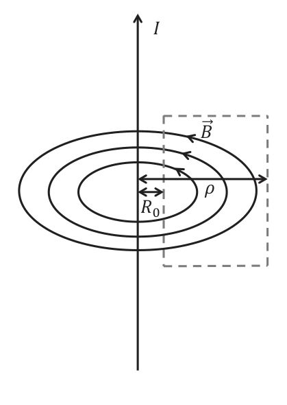

图内文字：I，$\vec{B}$，ρ，$R_0$

$$
\left[ A(\rho) - A(R_0) \right] h = -h \int_{R_0}^{\rho} B(\rho') d\rho'
\tag{5.3.6}
$$

积分可得

$$
A(\rho) = A(R_0) - \frac{\mu_0 I}{2\pi} \ln \left( \frac{\rho}{R_0} \right)
\tag{5.3.7}
$$

$$
= const. - \frac{\mu_0 I}{2\pi} \ln \rho
\tag{5.3.8}
$$

其中 $const.$ 取决于矢势原点的选取。

注：本例也可以用 $\nabla \times \vec{A} = \vec{B}$ 直接求出，不妨试试。

[例2] 求均匀场 $\vec{B} = B_0 \vec{e}_x$ 对应的矢势分布。

解：乍一看，这个未必是个二维问题。考虑到均匀磁场可以是由放在无限远处的无限大载有 z 方向均匀面电流的金属板（平行于 xz 面）产生，这个问题就很清楚是 2 维问题，因此可设 $\vec{A} = A(x, y) \vec{e}_z$。根据 $\nabla \times \vec{A} = \vec{B}$，得

$$
\partial_y A \vec{e}_x - \partial_x A \vec{e}_y = B_0 \vec{e}_x
\tag{5.3.9}
$$

因此有

$$
A(x, y) = B_0 y = B_0 \rho \sin\theta
\tag{5.3.10}
$$

注：矢势的选取并不唯一，除了可以差一个积分常数外，矢势还可以任意加上一个“规范场”而不影响它们给出相同的磁场。上面这个结果是假设电流沿 z 方向，$\vec{A}$ 的方向因此定下来沿 z 方向，这等价于我们取定了一个规范。其实我们不一定非得做这个假设（规范），其它形式的电流也有可能产生同样的均匀磁场。比如 $\vec{A} = \frac{1}{2} \vec{B} \times \vec{r}$ 也可以对应同样的磁场，这是所谓 Landau 规范下的结果，你能证明这个结论并讨论一下其对应的电流分布吗？

[例3] 半径为 R 的圆柱形磁介质（磁导率为 $\mu_2$），放置于均匀的外磁场 $\vec{B}_0$ 中，设柱外面为磁导率为 $\mu_1$ 的介质。场的方向与柱轴垂直，求空间的场分布。

### 5.3. 磁场的矢势解法：二维问题

解：如图所示，空间分成两个区域，$\rho > R$ 的区域矢势为 $A_1(x,y)\hat{z}$，$\rho < R$ 的区域矢势为 $A_2(x,y)\hat{z}$，它们均满足 Laplace 方程（没有传导电流）：

$$
\nabla^2 A_1 = 0 \qquad \nabla^2 A_2 = 0 \tag{5.3.11}
$$

考虑边值关系。在 $\rho = R$ 的边界上，显然 5.1.9 式即为

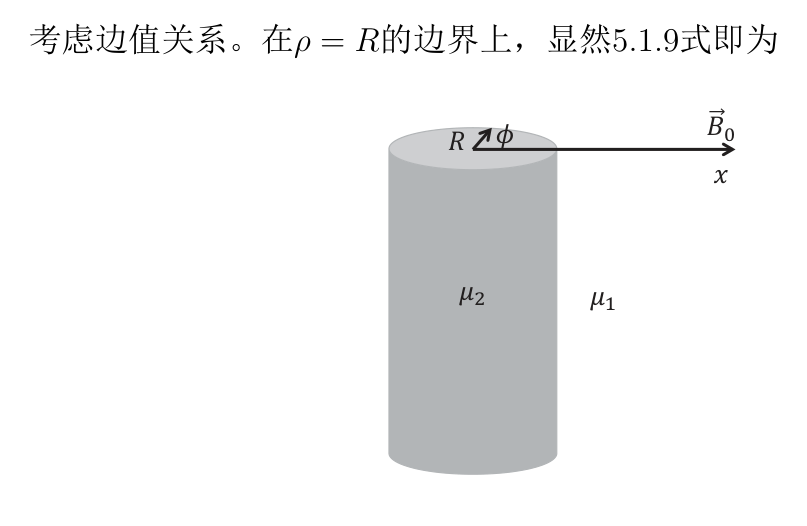
图内文字：$R$、$\phi$、$z$ 轴、$\vec{B}_0$、$x$、$\mu_2$、$\mu_1$

$$
A_1(\rho = R) = A_2(\rho = R) \tag{5.3.12}
$$

考虑边条 5.1.6。因为 $\vec{A} = A_1(x,y)\hat{z}$，利用柱坐标系 $(\rho,\phi,z)$ 中的公式可得

$$
\nabla \times \vec{A} = \frac{1}{\rho}\frac{\partial A_z}{\partial \phi}\vec{e}_\rho - \frac{\partial A_z}{\partial \rho}\vec{e}_\phi \Rightarrow \vec{n} \times \left( \nabla \times \vec{A} \right) = -\frac{\partial A_z}{\partial \rho}\vec{e}_z \tag{5.3.13}
$$

我们就可以把 5.1.6 式写成

$$
\left( \frac{1}{\mu_1}\frac{\partial A_1}{\partial \rho} - \frac{1}{\mu_2}\frac{\partial A_2}{\partial \rho} \right)\Bigg|_{\rho=R} = -\alpha = 0 \Rightarrow \frac{1}{\mu_1}\frac{\partial A_1}{\partial \rho} = \frac{1}{\mu_2}\frac{\partial A_2}{\partial \rho} \tag{5.3.14}
$$

把它们与介质中的静电方程和边值关系比较，立即发现它们的形式完全一样。因此，二维静磁问题完全可以仿照静电问题中的各种解法来求解。

其他边界条件：

$$
\rho = 0 \qquad A_2 \text{有限} \tag{5.3.15}
$$

$$
\rho \to \infty \qquad A_1 \text{包括均匀场的贡献} \tag{5.3.16}
$$

即

$$
\rho \to \infty \qquad A_1 = const. + B_0 y = const. + B_0 \rho \sin \phi \tag{5.3.17}
$$

下面我们根据上述条件利用本征函数展开法找出各区的解。

根据问题的对称性，$A_1$，$A_2$ 可以展开成相应的本征函数的线性叠加：

$$
\begin{cases}
A_1 = g_0 + h_0 \ln \rho + \sum_{n=1}^{\infty}(g_n \rho^n + h_n \rho^{-n})\cos(n\phi) + \sum_{n=1}^{\infty}(c_n \rho^n + d_n \rho^{-n})\sin(n\phi) \\
A_2 = g_0' + h_0' \ln \rho + \sum_{n=1}^{\infty}(g_n' \rho^n + h_n' \rho^{-n})\cos(n\phi) + \sum_{n=1}^{\infty}(c_n' \rho^n + d_n' \rho^{-n})\sin(n\phi)
\end{cases} \tag{5.3.18}
$$

根据边条 5.3.15-5.3.17，易知：

$$
\begin{cases}
g_n = 0 & n = 1, 2, \cdots \\
c_1 = B_0 \\
c_n = 0 & n > 1 \\
h_0 = 0
\end{cases} \tag{5.3.19}
$$

$$
\begin{cases}
h_n' = 0 & n = 1, 2, \cdots \\
d_n' = 0 & n > 1 \\
h_0' = 0
\end{cases} \tag{5.3.20}
$$

由边条 5.3.12-5.3.14，得到

$$
\begin{cases}
g_n R^n + h_n R^{-n} = g_n' R^n + h_n' R^{-n} \\
\frac{1}{\mu_1}(n g_n R^{n-1} - n h_n R^{-n-1}) = \frac{1}{\mu_2}(n g_n' R^{n-1} - n h_n' R^{-n-1})
\end{cases} \tag{5.3.21}
$$

以及

$$
\begin{cases}
c_n R^n + d_n R^{-n} = c_n' R^n + d_n' R^{-n} \\
\frac{1}{\mu_1}(n c_n R^{n-1} - n d_n R^{-n-1}) = \frac{1}{\mu_2}(n c_n' R^{n-1} - n d_n' R^{-n-1})
\end{cases} \tag{5.3.22}
$$

根据 5.3.19 与 5.3.20，当 $n > 1$ 时，5.3.21 与 5.3.22 没有非平凡解，亦即所有 $n > 1$ 时的参数均为 0。当 $n = 1$ 时，由 5.3.22 可以解得

$$
d_1 = R^2 B_0 \frac{\mu_2 - \mu_1}{\mu_2 + \mu_1} \qquad c_1' = \frac{2B_0\mu_2}{\mu_1 + \mu_2} \tag{5.3.23}
$$

除了不重要的常数 $g_0 = g_0'$ 外，其余的系数均为零。故空间矢势（取常数为 0）为

$$
\begin{cases}
A_1 = B_0 \rho \sin \phi + B_0 R^2 \frac{\mu_2 - \mu_1}{\mu_2 + \mu_1}\frac{\sin \phi}{\rho} \\
A_2 = \frac{2B_0\mu_2}{\mu_1 + \mu_2}\rho \sin \phi
\end{cases} \tag{5.3.24}
$$

根据矢势可以容易地计算出磁场的形式。这里，柱外的磁场由外磁场和介质磁化后的磁化电流在柱子外产生的磁场，后者完全等价于放置在原点处的一个 2 维偶极子，柱内的场为一均匀磁场，包含了外磁场以及“退磁场”的贡献。

Tips：从上一章到这一章的这么多例子中，我们可以清楚地明白，均匀外场下对柱、球等的影响只是激发 $l = 1$ 项（即偶极项），其他的项都是 0。这个原因也很简单，均匀场的势正比于 $r$ 的一次方，因此它也只作用到 $l = 1$ 这个子空间。明白了这个道理，以后再做相应的题目时可直接仅仅保留 $l = 1$ 项（对均匀外场），结果的正确性由唯一性定理保证，以简化计算书写步骤。

### 5.4 磁场的标量势解法

我们已经介绍了磁场的矢势解法。尽管这种方法物理图像直接，但因 $\vec{A}$ 是矢量场，运算极其繁复，实用性（特别是解析计算）不强。对比静电场，如果能引入标量势就容易多了。下面我们将仔细讨论引入磁标势的条件，并用它研究线性磁介质及（具有复杂的非线性响应）铁磁介质中的磁场。

#### 5.4.1 磁标势

什么条件下可以引入磁标势？带着这个问题，让我们重新考察静磁场满足的方程

$$
\begin{cases}
\nabla \cdot \vec{B} = 0 \\
\nabla \times \vec{H} = \vec{j}_f
\end{cases} \tag{5.4.1}
$$

如果所考察的空间区域没有传导电流，则有

$$
\nabla \times \vec{H} = 0 \tag{5.4.2}
$$

上式提醒我们似乎可以据此引入标势 $\varphi_m$（称为磁标势）

$$
\vec{H} = -\nabla \varphi_m \tag{5.4.3}
$$

但是，仔细考虑之后发现：只有条件 5.4.2 还不够保证可以引入磁标势。原因是能引入 $\varphi_m$ 的充分必要条件是 $\vec{H}$ 为保守场，亦即

$$
\oint_C \vec{H} \cdot d\vec{l} = 0 \tag{5.4.4}
$$

其中 $C$ 为空间中的任意闭合回路。只有 $\vec{H}$ 场对任意环路的积分都为 0，才能对一个点唯一确定标势，亦即，$\varphi_m$ 为位置的单值函数。在很多情况下，5.4.2 已经可以导致保守场，但有些情况下，即使考虑的空间没有电流，5.4.4 仍不成立。比如对一个载流线圈，若我们做一个轮胎状的东西将空间有电流的部分完全清除（如图 5.3 所示），选择 $C_1$，$C_2$，$C_3$ 等 3 个环路，对 $C_1$，$C_3$ 来说，5.4.4 均成立，对 $C_2$ 来讲不成立。

$$
\oint_{C_2} \vec{H} \cdot d\vec{l} = I \tag{5.4.5}
$$

意味着是空间同一点的标势值不唯一。因此，仅有“无传导电流”这一条件还不能保证 $\varphi_m$ 的单值性。

为了解决这个问题，我们引入以电流环为边界的任意曲面，并规定积分路径不允许穿过此曲面。直观地看，这个以电流环为边界的任意曲面对

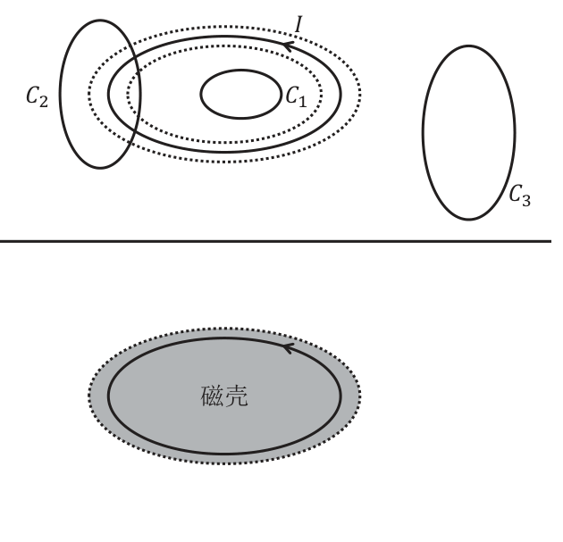
图内文字：$C_2$、$C_1$、$I$、$C_3$、磁壳

积分路径来说是个刚性的屏障，使得任何闭合积分路径都穿不过去，这样，$\varphi_m$ 不再是多值的了。为此，从曲面的一侧穿过曲面到另一侧，磁标势 $\varphi_m$ 是不连续的，存在着大小为 $I$ 的跃变，即

$$
\left. \int \vec{H} \cdot d\vec{l} \right|_{C_2} = -\int_{+}^{-} \nabla \varphi_m \cdot d\vec{l} = \varphi_m^+ - \varphi_m^- = I \tag{5.4.6}
$$

所以有时称此曲面为“磁壳”，而 5.4.6 作为磁标势在磁壳上的边界条件。因此，为了引入“磁标势”，我们必须：

- 构造合适的“磁壳”已使得空间变成“无源”且“单连通”；
- 设置合适的边界条件。

所以必须引入“磁壳”使得空间变成单连通！这样，就阻挡了那些有可能环绕电流的回路。这样的空间中 $\varphi_m$ 不再是多值的了。但代价是：$\varphi_m$ 在磁壳的两边不连续，必须设定合适的边界条件。考虑磁壳的某一点上下的磁标势的差，按照定义，这个差值就是磁场沿某一路线在单连通

空间由“+”这一点积分到“-”这一点：

$$
\varphi_m^+ - \varphi_m^- = -\int_{+}^{-} \nabla \varphi_m \cdot d\vec{l} = \int_{-}^{+} \vec{H} \cdot d\vec{l} \tag{5.4.7}
$$

而另一方面，根据安培定律，这个积分的数值是：

$$
\int_{-}^{+} \vec{H} \cdot d\vec{l} = \oint \vec{H} \cdot d\vec{l} = I \tag{5.4.8}
$$

所以在“磁壳”的上下表面磁标势有一个 $\varphi_m^+ - \varphi_m^- = I$ 的跳跃，这就是磁标势在磁壳上的边界条件。

注：某种意义上讲，多联通空间中磁标势的“多值性”就像是几何上多个黎曼面的问题，引入“磁壳”就是选定其中一个“黎曼面”来工作。

#### 5.4.2 线性磁介质中磁场问题

对于顺磁、抗磁两种线性磁介质，本构关系 $\vec{B} = \mu \vec{H}$ 成立。因此在定义了合适的磁壳之后的区域内，有 $\vec{B} = -\mu \nabla \varphi_m$。将其带入 5.4.1 式可得 $\nabla \cdot (\mu \nabla \varphi_m) = 0$。在分块均匀的每一块磁介质内部，$\mu$ 是常数，因此有

$$
\nabla^2 \varphi_m = 0 \tag{5.4.9}
$$

我们发现此时磁标势 $\varphi_m$ 满足和电标势 $\varphi$ 完全一样的 Laplace 方程，事实上，在无源区下，电和磁有着完美的对称：

$$
\begin{aligned}
\nabla \cdot \vec{D} = 0 &\Leftrightarrow \nabla \cdot \vec{B} = 0 \\
\nabla \times \vec{E} = 0 &\Leftrightarrow \nabla \times \vec{H} = 0 \\
\vec{D} = \varepsilon \vec{E} &\Leftrightarrow \vec{B} = \mu \vec{H} \\
\varepsilon &\Leftrightarrow \mu \\
\varpi &\Leftrightarrow \varphi_m \\
\vec{E} = -\nabla \varphi &\Leftrightarrow \vec{H} = -\nabla \varphi_m
\end{aligned}
$$

因此，无须推导我们就可以根据电标势的结论直接给出两块磁介质界面上的磁标势的边界条件：

$$
\begin{cases}
\varphi_{m1} = \varphi_{m2} \\
\mu_1 \left( \frac{\partial \varphi_m}{\partial n} \right)_1 = \mu_2 \left( \frac{\partial \varphi_m}{\partial n} \right)_2
\end{cases} \tag{5.4.10}
$$

所以，对无源的线性磁介质中磁场问题，需在边条 5.4.10 下求解方程 5.4.9。解法技巧可借鉴电场的标势问题 —— 唯一应当注意的是此时 $\vec{E}$ 与 $\vec{H}$ 对应，尽管这里只是数学上的对应，物理上讲 $\vec{H}$ 不是真实的磁场！

[例4] 真空中将一个半径为 $R$ 的磁介质球（磁导率为 $\mu$）放置于均匀磁场（$\vec{B} = B_0 \vec{e}_z$）中，求空间的 $\vec{B}$ 场分布。

解：这个问题的解法可借鉴 4.4 节中的例3。只要把那里的解做代

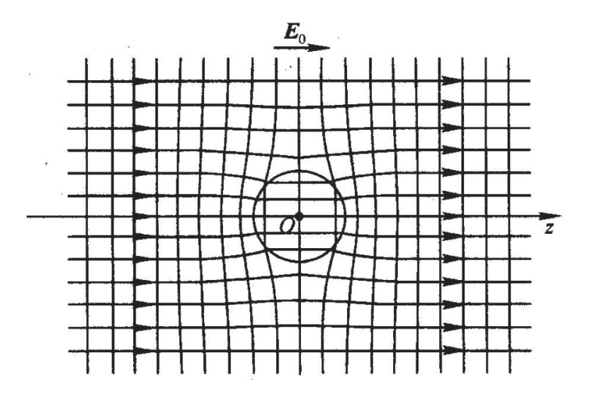
图内文字：$\vec{E}_0$、$o$、$z$

换：$\vec{E}_0 \to \vec{H}_0$，$\varepsilon \to \mu$，即可求出这个问题的空间磁标势分布：

$$
\varphi_{m1} = -H_0 r \cos \theta + \frac{\mu - \mu_0}{2\mu_0 + \mu}R^3 H_0 \frac{1}{r^2}\cos \theta \tag{5.4.11}
$$

$$
\varphi_{m2} = -\frac{3\mu_0}{2\mu_0 + \mu}H_0 r \cos \theta \tag{5.4.12}
$$

定义

$$
\vec{m} = \frac{\mu - \mu_0}{2\mu_0 + \mu}4\pi R^3 H_0 \hat{z} \tag{5.4.13}
$$

并带入上式可得

$$
\varphi_{m1} = -H_0 r \cos \theta + \frac{1}{4\pi}\frac{\vec{m} \cdot \vec{r}}{r^3} \tag{5.4.14}
$$

利用矢量微分运算，空间的 $\vec{H}$ 场可因此求出：

$$
\vec{H}_1 = -\nabla \varphi_{m1} = H_0 \hat{z} - \frac{1}{4\pi}\frac{\vec{m} - 3(\vec{m} \cdot \hat{r})\hat{r}}{r^3} \tag{5.4.15}
$$

$$
\vec{H}_2 = -\nabla \varphi_{m2} = \frac{3\mu_0}{2\mu_0 + \mu}H_0 \hat{z} \tag{5.4.16}
$$

$\vec{H}$ 场不对应物理场，为了看清楚物理，进一步可以求出 $\vec{B}$ 场：

$$
\vec{B}_1 = \mu_0 \vec{H}_1 = B_0 \hat{z} - \frac{\mu_0}{4\pi}\frac{\vec{m} - 3(\vec{m} \cdot \hat{r})\hat{r}}{r^3} \tag{5.4.17}
$$

$$
\vec{B}_2 = \mu \vec{H}_2 = \frac{3\mu}{2\mu_0 + \mu}B_0 \hat{z} \tag{5.4.18}
$$

注意到

$$
\vec{B} = \frac{\mu_0}{4\pi}\frac{\vec{m} - 3(\vec{m} \cdot \hat{r})\hat{r}}{r^3} \tag{5.4.19}
$$

正是真空中放置于原点的一个磁矩为 $\vec{m}$ 的磁偶极子产生的磁感应场（参考第3讲1.2.48），因此磁介质球被磁化后对外界表现为一个磁偶极子。磁偶极子的磁标势和电偶极子的电标势之间有着很好的对称性：

$$
\varphi_m = \frac{\mu_0}{4\pi}\frac{\vec{m} \cdot \hat{r}}{r^2} \Leftrightarrow \varphi_p = \frac{1}{4\pi\varepsilon_0}\frac{\vec{p} \cdot \hat{r}}{r^2} \tag{5.4.20}
$$

与静电场问题类似，磁介质球内部的 $\vec{H}$ 场也是均匀磁场，强度小于外 $\vec{H}$ 场（因为有退磁场的原因）。

注：

1. 磁标势以及磁偶极子 $\vec{m}$ 的定义中没有 $\mu_0$，这是为什么？

2. 退磁场的概念是对 $\vec{B}$ 场还是对 $\vec{H}$ 场？讨论一下介质内的 $\vec{B}$ 场与外场的大小？

[例5] 均匀磁介质球壳放在均匀外磁场 $\vec{H}_0$ 中，外面的区域是真空，求场分布。

解：设介质球壳的内外半径分别为 $R$、$R'$，球壳的磁导率为 $\mu$。取 $\vec{H}_0$ 方向为极轴方向的球坐标系，把空间分成三个区域：$r > R'$，$R' > r > R$，$r < R$。三个区域都没有传导电流，因此可使用磁标势

$$
\begin{cases}
\nabla^2\varphi_{m1}=0 & r>R' \\
\nabla^2\varphi_{m2}=0 & R'>r>R \\
\nabla^2\varphi_{m3}=0 & r<R
\end{cases}
\tag{5.4.21}
$$

相应的边界条件为

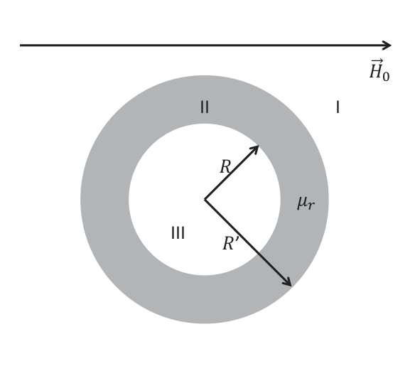

图内文字：$\vec{H}_0$；I；II；III；$R$；$R'$；$\mu_r$

$$
\begin{cases}
\varphi_{m1}\to -H_0 r\cos\theta & r\to\infty \\
\varphi_{m1}=\varphi_{m2}\quad \frac{\partial\varphi_{m1}}{\partial r}=\mu_r\frac{\partial\varphi_{m2}}{\partial r} & r=R' \\
\varphi_{m2}=\varphi_{m3}\quad \mu_r\frac{\partial\varphi_{m2}}{\partial r}=\frac{\partial\varphi_{m3}}{\partial r} & r=R \\
\varphi_{m3}\ \text{有限} & r\to 0
\end{cases}
\tag{5.4.22}
$$

原则上，我们仍应将 $\varphi_{m1}, \varphi_{m2}, \varphi_{m3}$ 展开成本征函数的叠加。因此时激发外场为均匀场，只有 $l=1$ 项非 0，且处理的是球状体，因此我们可以引入如下试解：

$$
\begin{cases}
\varphi_{m1}=\left(c_1 r+\frac{d_1}{r^2}\right)\cos\theta \\
\varphi_{m2}=\left(c_2 r+\frac{d_2}{r^2}\right)\cos\theta \\
\varphi_{m3}=\left(c_3 r+\frac{d_3}{r^2}\right)\cos\theta
\end{cases}
\tag{5.4.23}
$$

根据边条（1），（4）我们得知

$$
c_1=-H_0 \qquad d_3=0
\tag{5.4.24}
$$

利用边值关系（2），（3）可以确定系数 $d_1, c_2, d_2, c_3$（过程从略）。我们比较关心其中的两项

$$
d_1=\frac{H_0(\mu_r-1)(1+2\mu_r)(R'^3-R^3)}{(2+\mu_r)(1+2\mu_r)-2(\mu_r-1)^2\left(\frac{R}{R'}\right)^3}
\tag{5.4.25}
$$

$$
c_3=\frac{-9\mu_r H_0}{(2+\mu_r)(1+2\mu_r)-2(\mu_r-1)^2\left(\frac{R}{R'}\right)^3}
\tag{5.4.26}
$$

下面分析一下结果。从磁标势的结果中可以看出，球壳外的场是均匀场和偶极子场的叠加。与磁偶极子的标势对比发现整个球壳磁化后对外场表现为一个磁偶极矩 $4\pi d_1$ 的磁偶极子。分析几个极限行为：

1. 在 $R\to R'$ 或者 $\mu_r\to 1$ 时，$m=4\pi d_1\to 0$，诱导磁矩消失；

2. 当 $R\to 0$ 时，$m=4\pi d_1\to \frac{\mu_r-1}{\mu_r+2}4\pi R'^3H_0$，回到之前的例题；

3. 当 $\mu_r\to\infty$ 时，磁偶极矩为

$$
m=4\pi d_1\approx 4\pi H_0R'^3
\tag{5.4.27}
$$

它与 $R$ 的大小无关，与一个金属球（或者是金属球壳）对外场的响应类似。

4. 球壳内的场是均匀场，其大小为 $-c_3$。当 $\mu_r\to\infty$ 时，球壳内的磁场为

$$
\vec{H}=\frac{9\vec{H}_0}{2\mu_r\left[1-\left(\frac{R}{R'}\right)^3\right]}\to 0
\tag{5.4.28}
$$

这就是所谓的磁屏蔽。选择的材料 $\mu_r$ 越大，壳层越厚（即 $\frac{R}{R'}\ll 1$），则屏蔽效果越好。

注：

1. 在电的世界中，我们有自由电荷，而由自由电荷组成的介质就是金属导体，其对电场完全屏蔽，相当于 $\varepsilon_r\to-\infty$ 的电介质；前面我们讲到当 $\varepsilon_r\to-\infty$ 时，在静电学的范畴内也可以完全等效于一个导体。在磁的世界中，由于没有磁单极子的存在，我们没有类似金属导体的“磁导体”。然而要实现类似一个“磁导体”一样对磁场的响应，我们可以利用 $\mu_r\to\infty$ 的磁介质——在静磁学的范畴内，其响应与“磁导体”一致。然而要实现高的 $\varepsilon_r$，$\mu_r$ 并不容易，目前的一个前沿课题就是基于“Metamaterial”的理念来实现任意的 $\varepsilon_r$，$\mu_r$。

2. 计算多层介质膜对外场的响应时，由于直接计算边值关系比较复杂，有时常采用“转移矩阵”的方法。其理念是根据 $l$ 层和 $l+1$ 层之间的

边值关系确定 $\{c_l, d_l\}$ 与 $\{c_{l+1}, d_{l+1}\}$ 之间的关系，并写成一个矩阵的形式：

$$
\begin{pmatrix}
c_{l+1} \\
d_{l+1}
\end{pmatrix}
=T_{l+1,l}
\begin{pmatrix}
c_l \\
d_l
\end{pmatrix}
\tag{5.4.29}
$$

以此类推可以推知最外层和最内层的转开系数之间的关系：

$$
\begin{pmatrix}
c_N \\
d_N
\end{pmatrix}
=\prod T_{l+1,l}
\begin{pmatrix}
c_l \\
d_l
\end{pmatrix}
\tag{5.4.30}
$$

最后根据最外层和最内层的边值条件确定相应系数。这种方法是非常一般且有用，可用在所有多层体系（板、柱、球）的“波”（量子、静电、静磁、电磁波…）的散射问题。

#### 5.4.3 铁磁介质问题

铁磁介质为非线性介质，本构关系 $\vec{B}\neq\mu\vec{H}$。因此之前对线性介质推出的方法不再成立。但 $\vec{B}/\mu_0=\vec{H}+\vec{M}$ 总是成立的，因此5.4.1式中第一式变为

$$
\nabla\cdot\vec{H}(\vec{r})=-\nabla\cdot\vec{M}(\vec{r})
\tag{5.4.31}
$$

若空间无传导电流且单连通，则可定义磁标势 $\vec{H}=-\nabla\varphi_m$。在铁磁介质的问题中，$\vec{M}$ 是 $\vec{H}$ 的函数，由磁滞回路决定，换言之，$\vec{M}$ 是 $\varphi_m$ 的隐函数，这使得5.4.31变为 $\nabla^2\varphi_m=\nabla\cdot\vec{M}(\varphi_m)$，这是关于 $\varphi_m$ 的一个非常复杂的方程，很难处理。必须明确知道 $\vec{M}$ 和 $\vec{H}$ 的关系才可以求解。图5.6是个非常典型的铁磁介质的磁化曲线，从中我们发现在不同的过程对应不同的物理。

**初始磁化过程**

铁磁介质一开始处于无磁性状态，加上磁场后磁矩出现。在这个过程中 $\vec{M}=\chi_m\vec{H}$，与顺磁介质一样（见下图），相应的方程为5.4.9。

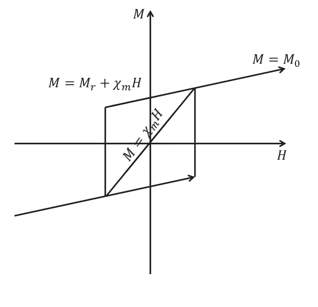

图内文字：$M=M_r+\chi_m H$；$M\approx\chi_m H$；$M=M_0$；$M$；$H$

**饱和磁化**

当 $H\to\infty$ 时，铁磁介质达到饱和磁化，$\vec{M}=\vec{M}_0$，再加外场都不会增加磁矩的大小。因此 $\nabla\cdot\vec{M}=\nabla\cdot\vec{M}_0(\vec{r})$ 就变成了与等式左边H无关的物理量，可以等效看作一个决定磁标势的有效的“源”。定义

$$
\rho_m=-\nabla\cdot\vec{M}_0
\tag{5.4.32}
$$

这里 $\rho_m$ 称为假象磁荷密度，而磁标势满足的方程为标准的Poisson方程

$$
\nabla^2\varphi_m=-\rho_m
\tag{5.4.33}
$$

在这里，磁荷对磁标势起的作用于电荷对电标势的作用类似。

————以下为选读内容————

**靠近剩余磁矩点时的行为**

当体系被饱和磁化后再逐渐撤掉外磁场，在一般情况下，这个过程

中 $\vec{H}$ 与 $\vec{M}$ 的关系可近似为

$$
\vec{M}=\vec{M}_r+\chi_m'\vec{H}
\tag{5.4.34}
$$

其中 $\vec{M}_r$ 为剩余磁矩。将上式代入5.4.32，并整理可得

$$
(1+\chi_m')\nabla^2\varphi_m=\nabla\cdot\vec{M}_r(\vec{r})\Rightarrow
\begin{cases}
\nabla^2\varphi_m=-\rho_m/\mu_r' \\
\nabla\cdot\vec{M}_r(\vec{r})=-\rho_m
\end{cases}
\tag{5.4.35}
$$

此时的物理行为仍然是有“磁荷”作为源的Possion方程，只是处于一个顺磁介质的背景中。可以说是将体系的顺磁性与饱和磁矩两样贡献分开。

————以上为选读内容————

下面求 $\varphi_m$ 在两个磁介质交界面上的关系。

根据 $\int H\cdot dl=-\Delta\varphi_m$，只要 $H$ 在边界处不发散，边条

$$
\varphi_{1m}=\varphi_{2m}
\tag{5.4.36}
$$

始终成立。考虑微分方程5.4.31对应的边界条件，显然有

$$
\vec{e}_n\cdot(\vec{H}_1-\vec{H}_2)=-\vec{e}_n\cdot(\vec{M}_1-\vec{M}_2)
\tag{5.4.37}
$$

对饱和磁化有

$$
\left(\frac{\partial\varphi_m}{\partial n}\right)_1-\left(\frac{\partial\varphi_m}{\partial n}\right)_2=\vec{e}_n\cdot\left(\vec{M}_0^1-\vec{M}_0^2\right)
\tag{5.4.38}
$$

————以下为选读内容————

对靠近剩余磁矩点时有

$$
\mu_{r1}'\left(\frac{\partial\varphi_m}{\partial n}\right)_1-\mu_{r2}'\left(\frac{\partial\varphi_m}{\partial n}\right)_2=\vec{e}_n\cdot\left(\vec{M}_r^1-\vec{M}_r^2\right)
\tag{5.4.39}
$$

————以上为选读内容————

可见，交界面上的关系和静电介质完全类似，5.4.38式中等式右边对应的其实就是“假想”磁荷面密度。因此，引入磁荷和磁标势的好处在于我们可以借用静电学中的方法，第四章中讨论的许多方法都可运用。这在处理永久磁石所激发的磁场等问题时特别方便——因为对此类问题，体系本来就不存在“传导电流”又是单连通的，因此磁标势方法天然适用。

[例6] 求半径为 $R$ 的球形永久磁铁（假设被饱和磁化 $\vec{M}=M_0\hat{z}$）所激发的磁场。

解：把空间分成球内和球外两部分，整个空间不存在传导电流，因此球内外均可用磁标势。球外空间，没有磁矩因此磁荷 $\rho_m=0$，球内区域有磁矩，但其为常数因此仍然没有磁荷。所以 $\varphi_{m1}, \varphi_{m2}$ 均满足Laplace方程

$$
\nabla^2\varphi_{m1}=0 \qquad \nabla^2\varphi_{m2}=0
\tag{5.4.40}
$$

体系的边界条件

$$
\begin{cases}
\varphi_{m1}\to 0 & r\to\infty \\
\varphi_{m1}=\varphi_{m2} & r=R \\
\frac{\partial\varphi_{m1}}{\partial r}-\frac{\partial\varphi_{m1}}{\partial r}=-\vec{e}_n\cdot\vec{M}_0=-M_0\cos\theta & r=R \\
\varphi_{m2}\ \text{有限} & r=0
\end{cases}
\tag{5.4.41}
$$

将 $\varphi_{m1}, \varphi_{m2}$ 展开成本征函数的叠加，根据5.4.41中边界条件，可以预期只有 $l=1$ 项非0（因为只有 $l=1$ 项带有 $\cos\theta$ 的角度依赖关系）。只保留 $l=1$ 项，再考虑了5.4.41中两个极限下的边条，试解可以取为

$$
\varphi_{m1}=\frac{A}{r^2}\cos\theta \qquad \varphi_{m2}=Br\cos\theta
\tag{5.4.42}
$$

代入5.4.41得

$$
\begin{cases}
\frac{A}{R^2}=BR \\
B+2\frac{A}{R^3}=M_0
\end{cases}
\tag{5.4.43}
$$

解之可得

$$
A=\frac{M_0R^3}{3} \qquad B=\frac{M_0}{3}
\tag{5.4.44}
$$

所以

$$
\varphi_{m1}=\frac{M_0R^3}{3}\frac{1}{r^2}\cos\theta \qquad \varphi_{m2}=\frac{M_0}{3}r\cos\theta
\tag{5.4.45}
$$

可见，球外空间的磁场是偶极场，其磁偶极矩为

$$
\vec{m}=\frac{4\pi}{3}R^3\vec{M}_0
\tag{5.4.46}
$$

球内的磁场强度为

$$
\vec{H}=-\vec{M}_0/3
\tag{5.4.47}
$$

球内的磁感应强度为

$$
\vec{B}/\mu_0=\vec{H}+\vec{M}=\frac{2}{3}\vec{M}_0
\tag{5.4.48}
$$

这时候比较 $\vec{B}$ 场与 $\vec{H}$ 场的行为很有意思。$\vec{B}$ 场线的法向是连续的，（因为 $\nabla\cdot\vec{B}=0$），但其在球的表面切向分量不连续（因为 $\nabla\times\vec{B}=\mu_0\vec{J}_M=\mu_0\nabla\times\vec{M}\neq 0$，有磁化电流面密度）。$\vec{H}$ 场与电场的行为类似，与 $\vec{B}$ 恰恰相反——其法向不连续，因为 $\nabla\cdot\vec{H}=\rho_M$，但其切向却连续。具体的场分布如图5.7所示。这里面的物理是：$\vec{B}$ 场看到的是磁化“电流”，看不到“磁荷”，$\vec{H}$ 场恰恰相反，看到的是“磁荷”，看不到“电流”。

### 5.5 磁多极矩展开 - 磁偶极子

若源电流分布集中在一个小区域 $V$ 中，而我们只讨论其在远处的产生的磁场，这时可以仿照静电情况用多极矩展开的方法来处理。这里，我们重点讨论磁偶极子的场、磁偶极子与外磁场的相互作用。

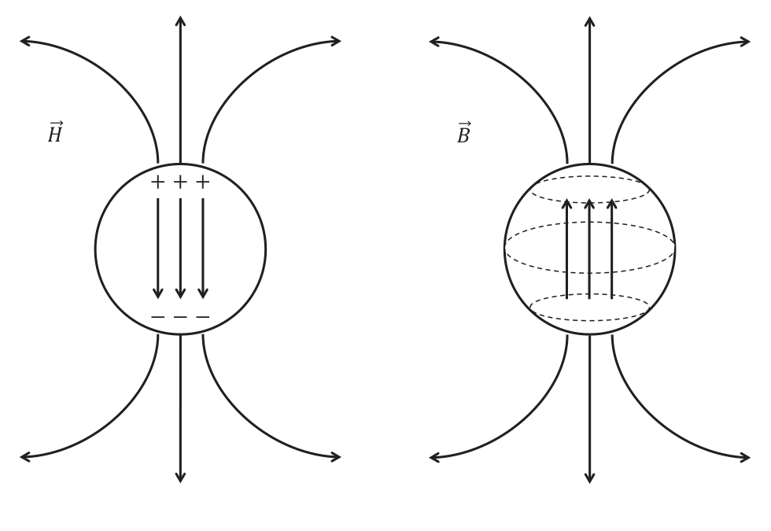

图内文字：左图 $\vec{H}$，球面上方 $+++$、下方 $---$；右图 $\vec{B}$

#### 5.5.1 磁多极展开及磁偶极子产生的势

在全空间问题中，矢势 $\vec{A}$ 的解为

$$
\vec{A}(\vec{r}) = \frac{\mu_0}{4\pi} \int \frac{\vec{j}(\vec{r}')}{R} d\tau' \tag{5.5.1}
$$

类似静电问题中的多极展开，把 $\frac{1}{R}$ 在区域 $V$ 内的某一点展开成 $\vec{r}'$ 的幂级数。若展开点取在坐标的原点，则

$$
\frac{1}{R} = \frac{1}{r} - \vec{r}' \cdot \nabla \left. \frac{1}{R} \right|_{r'=0} + \frac{1}{2} \vec{r}' \vec{r}' : \nabla\nabla \left. \frac{1}{R} \right|_{r'=0} + \cdots \tag{5.5.2}
$$

只保留前两项，代入矢势表达式中得

$$
\vec{A}(\vec{r}) = \frac{\mu_0}{4\pi} \int \frac{\vec{j}(\vec{r}')}{R} d\tau' = \vec{A}^{(0)} + \vec{A}^{(1)} + \cdots \tag{5.5.3}
$$

其中

$$
\vec{A}^{(0)} = \frac{\mu_0}{4\pi r} \int \vec{j}(\vec{r}') d\tau' \tag{5.5.4}
$$

$$
\vec{A}^{(1)} = \frac{\mu_0}{4\pi r^3} \int \vec{j}(\vec{r}' \cdot \vec{r}) d\tau' \tag{5.5.5}
$$

这里我们将不直接处理电流密度 $\vec{j}(\vec{r}')$，而利用一个没有证明其严格性但却非常有启发性的思路——将体积 $V$ 内的电流分成许多独立的电流管道的叠加。因为是稳恒电流，每个流管为闭合回路且电流为一常数 $I_i$。根据这一思路，可以在积分中做如下代换：

$$
\vec{j}(\vec{r}') d\tau' = \sum_i I_i d\vec{l}_i \tag{5.5.6}
$$

考虑第一项：

$$
\vec{A}^{(0)} \propto \int \vec{j} d\tau' = \sum_i I_i \oint d\vec{l}_i \equiv 0 \tag{5.5.7}
$$

5.5.7式背后的物理原因是电流为稳定电流。与电场的多极矩展开不同，磁多极矩的第一项恒为0，事实上，这正是自然界没有磁单极的显现。下面考虑第二项 $\vec{A}^{(1)}$：

$$
\vec{A}^{(1)} = \frac{\mu_0}{4\pi r^3} \sum_i I_i \oint (\vec{r}' \cdot \vec{r}) d\vec{l}_i \tag{5.5.8}
$$

对方环或是圆环，上式都可以严格积分出来（详见第二讲）。对任意形状，注意到 $d\vec{r}' = d\vec{l}_i$，我们可以首先将上式中的积分进行配分：

$$
\oint (\vec{r}' \cdot \vec{r}) d\vec{l}_i = \oint (\vec{r}' \cdot \vec{r}) d\vec{r}' = \oint \{ d[(\vec{r}' \cdot \vec{r}) \vec{r}'] - \vec{r}'(\vec{r} \cdot d\vec{r}') \} \tag{5.5.9}
$$

在闭合环路条件下上式第一项为0，因此得到一个恒等式：

$$
\oint (\vec{r}' \cdot \vec{r}) d\vec{l}_i = -\oint \vec{r}'(\vec{r} \cdot d\vec{r}') = -\oint \vec{r}'(\vec{r} \cdot d\vec{l}_i) \tag{5.5.10}
$$

现将5.5.8中的积分分成两项：

$$
\vec{A}^{(1)} = \frac{\mu_0}{4\pi r^3} \frac{1}{2} \sum_i I_i \left[ \oint (\vec{r}' \cdot \vec{r}) d\vec{l}_i + \oint (\vec{r}' \cdot \vec{r}) d\vec{l}_i \right] \tag{5.5.11}
$$

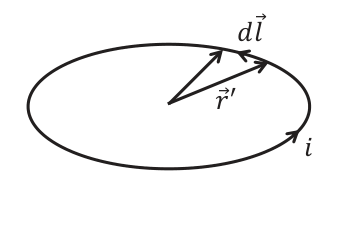

图内文字：$d\vec{l}$，$\vec{r}'$，$i$

将上式中的一项用5.5.10来替代，则有

$$
\vec{A}^{(1)} = \frac{\mu_0}{4\pi r^3} \frac{1}{2} \sum_i I_i \left[ \oint (\vec{r}' \cdot \vec{r}) d\vec{l}_i - \oint \vec{r}'(\vec{r} \cdot d\vec{l}_i) \right] \tag{5.5.12}
$$

利用矢量叉乘的恒等式 $\vec{a} \times (\vec{b} \times \vec{c}) = (\vec{a} \cdot \vec{c})\vec{b} - (\vec{a} \cdot \vec{b})\vec{c}$，5.5.12可以被进一步改写为

$$
\vec{A}^{(1)} = \frac{\mu_0}{4\pi r^3} \frac{1}{2} \sum_i I_i \oint (\vec{r}' \times d\vec{l}_i) \times \vec{r} = \frac{\mu_0}{4\pi} \frac{\vec{m} \times \vec{r}}{r^3} \tag{5.5.13}
$$

其中

$$
\vec{m} = \frac{1}{2} \sum_i I_i \oint \vec{r}' \times d\vec{l}_i = \frac{1}{2} \int \vec{r}' \times \vec{j}(\vec{r}') d\tau' \tag{5.5.14}
$$

被定义为磁偶极矩。上式是对磁偶极矩的最一般定义，针对任意电流分布均可以由此计算。对磁偶极子，我们或多或少已在不同场合介绍其性质，现再总结如下：

1. 对于一个小的载流闭合线圈，其磁偶极矩 $\vec{m}$ 可以由5.5.14计算为

$$
\vec{m} = \frac{1}{2} \int \vec{r}' \times \vec{j} d\tau' = \frac{I}{2} \oint \vec{r}' \times d\vec{l}' = I\vec{S} \tag{5.5.15}
$$

式中 $\vec{S}$ 是电流回路的面积，方向取右手螺旋。这是我们熟知的结果，只不过此处给出的磁偶极矩的定义5.5.14更一般。

2. 磁偶极子产生的场在第二讲中已经导出来过

$$
\vec{B}_m = \nabla \times \vec{A}^{(1)} = \frac{\mu_0}{4\pi} \nabla \times \left[ \vec{m} \times \left( \frac{\vec{r}}{r^3} \right) \right] = \frac{\mu_0}{4\pi} \frac{3(\vec{m} \cdot \hat{r})\hat{r} - \vec{m}}{r^3} \tag{5.5.16}
$$

其与电偶极子 $\vec{p}$ 产生的电场 $\vec{E}_p$ 形式一致。根据第十四讲，对一个磁偶极子产生的场，在没有电流的地方（$r \neq 0$ 处）可以引入磁标势 $\vec{H} = \vec{B}/\mu_0 = -\nabla \varphi_m$。磁偶极子的磁标势为

$$
\varphi_m = \frac{1}{4\pi} \frac{\vec{m} \cdot \vec{r}}{r^3} \tag{5.5.17}
$$

与电偶极子的电标势一一对应。因此对于磁偶极子产生的场，我们既可以用矢势5.5.13计算，也可以利用磁标势5.5.17计算。在无源区，这两个表示方式是一致的。

**3. 任意形状的环形电流回路的标势**

对任意形状的电流回路，若要考虑离环不太远处的场，这时磁偶极矩近似不精确。设回路中的电流强度为 $I$，我们可以把以此回路为边界的任意曲面切割成许多小块，每小块的边界上都流有电流 $I$，电流的方向同大回路的电流方向相同，这样，这些小块边界上电流相加的结果仍只在大回路中流有电流 $I$。对于每一小块面积都相应的有一个磁

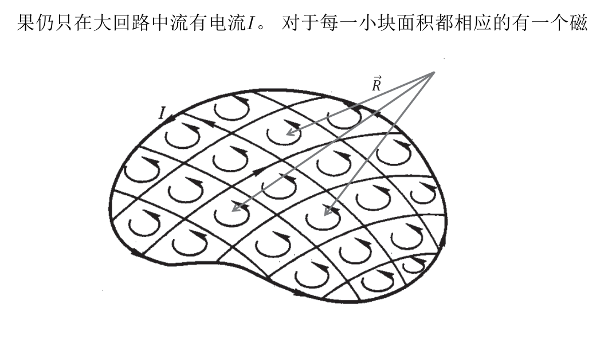

图内文字：$I$，$\vec{R}$

矩，其大小为 $I d\vec{S}$，它在空间产生的磁标势为

$$
\Delta \varphi_m = \frac{I}{4\pi} \frac{\Delta \vec{S} \cdot \vec{R}}{R^3} = \frac{I}{4\pi} \Delta \Omega \tag{5.5.18}
$$

式中的 $R$ 是 $d\vec{S}$ 至观察点的位置矢量，$\Delta \Omega$ 为这一小块电流回路对观察点张开的立体角。当每个小块电流回路的尺度足够小时，其所产生的场由磁偶极子描述5.5.18变成精确的（对大块电流源远场近似不成立，对足够小的电流回路远程近似变成精确的）。于是，整个回路所产生的磁标势严格为

$$
\varphi_m = \int d\varphi_m = \frac{I}{4\pi} \Omega \tag{5.5.19}
$$

$\Omega$ 是回路对观察点所张的立体角，是观察点 $r$ 的函数。其磁感应强度为

$$
\vec{B} = \mu_0 \vec{H} = -\mu_0 \nabla \varphi_m = -\frac{\mu_0 I}{4\pi} \nabla \Omega(\vec{r}) \tag{5.5.20}
$$

$\Omega$ 正负的规定是：按电流的右手法则决定 $\vec{e}_n$ 的面法线方向以后，若观察点在 $\vec{e}_n$ 的正方向，则 $\Omega > 0$，反之 $\Omega < 0$。注意当观察点穿过电流围出的面积时，磁标势不连续。当观察点在载流面上时，$\Omega^+ = 2\pi$，而当其在面积下时，$\Omega^+ = -2\pi$，故，$\varphi_m^+ - \varphi_m^- = I$。其实，这个表面正是我们上次课讲的"磁壳"，必须挖掉其才使得磁标势的定义有意义，尽管其上面并无电流。

#### 5.5.2 磁偶极子在外磁场中的能量、受力及力矩

与电偶极子在电场中类似，下面我们考虑磁偶极子在外磁场中受到的作用力（矩）。首先，前面已经推导出任意电流分布情况下的体系的总磁能为

$$
U_m = \frac{1}{2} \int_\infty \vec{B} \cdot \vec{H} d\tau = \frac{1}{2} \int_\infty \vec{A} \cdot \vec{j} d\tau \tag{5.5.21}
$$

假设一个载流线圈构成的磁偶极子（磁偶极矩为 $\vec{m} = I\vec{S}$）处在由远处电流（简单起见，假设为另外一个载流线圈（电流为 $I_e$））产生的静磁

场 $\vec{B}_e$ 中，则体系的总磁能为

$$
U_m = \frac{1}{2} \int_\infty (\vec{A} + \vec{A}_e) \cdot (\vec{j} + \vec{j}_e) d\tau \tag{5.5.22}
$$

$$
= \frac{1}{2} \int_\infty (\vec{A} \cdot \vec{j} + \vec{A}_e \cdot \vec{j}_e) d\tau + \frac{1}{2} \int_\infty (\vec{A}_e \cdot \vec{j} + \vec{A} \cdot \vec{j}_e) d\tau \tag{5.5.23}
$$

其中 $\vec{A}$，$\vec{A}_e$ 分别对应电流 $I$，$I_e$ 产生的矢势。类似电场的情形，似乎我们可以将前一项定义为体系的固有能，后一项定义为体系的相互作用能：

$$
U_{int} = \frac{1}{2} \int_\infty (\vec{A}_e \cdot \vec{j} + \vec{A} \cdot \vec{j}_e) d\tau \tag{5.5.24}
$$

进一步，根据矢量势的定义

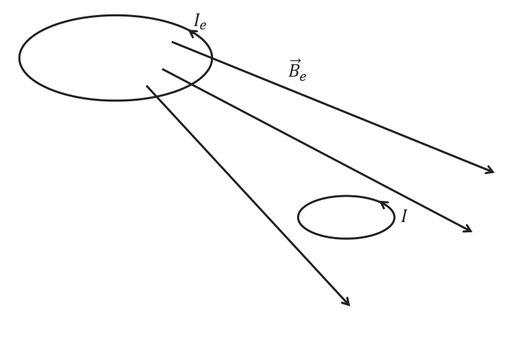

图内文字：$I_e$，$\vec{B}_e$，$I$

$$
\vec{A}(\vec{r}) = \frac{\mu_0}{4\pi} \int \frac{\vec{j}(\vec{r}')}{R} d\tau' \qquad \vec{A}_e(\vec{r}) = \frac{\mu_0}{4\pi} \int \frac{\vec{j}_e(\vec{r}')}{R} d\tau' \tag{5.5.25}
$$

容易证明

$$
\int_\infty (\vec{A}_e \cdot \vec{j}) d\tau = \int_\infty (\vec{A} \cdot \vec{j}_e) d\tau \tag{5.5.26}
$$

因此有

$$
U_{int} = \int_\infty (\vec{A}_e \cdot \vec{j}) d\tau = I \oint \vec{A}_e \cdot d\vec{l} = I \int_S \vec{B}_e \cdot d\vec{S} \tag{5.5.27}
$$

$$
= I\Phi_e = \frac{1}{2}(I\Phi_e + \Phi_e I) \tag{5.5.28}
$$

其中

$$
\Phi_e = \int_S \vec{B}_e \cdot d\vec{S} \qquad \Phi = \int_{S_e} \vec{B} \cdot d\vec{S} \tag{5.5.29}
$$

分别为偶极子线圈中通过的外磁场的磁通量以及源线圈中通过的磁偶极子磁场的磁通量。当源距离目标线圈足够远时，可以将其磁场在线圈所处的空间在原点附近做Taylor展开：

$$
\vec{B}_e(\vec{r}) \approx \vec{B}_e(0) + \vec{r} \cdot \nabla \vec{B}_e(\vec{r})_{\vec{r}=0} + \cdots \tag{5.5.30}
$$

带入上式并只保留第一项：

$$
U_{B,int} = I\vec{B}_e(0) \cdot \int_S d\vec{S} = \vec{m} \cdot \vec{B}_e \tag{5.5.31}
$$

这个形式与电偶极子在电场中的相互作用能 $U_{E,int} = -\vec{p} \cdot \vec{E}_e$ 不同，似乎在磁场中磁偶极子喜欢反平行于外磁场！这显然是不合理的，但问题在哪里？

问题出在对相互作用能以及固有能的定义上面。在电的情形，当电偶极子在电场中发生平动或是转动时，电场的固有能不发生变化，因为偶极子以及产生外电场的电荷分布并没有发生变化（因为这里取的边界条件为电荷体为孤立体系；如果将边界条件取做等势条件，情况会有所不同）。对此类磁场体系则有所不同，当磁偶极子相对外磁场的位形发生变化时，会在线圈中感生电动势。根据Faraday电磁感应定律，偶极子线圈和源线圈中产生的感生电动势分别为

$$
\varepsilon = -\frac{d\Phi_e}{dt} \qquad \varepsilon_e = -\frac{d\Phi}{dt} \tag{5.5.32}
$$

偶极子线圈以及源线圈中的电流会因此被改变，此即是"互感效应"。在这个过程中"固有能"不可能保持恒定不变。若我们要求在变化过程中 $\vec{m}$ 与 $\vec{B}_e$ 均保持不变（亦即 $I$，$I_e$ 不变），则必须由外接电动势做功抵消感生电动势的做功。在一个变动过程中，外电源必须做的功为

$$
\Delta W_e = -\int I\varepsilon dt - \int I_e\varepsilon_e dt = \int I\frac{d\Phi_e}{dt}dt + \int I_e\frac{d\Phi}{dt}dt = I\Delta\Phi_e + I_e\Delta\Phi \tag{5.5.33}
$$

其中 $\Delta\Phi_e$，$\Delta\Phi$ 是 $\Phi_e$，$\Phi$ 在过程中的变化。对比5.5.28，我们发现

$$
\Delta W_e = 2\Delta U_{int} \tag{5.5.34}
$$

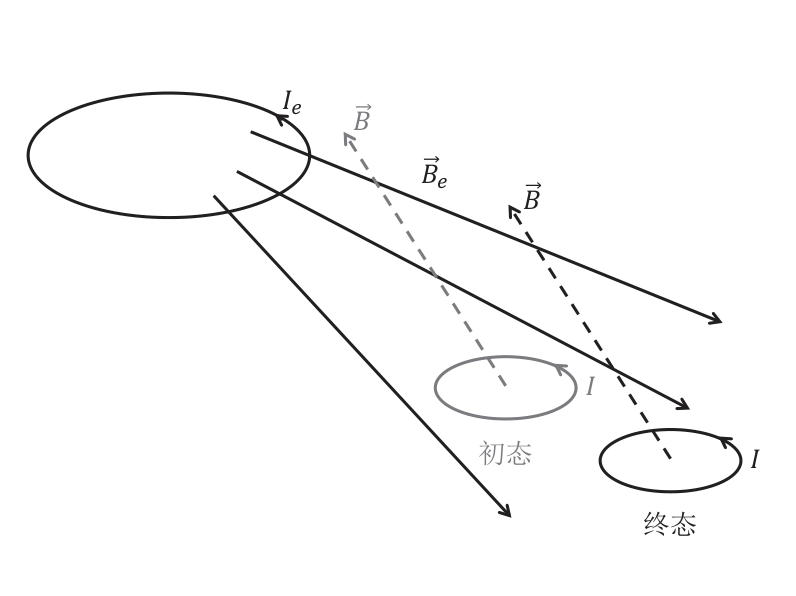

图内文字：$I_e$，$\vec{B}$，$\vec{B}_e$，$I$，初态，终态

现在我们根据能量守恒来看一下保持电流不变条件下的"磁相互作用能"。对比目标线圈与源线圈的位形发生变化前后的初态与终态，因为电流强度一致保持不变，体系的总能量变化包括：

1. 磁场相互作用的变化：$\Delta U_B = \dfrac{1}{2}(I\Delta\Phi_e + I_e\Delta\Phi)$

2. 为了保证 $I_e$，$I$ 维持不变，目标线圈及原线圈所携带的电源必须提供 $\Delta W_e = I\Delta\Phi_e + I_e\Delta\Phi = 2\Delta U_B$ 的能量。因此，将磁场与电源看成一体，电源中少了 $2\Delta U_B$ 的能量。

因此，线圈+电源这个系统总的能量的变化为

$$
\Delta \tilde{U}_{int} = -\vec{m} \cdot \vec{B}_e \tag{5.5.35}
$$

与电偶极子在电场中的势能（相互作用能）完全一样！仿照电偶极子在电场受力及受力矩的推导，我们可推出磁偶极子在磁场中所受的力及力矩分别为

$$
\vec{F}_B = -\nabla \tilde{U}_{int} = \nabla(\vec{m} \cdot \vec{B}) = (\vec{m} \cdot \nabla)\vec{B} \tag{5.5.36}
$$

$$
\vec{\tau}_B = \vec{m} \times \vec{B} \tag{5.5.37}
$$

*Tips：电磁理论最难掌握的就是这一点了：许多物理量必须在注明是在什么条件下得到的。等势条件和孤立导体的条件得到的结论截然不同，同样，等电流条件和等矢势也不相同。*
