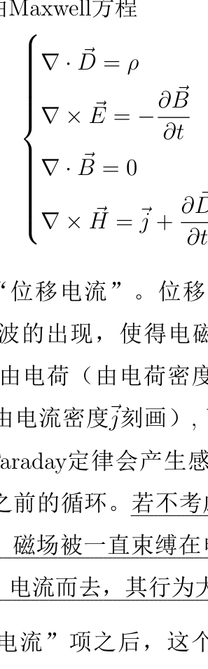
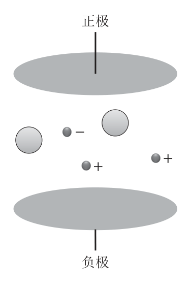
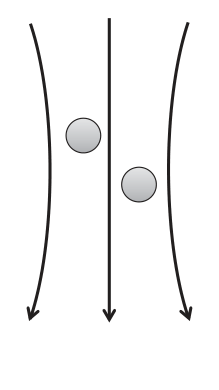
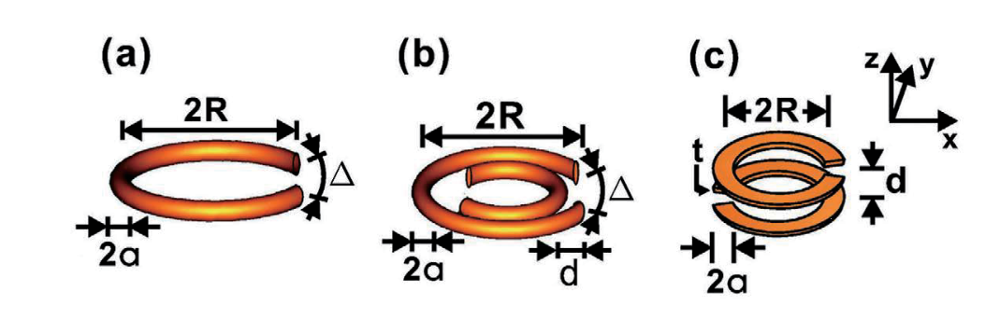
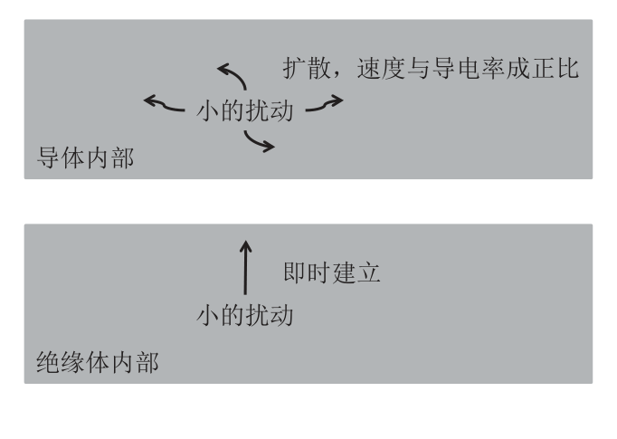
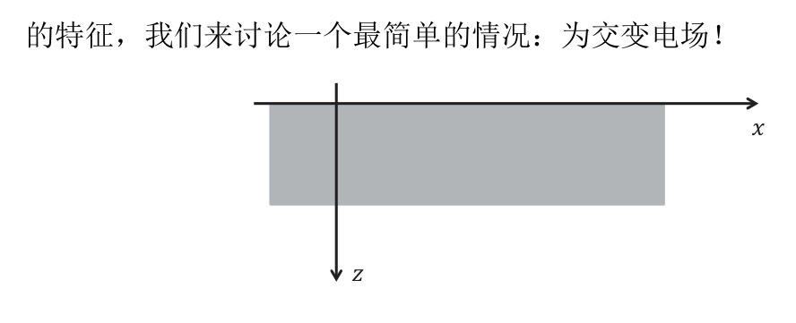
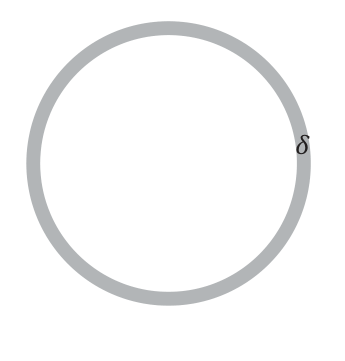

# 第六章 似稳场（准静场）

前面几章中我们研究了静止电荷产生的静电场、稳恒电流产生的静磁场。从现在开始，我们开始研究随时间变化的电磁场。本章研究随时间变化足够缓慢的电磁场，叫做似稳场，又叫“准静场”（Quasi-Static Field），这部分的研究是整个电工学的基础。事实上，对很多实际问题，尽管其中电磁场是随时间变化的，由于其满足“似稳”条件，这些问题可以在似稳近似下求解。这将极大地简化我们的计算，而且使得我们具有非常清晰的物理图像。在引言中我提及的“电磁流变液”，“光镊”等现象其实都属于此类问题。

### 6.1 似稳条件

原则上电磁规律是由Maxwell方程

$$
\begin{cases}
\nabla \cdot \vec{D} = \rho \\[4pt]
\nabla \times \vec{E} = -\dfrac{\partial \vec{B}}{\partial t} \\[4pt]
\nabla \cdot \vec{B} = 0 \\[4pt]
\nabla \times \vec{H} = \vec{j} + \dfrac{\partial \vec{D}}{\partial t}
\end{cases}
\tag{6.1.1}
$$

决定的，其中 $\dfrac{\partial \vec{D}}{\partial t}$ 称为“位移电流”。位移电流的是由Maxwell引入的，其直接后果是导致电磁波的出现，使得电磁能量以电磁场的形式脱离源而存在。如图6.1所示，由电荷（由电荷密度 $\rho$ 刻画）产生的电场 $\vec{E}$ 作用于电荷上时会产生电流（由电流密度 $\vec{j}$ 刻画），而进一步会产生磁场 $\vec{B}$。当磁场 $\vec{B}$ 发生变化时，根据Faraday定律会产生感应电场 $\vec{E}_K$，其又进一步作用于电荷改变电流，回到之前的循环。若不考虑“位移电流”的影响，则这个图像告诉我们：电场、磁场被一直束缚在电荷、电流附近，即使随时间变化，也不会脱离电荷、电流而去，其行为大致与静态的电磁场相仿。

然而考虑了“位移电流”项之后，这个图像被从根上打破了。如图6.1所示，变化的电场不仅可以作用到导线中的载流子上，而且可以因为电场变化通过“位移电流”的效应会导致新的磁场，而磁场的变化导致新的电场，电磁场就这样脱离电荷而去，这个过程叫做“辐射”——将在第九章具体展开阐述。

“电磁辐射”产生的电磁场的主要性质是：假设电荷电流均分布在原点附近，则空间 $\vec{r}$ 位置处产生的场在某一时刻 $t$ 的值 $\vec{E}(\vec{r},t)$，$\vec{B}(\vec{r},t)$ 是由比 $t$ 早一些时候的电流、电荷 $\vec{j}(t'=t-r/c)$，$\rho(\vec{r},t'=t-r/c)$ 决定的，而并不是由 $t$ 时刻的电流和电荷决定，这就是所谓的“推迟效应”。物理上，这非常容易理解，因为某一时刻的电荷、电流产生的影响要经过 $r/c$ 时间的电磁波

的传播才能到达 $\vec{r}$ 点。这样的后果是场和源不再满足瞬时的变化关系，给我们的研究带来了麻烦。对此类问题具体计算时，必须严格求解全空间的波动方程（严格方法在第九章中介绍）。

图内文字：$\vec{E}$；$\vec{B}$ 变化；$\vec{B}$；$\vec{E}$ 变化；$\vec{E}$；$\vec{j}$；$\vec{B}$；产生感应电场；似稳区域，能量交换回路闭合；$\vec{E},\vec{j}$

当某些时空条件满足时，我们可以略去“位移电流”的影响，这样做的后果是使得源和场之间具有瞬时关系（当然是某种近似下的后果）。忽略位移电流后，在每一时刻，其源和场之间的关系类似于静态场的源和场的关系（尽管源和场都可以随时间变化！），因此这种场也称作“似稳场”。对这种场，很多我们针对静态电磁场发展的方法就可以使用，因此“似稳场”的研究具有重要的实际意义。那么，在什么情况下略去“位移电流”才算是合理的？这就是下面我们要讨论的似稳条件。

1. 如果考察的区域是在**导体内部**，其中除位移电流外还有传导电流：

$$
\vec{j}_D = \varepsilon \frac{\partial \vec{E}}{\partial t} \qquad \vec{j}_c = \sigma_c \vec{E}
\tag{6.1.2}
$$

若场是谐变的，即 $\vec{E} = \vec{E}_0 e^{-i\omega t}$，则

$$
\vec{j}_D \sim \varepsilon(-i\omega E) \qquad j_c \sim \sigma_c E
\tag{6.1.3}
$$

忽略位移电流的条件是 $j_D \ll j_c$，即

$$
\omega \ll \omega_\sigma = \frac{\sigma_c}{\varepsilon}
\tag{6.1.4}
$$

因此，似稳场成立的第一个条件是电磁场的变化频率远小于金属的特征频率 $\omega_\sigma = \sigma_c/\varepsilon$。对于好的金属如铜，$\sigma_c \approx 5.9 \times 10^7 \Omega^{-1}\cdot m^{-1}$，$\varepsilon \approx \varepsilon_0 = 8.85 \times 10^{-12} F/m$，其特征频率为 $\omega_\sigma \approx 6.7 \times 10^{18} Hz$。可见光的波长大约处于 $400 \sim 700 nm$ 区间，对应的圆频率大约 $10^{15} Hz$，比特征频率小得多。可见，对于绝大多数金属而言，在很大的频率范围内在金属内部将位移电流忽略都是合理的。

*Tips*：需要指出的是，6.1.4是一个比较松的条件，更严格的考虑将在第七章讲述金属电导率的Drude模型时得到。比如根据6.1.4，似乎在整个可见光频率范围内，金属中的位移电流项都可以忽略——这并不正确。只有在GHz区域，忽略位移电流项才是正确的。

2. 如果考察的区域是导电介质的外部，这时没有传导电流 $j_c$ 可以直接做比较，必须换一个角度思考这个问题。考察真空中 $\vec{r}'$ 处的源 $\vec{j}(\vec{r}',t)$ 在 $\vec{r}$ 处激发的场，假设源是随时间谐变的，则所有物理量均带有 $e^{-i\omega t}$ 的因子。如果不考虑“位移电流”的影响，则根据前面的讨论，不存在“辐射修正”以及“推迟效应”，磁场应由源“瞬时”决定，故

$$
\vec{B}_0(\vec{r},t) = \frac{\mu_0}{4\pi} \int \frac{\vec{j}(\vec{r}',t) \times \vec{R}}{R^3} d\tau'
\tag{6.1.5}
$$

其中，$R = |\vec{r} - \vec{r}'|$。然而考虑“位移电流”的影响后，空间的场是由过去时刻的源 $\vec{j}(\vec{r}', t - R/c) = \vec{j}(\vec{r}')e^{-i\omega(t-R/c)}$ 激发的。在离激发源不太远的地方，考虑“位移电流”导致的辐射效应，磁场大致表示为

$$
\vec{B}(\vec{r},t) \approx \frac{\mu_0}{4\pi} \int \frac{\vec{j}(\vec{r}', t - R/c) \times \vec{R}}{R^3} d\tau' = \vec{B}_0(\vec{r},t) e^{i\omega R/c}
\tag{6.1.6}
$$

（具体证明将在第九章中给出）。假设我们要求场与源之间满足“瞬时关系”，则必须略去这一推迟效应。将上式作Taylor展开：

$$
\vec{B}(\vec{r},t) = \vec{B}_0(\vec{r},t)\left(1 + \frac{i}{c}\omega R + \cdots\right)
\tag{6.1.7}
$$

所以当条件

$$
\frac{\omega}{c}R \ll 1
\tag{6.1.8}
$$

即

$$
R \ll \frac{\lambda}{2\pi}
\tag{6.1.9}
$$

满足时，可以略去推迟项 $e^{i\omega R/c}$ 的影响（将其设为1）。这个过程相当于我们忽略“位移电流”导致的推迟效应，或者说是辐射修正。换句话说，当考察点到源的距离远小于场的波长时，略去位移电流是合理的，这就是似稳场成立的空间条件。例如，对于50Hz的频率，$\lambda = 6000km$；而对于800kHz的频率，$\lambda = 375m$。在低频情况下，如考察区域的线度远小于波长，则此场可看成是似稳场。

6.1.4和6.1.9式就是似稳条件。Quasi-Static Field的概念被人们广泛应用。

1. 比如前面提过的“电流变液”体系，即将一些介电球体放置在一个盛有溶液的器皿里，施加电场可以在很短的时间里将体系由悬浮液状态转变成为固态。然而因为溶液里不可避免地有少量自由电荷，如果施加直流电场将使得这些电荷在电场中运动从而附着在电极上，最后的

结果是使得电场被屏蔽，效率降低。为了避免这种情形，人们常用的方法是施加低频交流电，使得自由电荷不会朝一个方向运动直到极板上将电极屏蔽，而是来回运动。一般施加的交流电频率在1000周以内，对应的电磁波长为30公里，远远大于考虑的体系大小约为1米。此时，所有的物理量都仍然可以用静电场计算，尽管此时其实电场为交变电场！

图内文字：正极；负极

2. “光镊”是另外一个例子。利用激光形成一个空间上的非均匀电磁场分布，原则上这个电磁场当然是随时间剧烈震荡的。然而当纳米尺度的介电颗粒进入此区域时，因为光波波长为400 $\sim$ 700纳米，对此颗粒来说电磁场可以认为是“似稳场”。因此纳米颗粒受到的电磁波的作用力可以假设电磁场是为静电场来计算，这样就极大简化了计算，甚至使得解析计算（尽管是近似的）变成可能。为交变电场！

3. 亚波长金属结构的共振是另一个“似稳场“的杰作！考虑一个复杂的金属结构（如金属开口环，或者金属小球）在电磁波下的响应，严格的计算将非常复杂。然而当金属结构的尺寸远小于电磁波的波长时，

问题可以在“似稳”近似下求解。忽略位移电流项之后，此时结构的许多问题，如共振模式的本征频率及电磁响应等，都可以严格求解。2006年，我和美国Delaware大学的S.T. Chui教授合作，严格解出了金属环状结构的所有本征模式——求解的关键是“准静近似”。为交变电场！

图内文字：(a)；(b)；(c)；$2R$；$2a$；$\Delta$；$d$；$t$；$z$；$y$；$x$

### 6.2 似稳场方程 - 场的扩散

在似稳条件满足时，可以将位移电流项扔掉。此时电磁场由似稳场方

程：

$$
\begin{cases}
\nabla \cdot \vec{D} = \rho \\[4pt]
\nabla \times \vec{E} = -\dfrac{\partial \vec{B}}{\partial t} \\[4pt]
\nabla \cdot \vec{B} = 0 \\[4pt]
\nabla \times \vec{H} = \vec{j}
\end{cases}
\tag{6.2.1}
$$

及本构关系

$$
\vec{B} = \mu \vec{H} \qquad \vec{D} = \varepsilon \vec{E}
\tag{6.2.2}
$$

决定。似稳场方程6.2.1式比静态电磁场只多一个电磁感应方程。若考查导体内部的场，则还需另加一个本构方程：

$$
\vec{j} = \sigma_c \vec{E}
\tag{6.2.3}
$$

在导体内部，当沿电流流动方向导线均匀时，电场（以及电流）的散度为0，因此没有电荷堆积，$\rho = 0$。将6.2.1式改写成 $\vec{E}, \vec{H}$ 的方程：

$$
\begin{cases}
\nabla \cdot \vec{E} = 0 \\[4pt]
\nabla \times \vec{E} = -\mu \dfrac{\partial \vec{H}}{\partial t} \\[4pt]
\nabla \cdot \vec{H} = 0 \\[4pt]
\nabla \times \vec{H} = \sigma_c \vec{E}
\end{cases}
\tag{6.2.4}
$$

由6.2.4式的第二、第四式消去 $\vec{E}$ 则得到关于 $\vec{H}$ 的方程：

$$
\frac{\partial \vec{H}}{\partial t} = \frac{1}{\mu\sigma_c} \nabla^2 \vec{H}
\tag{6.2.5}
$$

同理，由6.2.4式亦可得到关于 $\vec{E}$ 的方程：

$$
\frac{\partial \vec{E}}{\partial t} = \frac{1}{\mu\sigma_c} \nabla^2 \vec{E}
\tag{6.2.6}
$$

6.2.5与6.2.6显示似稳条件下 $\vec{E}$ 和 $\vec{H}$ 的方程是我们熟知的**扩散方程**，$D = 1/\mu\sigma_c$ 是扩散系数。这说明导电介质中的电磁场会扩散，扩散的快慢取决

于电导率$\sigma_c$的大小，$\sigma_c$越大则扩散越慢。对于理想导体，扩散系数为零，而在绝缘体中，场的扩散系数为无限大。比如，在某一时刻在原点进行一下电磁扰动，比如将一个电荷搬来，在绝缘体中，电磁场瞬间被建立起来（或者说从原点扩散出去）；在导体中，这个电场却非常慢才能建立起来（扩散出去），在理想导体中，电场永远也不能被建立起来。为交变电场！

图内文字：扩散，速度与导电率成正比；小的扰动；导体内部；即时建立；小的扰动；绝缘体内部。

*Tips*：电导率越大扩散越小似乎与我们的直觉相违背：因为电导率大则电子对电场的响应大，似乎更容易来传播电磁信号才对？其实恰恰相反。可以通过如下一个简单的Argument来理解这件事情。在导体中做一个小小的扰动，因为导体中有自由电荷，这些自由电荷会重新分布从而屏蔽这种扰动建立的电场，导体的导电性能愈好，这种阻碍效果就愈强。这就是为什么导体的电导率越大，场扩散的速度就越慢。绝缘体中没有任何自由电荷，因此电场在其中建立时没有阻碍——扩散速度无限大。当然，这一切都是在似稳场近似下成立。

### 6.3 导体表面层内的场分布 趋肤效应

建立了似稳场基本方程以后，我们进一步来研究它们所描写的电磁场在导体表面层内的分布特征。变化着的磁场在导体内可以感生电场，电场又引起电流，这种电流称为傅科电流。为了具体说明导体表面层内场分布的特征，我们来讨论一个最简单的情况：为交变电场！

图内文字：$x$；$z$。

设导体占据$z>0$的空间，如图6.6所示。电磁场以一定的频率作简谐变化，即

$$
\begin{cases}
\vec{H} = \vec{H}(\vec{r})e^{-i\omega t} \\
\vec{E} = \vec{E}(\vec{r})e^{-i\omega t}
\end{cases}
\tag{6.3.1}
$$

考虑电流沿着$x$方向流动，则$\vec{E}$只有一个$E_x$非0，且只是$z$的函数。于是，扩散方程6.2.6现在变成

$$
\left(\nabla^2 + i\mu\sigma_c\omega\right)E_x(z) = 0
\tag{6.3.2}
$$

即

$$
\frac{\partial^2}{\partial z^2}E(z) + i\mu\sigma_c\omega E_x(z) = 0
\tag{6.3.3}
$$

一般线性方程的解具有$e^{\pm pz}$的形式。因此，我们令（省略$x$下标）

$$
E(z) = E_0 e^{-pz}
\tag{6.3.4}
$$

将其作为试解代入6.3.3式即有

$$
p^2 = -i\omega\mu\sigma_c
\tag{6.3.5}
$$

解之可得

$$
p = \pm\sqrt{\frac{1}{2}\omega\mu\sigma_c}(1-i) = \pm\alpha(1-i)
\tag{6.3.6}
$$

其中

$$
\alpha = \sqrt{\frac{1}{2}\omega\mu\sigma_c}
\tag{6.3.7}
$$

所以，电场的通解为

$$
\vec{E} = \vec{e}_x\left(E_0 e^{-\alpha(1-i)z} + E_0' e^{\alpha(1-i)z}\right)e^{-i\omega t}
\tag{6.3.8}
$$

考虑到$z\to\infty$时，电场应当收敛，故有$E_0' = 0$。因此，电场的解为

$$
\vec{E} = \vec{e}_x E_0 e^{-\alpha z}e^{-i(\omega t-\alpha z)}
\tag{6.3.9}
$$

6.3.9是数学意义上的解。物理的场应当取数学解的实部，可得

$$
\vec{E} = \vec{e}_x E_0 e^{-\alpha z}\cos(\omega t-\alpha z)
\tag{6.3.10}
$$

（此处设$E_0$为实数）。这个解显示电场随着$z$的增加一边振荡一边指数衰减，在$z = \frac{1}{\alpha}$深度处，场强减少到导体表面（$z = 0$）处的$1/e$，我们称这个深度为趋肤深度，记为$\delta$：

$$
\delta = \frac{1}{\alpha} = \sqrt{\frac{2}{\mu\omega\sigma_c}}
\tag{6.3.11}
$$

6.3.11式表明，频率越高或电导率越大，则场所集中的导体的表向层越薄。理想导体时，$\sigma_c\to\infty$，$\delta\to 0$，场和电流全部趋向于表面。

由前面的讨论可以预料，当频率增加时，导体中的电流都集中到表面，这种电流的“趋肤”现象（Skin Effect）在电子工程技术中经常会碰到。作为一个例子，我们着重讨论圆柱形导线中的电流分布，这是一个非常具有实用价值的问题。

设导线内的电场与导线轴平行，其场满足扩散方程：

$$
\nabla^2\vec{E} - \sigma_c\mu\frac{\partial\vec{E}}{\partial t} = 0
\tag{6.3.12}
$$

由对称性分析，电流和场都是柱对称的，因此取柱坐标系$(\rho,\phi,z)$。只有$z$方向分量，且只依赖于指标$\rho$。令$\vec{E} = \vec{e}_z E(\rho)e^{-i\omega t}$代入方程6.3.12可得

$$
\frac{d^2}{d\rho^2}E(\rho) + \frac{1}{\rho}\frac{d}{d\rho}E(\rho) + k^2 E(\rho) = 0
\tag{6.3.13}
$$

式中$k = \sqrt{i\omega\mu\sigma_c} = \sqrt{\omega\mu\sigma_c/2}(1+i) = \frac{1}{\delta}(1+i)$。这是一个标准的零阶贝塞尔方程。由于$\rho\to 0$时$E(\rho)$必须有限，故方程的解为

$$
E(\rho) = E_0 J_0(k\rho)
\tag{6.3.14}
$$

这里我们这能取$\rho\to 0$是收敛的通解$J_0(k\rho)$，而不取另一个在此极限下不收敛的通解形式。因此，导线中的电流分布为

$$
\vec{j} = \vec{e}_z\sigma_c E_0 J_0(k\rho)e^{-i\omega t}
\tag{6.3.15}
$$

常数$E_0$可由$I_0 = \int \vec{j}\cdot d\vec{S}$定出，$I_0$是总电流。

对以上情况讨论如下：

1. 若$\delta\gg R$，即$k\rho\to 0$，则$J_0(k\rho)\to 1$，所以

$$
\vec{j} \propto \vec{e}_z const.
\tag{6.3.16}
$$

这表示电流是均匀分布的。根据6.3.11，$\delta\gg R$意味着频率很低，或者导电率很差，而同时导线很细。此时趋肤效应很微弱——没有明显的电流趋向导体表面分布的趋势。

2. 若$\delta\ll R$，则在整个考虑范围内$k\rho\gg 0$，此时贝塞尔函数的渐近式为

$$
J_0(k\rho) \to \frac{e^{k\rho}}{\sqrt{k\rho}}\cdot const.
\tag{6.3.17}
$$

因此，取合适的常数，我们可以将电流改写成

$$
\vec{j} = \vec{z}j_0\frac{\exp\left(-\frac{R-\rho}{\delta}\right)}{\sqrt{\rho}}\cos\left(\omega t-\frac{\rho}{\delta}\right)
\tag{6.3.18}
$$

图内文字：$\delta$。

为交变电场！ 上式表明随着$(R-\rho)$的增大（即从表面到柱轴线），电流分布以指数形式衰减，并且$\omega$越大（即$\delta$越小）指数衰减越快，趋肤现象越强；电导率$\sigma_c$越大．趋肤现象也越严重。理想导体情况下，$\sigma_c\to\infty$，$\delta\to 0$，趋肤深度为0，电流只以面电流形式出现。
