# 第七章 电磁波的传播

上一章我们指出，当“准静条件”满足时，可以将“位移电流”项弃掉，亦即将“辐射”项弃除，此时电磁能量完全被束缚在电荷、电流的附近。然而一般情况下位移电流项不能忽略。当“位移电流”加上之后，电场、磁场就不再束缚在电荷、电流的附近，在没有电荷、电流的自由空间也可以因为电磁场之间的相互转化而存在——这种场存在的形式就是“电磁波”，Maxwell方程最伟大的预言！从这一章开始，我们将进入电磁波这一神奇的世界。虽然电磁波原则上是由电荷、电流“辐射”出来的，但我们将“电磁辐射”这部分内容推迟到第九章讨论。在本章及下一章中，我们将假设电磁场已经从“辐射源”中辐射出来了，在这个基础上我们先研究在电磁波在不同介质中是如何传播的。这些电磁媒介包括电介质、金属中以及下一章介绍的波导等。为交变电场！

### 7.1 电磁波在非导电介质中的传播

考虑最简单的情形——在无限大的无源非导电的介质中的电磁波的传

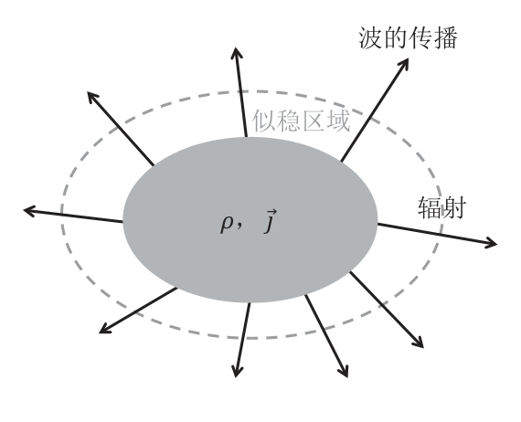

图内文字：波的传播；似稳区域；$\rho,\ \vec{j}$；辐射

播行为。此时麦克斯韦方程组为

$$
\begin{cases}
\nabla\cdot\vec{D}=0\\[4pt]
\nabla\times\vec{E}=-\dfrac{\partial\vec{B}}{\partial t}\\[4pt]
\nabla\cdot\vec{B}=0\\[4pt]
\nabla\times\vec{H}=\dfrac{\partial\vec{D}}{\partial t}
\end{cases}
\tag{7.1.1}
$$

其中 $\vec{D}=\varepsilon\vec{E}$，$\vec{B}=\mu\vec{H}$。假定介质均匀且暂时不考虑色散特性，则 $\varepsilon$，$\mu$ 均为常数（色散介质指的是 $\varepsilon$，$\mu$ 随频率变化的材料，我们随后讲述）。7.1.1 是电磁场耦合在一起的方程，不好求解，下面我们试图得到关于电场的方程。将第二条方程两边作用 $\nabla\times$，则有

$$
-\nabla^{2}\vec{E}+\nabla\left(\nabla\cdot\vec{E}\right)=\nabla\times\left(\nabla\times\vec{E}\right)=-\frac{\partial}{\partial t}\nabla\times\vec{B}=-\mu\frac{\partial}{\partial t}\left(\varepsilon\frac{\partial}{\partial t}\vec{E}\right)
\tag{7.1.2}
$$

根据第一条方程，有 $\nabla\cdot\vec{E}=0$，则电场满足的方程为

$$
\left(\nabla^{2}-\frac{1}{v^{2}}\frac{\partial^{2}}{\partial t^{2}}\right)\vec{E}=0
\tag{7.1.3}
$$

式中

$$
v^{2}=\frac{1}{\varepsilon\mu}
\tag{7.1.4}
$$

基于同样的数学，我们发现磁场满足一样的方程：

$$
\left(\nabla^{2}-\frac{1}{v^{2}}\frac{\partial^{2}}{\partial t^{2}}\right)\vec{B}=0
\tag{7.1.5}
$$

7.1.3 和 7.1.5 式是标准的波动方程。与大家在力学中学到的绳波所满足的方程：

$$
\left(\frac{\partial^{2}}{\partial x^{2}}-\frac{1}{v^{2}}\frac{\partial^{2}}{\partial t^{2}}\right)U(x)=0
\tag{7.1.6}
$$

相比，这里不同是：

1. 场量是矢量；

2. 传播方向不仅仅是向 $x$ 方向。

这给我们计算带来了一些麻烦，但设定传播方向后，每一个场的分量都满足与绳波一样的标量方程。考虑到 7.1.6 的解为 $U(x)=A\cos(kx-\omega t+\varphi)$，推广到电磁波的情形，则 7.1.3 和 7.1.5 的试解可以写为

$$
\left(\begin{array}{c}\vec{E}(\vec{r},t)\\[4pt] \vec{B}(\vec{r},t)\end{array}\right)=\left(\begin{array}{c}\vec{E}_{0}\\[4pt] \vec{B}_{0}\end{array}\right)\cos\left(\vec{k}\cdot\vec{r}-\omega t+\varphi\right)
\tag{7.1.7}
$$

其中 $\vec{E}_{0}$，$\vec{B}_{0}$，$\vec{k}$，$\omega$，$\varphi$ 均为常数。代入 7.1.3 及 7.1.5 后发现试解 7.1.7 满足方程，但 $k$，$\omega$ 之间需满足关系式

$$
-k^{2}+\frac{\omega^{2}}{v^{2}}=0
\tag{7.1.8}
$$

整理可得

$$
k^{2}=\frac{\omega^{2}}{v^{2}}\Rightarrow k=\pm\omega\sqrt{\varepsilon\mu}
\tag{7.1.9}
$$

7.1.9 式是电磁波传播的**色散关系**，对波的传播性质有重要意义。

**注：**

1. 对任何波动方程，我们首先要问的是它的色散关系（注意不要和本构关系混淆！），亦即，频率 $\omega$（时域振动性质）与波矢 $k$（空间域的

振动性质）之间的关系。这是波的大部分性质的基础，若色散关系相同，即使不同的波（如绳波和电磁波）也具有基本相似的性质。往大了说，色散关系描述的其实是能量（对应于 $\omega$）和动量（对应 $k$）之间的关系！

2. 7.1.7 式只是自由空间波动方程的一种试解，你能想出其它形式的试解吗？

我们对得到的电磁波的解讨论如下：

1. 7.1.7 式中的 $\vec{E}_{0}$，$\vec{B}_{0}$ 代表波动的振幅，$\cos\left(\vec{k}\cdot\vec{r}-\omega t+\varphi\right)$ 称为振动的相位。在给定时刻，方程

$$
\vec{k}\cdot\vec{r}=const.
\tag{7.1.10}
$$

所定义的曲面上相位相等，波场 $\vec{E}$，$\vec{B}$ 也就相同，这个曲面叫作**等相位面**。显然满足 7.1.10 所定义的曲面为一平面，其垂直于 $\vec{k}$，故 7.1.7 所描述的波称为**平面波**。还可能有将试解 7.1.7 写成其他形式，如球面波或者是柱面波，分别对应的等相位面为球面或者是柱面。

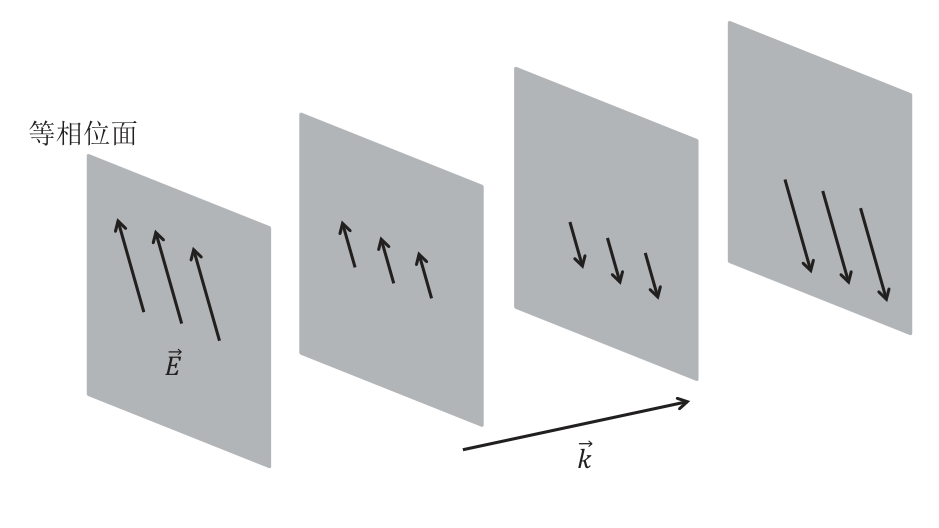

图内文字：等相位面；$\vec{E}$；$\vec{k}$

2. 波长 $\lambda$ 的定义为两个相位差为 $2\pi$ 的等相位面之间的距离——在第二个等相面上，场量经过一个周期的振动回到第 1 个等相面上的值。显然 $\lambda$ 由方程

$$
k\cdot\lambda=2\pi
\tag{7.1.11}
$$

确定，即

$$
k=\frac{2\pi}{\lambda}
\tag{7.1.12}
$$

$\vec{k}$ 被称为波矢量。

3. **波速**

等相位面的传播速度被称为波的**相速度**。设 $t$ 时刻等相位面在 $r$ 处，$t+\Delta t$ 时刻该等相位面垂直于 $\vec{k}$ 运动到 $r+\Delta r$ 的位置，则有

$$
\vec{k}\cdot\vec{r}-\omega t+\varphi=const.=k\cdot(r+\Delta r)-\omega(t+\Delta t)+\varphi
\tag{7.1.13}
$$

故相速度为

$$
v_{p}=\frac{\Delta r}{\Delta t}=\omega/k
\tag{7.1.14}
$$

或

$$
v_{p}=\frac{1}{\sqrt{\varepsilon\mu}}
\tag{7.1.15}
$$

7.1.15 式即是平面电磁波传播的速度，它与介质的性质有关，真空中有 $\varepsilon=\varepsilon_{0}$，$\mu=\mu_{0}$，故 $v_{p}=1/\sqrt{\varepsilon_{0}\mu_{0}}=c$ 为光速，介质中的波速 $v_{p}=1/\sqrt{\varepsilon\mu}=c/\sqrt{\varepsilon_{r}\mu_{r}}=c/n$，而 $n=\sqrt{\varepsilon_{r}\mu_{r}}$ 被定义为材料的折射率。

注：折射率的更基本的定义应当为 $n=\sqrt{\varepsilon_{r}}\cdot\sqrt{\mu_{r}}$，因为它对 $\varepsilon$，$\mu$ 分别大于、小于 0 四种情况均正确。关于 $\varepsilon$，$\mu$ 均小于 0 的情况我们在后面还会分析。

4. **频率/周期**

相邻两次振动之间的时间为周期 $T$，单位时间内的振动次数为频率 $f$。在一个确定的位置处，场量随时间振荡，$T$ 是两个波峰之间的时间差。容易求得

$$
\omega T=2\pi\Rightarrow T=2\pi/\omega
\tag{7.1.16}
$$

则振动频率为

$$
f=\frac{1}{T}=\frac{\omega}{2\pi}
\tag{7.1.17}
$$

经常把 $\omega=2\pi f$ 称为**角（圆）频率**，把 $f$ 称为线频率。

5. 为了运算方便，常常把平面波写成复数形式，即

$$
\left(\begin{array}{c}\vec{E}(\vec{r},t)\\[4pt] \vec{B}(\vec{r},t)\end{array}\right)=\left(\begin{array}{c}\vec{E}_{0}\\[4pt] \vec{B}_{0}\end{array}\right)e^{i\left(\vec{k}\cdot\vec{r}-\omega t+\varphi\right)}
\tag{7.1.18}
$$

7.1.18 式仍然是波动方程的**数学解**，但因为场量必须为实数，我们应当只取其实部作为**物理解**。然而写成复数形式对许多计算要简便很多，因此在实际运算时经常采用。但应当强调指出的是：只有实场才是有物理意义的场，复场只是为了计算方便！而之所以可以用复场计算是因为处理的方程 7.1.3 与 7.1.5 是线性方程！有时把常数因子 $e^{i\varphi}$ 并入振幅中，则

$$
\left(\begin{array}{c}\vec{E}(\vec{r},t)\\[4pt] \vec{B}(\vec{r},t)\end{array}\right)=\left(\begin{array}{c}\vec{E}_{0}\\[4pt] \vec{B}_{0}\end{array}\right)e^{i\left(\vec{k}\cdot\vec{r}-\omega t\right)}
\tag{7.1.19}
$$

注意，这时振幅 $\left(\begin{array}{c}\vec{E}_{0}\\[4pt] \vec{B}_{0}\end{array}\right)$ 已是复数。反之，当电磁波的振幅是复数时，它表示电磁波有相位因子。根据色散关系 7.1.9 可知，$k$ 取正负均可。因此，

$$
\vec{E}=\vec{E}_{0}e^{i\left(-\vec{k}\cdot\vec{r}-\omega t\right)}
\tag{7.1.20}
$$

也是波动方程的解。非常容易可以证明，7.1.20 是电磁波沿反方向传播的解。

注：你会发现 7.1.20 式与 $\vec{E}=\vec{E}_{0}e^{i\left(\vec{k}\cdot\vec{r}+\omega t\right)}$ 给出一样的实部，因而它们 2 个其实对应完全一样的电磁波。对波的时间变化项，在物理 Community 中，我们规定为 $e^{-i\omega t}$，而 IEEE 的 Community 规定为 $e^{i\omega t}$。

6. 因为 7.1.3 和 7.1.5 式是由麦克斯韦方程约化而来的，约化过程中方程从一阶微分变成了二阶微分，因此它对应的解未必全都是原始 Maxwell 方程的解。我们需要将所得的解 7.1.18 重新带回到原始 Maxwell 方程做检查。带回 Maxwell 方程组中的第 1，3 两条方程，我们发现场量必须满足

$$
\vec{k}\cdot\vec{E}_{0}=0\qquad\vec{k}\cdot\vec{B}_{0}=0
\tag{7.1.21}
$$

这表明，电磁场振动的方向与传播方向 $\vec{k}$ 相互垂直（在等相面内），亦即——**电磁波是横波**。同时带入方程

$$
\nabla\times\vec{E}=-\frac{\partial}{\partial t}\vec{B}
\tag{7.1.22}
$$

得

$$
\vec{k}\times\vec{E}_{0}=\omega\vec{B}_{0}
\tag{7.1.23}
$$

上式说明 $\vec{E}$，$\vec{B}$ 间不独立。带入第四条方程 $\nabla\times\vec{H}=\varepsilon\dfrac{\partial}{\partial t}\vec{E}$ 可得到

$$
\vec{k}\times\vec{H}=-\varepsilon\omega\vec{E}\Rightarrow\vec{k}\times\vec{B}_{0}=-\varepsilon\mu\omega\vec{E}_{0}
\tag{7.1.24}
$$

综合 7.1.23 与 7.1.24 得到结论：$\vec{E}$，$\vec{B}$ 和 $\vec{k}$ 组成右手定则，且 $\vec{E}$，$\vec{B}$ 之间的模量满足

$$
|E_{0}|=\omega|B_{0}|/k=v|B_{0}|=c|B_{0}|
\tag{7.1.25}
$$

后面一个等式在真空中成立。进一步，可以得到另一个很重要的关系式

$$
|E_{0}|=v\mu|H_{0}|=\frac{\mu}{\sqrt{\varepsilon\mu}}|H_{0}|=\sqrt{\frac{\mu}{\varepsilon}}|H_{0}|=Z|H_{0}|
\tag{7.1.26}
$$

其中 $Z=\sqrt{\dfrac{\mu}{\varepsilon}}$ 称为**阻抗**，具有电阻的量纲，是一个描述电磁介质中电磁波传播时场量比例的重要物理量。**折射率和阻抗**是刻画电磁介质特性的最重要的两个量，他们各有各自不同的物理涵义，在确定电磁波的特性方面起着不同的作用。

注：在静电、静磁条件下电磁波的电、磁特性是分开的（分别由 $\varepsilon$，$\mu$ 独立决定），但电磁波将电场、磁场耦合在一起，因此此时需要用 $n$，$Z$ 两个参数确定。

7. **平面波的能流**

电磁场的能流定义为

$$
\vec{S}_{P}=\vec{E}\times\vec{H}
\tag{7.1.27}
$$

注意真实的场是 7.1.7，不能将复数场带入 7.1.27 式后再取实部，因为此运算是**非线性运算**。故 7.1.7 式中的 $\vec{E}$，$\vec{H}$ 都应取实部之后再代入

$$
\vec{S}_{P}(\vec{r},t)=\mathrm{Re}\left(\vec{E}\right)\times\mathrm{Re}\left(\vec{H}\right)
\tag{7.1.28}
$$

上式表示的是能流的瞬时值。当电磁场随时间变化时，通常瞬时值没有意义，更关心的对能流的**时间平均值**。对能流在一个周期内做时间平均，得

$$
\left\langle\vec{S}_{P}\right\rangle=\left\langle\mathrm{Re}\left(\vec{E}\right)\times\mathrm{Re}\left(\vec{H}\right)\right\rangle=\frac{1}{T}=\int_{0}^{T}\vec{S}_{P}dt
\tag{7.1.29}
$$

利用公式

$$
\left\langle\mathrm{Re}\left(\vec{E}\right)\times\mathrm{Re}\left(\vec{H}\right)\right\rangle=\frac{1}{2}\mathrm{Re}\left(\vec{E}\times\vec{H}^{*}\right)
\tag{7.1.30}
$$

（证明见习题），得到

$$
\left\langle\vec{S}_{P}\right\rangle=\frac{1}{2}Z\cdot H_{0}^{2}\hat{k}=\frac{1}{2Z}E_{0}^{2}\hat{k}
\tag{7.1.31}
$$

同理，能量密度的时间平均值为

$$
\bar{u}(\vec{r})=\left\langle u(\vec{r},t)\right\rangle=\left\langle\frac{1}{2}\varepsilon\vec{E}\cdot\vec{E}+\frac{1}{2}\mu\vec{H}\cdot\vec{H}\right\rangle=\frac{\varepsilon}{4}E_{0}^{2}+\frac{\mu}{4}H_{0}^{2}=\frac{\varepsilon}{2}E_{0}^{2}
\tag{7.1.32}
$$

非常容易从7.1.32中证明 $\bar u_E = \frac{\varepsilon}{4}E_0^2 = \frac{\mu}{4}H_0^2 = \bar u_B$，亦即，平面电磁波电场携带的能量和磁场携带的能量相等！把7.1.31和7.1.32式比较，则得

$$
\vec S_P(\vec r) = \hat k \bar u(\vec r)\frac{1}{\varepsilon Z} = \hat k \bar u(\vec r) v = \bar u(\vec r)\vec v \tag{7.1.33}
$$

7.1.33式有着清晰的物理图像——能流即为单位时间通过单位面积的能量，单位时间内电磁波传输 $l = v\times 1$ 的距离，因此单位时间内在体积为 $\Omega = l\times 1 = v\times 1\times 1$ 内的电磁波能量可以通过单位面积。故，能流=能量×速度。这与电流密度=电荷密度×速度的物理来源完全一致。平面电磁波在非导电介质中传播的情况如图所示。一个重要的特征是 $\vec E$ 与 $\vec B$ 为同相位变化的，即它们同时达到最大值，又同时达到最小值。

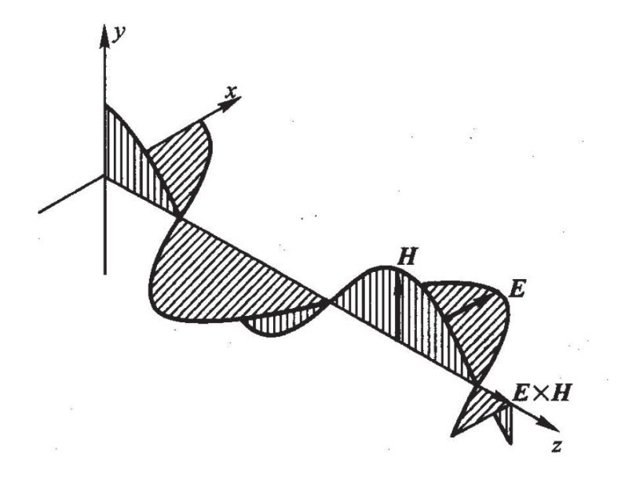

图内文字：$y$，$x$，$z$，$H$，$E$，$\vec E\times\vec H$

### 7.2 波的偏振和偏振矢量

电磁波是矢量波，传播和偏振是其最重要的两个特征。上一节我们

主要学习了波在线性无色散均匀媒质中的传播特性，本节中我们将重点学习波的偏振特性。让我们仔细研究横波条件7.1.21。对确定的传播方向 $\vec k$，7.1.21式告诉我们电矢量 $\vec E_0$ 必须在与其垂直的平面内。为确定起见，假设传播方向 $\vec k \parallel \hat z$，则这个平面为 $xy$ 平面，有2个相互垂直的单位矢量，$\vec e_x$，$\vec e_y$（其它 $\vec k$ 方向可以类似处理）。注意，当我们取了复数场的表达式之后，原则上 $\vec E_0$ 可以是一个复矢量——其每个分量均可取复数且可以由不同的相位。因此，$\vec E_0$ 的最一般形式为

$$
\vec E_0 = \vec e_x E_{x,0} + \vec e_y E_{y,0} = \vec e_x |E_{x,0}| e^{i\phi_x} + \vec e_y |E_{y,0}| e^{i\phi_y} \tag{7.2.1}
$$

将其带入复场表达式 $\vec E(\vec r,t) = \vec E_0 e^{i(\vec k\cdot\vec r-\omega t)}$，再取实部，我们得到

$$
E_x(z,t) = |E_{x,0}|\cos(kz-\omega t+\phi_x) \tag{7.2.2}
$$

$$
E_y(z,t) = |E_{y,0}|\cos(kz-\omega t+\phi_y) \tag{7.2.3}
$$

显然，场随时间的振荡行为由四个参量：$E_{x,0}$，$E_{y,0}$，$\phi_x$，$\phi_y$ 确定。由7.2.3与7.2.3出发，在四个参量满足不同条件时，可以得到几种典型的偏振状态。

#### 7.2.1 线偏振

线偏振是最简单的情形。当 $\phi_x = \phi_y = \phi$ 时，电场随时间演化为

$$
E_x(z,t) = |E_{x,0}|\cos(kz-\omega t+\phi) \tag{7.2.4}
$$

$$
E_y(z,t) = |E_{y,0}|\cos(kz-\omega t+\phi) \tag{7.2.5}
$$

在任意一个确定的波阵面上（如取 $z=0$ 的 $xy$ 平面），电场只在一个方向上随时间来回振动，因此这种偏振状态称为线偏振。

#### 7.2.2 椭圆偏振

在最一般情况下，即不对四个参量施加任何限制，则波的偏振状态都

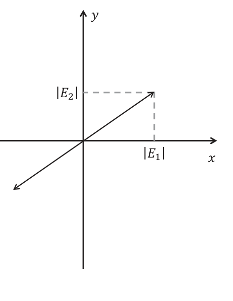

图内文字：$x$，$y$，$|E_1|$，$|E_2|$

是椭圆偏振。考虑一个具体的例子：$\phi_x - \phi_y = \pi/2$，$|E_{x,0}| > |E_{y,0}|$，则

$$
E_x(z,t) = -|E_{x,0}|\sin(kz-\omega t+\phi_y) \tag{7.2.6}
$$

$$
E_y(z,t) = |E_{y,0}|\cos(kz-\omega t+\phi_y) \tag{7.2.7}
$$

在任意一个确定的波阵面上，随着时间的演化，$\vec E$ 场的端点描出一个半长轴为 $|E_{x,0}|$，半短轴为 $|E_{y,0}|$ 的椭圆，故这种偏振状态称为椭圆偏振。若 $\phi_x - \phi_y \neq \pi/2$，则椭圆的对称轴（长短轴）产生了一个转动，但偏振状态仍然是椭圆偏振。

#### 7.2.3 圆偏振

进一步，当 $|E_{x,0}| = |E_{y,0}| = A$，$\phi_x - \phi_y = \pm\pi/2$ 时，电场分量为

$$
E_x(z,t) = \mp A\sin(kz-\omega t+\phi_y) \tag{7.2.8}
$$

$$
E_y(z,t) = A\cos(kz-\omega t+\phi_y) \tag{7.2.9}
$$

对这种波，在任一波阵面上，$\vec E$ 的端点随时间的演化描出一个半径为 $A$ 的圆，故称为圆偏振。进一步考虑两种情况：

**右旋圆偏振**

$\phi_x - \phi_y = \pi/2$ 时，7.2.8与7.2.9式描述的是电场矢量顺时针旋转，称为右旋圆偏振。此时7.2.8与7.2.9可以重写为

$$
\vec E_0 = \sqrt{2}A e^{i\phi_1}\vec e_{right} \tag{7.2.10}
$$

其中

$$
\vec e_{right} = (\vec e_x - i\vec e_y)/\sqrt{2} \tag{7.2.11}
$$

就是右旋偏振的单位矢量。

**左旋圆偏振**

同理，$\phi_x - \phi_y = -\pi/2$ 时为左旋圆偏振。偏振态的单位矢量为

$$
\vec e_{left} = (\vec e_x + i\vec e_y)/\sqrt{2} \tag{7.2.12}
$$

**讨论：**

1. 看上去左右旋光的定义和我们的常识正好相反，似乎以“$\vec k$ 的方向与 $\vec E$ 的旋转方向成左/右手螺旋”来定义左右旋光会更容易使人习惯。这里的原因比较复杂，一个可能的解释是历史上人们根据在某一个给定的时刻看到的电场由远及近在空间（$z$）传播而来时的旋转来定义的（参考课堂演示的偏振光动画）。

2. 在目前Metamaterial的研究中，一个热门课题就是如何利用Metamaterial来调控光波的偏振状态，比如实现由线偏振到圆偏振、椭圆

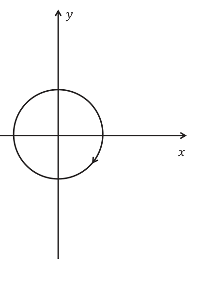

图内文字：$x$，$y$

偏振的转化，或者是两个垂直方向的线偏振光的相互转化。有兴趣的同学参考 “J. M. Hao, et. al., Phys. Rev. Lett.99, 063908 (2007), Wujiong Sun, et al, Opt. Lett. 36 927 (2011)”。

### 7.3 金属的等效介电常数 - Drude模型

前面两节我们研究了电磁波在最简单的电磁介质（线性、均匀、局域、各向同性、无色散，本构关系为 $\vec D = \varepsilon\vec E$，$\vec B = \mu\vec H$）中的传播行为。下面我们将开始研究导电介质中的电磁波特性。对任何一种新的电磁介质，在研究其电磁波传播特性之前，都要首先知道这种电磁介质的“本构关系”，不然，Maxwell方程无法求解。事实上，这个世界之所以如此“色彩缤纷”，正是因为我们有各种具有不同的“本构关系”的电磁介质！本节中，我们将仔细探讨导电介质的本构关系——你们会发现导电介质与一般电介质非常的不同。

#### 7.3.1 色散介质的本构关系

上次课我们学习了电磁波在真空以及均匀各向同性非色散的电磁介质中的行为，这两类介质的特点是，$\varepsilon_r$，$\mu_r$ 均大于0，且不依赖于频率。从物理上讲，这种介质对电磁场的响应是“局域”以及“瞬时”的，即

$$
\vec D(\vec r,t) = \varepsilon\vec E(\vec r,t) \qquad \vec H(\vec r,t) = \mu^{-1}\vec B(\vec r,t) \tag{7.3.1}
$$

亦即，此处、此时的电磁扰动（由 $\vec E(\vec r,t)$，$\vec B(\vec r,t)$ 决定）只会引发此处、此时的电磁相响应 $\vec P(\vec r,t)$，$\vec M(\vec r,t)$（进一步，$\vec D(\vec r,t)$，$\vec H(\vec r,t)$）。然而一般来讲，材料中的电荷运动行为非常复杂，因此最后本构关系也非常复杂，“局域+瞬时”仅仅是一种理想情形，通常只是材料的真实响应在长波和低频下的近似。在第一章中我们已经指出，一般情况下材料的响应为（最一般的线性响应的形式）：

$$
\vec D(\vec r,t) = \int \varepsilon(\vec r-\vec r', t-t')\vec E(\vec r',t')d\vec r'dt' \tag{7.3.2}
$$

$$
\vec H(\vec r,t) = \int \mu^{-1}(\vec r-\vec r', t-t')\vec B(\vec r',t')d\vec r'dt' \tag{7.3.3}
$$

这意味着在任何时刻 $t'$ 任何地点 $\vec r'$ 给体系一个扰动 $\vec E$，体系都有可能在时刻 $t$（根据因果关系，$t > t'$）地点 $\vec r$ 产生一个响应 $\vec D$。这当然使得我们求解Maxwell方程变得非常复杂。注意，响应函数 $\varepsilon$ 只依赖于距离差 $\vec r-\vec r'$ 和时间差 $t-t'$ 是体系的空间和时间平移不变性的要求。通常我们忽略“空间非局域效应”，即假设体系的响应在空间上为局域的。进一步，如果我们只考虑频率确定为 $\omega$ 的一支电磁波在此介质中运动，设复场 $\vec E(\vec r,t) = \vec E(\vec r)e^{-i\omega t}$，代入7.3.1式可得

$$
\vec D(\vec r,t) = \int \varepsilon(t-t')\vec E(\vec r)e^{-i\omega t'}dt' = \varepsilon(\omega)\vec E(\vec r)e^{-i\omega t} \tag{7.3.4}
$$

其中

$$
\varepsilon(\omega) = \int \varepsilon(t-t')e^{-i\omega(t'-t)}dt' = \int \varepsilon(\tilde t)e^{i\omega\tilde t}d\tilde t \tag{7.3.5}
$$

是时域响应函数的Fourier变换后的频域形式。因此本构关系此时变成（假设所有物理量均携带 $e^{-i\omega t}$ 的时间变化因子）

$$
\vec D(\vec r) = \varepsilon(\omega)\vec E(\vec r) \tag{7.3.6}
$$

$$
\vec B(\vec r) = \mu(\omega)\vec H(\vec r) \tag{7.3.7}
$$

因此，无论再复杂的电磁介质，当其中的电磁波为单频时，其本构关系变成与常规电介质一样的（当然是在线性响应的前提下）。只不过，此种情形下 $\varepsilon$，$\mu$ 的数值依赖于频率值，这种行为我们称为“色散”，$\varepsilon$，$\mu$ 依赖于频率的电磁介质我们称为“色散”介质。

我们可以把这个情况类比于一个秋千。当我们对一个秋千在 $t$ 时刻给它一个推动力，它未必立即产生反应。但是，当我们对秋千施加一个随时间谐变的力，最终，这个秋千一定会以这个频率跟随外力振动，无论最初多么不情愿。

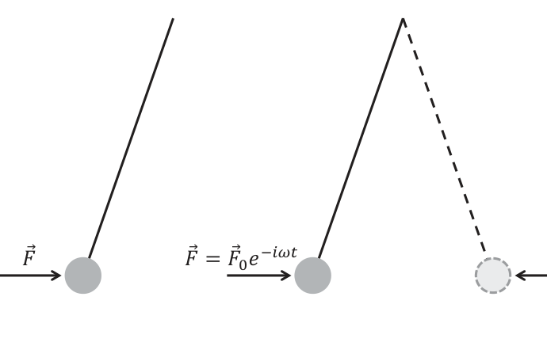

图内文字：$\vec F$，$\vec F = \vec F_0 e^{-i\omega t}$

金属（更广义讲是导电介质）是非常重要的一类电磁介质。静态时金属的本构关系就是欧姆定律 $\vec j = \sigma_c\vec E$。当外电场随时间谐变时，即 $\vec E(\vec r,t) = \vec E(\vec r)e^{-i\omega t}$，类似受迫振动，电流和电位移矢量 $\vec j$，$\vec D$ 也带有时间因子 $e^{-i\omega t}$，即 $\vec j(\vec r,t) = \vec j(\vec r)e^{-i\omega t}$，$\vec D(\vec r,t) = \vec D(\vec r)e^{-i\omega t}$。此时，可定义频域的

电导率 $\sigma(\omega)$ 和介电函数 $\varepsilon(\omega)$ 为

$$
\vec j(\vec r) = \sigma(\omega)\vec E(\vec r) \qquad \vec D(\vec r) = \varepsilon(\omega)\vec E(\vec r) \tag{7.3.8}
$$

原则上讲，$\sigma(\omega)$，$\varepsilon(\omega)$ 的严格求解应当借助于量子力学。对良导体，通常可以把体系看作电子自由地在晶格正离子组成的背景中运动——此既是自由电子气模型，也就是高能物理中所言的等离子体模型。在常温下，我们可以用经典理论借助等离子体模型来求解金属的 $\sigma(\omega)$，$\varepsilon(\omega)$。

#### 7.3.2 金属的有效电导率

当有一束单频的电磁波施加在等离子体中时，空间将有电场 $\vec E(\vec r,t) = \vec E(\vec r)e^{-i\omega t}$ 存在，则电子将受到电场力 $e\vec E$。同时，电子运动时将受到其他粒子（晶格亦即声子，杂质等）的散射而丢失能量及动量。描述这种散射力的最简单的模型是“迟逾时间近似”，即散射力可写成

$$
\vec F_{sca} = -\frac{m\vec v}{\tau} \tag{7.3.9}
$$

这个式子的物理意义是：电子平均 $\tau$ 时间受到一次“异种粒子”的散射而丢失其所有动量。因此，电子的运动方程为

$$
m\frac{d\vec v}{dt} = \vec F = e\vec E - \frac{m\vec v}{\tau} \tag{7.3.10}
$$

在长波近似下，在电子来回运动的区间内可以近似认为电场不发生显著变化：$E(\vec r) \sim \vec E_0$。显然电子将在单频外场力的作用下做“受迫振动”。将电子运动的试解 $\vec v(t) = \vec v_0 e^{-i\omega t}$ 代入7.3.10可得

$$
\vec v_0 = \frac{-e\vec E_0}{im(\omega + i/\tau)} \tag{7.3.11}
$$

因此，电子的运动速度为

$$
\vec v(t) = \vec v_0 e^{-i\omega t} = \frac{-e\vec E_0 e^{-i\omega t}}{im(\omega + i/\tau)} \tag{7.3.12}
$$

### 7.3. 金属的等效介电常数 - DRUDE模型

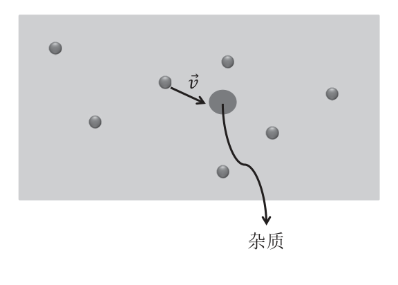
图内文字：杂质

与之前一样，这里速度的复数形式只是为计算方便（基础是方程是线性方程！），真正有物理意义的是场量的实部。根据电流密度的定义，我们发现

$$
\vec{j}(\vec{r},t) = n_e e \vec{v}(\vec{r},t) = -\frac{n_e e^2}{i m (\omega + i/\tau)} \vec{E}(\vec{r},t) \tag{7.3.13}
$$

式中 $n_e$ 为单位体积内的电子数目。将7.3.13与7.3.8对比，可得电导率为

$$
\sigma(\omega) = -\frac{n_e e^2}{i m (\omega + i/\tau)} \tag{7.3.14}
$$

对此做如下讨论：

1. 当 $\omega \to 0$ 时，上式应当回到直流情况下金属的电导率 $\sigma_c$。将7.3.14取 $\omega \to 0$ 的极限，有 $\sigma_c = \dfrac{n_e e^2}{m}\tau$。这就是迟豫时间近似下金属直流电导率的结果，故，人们常用金属的直流电导率的实验值来反过来确定参数 $\tau$。

2. 复数形式电导率不能只取实部！其实部、虚部都有明确的物理意义！对场量（如 $\vec{E}$，$\vec{j}$，$\vec{v}$）我们才取其实部讨论，对电导率这个中间产物我们不可以这样做。事实上，Fourier分析表明只有在复场表示下（即以 $e^{-i\omega t}$ 为基）才可以定义响应函数（如 $\varepsilon(\omega)$，$\mu(\omega)$，$\sigma(\omega)$ 等，参考7.3.4-7.3.7的推导），对实场形式（$\cos(\omega t)$，$\sin(\omega t)$）

无法得到线性正比关系，因此无法定义响应函数！将复电导率写成 $\sigma(\omega) = \operatorname{Re}(\sigma(\omega)) + i\operatorname{Im}(\sigma(\omega))$，可以证明实部对应着实际的能量耗散，但虚部并不对应能量耗散——这与直流电导率有着本质的不同！

3. 对一般良导体我们发现 $\tau \sim 10^{-14}s$，因此：

   (a) 在GHz以下的频段（微波），$1/\tau \gg \omega$，此时 $\sigma(\omega) \approx \sigma_c$，即有效电导率就是静态时的电导率。这里的原因是电子碰到一次散射的平均时间 $\tau$ 远小于电场发生变化的时间间隔 $T \sim \dfrac{1}{\omega}$，电场还没有发生显著变化电子已经与杂质碰撞了成千上万次。因此这种条件下电导率与直流时相比并没有什么明显不同。

   (b) 在可见光频段，$1/\tau \ll \omega \sim 10^{15}s^{-1}$，此时 $\sigma(\omega) \approx i\dfrac{n_e e^2}{m\omega}$，亦即，复数电导率的实部（对应耗散部分）远小于虚部（非能量耗散部分）。这里的物理图像是，电子在高频电场的作用下来回运动，还没有碰到散射（需要费时 $\sim \tau$）就已经折返。因此，此时电子的行为与静态时极不相同，其主要行为是与电场相互交换能量（表现为电导率呈现虚部，电场不对电流做功），而不是与杂质碰撞耗散能量。

### 7.3.3 金属有效介电函数

有了金属的有效电导率，我们可以进一步导出其**有效介电函数**。根据Maxwell方程组的第4条方程，在单频条件下，

$$
\nabla \times \vec{H} = \vec{j} + \varepsilon_0 \frac{\partial \vec{E}}{\partial t} \Rightarrow \nabla \times \vec{H} = \left[\sigma(\omega) - i\omega\varepsilon_0\right] \vec{E} \tag{7.3.15}
$$

一般在静电、静磁条件下，我们把金属中的电流作为独立于金属的“自由电流”来处理，也就是说，在Maxwell方程中明显地写出 $\vec{j}$ 这一项，而把去除了“传导电流”的金属的介电响应认为和真空无异（$\varepsilon = \varepsilon_0$），

当然有时也会把金属中的“价带”电子（束缚电荷）的影响考虑进去，此时，可取 $\varepsilon = \varepsilon_0\varepsilon_r$。

然而在交变条件下，电流和电场一样随着时间协变。而且所谓自由电子也不再自由，必须在交变场的作用下做“折返跑”。某这个意义上讲，传导电流也变成了束缚在金属中响应电流。因此，通常此时将金属也看成一种电介质，把传导电流作为金属的束缚电流来考虑。对一个电介质，7.3.15应当写成

$$
\nabla \times \vec{H} = -i\omega\varepsilon(\omega)\vec{E} \tag{7.3.16}
$$

两式比较可得金属的有效介电常数为

$$
\varepsilon(\omega) = \varepsilon_0 + i\frac{\sigma(\omega)}{\omega} \Rightarrow \varepsilon_r(\omega) = 1 + i\frac{\sigma(\omega)}{\varepsilon_0\omega} \tag{7.3.17}
$$

将7.3.13代入上式，即得金属的有效介电常数

$$
\varepsilon_r(\omega) = 1 - \frac{\omega_p^2}{\omega(\omega + i/\tau)} \tag{7.3.18}
$$

其中

$$
\omega_p = \sqrt{\frac{n_e e^2}{\varepsilon_0 m}} \tag{7.3.19}
$$

是个只与金属性质有关的常量，叫做等离子共振频率。7.3.18即是著名的Drude模型，它非常好地描述了良导体从直流（$\omega = 0$）到紫外（$\omega > 10^{16}Hz$）的整个频谱的介电行为。$\omega_p$ 描述的是自由电子气在外场下的一个集体震荡共振行为——显然密度越大，质量越小，这个集体振动的频率就越大。良导体的 $\omega_p$ 大都在紫外频区。

我们讨论两种典型情况下的金属的介电行为：

##### GHz及以下

$$
\varepsilon_r(\omega) \approx -const. + \frac{i\sigma_c}{\varepsilon_0\omega} \approx \frac{i\sigma_c}{\varepsilon_0\omega} \tag{7.3.20}
$$

此时金属的 $\varepsilon_r$ 具有一个极大的正的虚部，以及一个负的实部（不随频率变化）。

##### 光波段

$$
\varepsilon_r(\omega) \approx 10\frac{\omega_p^2}{\omega} \qquad (\text{对金、银等良导体}) \tag{7.3.21}
$$

##### 从光波段到GHz

$\varepsilon_r(\omega)$ 由一个由负实部主导到正的虚部主导的一个转变。

### 7.4 电磁波在导电介质中的传播

上节中我们系统介绍了金属的有效介电函数 $\varepsilon_r(\omega)$，下面我们研究电磁波在导电介质中的传播。原则上，我们需要在金属中求解如下Maxwell方程

$$
\begin{cases}
\nabla \cdot \left(\varepsilon_0 \vec{E}\right) = \rho_f \\[4pt]
\nabla \times \vec{E} = -\dfrac{\partial}{\partial t}\vec{B} \\[4pt]
\nabla \cdot \vec{B} = 0 \\[4pt]
\nabla \times \vec{H} = \vec{j}_f + \varepsilon_0 \dfrac{\partial}{\partial t}\vec{E}
\end{cases} \tag{7.4.1}
$$

针对一个特定频率 $\omega$，所有的场量均以 $e^{-i\omega t}$ 形式随时间谐变：

$$
\left(\vec{E}(\vec{r},t), \vec{H}(\vec{r},t), \rho(\vec{r},t), \vec{j}(\vec{r},t)\right) = \left(\vec{E}(\vec{r}), \vec{H}(\vec{r}), \rho(\vec{r}), \vec{j}(\vec{r})\right) e^{-i\omega t} \tag{7.4.2}
$$

将金属中的“传导电流”吸收到电位移矢量中（参考7.3.16式），并利用连续性方程 $\nabla \cdot \vec{j}_f + \dfrac{\partial \rho_f}{\partial t} = 0$，可以证明Maxwell方程针对时谐场的形式为

$$
\begin{cases}
\nabla \cdot \left(\varepsilon(\omega)\vec{E}\right) = 0 \\[4pt]
\nabla \times \vec{E} = i\omega\mu_0\vec{H} \\[4pt]
\nabla \cdot \vec{H} = 0 \\[4pt]
\nabla \times \vec{H} = -i\omega\varepsilon(\omega)\vec{E}
\end{cases} \tag{7.4.3}
$$

对7.4.3中第2式同时作用 $\nabla\times$，并利用 $\nabla \cdot \vec{H} = 0$，可得

$$
-\nabla^2\vec{H} = \nabla \times \left(\nabla \times \vec{H}\right) = \omega^2\varepsilon(\omega)\mu_0\vec{H} \tag{7.4.4}
$$

我们立刻发现这个针对单频的“时谐”Maxwell方程和无色散介质中磁场满足的方程7.1.5完全一样！只不过这时“介电常数”依赖于频率，只针对目前的所设的频率正确。7.4.4的解是平面波，$\vec{H}(\vec{r}) = \vec{H}_0 e^{i\vec{k}\cdot\vec{r}}$（此时只需考虑空间变化部分，时间部分总是 $e^{-i\omega t}$），代入可解得电磁波传播的色散关系

$$
k^2 = \left(\frac{\omega}{c}\right)^2 \varepsilon_r(\omega) \tag{7.4.5}
$$

这与一般介质中的色散关系全一样，除了此处 $\varepsilon_r$ 是频率的函数，因此只要知道了 $\varepsilon_r(\omega)$ 就可以求解7.4.5得到电磁波传播的行为。注意，上面的讨论是一般成立的，对任何线形**各向同性**介质，只要体系在频域的本构关系 $\vec{D}(\omega) = \varepsilon(\omega)\vec{E}(\omega)$ 已知，我们就可以利用7.4.5式电磁波传播的色散关系。下面考虑几个特殊情形：

#### 7.4.1 良导体在GHz及以下频段

##### 复波矢

良导体，如金银铜等，在GHz及以下频段的有效介电常数为

$$
\varepsilon_r(\omega) \approx -const. + \frac{i\sigma_c}{\varepsilon_0\omega} \approx \frac{i\sigma_c}{\varepsilon_0\omega} \tag{7.4.6}
$$

将7.4.6式代入7.4.5可得

$$
k = \frac{\omega}{c}\sqrt{\varepsilon_r} \approx \sqrt{\frac{i\sigma_c}{\varepsilon_0\omega}}\frac{\omega}{c} = (1+i)\alpha \tag{7.4.7}
$$

其中

$$
\alpha = \sqrt{\frac{\sigma_c\mu_0\omega}{2}} \tag{7.4.8}
$$

则

$$
\vec{k} = (1+i)\alpha \cdot \vec{e} \tag{7.4.9}
$$

其中 $\vec{e}$ 任意单位矢量（传播方向）。

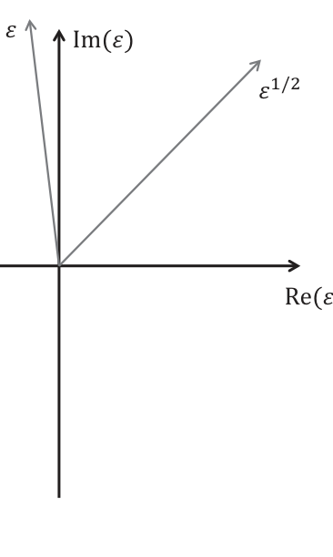
图内文字：ε，Im(ε)，Re(ε)，ε^{1/2}

注意很多教材上假设 $\varepsilon_r(\omega) = 1 + \dfrac{i\sigma_c}{\varepsilon_0\omega}$，这其实并不完全正确。但事实上，这并不影响解的形式——当 $\operatorname{Im}(\varepsilon_r) \gg \operatorname{Re}(\varepsilon_r)$ 时，解就是7.4.7式的形式，根本与 $\varepsilon_r$ 的实部无关！（如图7.8所示）。

将7.4.9带入7.4.2，则电磁波在金属中的电场（假设传播方向为z方向）为

$$
\vec{E} = \vec{E}_0 e^{-\alpha z} e^{i(\alpha z - \omega t)} \tag{7.4.10}
$$

当然横波条件要求 $\vec{E}_0$ 在 $xy$ 平面。可见，此时平面波的振幅沿传播方向指数衰减。

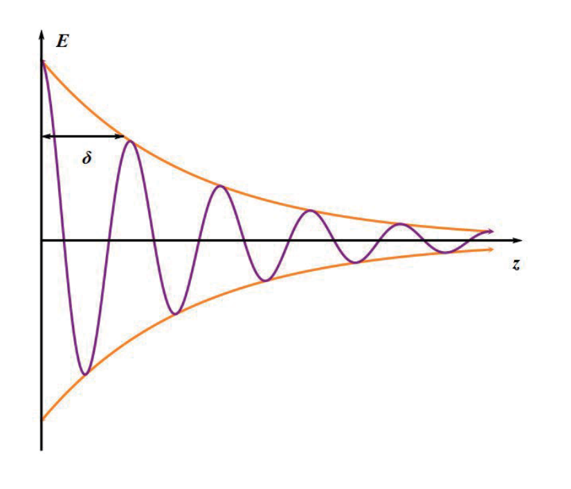
图内文字：E，δ，z

振幅衰减到 $r = 0$ 处的 $1/e$ 倍的距离 $1/\alpha$ 称为**透入深度**（也叫**趋肤深度**），定义为

$$
\delta = \frac{1}{\alpha} = \sqrt{\frac{2}{\sigma_c\mu\omega}} \tag{7.4.11}
$$

因此电磁波不能渗入在导电介质的内部，而是很快在表面的一个厚度为 $\delta$ 的薄层内衰减掉。与此相对应，金属上产生的交流电流一定也只是局域

在表层的这个薄层内——这个结论我们曾在讨论准静态近似下的电流的趋肤效应时得到过。

Tips：这种衰减表示电磁波的能量有消耗。但对良导体，$\sigma_c \to \infty$，$\delta \to 0$，入射的电磁波几乎被100%反射回去。因此，良导体几乎不能吸收电磁波（在GHz），可以看作理想导体。

##### 电磁场强度之间的关系

由7.4.3式中的第2式可得

$$
\vec{B}_0 = \frac{1}{\omega}\vec{k} \times \vec{E}_0 = \frac{1}{\omega\delta}(1+i) \cdot \vec{e} \times \vec{E}_0 = e^{i\pi/4}\sqrt{\frac{\sigma_c\mu_0}{\omega}}\, \vec{e} \times \vec{E}_0 \tag{7.4.12}
$$

良导体内的电磁波有如下重要特点：

1. 与介质中的电磁波 $\vec{B}$，$\vec{E}$ 之间同相位不同，此处 $\vec{B}$，$\vec{E}$ 之间有 $\dfrac{\pi}{4}$ 的相位差，趋向导体内部时，两者均以指数形式振荡衰减。

2. 良导体内部的电磁能量是以磁场能形式存在的：

$$
U_B \sim \frac{1}{2\mu_0}B_0^2 = \frac{\sigma_c}{2\omega}E_0^2 = \frac{\sigma_c}{\varepsilon_0\omega}\left(\frac{\varepsilon_0}{2}E_0^2\right) \gg U_E \tag{7.4.13}
$$

这种趋势随着频率的减小增大。当 $\omega = 0$ 时，磁能是电能的无限大倍，因此 $\vec{E}$ 只能为0——此时电磁场能量只以磁能的形式出现。这与静电时金属内部不存在静电场（但可以存在静磁场）的结果一致。导电介质中电磁波的传播特性如图7.10所示。

注：

(a) 这里 $U_E \sim \dfrac{\varepsilon_0}{2}E_0^2$ 指的是纯粹的电场能量，并没有把“传导电流”携带的能量（其机械能及与电磁场的相互作用能）算上。

(b) 对色散介质，利用 $U_E \sim \dfrac{1}{2}\vec{D}\cdot\vec{E} \sim \dfrac{1}{2}\varepsilon(\omega)|E|^2$ 计算介质中电磁场的总能量是不对的，否则你就得到负能量这个荒谬的结论。

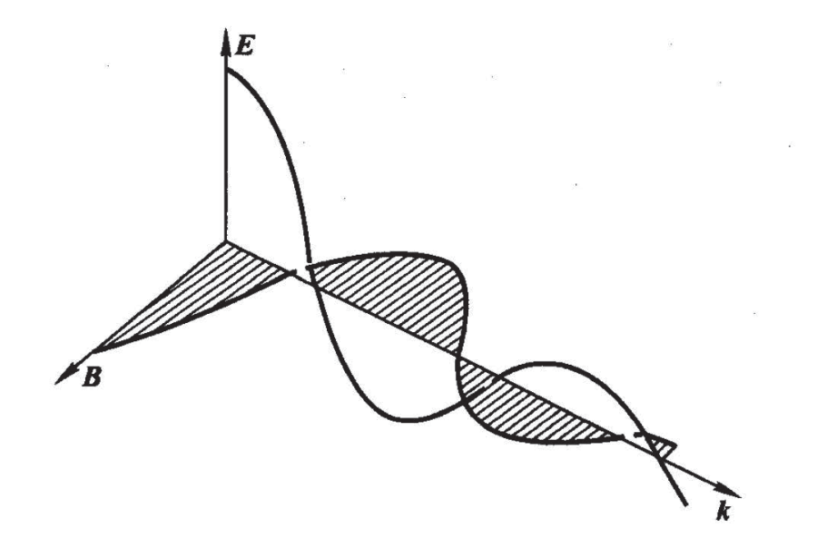

色散介质中的能量是个复杂的问题，要得到完整的答案，请参考 Landau 的书。

#### 7.4.2 良导体在光波段（等离子体中的光波）

在光波段，金属的有效介电常数为 $\varepsilon_r(\omega) \approx 1 - \frac{\omega_p^2}{\omega^2}$，这个模型也被广泛应用于研究其他自由电荷组成的等离子体（唯一的区别是电荷密度不同导致 $\omega_p^2$ 不同）。将其带入色散关系可得

$$
k^2 = \frac{\omega^2}{c^2}\left(1 - \frac{\omega_p^2}{\omega^2}\right) = \frac{1}{c^2}\left(\omega^2 - \omega_p^2\right)
\tag{7.4.14}
$$

对此我们作如下的讨论：

1. 当 $\omega < \omega_p$ 时，$k$ 为一纯虚数，可写成 $k = i/\delta$，其中

$$
\delta = \sqrt{\frac{c^2}{\omega_p^2 - \omega^2}}
\tag{7.4.15}
$$

此时金属中的电磁场是纯粹的指数衰减的，$E \sim E_0 e^{ikr} = E_0 e^{-r/\delta}$，与 7.4.10 式表示的一边衰减一边振荡（传播）略有不同。这种波称为衰减波，或者叫消逝波，倏逝波（Evanescent Wave）等。当电磁波

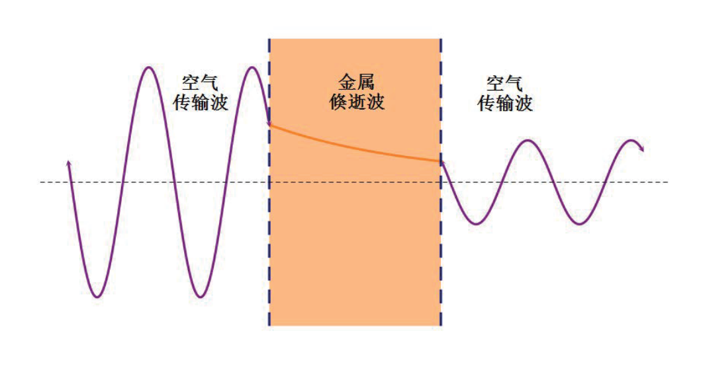
图内文字：空气 传输波；金属 倏逝波；空气 传输波

由空气入射到金属上时，进入金属后电磁波的透入深度为 $\delta$。若金属为半无限大，则电磁波完全不能通过金属，因此将被反射回去；若金属板为有限厚度，则会有衰退波隧穿过去。$\delta$ 越大，则隧穿过去的电磁波就越多（如图 7.11 所示）。这种效应非常类似量子力学中的隧穿效应，而在这里金属（$\varepsilon_r < 0$）就类比于量子力学中的势垒，电介质（$\varepsilon_r > 0$）类比于势阱。

2. 磁场为

$$
\vec{B}(z,t) = \frac{1}{\omega}\vec{k} \times E_0 \vec{e}_x e^{-z/\delta} e^{-i\omega t} = \frac{i}{\omega\delta} E_0 \vec{e}_y e^{-z/\delta} e^{-i\omega t}
\tag{7.4.16}
$$

这里磁场与电场有 $\pi/2$ 的相差，与介质、良导体在 GHz 等情形均不相同！这个相位的不同，造成了能流形式在各种介质中的不同！（参考作业题）

3. 当 $\omega = \omega_p$ 时，$\delta \to \infty$，此时隧穿效应达到极值。

4. 当 $\omega > \omega_p$，$0 < \varepsilon_r < 1$，$n = \sqrt{\varepsilon_r} < 1$，此时金属（或是等离子体）是比真空还要光疏的介质，光波可以在其中传播。但因为折射率与空气毕竟不同，所以此时一个有限厚度的金属板对电磁波仍然有反射，造成透射率的降低。因此，$\omega = \omega_p$ 就定义了一个由不透明到透明的等离子共振带边，实验上常利用这个现象来探测金属的等离子体共振频率。

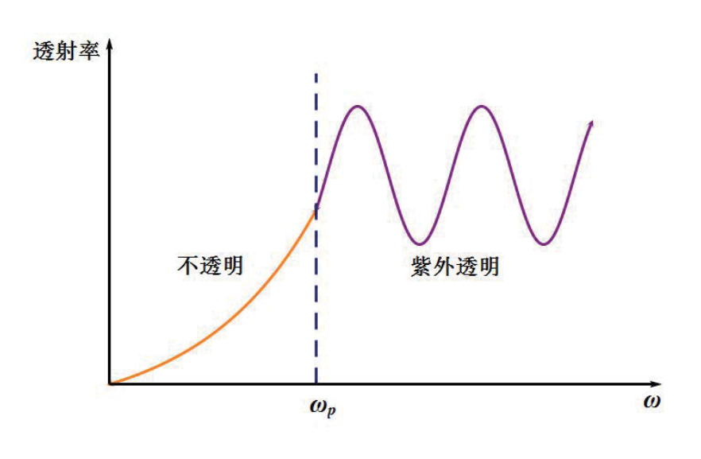
图内文字：透射率；不透明；紫外透明；$\omega_p$；$\omega$

5. 金属在 GHz 和在光波段均可以很好的反射电磁波，但机理及表现形式完全不同。前者是靠金属的介电常数的虚部，而后者靠的是负的介电常数。

*Tips*：$\omega = \omega_p$ 时，$\varepsilon_r \to 0$，$n \to 0$，我们发现体系具有许多奇异的特性。比如，根据 7.4.16，$\vec{B} \to 0$，也就是此时体系内部只存在电场。另外，这种遂传透明现象与体系的厚度无关，这一点又与光学中法布里-珀罗效应很不相同。尽管现在研究的金属只能在紫外（$\omega_p$）具有这个性质，基于 Metamaterials，任何其实可以在任意频段均实现这种奇异材料。这种材料叫 epsilon-near-zero(ENZ) 或者 zero-index-material(ZIM)，是目前非常热的前沿研究课题。

#### 7.4.3 非良导体

对于导电性能不好的导电媒质，比如一些电介质，其既有价带电子贡献的介电性质（$\varepsilon_r$），又因为有少量掺杂的电荷或是其他原因具有很小的电导率 $\sigma_c$。这种物质的复介电函数可以写成

$$
\tilde{\varepsilon}_r(\omega) = \varepsilon_r + i\frac{\sigma_c}{\varepsilon_0\omega}
\tag{7.4.17}
$$

因为电导率很小，$\frac{\sigma_c}{\varepsilon_0\omega} \ll 1$，7.4.17 意味着这种物质的介电常数具有很小的虚部。将 7.4.17 带入色散关系 7.4.5 中可得

$$
k = \frac{\omega}{c}\sqrt{\tilde{\varepsilon}_r(\omega)} = \beta + i\alpha \approx \frac{\omega}{c}\sqrt{\varepsilon_r} + i\frac{\sigma_c}{2\sqrt{\varepsilon_r}}\sqrt{\frac{\mu_0}{\varepsilon_0}}
\tag{7.4.18}
$$

电磁波的解为

$$
\vec{E}(\vec{r},t) = \vec{e}_x E_0 e^{-\alpha x} e^{i(\beta z - \omega t)}
\tag{7.4.19}
$$

显然，电磁波在这种介质中的传播性质又与良导体的两种情况均不同，与真空中的性质相仿，只是波在传播的过程中有少量能量耗散。注意到 $\sqrt{\tilde{\varepsilon}_r(\omega)}$ 即是体系的有效折射率，而上面的分析显示折射率的虚部对应着电磁波在体系中的耗散——这一点与电导率的实部恰好对应（注意 $\tilde{\varepsilon}$ 和 $\sigma$ 的关系 7.3.17）。

*Tips*：研究电磁媒质中电磁波的特性的范式：

本构关系（微观理论）$\to$ 色散关系 $\to$ 本征态（电场、磁场关系，偏振…）

### 7.5 旋光介质中的电磁波

之前我们研究了普通电介质和导电介质中电磁波的传播特性。这两种媒介的区别是前者通常为非色散介质，后者是色散介质；共同特性是它们

都是各向同性介质。下面我们将进一步研究一种各向异性介质——旋光介质，并且考察其中电磁波的传播特性。

当对等离子介质施加静磁场时，这类介质就叫做旋光介质。比如地球附近的受地磁场影响的等离子体层，或者处于恒定磁场中的金属，都属于此类介质。要研究电磁波在这种介质中的传播行为，类似研究金属中的电磁波，我们还是首先研究其本构关系，然后再求解 Maxwell 方程在其中的解。

#### 7.5.1 旋光介质的本构关系

考虑处于静磁场 $\vec{B}_0$ 中的自由电子气对电场的响应时。忽略杂质的散射项，电子的运动方程为

$$
m\frac{d\vec{v}}{dt} = e\left(\vec{E} + \vec{v}\times\vec{B}_0\right)
\tag{7.5.1}
$$

其中，设静磁场 $\vec{B}_0 = B_0\hat{e}_z$，强度远远大于电磁场中的磁场；外电场随时间谐变（$\vec{E}(t) = \vec{E}_0 e^{-i\omega t}$）。显然，在外场的驱动下，电子的运动速度也具有 $e^{-i\omega t}$ 因子。设 $\vec{v}(t) = \vec{v}_0 e^{-i\omega t}$，则 7.5.1 式的 3 个分量形式可以写为

$$
-i\omega v_{0x} = \frac{e}{m}E_{0x} + \frac{e}{m}v_{0y}B_0
\tag{7.5.2}
$$

$$
-i\omega v_{0y} = \frac{e}{m}E_{0y} - \frac{e}{m}v_{0x}B_0
\tag{7.5.3}
$$

$$
-i\omega v_{0z} = \frac{e}{m}E_{0z}
\tag{7.5.4}
$$

定义 $\omega_B = \frac{|e|B_0}{m} = -\frac{eB_0}{m} > 0$（此处我们的定义是 $e < 0$），物理意义是电子在垂直磁场平面（$xy$ 平面）内做圆周运动的圆频率，代入以上 3 式并解

之可得

$$
v_{0x} = \frac{e}{m}\frac{i\omega E_{0x} + \omega_B E_{0y}}{\omega^2 - \omega_B^2}
\tag{7.5.5}
$$

$$
v_{0y} = \frac{e}{m}\frac{i\omega E_{0y} - \omega_B E_{0x}}{\omega^2 - \omega_B^2}
\tag{7.5.6}
$$

$$
v_{0z} = -\frac{eE_{0z}}{im\omega}
\tag{7.5.7}
$$

将以上 3 式代入电流密度公式 $\vec{j} = n_e e\vec{v}$，可得电流密度的形式：

$$
j_x = \frac{n_e e^2}{m}\frac{i\omega E_{0x} + \omega_B E_{0y}}{\omega^2 - \omega_B^2}e^{-i\omega t} = \frac{\varepsilon_0\omega_p^2}{\omega^2 - \omega_B^2}\left(i\omega E_x + \omega_B E_y\right)
\tag{7.5.8}
$$

$$
j_y = \frac{\varepsilon_0\omega_p^2}{\omega^2 - \omega_B^2}\left(i\omega E_x - \omega_B E_y\right)
\tag{7.5.9}
$$

$$
j_z = -\frac{\varepsilon_0\omega_p^2}{i\omega}E_z
\tag{7.5.10}
$$

我们发现电流和电场之间的关系满足一个拓展的欧姆定律

$$
j_i = \sigma_{ij}E_j \quad or \quad \vec{j} = \vec{\vec{\sigma}}\cdot\vec{E}
\tag{7.5.11}
$$

只不过此时电导率为一个各向异性的矩阵，其具体形式为

$$
\vec{\vec{\sigma}}(\omega) = \frac{\omega_p^2\varepsilon_0}{\omega^2 - \omega_B^2}
\begin{pmatrix}
i\omega & \omega_B & 0 \\
-\omega_B & i\omega & 0 \\
0 & 0 & -\frac{\omega^2 - \omega_B^2}{i\omega}
\end{pmatrix}
\tag{7.5.12}
$$

有了电导率矩阵，我们可以进一步求出介质的有效介电常数。此时，Maxwell 第四条方程（时域谐变下）为 $\nabla\times\vec{H} = \left(\vec{\vec{\sigma}}(\omega) - i\omega\varepsilon_0\right)\vec{E}$，在交变条件下将“传导电流”看成金属的束缚电流，则对此有效电介质来讲，方程应为 $\nabla\times\vec{H} = -i\omega\vec{\vec{\varepsilon}}\cdot\vec{E}$。两式对比可得

$$
\vec{\vec{\varepsilon}}_r(\omega) = I + i\frac{1}{\varepsilon_0\omega}\vec{\vec{\sigma}}
\begin{pmatrix}
\varepsilon_1 & i\varepsilon_2 & 0 \\
-i\varepsilon_2 & \varepsilon_1 & 0 \\
0 & 0 & \varepsilon_3
\end{pmatrix}
\tag{7.5.13}
$$

这是一个各向异性的“等效介电常数”张量，其中

$$
\varepsilon_1 = 1 - \frac{\omega_p^2}{\omega^2 - \omega_B^2} \qquad \varepsilon_2 = \frac{\omega_p^2\omega_B}{\left(\omega^2 - \omega_B^2\right)\omega} \qquad \varepsilon_3 = 1 - \frac{\omega_p^2}{\omega^2}
\tag{7.5.14}
$$

注：当 $B_0 = 0$ 时，$\varepsilon_2 = 0$，$\varepsilon_1 = \varepsilon_3 = 1 - \omega_p^2/\omega^2$，体系回到各向同性的等离子体。

所以磁场对等离子体的影响为：

1. 使得体系的有效介电函数变成各向异性；

2. 而且其非对角元素为纯虚数。

具有类似 7.5.13 式的介电常数的体系通常叫做旋电材料，其中的电磁波的行为非常奇异。与此相对应，若磁导率矩阵 $\vec{\vec{\mu}}_r(\omega)$ 具有 7.5.13 式，则体系称为“旋磁材料”。

#### 7.5.2 旋光介质中的电磁波本征态

下面我们研究此类材料中的电磁波特性。下面介绍的方法其实是计算各向异性电磁材料中的波的行为的一个通用方法。取平面波试解 $\vec{E} = \vec{E}_0 e^{i(kz - \omega t)}$，$\vec{H} = \vec{H}_0 e^{i(kz - \omega t)}$（$\vec{E}_0$，$\vec{H}_0$ 为常矢量），将其带入频域的 Maxwell 方程组（注意到此时 $\varepsilon_r(\omega)$ 为一张量），则有

$$
\begin{cases}
\vec{k}\cdot\left(\vec{\vec{\varepsilon}}_r\cdot\vec{E}_0\right) = 0 \\
\vec{k}\cdot\vec{H}_0 = 0 \\
\vec{k}\times\vec{E}_0 = \omega\mu_0\vec{H}_0 \\
\vec{k}\times\vec{H}_0 = -\omega\varepsilon_0\vec{\vec{\varepsilon}}_r\cdot\vec{E}_0
\end{cases}
\tag{7.5.15}
$$

一般条件下求解 7.5.15 相当复杂（参考习题）。下面做些简化，考虑最简单的一种情况：

1. 假设 $\omega > \omega_p \gg \omega_B$，故 $\varepsilon_1$，$\varepsilon_2$ 都是正实数，且 $\varepsilon_1 \gg \varepsilon_2$；

2. $\vec{k} = k\vec{e}_z$

由第 1 式及 $\vec{\vec{\varepsilon}}_r$ 的形式，可得 $E_{0z} = 0$，即 $\vec{k}\cdot\vec{E}_0 = 0$，因此在此条件下电磁波仍然为横波！由第 3、4 式可得

$$
\vec{k}\times\left(\vec{k}\times\vec{E}_0\right) + \omega^2\mu_0\varepsilon_0\vec{\vec{\varepsilon}}_r\cdot\vec{E}_0 = 0
\tag{7.5.16}
$$

整理可得（利用 $\vec{k}\cdot\vec{E}_0 = 0$）

$$
k^2\vec{E}_0 = k_0^2\vec{\vec{\varepsilon}}_r\cdot\vec{E}_0
\tag{7.5.17}
$$

其中 $k_0 = \omega/c$ 为真空中的波矢。7.5.17 看上去与各向同性介质中的电磁波传播的色散关系极为类似，唯一的区别是此处 $\vec{\vec{\varepsilon}}_r$ 为一张量。但也正因为这一特征，容易证明 $\vec{E}_0 \parallel \vec{e}_x$ 以及 $\vec{E}_0 \parallel \vec{e}_y$ 的线偏振光波都不是 7.5.17 的解。那么此时电磁波的偏振态到底应当是什么？考虑到 $\vec{k}\cdot\vec{E}_0 = 0$，则一般情况的解为 $\vec{E}_0 = E_{0x}\hat{x} + E_{0y}\hat{y}$，其中 $E_{0x}$，$E_{0y}$ 一般情况下为复数。代入 7.5.17，写出分别沿 $x$ 和 $y$ 方向的分量形式，可得 2 个方程。将这两个方程写成矩阵的形式，有

$$
\begin{pmatrix}
\varepsilon_1 k_0^2 - k^2 & i\varepsilon_2 k_0^2 \\
-i\varepsilon_2 k_0^2 & \varepsilon_1 k_0^2 - k^2
\end{pmatrix}
\begin{pmatrix}
E_{0x} \\ E_{0y}
\end{pmatrix} = 0
\tag{7.5.18}
$$

解 7.5.18 式等于对角化相应的矩阵。计算得到 2 个本征值：

$$
k_+ = \frac{\omega}{c}\sqrt{\varepsilon_1 + \varepsilon_2} \qquad k_- = \frac{\omega}{c}\sqrt{\varepsilon_1 - \varepsilon_2}
\tag{7.5.19}
$$

将本征值带入 7.5.18 可得相应的本征矢量。整理之后结果为

$$
k_+:\quad E_{0x} = iE_{0y} \Rightarrow \vec{E}_0^+ = E_0\left(\vec{e}_x - i\vec{e}_y\right)/\sqrt{2} = E_0\vec{\varepsilon}_{right}
\tag{7.5.20}
$$

$$
k_-:\quad E_{0x} = -iE_{0y} \Rightarrow \vec{E}_0^- = E_0\left(\vec{e}_x + i\vec{e}_y\right)/\sqrt{2} = E_0\vec{\varepsilon}_{left}
\tag{7.5.21}
$$

7.5.19-7.5.21显示在这种材料中，沿 $z$ 轴传播的电磁波的本征态不是线偏振的，恰恰对应着左右旋圆偏振！且7.5.19显示这两个本征态的色散关系（或者说传播的相速度）不相同。对右旋光，波的相速度为

$$
v_{right} = \omega/k_{+} = c/\sqrt{\varepsilon_1 + \varepsilon_2} \tag{7.5.22}
$$

对左旋光

$$
v_{left} = \omega/k_{-} = c/\sqrt{\varepsilon_1 - \varepsilon_2} \tag{7.5.23}
$$

因此，在介质中沿着磁场方向传播时，左旋光比右旋光的速度快。

#### 7.5.3 法拉第效应

当一个线偏振波由各向同性的空间进入各向异性的等离子体时，由于线偏振波可以分解为两个等幅的左、右旋圆偏振波，而左旋和右旋波的波速又不相等，结果是电磁波的偏振面在等离子体中以前进方向为轴不断地旋转。这种效应叫法拉第旋光效应，如图所示。

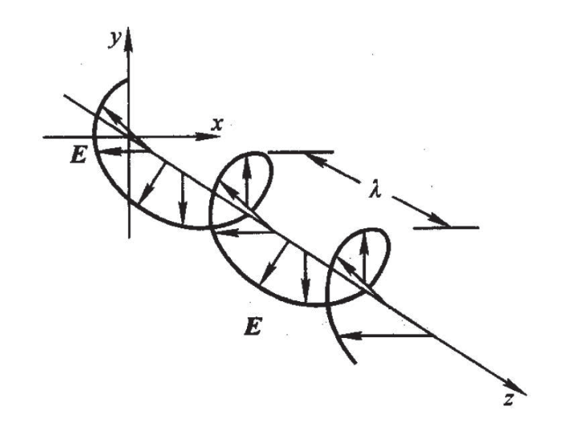

具体可以计算出电磁波的传播行为。设进入Faraday介质之前在真空中

传播的线偏振电磁波为

$$
\vec{e}_x E_0 e^{i(k_0 z - \omega t)} = \frac{1}{\sqrt{2}} E_0 \left(\vec{e}_{right} + \vec{e}_{left}\right) e^{i(k_0 z - \omega t)} \tag{7.5.24}
$$

进入Faraday介质后，假设旋光体系对左右旋光的透射率一样，则电磁波变成

$$
\frac{E_0}{\sqrt{2}} \left(\vec{e}_{right} e^{ik_+ z} + \vec{e}_{left} e^{ik_- z}\right) e^{-i\omega t} = \frac{E_0}{\sqrt{2}} \left(\vec{e}_{right} e^{i\Delta k \cdot z/2} + \vec{e}_{left} e^{-i\Delta k \cdot z/2}\right) e^{i(\bar{k}z - \omega t)} \tag{7.5.25}
$$

$$
= \frac{E_0}{2} \left[\left(e^{-i\Delta k \cdot z/2} + e^{i\Delta k \cdot z/2}\right)\vec{e}_x + i\left(e^{-i\Delta k \cdot z/2} - e^{i\Delta k \cdot z/2}\right)\vec{e}_y\right] e^{i\bar{k}z} e^{-i\omega t} \tag{7.5.26}
$$

$$
= E_0 \left[\cos\left(\Delta k \cdot z/2\right)\vec{e}_x + \sin\left(\Delta k \cdot z/2\right)\vec{e}_y\right] e^{i\bar{k}z} e^{-i\omega t} \tag{7.5.27}
$$

其中 $\Delta k = k_+ - k_-$，$\bar{k} = (k_+ + k_-)/2$。因此电磁波在旋光介质中的电矢量一边传播一边旋转（如图7.13所示）！假设Faraday介质的厚度为 $d$，则从Faraday介质中出来时（将 $z = d$ 带入7.5.27）重新变成线偏振，偏振方向为

$$
\vec{E} \parallel \cos\left(\Delta k \cdot d/2\right)\vec{e}_x + \sin\left(\Delta k \cdot d/2\right)\vec{e}_y \tag{7.5.28}
$$

与入射光比较偏振方向旋转了如下的角度

$$
\Delta\phi = \Delta k \cdot d/2 \approx k_0 d\varepsilon_2/(2\sqrt{\varepsilon_1}) \tag{7.5.29}
$$

此即是著名的Faraday旋光效应，后面一项在考虑 $\varepsilon_2 \ll \varepsilon_1$ 后得到。因为 $\varepsilon_2 \propto \omega_B$，显然这个偏振转角正比于外磁场 $B$ 及旋光介质的厚度 $d$。

**讨论：** 在各向同性的介质里，沿 $x$、$y$ 方向偏振的光波的 $\vec{k}$ 矢量相同（或者说状态简并），因此这种介质中左右旋电磁波同样状态简并。我们既可以用线偏振的光波作为基把任意偏振的波展开，等价地，我们也可以用左右旋光作为基来做同样的事情。但各向异性介质中不存在这种简并，我们必须求出色散关系对应的电磁本征态作为基，此时不能随意选取线偏振或者圆偏振波作为基。

### 7.6 电磁波在介质面上的反射和折射

至今为止，我们只学习了电磁波在一个无限大均匀的块体材料中传输时的行为。电磁波从一个材料进入另一个材料中会如何？此即是本节我们要学习的内容。

#### 7.6.1 电磁波边界条件

光在两种介质的交界面上的反射和折射现象为大家所熟知。早期人们是基于牛顿的光粒子的概念用了许多假设推出光的反射和折射定律的。直到后来人们利用Maxwell方程以及边界条件，不加任何其他假设，成功推导出光的折射和反射定律时，人们才完全接受光的波动性。这里我们从Maxwell方程出发讨论电磁波的反射和折射现象。在界面上电磁场要满足边值条件

$$
\vec{n} \times \left(\vec{E}_1(\vec{r},t) - \vec{E}_2(\vec{r},t)\right)\Big|_b = 0 \qquad \vec{n} \times \left(\vec{H}_1(\vec{r},t) - \vec{H}_2(\vec{r},t)\right)\Big|_b = 0 \tag{7.6.1}
$$

由上述边界条件，我们可以推导出决定电磁波的界面上行为的2大定律。

#### 7.6.2 反射、折射的基本规律 - Snell's Law（斯涅尔定律）

首先注意到电场、磁场的切向分量在交界面内时时且处处相等（我们已经把金属的传导电流在高频下作为束缚电流处理，因此金属也可以作为电介质来处理，无须考虑界面上的面自由电流！）若交界面为一平面，我们把它取为 $Oxy$ 面。如图7.14所示，考虑一单色平面波入射到交界面上，其电场为

$$
\vec{E}_i = \vec{E}_{0i} e^{i(\vec{k}\cdot\vec{r} - \omega t)} \tag{7.6.2}
$$

则电场切向分量在交界面上时时且处处相等要求反射波、折射波也一定携带相同

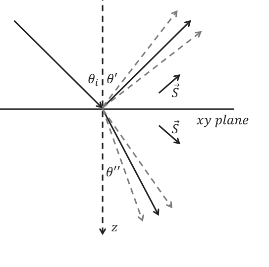

图内文字：xy plane, S, z, $\theta_i$, $\theta'$, $\theta''$

的时间因子 $e^{-i\omega t}$，这个可以做如下理解：介质分子在外电磁波的作用下以频率 $\omega$ 做受迫振动，这种受迫振动是反射、折射波的来源，故反射、折射波一定也是以此频率振动，这其实是我们所处的世界的时间平移不变性的体现！假设介质1和2都是均匀各向同性的，则其中的电磁通解为平面波，因此，反射、折射波可以一般形式地写为所有频率为 $\omega$ 的沿不同方向传播的平面波的叠加

$$
\text{反射波} \qquad \vec{E}_r = \sum_{\vec{k}'} \vec{E}'_0\left(\vec{k}'\right) e^{i\left(\vec{k}'\cdot\vec{r} - \omega t\right)} \tag{7.6.3}
$$

$$
\text{折射波} \qquad \vec{E}_d = \sum_{\vec{k}''} \vec{E}''_0\left(\vec{k}''\right) e^{i\left(\vec{k}''\cdot\vec{r} - \omega t\right)} \tag{7.6.4}
$$

其中波矢应和频率当满足色散关系

$$
k' = (\omega/c)\cdot n_1 \qquad k'' = (\omega/c)\cdot n_2 \tag{7.6.5}
$$

其中 $n_i = \sqrt{\varepsilon_{ri}\cdot\mu_{ri}}$ 为第 $i$ 个体系的折射率。下面考虑7.6.2的第2个要求：电磁场在交界面上处处相等。这意味着反射波、折射波一定在 $xy$ 平面内具

有相同的空间波动行为，亦即带有相同的因子 $e^{i\vec{k}_\parallel\cdot\vec{r}} = e^{i(k_x x + k_y y)}$。这个结论身深层次的物理其实是体系在界面上的平移不变性！考虑界面上的任意2点在外场激励下的震动，其唯一的不同就是外场的相位有不同，因此这两点的振动差 $e^{i\vec{k}_\parallel\Delta r}$，因此响应的反射/折射波也差同样的相位。这意味着7.6.3与7.6.4式中反射、折射波的展开式中只有一支平面波满足要求，即

$$
\vec{k}'_\parallel = \vec{k}''_\parallel = \vec{k}_\parallel \tag{7.6.6}
$$

由7.6.5及7.6.6可得 $z$ 方向上的 $\vec{k}$ 矢量：

$$
k'_z = \pm\sqrt{k'^2 - k_\parallel^2} \qquad k''_z = \pm\sqrt{k''^2 - k_\parallel^2} \tag{7.6.7}
$$

如何确定7.6.7式应取正号还是负号？这里应当用到因果关系（Causality）！根据因果关系，反射波及折射波的能量都应当离开界面。在常规介质中波矢的方向与能量传播的方向（即Ponty矢量 $\vec{S}$）同方向 $\vec{S} = \vec{E}\times\vec{H} \parallel \hat{k}$。故7.6.7中 $k'_z$ 应取负根，而 $k''_z$ 应取正根。故反射、折射光如图7.14所示。由三方面的讨论：时间平移不变性、界面空间平移不变性、因果关系，我们可总结出反射、折射的基本规律：

1. 反射波、折射波的频率与入射波频率相等：$\omega' = \omega'' = \omega$。

2. 根据 $\vec{k}'_\parallel = \vec{k}''_\parallel = \vec{k}_\parallel$，若 $k_y = 0$，则必有 $k'_y = k''_y = 0$。这意味着，入射线、反射线和折射线在同一平面内——这个由入射波 $\vec{k}$ 矢量与交界面垂直方向构成的平面定义为入射面。

3. $k'_z$、$k''_z$ 的正负号由因果关系确定！

4. 根据 $k_x = k'_x$，有 $k\sin\theta = k'\sin\theta'$，同时因为 $k = k'$（入射波与反射波在同一种介质中），由此得出 $\theta = \theta'$，即入射角等于反射角，即“镜面反射”。

5. 根据 $k_x = k''_x$，必有 $k\sin\theta = k''\sin\theta''$，再根据7.6.5，于是

$$
\frac{\sin\theta}{\sin\theta''} = \frac{k''}{k} = \frac{\sqrt{\varepsilon_2\mu_2}}{\sqrt{\varepsilon_1\mu_1}} = \frac{n_2}{n_1} \tag{7.6.8}
$$

这就是光学中的折射定律（Snell's Law）。因为折射定律中所涉及的物理量仅仅是 $n = \sqrt{\varepsilon_r\mu_r} = \sqrt{\varepsilon_r}\cdot\sqrt{\mu_r}$，这正是 $n$ 被称为介质的折射率的原因。

#### 7.6.3 振幅关系 - Fresnel's Law（菲涅耳定律）

上面我们根据边值条件中的时空依赖关系推导出电磁波的传播方向所满足的要求，对折射波/反射波的振幅尚未讨论。下面我们根据7.6.2来讨论这件事情。对沿 $\vec{k}$ 方向传播的具有任意偏振状态的平面电磁波，我们总可以将其分解成两个偏振方向相互垂直的电磁波的叠加。因此，下面我们将分两种情形分别考虑。

##### S波/TE（横电）波

在这种情况下，入射波的电场垂直于入射面（躺在交界面上），如图7.15所示。入射、反射、以及折射波的电场可以写成

$$
\text{入射波} \qquad \vec{E}_i = \hat{y} E_0 e^{i(k_x x + k_z z - \omega t)} \tag{7.6.9}
$$

$$
\text{反射波} \qquad \vec{E}_r = \hat{y} E'_0 e^{i(k_x x - k_z z - \omega t)} \tag{7.6.10}
$$

$$
\text{折射波} \qquad \vec{E}_t = \hat{y} E''_0 e^{i(k_x x + k''_z z - \omega t)} \tag{7.6.11}
$$

根据Maxwell方程，磁场可写成

$$
\vec{H} = \frac{1}{Z}\left(\hat{k} \times \vec{E}\right) \tag{7.6.12}
$$

的形式，其中 $Z = \sqrt{\mu}/\sqrt{\varepsilon}$ 是介质的阻抗。因此，入射、反射以及折射波的

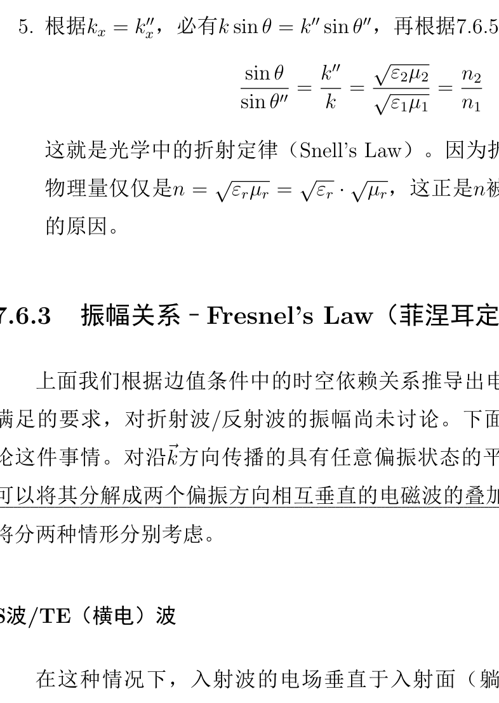

图内文字：$y$, $\vec{E}$, $\vec{k}$, $\vec{H}$, $\theta$, $\theta'$, $\vec{k}'$, $\vec{H}'$, $\theta''$, $\vec{H}''$, $\vec{k}''$, $x$, $z$

磁场为

$$
\vec{H}_i = \frac{E_0}{Z_1}\frac{k_x\hat{z} - k_z\hat{x}}{k} e^{i(k_x x + k_z z - \omega t)} \tag{7.6.13}
$$

$$
\vec{H}_r = \frac{E'_0}{Z_1}\frac{k_x\hat{z} + k_z\hat{x}}{k} e^{i(k_x x - k_z z - \omega t)} \tag{7.6.14}
$$

$$
\vec{H}_t = \frac{E''_0}{Z_2}\frac{k_x\hat{z} - k''_z\hat{x}}{k''} e^{i(k_x x + k''_z z - \omega t)} \tag{7.6.15}
$$

在交界面上（设 $z = 0$）$\vec{E}$、$\vec{H}$ 的切向值相等，则有

$$
E_0 + E'_0 = E''_0 \tag{7.6.16}
$$

$$
\frac{k_z}{Z_1 k}E_0 - \frac{k_z}{Z_1 k}E'_0 = \frac{k''_z}{Z_2 k''}E''_0 \tag{7.6.17}
$$

注意到

$$
k_z = k\cos\theta \qquad k''_z = k''\cos\theta'' \tag{7.6.18}
$$

解联立方程可得

$$
E'_0 = \frac{Z_2\cos\theta - Z_1\cos\theta''}{Z_2\cos\theta + Z_1\cos\theta''}E_0 \tag{7.6.19}
$$

$$
E''_0 = \frac{2Z_2\cos\theta}{Z_2\cos\theta + Z_1\cos\theta''}E_0 \tag{7.6.20}
$$

反射、折射波与入射波中的磁场振幅关系可由7.6.13-7.6.15求出。

##### P波/TM（横磁）波

下面考虑另一种情况，即磁场垂直于入射面（或者说磁场躺在交界面内），此时先考虑磁场比较方便，如图所示。

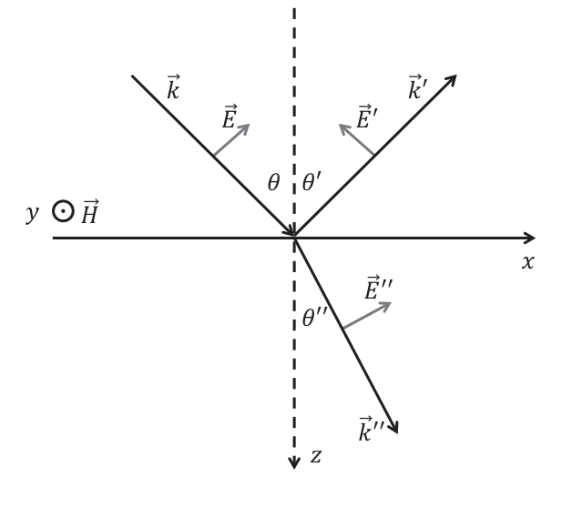

图内文字：$y$, $\vec{H}$, $\vec{k}$, $\vec{E}$, $\theta$, $\theta'$, $\vec{E}'$, $\vec{k}'$, $\theta''$, $\vec{E}''$, $\vec{k}''$, $x$, $z$

$$
\text{入射波} \qquad \vec{H}_i = \hat{y} H_0 e^{i(k_x x + k_z z - \omega t)} \tag{7.6.21}
$$

$$
\text{反射波} \qquad \vec{H}_r = \hat{y} H'_0 e^{i(k_x x - k_z z - \omega t)} \tag{7.6.22}
$$

$$
\text{折射波} \qquad \vec{H}_t = \hat{y} H''_0 e^{i(k_x x + k''_z z - \omega t)} \tag{7.6.23}
$$

根据Maxwell方程，电场可由

$$
\vec{E} = -Z\left(\hat{k} \times \vec{H}\right) \tag{7.6.24}
$$

求得。我们再次看到阻抗的重要性。因此可以根据7.6.21-7.6.24式写出电

场 $\vec{E}_i$，$\vec{E}_r$，$\vec{E}_t$ 的形式，再根据边界条件7.6.2得到（可与S波对比）

$$
H'_0 = \frac{Z_1\cos\theta - Z_2\cos\theta''}{Z_1\cos\theta + Z_2\cos\theta''}H_0
\tag{7.6.25}
$$

$$
H''_0 = \frac{2Z_1\cos\theta}{Z_1\cos\theta + Z_2\cos\theta''}H_0
\tag{7.6.26}
$$

7.6.19，7.6.20，7.6.25，7.6.26式被称为菲涅耳公式，在特殊情况下（$\mu_1 = \mu_2 = \mu$）回到菲涅耳早期基于以太理论导出的光学折/反射振幅关系式。这有力地论证了光是电磁波。

讨论：

1. 当 $\varepsilon$，$\mu$ 其中之一为负数甚至为虚数时，$\theta''$ 失去几何意义，此时不应当做 $\cos\theta'' = k''_z/k''$ 的替代，而应当直接写成 $k''_z/k''$，$k_z/k$ 的形式；但 $Z$ 的形式不必改，因为 $\vec{E} = Z\left(\hat{k}\times\vec{H}\right)$ 仍然成立，尽管此处 $Z$ 为复数。

2. （8.6.16）可以通过对（8.6.13）进行代换 $Z \rightarrow \dfrac{1}{Z}$，$E \rightarrow H$ 得到！这反映了电磁场得对称性。电磁理论中有许多这种对称值得好好揣摩。

#### 7.6.4 反射率及透射率

反射波平均能流与入射波平均能流在法线方向的分量之比称为反射率（Reflectance），物理意义是多少入射的能量被界面反射回来。无论对S波还是P波，反射波和入射波处于同一媒质中，阻抗值相同，入射角与反射角也相等。因此，反射率就是反射场与入射场振幅比例的模的平方：

$$
R = \frac{\left\langle\vec{S}_r\right\rangle\cdot\hat{z}}{\left\langle\vec{S}_i\right\rangle\cdot\hat{z}} = \begin{cases}
\dfrac{|E'_0|^2\cos\theta'/Z_1}{|E_0|^2\cos\theta/Z_1} = \left|\dfrac{E'_0}{E_0}\right|^2 & \text{S wave} \\[8pt]
\dfrac{Z_1|H'_0|^2\cos\theta'}{Z_1|H_0|^2\cos\theta} = \left|\dfrac{H'_0}{H_0}\right|^2 & \text{P wave}
\end{cases}
\tag{7.6.27}
$$

将7.6.19，7.6.20，7.6.25，7.6.26式分别带入7.6.27式即得S，P两种偏振情况

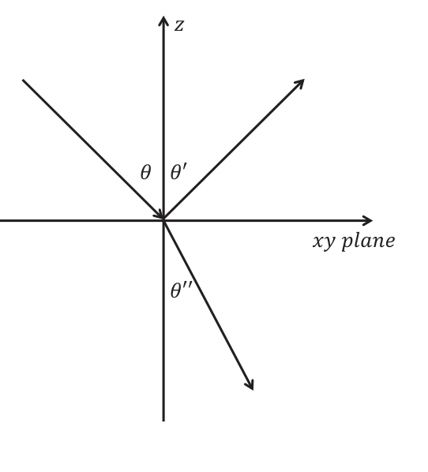

图内文字：z, $\theta$, $\theta'$, $\theta''$, xy plane

的反射率：

$$
R_S = \left|\frac{Z_2\cos\theta - Z_1\cos\theta''}{Z_2\cos\theta + Z_1\cos\theta''}\right|^2
\tag{7.6.28}
$$

$$
R_P = \left|\frac{Z_2\cos\theta'' - Z_1\cos\theta}{Z_2\cos\theta'' + Z_1\cos\theta}\right|^2
\tag{7.6.29}
$$

同样道理，透射率定义为

$$
T = \frac{\left\langle\vec{S}_t\right\rangle\cdot\hat{z}}{\left\langle\vec{S}_i\right\rangle\cdot\hat{z}} = \begin{cases}
\dfrac{|E''_0|^2\cos\theta''/Z_2}{|E_0|^2\cos\theta/Z_1} & \text{S wave} \\[8pt]
\dfrac{Z_2|H''_0|^2\cos\theta''}{Z_1|H_0|^2\cos\theta} & \text{P wave}
\end{cases}
\tag{7.6.30}
$$

注：定义反射/透射率的时候，我们都不是直接对入（反、透）射波的能流操作，而是将其投影到界面的法向方向。这是因为对一个界面来讲，只有投影到其法向方向的能流分量才是“真正通过”这个界面的能流。

问题：你能否考虑一个有限大小的Beam在界面上的反射和折射，基于此搞清楚为什么能量守恒要乘以一个投影到法线的 $\cos\theta$ 因子？

#### 7.6.5 正入射条件下反射的几点讨论

1. 正入射条件下，无论S波还是P波，反射率均为

$$
R = \left|\frac{Z_2 - Z_1}{Z_2 + Z_1}\right|^2
\tag{7.6.31}
$$

在光学中，我们经常利用

$$
R = \left|\frac{n_2 - n_1}{n_2 + n_1}\right|^2
\tag{7.6.32}
$$

来计算反射率，其实这不完全正确，只有当介质没有磁性时，因为 $Z_r = 1/\sqrt{\varepsilon_r} = 1/n$，两者等价。一般情况下正确的表达式应当由阻抗来描述。折射率完全决定了波的传播方向，然而阻抗却是决定波振幅的核心。两个物理量加在一起完全描述了一个电磁介质的所有电磁波行为。

2. 假设 $Z_1 = Z_0$，则定义相对阻抗为 $Z = Z_2/Z_0 = \sqrt{\mu_r}/\sqrt{\varepsilon_r}$，对S波我们可以定义反射系数

$$
r_s = \frac{Z - 1}{Z + 1} = \frac{E'_0}{E_0}
\tag{7.6.33}
$$

（P波有同样结果），它刻画了反射波与入射波的振幅（带相位）的比值。我们注意到无论对 $Z \rightarrow 0$ 的介质还是对 $Z \rightarrow \infty$ 的介质，都可以对电磁波进行强烈反射，但反射的位相却不相同。$Z \rightarrow 0$ 的介质其实就是理想电导体（因为金属 $|\varepsilon_r| \rightarrow \infty$，简称Perfect Electric Conductor(PEC)），而 $Z \rightarrow \infty$ 的介质对应的是 $|\mu_r| \rightarrow \infty$ 的理想“磁导体”(PMC)自然界不存在，可以通过Metamaterial的概念实现。通过调控电磁波介质的阻抗特性，我们可以实现对电磁波反射位相的有效调控，从而实现一系列难以置信的新的电磁波现象。

#### 7.6.6 Brewster 角

对常规介质，在可见光频段磁导率接近于 $\mu_0$（光频下磁性介质中的磁

矩无法跟上电磁场的变化，宏观上不显现磁性）。令 $\mu_1 = \mu_2 \approx \mu_0$，则此时折射系数与阻抗满足 $Z_r = 1/\sqrt{\varepsilon_r} = 1/n$。利用折射定律

$$
\frac{\sin\theta}{\sin\theta''} = \frac{n_2}{n_1} = \frac{Z_1}{Z_2}
\tag{7.6.34}
$$

针对两种偏振光，带入反射率的表达式7.6.28与7.6.29可得

$$
R_S = \frac{\sin^2\left(\theta - \theta''\right)}{\sin^2\left(\theta + \theta''\right)}
\tag{7.6.35}
$$

$$
R_P = \frac{\tan^2\left(\theta - \theta''\right)}{\tan^2\left(\theta + \theta''\right)}
\tag{7.6.36}
$$

对P波反射率，注意到当

$$
\theta + \theta'' = \pi/2
\tag{7.6.37}
$$

条件满足时，反射率为0：

$$
R_P = 0
\tag{7.6.38}
$$

亦即：当反射波与折射波相互垂直时，P极化电磁波完全不被反射！满

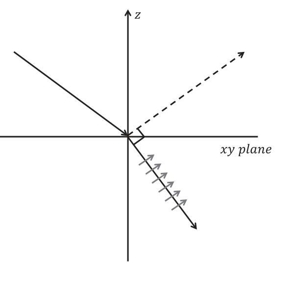

图内文字：z, xy plane

足7.6.37式条件的入射角称为布鲁斯特角（Brewster Angle），满足 $\theta_B =$

$\tan^{-1}(n_2/n_1)$。其在光学中有着重要的理论和实际的意义——如当一支没有启偏的自然光已以这个角度入射到介质表面时，反射波没有P偏振分量，只有S偏振分量，这样反射波就变成了完全的线偏振波。可以利用下面的Argument从物理上理解Brewster Angle：

当P偏振电磁波入射到介质表面上时，在介质内部驱动介质分子来回振荡，这产生了如图7.18所示的电偶极子振荡。它们的重新辐射效应产生了折射波和反射波。当入射角等于Brewster Angle时，反射波垂直于折射波，因为要满足横波条件，故在与反射波矢垂直方向运动的介质分子不可能辐射出反射波，故，此时介质对电磁波完全透明。注意，此结论以及几何解释只在非磁性材料中适用！对磁性介质（相对介电常数=1），结论恰恰相反！

### 7.7 全反射

在实际应用中，人们希望能有效控制电磁波的传播方向，因此，一个好的反射镜就变得必不可少。电磁波在金属表面被近乎全反射，因而金属镜子在光学上被广泛应用。然而这种反射仍有少量的能量耗散（特别是在光波段）。另外，当频率到达紫外时（频率高于等离子共振频率 $\omega_p$），金属都变成透明材料，无法有效反射电磁波。因此急需寻找无耗散的全反射方式。人们发现当电磁波以特定角度从光密介质入射到光疏介质中时（$n_1 > n_2$），在界面上会发生无损耗的全反射。这种现象有许多实际应用，新兴的纤维光学就是由此发展出来的。当然，基于全介质的光子晶体是另外一个解决方案——这里就不再展开了，而只介绍基于介质的全反射现象。

#### 7.7.1 全反射临界角

考虑电磁波从光密介质（折射率为 $n_1$）入射到光疏介质中（折射率为 $n_2 < n_1$），由折射定律 $\dfrac{\sin\theta}{\sin\theta''} = \dfrac{n_2}{n_1}$ 可得

$$
\sin\theta'' = \sin\theta\frac{n_1}{n_2} > \sin\theta
\tag{7.7.1}
$$

当入射角从 $0 \rightarrow \dfrac{\pi}{2}$，$\sin\theta$ 从0变到1。因为 $\dfrac{n_1}{n_2} > 1$，$\sin\theta''$ 从0变到一个比1大的数。因此当

$$
\theta = \theta_c = \arcsin\frac{n_2}{n_1}
\tag{7.7.2}
$$

时，$\sin\theta'' = 1$。而当入射角 $\theta > \theta_c$ 时，显然会出现 $\sin\theta'' > 1$ 的情况，这时折射角将为一虚数，它已失去几何上作为角度的直观解释，不能直接将其带入Fresnel公式求解。然而，我们可以将其写回原始的波矢之间的关系。利用7.6.18得

$$
\cos\theta'' \rightarrow \frac{k''_z}{k''} = \frac{\sqrt{k''^2 - k_x^2}}{k''} = \frac{\sqrt{(k_0 n_2)^2 - (k_0 n_1\sin\theta)^2}}{k_0 n_2}
\tag{7.7.3}
$$

$$
= \sqrt{1 - \left(\frac{n_1}{n_2}\sin\theta\right)^2} = \sqrt{1 - \left(\frac{\sin\theta}{\sin\theta_c}\right)^2}
\tag{7.7.4}
$$

当 $\theta > \theta_c$ 时，上式为纯虚数，记为 $i\alpha$，其中

$$
\alpha = \sqrt{\left(\frac{\sin\theta}{\sin\theta_c}\right)^2 - 1}
\tag{7.7.5}
$$

将其代入公式7.6.19，7.6.20，7.6.25，7.6.26，便有

$$
E'_{0S} = \frac{Z_2\cos\theta - i\alpha Z_1}{Z_2\cos\theta + i\alpha Z_1}E_{0S}
\tag{7.7.6}
$$

$$
H'_{0P} = \frac{Z_1\cos\theta - i\alpha Z_2}{Z_1\cos\theta + i\alpha Z_2}H_{0P}
\tag{7.7.7}
$$

可见，$R_S = R_P = 1$（参考7.6.27），亦即电磁波发生全反射，因此我们将 $\theta_c$ 称为全反射临界角。显然，S，P两种偏振的反射波的相位未必相同。因此当一支沿任意方向线偏振的电磁波以大于临界角的入射角被介质全反射时，其偏振图案原则上是椭圆偏振。

#### 7.7.2 折射波

在发生全反射时，介质2中的电磁波并不为零，这是因为，如果介质2中的电磁波完全为零，就不可能满足边值关系。考虑S波，因为 $k''_z = in_2k_0\alpha = i\beta$，$k''_x = k_x$，故折射波电场为

$$
\vec{E}_t = \hat{y}E''_0\exp(-\beta z)e^{i(k_x x - \omega t)}
\tag{7.7.8}
$$

上式表示折射波将沿 $z$ 方向衰减，沿 $x$ 方向传播。因此，离界面几个波长处，场强振幅已变得很小，可以忽略不计；换句话说，电场不仅沿着界面方向传播，而且被限制在表面附近的一个区域内，所以称这种全反射的折射波为表面波。

#### 7.7.3 折射波能流

既然存在折射波，那么在第二种介质中就有能流。考虑S波，则我们可以根据7.7.8式求出介质中的磁场

$$
\vec{H}_t = \frac{\vec{k}''}{\mu\omega}\times\vec{E}'' = \frac{E''_0}{\mu\omega}(k_x z - i\beta x)\exp(-\beta z)e^{i(k_x x - \omega t)}
\tag{7.7.9}
$$

假设 $E''_0$ 为实数，可分别求得能流 $\vec{S}_P = \vec{E}\times\vec{H}$ 的法向分量 $S_{Pz}$ 和切向分量 $S_{Px}$：

$$
S_x = \frac{(E''_0)^2 k_x}{\mu\omega}e^{-2\beta z}\cos^2(k_x x - \omega t)
\tag{7.7.10}
$$

$$
S_z = -\frac{(E''_0)^2\beta}{\mu\omega}e^{-2\beta z}\sin(k_x x - \omega t)\cos(k_x x - \omega t)
\tag{7.7.11}
$$

由此可见：

1. 在界面的法线方向上能流以频率 $2\omega$ 作振动，在第二种介质中，$S_{Pz}$ 对时间的平均值为零，即平均来说没有能量流入介质2中。

2. 界面切线方向的能流 $S_{Px}$ 对时间的平均值不为零，而是等于常数，它表示在 $x$ 方向仍有能流。

3. 根据 $S_{Px}$ 和 $S_{Pz}$ 的表达式知道能流的大致走向如图所示。可见，在半个周期内电磁能量进入第二种介质，在另半个周期内能量重新释放出来变成反射波能量。

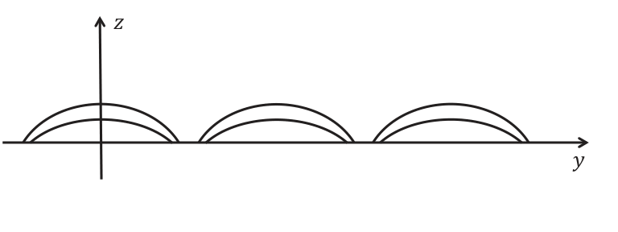

图内文字：z, y
