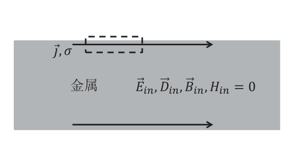
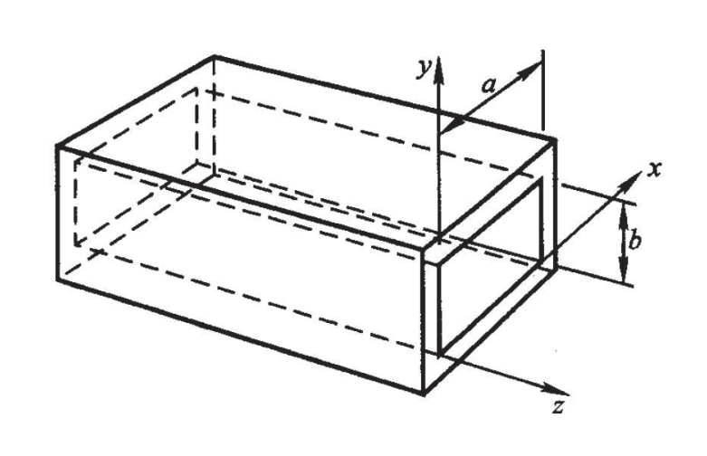
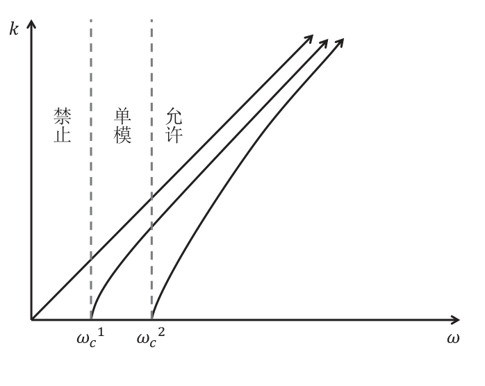
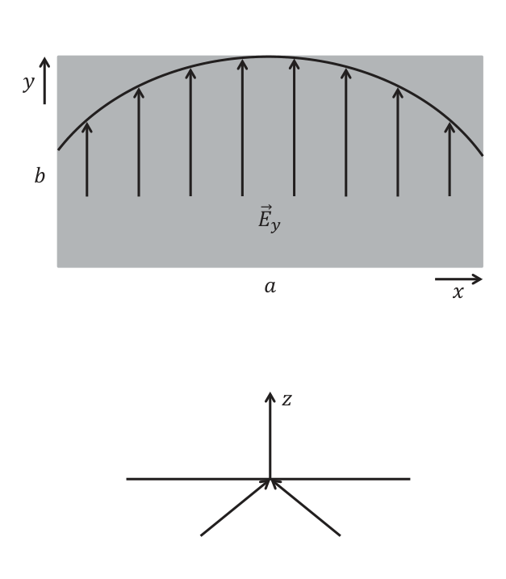
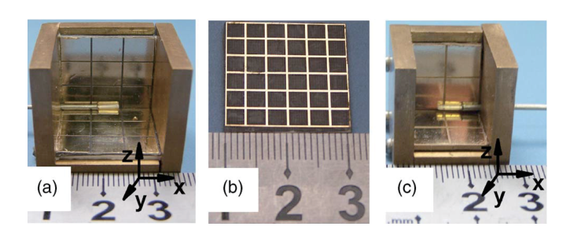

# 第八章 波导和谐振腔

上一章中我们研究了电磁波在体材料内以及在不同材料界面上的反射/折射行为，其中电磁波全都是以**平面波**的形式存在的。然而要将电磁波的信号传递到远方，用平面波的方法并不经济——因为平面波有着无限大的波前。实际生活中我们利用波导管来有效传递电磁波，将波导管的两端密封，便进一步得到谐振腔。本章我们将研究波导管中的电磁波的传播行为，以及谐振腔内的电磁振荡。

### 8.1 波导管中的场方程和边界条件

波导管是一无限长的中空金属管，其截面可以是任意形状，但通常波导管在传播方向是均匀的。电磁场在波导管中只能在管内且沿着管的轴线方向传播，这就使它与自由空间内传播的电磁波在性质上有很大的差别。

#### 8.1.1 边界条件

因为电磁波完全封闭在波导管内，我们首先应当解决的问题是电磁波在波导管壁（亦即导体）上满足的边界条件。金属波导管通常在微波通信波段使用。上两章中我们已经学到在通讯波段，金属对电磁波有很好的屏蔽作用——电磁波、感应电流、感应电荷都局限在金属表面的一个厚度为“趋肤深度 $\delta=\sqrt{2/\mu\omega\sigma_c}$”的一个薄层内，金属体内没有波、电流、电荷。因为良导体的 $\sigma_c$ 非常大，趋肤深度非常小。我们可因此将真实导体（在微波段）简化为一个“理想导体”——即金属体内没有电磁波，但在表面上有面电荷 $\sigma$、面电流分布 $\vec{J}$，换言之，将趋肤深度层内的电荷、电流简化成面电荷、面电流。将 Maxwell 方程的积分形式应用到理想金属的表面，我们得到理想金属的边界条件

图内文字：$\vec{J},\sigma$　金属　$\vec{E}_{in},\vec{D}_{in},\vec{B}_{in},H_{in}=0$

$$
\vec{n}\cdot\vec{B}=0 \qquad \vec{n}\times\vec{E}=0 \tag{8.1.1}
$$

$$
\vec{n}\cdot\vec{D}=\sigma \qquad \vec{n}\times\vec{H}=\vec{J} \tag{8.1.2}
$$

其中 $\vec{E}$，$\vec{H}$，$\vec{D}$，$\vec{B}$ 等场量是在金属表面上（介质一侧）测到的。这里已经用了金属内部所有场量为 0 的条件。事实上 $\sigma$ 和 $\vec{J}$ 均是未知量，要根据求得的场利用 8.1.2 式来决定。故“理想导体”表面的场的边界条件就是 8.1.1。

#### 8.1.2 场方程

我们现在来研究截面为任意形状的、单连通的、且沿长度方向都是一样的直波导管的情形。若波导管中无源，且是真空，则波导中的电磁场满足波动方程

$$
\left(\nabla^2-\frac{1}{c^2}\frac{\partial^2}{\partial t^2}\right)\begin{pmatrix}\vec{E}\\ \vec{B}\end{pmatrix}=0 \tag{8.1.3}
$$

选择波导管的长度方向为 $z$ 轴，我们感兴趣的是沿着 $z$ 方向传播的解。但此时沿 $z$ 方向传播的平面波一定不是波导管中的解，因为常矢量 $\vec{E}_0$ 不可能满足理想导体边界条件 8.1.1。注意到波导管沿 $z$ 轴均匀，故场量对 $z$ 的依赖关系一定为 $e^{ik_z z}$，同时，时间轴的均匀性保证时间依赖关系总是 $e^{-i\omega t}$。故设解为

$$
\begin{pmatrix}\vec{E}\\ \vec{B}\end{pmatrix}=\begin{pmatrix}\vec{E}_0(x,y)\\ \vec{B}_0(x,y)\end{pmatrix}e^{i(k_z z-\omega t)} \tag{8.1.4}
$$

代入方程 8.1.3 得

$$
\left(\frac{\partial^2}{\partial x^2}+\frac{\partial^2}{\partial y^2}+k_c^2\right)\begin{pmatrix}\vec{E}_0\\ \vec{B}_0\end{pmatrix}=0 \tag{8.1.5}
$$

式中

$$
k_0^2=\frac{\omega^2}{c^2} \tag{8.1.6}
$$

$$
k_c^2=k_0^2-k_z^2 \tag{8.1.7}
$$

8.1.5 式显示电磁场的 6 个分量全部满足 Hemholtz 方程，不过分别计算电场、磁场的 6 个分量将非常复杂。其实 8.1.5 是从 Maxwell 方程推出的 2 次方程，不是原始的 Maxwell 方程。当我们重新检查原始 Maxwell 方程组时，我们发现不同的场分量之间并不独立（就像平面波中电场与磁场的值并不独

立，比值是阻抗一样）。$\nabla\times\vec{E}=-\frac{\partial\vec{B}}{\partial t}$ 的 $x,y$ 两个方向上分量公式可得

$$
\partial_y E_{0z}-ik_z E_{0y}=ik_0 cB_{0x} \tag{8.1.8}
$$

$$
ik_z E_{0x}-\partial_x E_{0z}=ik_0 cB_{0y} \tag{8.1.9}
$$

由方程 $\nabla\times\vec{B}=\frac{1}{c^2}\frac{\partial\vec{E}}{\partial t}$ 在 $x,y$ 两个方向上的投影可得

$$
\partial_y B_{0z}-ik_z B_{0y}=-i\frac{k_0}{c}E_{0x} \tag{8.1.10}
$$

$$
ik_z B_{0x}-\partial_x B_{0z}=-i\frac{k_0}{c}E_{0y} \tag{8.1.11}
$$

利用上面四个方程可以将场的横向分量用纵向分量来表示的表达式为

$$
\begin{cases}
E_{0x}=\dfrac{i}{k_c^2}\left[k_0\partial_y(cB_{0z})+k_z\partial_x E_{0z}\right]\\[2mm]
E_{0y}=-\dfrac{i}{k_c^2}\left[k_0\partial_y(cB_{0z})-k_z\partial_x E_{0z}\right]\\[2mm]
cB_{0x}=-\dfrac{i}{k_c^2}\left[k_0\partial_y E_{0z}-k_z\partial_x(cB_{0z})\right]\\[2mm]
cB_{0y}=\dfrac{i}{k_c^2}\left[k_0\partial_y E_{0z}+k_z\partial_x(cB_{0z})\right]
\end{cases} \tag{8.1.12}
$$

8.1.12 式告诉我们：6 个场分量只有 2 个是独立变量，一旦场的纵向分量 $E_{0z}$，$B_{0z}$ 知道了，则其他分量可以通过 8.1.12 式得到。另外，值得注意的是 $E_{0y}$ 和 $B_{0x}$ 有很好的对称性，而 $E_{0x}$ 和 $B_{0y}$ 也有很好的对称性。这样我们只需要在边界条件 8.1.1 下计算 $E_{0z}$，$B_{0z}$ 所满足的方程

$$
\left(\frac{\partial^2}{\partial x^2}+\frac{\partial^2}{\partial y^2}+k_c^2\right)\begin{pmatrix}\vec{E}_{0z}(x,y)\\ \vec{B}_{0z}(x,y)\end{pmatrix}=0 \tag{8.1.13}
$$

然后利用 8.1.12 式推出所有的场量形式。

#### 波的模式（偏振）

从 8.1.13 式我们可以看出，当 $B_{0z}=0$，$E_{0z}=0$ 时，我们有 $E_{0x}=E_{0y}=B_{0x}=B_{0y}=0$，因此非平庸解不存在。这意味着波导管内不可能传

播横电磁波(TEM 波)，或者类似真空中的平面波。可见，波导中波的解 $B_{0z}$ 和 $E_{0z}$ 不能同时为 0。接下来我们考虑两个独立的情形：

1. $B_{0z}\neq0$ 而 $E_{0z}=0$；横电波（TE 波）

2. $B_{0z}=0$ 但 $E_{0z}\neq0$；横磁波（TM 波）

事实上，这与真空中电磁波的两种偏振状态非常类似。这是波导中电磁波的最显著特点之一。下面我们将以矩形波导为例说明波导中电磁波的行为。

注：我们常说电磁波是横波，但那时对真空中的平面波解才正确，在波导管内，电磁波横向受到波导壁的限制，完全的横波不可能存在。但后面我们介绍一种新的看法，大家可以明白其实波导管内没有横波和电磁波是横波这两者不矛盾。

### 8.2 矩形波导

矩形波导是指横截面为矩形的波导，结构如图 8.2 所示。设波导管壁为理想导体，分别考虑 TE 和 TM 两种偏振方式的波的传输行为。

#### 8.2.1 TE 波

由上节的讨论可知，首先要求出轴向分量 $B_{0z}$。在现在的情况下方程为

$$
\left(\frac{\partial^2}{\partial x^2}+\frac{\partial^2}{\partial y^2}+k_c^2\right)B_{0z}=0 \tag{8.2.1}
$$

考虑理想导体边界条件 8.1.1，可得

$$
E_{0x}\big|_{y=0,b}=E_{0y}\big|_{y=0,b}=B_{0x}\big|_{y=0,b}=B_{0y}\big|_{y=0,b}=0 \tag{8.2.2}
$$

图内文字：$y$，$a$，$x$，$b$，$z$

但这些条件都不是对 $B_{0z}$ 的！根据 8.1.12，在 TE 波的条件下（$E_{0z}=0$）有

$$
E_{0x}=\frac{i}{k_c^2}ck_0\partial_y B_{0z} \tag{8.2.3}
$$

$$
E_{0y}=-\frac{i}{k_c^2}ck_0\partial_x B_{0z} \tag{8.2.4}
$$

$$
B_{0x}=\frac{i}{k_c^2}k_z\partial_x B_{0z} \tag{8.2.5}
$$

$$
B_{0y}=\frac{i}{k_c^2}k_z\partial_y B_{0z} \tag{8.2.6}
$$

因此 8.2.2 式可转化成对 $B_{0z}$ 的如下边界条件：

$$
\frac{\partial}{\partial x}B_{0z}\bigg|_{x=0,a}=0 \qquad \frac{\partial}{\partial y}B_{0z}\bigg|_{x=0,a}=0 \tag{8.2.7}
$$

根据分离变量法，8.2.1 的通解为

$$
B_{0z}=B_0\left(\sin k_x x,\cos k_x x\right)\cdot\left(\sin k_y y,\cos k_y y\right) \tag{8.2.8}
$$

其中

$$
k_x^2+k_y^2=k_c^2 \tag{8.2.9}
$$

再根据边条 8.2.7，不难证明，满足上述方程和边界条件的解为：

$$
B_{0z}=B_0\cos\left(\frac{m\pi}{a}x\right)\cos\left(\frac{n\pi}{b}y\right) \tag{8.2.10}
$$

$$
k_c^2=\pi^2\left(\frac{m^2}{a^2}+\frac{n^2}{b^2}\right) \tag{8.2.11}
$$

式中 $m$，$n$ 为正整数或零。把 8.2.10 与 8.2.11 代入 8.2.3-8.2.6 式得到 $\vec{E}$，$\vec{B}$ 的全部分量为

$$
\text{TE波}\quad
\begin{cases}
E_x=-i\dfrac{n\pi}{b}\dfrac{ck_0}{k_c^2}B_0\cos\left(\dfrac{m\pi x}{a}\right)\sin\left(\dfrac{n\pi y}{b}\right)e^{i(k_z z-\omega t)}\\[2mm]
E_y=i\dfrac{m\pi}{a}\dfrac{ck_0}{k_c^2}B_0\sin\left(\dfrac{m\pi x}{a}\right)\cos\left(\dfrac{n\pi y}{b}\right)e^{i(k_z z-\omega t)}\\[2mm]
E_z=0\\[2mm]
B_x=-i\dfrac{m\pi}{a}\dfrac{k_z}{k_c^2}B_0\sin\left(\dfrac{m\pi x}{a}\right)\cos\left(\dfrac{n\pi y}{b}\right)e^{i(k_z z-\omega t)}\\[2mm]
B_y=-i\dfrac{n\pi}{b}\dfrac{k_z}{k_c^2}B_0\cos\left(\dfrac{m\pi x}{a}\right)\sin\left(\dfrac{n\pi y}{b}\right)e^{i(k_z z-\omega t)}\\[2mm]
B_z=B_0\cos\left(\dfrac{m\pi x}{a}\right)\cos\left(\dfrac{n\pi y}{b}\right)e^{i(k_z z-\omega t)}
\end{cases} \tag{8.2.12}
$$

讨论如下：

**1. 色散关系**

8.2.10 与 8.2.11 式说明 8.2.1 式中不是所有的 $k_c^2$ 都可以给出符合边界条件的解，只有某些特定的值才被允许。根据 $k_c^2$ 的定义，可计算波导管中传播模式对应的频率与波矢之间的关系（亦即我们常说的色散关系）：

$$
k_z=\sqrt{k_0^2-k_c^2}=\frac{\omega}{c}\sqrt{1-\left(\frac{ck_c}{\omega}\right)^2}=\frac{\omega}{c}\sqrt{1-\left(\frac{\omega_c}{\omega}\right)^2} \tag{8.2.13}
$$

其中

$$
\omega_c=ck_c \tag{8.2.14}
$$

**2. 截止频率**

(a) 当 $\omega<\omega_c$ 时，$k_z$ 为纯虚数，波导类似一个光波段下的金属，电磁波不能在其中传播，这种模式称为衰减波，Evanescent Mode；

(b) 当 $\omega>\omega_c$ 时，$k_z$ 为实数，波导类似一个常规电介质。电磁波可以传播，这种模式称为传播模式（Propagating Mode）。有时可以根据电介质中电磁波传播的色散关系 $k_z=\frac{\omega}{c}\sqrt{\varepsilon_r}$，定义波导的**有效介电常数**为 $\varepsilon_r=1-\left(\frac{\omega_c}{\omega}\right)^2$。

(c) $\omega_c$ 给出了电磁波能够传播的最低频率，因此称为**截止频率**（Cut-Off Frequency）。

**3. 模式**

$m$，$n$ 取不同的数值就对应了波的不同的模式，因为波在波导内传播时 $xy$ 平面的电磁场图案（Pattern）保持不变。通常人们根据 $\omega_c$ 的大小来标记模式的高低。对 TE 模式来说，$m$，$n$ 中不能全部为 0，因此当 $a<b$ 时，TE 模的最低阶模式为 $TE_{01}$（又记为 $H_{01}$，称为基模）；而当 $a>b$ 时基模为 $H_{10}$。在基模和第一高阶模的截止频率之间，波只能以一种模式存在（如图所示）。

图内文字：$k$，禁止，单模，允许，$\omega_c^1$，$\omega_c^2$，$\omega$

### 8.2. 矩形波导

#### 4. 物理图像

作为一个例子，考察最简单的也是最常用的波型 $H_{10}$ 波的场分布。由8.2.12式得

$$
\left\{
\begin{aligned}
E_y &= i\frac{ck_0}{k_c}B_0\sin\left(\frac{\pi x}{a}\right)e^{i(k_z z-\omega t)}\\
B_x &= -i\frac{k_z}{k_c}B_0\sin\left(\frac{\pi x}{a}\right)e^{i(k_z z-\omega t)}\\
B_z &= B_0\cos\left(\frac{\pi x}{a}\right)e^{i(k_z z-\omega t)}
\end{aligned}
\right.
\tag{8.2.15}
$$

电场只有 $y$ 方向分量，因此在 $y=0,b$ 两个边界自动满足PEC边条；为了使得在 $x=0,a$ 处亦满足边条，$E_y$ 的大小必须沿 $a$ 边正弦变化，中间强两边弱，形成了一个波长为 $2a$ 的驻波。可以想象，对于高阶模式，无非是以两个界面为节点，形成有更多节点的驻波而已。

图内文字：$y$，$b$，$a$，$x$，$\bar{E}_y$，$z$

对于波导中的模式，事实上我们有另一种很有启发性的看法：每一个模式都可以展开成几个对称的斜入射的平面波的线性叠加。如

对TE$_{10}$模式，其波场8.2.15完全等价于一支波矢为 $\vec{k}=k_x\hat{x}+k_z\hat{z}$ 的平面波和另一支波矢为 $\vec{k}=-k_x\hat{x}+k_z\hat{z}$ 的平面波的叠加，即

$$
\vec{E}(\vec{r},t)=\vec{E}_0^{+}e^{i(k_x x+k_z z-\omega t)}+\vec{E}_0^{-}e^{i(-k_x x+k_z z-\omega t)}
\tag{8.2.16}
$$

其中

$$
k_x=\pi/a
\tag{8.2.17}
$$

我们前面讲过在波导管中常规的正入射的平面电磁波（横波）不能传播，因为其不满足波导管中横向约束的边界条件。然而将斜入射的电磁波进行合适的线性叠加之后的波可以满足波导管的边界条件，故可以传播。这种线性叠加后的波当然不是常规意义下的横波。

#### 5. 能流

仔细观察8.2.12式，不难发现横向场分量（$E_x$，$E_y$，$B_x$，$B_y$）之间没有相位差，而与纵向场分量 $B_z$ 之间有 $\pi/2$ 的相位差。这恰恰说明了波导中能流的时间平均值只能沿 $z$ 轴非0!

#### 8.2.2 TM波

下面来研究波导中的另一个偏振状态——TM波。首先此时要求出轴向分量 $E_{0z}$，其满足的方程为8.1.13式，对应的边界条件8.2.2式现在可写成

$$
\left.E_{0z}\right|_{x=0,a}=0 \qquad \left.E_{0z}\right|_{y=0,b}=0
\tag{8.2.18}
$$

因此，容易求出满足上述边界的本征值问题的解为

$$
E_{0z}=E_0\sin\left(\frac{m\pi}{a}x\right)\sin\left(\frac{n\pi}{b}y\right)
\tag{8.2.19}
$$

$$
k_c^2=\pi^2\left(\frac{m^2}{a^2}+\frac{n^2}{b^2}\right)
\tag{8.2.20}
$$

把以上两式代入8.1.12则可得横向分量。综合起来，TM波场为

$$
\text{TM波}
\left\{
\begin{aligned}
E_x &= i\frac{m\pi k_z}{a k_c^2}E_0\cos\left(\frac{m\pi x}{a}\right)\sin\left(\frac{n\pi y}{b}\right)e^{i(k_z z-\omega t)}\\
E_y &= i\frac{n\pi k_z}{b k_c^2}E_0\sin\left(\frac{m\pi x}{a}\right)\cos\left(\frac{n\pi y}{b}\right)e^{i(k_z z-\omega t)}\\
E_z &= E_0\sin\left(\frac{m\pi x}{a}\right)\sin\left(\frac{n\pi y}{b}\right)e^{i(k_z z-\omega t)}\\
B_x &= -i\frac{n\pi k_0}{b c k_c^2}E_0\sin\left(\frac{m\pi x}{a}\right)\cos\left(\frac{n\pi y}{b}\right)e^{i(k_z z-\omega t)}\\
B_y &= i\frac{m\pi k_0}{a c k_c^2}E_0\cos\left(\frac{m\pi x}{a}\right)\sin\left(\frac{n\pi y}{b}\right)e^{i(k_z z-\omega t)}\\
B_z &= 0
\end{aligned}
\right.
\tag{8.2.21}
$$

我们作如下的讨论：

1. TM波的色散关系、截止频率都与TE波类似。甚至任何一个TM波模式也都可以分成几支平面波的叠加，只是平面波的偏振状态与TE有所不同而已。

2. 不同的是对TM波，$m$，$n$ 均不能为0，否则 $E_{0z}\equiv 0$；因此对TM波，基模是TM$_{11}$模式。因此对同样一个波导，其TM波的截止频率一定高于TE波的截止频率。

### 8.3 谐振腔

低频电磁波是利用LC电路组成的振荡器激发的，当频率很高时(例如微波范围)，这种振荡回路有强烈的焦耳热损耗。因此，必须用另一种振荡器——谐振腔来激发高频电磁波。

谐振腔是由理想导体所围成的封闭腔体，显然腔中单色场满足如下方

程：

$$
\nabla\cdot\vec{E}=0 \qquad \nabla\cdot\vec{B}=0
\tag{8.3.1}
$$

$$
\nabla\times\vec{E}=i\omega\vec{B} \qquad \nabla\times\vec{B}=-i\frac{\omega}{c^2}\vec{E}
\tag{8.3.2}
$$

在边界上电磁场满足PEC边界条件

$$
\vec{e}_n\times\vec{E}=0 \qquad \vec{e}_n\cdot\vec{B}=0
\tag{8.3.3}
$$

从根本上来讲，我们是在边界条件8.3.3式下求解方程8.3.1和8.3.2式。

任意形状的谐振腔中的电磁模式必须数值求解。然而对最简单的谐振腔——长方体谐振腔，其电磁模式可以解析求解，这对我们理解谐振腔非常有帮助。将一个尺寸为 $a\times b\times d$ 的长方体谐振腔看作一个截面为 $a\times b$ 的长度为 $d$ 的空腔波导两端加上PEC端面。不加端面时，空腔中的电磁波一定为波导中的电磁本征态。取定一个模式（如TE$_{mn}$模式），则谐振腔中的电磁场的一个分量为

$$
B_z=\left[B_0\cos\left(\frac{m\pi}{a}x\right)\cos\left(\frac{n\pi}{b}y\right)e^{ik_z z}\right]e^{-i\omega t}
\tag{8.3.4}
$$

其他分量可以相应导出。加上PEC端面后，端面对电磁波进行反射，因此波导内的场现在由两部分叠加而成：一是沿着 $z$ 方向传播的前进波；二是沿着 $-z$ 方向的反射波。因此一般来说，有

$$
B_z=\left[B_0\cos\left(\frac{m\pi}{a}x\right)\cos\left(\frac{n\pi}{b}y\right)e^{ik_z z}+B_0'\cos\left(\frac{m\pi}{a}x\right)\cos\left(\frac{n\pi}{b}y\right)e^{-ik_z z}\right]e^{-i\omega t}
\tag{8.3.5}
$$

$B_0$，$B_0'$ 两个系数应由在新加上的两个端面上的边界条件

$$
\begin{cases}
\left.\vec{e}_n\times\vec{E}\right|_{z=0,d}=0\\
\left.\vec{e}_n\cdot\vec{B}\right|_{z=0,d}=0
\end{cases}
\quad\Rightarrow\quad
\left.B_z\right|_{z=0,d}=0
\tag{8.3.6}
$$

决定（其他四个界面上的边界条件已经满足）。在 $z=0$ 处的边条要求

$$
B_0'=-B_0
\tag{8.3.7}
$$

而 $z=d$ 处的边界条件给出

$$
\left.B_z\right|_{z=d}=2iB_0\cos\left(\frac{m\pi}{a}x\right)\cos\left(\frac{n\pi}{b}y\right)
\tag{8.3.8}
$$

故有

$$
\sin k_z d=0
\tag{8.3.9}
$$

因此，$k_z$ 为

$$
k_z=\frac{p\pi}{d} \qquad p=1,2,3\cdots
\tag{8.3.10}
$$

注意到 $E_{0x}=\frac{i}{k_c^2}ck_0\partial_y B_{0z}$，$E_{0y}=-\frac{i}{k_c^2}ck_0\partial_x B_{0z}$，我们发现另一个边界条件 $\vec{n}\times\vec{E}=0$ 自动在 $z=0$ 和 $z=d$ 处满足。最后得到矩形谐振腔内场的空间部分为

$$
\left\{
\begin{aligned}
B_{0x} &= -2iB_0\frac{m\pi}{a}\frac{p\pi}{d}\frac{1}{k_c^2}\sin\left(\frac{m\pi}{a}x\right)\cos\left(\frac{n\pi}{b}y\right)\cos\left(\frac{p\pi}{d}z\right)\\
B_{0y} &= -2iB_0\frac{n\pi}{b}\frac{p\pi}{d}\frac{1}{k_c^2}\cos\left(\frac{m\pi}{a}x\right)\sin\left(\frac{n\pi}{b}y\right)\cos\left(\frac{p\pi}{d}z\right)\\
B_{0z} &= 2iB_0\cos\left(\frac{m\pi}{a}x\right)\cos\left(\frac{n\pi}{b}y\right)\sin\left(\frac{p\pi}{d}z\right)\\
E_{0x} &= 2B_0\frac{n\pi}{b}\frac{ck_0}{k_c^2}\cos\left(\frac{m\pi}{a}x\right)\sin\left(\frac{n\pi}{b}y\right)\sin\left(\frac{p\pi}{d}z\right)\\
E_{0y} &= -2B_0\frac{m\pi}{a}\frac{ck_0}{k_c^2}\sin\left(\frac{m\pi}{a}x\right)\cos\left(\frac{n\pi}{b}y\right)\sin\left(\frac{p\pi}{d}z\right)\\
E_{0z} &= 0
\end{aligned}
\right.
\tag{8.3.11}
$$

讨论如下：

1. 磁场表达式和电场表达式之间相差一个因子 $i$，这表明电场和磁场在时间上存在着 $\pi/2$ 的相位差。这种形式的波与传播波（$E$，$B$ 同相位），良导体中的电磁波（$E$，$B$ 有 $\pi/4$ 的相位差）均不相同，与等离子体中的具有虚波矢的电磁波行为类似，因此可以预计，这里面平均没有能流。的确，电磁波在腔中形成了驻波，所有方向上都没有净的能量流动。

2. 因为 $k_z=\frac{p\pi}{d}$，且 $k_z^2+k_c^2=k_0^2$，于是得

$$
k_0^2=k_c^2+k_z^2=\left(\frac{m\pi}{a}\right)^2+\left(\frac{n\pi}{b}\right)^2+\left(\frac{p\pi}{d}\right)^2
\tag{8.3.12}
$$

所以，谐振腔允许存在的谐振频率和波长分别为

$$
\omega=c\pi\sqrt{\frac{m^2}{a^2}+\frac{n^2}{b^2}+\frac{p^2}{d^2}}
\tag{8.3.13}
$$

$$
\lambda=2\Big/\sqrt{\frac{m^2}{a^2}+\frac{n^2}{b^2}+\frac{p^2}{d^2}}
\tag{8.3.14}
$$

3. 谐振腔中的场用三个脚标 $m$，$n$，$p$ 标记，每一组（$m,n,p$）的值决定一种振荡模式。对E波记为 $E_{mnp}$，对H波记为 $H_{mnp}$，并且 $E_{mnp}$ 和 $H_{mnp}$ 中的脚标 $m$，$n$，$p$ 可取各种组合，使得谐振频率相等，但场的分布不同，此时说 $E_{mnp}$ 和 $H_{mnp}$ 是简并的。另外值得指出的是，在针对某一个方向写出的TM模式可能是另外一个方向的TM模式！由8.3.11式可以看出，对TE模式，$p$ 不能为0，否则谐振腔中的电磁场全部为0。对TM模式的共振腔模分析发现，$p$ 可以为0，但 $m$，$n$ 都不能为0。因此，综合TE，TM的分析结果，谐振腔中 $m$，$n$，$p$ 三个指标中只能有一个不是0！故谐振腔的最低阶模式为（110），（101）或者（011）。

4. 在共振腔中加一个源，激发各个频率的波。当在腔壁凿一些小孔，或是将个别腔壁换成不是完全透射的，这时电磁波就会从这些地方耦合出去（如图8.5所示）。因为共振腔中只允许分立的模式存在，发射出去的电磁波就具有很好的选频性能，且辐射强度很高。另外电磁谐振腔也可以用到其它微波系统中，做选频，放大等功能。

5. 一个立方状的谐振腔，其能允许的最低阶的腔模式为TE$_{011}$（有3支兼并模式），对应的波长为 $\lambda=\sqrt{2}a$。这就意味着，对常规的谐振腔，要想实现某一个波长的谐振功能，其尺度必须大于某一个特定的大小。若要实现一个较长波的频率，谐振腔就要做的很大，对我们实际应用不利。应用电磁特异介质改变腔壁的反射性能，我们可以改变

腔的谐振条件，从而打破这一尺度限制（参考我的研究组的两篇文章 APL 86, 101101 (2005)；APL 89, 104104 (2006)。可从我的主页上下载）

图内文字：(a)，(b)，(c)，$z$，$x$，$y$
