# 第九章 电磁波的辐射

我们在第七、八两章中已经介绍了电磁波在不同的媒质中的传输行为，然而，我们对电磁波如何产生的却仍然不知道。这一章中，我们将详细介绍电磁波如何从源（电荷、电流分布）区产生出来的，这个过程叫做电磁辐射。

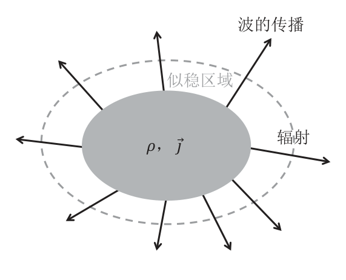

图内文字：波的传播　似稳区域　$\rho,\ \vec{j}$　辐射

### 9.1　势、规范、及其满足的方程

#### 9.1.1　势的定义

原则上讲，对确定的电荷分布 $\rho(\vec{r},t)$ 和电流分布 $\vec{j}(\vec{r},t)$，我们求它的辐射电磁场就是求解Maxwell方程

$$
\left\{
\begin{aligned}
&\nabla\cdot\vec{E}=\rho/\varepsilon_0\\
&\nabla\times\vec{E}=-\frac{\partial}{\partial t}\vec{B}\\
&\nabla\cdot\vec{B}=0\\
&\nabla\times\vec{B}=\mu_0\vec{j}+\mu_0\varepsilon_0\frac{\partial}{\partial t}\vec{E}
\end{aligned}
\right.
\tag{9.1.1}
$$

直接求解 $\vec{E}$, $\vec{B}$ 场的方程通常比较麻烦，可以使用并矢格林函数的方法（参考JA Kong的书）。类似处理静电、静磁时的情况，我们在处理与源有关的辐射问题时解“势”的问题更加方便。与静电、静磁时相比，在一般情况下标势、矢势的定义有所不同。根据Maxwell方程第三式，可定义矢势 $\vec{A}$ 为

$$
\nabla\times\vec{A}=\vec{B}
\tag{9.1.2}
$$

将其带入Maxwell方程第2式，可得

$$
\nabla\times\left(\vec{E}+\frac{\partial}{\partial t}\vec{A}\right)=0
\tag{9.1.3}
$$

因此可以定义标势，其满足

$$
\vec{E}+\frac{\partial}{\partial t}\vec{A}=-\nabla\varphi\ \Rightarrow\ \vec{E}=-\frac{\partial}{\partial t}\vec{A}-\nabla\varphi
\tag{9.1.4}
$$

#### 9.1.2　规范条件（Gauge）

9.1.2与9.1.4所定义的势并不唯一。给定任意一个标量函数 $\Lambda(\vec{r})$，由此定义一对新的标势和矢势：

$$
\varphi'=\varphi-\frac{\partial\Lambda}{\partial t}\qquad \vec{A}'=\vec{A}+\nabla\Lambda
\tag{9.1.5}
$$

将上式代入9.1.2和9.1.4，我们发现 $\{\vec{A}',\varphi'\}$ 给出与 $\{\vec{A},\varphi\}$ 完全一样的 $\vec{E},\vec{B}$ 场。在经典电动力学的范畴内，$\vec{E},\vec{B}$ 对应着真实的物理场，$\{\vec{A},\varphi\}$ 并不对应真实的物理场。因此对于同样的物理体系，$\{\vec{A},\varphi\}$ 的选择并不唯一，必须在某一个条件的约束下才可能为唯一确定下来。这个条件称为规范条件。通常使用的规范是库仑规范

$$
\nabla\cdot\vec{A}=0
\tag{9.1.6}
$$

和洛仑兹规范

$$
\nabla\cdot\vec{A}+\frac{1}{c^2}\frac{\partial\varphi}{\partial t}
\tag{9.1.7}
$$

值得注意的是：洛仑兹规范在静电静磁条件下与库仑规范一致。

#### 9.1.3　势所满足的方程

将9.1.2和9.1.4带入Maxwell方程中的第1和第4式，我们得到对势的方程：

$$
\nabla^2\varphi+\frac{\partial}{\partial t}\left(\nabla\cdot\vec{A}\right)=-\rho/\varepsilon_0
\tag{9.1.8}
$$

$$
-\nabla^2\vec{A}+\nabla\left(\nabla\cdot\vec{A}\right)=\mu_0\vec{j}+\frac{1}{c^2}\frac{\partial}{\partial t}\left(-\nabla\varphi-\frac{\partial\vec{A}}{\partial t}\right)
\tag{9.1.9}
$$

这组方程是 $\{\vec{A},\varphi\}$ 耦合在一起的，使用起来不方便。利用Lorentz规范条件可以将其化简成相当对称而标准的有源波动方程的形式

$$
\nabla^2\varphi-\frac{1}{c^2}\frac{\partial^2}{\partial t^2}\varphi=-\rho/\varepsilon_0
\tag{9.1.10}
$$

$$
\nabla^2\vec{A}-\frac{1}{c^2}\frac{\partial^2}{\partial t^2}\vec{A}=-\mu_0\vec{j}
\tag{9.1.11}
$$

因此，我们首先根据源的情况求解上两式得到势，然后再由势求出电磁场。

### 9.2　推迟势

由于 $\vec{A}$ 和 $\varphi$ 满足同样的方程，因此我们只要讨论一个标量方程

$$
\left(\nabla^2-\frac{1}{c^2}\frac{\partial^2}{\partial t^2}\right)\varphi(\vec{r},t)=-\rho(\vec{r},t)/\varepsilon_0
\tag{9.2.1}
$$

的解。求解上述方程的标准方法是定义一个格林函数，满足

$$
\left(\nabla^2-\frac{1}{c^2}\frac{\partial^2}{\partial t^2}\right)G(\vec{r}-\vec{r}',t-t')=-\delta(\vec{r}-\vec{r}')\delta(t-t')
\tag{9.2.2}
$$

这个函数其实就是当 $t'$ 时刻在 $\vec{r}'$ 处做一个单位强度的扰动时，空间所激发的场。定义 $\vec{R}=\vec{r}-\vec{r}'$，$T=t-t'$，我们发现当格林函数已知后，对任意的电荷分布，其电势可以表示为

$$
\varphi(\vec{r},t)=\frac{1}{\varepsilon_0}\int G(\vec{R},T)\rho(\vec{r}',t')d\vec{r}'dt'
\tag{9.2.3}
$$

证明9.2.3式并不困难，只要对等式两端都作用一个 $\left(\nabla^2-\frac{1}{c^2}\frac{\partial^2}{\partial t^2}\right)$ 算符，再利用9.2.2，则发现9.2.3是9.2.1的正确解。下面求解格林函数。在 $R,T$ 空间求解非常不方便，利用Fourier变换可得

$$
G(\vec{R},T)=\frac{1}{(2\pi)^4}\int G(\vec{k},\omega)e^{i\vec{k}\cdot\vec{R}}e^{-i\omega T}d\vec{k}d\omega
\tag{9.2.4}
$$

$$
\delta(\vec{R},T)=\frac{1}{(2\pi)^4}\int e^{i\vec{k}\cdot\vec{R}}e^{-i\omega T}d\vec{k}d\omega
\tag{9.2.5}
$$

代入9.2.2可以解得 $(\vec{k},\omega)$ 空间的格林函数的解为

$$
G(\vec{k},\omega)=\frac{1}{k^2-k_0^2}
\tag{9.2.6}
$$

其中

$$
k_0^2=(\omega/c)^2=\varepsilon_0\mu_0\omega^2
\tag{9.2.7}
$$

因此，将9.2.6带回9.2.4可得 $(\vec{R},T)$ 空间的格林函数为

$$
G(\vec{R},T)=\frac{1}{(2\pi)^4}\int\frac{e^{i\vec{k}\cdot\vec{R}}e^{-i\omega T}}{k^2-k_0^2}d\vec{k}d\omega=\frac{1}{2\pi}\int G(\vec{R},\omega)d\omega
\tag{9.2.8}
$$

求解9.2.8这个积分并不容易。先计算对 $k$ 的积分：

$$
G(\vec{R},\omega)=\frac{1}{(2\pi)^3}\int\frac{e^{i\vec{k}\cdot\vec{R}}}{k^2-k_0^2}d\vec{k}
\tag{9.2.9}
$$

$$
=\frac{1}{(2\pi)^2}\int\frac{e^{ikR\cos\theta}}{k^2-k_0^2}k^2dk\sin\theta d\theta
\tag{9.2.10}
$$

$$
=\frac{1}{(2\pi)^2iR}\int_0^\infty\frac{e^{ikR}-e^{-ikR}}{k^2-k_0^2}kdk
\tag{9.2.11}
$$

$$
=\frac{1}{2(2\pi)^2iR}\int_{-\infty}^{\infty}\left(\frac{k}{k^2-k_0^2}\right)\cdot\left(e^{ikR}-e^{-ikR}\right)dk
\tag{9.2.12}
$$

$$
=\frac{1}{4(2\pi)^2iR}\int_{-\infty}^{\infty}\left(\frac{1}{k-k_0}+\frac{1}{k+k_0}\right)\cdot\left(e^{ikR}-e^{-ikR}\right)dk
\tag{9.2.13}
$$

$$
=\frac{1}{4(2\pi)^2iR}\times
\tag{9.2.14}
$$

$$
\left\{\int_{-\infty}^{\infty}\left(\frac{1}{k-k_0}+\frac{1}{k+k_0}\right)e^{ikR}dk-\int_{-\infty}^{\infty}\left(\frac{1}{k-k_0}+\frac{1}{k+k_0}\right)e^{-ikR}dk\right\}
\tag{9.2.15}
$$

上面的积分中有奇点，若想得到收敛的结果，必须假设 $k_0$ 具有一个很小的虚部。

但这个虚数的符号应当取+还是取-呢？选择的依据是“因果关系”！——在正常介质中这个虚部必须为正。“因果关系”要求电磁波在介质中向前传播（能流的方向）时应当产生焦耳热从而使得

能量被耗散。而 $k_0$ 是介质中向前传播的波矢，假设 $k_0=\mathrm{Re}(k_0)+i\delta$，则 $e^{ik_0r}e^{-\omega t}=e^{i\mathrm{Re}(k_0)r}e^{-\delta r}e^{-i\omega t}$，因此 $\delta$ 一定为正。

*Tips*：

1. 这里我们考虑的就是在实轴上的全积分，不是主轴积分($P$)，因此一定要选择合适的路径；

2. 由9.2.7可知，当处于一定介质中时（如空气），因为介质的 $\varepsilon$，$\mu$ 一定因为耗散而有虚部，则 $k_0$ 一定带有虚部！即是是真空，也会因为涨落而对电磁波有耗散。因此给 $k_0$ 一个小的虚部不仅是数学的要求，还是物理的必然！

对上面的两个积分分别选择如图所示的闭合回路，将被积函数解析延拓到复平面，则利用留数定理容易推出

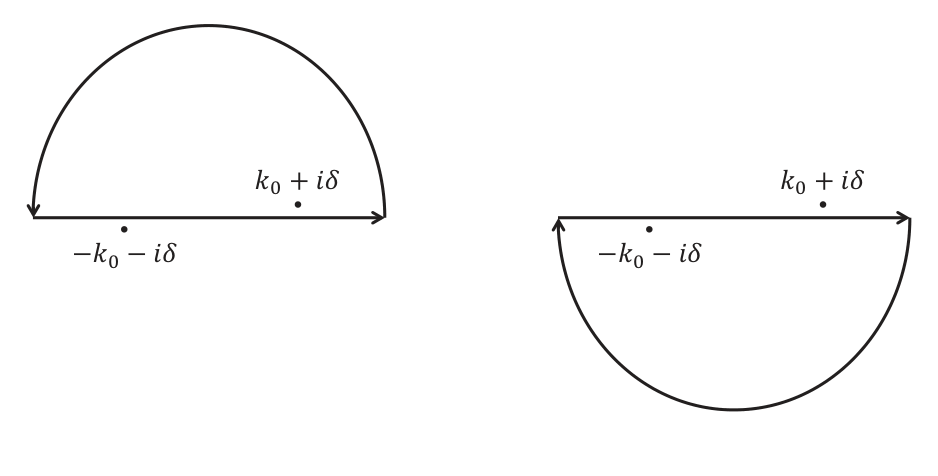

图内文字：$k_0+i\delta$，$-k_0-i\delta$

$$
G(\vec{R},\omega)=\frac{1}{4(2\pi)^2iR}e^{ik_0R}\times2\pi i-\frac{1}{4(2\pi)^2iR}e^{ik_0R}\times(-2\pi i)=\frac{e^{ik_0R}}{4\pi R}
\tag{9.2.16}
$$

在9.2.16式中加入时间振荡因子 $e^{-i\omega T}$，则发现这个解对应这样一个单频波，$\dfrac{e^{ik_0R}}{4\pi Re^{-i\omega T}}$，其物理意义为一个点源的“出射波”——即从源点向外发

射的球面波。显然这是符合“因果关系”的解。若选择 $k_0$ 的虚部为负，则结果为不符合因果关系的“会聚波”。进而将9.2.16代入9.2.8可得最终的格林函数

$$
\varphi(\vec{r},t)=\frac{1}{4\pi\varepsilon_0}\int\frac{1}{R}\delta(R/c-T)\rho(\vec{r}',t')d\vec{r}'dt'=\frac{1}{4\pi\varepsilon_0}\int\frac{[\rho]}{R}d\vec{r}'
\tag{9.2.17}
$$

式中方括号 $[\ ]$ 表示 $t'=t-\dfrac{R}{c}$，同理可得

$$
\vec{A}(\vec{r},t)=\frac{\mu_0}{4\pi}\int\frac{[\vec{j}]}{R}d\vec{r}'
\tag{9.2.18}
$$

我们注意到 $\varphi$，$\vec{A}$ 的表达式在形式上与静态时的解一致，只是在动态时 $t$ 时刻的辐射场是由此时刻前的一个时刻的扰动贡献的，而这个推迟的时间正是从源到观测点光信号传播所需的时间。这就是推迟势，其物理的根据是因果关系。

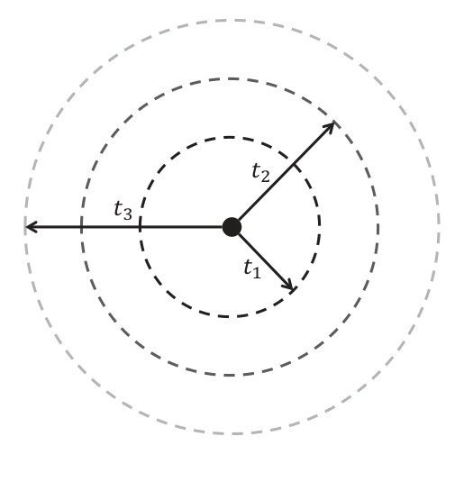

图内文字：$t_1$，$t_2$，$t_3$

### 9.3　多极辐射

很多情况下辐射源电流、电荷分布于空间一很小区域内，而我们则关

心远场的行为，此时类似静电、静磁时的处理方法，我们可以作多极展开。

#### 9.3.1　推迟势的多极展开

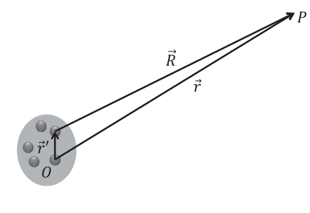

图内文字：$P$，$\vec{R}$，$\vec{r}$，$\vec{r}'$，$O$

我们讨论的是远离源的场，即 $r\gg l$，$l$ 为源的线度。被积函数是 $\vec{R}$ 的函数，我们可以将它在 $\vec{r}$ 处展开为级数，即

$$
\frac{[\rho]}{R}=\left.\frac{[\rho]}{R}\right|_{R=r}+(\vec{R}-\vec{r})\cdot\frac{\partial}{\partial\vec{R}}\left(\frac{[\rho]}{R}\right)_{R=r}+\cdots=\frac{[\rho]_0}{r}-\vec{r}'\cdot\nabla\frac{[\rho]_0}{r}+\cdots
\tag{9.3.1}
$$

式中 $[\rho]_0$ 表示 $\rho\left(\vec{r}',t-\dfrac{r}{c}\right)$，以后为简便起见，脚标0不再写出。同理可得

$$
\frac{[\vec{j}]}{R}=\frac{[\vec{j}]}{r}-\vec{r}'\cdot\nabla\frac{[\vec{j}]}{r}+\cdots
\tag{9.3.2}
$$

故

$$
\varphi=\frac{1}{4\pi\varepsilon_0}\left(\int\frac{[\rho]}{r}d\tau'-\int\vec{r}'\cdot\nabla\frac{[\rho]}{r}d\tau'+\cdots\right)
\tag{9.3.3}
$$

$$
\vec{A}=\frac{\mu_0}{4\pi}\left(\int\frac{[\vec{j}]}{r}d\tau'-\int\vec{r}'\cdot\nabla\frac{[\vec{j}]}{r}d\tau'+\cdots\right)
\tag{9.3.4}
$$

我们下面分别研究 $\vec{A}$，$\varphi$ 展开式中各项的物理意义，以及它们所代表的辐射场的性质。

#### 9.3.2 电偶极辐射

$\varphi$展开式中的第一项

$$
\varphi_0 = \int \frac{[\rho]}{4\pi\varepsilon_0 r}d\tau' = \frac{1}{4\pi\varepsilon_0 r}\int[\rho]d\tau' = \frac{Q}{4\pi\varepsilon_0 r} \tag{9.3.5}
$$

$Q$是系统的总电荷量，一般情况下不随时间变化，没有辐射。第二项

$$
\varphi_1 = -\int \vec{r}'\cdot\frac{[\rho]}{4\pi\varepsilon_0 r}d\tau' = -\nabla\cdot\frac{[\vec{p}]}{4\pi\varepsilon_0 r} \tag{9.3.6}
$$

式中$[\vec{p}] = \int\vec{r}'[\rho]d\tau'$，表示系统总的电偶极矩。

$\vec{A}$展开式中的第一项

$$
\vec{A}_1 = \frac{\mu_0}{4\pi}\int\frac{[\vec{j}]}{r}d\tau' = \frac{\mu_0}{4\pi r}\int[\vec{v}\rho]d\tau' = \frac{\mu_0}{4\pi r}\left[\sum_i q_i\vec{v}_i\right] \tag{9.3.7}
$$

$$
= \frac{\mu_0}{4\pi r}\frac{d}{dt}\left[\sum_i q_i\vec{r}_i\right] = \frac{\mu_0}{4\pi r}[\vec{p}] \tag{9.3.8}
$$

所以，电偶极矩系统所产生的$\vec{A}$和$\varphi$为9.3.6及9.3.8。下面考虑单频的辐射源，$\rho(\vec{r}',t') = \rho(\vec{r}')e^{-i\omega t'}$，$\vec{j}(\vec{r}',t') = \vec{j}(\vec{r}')e^{-i\omega t'}$（任意情况总可以展开成单频结果的叠加）。从联系$\vec{B}$与$\vec{A}$的公式，我们得到电偶极辐射场中的磁场部分为

$$
\vec{B} = \frac{\mu_0}{4\pi}\nabla\times\frac{[\vec{p}]}{r} = -\frac{i\omega\mu_0}{4\pi}\nabla\times\frac{[\vec{p}]}{r} \tag{9.3.9}
$$

电场当然也可以由势推出。但在无源区，电场可以更简单地由磁场导出

$$
\vec{E} = -\frac{c^2}{i\omega}\nabla\times\vec{B} = \frac{1}{4\pi\varepsilon_0}\nabla\times\nabla\times\frac{[\vec{p}]}{r} \tag{9.3.10}
$$

下面仔细分析一下在9.3.9和9.3.10式中要用到的一项：

$$
\nabla\times\frac{[\vec{p}]}{r} = (\nabla\times[\vec{p}])\frac{1}{r} + \left[\nabla\left(\frac{1}{r}\right)\times[\vec{p}]\right] \tag{9.3.11}
$$

考虑第一项，因为$[\vec{p}] = \vec{p}_0 e^{-i\omega t}e^{i\omega r/c}$，则微分运算可以代换成

$$
\nabla \leftrightarrow i\frac{\omega}{c}\vec{e}_r = ik\vec{e}_r \tag{9.3.12}
$$

再考虑第二项，因为$\nabla\left(\frac{1}{r}\right) = -\frac{1}{r^2}\vec{e}_r$，最终，9.3.11变为

$$
i\frac{\omega}{c}\left(\vec{e}_r\times[\vec{p}]\frac{1}{r}\right) - \frac{1}{r}\left(\vec{e}_r\times[\vec{p}]\frac{1}{r}\right) \tag{9.3.13}
$$

因此，$\frac{\omega}{c}$和$\frac{1}{r}$的比较决定了哪一项大，哪一项小。下面我们分三个区域来讨论。

##### 近区

$r \ll \lambda$，但仍满足$r \gg l$。这时公式9.3.9和9.3.10中的旋度算子只要对分母运算即可。因为每对分母运算一次得到一个$\frac{1}{r}$因子，而对分子运算得到一个$\frac{1}{\lambda}$因子，显然$\frac{1}{r}$比$\frac{1}{\lambda}$贡献大。于是我们得到近区的场强为

$$
\vec{B} = \frac{i\omega\mu_0}{4\pi r^2}\vec{e}_r\times[\vec{p}] \tag{9.3.14}
$$

$$
\vec{E} = \frac{1}{4\pi\varepsilon_0 r^3}\left[3\vec{e}_r(\vec{e}_r\cdot[\vec{p}]) - [\vec{p}]\right] \tag{9.3.15}
$$

我们注意到此时电场和静态时的电偶极子的电场形式上完全一样，只不过时间上推迟了一个辐射时间而已——事实上在这个条件下，“准静态”近似适用（参考第六章）。

##### 远区

不仅要求$r \gg l$，而且$r \gg \lambda$，$\lambda$为辐射场的波长，此时，公式9.3.11中第一项远大于第二项。因此在计算电磁场时，只需计算$\nabla$算子作用到$[\vec{p}]$上即可，无需计算其作用到$\frac{1}{r}$上。这等价于做代换9.3.12。因此，远区场强的公式为

$$
\vec{B} = \frac{\omega^2\mu_0}{4\pi cr}\vec{e}_r\times[\vec{p}] \tag{9.3.16}
$$

$$
\vec{E} = -\frac{\omega^2}{4\pi\varepsilon_0 c^2 r}\vec{e}_r\times\left(\vec{e}_r\times[\vec{p}]\right) \tag{9.3.17}
$$

##### 中间区域

虽然$r \gg l$，但$r \approx \lambda$，这时我们必须同时保留对分母运算的项和对分子运算的项。这是因为对两者运算得到的因子$\frac{1}{r}$和$\frac{\omega}{c} = \frac{1}{\lambda}$是同数量级。

思考题：与远场区不同，在近场区电场与磁场差一个$i$，这中间有什么物理值得我们思考呢？能否联系第六章准静态的知识，对上述事实作一番讨论？

[例1] 如图所示，两个金属小球分别带电荷$+Q$和$-Q$，它们之间距离为$l$，两小球的电荷的数值和符号同步地周期性变化，这就是所谓的赫兹振子。试分析赫兹振子辐射场的能流特点。

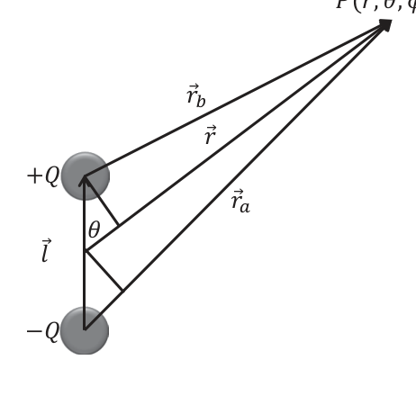
图内文字：$P(r,\theta,\phi)$，$+Q$，$-Q$，$\vec{l}$，$\theta$，$\vec{r}$，$\vec{r}_a$，$\vec{r}_b$

解：取球坐标系，$+Q$和$-Q$处在$z$轴上，设$Q = Q_0e^{-i\omega t'}$（利用复场表示），则体系的电偶极矩为

$$
\vec{p} = lQ\vec{e}_z = lQ_0e^{-i\omega t'}\vec{e}_z = p_0e^{-i\omega t'}\vec{e}_z \tag{9.3.18}
$$

将它们代入偶极辐射的远区公式，有

$$
\left\{
\begin{aligned}
\vec{B} &= \frac{\mu_0\omega^2p_0}{4\pi cr}\sin\theta e^{-i\omega(t-r/c)}(-\vec{e}_\phi)\\
\vec{E} &= -\vec{e}_r\times(c\vec{B}) = \frac{\mu_0\omega^2p_0}{4\pi r}\sin\theta e^{-i\omega(t-r/c)}(-\vec{e}_\theta)
\end{aligned}
\right. \tag{9.3.19}
$$

由9.3.19式可以看出，场正比于$\frac{1}{r}$，电场只有$\vec{e}_\theta$方向分量，磁场只有$\vec{e}_\phi$方向分量，且$cB_\phi = E_\theta$。辐射场在偶极矩方向上为零。辐射能流的平均值为

$$
\langle\vec{S}_P\rangle = \frac{1}{2\mu_0}\mathrm{Re}\left(\vec{E}\times\vec{B}^*\right) = \frac{c}{2\mu_0}|B|^2\vec{e}_r = \frac{\mu_0\omega^4p_0^2\sin^2\theta}{32\pi^2c}\frac{1}{r^2}\vec{e}_r \tag{9.3.20}
$$

对这个结果讨论如下：

1. 辐射能流的特点是正比于$\frac{1}{r^2}$，偶极矩的平方，$\omega$的四次方；

2. 这说明辐射能力在低频时较弱，而在高频时高，这与我们第六章所讨论的“准静态近似”的适用条件一致；

3. 辐射能流正比于$\frac{1}{r^2}$是一个稳定辐射问题的必然要求，如若不然，则必然在空间产生能量积累，从而辐射问题不稳定。也正因为如此，辐射能流在某一个特定的立体角组成的通道内保持相同。

基于此，在讨论辐射问题时，我们常用角分布的概念来描述体系向空间不同方向辐射能量的情况，其定义为

$$
\langle f(\theta,\phi)\rangle = \frac{\langle\vec{S}_P\rangle\cdot d\vec{S}}{d\Omega} = \frac{\langle\vec{S}_P\rangle\cdot r^2d\Omega}{d\Omega} = \langle\vec{S}_P\rangle\cdot r^2 \tag{9.3.21}
$$

这表示在$\theta$，$\phi$方向单位立体角内的平均辐射能流，显然，现在

$$
\langle f(\theta,\phi)\rangle = \frac{\mu_0\omega^4p_0^2}{32\pi^2c}\sin^2\theta \tag{9.3.22}
$$

辐射角分布的情况如图9.6所示，在$\theta = \pi/2$的方向辐射最强，在$\theta = 0$或$\pi$的方向无辐射。

#### 9.3.3 磁偶极辐射

下面考虑磁偶极辐射，此时应当考虑$\vec{A}_2$项。在远场（$r \gg \lambda$）及单频

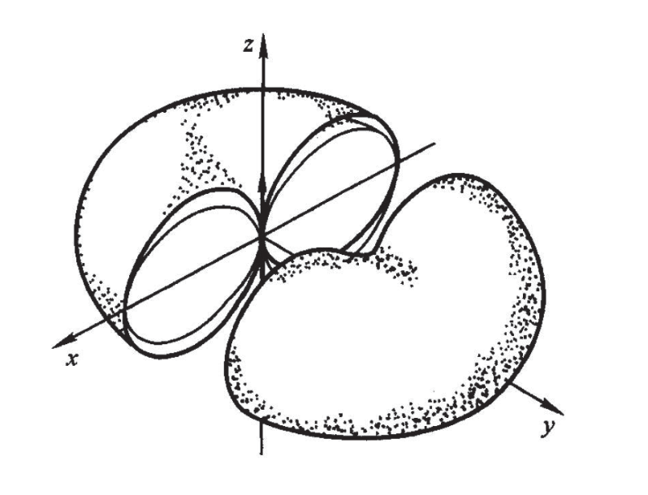
图内文字：$z$，$x$，$y$

条件下，只保留$\nabla$对推迟势的作用（亦即，作代换$\nabla \leftrightarrow i\frac{\omega}{c}\vec{e}_r$），则有

$$
\vec{A}_2 = -\frac{\mu_0}{4\pi}\int\vec{r}'\cdot\nabla\frac{[\vec{j}]}{r}d\tau' = -\frac{\mu_0}{4\pi}\int\vec{r}'\cdot\left(i\frac{\omega}{c}\vec{e}_r\right)\frac{[\vec{j}]}{r}d\tau' = -\frac{i\mu_0\omega}{4\pi r^2c}\vec{r}\cdot\int\vec{r}'[\vec{j}]d\tau' \tag{9.3.23}
$$

$$
= -\frac{i\mu_0\omega}{4\pi r^2c}\frac{1}{2}\vec{r}\cdot\left[\int\left(\vec{r}'\vec{j}+\vec{j}\vec{r}'\right)d\tau' + \int\left(\vec{r}'\vec{j}-\vec{j}\vec{r}'\right)d\tau'\right] \tag{9.3.24}
$$

上式[ ]中第一项在静磁条件下为0（参考第十五讲5.5.10式），当电流随时间谐变时，其为电四极子的贡献（严格证明从略，但由$\vec{j} = \dot{\vec{P}}$可知，此项积分正比于$\int\vec{r}'\vec{r}'\rho d\tau' \propto \ddot{\vec{D}}$）。第二项可改写为

$$
\vec{A}_m = -\frac{i\mu_0\omega}{4\pi r^2c}\frac{1}{2}\int\vec{r}\cdot\left(\vec{r}'\vec{j}-\vec{j}\vec{r}'\right)d\tau' \tag{9.3.25}
$$

$$
= -\frac{i\mu_0\omega}{4\pi r^2c}\frac{1}{2}\int\vec{r}\times\left(\vec{j}\times\vec{r}'\right)d\tau' \tag{9.3.26}
$$

$$
= \frac{i\mu_0\omega}{4\pi r^2c}\vec{r}\times[\vec{m}] \tag{9.3.27}
$$

正是磁偶极子的贡献。这里第二个等式用到了关系式：$\vec{a}\times(\vec{b}\times\vec{c}) = (\vec{a}\cdot\vec{c})\vec{b} - (\vec{a}\cdot\vec{b})\vec{c}$。其它多极展开式中没有磁偶极子的贡献。因此，磁偶极

辐射所对应的矢势即为9.3.27式，标势为0。带入势和场的关系，即可求出磁偶极子的$\vec{E}$和$\vec{B}$：

$$
\left\{
\begin{aligned}
\vec{B} &= \nabla\times\vec{A}_m = i\frac{\omega}{c}\vec{e}_r\times\vec{A}_m = -\frac{\mu_0\omega^2}{4\pi c^2r}\vec{e}_r\times\left(\vec{e}_r\times[\vec{m}]\right)\\
\vec{E} &= -\vec{e}_r\times(c\vec{B}) = -\frac{\mu_0\omega^2}{4\pi cr}\vec{e}_r\times[\vec{m}]
\end{aligned}
\right. \tag{9.3.28}
$$

讨论如下：

1. 我们注意到磁偶极子的辐射场9.3.28与电偶极子辐射场9.3.14-9.3.15非常相似。事实上，在讲解静电/静磁理论时我们已经了解到，$\mu_0\vec{m}$之于$\vec{B}$场与$\vec{p}/\varepsilon_0$之于$\vec{E}$场完全相同。现在，我们又看到了相同的依赖关系——将9.3.15中$\vec{E}$场中的$\vec{p}/\varepsilon_0$代换成$\mu_0\vec{m}$，我们就得到了磁偶极子的$\vec{B}$场！因此这两个场互为对偶场，记住一个就可以得到另一个。更一般地，当我们作如下代换$\vec{p}\to\frac{\vec{m}}{c}$，$\vec{E}\to c\vec{B}$，$c\vec{B}\to-\vec{E}$，即可由电偶极子的场推出磁偶极子的场。

2. 磁偶极辐射与电四极辐射一个量级，均比电偶极辐射小，因此对一个体系若其有磁偶极辐射，应当同时检查同一量级的电四极子是否存在。

### 9.4 线型天线辐射

我们讨论线型天线的辐射问题。线型天线是最典型也是最常见的天线结构，它具有较强的辐射能力和较好的辐射方向性。

要解决天线辐射的问题首先要知道天线中的电流分布。我们考虑输入到天线中的信号随时间作简谐变化，则天线中的电流线密度一定也随时间作简谐变化。假设天线由理想导体组成，则电流只在导体表面且满足$\vec{j} = \vec{n}\times\vec{H}$。进一步考虑磁场，其满足波动方程$\left(\nabla^2 - \frac{1}{c^2}\frac{\partial^2}{\partial t^2}\right)\vec{H} = 0$，

故其解一定是$e^{i(\vec{k}\cdot\vec{r}-\omega t)}$的线性组合（$\vec{k}$可以取模为$k = \omega/c$的所有值）。当天线很细时，可只考虑$\vec{k} = \pm k\hat{z}$的两支波的贡献，故$\vec{H}$以及$\vec{J}$的形式一定只是$e^{i(\pm kz-\omega t)}$的线性组合。设信号沿天线的中点输入，取此点为坐标的原点，电流对此点是对称的，在天线的两端点（$z = \pm\frac{l}{2}$）处电流应为零，故电流分布为

$$
I(z',t') = I_0e^{-i\omega t'}\sin\left[k\left(\frac{l}{2}-|z'|\right)\right] \tag{9.4.1}
$$

知道了电流分布便可计算矢势$\vec{A}$：

$$
A_z = \frac{\mu_0I_0}{4\pi}\int_{-l/2}^{l/2}\frac{\sin\left(\frac{kl}{2}-k|z'|\right)}{R}dz' \tag{9.4.2}
$$

如图所示，有（图中$\vec{R}_0$记为$\vec{r}$）

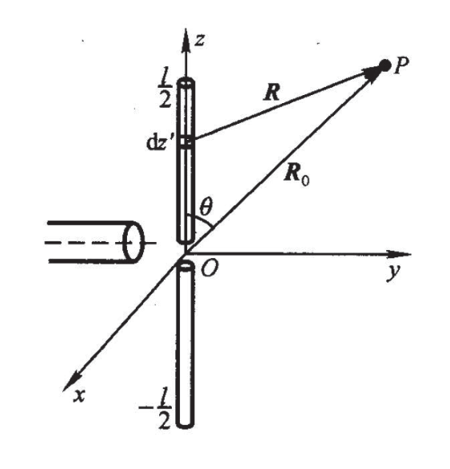
图内文字：$z$，$x$，$y$，$P$，$R$，$R_0$，$\theta$，$l/2$，$-l/2$，$dz$，$O$

$$
R \approx r - z'\cos\theta \tag{9.4.3}
$$

将9.4.3代入9.4.2，在远场条件（$r \gg z'$，$r \gg \lambda$）下得

$$
A_z \approx \frac{\mu_0I_0}{4\pi r}e^{-i\omega(t-r/c)}\int_{-l/2}^{l/2}\sin\left(\frac{kl}{2}-k|z'|\right)e^{-ikz'\cos\theta}dz' \tag{9.4.4}
$$

$$
= \frac{\mu_0I_0}{2\pi kr}e^{-i\omega(t-r/c)}\frac{\cos\left(\frac{kl}{2}\cos\theta\right)-\cos\frac{kl}{2}}{\sin^2\theta} \tag{9.4.5}
$$

由$\vec{A}$可由$\vec{B} = \nabla\times\vec{A}$求得$\vec{B}$。考虑远场时作代换$\nabla \leftrightarrow i\frac{\omega}{c}\vec{e}_r$，则

$$
\vec{B} = ik\vec{e}_r\times\vec{A} = -ikA_z\sin\theta\vec{e}_\phi \tag{9.4.6}
$$

电场容易求得

$$
\vec{E} = -\hat{k}\times(c\vec{B}) = -ickA_z\sin\theta\vec{e}_\theta \tag{9.4.7}
$$

由$\vec{E}$，$\vec{B}$即可求出辐射能流

$$
\langle\vec{S}_P\rangle = \frac{1}{2\mu_0}\left(\vec{E}\times\vec{B}^*\right) = \frac{\mu_0I_0^2c}{8\pi^2r^2}\left[\frac{\cos\left(\frac{kl}{2}\cos\theta\right)-\cos\frac{kl}{2}}{\sin\theta}\right]^2\vec{e}_r \tag{9.4.8}
$$

平均角分布为

$$
\langle f(\theta,\phi)\rangle = \left\langle\frac{\vec{S}_P\cdot d\vec{S}}{d\Omega}\right\rangle = \frac{\mu_0I_0^2c}{8\pi^2r^2}\left[\frac{\cos\left(\frac{kl}{2}\cos\theta\right)-\cos\frac{kl}{2}}{\sin\theta}\right]^2 \tag{9.4.9}
$$

它依赖于$\frac{kl}{2}$的值。讨论如下：

1. 当天线长度远小于波长时，$kl \ll 1$，可以将上式展开得

$$
\langle f(\theta,\phi)\rangle = \frac{\mu_0I_0^2c}{8\pi^2}\frac{(kl)^4\sin^2\theta}{64} = \frac{\mu_0\omega^4}{32\pi^2c}\sin^2\theta\times\left(\frac{I_0l^2}{4c}\right)^2 \tag{9.4.10}
$$

与9.3.21对比发现，此时天线等价于一个电偶极子，强度为$p = \frac{I_0l^2}{4c}$。

显然对短天线，天线越长，辐射能力越大。

2. 当天线再增长到 $kl \ll 1$ 条件不满足时，天线的辐射能力随 $kl$ 做周期性振荡。通常人们将信号发生器与天线中间空隙的两端分别相连，给定一个定幅的输入信号，测量被反射回来的信号强度（称为反射损耗——Return Loss，S11 等），显然这个量越小，说明辐射出去的功率越强，因此 S11 的极小值就标志着天线辐射的一个极大值。研究发现，当 $\dfrac{l}{\lambda} = \dfrac{1}{2}, \dfrac{3}{2}, \cdots$ 时，天线的辐射能力达到极值——特别是半波电线（长度 $l = \dfrac{\lambda}{2}$）辐射能力最强。

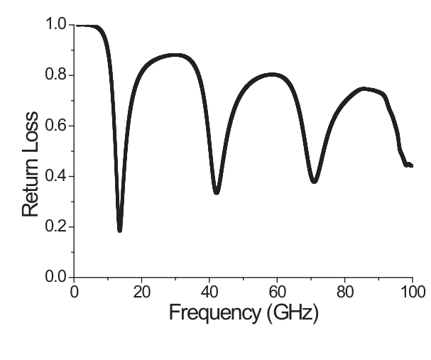
图内文字：纵轴为 Return Loss（0.0～1.0），横轴为 Frequency (GHz)（0～100）

3. 随着 $\dfrac{l}{\lambda}$ 的增大，辐射图案与偶极子辐射图案有了明显的区别，开始有分叉出现，并开始朝天线方向集中（书上的图形计算有误！）。真正有用的天线就是既有很好的辐射效率（S11 极小），又有很好的辐射图案的半波天线。

### 9.5 天线阵

天线最重要的两个品质是辐射图案和辐射效率。虽然半波天线的辐射效率比较高，但它在 $\phi$ 角上没有任何的定向性，在 $\theta$ 角上有一定的定向性，

但不是很好。在实际应用中，为了获得更好的辐射方向性，我们常把一系列天线排布成天线阵，利用干涉效应来获得较好的方向性。最常用的是把半波天线当作基元天线列阵。惯常的排布有两种：一种是线性排列，另一种是横向排列，如图9.9所示；再有是 $m \times n$ 方阵，如图9.10所示。我们只

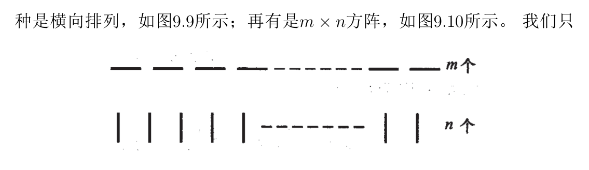
图内文字：横向排列 $m$ 个；纵向排列 $n$ 个

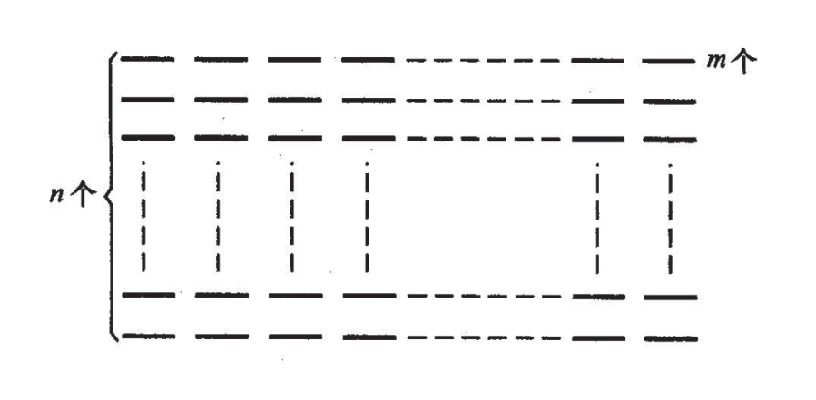
图内文字：$m$ 行、$n$ 列排布的天线方阵

讨论在线性排列的情况下，它的辐射方向性同单一的半波天线有什么不同。如图9.11所示，$m$ 个半波天线线性排列，它们所激发的场到达远处某点的路程不同，这就使它们彼此间有相位差，从而发生干涉使辐射具有方向性。每个天线与其邻近的天线之间的路程差为 $a \cos \theta$（$a$ 为两天线间的距离），若第一个天线的辐射场为

$$
\vec{E}_1 = \vec{C}(\theta)\frac{e^{ikR_1}}{R_1} \tag{9.5.1}
$$

则第二个半波天线的辐射场为

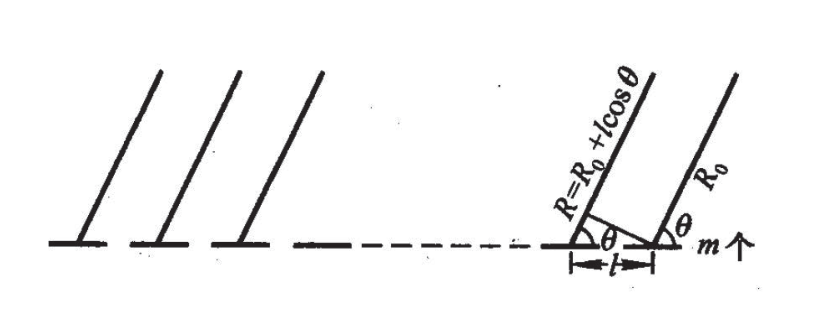
图内文字：$R \approx R_1 + a\cos\theta$，天线间距 $a$，共 $m$ 个

$$
\vec{E}_2 = \vec{C}(\theta)\frac{e^{ikR_2}}{R_2} \tag{9.5.2}
$$

由于 $R_2 \approx R_1 + a \cos \theta$，在远场条件下（$R \gg \lambda$），有

$$
\vec{E}_2 \approx \vec{C}(\theta)\frac{e^{ikR_1}}{R_1}e^{ika \cos \theta} = \vec{E}_1 e^{ika \cos \theta} \tag{9.5.3}
$$

定义 $\alpha = ka \cos \theta$，则同理可得第三个半波天线的场为

$$
\vec{E}_3 \approx \vec{E}_1 e^{i2\alpha} \tag{9.5.4}
$$

依次类推，得 $m$ 个半波天线产生的总场为

$$
\vec{E}_{total} = \sum_{N=0}^{m-1} \vec{E}_1 e^{iN\alpha} = \vec{E}_1\frac{1 - e^{im\alpha}}{1 - e^{i\alpha}} \tag{9.5.5}
$$

可见它的辐射角分布比单个半波天线的角分布多了一个因子：

$$
f(\alpha) = \left|\frac{1 - e^{imka \cos \theta}}{1 - e^{ika \cos \theta}}\right|^2 = \frac{\sin^2\left(\frac{m}{2}ka \cos \theta\right)}{\sin^2\left(\frac{1}{2}ka \cos \theta\right)} \tag{9.5.6}
$$

因此总的辐射角分布为

$$
f_{total}(\theta, \phi) = f_{single}(\theta, \phi) \cdot f(\alpha) \tag{9.5.7}
$$

即在原有的单个天线的角分布的图案基础上加上一个干涉后的“形状因子”。可以看出：

1. 当 $\alpha = 0$ 时 $f(\alpha)$ 有极大值，其值为 $f(0) = m^2$。这说明向前传播的方向仍然是体系辐射最强的方向，而且辐射能力增强了 $m^2$ 倍。这不奇怪，因为干涉相应使得此方向的所有天线都是相干叠加，场的振幅增强了 $m$ 倍，功率增强 $m^2$ 倍。

2. 当 $\alpha = \dfrac{2\pi}{m}, \dfrac{4\pi}{m}, \cdots, \dfrac{(m-1)2\pi}{m}$ 时有极小值，分布情况如图所示，两个极小之间有个极大值，但高阶的极大值急剧减少。

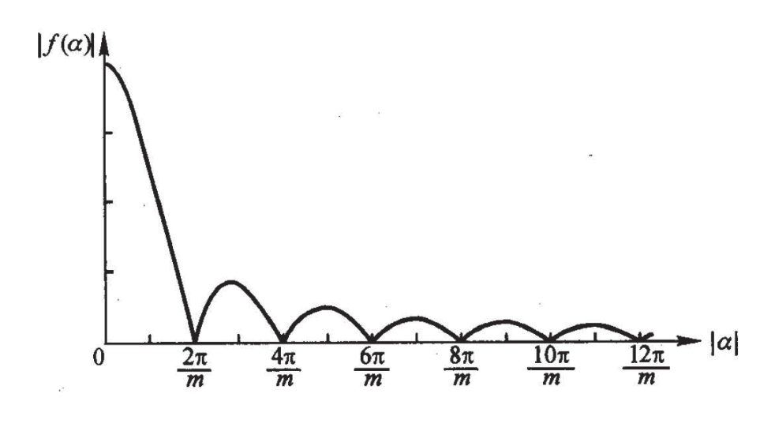
图内文字：纵轴 $|f(\alpha)|$，横轴 $|\alpha|$，极小位置依次为 $\frac{2\pi}{m}, \frac{4\pi}{m}, \frac{6\pi}{m}, \frac{8\pi}{m}, \frac{10\pi}{m}, \frac{12\pi}{m}$

3. 主极大在 $\alpha = 0$ 处，第一个极小在 $\alpha = \dfrac{2\pi}{m}$ 处，即 $ka \cos \theta = \dfrac{2\pi}{m}$ 处。若令 $\psi = \dfrac{\pi}{2} - \theta$，则 $ka \sin \psi = \dfrac{2\pi}{m}$。$m$ 很大时主极大峰所处的角度范围为

$$
|\psi| \le \sin^{-1}\left(\frac{2\pi}{mka}\right) \approx \frac{\lambda}{ma} \tag{9.5.8}
$$

可见，$m$ 大则 $\psi$ 角度小，这表示 $\theta$ 的方向性很强。
