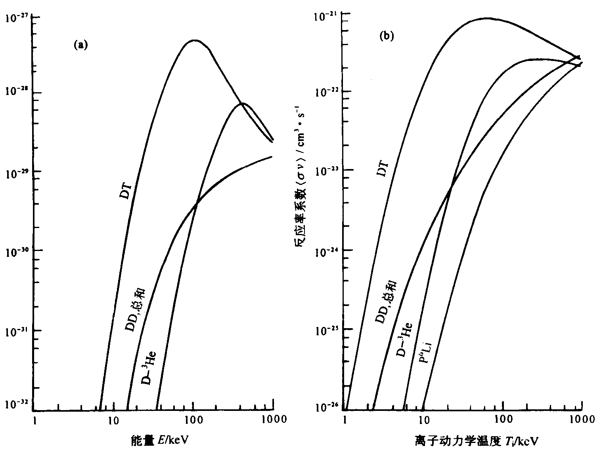
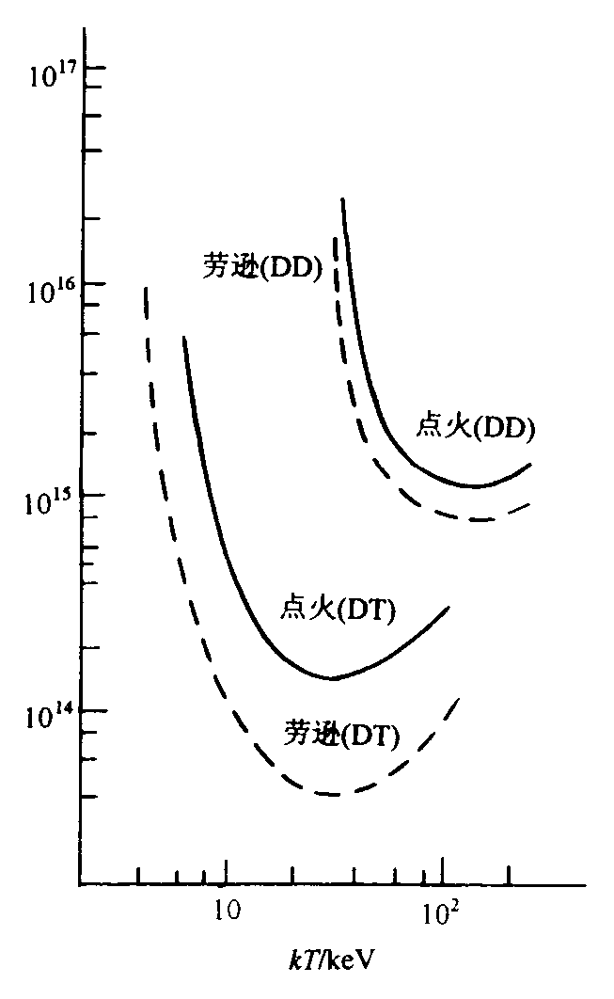
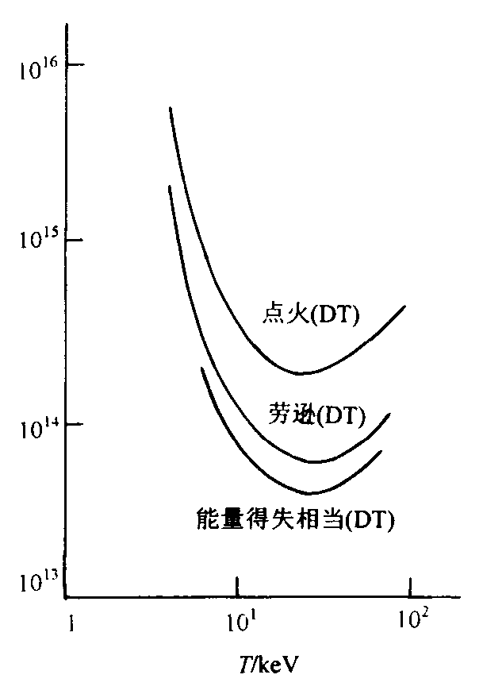

# 第二章 聚变能

## 2.1 太阳中的聚变反应

茫茫宇宙, 无际无涯。人类所生存的地球是太阳系中的一颗行星, 而太阳所在的银河系有几千亿个恒星 (太阳), 整个宇宙又由几千亿个类似银河系的星系所组成。在太阳和那些发光的恒星中, 不间断地进行着的主要反应就是聚变反应。从天文学的观点看, 太阳是一颗生命力仍然十分旺盛的恒星。这主要是指其中进行的聚变反应, 主要是由四个氢原子核聚合成一个氮核的反应。这种聚合不是一个简单的过程, 而是由下述连续发生的几个过程组成的:

$$
\begin{array}{r l}
{}^{1}\mathrm{H} + {}^{1}\mathrm{H}\rightarrow{}^{2}\mathrm{H} + \beta^{*} + \nu\\
{}^{1}\mathrm{H} + {}^{2}\mathrm{H}\rightarrow{}^{3}\mathrm{He} + \gamma\\
{}^{3}\mathrm{He} + {}^{3}\mathrm{He}\rightarrow{}^{4}\mathrm{He} + {}^{1}\mathrm{H} + {}^{1}\mathrm{H}
\end{array}
\quad (2.1)
$$

氢核 ( $^{1}\mathrm{H}$ ) 通常用质子的符号$\mathbf{p}$来表示, 重氢核 ( $^{2}\mathrm{H}$ ) 通常用氘核 (D) 来表示, $\beta^{*}$为正电子, $\nu$为中微子, $\gamma$为光子。式 (2.1) 中的第一个过程的特征时间为$7 \times 10^{9}$ a, 第二个过程的特征时间仅为$10 \mathrm{~s}$ , 第三个过程的特征时间为$3 \times 10^{5}$ a。因此, 整个复合过程的特征时间主要是由第一个过程确定的。它们的综合结果是四个质子聚合成一个氨核, 同时放出一个正电子和一个中微子。这一过程中发生了大约占四个质子总质量的$1\%$的质量亏损。按照爱因斯坦公式, 相当于放出了$25 \mathrm{MeV}$ , 或者说$4 \times 10^{- 12}$ J 的能量。现在已知太阳的直径为$1.392 \times 10^{6}$ km, 约为地球直径的 109 倍, 太阳的质量为$1.989 \times 10^{27}$ kg, 约为地球质量的 33 万倍。组成太阳的主要成分是氢, 占$78.4\%$ , 其次是氦, 占$19.8\%$ , 剩下的为其他元素, 占总量的$1.8\%$。在有的恒星中, 氢的比例比氦小, 表明这个恒星已步入其生命的后期, 其中主要的核反应已不是上面指出的那一种复合过程。对太阳来说, 氢仍占多数, 而且仍然可以稳定地燃烧几十亿年。

太阳中每秒钟要烧掉约$4.22 \times 10^{9}$ kg 的氢, 同时以$3.83 \times 10^{20}$ MW 的功率向外释放聚变反应产生的能量, 主要以光辐射能的形式进入茫茫太空。据计算, 这些能量大约有十亿分之一可以进入地球大气层上界, 其中约$30\%$被大气层反射回太空中, $23\%$被大气层吸收, 余下的$47\%$的能量到达地球表面, 其功率约为$8.2 \times 10^{10}$ MW, 这一功率相当于 45 万个长江三峡水电站的功率。事实上, 地球上的万事万物, 都依靠这个太阳辐射才能生存发展, 包括现在大量被利用的化石燃料: 煤、石油和天然气, 都是远古时候动植物在地壳变动时形成的, 也就是以前地球上保留下来的太阳能。

那么, 能不能在地球上用人工方法来制造一个人造的小太阳呢? 也就是说, 能不能采用特殊的方法人工控制聚变反应, 使其为人类的文明和发展服务呢?

## 2.2 轻核聚变反应

有很大数量的轻核聚变反应都能放出能量。但从实现这些反应的科学和技术可行性看, 最容易实现的聚变反应应当是反应截面最大, 产生反应的条件最简单的那几种。轻核都带有正电荷, 因此相互间具有库仑排斥作用。聚变反应仅在两个轻核非常接近时 (即两个原子核基本相挨时) 才能产生, 此时互相吸引的核力将大于库仑排斥力。也就是说, 聚变反应要求两个原子核相互以很大的速度对撞时才能发生。一个由大量粒子组成的体系, 如果每个粒子都具有很大的无规运动能量, 那么这个体系就具有极高的温度。所以, 氢核间的聚变反应必须在热核条件下才能实现, 这是热核反应一词的来源。显然, 氢及其同位素因带电荷最少, 核间的库仑排斥力也最小; 另一方面, 实验发现, 在较易达到的能量区内, 氢的两种同位素气和氘间的反应截面较之其他轻核间的聚变反应截面都大, 这两个条件结合起来, 说明氘反应最容易实现, 因此, 人类能够最先实现的可控制热核反应是氘氘聚变反应。

氘反应方程式已在第一章绪言中引述。作为比较, 我们再引述其他几种重要的聚变反应。

氘反应, 共有两个分支, 它们具有接近的反应截面:

$$
\begin{array}{c}
\mathrm{D}+\mathrm{D}\rightarrow\mathrm{T}+\mathrm{p}+4.04\ \mathrm{MeV}\\
\mathrm{D}+\mathrm{D}\rightarrow{}^{3}\mathrm{He}+\mathrm{n}+3.37\ \mathrm{MeV}
\end{array}
\quad (2.2)
$$

氘氘- 3反应:

$$
\mathrm{D} + {}^{3}\mathrm{He}\rightarrow{}^{4}\mathrm{He} + \mathrm{p} + 18.14\ \mathrm{MeV}
\quad (2.3)
$$

氢- 11反应:

$$
\mathrm{p} + {}^{11}\mathrm{B}\rightarrow 3({}^{4}\mathrm{He}) + 18.67\ \mathrm{MeV}
\quad (2.4)
$$

这些反应中所释放的能量, 都以反应产物的动能的形式存在。根据反应过程中总动量守恒原理, 若设两种反应产物的质量为$M_{1}$和$M_{2}$ , 则它们间的能量按

$$
E_{1} = \frac{M_{2}}{M_{1} + M_{2}} E, \quad E_{2} = \frac{M_{1}}{M_{1} + M_{2}} E
\quad (2.5)
$$

分配。例如, 氘氘反应的总释放能量为$17.6\mathrm{MeV}$ , 取中子的质量为 1, 则$\alpha$粒子的质量为 4。于是, 中子获得$17.6\mathrm{MeV}$能量中的 4/5, 即$14.1\mathrm{MeV}$ , 而$\alpha$粒子获得其中的 1/5, 即$3.5\mathrm{MeV}$。

所有氢核反应的截面都是由实验测定的。以上所述的几种聚变反应的截面随反应粒子能量的变化曲线见图 2.1。

从图 2.1 可以看到, 氘氘反应的能量阈值最低, 反应截面最大, 所以聚变反应最容易实现。在本书中, 我们主要讨论以氘氘为燃料的聚变反应。

## 2.3 关于用束靶作用和对碰束来实现聚变反应的问题

从原理上说, 要将带电离子加速到可以产生聚变反应的能量并不困难。从普通离子源中引出能量为$10\mathrm{keV}$的离子也是比较容易的。那么, 是否可以利用具有几十$\mathrm{keV}$的氘离子束来打氘靶, 或用两束相对运动的氘氘离子束来实现聚变反应呢? 由于聚变反应只有在氘氘离子非常接近的条件下才能发生, 而在两束相对运动的离子达到可以产生聚变反应的距离以前, 大多数离子将在相互排斥的库仑力作用下被散射而偏离对碰轨道, 结果, 实际产生的聚变反应非常少。在离子束入射到固体靶的情况下, 则由于入射离子 (氘核) 在达到可以与靶中氘核产生聚变反应的距离以前, 氘核的能量已经大部分消耗在与靶材料中的电子的相互作用中, 以辐射能形式而逸出。所以, 大多数氘核实际上不能到达可以产生聚变反应的距离。因此, 以上基于离子束打靶或离子束对碰来实现聚变反应的想法, 在科学上是行不通的。有关的证明要用到等离子体中粒子碰撞过程的计算, 我们将在以后的章节中讨论。

**图2.1** (a) DT、DD、D-$^{3}\mathrm{He}$的聚变反应截面随能量的变化；(b) DT、DD、D-$^{3}\mathrm{He}$和$\mathbf{P}^{6}\mathbf{L}\mathbf{i}$聚变反应的反应率系数随离子动力学温度的变化

## 2.4 实现受控聚变反应的基本要求

设想在某种聚变反应堆中实现聚变反应。因为反应燃料的温度非常高,燃料已经成为完全电离的等离子体(和氢原子一样,氘氚原子中的电子的电离能也是$13.6\mathrm{eV}$ ,因此,当温度超过几十万度时,氘氚原子已被完全电离,聚变堆中温度要高得多,实际上所有元素将被电离,成为等离子体)。那么,在这种由聚变燃料组成的高温等离子体中,实现聚变能输出的基本条件是什么呢?

设想这些等离子体得到较好的约束,也就是说,其中的离子和电子都可以在反应器中长时间地运动而不逸出。但即使达到这样的条件,也不一定保证有效的聚变能输出。这是因为,在高温等离子体中,带电粒子间的相互作用会使一部分能量从所约束区域逸出。只有聚变反应产生的能量大于损失的能量时,才能达到有效的能量输出。

### 2.4.1 聚变反应功率

聚变反应器中聚变反应的功率密度为

$$
P_{\mathrm{fus}} = \gamma_{\mathrm{ij}}n_{\mathrm{i}}\gamma_{\mathrm{ij}}\langle \sigma \nu \rangle_{\mathrm{ij}}E_{\mathrm{ij}}
\quad (2.6)
$$

式中,i,j代表两种相互作用的离子(例如氘核和氚核),对同类离子, $\gamma_{\mathrm{ij}} = 1 / 2$ ,对非同类离子, $\gamma_{\mathrm{ij}} = 1$。如果$E_{\mathrm{ij}}$以MeV为单位,离子密度以$10^{14}\mathrm{cm}^{- 3}$为单位, $\langle \sigma \nu \rangle$以$\mathrm{cm}^{3}\cdot \mathrm{s}^{- 1}$为单位, $P_{\mathrm{fus}}$以$\mathrm{W}\cdot \mathrm{cm}^{- 3}$为单位,则上式右方要乘一系数$1.6\times 10^{15}$。另外,上式中代表反应几率的函数$\langle \sigma \nu \rangle$已经是对粒子的分布函数(基本上是麦克斯威分布)做了平均的量,因此是粒子温度的函数。对氘氚反应,在氘氚离子温度为$10 \mathrm{keV}$ (大约为1亿度)时, $\langle \sigma \nu \rangle_{\mathrm{DT}} = 1.1 \times 10^{- 16} \mathrm{cm}^{3} \cdot \mathrm{s}^{- 1}$ ,而$E_{\mathrm{DT}} = 17.6 \mathrm{MeV}$ ,因此, $p_{\mathrm{DT}} = 3.1 \mathrm{W} \cdot \mathrm{cm}^{- 3}$。而氘氚反应的功率密度不到这一数值的百分之一。

一些重要的聚变反应几率$\langle \sigma \nu \rangle$随温度的变化已由Hively归纳成有用的计算公式[1],现引述如下:

氘氚反应:

$$
\begin{array}{r l}
\langle \sigma \nu \rangle_{\mathrm{DT}} &= \exp \left[\frac{a_{1}}{T^{\gamma}} +a_{2} + a_{3}T + a_{4}T^{2} + a_{5}T^{3} + a_{6}T^{4}\right]\\
a_{1} &= -21.377\,697,\ a_{2} = -25.204\,054,\ a_{3} = -7.101\,342\,7\times 10^{-2}\\
a_{4} &= 1.937\,545\,1\times 10^{-4},\ a_{5} = 4.024\,659\,2\times 10^{-6},\ a_{6} = -1.982\,697\,2\times 10^{-8}\\
\gamma &= 0.2935
\end{array}
\quad (2.7)
$$

氘氚反应:

$$
\begin{array}{r l}
\langle \sigma \nu \rangle_{\mathrm{DD}} &= a_{1}(1 + a_{3}T^{\gamma})T^{-2 / 3}\exp (-a_{2} / T^{1 / 3})\\
a_{1} &= 2.001\,860\,2\times 10^{-14},\ a_{2} = 19.307\,336,\\
a_{3} &= 5.775\,625\,9\times 10^{-3},\ \gamma = 0.949\,556\,69
\end{array}
\quad (2.8)
$$

氘氚- 3反应:

$$
\begin{array}{r l}
\langle \sigma \nu \rangle_{\mathrm{D^{3}He}} &= a_{1}(1 + a_{3}T^{0.75})T^{-2 / 3}\exp (-a_{2} / T^{1 / 3}) / \sqrt{1 + a_{4}T^{3.25}}\\
a_{1} &= -4.219\,543\,8,\ a_{2} = 28.415\,67,\\
a_{3} &= -2.573\,906\,7,\ a_{4} = -1.300\,751\,6\times 10^{-4}
\end{array}
\quad (2.9)
$$

用以上计算公式在计算机上计算起来并不困难,而且与现有实验数据库符合很好,相对误差都在$1\%$左右或更小。不过,实验数据本身的分散性有时可达$5\%$。

### 2.4.2 辐射损失

等离子体中的辐射损失包括韧致辐射、杂质谱线的线辐射、复合辐射及磁约束情况下电子的回旋辐射。这里仅考虑韧致辐射。这是一种因电子和离子及电子间相互作用时,电子发生变速而引起的辐射。由于电子间相互作用的贡献很小,可以忽略,主要考虑电子与离子的作用就行了。等离子体中的电子是处于自由能级上的,电子- 离子作用中电子连续释放出光子,但仍处在自由能级,因此,这是自由- 自由状态跃迁。对于单纯由氘氚离子及电子组成的纯等离子体,假设没有任何杂质离子混合其中,如电子的温度与离子相等,则电子运动引起的韧致辐射损失功率密度可以通过电动力学公式算出。最常用的公式是Bethe- Heitler公式,它适用于聚变堆中电子温区( $8\sim 20 \mathrm{keV}$ ),其形式如

$$
P_{\mathrm{brem}} = \frac{32}{3}\sqrt{\frac{2}{\pi}} Z^{2}n_{e}n_{i}\frac{e^{2}}{h c}\left(\frac{e^{2}}{m_{e}^{2}c^{2}}\right)^{2}m_{e}c^{2}\sqrt{\frac{k T_{e}}{m_{e}c^{2}}}
\quad (2.10)
$$

代入有关物理常数,粒子密度以$10^{14} \mathrm{~cm}^{- 3}$计算,得

$$
P_{\mathrm{brem}} = 4.81 \times 10^{-3} Z n_{e}^{2} T_{e}^{1 / 2} \mathrm{~W} \cdot \mathrm{cm}^{-3}
\quad (2.10')
$$

式中电子温度以$\mathrm{keV}$为单位。

在实际等离子体中,不可避免地会混入相当数量的杂质离子(即非燃料离子)。一方面,这是由于高温等离子体与周围的固体材料要产生很强的相互作用,材料中吸附的气体及组成材料的物质的离子会不断进入等离子体中;另一方面,聚变反应的产物,如氘氚反应产生的氦离子也是一种杂质。所以,实际的辐射损失功率密度要比上式算出的大。如果杂质离子的外层电子被完全剥离,则相应的辐射损失可以通过在上面的辐射损失功率密度表示式中乘一个等效的电荷值来表示

$$
Z_{\mathrm{eff}} = \frac{1}{n_{\mathrm{e}}}\sum Z_{\mathrm{i}}n_{\mathrm{i}}^{2}
\quad (2.11)
$$

各种杂质引起的辐射功率是温度的复杂的函数。D.P.Post对主要的元素的辐射冷却率在日冕模型下作出了辐射曲线及插值函数[2],将在以后有关章节中讨论。

### 2.4.3 劳逊判据

对实际反应堆来说,最大的能量损失是通过热传导和对流方式的损失。这一功率损失可以唯象地用一个能量约束时间来描述。等离子体的热能密度为$3n_{\mathrm{e}}T$ ,所以相应于热传导损失的功率密度为$3n_{\mathrm{e}}T / \tau_{\mathrm{E}}$。原则上,这里的物理量都要对有关体积积分。但为简单起见,我们把有关物理量理解为某种平均值。假定从聚变堆中逸出的总功率,即聚变功率加辐射功率加热传导功率为外部集热器所收集,然后以一定的转化因子转化为电功率,利用这个电功率来维持聚变堆中的等离子体功率损失,可以得到一个条件,这个条件称为劳逊判据:

$$
\eta \left(\frac{1}{4} n_{\mathrm{e}}^{2}\langle \alpha \nu \rangle E_{\mathrm{gas}} + p_{\mathrm{brem}} + \frac{3n_{\mathrm{e}}T}{\tau_{\mathrm{E}}}\right)\geq \frac{3n_{\mathrm{e}}T}{\tau_{\mathrm{E}}} +p_{\mathrm{brem}}
\quad (2.12)
$$

上式取等号并解出$n_{\mathrm{e}}\tau_{\mathrm{E}}$ ,得

$$
n_{\mathrm{e}}\tau_{\mathrm{E}} = \frac{3T(1 - \eta)}{\eta\left[\frac{1}{4}\langle\alpha\nu\rangle E_{\mathrm{gas}} + c\sqrt{T}\right] - c\sqrt{T}}
\quad (2.13)
$$

上式右方仅为温度的函数,若温度以$\mathbf{k}\mathbf{e}\mathbf{V}$计,则上面公式右方分母中的$E_{\mathrm{gas}}$应乘以$10^{15}$ (例如,对氘氚反应, $E_{\mathrm{DT}} = 17.6\times 10^{15}$ ),而初致辐射功率项中的相应常数$c = 0.3$。对不同的聚变反应,可以得出$n_{\mathrm{e}}\tau_{\mathrm{E}}$值与温度的不同曲线(见图2.2),曲线上方代表可以实现聚变能净输出的参数区。

对氘氚聚变堆来说,在劳逊条件中,没有考虑$\alpha$粒子对氘氚等离子体的自加热。这一部分功率为全部聚变功率的$1 / 5$。在以后的讨论中我们将强调,这种自加热效应极其重要,是建立自持聚变反应堆的基础。

### 2.4.4 能量得失相当判据(零功率堆判据)

考虑$\alpha$粒子对氘氚等离子体的自加热,这时直接逸出反应堆区域的聚变功率是由中子携带的那部分聚变功率,即$(4 / 5)p_{\mathrm{gas}}$ ,进行类似的分析,实现零功率输出的条件为

$$
\frac{3n_{\mathrm{e}}T}{\tau_{\mathrm{E}}} +p_{\mathrm{brem}} - \frac{1}{5} p_{\mathrm{DT}} = \eta \left[\frac{4}{5} p_{\mathrm{DT}} + p_{\mathrm{brem}} + \frac{3n_{\mathrm{e}}T}{\tau_{\mathrm{E}}}\right]
\quad (2.14)
$$

解出$n_{\mathrm{e}}\tau_{\mathrm{E}}$ ,得

### 2.4.5 自持燃烧条件(点火条件)

对氛氪聚变堆来说,由于存在$\alpha$粒子的自加热,有可能建立完全或基本上依靠这种自加热将聚变反应长期维持下去的工作状况。其物理设想是,先用外加热方法将氛氪等离子体加热到足够高的温度,如果约束也足够好,则在关闭外加热功率时聚变反应可以长期维持下去。这个条件称"点火"。类似于普通的烧煤的炉子,当把煤点燃后,如煤的温度已足够高,煤就可以自身维持燃烧状态。显然,一个实用的聚变堆,应该是在自燃状态下工作的。否则,虽然可以获得净能量输出,但需从外部维持对等离子体的加热,这种加热设备将是十分昂贵的。自持燃烧条件的推导非常简单,即要求$\alpha$粒子的功率等于或大于总的等离子体损失功率

$$
\frac{1}{5} P_{\mathrm{DT}}\geq \frac{3n_{\mathrm{e}}T}{\tau_{E}} +P_{\mathrm{brem}}
\quad (2.16)
$$

由此得到

$$
n_{\mathrm{e}}\tau_{E}\geq \frac{3T}{\frac{1}{20}\langle\sigma v\rangle_{\mathrm{DT}}E_{\mathrm{DT}} - c\sqrt{T}}
\quad (2.17)
$$

对氛氪反应,劳逊条件比零功率条件要求高,而比点火条件要求低。它们随温度的变化如图2.3所示。

**图2.3** DT的劳逊条件、点火条件及零功率得失相当条件的比较（设$\eta_{\mathrm{th}} = 0.4$ ）

以上计算都是很粗糙的近似估算,因为没有考虑物理量的空间分布,也没有考虑许多重要的物理过程。例如,在关于点火条件的分析中,假定$\alpha$粒子的功率完全沉淀在氛氪等离子体中,这是太理想化的假定。此外,没有考虑杂质辐射以及杂质成分引起的有效燃料成分的减少。事实上,根据电中性条件

$$
n_{\mathrm{e}} = n_{\mathrm{D}} + n_{\mathrm{T}} + \sum_{Z > 1}Z n_{Z}
\quad (2.18)
$$

可知,在反应堆中心混入很微量的杂质离子,也会引起有效燃料离子浓度的很大减少,从而使有效聚变功率更大的减少。聚变$\alpha$粒子的能量也决不可能是就地沉淀在氛氪等离子体中,它们本身有特定的约束规律,这些都是聚变等离子体物理的重要研究内容。虽然以上得到的公式和曲线都是粗糙的近似,但仍然对聚变研究指出了方向。对氛氪聚变来说,基本上归结为两方面的要求: 第一, 要求将氘氚等离子体的温度加热到$10 \mathrm{keV}$ $(10^{8} \mathrm{~K})$以上; 第二, 要求等离子体的粒子密度与能量约束时间的乘积大于$(2 \sim 4) \times 10^{14} \mathrm{~cm}^{- 3} \cdot \mathrm{s}$以上。更为严格的条件将在有关聚变堆设计和堆芯等离子体物理分析的章节中论述。

在结束本章讨论以前, 再看一下关于点火条件推导中的公式, 我们发现, 如假定等离子体的容积足够大, 以致可以不计热传导损失, 那么, 聚变功率中由带电粒子所携带的那部分如果都沉淀在等离子体中, 当这部分功率大于初致辐射功率时, 燃烧就能自动维持下去。假定没有杂质, 这个条件对氘氚反应来说, 离子温度超过$4.2 \mathrm{keV}$ , 对氘氚反应为$35 \mathrm{keV}$ , 对氘氚- 3反应为$24 \mathrm{keV}$。如果考虑杂质辐射效应, 这些最低能阈都将有较大提高。这表明, 在当前能够达到的技术条件下, 要使后两种聚变反应实现自持状态, 还确实有较大的困难。但非自持状态下的应用 (如用作强中子源) 还是可能的。

## 2.5 聚变能资源

地球上储有十分丰富的聚变能资源。首先是氢的同位素氘, 它储于水中。氘在天然氢中占1/6700, 可计算出, 每立方米水中含氘量为$33 \mathrm{~g}$。地球上的海水所含的氘, 如果用于氘氚聚变反应堆, 可供人类使用上亿年。因此, 氘是一种取之不尽, 用之不竭的资源。不过, 氘反应聚变堆的实现太困难, 因此, 我们把主要注意力放在氘氚聚变上, 也讨论一下基于氘氚- 3反应的资源问题。

锂: 这是产生氘的材料。锂在地球上有比较丰富的储量。以每个锂核转换一个氘核计, 可以估算出, 每生产一万亿度电能, 要消耗约$100 \mathrm{t}$锂。以我国的锂资源为例, 可采锂储量超过数百万吨, 如每年用于聚变电站$1000 \mathrm{t}$ , 也可以用几千年, 而海水中储藏的潜在锂资源的总量要比陆上大万倍。(注: 以氘氚反应经核包层中一些核反应后总产能为$22.4 \mathrm{MeV}$计, 设每一个锂原子用于增殖一个氘, 则每克锂的聚变能当量为$3.08 \times 10^{11} \mathrm{~J}$ ; 又设热电转换效率为$1 / 3$ , 则每克锂可产生的电能约为$10^{11} \mathrm{~J}$ , 相当于2.8万度电。每$100 \mathrm{t}$锂用于氘氚聚变电站中可产生2.8万亿度电能。)

氦- 3: 在地球上, 氦- 3储量很少, 全部氦- 3不过为$10 \sim 15 \mathrm{t}$左右。但在月球上, 由于长期受太阳风的照射, 在其表土中含有较丰富的氦- 3。估计在每一平方公里表体月壤中含氦- 3可达$10 \sim 1000 \mathrm{t}$ , 全部月壤约有$5 \times 10^{4} \mathrm{~km}^{3}$ , 含氦- 3达$50 \sim 500$万吨。如用月球车每年运回到地球上$1000 \mathrm{t}$用于发电每年可达万亿度。

其它稀有金属: 建造磁约束聚变堆, 要用大量的稀有金属材料, 如铍 (用于增殖中子), 因其含量有限, 可能对某些聚变包层方案造成很大限制; 再如铌 (用于制造超导磁体), 需用量很大,但它的有限储量可能会限制含铌超导的实际可用量。

人类的历史是在不断产生问题又不断解决问题中前进的,各种资源的限制会促使人类去开发新的资源。例如,高温超导就不再依赖铌,如果高温超导材料达到实用,并能满足聚变堆超导的要求,则以上所说的限制就大大放宽了。总之,在已有资源条件下,利用氘氚聚变来提供人类所需的电能和氢能,解决几百年的能源需求问题,应该是不存在困难的。将来,依靠人类的新智慧,实现氘氚聚变的应用,以及直接应用太阳辐射能,则地球上的能源问题是可以解决的。

## 2.6 聚变-裂变资源的混合开发[3]

若将氘氚聚变堆产生的一部分中子用于增殖裂变燃料,如$^{238}\mathrm{U}$或$^{232}\mathrm{Th}$ ,则可以将现有裂变燃料的使用率提高上百倍。在同等的电功率当量下,氘氚聚变堆对裂变元素如$^{239}\mathrm{Pu}$ , $^{233}\mathrm{U}$等的增殖效果要比快中子堆高十倍以上。因此,锂资源与铀,钍等裂变资源的混合开发,可使裂变资源获得非常充分的利用。而且,可以大幅度减少高放核废料,为核能开发带来重大的效益。

## 参考文献

1. Hively L M. Convenient Computational Forms for Maxwellian Reactivities. Nucl. Fusion, 1977, 17: 873
2. Post D P. Nucl. Data and Atomic Data Table, 1977, 20: 397
3. Moir R W. 裂变- 聚变燃料工厂, E. Teller 主编; 肖兵, 汤大荣译. 聚变: 第一卷磁约束, 中译本下册. 北京: 原子能出版社, 1988 年 2 月
