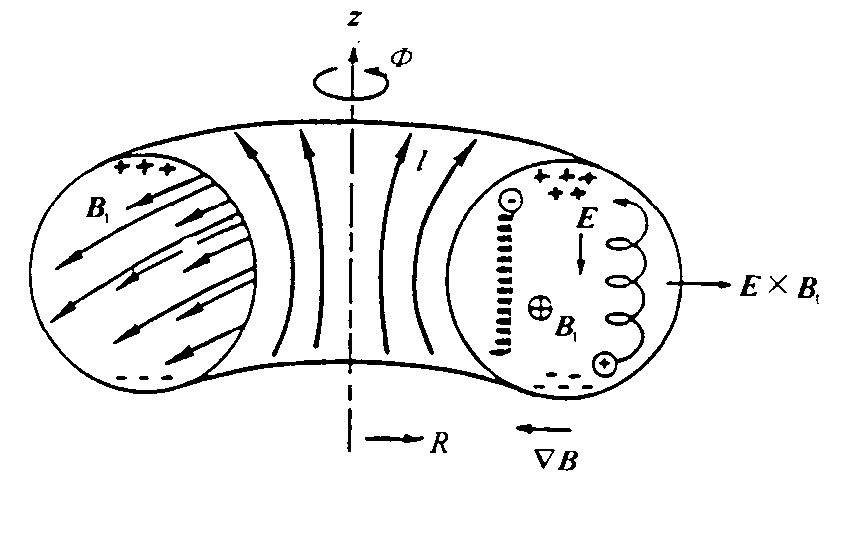
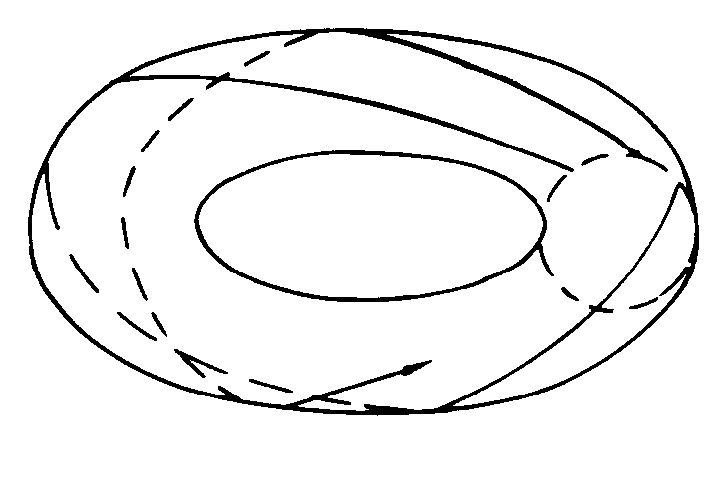
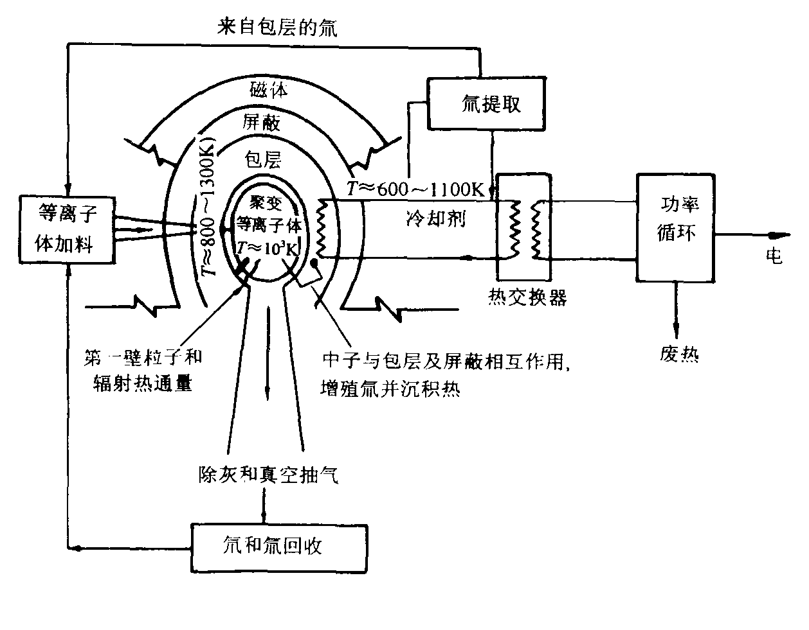

# 第三章 磁约束聚变原理

在本章中,我们将介绍磁约束聚变的基本原理。我们将通过定性的说明来介绍有关磁约束的基本概念和内容以及研究发展。对那些希望了解磁约束聚变研究基本情况而在等离子体物理方面不熟悉的读者,可以通过本章的学习而达到目的。

氘氚反应只能在极高的温度下进行,此时氘氚燃料以等离子体的形态存在。因此,人工受控聚变的问题化为如何在一定的容器中产生和控制高温等离子体,并使所要求的聚变反应能相对平稳地进行下去的问题。在地球上,以爆炸形式释放聚变能已经在氢弹爆炸中实现。这种产生聚变能的形式从应用的角度看有根本性的缺点,使它不太可能用于和平目的。氢弹爆炸的威力太大,其破坏性极大,而且在爆炸过程中仅有一小部分聚变材料产生了反应,绝大部分都在爆炸中飞散损失了。本世纪60年代后期提出了惯性约束聚变的概念,这实际上是利用微型氢弹爆炸的原理,具体说就是利用功率密度极高的激光束或其他粒子束将内含氘氚燃料的微丸在极短的时间内压缩聚爆达到极高的密度,同时将氘氚离子加热到热核聚变反应温度,并在向心聚爆形成的极高密度的等离子体飞散以前(即利用等离子体的向内运动的惯性)产生足够的聚变反应,获得能量增益。惯性约束(主要是激光核聚变研究)得到美、俄、法等核大国的高度重视,因为微丸的聚爆过程与氢弹爆炸过程在物理机制上类似,在一定程度上可以通过微丸聚爆实验模拟核爆,因此,激光核聚变研究与国防科学及国家安全有密切关系。这是推动激光核聚变研究的一个重要因素。有关的讨论请参看有关专著[1]。

磁约束聚变倾向于以准稳态过程实现氘氚聚变燃烧。早期一些基于快过程(如直线箍缩放电(linear pinch)、角向箍缩放电( $\theta - \mathrm{pinch})$ )的方案都已放弃,现在重点研究的托卡马克和先进环形装置的反应堆设计都采用长脉冲(一次燃烧将维持一天或更长时间)甚至稳态的方案,目前已建立可靠的物理和工程技术基础。大体的设想如下:在一定大小的真空容器中(根据不同的设计思想,这种容器的容积一般在$100\sim 1000\mathrm{m}^{3}$左右),将氘氚燃料用特殊的加热方法加热到聚变反应温区(即1亿度以上)以“点燃”氘氚反应(即使聚变反应释放的能量大于外加热所消耗的能量),利用特殊设计的磁场位形将这种高温等离子体稳定地约束在该真空容器内,使释能反应能够长期持续下去。为此,将利用反应产生的高能$\alpha$粒子(3.5MeV)来加热不断补充输入系统的冷燃料,而能量为14MeV的快中子则穿越器壁进入真空容器外部的核包层中,在那里这些中子在被慢化的同时,部分用于与金属锂相互作用增殖氚,部分与其他元素作用增大热能。不同的包层设计得出的热能增加值及氚增殖系数不同,这意味着可以按用户要求设计不同的聚变堆型。一般说来,经包层中一系列反应以后,一次聚变反应(即消耗一对氘氚离子)产生的总热能按典型的堆设计可以达到22.4MeV。总的热能送入热交换器用于产生电能。其中,与$\alpha$粒子所携带的能量对应的热能将直接沉淀在真空容器壁上或特殊设计的收集器中,而在核包层中产生的热能则类似于裂变反应堆通过载热剂的热交换输出到包层外部。因此,聚变反应容器和核包层一起构成聚变反应堆的“一次回路”。与裂变反应堆相似,在“二次回路”中,将热能转化为电能,输送到外电网中为用户服务。

在实现上面设想中,特殊形式的磁场位形是关键。几十年磁约束聚变研究的中心任务之一就是研究如何产生这样的磁场位形。这里,磁场位形一词指的是由外加磁场及等离子体内部电流产生的磁场共同组成的一种磁场形态,在这种合成磁场中,等离子体中的大部分带电粒子(电子和离子)可以长时间地运动而不会逸出;但是,粒子间存在着相互作用,在受到其它粒子的碰撞或外部扰动的作用时,粒子会改变运动状态,产生向器壁的输运。一种好的磁场位形必须具有约束带电粒子的良好品质。此外,这种磁场位形还应具有很好的热绝缘性质,使中心等离子体的极高温度能在得到一定加热的条件下维持下去,同时其热传导性应足够小,使得能够在较小的容器中维持具有聚变高温的等离子体。一般情况下,等离子体的温度总是由中心约束区向边缘(即器壁所在处)下降的。在器壁附近,等离子体的温度已不是很高,但仍然比人们日常接触的所谓高温高得多。例如,在本书将要重点讨论的托卡马克反应堆中,边缘等离子体温度将在$50\sim 200 \mathrm{eV}$左右,也就是说在$50\sim 200$万度左右。对比一下,一般的炼钢炉中心的温度在三干度左右,电弧的温度可达一万度。显然,聚变堆真空容器边缘的温度比日常生产和生活中人们接触到的温度要高得多。几十万度以上的高温在一般概念上是物质材料无法承受的。不过,由于磁约束聚变等离子体的粒子密度非常低,比空气低一百万倍(正常条件下空气中的分子密度为$2.5\times 10^{19} \mathrm{cm}^{- 3}$ ,而托卡马克等离子体的粒子密度为$10^{14} \mathrm{cm}^{- 3}$ ,在边缘还要更低),所以,对于等离子体的器壁来说,它感受到的是总的热通量,而这个热通量在一定的冷却条件下,器壁是可以忍受的。此外,器壁将受到慢化后但仍然具有很高能量的α粒子及其它较低能量粒子对它的轰击。这种轰击会引起壁材料的损伤(物理和化学溅射、氦起泡,等等),更重要的是,真空器壁要受到$14 \mathrm{MeV}$中子的轰击,这些中子绝大部分都能穿越器壁进入核包层,但由于长期作用,也要引起壁材料的损伤和活化(activation)。从材料科学研究的角度看,聚变堆相关材料是一个极具挑战性的研究领域。以上问题将在以后的章节中详细讨论。

## 3.1 磁场对带电粒子的约束

在均匀磁场中,带电粒子一方面绕磁力线做拉莫尔(Larmor)转动(又称回旋转动,这个转动中心称回转中心),一方面可以自由地沿磁力线运动而不受阻力。举例看,一个$1 \mathrm{keV}$能量的氘离子的速度为$10^{7} \mathrm{cm / s}$ ,它穿过$10 \mathrm{m}$长的区域仅需$1 \mu \mathrm{s}$ ,同样能量的电子的速度比氘离子的大60多倍,飞出该区域的时间更短。显然,均匀磁场不能达到约束带电粒子的目的。在磁约束聚变研究的历史上,提出过并在相当一段时间内在装置实验中实践过两类位形:直线装置中的磁镜位形和环形位形。为了了解有关的基本概念,需先讨论一下带电粒子的横向运动。一个熟知的概念是带电粒子在磁场中的拉莫尔转动。拉莫尔半径$\rho_{1}$与粒子的质量、横向速度、磁场强度以及粒子的电荷数有关:

$$
\rho_{1} = \frac{m_{1} \nu_{1} c}{Z_{1} e B} \tag{3.1}
$$

式中$Z_{1}$为电荷数,对电子为$(- 1)$ , $m_{1}$为粒子的质量, $c$为光速, $\nu_{1}$为垂直于磁场的速度分量;由于粒子在受到其它力的作用时,例如受到周围粒子的碰撞时,可以从一根磁力线移动到另一根磁力线,所以必须要求约束系统的横向尺度远大于离子拉莫尔半径的大小。在大多数已建成的磁约束实验装置中,主磁场的强度从$1\sim 10 \mathrm{T}^{*}$不等,在聚变堆中,例如在托卡马克聚变堆中,基于已达到的并能在大型装置中采用的产生磁场的技术,等离子体中心区的磁场强度约为5T,能量为$10\mathrm{keV}$的氘离子的拉莫尔半径为$0.27\mathrm{cm}$ ,而能量为3.5MeV的$\alpha$粒子的拉莫尔半径为$4\mathrm{cm}$。目前设计的托卡马克聚变堆的横向尺寸为$3\sim 5\mathrm{m}$比高能粒子的拉莫尔半径大得多。因此,完全可以认为等离子体的各种宏观参数(如粒子密度$n$ ,温度$T$ ,压强$p$ ,等等)的空间分布是电子和离子的回转中心所处位置的函数,而电子和离子的拉莫尔特动对这种分布只产生次级影响。

表征带电粒子在磁场中运动特性的另一个重要物理量是粒子的磁矩,其定义为

$$
\mu = \frac{m\nu_{1}^{2} / 2}{B} \tag{3.2}
$$

磁矩的方向总是与本底磁场的方向相反,表明等离子体是反磁性介质。这一定义可以推广到磁场不均匀的情形,而且,如磁场的不均匀性不强(其含义为:在粒子回转半径范围内磁场的变化量远小于磁场强度本身),则由带电粒子运动方程可以证明,粒子的磁矩是该粒子的一个近似的运动积分,习惯上称为绝热不变量(Adiabatic invariance)。在静磁场中,粒子的能量是严格的运动积分。由能量和磁矩的守衡立即可以推断出在不均匀磁场中,粒子的平行运动速度与磁场强度的变化有如下关系:

$$
\nu_{||} = \sqrt{E - Ze\Phi} -\mu B \tag{3.3}
$$

式中$\Phi$为静电势。在不存在静电势或静电势沿磁力线为常数的条件下,粒子在不均匀磁场中将不断进行平行能量与垂直能量间的转换。如在某处粒子的全部能量都变成垂直能量,粒子将不再可能向原来运动的方向运动而折向相反的方向,这种空间位置称为粒子的镜型反射点。

一种最简单的防止带电粒子沿磁力线损失的方法是采用环形位形。在环形位形中,磁场强度是不均匀的。这可以从磁场矢量是涡旋矢量这一性质来说明。不过,更简单的是以无限长直线电流的磁场随空间位置的变化来讨论。这一电流产生的磁场的磁力线是平面曲线(圆)。以电流方向为$z$轴构成柱坐标,则磁力线在$\theta$方向,其强度为

$$
\begin{array}{l}
B = B_{\theta}e_{\theta}\\
B_{\theta} = \frac{B_{\theta}R_{\theta}}{R}
\end{array} \tag{3.4}
$$

如果我们考虑一个环形区域,在此区域中,上述直线电流产生的磁场与回绕在该真空室外的均匀螺线管电流产生的磁场是一致的。在托卡马克装置中,这一磁场称为环向磁场,它在确定托卡马克等离子体性质方面极具重要性。现在看到,这一磁场随着离开电流线的距离的加大而反比地减小。它同时具有两重“不均匀性”,即它的力线具有曲率,曲率半径即为离电流线的距离$R$ ;同时,它的强度具有梯度$\nabla B = - B_{0}R_{0} / R^{2}$。根据带电粒子运动的回转中心理论,这两种因素将引起带电粒子横越磁力线的漂移,其方向既垂直于磁力线本身,又垂直于磁场梯度的方向(见第六章)。在本问题中,粒子漂移运动的方向恰好是$z$轴方向,而且,电子和离子的漂移方向是相反的,于是,原来是电中性的等离子体将因这种环形漂移而产生电荷分离,产生沿$z$轴方向的极化电场。这一电场又使带电粒子产生既垂直于磁场,又垂直于电场的电漂移

$$
\nu_{E} = c\frac{E\times B}{B^{2}} \tag{3.5}
$$

在等离子体物理中,这个电漂移性质是十分重要的,它构成磁流体运动和微观粒子输运的基础。在本问题中,电漂移方向指向真空室,因此,这一电场会引起等离子体的整体漂移损失(见图3.1)。

**图3.1** 简单环形磁力线系统中等离子体的电荷分离和电漂移

**图3.2** 环形系统中由具有旋转变换的磁力线构成的磁面

以上例子表明,简单的环向磁场不可能实现对带电粒子的有效约束。现在再考虑一种由直线电流和环向电流合成的磁场(见图3.2),这时磁力线是绕环向电流线转动(螺旋线)的。这种位形是托卡马克位形的原型,它的一个重要特征是磁力线存在旋转变换(rotational transform)。也就是说,当磁力线主要沿环向磁场方向前进时,它同时沿极向(poloidal)(即环面与球坐标系中的子午面相交的方向)转动。一般,在绕大环方向转一周后,磁力线并不回到原出发点。这样,经无限多次绕大环方向的转动,一根磁力线将形成一个环形磁面(见图3.2)。磁力线存在旋转变换是环形装置能够约束等离子体的一个必要条件。在这种磁场形态下,带电粒子将在闭合的轨道上运动,而极化漂移引起的电场将被沿磁力线流动的电流所补偿,仅产生较小的次级效应。在实际的托卡马克装置中,环向线电流为等离子体自身的环向电流所代替,但约束带电粒子的原理是相似的。

在80年代以前,具有磁镜位形的直线装置的研究曾受到一定程度的重视。因为这种装置的几何形态简单,如建成聚变堆,具有多方面的优越性。磁镜位形在自然界是可以普遍观察到的一种位形。例如地球两极附近,地球的偶极磁场是很不均匀的,磁场强度人的区域对带电粒子来说就像是一个反射镜。但这种反射只发生在那些速度与磁力线的夹角较大的粒子上,对接近平行于磁力线运动的粒子,除非镜区的磁场强度非常大,它们将穿过镜区而逸出约束区。这相当于在速度空间中存在一个逸出锥。问题是粒子间存在碰撞,不断有粒子从约束区进入这个逸出锥。因此,简单的直线磁镜装置不能将等离子体约束足够长的时间。曾提出用多级磁镜来减少粒子损失率和改善约束的设想,但实际上这将使聚变堆的规模变得很大,投资增大很多,而且其有效性也未能得到证明,加上托卡马克的发展迅速,各国对多级磁镜的研究计划实际上停止了。也提出过用电位垒或高频电磁场位垒来控制镜区粒子损失的方案,但从一些装置上的实验结果未能得出有说服力的证据,结果,磁镜研究计划基本上停止了。

除托卡马克外,还有一种不依靠等离子体环向电流来实现磁力线转动的方案。实际上,这种被称为仿星器(Stellarator)的磁场位形概念比托卡马克出现得早,它是著名磁约束聚变研究先驱 L. Spitzer 教授提出的。Spitzer 最初提出将真空室连同绕在真空室外的螺线管磁场线圈一起扭成空间 8 字型来实现磁力线的旋转变换, 后来, 又提出在原有的螺线绕组外再加几组大螺旋绕组来实现磁力线的旋转变换。这些想法都在美国的 Princeton 大学的国家等离子体实验室 (PPPL) 中建成的几个仿星器装置上进行过原理性实验。目前, 类似于仿星器构想的环形磁约束装置还在进行, 而且, 在很多重要的方面有了许多本质性演化, 并已成为可与托卡马克装置竞争甚至可能在总体品质上超过托卡马克的一种位形。这些将在以后的章节中讨论。

## 3.2 等离子体稳定约束对磁场位形的要求

可以长期约束带电粒子只是有效的约束位形的一个必要条件; 另一个必须满足的条件是该磁场位形必须能够稳定地约束高温等离子体。描述高温等离子体的最简单的宏观模型是磁流体模型。研究中首先需要确定的是高温等离子体在特定磁场位形中的宏观平衡态, 确定在已知外加磁场中等离子体的压强$p$ , 电流密度$j$ , 自恰磁场$B$之间的相互关系。这里, 自恰磁场指的是外加磁场与等离子体自身的电流产生的磁场之和。从宏观上看, 磁场对等离子体的约束来自磁场自身的压强。设想一个理想的磁约束位形, 假设等离子体内磁场强度为零, 等离子体压强直到边界均为常数, 这时可得一个压强平衡条件

$$
P = \frac{B^{2}}{8\pi} \tag{3.6}
$$

这种位形在自然界和实验室中都不可能形成, 因为它不满足磁流体稳定性条件。实际位形中磁场和等离子体是互相渗透的, 磁场对等离子体的约束不是直接由其压强大小, 而是由压强的梯度提供的。根据磁流体平衡条件, 在静磁平衡近似下(即假定等离子体的宏观速度很小, 其效应可以忽略), 空间各点都要满足

$$
\nabla p = \frac{1}{c} j \times B \tag{3.7}
$$

式中左方为等离子体的压强梯度, 右方为洛伦兹 (Lorentz) 力。利用麦氏方程中的安培定律

$$
\nabla \times B = \frac{4\pi}{c} j \tag{3.8}
$$

右方项可以改写成

$$
\frac{1}{c} j \times B = -\nabla \left(\frac{B^{2}}{8\pi}\right) + \frac{B \cdot \nabla B}{4\pi} \tag{3.9}
$$

这样, 方程 (3.7) 可以改写成

$$
\nabla \left(p + \frac{B^{2}}{8\pi}\right) = \frac{B \cdot \nabla B}{4\pi} \tag{3.10}
$$

左方梯度算符作用的量称为等离子体- 磁场系统的总压强, 其中等离子体压强所占的比重

$$
\beta = \frac{8\pi p}{B^{2}} \tag{3.11}
$$

称为等离子体的比压值, 这一参量在确定等离子体的宏观平衡和磁流体稳定性质上起决定性作用, 而且, 在与反常输运现象有关的机制中也是关键性参数。等离子体的压强与等离子体的粒子密度及动力温度有关, 满足理想气体的物态方程, 即

$$
p = n(T_{\mathrm{e}} + T_{\mathrm{i}}) \tag{3.12}
$$

由等离子体的输运性质确定的粒子密度及动力温度通常都是由等离子体约束系统的中心向边缘单调下降的,因此,压强分布也是由系统的中心向边缘单调下降的函数。经常采用对等离子体体积平均后的比压值$\langle \beta \rangle$来表征等离子体的总体平衡的稳定性质,同时这也是与氘氚反应堆品质直接联系的量。理论与实验研究都指出,这个平均比压值存在运行极限,它与一系列宏观磁流体模式的激发条件密切相关,也与一些重要的微观模式及反常输运相关。具体的模式特性及相关的限制条件与位形的特性有关。不仅直线磁镜系统与环形托卡马克系统有很大差别,而且,就是同样属于托卡马克约束系统,也与位形结构的许多几何参数,例如等离子体环的小半径与环的大半径之比$a / R$ (这一参数称为倒环径比),等离子体环的横向断面的形状,尤其是所谓的拉长比(断面沿环形对称轴方向的线度与环的赤道平面方向的线度比)和三角变形度有关。最近研究表明,极限比压还与等离子体参数的剖面分布有很大关系,也就是说,通过适当控制许多重要物理参量的空间分布,有可能将反应堆的品质大幅度提高。这些将在以后的章节中讨论。

一般而言,对环形装置,无论是托卡马克,还是改进型仿星器,其极限压强大体为等离子体环的倒环径比的数量级:

$$
\langle \beta \rangle = \frac{a}{R} C(a / R, \kappa , \delta , \dots , \lambda_{n}, \lambda_{T}, \dots) \tag{3.13}
$$

式中, $c$的数量级为1,具体值与倒环径比$a / R$、拉长度$\kappa$、三角变形度$\delta$、以及密度、温度等的剖面分布特征量$\lambda_{n}$ , $\lambda_{T}$有关。

## 3.3 等离子体输运与约束的关系

满足粒子约束和磁流体稳定性的磁场位形不一定就能满足建立经济性能好的聚变堆的要求。这是因为,一种约束系统的物理和经济品质根本上还要由其热绝缘性质确定。聚变堆等离子体是不均匀物理体系,各种基本参数都是空间位置的函数。已指出,粒子密度和动力温度一般都由等离子体中心区域向边缘区域单调地减小。实际上,这正是粒子和能量输运过程所确定的结果。不过,在聚变等离子体物理所牵涉的输运中,包括各种磁流体活性引起的对流和反常热传导,也包括由微观不稳定性引起的反常扩散和热传导。而且,在几乎所有形式的聚变实验装置中都观察到,对等离子体参数的大小和空间分布起主导作用的,除磁流体活性区中主要是磁流体活性外,在输运区,主要是反常输运。这里“反常”一词的含义,一方面是该种性质的输运系数通常比经典碰撞引起的输运大很多,另一方面也是由于对其物理机制不甚了解,没有一种普遍适用的物理模型来描述这类输运现象。

等离子体作为由完全电离的电子和离子组成的物理体系,粒子间的相互作用是库仑长程力。因此,其中的粒子碰撞需在约定的物理意义上来理解。一个基本的物理图像是,粒子间(电子与电子,电子与离子,离子与离子,以及离子与杂质离子,等等)的每次作用(一种粒子飞过另一种粒子一次)平均说来仅引起微小轨道偏离,由此定义的偏转角$\Delta \theta < < 1$由于这种偏转是无规的,可以将这种偏转看成是速度空间中的扩散,则$N$次小碰撞引起的偏转角为$\sqrt{N}\Delta \theta$ ,由此定义所谓的90度偏转的碰撞,对电子与离子,其碰撞频率为

$$
\nu_{\mathrm{ei}} = \frac{4\sqrt{2\pi} n_{\mathrm{i}}Z^{2}e^{4}\ln A}{3\sqrt{m_{\mathrm{e}}(T_{\mathrm{e}})^{3 / 2}}} = 2.91\times 10^{-6}n_{\mathrm{e}}\ln A T_{\mathrm{e}}^{-3 / 2}(\mathrm{eV}) \tag{3.14}
$$

式中$\ln \Lambda$称库仑对数, 对聚变等离子体其大小约为$12 \sim 15$ ; 上式右方第二个等式中电子温度以 eV 计, 电子密度以$10^{14} \mathrm{~cm}^{- 3}$计, 对聚变等离子体, 电子与离子的碰撞频率在$10^{3} \sim 10^{4} \mathrm{~s}^{- 1}$量级。离子与离子的碰撞频率为上述值的$(m_{e} / m_{i})^{1 / 2}$倍。如果没有磁场约束, 粒子运动的自由程为其热速度除以碰撞频率, 而碰撞引起的扩散系数和热导率的大小均约为$1 / 3 \nu \lambda^{2}$ , 无论对电子或离子, 这都是非常非常大的数字, 它表明等离子体的热绝缘将在瞬间失去; 在存在磁场时, 沿磁力线方向的输运基本没有受到磁场的影响, 因此等离子体的基本参数如粒子密度和动力温度都可以看成沿磁力线是常数。根据前面的讨论, 在托卡马克或仿星器等类型的环形装置中, 磁力线旋转变换而形成磁面, 所以, 在同一磁面上, 粒子密度及温度近似为常数。在横越磁场方向, 粒子的拉莫尔转动使得粒子被定位在某根磁力线上, 一次 90 度碰撞引起的位移大小为拉莫尔半径量级, 这种位移也是随机的, 于是, 形成了横越磁面的输运。这种经典扩散与热传导率的大小都为$\nu_{\mathrm{ei}} \rho_{\mathrm{ei}}^{2}$的量级。在磁场强度为 1 T 大小时, 这种输运是非常小的。根据输运系数与总体约束时间之间的关系式

$$
\tau = \frac{a^{2}}{C\chi} \tag{3.15}
$$

可以估计出总体约束时间。上式中$c$大约为 5 左右, 另外不应将上式分母中的输运系数理解为某点上的值, 而应看成一种平均值。若将其取为扩散系数, 则得出粒子约束时间, 如取为热传导系数, 则得出能量约束时间。回顾对聚变堆自持燃烧的条件, 即$n\tau_{E} \geq 5 \times 10^{14} \mathrm{~cm}^{- 3} \cdot \mathrm{s}$ , 取等号, 将上面估计的能量约束时间代入, 可以得出聚变堆堆芯等离子体尺寸的估计:

$$
a = \sqrt{5C\chi / n_{14}} \tag{3.16}
$$

式中$n_{14}$表示密度以$10^{14} \mathrm{~cm}^{- 3}$计, 若热导率$\chi$以$\mathrm{m}^{2} / \mathrm{s}$计, 则半径为$a(\mathrm{m})$。可以看到, 当$\chi$达到$1 \mathrm{~m}^{2} / \mathrm{s}$的量级, 等离子体的横向尺寸要达到$5 \mathrm{~m}$。相应的聚变堆输出功率约为数千 MW, 其造价按目前技术条件估计要超过百亿美元。显然, 这将缺乏经济竞争力, 将极大地限制聚变堆的发展。这一讨论指出, 具有良好经济品质的聚变堆与具有良好物理品质的约束位形要求是一致的。这里所说的物理品质除上面讨论的好的宏观稳定性要求外, 主要指好的热绝缘特性。

强磁场中横越磁场的经典输运很小, 典型值为$0.01 \mathrm{~m}^{2} / \mathrm{s}$ , 给出的粒子和能量约束时间很长。事实上, 如果没有后来的实验中发现的各种反常输运, 小半径为$1 \mathrm{~m}$的堆芯, 只要用 1 T 大小的磁场, 就可以满意地将聚变等离子体很好地约束住。但是, 几乎在所有可能作为聚变堆的磁约束位形中, 都发现存在各种形式的, 其大小远大于经典输运值的反常输运。了解这些反常输运的物理机制, 寻求输运品质好的约束位形, 一直是磁约束聚变理论和实验研究的中心课题。

在以后的章节中我们还要介绍一种与环形位形相联系的, 仍属于经典性质的输运, 称为新经点输运。这种输运本质上是粒子间碰撞引起的, 所以是经典的, 但考虑了环形位形中带电粒子轨道已不是简单的沿磁面的运动加绕磁力线的转动, 磁力线的弯曲和不均匀性引起的磁漂移对粒子的轨道有本质性的影响, 尤其是, 磁场局部磁镜效应使一部分横向能量大的粒子被约束在局部空间区域, 它们不能沿整个磁面自由飞行。这些粒子称捕获粒子(trapped particles), 它们对最终的输运系数有很大的贡献。由于这种输运是碰撞引起的,所以, 它构成环形约束位形中等离子体输运的底线, 不可能有比这种输运再小的环形位形存在。

聚变等离子体是人为地约束在相当小体积中的, 温度和粒子密度梯度都很大的物理体系, 其中可以激发起很多形式的集体相互作用模式, 即等离子体即使处于相对平稳的状态, 其中也存在各种微观的不稳定模或小尺度的宏观不稳定模, 在局部区域也可能存在较大尺度的宏观的不稳定模, 这些都将影响总体约束。例如, 一种使平衡态磁场发生小的畸变的微撕裂模 (microtearing mode) 可能使磁力线产生无规化畸变, 原来光滑的磁面变得非常粗糙, 而且与相邻的磁面发生连接, 这种连接是随机性的, 变化不定的, 于是, 带电粒子沿磁力线的快运动等价地有一个横越磁力线的分量, 其大小正比于$(8B / B)^{2}$ , 这里的微扰磁场的相对值很小, 仅为$10^{- 5} \sim 10^{- 4}$的量级, 但由于沿磁力线的输运实在太大, 如此小的磁场随机畸变足以使横越磁场的输运加大几百倍。另一种反常输运是由静电湍流引起的, 这种湍流的总体水准也不高, 其能量也仅为等离子体热能的一小部分, 在等离子体边缘区域要大一些, 有时可以达到等离子体热能的大小, 它们引起随机性电漂移, 宏观上相当于一种横越磁场的对流损失, 其大小也比经典碰撞损失大很多。从原理上说, 我们并不要求完全地将所有上述湍流抑制下去, 但聚变堆堆芯等离子体所容许的湍流水准有一定限制。由于各种微观模式或宏观局域性模式 (即小尺度宏观模式) 的性质十分复杂, 其时空特性难以用普遍的物理模型描述, 所以, 利用实验装置来研究具有好的总体约束品质的高温等离子体, 是磁约束研究的关键内容。

### 3.4 等离子体的产生和加热

在磁约束实验装置和反应堆中, 等离子体的产生和加热到聚变燃烧温度的过程与约束位形的建立及不断改进的过程是不可分割地联系在一起的。确实, 在一些非常小的用于原理性试验的装置中还可以用喷枪注入等离子体, 但这种等离子体的温度不高, 而且含大量的杂质, 不可能用于长脉冲实验装置和反应堆中。对反应堆来说, 产生和初步加热的方法主要是欧姆加热及波加热, 这两种方法都可以均匀地将大体积的气体电离后加热到 keV 量级, 为进一步的加热提供好的靶体。进一步的加热包括强流高能中性束注入、离子回旋频段的波加热、低杂频段的波加热及电子回旋共振加热, 在某些装置中还可以采用绝热压缩加热, 最后, 在反应堆中, 主要依靠$\alpha$粒子的加热来维持自持燃烧。

#### 3.4.1 等离子体的产生和宏观平衡位形的建立

在预设有外加约束磁场的真空室中, 充入试验用气体 (大部分实验用氢气, 有时也用氘气或氦气, 因为当前实验目的是建立供实验诊断观察用的高温等离子体), 通过对气体进行放电或注入微波, 使工作气体完全电离和实现初期加热。理论和实验证明, 甚至在很小尺寸的装置中, 通过对气体进行欧姆加热, 就能很容易地建立电子温度为数百 eV 的等离子体。同时, 放电电流的磁场成为约束磁场的有机组成部分。对托卡马克位形, 这一部分的磁场在决定约束性质上起着关键性作用, 这个磁场称为极向磁场 (poloidal magnetic field)。在仿星器位形等离子体建立中, 也可以在开始阶段引入一个比较小的电流 (相对托卡马克而言), 它足以建立温度超过几百 eV 的初始等离子体而不对仿星器的真空磁场位形 (即由外部线圈产生的磁场) 产生太大的扰动, 随后用较强的波加热提高等离子体温度, 并将驱动电流的电源关闭, 完全依靠外电流产生的极向磁场来约束等离子体。在脉冲放电型等离子体约束实验中, 则主要依靠等离子体内部电流的磁场来平衡和稳定等离子体, 典型的例子是反场约束位形 (Reversed field configuration, 简称 RFC)。在后一种例子中, 等离子体在初始阶段可能是不稳定的, 经过一个磁流体驰豫过程后建立了稳定的平衡态。从磁流体稳定性的角度看, RFC 位形有可能实现比托卡马克位形大几倍的等离子体比压值, 因而有较好的堆晶质因子。不过, 在其它方面, 这类位形尚存在很多不易解决的问题, 在这一类型实验装置中达到的等离子体参数比托卡马克要低两个数量级以上, 迄今其研究仍在原理性探索阶段。

在实践上, 我们并不要求等离子体位形是绝对稳定的。对一些约束时间和等离子体存在时间 (放电脉冲宽度) 很长的装置, 如托卡马克或仿星器, 感兴趣的是后期长时间的干净的等离子体的约束, 所以容许在初始建立阶段等离子体存在各种并不严重危害约束的不稳定性。另外, 如果一些不稳定性只发生在局部区域而不影响整体等离子的宏观平衡态, 则这些不稳定性也可以存在于实验装置或反应堆中。就象在太阳中不断地发生各种不稳定过程, 如太阳黑子就是一种强大的磁流体不稳定性, 但整个太阳是一个很稳定的物理体系, 因为这些不稳定性只局限于某些局部空间中, 只发生在一定时间尺度内, 它们没有影响太阳整体基本上平稳燃烧的总体状况。在聚变堆中, 我们也不要求氘氚等离子体具有随时空不变的平稳态 (这种要求是很难实现的)。我们只要求一种总体上的平稳, 而在一定时间尺度、一定空间范围内, 等离子体局部状态与平稳态有一定的偏离。例如, 在托卡马克位形中, 从实验上观察到在所谓$q = 1$的磁面内部存在相当强的磁流体活性, 称为锯齿活性, 它在一定程度上使约束变坏, 但同时有控制杂质向中心约束区积累的功能。这种磁流体活性没有破坏等离子体的总体约束, 是容许的。此外, 氘氚燃烧本身也具有偏离平稳态的倾向, 需要不断地从外部加以控制。

#### 3.4.2 等离子体的进一步加热: 中性束注入和微波加热

欧姆加热的效率随电子温度的提高而迅速下降, 即使对托卡马克这类约束非常好的装置, 其加热电子的极限温度约为$2 \mathrm{keV}$ , 离氘氚自持燃烧所需温度还很远。有人设想过用单纯的欧姆加热来实现氘氚燃烧, 但即使按理论上很理想化的设计参数, 也要求主约束磁场强度超过$20 \mathrm{T}$ , 一般的超导体的临界磁场达不到这一数值, 目前为止没有令人信服的实验证据可说明单纯欧姆加热可以在任何形态的装置中能建立氘氚自持燃烧, 国际聚变界的一致看法是需要二次加热。由于历史的原因, 二次加热被称为辅助加热 (auxiliary heating), 但实际上无论对托卡马克或仿星器, 二次加热的总功率和功率密度都比欧姆加热大很多, 所以正确的理解应该是二次强功率加热。最主要的方法是中性束注入和波加热, 这些方法都已建立了很强的技术基础。中性束注入是建立在强流离子源技术基础上的, 因为带电粒子不能自由地横越磁力线进入装置中心区, 所以采用将高能离子中性化的措施。这里的高能离子不是在加速器中的高能粒子概念, 是相对于等离子体温度而讲的。目前实验装置中的离子能量在$200 \mathrm{keV}$以下, 采用超高压静电加速技术不难达到这一能区, 但实现强流的技术比较复杂, 在大托卡马克实验装置中, 总的中性束注入能量已达$50 \mathrm{MW}$量级, 单一离子源引出的功率接近$MW$级, 粒子流可达$10 \mathrm{A}$ , 这一技术是磁约束聚变研究所促成的。对反应堆, 由于装置尺寸加大及等离子体粒子密度的增高, 要求将注入粒子能量提高到$\mathrm{MeV}$ , 这时正离子的中性化效率将大幅度降低 (见后面有关章节较详细的讨论), 因此提出了发展负离子源技术,这也是ITER的研究与发展项目,近年已取得很好的进展。例如在日本的JT- 60U装置上,已成功地进行了$500\mathrm{keV}$几个安培的中性束注入加热。

另一种在托卡马克装置中取得重大进展的加热方法是离子回旋频段的微波加热,它主要是采用直接加热离子的方法,使采用耦合天线将频率为几十到$200\mathrm{MHz}$的总功率达$10\mathrm{MW}$的微波引入等离子体的技术得到实验考验,解决了一系列技术问题,包括与等离子体很好的耦合,杂质(由离子轰击天线引起)问题,具有很好的在反应堆应用的前景。尤其是近年对电流驱动的研究,这类波可能在堆的中心区驱动足够的电流来达到托卡马克的稳态运行。此外,电子回旋共振加热由于占用的窗口小,对装置的可近性好,以及可能调节电流剖面等优点,也具有反应堆应用前景。

#### 3.4.3 非感应电流驱动

对于托卡马克而言,环向电流是其用于维持平衡位形的不可缺少的成分。用变压器产生的磁通变化来驱动电流,虽然其方法简单,但变压器可以提供的磁通变化量是有限的,即使充分利用托卡马克等离子体内部自身的自举电流(Bootstrap current),长脉冲托卡马克的一次脉冲宽度也仅限于一天左右。当然,这已适用于具有经济竞争力的聚变堆,但若实现非感应驱动的稳态堆,其优点就更突出了。目前在实验中主要采用低杂波(等离子体中一种频率介于电子回旋和离子回旋之间的本征波,典型波频在$2\sim 5\mathrm{GHz}$间)进行非感应电流驱动,并达到了几个MA的驱动效果。其缺点是这种驱动只能在等离子体密度较低的条件下进行,还不能适用于反应堆中心约束区的电流驱动,但可作为辅助驱动方法用于反应堆等离子体的电流剖面调节。原理上,可以采用中性束注入方法或离子回旋频段(快波)的波来驱动密度更高的聚变等离子体中的环向电流,不过在实验上还没有直接验证高密度条件下的有效电流驱动,而且相关的工程技术(如$1 \mathrm{MeV}$的强流长脉冲负离子中性束注入器)还处在研制阶段。

### 3.5 燃料的补充

在大多数中小型实验装置中,作为氘氚代替元素的氢或氘气(称工作气体)在放电过程中因向外扩散损失而需不断补充。真空室器壁总是吸有大量工作气体,在较长的放电过程中,器壁吸放气体将处于平衡,因此器壁总是气体源。不过,器壁放气是一种被动的边缘源,它一般使等离子体的粒子剖面变平,这不是好的约束位形所希望的,而且器壁放电常常带入较多的非工作气体,即轻杂质。在过去十多年的实验中,科学家花了大量的精力来控制这种器壁放气,减少所谓的气体再循环,为此对真空室器壁及孔径等进行了多种处理,包括碳化、硼化、硅化(利用这些元素能大量吸氢气的性质)来控制再循环,甚至采用全铍真空内壁来减少杂质。后来,发明了用冷冻氢(氘)丸高速射入等离子体靶体的方法,实现了中心区工作元素的补充。目前,燃烧元素的排出及补充与杂质的控制,都与偏滤器(Divertor)物理相联系。从反应堆平稳运行的角度,希望将大部分等离子体中的热量及冷粒子流通过偏滤器引出系统,并使进入主体等离子体的杂质大幅度减少。对反应堆来说,还需不断地将冷$\alpha$粒子即所谓的氦灰排出燃烧区,这些问题都是在建成反应堆前就需有可靠解决方案的课题。

### 3.6 磁约束聚变研究的途径及其发展阶段

从本世纪50年代初开始,首先在原苏联、美、英等核大国,后来发展到法、意、日等许多国家, 包括一些发展中国家, 都先后开展了磁约束聚变的研究。由磁约束的一般原理出发, 提出了五花八门的研究方案, 建立了许多小装置, 经过一段时间的筛选, 一些明显没有研究前途的方案消失了, 形成了几种主要探索途径。这些途径包括: 以直线或环形真空室中的快脉冲放电来形成和约束等离子体的快箍缩途径; 利用直线磁镜磁场来约束等离子体的磁镜约束途径; 在环形真空室中利用具有旋转变换的磁场来约束的仿星器途径。到 60 年代末, 原苏联的托卡马克实验异军突起, 形成了今天的磁约束研究主攻方向: 托卡马克途径。同时, 仿星器途径得到了发展和演化, 形成另一重要的环形约束途径。总的说来, 磁约束聚变的发展和未来研究规划, 应包括下述主要内容:

(1) 建立装置, 进行高温等离子体实验研究, 它要经历或将经历原理性验证, 规模实验, 氘氚燃烧实验, 实验性反应堆, 示范反应堆, 最后到商用反应堆这样的研究阶段。装置研究是磁约束聚变研究的主要手段, 因为只有在一定规模的装置中才能产生、加热和约束对聚变堆有意义的高温等离子体, 并对其进行实验诊断研究。这里“诊断”一词的含义是, 等离子体的很多参数及其行为不可能直接观察, 而必须通过特殊设计的仪器对等离子体发出的光信号、电磁信号和粒子束等进行直接或间接的测量, 然后根据物理规律来判断, 类似医生对病人看病一样。不同途径研究中所涉及的诊断方法也有很大差别, 而为了分析研究等离子体中的一些重要过程, 如各种湍流对反常输运的效应, 磁场位形结构对稳定性的效应, 等等, 需要非常先进的诊断设备。等离子体诊断是先进的实验研究的必不可缺的组成部分, 其自身已构成物理实验研究领域的一个重要分支。

在所有的磁约束研究途径中, 一开始都是从比较简单的物理原理出发的, 因而所建立的装置也比较简单。但是, 在实验中常常观察到未曾预料到的现象, 而且, 从建立聚变堆的角度看, 这些新发现的现象几乎都是不利于原先设想的现象。例如一些新的宏观或微观不稳定性, 它们使等离子体参数达不到原先的设计要求, 或使等离子体很快损失。为了解决新发现的问题, 物理学家会从理论原理上提出解决方案, 并根据这些理论方案对原实验装置进行改造或建立新的装置。如果实验很成功, 则为了进一步提高等离子体参数使之更接近聚变堆堆芯等离子体参数, 需要扩大实验规模, 也就要建立更大规模的装置, 包括增大加热设备, 改进器壁处理技术, 改进诊断手段, 等等。这样, 对所有的途径, 总是一个接一个地建新装置, 等离子体总体参数也随之不断提高。

虽然每一途径的研究中都或多或少地取得了许多物理及工程方面的成果, 但实际上不同装置间形成了竞争, 因为即使是美、欧、日这样的大国或大国集团, 也不可能有足够的人力和财力来支持所有途径的研究, 尤其是当它们的规模越来越大时。结果, 总是不断有一些相对说来效果不明显, 进一步发展有困难的研究方向被迫停止进行研究。上面说到的许多途径有的在经历原理性实验后就被放弃了(如角向收缩放电装置), 有的在发展到一定规模后因无法决策去建更大规模的装置而被搁置 (如磁镜途径), 目前留下的主要是托卡马克途径和由仿星器演化来的环形螺旋装置 (有时也称先进仿星器装置) 的研究在进行较大规模的研究。对托卡马克, 目前已有的装置中只有欧洲的 JET 和美国的 TFTR 可以进行氘氚实验, 其中 TFTR 在完成主要的研究规划后已于 1997 年 5 月关闭。这两个装置也还不能进行自持燃烧实验, 因其约束时间还不够长 (装置规模还不够大), 其聚变品质因子的设计值仅为 1 左右 (这一设计值是为了验证所谓的能量得失相当条件)。有人将实现这样的条件称为物理可行性的研究, 不过, 实际上的物理可行性应为$Q > 5$ , 即实现氘氚的自持燃烧或点火。目前已建装置离点火条件还有差距。一些国家曾有过建立专门进行氘氚自持燃烧实验装置的规划, 如美国已进行了长脉冲氘氚燃烧装置的详细的物理和工程设计, 日本和原苏联也做过较短脉宽的氘氚燃烧设计。后来, 由于国际合作的超大型工程 ITER 设计建造规划的推进, 美国已放弃单独再建一个氘氚燃烧实验装置的计划。也就是说, 目前国际聚变界的想法是把实验反应堆与氘氚燃烧实验放在一个装置中进行。对于非直接应用氘氚做实验的中小型及多数大型装置来说, 实验中使用的是氢或氘, 有时也用氘。因为这些装置的目的是研究高温等离子体的产生、加热和约束, 探索其中的物理规律, 以便对未来的反应堆设计提供各种物理和工程方面的依据。这些研究虽有一些是重复的, 但基本上每个装置都有自身的特点, 能为国际聚变界提供有用的数据或报道观察到的规律。正是依靠这些大量的, 既在一定条件下可以重复的, 又在很多方面互相补充的数据库, 目前托卡马克研究已可以给出一些非常重要的定标定律, 它使那些非常昂贵的下一阶段的大装置设计, 立于科学的基础之上。

(2) 与上述装置研究密切相关, 磁约束聚变研究的另一重要内容是聚变工程技术的开发, 这包括为建造大型装置所需的磁体技术、真空技术、大型电源技术、也包括为加热等离子体所需的高功率大束流中性束 (强流离子源及束中性化) 技术、多个波段的强功率微波源技术, 以及等离子体控制技术, 先进送料技术, 等等。这些工程技术本身具有先进、综合和尖端的特点。很多技术可以说就是由磁约束聚变研究发展需要而被提出和研制成功的。在每一个技术的分领域, 又可以分成几个研究方面。例如, 磁体技术中, 可以分成常规水冷磁体, 液氮冷却磁体和超导磁体; 在加热设备技术方面, 几十 MW 级的加热设备已在装置上使用, 但为未来实验的需要, 还须研制长脉冲的加热设备。其它技术分支的情况也类似, 总是有更高的新的研究和发展项目提出来。这样, 就使聚变工程技术成为磁约束聚变研究的一个重要方面。

(3) 材料研究。磁约束聚变堆所面临的新材料的要求是非常具有挑战性的。事实上, 在大型托卡马克装置的实验阶段, 已经感到材料问题的重要性, 这还只是为改善等离子体参数而提出的。例如, 与等离子体边界直接接触的孔栏 (limiter) 以及偏滤器靶板的材料问题将不仅与等离子体中心约束区中的杂质含量直接有关, 而且与总体等离子体的参数及品质有关。在后面的详细讨论中将举出这方面的实例, 这里仅简要地指出所谓的密度极限现象。当杂质及其辐射功率较高时, 会引起边缘区热绝缘的破坏, 大幅度限制可达到的粒子密度值; 此外, 当等离子体脉冲宽度较大时, 一些大型装置中流向孔栏或偏滤器靶板的热负荷会超过材料的物理或化学溅射阈值, 引起大量的材料元素的强烈发射, 它们进入中心等离子体后将使等离子体参数迅速变坏或干脆使放电熄灭, 典型的事例如 JET 装置上当碳孔栏上的热负荷超过一定值时出现的瞬间碳进发 (Carbon bloom), 它限制了 JET 中心区等离子体的参数。因此, 最近几年 JET 新的工程改进与实验内容中相当一部分是关于新型偏滤器及其功能的演示。对聚变堆来说, 还需解决高能粒子尤其是$\alpha$粒子对壁的作用问题。大量氦气进入器壁会引起壁材料的起泡等物理化学过程, 使壁材料性能变质, 这是所谓面向等离子体的材料问题; 而对聚变堆来说, 更严格的还是长期中子辐照下材料的变性及核活化问题。在中子的长期轰击下, 材料中原子核会发生位移, 这种位移过大就引起材料变性,失去原有的性质:一些元素则会与中子起核反应,形成新的具有放射性的元素。

为了直接获得$14 \mathrm{MeV}$中子轰击下材料性质变化的实验数据,首先要制造可以产生具有足够中子通量的$14 \mathrm{MeV}$中子源。事实上,这一设备的技术难度及造价不比现代大型托卡马克装置低,因为$14 \mathrm{MeV}$的中子只能由氘氚聚变反应产生,这种中子源的核心部件仍然是氘氚反应器,为此必须将氘氚等离子体加热到足够高的温度和约束足够长的时间,也就是首先要制造一个略低于聚变堆堆芯等离子体要求的装置(不要求有聚变能输出,也不一定类似托卡马克或其它磁约束装置)。按国际聚变研究规划,这是另一项国际合作研制的大型工程,将与ITER的研制并行开展,估计要耗资10亿美元。

### 3.7 主要的研究途径和发展情况

下面简单地介绍一下各种主要研究途径的发展与目前研究情况,对当前研究的重点途径的发展前景也作一定的讨论。

#### (1) 托卡马克

原苏联在50年代中即已开展了原型托卡马克装置的研究工作,它实际上是从环形真空室中强电流放电发展出来的。类似于直线放电,环形放电等离子体中的扭曲模不稳定性可使等离子体在微秒级的时间内损失,理论研究指出,在沿电流流动方向加上了较强的磁场可将扭曲模稳定住,如果所加环向磁场强度比电流产生的磁场强度大很多,就形成托卡马克位形,当然还需另加一定的用于维持位置平衡的其它磁场,如垂直于赤道面的垂直场等。金属(铜或不锈钢)制的环形真空室中的涡流也起到稳定等离子体的作用。为了减小等离子体与器壁的相互作用,在托卡马克装置中一般要在真实室壁附近加一些伸向等离子体的用难熔金属制的圆圈形或轨道形凸片,称限制孔栏(limiter),这种简单的方法非常有效,加之对等离子体平衡位置的有效控制,大幅度减少了杂质含量,因而改善了等离子体品质,等离子体参数得到了重大的提高。如在库尔查托夫研究所(Kurchatov Institute)的T- 3,T- 4等装置中的参数比当时美国仿星器装置Stellarator- C中的参数明显提高,这些结果在1968年的新西伯利亚会议上公布后引起了震动。不久,英国Culham实验室的聚变科学家带了当时最先进的激光散射测量诊断设备到T- 3上做了重复测量,得到了比原苏联人报告的还要好的结果。托卡马克实验连同它的原苏联负责这项研究的科学家阿尔齐莫维奇(L.A.Artsimovich)从此一举扬名,在他去世以后,国际原子能机构关于聚变研究的大会都在正式论文报告前,要由指定的国际知名聚变物理学家宣读一篇以纪念他为名的专题报告。1970年前后,美国决定将PPPL的仿星器C改建为托卡马克ST(其实只需改造真空室及部分极向场,因而这项改造仅在7个月中即告完成),并同时在MIT,TEXAS大学,GA公司等处建造了有各自特点的托卡马克装置,以便在国际磁约束聚变研究中取得领先地位。美国的先进诊断技术在证实原苏联人的结果是可靠的同时,对托卡马克等离子体性能的了解更加深化,于是,法国、日本、英国等都相继建造了托卡马克装置。中国在70年代也开始了托卡马克途径的研究,并在1974年在中科院北京物理所建成我国的第一个小型托卡马克装置CT- 6,同时在核工业西南物理研究院开始研制中型托卡马克装置HL- 1(中国环流器一号)。这些装置中大部分是圆截面的,等离子体环向电流在几十kA到200kA量级,这些电流主要用来对等离子体进行加热(欧姆加热),电子温度在$0.1 \sim 2 \mathrm{keV}$量级,离子温度要低一些。这在当时已比所有其它磁约束聚变装置中得到的结果好得多。

当时在磁镜装置中的等离子体温度虽高得多,但其粒子密度却大大低于托卡马克,而且磁镜等离子体的稳定性问题很棘手。事实上当时托卡马克的优势已很明显。到70年代中,随着聚变工程技术的发展,一些大型加热设备如MW级中性束注入设备,离子回旋共振波加热设备被研制出来,先后用于托卡马克研究,把离子温度提高了一大截。随后,美、日、欧的磁约束研究经费有很大的增加,主要用于较大规模的装置如美国的PLT,原苏联的T- 10,德国的ASDEX及TEXTOR等装置的建造及诊断设备的改进。这些装置在70年代中相继建成,随后,在这些装置上将等离子体的电子和离子温度提高到近$10\mathrm{keV}$ ,即接近最低的点火温度。同时,从控制杂质及改进磁流体稳定性的角度出发,提出了建造非圆截面托卡马克的设想。从70年代末开始,在美、欧、日、苏开始建造四个大型托卡马克,它们是后来在磁约束聚变研究中做出了决定性贡献的四个装置,即美国的TFTR(托卡马克聚变试验反应器),欧洲的JET(欧洲联合环),日本的JT- 60和原苏联的T- 20(后来因经费及技术原因改为较小的T- 15,采用超导磁体)。在这些装置中,TFTR和JET准备进行氘氚燃烧实验;JET和JT- 60的等离子体具有拉长和三角变形截面。此外,美国GA公司的DIII装置基本上也属于大型装置,它实际上取代了原苏联的T- 15的地位,其等离子体位形和JET非常相似,为后来形成的JET-DIII数据库打下基础。这些装置的等离子体电流都超过了1MA,其中JET达到7MA,JT- 60U(JT- 60的改进型)达到了6MA。这些装置中的高功率加热主要由中性束注入(NBI),离子回旋频段波加热(ICRF)及电子回旋共振加热(ECRH)等设备组成,总加热功率都在$20\sim 40\mathrm{MW}$量级。除TFTR是圆截面外,其他三个都是非圆截面装置,都具有偏滤器用于杂质控制。可以说,与托卡马克装置建造同步,聚变工程技术得到了飞速发展。

然而,在80年代初,随着托卡马克实验研究的深入,发现等离子体约束主要受反常输运的制约。更严重的是,总体能量约束时间随加热功率的加大而减小(相应的约束定标称GoldstonL- 模约束定标)。L是英文Low的缩写,表示一种低约束状态。理论计算表明,按这种约束得出的定标关系外推至反应堆参数,托卡马克反应堆的规模必须非常大才行,相应的造价是根本无法接受的。根据这些结果外推,当时的四大装置中的三个,即美国的TFTR,欧洲的JET和日本的JT- 60U原先可以实现能量得失相当$(Q = 1)$的目标根本实现不了。托卡马克研究有点到了“山重水复疑无路”的地步。到了1984年,德国的ASDEX装置在著名科学家Wagner教授领导下,观察得到:在一定的条件下(当时主要是对器壁条件进行精心处理和对充气方法进行控制),等离子体的总体能量约束时间可以比前面提到的Goldston定标要高两倍。这在托卡马克研究历史上是值得大书一笔的具有划时代意义的事件。从此以后,改善约束研究成为托卡马克研究的重点,而多种形式的改善约束位形相继发现。正如我们在绪言中已强调的,磁约束聚变研究是以装置实验研究为主的研究,托卡马克等离子体是一个非常复杂的物理系统,各种约束状态对应于一定条件下的非线性的结构,只要这种结构是稳定的,可以重复和控制的,就可以加以利用。理论研究表明,只要ASDEX及其它托卡马克装置中的改善约束状态在反应堆条件下可以重现和控制,而且,只要相对于L- 模约束的改善因子达到2或略小,一种工程上合理的聚变反应堆即可建造。目前进行的ITER设计的改善约束因子就约为2。

在反应堆级别的装置设计研究提到日程上来以后,目前已建装置的一些弱点也就显示出来了。因为在所有已建装置中等离子体存在的时间(放电脉冲宽度)都小于一分钟。而对反应堆来说,这一时间应至少在小时量级,最好达到天的量级。对托卡马克装置来说,这就要求将磁体做成超导磁体,否则对装置的供电会消耗非常大的能量(JET的电网容量已达200MW)。此外,等离子体的电流已不可能只用欧姆变压器驱动和维持,因为欧姆变压器只能提供有限的磁通变化,发明新的非感应驱动电流的方法,成为80年代后托卡马克装置实验中一个重要内容。同样重要的,还要解决孔栏材料及器壁,以及偏滤器靶板上的长期热负荷问题。在以后的托卡马克装置中,孔栏都采用低Z材料制造以减少高Z元素引起的辐射,对器壁也进行多种方式的处理,如钛化、碳化及硼化等,目的是控制器壁上气体的吸附性质,改善气体的再循环,以及防止重杂质进入等离子体心部。在一些大装置中,采用了石墨孔栏、器壁全碳化、铍孔栏或器壁全铍化等措施,使等离子体的品质有了很大的改善。但对反应堆来说,热量的传出方式、燃料的补充、杂质的控制、面向等离子体材料及在其上热负荷的均匀化等一系列物理工程上的研究与发展课题都要深入研究。另外,放电控制,尤其是破裂不稳定性(一种使电流突然断裂的磁流体不稳定性)的控制,都是有待解决的重大课题。

1985年原苏联和美国两国最高领导人决定合作设计建造国际热核实验反应堆即ITER,得到IAEA的支持,三国(美、日、苏)加欧共体一起开始了ITER的设计。在此以前,80年代初,IAEA曾支持过另一项国际托卡马克反应堆即INTOR(InternationalTokamakReactor)的设计,该设计由于当时对托卡马克等离子体的约束规律认识不足,设计过分乐观,从现在认识到的约束规律看,它根本不可能实现自持燃烧。ITER的设计(一些主要的参数见表3.1)则立足于已成熟的工程技术,在物理上,从现有装置实验结果到反应堆的外推也比较保守,风险较小,实际结果很可能好于设计值。但是,由于装置的尺寸比较大,对装置造价的估算一再加码,估计在$70\sim 100$亿美元或更高一些。这样,连美国也觉得负担不起。所以,目前还存在一些不确定因素。

表3.1 ITER的主要参数（工程设计基线）

| 参数 | 值 |
|---|---|
| 等离子体主半径 | 8 m (6 m) |
| 等离子体半宽度 | 3 m (2.15 m) |
| 等离子体拉长度 | 1.6 (2.0) |
| 环向磁场强度 | 5.7 T (4.85 T) |
| 环向电流 | 24 MA (22 MA) |
| 聚变功率 | 1.5 GW (1 GW) |
| 脉冲宽度 | 1000 s |
| 经费预算 | 100亿美元 (70亿美元) |

注：括号中数字为1990年完成初步概念设计时的值。

与此相联系,物理学家开始寻找更好的解决方案,这就是先进的托卡马克概念。最近几年在实验上,在几个大装置上,有时也在一些较小的装置上,不断观察到比ASDEX上的H- 模更好的约束状态,有的约束改善因子短期内达到4以上,有的实验观察到中心约束区等离子体的输运服从经典规律,所有这些都可能大幅度降低反应堆的造价,使托卡马克型反应堆可以与现有裂变核电站竞争。当然,这些都要在反应堆级的真实装置中实现时才能被确认。

在近几年的实验中,得到了前所未有的好结果,包括离子温度已达4亿度以上,TFTR和JET的氘氚实验已在秒级脉冲宽度下分别获得10MW和16MW的聚变功率输出,JT- 60U上的聚变性能因子已大于1,等等。但也有不少物理学家认为现在不应急于建造象ITER那样大规模,投资那么大的工程装置,而应对托卡马克物理规律,如输运等问题进行更深入的研究。不过,一代装置的研究需耗时10年以上,把建ITER这样的实验反应堆推迟,会使整个聚变能的商用化推迟。持这一意见的科学家认为,深入的物理研究也可以在ITER上进行,而且是在实在的氘氚燃烧条件下进行,把物理研究与工程研究两者结合为一体,因而可缩短聚变能商用化周期。这两种意见各有一定道理,我们认为,象中国这样的国家,要结合自己的国情来决定政策。但不管结果如何,托卡马克途径的领先位置不可动摇,深入的物理工程研究将进行下去。首先在托卡马克型反应堆上实现聚变能的应用前景是光明的。

表3.2和表3.3简要地总结了托卡马克途径在物理和工程参数方面取得的进展:

表3.2 托卡马克装置中达到的最高物理参数

| 参数 | 原始数据 |
|---|---|
| 装置名称 | TFTR JET DIII-D JT-60U TS ITER |
| 离子温度/keV | 40 30 25 44 10 20 |
| 粒子密度/$10^{11}\mathrm{cm}^{-3}$ | 10 5 4 8 10 12 |
| 平均比压/% | 5 5 1 2 5 25 |
| 脉冲宽度/s | 4 1 20 10 10 120 1000 |
| 聚变功率/MW | 10.5 16.5 15 0 0 |
| Q因子 | 0.3 1.1 0.15 1.2 >30 |

注:ITER的参数为设计值,其它装置中的最高参数是分别在不同的实验中得出的。$Q =$等效氘氚反应功率/外加热总功率。

表3.3 托卡马克装置达到的最高工程参数

| 参数 | 原始数据 |
|---|---|
| 装置名称 | TFTR JET DIII-D JT60-U TS ITER |
| 环向磁场/T | 4.5 2.8 2.2 4.5 4 6 |
| 磁体 | 水冷线圈 水冷线圈 水冷线圈 水冷线圈 NbTi Nb3Sn, NbTi |
| 环向电流/MA | 2 7 2 6 1 24 |
| 总加热功率/MW | 50 50 30 50 15 100 |
| 杂质及热流控制 | 孔栏 偏滤器 偏滤器 偏滤器 孔栏 偏滤器 |

#### (2) 仿星器及其改进装置

仿星器途径是磁约束聚变研究的元老,基本概念是Spitzer教授在50年代提出的,他建议了几种在环形装置中产生磁力线旋转变换的方法, 其中在原有强环向场上另加一组由大螺旋绕组产生的螺旋场的方案是最具优越性的。有关的理论研究进行得相当深入。60年代初, 美国就决定建一个当时最大的磁约束聚变实验装置仿星器- C, 其中用于产生环向磁场的电源第一次采用飞轮储能电机, 后来在托卡马克装置中广泛采用。仿星器装置中初始等离子体不像托卡马克那样可直接由环向电流的欧姆加热来产生, 因为仿星器途径希望避免这种电流引起的磁流体不稳定性。所以, 小型仿星器也采用外注入等离子体团的方法。在采用欧姆加热时, 也尽量限制这一电流的大小, 以避免对磁场位形的干扰。早期几个仿星器的实验结果不太好, 尤其是等离子体扩散很快, 所以人们怀疑仿星器位形并不利于高温等离子体约束。到70年代, 英国、原苏联等国的仿星器获得了很好的结果, 证实原先的快扩散是磁场位形不够精确引起的, 是可以克服的。现在, 仿星器位形已有较大发展, 发明了多种具有良好约束品质的新位形, 同时普遍采用的微波加热 (ECR)方案来产生和加热等离子体, 使等离子体参数有了很大提高。现在所说的仿星器, 包括改变大螺旋绕组中电流走向而形成具有偏滤器结构的扭曲器 (Torsatron), 和利用不同的螺旋绕组组合形成具有非常好的稳定性品质的螺旋器 (Heliotron) (这一位形在日本已建成目前最大的超导磁体仿星器 LHD 装置, 总投资500亿日元), 及可以用模块磁体合成优化环形位形的模块式仿星器 (Helias) (一个大型超导磁体装置 W7- X 将在下世纪初建成)。另外, 近年来对一种空间磁轴仿星器概念进行了较广泛的研究, 这种称为 Heliac 的位形可以只用一种平面圆形线圈通过放置在具有空间轴线的真空室的外部来产生, 并具有现代仿星器的基本优点。所有这些装置的磁场及真空室的加工和安装的要求非常严格, 误差不得超过万分之一。理论研究指出, 通过改变装置磁轴的曲率变化, 可以提高极限比压, 减少输运损失, 从而使约束达到优化。现在, 一些仿星器实验获得了与理论预期基本一致的结果, 与同等规模的托卡马克 (装置尺寸, 磁场大小, 加热功率) 相比, 仿星器中达到的等离子体参数不比托卡马克低, 并在一些方面具有潜在的优点。例如, 仿星器不需在等离子体中驱动电流, 不仅避免了一些很难控制的磁流体不稳定性 (尤其是破裂不稳定性), 还为稳态运行提供了方便; 仿星器中可以获得更高的粒子密度, 因此有利于提高聚变功率输出; 仿星器的偏滤器是其磁场位形的内在品质, 不须另加偏滤器绕组; 可以制成组件, 与反应堆维修要求相合。但是, 仿星器中磁场在靠近真空室时不可避免地具有混沌性质, 仍然要引起较大的输运, 这已在一些装置中发现。另外, 其装置结构太紧凑, 对诊断和加热都有较多限制。在接近堆芯条件下, 仿星器的品质有待在更大的装置中由实验验证。目前, 德国、日本及俄罗斯对仿星器的研究很重视, 其中日本已建成了大型超导磁体装置 LHD, 德国则计划建造大型超导磁体仿星器 W7- X, 其规模相当于大型托卡马克。作为托卡马克途径的可能代替或改进, 仿星器途径的研究刚好比托卡马克慢一步。仿星器研究的简况见表 3.4。

#### (3) 磁镜途径

磁镜装置因其位形和工程的简单性, 在早期研究中被普遍采用。70年代初在采用约飞位形克服磁流体不稳定性后, 到80年代初, 又在克服主要的微观不稳定性方面获得重大进展, 总体参数有很大的提高。在2X- IIB装置上, 利用中性束注入建立离子温度为$13 \mathrm{keV}$ , 利用气体箱稳定技术得到密度超过$10^{14} \mathrm{~cm}^{- 3}$的好结果, 但沿磁力线的“逸出锥损失”未能得到解决, 离子约束时间仅为 ms 级。为解决这一难题, 提出了多级磁镜概念和在镜区建立“热垒”的方案,并建造了几个原理性实验装置,但美国的大型多级磁镜计划未被批准。目前在日欧的几个多级磁镜装置上,虽在一定程度上证实了“热垒”概念的行性,但等离子体总体参数比以前2X- IIB已达到的低很多(密度仅为$10^{13}\mathrm{cm}^{- 3}$量级,离子温度为几个keV),这与中性束注入没有达到足够的功率有关。因此,磁镜研究仍然处在原理性探索阶段。没有迹象表明这一途径的研究今后会再次被重视。

表3.4 仿星器研究进展

| 项目 | 实验结果 | 预期结果 | 托卡马克 |
|---|---|---|---|
| 离子温度/keV | 1.5(W7-AS) | 5(LHD) | 45(JT-60U) |
| 粒子密度/$10^{-4}\mathrm{cm}^{-3}$ | 3.0(W7-AS) | 3.0 | 5(ALCATOR-C) |
| 比压值/% | 1.0 | 2.0 | 10(DIII-D) |
| 能量约束时间/s | 0.01 | 0.05 | 1.2(JET) |

·托卡马克的最高参数是从不同装置中获得的,而仿星器的结果基本是同一装置中取得的。

#### (4) 反向场箍缩途径(RFP)

这一途径从位形特性上与托卡马克有一定联系,即都是通过环形放电建立等离子体。但RFP的特点是环向磁场与极向磁场同量级,环电流非常大,理论上可以达到比托卡马克高的比压值,因而可能具有更好的经济品质。这一途径的要点是建立反向环向场,同时由欧姆加热获得高温等离子体。实验证明可以通过几种方法建立反向场位形,但这种位形能否长期维持下去则难以从现有装置上证实,因为最大的RFP装置(其规模与中型托卡马克相当),等离子体仅存在若干ms。此外,由于存在大量杂质,等离子体温度比同等条件下的托卡马克低,也就是能量约束比托卡马克差很多。目前,只有意大利等少数国家在坚持开展较有规模的研究工作,但近期内难以得到引人注目的进展。

#### (5) 小环径比托卡马克(球形环)

最近几年,一类小环径比$(R / a\leqslant 1.4)$的新形托卡马克位形研究引起人们注意。这种装置可以广义地归属于托卡马克位形,但环的小半径已接近于大半径,整体结构类似于球形在中部挖去一个小圆柱。实验已证明可以获得很高的比压值(在英国的START装置上已获得平均比压超过$45\%$的稳定等离子体),而且不发生使托卡马克途径感到非常麻烦的破裂不稳定性。虽然目前得到的温度和能量约束时间还不很高,但预期在扩大规模的实验中(欧美都正在建造较大规模的装置)可以大幅度提高这些参数。这一途径的另一特点是,可以用常规水冷磁体来建造反应堆,中等尺寸的装置就可能达到净聚变能输出,因而可以使聚变堆小型化,或用于建造强中子源。如果下一代装置实验在提高等离子体基本参数(如离子温度)上获得重要进展,球形环位形可能成为另一研究热点,甚至可能使聚变能的实际应用时间提前。除美国、欧洲外,目前俄罗斯及中国都对进一步研究球形环有兴趣。

本书第九、十和十一章将分别介绍托卡马克、仿星器和包括球形环在内的其他途径的具体研究情况。

### 3.8 反应堆概念设计及核包层研究

核包层是氘氚聚变反应堆的重要组成部分,其主要功能一是使14MeV的快中子慢化并增殖氙: 二是产生热能 (3/4 以上的聚变能将由包层以热能形式输出)。聚变堆包层与热中子裂变堆的主要差别是快中子,一定意义上这有点类似于快堆,但中子的能量更高。可以设计不同应用目的的包层,如纯聚变包层,主要用于增殖氙和产生热能; 聚变- 裂变堆包层,既增殖氙,又利用$^{238}\mathrm{U}$作为能量倍增剂,并产生更多的热能; 也可介于两者之间。总之,不同的设计在于对快中子的不同利用方案。值得指出的是,在原理上,聚变- 裂变混合堆中在燃烧掉一个$^{238}\mathrm{U}$而增殖可用于裂变堆的燃料$^{239}\mathrm{Pu}$时,有较大的反应截面并产生较多的次级中子,因而有很大的增殖比。目前已发展了若干适用于各类包层的中子学计算编码。聚变堆包层技术还有很多独特的问题需解决,如既可作为氙增殖器,又可解决传热剂液态锂在强磁场中的流动问题。ITER 将对真实的包层模块进行实验研究。

未来的聚变反应堆,虽然采用的磁场位形可以差别很大,但热能转换、加料和除灰、氙的提取流程是类似的,如图 3.3 所示。

**图3.3** 氙氙聚变反应堆的主要部件及流程示意图

### 3.9 下世纪初磁约束聚变研究的发展前景

从现代托卡马克装置研究发展到 ITER 的研制,是超常规的发展步骤,其目的是建造一个既可以全面进行氙氙燃烧物理研究,又可对主要的反应堆相关工程技术在全尺寸规模上进行试验的装置,如果成功,将可以使示范反应堆 DEMO 的建造提前,因而至少可以使聚变能的应用时间提前十年。但是,尽管 ITER 理事会及一些著名聚变专家全力支持 ITER 的建造,国际聚变界的一些专家 (包括托卡马克 ICRF 加热研究的先驱 Stix 教授) 对这种“毕其功于一役”的做法是有不同意见的,因为这一装置花钱太多,基本上要吸收掉各主要参加国的聚变研究经费,而研制周期在 10 年以上,加上物理工程研究时间又需 10 年,也就是下世纪前 20 年的磁约束聚变研究几乎全靠 ITER 了,如果出现重大的物理问题或工程故障,会不会使事情变得“欲速则不达”呢?

美国已决定减少对ITER的参与程度,而俄罗斯虽十分支持ITER,但力不从心,没有经济实力,只有欧共体和日本全力支持建造,日本甚至表示,如装置建在日本,日将出$70\%$的经费。实际上,日本和欧共体国家现已成为支持国际磁约束聚变研究规划的主体力量,其原因是:欧洲,尤其是日本,都缺乏能源资源,因而迫切需要开发新的能源。一些著名的聚变科学家曾指出,也许在人类完全掌握聚变能技术之前,需要500亿美元的投资,但这也不过相当于欧洲一年的进口石油的花费。另外,日本的实业界对磁约束聚变研究有相当的兴趣,并已积极参与一些大工程项目的研制。虽然有日欧的积极支持,但ITER是否最终能建造,仍然有诸多不定因素。首先看看不同意见(主要是一些美国学者提出的):一种反对意见认为,走ITER这一大步的时机未到,因为有一些重要的物理和工程问题尚未解决,如偏滤器的排热、大破裂的防御、密度极限、长脉冲H- 模的维持、中心区杂质积累等等。这些都是确实存在而且未有把握解决的问题。另一意见是从战略安排方面考虑的,认为ITER会影响对更多具有全局重要性的物理和工程项目的安排,使这些项目的研究推迟,包括先进约束模式的实验研究;等离子体控制工程的一些重大课题;防14MeV中子辐照材料研制以及聚变堆的最佳化设计的系列课题。对于以上反对意见,支持建造的人(占多数,包括著名学者Rosenbluth)的看法是,以上问题中大部分正是ITER想解决的问题,但解决的唯一方法是在全尺寸反应堆上进行实验。如果改成先建造规模较小的,物理和工程目标较低的一个替代装置(美国曾提出类似建议,为ITER理事会所拒绝),那将会把一些非常重要的课题留下来,例如在长脉冲条件下氘氚燃烧的物理和相关工程问题,使下一代装置的建造具有不确定性,其结果是推迟聚变能的应用时间。

另一个问题是,ITER的昂贵造价是否意味着未来磁约束聚变堆的一次投资过高,使聚变能开发失去竞争力。一些分析表明,ITER不能代表真正的反应堆投资。除了反应堆的规模生产可以大幅度降低元部件(如超导磁体)的造价外,高性能的聚变反应堆将大幅度降低实际电价,托卡马克型反应堆的最终电价可以和增殖堆竞争,一些设计给出的电价在10美分/度以内。

除ITER外,欧洲一直有NET的研制规划,其基本内涵与ITER类似,可能在规模大小上略有差别;日本有建造JT- 60ST的规划,这是一座环电流为10MA的超导磁体长脉冲托卡马克装置。如果ITER真的因各种不可预测的原因被搁置起来,以上两个装置将在下世纪初建造。在仿星器的研究途径中,德国的W7- X超导磁体装置将在下世纪初建造。此外,聚变工程和材料研究的规划将按既定方针进行下去。

### 3.10 中国的磁约束聚变研究

1984年9月,我国最大的托卡马克型装置中国环流器一号(HL- 1)投入运行,标志着我国磁约束聚变实验研究进入一个新时期[7]。在此以前,中科院物理所的CT- 6(1974)和合肥等离子体所的HT- 6B,HT- 6M等较小规模的装置上,都对放电物理和磁流体活性等大量物理课题进行了研究,不过,当时以上装置主要限于欧姆加热。从1987年以后,在HT- 6M和HL- 1装置上开展了电子回旋和离子回旋加热,低杂波电流驱动的研究。1992年后,HL- 1改造成HL- 1M,不久,合肥等离子体所又成功地将原苏联的T- 7装置(主要用于工程试验)改建成可以进行实验研究的超导磁体托卡马克装置,使我国成为法、日、俄之后第四个具有超导磁体托卡马克装置的国家。HL- 1M 和 HT- 7 的研究水平已达国际同类装置中较先进之列。目前，中国正在研制和改建两个重要的托卡马克装置，一个是中科院等离子体物理研究所（IPPAS）主建的世界第一座具有偏滤器的超导磁体托卡马克装置 HT- 7U，其环向电流可达 1MA，总加热功率可达 10 MW，长脉冲运行，属大型装置，可以研究与堆芯物理有关的许多重要课题；另一是核工业西南物理研究院（SWIP）主建的 HL- 2A 装置，这是利用原德国的偏滤器托卡马克装置 ASDEX 的主要部件改造的一个装置。这两个装置在聚变等离子体研究上有很好的互补性，HT- 7U 将主要研究长脉冲物理，而 HL- 2A 则主要研究强功率加热（中性束注入等）和高密度区物理。因此，下世纪初，中国的磁约束聚变研究有望达到国际先进水平。但必须指出，中国缺乏全面的研究规划，因此对许多重要物理和工程课题的研究没有总体设想和全国协调的安排布局。如关于中性束技术，这是托卡马克和仿星器等离子的主要加热手段，但中国的研究水平远低于国际水平。但一个非常有利的条件是，中国的国家领导人对聚变研究非常重视，江泽民总书记在 1991 年 4 月视察核工业西南物理研究院时曾亲笔题词：“开发聚变能源，造福子孙后代”，这是对从事聚变开发研究的广大科技人员的巨大鼓舞。象中国和印度这样的发展中的大国，人口多与资源少的矛盾十分突出，在解决发展与能源及环境的关系问题上是不可能走美欧日这些发达国家的老路的。因此，在开发新能源上，可以借鉴但不能照搬别人的经验，更不能看到美国暂时对聚变研究的支持有所下降而跟着做。美国有美国的国情，人均资源远高于中国，几十年内还不会发生能源危机；何况大多数美国科学家对政府减少聚变研究经费是持强烈反对态度的，认为美国将为此付出沉重代价。很多美国科学家对中国在现阶段能同时支持两个较大的项目（HT- 7U 和 HL- 2A）十分欣赏，认为这是中国对国际磁约束聚变研究的重大支持。总之，中国应从能源发展，特别是核能源开发的长远布局出发，制订有权威的国家长远规划，从经费和人才各方面采取有效措施，不仅要赶上先进国家，而且要在中国开创聚变能应用的新时代。随着中国国家总体经济实力的增强，人民对能源和环境意识的加强，国家和实业界对聚变研究的支持一定会增强，笔者相信，中国磁约束聚变研究的前景将是十分令人鼓舞的。

结合中国的实际，必须十分重视聚变能开发过程中发展起来的相关技术的推广应用工作，只有在发展聚变研究的同时，让各种聚变工程技术在国民经济的重要方面产生直接的经济效益，才能引起实业界对聚变研究的兴趣，也才能取得纳税人对这种投资巨大的项目的理解和支持。有识之士曾多次强调，全世界聚变和等离子体技术具有每年数千亿美元的市场潜力。但重要技术的开发需要人力和财力的长期投入和攻关时间，需要经费、人力和时间这三个因子的乘积达到一定的数值，那种急功近利式的开发不可能真正得到长期的成效。

笔者认为，聚变能开发研究是不可替换的，非进行不可的，与国家和人民利益攸关的，大科学工程（如三峡工程或可能的航天工程项目），要由国家领导人和最高权力机构（人大）来决策。国际性合作可以减少风险，缩短周期，中国必然要加入国际合作研究。但是，本身的实力具有决定性作用，必须从物理工程和人才培养等方面全方位考虑发展聚变研究的长远规划。

1 王乃彦等 新兴的强激光. 北京: 原子能出版社, 1993

2 丁厚昌, 黄锦华等. 聚变能——21世纪的新能源. 北京: 原子能出版社, 1998.2

3 Roth J R. 李兴中等译. 聚变能引论. 北京: 清华大学出版社, 1993

4 Wolf G H. Overview of tokamak results. Trans. Fusion Tech., 1998, 33: 357

5 Wagner F. Stellarators and optimised stellarators. Trans. Fusion Tech., 1998, 33: 67

6 Sessler A M, et al. To build the ITER? Phys. Today, 1966, 49(6): 21

7 李正武. 我国受控核聚变研究发展的里程碑. 核聚变与等离子体物理, 1986, 6(3): 129
