# 第四章 磁约束聚变装置中的磁场位形

在各类磁约束聚变实验装置中，采用了多种形式的特殊设计的磁场形态。虽然总的磁场是由外部线圈中的电流与等离子体内部的电流共同形成的，但在相当一部分装置中，外部线圈电流产生的磁场构成了所需约束场的基本框架，而等离子体中的电流仅产生对基本框架磁场的修正。在等离子体内部电流很重要的装置中（如托卡马克和环形箍缩放电），也缺少不了基本的约束磁场。因此，本章对用于磁约束聚变装置的磁场的特性做一些普遍性的讨论。对那些与具体装置特性联系非常紧密的问题则在其他有关章节中介绍。

在本书中采用高斯单位制来描述电磁量。此外，我们把等离子体约束区看成真空区域，其中的电流看成自由电流，而且真空导磁率取为$\mu_{0}=1$。这样，我们将不区别磁场强度与磁感应强度这两个物理量，而统一用磁场强度来称呼，符号用矢量$\pmb{B}$，在物理分析文献中，过去常用单位为 Gs（高斯）；在工程性应用中，则采用 T（特斯拉，$1\mathrm{T}=10^{4}\mathrm{Gs}$）。

## 4.1 关于聚变等离子体中磁场位形的基本知识[1,2]

如果某一空间中的磁场是由多种电流产生的，则它等于各个分流所产生的磁场的总和（叠加原理）。这一性质使我们可以分别计算不同来源的电流产生的磁场。当然，等离子体中的电流是一种自洽电流，它的存在和它在空间分布的形式一般是与外磁场互相耦合的。但在很多情况下，等离子体中电流的磁场仅仅对总磁场形成一些修正，因此可先确定外电流产生的磁场，再用微扰法计算等离子体中电流产生的磁场。

本章主要讨论准稳态磁场的性质。关于准稳态条件的含义及内容将在以后的章节中结合具体实例讨论。对等离子体来说，可以先简单地理解为处于静平衡态。由于在实际装置中存在一些金属导体，如真空室以及用于维持等离子体平衡或用于使磁流体模式稳定化的特殊布设的导体，导体中产生的涡电流的磁场对总的磁场位形也有重要效应。本章中也将对一些特定形态的导体的效应进行讨论。

### 4.1.1 基本方程组

静磁场由稳态电流产生，其关系由安培定义描述

$$
\nabla \times \pmb {B} = \frac{4\pi}{c}\pmb {j} \tag{4.1}
$$

另一个方程为磁场矢量的散度，是无源的：

$$
\nabla \cdot \pmb {B} = 0 \tag{4.2}
$$

在平衡态，电流密度矢量的散度也是无源的：

$$
\nabla \cdot \pmb {j} = 0 \tag{4.3}
$$

(4.3) 是 (4.2) 的自然结果。在电磁学中就已知道，如知道全部电流在空间的分布，则总的磁场可以用毕奥-沙伐公式表示。先引入矢势$\pmb{A}$：

$$
\pmb {B} = \nabla \times \pmb{A} \tag{4.4}
$$

则有

$$
A(r) = \frac{1}{c}\iiint \mathrm{d}V^{\prime}\frac{j(r^{\prime})}{R} \tag{4.5}
$$

积分对全部电流存在的空间进行，式中$R$为场点到源点的距离，$R = r - r^{\prime}$。磁场为

这一方法虽然普遍适用，但一般并不方便，而且计算量很大。在许多情况下，电流分布具有某种对称性，这时磁场的计算可以很大地简化。不过，在实际问题中，经常不存在严格意义上的对称性，而只有近似的对称性。这时，那些具有对称分布的电流的磁场形态可以成为讨论的出发点，非对称部分的贡献可以用微扰的方法估算。

在与磁约束聚变装置联系的磁场位形中，有关电流的分布常常具有圆柱形态。一般外电流存在于线圈绕组中，具有一定的体积，但我们可以先处理其中某一曲面（如圆柱面）上的电流，然后将所得结果对电流所处的体积积分求得总磁场。这时在该曲面的内部和外部，都可以用标势来描述磁场：

$$
B = \nabla \Phi \tag{4.7}
$$

这一标势在曲面的内部和外部都满足拉普拉斯方程：

$$
\nabla^{2}\Phi = 0 \tag{4.8}
$$

求得相应的解后，利用在曲面上的联结条件

$$
n\times (\nabla \Phi) = j_{\sigma} \tag{4.9}
$$

解就完整地确定了。上式中$n$为所考虑曲面的向外的单位法线矢量，$\langle \rangle$代表物理量在曲面两边的差值，$j_{\sigma}$代表面电流密度。

### 4.1.2 磁力线及磁力线组成的曲面

求得总磁场后，可以由磁力线方程

$$
B\times \mathrm{d}r = 0 \tag{4.10}
$$

或

$$
\frac{\mathrm{d}x}{B_{x}} = \frac{\mathrm{d}y}{B_{y}} = \frac{\mathrm{d}z}{B_{z}} \tag{4.11}
$$

求出磁力线的形状。这是一组非线性常微分方程，具有两个积分，分别代表两个由磁力线所组成的曲面：

$$
f_{1}(x,y,z) = c_{1}, \quad f_{2}(x,y,z) = c_{2} \tag{4.12}
$$

这两个曲面的交线就是磁力线。在最简单的情况下，磁力线是平面曲线。由于磁场是无源的，这种曲线如果闭合，就是拓扑圆，如不闭合，将伸展到无限远。在磁约束聚变装置中，磁力线常常是空间曲线。这是因为约束等离子体要求磁场要由多种电流产生，其合成磁场的磁力线多数是空间曲线。由于磁力线自身不能相交，因此，这种空间曲线将在某种曲面上来回缠绕，有时，一条磁力线还可以经无限多次缠绕后自身形成一个曲面。这种曲面只能是拓扑环面。一个最简单的例子是由一条直线电流和一个以此直线为轴的圆圈电流合成的磁场（如图4.1所示），这种位形最先是由苏联科学家Tamm提出的。由于这一系统具有轴对称性，由磁力线组成的曲面的性质十分清楚（见下一小节讨论），场的磁力线将处在轴对称环面上（严格说并非圆环，但在靠近圆圈电流处接近圆环）。

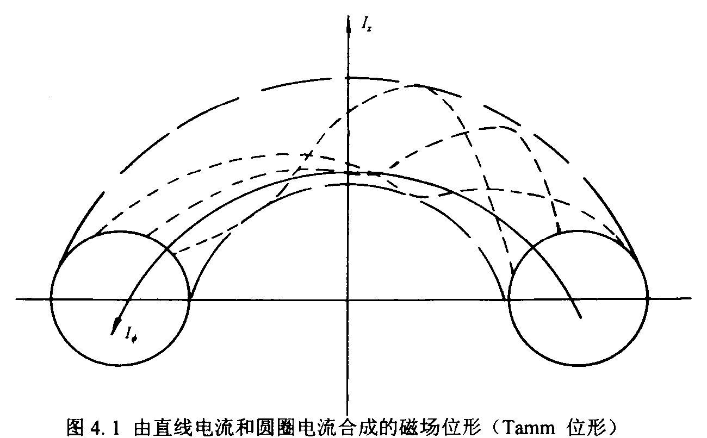

**图4.1** 由直线电流和圆圈电流合成的磁场位形（Tamm位形）

对于磁场这种无源场矢量，存在一个普遍的定理，即它可以用两个独立的标量函数的梯度的矢积来表示。我们将不加证明地引入这一概念，并在以后的实际例子中说明如何去定义这两个标函数：

$$
B = \nabla F\times \nabla G \tag{4.13}
$$

代入式 (4.2) 可以直接使该式得到满足，而且函数$F$和$G$是磁力线方程的两个积分。$F$和$G$属于流函数。

## 4.2 环形约束系统的一般性质

磁约束聚变实验装置中的磁场位形与等离子体自身的电流不能分割。在所谓的静磁平衡模型中（即等离子体宏观运动速度不出现在方程中），若等离子体的压强可用标压强来描述，则得到下面的动量（力）平衡方程

$$
\nabla p = \frac{1}{c} j\times B \tag{4.14}
$$

由这个方程得知

$$
B\cdot \nabla p = 0 \tag{4.15}
$$

即等压强面是磁面。对于直线型装置，这一关系意味着在各个由磁力线组成的曲面中，应选取具有某种对称性的曲面作为磁面，因为压强分布是具有对称性的；对环形磁面系统，在该磁面上压强为常数。所以无论哪种约束位形，我们都可以把等压面与磁面等同起来，而

$$
p = p(\Psi) \tag{4.16}
$$

此处$\Psi$为磁面函数（即式 (4.13) 中两个流函数中的一个）。

从静磁平衡方程还可看出

$$
j\cdot \nabla p = 0 \tag{4.17}
$$

这表明，电流线也在同一等压面上，即磁面也是电流面。这一电流还可以按是否垂直于磁力线而分成两部分，其中垂直于磁力线的分量是与等离子体压强分布有关的：

$$
j_{\perp} = c\frac{B\times\nabla p}{B^{2}} \tag{4.18}
$$

这一部分电流称为反磁电流。对多数磁约束聚变装置来说，由于等离子体的比压值比较小

$$
\langle \beta \rangle = \frac{8\pi\langle p\rangle}{\langle B^{2}\rangle}\ll 1 \tag{4.19}
$$

相应地，反磁电流的贡献也比较小。因此，对很多装置，这一电流的贡献可以用微扰方法进行估算，而把外部电流分布产生的磁场作为约束位形的基本构架。但是，还存在沿磁力线的电流，它可由电流连续性条件$\nabla \cdot \pmb {j} = 0$结合上面的垂直电流的表示式，给出一个关系式：

$$
B\cdot \nabla (j_{H} / B) = -\nabla \cdot \left(c\frac{B\times\nabla p}{B^{2}}\right) \tag{4.20}
$$

这一方程称为磁微分方程，仅由它还不能完全确定平行于磁力线的电流，因为它的解由与非齐次项有关的特解加齐次方程的通解构成，齐次方程

$$
B\cdot \nabla (j_{H} / B) = 0 \tag{4.21}
$$

表明沿磁力线的电流与磁场的比值在同一磁面上为常数，这个常数的大小要由其他条件，即由电流的驱动条件确定。根据是否存在较大的平行于磁力线的驱动电流，磁约束聚变装置又可分成不同的类别。对仿星器及类似装置，基本不存在或仅有很小的平行电流，其磁场位形构架基本上由外部电流分布产生的磁场确定；对托卡马克及箍缩放电装置，存在很大的沿磁力线的电流，其磁场位形由外部电流分布及等离子体中的电流，主要是这一平行于磁力线的电流共同确定。在本章中，我们主要讨论第一类装置的磁场位形。对第二类装置仅作一些模型讨论，严格的平衡位形的确定将在下一章中研究，但许多用于表征磁面结构特性的特征量和一些描述方法，对所有的装置都适用。

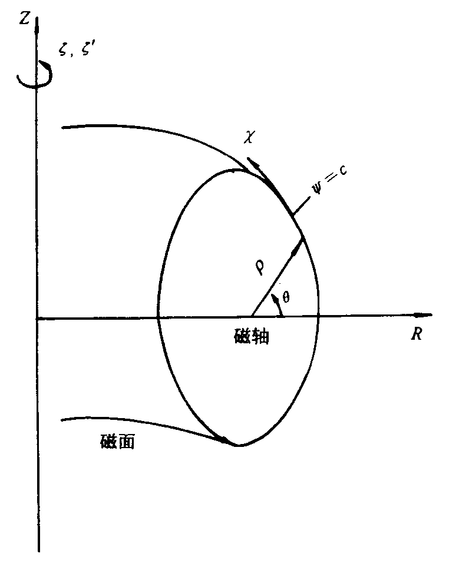

**图4.2** 环形坐标系$(\Psi,\chi,\zeta)$及局部坐标系$(\rho,\theta,\zeta^{\prime})$从重要性和普遍性的角度考虑，我们主要研究环形约束位形。一些直线位形可以看成是将环形剪断后拉直的结果。如果在两端加上周期性条件，这种“直线近似”在很多方面可以描述环形装置的基本特征。

如图4.1，引入环形坐标系，但此环不一定是圆环。一般地我们可以定义“环向”和“极向”这两个特征方向。为避免过分的数学化，我们不妨以图4.1即Tamm位形（它是轴对称的）为代表，环向就是围绕对称轴的方向。我们假定所研究的磁面具有单一的磁轴，即由单一的磁力线构成的闭合曲线，它是整个磁面系统的组成部分，只是由面退化为一条线。在上面的Tamm位形的例子中，圆圈电流所在的位置就是磁轴。有时系统具有若干条退化的闭合曲线，使描述变得非常复杂，但原则上可以分区域来讨论。不失一般性，我们考虑单磁轴的情形，并在磁轴上建立一个局部的极坐标系。这样，一般的磁面坐标系由磁面函数$\Psi$，环向角坐标$\zeta$，极向角坐标$\chi$组成，而局部极坐标由式$\rho,\theta,\zeta$构成（如图4.2所示）其中的角变数均以$2\pi$为周期。两者的关系可以表示成：

$$
\rho = \sqrt{(R - R_{0})^{2} + Z^{2}}
$$

$$
\begin{array}{l}
\theta = \tan^{-1}\left(\dfrac{Z}{R - R_{0}}\right) \\
\zeta^{\prime} = -\zeta
\end{array} \tag{4.22}
$$

式中$R,z$为磁面上一点的圆柱坐标值。

再引入有关的磁通函数的定义。环向磁通为：

$$
\Psi_{\mathrm{T}} = \frac{1}{2\pi}\iiint \mathrm{d}V B\cdot \nabla \zeta \tag{4.23}
$$

积分对环面的内部区域进行。极向磁通为：

$$
\Psi_{\mathrm{p}} = \frac{1}{2\pi}\iiint \mathrm{d}V B\cdot \nabla \chi \tag{4.24}
$$

以上定义具有普遍意义，利用角变数的周期性及磁场的无源性质，上述两个体积分可以还原为关于环向和极向截面上的面积分。

还可以定义磁面上磁力线的旋转变换

$$
i(\psi) = 2\pi \frac{\mathrm{d}\psi_{\mathrm{p}}}{\mathrm{d}\psi_{\mathrm{T}}} \tag{4.25}
$$

它代表所考察磁面上磁力线的平均旋转性质（当磁力线绕环向转动一圈时沿极向转动角度的平均值）。在不同的磁面上旋转变换可以不相同，其变化率

$$
s(\psi) = \frac{\psi}{i}\frac{\mathrm{d}i}{\mathrm{d}\psi} \tag{4.26}
$$

称为磁力线的剪切或简称磁剪切。还有一个特征参量，称为磁面的比拟，其定义为磁面的体积对磁通函数的变化率

$$
U(\Psi) = \frac{\mathrm{d}V}{\mathrm{d}\Psi} \tag{4.27}
$$

这个函数再对磁通函数求一次导数得出所谓的磁阱深度，所有这些参量与聚变等离子体的磁流体和粒子动力论稳定性密切相关。

对具体装置中的各种与磁面位形有关的特性参数的确定及性质的讨论将在介绍具体装置时进行。下面将介绍一些有关装置中普遍应用的磁场的计算方法，并讨论其中一些磁场位形的特性，它们主要是外部电流分布产生的。

## 4.3 某些特定电流产生的磁场

### 4.3.1 圆圈电流产生的磁场

设圆圈电流位于圆柱坐标系$(R,\theta,Z)$中的$Z = 0$平面上，半径为$a$（图4.3）。在一般电磁学和电动力学教科书中都有这一电流产生的磁场的计算公式，这里引用如下：磁场矢势的角向分量为

$$
A_{\theta}(R,Z)=\frac{4J}{c}\frac{a}{\sqrt{(R+a)^{2}+Z^{2}}}
\left[\frac{(2-k^{2})K(k)-2E(k)}{k^{2}}\right]
$$

式中

$$
k^{2} = \frac{4aR}{(R + a)^{2} + Z^{2}} \tag{4.29}
$$

$K(k)$和$E(k)$是第一类和第二类完全椭圆积分。这种轴对称形状的电流的磁场的磁力线可以用下面的流函数

$$
\psi (R,Z) = RA_{\theta}(R,Z) \tag{4.30}
$$

来描述，这时 (4.13) 中的另一个函数是角变数$\theta$自身，即

$$
B_{\mathrm{p}} = \nabla \psi \times \nabla \theta \tag{4.31}
$$

按前面提到的分类方法，电流圈的磁场属极向磁场，故用下标$\mathrm{p}$表示，其形状也画在图4.3中。我们指出，如果同时存在一个环向磁场$B_{\mathrm{r}} = B_{\theta}e_{\theta}$，例如由Tamm位形中沿$R = 0$轴的直线电流产生的磁场，则磁力线组成环形曲面，但此曲面在$\theta = \mathrm{const}$上的截面形状仍由上面的流函数$\psi (R,Z)$表示，其图形仍如图4.3中磁力线所示。也就是说，在轴对称系统中，环向磁场的大小不影响磁力线组成的曲面的形态，但它影响磁力线转动的快慢。

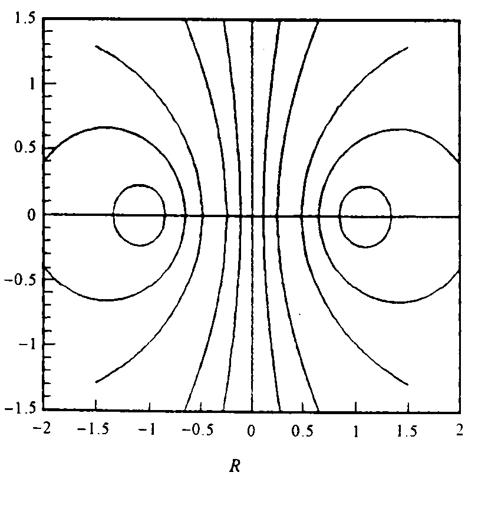

**图4.3** 平面圆圈电流的磁力线

在接近电流圈时，即当$R\rightarrow a$，$k\rightarrow 1$时，可以利用椭圆积分$K(k)$和$E(k)$的渐近展开式

$$
E(k) = 1 + \frac{1}{2}\left(\ln \frac{4}{\sqrt{1 - k^{2}}} -\frac{1}{2}\right)(1 - k^{2}) - \dots \tag{4.32}
$$

$$
K(k) = \ln \frac{4}{\sqrt{1 - k^{2}}} +\frac{1}{4}\left(\ln \frac{4}{\sqrt{1 - k^{2}}} -1\right)(1 - k^{2}) + \dots \tag{4.32}
$$

得出近似的磁场流函数

$$
\psi (R,Z) = \frac{2J a}{c}\left(\ln \frac{8a}{\sqrt{(R - a)^{2} + Z^{2}}} -2\right) = \mathrm{const} \tag{4.33}
$$

其截面为圆环，中心即为电流圈所处位置

$$
\left(R - a\right)^{2} + Z^{2} = \mathrm{const} \tag{4.34}
$$

在靠近$R = 0$轴处，宗量$k^{2}$也很小，此时可利用椭圆积分的展开式

$$
\begin{array}{l}
E(k)=\dfrac{\pi}{2}\left(1-\dfrac{k^{2}}{4}-\dfrac{3k^{4}}{64}-\cdots\right) \\
K(k)=\dfrac{\pi}{2}\left(1+\dfrac{k^{2}}{4}+\dfrac{9k^{4}}{64}+\cdots\right)
\end{array} \tag{4.35}
$$

得另一近似式

$$
\psi (R,Z) = M\frac{R^{2}}{\left[(R + a)^{2} + Z^{2}\right]^{3 / 2}} = \mathrm{const} \tag{4.36}
$$

式中

$$
M = \frac{J}{c\pi a^{2}} \tag{4.37}
$$

代表偶极磁场的磁矩。

利用上述结果可以很容易地讨论一些对磁约束聚变位形有意义的基本位形结构。

### 4.3.2 简单的磁镜位形

用两个放在同一圆柱面上相距为$2l$的圆圈电流即可产生简单的磁镜位形（如图4.4所示）。若取坐标原点在对称轴上两个圆圈电流的中点，即$R = 0$，$Z = 0$，则磁力线的流函数为：

$$
\begin{aligned}
\psi (R,Z) ={}& \frac{4J\sqrt{aR}}{c}\left\{\left[\left(\frac{1}{k_{+}} - \frac{k_{+}}{2}\right)K(k_{+}) - \frac{1}{k_{+}} E(k_{+})\right]\right. \\
&+\left.\left[\left(\frac{1}{k_{-}} - \frac{k_{-}}{2}\right)K(k_{-}) - \frac{1}{k_{-}} E(k_{-})\right]\right\}
\end{aligned} \tag{4.38}
$$

$$
k^{2}{}_{+} = \frac{4aR}{(a + R)^{2} + (l\pm Z)^{2}} \tag{4.39}
$$

其形状如图4.4所示。在轴线上（$R = 0$）的磁场（仅为$Z$分量）可以用初等函数表示：

$$
B_{Z}(Z) = 2M\left\{\frac{1}{\left[a^{2} + (l + Z)^{2}\right]^{3 / 2}} +\frac{1}{\left[a^{2} + (l - Z)^{2}\right]^{3 / 2}}\right\} \tag{4.40}
$$

这一磁场的强度由中心（$Z = 0$）处向两边加大，在线圈所处位置（$Z = \pm l$）达到最大，然后又开始减小（见图4.4）。在磁场最大处形成所谓的磁镜。所以，根据带电粒子的磁矩守恒条件，它们中具有较大横向能量的那些在由中心区运动到磁镜处会反射回中心区。如没有其他作用力，它们将长期约束在该区域内。

### 4.3.3 会切场位形

将图4.4两个线圈中的电流互相反向，得到一种称为会切场的位形（如图4.5所示）。其特点是，磁力线类似于双曲线形状，在对称轴方向及$Z = 0$平面上形成缝隙，在$R = 0$，$Z = 0$点的磁场强度为零，由此点向外磁场强度增大。这种场形称极小$B$场形，此处$B$为磁场强度。从磁流体稳定性的角度，若等离子体处在这种场中，则对于所谓的磁流体交换模是稳定的。可是，带电粒子可以从磁力线的缝隙中逸出约束系统，因此，单纯的会切场像简单磁镜场系统一样不能充分约束高温等离子体。

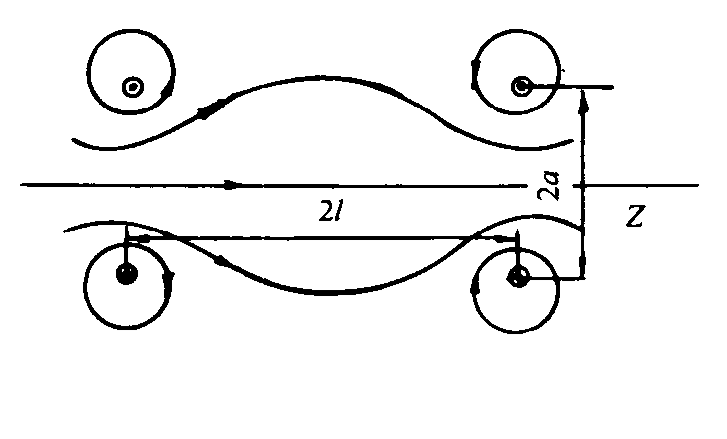

**图4.4** 简单磁镜的位形

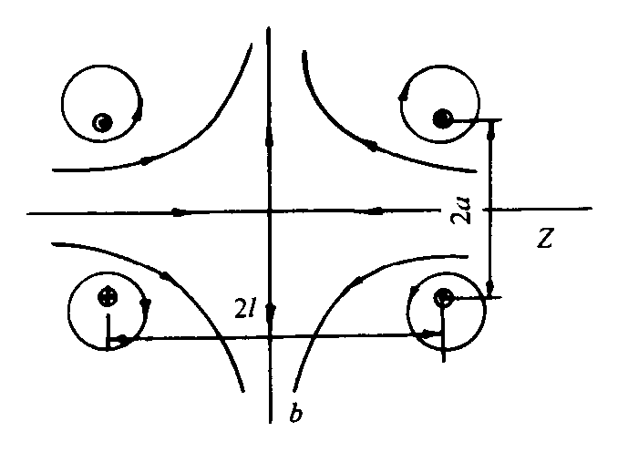

**图4.5** 会切场位形

### 4.3.4 圆柱面上相距为$b$的多个电流圈产生的磁场（见图4.6）

这是实际装置中应用的线圈绕组的一种理论简化。真实绕组产生的磁场可以通过这里给出的结果对绕组体积积分而获得，因此本小节中的结果有重要的实用价值。

用标势法求解，在圆柱面内外将标势满足的拉普拉斯方程的解用贝塞尔函数展开，可以得到

$$
\Phi (r,z) = \frac{2k J}{c}\left\{z + 2a\sum_{n = 1}^{c}\mathrm{K}_{1}(n k a)\mathrm{I}_{0}(n k r)\sin n k z\right\}, \quad r< a \tag{4.41}
$$

$$
\Phi (r,z) = -\frac{4k a J}{c}\sum_{n = 1}^{c}\mathrm{I}_{1}(n k a)\mathrm{K}_{0}(n k r)\sin n k z, \quad r > a \tag{4.41}
$$

其中$k = 2\pi /b$，$\mathrm{I}_{0,1}$，$\mathrm{K}_{0,1}$是修正的贝塞尔函数。从上式得到的一个重要结果是，这种电流布置产生一个较强的本底磁场，它由上式中第一式的第一项表示

$$
B_{z0} = \partial \Phi /\partial z\approx 2k J / c = 4\pi J / c b \tag{4.42}
$$

上式表明，分离配置的线圈绕组电流产生的磁场的主分量的大小正比于单位长度上的安匝数，这是普通电工学中就知道的结果。但分离配置将产生谐波场分量，使总磁场的磁力线形成波纹形，这些谐波分量就称波纹场。在磁约束实验装置中，由于需要留出实验诊断和用于引入加热功率的窗口，在主磁场上必然会叠加波纹场分量。波纹场在接近绕组所在位置时增大，也就是在约束区的外缘有较大的值，它们对带电粒子的约束有较大的影响。

如果将圆柱面弯成圆环面，当环的大半径比环的小半径大很多时，则可将上述磁场的标势看成环形情况下磁场标势的最低一级近似，于是环形区域中的本底磁场为

$$
B_{\phi 0} = \frac{1}{R}\frac{\partial\Phi}{\partial\phi} = \frac{B_{0}R_{0}}{R} \tag{4.43}
$$

其中$R_{0}$为真空室中心的位置，$B_{0}$为该处的磁场。环形磁场是沿大半径方向减小的磁场。

### 4.3.5 直线多极磁场

采用圆柱坐标系$(r,\theta ,z)$，设在圆柱面上沿$z$轴方向布设$n$根直线电流，则其磁场可用上面求标势的方法求出，在靠近轴心处$(r\ll a)$，近似地有：

$$
\begin{array}{l}
B_{r}=\left(\dfrac{4\pi n J}{c}\right)\left(\dfrac{r}{a}\right)^{n-1}\sin n\theta, \\
B_{\theta}=\left(\dfrac{4\pi n J}{c}\right)\left(\dfrac{r}{a}\right)^{n-1}\cos n\theta
\end{array} \tag{4.44}
$$

而在靠近电流处，高阶谐波场很重要，磁力线绕每根电流转动。图4.7所示磁场对等离子体的磁流体不稳定性有很好的稳定作用。

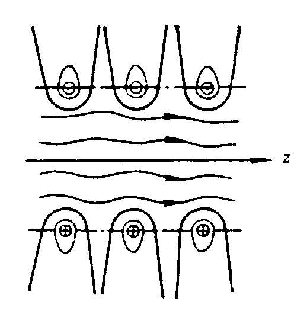

**图4.6** 由直圆柱面上多个圆圈电流产生的波纹磁场

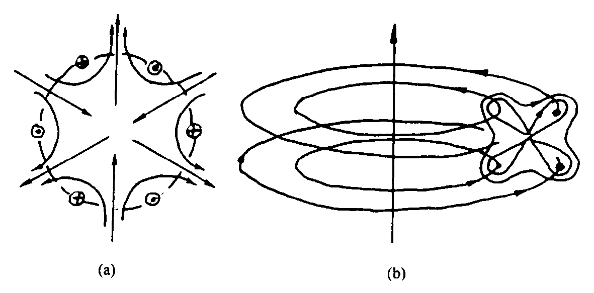

**图4.7** (a) 由圆柱面上三对相邻反向电流棒产生的六极场；(b) 由四个同向圆圈电流产生的环形八极场

### 4.3.6 圆柱面上螺旋对称电流产生的磁场及直线仿星器的磁面

设圆柱面上有一根螺旋线电流，线的螺矩为$L$，引入螺旋参数

$$
\alpha = 2\pi /L
$$

显然，该系统具有螺旋对称性，所有量都只是$r$及$\theta = \phi - \alpha z$的函数。将电流分布的$\delta$函数按富氏级数展开，可以得出相应的标势为

$$
\Phi (r,\theta) = b_{0}z + \sum_{n}b_{n}I_{n}(n\alpha r)\sin n\theta \tag{4.45}
$$

$b_{0},b_{n}$与电流分布参数有关

$$
b_{0} = \frac{2\alpha J}{c}, \quad b_{n} = \frac{4\alpha J a}{c} K_{n}^{\prime}(n\alpha a) \tag{4.46}
$$

式中$I_{n},K_{n}$均为$n$阶修正的贝塞尔函数。如果在同一圆柱面上均匀地布置$l$对螺旋电流，并适当选取这些绕组的宽度，就可以使高阶谐波很小。因此在下面的分析中我们只考虑含一种谐波的螺旋对称磁场。

利用下面关系先求出相应的矢势分量

$$
\frac{\partial\Phi}{\partial r} = -\frac{\partial A_{\theta}}{\partial z}, \quad \frac{1}{r}\frac{\partial\Phi}{\partial\phi} = \frac{\partial A_{r}}{\partial z} \tag{4.47}
$$

（这里对矢势$\pmb{A}$的定义可有一定的随意性，对应于选择不同规范。）于是直接得出：

$$
\begin{array}{l}
A_{r}=-\dfrac{1}{\alpha^{2}r}b_{1}I_{1}(l\alpha r)\sin n\theta \\
A_{\theta}=\dfrac{b_{0}r}{2}-\dfrac{1}{\alpha}b_{1}I_{1}^{\prime}(l\alpha r)\cos n\theta \\
A_{z}=0
\end{array} \tag{4.48}
$$

定义磁面函数$\Psi (r,\theta)$，它满足

$$
\pmb {B}\cdot \nabla \Psi = 0 \tag{4.49}
$$

并假定另外有一沿$z$轴的本底强磁场$B_{0}$，则可将相应的磁面函数写出：

对于$l = 1,2,3$，磁面的形状如图4.8所示。

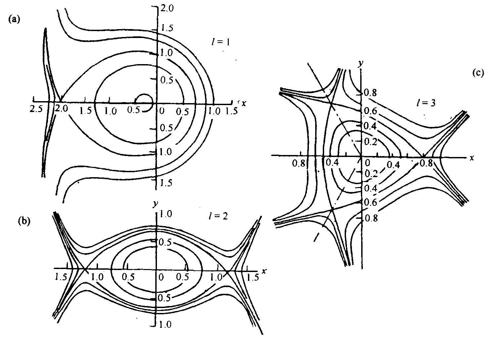

**图4.8** (a) $l = 1$，(b) $l = 2$，(c) $l = 3$直线仿星器的磁面位形〔1〕

观察这些位形结构可以发现，每种位形都具有两个不同的区域，即半径较小时的闭合磁面与半径较大处的开放型磁力线。两者的相对大小由本底磁场与螺旋磁场幅值参数间的比值以及螺旋绕组的位置参数决定，是可以调整的。最后一个闭合磁面称磁分界面。这种磁场结构非常符合约束等离子体的要求：将高温等离子体约束在磁面闭合区，而在边缘附近让磁面开放以控制杂质元素的进入。所以上述磁场位形很早就被磁约束聚变装置所采用。仿星器就是基于上述概念的一种装置。

### 4.3.7 具有螺旋绕组的磁场中磁力线的旋转变换

上述磁场的另一重要性质是磁力线具有绕极向的转动。为此需较细致地考虑磁力线方程的解。下面用$(r,\phi ,z)$来表示圆柱坐标，写出磁力线方程

$$
\frac{\mathrm{d}r}{\mathrm{d}z} = \frac{b_{r}}{B_{0} + b_{z}} \approx \frac{b_{r}}{B_{0}} \cdot \frac{b_{r} b_{z}}{B_{0}^{2}}, \tag{4.51}
$$

$$
\frac{\mathrm{d}\phi}{\mathrm{d}z} = \frac{b_{\phi}}{r(B_{0} + b_{z})} \approx \frac{b_{\phi}}{r B_{0}} \cdot \frac{b_{\phi} b_{z}}{r B_{0}^{2}}
$$

这是一组非线性常微分方程，它具有两个可利用的特点，第一是变量具有周期变化性质，第二是右方各量都是小量（当本底磁场$B_{0}$很大时，这一条件对所考虑的系统是满足的）。这时可以应用平均近似方法[1]来求解。定义平均磁面函数

式中各量都是平均变数的函数，上面一横及$\langle \rangle$号都是对周期求平均，角号为变量与平均值之差。对于前面讨论的螺旋对称磁场，上述平均磁面函数仅是$\bar{r}$的函数，因此平均磁面为圆。显然这只适用于磁面为闭合曲面的区域。磁面开放的区域中上述近似不适用，需对磁力线方程进行数值求解。在闭合磁面内，利用平均磁面函数，磁力线沿$z$轴的平均转动速率可表达成

$$
\frac{\mathrm{d}\bar{\phi}}{\mathrm{d}z} = \alpha \omega \tag{4.53}
$$

$\omega$称磁力线的旋转变换率

$$
\omega = \left(\frac{b_{l}}{B_{0}}\right)^{2}\left[\frac{2}{l!}\left(\frac{l}{2}\right)^{l + 1}\right]^{2}\left[\left(1 - \frac{1}{l}\right)(\alpha r)^{2l - 4} + \frac{l}{2}\left(\alpha r\right)^{2l - 2} + \dots \right] \tag{4.54}
$$

可以看到，对$l = 1$和$l = 2$，在$r = 0$处的旋转变换率不为零，但对$l \geqslant 3$，$r = 0$处的旋转变换率为零。不过，对于旋转变换的导数，$l = 2$时近似为零，而对$l \geqslant 3$则不为零。这种导数称为磁力线的剪切，一般的定义为（与 (4.26) 等价）

$$
s = \frac{r}{{\omega}}\frac{\mathrm{d}\omega}{\mathrm{d}r} \tag{4.55}
$$

这一特征量与等离子体的稳定性有重要关系。

需要指出的是，实际磁力线的轨迹远比平均方程给出的结果要复杂，近似到小量的一级，磁力线沿$z$轴前进时极向角的变化方程为

$$
\phi = 2\pi \omega z / L - \frac{1}{\alpha^{2}r^{2}B_{0}}\sum_{l = 1}b_{l}I_{l}(l\alpha r)\sin l\theta \tag{4.56}
$$

所以实际上极向角是在来回摆动的过程中产生平均的旋转变换的，这一情况与托卡马克等离子体中磁力线基本上均衡地旋转有很大差别。从小量展开的角度看，托卡马克的磁力线的旋转变换是一级量，而仿星器中磁力线的旋转变换是二级量。要产生同样大小的旋转变换，后者的螺旋磁场强度要更大，这样，它引起的磁面关于平均磁面（圆环面）的畸变也就更大。

另一个很重要的物理结果是，在靠近磁分界面时，磁力线的旋转变换率变得非常大。详细的计算要通过精确求解磁力线方程得出[1]。图4.9表示其中一个结果，可以看出，在磁分界面内部，近似解很好地与精确解一致，但接近磁分界面时，实际的旋转变换远大于近似解并迅速加大。这一结果对其他具有磁分界面的位形也定性地正确。

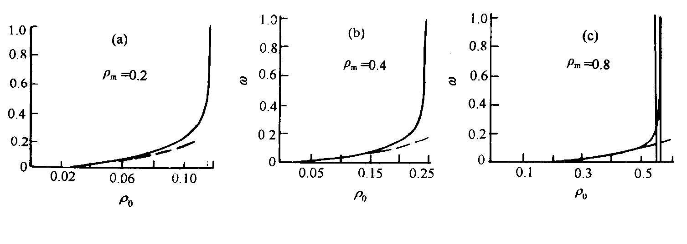

**图4.9** 磁力线旋转变换率；实线为精确解，虚线为平均近似解；(a)～(c) 中，分界面半径$\rho_{\mathrm{m}} = 0.2,0.4$和$0.8$〔1〕。

## 4.4 环形仿星器的真空磁场及磁面[3-5]

外部电流产生的磁场给出了仿星器装置的基本磁场结构，这种磁场称真空磁场。实际上对于环形装置，所有线圈绕组都是绕在环形真空室外面的，必须考虑环形与上面讨论的直线位形的差别。为此首先要较精确地计算环形装置中的磁场。

### 4.4.1 环形区域中求解真空磁场的小量展开法

这里我们简要地考察圆环面上电流产生的磁场，引入准环坐标系$(r,\theta ,s)$（如图4.10所示），这是一组正交坐标系，其三个变量的拉梅因子为

$$
h_{r} = 1, \quad h_{\theta} = r, \quad h_{s} = 1 - \frac{r}{R} \cos \theta \tag{4.57}
$$

设环面上的电流分布为

$$
J = J_{\theta} e_{\theta} + J_{s} e_{s} \tag{4.58}
$$

由电流的连续性条件$\nabla \cdot J = 0$可以引入一个表征电流分布的函数$F(\theta , s)$使

$$
\left(1 - \frac{a}{R} \cos \theta\right) J_{\theta} = -\frac{\partial F}{\partial s}, \quad
J_{s} = \frac{1}{a} \frac{\partial F}{\partial \theta}
$$

这样，标势满足的边界条件简化成

$$
\left(\Phi_{e} - \Phi_{i}\right)_{a} = \frac{4\pi}{c} F \tag{4.60}
$$

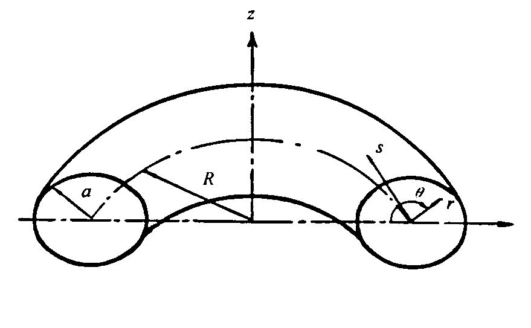

**图4.10** 准环坐标系

在上述坐标系中，拉普拉斯方程化为

$$
\begin{aligned}
&\frac{1}{r}\frac{\partial}{\partial r} \left(r\frac{\partial\Phi}{\partial r}\right) + \frac{1}{r^{2}}\frac{\partial^{2}\Phi}{\partial\theta^{2}} +\frac{1}{(1 - r\cos\theta / R)}\frac{\partial^{2}\Phi}{\partial s^{2}} -\frac{\cos\theta}{R - r\cos\theta}\frac{\partial\Phi}{\partial r} \\
&\qquad + \frac{1}{r}\frac{\sin\theta}{R - r\cos\theta}\frac{\partial\Phi}{\partial\theta} = 0
\end{aligned} \tag{4.61}
$$

设$r / R$为小量，将所有物理量及算符都对此小量展开，可得出一系列齐次及非齐次微分方程：

$$
\begin{array}{l}
\Delta^{0}\Phi_{0} = 0 \\
\Delta^{0}\Phi_{1} = -\Delta^{1}\Phi_{0}
\end{array} \tag{4.62}
$$

其中各级算符为

$$
\Delta^{0} = \frac{1}{r}\frac{\partial}{\partial r}\left(r\frac{\partial}{\partial r}\right) + \frac{1}{r^{2}}\frac{\partial^{2}}{\partial\theta^{2}} + \frac{\partial^{2}}{\partial s^{2}},
$$

$$
\Delta^{1} = -\nabla^{0}\left(\frac{r\cos\theta}{R}\right)\cdot\nabla^{0} + \frac{2r\cos\theta}{R}\frac{\partial^{2}}{\partial s^{2}}, \tag{4.63}
$$

$$
\nabla^{0} = e_{r}\frac{\partial}{\partial r} + e_{\theta}\frac{1}{r}\frac{\partial}{\partial\theta} + e_{s}\frac{\partial}{\partial s}
$$

下面结合不同的场型（波纹场，螺旋场，多极场）来讨论环形修正。

### 4.4.2 基本磁场（零级近似）

（1）波纹场

$$
\Phi_{i} = B_{0}s + b_{1}I_{0}(nkr)\sin nks,
$$

$$
\Phi_{0e} = b_{1}\frac{I_{1}^{\prime}(nka)}{K_{1}^{\prime}(nka)}K_{0}(nkr)\sin nks \tag{4.64}
$$

式中$k = 2\pi / L$，$b_{1}$为波纹场相对大小的参量，下脚标 i，e 代表圆柱面的内部及外部；

（2）螺旋对称磁场

$$
\Phi_{0i} = B_{0}s + b_{2}I_{1}(l\alpha r)\sin lu,
$$

$$
\Phi_{0e} = -b_{2}\frac{I_{1}^{\prime}(l\alpha a)}{K_{1}^{\prime}(l\alpha a)}K_{1}(l\alpha r)\sin lu \tag{4.65}
$$

式中$u = \theta - \alpha s$。

（3）多极磁场

$$
\Phi_{0i} = b_{3}r^{m}\sin m\theta,
$$

$$
\Phi_{0e} = -b_{3}\frac{a^{2m}}{r^{m}}\sin m\theta + b_{4}\theta \tag{4.66}
$$

上面第二式中右方第二项是沿圆柱面的$s$方向均匀流动的电流产生的磁场，它在直圆柱面内部的磁场为零。但在圆环情况下，将产生垂直于环的赤道面的次级磁场分量。

### 4.4.3 环形修正的一级近似解

标势的一级修正满足

$$
\frac{1}{r}\frac{\partial}{\partial r}\left(r\frac{\partial\Phi_{1}}{\partial r}\right) + \frac{1}{r^{2}}\frac{\partial^{2}\Phi_{1}}{\partial\theta^{2}} + \frac{\partial^{2}\Phi_{1}}{\partial s^{2}}
= \frac{\cos\theta}{R}\frac{\partial\Phi_{0}}{\partial r} - \frac{\sin\theta}{Rr}\frac{\partial\Phi_{0}}{\partial\theta} - \frac{2r\cos\theta}{R}\frac{\partial^{2}\Phi_{0}}{\partial s^{2}} \tag{4.67}
$$

这类方程的求解基本上等价于求第$n$个谐波的两个边带模（sideband）($n\pm1$)，即基本上是关于非齐次常微分方程及关于贝塞尔函数的一些变换运算，虽然比较繁琐，但不困难，我们将直接引入结果，详细的推导参见参考文献[4,5]。

（1）螺旋磁场的一级环形修正

$$
\begin{aligned}
\Phi_{0i}={}&-b_{2}\frac{r}{4R}\left\{\left[l\alpha r I_{l-1}(l\alpha r)+(2l+1)I_{l+1}^{\prime}(l\alpha r)\right]\sin(lu+\theta)+\frac{a_{+}}{l\alpha r}I_{l-1}(l\alpha r)\right.\\
&\left.\left[l\alpha r I_{l-1}(l\alpha r)-(2l-1)I_{l-1}^{\prime}(l\alpha r)+\frac{a_{-}}{l\alpha r}I_{l+1}(l\alpha r)\right]\sin(lu-\theta)\right\}
\end{aligned} \tag{4.68}
$$

式中含待定常数$\pmb{a}_{+}$的项相应于齐次方程的通解，需由具体的环面电流分布的细节并与环面的外部解结合起来确定，为使结果完整，这里引入它的一种表示式，它对应于将直线螺旋绕组均匀地变形为环的情形。

$$
\begin{aligned}
a_{\pm} ={}& -x_{0}^{2}\mp \frac{2l x_{0}}{\mathbf{K}_{l}^{\prime}(x_{0})}\mp \left[(2l\pm 3)x_{0}^{2} + (2l\pm 3)(l\pm 1)^{2}\right]\mathbf{K}_{l\pm 1}(x_{0})\int \left(\mathbf{I}_{l\pm 1} + \frac{\mathbf{I}_{l}^{\prime}}{\mathbf{K}_{l}^{\prime}}\mathbf{K}_{l\pm 1}\right)\pm \\
& x_{0}^{2}(2l\pm 1)\mathbf{K}_{l\pm 1}^{\prime}\left(\mathbf{I}_{l\pm 1} + \mathbf{K}_{l\pm 1}^{\prime}\frac{\mathbf{I}_{l}^{\prime}}{\mathbf{K}_{l}^{\prime}}\right)
\end{aligned} \tag{4.69}
$$

式中$x_{0} = l\alpha a$。

（2）波纹场及多极场可以作为螺旋场的两种极限情形来处理

令$l\rightarrow 0$，$l\alpha \rightarrow n k$，$l u\rightarrow n k s$，则得波纹场的解，

$$
\begin{aligned}
\Phi_{0}={}&-b_{1}\frac{r}{2R}\left[n k r I_{1}(n k r)+I_{1}^{\prime}(n k r)+\frac{\delta}{n k r}I_{1}(n k r)\right]\sin n k s\cos\theta \\
\delta={}&(n k a)^{2}\left[\mathbf{K}_{1}^{\prime}(n k a)\left(\mathbf{I}_{1}^{\prime}(n k a)-\mathbf{I}_{1}(n k a)\frac{\mathbf{K}_{1}^{\prime}(n k a)}{\mathbf{K}_{1}(n k a)}\right)-1\right]
\end{aligned} \tag{4.70}
$$

（3）令$\alpha \rightarrow 0$则可从螺旋场的表示式得出多极场的表示式

$$
\begin{aligned}
\Phi_{0i} ={}& \frac{b_{3}}{4R}\left[\left(r^{m+1} - \frac{m a^{2}}{m - 1} r^{m - 1}\right)\sin (m - 1)\theta -\frac{1}{m + 1} r^{m + 1}\sin (m + 1)\theta \right] \\
&-\frac{b_{4}}{4R}\left(1 - 2\ln \frac{8R}{a} r\right)\sin \theta
\end{aligned} \tag{4.71}
$$

其中最后一项是垂直于赤道面的分量，这是环形效应中特有的情况，其零级近似场为零。关于这一垂直场，通过直接对圆圈电流的场的严格积分可以求得更精确的表示式

$$
B_{\perp} = -\frac{2\pi J_{s}}{c R}\left[\left(\ln \frac{8R}{a} -\frac{1}{2}\right) - \left(\frac{9a^{2}}{64R^{2}}\right)\right] \tag{4.72}
$$

这一磁场在所谓的扭曲器（Torsatron）位形（一种仿星器形位形，但有许多独特之处，利用同向流动的$n$对螺旋绕组产生）中起重要的作用。它也与托卡马克位形需加垂直于赤道面的磁场有密切联系。

### 4.4.4 $l = 3$的环形仿星器的真空磁面[5]

利用前两小节中得出的结果，可以对环形仿星器的真空磁面结构进行数值分析。由于这是三维空间中的问题，已不存在对称性，磁面的严格结构要通过对磁力线方程的积分求出。但利用平均方法，可以对内部闭合磁面的性质作近似分析。下面讨论一种由$l$对螺旋绕组，其中两根相邻螺旋线中电流流动的方向相反，及环向磁场$B_{0}$形成的圆环仿星器（即螺旋绕组位于圆环面上）的位形。相应的磁标势函数可以简化为：

$$
\begin{aligned}
\Phi (r,\theta ,s) ={}& B_{0}s + A I_{1}(x)\sin l u + f_{+}(x)\sin (l u + \theta) \\
&+ f_{-}(x)\sin (l u - \theta) + B_{1}r\cos \theta
\end{aligned} \tag{4.73}
$$

其中$x = l\alpha r$，$f_{\pm}(x)$是环形效应对螺旋场的修正因子，与上面式 (4.68)，(4.69) 中结果对应，但在这里还引入一个垂直场成分，它在调整环形位形中起很重要的作用。

通过对磁力线的平均方程求积分得到下面的平均磁面函数

可以将其改写为

$$
\psi (r,\theta) = g_{1}(x) + g_{2}(x)\cos \theta \tag{4.75}
$$

这里已将平均变量简写为一般变量，图4.11中是上述磁面方程在有无垂直场时的图形。

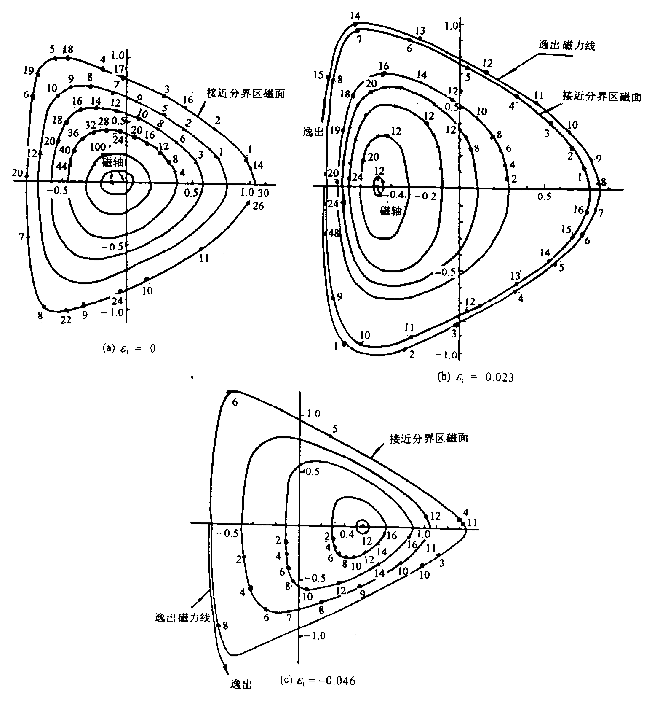

**图4.11** 环形仿星器的真空磁面（平均近似解）〔6〕：(a) 无外加垂直场；(b) 加正垂直场；(c) 加负垂直场。（$\epsilon_{1}$代表垂直场相对大小）

以上分析适用于磁轴附近区域。我们也看到，环形效应使磁轴区域的结构发生较大改变，其中单一磁轴分解为两个磁轴，但在加垂直场后，又只有单一磁轴。离磁轴较远处以及接近磁分界面处，必须用磁力线的严格积分来描述。具体做法是沿不同的磁力线进行数值积分，这时可以发现，内部的一根磁力线在绕大环方向转多次后仍处在同一磁面上，但靠近分界面处，一根磁力线绕大环方向转动多次后会逸出约束区，这正是磁分界面存在的证据。（如图4.12所示）

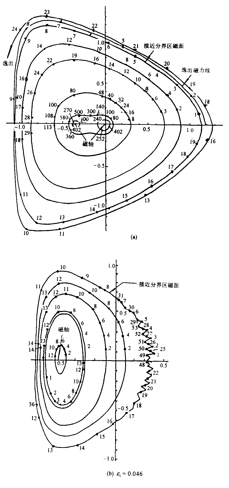

**图4.12** 环形仿星器的真空磁场位形（严格解）〔6〕：(a) 无外加垂直场；(b) 有正垂直场。

## 4.5 托卡马克位形的模拟分析

托卡马克位形是磁约束聚变研究中最重要的种位形，它基本上是轴对称的，非轴对称的因素可以看成一些扰动。由于等离子体中的电流在确定位形中起本质性的作用，而等离子体中的电流分布与等离子体参数及电流的驱动方法有关，所以真实的平衡位形分析将在下一章中进行。这里我们将利用前面得到的一些电流产生的磁场的表示式和关于磁面结构的一般性讨论，对托卡马克位形进行模拟性讨论，即假定等离子体中电流可以设定，然后研究有关的其他问题。这样得出的许多基本结论实际上适用于真实的托卡马克位形。

### 4.5.1 模拟托卡马克位形

托卡马克位形由环向磁场和极向磁场的合成磁场构成。环向磁场由绕在环形真空室外面的螺线圈绕组产生，这一绕组在环内的磁场主要是基波成分，即由 (4.43) 式表示的那部分场，此外还有一定的波纹分量，通过线圈的适当布设可以减小波纹场的比值，但靠近线圈时还是波纹场比较大。在环的外部漏场很小，基本不影响诊断设备及加热设备运行。在环的内部，这种绕组产生的磁场与Tamm位形中直线电流产生的磁场是相符的。

极向磁场的主要部分是等离子体环向电流产生的磁场，这一电流基本上平行于磁力线。前面讨论已指出，它需由某种驱动机制来维持，一般是靠欧姆变压器中磁通变化产生的感应电动势来驱动，近年来对非感应方法进行电流驱动做了很多研究，原理和实践上都证明可以通过注入定向粒子束或注入微波行波来驱动所需电流。此外，在等离子体的参数达到较高值时，等离子体自身由于新经典效应产生的自举电流（bootstrap current）可以在平行于磁力线的电流中占很大的比重，因而受到重视。在这里我们将用模拟电流分布来表示环向电流，这一电流产生的磁场是极向场的重要部分。

在环形装置中，还必须引入垂直于赤道平面的磁场，这在前面分析仿星器位形时已看到它的作用。这种垂直场可以通过特殊设置的绕组来产生。在更普遍的意义上，要考虑的不仅是垂直场，还有使等离子体截面形状产生所需变形（沿$z$轴拉长，三角变形，等等）的其他极向场。产生这些磁场的电流线圈也都是沿环向布设的，统称为极向磁场绕组。围绕真空室外部导体壁的涡电流的方向也在环向，它们的磁场也是极向场的一部分。这部分由外部环向电流产生的磁场的极向磁通函数可以用普遍的积分表示式求出（见下一章对托卡马克平衡位形的更严格讨论）。这里仅考虑垂直场，其极向磁通函数为

$$
\psi_{\mathrm{pr}} = \frac{1}{2} B_{z}R^{2} \tag{4.76}
$$

如再加上圆圈电流的磁通函数［见 (4.30)，(4.36)］，即得托卡马克等离子体的磁面函数。

环向磁场不出现在这一函数中，即环向磁场不影响磁面的形状，但它确定了磁力线旋转变换的大小。

### 4.5.2 直线托卡马克近似的一些性质

在研究环形装置时经常要应用直线近似，这是因为很多装置的环的大半径要比等离子体的小半径大几倍（典型值$R / a = 5$），即其倒数是 0.1 量级，这已足以用于作近似展开，对圆截面托卡马克，零级近似就是直圆柱，其长度为$2\pi R$，且具有全同端面，即相距$2\pi R$的两个断面是同一面。

直圆柱中的电流与磁场的关系可以用简单的初等函数或积分表示，从而使分析变得很方便。设环向电流分布（现仅为小半径坐标$r$的函数）为

$$
j_{\theta} = j_{0}f(r) \tag{4.77}
$$

则极向磁场（在圆柱坐标中为角向）

$$
B_{\theta} = \frac{4\pi j_{0}}{cr}\int \mathrm{d}r^{\prime}r^{\prime}f(r^{\prime}) \tag{4.78}
$$

磁力线的旋转变换为

$$
i(r) = \frac{RB_{\theta}}{rB_{0}} \tag{4.79}
$$

与仿星器情况不同，它与极向磁场和环向磁场比值的一次方成正比。如果环向电流分布是均匀的，则这一旋转变换沿等离子体截面为常量，即其剪切为零。一般而言，托卡马克等离子体中的环向电流分布是从磁轴向外减小的，磁剪切不为零。在托卡马克研究中，更多应用的物理量是磁剪切的倒数$q$，称为安全因子

$$
q(r) = \frac{1}{i} = \frac{rB_{0}}{RB_{\theta}} \tag{4.80}
$$

它与磁流体模式的结构及稳定性有密切联系。为使表面扭曲模稳定，必须对边界处的安全因子$q_{a}$有一定限制（不能太小），否则会因环向电流太大引起很强的磁流体扭曲模不稳定性，使等离子体放电破裂。安全因子之名也来源于此。

关于托卡马克位形更多和更深入的研究将在第五及第九章中进行。

## 4.6 准稳态电磁场中导体的作用

在许多实验装置中，尤其是用放电方式产生和加热等离子体的装置中，都采用了一些金属（铜）导体来帮助平衡和稳定等离子体。采用金属做真空室在达到和维持高的真空状态方面是有利的，一些装置（如初期的托卡马克和环形箍缩放电）则在不锈钢做的真空室外再加一层厚铜壳，其目的是利用其中的电流涡流来跟踪等离子体中电流的变化（电流柱的位移，变形），成为一种被动反馈系统。在将来的反应堆中，一般不希望在金属导体，但从近年来对高比压托卡马克等离子体的实验研究中得出结论，靠近等离子体的一些导体是稳定快变化模式的有效手段，因此，在真空室内等离子体附近采用适当布设的金属导体很可能是较理想的方案，虽然这会给反应堆总体安排造成很多不便。

在本节中将对导体的效应进行物理原理性的讨论。在很多情况下，这些导体并不具有理想的几何形状，在它们上面常因各种需要而开了许多切口。最简单的考虑是不能让导体阻挡有用的磁场的建立。我们主要以托卡马克装置中的导体为例来讨论。

### 4.6.1 导体面上电磁场边界条件的理解

导体中满足的电磁场方程包括

磁感应方程

$$
\frac{1}{c}\frac{\partial\mathbf{B}}{\partial t} = -\nabla \times \mathbf{E} \tag{4.81}
$$

导体的欧姆定律

$$
\sigma \mathbf{E} = j \tag{4.82}
$$

此处$\sigma$为金属的电导率。在瞬态过程中还要考虑空间电荷效应，即电场有一非旋（静电场）成分：

$$
\nabla \cdot \mathbf{E} = -4\pi \rho \tag{4.83}
$$

真实导体的涡流问题是一个经典的电动力学问题，其解法是完全确定的，但分析起来却很复杂的。为了获得对问题的基本理解，不妨考虑圆柱面导体情形。

### 4.6.2 具有切口时导体中涡流回路的分析[7]

下面分析几种实际问题中常遇到的导体壳切口问题。为简单计，假定等离子-导体壳系统具有直线圆柱几何形态，但需设想两端是重合的。第一种切口是将直圆柱金属外壳垂直于$z$轴截成几段（至少是一个切口），这是因为采用感应方式使等离子体沿$z$轴放电时，在金属外壳上要产生反向电流涡流，如果金属导体的电导性非常良好，可以看成超导体（即在放电时间内磁场不能透入导体内部），则导体壳上的涡电流（用极向模数表示为$m = 0$的电流）将完全屏蔽外加感应电场。由于涡电流必须在内外壳表面构成回路，沿$z$向的切口将切断涡电流的电流线，于是感应电场可以对内部等离子体起作用，剩下的涡电流将是次级效应（由环形效应引起），它们的电流线仍可以闭合，如图4.13所示。如计入金属的电阻效应，则在所谓的趋肤时间内，

$$
\tau_{s} = \frac{4\pi\alpha d^{2}}{c^{2}} \tag{4.84}
$$

类似的涡电流存在于金属壳的内外表面，在长于这一时间后，这一涡电流逐渐消失。总之，由于切口的存在，沿$z$轴的电流将存在于圆柱的外部。对圆环的情形，此时电流圈的电感要用

$$
L = 8\pi R\left(\ln \frac{8R}{a} -2\right) \tag{4.85}
$$

来计算。

同样是这种切口，对于另一种电流变化，即电流柱整体的位移却可以产生使变化的那部分磁通不透过圆柱面的必要的涡电流。在位移比柱的半径小很多时，位移引起的磁场变化可以用$\cos \theta$函数来表示$(m = 1)$，这种变化在金属壳面上产生的涡电流，完全可以沿圆柱面构成回路（见图4.14），它也具有$\cos \theta$分布。对于这种变化，涡电流的趋肤时间也不同于上面对轴对称电流的趋肤时间，它等于

$$
\tau_{\mathrm{c}} = \frac{4\pi\alpha R d}{c^{2}} \tag{4.86}
$$

即比$m = 0$的电流的趋肤时间长$R / d$倍。于是，在趋肤时间内，电流柱位移引起的磁场变化将被这种具有切口的金属导体壳所屏蔽。而相应于这一部分磁场来定义的电感应为

$$
L_{\mathrm{c}} = 4\pi R\ln \frac{b}{a} \tag{4.87}
$$

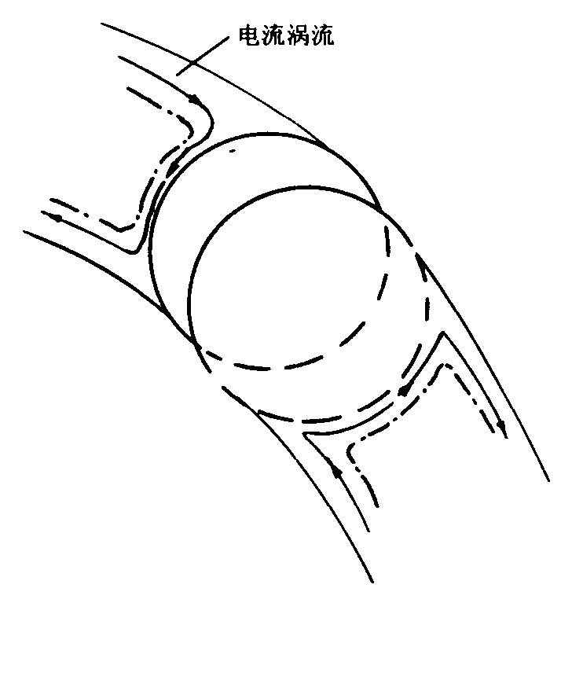

**图4.13** 具有纵向切口的圆环导体壳及电流涡流图

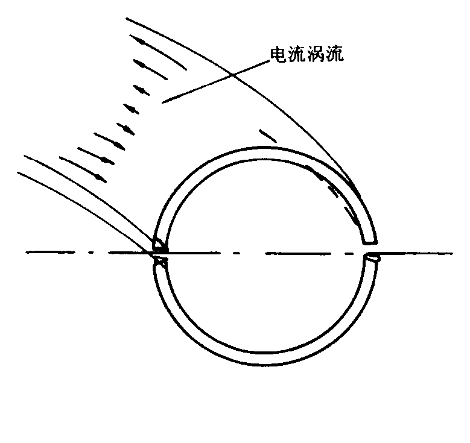

**图4.14** 在赤道面上具有切口的圆环导体壳及电流涡流图

为导体壳的内半径。

第二种重要的切口是沿环形柱的赤道面的切口，其目的是阻止产生纯极向涡电流（环向模数$n = 0$），当对主磁场线圈充电时会产生这种涡电流，它对主磁场的建立是有害的。这个切口的位置不能随便取，而必须位于赤道平面上，即在环形坐标系$\theta = 0,\pi$的面上，这样才不会切断上面讨论的$\cos \theta$分布的涡电流的电流线。如果切口取在$\theta = \pm \pi /2$处，就会阻断必要的涡电流回路而使导体壳对电流的位移（在托卡马克等离子体平衡问题中，对等离子体柱由于参数变化产生的位移）不能产生响应。当然，因为相应的涡电流不能形成闭合回路，沿赤道平面的切口对垂直位移将没有反馈响应。

金属壳切口处的涡电流会产生一些扰动磁场，例如，上面具有$\cos \theta$分布的涡电流在切口处的那部分电流要产生对垂直于环的赤道面的磁场的修正。相应的计算比较复杂，详细的计算结果请参看参考文献[7]。

## 4.7 磁场位形结构的稳定性

### 4.7.1 主要的磁场扰动及来源

实际装置中的磁场位形与理论设计的位形会有一定程度的差别。例如托卡马克或环形箍缩放位形，其理想状态是轴对称的，但实际上，首先那些用于产生环向主约束磁场的线圈就是分立布设的，在前面的分析中已指出，这将产生一系列的波纹磁场，这种场可以看成是对轴对称环形约束的一种扰动；此外，实际线圈间要有联接线，这些联接线中的电流产生的场是不希望有的杂散场，它们可以具有多个富氏分量，形成对理想位形的扰动。可以说这些场是不可避免的。除了在设计和磁体的制造加工中尽量减少杂散场外，还需分析它们可能造成的效果。

在实际应用中，还有一种情况，即人们希望有意地用较小的特定形态的磁场去影响原先的磁场以改变某些要观察或要控制的量的性质（有时要故意加大场的扰动以改变某些物理量），如在托卡马克装置中加入某种螺旋场。在前面的讨论中还指出，等离子体中电流产生的磁场，尤其是反磁电流产生的磁场，也可以看成扰动磁场，它们改变了原先由外电流分布产生的真空磁场的位形框架。更重要的一种情况是，在等离子体内部某些特殊位置（一般是在某些特殊磁面上），会因磁流体模式的发展而产生对原先磁场形态的扰动，通常这种扰动磁场具有一个占优的螺旋结构，因此可以用螺旋扰动来描述，这种螺旋场对原来磁场位形的扰动在装置物理中十分重要。所以，研究扰动磁场对某些特定磁场位形的影响是一个非常具有普遍意义和实用意义的课题。

应区分两种性质的扰动。即一种是非共振性的，另一种是共振性的。所谓共振性的，指的是扰动场的空间变化与磁面结构有内在相似性，例如在某一磁面上，扰动场的变化率与磁力线的旋转率很接近，结果，扰动具有久期性质，一个小的扰动可以引起磁面结构在局部区域中的很大的变化，甚至是拓扑结构的变化（如由闭合变成开放）。

一般情况下磁力线虽是一种概念性的东西而并非物理实体，但在磁约束聚变装置中，它具有更接近物理实体的含义。例如，可以把磁力线近似地看成是沿磁力线运动的电子的轨迹（严格意义上是质量为零的带电粒子的轨迹），这也是一种实际可用的观察磁面结构的实验方法。因此，对磁场结构的扰动，实际上也是对带电粒子轨道的扰动。不过，在环形约束区中对后者的扰动，尤其是对离子（有更大的拉莫尔半径）和高能粒子的轨道的扰动，比磁面本身所产生的扰动要大得多而且更复杂。

### 4.7.2 非共振型扰动磁面的估算

假定未扰动磁场及磁面函数分别为$\pmb{B}^{(0)}$及$\psi_{0}$，扰动磁场为$\pmb{B}^{(1)}$，扰动后的磁面函数

$$
\psi = \psi_{0} + \psi_{1} \tag{4.88}
$$

则扰动对磁面函数的修正可以通过将$\pmb{B}\cdot \nabla \psi = 0$进行微扰展开，忽略高级项得

$$
\pmb{B}^{(0)}\cdot \nabla \psi_{1} = -\pmb{B}^{(1)}\cdot \nabla \psi_{0} \tag{4.89}
$$

求非齐次项的贡献而获得

$$
\psi_{1} = -\int_{0}^{1}\mathrm{d}l\frac{B^{(1)}\cdot\nabla\psi_{0}}{B^{(0)}} \tag{4.90}
$$

上式右边被积函数中都是已知量，积分沿微扰动磁场的磁力线进行。但是，如果扰动磁场的变化与未扰磁场的磁力线具有共振性质，上面的积分将产生一个久期贡献，微扰方法失效（必须计入被忽略的高阶项$\pmb{B}^{(1)}\cdot \nabla \psi_{1}$），而需要用其他方法来分析。例如，内在闭合磁面内部用平均近似，更一般的用直接对整个磁力线方程作数值积分来研究。

### 4.7.3 共振扰动的磁面

下面我们就一种扰动后仍具有对称性而在物理上又非常重要的情形作为例子进行较详细的讨论。这一例子就是直线圆截面托卡马克位形受到一个螺旋对称谐波磁场的扰动。设直线托卡马克位形的磁场为

$$
\pmb{B}^{(0)} = B_{0}e_{z} + B_{\theta}(r)e_{\theta} \tag{4.91}
$$

其中环向磁场$\pmb{B}_{0}$为常数，未扰磁面函数仅依赖于半径$r$，并可写成

$$
\psi_{0}(r) = R\int_{0}^{r}\mathrm{d}r B_{\theta}(r) \tag{4.92}
$$

螺旋扰动磁场若用标势表示，则

$$
\Phi_{m} = b_{m}I_{m}(m\sigma)\cos m u \tag{4.93}
$$

设它在$2\pi R$长度上有$n$个周期，即$\alpha = n / R$，$u = \theta - n z / R$，利用螺旋对称磁场位形中磁面函数与磁场的矢势分量间的关系式

$$
\alpha \frac{\partial\psi}{\partial r} = \frac{\partial}{\partial r} [A_{z} + rA_{\theta}] \tag{4.94}
$$

再代入关于直线托卡马克的电流的矢势的$z$分量

$$
A_{z} = -\int_{0}^{r}\mathrm{d}r^{\prime}B_{\theta}(r^{\prime}) = -\frac{B_{0}}{R}\int_{0}^{r}\mathrm{d}r^{\prime}r^{\prime}i(r^{\prime}) \tag{4.95}
$$

可得

$$
\psi (r,u) = \frac{B\alpha_{0}r^{2}}{2m} +r b_{m}I_{m}(m n r / R)\cos m u - \frac{B_{0}}{R}\int_{0}^{r}\mathrm{d}r^{\prime}r^{\prime}i(r^{\prime}) \tag{4.96}
$$

式中$i$为未扰磁场磁力线的旋转变换率，即$1 / q$，$q$为安全因子。以上表示的从外部加螺旋对称磁场对直线托卡马克位形的扰动，设想了一个类似的螺旋对称扰动磁场，但它是等离子体内部的磁流体不稳定性产生的，它主要局限于共振磁面附近，也就是$q = m / n$的磁面附近，如将上式中的贝塞尔函数换成某种局限于共振磁面附近的函数，则得类似的磁面表示式。这类表示式与无扰动时磁面表示式不同的地方是，未扰动前的磁面，代表由磁轴算起的极向磁通，是随半径加大的单调变化的函数，而存在扰动时，即式 (4.96) 中的函数随半径的变化在某些磁面附近呈现有局部的极大和极小，实际上，这时该处的磁面将被分裂成$m$个磁岛，如图4.16所示。将式 (4.96) 中的磁面函数对半径求偏导数得

$$
\frac{\partial\psi}{\partial r} = \frac{B_{0}r}{R}\left[\frac{n}{m} - i(r)\right] + b_{m}\left(rI_{m}^{\prime}\frac{mnr}{R}\right)\cos mu \tag{4.97}
$$

对$\cos mu = 0$，上式表明极大值的位置$\left(\frac{\partial\psi}{\partial r} = 0\right)$满足$i = n / m$，这正是所谓的共振面的位置，它对应于磁岛的中心；而$\cos mu = \pm 1$的位置对应于磁岛的边缘，相邻两个磁岛在极向是相联接的，磁岛的宽度与未扰磁场的磁力线的剪切大小有关（详见后面第五章）

$$
w = 4\left(\frac{b_{mn}R}{m B_{0}\,\mathrm{d}i/\mathrm{d}r}\right)^{1 / 2} \tag{4.98}
$$

在磁约束聚变实验装置中遇到的情况，往往是磁岛的区域与磁面结构仍是光滑的区域交叉地存在，但它们一般不具有简单的对称性，因而结构更为复杂。图4.15中所示例子是这一情况的很大简化。

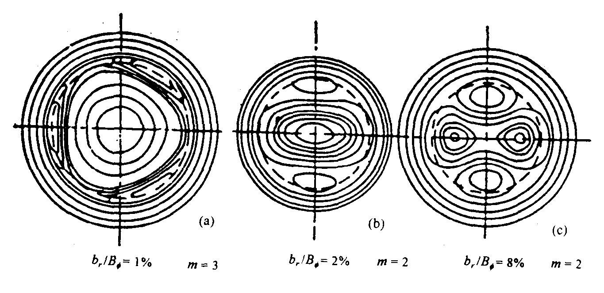

**图4.15** 圆柱位形中由 (a) $m = 3$和 (b)(c) $m = 2$的螺旋扰动磁场产生的磁岛结构；扰动磁场与本底磁场强度比分别为$1\%$、$2\%$和$8\%$。

### 4.7.4 磁岛的重叠及磁场位形结构的无规化区域

在实际应用中会见到一种很重要的物理现象，即一些不同的模式引起的磁岛会互相重叠。这出现在不同的磁岛宽度大于磁岛间的距离时。在磁岛重叠区域，磁力线的走向将呈现无规化趋势。这是因为，扰动磁场往往是随时空变化的，而且并不只是一种单纯的谐波分量起作用。

在磁岛重叠区域，由于带电粒子沿磁力线的快运动以及沿磁力线的快输运，尤其是热传导，等离子体中的热量将很快被传出该约束区，因而对等离子体总体约束产生很大的影响。磁岛的形成以及相应的磁力线无规化在自然界中是很普遍的，这种现象称为磁重连（magnetic reconnection），在宇宙空间等离子体中，如在地球的船前激波（bow shock）及磁尾区（magnetic tail）中就经常发生。在聚变实验装置中，尤其是那些具有内部大电流的装置中，如托卡马克和箍缩放电装置，这种磁重连和输运的增大都是重要的物理现象。磁力线的无规化有时也被主动地用来控制杂质输运或加大靠近某些边缘区的输运，以使热量较均匀地沉淀在靶体上，减少相关的等离子体与材料的作用。

## 4.8 偏滤器位形（divertor）

偏滤器一词起源于仿星器装置，为了控制杂质向等离子体中心约束区的透入，在跑道型仿星器装置的直线段有意识地加一个产生与主磁场反向的磁场线圈，在靠近边界处磁场有一零点（见图4.16），一部分磁力线将逸出主约束区，并在主约束区及真空室壁之间形成一个称为剥离层（scrape-off layer）的中间区域。这样，从外部进入靠真空室壁处产生的杂质原子或分子中有很大一部分将在剥离层中电离，象其他带电粒子一样，杂质离子沿磁力线的运动远快于横越磁力线的运动，因而可以使大部分杂质离子引入到特殊的靶室中使之重新复合成中性原子或分子，然后用大抽速泵抽出系统。这种形式的偏滤器在托卡马克型装置中也被采用过（英国的DITE），称为局部偏滤器，以区别于后来广泛应用的极向偏滤器。对托卡马克装置，这种偏滤器带来不对称性，而且为使环向磁场的磁力线偏转出真空室，所需的偏滤电流是很大的，这可以从下面的估计中看出。在靠近线圈处，用圆圈电流产生的磁场的大小大体可由下式估计

$$
B_{\mathrm{div}} = \frac{2I_{\mathrm{div}}}{cx} \tag{4.99}
$$

$x$为离偏滤线圈中心的距离，而环向磁场的大小为

$$
B_{\mathrm{T}} = \frac{1}{c} 4\pi n I_{0} \tag{4.100}
$$

$n$为单位长度平均的线圈匝数。为了在离偏滤器线圈中心$x$处生成$x$-点，上两种磁场应相互抵消，于是要求

$$
I_{\mathrm{div}} = 2\pi nxI_{0} \tag{4.101}
$$

这一条件大体上相当于要求偏滤器线圈中的电流比环向磁线圈中电流大一个量级，这是很不经济的。

在仿星器装置中，磁面结构被磁分界面自动分成磁力线闭合区和开放区，因此可以利用开放区作为偏滤器。但产生仿星器位形所需的大螺距绕组中的电流只有环向磁场绕组中电流的十分之一，现代仿星器采用同一绕组产生环向和极向磁场分量，具有内在的优越性（见第十章）。在托卡马克装置中，在靠近等离子体柱的地方设置一个与等离子体中电流流动方向相同的偏滤器线圈，只要极向磁场在真空室内形成$x$-点，就可以构成偏滤器，这是一种轴对称偏滤器，即整个极向磁通函数具有分界面，而用于产生反向极向磁场的线圈成为托卡马克装置的极向场绕组的一个重要组成部分。多数大型托卡马克实验装置及未来的反应堆都设有或将设有偏滤器。

托卡马克极向偏滤器线圈的电流也相当大，因为要形成$x$-点，即在某点达到极向磁场为零，所以要求偏滤器线圈中点流的大小为

$$
I_{\mathrm{div}} = \frac{x}{b} I_{\mathrm{p}} \tag{4.102}
$$

式中$b$为拉长截面等离子体环的长轴半径，$x$为$x$-点离偏滤器线圈的距离。通常要求这个线圈中的电流达到等离子体电流的$1/5$或更大。

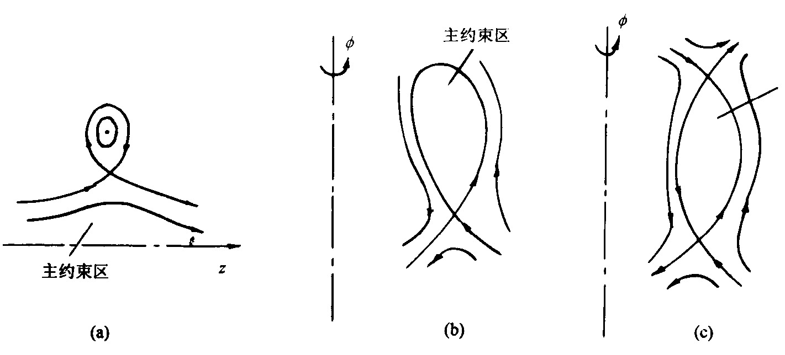

**图4.16** 几种偏滤器位形示意图：(a) 局部偏滤器；(b) 单零轴对称偏滤器；(c) 双零偏滤器。

从反应堆的角度看，偏滤器的功能已不限于控制杂质，可以说其主要功能是控制等离子体流出的热量和粒子流，有目的地让其沉淀在偏滤器的靶板区。这样，主真空室所受的热负荷将大幅度减少，带电粒子对主真空室壁的溅射也大幅度减少。从现有设计的偏滤器看，其靶板上的热负荷大小已达临界，并反过来限制了托卡马克等离子体的参数和反应堆经济性能的提高。因此，先进的偏滤器设计和实验验证已是目前托卡马克研究的一个重要内容（见第七、九章）。

## 参考文献

1. Morozov A I, Soloviev L S. The structure of magnetic fields, in Review of Plasma Physics. V.2, Ed. M.A. Leontovich, Consultant Bureau, N Y, 1966
2. 宫本健郎. 热核聚变等离子体物理学. 金尚宪译，北京：科学出版社，1981
3. 石秉仁. 圆环面电流产生的磁场的近似解. 核工业西南物理研究院对外交流资料，1974.12
4. 石秉仁. 空间磁轴仿星器中真空磁场的近似表示式. 核聚变，1980，1(3): 183
5. 石秉仁，高庆弟. 环形仿星器的真空磁面. 核工业西南物理研究院对外交流资料，1974.8，及“等离子体与受控核聚变”会议论文集，成都，北京：原子能出版社，1974.66～74
6. Shi Bingren. Averaged Magnetic Surfaces of Spatial Axis Stellarator with External Helical Windings. Proc. Int. Sump on Stellarator with Three Dimensional Axis, Sendia, Japan, 1979.67～80
7. Mukhovatov V S, Shafranov V D. Plasma equilibria in tokamaks. Nucl. Fusion, 1971, 11: 605～633
8. Filonenko N N, Sagdeev R Z, Zaslavsky G M. Destruction of magnetic surface by irregularities of magnetic fields. Nucl. Fusion, 1967.7: 253～266
