# 第五章 磁约束等离子体的宏观运动特性

本章讨论磁约束等离子体的宏观运动，即从流体运动层次来研究等离子体的性质。另一个研究层次是从组成等离子体的基本粒子（电子和各种离子）运动的角度，研究粒子在由外加电磁场和自治电磁场组成的电磁场中的运动特性，以及等离子体的集体行为。

在流体运动层次上，也有两个基本点。第一个是从磁流体动力学出发，描述带电粒子体系的麦克斯韦-玻尔兹曼方程的矩积分[1]，它是在假定等离子体离热平衡态不远的条件下，通过取等离子体压强张量为标压强而将矩方程展开截断使体系闭合的。另一个基本点是宏观输运方程，这是基于粒子、动量和能量的守恒率，用唯象的方法确定输运系数而获得的。所谓唯象方法是指输运系数采用实验观察确定的值，这些值一般都比由基于碰撞过程而得出的经典输运系数的理论值大得多，有时大几个数量级。一般认为这是等离子体中集体模相互作用的结果。等离子体物理学家一直在努力研究产生反常输运的原因，但由于反常输运既与速度空间粒子运动特性有关，又与几何空间特性有关，而且两者是耦合在一起的，研究的难度很大，所以虽在大量的实验观察的基础上得出了一些规律性的认识，在物理机制研究方面也取得了重要进展，但迄今尚未有普遍适用的物理模型。

## 5.1 宏观运动状态的描述方法：磁流体运动方程组和输运方程组[1-3]

假定等离子体离热平衡态不远，用宏观流体密度$\rho$，运动速度$\nu$及标压强$p$来描述运动状态，用磁场强度$\boldsymbol{B}$，电流密度$\boldsymbol{j}$，电场强度$\boldsymbol{E}$来描述电磁场量，并假定电中性条件得到满足，即假定等离子体中没有空间电荷，这时，这些物理量间满足下述磁流体运动方程组：

$$
\frac{\partial\rho}{\partial t}+\nabla\cdot\rho\nu=S \tag{5.1}
$$

$$
\rho\frac{\mathrm{d}\nu}{\mathrm{d}t}=-\nabla p+\frac{1}{c}j\times B \tag{5.2}
$$

式中$S$代表粒子源，方程(5.2)中原则上也可加入一项动量源。不过在考察磁流体运动时一般不考虑源项的作用，因为它们一般都仅在输运层次起作用，而磁流体运动都是较快的运动。式(5.2)中的电流密度$\boldsymbol{j}$要由等离子体运动本身来确定，在磁流体力学框架内，它由所谓的广义欧姆定义来确定，即

$$
\frac{m_{\mathrm{e}}c^{2}}{n_{\mathrm{e}}e^{2}}\frac{\partial j}{\partial t}
=E+\frac{1}{c}\nu\times B+\frac{c}{en_{\mathrm{e}}}\nabla p_{\mathrm{e}}
-\frac{c}{en_{\mathrm{e}}}j\times B-\eta j \tag{5.3}
$$

式中左边项是电子的惯性，右边前两项是运动等离子体中的电场，第三项是反磁效应项，第四项是霍尔（Hall）电流效应，最后一项是电阻效应项。在下面研究磁流体稳定性时，将根据不同的情况分别忽略那些起次要作用的项以简化处理。以上方程加上麦克斯韦方程组则有：

$$
\nabla\times B=\frac{4\pi}{c}j+\frac{1}{c}\frac{\partial E}{\partial t} \tag{5.4}
$$

$$
\nabla\cdot B=0 \tag{5.5}
$$

$$
\nabla\times E=-\frac{1}{c}\frac{\partial B}{\partial t} \tag{5.6}
$$

及电中性关系

$$
n_{\mathrm{e}}=\sum_{i}n_{i} \tag{5.7}
$$

为使上述方程闭合，通常还需将压强$p$与运动速度联系起来，这种关系叫状态方程。一种最简单的状态方程就是关于流体运动是不可压缩的假定：

$$
\nabla\cdot\nu=0 \tag{5.8}
$$

它同时取代了粒子守恒方程式(5.1)。在一定条件下，这一假定可以近似描述那些运动速度比阿尔芬速度及等离子体的离子的热速度慢很多的运动。

关于等离子体的宏观运动，按其运动速度和变化率（加速度）的大小，又可分成几种情况来描述。变化最快的运动是理想磁流体不稳定性，其次是电阻性不稳定性，然后是输运，最后是准稳磁平衡态，又称静磁平衡态，因为此时运动速度对平衡物理量不起作用。真实等离子体不会处于理想的静磁平衡态，可是，下面将证明，在一定物理条件下，每一时刻的等离子体状态，往往可以用当时的静磁平衡解来描述。

考虑准稳态运动。设约束系统的特征几何尺度为$L$，离子的热运动速度为$v_{\mathrm{th}}$，我们假定物理量的变化相当慢，因而

$$
\frac{L}{v_{\mathrm{th}}}\frac{\partial A}{\partial t}\ll1 \tag{5.9}
$$

另外，等离子体的宏观运动速度远小于离子的热速度及阿尔芬速度（见本章5.5节）

$$
\left|v\right|\ll\left[v_{\mathrm{th}},\ v_{\mathrm{A}}=\frac{B}{\sqrt{4\pi\rho c^{2}}}\right] \tag{5.10}
$$

以上条件称准稳态条件，在准稳条件下，运动方程(5.2)中的惯性项

$$
\rho\frac{\mathrm{d}\nu}{\mathrm{d}t}
=\rho\left(\frac{\partial\nu}{\partial t}+\nu\cdot\nabla\nu\right) \tag{5.11}
$$

将远小于压强梯度项（右边第一项），因而每一时刻，满足静磁平衡条件

$$
\nabla p=\frac{1}{c}j\times B \tag{5.12}
$$

对应的麦克斯韦方程组就只有安培定律

$$
\nabla\times B=\frac{4\pi}{c}j \tag{5.13}
$$

及磁场为无源的条件

$$
\nabla\cdot B=0 \tag{5.14}
$$

所以称方程组(5.12)～(5.14)为静磁平衡方程，可以看到这组方程中不出现等离子体的宏观速度。但是，用这组方程导出的静磁平衡态，可以代表每一时刻由于输运（加热、粒子补充及扩散、热导）引起的变化，也可以描述某些特殊的不稳定运动下的等离子体状态，例如等离子体柱的整体位移和轴对称性的变形运动。但对破坏对称性的运动，一般不能用静磁平衡态来描述。

下面引入描述输运的唯象方程组，设等离子体只含一种离子成分。完整的输运方程组包含以下两个方程，即：粒子守恒方程

$$
\frac{\partial n}{\partial t}+\nabla\cdot\Gamma=S \tag{5.15}
$$

和关于电子和离子的热量守恒条件

$$
n\frac{\partial T_{\mathrm{e}}}{\partial t}+\nabla\cdot q_{\mathrm{e}}=h_{\mathrm{e}} \tag{5.16}
$$

式中$h_{\mathrm{e}}$为在电子和离子成分上的外加功率密度，$\Gamma,q_{\mathrm{e}}$代表粒子通量流密度及电子和离子的热流密度，在输运层次上，它们应代表由粒子密度梯度及温度梯度引起的扩散和热传导以及对流：

$$
\Gamma=-D\nabla n \tag{5.17}
$$

$$
q=-\kappa\nabla T+\frac{5}{2}nT\nu \tag{5.18}
$$

这里为简单起见，所有输运系数（扩散系数$D$和热导率$\kappa$）都假定为标量，(5.18)中的速度是输运层次上的对流速度，它远小于磁流体不稳定性运动速度。利用(5.15)～(5.18)原则上已可以描述由于加热、补充送料以及各种经典的和反常输运过程引起的平衡量（粒子密度，电子和离子温度）的变化，它们又引起静磁平衡态参数，包括电流密度和磁场位形的缓慢演变。其中，

$$
p=n(T_{\mathrm{e}}+T_{\mathrm{i}}) \tag{5.19}
$$

在每一时刻，由静磁平衡条件式(5.12)知，

$$
B\cdot\nabla p=0 \tag{5.20}
$$

这表明，等压面$p=\mathrm{const}$是磁面量（在同一磁面上为常量的物理量），在输运过程中，磁面形状可以发生变化，但是压强在磁面上保持常数的性质不变。更进一步，由于沿磁力线的热导率非常大，因此，实际上在同一磁面上，电子和离子的温度也是不变的：

$$
T_{\mathrm{e}}=\mathrm{const},\quad T_{\mathrm{i}}=\mathrm{const} \tag{5.21}
$$

由式(5.19)得到粒子密度沿磁面也是常数

$$
n=\mathrm{const} \tag{5.22}
$$

进一步的讨论必须在了解平衡位形的基础上进行。最重要的平衡位形是托卡马克等离子体的环形轴对称位形，它由所谓的Grad-Shafranov方程来描述，这一方程也适用于描述另外一些轴对称环形平衡位形，如反向场位形（RFP），小环径比（$R/a$接近于1）的轴对称位形，后一种位形有时也叫球形环位形（Spherical toroid）。

## 5.2 轴对称环形平衡位形[4～7]

### 5.2.1 一般讨论

在第四章对磁场位形进行一般讨论时已指出，闭合的约束位形其边界面的几何形态必然是某种拓扑环面，但一般说这个环形曲面是不具对称性的三维空间曲面。托卡马克位形是最简单的环形位形，它具有轴对称性，并依赖于两个独立坐标变数，即$R,Z$。这里取圆柱坐标系，$z$轴为对称轴（参见图5.1）。由于轴对称性，即所有变量与角坐标$\phi$无关，从式(5.14)，磁场可以用两个流函数$\psi(R,Z),F(R,Z)$来表示：

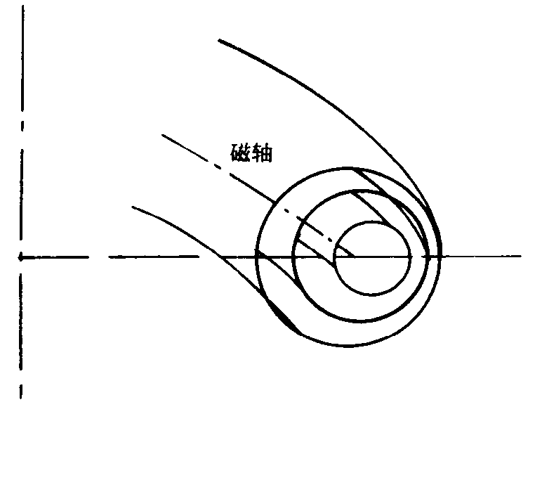

$$
B=\nabla\psi\times\nabla\phi+F\nabla\phi \tag{5.23}
$$

其中

$$
F(R,Z)=RB_{\phi} \tag{5.24}
$$

$B_{\phi}$为磁场的环向分量。流函数$F$的物理意义是它确定了反磁电流的分布形式（见以后讨论）。磁场的极向分量$B_{p}$为

$$
B_{p}=\nabla\psi\times\nabla\phi \tag{5.25}
$$

或

$$
B_{R}=-\frac{1}{R}\frac{\partial\psi}{\partial Z},\quad
B_{Z}=\frac{1}{R}\frac{\partial\psi}{\partial R} \tag{5.26}
$$

另外，由(5.20)知，等压强面是磁面，$p$仅为$\psi$的函数

$$
p=p(\psi) \tag{5.27}
$$

容易证明，电流密度矢量也处在同一磁面上，即

$$
j\cdot\nabla\psi=0,\quad j\cdot\nabla p=0 \tag{5.28}
$$

在静磁平衡态，各物理量间存在一定关系，首先是环向电流密度$j_{\phi}$将与上面定义的两个流函数有关：

$$
j_{\phi}=cR\frac{\mathrm{d}p}{\mathrm{d}\psi}+\frac{c}{8\pi R}\frac{\mathrm{d}F^{2}}{\mathrm{d}\psi} \tag{5.29}
$$

其次，流函数$\psi$满足所谓的Grad-Shafranov方程[4.5]：

$$
\mathrm{L}\psi=R^{2}\nabla\cdot\left(\frac{\nabla\psi}{R^{2}}\right)
=-4\pi R^{2}\frac{\mathrm{d}p}{\mathrm{d}\psi}-\frac{1}{2}\frac{\mathrm{d}F^{2}}{\mathrm{d}\psi} \tag{5.30}
$$

这一方程先后由美国科学家Grad和前苏联科学家Shafranov导出，后者对托卡马克位形做了非常详尽的研究，包括各种非轴对称因素对位形的微扰[7]。

需要再一次指出的是，虽然方程(5.29)给出了环向电流密度与压强及其反磁电流参数间的关系，但它并没有确定这一电流的具体分布形式。具体分布是由驱动电流的物理条件确定的。在纯欧姆驱动的条件下，它主要与电子温度分布有关。当我们把方程(5.29),(5.30)与输运方程结合起来时，这一点就很清楚了。在每一时刻，若等离子体的压强（通过粒子密度$n$及电子和离子的温度$T_{\mathrm{e}},T_{\mathrm{i}}$）的分布已确定，驱动电流的方式也已确定，则原则上环向电流分布也确定了，我们可以求出磁面函数及反磁函数$F$。实际上，$F$等于给定磁面内部的环向总电流

$$
F=\int\int\mathrm{d}R\mathrm{d}Z\,j_{\phi} \tag{5.31}
$$

在理论分析上，常常采用相反的做法，即先假定压强$p$及函数$F$与流函数$\psi$有某种给定的关系，最简单的是二次函数关系，即

$$
p=p_{0}+p_{1}\psi+p_{2}\psi^{2}, \tag{5.32}
$$

$$
F=F_{0}+F_{1}\psi+F_{2}\psi^{2} \tag{5.32}
$$

这样一来，Grad-Shafranov方程(5.30)形式上就化成了一个$\psi$的二阶椭圆型线性偏微分方程。不过下面将指出，一般情况下这一方程是非线性的。先看方程(5.30)中的算符

式中$\Delta(r)$是所考察磁面相对于磁轴的位移。我们假定$r/R_{0},\Delta/r$为小量，并将所有物理量对此小量展开。由(5.29)式，环向电流密度可以写成：

$$
j_{\phi}(R,Z)=\frac{R}{R_{0}}j_{1}(r)+\frac{R_{0}}{R}j_{2}(r) \tag{5.38}
$$

其中$j_{1}(r),j_{2}(r)$分别代表与压强分布及反磁效应有关的两部分电流，它们是磁面函数：

$$
\begin{aligned}
j_{1}(r)&=cR_{0}\frac{\mathrm{d}P}{\mathrm{d}\psi},\\
j_{2}(r)&=\frac{c}{8\pi R_{0}}\frac{\mathrm{d}F^{2}}{\mathrm{d}\psi}
\end{aligned} \tag{5.39}
$$

通过算符间变换，可以将Grad-Shafranov方程（非线性二阶椭圆型偏微分方程）在该坐标系中写出[9]：

$$
\frac{\mathrm{d}^{2}\psi_{0}}{\mathrm{d}r^{2}}+\frac{1}{r}\frac{\mathrm{d}\psi_{0}}{\mathrm{d}r}
=-\frac{4\pi}{c}j_{\phi_{0}}(r) \tag{5.40}
$$

同时位移函数$\Delta(r)$满足

$$
\frac{\mathrm{d}^{2}\Delta}{\mathrm{d}r^{2}}
+\left(\frac{1}{r}+\frac{2\psi''}{\psi'_{0}}\right)\frac{\mathrm{d}\Delta}{\mathrm{d}r}
=-\frac{1}{R_{0}}+\frac{8\pi R_{0}}{c}\frac{r p'(r)}{\psi_{0}'^{2}} \tag{5.41}
$$

以上两个方程加上关于电流密度与压强及反磁函数$F$的一些关系，就确定了圆截面托卡马克的位形结构特性，其中位移函数是环形磁面与直圆柱位形差别的主要标志。在数学上，上述方程组(5.40),(5.41)是非齐次常微分方程组，求解这些近似的常微分方程比求解严格的非线性椭圆型偏微分容易得多，这就是有关展开方法的优点。实际上，以上方法还可以直接地推广到非圆截面位形，条件是非圆变形参数（椭圆变形，三角变形，等等）比磁面平均半径小很多，与上面的展开参数是同级小量[7]。除(5.37)外，再设

$$
r=\rho+\sum a_{n}(\rho)\cos n\theta \tag{5.42}
$$

同时取位移函数$\Delta=\Delta(\rho)$，则通过将上面(4.40)～(4.42)各式的变量$r\rightarrow\rho$，这些式子仍然正确。此外，关于变形函数$a_{n}(\rho)$的一级近似方程为

$$
\frac{\mathrm{d}^{2}a_{n}}{\mathrm{d}\rho^{2}}
+\left(\frac{1}{\rho}+\frac{2\psi''}{\psi'}\right)\frac{\mathrm{d}a_{n}}{\mathrm{d}\rho}
-\frac{n^{2}-1}{\rho^{2}}a_{n}=0\quad(n\geqslant2) \tag{5.43}
$$

与位移函数不同，变形函数满足二阶齐次常微分方程，其解由给定的边界面上的变形大小确定。由于(5.42)中定义的磁面变量$\rho$是磁面截面的几何平均值，而所定义的变形函数是相对于这一平均值的偏差，因此，一个不大的变形函数可以描述较大的实际变形（例如沿$z$轴的拉长变形，在这里被描述成在水平方向为负而在垂直方向为正的较小的变形），因此这种展开方法可以保证在较好的精度内描述许多理论和实验研究上感兴趣的位形。

### 5.2.3 直圆柱近似（零级近似）

下面分析直圆柱近似方程(5.40)的解的性质。零级近似下，环向电流密度

$$
j_{\phi_{0}}=R_{0}c\frac{\mathrm{d}p}{\mathrm{d}\psi_{0}}
+\frac{c}{8\pi R_{0}}\frac{\mathrm{d}F^{2}}{\mathrm{d}\psi_{0}} \tag{5.44}
$$

现在我们假定环向电流密度以及压强都由实验确定，从(5.40)得出

根据极向场定义

$$
B_{\theta}=\frac{|\psi'|}{R_{0}} \tag{5.46}
$$

安全因子

$$
q(r)=\frac{rB_{\phi}}{R_{0}B_{\theta}}=\frac{rB_{\phi}}{|\psi'|} \tag{5.47}
$$

式(5.45)～(5.47)中表示的是载电流直圆柱等离子体的一般结果，既适用于托卡马克，也适用于扩散箍缩放电等离子体。将$F$用零级量$F_{0}=R_{0}B_{\phi0}$代入，式(5.39)即为直圆柱等离子体的总压强（等离子体压强加磁压强）平衡方程。对托卡马克，极向场远小于环向场，对应于安全因子$q>1$，一般来说，根据扭曲模稳定性条件，要求边缘$q_{a}\geq2.5$，同时等离子体比压$\beta=\frac{\langle8\pi p\rangle}{B_{\phi0}^{2}}\approx\left(\frac{a}{R}\right)^{2}$，所以托卡马克又称为低比压约束系统。但对所谓的反向场箍缩（Reversed Field Pinch，简称RFP），极向场的大小与环向场同量级，因而其等离子体比压理论上可以达到1的数量级。在确定压强分布及总电流分布后，$F$函数可以给出为：

$$
F(r)=\left[F_{0}^{2}+\frac{8\pi R_{0}}{c}\int_{0}^{r}\mathrm{d}r'\,j_{2}(r')\psi'_{0}(r')\right]^{1/2} \tag{5.48}
$$

RFP的$F$函数（以及环向场）在靠近边缘处反向。托卡马克及RFP的压强，极向场和环向场的典型剖面如图5.3所示。

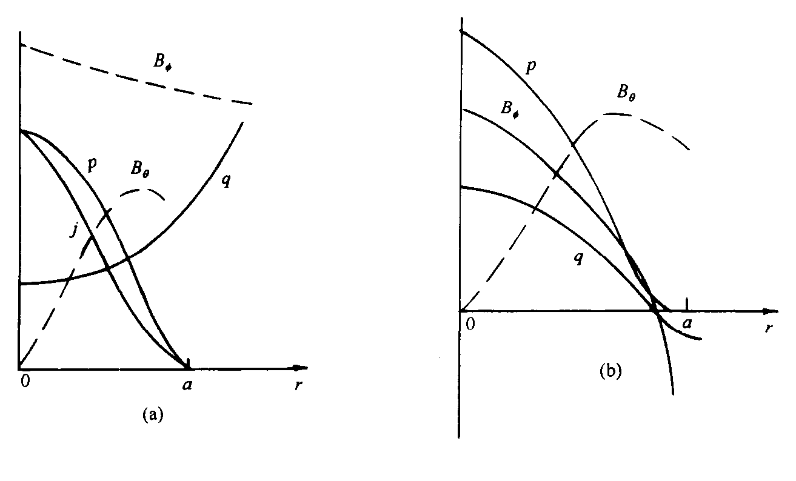

**图5.3** (a)托卡马克位形的$B_{\phi},B_{\theta},p,j,q$沿半径的分布；(b)反向场位形的相应分布

在实际装置中，各种物理量是互相关联的。从外部可以控制的是环向磁场和电流，以及用于控制位移量大小的垂直于赤道平面（$Z=0$面）的磁场。在上面的公式中，它等于边界处的极向场减去由等离子体中电流产生的极向场。但这样做非常不直观。我们回到Shafranov最初的推导[5]，将其直接与装置参数及等离子体的两个积分量（平均比压值和内电感）联系起来，这样可以得到等离子体柱边缘处垂直场的大小为

$$
B_{\perp}=\frac{I_{\mathrm{p}}}{cR}\left(\ln\frac{8R}{a}+\Lambda-\frac{1}{2}\right) \tag{5.49}
$$

其中

$$
\Lambda=\frac{\langle8\pi p\rangle}{B_{\theta}^{2}}+\frac{l_{\mathrm{i}}}{2}-1 \tag{5.50}
$$

上式中右方第一项是等离子体的极向比压，其数量级大小为1，第二项中的$l_{\mathrm{i}}$是等离子体的内电感，定义为

$$
l_{\mathrm{i}}=\frac{\iint\mathrm{d}r\mathrm{d}\theta\,B_{\theta}^{2}}{\pi a^{2}B_{\theta}^{2}(a)} \tag{5.51}
$$

在感应电子加速器设计中即知，要使电子束的轨道稳定，垂直磁场的场形不能是完全垂直的，而应有一定的曲度。对托卡马克中的环向电流来说也有同样的要求，这就是垂直场的指数因子须满足条件

$$
\frac{3}{2}>n=-\frac{r}{B_{\perp}}\frac{\mathrm{d}B_{\perp}}{\mathrm{d}r}>0 \tag{5.52}
$$

其中$n>0$是对垂直位移的稳定性要求，$n<3/2$是对水平位移的稳定性要求。所形成的场形如图5.4所示。最初都采用在等离子体柱的外部加厚铜壳的方法来满足稳定的要求。在磁场从铜壳内扩散到铜壳外去的特征时间内铜壳能起平衡和稳定等离子体的作用，但在更长的时间内，铜壳失效。在70年代以后建造的装置中，一般不再采用厚铜壳，而采用反馈控制的场来跟踪等离子体的变化。这还要与等离子体的磁流体稳定性结合起来解决。尤其是，在后来发展的具有沿环的对称轴（$z$轴）拉长的截面的托卡马克装置中，容易发展起沿$z$轴的竖直位移不稳定性，必须由外加控制场来稳定。

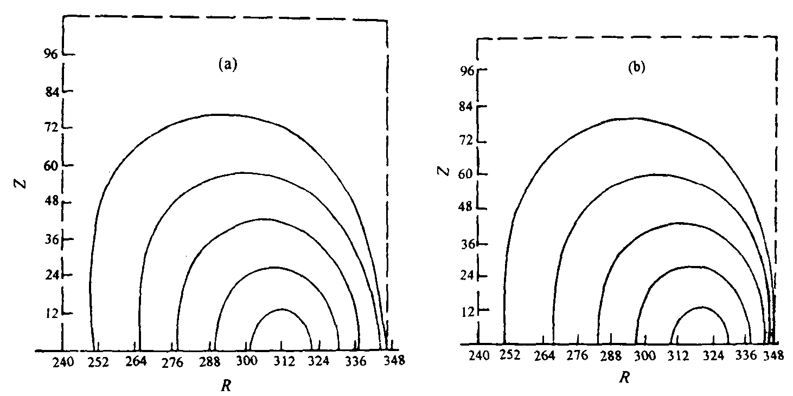

**图5.4** 由简单的垂直场加四极场获得的稳定垂直场位形示意图

## 5.3 托卡马克等离子体的位形演变：$1\&1/2$维输运[11-14]

现在讨论输运时间尺度上等离子体位形的变化，主要的理论工具是$1\&1/2$维平衡输运编码。实际上，这是采用唯象方法对具有总体稳定约束性质的托卡马克等离子体的一种基本描述，在实际研究中被广泛应用。

### 5.3.1 关于$1\&1/2$维输运问题的一般讨论

托卡马克等离子体，或更广泛地说，磁约束聚变装置中的等离子体，是处在动平衡状态中的物理体系，其中的粒子和能量都和外界不断进行交换，等离子体的各种参数是不断随时间变化的。在本章前几小节的讨论中已指出，在输运时标上，每一时刻的等离子体参量间的关系可以用该时刻的静磁平衡条件描述。而且，由于带电粒子沿磁力线的快运动，主要的物理参量都近似地仅为磁面坐标的函数。我们假定在某一时刻的磁面位形为已知，对托卡马克，即极向磁通函数$\psi(x,t)$为已知，不失一般性，我们可以通过这一函数确定其它有关的函数及宏观参量，例如环向磁通函数$\Phi(x,t)$，然后定义一个相当于从磁轴（其位置也是变化的，但我们假定每一时刻总有单一的磁轴存在）到所考察磁面的径向“距离”变数，

$$
\rho(x,t)=\left(\frac{\Phi}{\pi B_{0}}\right)^{1/2} \tag{5.53}
$$

以及磁面的内部体积$V(x,t)$，定义一个几何参数，

$$
H=\frac{\partial V/\partial\rho}{4\pi^{2}R_{0}\rho} \tag{5.54}
$$

以及任意物理量关于对整个磁面的平均值，经一个简单的约化后，面积分变成为线积分

$$
\langle A\rangle=\oint\frac{A\mathrm{d}l}{B_{p}}\bigg/\oint\frac{\mathrm{d}l}{B_{p}} \tag{5.55}
$$

式中回路积分沿极向截面的回线进行。将输运方程对磁面求平均，得到粒子连续性方程的平均形式

$$
\frac{\partial}{\partial t}\left[nV(\rho,t)\right]
+\frac{\partial}{\partial\rho}\langle n u\cdot\nabla V\rangle
=V'(S) \tag{5.56}
$$

为避免混淆，式中已将等离子体的宏观速度写成$\boldsymbol{u}$，当然这里的宏观速度主要指与输运过程有关的速度，这里及以后参量右上方的一撇代表对$\rho$求偏导。代入扩散流的关系，上式化成

$$
\frac{\partial n}{\partial t}
+\frac{1}{H\rho}\frac{\partial}{\partial\rho}\left(H\rho F\right)
=\langle S\rangle-n\frac{\partial}{\partial t}\ln H \tag{5.57}
$$

用同样的方法可得电子和离子温度（能量）输运方程的平均形式

$$
\frac{3}{2}\frac{\partial}{\partial t}\left(nT_{\mathrm{e}}\right)
+\frac{1}{H\rho}\frac{\partial}{\partial\rho}\left[H\rho\left(q_{\mathrm{e}}+\frac{5}{2}T_{\mathrm{e}}\Gamma\right)\right]
=\langle Q_{\mathrm{e}}\rangle+
\frac{\Gamma}{n}\frac{\partial}{\partial\rho}\left(nT_{\mathrm{e}}\right)
-\frac{5}{2}nT_{\mathrm{e}}\frac{\partial}{\partial t}\ln H \tag{5.58}
$$

式中$\Gamma,q_{\mathrm{e}}$分别为粒子流密度和电子及离子热流密度垂直于磁面的分量，$Q_{\mathrm{e}}$为沉积在离子和电子上的外加热功率密度。

由于现在考虑的是随时间变化的状态，所以与单纯的静磁平衡分析不同，需要考虑磁通本身随时间的变化。有关的方程是法拉弟定律

$$
\frac{1}{c}\frac{\partial B_{\mathrm{p}}}{\partial t}
=\frac{\langle E\cdot B\rangle}{R_{0}F(R^{-2})} \tag{5.59}
$$

式中$F$是前面定义的环向电流通量函数。

在欧姆驱动的条件下，环向电流与电场间可以用欧姆定律联系起来，结果得到磁扩散方程

$$
\frac{\partial B_{\mathrm{p}}}{\partial t}
=\frac{\partial}{\partial\rho}\left[
\frac{c^{2}\eta F}{4\pi H\rho(R^{-2})}
\frac{\partial}{\partial\rho}\left(
\frac{H\rho}{F}\frac{|\nabla\rho|^{2}}{R^{2}}
\right)B_{\mathrm{p}}
\right] \tag{5.60}
$$

原则上，利用上述输运方程的平均形式，在适当的与磁面位形相洽的坐标系中，如已知各种源项，我们可以计算粒子密度和电子及离子温度随时间和空间变数$\rho$的变化，一般这需用数值方法求解。在求解若干个时间步长后，利用所得的新的有关压强及极向磁场的剖面知识，再回到Grad-Shafranov方程重新求一次磁面函数，计算新的有关的平均变数和其它几何量，可将对输运的计算推进到下一步。为了求Grad-Shafranov方程右方的量，还需补充以下关系式

$$
\frac{\mathrm{d}p}{\mathrm{d}\psi}
=\frac{\mathrm{d}p}{\mathrm{d}\rho}\bigg/\frac{\mathrm{d}\psi}{\mathrm{d}\rho},
\quad
\frac{\mathrm{d}F}{\mathrm{d}\psi}
=\frac{\mathrm{d}F}{\mathrm{d}\rho}\bigg/\frac{\mathrm{d}\psi}{\mathrm{d}\rho} \tag{5.61}
$$

$$
F\frac{\mathrm{d}F}{\mathrm{d}\psi}
=-\frac{4\pi}{\langle R^{-2}\rangle}\frac{\mathrm{d}p}{\mathrm{d}\psi}
-\frac{R^{0}}{H\rho\langle R^{-2}\rangle}
\frac{\partial}{\partial\rho}\left[
H\rho\frac{\langle\nabla\rho\rangle^{2}}{R^{2}}
\right]B_{\mathrm{p}} \tag{5.62}
$$

方程(5.53)～(5.62)加上Grad-Shafranov方程(5.30)及相应的边界条件（最简单的是边界磁面固定不变）完整地描述了欧姆驱动电流条件下托卡马克等离子体的位形演变。必须指出，有关粒子流密度及热流密度与粒子密度及温度间的关系，以及电阻率的表示式，原则上并不限于理论上推导的公式，其中关于粒子扩散及热传导系数的确定，基本上要根据实验确定的值。因此，关于输运的描述是唯象性的。对于电阻率，托卡马克实验没有观察到它与从经典碰撞导出的关系式间有大的差别。但是，磁场的扩散却比经典电阻率引起的扩散要快很多，这意味着用式(5.60)来描述磁场的扩散是得不到正确的结果的，但又不能通过假定电阻率是反常的来达到与实验一致。类似的物理问题在讨论有关磁再联机制时将再次遇到。这是等离子体物理尚未解决的难题之一。

### *5.3.2 快加热过程中磁面的演变：通量守恒托卡马克位形[14,15]

下面考虑一种极限情况，即等离子体参数因快加热或受到快绝热压缩而磁力线来不及扩散出所观察的磁面，因而每一磁面内部的磁通在演变过程中保持守恒。在这种情况下，安全因子$q(\psi)$也保持守恒

$$
q(\psi,t)=\frac{F}{2\pi}V'(\psi)\langle R^{-2}\rangle=q(\psi,0) \tag{5.63}
$$

式中$V'(\psi)=\mathrm{d}V/\mathrm{d}\psi$，同时只需考虑加热方程

$$
\frac{\mathrm{d}}{\mathrm{d}t}\left\{\frac{3}{2}\left[V'(\psi)\right]^{p_{0}}p(\psi)\right\}
=\left[V'(\psi)\right]^{p_{0}}\langle Q\rangle \tag{5.64}
$$

上式中对时间的导数是随等离子体运动而进行的。将平衡方程(5.30)写成

$$
\frac{1}{V'(\psi)\langle R^{-2}\rangle}
\frac{\mathrm{d}}{\mathrm{d}\psi}\left(
V'\left\langle\frac{|\nabla\psi|^{2}}{R^{2}}\right\rangle
\right)
=-4\pi\frac{P'(\psi)}{\langle R^{-2}\rangle}-FF'(\psi) \tag{5.65}
$$

上式称广义微分方程，实际上只能通过叠代方法才能求解。

下面用5.2节中介绍的方法近似求解具有小变形的磁场位形的情形。将磁面函数$\Delta,a_{n}$按式(5.41)(5.43)中的形式展开，这相当于定义了一种磁面半径坐标，即

$$
\begin{aligned}
R&=R_{0}+\Delta(\rho)+r\cos\theta,\\
Z&=r\sin\theta,\\
r&=\rho+\sum_{n\geq2}a_{n}(\rho)\cos n\theta
\end{aligned} \tag{5.66}
$$

其中并令压强$p$和反磁函数$F$均为平均半径$\rho$的函数，最低一级近似下

$$
\frac{1}{\rho}(\rho\psi')=-\frac{4\pi}{c}R_{0}(j_{1}+j_{2}) \tag{5.67}
$$

其中

$$
j_{1}(\rho)=cR_{0}\frac{\mathrm{d}\rho}{\mathrm{d}\psi} \tag{5.68}
$$

$$
j_{2}(\rho)=\frac{c}{8\pi R_{0}}\frac{\mathrm{d}F^{2}}{\mathrm{d}\psi} \tag{5.69}
$$

关于位移函数$\Delta(\rho)$及变形函数$a_{n}(\rho)$所满足的方程分别为(5.42)和(5.43)，这里不重复。与计算有关的几个磁面量为

$$
V'(\psi)=\frac{4\pi^{2}R_{0}\rho}{\left|\psi'(\rho)\right|}
\left\{
1+\frac{1}{2R_{0}}\left(2\Delta+\rho\Delta'\right)
+\left(\frac{\Delta\Delta'}{2\rho}-\frac{\Delta^{2}}{4\rho^{2}}\right)
+\sum\left[\frac{a_{n}a_{n}'}{2\rho}-\frac{n^{2}a_{n}^{2}}{4\rho^{2}}\right]
+\dots
\right\} \tag{5.70}
$$

$$
\begin{aligned}
V'\left(\frac{|\nabla\psi|^{2}}{R^{2}}\right)
={}&2\pi|\psi'|\frac{\rho}{R_{0}}
\left\{
1+\frac{1}{2R_{0}}\left(-\Delta+\rho\Delta'\right)
+\left(-\frac{\Delta\Delta'}{2\rho}+\frac{\Delta^{2}}{2}+\frac{\Delta^{2}}{4\rho}\right)
\right.\\
&\left.+\sum\left[-\frac{a_{n}a_{n}'}{2\rho}+\frac{a_{n}^{2}}{2}+\frac{n^{2}a_{n}^{2}}{4\rho}\right]
+\dots
\right\}
\end{aligned} \tag{5.71}
$$

$$
q(\psi)=\frac{\rho F}{R_{0}|\psi'|}
\left\{
1-\frac{1}{2R_{0}}\left(2\Delta+\rho\Delta'-\frac{\rho^{2}}{R_{0}}\right)
+\dots
\right\} \tag{5.72}
$$

这些磁面量有一共同特点，即它们关于倒环径比$a/R_{0}$展开的一级修正都仅与位移函数有关，而变形函数仅给出二级以上的修正。

考虑一个非压缩快加热的实例。设

$$
q(\psi)=q_{0}\left[3-(2\psi/\psi_{\mathrm{m}})\right] \tag{5.73}
$$

其中$\psi_{\mathrm{m}}$为磁轴上的值，另设边界上$\psi_{b}=0$，则求得

$$
\psi_{0}(\rho)=\frac{\psi_{\mathrm{m}}}{2}\left[3-\left(1+8x^{2}\right)^{\psi/2}\right] \tag{5.74}
$$

其中

$$
x=\rho/a,\quad \psi_{\mathrm{m}}=B_{0}a^{2}/4q_{0} \tag{5.75}
$$

相应的电流分布为

$$
j=j_{1}+j_{2}=j_{0}\left(1+4x^{2}\right)/\left(1+8x^{2}\right)^{\psi/2} \tag{5.76}
$$

再设初始压强分布为

$$
p(\rho)=p_{0}\left[3-\left(1+8x^{2}\right)^{1/2}\right] \tag{5.78}
$$

由于加热，压强分布按下面的关系变化

$$
p(\rho,t)=p(\rho,0)\left[\psi_{0}(\rho)/\psi_{\mathrm{m}}\right]^{t} \tag{5.79}
$$

这一分布表示，随着加热，不仅中心压强加大，而且压强分布将变窄。当压强变化时，位移函数跟着变化，电流剖面也有较大变化。在压强达到一定值后，在内侧的电流可以变负。但磁面保持拓扑不变，只是由于位移而向外侧压挤，这是通量守恒托卡马克的特点。图5.5(a)～(d)为磁面截面变化及压强分布和电流分布变化的例子。

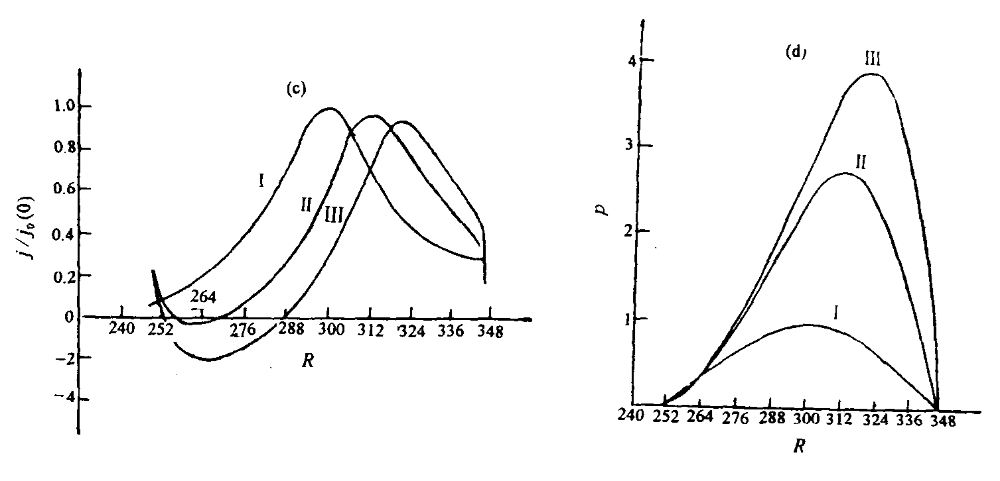

**图5.5** 托卡马克通量守恒位形演变〔14〕

(a) 加热前磁面位形；(b) 加热后的磁面位形；(c) 赤道面上的电流分布；(d) 压强分布。

(c),(d)中I,II,III分别对应于$\beta_{\theta}=0.375,1.2,1.78$

## 5.4 关于磁约束聚变等离子体磁流体不稳定性的一般讨论[16～18]

从磁约束基本原理的讨论中已知，磁约束聚变装置必须满足能稳定约束高温等离子体的要求。早期的一些研究途径就因为不能很好满足这个条件而失败了。因此，磁流体稳定性的研究，尤其是结合聚变装置中等离子体实际位形的研究，成为磁约束聚变理论和实验研究的重要组成部分。

### 5.4.1 磁流体动力学方程组[1～3]

磁流体运动，尤其是与不稳定性模式的发展相关的运动属于快运动，也就是说，这类运动发展过程中，主要是宏观的电磁力及压强梯度在起作用，那些与输运有关的过程仅起次要作用，所以在研究处于线性和非线性发展阶段的磁流体不稳定性模式时，将假定平衡位形为已知，然后由扰动运动方程及相应的麦克斯韦方程，以及广义欧姆定律来确定运动状态随时间的变化，其中广义欧姆定律把等离子体运动与感应电场联系了起来。在第六章中将看到，当考虑粒子动力论效应时，广义欧姆定律在性质和形式上都要有重要变化。主要的磁流体动力学方程包括：连续性方程

$$
\frac{\partial n}{\partial t}+\nabla\cdot(n\nu)=0 \tag{5.80}
$$

和单磁流体的动量（力）方程

$$
\rho\frac{\mathrm{d}\nu}{\mathrm{d}t}=-\nabla p+\frac{1}{c}j\times B \tag{5.81}
$$

式中

$$
\frac{\mathrm{d}}{\mathrm{d}t}=\frac{\partial}{\partial t}+\nu\cdot\nabla \tag{5.82}
$$

是跟随等离子体元的对时间微分算符，另一方程是最简化形式的广义欧姆定律

$$
E+\frac{1}{c}\nu\times B=\eta j \tag{5.83}
$$

欧姆定律取式(5.83)的形式时称电阻性磁流体近似。若忽略右方含电阻率的项，则称理想磁流体近似，此时，从带电粒子的运动角度看，相当于仅考虑粒子的电漂移，对电子和离子，它们都等于

$$
\nu_{\mathrm{ei}}=c\frac{E\times B}{B^{2}} \tag{5.84}
$$

在理想磁流体近似下，很易证明，任意流体元中所携带的磁通在运动过程中保持不变（又称磁力线冻结定理，见一般磁流体动力学书籍）。计入与电阻有关的项时（这里的电阻率$\eta$通常取Spitzer值，即经典碰撞效应确定的值），对横越磁场的运动几乎没有多大影响，因为式(5.83)的右边项仅仅引起一个很小的横越磁力线的经典碰撞扩散，其速度远小于磁流体运动速度。但是，电阻项的引入意味着在平行于磁力线方向可以有一定大小的电场分量，在特定条件下，这一电场对磁流体运动可以产生本质性的影响（见后面关于电阻性磁流体不稳定性的讨论）。此外，在考虑其它的物理机制时，可以对式(5.83)进行各种修正，用更强的机制取代电阻项，从而得到有不同物理内涵的等离子体宏观运动现象。这将在具体问题中讨论。

从流体运动的角度，要使方程组闭合，还需将标压强与运动速度联系起来，这就是所谓的状态方程。一般采用绝热运动定理

$$
\frac{\mathrm{d}}{\mathrm{d}t}\left(p/n^{\gamma}\right)=0 \tag{5.85}
$$

式中$\gamma$是绝热指数，对三维运动，它等于5/3。在一定条件下，还可采用更简单的关于运动为不可压缩的假定来代替上面的绝热运动方程

$$
\nabla\cdot\nu=0 \tag{5.86}
$$

这一假定在流体运动速度较小或变化较慢时可以较好地描述一些不稳定性模，尤其是近临界状态模（见后面讨论）。

有关的麦氏方程包括

$$
\frac{\partial B}{\partial t}=-c\nabla\times E \tag{5.87}
$$

$$
\nabla\times B=\frac{4\pi}{c}j \tag{5.88}
$$

$$
\nabla\cdot B=0 \tag{5.89}
$$

可以看到，式(5.88)中没有取位移电流项，这与式(5.84)中只考虑与宏观运动有关的电场以及只考虑粒子的电源移速度一致。在考虑等离子体波的性质时则必须加入位移电流项。以上方程完整地描述了等离子体的磁流体线性和非线性运动特性。

### 5.4.2 线性化方程与位移函数

首先考虑离开平衡态的小运动及其稳定性，设未扰态为静磁平衡态，即本章前面几节讨论的位形。从这一意义上，运动速度、电场都是一级小量，将其他物理量写成

$$
\begin{aligned}
p&=p_{0}+\delta p\\
B&=B_{0}+\delta B\\
j&=j_{0}+\delta j
\end{aligned} \tag{5.90}
$$

引入等离子体的位移函数矢量

$$
\nu(x,t)=\frac{\partial\xi(x,t)}{\partial t} \tag{5.91}
$$

对于理想等离子体，即电阻效应可忽略时，则由式(5.83),(5.87)可得

$$
\delta B=\nabla\times(\xi\times B_{0}) \tag{5.92}
$$

$$
\delta p=-\xi\cdot\nabla p_{0}-p_{0}\nabla\cdot\xi \tag{5.93}
$$

这样，可以将运动方程的线性化形式

$$
\rho\frac{\partial\nu}{\partial t}
=-\nabla\delta p+\frac{1}{c}\left(\delta j\times B_{0}+j_{0}\times\delta B\right) \tag{5.94}
$$

写成

$$
\rho\frac{\partial^{2}\xi}{\partial t^{2}}
=-\nabla\left(-\xi\cdot\nabla p_{0}-p_{0}\nabla\cdot\xi\right)
+\frac{1}{c}\left(
j_{0}\times Q+\frac{c}{4\pi}\nabla\times Q\times B_{0}
\right)
=F(\xi) \tag{5.95}
$$

式中$\boldsymbol{F}$为线性化作用力算符，它是位移$\boldsymbol{\xi}$的一次函数，但包括多个微分运作步骤。另外已采用

$$
Q=\nabla\times(\xi\times B_{0}) \tag{5.96}
$$

来表示扰动磁场。

对磁流体不稳定模的分析可以采用两种方法，一种是直接对各种模实行时空富民展开，简称正模方法（Normal mode analysis），这一方法适用于简单的具有对称性的几何形态，如平板形态，圆柱形态，等等；另一方法为变分法，基于理想磁流体的能量原理[19]。后一方法在处理复杂的几何形态时有明显的优越性，对多数实际的磁约束聚变等离子体位形，基本的磁流体稳定性分析都离不开能量原理的计算。

### 5.4.3 理想磁流体能量变分原理[19]

理想磁流体能量变分原理方法是分析理想磁流体模式的基本方法，在各种有关等离子体物理的书中均有较详细叙述。由于这一方法的重要性，虽然本书不把重点放在讨论等离子体物理方面，对这一方法也要简要地进行介绍，否则难以进行有关内容的讨论。

Bernstein等人提出的这一方法的主要论点是，线性作用力算符$\boldsymbol{F}$是厄米（Hermitian）型的，因此由运动方程(5.95)可以得出能量积分

$$
K(\xi',\xi')+\delta W(\xi,\xi)=\mathrm{const} \tag{5.97}
$$

其中

$$
K(\xi,\xi')=\frac{1}{2}\iiint\mathrm{d}\tau(\xi')^{2} \tag{5.98}
$$

是所考虑等离子体的总动能，$\xi'$是位移函数对时间的偏导数，积分对等离子体所占体积进行。

$$
\delta W(\xi,\xi)=-\frac{1}{2}\iiint\mathrm{d}\tau\,\xi\cdot F(\xi) \tag{5.99}
$$

是线性力对等离子体做的功的负值，故$\delta W$是等离子体的位能的改变量。由于线性力算符的厄米性质，若将$\delta W$看成一个关于满足同样边界条件的两个位移函数$\xi$和$\eta$的二次形，则这两个函数具有可交换性，即

$$
\delta W(\xi,\eta)=\delta W(\eta,\xi) \tag{5.100}
$$

与这一性质对应的是该系统的振荡的特征频率为实数。

经过一系列矢量运算，式(5.99)中的积分可以分成三部分

$$
\delta W=\delta W_{\mathrm{p}}+\delta W_{\mathrm{s}}+\delta W_{\mathrm{v}} \tag{5.101}
$$

它们依次分别表示等离子体内部，等离子体与真空区分界面，真空区中对等离子体-磁场体系的位能变化的贡献，其表示式分别为

$$
\delta W_{\mathrm{p}}
=\iiint\mathrm{d}\tau\left\{
Q^{2}/4\pi+\frac{1}{c}j_{0}\cdot\xi\times Q
+\xi\cdot\nabla p_{0}\nabla\cdot\xi
+\frac{5}{3}p_{0}(\nabla\cdot\xi)^{2}
\right\} \tag{5.102}
$$

$$
\delta W_{\mathrm{s}}
=\iint\mathrm{d}S\cdot\xi_{n}^{2}\left[n\cdot(p_{0}+B^{2}/8\pi)\right] \tag{5.103}
$$

$$
\delta W_{\mathrm{v}}=\iiint\mathrm{d}\tau_{\mathrm{v}}(\nabla\times A)^{2} \tag{5.104}
$$

在面积分表示式中的$[\cdots]$代表物理量跨越表面时的由内向外的变化量，$\boldsymbol{n}$为表面的向外法线矢量，式(5.104)中

$$
\nabla\times A=\delta B_{\mathrm{v}} \tag{5.105}
$$

是真空区域中磁场的变化，这是由于等离子体边界形状变化引起的。在所考虑的模型中，

磁力线不能穿越等离子体-真空区界面, 内外的磁通量各自保持守衡。因此, 在等离子体与真空区域的分界面上应满足连接条件:

$$
Q_{n} = \delta B_{e n} \quad (5.106)
$$

如果等离子体界面固定不变, 则关于表面和真空区的贡献为零。很多不稳定性问题仅研究了这种固定边界的情形。但式 (5.102) 还有其它一些写法, 分别强调各种物理因素在所考虑问题中的作用, 这些都属于进一步的数学技巧。

设扰动的频率为$\omega$, 各微扰量随时间的变化都具有$\exp (- i\omega t)$的形式, 一般系统的频率是复数$\omega = \omega_{t} + \mathrm{i}\gamma$, 实频率$\omega_{t}$代表模的转动频, $\gamma$为模的增长率。在上述问题中, 动能项化成

$$
K = -\omega^{2}\iiint \mathrm{d}\tau \xi^{2} \quad (5.107)
$$

于是得到

$$
\omega^{2} = \frac{\delta W}{\iiint \mathrm{d}\tau \xi^{2}} \quad (5.108)
$$

以上表示式中出现的矢量相乘应理解成复矢量间的共扼相乘, 即$\mathbf{A} \cdot \mathbf{B} = \mathbf{A} \cdot \mathbf{B}^{\ast}$。由于力算符的厄米性质, 代表位能变化的项$\delta W$必为实数, 故$\omega^{2}$仅取实数值, 这样, 只有$\omega^{2}< 0$时, 即对所考虑的模式其频率为纯虚数时, 系统才是不稳定的。因此得出相应的能量变分原理: 对所考虑的模式, 当且仅当对应的位能的变化量为负时 (此时动能才能为正), 即当

$$
\delta W< 0 \quad (5.109)
$$

时, 该模才是不稳定的, 这个条件既是必要的, 也是充分的。反之, 若系统对一切可能的模式都具有位能的变化量为正, 系统对一切磁流体扰动都是稳定的。不过, 在以后的讨论中将看到, 没有必要要求磁约束聚变等离子体对一切模式都是稳定的, 这样的位形可能并不存在, 但对那些最有危害性的模式必须是稳定的。这类模式的特点是, 在随时间变化方面具有最大的增长率, 在随空间变化方面具有很宽的模结构。反之, 那些增长甚慢, 在空间局限于有限区域的模, 并不一定非要稳定化, 但要研究它们对等离子体总体约束的影响。

在位能变化量的表示式中可以看到, 无论是等离子体内部的项$\delta W_{p}$, 还是真空区域项$\delta W_{r}$中代表扰动磁场的部分都给出正的贡献, 因此, 那种使磁场不产生畸变的微扰最不易被稳定。当然, 这只是一种定性的说法, 因为各种因素是互相牵连的, 在实际问题中并不一定是引起磁场变形的扰动就不那么危险, 而且情况可能刚好相反, 引起磁场变形的扰动是磁约束聚变系统首先要避免的。一般, 引起磁场变形的扰动是与存在平行电流的等离子体平衡位形相联系的, 这种电流的存在, 从磁流体稳定性的角度看, 是为不稳定性的发展提供了一种动力源, 它使等离子体处在较高的位能状态, 因而倾向于向较低的位能态转移, 造成不稳定性。而其稳定化的方法在原理上只有两个, 一是选择较为稳定的参数空间, 对应于对位形设计的最佳化; 第二种方法就是由外部提供强制的稳定手段。在磁约束聚变装置中, 这两种方法都采用。

在稳定性分析程序中, 首先要分析与真空区有关的扰动模式, 这种模式称为自由边界模式, 或表面模。如果这类模是稳定的, 就要分析固定边界模, 或内部模。从位能变化量的三个成分的表示式还看到, 真空部分给出正定项, 也就是对模式起稳定的效应, 所以原则上, 表面模被稳定后, 内部模仍可能不稳定。对一般参数连续变化的位形, 表面上总压强(等离子体压强与磁压强之和)是连续的, 故代表表面项的位能变化为零。但对一些特殊的位形, 总压强在边界附近可能有较陡的变化, 这一项的贡献需要考虑进去。下面就是这样的一个实例。

### 5.4.4 等离子体边界稳定性:能量原理的一个简单应用实例

作为一个最简单的物理实例, 考虑等离子体内部没有磁场, 等离子体完全由外部真空磁场维持平衡的情形。这一问题也与磁约束聚变的基本概念有一定联系, 可以帮助理解等离子体稳定约束对磁场位形的一个必要条件。由于内部不存在平衡磁场, 因此也就不存在一级扰动磁场: $\pmb {\mathscr{Q}} = 0$, 进一步选择不可压缩位移作为试验函数, 于是与一级压强变化有关的项也为零。这样

$$
\delta W_{p} = 0 \quad (5.110)
$$

进而若选择扰动使真空磁场的变化也为零, 则这一系统的稳定性完全由表面项所确定。这一积分仅与表面上总压强沿表面法线方向的变化有关。现在证明, 它与表面上磁力线的曲率有关。按一般微分几何的定义, 磁力线的曲率矢量为

$$
\kappa = \frac{B}{B}\cdot \nabla \left(\frac{B}{B}\right) = b\cdot \nabla b \quad (5.111)
$$

$b$为磁场方向的单位矢量, 利用矢量等式

$$
b\cdot \nabla b = -b\times \nabla \times b \quad (5.112)
$$

以及压强平衡关系

$$
\nabla \left(p + \frac{B^{2}}{8\pi}\right) = -\frac{B\cdot\nabla B}{4\pi} \quad (5.113)
$$

因为曲率矢量总是垂直于切线矢量$\kappa \cdot b = 0$, 最后磁力线的曲率矢量可以表示成

$$
\kappa = \frac{1}{2B^{2}}\nabla_{\perp}[B^{2} + 8\pi p] \quad (5.114)
$$

式中垂直方向的梯度定义为

$$
\nabla_{\perp} = (\vec{I} -b b)\cdot \nabla \quad (5.115)
$$

显然, 这一梯度微分的方向正好是曲面的法线方向。于是表面位能变化可以写成:

$$
\delta W_{s} = \iint \mathrm{d}S\cdot \kappa (2B^{2}\xi_{n}^{2}) \quad (5.116)
$$

从这一表示式立即可以得到关于所考虑系统稳定性的一个必要条件:若表面磁力线的曲率矢量处处为正, 即磁力线的曲率中心都在等离子体的外部, 则该系统对所考察的模式是稳定的。由这一简单的原理, 在位形设计中就要考虑尽量使约束等离子体的磁场具有曲率中心处在等离子体外的结构, 也就是要使磁力线凸向等离子体。在第三章中有这样的例子, 如简单磁镜位形的磁力线是凹向等离子体的, 因此并不满足磁流体稳定性条件。确实, 简单的磁镜位形在实验上发现对所谓的交换模是不稳定的。曾提出磁力线处处凸向等离子体的会切场位形, 但在其它方面, 这种位形不能将等离子体约束足够长的时间。现在研究的重点途径如托卡马克, 其磁力线既不处处凸向, 也不处处凹向等离子体, 这种系统的稳定性要由多种因素确定。

对于磁力线为空间曲线的情形, 在第四章中关于约束位形的讨论中已指出, 磁力线为空间曲线的闭合位形只能是环形位形。此时, 按微分几何的分类, 曲率矢量将由两部分组成, 一部分为法向曲率(normal curvature), 另一部分为测地曲率(geodesic curvature)。因此可将总的曲率矢量写成[20]

$$
\kappa = \kappa_{\nu}\frac{\nabla\psi}{\left|\nabla\psi\right|} +\kappa_{g}\left[\nabla \zeta -q(\psi)\nabla \theta \right] \quad (5.117)
$$

其中采用了磁面系统坐标系$(\psi ,\theta ,\zeta)$, 而$q$是磁力线旋转变换的倒数, 即托卡马克中的安全因子。可以从托卡马克类型装置中磁力线在环面上的走向直观地看出, 在环的外侧, 磁力线的曲率中心在等离子体一侧, 而在环的内侧, 其曲率中心在等离子体外。从上面磁流体稳定性的角度看, 外侧的磁力线具有"环曲率", 而内侧的磁力线具有"好曲率", 整个托卡马克系统, 在对磁面平均以后将具有较小的好的曲率, 可以稳定较小比压值的等离子体。当然, 要进行严格的分析才能确定具体位形的稳定性品质, 也有可能通过优化位形参数来提高托卡马克的稳定性, 包括选择截面形状, 改变侧环径比, 以及调节等离子体参数的空间剖面形状, 等等。比如说, 如让磁力线在环的内侧的总长度增大, 就会改变总的平均曲率, 使其有利于稳定约束较高比压的等离子体。具体的例子将在后面的"小环径比位形"中研究(见第十一章)。

### 5.5 磁流体波[20]

等离子体波动是等离子体作为一种宏观介质的一个重要的内在性质。在磁流体力学框架内, 存在几种重要的波动, 即阿尔芬波及声波, 前者又分为剪切阿尔芬波和压缩阿尔芬波(磁声波)。利用前面的磁流体动力学运动方程组, 可以对这些波的色散关系进行一般的讨论, 研究强磁场中均匀等离子体的情形, 其中平衡态的速度及电流均为零。

将有关方程组线性化, 令一级物理量具有$\exp (- i\omega t + i k\cdot x)$的形式, 得出

$$
\omega \rho_{1} = \rho_{0}k\cdot \nu \quad (5.118)
$$

$$
\omega \rho_{0}\nu = k\rho_{1} + \frac{1}{4\pi c} B_{0}\times (k\times B_{1}) \quad (5.119)
$$

$$
\omega B_{1} = -k\times (\nu \times B_{0}) \quad (5.120)
$$

$$
p_{1} = \frac{5}{3}\rho_{1}\left(\frac{p_{0}}{\rho_{0}}\right) \quad (5.121)
$$

以上各式中$\rho_{0},\rho_{1}$为等离子体的质量密度及其扰动量。定义阿尔芬速度及声速为

$$
\nu_{\mathrm{A}} = \frac{B_{0}}{\sqrt{4\pi\rho_{0}}},\quad \nu_{\mathrm{s}} = \sqrt{5\rho_{0} / 3\rho_{0}} \quad (5.122)
$$

则上述齐次代数方程(共有7个独立变量)的有解条件, 即其系数行列式为零, 给出关于磁流体波的一般色散关系

$$
\omega (\omega^{2} - k_{\mu}^{2}\nu_{\mathrm{A}}^{2})[\omega^{4} - \omega^{2}k^{2}(\nu_{\mathrm{A}}^{2} + \nu_{\mathrm{S}}^{2}) + (k k_{\mu}\nu_{\mathrm{A}}\nu_{\mathrm{S}})^{2}] = 0 \quad (5.123)
$$

在它的7个解中, 具有物理意义的三对解为:

(1)剪切阿尔芬波

$$
\omega = \pm k_{\mu}\nu_{\mathrm{A}} \quad (5.124)
$$

它是不可压缩运动解( $\rho_{1} = \rho_{1} = 0$ ), 是一类横波, 即扰动速度及磁场都与本底磁场垂直, 但在切向形成对原有本底磁场的剪切形扰动, 故名剪切阿尔芬波。

(2) 压缩阿尔芬波

$$
\omega = \pm k\nu_{\mathrm{A}} \quad (5.125)
$$

该波主要在垂直于本底磁场的方向传播, 而扰动磁场在平行于本底磁场的方向, 形成对本底磁场的压缩(膨胀)。一般说来, 当等离子比压不大时, 这一波动很难激发, 或其幅度非常小。所以对低比压等离子体(聚变实验装置中的等离子体), 压缩阿尔芬波是可以不予考虑的。

(3) 声波

$$
\omega = \pm k_{\nu}\nu_{\mathrm{s}} \quad (5.126)
$$

这是与沿磁力线方向等离子体的可压缩运动联系的波, 是纵波, 它不改变本底磁场特性, 原则上与一般连续介质中的声波没有差别。声波对沿磁力线的等离子体运动性质有很大影响。一般来说, 只有频率(增长率)比声波频率小很多的运动才能近似地看成是不可压缩的[21]。

原则上, 所有上述三类波都是互相耦合的, 只有在一定的附加条件下才能将它们分离出来。这些附加条件在不同的物理问题中有较大差别。对聚变等离子体, 主要是剪切阿尔芬波和声波起作用。下面将要分析的等离子体不稳定性运动大多属于剪切阿尔芬波类型。

实际等离子体都是不均匀的, 但若其不均匀性不强烈, 具体说, 若在剪切阿尔芬波波长范围内等离子体参数的变化不明显, 上面的分析在WKB近似的意义上仍适用。对聚变装置, 这一限制不易满足, 因此必须考虑不均匀性对剪切阿尔芬波的影响。

在考虑各种阻尼因素时, 一般条件下磁流体波将是阻尼波, 不可能在等离子体中长期存在。但若存在某些可能激发这些波的物理机制时(聚变等离子体中存在这类机制), 磁流体波不仅可以存在, 而且可以具有相当大的波幅, 对等离子体约束形成很大的影响。

### 5.6 载电流等离子体圆柱的扭曲模不稳定性(Kink mode)[22]

在直圆柱真空室中充以氘气或氢气, 然后进行强流脉冲放电是最早进行磁约束聚变研究的几种方案之一。可是在实验中很快发现, 这种放电产生的位形是不满足磁流体稳定性要求的。放电过程因"腊肠型"和"扭曲型"不稳定性的发展而在极短的时间内被破坏(有关讨论请参看一般等离子体物理书籍)。后来通过理论分析, 发现如沿放电柱方向加一磁场, 这些不稳定性就可被完全稳定化或大幅度降低增长率。按所加磁场与电流产生的磁场的强度比不同, 发展了两类稳定的放电位形, 这就是在前面讨论过的托卡马克位形(外加纵向磁场远大于电流产生的磁场)及箍缩放电位形(纵向磁场与电流产生的磁场同量级)。虽然实际装置都已发展成环形, 但在理论研究上, 在一定条件下, 有关磁流体稳定性的许多基本概念和分析都可用直圆柱载流等离子体模型来近似描述。设圆柱总长为$2\pi R$, 其两端是全同的(因为是环形柱被虚拟地截断了)。沿$z$轴(对应于环向)有一均匀强磁场$B_{0}$, 在等离子体内部( $r\leq a$ )沿$z$轴有一密度分布为$j(r)$的电流, $a$为等离子体的小半径, 另有一同轴圆柱形导体壁, 半径为$b$。在本问题中将把它看成理想导体, 磁场不能穿透。

#### 5.6.1 直圆柱平衡条件

首先对平衡条件做一些补充分析。写出磁场和电流的平衡量

$$
B_{0}(r) = B_{\theta}(r)e_{\theta} + B_{z}(r)e_{z} \quad (5.127)
$$

其间关系为

$$
j(r) = j_{\theta}(r)e_{\theta} + j_{z}(r)e_{z} \quad (5.128)
$$

$$
B_{\theta}(r) = \frac{4\pi}{c r}\int_{0}^{r}\mathrm{d}r r j_{z}(r) \quad (5.129)
$$

对托卡马克, 这是环向电流产生的极向磁场。当$r\rightarrow 0$, 即接近磁轴时, $B_{\theta}\rightarrow \frac{2\pi j_{0}r}{c}$即极向场在磁轴处为零。环向磁场分量的大小可以通过压强平衡方程求出

$$
\frac{\mathrm{d}}{\mathrm{d}r} (p + \frac{B^{2}}{8\pi}) = -\frac{B_{\theta}^{2}}{4\pi r} \quad (5.130)
$$

积分得

$$
B_{z}(r) = \left\{B_{0}^{2} + 8\pi [p_{0} - p(r)] - B_{\theta}^{2} - 2\int_{0}^{r}\mathrm{d}r\frac{B_{\theta}^{2}(r)}{r}\right\}^{1 / 2} \quad (5.131)
$$

对托卡马克, 若取倒环径比$a / R = \epsilon$, 则等离子体比压$\beta = 8\pi p / B_{0}^{2}\approx \epsilon^{2}$, 极向磁场与环向磁场之比是一级小量$B_{\theta} / B_{0}\approx \epsilon$, 于是由上式知, 对环向磁场的修正为二级小量

$$
B_{z} = B_{0} + \frac{1}{2}\left\{(\beta_{0} - \beta) - \left[B_{\theta}^{2} + 2\int_{0}^{r}\mathrm{d}r(B_{\theta}^{2}(r) / r)\right]\right\} +\dots \quad (5.132)
$$

在稳定性分析中, 可以简单地将环向磁场看成常数。

#### 5.6.2 极小化位能变化的表示式

对这类具有对称性的较简单位形的稳定性分析, 除能量变分方法外, 还可以直接应用简正模方法。无论哪一种方法都可令所有物理量的一级变化量具有富氏形式

$$
f = f_{0}(r)\exp [-i\alpha t + i m\theta +i k z] \quad (5.133)
$$

原则上, 运动方程(5.95)可以对上述扰动的一个富氏分量(即给定$m,k$ )严格求解, 将内部解与真空区中关于真空磁场的扰动量的解联合起来, 即可确定所求的解。但即使对上述简单的位形, 在电流分布为任意的情况下, 解的形式仍很复杂, 尤其是本征频率(以$\omega^{2}$形式出现)将出现在本征方程的两边。由于用能量变分原理求解的程序比较简单, 得出的解的表示式也较清晰, 下面用这一方法进行推算。首先对内部位能变化项进行分析, 可以严格证明, 具有不可压缩的位移函数将使这一项的贡献取极小

$$
\nabla \cdot \xi = \frac{1}{r}\frac{\mathrm{d}}{\mathrm{d}r} (r\xi_{r}) + \frac{i m}{r}\xi_{\theta} + \mathrm{i} k\xi_{z} = 0 \quad (5.134)
$$

这样一来, 方程(5.102)中含$\nabla \cdot \xi$的两项就可忽略, 而且它们都与等离子体压强的一级量有关。所以, 对载电流等离子体柱的稳定性问题, 等离子体压强没有大的贡献。进一步简记

$$
\left(\frac{m B_{\theta}}{r} +k B_{z}\right) = k\cdot B \quad (5.135)
$$

扰动磁场化成

$$
Q_{r} = \mathrm{i}(k\cdot B)\xi_{r} \quad (5.136)
$$

$$
Q_{\omega} = \mathrm{i}k(\xi_{\theta}B_{z} - \xi_{z}B_{\theta}) - (\xi_{r}B_{\theta}) \quad (5.137)
$$

$$
0=\mathrm{i}m(8B_{z}-8B_{\theta})+(rB_{\theta}) \quad (5.138)
$$

实际上位能积分仅依赖于两个变量: $\xi_{r}$及$A = \xi_{\theta}B_{z} - \xi_{z}B_{\theta}$, 通过进一步对$\pmb{A}$求极小, 将位能函数写成仅含$\xi_{r}$的表示式, 最后再通过对$\xi_{r}$求极小, 得到关于$\xi_{r}$的本征方程如下

$$
\frac{\mathrm{d}}{\mathrm{d}r}\bigg[f(r)\frac{\mathrm{d}\xi}{\mathrm{d}r}\bigg] - g(r)\xi = 0 \quad (5.139)
$$

这里为简化起见已略去下标, 而

$$
f(r) = \frac{r(k\cdot B)^{2}}{k^{2} + m^{2} / r^{2}} \quad (5.140)
$$

$$
g(r) = \frac{1}{r}\frac{(k B_{z} - m B_{\theta} / r)^{2}}{k^{2} + m^{2} / r^{2}} +r(k\cdot B)^{2} - \frac{2B_{\theta}}{r}\frac{\mathrm{d}(r B_{\theta})}{\mathrm{d}r} - \frac{\mathrm{d}(r B_{\theta})}{\mathrm{d}r}
$$

$$
\frac{\mathrm{d}}{\mathrm{d}r}\left(\frac{k^{2}B_{z}^{2} - (m B_{\theta} / r)^{2}}{k^{2} + m^{2} / r^{2}}\right) \quad r \leqslant a \quad (5.141)
$$

对应的位能变化项为

$$
\delta W_{\rho} = \frac{1}{8}\int_{0}^{a}\mathrm{d}r\cdot r\left\{f\left(\frac{\mathrm{d}\xi}{\mathrm{d}r}\right)^{2} + g\xi^{2}\right\} +W_{\bullet} \quad (5.142)
$$

其中$W_{\bullet}$为仅与表面处位移有关的项

$$
W_{\bullet} = \frac{1}{8}\frac{k^{2}B_{z}^{2} - \left[m B_{\theta}(a)\right]^{2} / a^{2}}{k^{2} + m^{2} / a^{2}}\xi^{2}(a) \quad (5.143)
$$

#### 5.6.3 表面项及真空项

表面位能变化项显然为零

$$
\delta W_{s} = 0 \quad (5.144)
$$

关于真空区的方程由极小化条件得出

$$
\nabla \times \nabla \times A = 0 \quad (5.145)
$$

这一表示式不受位形的限制。在本问题中, 加上圆柱位形条件, 以及磁场的无源条件$\nabla \cdot \delta B_{e} = 0$, 可以严格地得到

$$
\frac{\mathrm{d}}{\mathrm{d}r}\left(\frac{1}{r(k^{2} + m^{2} / r^{2})}\frac{\mathrm{d}\xi}{\mathrm{d}r}\right) - \frac{1}{r}\xi = 0,\qquad a< r\leqslant b \quad (5.146)
$$

其中

$$
\xi = r\delta B_{e} \quad (5.147)
$$

真空区的解可以立刻用贝塞尔函数的形式表示出, 满足边界条件

$$
\begin{aligned}
\xi (a) &= \mathrm{i}a[k B_{z}(a) + m B_{\theta}(a) / a]\xi (a),\\
\xi (b) &= 0
\end{aligned}
\quad (5.148)
$$

的真空区解的一般形式为(这一解式在等离子体磁场扰动的测量中有实用价值)

$$
\xi = \mathrm{i}r\frac{\Gamma_{m}^{\prime}(k r)\mathrm{K}_{m}^{\prime}(k b) - \mathrm{K}_{m}^{\prime}(k r)\Gamma_{m}^{\prime}(k b)}{\Gamma_{m}^{\prime}(k a)\mathrm{K}_{m}^{\prime}(k b) - \mathrm{K}_{m}^{\prime}(k a)\Gamma_{m}^{\prime}(k b)}\left(k B_{z} + \frac{m B_{\theta}}{a}\right)\xi (a) \quad (5.149)
$$

与第三章中的情况一样, 式中函数都是修正的贝塞尔函数。真空区项最后化成

#### 5.6.4 关于电流分布的讨论

以托卡马克中的欧姆放电为例, 实际的电流分布在不同的放电阶段是不同的。在起始建立阶段, 尤其是在较大型的装置中, 总电流处于上升并存在相当程度的趋肤现象, 即电流对半径的分布呈中空形状, 随后, 电流逐渐透入内部区域, 电流分布呈平坦形状, 最后, 由于中心区电子温度的升高, 电流分布变成钟罩形或更陡并单调地由中心向外下降。实验观察发现在不同的阶段, 磁流体模式具有不同的特性。此外, 在不同类型的装置中, 放电建立的方式也不同, 各参量间的关系可以有很大的差别。现对一些比较重要的情况分别进行分析。

(1)托卡马克欧姆放电:利用前面讨论的低比压圆截面位形的参数间的量级关系[称为托卡马克编阶(tokamak ordering)], 以倒环径比$a / R = \epsilon$为量度, 则

$$
B_{\theta}(a) / B_{0}\approx \epsilon , 8\pi \langle p\rangle /B_{0}^{2}\approx \epsilon^{2}, q = r B_{0} / R B_{\theta}\approx 0(1) \quad (5.151)
$$

这时可将总的位能变化项写成大为简化的表示式

$$
\begin{aligned}
\delta W={}&\frac{\pi^{2}B_{0}^{2}}{R}\Bigg\{\int_{0}^{a}\mathrm{d}r\, r\Bigg[\Big(r\frac{\mathrm{d}\xi}{\mathrm{d}r}\Big)^{2}+(m^{2}-1)\xi^{2}\Bigg]\Bigg(\frac{n}{m}-\frac{1}{q}\Bigg)^{2}\\
&+\Bigg[\frac{2}{q_{a}}\Bigg(\frac{n}{m}-\frac{1}{q_{a}}\Bigg)+\Bigg(1+m\lambda\Bigg(\frac{n}{m}-\frac{1}{q_{a}}\Bigg)^{2}\Bigg)\Bigg]a^{2}\xi_{a}^{2}\Bigg\}
\end{aligned}
\quad (5.152)
$$

其中与导体壳有关的稳定效应参数

$$
\lambda = [1 + (a / b)^{2m}] / [1 - (a / b)^{2m}] \quad (5.153)
$$

以上公式适用于分析$m\geq 2$的扭曲模, 对于$m = 1$的模, 还需考虑被忽略的较次级量的贡献(如环形效应)。

在放电过程中, 随着总电流的逐渐加大, 边界安全因子$q_{a}$的值逐渐减小, 而不同$q$值的面不断向等离子体外部移动。如先忽略导体壳的作用, 可以计算出不同模的不稳定参数区域以及模的增长率随有关参数的变化。从上面公式中看出, 对模的稳定区及增长率起作用的主要参数现在只剩下$n q_{a}$, 其他参数在这一级近似中均可忽略。假定电流具有抛物线分布

$$
j_{i}(r) = j_{0}(1 - r^{2} / a^{2}) \quad (5.154)
$$

则对不同极向模数$m$的模, 其增长率随$n q_{a}$的变化如图5.6所示。从图中看到, 在两个不稳定模的中间存在一个稳定区, 这一特性是对托卡马克的运行参数区的一系列限制之一(总电流的大小和电流分布形状)。大多数托卡马克选择的边缘安全因子

$$
q_{a} > 3 \quad (5.155)
$$

这样从图中看到, 等离子体具有较大稳定范围。

边界安全因子是在实际问题中经常要用到的一个参数, 它与环向电流密度分布情况无关, 可以用总电流值表示出来

$$
q_{a} = \frac{5a^{2}B_{0}}{R I_{p}} \quad (5.156)
$$

式中电流以A计, 磁场强度以Gs计, 长度单位为cm。对应于$q_{a} = 1$时的等离子体总电流

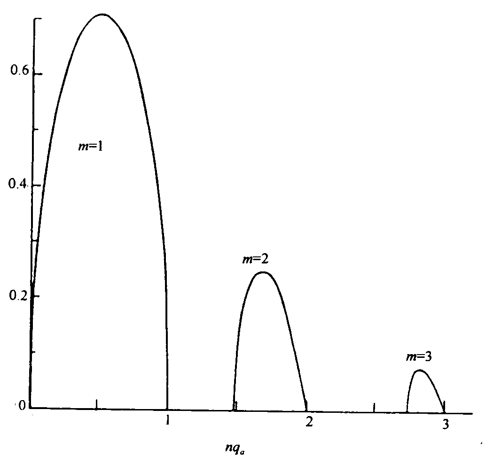

**图5.6** 电流具有抛物形分布的圆柱等离子体的扭曲模的增长率随边缘$q$值的变化〔18〕

$$
I_{p} = 5a^{2}B_{0} / R \quad (5.157)
$$

称为 Kruskal-Shafranov 极限电流。托卡马克放电电流只能达到这一极限值的 1/3 多一点, 而对环形箍缩放电则可在大于这一极限值下实现稳定。

(2) 箍缩放电[泽塔 (Zeta) 位形]

泽塔位形的特点是环向磁场与极向磁场同量级, 需采取特殊的放电程序来形成这样的位形。这里仅讨论最终形态的磁流体稳定性。由于总电流已超过 Kruskal-Shafranov 极限, 所以最危险的模式为$m = 1$的模。对这种模, 比较方便的是将前面的位能变化量式 (5.152) 改写成[2]

$$
\delta W_{p} = \frac{1}{8}\int \mathrm{d}r r\left\{\frac{\left|(k\cdot B)(\mathrm{d}\xi /\mathrm{d}r) + h\xi /r\right|^{2}}{k^{2} + m^{2} / r^{2}} +\left[(k\cdot B)^{2} - \frac{8\pi j_{z}B_{\theta}}{r}\right]\xi^{2}\right\} \quad (5.158)
$$

式中

$$
h = k B_{z} - m B_{\theta} / r \quad (5.159)
$$

从此式可知, 若某些空间区域中的环向电流反向, 即满足

$$
8\pi j_{z}B_{\theta} = \frac{1}{r^{3}}\frac{\mathrm{d}}{\mathrm{d}r} (r B_{\theta})^{2}< 0 \quad (5.160)
$$

则在该区域中满足稳定性的充分条件(位能变化恒为正值)。由于这一条件太苛刻, 不可能在全部约束区域中得到满足。但对泽塔位形, 边缘区的电流的确具有反向结构, 部分地满足这个条件。

回到式(5.141), (5.142), 对$m = 1$的模, 令$L = r B_{z} / B_{\theta}$, 则函数$g(r)$化为

$$
g(r) = \frac{8\pi k^{2}r^{2}}{1 + k^{2}r^{2}}\frac{\mathrm{d}p_{0}}{\mathrm{d}r} +\frac{(k r B_{\theta})^{2}}{r(1 + k^{2}r^{2})}\left[(k L + 1)(k L(3 + k^{2}r^{2}) + (k^{2}r^{2} - 1))\right] \quad (5.161)
$$

对$kL$求极小, 然后由所得的$g(r) < 0$给出另一充分条件

$$
\frac{8\pi}{B_{b}^{2}}\left|\frac{\mathrm{d}p_{a}}{\mathrm{d}r}\right| > \frac{2}{(1 + k^{2}r^{2})(3 + k^{2}r^{2})} \quad (5.162)
$$

择塔位形的特点大体上相当于在边缘区满足式(5.160),而在中心区满足式(5.162)。

严格地说,对$m = 1$的模,必须考虑环形效应,稳定性分析相当复杂。但上面的简单分析基本上给出了扩散箍缩位形的稳定性的基本情况,在实验中也观察到这类位形有较好的磁流体稳定性。但在其它方面,等离子体的最好参数及能量约束等都比不上托卡马克位形。由泽塔位形发展起来的反场位形的研究还处在原理性阶段(见第十一章)。

#### 5.6.5 磁流体模的实验观察[23]

关于早期直线和环形放电装置中$m = 0$的腊肠型不稳定性及$m = 1$的扭曲模不稳定性的实验结果,已在早期出版的很多著作中作了详细介绍,这些模式在现有装置中已被排除,我们不再作讨论。对于托卡马克装置,现在已能实现非常长的稳定放电,但这并不是说托卡马克位形已对所有的磁流体模稳定化。实际上,在电流上升初期,仍可观察到一些典型的磁流体模式。不过,这是一些极向模数较高$(m > 3)$,只存在较短时间的模。电流不断上升意味着$nq_{a}$值的不断减小,因此从图(5.7)看到,随着电流的上升,等离子体经历了几次不稳定到稳定又到不稳定参数区域的变化,最后处于一个稳定参数区(例如$nq_{a} = 2\sim$ 3之间的稳定区)。在实验中的确观察到这种变化。最早的观察是前苏联科学家米尔诺夫(Mimov)等人在等离子体柱周围用布设的磁探针系列得到的磁扰动信号上实现的,这种信号以后就称为Mimov信号。图(5.7)典型地反映了这种放电上升阶段的磁流体模式逐渐演变的情况。由理论分析知道,这些高极向模数的模,其增长率较小,而且仅在一段时间内存在,这些模的空间特征分布也具有明显的趋肤性质(其特征分布函数近似地按$(na / R)^{m - 1}$关系变化),所以虽然在放电初期会对等离子体约束造成一定影响,但它们不会整体地破坏放电。但是,对极向模数$m< 4$的模式,其增长率已相当可观,模的空间分布也已扩展到内部,因而是不容许发展的。在实验上,要使边界安全因子小于3,一般要非常小心地控制放电参数的变化。至于更小的边界安全因子值,除非在等离子体柱附近加上导体壳,否则不易实现。采用导体壳的特定实验中实现了$q_{a} = 1.2$的稳定放电,在我国的环流器HL-1上也实现了$q_{a}< 2$的稳定放电。这些研究虽在了解磁流体稳定性的控制方面很有意义,但在应用到反应堆时有

3之间的稳定区)。在实验中的确观察到这种变化。最早的观察是前苏联科学家米尔诺夫(Mimov)等人在等离子体柱周围用布设的磁探针系列得到的磁扰动信号上实现的,这种信号以后就称为Mimov信号。图(5.7)典型地反映了这种放电上升阶段的磁流体模式逐渐演变的情况。由理论分析知道,这些高极向模数的模,其增长率较小,而且仅在一段时间内存在,这些模的空间特征分布也具有明显的趋肤性质(其特征分布函数近似地按$(n a / R)^{m - 1}$关系变化),所以虽然在放电初期会对等离子体约束造成一定影响,但它们不会整体地破坏放电。但是,对极向模数$m< 4$的模式,其增长率已相当可观,模的空间分布也已扩展到内部,因而是不容许发展的。在实验上,要使边界安全因子小于3,一般要非常小心地控制放电参数的变化。至于更小的边界安全因子值,除非在等离子体柱附近加上导体壳,否则不易实现。采用导体壳的特定实验中实现了$q_{a} = 1.2$的稳定放电,在我国的环流器HL-1上也实现了$q_{a}< 2$的稳定放电。这些研究虽在了解磁流体稳定性的控制方面很有意义,但在应用到反应堆时有

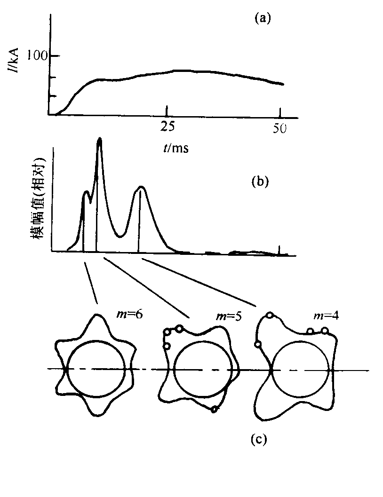

**图5.7** T-3装置电流上升阶段的Mimov信号及相应的磁流体模式〔23〕

(a)总电流随时间变化;(b)Mimov信号幅值;(c)对应的磁流体模式。

较大限制,目前国际公认的托卡马克稳定安全因子为$q_{a} > 2.4$。关于这一问题还要在电阻性磁流体模的一节中讨论。

### 5.7 电阻性磁流体不稳定性[24\~30]

很长时期以来,在有关空间等离子体行为的大量观察中,发现等离子体中的能量耗散过程对等离子体宏观运动特性有着重大的影响。磁约束聚变实验,尤其是托卡马克装置中关于磁流体活性的实验,极大地丰富了这方面的观察资料。多年来的理论和实验研究,也使人们深化了对有关现象的物理机制的了解,其中与电阻效应有关的磁流体运动,尤其是电阻性磁流体不稳定性,对天体和实验室等离子体的运动状态和性质十分重要,在理论上也得到了比较透彻的研究。理论研究的出发点是5.4.1节中引入的宏观磁流体方程组(5.80)\~(5.83)。与理想磁流体描述的最大不同是,电阻磁流体描述采用式(5.83)型的欧姆定律,即保留电阻项,对应地存在一个较小的平行于磁力线的电场

$$
E_{n} = \eta j_{n} \quad (5.163)
$$

同时等离子体经受一个不大的能量损耗,大小等于欧姆热$\eta j_{n}^{2}$。一个非常重要的物理特征是,这个平行电场及欧姆热损耗对大部分空间区域中的等离子体来说是微不足道的,因而其运动性质仍然由理想磁流体方程来描述,但在一些特殊的空间区域,这种效应可以从根本上改变等离子体的运动特性。理想磁流体在运动过程中,任意等离子体元中所含的磁通始终保持不变(磁力线冻结定理)。在前面的例子中已经知道,当等离子体形状发生畸变时,其内部的和外部的磁通都分别保持不变,也就是说,等离子体的磁面形状可以发生变化,但磁面的拓扑结构不会变化,两个相邻的磁面间的磁力线也不会发生联接。下面将看到,考虑电阻效应后,这个结论有所改变。

#### 5.7.1 运动等离子体中的磁扩散方程

为研究电阻对等离子体运动的影响,将法拉弟定律(5.6)和欧姆定律(5.83)结合起来得出运动等离子体中的磁扩散方程

$$
\frac{\partial\mathbf{B}}{\partial t} = \nabla \times (\nu \times \mathbf{B}) + \frac{\eta\mathbf{c}^{2}}{4\pi}\nabla^{2}\mathbf{B} \quad (5.164)
$$

对于静止等离子体,上式右方第一项不存在,此式变成描述静止电阻性介质中的磁扩散方程,设特征尺寸为$d$, 则特征扩散时间为

$$
\tau_{\mathrm{R}} = \frac{4\pi d^{2}}{\eta\mathbf{c}^{2}} \quad (5.165)
$$

考虑运动时,对不同的运动类型有不同的特征时间。对于剪切阿尔芬波,其特征时间为

$$
\tau_{\mathrm{A}} = L / \nu_{\mathrm{A}} \quad (5.166)
$$

这里$L$是传播方向上的特征长度,对托卡马克,这一长度的典型值为$2\pi q R$, 一般情况下,它比与电阻扩散有关的特征长度大得多。但即使两个特征长度相差几个量级,对聚变装置中的等离子体参数而言,这两个特征时间仍然相差甚大,其比值

$$
S_{\mathrm{M}} = \tau_{\mathrm{R}} / \tau_{\mathrm{A}} \quad (5.167)
$$

称磁雷诺数(Magnetic Reynolds number),对聚变等离子体大约在$10^{5}\sim 10^{9}$范围。一般来说,只有磁雷诺数较小时电阻效应才重要。在多数情况下,等离子体运动满足理想磁流体条件。

可是,对一些特殊的空间区域,例如,对某些特征尺寸远小于等离子体约束区的小半径的奇异层,情况就不一样了。除了相应的扩散时间大大缩短外,还可能出现新的不稳定性,其特征时间比理想磁流体不稳定性要慢得多。两者结合,电阻效应对这类不稳定性就很重要。下面要讨论的撕裂模(tearing mode)就具有这样的性质。为说明这类模的性质,先考虑一个几何形态最简单的磁场位形:平板位形中的反向流动的电流。

#### 5.7.2 平板位形中的撕裂模[24,25]

设有反向流动的平板电流,在对称平面上,电流产生的磁场为零,在其两边,磁力线的方向相反。再设在垂直于电流流动的方向有一均匀的外加强磁场,这就有点类似于托卡马克位形(如图5.8所示)。按理想磁流体定律,如果对这一位形加一扰动,其中心面两边的磁力线形状可以发生变化,但两边的磁力线将保持各自的转动方向不变,也不会互相联接。

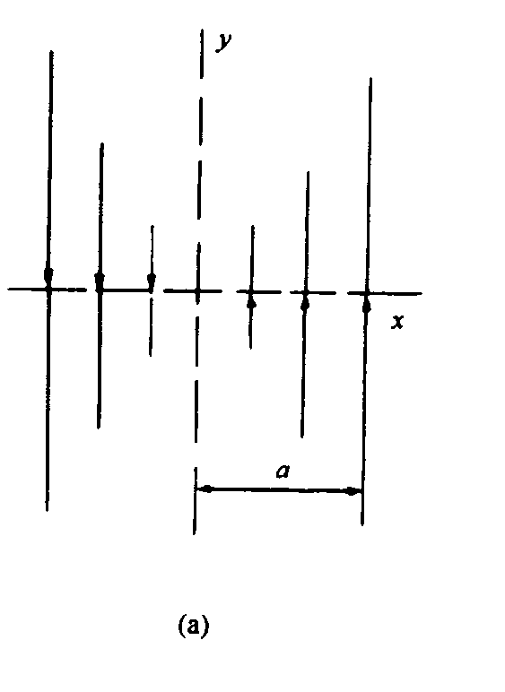

**图5.8** (a)沿$z$轴流动的平板电流的磁力线;(b)撕裂模产生的磁岛结构

先写出平衡态电流和磁场

$$
B_{0} = B_{0}e_{z} + B_{y}(x)e_{y}, \quad j = j_{z}(x)e_{z} \quad (5.168)
$$

设电流关于中平面$x = 0$反对称,于是$B_{y}(0) = 0$, 中平面是一个奇异面。在中平面附近,电流产生的磁场可以写成

$$
B_{y}(x) = B_{y}^{\prime}(0)x \quad (5.169)
$$

对这种平板位形,可以采用简正模方法进行线性稳定性分析。将所有扰动物理量对$y$坐标进行富氏展开,各扰动量写成$f(x,y) = f_{1}(x)\exp (- i\alpha t + i k y)$。引入扰动磁场的矢势,则

$$
\delta B_{z} = \mathrm{i}k A_{z} \quad (5.170)
$$

对线性化运动方程(5.94)取旋度,这样右方的压强梯度项消失,用矢势$\pmb{A}$表示扰磁场,所得方程的$z$分量为

$$
\rho_{0}\left(\nabla \times \frac{\partial \nu}{\partial t}\right)_{z} = -\frac{1}{4\pi} (B_{0}\cdot \nabla)\nabla_{z}^{2}A_{z} + \frac{1}{c}\nabla \times A\cdot \nabla j_{z} \quad (5.171)
$$

式中$\nabla_{z}^{2} = \frac{\partial^{2}}{\partial x} - k^{2}$, 再利用等离子体的不可压缩条件

两方程结合可简化成一个基本方程

$$
\frac{\rho_{0}}{k^{2}}\frac{\partial}{\partial t}\nabla_{\perp}^{2}\nu_{x} = -\frac{B_{y}}{4\pi}\nabla_{\perp}^{2}A_{z} + \frac{A_{z}}{c}\frac{\mathrm{d}}{\mathrm{d}x} j_{z} \quad (5.173)
$$

同时将欧姆定律写成

$$
\frac{\partial A_{z}}{\partial t} - \nu_{x}B_{y} = \frac{\eta c^{2}}{4\pi}\nabla_{\perp}^{2}A_{z} \quad (5.174)
$$

联立上述方程确定了所研究的电阻模的性质。可以看到,沿$z$轴的外加强磁场不出现在方程中,对电阻模起作用的仅仅是电流产生的磁场。从方程(5.174)还可以看出,当电阻率为零时,在中心平面$x = 0$处的扰动磁场$\delta B_{x}(0) = \mathrm{i}k A_{z}(0) = 0$, 这表明理想的等离子体中不存在使中心平面发生畸变的模式。用能量原理可以严格证明,上述位形对理想磁流体模是稳定的。有了电阻项的作用,(5.174)的左方项可以不为零,这个项其实就是运动等离子体中平行于磁力线的电场分量。因此,平行于磁场的电场分量不为零是产生非理想磁流体模的必要条件。

在第四章中关于磁场位形结构稳定性的分析中已经指出,如果在某些特殊的磁面附近加一扰动磁场,会产生磁岛结构,现在的情况正是如此。在所考察的平板位形上加一扰动磁场,会产生如图5.8所示的磁岛。现在,这种扰动磁场来自电阻模,它使原先的磁场结构被撕裂,所以称撕裂模。

现在存在两个空间区域,一是奇异面附近的小区域,其尺度为$2\delta$, 其中电阻效应很重要;另一为外部区域,其中电阻效应仍然可以忽略。电阻区域的具体大小要由所导出的方程自治地确定。在奇异区,除电阻效应外,等离子体的惯性效应也是重要的,而在大部分其它区域(称理想区域),惯性效应可以忽略。

对于含电阻效应的磁流体方程的分析,发展了一种特殊的方法,称奇异层分析,其基本点是,先求出奇异层两边的理想区中磁流体方程的解,在奇异层处令这两个解满足一定的联接条件,就可以得出稳定性判据,进而,考虑奇异层本身的解,可以给出模的增长率。

理想区中扰动磁场满足方程

$$
\left(\frac{\mathrm{d}^{2}}{\mathrm{d}x^{2}} -k^{2}\right)A_{z} - \frac{4\pi}{c B_{y}}\frac{\mathrm{d}j_{z}}{\mathrm{d}x} A_{z} = 0 \quad (5.175)
$$

这个方程的求解将分别在奇异面的两边进行。解的具体形状与电流分布的情况有关。为简单起见,设在两边$x\pm a$处有导体壳,使该处的扰动磁场为零。在中心平面处扰动磁场不连续,这是因为在奇异层中存在扰动磁场(电阻及惯性效应引起),其结构要由奇异层中的本征方程来确定。在求理想区解时,只要知道该扰动磁场是有限的就行了。因为本问题中$A_{z}$具有扰动磁场的磁通的含义,虽然奇异层中的扰动磁场对这一磁通有贡献,但因奇异层的宽度很小,其贡献可以忽略,于是可以近似地认为$A_{z}$在通过奇异层时连续,但磁通函数的导数不连续。定义

$$
A^{\prime} = \frac{1}{A_{z}(0)}\left[\frac{\mathrm{d}A_{z}}{\mathrm{d}x}\right]_{x = 0} \quad (5.176)
$$

1C代表量$c$在通过奇异层时的改变量。下面将看到,求解理想区方程的全部作用在于确定$\Delta^{\prime}$值。发生撕裂模的条件为

$$
\Delta^{\prime} > 0 \quad (5.177)
$$

这将在导出撕裂模的增长率表示式后清楚地看出。

#### 5.7.3 撕裂模的增长率

求奇异层中模的本征方程(5.173)的解,然后将其与理想区的解联接起来,就可确定模的增长率(本征频率)和模的本征函数。利用(5.169),因奇异层宽度很小,只保留的最低一级近似,式(5.173)化成

$$
\frac{\mathrm{i}\omega\rho_{\circ}}{k^{2}}\frac{\mathrm{d}^{2}\nu_{\mathrm{x}}}{\mathrm{d}x^{2}} +\frac{B^{\prime}}{n c^{2}} (\mathrm{i}\omega A_{\mathrm{z}} + B^{\prime}_{\mathrm{y}}x\nu_{\mathrm{x}}) = 0 \quad (5.178)
$$

这个方程中除变量$\nu_{\mathrm{x}}$外,还出现变量$A_{z}$, 原则上应与(5.171)联立求解。但根据上面说的理由, $A_{z}$可以近似地看成常量,这一做法称"恒常$\psi$近似"。求奇异区的解时要注意解的渐近性质以及奇偶性质。现在$A_{z}$是偶函数, $\nu_{\mathrm{x}}$是奇函数。在接近理想区时要与该区的解有相同的性质,这意味着

$$
\nu_{\mathrm{x}}\rightarrow \mathrm{i}\omega A_{z} / B_{\mathrm{y}}^{\prime}x\qquad \mathrm{当}x\rightarrow \pm \infty \quad (5.179)
$$

具体的解的表示式及求解方法在弗思(Furth)的著名论文[24]中有详细描述,我们现在不必了解其具体形式,仅认为解已求得,将其代回(5.174),然后积分一次,即得

$$
\left[\frac{\mathrm{d}A_{z}}{\mathrm{d}x}\right]_{x = 0} = \frac{\mathrm{i}4\pi}{n c^{2}}\int_{x}^{\infty}\mathrm{d}x[\omega A_{z}(0) + B_{\mathrm{y}}^{\prime}x\nu_{\mathrm{x}}] \quad (5.180)
$$

令所得的数值解与理想区域中方程(5.175)得出的对应值相等,就得到一个将模的增长率$\gamma = - \mathrm{i}\omega$与(5.176)中定义的$\Delta^{\prime}$相联系的关系式,从中解出增长率,得

$$
\gamma = 0.5(k a)^{2 / 5}(\Delta^{\prime}a)^{4 / 5}\tau_{\mathrm{R}}^{-1 / 5}\tau_{\mathrm{R}}^{-3 / 5} \quad (5.181)
$$

式中引入了新的特征时间$\tau_{\mathrm{R}}$, 它代表剪切阿尔芬波沿电流产生的磁场的磁力线的传播时间

$$
\tau_{\mathrm{R}} = \frac{\sqrt{4\pi\rho_{0}c}}{B_{\mathrm{y0}}^{\prime}} \quad (5.182)
$$

另外,在$\tau_{\mathrm{R}}$的表示式中应以$a$取代$d$。这样,实际上在上面的增长率的表示式中电流板的宽度$a$可以消去。现在看到,的确出现了一种新的不稳定性,其增长率比理想磁流体模的增长率(大体为$\tau_{\mathrm{R}}^{- 1}$)慢得多,但又比经典电阻扩散时间$\tau_{\mathrm{R}}$快得多。在聚变实验装置中,这一特征时间比等离子体的能量约束时间短很多,相应的磁流体活性可以被清楚地观察到,它们对等离子体的总体约束特性有重要的影响。

#### 5.7.4 托卡马克中的撕裂模[25\~30]

讨论撕裂模时,托卡马克仍可以当作直圆柱(设等离子体的截面为圆,否则讨论要复杂得多,但基本特性类似),因此可以将扰动磁场及各种一级变化量按$\exp (\mathrm{i}m\theta +\mathrm{i}k z)$展开,这里$k = n / R$, 而与上面例子中的中心平面位置对应的奇异面由条件$k\cdot B = (m B_{\theta} / r) - (n B_{\theta} / R) = 0$确定,满足这一条件的空间位置正好是安全因子等于两整数$m$和$n$的比值的位置

$$
q(r_{\mathrm{t}}) = m / n \quad (5.183)
$$

这些磁面称为有理磁面。常常把出现在满足上面公式的有理磁面附近的磁流体模称为$m / n$模。根据上面平板位形的例子可以推断,撕裂模将使有理磁面分裂成$m$个磁岛,它们沿环向有$n$个周期。磁岛的宽度由饱和后的撕裂模的幅值及托卡马克极向磁场的剪切值确定。但在下面的处理中,我们采用由撕裂模临界稳定条件来确定磁岛宽度,然后反过来确定撕裂模的幅值的方法。对托卡马克,一般说来有理磁面附近的磁岛宽度都远小于等离子体的小半径,因此相应的奇异层局限于有理磁面附近的小区域中,可以近似地将其看成平板,于是奇异层中的物理问题与上面简单例子中的没有太大差别。但在理想区则要用圆柱位形来分析,令

$$
\psi = r\delta B_{r} \quad (5.184)
$$

则与平板位形中式(5.175)对应的模的本征方程为

$$
\frac{1}{r}\frac{\mathrm{d}}{\mathrm{d}r} (r\frac{\mathrm{d}\psi}{\mathrm{d}r}) - \frac{m^{2}}{r^{2}}\psi = \frac{m\mathrm{d}j_{r} / \mathrm{d}r}{B_{\theta}(m - nq)}\psi \quad (5.185)
$$

在有理磁面$r = r_{s}$的两边求解,在磁轴上,由式(5.184)得到

$$
\psi (0) = 0 \quad (5.186a)
$$

在边界上,为简单计,设有一理想导体壳,于是有

$$
\psi (a) = 0 \quad (5.186b)
$$

在奇异面处取

$$
\psi (r_{s}) = 1 \quad (5.186c)
$$

方程(5.185)对给定电流剖面可以用数值方法求解,在靠近奇异面时解有对数发散特性,要结合解析方法来处理这种发散,再利用一些具有很高精确度的数值方法(例如样条配置法)然后就可以得到精确度足够好的解了[25]。同时也可计算在相应奇异面处的$\Delta^{\prime}$

$$
\Delta^{\prime}_{m n} = \left(\frac{\psi^{\prime}_{s} - \psi^{\prime}}{{\psi}}\right)_{r_{s}} \quad (5.187)
$$

微分方程(5.185)可以看成是下述泛函数求极值得出的欧拉(Euler)方程

$$
W = \int_{0}^{a}\mathrm{d}r r\left[\left(r\frac{\mathrm{d}\psi}{\mathrm{d}r}\right)^{2} + \frac{m^{2}}{r^{2}}\psi^{2} - \frac{m\mathrm{d}j_{r} / \mathrm{d}r}{B_{\theta}(m - nq)}\psi^{2}\right] \quad (5.188)
$$

它与理想磁流体能量变分$\delta W_{p}$的表示式精确地一致(差一任意的比例常数)。对撕裂模,这个能量积分可以写成与$\Delta^{\prime}$相联系的表示式

$$
\delta W_{p} = -\frac{r_{s}}{2}\psi (r_{s})\left[\frac{\mathrm{d}\psi}{\mathrm{d}r}\right]_{r_{s}} = -\frac{r_{s}}{2}\Delta^{\prime}_{m n}\psi^{2} \quad (5.189)
$$

由此可知,撕裂模的不稳定条件为

$$
\Delta^{\prime}_{m n} > 0 \quad (5.190)
$$

在实际问题中,最主要的模式是极向模数较低的那些模,即$3 / 2,2 / 1,3 / 1$,等等。这些模对应的磁岛最大,对等离子体的约束影响也最大。在一定意义上,如能通过选择电流剖面来实现对这些低极向模数的模的稳定化,可以认为是实现了最佳的电流剖面[27\~30]。

在实验运作上,一种简单的控制电流剖面的方法是调节电流的上升速率,同时调节等离子体密度的上升速率(通过调节充气速率)[31]。因为电子温度剖面分布既与能量输运过程有关,又与气体电离引起的能量损失有关,也与电子密度本身有关;而电子温度剖面又与欧姆电场大小有关,它影响电流密度剖面,同时电流上升速率也影响电流自身向内部的扩散。合成的机制虽很复杂,但可以从实验上观察Mimov信号来确定具有最佳稳定条件的参数区。具体做法是从电子密度的上升速率和电流上升速度的不同组合中找出最佳的组合,此时Mimov信号最小,对应于撕裂模的幅值最低,也就是一种最佳的电流剖面。在我国的托卡马克装置HL-1中进行了这样的实验,找到具有最小Mimov讯号的条件(见图5.9)。由于控制了撕裂模的增长,就有可能扩大稳定参数区,即将边界安全因子$q_{\alpha}$降低(增大总电流)。在HL-1装置上实现了$q_{\alpha} = 1.8$时的稳定的托卡马克放电。

根据等离子体沿磁力线建立能量平衡速率非常快的特点,而且认为磁岛的形成将改变磁岛所在区域的输运性质,磁岛区域的电子温度可以近似地看成是很平的,因为电子沿磁岛的运动将使温度拉平。将这种效应与输运过程结合起来可以用等效的输运模型来描述托卡马克等离子体的总体能量平衡,同时确定主要的磁岛结构[32]。磁岛的大小可以近似地从临界稳定条件

$$
\Delta_{m m}^{\prime}(r_{\mathrm{t}}\pm w) = 0 \quad (5.191)
$$

得出。用这一方法确定磁岛宽度不仅十分简单,而且其物理意义非常清晰。但当磁岛尺寸较大时,应当采用环形位形,因为对大尺寸的磁岛,直圆柱模型太粗糙了。

撕裂模对托卡马克位形及其它具有大的放电电流的位形(如RFP)的约束有重要影响,尤其是,有的磁岛可以发展到很大的尺寸,相邻的磁岛可能发生联接。在一定条件下,会使放电过程破裂。这一过程非常快,可与理想磁流体模的发展速率相比,它不仅使一次放电完全停止,而且可以因引起巨大的感应涡流而破坏装置的真空室或周围导电组件。这种非线性的不稳定性称破裂不稳定性(disruptive instability),是托卡马克装置控制工程的主要研究课题之一,下面将有一小节内容专门讨论这种不稳定性。

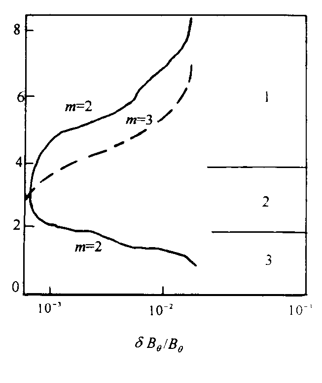

**图5.9** HL-1装置中通过调节电流上升率及送气率以控制电流剖面,得到最低Mimov信号的参数区〔31〕

#### 5.7.5 撕裂模的转动频率

实验观察到撕裂模不仅具有增长率,而且具有转动频率,其表现是由撕裂模形成的磁岛是以一定角速度绕极向和环向转动的。在理论上很早就预言撕裂模具有复频率,其描述方法是采用双流体近似(电子成分和离子成分分别用磁流体方程描述)[33,34]。受到影响的仅是奇异层中的物理过程,因此双流体描述基本不影响位能改变量的表示式,前面关于撕裂模的$\Delta^{\prime}$理论仍然有效,不过模的频率$\omega$要由色散关系确定,在一定的条件下,这个色散关系可以简化成一个包含几个特征频率的代数方程

$$
\omega (\omega - \omega_{\mathrm{tr}})^{3}(\omega - \omega_{\mathrm{n}}) = \mathrm{i}\gamma_{\mathrm{s}}^{5} \quad (5.192)
$$

式中$\gamma_{\mathrm{s}}$表示原先由单磁流体近似描述得出的结果,即前面公式(5.181)表示的结果(但

要在其中代入圆柱位形的参数)，另两个特征频率的定义为

$$
\omega_{\mathrm{r}_{1}} = -\frac{c}{n_{\mathrm{e}}e B_{0}r_{\mathrm{s}}}\left(\frac{\mathrm{d}p_{\mathrm{i}}}{\mathrm{d}r}\right)_{r_{\mathrm{s}}} \quad (5.193)
$$

$$
\omega_{\mathrm{r}_{\mathrm{T}}} = -\frac{m c(T_{\mathrm{e}} + T_{\mathrm{i}})}{n_{\mathrm{e}}e B_{0}r_{\mathrm{s}}}\left(\frac{\mathrm{d}n_{\mathrm{e}}}{\mathrm{d}r}\right)_{r_{\mathrm{s}}} \quad (5.194)
$$

各有关参数在奇异面处取值。方程(5.192)可以方便地用简单的数值计算解出，在两种极限情况下可以用更简单的形式表示。第一种极限是当模的增长率远大于实频率时

$$
\omega = (3\omega_{\mathrm{r}_{\mathrm{T}}} + \omega_{\mathrm{r}_{\mathrm{i}}}) / 5 + \mathrm{i}\gamma_{\mathrm{r}} \quad (5.195)
$$

此时模的增长率基本上仍是单磁流体近似得出的值，但模在离子反磁漂移方向以一个大体上等于离子反磁漂移频率的角频率沿极向转动；另一极限是模的增长率远小于离子反磁漂移频率，此时可以认为模基本上不转动，而增长率为

$$
\gamma = \gamma_{\mathrm{r}}^{\mathrm{i}} / (\omega_{\mathrm{r}_{\mathrm{T}}}^{\mathrm{i}}\omega_{\mathrm{i}}) \quad (5.196)
$$

此式表明离子反磁漂移对撕裂模有稳定作用(增长率有较大的减小)。

#### 5.7.6 撕裂模的非线性发展

撕裂模的发展将伴随着随时间增大的磁岛结构，磁岛发展到一定大小时，模的增长会变慢，其增长方式将由实际的$\Delta^{\prime}_{m n}$确定，

$$
\frac{\mathrm{d}\psi_{m n}}{\mathrm{d}t} = 1.66\eta (r_{m n})\Delta^{\prime}_{m n} \quad (5.197)
$$

其中$\Delta^{\prime}_{m n}$形式上仍由式(5.192)定义，但$\mathrm{d}\psi_{m n} / \mathrm{d}r$应在磁岛两边，即在$r_{m n}\pm \nu_{m n} / 2$处取值。$\psi_{m n}$形式上仍满足式(5.192)，但其中的电流剖面函数由每一时刻的输运方程确定。输运方程中的输运系数除采用唯象规律所假定的形式外，要考虑磁岛结构对输运系数的影响，最简单的做法是令磁岛区的反常热导率等于一个很大的数，这样，在磁岛区的电子温度分布将基本上是平台形的，电流分布相应地也是平台形的。改变了的电流分布函数将影响$\Delta^{\prime}_{m n}$的值，如果$\Delta^{\prime}_{m n} = 0$，则磁岛达到饱和。

上面关于磁岛结构效应的分析一般仅适用于单模(例如2/1模)起较大作用的场合，此外，还可能有其它非线性效应对模的饱和有影响。例如磁流体运动本身(对流运动)对模发展的影响；不同模之间的耦合效应，尤其是模数相邻的模之间的耦合效应的影响；模发生混合时的运动等等。理论研究中采用简化的磁流体(the reduced mhd)方程组来模拟这些效应，非线性运动常常给出非常复杂的磁场位形结构，另一方面，在实验上，利用多通道电子温度测量结果的层析方法(tomographic)，可以给出每一时刻的等温剖面结构，通常认为电子温度剖面与磁面结构基本是相同的，于是理论和实验存在可比性。不过，这类对比只能在定性的意义上加以判断，因为理论模型实在是非常简化的。

#### 5.7.7 导体壳效应

导体壳对撕裂模的线性发展影响较小，但磁岛发展到一定大小时，靠近等离子体的导体壳对饱和磁岛的尺寸有非常大的影响。图5.10是导体壳相对位置对$m = 2, n = 1$的磁岛饱和尺寸影响的算例。其中$a$为等离子体柱小半径，$b$为导体壳半径。存在导体壳时，对应于$(m, n)$模的磁通函数应满足边界条件

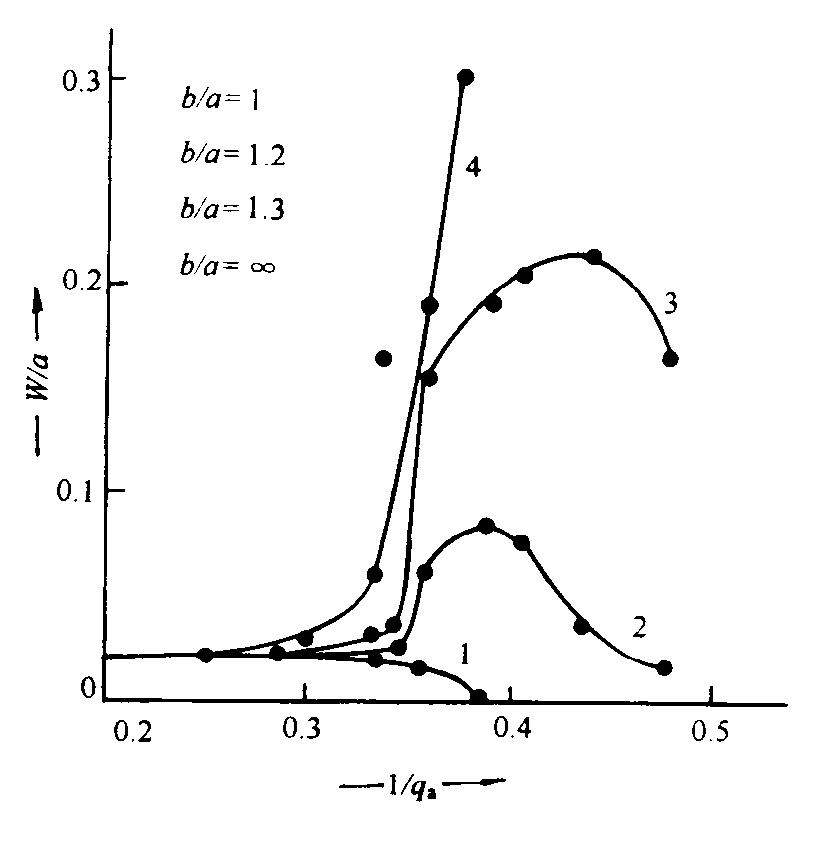

**图5.10** 不同导体壳位置下饱和磁岛相对尺度〔57〕

图5.10表明，靠近等离子体的导体壳对磁岛的饱和尺寸有非常大的影响，在$\frac{b}{a} >1.3$的情况下，(2,1)磁岛在边界安全因子值小于3后将很快发展成相对尺度超过小半径的1/5大小，对破裂不稳定性的发展起决定性的作用。

最后，有必要介绍一下我国学者在撕裂模理论研究中的贡献。我国的年轻学者李定等人在对撕裂模的环形耦合及撕裂模的非线性发展的理论研究中，改进和发展了国外学者的理论，受到同行的重视[35,38]；而曲文孝则考虑了新经典效应(捕获粒子效应，见第六章)对撕裂模非线性增长过程的影响[39]，该文献被广泛引用。考虑这些更实际的效应，撕裂模的稳定性条件和增长率都将改变。因此，本章介绍的内容基本上只适用于线性阶段，而非线性阶段模的发展要在更复杂的条件下研究。由于篇幅限制，本书不可能一一介绍，有兴趣的读者可参看有关文献。

改变。因此，本章介绍的内容基本上只适用于线性阶段，而非线性阶段模的发展要在更复杂的条件下研究。由于篇幅限制，本书不可能一一介绍，有兴趣的读者可参看有关文献。

### 5.8 托卡马克锯齿型磁流体活性和内扭曲模[40\~50]

托卡马克等离子体约束的一个重要特征是，当环向电流建立起来以后，大体在一个能量约束时间的时刻内，等离子体各种参数将趋于准稳态分布，其中电子温度将达到峰化剖面分布。在欧姆驱动条件下，由于等离子体电导率正比于$T_{\mathrm{e}}^{3 / 2}$，因此，电流剖面将比电子温度剖面更峰化。这意味着磁轴处的安全因子将不断减小。磁轴处安全因子的大小与装置参数间有简单的关系(对圆截面等离子体)

$$
q_{0} = \frac{5B_{0}}{\pi R j_{0}} \quad (5.199)
$$

此式中磁场以Gs计，电流密度以$\mathbf{A} / \mathbf{cm}^{2}$计，长度单位为cm。在环压给定时，磁轴处的电流密度仅与电子温度有关

$$
j_{0} = \sigma (T_{\mathrm{e}})E_{0} = \frac{\sigma V_{\mathrm{L}}}{2\pi R}\propto T_{\mathrm{e}}^{3 / 2}V_{\mathrm{L}} \quad (5.200)
$$

此处$V_{\mathrm{L}}$为环电压。由此可知，随着电子温度的升高，即使保持总电流不变，中心电流密度仍将不断加大，而中心安全因子将不断减小。在正常的托卡马克放电中，中心安全因子值$q_{0}$都会低于1，这意味着在等离子体内部存在一个$q = 1$的磁面和一个$q \leqslant 1$的空间区域。这个区域的相对大小与边界安全因子$q_{0}$及电流峰化程度有关。与之对应，会发展起$m = 1, n = 1$的磁流体模，这个模与前面讨论的$m > 1$的模在模式的空间结构上和模的增长率的大小上都有很大差别，需要特殊处理。

#### 5.8.1 理想内扭曲模[34,40\~44]

由分析载电流直圆柱位形时得到的能量变分表示式知道，$m = 1$的模与$m\geq 2$的模有显著的不同，从小量展开的角度说，$m = 1$的模对磁流体位能增加量的贡献出现在二级小量项中。这可以从位能改变量的表示式

$$
\delta W_{\mathrm{p}} = \frac{\pi}{2}\int_{0}^{\eta}\mathrm{d}r\left[f\left(\frac{\mathrm{d}\xi}{\mathrm{d}r}\right)^{2} + g\xi^{2}\right] \quad (5.201)
$$

看出，按倒环径比展开时的最低一级近似表示式（5.152）中与$(m^{2} - 1)$有关的主要项消失，剩下的是低两级$[(ka)^{2}$级和$\beta$级）的贡献，对$m = 1$的模，上式中的函数

$$
f = \frac{r(B_{\theta} + k r B_{z})^{2}}{1 + k^{2}r^{2}} \quad (5.202)
$$

$$
g = \frac{k^{2}r^{2}}{1 + k^{2}r^{2}}\left[2p^{\prime} + \frac{(B_{\theta} + k r B_{z})^{2}}{r} +\frac{2(k^{2}r^{2}B_{z}^{2} - B_{\theta}^{2})}{r(1 + k^{2}r^{2})}\right] \quad (5.203)
$$

从小量展开的角度看，函数$f$是零级量，$g$是二级小量，而含$f$的项是正定的，因此，可能的不稳定模必须满足条件

$$
\frac{\mathrm{d}\xi_{0}}{\mathrm{d}r} = 0,\qquad r< r_{1} \quad (5.204)
$$

这意味着模的径向位移函数在$q = 1$面内部是均匀扰动。取一个具有下面形状的试验函数（图5.11）：在奇异面内设径向位移按梯形下降，即设

$$
\xi = \xi_{0} = \mathrm{const}, \qquad r< r_{1}
$$

$$
\xi = \xi_{0}\frac{(r_{1} - \delta)}{\delta}, \qquad (r_{1} - \delta)< r< r_{1}
$$

$$
\xi = 0 \qquad r_{1}< r< a
$$

$r_{1}$是$q = 1$面的位置，这时位能改变量化成

$$
\delta W_{\mathrm{p}} = \frac{\pi}{6} r_{1}\xi_{0}^{2}s^{2}n^{2}\delta +\delta W_{\mathrm{min}} \quad (5.206)
$$

$$
\delta W_{\mathrm{min}} = \frac{\pi}{2}\xi_{0}^{2}\int_{0}^{r_{1}}\mathrm{d}r g \quad (5.207)
$$

式（5.206）中的$s$是磁剪切量，定义为

$$
s = \left(\frac{r}{q}\frac{\mathrm{d}q}{\mathrm{d}r}\right)_{r_{1}} \quad (5.208)
$$

对理想内扭曲模，奇异层是惯性奇异层，其含义是，在此层内，惯性项将起重要作用。为说明此点，考察由式（5.205）表示的位移函数，$\nabla \cdot \xi = 0$得出

$$
\frac{1}{r}\frac{\mathrm{d}}{\mathrm{d}r} (r\xi) + \frac{\mathrm{i}m}{r}\xi_{\theta} + \mathrm{i}k\xi_{z} = 0 \quad (5.209)
$$

不妨忽略$\xi_{z}$，则在奇异层附近

$$
\xi_{\theta} = -\mathrm{i}r_{1}\xi_{0} / \delta \quad (5.210)
$$

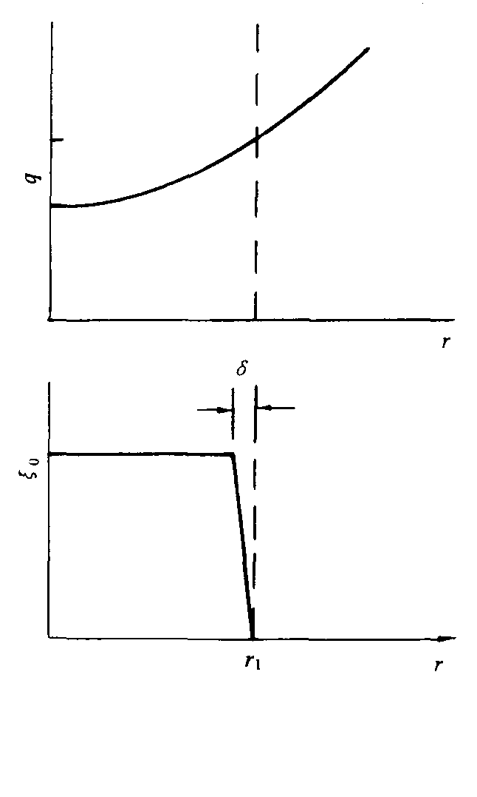

**图5.11** 内扭曲模对应的位移函数

相应地其动能项为

$$
K = \pi \rho_{0}\gamma^{2}\xi_{0}^{2}r_{1}^{3} / 2\delta \quad (5.211)
$$

即位移的$\theta$分量和动能都随奇异层厚度的减小而趋发散。这说明奇异层必须具有一定的厚度，而且这个厚度的大小是与模的增长率相联系的。这就是惯性奇异层的特征。

在物理上，内扭曲模的上述特性对应于这样一种扰动：在$q = 1$面内等离子体均匀地挤向$q = 1$面，在其附近，等离子体迅速沿极向流回而构成闭合回路。从而使很薄的奇异层中等离子体的动能超过了内部理想区的动能。现在总的能量改变量$K + \delta W$是$\delta$函数，需要对此参数求极值，得到

$$
\delta_{\mathrm{min}} = \frac{\sqrt{3}\rho_{0}r_{1}\gamma}{s n} \quad (5.212)
$$

相应地求得增长率

$$
\gamma = -\omega_{\mathrm{A}}\frac{\delta W_{\mathrm{min}}}{\pi r_{1}\xi_{0}^{2}n s} \quad (5.213)
$$

式中$\omega_{\mathrm{A}} = \nu_{\mathrm{A}} / \sqrt{3} q R$是阿尔芬频率。此式表明，内扭曲模的增长率与表面扭曲模的增长率比起来的确是二级小量。严格地处理奇异层和理想区的本征方程得到的结果不改变增长率与基本参量的关系，仅对系数做些修正。而模的本征函数的形式为

$$
\xi = \frac{\xi_{0}}{2}\left[1 - \frac{2}{\pi}\mathrm{arctg}\left(\frac{n s x}{\sqrt{\rho_{0}\gamma r_{1}}}\right)\right] \quad (5.214)
$$

#### 5.8.2 环形效应对内扭曲模的作用[40\~42]

按上面用直圆柱模型推导出的结果，将函数$g$的显示式写出

$$
g = \frac{n^{2}r^{2}}{1 + k^{2}r^{2}}\left[2p^{\prime}B_{q}^{2} - r\left(\frac{1}{q} -n\right)\left(\frac{1}{q} +3n\right)\right] \quad (5.215)
$$

显然，只要

$$
\frac{\mathrm{d}p}{\mathrm{d}r} < 0 \quad (5.216)
$$

就有$g< 0$。上式对任意的单调下降形压强剖面都满足，于是得出结论，即只要存在$q = 1$面，理想内扭曲模就一定是不稳定的。这与实验事实不符，实验中$q_{0}$可以比1低，最低可达到$0.5\sim 0.6$左右；其次，不稳定模也不是马上增长起来的，有一个稳定的周期，而且这个稳定的周期比模的增长特征时间长，在大装置中要长几个数量级。

在理论上早就认识到，用直圆柱近似处理内扭曲模是不正确的，因为所忽略的环形效应与保留的二级效应同一量级。Bussac[40]最早得出严格的环形位形中理想内扭曲模的分析结果。该分析方法很复杂，超出本书要重点介绍的内容，但其结果对本书又十分重要，因此这里引进其主要结果。

在环形位形中，位能总的改变量可以写成

$$
\delta W_{\mathrm{p}} = \left[\left(1 - \frac{1}{n^{2}}\right)\delta W_{\mathrm{c}} + \frac{1}{n^{2}}\delta W_{\mathrm{T}}\right] \quad (5.217)
$$

式中$\delta W_{\mathrm{c}}$代表前面用直圆柱模型得出的位能改变量，$\delta W_{\mathrm{T}}$表示环形效应修正。可以看到，对环向模数$n$很大的模，直圆柱近似的结果基本适用，但最危险的模是环向模数小的模，如在$n = 1$时，直圆柱近似的贡献完全被消去，模的稳定性完全由环形效应确定。

假定$q = 1$面内部的安全因子具有抛物线分布

$$
q(r) = q_{0} + (1 - q_{0})r^{2} / r_{1}^{2}\qquad r\leqslant r_{1} \quad (5.218)
$$

这时，前面定义的磁剪切量$s = 2(1 - q_{0})$。总的位能改变量的表示式可以写成

$$
\delta W_{p} = \frac{3\pi}{2}\left(\frac{r_{1}}{R}\right)^{2}\left(1 - q_{0}\right)\left[\hat{\beta}_{p}^{2} - \frac{13}{144}\right] \quad (5.219)
$$

其中定义了一个等效的极向比压值

$$
\hat{\beta}_{p} = -\frac{8\pi}{B_{\theta}^{2}(r_{1})}\int_{0}^{r_{1}}\mathrm{d}r r^{2}\frac{\mathrm{d}p}{\mathrm{d}r} \quad (5.220)
$$

理想内扭曲模的不稳定条件现在化为

$$
\hat{\beta}_{p} > \sqrt{13 / 144}\approx 0.3 \quad (5.221)
$$

主要结论是，只有当等离子体在$q = 1$面内部的等效极向压强大于一个临界值时，理想内扭曲模才变成不稳定的。这是对直圆柱近似的重要修正。但是，如果将托卡马克装置的真实参数代入，可以看到，这是一个相当严格的限制，使得大多数中小型装置中，理想内扭曲模是稳定的。为此不妨设压强也具有抛物线分布

$$
p(r) = p_{0}[1 - a_{p}r^{2} / r_{1}^{2}]\qquad r\leqslant r_{1} \quad (5.222)
$$

代入定义(5.220)得出$\hat{\beta}_{p} = a_{p}\beta_{p} / 2$，这里$\beta_{p}$是实在的极向比压值，以$q = 1$处的极向磁场计算。一般，对欧姆加热的托卡马克装置，这一比压值是小于1的量，取$a_{p} = 0.4$，这已代表很陡的压力分布，理想内扭曲模的不稳定条件相当于要求$\beta_{p} > 1.5$，这一条件对多数中小型托卡马克装置不满足。

#### 5.8.3 离子反磁漂移效应

类似于撕裂模的分析，若应用双流体近似，将引入离子反磁漂移效应，这种效应可以简单地将单流体近似中的色散关系用代换

$$
\omega^{2}\rightarrow \omega (\omega -\omega_{n}) \quad (5.223)
$$

而得到。于是考虑离子反磁漂移效应后理想内扭曲模的色散关系化成

$$
[\omega (\omega -\omega_{n})]^{1 / 2} = \mathrm{i}\omega_{\Lambda}\gamma_{\mathrm{mhd}} \quad (5.224)
$$

式中$\gamma_{\mathrm{mhd}}$对前面假定的安全因子剖面(5.218)可以写成

$$
\gamma_{\mathrm{mhd}} = \frac{3\pi}{2}\left(\frac{r_{1}}{R}\right)^{2}\left[\hat{\beta}_{p}^{2} - \frac{13}{144}\right] \quad (5.225)
$$

考虑离子反磁漂移使理想内扭曲模更稳定，因为由色散方程(5.224)解出，模的复频率为

$$
\omega = \frac{\omega_{n}}{2}\pm \sqrt{\left(\frac{\omega_{n}}{4}\right)^{2} - (\omega_{\Lambda}\gamma_{\mathrm{mhd}})^{2}} \quad (5.226)
$$

取正号时代表上面讨论的理想内扭曲模，取负号的模现在是稳定的，它对应于下面讨论的电阻性内扭曲模。可以看到，理想内扭曲模总是在离子反磁漂移方向转动。模的不稳定条件现在化为

$$
\gamma_{\mathrm{mhd}} > \frac{\omega_{\mathrm{s1}}}{2\omega_{\mathrm{A}}} \quad (5.227)
$$

对应地，关于不稳定比压极限有所升高

$$
\hat{\beta}_{\mathrm{p}} > \sqrt{\frac{13}{144} + \frac{2}{3\pi}\left(\frac{R}{r_{1}}\right)^{2}\left(\frac{\omega_{\mathrm{s1}}}{2\omega_{\mathrm{A}}}\right)} \quad (5.228)
$$

根据上面的讨论，在没有考虑离子反磁漂移时对大多数中小型托卡马克装置来说，理想内扭曲模已经是稳定的，考虑这种效应只能使其更稳定。显然，需要寻找其它的不稳定模式来解释实验现象。这就是式(5.226)中取负号时的解，对应于一个转动很慢的模，引起不稳定的原因是电阻效应。

#### 5.8.4 关于锯齿活性的实验[51]

关于$m = 1$的磁流体活性的实验观察在比较早的托卡马克实验中就报道了。美国的第一个托卡马克，Princeton国家实验室中由仿星器Stellarator-C改造的ST装置上最早观察到这类活性。这就是由vonGeoler用软X射线诊断观察到的锯齿振荡信号[51]。软X射线是通过测量等离子体在软X波段的辐射来诊断中心约束区中电子温度和杂质含量的。结果发现在总的辐射水准上总是叠加有周期变化的锯齿形振荡(见图5.12)，对叠加在这些锯齿信号上的先兆振荡进行富氏分析发现，其空间结构符合$m = 1,n = 1$，因此认为这些锯齿振荡由内扭曲模驱动的非线性磁流体活性，简称锯齿活性构成。以后在几乎所有的托卡马克装置上都观察到锯齿活性，从而软X射线诊断也成了托卡马克装置的最基本诊断手段之一。从几个方向安排的软X射线探测器阵列得到的信号，经层析重构(tomographic reconstruction)，可以给出磁流体模式非线性时空演变的详细图象，结合理论研究，使托卡马克装置成为研究磁再联这类重要的物理现象的实验设施。

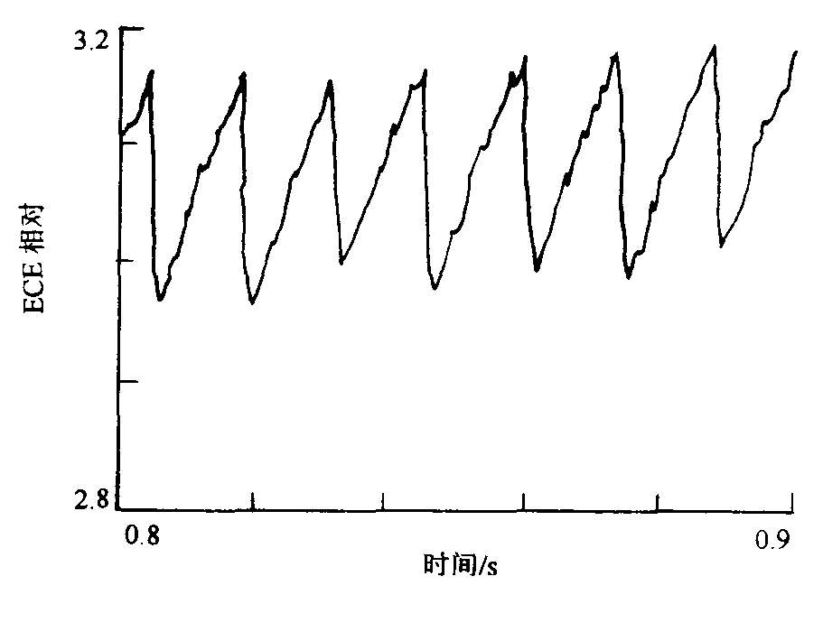

**图5.12** Tokamak的ECE信号的典型锯齿

根据上面的分析，理想内扭曲模对多数中小型托卡马克等离子体应该是稳定的，那么如何解释头验观察到的锯齿活性呢?理论分析指出，电阻性内扭曲模是这类活性的原始原因。下面简单介绍有关的知识。

#### 5.8.5 电阻性内扭曲模[41\~44]

锯齿型活性是一类非常复杂的非线性磁流体现象，下面仅介绍一些最简单的基本知识。实际在不同的装置中，在不同的条件下，实验观察到的锯齿振荡从锯齿形状，到锯齿周期，以及锯齿的崩蹦快慢(crash time)，崩蹦前后中心安全因子的相对变化，开始崩塌时有无前兆振荡，等等，都有很多特性，长期以来引起理论和实验研究者的兴趣。本节讨论最基础的理论：电阻性内扭曲模。这是理想内扭曲模的对应体，除在奇异层$(q = 1$面)中要考虑电阻效应外，其他与理想内扭曲模相同。上节中得到的关于位移函数，位能改变量的表示式等都适用于本节的分析。

但是在引入电阻效应后，关于稳定性的能量变分法就不能直接应用了。内区中得到的位能改变量与奇异层中物理过程的联系将通过两区位移函数的边界联接条件来表示。这个条件就是，奇异层中位移函数在理想区边界处与理想区位移函数联接，其具体数学形式是

$$
\frac{\mathrm{d}\xi}{\mathrm{d}x}\to -\frac{\delta W_{\mathrm{min}}}{\omega_{\mathrm{A}}\pi x^{3}s\xi_{0}}\qquad \mathrm{当} x\to \infty \quad (5.229)
$$

式中$x = (r - r_{\mathrm{I}}) / \delta$。

采用双流体方程组，引入

$$
\psi = r\delta B, \quad (5.230)
$$

模的本征方程将由$\psi$和$\xi$满足的联立微分方程组成

$$
-\omega (\omega -\omega_{\mathrm{e}})\frac{\mathrm{d}^{2}\xi}{\mathrm{d}x^{2}} = x\frac{\mathrm{d}^{2}\psi}{\mathrm{d}x^{2}} \quad (5.231)
$$

$$
\psi = -x\xi +\frac{\mathrm{i}}{S_{\mathrm{M}}(\omega - \omega_{\mathrm{e}})}\frac{\mathrm{d}^{2}\psi}{\mathrm{d}x^{2}} \quad (5.232)
$$

式中$S_{\mathrm{M}} = \tau_{\mathrm{R}} / \tau_{\mathrm{A}}$是前面式(5.167)中已定义过的磁雷诺数，电阻效应包含于其中。方程组(5.231)(5.232)的求解最早由Coppi等给出[41]，并由边界联接条件(5.229)给出电阻性内扭曲模的色散方程。这一方程对磁剪切量$s$有密度关系，可是在文献中这种依赖关系被弄混乱了，下面给出色散关系的正确形式[41]

$$
F(\Lambda)[\omega (\omega -\omega_{\mathrm{e}})]^{1 / 2} = \mathrm{i}\omega_{\mathrm{A}}\gamma_{\mathrm{mhd}} \quad (5.233)
$$

与理想内扭曲模的色散关系的不同是左方乘一因子

$$
F(\Lambda) = \frac{8\mathrm{i}}{\Lambda^{9 / 4}}\frac{\Gamma[(\Lambda^{3 / 2} + 5) / 4]}{\Gamma[(\Lambda^{3 / 2} - 1) / 4]} \quad (5.234)
$$

式中$\Gamma$为复伽玛(Gamma)函数，其宗量中出现的参量

$$
\Lambda = -\mathrm{i}\frac{[\omega(\omega - \omega_{\mathrm{e}})(\omega - \omega_{\mathrm{e}})]^{1 / 3}}{\gamma_{\mathrm{R}}} \quad (5.235)
$$

$$
\gamma_{\mathrm{R}} = s\omega_{\mathrm{A}}S_{\mathrm{M}}^{-1 / 3}
$$

这一方程的求解要用数值方法，它具有下述特点：模的实频率与增长率都是磁剪切量$s$的函数，而$s$是与中心安全因子的大小相关的，这就定性地与锯齿振荡的崩塌发生在$q_{0}$小于某一定值的实验结果一致。我们将这一理论称为临界剪切理论[46,47]。图5.13为电阻性内扭曲模的实频率与增长率随剪切量的增大而变化的关系。

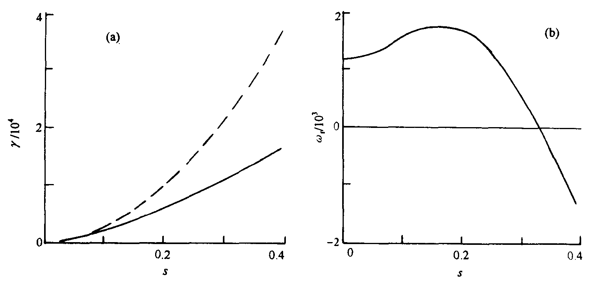

**图5.13** 内扭曲模的实频率 (a) 和增长率 (b) 随剪切量的变化〔46〕 (a)中虚线是微扰展开结果; 实线为严格解。

内扭动模是一种非常重要的磁流体模式，与托卡马克和其它一些载电流等离子体中的物理现象有密切联系，也影响等离子体宏观约束。锯齿活性直接影响$q = 1$磁面内部等离子体的约束，而锯齿现象本身呈现多种非线性行为，我们将在第九章中进一步讨论。

最后指出，我国学者在内扭曲模理论研究方面有突出的贡献，其中一些最新结果可参看文献[45\~50]。

### 5.9 轴对称不稳定性[52\~55]

现代托卡马克装置中等离子体的截面一般都采用非圆形，原因之一是为了设置偏滤器，普遍认为必须用偏滤器来处理杂质和排出废气及大部分热量；第二个原因是从理论上发现，对截面适当的变形有利于提高等离子体参数，特别是比压值，而比压值的大小直接与反应堆的经济品质相关。在实际应用中采用最多的变形是将等离子体沿装置的对称轴即柱坐标中的$z$轴方向拉长，这样做的一个直观好处就是在不扩大装置的大半径的条件下将等离子体的体积加大了，形象地说，将两个圆截面托卡马克等离子体重叠起来就成了拉长截面的等离子体。定义拉长参数

$$
\kappa = b / a \quad (5.236)
$$

其中$b$和$a$分别为等离子体截面的水平方向和垂直方向的半宽度。此外，一般还需三角变形。一个典型的变形截面等离子体如图5.14所示。

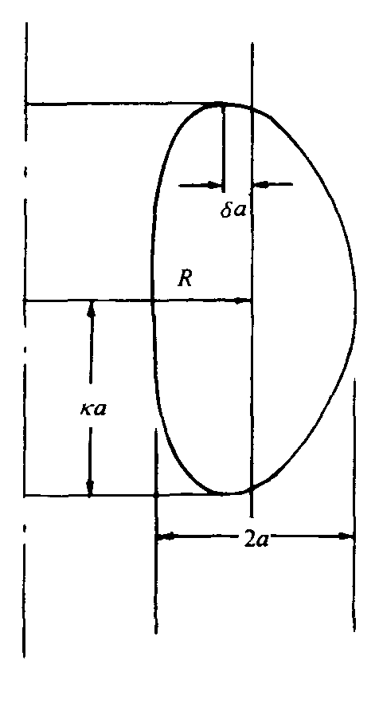

**图5.14** 典型的托卡马克位形的磁面截面形状

5.9.1 近似于圆截面的位形中的轴对称扰动

在位形设计中要考虑拉长截面位形对轴对称扰动的稳定性。所谓轴对称扰动是指环向模数$n = 0$的扰动。理论研究中对导体壳的稳定作用做了计算，采用能量变分原理方法，最危险的扰动是沿$z$轴方向的均匀位移，即

$$
\xi = \xi_{0}\epsilon_{z} \quad (5.237)
$$

对圆截面位形，在直圆柱近似下，利用前面研究扭曲模得到的公式，可以写出位能改变量

$$
\delta W = \frac{\pi}{2} B_{0}^{2}(a)\xi^{2}(a)(m\lambda -1) + \delta W_{\mathrm{p}} \quad (5.238)
$$

$$
\delta W_{\mathrm{p}} = \frac{\pi}{2}\left(\frac{B_{0}}{R}\right)^{2}\int_{0}^{a}\mathrm{d}r r\left[r^{2}\left(\frac{\mathrm{d}\xi}{\mathrm{d}r}\right)^{2} + (m^{2} - 1)\xi^{2}\right]\bigg / q^{2} \quad (5.239)
$$

$$
\lambda = [1 + (a / a_{\mathrm{w}})^{2m}] / [1 - (a / a_{\mathrm{w}})^{2m}] \quad (5.240)
$$

对式(5.237)中的均匀位移$(m = 1,n = 0)$，$\delta W_{\mathrm{p}} = 0$

$$
\delta W = \frac{\pi B_{0}^{2}(a)a^{2}\xi_{0}^{2}}{a_{w}^{2} - a^{2}} \quad (5.241)
$$

式中$a_{\mathrm{w}}$为导体壳的半径。上面对直圆柱等离子体的分析表明，圆截面等离子体在有导体壳时是稳定的。如没有导体壳，则要求垂直磁场具有一定的四极分量，使磁场指数满足(见第四章)

$$
\frac{3}{2} >n = -\frac{R}{B_{\perp}}\frac{\mathrm{d}B_{\perp}}{\mathrm{d}R} >0 \quad (5.242)
$$

真实等离子体的截面即使在外部具有圆环铜壳成形的条件下也不可能是完全圆形的，一般来说，随着内电感和等离子体压强的变化，截面沿$z$轴稍有拉长变形。拉长度

$$
\frac{b}{a} = 1 + \frac{a^{2}}{R^{2}}\left[\frac{3}{4}\ln \frac{8R}{a} -\frac{17}{16} -n\left(\ln \frac{8R}{a} +\beta_{\mathrm{p}} - \frac{5}{4}\right)\right] \quad (5.243)
$$

$n$为上面定义的磁场指数。更严格的计算给出，在没有导体壳稳定时，允许的最大拉长度为

$$
\frac{b}{a} < 1.25 \quad (5.244)
$$

5.9.2 导体壳的稳定作用:椭圆截面位形

对具有同焦点导体壳的椭圆截面等离子体直柱的分析表明，只有在椭圆度不大时导体壳才能稳定轴对称扰动[18]，其结果示于图5.15。如无导体壳，这一计算给出对椭圆度的限制

$$
\kappa = \frac{b}{a} < 1.6m \quad (5.245)
$$

对$m = 1$的模(刚性位移)，得到对拉长度的限制为$\frac{b}{a} < 1.6$。

在实际装置中，围绕等离子体的环向导体也可以起稳定作用，如用于控制等离子体截面形状的成形线圈就能起到导体壳的作用。计算表明[53]，对椭圆拉长度的大小也有一定限制，大体上与式 (5.245) 给出的限制类似。

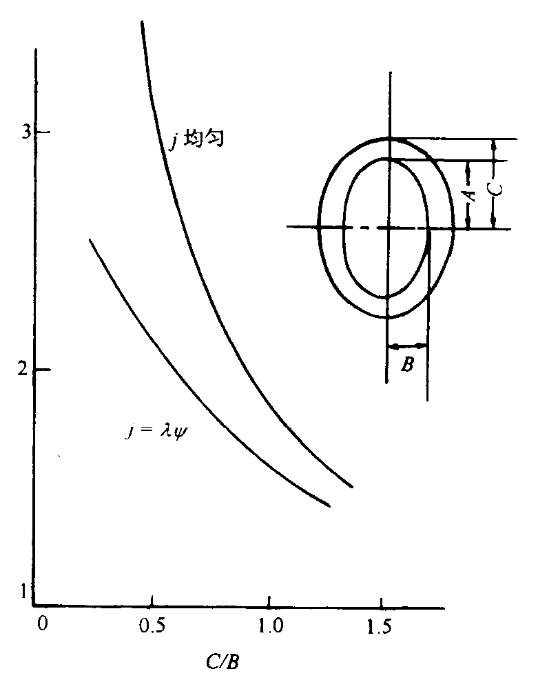

**图5.15** 具有同心导体壳的直椭圆柱关于垂直位移的稳定区〔11〕

#### 5.9.3 位移不稳定性对等离子体约束的影响及控制

实际装置中，即使是圆截面等离子体 (即拉长度没有达到限制值时)，在满足式 (5.242) 的情况下，在等离子体维持时间很长时，也会因杂散磁场的透入或等离子体参数的变化加快，或杂质进入等离子体使等离子体冷却而改变电流分布，都会使平衡条件破坏，出现等离子体整体向真空室壁的运动。这时等离子体的水平或垂直位移迅速加大，等离子体整体碰壁并使环电压较快地消失，放电终止，这是托卡马克实验中最常遇到的现象。在拉长截面的情况下，平衡控制更为困难，大量实验结果统计表明，突然增大的位移是引起等离子体破裂 (软破裂) 的重要原因。

即使目前对等离子体的位移控制技术已发展得相当完善，主动的反馈控制技术能将等离子体放电维持很长的时间，但对拉长截面等离子体的控制仍是一个难题。对于大型装置，破裂不稳定性产生的脉冲感应电场会对装置本体产生重大的破坏。因此 ITER 最初在概念设计时取拉长度为 2 或稍大，并采用靠近等离子体的导体致稳，后来的改进设计则为稳妥起见，将拉长因子改成 1.5 左右。结合现代控制技术，这是一个合理的和可靠的数值 (见第十二章托卡马克反应堆设计研究)。

### 5.10 破裂不稳定性[18,56]

托卡马克放电中经常会发生一种称为破裂不稳定性的突发的非线性不稳定现象，即放电突然在很短的时间内断裂，放电终止。发生破裂的原因主要是磁流体扭曲模 (撕裂模) 的迅速发展，所形成的磁晶结构使靠近边界的等离子体与器壁发生热接触，或由于等离子体平衡失控 (位移不稳定性) 使等离子体柱整体碰壁，造成强烈的等离子体与器壁的相互作用，并引起大量杂质进入等离子体，使等离子体迅速冷却，电流通道被堵塞，最后，等离子体中的热能及其周围导体中所储存的磁能都在很短的时间内 (在 1 ms 左右) 释放出来。对于实验装置，这意味着一次放电过程以不可控方式的结束，对于大型装置和反应堆，这就是一次非常危险的 "事故"，因为不仅大量的热量瞬间沉淀到周围器件上会损坏这些器件，而且由于大电流的瞬间熄灭要感应起很大的沿环向的电场，会使周围导体材料及其绝缘结构损坏。已经有过因破裂放电而使大型装置真空室损坏和打坏线圈绝缘的事例。对磁约束聚变堆来说，破裂放电基本上是不允许的 (其出现几率应小于$1 / 10^{4} \sim 2 / 10^{4}$)，应设法控制，或者至少要让破裂过程 "软化"，使其不对周围组件造成损害。但在当前的实验装置中，发生破裂放电的几率非常高，平均达到总的托卡马克放电次数的 1/3 左右，当然其中大部分是破坏性较小的软破裂，如由于电流上升太快或其它放电参数变化太快使等离子体柱的平衡位置失控引起的破裂。除这些与放电操作过程有关的，以后可以大幅度改进的因素外，有几种与内在物理机制有关的因素，这就是电流超过稳定性极限及粒子密度升高后辐射功率加大引起等离子体边缘区冷却，在后面的边缘等离子体一章中将要对这种机制特别进行讨论。

### 5.10.1 破裂不稳定性的类别及主要特征

根据发生破裂不稳定性的起因及主要后果上的差别，通常把破裂不稳定性分成以下几种类型:

1)电流极限破裂，即总电流超过磁流体稳定性极限时产生的破裂，大都出现在低q大电流放电情况下，有关参数已进入磁流体扭曲模的不稳定参数区，或者虽然等离子体总体运行在稳定参数区，但离不稳定参数区的边界不远，于是实验条件稍有变动，例如中性气流突然的加大，或杂质流的突然增加使边缘很快冷却，导致实际电流通道的收缩，边缘等效安全因子降低而进入不稳定区。

(2)密度极限破裂，在一定的总加热功率下，粒子密度加大时总辐射功率以正比于密度的平方的方式加大，因而在一定的极限密度下，总辐射功率可以接近总加热功率，使边缘区冷却，电流通道收缩，以后的过程类似于电流极限破裂。

(3)平衡位置控制失效，这种情况在实际实验中非常普遍，如充气过快或加热太快引起密度温度的快变化，平衡条件变化了而控制位移的响应跟不上，引起等离子体向器壁靠近，加大了与器壁的相互作用。

(4)因电流上升过快引起的破裂，这类破裂一般是极向模数较高的模引起的，影响较小空间范围。

(5)比压极限破裂，这是在高功率加热条件下出现的一类新现象，即使边界安全因子远离磁流体不稳定性边界，也会因等离子体比压大于某种临界值而引发破裂。

破裂过程大体上可以区分成四个不同的阶段，下面的讨论中，其时间尺度均以JET装置上的特征时间为标准进行比较:

(1)预先兆阶段(1s)，等离子体可能因辐射功率加大而有脱栏现象，使等离子体的小半径有所收缩，或因磁流体不稳定原因有所收缩。

(2)先兆阶段(100ms)，此时由热收缩发展为电流通道的收缩，电流密度的梯度加大，撕裂模的磁岛开始发展。

(3)快破裂(热量消亡)阶段(1ms)，原因可以是$m = 2$的大磁岛与$m = 1$的磁岛相耦合并与边界孔径等物质相连接，引起大范围的热损失；或由于许多撕裂模发展成滞性磁场位形结构，使热量很快损失。

(4)电流消亡阶段(10ms)，等离子体因冷却而加大了电阻，使放电很快终止。

总之，破裂不稳定性是一类复杂的非线性过程，磁流体不稳定性或位移失控是起因，而等离子体柱与器壁的强烈相互作用是重要的后继因素，最终使大部分等离子体的热量和磁能迅速损失是后果。有一些破裂过程没有使全部的等离子体能量损失，等离子体放电在后来又重新恢复过来，这类破裂称软破裂，或小破裂。从原因上分析，这类破裂往往是内部的大锯齿活性引发的，或是与较小区域的磁岛结构有关，在一部分等离子体能量被引出约束区外后，剩余的等离子体在环电压的作用下，又开始恢复平衡态。

破裂不稳定性的共同特征是环向电流的突然熄灭，此外，还有其它一些普遍存在的特征。最明显的特征是环电压示波信号上出现负尖峰，此时总的电流没有什么变化，说明这是等离子体中某些区域中电流突然改变了分布。产生这种改变的条件之一就是磁岛区的磁再联过程:其次，破裂过程中X射线强度有较大的突然下降，这与磁再联过程中等离子体能量(密度与温度)的再分布相关。对比于$q = 1$面内部的锯齿活性，破裂不稳定性

的主要实验特征量如表5.1所示。

表5.1不同类型破裂及锯齿活性中的一些实验信号或参数的比较

| 类别 | 锯齿活性 | 小破裂 | 大破裂 |
|---|---|---|---|
| 环压信号 | 无变化 | 小负尖峰 | 大负尖峰 |
| $\Delta V$ | — | -1～-10 V | -10～-500 V |
| 软X射线强度 | $\approx 10\%$ | $\approx 20\%\sim 80\%$ | 下降几倍 |
| $\Delta T_c$ | $\approx 10\%$ | $\approx 20\%\sim 50\%$ | $\approx 90\%$ |
| $\Delta n_e$ | $<5\%$ | $\approx 10\%$ | $\approx 30\%$ |
| $B_c/B_o$ | — | $<4\%$ | $20\%$ |
| $m$变化顺序 | 1,0 | (3),2,1,0 | (3),2,1,0,3,4 |

## 5.10.2 破裂不稳定性的机制

很多装置中对破裂不稳定性发生和发展过程进行了仔细的观察，虽然破裂过程中的非线性发展可能有多种机制起作用，但引起破裂的原因都是磁流体扭曲模的发展，主要是撕裂模，它使有理磁面附近发展起磁岛结构。由于撕裂模不稳定性条件依赖于电流剖面的细致结构，而电流剖面在放电过程中是不断变化的，与等离子体中的粒子和能量输运过程密切相关，因此不同的装置之间，甚至是同一装置的不同实验阶段之间关于撕裂模是否稳定，或不稳定模以何种速率发展，都有不同的结果。此外，实验和理论研究都发现，破裂不稳定性发生与否不仅取决于当时的物理条件，而且与等离子体以前的历史有关。例如由于电流的快速上升引起空间某些区域中撕裂模的发展，但这些模当时没有使等离子体的约束产生很大的影响，然而在后来适当的条件下，其中有的模会进一步发展成为影响约束的全局性因素。这就是破裂不稳定性会在明明是处在稳定参数运行区的等离子体中突然发展起来的原因，这种潜伏的机制也是破裂不稳定性的发生带有随机特征的原因所在。

破裂不稳定性有几种可能的发展:一种是边界安全因子略人于2，因而$m = 2$，$n = 1$的磁岛非常靠近边界，当此磁岛足够大时，会使边界附近的温度分布变平，或者这一磁岛会与孔柱接触，这些都会引起大量的热量损失及大量中性气体和杂质流的进入，最终使放电被完全破坏；另一种情况是磁岛发生在较内层区域，但可能存在几组磁岛，典型的是(2,1),(3,1)的一组或(2,1),(3,2)的一组，当这些磁岛发展到一定大小，可能会发生重合，在较大区域内影响能量平衡和输运，这也会最终引发大破裂；在密度极限破裂的情况下，人多是与边界附近有理磁面对应的磁岛起作用。密度极限破裂一般比电流极限破裂要软一些；还有可能由较大的锯齿活性引起破裂，这主要发生在强功率加热条件下，锯齿活性已演化成小破裂，即其影响区域已超出$q = 1$面以内，大量的热能外流引起外部区域温度的重新分布，并常常使相应的有理磁面附近的撕裂模不稳定性加剧。在观察到大破裂前常常有几次较小的破裂，电压信号有几次较小的负尖峰，对应于这种演变过程。

破裂过程中使等离子体失去能量的直接原因是等离子体柱整体与孔柱甚至真空室本身的强烈相互作用。位移失控或位移不稳定性引起的破裂更直接与这一机制相关。大量的中性气流和杂质流的进入会使等离子体完全冷却和被污染，最终使放电熄灭。在这种非线性相互作用中，会伴随有等离子体柱的先膨胀后收缩的过程。

5.10.3 破裂不稳定性的防止与控制

对破裂不稳定性主要是被动防止法，即让等离子体运行在离磁流体不稳定性边界较远的参数区中。这主要是适当减小总放电电流，使边缘安全因子大于2.5或超过3，这样$m = 2$的磁岛就不易发展起来；其次是调整电流剖面，使模数较小的撕裂模不易发生。另外也研究了用外加螺旋磁场或用可调节沉积剖面的加热方法(如ECRH加热)来控制电流剖面，得到较稳定的运行区(实验上可以通过观察米尔诺夫信号来判断磁岛大小及存在区域)。

在主动防止方面，主要是利用一些先兆现象，如小破裂，MARFE(一种非线性边缘辐射现象，见第七章介绍)等，预先减小总电流或调节电流剖面。

### 5.11 气球模不稳定性和比压极限[58\~61]

磁约束聚变装置中的等离子体的稳定性除与等离子体中的电流有关外，还与等离子体的压强梯度有关，这两种因素构成了与等离子体约束性质密切相关的两类主要的宏观不稳定性模式。实际上，前面讨论的与电流有关的不稳定性模式(扭曲模、内扭曲模、位移模)主要与平行于磁力线的电流有关，其主要特性在圆柱近似下就清楚地表现出来(但内扭曲模与环形特性有关)，可以用圆柱近似来描述约束位形，因而在理论研究方面比较简单。对压强梯度驱动的模式，则与垂直于磁力线的电流，即磁化电流有关，其驱动机理与位形结构的细节有关，必须采用较严格的位形描述。一般，对托卡马克这种轴对称环形位形，严格的描述虽不算很困难，但进行稳定性分析时会非常复杂，通常要用数值方法进行最后的计算。最简单的能够反映位形特性的位形是位移圆环族，即等离子体的磁面形状仍为圆环，但不同的磁面间存在由压强梯度引起的位移，这些圆环互不相交，构成套环体系。下面将以这种简化的位形为基础进行分析。

在5.4.4节的例子中，对于等离子体约束区域不存在磁场的位形，已得出一个稳定性的必要条件，这就是磁力线必须处处凸向等离子体，或磁力线的曲率中心处在等离子体约束区外部。对托卡马克，详细分析式(5.117)中定义的磁力线的曲率矢量可知，不同的区域中曲率的大小和符号是不同的。相对于环的对称轴，在磁轴内侧即靠近对称轴的部分，磁力线的曲率取正值，曲率中心在等离子体外，对稳定性来说是好曲率区；反之，在环的外侧，曲率是负的，是坏曲率区。所谓的气球模，就是那种主要在坏曲率区发展起来的局域模式，因类似于厚度不均匀的气球，在膜较薄的地方会鼓起一个大包而得名。

下面对圆截面托卡马克位形的曲率矢量的特性进行讨论。设磁面位形为相邻磁面间具有位移的圆环族，磁面上任一点可由下面的坐标表示

$$
R = R_{0} + \Delta (r) + r\cos \theta \quad (5.246)
$$

$$
Z = r\sin \theta \quad (5.246)
$$

磁轴位置由$r = 0$确定，$\theta > 0$的区域代表环的外侧，$\theta < 0$为环的内侧。从曲率矢量的定义表示式(5.114)式出发，代入

$$
p = p(r) \quad (5.247)
$$

$$
B = B_{0}R_{0} / (R_{0} + \Delta +r\cos \theta) \quad (5.247)
$$

根据曲率矢量的定义(5.114)，通过直接求导，展开到小量$(\Delta ,r / R_{0})$的第一级，可得

$$
\kappa = \frac{1}{2}\left\{e_{r}\left[\beta^{\prime}(r) - 2(\Delta^{\prime} + \cos \theta) / R\right] - e_{\theta}\frac{2\sin\theta}{R_{0}}\right\} \quad (5.248)
$$

式中$\beta = 8\pi p / B_{0}^{2}$是等离子体的比压值，压强梯度通常是负的，位移函数的导数也是负的，因此在环的外侧，法向曲率取负值，是坏曲率；只有在内侧，对较小的比压值 (例如$\beta \approx (a / R)^{2}$量级)，曲率才能成为好曲率；至于沿极向的分量，按式 (5.117) 中定义，称测地曲率，在赤道面的上下方有不同的符号。

对于一种具体的模式，托卡马克磁场的效应是起稳定还是去稳定，要由模式的空间结构特性及平衡位形对模式的总体作用来确定。最简单的分析工具是能量变分原理。为了讨论气球模，需将能量变分表示式 (5.102) 改写成可以直接讨论曲率效应的形式

$$
\begin{aligned}
\delta W_{\mathrm{p}} = \frac{1}{2}\int \mathrm{d}\tau \Big\{&\left|Q_{\perp}\right|^{2} - \frac{j_{b}}{B}\left(\xi_{\perp}\times B\right)\cdot Q_{\perp} - 2(\xi_{\perp}\cdot \nabla p)(\xi_{\perp}\cdot \kappa) + \\
& B^{2}(\nabla \cdot \xi_{\perp} + 2\xi_{\perp}\cdot \kappa)^{2} + \eta \rho (\nabla \cdot \xi)^{2}\Big\} \quad (5.249)
\end{aligned}
$$

这一表示方式最初由弗思给出[4]，式中各项具有较清楚的物理含义:第一项是正定的，代表磁力线弯曲引起的稳定作用；第二项是电流驱动作用项，是引起扭曲模不稳定性的主要因素；第三项是压强驱动效应项，是产生气球模和交换模的主要因素；第四项与磁场受压缩时磁能变化有关，也与磁力线的曲率有关；最后，第五项也是正定的，是等离子体受压缩时产生的稳定作用。遵照能量极小化步骤，第一步可以考虑不可压缩模

$$
\nabla \cdot \xi = 0 \quad (5.250)
$$

并将垂直位移函数用一个标量函数来表示

$$
\xi_{\perp} = \frac{\mathrm{i}}{n B_{0}^{2}} B_{0}\times \nabla \Phi \quad (5.251)
$$

标函数$\Phi$的变化具有这样一种特征:沿磁力线的变化非常缓慢，而垂直于磁力线的变化非常快。在 WKB 近似意义上，这种具有双重变化坐标的函数可以写成下面的形式:

$$
\Phi (r,\theta ,\zeta) = \Phi_{0}(r,\theta)\exp [-i n S(r,\zeta -m\theta /n)] \quad (5.252)
$$

式中$\Phi_{0}$为慢变化部分，指数函数为快变化部分，$S(r,\zeta - m\theta /n)$称为程函。作为初步估计，可以仅考虑能量变分表示式 (5.249) 前两项间的竞争。首先，与压强梯度驱动及磁力线曲率效应有关的被积函数部分的大小为

$$
(\xi_{\perp}\cdot \nabla p)(\xi_{\perp}\cdot \kappa)\approx p\xi^{2} / R_{0} \quad (5.253)
$$

而磁力线弯曲引起的稳定项的大小为

$$
Q_{\perp}{}^{2}\approx B^{2}\xi^{2} / q^{2}R_{0}^{2} \quad (5.254)
$$

要求压强驱动效应小于磁力线弯曲的稳定效应相当于对等离子体比压值的一个限制

$$
\beta \leqslant \beta_{\mathrm{e}}\approx \frac{a}{q^{2}R_{0}} \quad (5.255)
$$

以上的初步估计指出，托卡马克约束系统是一个低比压稳定约束系统，典型的稳定比压值在百分之几。不过，实际位形的约束品质可能会更高，因为严格的气球模分析指出，改变截面形状和改变电流剖面分布都可能导致稳定比压值的提高，因为能量变分表示式中的其它项将在一定条件下起重要作用。另外，当考虑存在于等离子体中的高能离子成分的效应时，也发现可以提高稳定的比压值。本书仅对最基本的物理进行必要的介绍。

在位移圆环磁面条件下的气球模本征方程的一般形式如下[59]

在推导气球模本征方程时，应用了所谓的气球模表象描述[58]，这是一类特殊的数学变换，是通常的富氏变换或拉氏变换的一种推广，主要用于处理这样一类特殊问题:物理量沿平行于磁力线方向的变化很慢，而沿垂直于磁力线的方向变化很快，当磁力线存在剪切，普通坐标系中的描述就出现困难。为解决这一困难，发现只要将原先的径向坐标理解成新坐标系中的"广义极向"坐标，原方程的形式将不变，但这一新极向坐标定义在无限区间中，即

$$
-\infty \leqslant \theta \leqslant \infty \quad (5.257)
$$

这一近似使二维问题化为一维问题。在上面方程中，$\boldsymbol{\Pi}_{I}$为本征值，取正值代表不稳定性，其它各量的定义是

$$
\alpha_{p} = 1 + \Delta^{\prime}\cos \theta
$$

$$
\Sigma = \frac{1}{\alpha_{p}^{2}} (s\theta +s_{1}\sin \theta +\dots) \quad (5.258)
$$

$$
G = \frac{8\pi R_{0}q^{2}p^{\prime}}{B_{0}^{2}}
$$

$s$为磁剪切，函数$\boldsymbol{W}$中主要部分为

$$
W = \alpha_{p}^{2}(\cos \theta +\Sigma \sin \theta) \quad (5.259)
$$

在上面各式中，含$\alpha_{p}$的量代表因磁面位移产生的贡献，其总体效应是减小压强驱动作用而增大剪切稳定作用，由于磁面位移是与压强梯度成正比的，因此当压强梯度非常大时，总体效应可能是稳定的，这就是出现第二稳定区的物理机理。通过变分分析可以较清楚地说明这一问题，将本征方程(5.256)写成变分形式

$$
\Gamma^{2} = (J_{c} - J_{\Lambda}) / J_{1} \quad (5.260)
$$

其中各积分量为

$$
J_{c} = \int \limits_{-\infty}^{\infty}\mathrm{d}\theta G W|\phi |^{2} \quad (5.261)
$$

$$
J_{\Lambda} = \int \limits_{-\infty}^{\infty}\mathrm{d}\theta (1 + \Sigma^{2})\left|\frac{\mathrm{d}\phi}{\mathrm{d}\theta}\right|^{2} \quad (5.262)
$$

$$
J_{1} = \int \limits_{-\infty}^{\infty}\mathrm{d}\theta \alpha_{p}^{2}(1 + \Sigma^{2})|\phi |^{2} \quad (5.263)
$$

可以看到，压强梯度$(J_{c}$项)是不稳定性的驱动力，而剪切和磁面位移在这里起稳定作用$(J_{\Lambda}$项)。在$(s,G)$参数平面上，严格求解得出的稳定性图如图5.16所示。一个重要特征是:依赖于磁剪切的大小，当压强梯度参数$G$大于临界值后，气球模变为不稳定，但在更大的压强梯度区，由于磁面位移

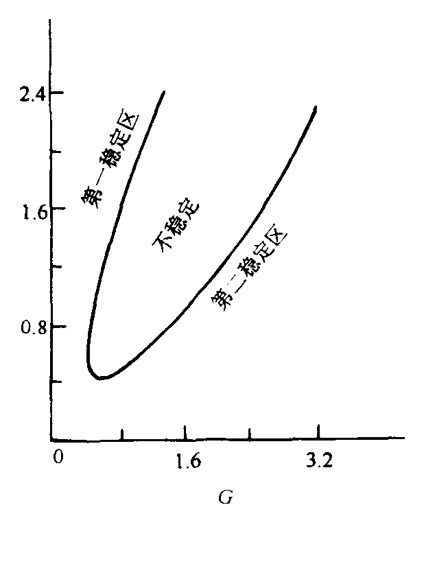

**图5.16** 典型的托卡马克气球模稳定参数区

的稳定效应，模将重新被稳定化。这一区域称为气球模的第二稳定区。显然，从约束高参数等离子体的角度，这个第二稳定区非常吸引人，成为后来理论和实验研究的一个热点。

先不谈第二稳定区问题，因为等离子体总是逐步提高比压值的，首先要考虑的是气球模的第一不稳定条件。如果气球模不稳定性的发展会导致等离子体总体约束的严重变坏，则这一条件应给出对可达到的等离子体比压值的一个限制。不过，到目前为止关于比压极限的直接实验观察还很不充分。另外，上面的讨论其实仅限于非常局域的气球模式，理论上称为高环向模数气球模$(n > 10)$。但实际上低环向模$(n< 5)$可能对约束的影响更大，这类低环向模数模具有二维广域结构，主要在环曲率区域发展，有的文献称其为环区模 (infermal mode)，只能采用复杂的数值方法进行分析。现已发展了相应的数值计算编码，可以对多种位形进行数值研究，得到的一个重要结果是等离子体存在某种比压极限，称为脱罗阳极限 (Troyan limit)[59]。用标准的形式写出，这一极限表明托卡马克装置和反应堆的极限比压值为

$$
\beta_{e} = g\frac{I_{p}}{a B} \quad (5.264)
$$

式中磁场$B$以特斯拉(T)计，等离子体总环向电流$I_{p}$以MA计，等离子体小半径$a$以$\mathbf{m}$计，比压值$\beta_{e}$用$\%$表示。一般托卡马克系统的临界稳定比压对应于$g\leq 3$。但如对截面形状进行优化，允许的稳定比压值可以提高。理论分析指出，在环的内侧向内凹的截面，如蚕豆形截面许(bean shape)可以允许很大的稳定比压。为了研究这种截面等离子体的性质，PPPL的PDX装置改成具有蚕豆形截面的PBX装置来进行实验。不过，实现高的等离子体比压并不只依赖于截面形状，还必须与有效的加热和好的输运品质相结合。真正做到最高稳定比压的装置是DIII- D，实现了超过$12\%$的平均稳定比压，而中心稳定比压达到了$30\%$以上。在ITER的设计中，$I_{p} = 24$，$a = 2.8$，$B = 6$，因此当取$g = 3.5$时，临界比压仅为$5\%$左右，为了达到更高的比压值，要对位形进一步优化。

上面的气球模分析是在固定等离子体边界的条件下进行的，即假定等离子体位移函数在边界上为零。还可能存在高比压条件下的自由边界模，即高比压扭曲模，得到的对等离子体比压的限制要更严格，即$g$值会更小。近年的大装置实验获得了关于高比压扭曲模影响约束的很多证据。改善磁流体稳定性，仍是今后理论和实验研究的一个重要方面。

近年的很多实验发现，具有负剪切的位置可能更稳定，同时反常输运将大幅度降低。理论研究曾指出负剪切在稳定很多模式上的正面作用。这里引述我们曾指出的一个重要结果：具有负剪切的托卡马克位形可以稳定的比压值比正剪切位形高数倍[62\~65]。

在图5.16中反映的临界比压参数$G$与磁剪切值$s$的关系中，若将其推广到负剪切参数区，发现可以稳定的比压值将加大。具体讨论如下：从变分表示式 (5.260) 出发，取试验函数为

$$
\Phi (\theta) = \exp (-\alpha \theta^{2}) \quad (5.265)
$$

因为讨论的是第一稳定区，取

$$
\alpha_{p}\approx 1
$$

$$
G = -R_{0}q^{2}\beta^{\prime}(r) \quad (5.266)
$$

对变分式求极小可以得出函数$G$与变分参数$\alpha$间的一一对应关系

$$
G(\alpha ,s) = (4\alpha^{2} + 3\alpha s)\exp (1 / 8\alpha) / (4\alpha +s) \quad (5.267)
$$

代入极值条件

$$
\partial G / \partial \alpha = 0 \quad (5.268)
$$

由上述步骤得出的最佳函数$G$及$\alpha$值与剪切$s$的关系如图5.17所示。

一个重要的情况是，在负剪切参数区，可稳定的压强梯度加大。设

$$
q(r) = q_{0}[1 + \gamma (r / a)^{l}] \quad (5.269)
$$

进一步计算$q$-剖面如图5.18所示的几种情形，得出对应的临界稳定比压剖面如图5.19所示。我们发现，负剪切位形的最大比压可比正剪切位形大数倍。

在当时，我们还难以确定如何去建立负剪切位形。但在90年代的大型托卡马克实验中已发现，自举电流可以使中心约束区的剪切变负；另外，采用非感应电流驱动也可控制剪切值。总之，负剪切位形的稳定作用受到理论和实验研究的很大关注。

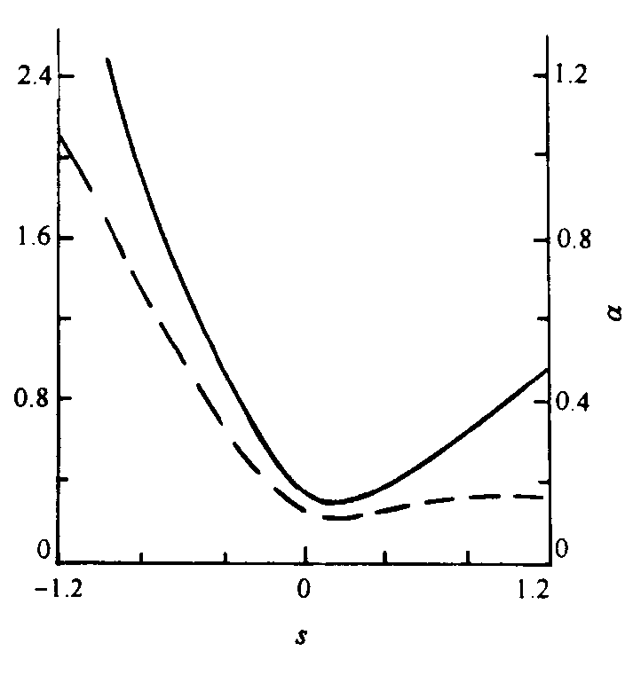

**图5.17** 临界稳定性条件下气球模参数$G$（实线）和$\alpha$（虚线）与磁剪切量$s$的关系〔63〕

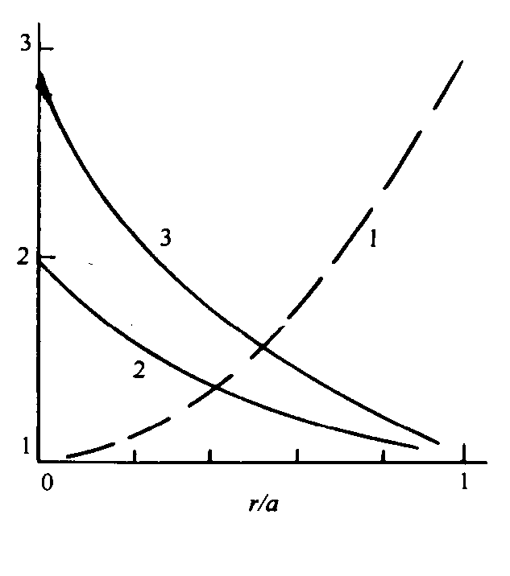

**图5.18** 用于比较正负剪切效应的$q$-剖面图〔63〕

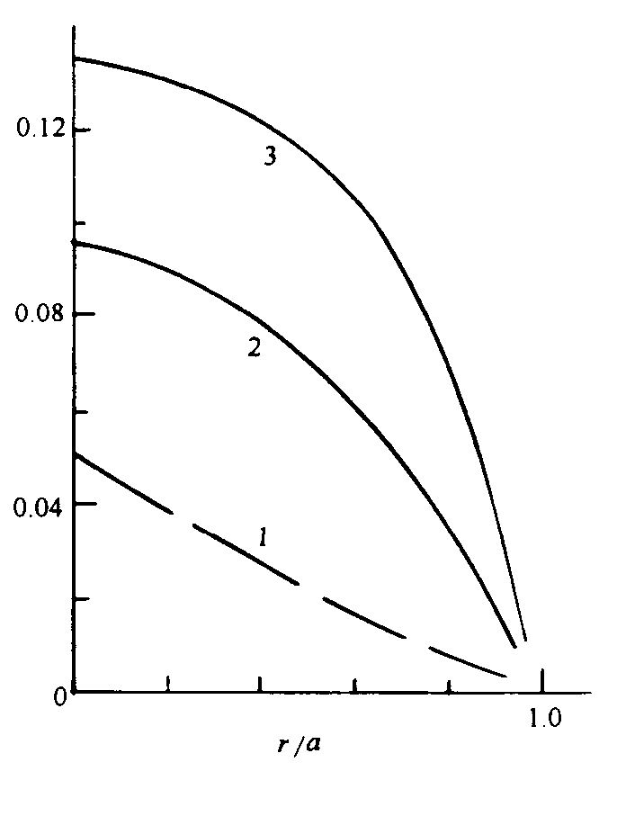

**图5.19** 稳定比压剖面与正负剪切的关系〔63〕

1. $q_{0} = 1, r = 2, l = 2$，2. $q_{0} = 2, r = -0.5, l = 0.5$，3. $q_{0} = 3, r = -2/3, l = 0.5$。

随着实验研究的进展，现代托卡马克装置中已能达到临界比压值，而且一些实验中获得了创纪录的稳定的高比压值，表明已进入第二稳定区。但是，仍然存在需要进一步解决的问题，这就是如何在长脉冲条件下使高比压等离子体被稳定地约束。因为在长脉冲放电条件下，即使理想气球模已被稳定化，电阻性气球模仍可能不稳定，这种不稳定性以较慢的方式影响等离子体的约束。这方面的理论要牵涉很深的等离子体理论知识，介绍有关理论研究已超出本书范围，但在第九章将介绍一些近期的有关研究成果。

## 参考文献

1. Spitzer L Jr. Physics of Fully Ionized Gases. New York: Interscience Publishers, INC., 1956
2. 宫本健郎著. 金尚宪译. 热核聚变等离子体物理学. 第九章. 北京: 科学出版社, 1981
3. 朱士尧. 核聚变原理. 合肥: 中国科技大学出版社, 1992
4. Grad H, Rubin H. Hydromagnetic equilibria and force- free field, in Proc UN Int Conf. Peaseful Uses At Energy, Geveva, 1958, 31 190
5. Shafranov V D. Plasma equilibria in a magnetic field, in Review of Plasma Physics. Vol. 2, Consultant Bureau, New York, 19
6. Suzuki Y. Nucl. Fusion, 1974, 14: 354
7. Mukhavot V S, Shafranov B D. Tokamak plasma equilibrium. Nucl. Fusion, 1971, 11: 605
8. 石秉仁, 李芳著, 宫野. 轴对称自由边界平衡问题的积分解法. 核聚变与等离子体物理, 1982, 2(3): 190
9. 石秉仁. 非均匀分布电流环流器平衡问题的近似解法. 科学通报, 1981, 26(3): 144
10. Greene J M, Johnson J L, Weimer K E. Physics Fluids, 1971, 14: 671
11. 石秉仁. 托卡马克等离子体平衡位形随时间的演变. 核工业西南物理研究院, 1980, 7
12. Hogan J L. In Method Comput. Phys. V.16 (ed. J. Killeen) New York: Academic Press, 1976. 211
13. 李有宜, 牟宗泽, 吴灵桥. 托卡马克位形与输运的自治计算. 核聚变与等离子体物理, 1982, 2(4): 193
14. 石秉仁. 快加热环流器的位形演变. 物理学报, 1981, 30(9): 1196
15. Peng Y- K M, Dory R A. Flux conserving tokamaks. Nucl. Fusion, 1977, 17: 21
16. Manheimer W M, Lashmore- Davies C N. MHD and Microinstabilities in Confined Plasma, Adam Hilger, Bristol and New York. IOC Publishing Ltd. 1989
17. Kadomtsev B B. Hydromagnetic stability of a plasma, in Review Plasma physics (ed. Leontovich M A), Consultant Bureau, Vol. 2, 1966
18. Wesson J A. Hydromagnetic stability of tokamaks. Nucl. Fusion, 1978, 18: 87
19. Bernstein I B, Frieman E A, Kruskal M D, Kulsrud R M. An energy principle for hydromagnetic stability problem. Proc. Roy Soc. 1958, A244: 17
20. Hazeltine R D. Meiss J D, Plasma confinement, Addison- Wesley Publishing Co. 1992
21. 石秉仁. 可压缩理想等离子体柱的稳定性. 物理学报, 1964, 20: 785
22. Shafranov V D. Hydromagnetic stability of a current- carrying pinch in a strong longitudinal magnetic field. Soviet Phys. Tech Phys., 1970, 15: 175
23. Mimov S V, Semenov I B. Investigation of instabilities of plasma column in T- 3 tokamak by correlation techniques. At Energy. USSR30 (1971), 20
24. Furth H P, Killeen J K, Rosenbluth M N. Finite resistive instabilities of a sheet pinch. Phys. Fluids, 1963, 6: 459
25. Rosenbluth M N, Rutherford P H. Stability of tokamak plasma, in Fusion Vol. 1, Magnetic confinement, Pt A. ed. E Teller. Academic Press, 1981. 中译本, 身骨兵等译. 北京: 原子能出版社, 1987
26. Furth H P, Rutherford P H, Rosenbluth M N. Tearing modes in the cylindrical tokamaks. Phys. Fluids, 1973, 16: 1054
27. Glasser A H, Furth H P, Rutherford P H. Stabilization of resistive kink modes in the tokamak. Phys. Rev. Lett. 1977, 38: 234
28. 李芳著, 徐文斌, 石秉仁. 环流器等离子体撕裂模型定电流剖面. 核聚变与等离子体物理, 1991, 11(4): 201
29. 马腾才, 宫野. 电流分布对破裂不稳定性的影响. 核聚变, 1981, 2(1): 1
30. 高庆弟, 于亭焱. 导体壳对电阻磁流体不稳定性的影响. 核聚变与等离子体物理, 1990, 10(3): 129
31. 郑永真, 石秉仁, 徐光碧等. HL- 1 装置的低$q$放电实验. 核聚变与等离子体物理, 1990, 10(2): 67
32. 严龙文, 石秉仁. 托卡马克等离子体中$q = 2$磁面附近的磁流体驰豫振荡. 核聚变与等离子体物理, 1990, 10(2): 112
33. Coppi B, Greene J M, Johnson J L. Resistive instabilities in a diffuse linear pinch. Nucl. Fusion, 1966, 6: 101
34. White R B. Theory of tokamak plasmas, Elsevier Science Publishers B V., 1989
35. Li D, Huo Y P. Nonlinear coupling of disparate helical tearing mode. Phys. Plasmas, 1994, 1: 315
36. Li D. A new algebric growth of nonlinear tearing mode. Phys. Plasmas, 1995, 2: 315
37. Li D, Wang C. Influence of poloidal rotation on the toroidally coupled tearing modes. Phys. Plasmas, 1995, 2: 1026
38. Li D. Instability criterion of tearing mode for arbitrary magnetic shear configurations. Phys. Plasmas, 1998, 5: 1231
39. Qu W X, Callen J D. Nonlinear growth of a single neoclassical MHD tearing mode in tokamak. Univ. Wisconsin Plasma Rep. 85- 5(1985)
40. Bussac M N, Pellat R, Edery D, Soule J. Internal ki nk modes in toroidal plasma with circular cross- section. Phys. Rev Lett., 1975, 35: 1638
41. Coppi B, Galvao R, Pellat R, et al. Resistive internal kink modes. Soviet Phys. Plasma Phys., 1977, 2: 533
42. Ara G, Basu B, Coppi B, et al. Magnetic reconnection and $m = 1$ oscillation in current carrying plasmas. Ann. Phys., 1978. (NY)112(2): 443
43. Migliuolo S. Theory of ideal and resistive $m = 1$ modes in tokamaks, Nucl. Fusion, 1993, 33(11): 1721
44. 石秉仁. 托卡马克内扭曲模色散关系中的磁剪切量. 核聚变与等离子体物理, 1995, 15(1): 7
45. 石秉仁. 氘氚燃烧托卡马克等离子体扭曲模稳定化分析. 核聚变与等离子体物理, 1992, 12(4): 193
46. 石秉仁, 隋国芳, 郭干城. 离子动力参数区托卡马克内扭曲模稳定性分析. 物理学报, 1996, 45(5): 801
47. SHI Bingren, SUI Guofang. Ion viscosity stabilization of tokakak resistive internal kink modes. Commun. Theor. Phys., 1998, 29(3): 453
48. 缪敏, 曲文孝. 反常电子粘滞性与锯齿崩塌. 核聚变与等离子体物理, 1998, 18(1): 1
49. 曲文孝, Callen J D. 反常输运与非线性自持磁岛的自洽分析. 核聚变与等离子体物理, 1997, 17(4): 1
50. 曲文孝, 缪敏. 非理想效应与$m = 1$内扭曲模本证方程. 核聚变与等离子体物理, 1998, 18(3): 1
51. Geoler S von, Stotick W, Sauthoff N. Studies of internal disruptions and $m = 1$ oscilations in tokamak discharges with soft- X ray techniques, Phys. Rev. Lett., 1974, 33: 1201
52. Rebhan E, Salat A. Nucl. Fusion, 1976, 16: 805
53. 石秉仁. 成形线圈系统对非圆截面等离子体竖直扰动的反馈镇定. 核聚变与等离子体物理, 1982, 2(2): 65
54. 李芳著等. 托卡马克垂直不稳定性控制. 核聚变与等离子体物理, 1995, 15(3): 6
55. 毛国平, 王中天. 小环径比托卡马克系统中的竖直位移不稳定性. 核聚变与等离子体物理, 1998, 18(3): 23
56. Stott P E. Density limit and disruptions in plasmas. Nucl. Fusion, 1988, 28(8): 1469
57. Hopcraft K I, Sykes A, Turner M F. Comparision of tokamak disruption simulations. Nucl. Fusion, 1988, 28(8): 1469
58. Connor J W, Hastie R J, Taylor J B. Shear, periodicity, and plasma ballooning modes. Phys. Rev. Lett., 1978, 40: 396
59. Troyan F, et al. MHD limits to plasma confinement. Plasma Phys. Contr. Fusion, 1984, 26: 209
60. 石秉仁. 环流器等离子体高$n$气球模的第二稳定区. 物理学报, 1983, 32(11): 1398
61. 石秉仁, 隋国芳. 含第二稳定区的环流器气球模分析. 物理学报, 1984, 33: 1546
62. 石秉仁, 隋国芳. 离子有限拉摩半径效应对环流器气球模的影响. 核聚变与等离子体物理, 1984, 4(2): 65
63. 石秉仁. 环流器等离子体压强分布关于理想磁流体气球模的最佳化. 核聚变与等离子体物理, 1985, 5(3): 179
64. 王晓刚, 石秉仁. 非圆截面环流器等离子体对于高$n$理想磁流体气球模的最佳压强分布. 核聚变与等离子体物理, 1986, 6(2): 9
65. 石秉仁. 高比压环流器等离子体位形的稳定性. 物理学报, 1982, 31(10): 1308

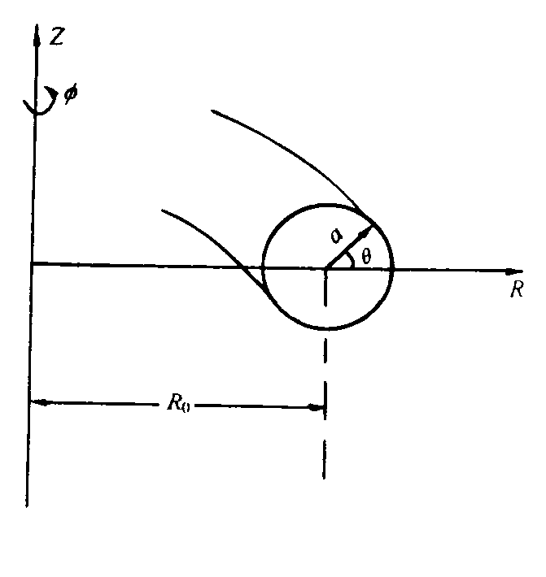
