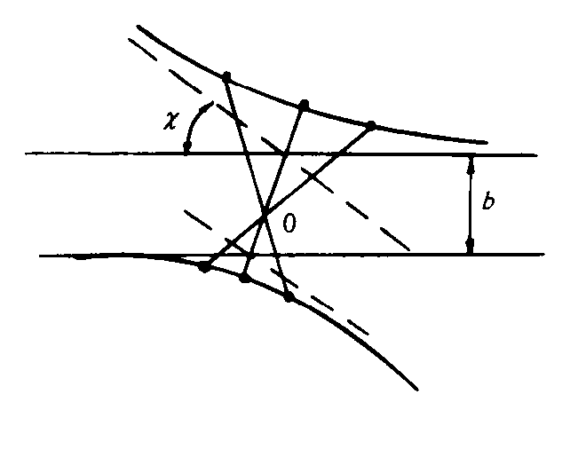
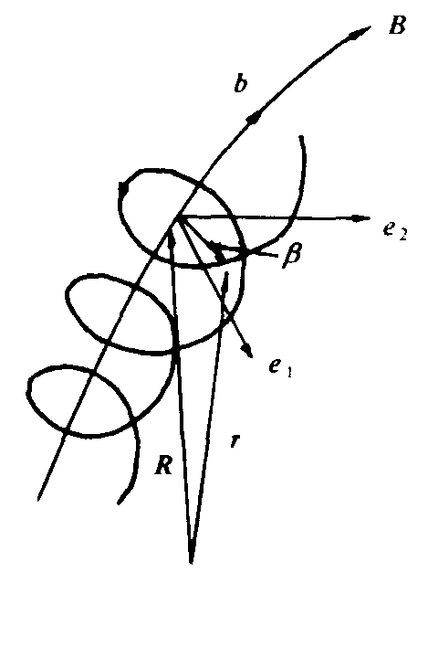
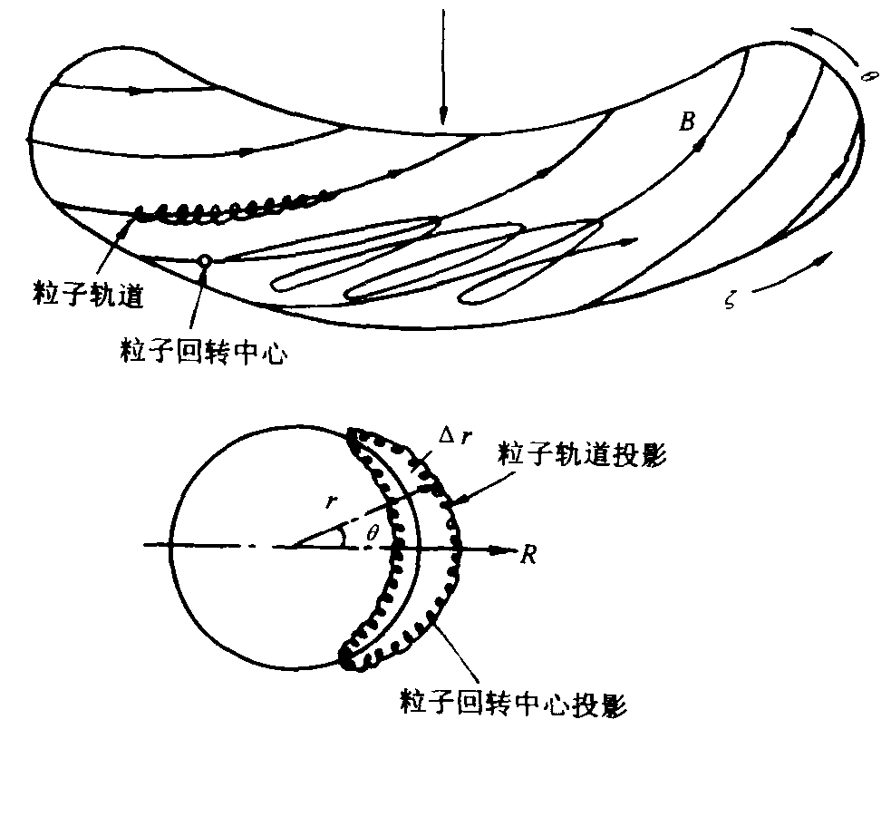
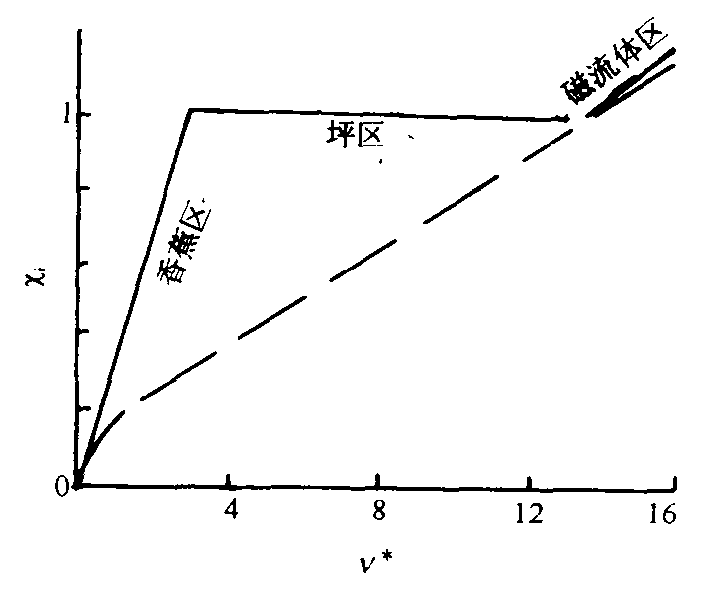
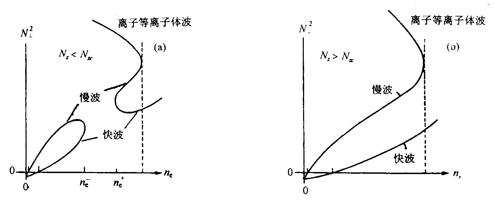
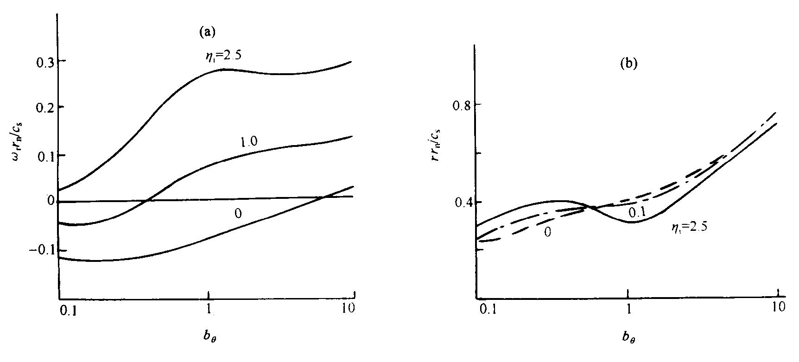
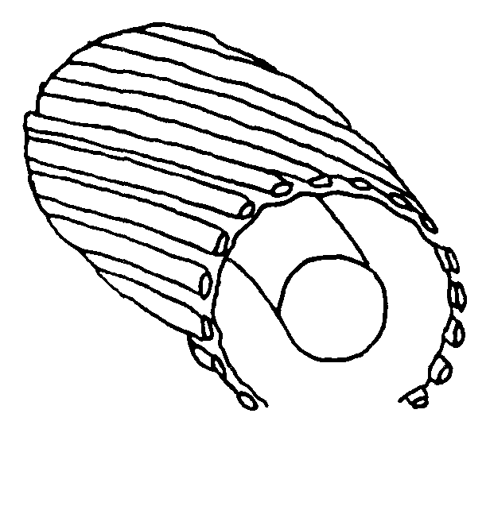

# 第六章 聚变等离子体的粒子动力论 (kinetic theory) 描述

本章将从粒子运动的层次来描述聚变等离子体的基本性质，这种描述也称等离子体的微观理论。在朗道的理论物理文集中，将这一层次的描述称为物理动力学(physical kinetics)，是较恰当的。很多人将“kinetic theory”译成“动力理论”，易与描述宏观运动特性的“dynamic”相混。本书则以粒子动力论或微观理论表述。另外，本书讨论的重点是与聚变装置中等离子体约束和加热性质有密切关系的内容，对一些最基本的粒子动力论性质，仅为叙述的完整性而简单引述，详细的讨论请参看一些专门参考文献(例如参考文献[1])。

## 6.1 聚变等离子体粒子相互作用的一般特性

简单地说，磁约束聚变等离子体是一类处在有界空间中，具有特殊磁约束位形的完全电离气体，这是一个电中性条件得到很好满足，粒子受到强磁场(外加磁场与自洽磁场)约束而集体相互作用非常强的物理体系。这一物理体系具有不均匀的空间分布，与周围环境存在强烈的作用，除了宏观性质可以近似地用磁流体动力学描述外，还有很多重要性质和过程需用粒子动力论来描述。首先考虑磁约束聚变等离子体的参数特征，不管将采用何种具体的约束位形，这类等离子体与宇宙空间等离子体或其它实验室中的应用等离子体所处的参数区有明显的差别，也与惯性约束装置中的等离子体处在完全不同的参数区。

当前磁约束聚变研究的最主要途径是托卡马克和先进环形约束装置(先进仿星器)。本书也将主要研究这些装置中的等离子体性质，因此，为讨论方便，下面将参数范围具体化，分别以A,B,C,D,E来代表中小型实验装置，大型实验装置，聚变堆中心约束区，聚变堆边缘区，及偏滤器区中的等离子体，于是，典型的粒子密度和等离子体温度(电子或离子)值如表6.1所示。

表6.1 磁约束聚变实验装置和反应堆中等离子体参数

| 类别 | 类别代号 | 粒子密度/cm³ | 电子（离子）温度/eV |
| --- | --- | --- | --- |
| 中小型实验装置 | A | $2\times10^{13}$ | 1000 |
| 大型实验装置 | B | $5\times10^{13}$ | 10000 |
| 反应堆主约束区 | C | $2\times10^{14}$ | 10000 |
| 反应堆边缘区 | D | $1\times10^{13}$ | 100 |
| 偏滤器区 | E | $1\times10^{14}$ | 20 |

在聚变堆边缘区及偏滤器区中等离子体存在与中性原子或分子的相互作用，以及与器壁材料的相互作用，这些内容将在第七章中介绍，本章主要研究A,B,C三类等离子体的微观性质。

### 6.1.1 Debye屏蔽

聚变等离子体的温度已远大于工作气体的电离能，因此工作气体实际上已被完全电离(器壁附近的边缘区例外)，其中的带电粒子间存在长程库仑相互作用。由于带同种电荷的粒子的作用力相斥，带异种电荷的粒子的作用力相吸，因此其中任一个粒子与其它粒子的作用必然受到另外异性粒子的屏蔽。由于电子的质量比离子轻得多，对空间区域中出现的任何多余的电荷，电子会很快地作出响应，其特征时间是电子的等离子体频率的倒数，即$\tau_{\mathrm{pe}} \approx \omega_{\mathrm{pe}}^{-1}$，这里

$$
\omega_{\mathrm{p}j} = \left(\frac{4\pi n_{j}e^{2}Z_{j}}{m_{j}}\right)^{1/2} \quad (6.1)
$$

如果把要考虑的一个粒子看成试验粒子，若它是正离子，则在其周围将形成一个电子云；反之，若试验粒子是电子，则它将排开一部分周围电子，使周围形成一个离子云。结果，试验粒子自身的库仑电势将受到这些云的屏蔽，这个性质在关于电介质的研究中已经清楚。对等离子体，利用粒子动力论方程描述，可以推导出具有任意运动速度的非相对论性带电粒子在等离子体中运动时周围静电势的公式[1](由于磁约束聚变等离子体的温度范围远达不到相对论性效应起作用的参数区，其中的粒子运动完全可以用牛顿力学来描述。只有在用微波加热的特殊情况下，部分高能电子的运动要用相对论力学来描述)。简言之，快速运动的粒子不存在库仑屏蔽，而速度慢于本底等离子体电子热速度的粒子，将受到库仑屏蔽。空间一点(其位置矢量为$x$) $x'$处电量为$q_j$的粒子的电势为

$$
\phi(x,t) = \frac{q_{j}}{|x-x'|}\exp\left(-\frac{|x-x'|}{\lambda_{\mathrm{D}j}}\right) \quad (6.2)
$$

式中$\lambda_{\mathrm{D}j}$为$j$类粒子的德拜(Debye)屏蔽距离，也称德拜长度

$$
\lambda_{\mathrm{D}j} = \left(\frac{T_{j}}{4\pi n_{j}q_{j}^{2}}\right)^{1/2}
= \frac{\sqrt{T_{j}/m_{j}}}{\omega_{\mathrm{p}j}} \quad (6.3)
$$

代入有关参数后容易看到，对磁约束聚变等离子体，离子和电子的德拜长度都远小于装置的几何尺寸。这意味着这些等离子体在非常高的程度上满足电中性条件。实际上，只有在非常靠近等离子体边界的区域，在宽度为德拜长度大小的等离子体鞘层中，电中性条件才不满足。

另一方面，磁约束等离子体中存在很强的外加的或自身运动产生的磁场，带电粒子将围绕磁力线作转动。为清楚起见，我们将A,B,C类装置中的磁场做一些规定，设中小型实验装置中的磁场为2 T，大型实验装置为4 T，反应堆中为6 T，按拉莫尔半径(回转半径)的公式，计算离子和电子的回转半径，

$$
\rho_{j} = \frac{m_{j}v_{\perp j}c}{q_{j}B}
= \frac{\sqrt{2T_{j}/m_{j}}}{\Omega_{j}} \quad (6.4)
$$

这里$\Omega_j$是带电粒子的回旋频率(拉莫尔频率)，

$$
\Omega_{j} = \frac{q_{j}B}{m_{j}c} \quad (6.5)
$$

可以发现，回转半径比德拜长度大得多。比值

$$
\frac{\lambda_{\mathrm{D}j}}{\rho_{j}} = \frac{\sqrt{2}\Omega_{j}}{2\omega_{\mathrm{p}j}} \quad (6.6)
$$

是一个重要的特征参量，对磁约束聚变等离子体它远小于1(见表6.2)。这意味着，在考虑两个带电粒子间在德拜球内的相互作用时，磁场的效应(使粒子轨道偏转)是可以忽略的。这只是说磁场对两个带电粒子间的散射角的计算的影响可以忽略，而绝对不是说库仑作用比磁场作用大。情况恰好相反，对磁约束聚变等离子体来说，带电粒子在电磁场中的运动是最基本的运动。如把等离子体自身的自洽电磁场包括进去，则确定等离子体约束性质的主要是带电粒子在总的电磁场中的运动特性，而粒子间的库仑相互作用所等价的碰撞仅起次要的作用。

对磁约束聚变等离子体来说，另一个非常重要的参数是以德拜长度为边长的正立方体中的粒子数(或简称德拜球内粒子数)，其倒数是一个重要的粒子动力论参数

$$
g = \frac{1}{n\lambda_{\mathrm{D}}^{3}} \quad (6.7)
$$

这一参量远小于1，因此在粒子动力论中被作为展开参数。

表6.2 磁约束聚变等离子体的一些特征量

| 类别代号 | $\lambda_D/\mathrm{cm}$ | $\rho_i/\mathrm{cm}$ | $\lambda_D/\rho_i$ | $\rho_i/a$ | 原文表内附加数值 | $\ln\Lambda$ |
| --- | --- | --- | --- | --- | --- | --- |
| A | $5\times10^{-3}$ | 0.22 | 0.021 | $10^{-2}$ | $4\times10^{-7}$ | 16.7 |
| B | $10^{-2}$ | 0.35 | 0.03 | $3.5\times10^{-3}$ | $2\times10^{-8}$ | 18.5 |
| C | $5\times10^{-3}$ | 0.24 | 0.021 | $10^{-3}$ | $4\times10^{-8}$ | 17.8 |

\* 在上表中，$\alpha$代表等离子体的小半径，对A,B,C类装置分别假定为$20\mathrm{cm},1\mathrm{m},3\mathrm{m}$。工作气体为氖。

### 6.1.2 二体碰撞

考虑两个带电粒子间的一次相互作用。在等离子体中，不可能存在这种单纯的相互作用，因为每个粒子同时与许多个粒子间存在库仑力作用，按粒子动力论的处理方法，先考虑德拜球内的一对带电粒子间的库仑作用，然后对所有粒子求统计平均得出总的效应。另一个问题是如何考虑磁场的影响。磁场使带电粒子绕磁力线转动，虽然在确定粒子的运动轨道时，粒子间的碰撞效应比磁场的作用要小得多，但由于带电粒子间有效的库仑相互作用仅发生在德拜球以内，而在磁约束聚变装置中离子的德拜长度又远小于回转半径，因此，就两个离子或离子与电子的一次碰撞过程所产生的对原先轨道的偏转而言，磁场的影响并不大(在德拜球内的离子回转半径的弧可以近似地用弦来代替)，这意味着一次库仑碰撞中离子-离子或离子-电子间的相互作用可以近似地用无磁场时的卢瑟福散射公式来计算。但对电子而言，在上述典型参考参数下，电子的回转半径与德拜长度为同量级量，因此磁场对电子-离子及电子-电子的库仑作用有明显的影响。因此，在下面引述的结果中，有关电子的散射结果应作一定的修正(参见参考文献[2])。有关库仑散射的计算在一般的原子物理书籍中均有叙述，这里简要地引述一些结果。取图6.1所示的质心坐标系，$b$为碰撞参量，$\chi$为质心系中观察的粒子碰撞前后的偏转角，$\sigma(\chi)\mathrm{d}\Omega$为粒子因散射而进入$\chi$方向小立体角$\mathrm{d}\Omega$的截面，则有

$$
\tan\left(\frac{\chi}{2}\right) = \frac{q_{1}q_{2}}{m_{t}u^{2}b} \quad (6.8)
$$

式中$m_t$为两个粒子的折合质量，$q_1,q_2$为它们的电荷数，$u$为相对速度。微分散射截面为

$$
\sigma(\chi) = \frac{(q_{1}q_{2})^{2}}{[2m_{t}u^{2}\sin^{2}(\chi/2)]^{2}} \quad (6.9)
$$

其中

$$
m_{t} = \frac{m_{1}m_{2}}{m_{1}+m_{2}} \quad (6.10)
$$

$m_1,m_2$为两个粒子的质量。

利用上述结果作进一步的讨论时，需区分不同的物理条件。首先是关于等离子体自身电子和离子间的相互作用情况，我们将设两者具有近似相同的温度。另外，要将质心坐标系中散射角化回实验室坐标中。对电子-离子体系，记$\theta$为实验室系统中散射角，分别有

$$
\begin{array}{lll}
\theta \approx \chi, & m_{1}\ll m_{2}\\
\theta \approx \chi/2, & m_{1}=m_{2}\\
\theta \approx \frac{m_{2}}{m_{1}}\sin\chi, & m_{1}\gg m_{2}
\end{array} \quad (6.11)
$$

**图6.1** 质心系中带电粒子相互作用时轨迹图

这样，若一个粒子是电子，另一个是离子，则折合质量为电子质量，而相对速度可取为电子的速度，对小角度散射，记$\Delta\theta=\chi$，由式(6.9)近似得

$$
\Delta\theta \approx \frac{2Ze^{2}}{m_{e}v_{e}^{2}b} \quad (6.12)
$$

式(6.11)表明，一次库仑作用产生的偏转角的大小与粒子的能量成反比。此外，这种偏转是随机的，当对大量的这类相互作用求统计平均时，总的偏转为零

$$
\langle\Delta\theta\rangle = 0 \quad (6.13)
$$

具有实际意义的是偏转角的方均值。对德拜球内所有的可能库仑作用求统计平均，并计算试验粒子在等离子体中穿越长度为$L$的距离后产生的总效应，得出

$$
\left\langle(\Delta\theta)^{2}\right\rangle
= \int (\Delta\theta)^{2}F(\Delta\theta)\mathrm{d}(\Delta\theta) \quad (6.14)
$$

$$
F(\Delta\theta)\mathrm{d}(\Delta\theta) = nL2\pi b\mathrm{d}b \quad (6.15)
$$

结果得

$$
\left\langle(\Delta\theta)^{2}\right\rangle
= \frac{8\pi nLZ^{2}e^{4}}{m_{e}^{2}v_{e}^{4}}
\ln\left(\frac{b_{\max}}{b_{\min}}\right) \quad (6.16)
$$

式(6.16)给出等离子体粒子动力论的一个重要结果，即关于小角度散射的积累效应。这里的简化处理在物理实质上是与有关速度空间中“扩散”的福克-普朗克方程的严格处理等价的。在小角度散射公式中出现了一个对数因子，按一般等离子体物理理论研究中的讨论，碰撞参数$b$的最大值取为德拜长度，而最小值取为一次库仑作用产生90度散射的对应碰撞参数，即

$$
b_{\min} = \frac{Ze^{2}}{m_{e}v_{e}^{2}} \quad (6.17)
$$

于是得到所谓的库仑对数因子

$$
\ln\Lambda = \ln\frac{b_{\max}}{b_{\min}}
= \ln\left[\frac{3(\kappa T)^{3/2}}{2Ze^{3}\sqrt{\pi n_{e}}}\right] \quad (6.18)
$$

当电子温度高于$4.2\times10^{5}\mathrm{K}$时，上面的$\Lambda$因子需考虑量子效应修正，要乘一因子$(4.2\times10^{5}/T)^{1/2}$，相应地库仑对数值将有所减小。对上述约定参数的磁约束聚变等离子体，需要计入这一修正，于是

$$
\ln\Lambda = \ln\left[
\frac{3(\kappa T)^{3/2}}{2Ze^{3}\sqrt{\pi n_{e}}}
\left(\frac{4.2\times10^{5}}{T}\right)^{1/2}
\right] \quad (6.19)
$$

对于不同的磁约束聚变等离子体类别A,B,C，相应的库仑对数值示于表6.2，可以看到，对所举三种范例，库仑对数因子很接近。

将等离子体中具有热平均速度的电子看成试验粒子，若取产生于90度处的方均散射的距离$L$为该粒子在等离子体中的自由程，定义通过这一自由程的时间为碰撞驰豫时间，则

$$
\tau_{\mathrm{ei}} = \frac{L}{v_{\mathrm{te}}}
= \left(\frac{3^{1/2}\pi}{32}\right)
\frac{m_{i}^{1/2}T_{e}^{3/2}}{n_{e}Z^{2}e^{4}\ln\Lambda} \quad (6.20)
$$

类似地可以得出关于电子-电子间的积累散射公式，与电子-离子间的情况相比，除在角度和折合质量换算上有二倍差异，要用相对速度代入外，它仍为热速度量级，因此显然有

$$
\tau_{\mathrm{ee}}\approx\tau_{\mathrm{ei}} \quad (6.21)
$$

而对离子-离子间的库仑作用，折合质量为$m_i/2$，速度为相对速度，角度换算中有一因子2。结果应为

$$
\tau_{\mathrm{ii}}\approx (m_{i}/m_{e})^{1/2}\tau_{\mathrm{ei}} \quad (6.22)
$$

对离子-电子间作用，要注意角度换算中有一因子$(m_e/m_i)$，结果将有

$$
\tau_{\mathrm{ie}}\approx (m_{i}/m_{e})\tau_{\mathrm{ei}} \quad (6.23)
$$

在一次小角度碰撞中两个粒子间产生的能量转移可以用下式估计

$$
\frac{\delta E}{E}
= \frac{4m_{1}m_{2}}{(m_{1}+m_{2})^{2}}
\sin^{2}\left(\frac{\chi}{2}\right) \quad (6.24)
$$

经90度散射后的积累效应为

$$
\frac{\Delta E}{E}
\approx \frac{2m_{1}m_{2}}{(m_{1}+m_{2})^{2}} \quad (6.25)
$$

可见，同类粒子间的能量转移特征时间与同类粒子间90度散射的特征时间是接近的；但电子-离子间的能量转移特征时间要比散射特征时间长$(m_i/m_e)$倍

$$
\tau_{E,\mathrm{ei}}
= \frac{3m_{e}m_{i}}{8\sqrt{2\pi}n_{e}Z^{2}e^{4}\ln\Lambda}
\left(\frac{T_{e}}{m_{e}}+\frac{T_{i}}{m_{i}}\right)^{3/2} \quad (6.26)
$$

因此，在磁约束聚变等离子体中，电子自身建立能量平衡的时间最短，而离子自身建立能量平衡的时间尺度比电子间要长40倍左右；至于电子与离子间的能量平衡时间就要更长，是电子自身能量平衡时间的近2000倍。因此，在实验室条件下，出现电子和离子具有两种温度的可能性十分大。

另一种有意义的情况是一种高能粒子成分与本底等离子体的相互作用。这种与中性束注入加热、$\alpha$粒子加热，以及在微波加热中出现的部分高能成分粒子慢化的有关问题将在有关章节讨论。

## 6.2 带电粒子的运动特性和描述方法

在磁约束聚变实验装置和反应堆中，电子和离子的碰撞频率都很低，碰撞特征时间远大于带电粒子穿越装置特征长度所需时间(粒子自由程远大于其装置的特征尺寸)，即

$$
\tau_{\mathrm{ei}}v_{\mathrm{te}}/L\gg1,\quad
\tau_{\mathrm{ei}}v_{\mathrm{ti}}/L\gg1 \quad (6.27)
$$

因此，粒子间库仑相互作用对粒子运动的影响是次级因素。对应地，在粒子动力论意义上，如果将动力论方程链对小参数(例如上式中比值的倒数)展开，则在最低一级近似下，等离子体是无碰撞的带电粒子集合，这个物理系统的运动规律完全由初始条件及全体粒子在电磁场中的无碰撞运动特性所确定。但是要强调的是，所述电磁场是包括外加场和自洽场在内的，因此，等离子体自身运动产生的电磁场，包括不稳定性运动的电磁场也在其内。

在本小节中，我们主要介绍慢变化电磁场中带电粒子的运动。所谓慢变化，指的是电磁场的变化时间远大于粒子的回旋周期，或

$$
\Omega_{\mathrm{i,e}}\tau\gg1 \quad (6.28)
$$

此外，假定所考虑的电磁场随空间的变化也很慢，因而其特征空间尺寸远大于带电粒子的回转半径

$$
\rho_{\mathrm{i,e}}/L\ll1 \quad (6.29)
$$

满足以上条件的物理系统称渐变系统(adiabatic system)，在有些等离子体物理文献中按“adiabatic”的英文字母意思译成“绝热系统”，这一译名失去了真正的物理含义，因为这与热没有任何关系。(60年代初，已故卢鹤绂先生曾建议将adiabatic正确地译成“逐渐不变”，可惜未被已习惯于“绝热”译法者所接受。)

对磁约束聚变等离子体来说，其中绝大多数粒子的运动可以用经典力学运动方程来描述，相对论性效应不重要。只有在有关波与等离子体相互作用中部分电子的能量可以超过其相对论性静止能量$m_{e}c^{2}=0.511\mathrm{MeV}$，故需要考虑相对论性效应。

### 6.2.1 均匀强磁场中的电漂移

首先研究在均匀磁场中具有横向电场的情形，带电粒子的牛顿运动方程为

$$
m\frac{\mathrm{d}\mathbf{v}}{\mathrm{d}t}
= q\left(\mathbf{E}+\frac{1}{c}\mathbf{v}\times\mathbf{B}\right) \quad (6.30)
$$

$$
\mathbf{v}=\frac{\mathrm{d}\mathbf{r}}{\mathrm{d}t} \quad (6.31)
$$

这里不考虑平行于磁力线的电场，这一电场使带电粒子不断加(减)速，必须引入其它机制使之实现平衡。在第五章中讨论过这样一些机制，最简单的是电阻效应，它是电子与离子碰撞引起的。在碰撞不重要的情况下，如平行电流为有限量，则平行电场可以忽略。

在以下面的速度垂直于磁场运动的系统中，电场将消失。如果电场也是均匀的，于是剩下的就是在这一运动系统中带电粒子绕磁力线的回转运动及沿磁力线的自由运动。所以方程(6.31)的精确解为

$$
\mathbf{v} = v_{\parallel}\mathbf{b}
+ v_{\perp}\left[\mathbf{x}\cos(\phi_{0}-\Omega t)
+\mathbf{y}\sin(\phi_{0}-\Omega t)\right]
+\mathbf{v}_{E} \quad (6.33)
$$

式中$\mathbf{b}$是沿磁力线的单位矢量，$\mathbf{x}$和$\mathbf{y}$是垂直于磁力线的直角坐标的单位矢量。如果电场不是均匀的，或者是随时间变化的，则除上述结果外，还有一些次级效应：随时间的变化将产生沿电场方向的极化；随空间的变化将产生有质动力项(ponderomotive force)，它们分别以下式右方的两项所表示

$$
\mathbf{v}_{2}
= \frac{mc^{2}}{qB^{2}}\frac{\partial\mathbf{E}_{\perp}}{\partial t}
+\frac{mc^{2}}{2qB^{2}}\nabla E_{\perp}^{2} \quad (6.34)
$$

这个二级效应项与电荷符号有关，因此要引起沿电场方向的电流并积累起极化电荷。

### 6.2.2 漂移近似方程

在不均匀磁场中，运动方程组(6.30),(6.31)(非线性常微分方程)的解在一般情况下比较复杂，但在满足渐变条件的情况下，可以相当简单地用漂移近似来描述。建立局部的直角坐标系$(x,y,b)$，类似于式(6.33)，将速度写成

$$
\mathbf{v} = v_{\parallel}\mathbf{b}
+ v_{\perp}\left[\mathbf{x}\cos(\phi_{0}-\Omega t)
+\mathbf{y}\sin(\phi_{0}-\Omega t)\right]
+\mathbf{v}_{d} \quad (6.35)
$$

现在这一坐标的方向随粒子运动的轨道是变化的。将粒子的轨道(如图6.2所示)写成

$$
\mathbf{r}=\mathbf{R}+\boldsymbol{\rho} \quad (6.36)
$$

其中$\boldsymbol{\rho}$是由回转中心(gyro-center)，也称导向中心(guiding center)指向粒子所在位置的矢量确定的，其大小等于局部磁场所确定的回转半径值；$\mathbf{R}$是回转中心的坐标矢量，由平行于磁力线的运动及垂直于磁力线的漂移运动确定

$$
\frac{\mathrm{d}\mathbf{R}}{\mathrm{d}t}
= v_{\parallel}\mathbf{b}+\mathbf{v}_{d} \quad (6.37)
$$

漂移速度为

$$
\mathbf{v}_{d}
= \mathbf{v}_{E}
+\frac{c}{qB}\mathbf{b}\times
\left[\mu\nabla B+m v_{\parallel}^{2}\mathbf{b}\cdot\nabla\mathbf{b}\right] \quad (6.38)
$$

上式右方第一项是电漂移项，对电子和离子是相同的；方括号中两项分别表示由磁场不均匀性及磁力线曲率引起的磁漂移，它们与电荷符号有关，因此，这种漂移将引起等离子体的电流(反磁电流)。在式(6.38)中定义了一个称为磁矩的量

$$
\mu = \frac{mv_{\perp}^{2}}{2B} \quad (6.39)
$$

**图6.2** 回转中心坐标系

可以证明，在漂移近似下(即满足渐变条件下)，这是一个运动积分(不变量)，称渐态不变量(adiabatic invariant)(有些中文文献中称绝热不变量)

$$
\frac{\mathrm{d}\mu}{\mathrm{d}t}=0 \quad (6.40)
$$

另一个运动积分是粒子的总能量，因为磁场不会对粒子做功

$$
W=\frac{1}{2}mv_{\parallel}^{2}+\mu B+q\Phi=\mathrm{const} \quad (6.41)
$$

$\Phi$为电场的静电势函数。

如果把渐变条件(6.29)中的比值看成展开小量，则更严格的理论分析表明，直到二级近似，上述漂移近似的结果都正确。在磁约束聚变实验装置和反应堆中，对空间的变化来说，除在磁分界面附近的区域渐变条件不满足，在大部分约束区域都满足；在随时间变化方面，除在用电子回旋波或离子回旋波加热的条件下不满足渐变条件外，在其他包括存在各种低频不稳定模的情况下，漂移近似的结果都适用。由于电子和离子的回转半径都远小于装置的尺寸，因此在几乎所有的理论研究中，都将采用回转中心的轨道来代替粒子的真实轨道。带电粒子的运动被归结为沿磁力线的运动，绕磁力线的回旋运动及垂直于磁力线的漂移之和。在特殊的情况下，还需考虑一些二级运动，如式(6.34)所示的极化和有质动力项。

#### 6.2.3 回转中心的轨道：捕获粒子和飞行粒子[4]

在实际研究中，常常需要确定粒子的具体轨道。从单粒子约束的角度，一些高能粒子(中性束加热或波加热中产生的高能离子或电子，以及氘氚聚变产生的$\alpha$粒子)的轨道可能很大，与装置的尺寸可以比拟甚至超过；在粒子动力论研究中，确定粒子在平衡磁场中的粒子轨道是进行微扰研究的出发点。

要确定粒子的轨道，只要在漂移近似下确定回转中心的轨道就行了，为此需要知道三个运动积分。在渐变条件下，已有两个渐态不变量：磁矩和总能量。第三个运动积分可以通过下面的论证求出。在没有电场的情况下，可将回转中心的运动方程写成

$$
\frac{\mathrm{d}\mathbf{R}}{\mathrm{d}t}
= \frac{v_{\parallel}}{B}\nabla\times
\left[\mathbf{A}+\frac{mv_{\parallel}}{qB}\mathbf{B}\right] \quad (6.42)
$$

此式的意义是，回转中心的运动方程是与广义磁场

$$
\mathbf{B}^{*}
= \nabla\times\left(\mathbf{A}+\frac{mv_{\parallel}}{qB}\mathbf{B}\right) \quad (6.43)
$$

的磁力线方程一致的，因此，该广义磁场的磁力线与回转中心的轨道相重合。这样，在具有对称性的条件下，类似于实际磁场的磁面函数的讨论，可以给出另一个运动积分。特别是，若系统具有轴对称性，如理想磁镜和托卡马克(环形轴对称)，可以给出一个精确的运动积分：广义角动量：

$$
P_{\varphi}
= \frac{Ze}{c}\psi(R,Z)
+ mRv_{\varphi}\frac{B_{\varphi}}{B} \quad (6.44)
$$

式中$\psi(R,Z)$是第四章中定义的磁面函数，即极向磁通。三个运动积分：磁矩、能量和广义角动量，将确定平衡位形中粒子回转中心的轨道。对于简单磁镜位形，磁场在两端磁塞处最强，只有垂直速度大于临界值的粒子可以从磁塞处被反射回中心区，这就是磁镜约束条件

$$
\frac{v_{\perp}}{v}>\sqrt{\frac{B_{0}}{B_{s}}} \quad (6.45)
$$

这样，在粒子的速度空间将存在一个锥形逸出区，处于此锥内的粒子不被磁镜所约束。对托卡马克位形，由于环向磁场是不均匀的，因此类似于简单的磁镜磁场，有一部分粒子也会从磁场较强的环的内侧反射回来，这些粒子不可能回绕整个环运动，被局限于环的外侧的一定空间区域中。这类粒子称为捕获粒子(trapped particle)；大多数粒子可以沿环向自由运动，这些粒子称飞行粒子(passing particle)，或非捕获粒子(untrapped particle)，或穿行粒子(transit particle)。确定这些粒子分界的条件是平行速度是否会变成零

$$
v_{\parallel} = \pm\sqrt{\frac{2}{m}(W-Ze\Phi-\mu B)} \quad (6.46)
$$

写出托卡马克的磁场强度公式

$$
B = \sqrt{B_{p}^{2}+(\nabla\psi)^{2}/R^{2}} \quad (6.47)
$$

由于极向磁场$B_{p}=|\nabla\psi|/R$是一级小量，它对总磁场强度的贡献是二级小量，所以近似到一级小量时可以仅考虑环向磁场就够了，也就是

$$
B\approx B_{0}\left(1+\frac{r}{R}\cos\theta\right)^{-1} \quad (6.48)
$$

其中采用了以磁轴为中心的局部极坐标表示，$\frac{\pi}{2}\geq\theta\geq-\frac{\pi}{2}$代表环的外侧。这样就可确定捕获粒子的条件

$$
1+\frac{r}{R}
\geq\Lambda=\frac{\mu B_{0}}{W}
\geq1-\frac{r}{R} \quad (6.49)
$$

**图6.3** 托卡马克中典型的捕获粒子轨道

脚标0表示粒子处在环的上下顶端$(\theta=\pm\frac{\pi}{2})$时的值。近似地，捕获粒子的数量可以从上式得出

$$
\frac{n_{1}}{n}\approx\sqrt{\frac{2r}{R}} \quad (6.50)
$$

但是要特别注意，上式是关于捕获粒子比例的估计，而不是真正的捕获粒子空间密度分布。真正的空间密度与极向角有关，这可以从捕获粒子的轨道形状直接看出。捕获粒子的轨道类似于第四章中分析的理想磁面附近形成的磁岛的形状，在$\phi=\mathrm{const}$截面上其形状类似于香蕉(如图6.3所示)，称香蕉轨道(banana orbit)，所以捕获粒子又称香蕉粒子。每一香蕉轨道对应有一对反转点，在该点的粒子平行于磁力线的速度变为零。所有的捕获粒子都经过$\theta=0$的点，那些反转点$\theta_{1}<\theta$的捕获粒子对$(\theta,\pi)$范围内的捕获粒子密度没有贡献，而经过$\theta=\pi$点的捕获粒子数趋于零。近似地得到

$$
n_{1}(r,\theta)=n_{10}\cos\frac{\theta}{2} \quad (6.51)
$$

一般来说，电子的轨道非常接近于磁面自身，而离子的轨道则与磁面有一定的偏离。对于能量不很大的离子，可以近似地从轨道方程得出这一偏离的估计值：

$$
\delta r\approx -\frac{mv_{\parallel}c}{ZeB_{\theta}} \quad (6.52)
$$

以上只是在离磁轴较远的区域中才是正确的，但不适用于非常接近磁轴的区域。根据上面的分析，在非常接近磁轴时(即$r\rightarrow0$时)，将得出如下结果：(1)捕获粒子数趋于零；(2)捕获粒子及飞行粒子与磁面的偏离都趋于无限大。显然，这两个结论都是不正确的，而且这些结论直接影响新经典理论的结果。最近有人对非常靠近磁轴时的偏离作了更精确的估算(参见[10])。严格的分析要从轨道方程(6.44)出发，对大环径比托卡马克位形，可得到描述接近磁轴的粒子轨道为一个三次代数方程

$$
x^{3}+2(Iv_{\parallel0}/\Omega_{0})x
-\left(2I^{2}C_{1}/\Omega_{0}^{2}\right)
\left(v_{\parallel0}^{2}+\mu B_{0}\right)\cos\theta=0 \quad (6.53)
$$

式中$I=RB_{\phi}$，$\Omega_{0}$是粒子(电子和离子)在磁轴处的回旋频率，$x$是规范化长度，代表与磁轴的距离，$C_{1}$与磁通函数间的关系为

$$
r/R=C_{1}\sqrt{\psi} \quad (6.54)
$$

方程(6.53)的正实数解代表真实物理解。区分捕获粒子与飞行粒子的参数将是

$$
\kappa
= \frac{8}{27}
\frac{(I|v_{\parallel0}|/\Omega_{0})^{3}}
{(I^{2}C_{1}/\Omega_{0}^{2})^{2}
(v_{\parallel0}^{2}+\mu B_{0})^{2}} \quad (6.55)
$$

捕获粒子满足条件

$$
-1\leq\sigma\kappa\leq0 \quad (6.56)
$$

其中$\sigma=v_{\parallel0}/|v_{\parallel0}|$代表粒子的两个飞行方向。由这一理论得到的捕获粒子数将是

$$
f_{t}\approx\left(\frac{v_{1}}{\Omega_{0}}C_{1}^{2}\right)^{1/3} \quad (6.57)
$$

这一数值在接近磁轴时是有限值，而捕获轨道与磁面的偏离也将是有限量，由确定。

从粒子轨道分析可以得出如下三点重要结论：(1)具有最大轨道偏离的是那些刚好被捕获的粒子(barely trapped particle)，其平行于磁力线的速度在磁面的最内侧刚好为零，于是在磁面的最外侧其平行速度等于

$$
v_{\parallel}\approx\frac{2r}{R}v_{0} \quad (6.59)
$$

(2)反之，那些在磁面最外侧其垂直速度接近总速度的粒子将被捕获并停留在靠近最外侧的赤道平面附近，这些粒子称为深捕获粒子(deeply trapped particle)；(3)靠近磁轴处的粒子轨道与磁面的偏离加大，但相应的捕获粒子的总数减少。

飞行粒子与磁面也有一定的偏离，对离磁轴较远的情形，从粒子轨道方程(6.44)可以给出这一偏离的估计值

$$
\delta r\approx q\rho_{p} \quad (6.60)
$$

式中$q$为安全因子，$\rho_{p}$为用极向磁场计算的回旋半径。同样，在靠近磁轴时这一估计不正确，而且飞行粒子轨道具有四种不同的结构形式，限于篇幅，我们将不再引述。

#### 6.2.4 捕获粒子对外场的响应

由于捕获粒子不能沿整个磁面运动，它在外场作用下的运动特性与飞行粒子有重大差别，这一特点对托卡马克等离子体的约束性质有重要影响。

捕获粒子被限制在靠环的外侧局部空间区域中的原因是总能量守衡和磁矩近似守衡，因此磁场的不均匀性使捕获粒子运动轨道具有折返点。显然，这一性质不因存在其他外场而改变，尤其是，若外场的势函数也是磁面函数时，捕获粒子的折返点是近似不变的。于是，若有等效的径向电场$K_{r}$，则所产生的极向漂移$v_{\theta}=-cK_{r}B_{\theta}/B^{2}$的总效应不是使捕获粒子沿极向自由漂移，而是沿磁力线的运动速度加快或减慢，对整个捕获轨道平均后，总效应是产生一个附加的沿环向的运动速度。可以用约束条件

$$
v_{\theta}=0 \quad (6.61)
$$

来描述总体效应，然后由

$$
K_{r}+\frac{1}{c}(v_{\theta}B_{\varphi}-v_{\varphi}B_{\theta})=0 \quad (6.62)
$$

代入(6.55)得出

$$
v_{\theta}=cK_{r}/B_{\theta} \quad (6.63)
$$

这一运动速度比直接由局部漂移公式给出的大$(B_{\theta}/B_{\varphi})$倍。同样的讨论可以给出，环向等效电场将产生一个大的沿径向的速度：

$$
v_{r}=-cK_{\theta}/B_{\theta} \quad (6.64)
$$

捕获粒子虽数目少于飞行粒子，但由于对外场的特殊响应特性，其整体贡献可以超过飞行粒子。这一类性质的问题被称为“新经典效应”，在托卡马克输运和稳定性分析研究中很重要。其中式(6.57)和(6.59)可以直接和所谓的“自举电流”及“Ware 缩效应”联系起来。

可以对带电粒子的漂移近似方程进行更严格的分析或进行数值方法求解，这样的研究工作在文献中很多。很重要的一点是，对高能离子的轨道要进行较精确的计算，因为这些离子有可能因轨道与限制器或器壁相交而直接损失，使靠近边界的粒子的损失率加大。类似于磁镜情形，托卡马克位形中在粒子的速度空间也存在逸出锥，但与磁镜不同的情形是，在这种情况下，与磁面偏离最大的离子最容易损失，而逸出锥的形状和大小与粒子速度大小及磁面位置有关。从上面对捕获粒子轨道的分析可以看出，要减少这类损失，需加大极向磁场，也就是在保证磁流体稳定性的条件下加大环向电流。

## 6.3 等离子体集体相互作用的描述：玻-麦方程组、经典和新经典输运[6,8]

对等离子体集体相互作用采用两种描述方法：一种是将等离子体的电子和离子的全体都看成是位置空间和速度空间中的连续介质，用各自的粒子分布函数来描述系统的统计状态，如果知道每一时刻的分布函数，就确定了系统的全部物理状态和性质。对分布函数的变化，采用气体分子运动论中的方法，由初始条件及包括二体碰撞项的玻尔兹曼-麦克斯韦方程确定其变化；另一种分析方法是将等离子体看成分立的多粒子体系，在初始条件给定后，由$N$维位置空间和$N$维速度空间中的刘维方程确定其力学运动，$N$是电子和离子的各自粒子总数。显然，这样的力学方程是无法求解的，但在此基础上，对$N-1$个粒子的位置空间和速度空间积分，留下单粒子分布函数，它基本上等价于第一种方法中的连续分布函数，但可由二粒子分布函数来确定二体关联，它基本上就是二体碰撞项。这样，两种描述方法在很大的范围内重合，但后者可以包括对热涨落(thermal fluctuation)现象的描述。不过，实验证实，在大多数有意义的情况下，由等离子体湍流涨落引起的宏观效应远大于热涨落效应，而等离子体湍流可以用玻-麦方程来描述，很多情况下甚至连二体碰撞也不重要。因此，我们主要介绍玻-麦方程。

### 6.3.1 玻-麦方程的一般形式

我们不再重复写出麦克斯韦电磁场方程组，但要记住，下面讨论的电磁场都是自洽场，即包括外加电磁场和等离子体内部电荷和电流产生的电磁场。结合磁约束聚变等离子体的参数范围，我们将不考虑相对论效应。令$f_{s}(x,v,t)$为$s$类粒子的分布函数，其变化由动力论方程即玻-麦方程确定

$$
\frac{\partial f_{s}}{\partial t}
+\mathbf{v}\cdot\nabla f_{s}
+q_{s}\left(\mathbf{E}+\frac{1}{c}\mathbf{v}\times\mathbf{B}\right)\cdot
\frac{\partial f_{s}}{\partial\mathbf{v}}
=C_{s}(f_{s}) \quad (6.65)
$$

上式左方实际上是分布函数对位置和速度空间变数的全微分，可以简写成$\frac{\mathrm{d}f_{s}}{\mathrm{d}t}$，并且对于变量变换具有不变性。如果没有碰撞，式(6.65)化成六维空间中的刘维方程，这一方程称弗拉索夫方程(Vlasov equation)：

$$
\frac{\mathrm{d}f_{s}}{\mathrm{d}t}
=\frac{\partial f_{s}}{\partial t}
+\mathbf{v}\cdot\nabla f_{s}
+q_{s}\left(\mathbf{E}+\frac{1}{c}\mathbf{v}\times\mathbf{B}\right)\cdot
\frac{\partial f_{s}}{\partial\mathbf{v}}
=0 \quad (6.66)
$$

粒子运动积分的任意函数都是该方程的解，如果可以找到运动不变量，动力论方程的形式可以简化，这将在下面的例子中说明。此外，在实际求解时要考虑一些基本物理规律，例如粒子体系离热平衡态的偏离是小量，无扰动场时，分布函数为麦氏分布，等等。

### 6.3.2 碰撞积分的形式：朗道算子

符合库仑长程相互作用条件下的粒子间的二体碰撞项首先是朗道推导出来的(Landau,1944)，后来罗森布拉斯(Rosenbluth,1955)给出了一种称为罗森布拉斯势的形式[7]，与朗道的结果是完全一致的。以后，在不同的问题中，这一算子的形式有不同的简化表示式，在需要时我们将介绍有关形式。朗道的形式为

$$
C_{s}(f_{s})
=\sum_{s'}\int\int
\left[
f_{s}(\mathbf{p})\frac{\partial^{2}}{\partial p_{\alpha}\partial p_{\beta}}
-f_{s'}(\mathbf{p}')\frac{\partial^{2}}{\partial p_{\alpha}'\partial p_{\beta}'}
\right]
B_{\alpha\beta}\,\mathrm{d}^{3}p' \quad (6.67)
$$

求和对包括自身粒子类型在内的所有粒子类型进行，被积式中的函数$B_{\alpha\beta}$可写为

$$
B_{\alpha\beta}
=\frac{2\pi q_{s}^{2}q_{s'}^{2}}{|\mathbf{v}-\mathbf{v}'|}
A\left[
\delta_{\alpha\beta}
-\frac{(v_{\alpha}-v_{\alpha}')(v_{\beta}-v_{\beta}')}
{(\mathbf{v}-\mathbf{v}')^{2}}
\right] \quad (6.68)
$$

$\mathbf{p}$为动量，$A$为库仑对数。

罗森布拉斯等人推出一个与上述朗道形式不同但实质一致的碰撞算子形式，称RMJ形式[7]，引入两个辅助函数

$$
G_{s}(\mathbf{v})
=\int\mathrm{d}^{3}v'f_{s}(\mathbf{v}')u \quad (6.69)
$$

$$
H_{s}(\mathbf{v})
=\int\mathrm{d}^{3}v'f_{s}(\mathbf{v}')/u \quad (6.70)
$$

式中$u=|\mathbf{v}-\mathbf{v}'|$是相对速度，一般的碰撞算子就可以表示成

$$
C_{ss'}
=\frac{\gamma_{ss'}}{2}
\left\{
\frac{1}{m_{s}}
\frac{\partial^{2}}{\partial v_{\alpha}\partial v_{\beta}}
\left(f_{s}\frac{\partial^{2}G_{s'}}{\partial v_{\alpha}\partial v_{\beta}}\right)
-2\left(\frac{1}{m_{s}}+\frac{1}{m_{s'}}\right)
\frac{\partial}{\partial v_{\alpha}}
\left(f_{s}\frac{\partial H_{s'}}{\partial v_{\alpha}}\right)
\right\} \quad (6.71)
$$

RMJ形式在数值计算中的应用比原始的朗道形式方便，但仍然太复杂，在很多具体情况下，可以对碰撞算子的形式进一步简化。如在二体碰撞过程中，其他物理过程就显得不重要了，这时为了估计碰撞的影响，可以将碰撞积分写成

$$
C_{s}(f_{s})=-\nu_{\mathrm{eff}}(f_{s}-F_{s0}) \quad (6.72)
$$

等式右方被表示成等效碰撞频率与分布函数对平衡分布的偏差之积，文献中称式(6.72)形式的碰撞积分为克鲁克(Krook)碰撞算子。

由于电子质量远小于离子质量，电子和离子间的碰撞积分形式可以进一步简化为

$$
C_{\mathrm{ei}}
=\frac{1}{m_{i}n_{i}}\mathbf{F}_{\mathrm{ei}}\cdot
\frac{\partial f_{i}}{\partial\mathbf{v}}
+\frac{m_{e}}{m_{i}}\frac{1}{\tau_{\mathrm{ei}}}
\frac{\partial}{\partial\mathbf{v}}\cdot
\left[
(\mathbf{v}-\mathbf{v}_{i})f_{i}
+\frac{T_{e}}{m_{i}}\frac{\partial f_{i}}{\partial\mathbf{v}}
\right] \quad (6.73)
$$

其中$\mathbf{v}_{i}$是离子的宏观速度，阻尼力

$$
\mathbf{F}_{\mathrm{ei}}
=-\gamma_{\mathrm{ei}}n_{i}\int\mathrm{d}^{3}v\,
f_{e}\mathbf{v}/v^{3}
+\frac{m_{e}n_{e}}{\tau_{\mathrm{ei}}}\mathbf{v}_{i} \quad (6.74)
$$

$$
\gamma_{\mathrm{ei}}
=\frac{4\pi Ze^{4}}{m_{i}}\ln\Lambda \quad (6.75)
$$

在不同的情况下，还可以引入其它的简化形式。

### 6.3.3 动力论方程的简化形式：漂移动力论方程和回旋动力论方程

对强磁场中的等离子体，正如粒子运动方程可以用简化描述来代替一样，动力论方程也可以简化。第一种简化形式是将分布函数看成是粒子的回转中心的分布函数，根据6.2节中的讨论，回转中心的运动速度可以表示成

$$
\mathbf{v}_{g}=v_{\parallel}\mathbf{b}+\mathbf{v}_{D} \quad (6.76)
$$

而且漂移速度$\mathbf{v}_{D}$与平行速度$v_{\parallel}$相比是一级小量，此外磁矩

$$
\mu=mv_{\perp}^{2}/2B \quad (6.77)
$$

是近似的运动不变量，当磁场不变时，另一运动不变量是总能量

$$
U=\frac{1}{2}mv^{2}+Ze\Phi \quad (6.78)
$$

$\Phi$是静电势。当磁场变化时，总能量将变化

$$
\frac{\mathrm{d}U}{\mathrm{d}t}
=Ze\frac{\mathrm{d}\Phi}{\mathrm{d}t}
+\mu\frac{\mathrm{d}B}{\mathrm{d}t}
+\mathbf{v}_{g}\cdot[Ze\mathbf{E}-\mu\nabla B] \quad (6.79)
$$

其中电场由法拉弟定律给出

$$
\mathbf{E}=-\nabla\Phi-\frac{1}{c}\frac{\partial\mathbf{A}}{\partial t} \quad (6.80)
$$

$\mathbf{A}$为磁场的矢势。根据刘维方程对运动变量变换的不变性，当用回旋中心的坐标来描述时，粒子动力论方程化成

$$
\frac{\partial f}{\partial t}
+(\mathbf{v}_{g}+\mathbf{v}_{D})\cdot\nabla f
+\frac{\mathrm{d}U}{\mathrm{d}t}\frac{\partial f}{\partial U}
=C \quad (6.81)
$$

上式称为漂移动力论方程，它比一般动力论方程至少可以减少一个变数，这实际上是因为另一个变数(回旋角)消去了，等效于分布函数的变化对回旋角进行了平均。

在磁约束聚变等离子体与波或不稳定模相互作用问题中，常常要考虑波长与粒子回转半径同量级的情况，此时上述漂移动力论方程就不够精确。要用一个更严格的近似方程。(仍然对回转角变数求平均，但保留$\mathbf{k}\cdot\boldsymbol{\rho}$级量。这一方程的推导相当复杂，但又非常重要，我们建议有兴趣的读者参看Hazeltine等人的专著[6]。)

### 6.3.4 速度分布函数的线性化和准线性化演变

在实际问题中，常常出现这样一种情形，即物理状态可以由缓慢变化的部分及快变化的扰动部分组成，而慢变部分(包括对平衡态的小偏离)确定了物理状态的宏观特性，快变部分以统计形式构成对这种演化的贡献。设零级分布函数为$F^{0}$，将一般分布函数写成

$$
f=F^{0}+f_{1} \quad (6.82)
$$

忽略扰动分布函数的二阶项，扰动分布函数的线性化演变方程为

$$
\frac{\partial f_{1}}{\partial t}
+\mathbf{v}\cdot\nabla f_{1}
+q\left(\mathbf{E}+\frac{1}{c}\mathbf{v}\times\mathbf{B}_{0}\right)\cdot
\nabla_{v}f_{1}
=-q\left(\delta\mathbf{E}+\frac{1}{c}\mathbf{v}\times\delta\mathbf{B}\right)\cdot
\nabla_{v}F^{0}
+C(f_{1})
$$

式中碰撞项也对扰动分布线性化，以上方程通过色散关系确定各种扰动模式的结构和随时间的增长率。在扰动电磁场的作用下，零级分布也将由原始的平衡分布开始演变，下面只考虑静电扰动的情形，则

对实际发生在磁约束聚变实验装置中的情况，往往是扰动电场的贡献远大于碰撞的效应。在下面关于反常输运的研究中，主要考虑扰动电磁场的效应。

本节中，作为应用玻-麦方程来研究集体相互作用的例子，我们引述关于碰撞引起不均匀等离子体输运的主要结果。

### 6.3.5 磁场中等离子体的经典输运

这一内容包括了基础等离子体物理的一大块理论，由于本书的主要目的不是讨论等离子体物理的基本问题，我们只能非常简单地引述一些主要的结果。假定等离子体粒子的回转中心的速度分布函数具有局部麦氏分布形式

$$
F_{\mathrm{M}}
=n(r)\left(\frac{m}{2\pi T(r)}\right)^{3/2}
\exp\left(-\frac{mv^{2}}{2T(r)}\right) \quad (6.85)
$$

这里假定粒子密度和温度仅为磁面坐标的函数。在更简单的圆柱近似下，则仅为柱半径$r$的函数。

离子回绕磁力线的运动引起对分布函数的一个小修正

$$
\widetilde{f}
=-\boldsymbol{\rho}\cdot\nabla F_{\mathrm{M}}
=-\frac{f_{\mathrm{M}}}{\Omega}\mathbf{b}\times\mathbf{v}\cdot
\left\{
\nabla\ln n+\frac{e\Phi}{T}
+\left[\frac{U-e\Phi}{T}-\frac{3}{2}\right]\nabla\ln T
\right\} \quad (6.86)
$$

式中$U=\frac{mv^{2}}{2}+e\Phi$为离子的总能量。电子离子碰撞的效应产生的阻尼力为

$$
\mathbf{F}_{c}=\int\mathrm{d}v\,m\mathbf{v}C(\widetilde{f}) \quad (6.87)
$$

脚标$c$表示经典碰撞，它使粒子产生一个附加的小漂移，相当于一个粒子流，

$$
n\mathbf{v}_{c}=-\frac{c}{eB}\mathbf{b}\times\mathbf{F}_{c} \quad (6.88)
$$

对于由电子和一种离子构成的纯等离子体，这个阻尼力等于：

$$
\mathbf{F}_{c}
=\frac{nme}{\tau_{e}}
\left[
\mathbf{v}_{\perp i}-\mathbf{v}_{\perp e}
-\frac{3}{2}\frac{c}{eB}\mathbf{b}\times\nabla T_{e}
\right] \quad (6.89)
$$

上式中的垂直速度对应于对静磁平衡态的一级扰动速度

$$
n\mathbf{v}_{\perp s}
=\frac{c}{e_{s}B}\mathbf{b}\times
[\nabla p_{s}+e_{s}n\nabla\Phi] \quad (6.90)
$$

其中电势$\Phi$是双极电势，将扩散流写成通常用扩散系数$D$表示的形式，即$n\mathbf{v}_{e}=-D_{e}\nabla n_{e}$消去双极电势项，得到

$$
D_{e}=\frac{1}{2}v_{e}\rho_{e}^{2}\left(1+\frac{T_{i}}{T_{e}}\right) \quad (6.91)
$$

实际上这个量非常小，对托卡马克等离子体，实验观察到的电子反常扩散系数比经典扩散值大$2\sim3$个数量级。

碰撞经典引起的热传导可以用类似的方法推出，经典热流密度矢量为：

其中与碰撞有关的积分定义为:

$$
G_{\mathrm{c}} = \int \mathrm{d}^{3}\nu \frac{1}{2} m\nu^{2}\nu C(-\rho \cdot \nabla F_{\mathrm{M}}) \tag{6.93}
$$

近似的估计给出

$$
\begin{aligned}
G_{\mathrm{di}}&\approx p\nu_{\mathrm{ti}}\nu_{\mathrm{ti}}(\rho_{\mathrm{i}} / L) \\
G_{\mathrm{ce}}&\approx p\nu_{\mathrm{te}}\nu_{\mathrm{te}}(\rho_{\mathrm{e}} / L)
\end{aligned} \tag{6.95}
$$

因此离子热流与电子热流之关系大约为:

$$
q_{\mathrm{di}}\approx \left(\frac{m_{\mathrm{i}}}{m_{\mathrm{e}}}\right)^{1 / 2}p\nu_{\mathrm{e}}\approx \left(\frac{m_{\mathrm{i}}}{m_{\mathrm{e}}}\right)^{1/2}q_{\mathrm{ce}} \tag{6.96}
$$

更精确的计算式为:

$$
q_{\mathrm{di}} = -2(m_{\mathrm{i}}\Omega_{\mathrm{e}}^{2}\tau_{\mathrm{e}})^{-1}p_{\mathrm{i}}\nabla T_{\mathrm{i}} \tag{6.97}
$$

$$
q_{\mathrm{ce}} = -(m_{\mathrm{e}}\Omega_{\mathrm{e}}^{2}\tau_{\mathrm{e}})^{-1}\left[4.66p_{\mathrm{e}}\nabla T_{\mathrm{e}} - \frac{3}{2} T_{\mathrm{e}}\nabla p\right] \tag{6.98}
$$

式中$\pmb{p}$为总压强。

对应地得出电子和离子的经典热导率为

$$
\kappa_{\mathrm{e}} = 4.66n_{\mathrm{e}}\rho_{\mathrm{e}}^{2} / \tau_{\mathrm{e}} \tag{6.99}
$$

$$
\kappa_{\mathrm{i}} = 2n_{\mathrm{i}}\rho_{\mathrm{i}}^{2} / \tau_{\mathrm{ii}} \tag{6.100}
$$

上面用粒子动力论方法推导出来的扩散系数和热导率的表示式,是与随机行走方法估计出来的公式一致的。根据随机行走得出的输运系数是

$$
D,\chi \propto \nu (\Delta x)^{2} \tag{6.101}
$$

对横越磁场的输运,随机行走的步长显然是电子或离子的回转半径,计及双极电场的作用,就得到式(6.91)中的扩散系数和(6.99),(6.100)中的热导率,只是不能得出公式前面的数值因子,另外, $\kappa = n\chi$。

#### 6.3.6 新经典输运[8]

在环形约束系统中,粒子的轨道与磁面位置间可以存在较大的偏离,尤其是捕获粒子,其香蕉轨道的宽度远大于回转半径。碰撞可以使粒子的轨道发生突变,同时可以使捕获粒子变成飞行粒子或相反,因此,环形约束系统中的粒子输运也必然与粒子运动特性有内在联系。这种考虑粒子轨道因素的输运理论就是新经典输运理论。这一理论仍基于经典碰撞机理,但每次碰撞产生的随机行走的步长是与粒子的运动轨道相联系的。这是一种速度空间与位置空间结合起来的输运理论,最早是原苏联学者伽里也夫(Galeev)和萨格杰也夫(Sagdeev)提出来的,可以说是在磁约束聚变研究推动下粒子动力理论方面的一个创举。

对托卡马克,由于轴对称性,粒子轨道的分析变得比较简单(见6.2节)。用随机行走估计可以看出捕获粒子如何影响输运。捕获粒子在速度空间中仅处在角度为$\Delta \theta = (r / R)^{1 / 2}$的锥形区域中,因此,用不到$90^{\circ}$碰撞就会使其脱离捕获区,而这种变化意味着一个很大的随机步长。有效碰撞频率为

捕获粒子香蕉轨道的特征宽度为

$$
(\Delta x)_{\mathrm{b}} = (R / r)^{1 / 2}q\rho \tag{6.103}
$$

于是得出捕获粒子对输运系数的估计

$$
D = (r / R)^{1 / 2}\nu_{\mathrm{eff}}(\Delta x)_{\mathrm{b}}^{2} = (R / r)^{3 / 2}q^{2}\nu \rho^{2} \tag{6.104}
$$

因此,仅捕获粒子对输运的贡献即已比经典输运大一个因子$(R / r)^{3 / 2}q^{2}$ ,对大部分约束区域,这个因子的数量级是100。事实上,新经典效应也主要来自捕获粒子,飞行粒子的贡献虽然比经典情况大一些,但比捕获粒子要小一个数量级。这一点对其他要用粒子动力论描述的物理过程也是适用的,因此,在很多有关托卡马克微观不稳定性的作用机制研究中,捕获粒子效应常常起决定性的作用。

在考虑新经典效应的粒子动力论分析中,区分碰撞是否重要的参数是捕获粒子的有效碰撞频率与这种粒子沿捕获轨道运动的周期的乘积。这个参数称无量纲碰撞数

$$
\nu^{*} = \left(\frac{R}{r}\right)^{3 / 2}\nu q R / \nu_{\mathrm{t}} \tag{6.105}
$$

而按照$\nu^{*}\ll 1,\nu^{*}\approx 1,\nu^{*}\gg 1$将系统定义成香蕉参数区,坪区和碰撞区(磁流体区)。当然,这种定义对电子和离子可以分别进行。式(6.104)给出的是香蕉参数区的输出系数的估计。对坪区(即粒子在绕香蕉轨道运动过程中就可能发生碰撞的情形),将$\nu^{*} = 1$的条件代入式(6.104),即取$(R / r)^{3 / 2}\nu = \nu_{\mathrm{t}} / q R$ ,就得出坪区的新经典输运系数的表示式。碰撞区的输运系数可以直接由磁流体方程组导出,其中考虑了环形效应引起的电荷分离产生的电场作用,结果是对经典输运系数乘一个因子$(1 + 1.6q^{2})$。对于粒子的扩散,和经典输运的情况一样,要考虑双极电势的修正,而热导率与双极电势无关。用粒子动力论方法推导出来的离子热传导为:

$$
\chi_{\mathrm{i}} = \left\{ \begin{array}{ll}
0.66(R / r)^{3 / 2}q^{2}\nu \rho_{\mathrm{i}}^{2} & (\text{香蕉区}) \\
1.9q\nu_{\mathrm{ii}}\rho_{\mathrm{i}}^{2} / R & (\text{坪区}) \\
(1 + 1.6q^{2})\nu \rho_{\mathrm{i}}^{2} & (\text{碰撞区})
\end{array} \right. \tag{6.106}
$$

这一结果表示在图6.4中。

在托卡马克装置中,新经典扩散系数及电子热导率比实验观察到的相应量小很多,但离子热导率的大小与实验值很接近。这是因为,托卡马克等离子体的扩散和电子热传导主要是由微观不稳定性引起的反常输运决定的;离子热传导在一定条件下也可能出现反常,这时实际测量值可能超过新经典值几倍。

对于非常接近磁轴的区域,以上结果也需作重大修正[10]。首先看到,根据小轨道偏离理论得出的结果,存在下

**图6.4** 新经典输运系数随碰撞参数的变化[8]

对应于文中关于香蕉区、坪区及碰撞区的近似公式:

- -为统一理论得出的光滑结果。

述不正确的结论:(1)在接近磁轴时,捕获粒子数趋于零,这已在上一小节中讨论,但这一结论对新经典输运的表现为,由于式(6.105)中的无量纲碰撞参数在接近磁轴时发散,因此,磁轴附近一定属于坪区,这一结论是不正确的;(2)香蕉区输运系数在接近磁轴时发散,这一结论也是不正确的。通过求解有限轨道条件下的漂移粒子动力论方程,可以得到严格的结果,以新经典离子热导率为例,定义横越磁面的热流通量的平均值为

$$
\langle q\cdot \nabla \psi \rangle = -n_{i}\chi_{\nu}\frac{\mathrm{d}T_{i}}{\mathrm{d}\psi} \tag{6.107}
$$

则

$$
\chi_{\nu} = 0.8\nu_{i}\left(\frac{I\nu_{\mathrm{ii}}}{\Omega_{0}}\right)^{7 / 3}\left(\frac{q}{I R}\right)^{1 / 3} \tag{6.108}
$$

这一表示式与一维情况下具有不同的量纲关系,使用时应予注意。

#### 6.3.7 自举电流(Bootstrap current)

新经典理论的另一重要物理结果是关于存在自举电流的论述。这是上一小节中关于捕获粒子在径向力作用下存在沿环向漂移运动的自然结果。"Bootstrap"一词的原意是"鞋带",利用了希腊神话中英雄Alice以自己的鞋带将自身悬挂在空中的含义,也就是以自身机制不用"外力"来驱动的电流。最初推导自举电流的理论分析是相当复杂的,但利用上一小节引入的关于捕获粒子沿极向运动的限制条件,这一推导将变得非常直观[11]。考虑香蕉区情形,将捕获粒子看成一类特殊的流体,由捕获粒子的流体动力学平衡条件。

$$
\nabla p_{\mathrm{y}} = \frac{1}{c} j_{\mathrm{y}}\times B = \frac{1}{c} [j_{\theta_{1}}B_{\theta} - j_{\theta_{1}}B_{\theta}] \tag{6.109}
$$

加上捕获粒子沿极向运动的限制条件

$$
j_{\theta_{1}} = 0 \tag{6.110}
$$

得出:

$$
j_{\theta_{1}} = -c\nabla p_{\mathrm{y}} / B_{\theta} \tag{6.111}
$$

将电子和离子的贡献相加,即得

$$
j_{\mathrm{boost}} = -c\sqrt{2r / R\nabla p} / B_{\theta} \tag{6.112}
$$

更严格的分析给出[6]

$$
j_{\mathrm{boost}} = \frac{P_{e}}{B_{\theta}}\left(\frac{r}{R}\right)^{1 / 2}\left[-2.44\left(1 + \frac{T_{i}}{T_{e}}\right)(\ln n)^{i} - 0.69(\ln T_{e})^{i} + T_{i}(\ln T_{i})^{i} / T_{e}\right] \tag{6.113}
$$

相应地,在磁轴附近,应考虑捕获粒子轨道与磁面偏离的有限性及捕获粒子数的有限性,因此,上述表示式要作一些修正。结果,在接近磁轴时,自举电流也将具有有限值。

### 6.4 波和等离子体的相互作用[12,13]

波动是物质运动的一种普遍而重要的形式。等离子体作为由大量带电粒子组成的连续介质,其中的波过程非常丰富,具有一些与其它物理介质中波动过程不同的新的特性。对等离子体中波的研究,是等离子体物理学的重要组成部分,在很多等离子体物理基础性教程中都有详细的叙述,并有几本写得很好的专著。在本章中,我们将介绍一些有关等离子体波的基本性质(波的传播和吸收),主要目的是为了对波加热和利用波与粒子相互作用驱动定向电流的基本原理和方法提供必要的基础知识。波加热和波电流驱动都是利用外来波与等离子体的相互作用,所选用的波必须是在等离子体中传播的,同时等离子体能强烈吸收波的能量以达到加热的目的。

#### 6.4.1 冷等离子体的色散关系

在研究外加波与等离子体的相互作用时,必须了解波的传播性质,而首先要了解的是空间均匀等离子体中波的性质。磁约束聚变等离子体是不均匀的,但对于波长比等离子体特征尺寸小的波,常常可以采用局域近似(WKB近似)来研究波的传播,即在空间的每一点,可以用均匀等离子体模型得出的介电张量(dielectric tensor)的局部值代入波传播方程来计算波的轨迹。一般的光学介质是时间色散介质,即介质中光(电磁波)的相速度或波的折射率与波的频率有关。与一般光学介质不同,等离子体是一种时空色散介质,也就是说,波在等离子体中的相速度或折射率不仅与频率有关,而且与波长或波数有关。下面先给出均匀冷等离子体,即流体模型下的介电张量的表示式。

考虑一个单色平面电磁波,其电场矢量为

$$
E(r,t) = E(\omega ,k)\exp [\mathrm{i}(k\cdot r - \omega t)] \tag{6.114}
$$

由麦克斯韦方程

$$
\nabla \times \pmb {B} = \frac{4\pi}{c} j + \frac{1}{c}\frac{\partial\pmb{E}}{\partial t} = \frac{1}{c}\frac{\partial\pmb{D}}{\partial t} \tag{6.115}
$$

得到电位移矢量$\pmb{D}$与电场矢量$\pmb{E}$间的关系,由介电张量定义为:

$$
D(\omega ,k) = \vec{\epsilon} (\omega ,k)E(\omega ,k) = E(\omega ,k) + \frac{4\pi\mathrm{i}}{\omega} j(\omega ,k) \tag{6.116}
$$

上式中的定义是具有普遍性的,与采用何种近似来描述等离子体的性质无关。但是电流密度$j$的具体表示式与等离子体模型有关。在冷等离子体或流体模型中

$$
j = \sum_{s}j_{s} = \sum_{s}n_{s}q_{s}v_{s} \tag{6.117}
$$

设沿$z$轴有一均匀磁场$\pmb {B} = B_{0}z$ ,先解出均匀磁场中$s$类粒子的运动速度的表示式,定义

$$
v^{z} = \frac{1}{2} (v_{x}\pm \mathrm{i}v_{y}),\qquad E^{z} = \frac{1}{2} (E_{x}\pm \mathrm{i}E_{y}) \tag{6.118}
$$

即得

$$
v_{s}^{z} = \frac{\mathrm{i}q_{s}}{m_{s}}\frac{E^{z}}{\omega\mp\Omega_{s}},\qquad v_{s z} = \frac{\mathrm{i}q_{s}}{m_{s}}\frac{E_{z}}{\omega} \tag{6.119}
$$

其中沿$z$轴的运动速度是与式(6.34)中的介电漂移一致的。$\Omega_{s}$是$s$类粒子的回旋频率,代入式(6.116),(6.117),就确定了介电张量的表示式

$$
\vec{\epsilon} = \left[ \begin{array}{ccc}S & -\mathrm{i}D & 0\\ \mathrm{i}D & S & 0\\ 0 & 0 & P \end{array} \right] \tag{6.120}
$$

其中

$$
S = \frac{1}{2} (R + L) = 1 - \sum_{s}\frac{\omega_{\mathrm{ps}}^{2}}{\omega^{2} - \Omega_{s}^{2}},\quad D = \frac{1}{2} (R - L) = \sum_{s}\frac{\omega_{\mathrm{ps}}^{2}\Omega_{s}}{\omega(\omega^{2} - \Omega_{s}^{2})} \tag{6.121}
$$

$$
R=1-\sum_{s}\frac{\omega_{\mathrm{ps}}^{2}}{\omega(\omega+\Omega_{s})},\quad L=1-\sum_{s}\frac{\omega_{\mathrm{ps}}^{2}}{\omega(\omega-\Omega_{s})}
$$

$$
P=1-\sum_{s}\frac{\omega_{\mathrm{ps}}^{2}}{\omega^{2}} \tag{6.122}
$$

式中$\omega_{\mathrm{ps}}$是$s$类粒子的等离子体频率。

均匀等离子体中每一富氏分量的波动方程可以写成代数方程形式

$$
\mathbf{k}\times(\mathbf{k}\times\mathbf{E})+\frac{\omega^{2}}{c^{2}}\vec{\epsilon}\mathbf{E}=0 \tag{6.123}
$$

或用折射率关系

$$
N = \frac{kc}{\omega} \tag{6.124}
$$

这一方程为

$$
N\times(N\times E)+\vec{\epsilon}E=0 \tag{6.125}
$$

不失一般性,可设$N$处在$x,z$平面上,则波动方程化为

$$
\begin{pmatrix}
S-N^{2}\cos^{2}\theta & -\mathrm{i}D & N^{2}\cos\theta\sin\theta\\
\mathrm{i}D & S-N^{2} & 0\\
N^{2}\cos\theta\sin\theta & 0 & P-N^{2}\sin^{2}\theta
\end{pmatrix}
\begin{pmatrix}E_{x}\\E_{y}\\E_{z}\end{pmatrix}=0 \tag{6.126}
$$

其可解性条件给出著名的ABC色散关系,即冷等离子体波的一般色散关系

$$
AN^{4} - BN^{2} + C = 0 \tag{6.127}
$$

其中

$$
A=S\sin^{2}\theta+P\cos^{2}\theta,\quad B=RL\sin^{2}\theta+PS(1+\cos^{2}\theta),\quad C=PRL \tag{6.128}
$$

上述色散关系还有另一种写法,称为Astron-Allis方程

$$
\tan^{2}\theta = \frac{-P(N^{2}-R)(N^{2}-L)}{(SN^{2}-RL)(N^{2}-P)} \tag{6.129}
$$

可以从ABC方程中将$N^{2}$的显示式对任意传播角解出,但从这个复杂的表示式也不易看清波的基本性质。下面对两种特殊传播角进行讨论:平行于磁场和垂直于磁场的传播情形。对平行于磁场传播的波,即$\theta=0$的波,可以分解成独立的三支:

$$
P=0,\quad N^{2}=R,\quad N^{2}=L \tag{6.130}
$$

分别相应于等离子体纵向振荡,右旋圆偏振波和左旋圆偏振波。对垂直于磁场传播的波,即$\theta=\pi/2$,有两个解,即

$$
N^{2}=P,\quad N^{2}=\frac{RL}{D} \tag{6.131}
$$

#### 6.4.2 波的偏振 (polarization): O波和X波,快波和慢波

从波动方程(6.126)的$y$分量可得

$$
\frac{\mathrm{i}E_{x}}{E_{y}} = \frac{N^{2}-S}{D} \tag{6.132}
$$

对平行于磁场传播的波,代入$N^{2}=R$可得$\mathrm{i}E_{x}/E_{y}=1$,即为右旋圆偏振波;同理满足$N^{2}=L$的波为左旋圆偏振波,即$\mathrm{i}E_{x}/E_{y}=-1$;而对$\theta=\pi/2$的情形,满足$N^{2}=RL/D$的波的偏振性质由

$$
\mathrm{i}E_{y}/E_{x} = -S/D \tag{6.133}
$$

确定,不管其偏振情况,这支波的电场与磁场垂直,文献中称其为非常模,或$X$波;而满足$N^{2}=P$的波,仅含平行于磁场的电场分量,是线偏振波,这支波称寻常模,或O波。

除上面的称呼外,通常还把波的相速度大($N$小)的那支波称为快波,而相速度小($N$大)的另一支波称为慢波。

#### 6.4.3 波的截止与共振

当波在不均匀等离子体传播时,波矢量或折射率的大小是随等离子体参数的变化而变化的。当波传播到一些特殊的空间区域时,折射率可能变为零或无限大,阿里斯(P.W.Allis,1959)把$N=0$的情况称为截止(cutoff),把$N\rightarrow \infty$的情况称为共振(resonance)。(请注意波的"共振"与波和带电粒子的共振不是同一概念,虽然对一些波来说,两者有密切联系。)在普通物理和光学中知道,折射率大的介质称为光密介质,折射率小的介质为光疏介质。当光从光密介质传到光疏介质中时,会发生全反射现象。从上面冷等离子体中波的色散关系知道,等离子体中波的折射率是随空间变化的,在冷等离子体模型中,主要与等离子体粒子密度(通过等离子体频率)及磁场强度(通过回旋频率)有关。从式(6.130),(6.131)中看出,对于平行和垂直传播的两种情形,当满足

$$
P = 0, R = 0, L = 0 \tag{6.134}
$$

中的一种情况时,相应的波将满足截止条件,即该支波将在截止区域前被全部反射。对于仅由电子和一种离子组成的等离子体,平行传播(式6.130)对应于下面两个解

$$
\omega^{2} = \omega_{\mathrm{pe}}^{2} \tag{6.135}
$$

$$
N_{z}^{2} = \frac{\omega^{2}\pm\omega\Omega_{e} + \Omega_{e}\Omega_{i} - \omega_{\mathrm{pe}}^{2}}{(\omega\pm\Omega_{e})(\omega\pm\Omega_{e})} \tag{6.136}
$$

其中式(6.135)称为等离子体振荡,在冷等离子体模型下,这支波是不能传播的,若考虑粒子的热运动,它变成等离子体声波,传播的相速度为离子热速度的量级。式(6.136)中取正号时对应于$N_{z}^{2} = R$ ,即右旋圆偏振波;取负号对应于$N_{z}^{2} = L$ ,即左旋圆偏振波。

对垂直传播,与色散关系式(6.131)对应的两支解为

$$
\omega^{2} = \omega_{\mathrm{pe}}^{2} + k_{1}^{2}c^{2} \tag{6.137}
$$

$$
N_{z}^{2} = \frac{(\omega^{2} + \omega\Omega_{e} + \Omega_{e}\Omega_{i} - \omega_{\mathrm{pe}}^{2})(\omega^{2} - \omega\Omega_{e} + \Omega_{e}\Omega_{i} - \omega_{\mathrm{pe}}^{2})}{(\omega^{2} - \omega_{\mathrm{IH}}^{2})(\omega_{2} - \omega_{\mathrm{IH}}^{2})} \tag{6.138}
$$

式中定义了两个特征频率,其中的$\omega_{\mathrm{IH}}$称下(低)混杂频率,由

$$
\frac{1}{\omega_{\mathrm{IH}}^{2}} = \frac{1}{\omega_{\mathrm{pl}}^{2} + \Omega_{i}^{2}} +\frac{1}{|\Omega_{i}\Omega_{e}|} \tag{6.139}
$$

确定,而$\omega_{\mathrm{IH}}$为上(高)混杂频率,其定义为

$$
\omega_{\mathrm{IH}}^{2} = \omega_{\mathrm{pe}}^{2} + \Omega_{e}^{2} \tag{6.140}
$$

这些波在等离子体波加热中都是具有实际应用意义的。

折射率变为无限大或波的相速度变为零时称为共振,这是因为在满足波共振的空间区域时,波将被强烈吸收,这正是用波加热等离子体时所需满足的条件。不过,波的共振条件和粒子与波的共振条件虽然常常有紧密的联系,但并不完全等价,这将在后面的实例中加以说明。$N^{2}$变为无限大时色散关系化为

$$
\tan^{2}\theta = -P / S \tag{6.141}
$$

其中,当$\theta = 0$时,共振发生在

$$
S = \frac{1}{2} (R + L) \rightarrow \pm \infty \tag{6.142}
$$

时,特别是, $R \rightarrow \pm \infty$代表电子回旋共振; $L \rightarrow \pm \infty$代表离子回旋共振。当$\theta = \pi / 2$时,共振发生在$S = 0$时,对应于混杂共振 (hybrid resonance)。对一种离子的情形,式(6.138)的两个共振频率正是低混杂频率和高混杂频率。

除截止区和共振区外的其他区域中,波的传播特性基本上可以用冷等离子体的介电张量来描述。在接近截止层和共振层的区域中,要做特别处理,包括考虑更实际的物理因素,如粒子的热运动效应,波的吸收和模式转换 (mode conversion)。

#### 6.4.4 波在不均匀等离子体中的传播特性:波的束迹 (ray tracing) 方程

当介质的不均匀性不很强,具体说,当波长范围内介质参量的变化为小量时,可以近似应用均匀介质中波的色散关系来分析波的传播性质,其中有关参数要用当地值。这种近似在波动力学中称 WKB 方法。对于一种具体的波,求解色散方程,考察折射率随参数的变化,可以得出波对具体介质的可近性 (accessibility),即能否达到共振区的条件。对于给定频率的波,所确定的波矢量$\pmb{k}$可能是复数,对应于波在传播时会有衰减,这实际意味着部分波能被介质所反射。这种空间区域称为波的消散区 (evanescient region)。在消散区宽度不很大时,波在通过消散区后能继续向前传播,在实际应用中常常遇见这类情况。

下面讨论几种最重要的情况:

(1)离子回旋频段的波

对离子回旋频率的波来说,由于$\Omega_{1} \ll \omega_{\rho}$ ,即相对于等离子体频率,离子回旋频段的波都属低频波,因此式(6.122)中定义的各特征量$R, L, P$的绝对值都远大于1,而且有$P \gg |N_{x} = N \cos \theta , N_{x} = N \cos \theta \sin \theta |$ ,因此由波动方程(6.126)中的第三式知, $\left|E_{z}\right| \ll \left|E_{x}, E_{y}\right|$ ,即低频波的电矢量主要处在垂直于磁场的平面内。同时色散关系可以得到较大的简化,只考虑电场的垂直分量,保留最大的项,可以将色散关系写成

$$
\left( \begin{array}{cc}S - N_{z}^{2} & -\mathrm{i} D \\ \mathrm{i} D & S - N^{2} \end{array} \right) \left( \begin{array}{c}E_{x} \\ E_{y} \end{array} \right) = 0 \tag{6.143}
$$

此时波的色散关系简化为

$$
N_{z}^{2} = \frac{(R - N_{z}^{2})(L - N_{z}^{2})}{S - N_{z}^{2}} \tag{6.144}
$$

此式清楚地表明,低频波有两个截止区,分别由$R = N_{z}^{2}$和$L = N_{z}^{2}$确定,有一个共振区,由$S = N_{z}^{2}$确定,这个共振条件在文献中称为"阿尔芬共振"。将上式写成对$N$的代数式

式中

$$
\gamma \equiv \frac{4\pi n_{1}m_{1}c^{2}}{B} \tag{6.146}
$$

方程(6.139)有两支解,对于离子回旋频段的波,若$\left|\Omega_{1}^{2} - \omega_{2}\right|\ll \Omega_{1}^{2}$ ,则其中对应于慢波的解为

$$
\omega^{2} = \Omega_{1}^{2}\left[1 + \frac{\omega_{\mathrm{pi}}^{2}}{k_{z}^{2}c^{2}} +\frac{\omega_{\mathrm{pi}}^{2}}{k^{2}c^{2}}\right]^{-1} \tag{6.147}
$$

这支波的频率低于离子回旋频率,其偏振性质由

$$
\frac{\mathrm{i}E_{x}}{E_{y}} = -\frac{\Omega_{1}}{\omega}\left(1 + \frac{k_{z}^{2}}{k_{z}^{2}}\right) \tag{6.148}
$$

确定,即为左旋椭圆偏振波,与离子转动方向一致,对离子起加速作用。另一支解由

$$
N^{2}\approx \frac{\gamma}{1 + \cos^{2}\theta} \tag{6.149}
$$

确定,这是快波,对应于$\omega >\Omega_{1}$的一支,其偏振由

$$
\frac{\mathrm{i}E_{x}}{E_{y}}\approx \frac{(\omega / \Omega_{1})^{2} + \cos^{2}\theta}{(\omega / \Omega_{1})(1 + \cos^{2}\theta)} \tag{6.150}
$$

确定,若$\omega = \Omega$ ,则这是右旋圆偏振波,对离子起减速作用。

由于托卡马克和仿星器等环形装置中磁场都是不均匀的,左旋的离子回旋波不能在等离子体中自由传播(截止区在等离子体表面附近),而频率接近离子回旋频率的右旋快波虽然能够在环形约束装置的等离子体中传播,但又不能对离子加热,所以要寻找其它谐波频率的快波来解决这个矛盾。现在采用两种方式使离子回旋频段的波能对托卡马克或仿星器等离子体进行加热。第一种是采用快波的二次谐波加热模式;另一种是双成分离子加热模式,即由一种多数成分离子来确定色散性质,而由另一种少数成分离子来实现共振吸收。例如,以氘离子为多数成分(比如说占$90\%$ ),以氢离子为少数成分(占$10\%$以下),选取波的频率为氘离子的二次谐波,因为氘离子占极大多数,波的传播性质主要由氘离子确定,但波的吸收性质主要由氢离子确定。在反应堆情况下,由氘氘各半组成的等离子体中,则可以选用以氘离子的3/2次谐波加热氘离子。这时的快波一般是椭圆偏振的,同时含有左右旋电场分量,其比值由下面的关系式确定

$$
\frac{E^{+}}{E^{-}} = -\frac{R - N_{z}^{2}}{L - N_{z}^{2}}\approx \frac{\Omega_{1} / (\omega + \Omega_{1}) - N_{z}^{2}}{\Omega_{1} / (\omega - \Omega_{1}) + N_{z}^{2}} \tag{6.151}
$$

式中$E^{+} = E_{x}\pm \mathrm{i}E_{y}$ ,分别为左旋和右旋电场分量值(若波具有左旋圆偏振,则$E^{- } = 2E_{x}$ , $E^{- } = 0$ )。可以看到,若$N_{z} = 0$ ,对二次谐波,两者之比可达2/3。如考虑离子的热运动效应,这一比值还会更大,这是快波加热的物理基础。

(2)电子回旋频段波

这时可以完全忽略离子运动的贡献,色散关系可写成

$$
N^2=1-\frac{2\omega^2(1-\omega_{\mathrm{pe}}^2/\omega^2)}
{2\omega^2(1-\omega_{\mathrm{pe}}^2/\omega^2)-\Omega_e^2\sin^2\theta\pm\Omega_e\Delta} \tag{6.152}
$$

其中

$$
\Delta = [\Omega_{\mathrm{e}}^{2}\sin^{4}\theta +4\omega^{2}(1 - \omega_{\mathrm{pe}}^{2} / \omega^{2})^{2}\cos^{2}\theta ]^{1 / 2} \tag{6.153}
$$

式(6.152)中对O波取正号,X波取负号。波的具体性质与参数比$\omega_{\mathrm{pe}}^{2} / \Omega_{\mathrm{e}}^{2}$的大小有很大关系。对近垂直传播,可以进一步化简。对O波

$$
N^{2}\approx 1 - \omega_{\mathrm{pe}}^{2} / \omega^{2} \tag{6.154}
$$

对X波

$$
N^{2}\approx 1 - \frac{\omega_{\mathrm{pe}}^{2}(\omega^{2} - \omega_{\mathrm{pe}}^{2})}{\omega^{2}(\omega^{2} - \omega_{\mathrm{UH}}^{2})} \tag{6.155}
$$

其中

$$
\omega_{\mathrm{UH}}^{2} = \omega_{\mathrm{pe}}^{2} + \Omega_{\mathrm{e}}^{2} \tag{6.156}
$$

称上混杂频率。此式表明,当频率接近上混杂频率时发生共振,而在接近下面式子定义的频率时将发生截止,

$$
\omega_{\pm} = \frac{\Omega_{\mathrm{e}}}{2} [\pm 1 + (1 + \omega_{\mathrm{pe}}^{2} / \Omega_{\mathrm{e}}^{2})^{1 / 2}] \tag{6.157}
$$

(3)低混杂波段

式(6.139)中定义的低混杂频率可以改写成

$$
\omega_{\mathrm{LH}}^{2} = \left|\Omega_{\mathrm{e}}\Omega_{\mathrm{i}}\right|\frac{\omega_{\mathrm{pi}}^{2} + \Omega_{\mathrm{i}}^{2}}{\omega_{\mathrm{pi}}^{2} + \left|\Omega_{\mathrm{e}}\Omega_{\mathrm{i}}\right| + \Omega_{\mathrm{i}}^{2}} \tag{6.158}
$$

对密度较高的情形,若$\omega_{\mathrm{pi}}^{2}\gg \left|\Omega_{\mathrm{e}}\Omega_{\mathrm{i}}\right|$ ,这一频率近似化为$\omega_{\mathrm{LH}}\approx \sqrt{\left|\Omega_{\mathrm{e}}\Omega_{\mathrm{i}}\right|}$ ,在相反的极限下,即当$\omega_{\mathrm{pi}}^{2}\ll \left|\Omega_{\mathrm{e}}\Omega_{\mathrm{i}}\right|$时,简化为$\omega_{\mathrm{LH}}\approx \sqrt{\omega_{\mathrm{pi}}^{2} + \Omega_{\mathrm{i}}^{2}}$。不管何种情形,这一频率处在电子和离子的回旋频率的中间段。在实际应用中,这一频段的波被用于加热和非感应电流驱动。在低混杂频段,式(6.120)中等离子体介电张量的各个元素具有下述近似值:

$$
S = 1 + \frac{\omega_{\mathrm{pe}}^{2}}{\Omega_{\mathrm{e}}^{2}} -\frac{\omega_{\mathrm{pi}}^{2}}{\omega^{2}}, D = \frac{\omega_{\mathrm{pe}}^{2}}{\omega\Omega_{\mathrm{e}}}, P = 1 - \frac{\omega_{\mathrm{pe}}^{2}}{\omega^{2}} \tag{6.159}
$$

冷等离子体色散方程(6.127)满足条件$B^{2}\gg 4A C$ ,此时对应于慢波的解可以写成:

$$
N_{1S}^{2} = -\frac{P(N_{i}^{2} - S) + D^{2}}{S} \tag{6.160}
$$

而快波解为

$$
N_{1\mathrm{F}}^{2} = \frac{D^{2} - (N_{i}^{2} - S)^{2}}{(N_{i}^{2} - S) + D^{2} / P} \tag{6.161}
$$

其中慢波的共振条件为$S = 0$ ,这个条件就是波的频率接近当地的低混杂频率,即式(6.158)。如果平行折射率比1大很多,即满足$N_{i}^{2}\gg 1 + 2\omega_{\mathrm{pe}}^{2}\left|\Omega_{\mathrm{e}}^{2} - \omega_{\mathrm{pi}}^{2}\right|\omega^{2}$ ,则慢波的波矢量与偏振电场几乎平行,也就是说,慢波基本上是静电波,其色散关系简化为

时,进入等离子体中的波的能量将集中在一个与磁场接近平行的小角度内。

与离子回旋频段波情况有很大的不同,在低混杂波频段,介电张量中各元素的变化主要不是磁场强度的不均匀引起的,而是等离子体的密度分布不均匀引起的。分析表明,如果波的平行折射率较小,快波在边缘附近有一较宽的消散区,通过消散区后,又在一个较低的极限密度值处被反射;对于慢波,在边缘附近也有一个较窄的消散区,小部分波能被反射,但大部分可以传入密度较高的内部区域。不过,如果平行波数较小,慢波也不能到达中心密度高的区域。只有当

$$
N_{t}^{2} > N_{z c} = 1 + \frac{\omega_{z c}^{2}}{\Omega_{z}^{2}} = 1 + \frac{4\pi n_{e}m_{e}c^{2}}{B^{2}}\Big|_{\text{中心}} \tag{6.163}
$$

时慢波才能传播到共振区,这个条件称为低混杂波的可近性条件。对实际等离子体参数, $N_{z}$应在$1.4\sim 1.8$左右。太大的$N_{z}$也不适宜,因为在等离子体边缘附近, $N_{z}$大时会有很人一部分波被反射,影响波的耦合效率。

在考虑等离子体温度效应时,在密度和温度较高的区域,慢波将转化成离子等离子体波,此时波的能量很容易通过离子的朗道衰减被离子所吸收。以上性质可以从图6.5中更形象地看出[14]。

**图6.5** 两支低杂波的垂直折射率随等离子体密度的变化[14]

以上的讨论是通过分析色散关系得出的定性结果,进一步的分析要研究波的能量的实际传播特性。在不均匀色散介质中,波的能量是以群速度传播的,波的群速度由

$$
\nu_{s} = \frac{\partial\omega}{\partial k} \tag{6.164}
$$

确定。若介质的不均匀性不强,即在一个波长范围内的介质可以近似地看成均匀时,波能的传播由下述波迹方程描述

对于一种给定的波,上述方程中有关的微分值要由相应的波的色散关系确定。在第八章中,当讨论有关电子和离子回旋频段及混杂频段加热的问题时,我们将具体研究这些关系。

#### 6.4.5 波的吸收

波的吸收过程是波能转换成等离子体机械能的过程,当这种机械能进一步转换成热能时,才实现了波对等离子体的加热。一些经特殊选用的波对电子或离子有择优吸收倾向,例如离子回旋波倾向于被离子吸收,而电子回旋波主要被电子吸收。但在一般情况下,主要加热离子的波也会被电子吸收;即使被离子吸收,那些因吸收波能而被加速的高能离子也会在慢化的过程中加热电子,这些将在第八章讨论波加热方法时介绍。和欧姆加热的情况类似,粒子间的碰撞将使部分波的能量直接转化为电子热能,但在聚变实验装置中,主要的波能耗散机制是非碰撞性的,这些机制都与粒子与波的共振相互作用有关。

(1) 波的回旋衰减 (cyclotron damping)

当波的频率接近带电粒子的回旋频率而且波的电场的偏振方向与带电粒子的回转方向相同时,带电粒子将因波电场的不断加速而增大能量,而波场本身的储能将减小,这就是回旋衰减的基本物理机制。带电粒子被波场加速的能量变化率为

$$
\frac{\mathrm{d}w}{\mathrm{d}t} = qv\cdot E \tag{6.166}
$$

先用一个简化的模型进行估算,设波是线偏振的

$$
E = \hat{x} E\cos (k_{\perp}x - \omega t),\quad x = \rho \sin (\Omega t + \phi) \tag{6.167}
$$

可计算出

$$
\frac{\mathrm{d}w}{\mathrm{d}t} = qE\Omega \rho \mathrm{Re}\left\{\sum_{n}J_{n}(k_{\perp}\rho)\exp\left[\mathrm{i} n(\Omega t + \phi) - \mathrm{i}\omega t\right]\right\} \mathrm{Re}\left[\exp\mathrm{i}(\Omega t + \phi)\right] \tag{6.168}
$$

这一改变量除周期变化的部分外,当

$$
\omega = (n\pm 1)\Omega \tag{6.169}
$$

时将产生一个正比于$\rho J_{n}(k_{\perp}\rho)\cos [(n\pm 1)\phi ]$的久期项,也就是说,粒子得到波的加速。考虑圆偏振波并对全部粒子求平均,因这一机制而吸收的波功率密度为

$$
p = E\cdot j = \sum n_{i}q_{i}v_{i}\cdot E \tag{6.170}
$$

因实际上波具有相速度,能够保持与波电场共振相互作用的仅仅是那些运动速度与波的相速度接近的粒子。要计算这些粒子对波的吸收功率密度,需要知道热等离子体的介电张量的表示式,推导这些表示式要用很大的篇幅,但可以很容易地从有关等离子体波的专著中找到,此处仅引入结果[12]

$$
\begin{aligned}
P_s={}&\frac{\omega_p^2}{8\pi}\sum_{n=-\infty}^{\infty}\Bigg\{ \mathrm{e}^{-\lambda}\Bigg[\frac{n^2 I_n}{\lambda}E_x^*E_x
-\mathrm{i} n(I_n-I_n^*)(E_x^*E_y-E_y^*E_x)\\
&\quad+\left(\frac{n^2}{\lambda}I_n+2\lambda I_n-2\lambda I_n^*\right)E_y^*E_y\Bigg]\mathrm{Im}A^{s}_{n} \Bigg\}
\end{aligned} \tag{6.171}
$$

式中$\mathbf{I}_{n}$等为修正的贝塞尔函数,其宗量$\lambda = k_{y}^{2}v_{1}^{2} / \Omega^{2}$。大多数情况下$\lambda$是小量,可以将贝塞尔函数展开,取最低级项,得

$$
P_{\mathrm{s}} = \frac{\omega_{\mathrm{p}}^{2}}{16\pi}\sum \frac{n}{(n - 1)!}\left(\frac{\lambda}{2}\right)^{n - 1}\left(\left|E^{-}\right|^{2}\mathrm{Im}A_{\mathrm{s}} + \left|E^{-}\right|^{2}\mathrm{Im}A_{\mathrm{-}n}\right) \tag{6.172}
$$

其中

$$
\mathrm{Im}A_{n} = \sqrt{\pi}\frac{(\omega - k_{y}v_{z} - n\Omega)T_{z} + n\Omega T_{z}}{k_{y}v_{z}\omega T_{z}}\exp \left[-\left(\frac{\omega - k_{y}v_{z} - n\Omega}{k_{y}v_{z}}\right)^{2}\right] \tag{6.173}
$$

这里考虑了非常一般的情形:等离子体具有沿磁场方向的宏观运动速度$\nu_{z}$以及平行方向和垂直方向温度不相等,波是椭圆偏振的, $\nu_{z}$是沿磁场方向的平均热速度。一般情况下右旋分量的贡献非常小,可以不计。将上式应用于单纯的二次谐波加热模式,得

$$
P = \frac{\omega_{\mathrm{p}}^{2}}{16\sqrt{\pi}\Omega_{z}^{2}}\frac{k_{y}^{2}\nu_{\mathrm{ti}}}{k_{z}}\left|E^{-}\right|^{2}\exp \left[-\left(\frac{\omega - 2\Omega_{z}}{k_{y}\nu_{\mathrm{ti}}}\right)^{2}\right] \tag{6.174}
$$

在产生同样强度波电场的条件下,沿磁场方向的波长较长时对吸收有利。另外,温度高的离子对波有更高的吸收效率,这一机制将导致形成高能离子成分。

(2)波能的朗道衰减(Landau damping)

线偏振波和等离子体相互作用中的非碰撞性能量交换的一种主要过程是朗道衰减,这种机制在等离子体微观不稳定性机制中也非常重要,不过与波的吸收过程相反,在激发不稳定模式过程中,等离子体中粒子的一部分定向能量被转换为波能,所以这一过程又称逆朗道衰减。

考虑一个平面线偏振波

$$
E = \hat{z} E\cos (k z - \omega t) \tag{6.175}
$$

那些沿$z$轴以速度$\nu_{z} \approx \omega / k$运动的粒子将与波有较大的能量交换,求解波场中粒子运动方程,可得粒子的平均能量增加率为

$$
\left\langle \frac{\mathrm{d} m \nu^{2}}{\mathrm{d} t} \right\rangle = \frac{q^{2} E^{2}}{2 m} \left(-\frac{\omega \sin \alpha t}{\alpha^{2}} + t \cos \alpha t + \frac{\omega t \cos \alpha t}{\alpha}\right) \tag{6.176}
$$

式中$\alpha = k \nu_{0} - \omega$ ,进一步对粒子速度分布函数求平均,可得

$$
\left\langle \frac{\mathrm{d} m \nu^{2}}{\mathrm{d} t} \right\rangle = -\frac{\pi q^{2} E^{2} \omega}{\alpha m k^{2}} \left(\frac{\partial \overline{E}}{\partial \nu}\right)_{\nu_{z} = \omega / k} \tag{6.177}
$$

当分布函数为麦氏速度分布时,上式中的偏导数取负值,因此粒子总是从波中得到能量,引起波的衰减。

朗道衰减引起的总吸收功率密度为

$$
P_{\mathrm{s}} = \frac{\omega_{\mathrm{p}}^{2}}{k_{y}^{2}\nu_{z}^{2}} \mathrm{e}^{-1} \mathrm{I}_{0}(\lambda) \frac{E_{z}^{2}}{8 \pi} \frac{\sqrt{\pi} \omega(\omega - k_{y} \nu_{z})}{k_{y} \nu_{z}} \exp \left[-\left(\frac{\omega - k_{y} \nu_{z}}{k_{y} \nu_{z}}\right)^{2}\right] \tag{6.178}
$$

朗道衰减对电子和离子都可能发生,哪种机制更重要由波的相速度确定。在低混杂波的共振区,根据不同的物理条件,电子和离子都可能通过朗道衰减而得到加热。

(3)穿越期磁泵共振(transit time magnetic pumping resonance,简称TTMPR)机制引起的吸收

除上面讨论的与波电场作用有关的机制外, 还有一种与波的磁场分量有关的机制, 这是一种由于粒子在穿越波场区时因磁场变化而使轨道压缩或膨胀而得到加 (减) 速, 因而引起波能衰减 (增长) 的机制。这种机制的共振条件和朗道衰减是一样的, 即

$$
\omega -k_{z}v_{z} = 0 \tag{6.179}
$$

而粒子沿磁力线的运动, 受到波的磁场的作用力影响, 为明确起见, 不考虑平行电场项, 粒子的运动方程是

$$
m \frac{\mathrm{d}v_{z}}{\mathrm{d}t} = -\mu \frac{\partial B(\mathbf{r},t)}{\partial z} \tag{6.180}
$$

将其与平行电场中粒子运动方程相比, 可以看出现在磁矩$\mu$相当于电荷$q$ , 磁场强度$B$相当于电势$\Phi$。只要在粒子穿越所考虑空间区域时所受作用力总在同一方向, 那么粒子与波场的相互作用就会与朗道衰减的机制类似, 因此这一机制称为穿越期磁泵共振, 简写为TTMPR, 这一机制在后面要讨论的波电流驱动中起重要作用 (见 8.5 节)。TTMPR 引起的波能衰减也与朗道衰减公式类似

$$
p = \beta_{s}[\mathrm{I}_{0}(\lambda) - \mathrm{I}_{1}(\lambda)]\mathrm{e}^{- \lambda}\left|\frac{B_{1}}{8\pi}\right|^{2}\sqrt{\pi}\omega (\omega - k_{z}v_{z})\exp \left[-\left(\frac{\omega - k_{z}v_{z}}{k_{z}v_{\pi}}\right)^{2}\right] \tag{6.181}
$$

式中$\beta_{s}$为$s$类粒子的比压值。显然, 只有在较高比压的等离子体条件下, 例如聚变反应堆条件下, TTMPR 才较重要。

所有上述三种吸收机制都与共振条件直接相关, 但其效果有很大的差别。对回旋共振, 满足共振条件的离子和电子可以在很长的时间内保持与波电场的共振状态, 因而可以被加速到很高的能区, 比本底离子和电子能量大几十倍或更高。朗道衰减对粒子的加速则将使粒子脱离共振条件, TTMPR 的情况与之类似, 只有当沿平行方向的波谱具有一定宽度时, 粒子才能与波存在较长的共振作用。

#### 6.4.6 模转换和波的随机吸收

不均匀等离子体中, 波在传播过程中其波矢量 (折射率) 的大小和方向都要不断变化, 波会发生截止和共振。在一定的等离子体区域中, 会出现两支或多支波同时共存的情况, 而且可能发生由一支波转换成另一支波的过程。研究波的局部色散关系随某些参数的变化可以发现, 有时两支波可以在一定的参数区相汇, 如低混杂波段中的快波与慢波可以在某一密度区相汇; 有时因考虑更多的物理效应, 如温度效应, 同一支波会转化成性质很不相同的另一支波。后一情况的典型例子如低混杂波在共振区附近转化成离子等离子体波, 快磁声波在离子回旋共振区附近转化成离子伯恩斯坦波 (ion Bernstein wave), 这是在考虑离子热运动效应后得出的一支新模, 具有准静电波的特性, 即其电场与波矢量近似平行。研究模转换过程要从微分形式的波动方程出发, 并考虑粒子热运动效应和参数的不均匀分布。详细的介绍将占去很大的篇幅, 这里仅引进一些重要的结果。

(1) 离子回旋频段波的模转换

在考虑离子的热运动效应后, 离子回旋频段的波将增加一支离子伯恩斯坦模, 它基本上是离子回旋频率的谐波, 所以在采用离子的二次谐波模式加热时, 快波的一部分在一定空间区域 (靠近共振区) 会转换成伯恩斯坦模, 另一部分被反射。被转换成伯恩斯坦模的那部分波将被电子所吸收, 因为伯恩斯坦模是准静电模, 其朗道衰减率非常大。

2) 在低混杂波频段, 慢波在共振区附近模转换成离子等离子体波。如果平行折射率小于临界值, 则在中等密度区域, 慢波会模转换成快波, 并向边缘区传播, 因此, 这种模转换实际是增加了一个使慢波能量损失的通道。

(3) 电子回旋频段的 O 模与 X 模在一定的磁场和密度条件下也可以互相发生模转换。例如, 考虑电子的热运动后, X 波与电子伯恩斯坦波相耦合并发生模转换, 而 O 波与电子回旋谐波相耦合并发生模转换, 分析表明, 是否发生模转换的基本条件是参数$\zeta = \omega_{\mathrm{p}}^{2} / \Omega_{\mathrm{c}}^{2}$是否可以接近和大于 1, 这对应于一个临界密度值, 超过这个临界密度, 模转换就会发生。详细的计算比较复杂, 请参看有关文献。$^{*}6.4.7$关于ICRF波段中慢波定义的一个附记

前面对ICRF波段中慢波的描述是根据Stix理论分析来做的,但在文献中所定义的慢波不是Stix和这里讨论的那支波。由一般性色散方程(6.127),除得到(6.144)的解外,还有一支解

$$
N_{\perp}^{2} = \frac{P(S - N_{\perp}^{2})}{S} \tag{6.182}
$$

文献中将这支解称为慢波, 而将满足 (6.127) 的解称为快波。在一般意义上, 这样做并没有什么问题。但是, 对ICRF波段加热来说, 在均匀磁场条件下得到应用的是Stix所讨论的离子回旋波, 即在式 (6.127) 中, 当$\omega \leq \Omega_{\mathrm{c}}$时得出的解 (6.147), 而不是一般文献中满足 (6.182) 的那支慢波。对满足 (6.182) 的慢波, 很容易看出, 在ICRF波段, $P$是负的而绝对值非常大, 只有频率范围满足

$$
N_{\perp}^{2} > S > 0 \tag{6.183}
$$

的波才能传播 ( $N_{\perp}^{2} > 0$ ), 这意味着频率要满足

$$
(\Omega_{\mathrm{i}} - \omega) > \frac{\omega_{\mathrm{p}}^{2}}{2\Omega_{\mathrm{i}}N_{\mathrm{i}}^{2}} \tag{6.184}
$$

这与前面讨论的离子回旋波不是一回事, 虽然这两支解在非常接近离子回旋频率时不易被分辨。但是, 在低混杂波段, 由色散关系 (6.182) 表示的波很重要, 这是不应混淆的。

### 6.5 托卡马克等离子体的反常输运现象的理论研究[15\~17]

磁约束聚变装置实验研究的一个普遍的和重要的结果是, 在几乎所有的装置中, 在多种运行条件下, 实际观察到的等离子体的输运通量 (粒子流, 热流以及动量流) 都远人于经典碰撞理论 (包括新经典理论) 所预期的值。这表明, 等离子体集体相互作用的效应不能完全由碰撞过程所描述; 碰撞过程引起的输运对等离子体总体约束的影响往往是较小的, 起决定作用的是各种微观不稳定性模式, 这些模式使等离子体处于湍流状态。因此, 微观不稳定性的研究是几十年磁约束聚变物理研究的重要组成部分。各种微观不稳定性达到相对饱和态后将产生一定的宏观输运效应, 即湍性输运。

普遍认为可以引起等离子体反常输运的湍性状态分为两类, 一类是漂移波湍流, 包括低比压条件下的静电湍流和电磁湍流, 对应于扰动电场引起粒子运动轨道的无轨化; 另一类是等离子体比压较大时产生的磁湍流, 对应于位形空间中因湍性磁扰动产生的磁场位形的一定程度的无轨化。理论研究提出了大量的可能引起上述两类湍流状态的不稳定模式。对漂移波静电湍流, 以及漂移波电磁湍流, 产生这些不稳定模式的机制是宏观物理量 (粒子密度、温度、宏观运动速度)的不均匀性,这些不均匀性与粒子在微扰电场作用下产生的电漂移结合起来可能导致不稳定模式的增长。由于不均匀性是普遍存在的,因此这类模式也是普遍存在的,但同时存在一些物理因素(例如磁场的剪切、等离子体宏观转动),可能对这类漂移波产生致稳效应,因此,一种具体的模式是否稳定,要由多种因素确定。对磁湍流,对应的不稳定模式可以是微尺度电阻性磁流体模,主要是电流分布不均匀性引起的,也可以是漂移波湍流中的微扰磁场较大时引起的微磁岛或磁场位形无规化。这些也是普遍存在的模式。在介绍一些重要的具体模式前,这里先对不稳定模式可能产生的反常输运机理进行一些一般性讨论。

6.5.1 静电湍流产生的反常输运[15,16]

静电湍流发生在比压低低的等离子体中,一般判据是

$$
\beta_{\mathrm{e}}< m_{\mathrm{e}} / m_{\mathrm{i}}\approx 5\times 10^{-4} \tag{6.185}
$$

首先分析一个单模的静电波引起宏观粒子流的条件。考虑一个最简单的位形:一维平板位形。设沿$z$轴方向有一磁场$B$ ,沿$x$方向密度不均匀,存在一个单模扰动电场,其电势为

$$
\phi (x,y,t) = \phi_{0}(x)\exp [-\mathrm{i}(\omega t - k y)] + c c \tag{6.186}
$$

cc表示复数共轭值。设频率很低,在电子穿越波长的时间内可以看成波的位相是几乎不变的,即

$$
k\nu_{\mathrm{e}}\gg \omega \tag{6.187}
$$

因此电子密度满足玻尔兹曼分布

$$
n_{\mathrm{e}} = n_{\mathrm{e}0}(x)\exp (e\phi /T_{\mathrm{e}}) \tag{6.188}
$$

这个电场引起离子沿密度不均匀方向的漂移运动,由离子的连续性方程,离子的密度变化可以写成

$$
\delta n_{\mathrm{i}} = \frac{k c}{\omega B}\frac{\mathrm{d}n_{\mathrm{e0}}}{\mathrm{d}x}\phi_{0}\exp [-\mathrm{i}(\omega t - k y)] + c c \tag{6.189}
$$

对波长求平均,得出扰动引起的离子流为

$$
\left\langle \delta n_{\mathrm{i}}v_{\mathrm{i}}\right\rangle = -\frac{k}{2\pi}\int_{0}^{2\pi /k}\mathrm{d}y\delta n_{\mathrm{i}}\frac{c}{\beta}\frac{\partial\phi}{\partial y} = -\frac{2\gamma}{\omega_{\mathrm{i}}^{2} + \gamma^{2}}\left(\frac{c}{B}\right)^{2}\frac{\mathrm{d}n_{\mathrm{e0}}}{\mathrm{d}x} k^{2}\left|\phi_{0}\right|^{2} \tag{6.190}
$$

式中$\omega = \omega_{i} + \mathrm{i}\gamma$。注意,密度梯度是负的,所以上式表明,一个随时间增长的不稳定漂移波会引起宏观的向外的(即向密度梯度相反的方向)离子流。在上面的分析中并没有说明波增长的原因,但显示了这样一个事实,即不稳定波与宏观流之间存在某种联系。

对于具有一定频谱和波谱的静电微扰,可以从准线性动力论方程(6.84)出发来讨论,略去碰撞项,设未扰态的电场不存在,电子分布函数的准线性演化方程为

$$
\frac{\partial\tilde{\mathbf{r}}_{\mathrm{e}}}{\partial t} +\nu \cdot \nabla F_{\mathrm{e}} - \frac{e}{m_{\mathrm{e}}c} (\nu \times \mathbf{B})\cdot \frac{\partial\tilde{\mathbf{r}}_{\mathrm{e}}}{\partial\nu} = -\frac{e}{m_{\mathrm{e}}}\langle \nabla \phi \cdot \frac{\partial}{\partial\nu} f_{\mathrm{e}}\rangle \tag{6.191}
$$

将上式乘$\nu_{y}$后对速度空间求积,式(6.191)中左方项的主要贡献是第三项,于是可得沿$x$方向的电子流为:

$$
\Gamma_{\mathrm{e}} = -\frac{\mathrm{i}c}{B}\sum_{k}\phi (k)\int \mathrm{d}^{3}\nu \delta f_{\mathrm{e}}(-k) \tag{6.192}
$$

上式中积分部分等于密度的扰动量$\delta n_{\mathrm{e}}(- k)$ ,求和是对湍流谱进行的,因此所考虑的系统

与单模条件是完全不同的。这种求和相当于对统计系统求平均。

同样的方法可以给出电子热流的表示式

$$
Q_{\epsilon} = -\frac{\mathrm{i}c}{B}\sum_{k}k\phi (k)\int \mathrm{d}^{3}\nu f_{\epsilon}(-k)\left(\frac{1}{2} m_{\epsilon}\nu^{2} + m_{\epsilon}\nu_{\epsilon}^{2}\right)
\quad (6.193)
$$

在微观稳定性理论中可以证明,这些流在电子的速度分布仅含绝热变化部分(含义在后面有关讨论中说明)时为零,因为对波数$k$求和时, $\pm k$谱的贡献是成对地互相抵消的。只有非绝热变化部分能够产生有效的宏观流,捕获电子效应就是一类产生非绝热贡献的机制。

关于静电湍流引起的输运,还有一个非常简单的表示式,称为强湍输运公式

$$
D,\chi = \gamma /k_{\perp}^{2}
\quad (6.194)
$$

这一表示式相当于将随机行走理论中的步长取为湍流的特征波长(或所谓的湍流关联长度),而“碰撞频”取为模的特征增长率。一般认为,这一估计给出的是静电湍流产生的输运系数的上限。由于高温等离子体中微观不稳定模的增长率比碰撞频率大得多,而模的关联长度也比粒子的回转半径大很多,因此,静电湍流扩散和热传导率比经典碰撞引起的扩散和热传导要大得多。

在一些合理的假定下,从漂移波不稳定性的一般性质可以推导出(6.194)形式的输运系数公式。令

$$
\Gamma_{\epsilon} = -D\frac{\partial n_{\epsilon 0}}{\partial x}
\quad (6.195)
$$

在式(6.192)中用漂移波条件下的扰动分布函数代入(推导见6.6节)

$$
\delta f_{\epsilon} = F_{\epsilon \mathrm{M}}(\epsilon \phi /T_{\epsilon})(\omega_{\epsilon} / \omega)
\quad (6.196)
$$

其中$\omega = \omega_{\epsilon} + \mathrm{i}\gamma$,将对$k$的求和理解为平均值,则可看出,只有当扰动电势$\phi$与扰动分布函数$\delta f_{\epsilon}$具有相位差时,平均值的实部才不为零,在前面关于单模产生宏观粒子流的讨论中已指出,只有不稳定模才产生宏观向外的粒子流。具体写出

$$
\mathrm{Re}\left\{\mathrm{i}\int \mathrm{d}^{3}\nu \frac{c}{B} k_{\gamma}\phi^{\ast}\frac{e\phi}{\tau_{\epsilon}}\frac{\omega}{\omega_{\epsilon}} F_{\epsilon \mathrm{M}}\right\} = \frac{k_{\gamma}c}{e B} |e\phi |^{2}\frac{\gamma}{\omega_{\epsilon}} n_{\epsilon 0}
\quad (6.197)
$$

代入反磁漂移频率的表示式

$$
\omega_{\epsilon} = \frac{k_{\gamma}c T_{\epsilon}}{e B L_{n}}
\quad (6.198)
$$

最后可得

$$
D = \left|\frac{e\phi}{T_{\epsilon}}\right|^{2}\gamma L_{n}^{2}
\quad (6.199)
$$

其中$L_{n}$是密度剖面的特征长度。如果再代入关于漂移波湍流饱和值的估计

$$
\left|\frac{e\phi}{T_{\epsilon}}\right| = \frac{1}{k_{\perp}L_{n}}
\quad (6.200)
$$

此式的物理含义是:当漂移波引起的密度扰动梯度与平衡密度剖面分布的梯度接近时,漂移波达到饱和。这个条件仅是一种唯象性判断,其合理性需由实验结果证实。这样,式(6.199)就回到式(6.194)。

式(6.194)型的扩散系数的估计式也可以直接从扰动密度的扩散方程中得出

$$
\frac{\partial \hat{n}}{\partial t} = -\nabla \cdot (D\nabla \hat{n}) \approx k_{\perp}^{2} D\hat{n}
\quad (6.201)
$$

然后左方用$\hat{n}$代替,这就表明,式(6.194)意味着湍流的饱和条件是:线性增长率等于扩散引起的粘滞阻尼。但是,把扰动密度的扩散与平衡密度分布的扩散完全等同起来,采用相同的扩散系数来描述,这完全是一种唯象性假定。

式(6.194)形式的反常输运系数的表示式虽然很简单,但在实际应用中引起很大的不确定性,因为对一种具体的不稳定模式,虽然其线性增长率可以从有关物理条件很好地确定,但模的饱和谱及关联长度的确定就不很简单了。

从上面的讨论还可以得出一个结论,要使具有漂移波型静电湍流的等离子体体系的输运减小(即改善约束),可以有两种方法,第一是对漂移波的不稳定机制进行抑制,使增长率减小;第二是缩小湍流的关联长度。在很多具体的漂移波研究中,最小的关联长度(或波长)已可以和粒子的回转半径相比拟,不能再减小,因此,抑制不稳定性的增长率是减小反常输运的主要途径。

最后介绍另一种常用的关于静电漂移波湍流饱和谱强度的估计公式,称为混合长度判据(mixing length criterion)。根据这一判据,当一次静电漂移长度与波的径向波长可比拟时,波将饱和。代入静电漂移长度

$$
|\xi_{\perp}| = \frac{\nu_{\mathrm{E}}}{\omega} = \frac{k_{\theta}c\phi}{\omega B}
\quad (6.202)
$$

及径向半波长

$$
\lambda_{\mathrm{r}} / 2 = \pi /k_{\mathrm{r}}
\quad (6.203)
$$

近似地认为$k_{\perp} \approx k_{\mathrm{r}} \approx k_{\theta}$,可以得出混合长度判据所确定的静电漂移波湍流饱和幅值的上限为

$$
\left|\frac{e\phi}{T_{\mathrm{e}}}\right| \leqslant \frac{\omega}{\Omega} \frac{\pi}{k_{\perp}^{2} \rho_{\mathrm{i}}^{2}}
\quad (6.204)
$$

其中已近似地取电子和离子的温度相等, $\rho_{\mathrm{i}}$是离子的平均回转半径。一些实验对这一判据进行了对比,发现实际达到的漂移波湍流水平低于上述估计值。

漂移波湍流理论可以从饱和湍流谱给出粒子扩散的表示式,但不能自动给出关于热传导率的表示式。因为式(6.192)型的漂移波湍性热流的表示式不能自动给出正比于温度梯度的结果,因此,关于静电湍流热导率的定义实际上是形式上的,即按宏观热传导定律的形式,令$Q = - \kappa \nabla T$,然后算出

$$
\kappa = -Q / \nabla T = -QL_{T} / T
\quad (6.205)
$$

式中$L_{T}$是温度剖面长度。虽然很多静电模式产生的湍流热流远大于粒子对流所带走的热量(即$\frac{5}{2} T T$),但它与一般意义上的热传导存在物理机制上的差别,这一点务必引起注意。

在较大的比压下,必须考虑磁场的扰动。但对于托卡马克类型其比压仍然不算很高的磁约束系统,主要考虑扰动磁场中垂直于平衡磁场的分量就够了,这一近似称剪切阿尔芬近似,即压缩阿尔芬波的作用可以不计。这样,微扰电磁场可以表示成

式中$\pmb {b} = \pmb {B} / \pmb{B}$是平衡磁场的磁力线方向, $\pmb{A}$是微扰磁场的矢势沿$\pmb{b}$的分量。对于微扰磁场仍然很小,因此对输运的贡献主要来自电源移的情形,在准线性理论框架内,相应的反常电子热导率可以表示成

$$
\chi_{e} = \sum_{a,k}\frac{\sqrt{\pi}c^{2}k_{z}^{2}}{B}\int \frac{\mathrm{d}v_{//}}{\nu_{e}}\exp \left(-\frac{\nu_{//}^{2}}{\nu_{e}^{2}}\right)\phi -\frac{\nu_{//}}{\nu_{e}^{2}} A^{2}\delta (\omega -k_{n}\nu_{n})
\quad (6.207)
$$

求和对所有的频率和波数进行。

#### 6.5.2 磁扰动产生的反常输运[16,17]

在第五章中曾讨论过电阻性磁流体不稳定模式所引起的对磁面结构的破坏。通常,这种扰动引起有理磁面附近的磁岛结构,由于电子沿磁力线的快运动和非常大的热传导率,磁场结构的任何破坏都将引起宏观参数(粒子密度、温度、电流密度)的重新分布,这相当于横向输运的增大。现在讨论比宏观磁流体扭曲模的尺度小得多的微观磁扰动,例如所谓的微撕裂模(micro- tearing mode)引起的磁扰动,在满足模的重合(overlap)条件下,这些磁扰动产生了随机变化的磁湍流,一般,其幅度非常小,只有平衡磁场的万分之一或更小,因此,这类磁扰动对宏观约束特性并不产生过大的影响,但是,由于上面说的电子沿磁力线的快运动和很大的沿磁力线的热传导,任何这类磁湍流将产生反常的横向输运。考虑一个具体的例子并回顾一些基本知识,设在圆柱约束位形的平衡磁场上叠加一个扰动磁场,其径向分量为

$$
b_{r} = b_{m n}\exp [\mathrm{i}(n_{S} + m\theta)]
\quad (6.208)
$$

在$q = m / n$的磁面附近,这一扰动磁场将产生一个宽度为

$$
w = 4\left\{\frac{b_{m n}R}{|m B\mathrm{d}q / \mathrm{d}r|}\right\}^{1 / 2}
\quad (6.209)
$$

的磁岛。如果外加的扰动磁场具有一定宽度的谱,则对应地将形成一系列磁岛,随着扰动磁场的增大,这些磁岛将独自增大,当邻近磁面间发生相接,即磁岛达到互相复盖条件时,磁岛结构将趋于无规化。这个条件可以表示成

$$
\delta q = \frac{1}{n^{2}} = \frac{q^{2}}{m^{2}}
\quad (6.210)
$$

两个有理磁面间的距离是与磁面的剪切量$s = (r / q)\mathrm{d}q / \mathrm{d}r$有关的,定义磁面覆盖参数

$$
u = \frac{1}{2}\frac{(\Delta r_{m,n_{1}} + \Delta r_{m,n_{2}})}{|r_{m,n_{1}} - r_{m,n_{2}}|}
\quad (6.211)
$$

则知,当扰动磁场的相对幅值达到

$$
\frac{b_{m n}}{B} = \frac{u^{2}q^{2}}{16R m^{3}q^{\prime}}
\quad (6.212)
$$

磁场结构将局部随机化。当$m > 10$时,这一参数在$10^{- 4}$以下。

随机磁场结构产生的等效横向输运对不同的参数区是不同的。首先引入关于磁场本身扩散系数的定义(其量纲是长度)

其中$L_{\mathbf{M}}$是磁扰动沿磁力线的关联长度,即

$$
L_{\mathbf{M}} = \frac{1}{b_{0}^{2}}\int_{0}^{\infty}\mathrm{d}z b(z,0)b(0,0)
\quad (6.214)
$$

对托卡马克,这一关联长度与平衡磁场的特征长度$2\pi qR$及磁岛的宽度有关,可以证明

$$
L_{\mathbf{M}} = \frac{2\sqrt{2}Rq}{nq^{1}w}
\quad (6.215)
$$

式中$\pmb{n}$是环向模数, $\pmb{w}$是磁岛宽度。

由于无规化扰动,磁场引起的电子横向热导率应为

$$
\chi_{e M} = D_{M}\chi_{e W} / L_{1}
\quad (6.216)
$$

其中$\chi_{e W}$是电子沿磁力线方向的热导率,代入上面有关的量,磁湍流引起的电子反常热导率与磁岛宽度间的关系可以表示成

$$
\chi_{e M} = \frac{\nu_{e}}{L_{r}}\sum_{m}w w_{m}^{3}
\quad (6.217)
$$

式中$L_{s}$是剪切长度, $\pmb{m}$是极向模数。从上面的式子可以看出,只要扰动磁场与平衡磁场的比值达到万之一,就可产生非常大的反常热导率,足以解释实验观察到的电子反常输运。但实际情况没有这样简单,因为根据电子本身的快运动特性,如果等离子体中扰动磁场达到一定的幅值(现有实验方法还难以直接测定这一磁场),则快电子本身具有等效的横向扩散系数应为

$$
D_{\mathrm{TP}} = D_{\mathrm{M}}\nu_{z}
\quad (6.218)
$$

式中$\nu_{z}$是快电子沿平衡磁场磁力线方向的运动速度。举例说, $30\mathrm{keV}$电子的速度为$10^{10}\mathrm{cm / s}$对万分之一大小的相对磁扰动,快电子的扩散系数应达$100L_{\mathrm{M}}$,对一般装置则超过$10\mathrm{m}^{2} / \mathrm{s}$也就是说,如果真的是扰动磁场引起了实验观察到的电子反常热传导,那么同时应当观察到快电子很快逸出约束区域。实际上实验中没有发现这种协同性,相反,观察到快电子具有很好的约束性质。因此,不能认为上面关于磁场扰动引起反常输运的估算已是成熟的理论。

在实验中观察到另一类重要的,由不稳定电磁模式产生的对高能粒子约束的破坏效应。这类模式常常是由高能粒子引发的磁流体模式,具有广域结构,典型的如$q = 1$磁面附近由高能捕获离子产生的磁流体鱼骨模,以及在一些有理磁面附近由高能飞行离子(在反应堆中由聚变$\alpha$粒子)产生的环形阿尔芬模,等等。这类模式可以发展到一定的幅值(实验中可以从米尔诺夫信号观察到),结果对高能离子产生散射,使其改变原先的运动轨道,总体效应是使高能离子加快损失,其损失率基本与扰动磁场的幅值成正比

$$
\frac{\mathrm{d}N}{\mathrm{d}t}\propto -A^{2}
\quad (6.219)
$$

关于这类模式的重要例子在本章后面的有关小节中将作简要介绍。

### 6.6 静电漂移波不稳定性[18,19]

不均匀等离子体中由一些基本参数的空间不均匀性,如粒子密度梯度、电子和离子的温度梯度,以及更一般地由压强梯度,在一些特殊的条件下由电流密度梯度都可以引起所谓的漂移波不稳定性。称为漂移波的原因是,在物理机制上,这些不稳定模是上述不均匀性对应的宏观漂移运动引发的,其特征频率与相应的漂移频率接近;更深入的机制分析发现,波的增长大都与粒子与漂移波的相互作用有关。以圆截面托卡马克为例,密度不均匀性对应的宏观漂移频率的定义为

$$
\omega_{\mathrm{ij}} = \frac{k_{\theta}cT_{\mathrm{j}}}{Z_{\mathrm{j}}eB r}\frac{\mathrm{d}\ln n}{\mathrm{d}r}
\quad (6.220)
$$

这一频率一般远小于粒子的回旋频率,所以漂移波属于低频波。另外,对等离子体反常输运具有重要性的漂移波的波速与等离子体粒子的热运动速度是可以比拟的,即

$$
\omega \geq k\nu_{\mathrm{i}}
\quad (6.221)
$$

从6.5节中关于反常输运的一般讨论中知道,漂移波湍流的确可以产生粒子和热量的输运,其主要机制是粒子的随机静电漂移运动。最终的输运大小与湍流的时空饱和谱相关,而直到现在,对这种饱和谱的特性仍然缺乏有效的理论手段来精确确定。另一方面,理论研究的确提出了很多可能对反常输运有重要作用的漂移波类型,线性研究可以说已达到相当的宽度和深度,并根据实际位形的主要特征,研究了多种可能激发不稳定模的机制,利用不同的方法推导了多种形式的电子或离子的反常热导率表示式,这些表示式在不同程度上能或多或少地与实验结果相对照。这些漂移波包括由于电子和离子温度梯度效应引起的模,以及由捕获电子和捕获离子效应引起的模,由碰撞效应与捕获粒子效应结合引起的耗散捕获粒子模,由环形漂移引起的环形模,等等。对所有的漂移波不稳定模,磁力线的剪切都有很大的作用(一般是稳定作用)。

从引起反常输运的角度考虑,不稳定模在半径方向的特征宽度具有重要性。通过所谓的量纲理论分析可知,如果模的径向特征宽度与等离子体宏观参量的剖面特征长度同量级,则它们引起的反常输运是玻姆型的(Bohm type),亦即输运系数将与环向磁场成反比;如果不稳定模的径向剖面非常局域,其尺度与离子回转半径$\rho_{\mathrm{i}}$、非碰撞集肤深度$\delta = c / \omega_{\mathrm{pe}}$或电阻性奇异层宽度(见第五章)同量级,则它们引起的反常输运系数是回旋玻姆型的(Gyro- Bohm type)。大多数微观模式和一些高模数的磁流体模式在径向是非常局域的,因此所引起的反常输运系数具有回旋玻姆型,具体说,以反常热导率为例,其形式如[18]

$$
\chi_{\mathrm{e}} = \frac{c_{\mathrm{s}}\rho_{\mathrm{s}}^{2}}{L_{\mathrm{n}}} F_{\mathrm{e}}(\nu_{\mathrm{e}},\beta ,\tau ,m_{\mathrm{e}} / m_{\mathrm{i}},q,s,\eta_{\mathrm{i}},\eta_{\mathrm{e}},\epsilon_{\mathrm{n}},\dots)
\quad (6.222)
$$

式中$c_{\mathrm{s}} = \sqrt{T_{\mathrm{e}} / m}$ ; $\rho_{\mathrm{s}} = c_{\mathrm{s}} / \Omega_{\mathrm{i}} L_{\mathrm{n}}$是粒子密度剖面的特征宽度;函数$F_{\mathrm{e}}$中的宗量是各种无量纲参数,如$\nu_{\mathrm{e}}$是电子的碰撞参数, $\beta$ , $\tau$分别是等离子体比压和电子与离子的温度比, $s$是剪切参数, $\epsilon_{\mathrm{n}} = L_{\mathrm{n}} / R$,其他参量已在前面说明。微观不稳定性理论研究的主要目的就是要确定函数$F_{\mathrm{e}}$的具体形式。多数理论研究确认,各种微观模式是局域型的,所引起的反常输运是回旋玻姆型的。本节将介绍几种主要不稳定模的特性并综述关于电子和离子反常热导率的理论表示式的研究情况。

在理论处理方法上,经常先考虑局域近似,即6.4节中研究波时讨论过的WKB近似,在波长远小于不均匀性特征长度的假定下,用局部的色散关系分析波的不稳定条件。为了了解模的空间结构,要进一步进行微分方程或微分积分方程本征值分析。对托卡马克,严格说是二维本征值问题,即物理量要依赖于极向和径向两个变数。为了简化处理,经常采用两种方法:第一种方法是将实际位形理想化成一维平板位形,这相当于假定每一环向模数$m$和极向模数$n$给定的模在半径方向也是局域的,且剪切为常数。这种模如果是不稳定的,原则上可以在环形条件下找到对应的模,并仍称平板模;第二种方法对真实环形位形进行研究,但采用所谓的气球模表象来处理。该方法与第五章中讨论的高$n$磁流体气球模的描述基本上是一致的,即限于沿磁力线方向波长很长而垂直于磁力线方向波长很短的模,这仍然是半径方向非常局域的模。气球模表象方法是将半径方向的模解耦,使模的本征方程仅与极向变数有关(与平板近似下模仅与半径坐标有关相当),因此,除了增加一些与环形效应有关的量外,气球模近似下的本征方程的形式与平板近似是非常相似的,因此两者的数学处理方法也是基本一样的。对于低模数模,本征模的结构具有二维特征,同时沿径向也具有广域结构,对这种二维模只能用数值方法研究,但对这类低模数模对约束的影响还缺乏深入研究。

下面各分节将介绍一些有代表性的和重要的漂移波模式。

#### 6.6.1 平板电子和离子温度梯度模:局域近似

电子和离子热传导反常性使人首先联系到温度梯度效应对漂移波的影响。最早,对漂移波的研究是从粒子密度梯度效应开始的,密度梯度产生如式(6.220)中表征的宏观反磁漂移运动,如果粒子与这种漂移运动共振,原理上可以产生不稳定性。这种单纯由密度梯度引起的漂移波将被磁力线的剪切效应所稳定。现考虑同时存在密度和温度梯度的情形。令未扰粒子速度分布为局部麦氏分布

$$
F_{j}(x,\nu) = n_{0}(x)\left(\frac{m_{j}}{2\pi T_{0j}(x)}\right)^{3 / 2}\exp \left(-\frac{m_{j}\nu^{2}}{2T_{0j}(x)}\right)
\quad (6.223)
$$

求这个分布对不均匀方向$x$的导数

$$
\frac{\mathrm{d}F_{j}}{\mathrm{d}x} = F_{j}\frac{\mathrm{d}\ln n_{0}}{\mathrm{d}x}\left[1 - \eta_{j}\left(\frac{3}{2} -\frac{\nu^{2}}{2\nu_{0}^{2}}\right)\right]
\quad (6.224)
$$

其中

$$
\eta_{j} = \frac{\mathrm{d}\ln T_{0j}}{\mathrm{d}\ln n_{0}}
\quad (6.225)
$$

令

$$
f_{j} = F_{j} + \delta f_{j}
\quad (6.226)
$$

设碰撞项不重要,求解漂移近似下的仅含静电扰动电场的线性化符拉索夫方程

$$
- \mathrm{i}(\omega - k_{z}\nu_{z})\delta f_{j} + k_{y}\nu_{E}\frac{\partial F_{0j}}{\partial x} +\frac{Z e E_{z}}{m}\frac{\partial F_{0j}}{\partial z} = 0
\quad (6.227)
$$

可得一阶微扰分布函数为

$$
\delta f_{j} = -\frac{n_{0}Z_{j}e\phi}{T_{0j}}\left\{1 - \frac{1}{\omega - k_{z}\nu_{z}}\left(\omega -\omega_{z}\right)\left[1 - \eta_{j}\left(\frac{3}{2} -\frac{\nu^{2}}{2\nu_{0}^{2}}\right)\right]\right\}
\quad (6.228)
$$

对电子, $Z_{j} = - 1$。对应地,粒子的扰动密度为

在式(6.228)和(6.229)中,右方第一项表示的就是前面提到过的对扰动的绝热响应部分,相当于对电子或离子的运动用流体运动来描述,所以又称流体近似;而第二项为非绝热响应部分,对应于粒子动力论中才具有的贡献。如果波的频率处在下面的参数区

$$
k_{z}\nu_{\mathrm{e}}\gg \omega \gg k_{z}\nu_{\mathrm{ti}}
\quad (6.230)
$$

则离子密度扰动可以由流体近似给出(有关的速度积分可直接进行)

$$
\delta n_{\mathrm{t}} = -\frac{\omega_{\mathrm{t}}}{\omega}\frac{e\phi n_{\mathrm{0}}}{T_{\mathrm{io}}}
\quad (6.231)
$$

局域色散关系由电中性条件

$$
\delta n_{\mathrm{e}} = \delta n_{\mathrm{t}}
\quad (6.232)
$$

给出

$$
\omega = \omega_{\mathrm{e}} - \mathrm{i}\left(\frac{\pi}{2}\right)^{1 / 2}\frac{\omega[\omega - \omega_{\mathrm{e}}(1 - \eta_{\mathrm{e}} / 2)]}{k_{z}\nu_{\mathrm{te}}}
\quad (6.233)
$$

此式给出模的实频为

$$
\omega_{\mathrm{e}} = \omega_{\mathrm{e}}
\quad (6.234)
$$

模的增长率为

$$
\gamma = -\left(\frac{\pi}{2}\right)^{1 / 2}\left(\frac{\omega_{\mathrm{e}}}{k_{z}\nu_{\mathrm{te}}}\right)^{2}\eta_{\mathrm{e}}
\quad (6.235)
$$

这个方程给出模为不稳定的条件是$\eta_{\mathrm{e}}< 0$,通常情况下不会出现这样的温度密度剖面,因为从宏观输运方程得出的解,密度和温度都应该是从中心到边缘单调下降的,因而$\eta_{\mathrm{e}} > 0$。

现在考虑与式(6.230)相反的极限,设离子对波有重要贡献,其密度扰动要从式(6.229)严格计算,而电子的密度扰动可以从绝热近似给出

$$
\delta n_{\mathrm{e}} = \frac{n_{0}e\phi}{T_{\mathrm{e0}}}
\quad (6.236)
$$

局域色散关系化为

$$
D(\omega) = 1 + T_{\mathrm{io}} / T_{\mathrm{e0}}
\quad (6.237)
$$

式中

$$
D(\omega) = \frac{1}{n_{0}}\int_{-\infty}^{\infty}\mathrm{d}\nu_{z}\frac{F_{\mathrm{io}}}{\omega - k_{z}\nu_{z}}\left\{\omega -\omega_{\mathrm{e}}\left[1 - \frac{\eta_{1}}{2}\left(1 - \frac{\nu_{z}^{2}}{\nu_{i}^{2}}\right)\right]\right\}
\quad (6.238)
$$

可以用复平面上求留数的方法求色散关系式(6.238)的解。可以得出接近稳定性边界时模的频率满足的关系为

$$
\omega = \frac{k_{z}^{2}\nu_{\mathrm{ti}}^{2}}{\eta_{1}\omega_{\mathrm{t}}}{\left\{1\pm \left[1 - \frac{\eta_{1}\omega_{\mathrm{t}}^{2}}{k_{z}^{2}\nu_{\mathrm{ti}}^{2}}(2 - \eta_{1})\right]^{1 / 2}\right\}}
\quad (6.239)
$$

而产生不稳定性的条件化为

注意, 粒子密度分布一般比较平坦 (由于粒子源一般处在边缘附近), 这一条件在离子温度较高而且较陡的情况下可以得到满足, 所以在托卡马克输运研究中对这支模非常重视, 并由于条件 (6.240), 称此模为平板$\eta_{i}$模, 它本质上属于离子声波。

在更接近实际位形条件下对离子温度梯度模 (Ion Temperature Gradient Mode, 简称 ITG 模) [20] 的研究是近二十多年中理论研究的一个重要方面。对环形位形, 更重要的是环曲率驱动的模式, 即离子气球模。这种模的增长率约为

$$
\gamma \approx \omega_{n} \sqrt{2 \epsilon_{n} (1 + \eta_{i})}
\quad (6.241)
$$

式中$\epsilon_{n} = L_{n} / R$。对应的临界值

$$
\eta_{i c} = \left\{ \begin{array}{ll} 1 & \text{当} \epsilon_{n} < 0.2 \\ 1 + 2.5(\epsilon_{n} - 0.2) & \text{当} \epsilon_{n} > 0.2 \end{array} \right.
\quad (6.242)
$$

卡多姆采夫等人最早对反常离子热导率进行了估算, 其方法是在离子动力方程中加一项用反常扩散引起的损失, 然后再由最危险的不稳定模的稳定条件确定反常扩散 (反常热导率) 对参数的依赖关系, 所得的表示式为

$$
\chi_{i} \approx \frac{1}{40} \frac{c_{s} \rho_{s}^{2} L_{s}}{L_{T} L_{T}}
\quad (6.243)
$$

其中$L_{s} = R q / s$为剪切长度, 此式表明, 剪切起稳定效应 ( $\chi_{i} \propto 1 / s$ ), 但有的研究指出剪切起去稳作用。后来霍顿 (Horton) 等人通过准线性分析给出的离子热导率为 [21]

$$
\chi_{i} = \frac{c_{s} \rho_{s}^{2} q}{L_{n}} (1 + \eta_{i})^{1 / 2}
\quad (6.244)
$$

其中剪切也起稳定作用, 类似的离子反常热导率的表示式约有 20 种 (见康诺尔的总结)。这些表示式虽然在绝对值上与实验确定的离子热导率接近, 而且很多约束改善的实验研究也确认 ITG 模的重要性, 但在反常离子热导率的剖面分布特征上与实验结果很不一致。实验观察的结果是内部区域的$\chi_{i}$值很小, 随半径向外增大, 理论结果与此相反。

#### 6.6.2 捕获电子模[22,23]

虽然电子模在平板位形中是稳定的, 但在环形位形中, 考虑到捕获电子效应, 可能产生新的驱动源。在 6.2 节中已指出, 由于环向磁场的不均匀性, 当粒子的平行速度分量很小时, 粒子轨道将被限制在靠近环的外侧的局部区域, 对应地, 在速度空间中存在一个捕获锥

$$
\nu_{z} / \nu_{\perp} < \sqrt{2 r / R_{0}}
\quad (6.245)
$$

对捕获电子的线性化微扰动力论方程要单独写出和求解

$$
\frac{\partial \delta f_{T}}{\partial t} + \frac{c}{B} (b \times \nabla \phi) \cdot \nabla F_{T} = -\nu_{\mathrm{eff}} \left(\delta f_{T} - \frac{e \phi}{T_{e}} F_{T}\right)
\quad (6.246)
$$

上式右方是克鲁克碰撞项, 其中

$$
\nu_{\mathrm{eff}} = \frac{\nu_{\mathrm{ei}}}{\nu} \left(\frac{\nu_{\mathrm{ei}}}{\nu}\right)^{3}
\quad (6.247)
$$

式中电子离子碰撞频率是按电子速度为热速度$\nu_{\mathrm{ei}}$时计算的。捕获电子的零级分布函数仍为局部麦氏分布,但粒子数密度要乘一个因子$\sqrt{2r / R}$ ,于是由式(6.246)解出

$$
\delta f_{r} = \left\{(\sqrt{2r / R})\left(-\frac{c}{B}\mathrm{i}k\frac{\phi}{L_{n}}\left[1 + \eta_{\mathrm{e}}\left(\frac{m_{\mathrm{e}}\nu^{2}}{2T_{\mathrm{e}}} -\frac{3}{2}\right)\right] + \nu_{\mathrm{ef}}\frac{e\phi}{T_{\mathrm{e}}}\right)F_{\mathrm{e}r}\right\} (-i\omega +\nu_{\mathrm{ef}})^{-1}
\quad (6.248)
$$

对飞行电子的微扰分布函数,仅考虑其绝热响应

$$
\delta f_{\mathrm{u}} = \left(1 - \sqrt{2r / R}\right)\frac{e\phi}{T_{\mathrm{e}}} F_{\mathrm{e}}
\quad (6.249)
$$

离子的微扰密度可以由流体近似给出

$$
\delta n_{\mathrm{i}} = \frac{\omega_{\mathrm{e}}}{\omega}\frac{e\phi}{T_{\mathrm{i}}} n_{\mathrm{i0}}
\quad (6.250)
$$

最后由电中性条件给出局部色散关系

$$
\frac{\omega_{\mathrm{e}}}{\omega} = 1 - \sqrt{2r / R}\left(\frac{\omega - \omega_{\mathrm{e}}}{\omega + i\nu_{\mathrm{ef}}}\right)
\quad (6.251)
$$

式中角号为电子分布函数求平均,而电子的反磁漂移频率是与速度有关的量

$$
\omega_{\mathrm{e}} = \omega_{\mathrm{e}}\left[1 + \eta_{\mathrm{e}}\left(\frac{m_{\mathrm{e}}\nu^{2}}{2T_{\mathrm{e}}} -\frac{3}{2}\right)\right]
\quad (6.252)
$$

上面的色散关系给出模的实频略大于$\omega_{\mathrm{e}}$ ,而增长率为

$$
\gamma = \frac{\sqrt{2}(r / R)^{3 / 2}\eta_{\mathrm{e}}\omega_{\mathrm{e}}^{2}}{\nu_{\mathrm{ei}}}\left(\frac{m_{\mathrm{e}}\nu^{2}}{2T_{\mathrm{e}}} -\frac{3}{2}\right)\left(\frac{\nu}{\nu_{\mathrm{ei}}}\right)^{3}
\quad (6.253)
$$

上式中与速度分布函数有关的平均量在一定参数范围内给出正值,对应于模的不稳定区。这个条件大体上相当于

$$
\omega_{\mathrm{i}} / \nu_{\mathrm{ei}}< 0.7
\quad (6.254)
$$

上述不稳定模既与捕获电子效应有关,又依赖于碰撞过程,所以称耗散捕获电子模(dissipative trapped electron mode)。

上面的分析是说明性的,严格的分析还要考虑捕获电子沿磁面的分布,微扰分布函数要对电子轨道求平均,模在空间的本征分布及模的频率和增长率都需用数值方法求出。

除了在6.5节中已介绍过的估计反常扩散或热导率的方法外,霍顿等人还用试验粒子在随机电磁场中运动轨道无规化判据来估计反常电子热导率[21]。主要贡献来自捕获电子,利用随机扩散公式,取步长为$\rho_{\mathrm{e}}$ (模的径向尺度满足$k_{\perp}\rho_{\mathrm{e}}\approx 1$ ),这是相对径向尺寸较宽的模而言的,粒子与模的“去关联频率”(关联时间的倒数)为$\omega_{\mathrm{e}}$ ,则产生的反常热导率为$\sqrt{\epsilon c_{\mathrm{e}}\rho_{\mathrm{e}}^{2} / L_{n}}$量级;另一方面,对径向尺度较短的模,其步长为无碰撞趋肤宽度$\delta = c / \omega_{\mathrm{pe}}$量级,电子与模的去关联频率为$\omega_{\mathrm{pe}}$ (捕获电子的反转频率),对应的反常热导率为$\sqrt{\epsilon\omega_{\mathrm{pe}}(c / \omega_{\mathrm{pe}})^{2}}$量级;另外,碰撞效应仍然要产生一定的贡献,而且对所有电子起作用,加起来,反常电子热导率的一般表示式可以写成

$$
\chi_{\mathrm{e}} = \sqrt{\epsilon}\left[\frac{c_{\mathrm{e}}\rho_{\mathrm{e}}^{2}}{L_{n}} D_{\mathrm{i}}(\alpha) + \Omega_{\mathrm{e}}\left(\frac{c}{\omega_{\mathrm{pe}}}\right)^{2}D_{\mathrm{2}}(\alpha)\right] + \nu_{\mathrm{ei}}\left(\frac{c}{\omega_{\mathrm{pe}}}\right)^{2}D_{\mathrm{3}}(\alpha)
\quad (6.255)
$$

式中$D_{1}, D_{2}, D_{3}$是数量级为 1,依赖于湍流谱结构参数$\alpha$的系数。

此外, 理论分析发现, 不稳定模关于共振面的宇称性 (parity) 是很重要的。奇模 (odd parity) 对反常输运有更大的贡献。对奇模, 如果将朗道衰减特征时间

$$
\Delta t \approx 1 / k_{t} \nu_{\mathrm{te}} = q R / s \nu_{\mathrm{te}}
\quad (6.256)
$$

代入随机行走公式, 则可得出另一个电子反常热导率的上限估计

$$
\chi_{e} = \left(\frac{c}{\omega_{\mathrm{pe}}}\right)^{2} \frac{\nu_{\mathrm{te}} s}{q R}
\quad (6.257)
$$

这个公式最早由大河干宏 (T. Ohkawa) 给出。

有一些研究利用 6.5 节中公式 (6.192) 和 (6.193) 直接计算反常输运粒子流和热流。例如对非碰撞捕获电子模, 其不稳定条件由等离子体的压强梯度和电子的环形漂移运动的相互作用所致, 科比 (Coppi) 称其为普适模 (ubiquitous mode) [23], 因为这两个条件对所有的托卡马克或其它环形约束系统都存在。采用回旋动力论方程, 对具体的托卡马克位形, 可求出模的线性不稳定频率和增长率, 它们是压强梯度参数、磁剪切量等的函数, 用数值方法可以算出这些依赖关系。这种不稳定模主要在环曲率区域 (环的外侧) 发展起来, 具有气球模特征, 其实频与增长率同量级, 都在$(c_{s} / L_{n})$范围, 这里$c_{s}$是离子声速, 依赖于不同的$\eta_{1}$值, 模的实频和增长率随参数$b_{\theta}$的关系如图 6.6 中(a), (b) 所示。

**图6.6** 非碰撞捕获电子模的实频 (a) 及增长率 (b) 随参数$b_{\theta}$的变化 〔23〕

除上面已引述的几种表示式外, 由静电和电磁漂移波湍流增大的反常电子热导率的理论表示式还有很多种, 康诺尔总结了各种表示式的适用条件。

中国学者在漂移波理论和反常输运研究中著作颇丰, 如曲文孝利用剖面不变性确定电子反常输运系数的研究 [24], 董家齐等人在离子温度梯度模方面的系列研究 [25\~28], 蔡诗尔、陈雁平、郭思宠等在回旋动力近似下的漂移波稳定性研究 [29\~33] 等。

### 6.7 引起磁湍流的主要微观模式 [34, 35]

在 6.5 节中指出, 很低程度的无规化磁场结构就可以产生很大的横越磁力线输运。理论研究提出了可能引起和维持磁湍流的一些模式,主要有:微撕裂模(这是一类极向模数$m$和环向模数$n$都很大的撕裂模,对应于尺寸非常小的磁岛结构)、电阻性压强梯度模(气球模)、电阻梯度模,等等。等离子体比压较大时一般的漂移波模式将成为电磁漂移波,因此也含扰动磁场成分,主要是垂直于平衡磁场的分量,因此,除前面讨论过的电场分量对输运的影响外,磁场分量的影响也要考虑,但是否会形成磁湍流,要由具体的模式中磁场分量的相对大小来确定。

从第五章中对较大尺寸的撕裂模的讨论中知道,磁岛结构对约束有直接影响,在$q = 1$磁面内部,这种影响还起主导作用,而靠近边缘处的3/2,2/1,3/1磁岛可以引起破裂。一般条件下,即使总体上磁面结构维持正常状态,在一些主要的有理磁面之间的空间区域,仍然可能存在微观结构的局部被破坏。本节介绍的理论模型,是卡多姆采夫根据近年的实验结果提出的某种理论设想,其理论证明不能说很严格,而且又很复杂,本书不可能详细介绍,但由于类似的理论模型比较重要,下面对其主要思路作简单介绍。

#### 6.7.1一种微撕裂模型及形成磁湍流的条件:非线性离子泵浦机制[34,35]

考虑一种尺寸非常小的磁岛链结构,设

$$
\rho_{\mathrm{L}}\gg \nu \gg \rho_{\mathrm{e}}
\quad (6.258)
$$

因此,离子在一个回旋半径范围内可以穿越很多磁岛,为了解形成这种磁岛链的物理条件,先分析圆柱近似下的结果。离子和电子的流体运动方程各为

$$
n m_{1}\frac{\mathrm{d}\nu_{1}}{\mathrm{d}t} = -\nabla p_{1} + n e E + \frac{n e}{c}\nu_{1}\times B
\quad (6.259)
$$

$$
\nabla p_{e} = -n e E - \frac{n e}{c}\nu_{e}\times B
\quad (6.260)
$$

设电场仅为扰动部分

$$
E = -\nabla \phi +\frac{1}{c} e_{z}\frac{\partial\psi}{\partial t}
\quad (6.261)
$$

磁场由平衡磁场及扰动磁场组成,但具有螺旋对称性,故可以用流函数$\psi (r,\theta - q\phi)$表示

$$
B = B_{e}e_{e} + e_{e}\times \nabla \psi
\quad (6.262)
$$

方程(6.260)对应于最简单形式的无碰撞欧姆定律,由其确定的环向扰动电流与扰动磁场的流函数$\psi$间的关系是安培定律:

$$
n V_{e\phi} = -j / e = -\frac{c}{4\pi e}\Delta_{\perp}\psi
\quad (6.263)
$$

如果离子的密度用绝热近似部分表示

$$
n = n_{0}(1 - \kappa x - e\phi /T_{1})
\quad (6.264)
$$

式中$x = r - r_{s}$ , $\kappa = - (d n_{0} / \mathrm{d}x) / n_{0}$ ,则由连续性方程及其它麦氏方程,可以得出一组描述微撕裂模的非线性方程

$$
\frac{\partial\psi}{\partial t} +\nu_{e}\frac{1}{r}\frac{\partial\psi}{\partial\theta} = \frac{1 + \tau}{\tau} D_{B}B\cdot \nabla \overline{{\phi}}
\quad (6.265)
$$

$$
\frac{\partial\overline{{\phi}}}{\partial t} -\nu_{e}\frac{1}{r}\frac{\partial\overline{{\phi}}}{\partial\theta} = -L B\cdot \nabla \Delta_{\perp}\psi
\quad (6.266)
$$

式中

其他各量的定义是:

$$
\nu_{\bullet} = \frac{c k T_{\bullet}}{e B_{\bullet}}, D_{B} = \frac{c T_{\bullet}}{e B_{\bullet}}, \tau = T_{\bullet} / T_{\bullet}, L = \frac{c\tau}{4\pi e n B_{\bullet}}
\quad (6.268)
$$

对应于上述方程组,存在系统的一个能量积分量,

$$
W = W_{\bullet} + W_{\nu} = \int \mathrm{d}\tau \left[\frac{(\nabla_{\perp}\psi)^{2}}{8\pi} +\frac{P_{0}}{2r^{2}}\overline{{\phi}}^{2}\right]
\quad (6.269)
$$

其中$p_{0} = n_{0}(T_{\bullet} + T_{\bullet})$为平衡态压强。

确定这组非线性方程的一般解需较深入的数学推导,这里仅限于简单的磁岛链解

$$
\psi = \psi_{0} + \delta \psi = -x^{2} / 2 + \alpha \cos k y
\quad (6.270)
$$

所描述的磁岛链如图6.7所示。

**图6.7** 圆柱位形中磁岛链

考虑碰撞的影响(电阻效应)后可以证明,这类磁岛链将衰减

$$
\frac{\partial}{\partial t} (k w) = -C A^{2}k^{2}\nu_{\bullet}
\quad (6.271)
$$

这里$\Lambda = c / \omega_{\mathrm{pe}}$是无碰撞趋肤深度(为了与所引文献符合一致), $c$是常数。上面的讨论所用模型是非常简单的,但说明一个物理事实,即等离子体具有自我修补位形的功能。

卡多姆采夫提出,考虑环形系统中平衡磁场的不均匀性,离子在穿越一系列磁岛的过程中,其回转中心将向磁场弱的区域(环的外侧)漂移。这种漂移是准稳运动,始终保持磁矩和广义环向角动量守恒,这意味着离子不断将能量传给电磁场(湍流)。由于环向效应,磁岛链的结构也不再保持对称,而是系统地向一个方向倾斜,这些效应加在一起,系统的电磁能将在离子的非线性泵浦及电子的修补之间竞争

$$
\frac{\overline{{M}}}{\overline{{a}}} = 2\gamma_{\mathrm{L}}W_{\mathrm{p}} - \frac{\nu_{\mathrm{s}}}{q R} F_{\mathrm{e}}W_{\mathrm{v}}
\quad (6.272)
$$

$F_{\mathrm{e}}$是一个与磁岛间联接的紧密度有关的量。

在证明托卡马克等离子体存在漏性自组织态的可能性之后,卡多姆采夫进而导出电子反常热导率的表示式,并称可以获得L- 模定标的结论。由于这些论证的非常定性,而且没有考虑真实托卡马克位形结构的一些重要特征(例如磁剪切),结果的可靠性是值得商榷的。本书引述这一结果,主要是介绍物理思路,同时使读者了解磁湍流的一些共有特性。

#### 6.7.2 电阻性压强驱动模(电阻性气球模)[36,37]

对托卡马克,在压强较高时主要的不稳定模式是气球模,这类模式的稳定条件被认为是确定等离子体比压极限的主要因素。可以证明,对于理想气球模稳定的系统,电阻性气球模仍然可以是不稳定的,但其增长率较低,其效应类似于微撕裂模,引起磁场结构的无规化,从而引起等离子体的反常输运。

有关的主要参数及限制如下

$$
n \gg 1, \quad n^{2} / S_{\mathrm{M}} \ll 1, \quad \beta q^{2} \ll a / R
\quad (6.273)
$$

式中$n$是环向模数, $S_{\mathrm{M}} = \tau_{\mathrm{R}} / \tau_{\mathrm{A}}$是磁雷诺数。在气球模理论分析中起重要作用的另一物理量是比压梯度参数(在5.11节中该量用$G$表示)

$$
\alpha = -\frac{8\pi R q^{2}}{B^{2}} \frac{\mathrm{d}p}{\mathrm{d}r}
\quad (6.274)
$$

和剪切量$s$。利用量纲分析方法可以得出,电阻性气球模对应的扰动磁场的相对幅值为:

$$
(\delta B / B)^{2} = g \frac{a^{2}}{R^{2} q^{2} S_{\mathrm{M}}} \left(\frac{\alpha}{s}\right)^{5 / 2}
\quad (6.275)
$$

$g$为数量级为1大小的数值因子。

电阻性气球模引起的反常热导率表示式的具体形式依赖于所考虑的因素。最近,卡诺(Connor)考虑电子惯性对电阻率的影响,即

$$
\eta_{k,\omega}^{-1} = -\mathrm{i} \frac{n_{\mathrm{e}} e^{2} \omega}{k_{\mu} T_{\mathrm{e}}} \left[1 + \frac{\omega}{k_{\mu} T_{\mathrm{e}}} Z \left(\frac{\omega}{k_{\mu} \nu_{\mathrm{e}}}\right)\right]
\quad (6.276)
$$

这里的电阻率是在$k, \omega$富氏表象中写出的, $Z$为等离子体色散函数。由式(6.276)得出:

$$
\chi_{\mathrm{e}} = \alpha \left(\frac{c}{\omega_{\mathrm{pe}}}\right)^{2} \frac{\nu_{\mathrm{ie}}}{R q}
\quad (6.277)
$$

与前面6.6节中由静电湍流推出的电子反常热导率公式相比,这里用比压梯度参数$\alpha$代替了捕获粒子参数。这种相似性是量纲分析共有的特征。

## 参考文献

1 Krall N A, Trivelpiece A W Principles of Plasma Physics. McGraw- Hill Book Company, 1973. 中译本, 郭书印, 黄林等 北京原子能出版社, 1983

2 Sivukhin D V. Coulomb collisions in a fully ionized plasma. in Review of Plasma Physics. V. 4 (ed. Leontovich M A.), Consultant Bureau, N.Y.1965

3 钟云霄, 胡济民. 考虑磁场对碰撞影响的等离子体输运. 核聚变与等离子体物理, 1986, 6(2): 65

4 Sivukhin D V. Motion of charged particles in electromagnetic fields in the drift approximation. in Review of Plasma Physics. V. 1 (ed. M. A. Leontovich), Consultant Bureau, N.Y. 1965

5 宫本健郎, 金尚宪译. 热核聚变等离子体物理学. 北京: 科学出版社, 1981

6 Hazeltine R D, Meiss J D. Plasma Confinement. Addison- Wesley Publishing Company, 1991

7 Rosenbluth M N, et al. Fokker- Planck equations for an inverse- square force. Phys. Rev., 1957, 107: 1

8 Hinton F L, Hazeltine R D. Theory of plasma transport in toroidal confinement systems. Rev. Mod. Phys., 1976, 48: 239

9 Bicherton R J, et al. Diffusion driven plasma current and bootstrap tokamak. Nature, 1971, 229: 110

10 Shiang K C, et al. Ion transport process around magnetic axis in tokamaks. Phys. Plasmas, 1997, 4: 771

11 曲洪鹏, 石秉仁. 四流体模型及其在$m = 1$内扭曲模不稳定性分析中的应用. [硕士论文]. 成都: 核工业西南物理研究院. 1998

12 Stix T H. Waves in Plasmas, American Institute of Physics. 1992

13 Cairns R A. Radiofrequency Heating of Plasmas, IOP Publishing Ltd. 1991

14 England A C, et al. Power transmission and coupling for radio- frequency heating of plasma. Nucl. Fusion, 1989, 29: 1527

15 Connor J W. Tokamak turbulence: electrostatic or magnetic? Plasma Phys. Control. Fusion, 1993, 35: B293

16 Connor J W. Survey of theories of anomalous transport. Plasma Phys. Control. Fusion, 1994, 36: 719

17 Bikerton R J. Magnetic turbulence and the transport of energy and particles in tokamaks. Plasma Phys. Control. Fusion, 1997, 39: 339

18 Callen J D. Transport processes in magnetically confined plasmas. Phys. Fluids, 1992, B4(7): 2142

Connor J W. Transport in tokamaks: theoretical models and comparison with experimental results. Plasma Phys. Control. Fusion, 1995, 37: A119

19 Connor J W, Wilson H R. Survey of theories of anomalous transport. Plasma Phys. Control. Fusion, 1994, 36: 719\~795

20 Horton W. Onset of stochasticity and the diffusion approximation in drift waves. Plasma Phys. Control. Fusion, 1985, 27(9): 937

21 Horton W, Choi D- I, Yushmanov P N, et al. Electron diffusion in tokamaks due to electromagnetic fluctuations. Plasma Phys. Control. Fusion, 1987, 29(7): 901

22 Guzdar P N, Liu C S, Dong J Q, Lee Y C. Model for thermal transport in tokamaks. Phys. Rev Lett., 1986, 57(22): 2818

23 Coppi B, Migliuolo S, Pu Y- K. Candidate mode for electron thermal energy transport in multi- kev plasmas. Phys. Fluids, 1990, B2(10): 2322

24 曲文孝. 剖面不变性、反常电子热导及托卡马克装置约束性能分析. 核聚变与等离子体物理, 1991, 11(4): 193

25 Dong J Q, Horton W. Kinetic quasitoroidal ion temperature gradient instability in the presence of shear flows. Phys. Fluids, 1993, B5: 4034

26 Dong J Q, et al. Momentum- energy transport from turbulence driven by parallel flow shear. Phys. Plasmas, 1994, 1: 3250

27 Dong J Q, et al. Isotope scaling and $\eta_{1}$ - mode with impurities in tokamak plasmas. Phys. Plasmas, 1994, 1: 3635

28 Dong J Q, Horton W. Studies of impurity mode and ion temperature gradient mode in toroidal plasmas. Phys. Plasmas, 1995, 2: 3412

29 Chen L, Tsai S T. Electrostatic waves in general magnetic configurations. Phys. Fluids, 1983, 26: 141

30 Chen L, Tsai S T. Linear oscillations in general magnetically confined plasmas. Plasma Phys., 1983, 25: 359

31 Guo S C, Chen L, Tsai S T. Ion temperature gradient instability and anomalous transport. Chin. Phys. Lett., 1988, 5: 397

32 Tsai S T, Chen L. Theory of kinetic ballooning modes excited by energetic particles in tokamaks. Phys. Fluids, 1993, B5: 3284

33 Chen Y P, Tsai S T. Finite banana width effect on magnetoacoustic cyclotron instability. Phys. Plasmas, 1995, 2: 3049

34 Kadomtsev B B. Plasma transport in tokamaks. Nucl. Fusion, 1991, 31: 1301

35 Kadomtsev B B. Tokamak Plasma: A Complex Physical System, Cp 9, IOP Publishing, Ltd. 1992

36 Connor J W, Chen L. Resistive ballooning mode in an axisymmetric toroidal plasma with long mean free path. Phys. Fluids, 1985, 28(7): 2201

37 Connor J W. Pressure gradient turbulence transport and collisionless reconnection. Plasma Phys. Control. Fusion, 1993, 35: 757
