# 第七章 边缘等离子体物理、等离子体与器壁相互作用及杂质物理

70年代以前的磁约束聚变实验对器壁问题及边缘等离子体特性重视得很不够,当时得到的等离子体很不干净,混有多种杂质,有效电荷数常常超过3或4,有时甚至达到5以上;同时由于器壁上气体再循环条件变化不定,等离子体密度剖面不可控制,总体等离子体参数较低。80年代以来,随着托卡马克研究的深入进行,对这些问题开始重视起来,并发展了一系列器壁处理技术,如各种预放电清洗(discharge conditioning),以及喷钛(titanium gettering),壁碳化(carbonization),硼化(boronization),硅化(siliconization),采用铍孔栏甚至全铍壁,等等,对杂质以及器壁和限制孔栏表面上的气体再循环有了较好的控制,等离子体一些重要参数的剖面分布渐趋优化,加上装置尺寸不断加大,及加热技术和等离子体控制技术的发展,等离子体总体参数不断提高,其中一些重要参数已接近甚至超过点火实验和反应堆要求。现在,边缘等离子体特性的研究已成为磁约束聚变实验研究的一个重要方面。实际上,获得和维持优良的边缘条件,包括性能优良的偏滤器,是关系到磁约束聚变反应堆能否得到较早商业应用的关键问题之一。

从反应堆的角度看,聚变等离子体的边缘区及偏滤器要具有下述功能:

(1) 要将聚变反应产生的热量(即$\alpha$粒子所携带的能量及外部对等离子体的加热功率转化的热量)通过边缘区输出到真空室外,现代托卡马克设计要求将$80\%$以上的热能通过偏滤器输出,基于标准托卡马克堆设计的计算表明,偏滤器靶板上的长期平均热负载达$20\mathrm{MW} / \mathrm{m}^2$以上。要提高托卡马克堆的经济性能,这一指标还要成倍提高;

(2) 对杂质的有效控制,使中心约束区中重杂质(钼、钨等)的相对含量低于$0.01\% \sim 0.02\%$;轻杂质(碳、铍、锂)的相对含量控制在$2\% \sim 3\%$以内,还要将燃烧后的氨灰从堆中心区有效地排出;

(3) 在长期长脉冲运行条件下保持良好器壁条件,能稳定控制器壁中工作气体再循环,基本排除非工作气体(轻杂质)的进入。

(4) 从器壁材料自身的角度看,还应维持良好的边缘环境条件,使等离子体对器壁材料的总腐蚀率控制在容许的范围内,或可对受损部分进行有效的维修及更换。

80年代以来,一些大装置中的高功率加热实验已使直接与等离子体接触或接受其排出的热量和粒子流的第一壁材料受到考验,出现了作为孔栏或偏滤器靶板材料的石墨或铍的局部高热及腐蚀加剧,并引发大量杂质进入主约束等离子体,使等离子体发生破裂的现象。因此,近几年中,JET,JT- 60U,ASDEX- U等大型装置把改进和设计新型偏滤器作为主要的研究内容。在控制杂质品种和含量方面,国内外的大多数装置中都取得了重要进展,但实际达到的杂质含量仍然太大,常常使等离子体总体约束品质受很大影响,同时使中心约束区中工作元素氢、氘、氚离子的有效浓度降低。在一些特定的实验中等离子体虽达到很高的纯度,但这种情况往往只在短时间内得到维持,或经过长时间预处理后在一段时间内得到维持,因而离反应堆中的实用条件还有相当距离。大量实验证明,器壁上气体再循环率对托卡马克等离子体的品质也十分重要,目前实验中观察到的许多改善约束位形与壁条件,尤其与粒子的再循环率关系密切。如何在长脉冲放电条件下维持这种条件,也是今后要解决的重要问题。最后,关于控制材料的腐蚀率,被看成反应堆能够有效运行的关键问题之一。总之,边缘等离子体及等离子体与器壁的相互作用已作为长期研究课题和磁约束聚变堆的研究及发展的重要项目,受到国际聚变界的高度重视。1974年以来,以等离子体与器壁相互作用为专题的两年一次的国际专业会议已进行十多次,研究的内容已很具实用性。国际上还有一些装置的研究重点就是等离子体与器壁的相互作用,另一些专门从事材料腐蚀和新材料研制的大型工程或实验项目已在有效地运作。

## 7.1 磁约束聚变等离子体边缘区的特性[1-3]

托卡马克装置(以及其它可能实现氘氚点火的装置)中,将中心高温等离子体与真空室器壁隔开的方法不外乎两种:第一种是采用限制孔栏,这时主约束等离子体的外缘与孔栏相切后将真空室内的等离子体分成两个区域,切面所在的磁面被称为最后一个封闭磁面LCFS(Last Closed Flux Surface),切面以内的区域首先是一个参数较低的冷边缘区EP(Edge Plasma),然后是参数逐渐增大的主约束区MP(Main Plasma);切面外部是刮离区SOL(Scrapped- Off Layer),其中靠近孔栏表面处有一等离子体鞘PS(Plasma Sheath)(如图7.1所示)。通常意义上的边缘等离子体区应包括切面内的冷区和切面外的刮离区,这一区域的主要特征是含有较多的中性气体和杂质,因而分子原子过程很重要,杂质的线辐射功率很大,常常可以超过该区域中的局部加热功率,在一定条件下可以形成一个辐射层(radiation mantle),相应地使流向孔栏或偏滤器的热流量得到很大的减小。控制这一区域的参数可对主约束区的总体参数起较大的影响。

第二种是用磁偏滤器将磁面分界的情形。常采用具有一个X点或两个X点的位形,这时磁分界面就是最后一个封闭磁面,它代替了孔栏位形中与孔栏相切的磁面,但可避免等离子体与物质材料直接接触。在分界面到真空室壁间的阴影区,还可以设置几个孔栏,用于保护等离子体因不稳定位移与主真空室的接触,或用于吸收中性束注入中的剩余束。除了减少主等离子体与真空室和孔栏材料的直接相互作用外,偏滤器位形的最大特点是将大多数粒子和热量引入专门的偏滤器区域,让热量沉淀在特设的靶板上,并以特殊的磁场结构使靶板上溅射产生的杂质较难回流至主等离子体区(如图7.2所示)。

归结起来,边缘区对主约束区的影响有以下两方面:

(1)控制等离子体与器壁相互作用产生的杂质流。通常按杂质元素的原子量和电荷数大小将它们分成重杂质和轻杂质两类。重杂质主要是真空室壁或孔栏和偏滤器靶板材料中的重金属成分,如镍,钼,钨,这类杂质在进入中心约束区后成为非常大的辐射损失源,只要有万分之几的含量就可以完全阻止氘氚点火,因此是必须防止的;第二类是氧,碳,锂,铍,硼等轻杂质,有的是真空室壁中吸附的,有的是用于孔径的材料,或放电前预覆盖在某些与等离子体接触或靠近的表面上的。包括真空室壁、孔栏及偏滤器靶板在内的与等离子体要直接接触的或很靠近的材料称为面向等离子体的材料(plasma- facing material),也称第一壁材料,对这些材料的研制也是磁约束聚变相关科技的重要分支。

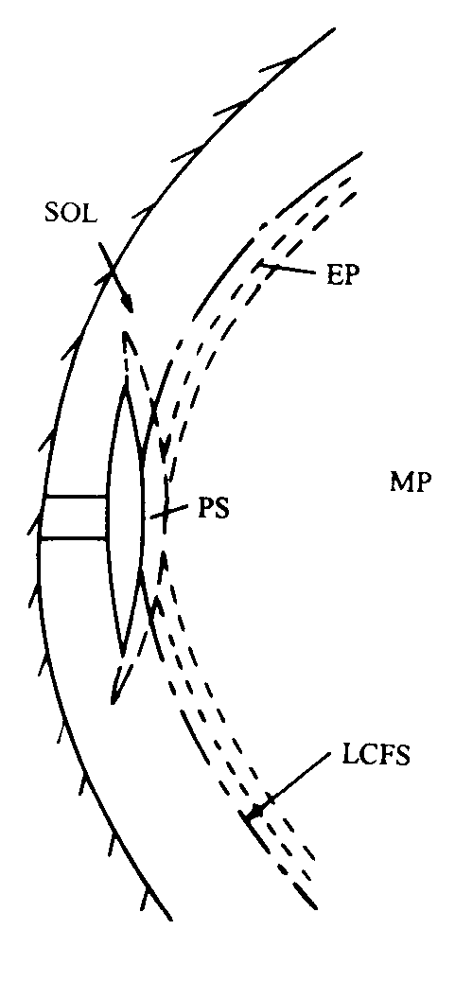

**图7.1** 孔栏位形的边缘区示意

SOL—刮离区;EP—边缘等离子体;PS—等离子体鞘;LCFS—最外部封闭磁面;MP—主等离子体。

(2)由第一壁表面放气引起的再循环送气,或简称器壁送气。即使送的是纯工作气体,由于这种送气不是实验中预设的,所以对实验并不利。因此,控制再循环是很多实验的重要内容,而且很难达到长期有效的效果。

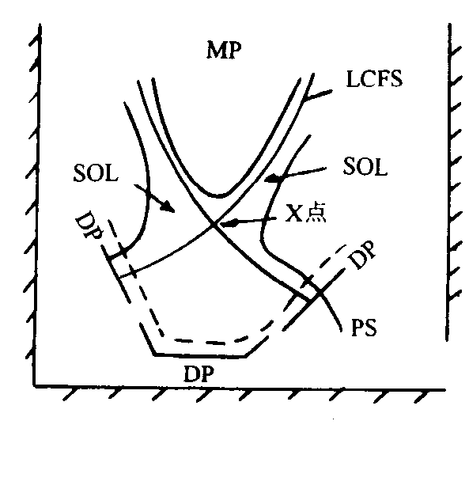

**图7.2** 偏滤器位形的边缘区示意

磁约束聚变装置及反应堆中的等离子体与器壁相互作用还具有本身的一些特点,即材料表面长期接受很大的热和粒子流负荷。在这种大的热负荷作用下,孔栏或偏滤器靶板的局部温度可能非常高,从而出现特殊的物理化学过程。一般情况下,等离子体与器壁的作用与壁前的等离子体鞘的性质有很大关系。严格说,根据孔栏面的几何结构的不同,实际上磁力线不会完全和表面垂直,因而鞘的结构是比较复杂的。下面我们仅对理想化的一维垂直鞘(假定磁力线垂直于壁表面)进行讨论,复杂的二维分析请参考有关文献。

从粒子和能量平衡的角度看,在边缘区中,除了必须考虑分子原子过程、杂质辐射效应外,它们构成输运方程组中的源项或漏项(sink),等离子体输运特性与主约束区中等离子体有很大差别。例如,与横越磁力线的输运相比,沿磁力线的输运也很重要,在剥离区则主要是沿磁力线的输运起主导作用。另外还需特别注意,各种过程不是独立的,它们之间存在有机的联系,例如杂质的产生与等离子体参数直接有关,气体流量与器壁条件有关,边缘参数与主约束区参数有关,等等。边缘等离子体物理研究的任务就是要确定各种有关物理过程间的关系,寻求对参数的最佳控制,以达到磁约束聚变研究的主要目的。

## 7.2 剥离区和等离子体鞘特性[2,5]

从图7.1可以看到,对孔栏位形,等离子体与物质材料的相互作用主要发生在孔栏与等离子体相切面附近,以及处在剥离区中的孔栏表面上。直接能和真空室壁作用的是电荷交换产生的快中性粒子,以及一些高能粒子或离群电子。相当一部分从主约束区流出的热量也将沉淀在孔栏表面上,等离子体中扩散出来的粒子也有相当一部分直接打到孔栏上,并将孔栏表面的气体,各种吸附材料解吸或溅射出来。一般来说,剥离层越厚,对真空室的保护作用越大。对偏滤器位形,在磁分界面附近没有器壁材料,从而避免了与主约束等离子体的直接接触,减弱了等离子体与器壁的相互作用。偏滤器靶板附近的物理过程与孔栏表面附近的物理过程是类似的,但孔栏位形与偏滤器位形的剥离区中的输运特性可以有很大的区别。在现代偏滤器中,在保持等离子体压强沿磁力线基本为常数的条件下,其粒子密度和温度都可以变化,使靶板附近有较高的粒子密度和较低的温度。这些将在下面分别讨论。

### 7.2.1 一维剥离层模型

这一小节中要讨论的内容原则上对孔栏位形和偏滤器位形都适用,但对应者,沿磁力线的输运要考虑热传导,这将在后面的小节中补充。

实际的边缘区域中磁场位形可能比较复杂,但很多研究表明,用比较符合实际的复杂位形计算得出的结果,与非常简单的一维模型得出的在定性上是一致的。取如图7.3所示的位形,设有左右对称的两块固体靶板(如果在托卡马克装置中只有一个孔栏,这两块靶板实际上代表该孔栏的左右两侧),假定在固体靶板上的热沉淀是可以容许的,固体表面的温度(典型值1000K)远小于等离子体边缘的温度(典型值$5\times 10^{4}\mathrm{K}$ ),先不考虑杂质效应$(Z = 1)$ ,等离子体中电子和离子按流体运动方式向靶板表面流动,其连接长度(典型值为几倍的$q R)$为$2L_{\mathrm{c}}$,流体速度为声速量级

$$
c_{\mathrm{s}} = \left(\frac{T_{\mathrm{e}} + T_{\mathrm{i}}}{m_{\mathrm{i}}}\right)^{1 / 2} \tag{7.1}
$$

由于磁力线与靶体相交,电子很容易沿磁力线运动到靶体表面,于是靶体将处在负电位,电子在剥离层中将具有玻尔兹曼分布

$$
n_{\mathrm{e}}(x) = n_{\mathrm{e0}}\exp (e\phi /T_{\mathrm{e}}) \tag{7.2}
$$

式中$n_{\mathrm{e0}}$是在$x = L_{\mathrm{c}} / 2$处的电子密度。在大部分空间区域,等离子体仍满足电中性条件,即$n_{\mathrm{e}} = n_{\mathrm{i}}$,只有在靠近靶体表面约几个德拜长度的范围内,电子和离子的密度才不相等,形成等离子体鞘。在电场的作用下,离子被加速,最后以接近鞘电位的能量打到靶的表面上。将鞘电位等于1/2电子温度值的地方定义为鞘的分界面,该处的等离子体密度将下降一半,离子密度接近但略高于电子。在鞘的内部,离子密度的下降慢于电子,根据不同的物理模型计算得到的鞘电位值是接近的,大约为$(- 3T_{\mathrm{e}} / e)$,被鞘电位加速的离子大体上以这一能量打到靶体表面上。因此,边缘电子温度越高,离子轰击靶体表面的能量也越大。这一能量的大小将影响靶体上杂质被溅射的程度。举例说明有关参数:设$T_{\mathrm{e}} = 20 \mathrm{eV}$, $n_{\mathrm{e}} = 2\times 10^{12} \mathrm{cm}^{- 3}$则$\lambda_{\mathrm{D}} = 10^{- 3} \mathrm{cm}$,鞘的特征宽度为$10^{- 2} \mathrm{cm}$左右,而连接长度$L_{\mathrm{c}}$对不同的装置在几米到几十米之间。

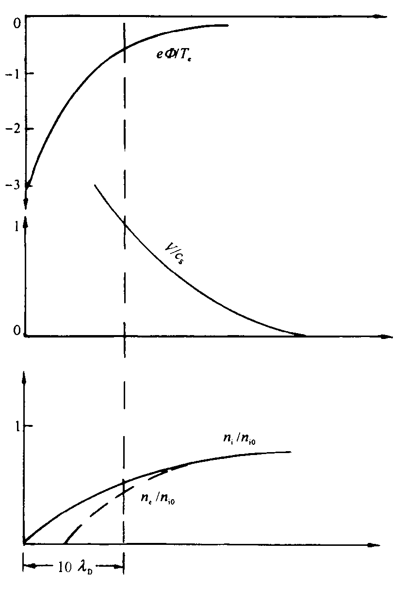

**图7.3** 等离子体鞘附近的电位、流动速度及电子和离子密度的变化

### 7.2.2 等离子体鞘的内部特性

通常在鞘的界面处的离子初速度远小于最终被加速后的速度,因此可以假定离子从零速度开始加速,则由连续性方程,得鞘内离子密度为

$$
n_{\mathrm{i}} = n_{\mathrm{i}}\left(\phi_{\mathrm{i}} / \phi\right)^{1 / 2} \tag{7.3}
$$

而电子密度由玻尔兹曼分布给出为

$$
n_{\mathrm{e}} = n_{\mathrm{i}}\exp [e(\Phi - \Phi_{\mathrm{i}}) / T_{\mathrm{e}}] \tag{7.4}
$$

式中下标$\mathbf{s}$表示在鞘分界面处取值。确定鞘中电位分布的是泊松方程

$$
\frac{\mathrm{d}^{2}\Phi}{\mathrm{d}x^{2}} = -4\pi e(n_{\mathrm{i}} - n_{\mathrm{e}}) \tag{7.5}
$$

这是一个非线性二阶常微分方程,在非常靠近鞘分界面处,利用近似展开,可以得到线性近似方程

$$
\frac{\mathrm{d}^{2}\Phi}{\mathrm{d}x^{2}} = -4\pi e(\Phi_{\mathrm{i}} - \Phi)\left(\frac{2}{T_{\mathrm{e}}} -\frac{1}{2|\Phi_{\mathrm{i}}|}\right) \tag{7.6}
$$

这个方程的解与上面关于鞘参数的预先假定是一致的,即$\Phi_{\mathrm{i}}\geqslant T_{\mathrm{e}} / 2e$, $\nu_{\mathrm{s}}\geqslant (T_{\mathrm{e}} / m_{\mathrm{i}})^{1 / 2}$。后一速度是离子温度为零时的流体声速。考虑离子温度效应,最后将得到分界面处的流体速度就是声速。

一个重要的物理结论是,从等离子体中打到鞘上的离子流量为

$$
\Gamma_{\mathrm{i}}^{\mathrm{e}} = n_{\mathrm{i}}\nu_{\mathrm{s}} = 0.5n_{\mathrm{o}}c_{\mathrm{s}} \tag{7.7}
$$

另一个重要的物理结果是靶体表面相对于剥离区等离子体内部的浮动电位为

$$
\frac{e\Phi_{\mathrm{f}}}{T_{\mathrm{e}}} = 0.5\ln \left[\left(\frac{2\pi m_{\mathrm{e}}}{m_{\mathrm{i}}}\right)\left(1 + \frac{T_{\mathrm{i}}}{T_{\mathrm{e}}}\right)(1 - \delta)^{-2}\right] \tag{7.8}
$$

式中$\delta$为固体表面的电子二次发射系数。

电子和离子在与靶体相互作用中将把部分热量传输到靶体表面上。定义电子的能量传输系数

$$
\gamma_{\mathrm{e}}^{\mathrm{e}} = \frac{P_{\mathrm{e}}^{\mathrm{e}}}{T_{\mathrm{e}}\Gamma^{\mathrm{e}}} \tag{7.9}
$$

从剥离区中心流向靶体表面的电子热流密度为

$$
P_{\mathrm{e}}^{\mathrm{e}} = \left(\frac{2T_{\mathrm{e}}}{1 - \delta} -e\Phi_{\mathrm{i}}\right)\Gamma_{\mathrm{net}}^{\mathrm{e}} \tag{7.10}
$$

因此可确定

$$
\gamma_{\mathrm{e}}^{\mathrm{e}} = \frac{2}{1 - \delta} -\frac{e\Phi_{\mathrm{f}}}{T_{\mathrm{e}}} +c_{\mathrm{o}} \tag{7.11}
$$

其中常数$c_{\mathrm{o}}\approx 0.5$。定义类似的离子能量传输系数,则可得

$$
\gamma_{\mathrm{i}}^{\mathrm{i}}\approx 3.5T_{\mathrm{i}} / T_{\mathrm{e}} \tag{7.12}
$$

其中确定系数3.5的条件是打到靶体表面的离子热流密度约为:

$$
P_{\mathrm{e}}^{\mathrm{e}} = (\frac{5}{2} T_{\mathrm{i}} + \frac{1}{2} m_{\mathrm{i}}c_{\mathrm{s}}^{2}),\approx 3.5T_{\mathrm{i}}\Gamma \tag{7.13}
$$

在等离子体鞘电位的作用下,电子流向靶体的流量有较大的减小,它超过离子因鞘电位的加速而增大的热流,因此,流向靶体的总热流将减小,这是好的方面;不好的一面是被鞘加速的离子会加大对靶体材料的溅射产额,从而增大了杂质源。当前的装置实验和反应堆设计,尤其是偏滤器靶板区的设计中要研究的一个重要问题就是既要减少热负荷,又要减小离子的溅射,即使鞘电位下降。增大靶板区附近的轻杂质辐射可以同时达到这两个目的,但要控制好杂质的返流。

### 7.2.3 剥离区特性

剥离区的真实物理宽度是由等离子体的横越磁力线的反常扩散与平行于磁力线的输运间的竞争所确定的,一般要求这一宽度小于最后一个封闭磁面到真空室的距离,这样才能确实保护真空室壁免遭大量等离子体粒子的轰击。假定由最后一个封闭磁面扩散出来的粒子流全部打到孔栏表面上,在剥离区内,电子和离子的密度由最后封闭磁面向外沿半径方向按指数方式减小

$$
n_{\mathrm{e}} = n_{\mathrm{e}}(a)\exp [-(\boldsymbol {r} - \boldsymbol {a}) / \lambda_{\mathrm{n}}] \tag{7.14}
$$

同样,假定外流的全部热量也都沉淀在孔栏表面,电子和离子的温度也都按指数方式减小

$$
T_{\mathrm{e}} = T_{\mathrm{e}}(a)\exp [-(\boldsymbol {r} - \boldsymbol {a}) / \lambda_{\mathrm{r}}] \tag{7.15}
$$

三个特征长度$\lambda_{\mathrm{n}}, \lambda_{\mathrm{r}}, \lambda_{\mathrm{r}}$要由粒子和热的三个平衡方程来确定。首先考虑粒子平衡条件

$$
L_{\mathrm{c}}\frac{\mathrm{d}}{\mathrm{d}r}\left(D_{\mathrm{t}}\frac{\mathrm{d}n}{\mathrm{d}r}\right)_{\mathrm{LCFS}} = 0.5n c_{\mathrm{s}} \tag{7.16}
$$

若有关特征量都在LCFS处取值,此式给出

$$
\frac{D_{\mathrm{t0}}}{\lambda_{\mathrm{n}}} = \frac{c_{\mathrm{t0}}\lambda_{\mathrm{n}}}{2L_{\mathrm{c}}} \tag{7.17}
$$

于是得出粒子密度在SOL中的特征长度为

$$
\lambda_{\mathrm{n}} = (2D_{\mathrm{t0}}L_{\mathrm{c}} / c_{\mathrm{t0}})^{1 / 2} \tag{7.18}
$$

其中反常扩散大体是玻姆扩散量级

$$
D_{\mathrm{t}} = \frac{c T_{\mathrm{e}}}{16B} \approx 0.06 T_{\mathrm{e}}(\mathrm{eV}) / B(\mathrm{T}) \mathrm{m}^{2} \cdot \mathrm{s}^{-1} \tag{7.19}
$$

在很多托卡马克装置实验中发现,实际的粒子密度特征长度与由式 (7.18) 和 (7.19) 所确定的符合得相当好,其中在 ASDEX、FT、AL- C、TEXTOR、JET 和 TFTR 等装置中,实测值与上述由简单模型得出的理论值的偏离不足$\pm 20\%$。这样,实际上还可以从 SOL 中测得的粒子密度特征长度$\lambda_{\mathrm{n}}$来确定边缘附近等离子体的反常扩散系数。关于 SOL 中粒子密度的测量可以应用简单而且可靠性高的朗缪尔探针法,所以关于边缘区附近等离子体的扩散具有玻姆型 (7.19) 的结论也相当可信。

关于电子和离子温度的特征长度要由关于电子和离子的两个能量平衡条件来确定

$$
L_{\mathrm{c}}\left(n\chi_{\mathrm{t}}\frac{\mathrm{d}T_{\mathrm{e}}}{\mathrm{d}r} +\frac{5}{2} D_{\mathrm{t}}T_{\mathrm{e}}\frac{\mathrm{d}n}{\mathrm{d}r}\right)_{\mathrm{LCFS}} = 0.5n_{\mathrm{c}}c_{\mathrm{s}}\gamma_{\mathrm{s}}^{\mathrm{t}}T_{\mathrm{e}} \tag{7.20}
$$

$$
L_{\mathrm{c}}\frac{\mathrm{d}}{\mathrm{d}r}\left(\frac{5}{2} D_{\mathrm{t}}T_{\mathrm{t}}\frac{\mathrm{d}n}{\mathrm{d}r}\right)_{\mathrm{LCFS}} = 0.5n_{\mathrm{c}}c_{\mathrm{s}}\gamma_{\mathrm{s}}^{\mathrm{t}}T_{\mathrm{e}} \tag{7.21}
$$

式中在向外流的离子热量中没有考虑离子热传导的贡献,因为实验中发现边缘区中主要是电子的反常热传导及对流传热占优。另外,若在式 (7.21) 中关于离子在鞘上的能量传输系数取$\gamma_{\mathrm{s}}^{\mathrm{t}} = 2.5T_{\mathrm{t}} / T_{\mathrm{e}}$ [前面公式 (7.12) 中这一系数为 3.5],则关于离子能量平衡的公式 (7.21) 中的离子温度可以消去,剩下的部分与粒子平衡方程 (7.16) 是一回事,这意味着离子温度是近似不变的,即$\lambda_{\tau}$很大。于是上面公式中的声速取LCFS处值的假定也是正确的。关于电子能量平衡的公式(7.20)给出

$$
\frac{D_{\mathrm{lo}}}{\lambda_{\mathrm{n}}}\left(\frac{5}{2} +\frac{\chi_{\mathrm{lo}}\lambda_{\mathrm{n}}}{D_{\mathrm{lo}}\lambda_{\tau_{\mathrm{r}}}}\right) = \frac{\gamma_{\mathrm{e}}^{\star}c_{\mathrm{so}}}{2L_{\mathrm{c}}}\left(\frac{1}{\lambda_{\mathrm{n}}} +\frac{1}{\lambda_{\tau_{\mathrm{r}}}}\right)^{-1} \tag{7.22}
$$

或者写成比值的形式

$$
\left(\frac{5}{2} +\frac{\chi_{\mathrm{lo}}\lambda_{\mathrm{n}}}{D_{\mathrm{lo}}\lambda_{\tau_{\mathrm{r}}}}\right)\left(1 + \frac{\lambda_{\mathrm{n}}}{\lambda_{\tau_{\mathrm{r}}}}\right) = \gamma_{\mathrm{e}}^{\star} \tag{7.23}
$$

这是关于两个特征长度比值的二次代数方程,可以看出它与两个主要参数有关,一是电子反常热导率与反常玻姆扩散系数的比值,另一为电子在钠上的能量传输系数。与粒子密度特征长度的情形不同,电子温度特征长度还依赖于许多没有考虑的物理因素,如电子与离子的碰撞引起的能量传递,离子反常热传导效应,SOL内可能存在的垂直电场(例如双极电场),等等。因此由上面的公式与SOL中的实验结果(关于电子温度分布的探针测量结果)对比得出的关于电子反常热导率的结果会有较大的误差。

但是,上面关于SOL中粒子密度、电子温度和离子温度特征长度的一般考虑是恰当的。实验证实,三个参量间存在尺度关系

$$
\lambda_{\tau_{\mathrm{r}}} > \lambda_{\tau_{\mathrm{r}}}\geqslant \lambda_{\mathrm{n}} \tag{7.24}
$$

以上分析比较适用于孔径形,但定性上也可描述偏滤器位形中剥离区中的一些物理特性。其间的差别将在有关偏滤器的小节中专门讨论。

## 7.3 边缘等离子体中的分子原子过程及边缘参数与中心参数的联系[1-3,6]

### 7.3.1 中性粒子向等离子体内部的透入

托卡马克装置中等离子体是通过在真空室中预充工作气体(氢或氘)然后通过欧姆放电形成的,以后,通过主动送气(最一般的做法,也是早期实验唯一的方法)来补充因扩散而损失的等离子体。等离子体周围的器壁材料表面吸附有大量的工作气体,它们在放电过程中因边缘等离子体与壁表面的相互作用会不断放出来,成为一种被动气体源。但无论主动送气或壁放气,气体总是通过边界向等离子体约束区内部扩散的。首先是气体要通过刮离区,那里的等离子体密度较低,一般不足以完全使中性气体电离。一些装置如PLT,DITE,JET,T- 10等都具体确定过气体通过SOL后的电离比例,结果发现除T- 10中有较高的电离比外,大部分装置中被SOL中等离子体电离的部分小于$30\%$。因此,大部分气体将进入LCFS以内。中性粒子的穿透深度与它们的各种分子原子反应截面有关。这些截面包括:

(1)分子被电离成分子态离子

$$
\mathrm{e} + \mathrm{H}_{2}\rightarrow \mathrm{H}_{2}^{+} + 2\mathrm{e} \tag{7.25}
$$

(2)分子被解离成原子

$$
\mathrm{e} + \mathrm{H}_{2}\rightarrow 2\mathrm{H}^{0} + \mathrm{e} \tag{7.26}
$$

(3)分子被解离成原子,同时一个原子被电离

$$
\mathrm{e} + \mathrm{H}_{2}\rightarrow \mathrm{H}^{0} + \mathrm{H}^{+} + 2\mathrm{e} \tag{7.27}
$$

(4)分子态离子吸附一个电子同时被解离成两个原子

$$
\mathrm{e} + \mathrm{H}_{2}^{+}\rightarrow 2\mathrm{H}^{0} \tag{7.28}
$$

(5) 分子态离子被解离成一个原子和一个离子

$$
\mathrm{e} + \mathrm{H}_{2}^{+}\rightarrow \mathrm{H}^{0} + \mathrm{H}^{+} + \mathrm{e} \tag{7.29}
$$

(6) 原子电离

$$
\mathrm{e} + \mathrm{H}^{0}\rightarrow \mathrm{H}^{+} + 2\mathrm{e} \tag{7.30}
$$

(7) 原子与离子间电荷交换

$$
\mathrm{H}^{0} + \mathrm{H}^{+}\rightarrow \mathrm{H}^{+} + \mathrm{H}^{0} \tag{7.31}
$$

具体的截面数据如图7.4所示。

从图7.4看出,对应于边缘等离子体温度为$10\sim 100 \mathrm{eV}$的具体情况,截面大的反应依次为第五,第一,第六和第七种,即分子被电离及分子态离子被解离,原子被电离及电荷交换。这就确定了中性气体对中心等离子体约束区穿透过程的一些基本特点。首先考虑氢分子的穿透问题。在室温下,分子的运动速度很小,按$\nu_{0} = (2T_{0} / m)^{1 / 2}$, $\lambda = \nu_{0} / n_{\mathrm{e}}\langle \sigma \nu \rangle$计算透入深度,氢分子在$300 \mathrm{K}$下的平均速度约为$1.5\times 10^{5} \mathrm{cm}\cdot \mathrm{s}^{- 1}$, $10 \mathrm{eV}$的电子温度下降解率小于$10^{- 8} \mathrm{cm}^{3}\cdot \mathrm{s}^{- 1}$,若设SOL中等离子体密度为$10^{12} \mathrm{cm}^{3}$,则$\lambda$大于$10 \mathrm{cm}$,即氢分子可以穿透SOL。但一进入最后一个封闭磁面,等离子体密度升至$10^{13} \mathrm{cm}^{- 3}$量级,电子温度在几十电子伏,分子氢的电离率升至

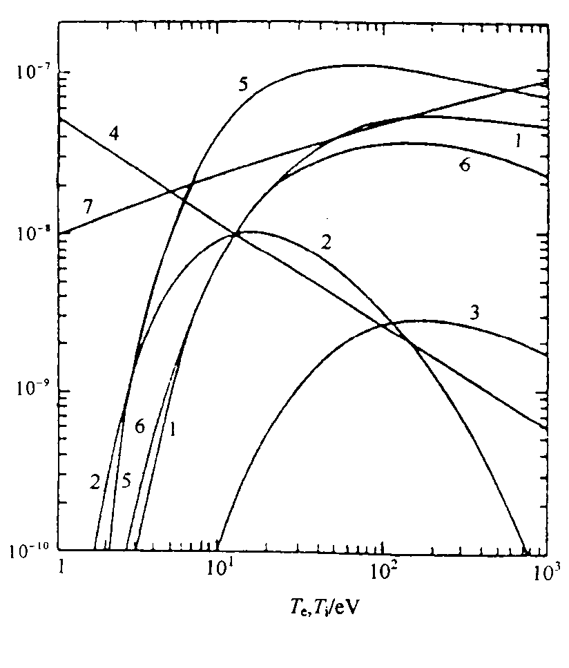

**图7.4** 主要的分子和原子反应率随电子和离子温度的变化[2]

$5\times 10^{- 7}\mathrm{cm}^{3}\cdot \mathrm{s}^{- 1}$,穿透深度将下降到$2\mathrm{cm}$以下,因而分子氢只能透入到非常靠近最后封闭磁面的边缘区。分子态氢在电离后,得到的分子态离子的离解率非常高,因此几乎立即被解离。在分子态离子被解离成中性原子时,它在与电子的碰撞过程中获得了一定的能量,使中性原子具有$3\mathrm{eV}$左右的能量,其速度比室温(300K)提高了一个数量级,达到$2\times 10^{6}\mathrm{cm}\cdot \mathrm{s}^{- 1}$,这些原子的电离率为$10^{- 8}\mathrm{cm}^{3}\cdot \mathrm{s}^{- 1}$,相应的穿透深度可达$10\sim 20 \mathrm{cm}$,相当于中小型装置的等离子体的小半径。这种被解离而具有较大能量的粒子,称为弗兰克- 康登(Fronk- Condon)粒子,它是中性粒子能够较深地透入等离子体内部的原因之一。

中性原子可以更深地透入等离子体内部的另一原因与式(7.31)有关,即原子与离子间的电荷交换起重要作用。简单的原理是,较冷的中性原子与较热的离子发生电荷交换后,产生的中性原子具有原来热离子的能量,这些原子的一部分将离开等离子体而损失,但总有一部分射向更深入的约束区内,它们又会被电离,或发生另一次电荷交换,结果产生另一个能量更大的中性原子。这一级联过程(cascade)的总效果是部分中性原子深入到内部约束区。等效地可以把中性原子向内穿透等离子体的速度$\nu_{0}$进一步提高,不同装置实验及计算编码中采用$\nu_{0} \approx (2 \sim 4.4) \times 10^{6} \mathrm{~cm} \cdot \mathrm{s}^{- 1}$,相当于取$\nu_{0} \approx 4 \sim 20 \mathrm{eV}$。已发展了一些基于上述分析的一维和二维数值计算编码,可用于实际分析。氢分子、氢原子的等离子体密度的剖面示意图如图7.5所示。

#### 7.3.2 边缘粒子密度与中心粒子密度的关系

真空室壁和孔径表面等预先吸附的气体在放电过程中将不断放出,成为被动的供气源。在放电过程中,由等离子体中扩散出来的带电粒子和电荷交换产生的中性粒子不断地回流到器壁表面,这些粒子与表面上原先吸附的粒子的碰撞使部分入射粒子又重新返回等离子体中,另一些被吸附粒子则可能被溅射出来。所以,除产生杂质流外,等离子体与表面相互作用的另一后果是使大量工作气体返回等离子体。一个入射到器壁的粒子引起的返回粒子数称再循环率。在研究等离子体密度积累及计算等离子体粒子约束时间时,必须考虑再循环的影响。

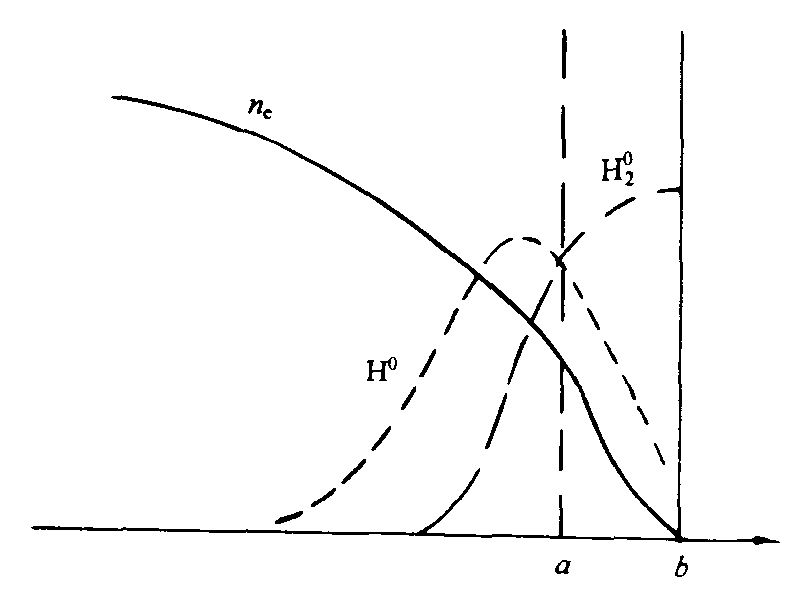

**图7.5** 边缘区附近氢分子、氢原子的剖面小总

现在介绍一个由Engelhardt等人首先提出的简单的模型来分析等离子体约束区中粒子密度与边缘密度以及送气量的关系。设中性原子由最外封闭磁面$r = a$的向内穿透距离为$\lambda_{z}$,等离子体的横向扩散系数为$D_{\perp}$,除向外扩散外,等离子体有一个向内的流动速度

$$
\nu_{\mathrm{in}} = -\xi D_{\perp}r / a^{2} \tag{7.32}
$$

式中$\xi$为一数字因子,如果没有这个向内的流动速度,得到的密度剖面在$r = a - \lambda_{z}$的内部是平坦的,因为内部基本不存在粒子源,这个结果不符合实验观察。因此,引入向内的流动速度(对流速度)是根据实验结果所做的唯象假定。根据新经典输运理论,可能存在对流速度项,但其值太小,不能解释实验中观察到的粒子密度分布剖面的峰化程度。所以有关等离子体粒子向内对流的机制是一个理论上没有解决的问题。

在稳态条件下,得到粒子流的平衡关系

$$
\Gamma = -D_{\perp}\frac{\mathrm{d}n_{\mathrm{e}}}{\mathrm{d}r} +\frac{\xi D_{\perp}m_{\mathrm{e}}}{a^{2}} = 0,\qquad 0< r< a - \lambda_{\mathrm{iz}} \tag{7.33}
$$

$$
\Gamma = -D_{\perp}\frac{\mathrm{d}n_{\mathrm{e}}}{\mathrm{d}r} = \Phi_{\mathrm{in}},\qquad a - \lambda_{\mathrm{iz}}< r< a \tag{7.34}
$$

式中$\Phi_{\mathrm{in}}$是单位长度等离子体柱上向内的总的中性原子通量,由式(7.34),在$r = a - \lambda_{\mathrm{iz}}$处的等离子体密度为

$$
n_{\mathrm{e}}(r_{\mathrm{i}}) = \Phi_{\mathrm{in}}\lambda_{\mathrm{iz}} / D_{\perp} \tag{7.35}
$$

式中$\lambda_{\mathrm{iz}}$是中性原子的电离长度

由式(7.33),内部的密度分布为高斯型

$$
n_{\mathrm{e}}(r) = n_{\mathrm{e}}(r_{1})\exp [\xi (1 - r^{2} / a^{2}) / 2] \tag{7.37}
$$

上面两式给出了送气量与中心粒子密度的关系,当然与粒子的扩散及向内对流密度相关。由于粒子向内的对流运动引起密度分布的峰化,定义峰化比为

$$
f = \langle n_{\mathrm{e}}\rangle /n_{\mathrm{e}}(r_{1}) \tag{7.38}
$$

在上述假定下,峰化度仅与向内对流速度的数字因子$\xi$有关:

$$
f = 2[\exp (\xi /2) - 1] / \xi \tag{7.39}
$$

再考虑SOL区内的粒子流平衡条件:假定全部外流粒子在SOL内都沿磁力线流到靶体表面,则得

$$
\Gamma = D_{\mathrm{L}}[n_{\mathrm{e}}(r_{1}) - n_{\mathrm{e}}(a)] / \lambda_{\mathrm{zz}} = D_{\mathrm{L}}n_{\mathrm{e}}(a) / \lambda_{\mathrm{n}} \tag{7.40}
$$

式中$\lambda_{\mathrm{n}}$是(7.18)中定义的粒子刮离长度,代入电离长度的表示式(7.36),最后得出最后封闭磁面处的粒子密度与中心区平均密度的关系为

$$
n_{\mathrm{e}}(a) = \frac{\lambda_{\mathrm{n}}\langle\sigma\nu\rangle_{\mathrm{i}}(\langle n_{\mathrm{e}}\rangle)^{2}}{2f^{2}\nu_{0}} \tag{7.41}
$$

这个关系式表明,边缘粒子密度与中心区的平均密度的平方成正比。虽然在推导中做了很多简化假定,但这一结果与JET等装置的实验观察具有可比性。当然,另一些实验指出,边缘粒子密度与平均密度的关系还要更强,超过平方依赖关系。

#### 7.3.3 边缘等离子体温度的估计

可以通过进入SOL的热流来估计最外封闭磁面处的电子温度(当离子温度较低时)。流入SOL的总热流应等于总加热功率减去封闭磁面内部等离子体辐射的总功率,假定这些功率被全部带到孔栏或偏滤器靶板上

$$
(p_{\mathrm{h}} - p_{\mathrm{r}}) = 0.5n_{\mathrm{e}}(a)c_{\mathrm{w}} \gamma_{\mathrm{r}} T_{\mathrm{e}}(a) A_{\mathrm{L}} \tag{7.42}
$$

式中$\gamma_{\mathrm{r}}$是电子的能量传输系数, $A_{\mathrm{L}}$是孔栏或偏滤器靶板的接收热量的面积。为消去这个几何参数,引入粒子约束时间和总体能量约束时间的概念

$$
\frac{\langle n\rangle V}{\tau_{\mathrm{p}}} = 0.5n_{\mathrm{e}}(a)c_{\mathrm{w}} A_{\mathrm{L}} \tag{7.43}
$$

$$
(1 - p_{\mathrm{r}} / p_{\mathrm{h}})\frac{3\langle n\rangle\langle T\rangle V}{\tau_{\mathrm{E}}} = 0.5n_{\mathrm{e}}(a)c_{\mathrm{w}}\gamma_{\mathrm{r}} T_{\mathrm{e}}(a)A_{\mathrm{L}} \tag{7.44}
$$

这里设集热面积与集粒子面积基本相同,则

$$
T_{\mathrm{e}}(a) = 0.3\langle T\rangle (1 - p_{\mathrm{r}} / p_{\mathrm{h}})\frac{\tau_{\mathrm{p}}}{\tau_{\mathrm{E}}} \tag{7.45}
$$

一般而言,随着粒子密度的增大,内部区域的总辐射功率以正比于密度的平方的方式加大,而粒子的约束时间,根据一些装置中的实验定标研究,与平均密度接近于反比关系。这样由上式知,随着粒子密度的加大,边缘等离子体温度有较快的下降。因而等离子体鞘电位随之下降,这将有利于减小杂质的溅射产额。

## 7.4 杂质物理

磁约束聚变装置中的等离子体与材料表面的相互作用主要包括两方面的问题,第一是器壁(或更一般地面向等离子体物质材料)中放出的各种粒子(包括所吸附的工作气体、杂质气体以及组成材料本身的元素)进入等离子体约束区后对等离子体约束特性造成的影响;第二是物质材料本身受等离子体中粒子长期作用后的损伤。后一问题对多数处于实验阶段的装置还不是很紧迫的问题,因为这些装置中每次放电中等离子体存在的时间并不长,有的装置从运行直到完成实验目标,总的等离子体与器壁的有效作用时间也不过等效于几天的量级(几秒乘几万次),因而等离子体对器壁的积分腐蚀效应(erosion)还不致破坏材料基本物理化学性能。可是对未来的长脉冲实验,尤其是反应堆级实验,一次放电脉宽就达几千秒或更长,一天的实验其有效作用就可能超过中小装置中整个实验周期的效果。对商用反应堆,装置基本上处在连续运行状态,而且器壁表面一直有大的热和粒子流负荷,解决这种条件下的腐蚀则是反应堆材料工程的重大难题之一。

长期以来,对采用低$z$材料还是高$z$材料做与等离子体直接接触的表面组件一直存在争论。70年代以前的实验中多采用高$z$材料(钼、钨)做孔栏,主要是因为这些材料有较高的熔点,而且物理溅射的阈值高,但实验结果发现如果等离子体中含有很高水准的高$z$杂质,则等离子体总体品质很差。后来的实验多改用低$z$材料,如用石墨、硼或铍做孔栏,或在高$z$材料的孔栏表面覆盖一层低$z$材料,在JET中甚至采用过全铍真空室,实验结果是杂质辐射损失和有效电荷值大幅度降低,约束明显改善,取得很好的效果。但是,这些轻材料的腐蚀率很大,一些长脉冲放电实验中,低$z$杂质的含量超过$5\%$以上,使工作元素的离子含量降低,从反应堆运行的角度看,这将直接影响有效的聚变功率输出,这是一个方面;另一方面,高的腐蚀率对材料的损伤太大,也是不能容许的。现在的大装置实验中的偏滤器靶板又重新考虑使用高$z$材料制造,在反应堆设计中也主要考虑使用高$z$材料。当然,现在在控制重杂质进入主约束区方面的技术已有很大改进,同时在减小总腐蚀率方面也已有较好的解决方案。

### 7.4.1 杂质产生的机制

主约束区中等离子体要不断向外扩散,当粒子因扩散逸出封闭磁面后,大部分将沿磁力线打到孔栏或偏滤器靶板上,也有部分直接打到真空室壁上(因电荷交换过程逸出的中性粒子则可以直接打到真空室壁上)。此外,在高功率加热中产生的一些高能离子因运动轨道与封闭磁面的偏离太大而会直接打到器壁上,这种损失常常因边缘区域中环向磁场的波纹度较大而加剧。在反应堆中,聚变α粒子也有一部分会因轨道触壁而直接损失。通过改进磁场位形及其均匀性,可以减少直接接触真空室壁的损失,但粒子与孔栏或偏滤器靶板的作用则是永存的,这是研究的重点。

等离子体与材料表面相互作用中有关的表面物理过程是很复杂的,包含多种机制,主要有:背散射(back scattering)、热解吸(thermal desorption)、物理溅射(physical sputtering)、化学溅射(chemical sputtering)、辐射增强升华(RES——radiation enhanced sublimation),以及非正常条件下等离子体与器壁的强相互作用,如等离子体破裂时大量粒子,包括一些因破裂过程中感生电场加速而获得高能的粒子与器壁的突然加大的相互作用对材料的腐蚀,等等。具体是哪一类过程起主要作用与受作用的基体的温度有关,也与入射粒子(主要是离子和中性粒子)的能量有关。下面对有关机制分别简要地介绍。

#### 7.4.1.1 背散射

很多入射离子或原子,如H,D,T,He等,在进入器壁表面后会和材料中的原子发生一系列弹性和非弹性碰撞,最后会回到等离子体边界层中,这一过程称为背散射。背散射粒子大多是以中性粒子的形式出现,较少仍以离子状态出现,同时原先具有的能量已损失一部分。入射粒子中的一部分也可能留在表面,即被固体所吸附。背散射过程并不增加杂质含量,但对工作气体的再循环有较大的影响。

#### 7.4.1.2 解吸(desorption)

通常条件下,固体表面有一层来自周围环境的吸附气体,包括工作气体和杂质气体。不同的被吸附气体与固体表面原子或分子的结合能各不相同,对物理吸附,结合能仅为$0.3 \mathrm{eV}$,对化学吸附,结合能可达$3 \mathrm{eV}$。结合能低的气体,在表面温度加高时首先被解吸,而结合能高的原子和分子只有从外部入射粒子中得到较多能量时才能释出。由于吸附气体的放出会很大程度上影响主约束等离子体的性质,是实验所不希望的,在实际操作中常要将真空室壁长时间预加热到$300 \mathrm{K}$以上,这样可使低结合能的气体离开器壁;如真空室有较好的结构,可加热到$600 \mathrm{K}$,这时,结合能小于$1 \mathrm{eV}$的气体很快就释出。

作为杂质被吸附在第一壁表面的主要气体是空气中的氧和氮,氧容易和工作元素氢化合成水,对含碳器壁,则会生成碳氧化合物。实验发现,经长期器壁烘烤后仍有大量的氧杂质存在,因此又发展了许多通过预放电对器壁进行清洗的技术。主要有低参数下的欧姆放电,亦称泰勒放电,使器壁表面受能量为几个电子伏的电子和离子的长时间轰击,这样做对大部分的表面是起作用的,但对一些等离子体粒子不易直接作用到的角落很难起到清洗效果。比泰勒放电更有效的是进行有极或无极辉光放电,将真空室壁作为负电极,经长期作用,可以驱除大量被吸附的氧。实验中还采用喷钛(titanium gettering)、器壁碳化、硼化等处理方法,使器壁表面覆盖一层钛、石墨或硼,这样做可以使器壁在一段时间中对氧杂质进行控制,同时由于钛具有很高的吸氢能力,可以在一段时间内有效地控制工作气体的再循环。这些方法在实验研究阶段有明显的效果,但在反应堆中的应用前景则有待进一步的实验验证,因为它们只在短时间内有效。

#### 7.4.1.3 物理溅射

入射粒子的部分能量通过碰撞传给固体中的原子后,若这些原子的能量已超过结合能,该原子会从表面层逸出,进入等离子体,这个过程就叫溅射。级联过程(cascade)会对这种能量转换起很大影响。这是磁约束聚变等离子体中产生杂质的主要机制,因为不可能采用预处理技术来减小这种过程的发生。显然,溅射发生在入射粒子的能量大于某种阈值下,设固体原子的结合能为$W_{0}$,则这个阈值应为

$$
E_{0} = \frac{(m_{1} + m_{2})^{2}}{4m_{1}m_{2}} W_{0} \tag{7.46}
$$

随着入射粒子能量的加大,溅射率迅速加大。图7.6是Be,B,C,Cu,W等材料在气离子轰击下的溅射产额和自溅射产额。图7.7和图7.8是钨和铍在气离子和自身离子作用下的溅射率随入射粒子能量的变化。前面关于等离子体鞘的介绍中已指出,入射离子将受到输电位的加速,其能量至少是鞘电位加速得到的能量,因此鞘电位对溅射产额有重大影响。对于电荷数为Z,温度为$T_{i}$的粒子,在鞘电位加速后的平均能量为

$$
E_{i} = 2T_{i} + 3Z T_{e}(a) \tag{7.47}
$$

显然,较低的边缘电子温度(因而较低的鞘电位)对减小溅射率从而减少杂质及材料腐蚀是有利的。

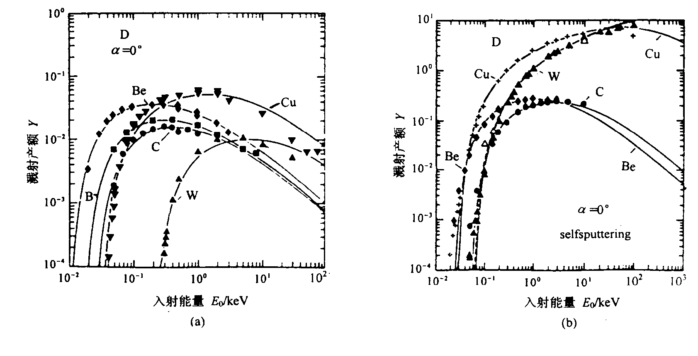

**图7.6** 气离子对Be,B,C,Cu,W的溅射产额和自溅射产额[4]

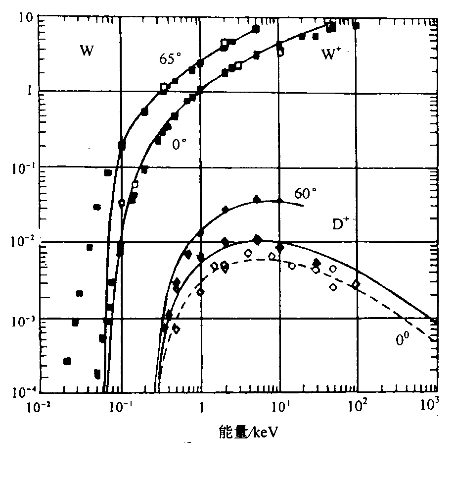

**图7.7** 钨被气离子轰击溅射和自溅射的产额随入射离子能量的变化[4]

图7.6 (a) 溅射产额; (b) 自溅射产额。

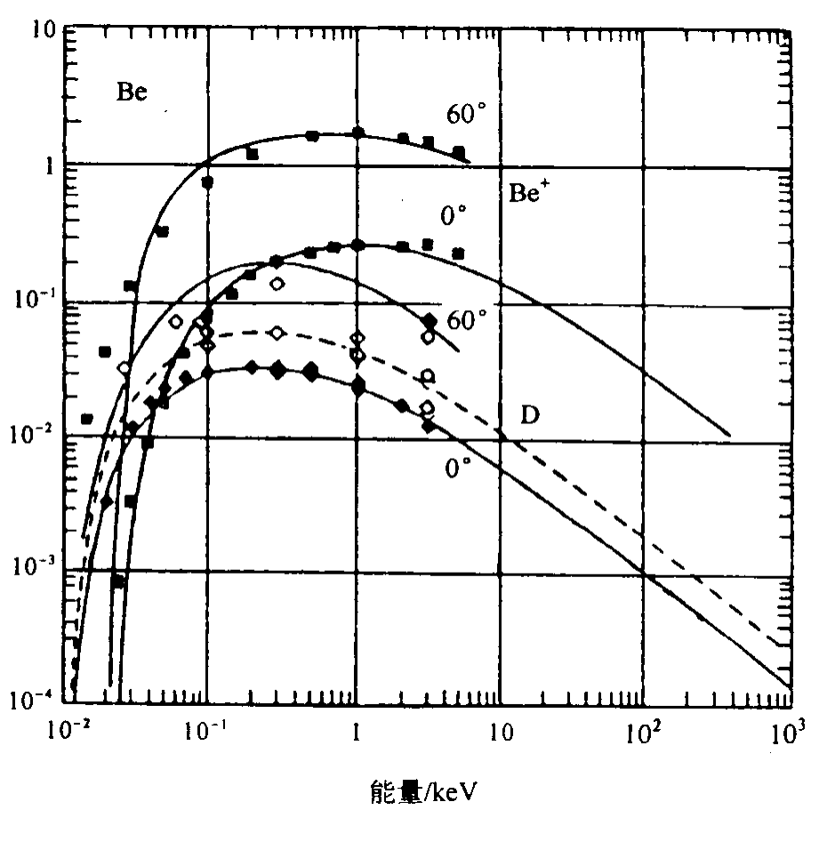

**图7.8** 铍被气离子轰击的溅射和自溅射的产额[4]

目前对一些重材料元素的溅射已有很好的了解, 包括理论模型及基于实验的经验公式, 它们与实验结果的符合度很好。对很多与聚变应用有关的材料, 已经有可实用的数据库, 例如, 采用两个数字因子就可描述法向入射时的材料溅射产额 (Bohdonsky 拟合公式)

$$
Y(E_{0},0^{0}) = Q S_{n}(E_{0})\left[1 - \left(\frac{E_{\mathrm{th}}}{E_{0}}\right)^{2 / 3}\right]\left(1 - \frac{E_{\mathrm{th}}}{E_{0}}\right)^{2} \tag{7.48}
$$

其中$S_{\mathrm{n}}$是入射离子的核阻止截面 (nuclear stopping cross- section), $Q$及$E_{\mathrm{th}}$是拟合参数, 对不同的元素已有对应的数据表可用。另外还有一个有较广泛应用的估计总溅射产额的经验公式

$$
Y = \frac{A(E_{0} - E_{\mathrm{th}})}{(E_{0} - E_{\mathrm{th}} + B)} \tag{7.49}
$$

$A, B$为拟合参数, 不同的元素粒子有不同的值。

从上面三图看出, 自溅射产额远大于气离子的溅射产额。这在物理上是很显然的, 因为同类粒子的碰撞产生最大的能量转换。由于自溅射在实际问题中的重要性, 对材料的有效溅射产额应计入自溅射

$$
Y_{\mathrm{eff}} = \frac{Y}{1 - g Y_{\mathrm{s}}} \tag{7.50}
$$

式中$g$是受溅射粒子重新打到靶体表面的几率, 与靶体表面温度密度相关, 也与具体的位形及等离子体边缘区参数有关。在特定的条件下会出现$g \rightarrow 1$的情况, 这时溅射产额迅速加大, 加上下面要介绍的 RES 效应, 将形成杂质流喷霜现象 (impurity bloom), 或称杂质突增现象 (impurity runaway): 大量杂质迅速进入等离子体约束区, 使约束迅速恶化或引发破裂不稳定性 (见下面关于 RES 的例子)。

溅射产额与基体表面的机械性能关系很大, 提高表面的光洁度可以减小溅射率。图 7.9 是几种具有不同光洁度的基体的溅射产额角分布, 可以看出, 溅射主要发生在靠近$90^{\circ}$角附近, 而且与表面光洁度关系极大。

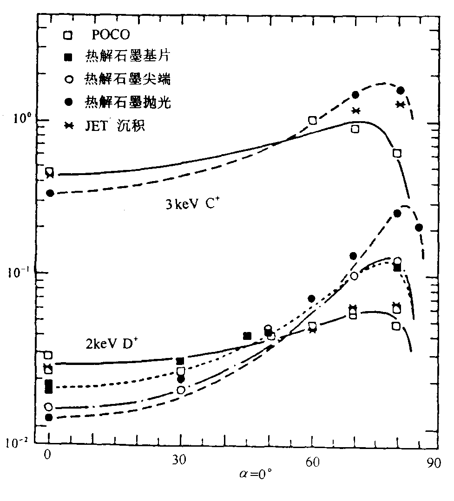

**图7.9** 几种重要碳基材料的溅射角分布[4]

对于磁约束聚变装置中的实际情形, 入射粒子来自四面八方, 这时被溅射粒子的角分布接近余弦分布

$$
Y(\theta) = Y_{0}\cos \theta \tag{7.51}
$$

而能量分布可以用下面的公式表示

$$
\frac{\mathrm{d}Y}{\mathrm{d}E_{1}} = \frac{E_{1}}{(E_{1} + E_{s})^{3}} \tag{7.52}
$$

式中$E_{1}$是被溅射原子的能量, 而$E_{s}$是表面的束缚能。

#### 7.4.1.4 化学溅射

化学溅射主要发生在石墨和碳基复合材料中。入射粒子与碳结合成挥发性分子, 例如氢离子或原子入射到碳基复合材料中形成碳氢化合物, 氧离子入射形成 CO 等。在一定的温度区, 这种效应成为比物理溅射更重要的材料腐蚀机制。已有相当多的实验数据可供参考, 图 7.10 为氘离子入射到热解石墨及含硼石墨材料 USB15 上得到的形成氘甲烷 (CD4) 的产额曲线。这种机制对纯石墨的腐蚀在室温下已超过物理溅射的效应。

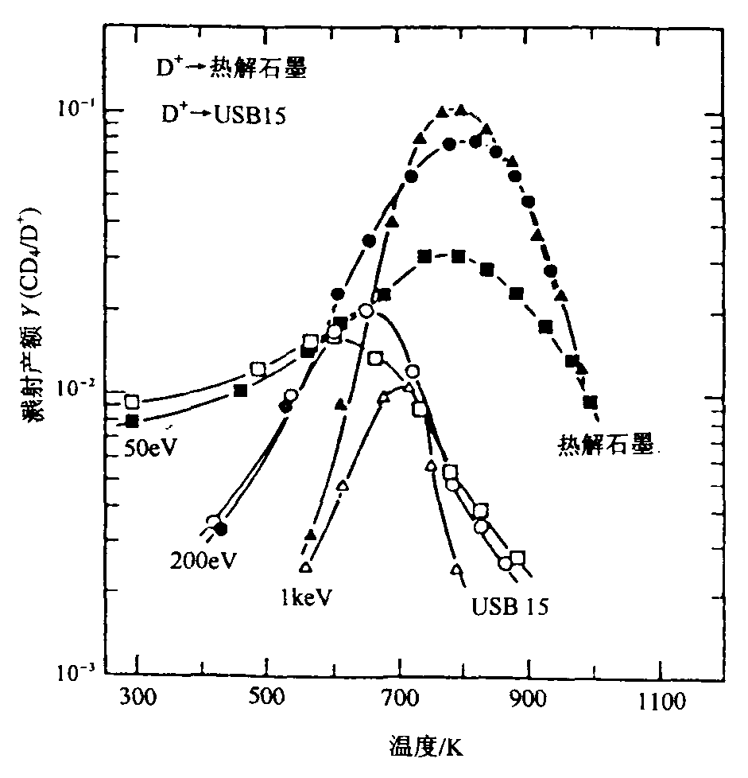

**图7.10** 化学溅射产额与基体温度的关系

通过在石墨中加入B,Si,Ti等元素可以大幅度降低化学溅射产额。这类研究仍在积极地进行中。

#### 7.4.1.5 辐射增强升华 (RES)

对石墨及一些碳基复合材料,当基体的温度超过$1500\mathrm{~K~}$时,会发生一种很奇特的腐蚀过程。图7.11所示为含硼石墨及碳化硼$(\mathbf{B}_{4}\mathbf{C})$在$1\mathrm{~keV~D^{+}}$和$5\mathrm{~keV~Ar^{+}}$作用下溅射率随基体温度的变化。可以看到,在$1500\mathrm{~K~}$以上区域,溅射产额随温度迅速加大。这一过程与物理升华不是一回事,后者按理应在更高的温度下$(>2000\mathrm{~K~})$才发生。这一过程称为辐射增强升华现象(RES)。在RES过程中,碳原子的激活能阈值仅为$0.78\mathrm{~eV~}$。RES的机制是:在入射离子碰撞下,靶体原子的晶格发生了位移,这时填隙(interstitial)碳原子发生了热发射。

从图7.11所示实验结果还可看出,在石墨中加硼对延缓RES到更高的温度区有一定的作用。

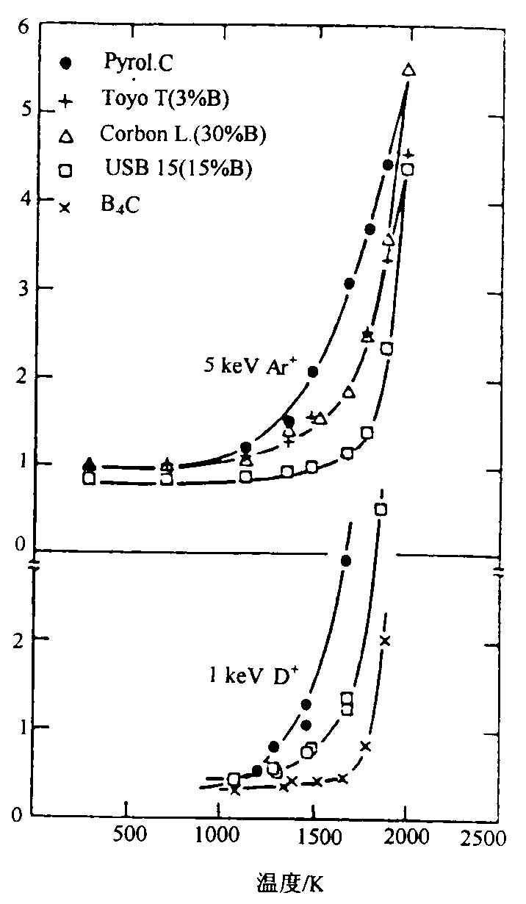

**图7.11** 温度超过临界值时溅射产额的快速增长〔4〕

对RES,也已总结出实用拟合公式来计算溅射产额,其形式类似于前面关于物理溅射产额公式(7.48),其中的拟合参数$\mathcal{Q}$应以下面的数值代替:

$$
\mathcal{Q}_{\mathrm{RES}} = 54M_{1}^{1.18}\exp \left(-\frac{0.78\mathrm{eV}}{T}\right)\left[\frac{\Gamma}{10^{16}\mathrm{cm}^{-2}\cdot\mathrm{s}^{-1}}\right]^{-0.1} \tag{7.53}
$$

其中$M_{1}$是被溅射元素的原子质量, $\Gamma$是入射粒子的通量密度。RES产额随入射粒子通量的增加有所下降, $(Y\propto \Gamma^{- 0.1})$。一些模拟计算中得出对入射粒子通量更强的依赖关系: $Y\propto \Gamma^{- 0.25}$ ,见图7.12所示。

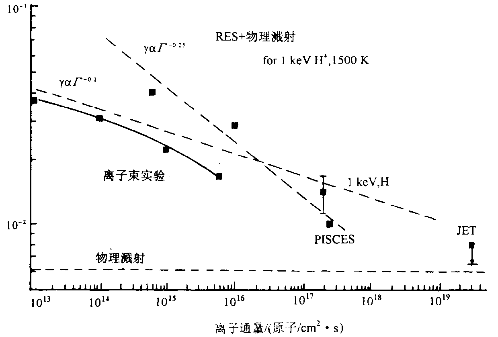

**图7.12** 辐射增强升华RES与粒子通量的关系〔4〕

在大型托卡马克装置JET和TFTR的高功率加热实验中, 实际观察到RES和杂质流喷霜现象。由于短时间内在某些限制孔栏或偏滤器靶板上沉淀了大量热量, 使石墨孔栏或靶板的局部区域的温度超过$1800 \mathrm{~K}$ , 出现所谓的"热斑"(hot spot), 结果引发了碳杂质的突然增大, 同时发现, 碳离子的自溅射对这一过程有关键作用: 碳离子重新打到热斑中, 引起接近1的自溅射率。

#### 7.4.2 杂质输运[8]

要了解等离子体与壁相互作用过程中产生的杂质对等离子体约束的影响, 除了要知道壁附近的杂质源, 还必须知道杂质是如何扩散并进入到等离子体内的过程。杂质输运包括中性杂质原子或分子的渗透和各次电离度的杂质离子的扩散。中性杂质粒子的渗入过程与中性工作气体(氢或氘、氚)类似, 不过杂质粒子的原子量大, 因而运动速度慢, 它们将在更靠近真空室壁的区域被电离。对低电离化的杂质离子, 在进入最后一个封闭磁面内部后, 在与主约束等离子体的碰撞过程中逐渐向内扩散。原则上, 若等离子体存在足够长的时间, 杂质粒子能一直透入到等离子体中心, 在那里, 因等离子体温度高而得到高度的离化。对高$Z$杂质如钼、钨, 一般不可能达到完全的离化。一些主要的杂质的离化度与等离子体电子温度的关系如图7.13所示。

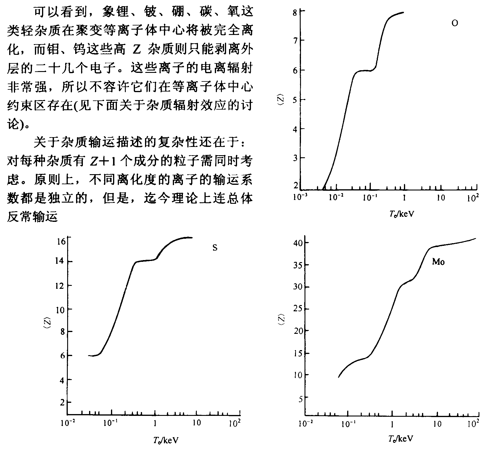

**图7.13** 一些杂质$(O, S, Mo)$的平均离化度与电子温度的关系〔19〕

可以看到, 象锂、铍、硼、碳、氧这类轻杂质在聚变等离子体中心将被完全离化, 而钼、钨这些高$Z$杂质则只能剥离外层的二十几个电子。这些离子的电离辐射非常强, 所以不容许它们在等离子体中心约束区存在(见下面关于杂质辐射效应的讨论)。

关于杂质输运描述的复杂性还在于: 对每种杂质有$Z + 1$个成分的粒子需同时考虑。原则上, 不同离化度的离子的输运系数都是独立的, 但是, 迄今理论上连总体反常输运系数也未能确定; 实验上要分辨各种离化度的离子的不同输运系数就更困难了。所以在所有的分析中, 都简单地假定不同离化度的离子的输运系数是相同的。

此外, 类似于本底等离子体中电子和离子输运的描述, 要解释实验观察到的杂质空间剖面, 必须引入与扩散系数有关的向内的对流速度: 杂质通量密度表示成

$$
\Gamma_{z} = -D_{z}\frac{\mathrm{d}n_{z}}{\mathrm{d}r} +V_{z}n_{z},\qquad Z = 1,2,\dots ,N \tag{7.54}
$$

其中

$$
V_{z} = -SD_{z}r / a^{2} \tag{7.55}
$$

$S$是数量级为1的系数。

在实际模拟研究中要知道中性杂质原子(分子)源的大小, 这是与前面讨论过的杂质的产生机制相关的。此外, 需要知道所讨论杂质元素的所有各级的电离率和复合率, 以及杂质与工作气体间的电荷交换反应率。

在一维柱模型近似位形中, 关于各次电离度杂质离子的时空演变方程为:

$$
\frac{\partial n_{z}}{\partial t} + \frac{1}{r}\frac{\partial}{\partial r}(r\Gamma_{z}) = n_{e}\{n_{z-1}S_{z-1}-n_{z}S_{z}+n_{z+1}G_{z+1}-n_{z}G_{z-1}\}, \quad Z=1,2,\dots,N \tag{7.56}
$$

$$
\frac{\partial n_{0}}{\partial t} + \frac{1}{r}\frac{\partial}{\partial r}(r\Gamma_{0}) = -n_{e}n_{0}S_{0}+CX \tag{7.57}
$$

式中$S_z$和$G_z$分别代表$Z$次电离度离子的电离率（源项）和复合率（漏项）, $CX$代表电荷交换的贡献。对主要的杂质元素, 近年来发展的杂质输运计算编码中包含所需的分子原子的电离复合和电荷交换的基本截面数据, 也已对多种杂质进行了模拟计算。非常明显, 这种计算基于对杂质离子扩散系数及对流速度的唯象假定之上。随着实验分析手段的进一步改善, 可以更完善地描述杂质输运, 但其工作量是非常大的。

类似于讨论等离子体粒子密度的方法, 可以对稳态条件下的中心杂质密度与边缘杂质密度的关系进行一些简单的模型分析。先将上面关于各次电离度的杂质离子的输运方程求和, 从初次电离度直至最高可能的电离度, 可以看到, 所有中间过程消失, 留下的仅是初次电离度的源项及最高次电离度的漏项。若忽略电荷交换项并设最高阶电离度离子的复合项相对不重要, 则关于杂质粒子总体密度的输运方程与关于工作气体粒子的输运方程类似。令

$$
N_{z} = \sum_{1}^{z} n_{i} \tag{7.58}
$$

则其输运方程为

$$
\frac{\partial N_{z}}{\partial t} = \frac{1}{r}\frac{\partial}{\partial r}\left[rD\left(\frac{\partial N_{z}}{\partial r}-Sr/a^{2}\right)\right]+n_{e}n_{0}S_{i} \tag{7.59}
$$

设中性杂质在SOL中的电离长度为$\lambda_{\mathrm{sol}}$ , 在进入最后一个封闭磁面后的电离长度为$\lambda_{z}$ , 若这些杂质在SOL中基本上被初次电离, 则取后一个量为零。这样, 在$r=r_1=a-\lambda_z$处的杂质密度为

$$
N_{z}(r_{1})=\frac{\Phi_{z}(\lambda_{\mathrm{sol}}+\lambda_{z})}{D_{z}A_{p}} \tag{7.60}
$$

式中$\Phi_{z}, A_{p}$分别为孔栏和真空室表面放出的总杂质通量和等离子体表面积。再往内, 杂质的向内对流速度将起作用, 于是中心杂质密度将等于

$$
N_{z}(r)=N_{z}(r_{1})\exp[0.5S(1-r^{2}/a^{2})] \tag{7.61}
$$

一般说, 如果等离子体的电子温度剖面是中心峰化的单调分布, 则最高次电离度的杂质离子的稳态空间剖面是在等离子体中心峰化的, 而中间电离度的离子的峰值不在等离子体的中心, 其峰值位置随电离度的减小而外移。这是因为, 对这些离子, 电离度为$Z-1$的离子的电荷贡献 (源) 与电离度为$Z$的离子的电荷贡献 (漏) 是两个互相竞争的过程, 对复合过程也是这样, 相邻两次电离度离子的复合贡献一个是源, 另一个是漏, 结果, 电子温度越高的区域越有利于较高次电离度的杂质离子的积累, 形成所述的剖面分布。一个关于氧杂质的计算实例如图7.14所示。

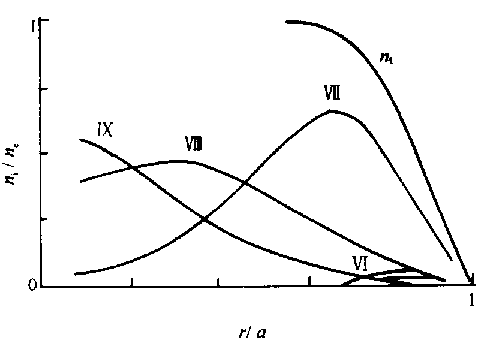

**图7.14** 不同电离度氧离子的剖面分布

上面的分析中没有指出引起杂质扩散的具体机制是什么。由于一般杂质粒子的密度远小于本底等离子体的密度, 杂质离子与等离子体粒子间的相互作用总是占主导地位的因素。对质量大和电荷数多的粒子来说,新经典效应是比较重要的,所以,新经典流将是杂质流的一个重要组成部分,其它的部分可以认为是由湍流效应引起的反常扩散,可以将杂质流写成

$$
\Gamma_{z} = \Gamma_{\mathrm{sn}} + \Gamma_{\mathrm{neo}} = -(D_{\mathrm{sn}} + D_{\mathrm{neo}})\frac{\mathrm{d}n_{z}}{\mathrm{d}r} +(\nu_{\mathrm{sn}} + \nu_{\mathrm{neo}})n_{z}
$$

其中下标为$z$的部分表示新经典效应 的贡献,它与本底等离子体的密度和温度的剖面有关:

$$
\Gamma_{\mathrm{neo}} = -D_{\mathrm{neo}}\frac{\mathrm{d}n_{z}}{\mathrm{d}r} +D_{\mathrm{neo}}Z\left[\frac{\mathrm{d}\ln n_{z}}{\mathrm{d}r} -0.5(1 - 1 / Z)\frac{\mathrm{d}\ln T}{\mathrm{d}r}\right]n_{z} \tag{7.63}
$$

进一步假定反常扩散系数与反常对流速度间也存在关系

$$
\nu_{\mathrm{sn}} = -a D_{\mathrm{sn}}r / a^{2} \tag{7.64}
$$

并记

$$
\beta = D_{\mathrm{neo}} / D_{\mathrm{sn}} \tag{7.65}
$$

则在定常条件下,即总杂质流为零时,杂质离子的分布应具有向中心区积聚的形式,即

$$
n_{z}(r) = n_{z0}\left[\left(\frac{n_{i}}{n_{i0}}\right)^{Z}\left(\frac{T}{T_{0}}\right)^{-(Z-1) / 2}\right]^{\beta /(1 + \beta)}\exp \left[-\frac{\alpha r^{2}}{2(1 + \beta)a^{2}}\right] \tag{7.66}
$$

与前面式(7.61)的剖面比较,式(7.66)的剖面要更陡,因为除指数型分布外,还要乘一个与本底粒子密度及温度有关的因子。由于这一部分的分析中也没有考虑杂质离子的电离复合过程,这一分析应只适用于对总的杂质粒子密度或对最高级离化度的杂质离子密度的估计。虽然有这些局限性,上面的分析仍表明,在准稳态下杂质有趋向中心积聚的倾向,这是对磁约束聚变不利的。在实际装置运行中应加一些主动控制使杂质离子不能形成峰化的剖面分布,这是等离子体控制工程的一项重要课题。

#### 7.4.3 杂质含量与等离子体参数的关系

杂质产生和输运都与主约束区中等离子体参数有直接或间接的关系,而且这些关系是很复杂的,不容易用简单的数学公式表示出来。在托卡马克实验中,对这类关系做了非常多的研究,得到一些比较普遍的规律,下面对一些重要的方面进行简要的介绍。

#### 7.4.3.1 密度屏蔽效应

当等离子体密度升高时,普遍观察到等离子体约束区中总杂质含量的相对值的下降。最简单的是观察有效电荷数$Z_{\mathrm{eff}}$与平均密度的关系,几乎所有的装置中都发现,随着密度的加大,$Z_{\mathrm{eff}}$很快下降。图7.15是TFTR中两种孔栏条件下的实验结果。

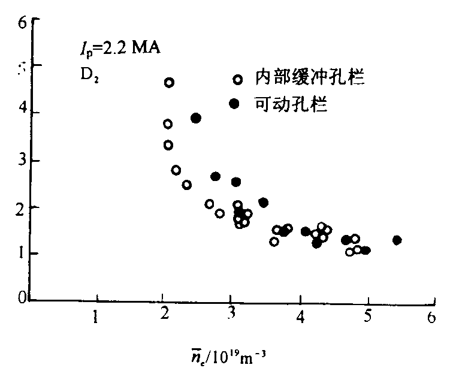

**图7.15** TETR 中$Z_{\mathrm{eff}}$与等离子体密度的关系〔1〕

杂质相对含量随密度增大而减小的现象是与前面分析过的机制相合的。较直观的一个原因是,密度的增大使边缘温度降低,因而孔栏表面附近的等离子体的鞘电位下降,使杂质溅射产额减小, 虽然轰击表面的粒子数加大, 但溅射产额的下降因素更重要, 因而总杂质流将减少。图 7.16 是 JET 中用氘进行欧姆放电时碳离子密度随等离子体平均密度的变化情况, 更进一步说明上面机制与这种现象的关系。

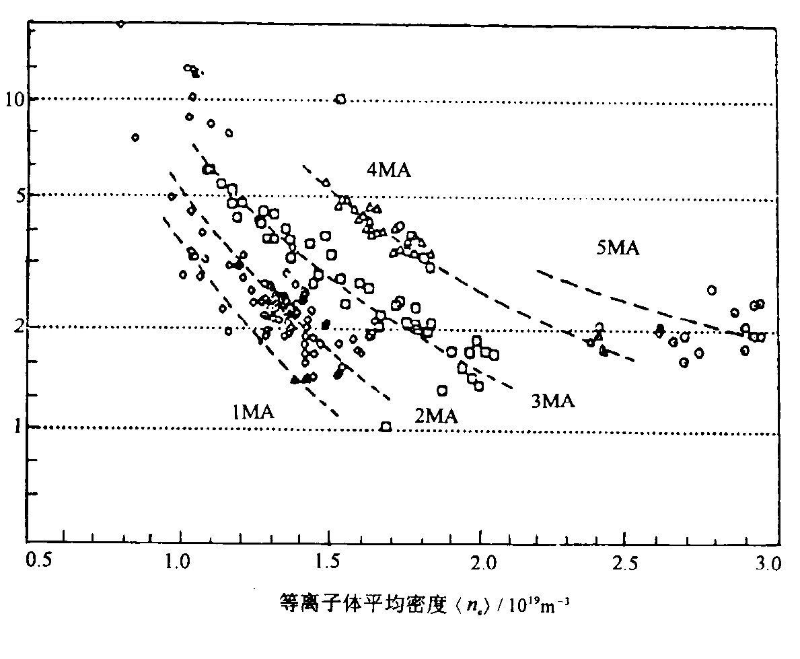

**图7.16** JET 中碳离子密度随等离子体平均密度的变化〔2〕

7.4.3.2 杂质含量与总加热功率的关系

随着加热功率的加大, 杂质的总含量和相对含量都要增加。从图 7.16 可见 JET 中杂质含量随欧姆加热电流的变化, 在同样的等离子体密度下, 电流加大时碳密度迅速加大。在高功率加热 (离子回旋频段波加热、中性束注入加热)条件下, 杂质含量随加热功率加大而上升的现象更明显, 这在定性上很易理解。一方面, 高功率加热一般都增加了新的作用机制, 例如离子回旋频段波加热是通过在真空室内靠近等离子体边界处引入很大的天线来实现的, 这个天线的外屏蔽罩本身与边缘等离子体粒子的相互作用就非常强, 而且天线的电场会加速周围的离子, 使溅射产额加大。因此, 好的天线屏蔽本身就是重要的研究课题。对中性束注入加热, 也有很多在边界附近被捕获的高能离子会重新打到孔栏或注入口上, 引起很多的杂质, 另一方面, 随着等离子体温度的增高, 边界处的电子和离子的温度加大, 鞘电位也要加大, 因此溅射产额加大。

7.4.3.3 与约束模式的关系

当代托卡马克实验的重要方面是研究改善约束模式。实验发现,在好约束即H- 模条件下,杂质含量要加大。这主要是因为改善约束模式下的粒子约束,包括杂质离子在内都有很大的改善。另外,H- 模下边缘的温度梯度明显加大,逸出约束区的离子能量也加大,这些都要引起杂质产生率的提高。

#### 7.4.4 杂质效应

杂质对主约束等离子体的效应主要是两方面:第一,辐射能量并影响等离子体中参数的空间分布以及等离子体的总体能量约束时间;第二,使工作元素的离子密度稀化(dilution),从而影响聚变反应功率密度。

辐射的计算是很繁杂的,要考虑各次离化度的杂质离子的贡献,还要考虑多种激发态的条件,而且有些元素的基本数据并不齐全。目前常采用Post等人的日冕模型来计算:定义辐射函数$L_{Z}(T_{\mathrm{e}})$为一个杂质粒子在一定电子温度下的总辐射功率[又称冷却率(cooling rate)],则总的辐射功率密度为

$$
p_{t} = n_{e}\sum_{t} n_{2} L_{Z}(T_{\mathrm{e}}) \tag{7.67}
$$

对主要元素的$L_{Z}$与温度的关系,Post等人已将其做成表,可以直接进行数值计算。一些主要元素的$L_{Z}$随电子温度的变化如图7.17所示。

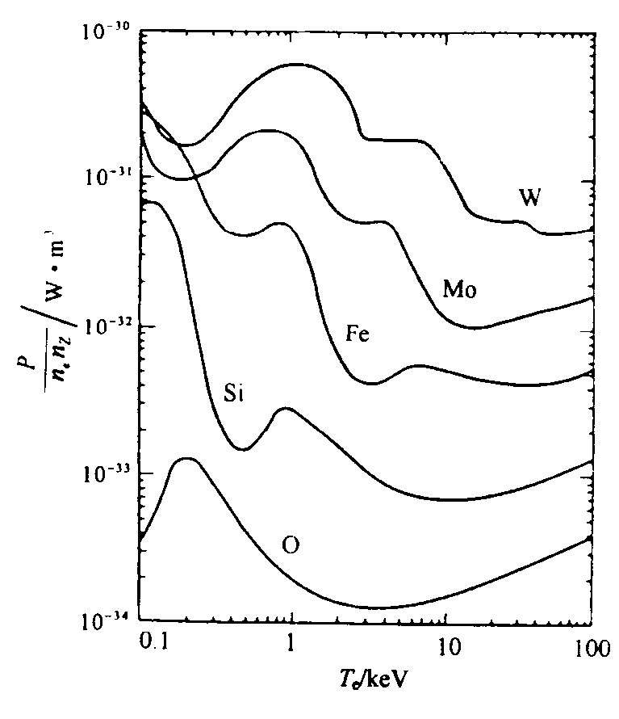

**图7.17** 一些主要元素的辐射率函数〔19〕

由该图清楚地看到,重杂质的辐射函数比轻杂质的大两个数量级以上。轻杂质的最大辐射功率出现在低温区(对氧约为$20 \mathrm{eV}$ ,碳更低一些),而重杂质的最大辐射功率区在温度为$1 \mathrm{keV}$左右。但是重杂质在低温区的辐射函数仍然比轻杂质的辐射函数的最大值约大两个数量级。对于氘氚燃烧等离子体,即温度在$10 \mathrm{keV}$数量级时,轻杂质及一些中$Z$杂质(如Si)都已完全电离,它们在高温区的辐射函数实际上是韧致辐射(电子的自由- 自由跃迁),而重杂质Mo,W仍处在内层电子的激发跃迁占优的条件下。

由于边缘区等离子体密度较低,实际上杂质离子很难达到日冕平衡条件(其物理意义是,可以被剥离的杂质外层电子没有被充分剥离)。这意味着实际的边缘杂质辐射冷却率将远大于日冕模型的结果。例如,根据日冕模型,铍在$10 \mathrm{eV}$以上,硼在$20 \mathrm{eV}$以上,碳在$30 \mathrm{eV}$以上,氧在$40 \mathrm{eV}$以上的温度区中的辐射已很小,而实验中发现这些杂质在$40 \mathrm{eV}$以下的边缘区的辐射仍非常大。近年对非日冕模型的辐射进行了很多计算分析,图7.18是关于碳的计算结果,主要与参数$n_{e} \tau_{\mathrm{res}}$有关,当此参数很大时,回到日冕模型的结果(代表一种最低的辐射水平),而此参数小时,实际冷却率可以比日冕模型的值大几个数量级,这里$\tau_{\mathrm{res}}$是杂质离子在等离子体中停留的特征时间。

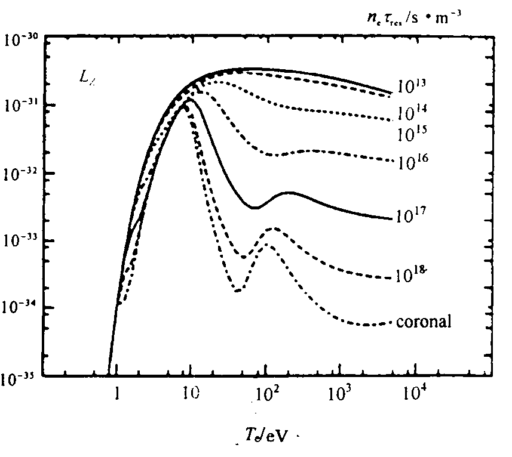

**图7.18** 碳的非日冕平衡辐射率〔20〕

对碳,可以经验地取$n_{\mathrm{e}}\tau_{\mathrm{res}} = 10^{17}\mathrm{~s}\cdot \mathrm{m}^{- 3}$作为一个特征量,因为这时辐射率已比最高值下降了30倍(图中的实线)。其物理意义是,碳杂质在长于$10^{17} / n_{\mathrm{e}}$的时间内将"停止"辐射。由于非日冕效应,实际有效的边缘辐射带的宽度也要增大很多,应由

$$
\lambda_{\mathrm{rad}}\approx \sqrt{D_{\perp}\tau_{\mathrm{res}}}\approx \sqrt{10^{17}D_{\perp} / n_{\mathrm{e}}} \tag{7.68}
$$

确定。例如,取$n_{\mathrm{e}} = 10^{19}\mathrm{m}^{- 3}$ , $D_{\perp} = 1\mathrm{m}^{2}\cdot \mathrm{s}^{- 1}$ ,则$\lambda_{\mathrm{rad}}\approx 0.1\mathrm{m}$。这与实际情况相符。

前面已经提到,在较早进行的一些托卡马克实验中(如PLT,DITE),采用了高$z$材料孔径,结果在等离子体约束区中有效电荷数非常高( $Z_{\mathrm{eff}} > 5,6$ ),而且中心区的辐射功率很大,超过了欧姆加热功率,结果形成电子温度的中空分布和安全因子$q$的非单调分布(如图7.19)。

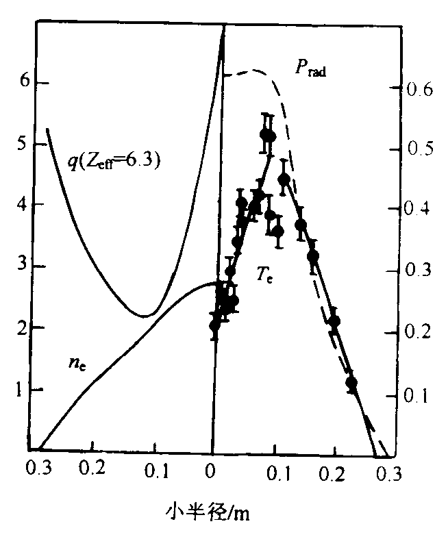

**图7.19** DITE中总辐射功率剖面和相应的电子温度、密度及安全因子剖面出现的中心$q$反向分布〔21〕

杂质辐射对约束的影响可以用一维输运模型来分析。辐射直接影响的是电子温度剖面,而局部电子温度是与局部电阻率的大小有关的,并因而影响环向电流密度剖面和安全因子的剖面,这些剖面又与等离子体的宏观磁流体稳定性直接相关,也与很多微观模式的激发条件有关。若等离子体发生宏观不稳定性,例如由于边缘过分冷却使电流通道收缩,会使扭曲模和撕裂模发展起来,形成大的磁岛,导致破裂不稳定性。在较软的条件下,则使等离子体约束有较大程度的恶化。

现代的多数托卡马克实验已对杂质有较好的控制,有效电荷数降低到2左右或更低,但在靠近边缘区域,轻杂质的含量可能较高,总辐射功率可以达到较大值。尤其是,总辐射功率与电子密度的平方成正比(设杂质密度与电子密度也成正比),而欧姆加热和各种高功率加热的总功率与电子密度并无关系,显然,当电子密度超过某个临界值时,会出现辐射总功率超过总加热功率的情况。

在可容许的等离子体电子密度下,杂质离子含量太大时会产生严重影响中心约束区中工作离子的浓度。工作离子密度

$$
n_{\mathrm{i}} = n_{\mathrm{e}} - \sum_{z}n_{z}Z \tag{7.69}
$$

举一例子,若中心的碳离子密度达到电子密度的$5\%$ ,碳原子被完全离化,即$Z = 6$时,工作离子的密度降低为$0.7n_{\mathrm{e}}$ ,若工作粒子为氘氚,则聚变功率下降一半。在聚变等离子体中,还必然含有一定数量的氦灰(较冷的$\alpha$粒子),通常含量可以达到电子密度的$10\%$左右,在这种情况下,氘氚离子密度已经降低到$0.8n_{\mathrm{e}}$ ,因此,更多的轻杂质实际上已经不是能容许的。

### 7.5 与辐射有关的边缘物理现象[9\~13]

在托卡马克等离子体中,杂质辐射不仅对总体能量约束时间有明显的影响,而且对可达到的等离子体最高粒子密度有更直接的影响。非常耐人寻味的一个事实是,经过30多年的探索,已经可以将托卡马克等离子体的离子温度加热到$40\mathrm{keV}$以上,比初期装置中的离子温度提高了近两个数量级,超过了对点火温度的要求,但等离子体的粒子密度在大多数实验中仅为$5\times 10^{13}\mathrm{cm}^{- 3}$左右,比较难于超过$10^{14}\mathrm{cm}^{- 3}$ ,只有在高环向磁场装置中可以达到更高的值。这一水平与早期的装置实验相比,仅提高了二三倍左右,这离聚变堆中的要求有一定的差距。是什么原因使粒子密度不能进一步提高呢?多年来的理论和实验研究发现,粒子密度具有某种运行极限,其大小与宏观磁流体不稳定性,杂质辐射,加热功率沉淀,参数的剖面形状以及边缘和器壁条件等多种因素有关。到目前为止还没有完全弄清楚密度极限的机制,也没有适用于所有情况的理论模型,但对其中一些非常重要的现象已有相当深入的研究。本节要介绍的与辐射和总加热功率有关的密度极限现象,如边缘不对称多层辐射现象(MARFE),脱栏等离子体现象(detached plasma,简称DP),就是其中最重要的,他们对未来反应堆的运行可能有很大影响。

#### 7.5.1 密度极限破裂现象

重杂质含量过大时会引起电子温度的中空分布,这对约束是不利的,这些"脏放电"现在已有方法防止。对含较多轻杂质的放电,只要其含量小于一定的值,一般是容许的。上面已指出,轻杂质的辐射函数的最大值处在电子温度较低的区域,即$10\sim 30\mathrm{eV}$范围,这正是等离子体的外缘区(靠近LCFS的内部及SOL中),这一区域的宽度与中性原子在等离子体中的透入特征长度基本上接近,所以其中的粒子密度有较大的梯度,加上电离度较低的杂质离子也比较集中在靠近外缘的区域,这些因素结合起来,形成了在边缘区附近辐射功率的迅速加大,一定条件下可以形成辐射屏罩,即将等离子体内部传输出来的热量中的相当大一部分通过这一区域中的辐射和电荷交换直接传送出去,结果使电子温度剖面变平,温度下降,也就是形成所谓的冷区。这样一来,这一区域中的电导率也就要下降,导致环向电流的通道向内部区域收缩。载电流等离子体柱的边界安全因子是根据实际的电流通道的宽度确定的,因此,在同样的放电电流下,这种收缩不仅使有效边界处的安全因子降低,而且使这一区域中电流密度分布的梯度加大。在第五章中关于撕裂模的理论中指出,电流密度梯度的加大会引起撕裂模的迅速发展,最后引起放电破裂。这种例子在很多装置中都可以实际观察到,图7.20是JET中的一例,从量热器测定的总辐射功率剖面,可以非常明显地看到,在破裂不稳定性发生前,辐射层向内移动,造成放电通道的收缩。

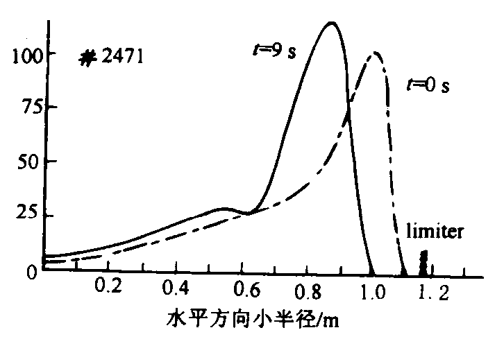

**图7.20** JET中破裂发生前辐射带的内移〔2〕

考虑圆柱模型下的功率平衡条件

$$
\frac{1}{r}\frac{\mathrm{d}}{\mathrm{d}r}\left(r n\chi\frac{\mathrm{d}T}{\mathrm{d}r}\right)+p_h-p_r=0 \tag{7.70}
$$

为简单计,没有考虑电子与离子的功率交换项,例如不妨设电子与离子的温度相等,这种简化不影响我们对主要问题的分析。辐射功率与粒子密度的平方成正比

$$
p_{r} = n_{e}^{2}\sum_{z}\alpha_{z}L_{z}(T_{e}) \tag{7.71}
$$

而加热功率一般是外部因素所确定的,与密度没有直接关系(例外的是在聚变堆情况下的$\alpha$粒子加热,其功率也与密度平方成正比,这将要特殊讨论,见关于堆芯物理的讨论),因此,当密度达到一定极限值时,原则上总辐射功率可以接近或超过总加热功率。

从这个简单的功率平衡模型立刻可以看到,若总的辐射功率开始接近总的加热功率,电子的温度剖面会变得很平,

$$
\frac{\mathrm{d}T_{e}}{\mathrm{d}r} = -\frac{1}{m\chi}\int_{0}^{r}\mathrm{d}r^{\prime}r^{\prime}(p_{h} - p_{r}) \tag{7.72}
$$

形式上还可以将温度分布写出:

$$
T_{e} = T_{\infty} - \int_{0}^{r}\mathrm{d}r^{\prime}\frac{1}{r^{\prime}n\chi}\int_{0}^{r}\mathrm{d}x x(p_{h} - p_{r}) \tag{7.73}
$$

利用边界条件可以写出中心电子温度:

$$
T_{\mathrm{e}0} = T_{\mathrm{e}} + \int_{0}^{r}\frac{\mathrm{d}r^{\prime}}{r^{\prime}n\chi}\int_{0}^{r}\mathrm{d}x x(p_{h} - p_{r}) \tag{7.74}
$$

$T_{\mathrm{e}}$为边缘处温度。在物理上很明显,由于辐射功率损失,对等离子体的有效加热功率减小,因而电子温度将下降。前面的讨论已指出[例如由(7.45)式],边缘的电子温度不是任意的,本身与总的有效加热功率及能量约束时间有关。所以,随着辐射总功率的加大,边缘将变冷,温度剖面变平,即冷区将扩大,这些就是电流通道收缩的原因。

1976年Murakami首先总结了当时已知的托卡马克等离子体所能达到的最高密度的数据,将其与辐射功率与总加热功率的平衡条件联系起来,得出欧姆加热条件下可能达到的密度极限值,这个极限条件指出,对一定的托卡马克装置,其Murakami数是有限的[9],

$$
M = \frac{\langle n_{e}\rangle R}{B} \tag{7.75}
$$

$R$为装置的大半径, $B$为环向磁场强度。因此,可达到的最大密度是与$(B / R)$成正比的。

由于密度极限问题对未来聚变堆参数有关键性的意义,几乎所有的装置都将其作为重要研究课题。目前关于密度极限有几种定标,一种是对村上(Murakami)定标的推广,称海吉尔(Hugill)定标,它指出,在边界安全因子较大时,密度极限值应正比于$(B / q_{e}R)$ ,因此可定义海吉尔数[10]

$$
H = \frac{\langle n_{e}\rangle R}{B} q_{e} \tag{7.76}
$$

在边界安全小于 3 时, 则按村上关系变化。海吉尔将上述条件在$(q_{\mathrm{a}}^{- 1}, M)$空间中作图, 得出关于托卡马克放电的运行参数区, 其中安全因子的最小值在 2.2 左右, 另一方面, 太小的密度将导致离群放电, 不属于正规的托卡马克放电。综合这些因素, 稳定的放电参数区将如图 7.21 所示。此图取自 Textor 的实验数据, 是很有代表性的。该图明白地显示, 中性束加热和壁的有效处理可以提高极限密度。

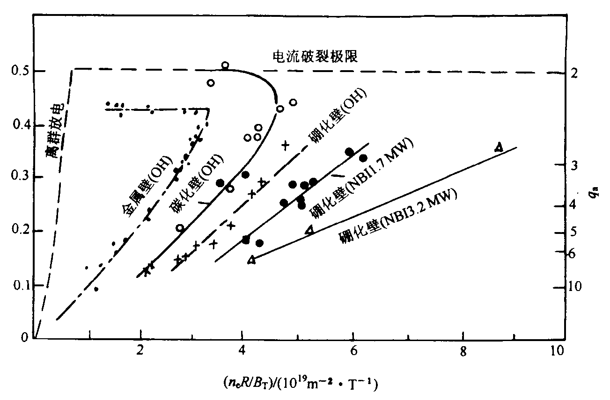

**图7.21** Textor的海吉尔图〔18〕

后来, 在更广泛的数据基础上, Greenwaldt 等人又总结出另一个密度极限定标[11], 指出密度极限与平均放电电流密度有直接关系, 即

$$
\langle n_{\mathrm{e}}\rangle_{\mathrm{max}}\propto I_{\mathrm{p}} / \pi a^{2} \tag{7.77}
$$

在圆截面情况下, 这一定标与海吉尔定标相符, 在具有相当拉长度的非圆截面情形, 后一定标给出对拉长度有利的密度值。关于这一密度极限的进一步讨论将在托卡马克实验研究一章中进行。

由于密度极限的重要性, 所以人们基本上对所有的托卡马克装置本身的稳定运行参数区都进行了实际测量, 得出了各自的实际密度极限值及与各种参数的关系。这意味着村上值对不同的装置可以有不同, 这不是说明上面的分析没有普遍性, 而是说明有一些装置由于边缘条件不很理想, 在实验中没有达到理论容许的较高的密度值。在 JET 中, 测量了密度极限与多种参量, 包括截面的拉长度的关系, 得到下面的密度极限表示式

$$
n_{\mathrm{e, JET}} = 3.5\left[\frac{p_{\mathrm{a}}R q_{\mathrm{a}}}{(Z_{\mathrm{eff}} - 1)a b(q_{\mathrm{a}} - 2a / b)}\right]^{1 / 2} \tag{7.78}
$$

这个结果的重要性是指出了与杂质含量的关系, 当有效电荷数$Z_{\mathrm{eff}}$接近 1 时, 密度极限值可以明显加大。此外, 加大加热功率将使可达到的密度按功率的方根方式增大。

将上面的分析应用到聚变$\alpha$粒子加热条件下, 会发现将不存在类似的密度极限, 因为这时加热功率与辐射功率一样, 都与密度的平方成正比。对反应堆条件下实际可能的密度限制要考虑更多的物理因素。

#### 7.5.2 来自边缘的多层次非对称辐射(MARFE)现象

7.5.2 来自边缘的多层次非对称辐射(MARFE)现象除密度极限现象外,在较小的辐射功率比值下,最初在ALCATOR- C装置上,后来在很多托卡马克装置上,发现另一种很奇特的物理现象,即当等离子体密度增加到一定程度时,在靠近环的内侧的边缘附近,会出现一个非常强的辐射带。这一辐射带沿大环方向是对称的,但沿极向有很明显的定域性质:主要集中在靠内侧的$30^{\circ} \sim 60^{\circ}$的角度内,沿半径方向看,主要在孔径附近。按照发现人对这一现象的称呼:来自边缘的非对称辐射的英文字头,将其称为MARFE现象(如图7.22所示)。通常定义与MARFE现象有关的密度值为[12]:

$$
\langle n_{\mathrm{e,mar}}\rangle = C_{\mathrm{mar}}\frac{I_{\mathrm{p}}}{\pi a^{2}} \tag{7.79}
$$

其形式与Greenwald密度极限相同,但相关的物理机制并不一样。式中总欧姆电流用MA计,半径用m计,则平均密度用$10^{14}\mathrm{cm}^{- 3}$计,综合十多个观察到MARFE的托卡马克装置(AL- C,ASDEX,DIII- D,DITE,FT,JET,TFTR,HL- 1M,...)的实验数据,因子$C_{\mathrm{mar}}$大约在$0.4\sim 0.7$范围,典型值是0.55。应指出,出现MARFE时的密度比引起破裂的极限密度低,因而与引起破裂的密度极限现象有不同的机制。在JET装置上,甚至发现在一定条件下,当总辐射功率仅达到总加热功率的$20\%$左右时,也会出现MARFE现象,随后约束受到很大破坏。但大多数情况下可以过渡到更为稳定的状态。例如,在出现MARFE后,如继续提高密度,然后降低电流,定域区会沿极向扩大,直到变成沿极向也对称,这时的总辐射功率已非常接近总加热功率,出现下面要讨论的所谓脱栏等离子体现象。但不是所有的MARFE都可以演化成DP的,多数情况下,密度的进一步增大将引发破裂。正由于MARFE出现在破裂对应的密度极限以前,因此可以把它作为破裂的前兆,在出现MARFE后立即对参数进行调节或采用必要的控制措施。

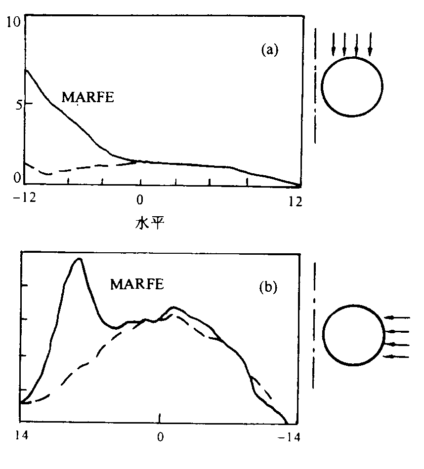

**图7.22** Alcator-C上观察的MARFE现象

(a)辐射量热器信号;(b)可见光信号[2]。

对产生MARFE的机制已进行了多年的研究,最初认为这是由于辐射函数与电子温度有关而引起的一种热不稳定性。这在物理上很好理解。以氧的辐射函数为例,其最大值在$20 \mathrm{eV}$附近,在大于峰值的温度范围内有

$$
\partial L(T_{\mathrm{e}}) / \partial T_{\mathrm{e}}< 0 \tag{7.80}
$$

因此,如边缘等离子体的电子温度高于$20 \mathrm{eV}$ ,由于杂质辐射的突然增大而使电子温度有所下降,结果使辐射函数加大,这反而进一步加大了辐射冷却率,从而进一步使温度下降,引发热不稳定性。但要用这种简单的机制解释MARFE现象是不容易的。因为一方面,托卡马克等离子体所处磁面的磁力线是有旋转变换的,沿磁力线的电子的快运动,包括很大的沿磁力线的热传导会将可能出现的局部温度扰动均匀化;另一方面,MARFE 是一种沿环向均匀而沿极向不均匀的现象,也就是属于环向模数$n = 0$的扰动结构。可是,所有的热不稳定性理论分析都假定螺旋扰动结构,两者不相符。此外,理论得出的不稳定阈值对应于功率比接近于1,这与实际观察到的MATFE的出现条件不一致。

近来提出了更多的基于更多实际物理过程的机制,得到的功率阈值可以较低,与实验观察较接近。我们分析了各种理论的缺陷后提出了一种新看法[13],认为MARFE可能是与中性原子送气过程和粒子凝结效应(condensation)有关的一类不稳定性或非线性现象。在托卡马克实验中可以经常观察到关于极向分布的不对称性,不过一般这些不对称性仅是一级小量。但在一定条件下,可能存在更大的不对称性,例如等离子体沿极向的转动,可以引起与边缘密度大小同级的不对称性。非常重要的是,计算发现,与MARFE现象类似,在环的内侧出现密度的峰化。这种密度凝结与关于温度的热不稳定性结合,会使出现MARFE的机制的解释更合理。

#### 7.5.3 脱栏等离子体现象

在特定的条件下,即使总辐射功率与总加热功率的比值接近1,等离子体也并不破裂,而是产生一类新的位形:由于向外的传热量几乎全部通过辐射和电荷交换过程直接送到真空室壁上,靠近孔栏处的等离子体将冷却,电流通道有所收缩,但没有太过分的收缩,因此,撕裂模没有发展起来,但等离子体实际上脱离了与孔栏的热接触。产生脱栏而不破裂的条件是比较苛刻的,其中之一就是边界安全因子必须较大(典型情况是$q_{\mathrm{s}} > 5$ ),另外对壁上气体再循环和杂质的再流入都有较好的控制。在物理上,脱离孔栏的位形有点类似于偏滤器位形,即最后一个封闭磁面与器壁表面不直接接触,有助于减少等离子体与器壁的相互作用,最直接的效应是降低孔栏表面的热负载,从而降低了孔栏的温度,避免因材料高温而引发的杂质突然增大。但是,必须强调,脱壁只是消除了直接的接触,并不能使从等离子体中扩散出来的粒子不去碰击器壁(首先是孔栏)表面,因此其效应是有限的。实验发现,脱壁等离子体的总体能量约束时间没有明显的提高,从前面讨论的边缘物理的基本特性来看,这是不难理解的。脱栏等离子体中边缘附近的密度和温度剖面及热流和粒子流的平衡方式如图7.23所示。图中显示热流基本消失,粒子流仍存在。

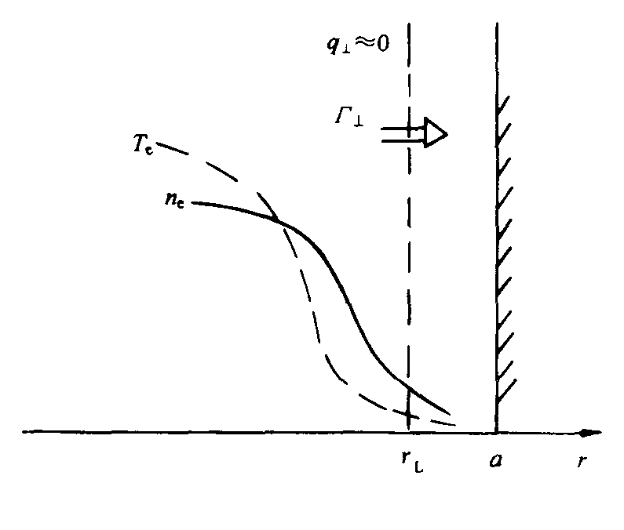

**图7.23** 脱栏条件下边缘电子温度和密度剖面示意

由于脱栏条件带来的最大好处是减小第一壁材料表面的热负载,使材料表面的温度不致太高,这恰好能减小材料的溅射腐蚀率,控制了杂质的产生。于是在现代偏滤器设计中应用了这一概念。如果在偏滤器靶板前的稠密冷等离子体中有意加入一定含量的轻杂质(例如惰性气体氖),使流入偏滤器区域的热量在到达靶板前通过辐射和电荷交换大量释放到周围空间中,可以使靶板与这些冷等离子体脱离热接触,这一概念称脱靶偏滤器 (detached divertor)。

### 7.6 偏滤器物理[14\~17]

偏滤器物理是磁约束聚变装置物理的重要组成部分,这一部分的内容在近几年中有非常充实的发展,而且一些新概念还在不断提出,因此,本书的这一小节只能对偏滤器物理的基本概念做一些介绍,而不可能对最新发展做文献评述性总结。

偏滤器位形与孔径位形有许多相似之处,如将主约束区与刮离区分开,孔径与偏滤器靶板都是热量和粒子的收集器和交换器。但两者在作用机制上有一些重要的差别,这就是偏滤器的刮离区中存在一个不直接接受主约束等离子体中的粒子和热流的区域(即从X点到靶板前的这段区域),在这一区域中,可以充入较高密度的中性气流,形成一个密度高而温度低的靶前等离子体区域。因此,对偏滤器的刮离区,不能再假定沿磁力线的温度是均匀的,必须考虑沿磁力线的热传导。

#### 7.6.1 刮离区模型[15]

在一维近似下,取位形的中间对称点为驻留点(stagnation point),从此点到X点为一区域,其中有来自主约束区的热流和粒子流。从X点到靶板起的等离子体鞘为另一区域,其中存在较强的气体再循环。最后是鞘区,仍假定是简单的一维垂直鞘结构(如图7.24所示)。

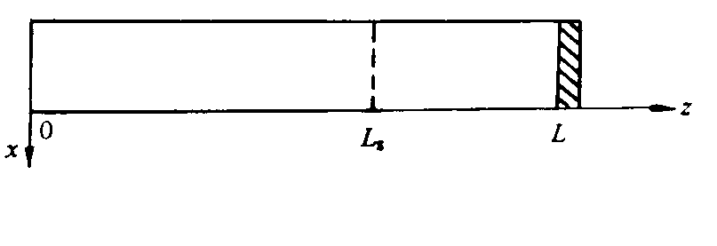

**图7.24** 一维偏滤器刮离区简化模型

现在考虑形式上是二维的刮离区模型, $x$是横越磁力线坐标, $z$是沿磁力线坐标。设

$$
n(x,z) = n(z)\exp (-x / \Delta_{n}),\quad T(x,z) = T(z)\exp (-x / \Delta_{T}) \tag{7.81}
$$

关于粒子平衡的分析与孔径位形中的类似,不再重复;进一步假定压强沿磁力线近似不变,于是沿磁力线的粒子流速也基本不变。而热流平衡方程为(假定电子与离子温度相等):

$$
\frac{\partial}{\partial x}\left[-n\chi_{\perp}\frac{\partial T}{\partial x} -3T D_{\perp}\frac{\partial n}{\partial x}\right] + \frac{\partial q_{\parallel i}}{\partial z} = 0 \tag{7.82}
$$

式中沿磁力线的热流为

$$
q_{\parallel i} = -K T^{5 / 2}\frac{\partial T}{\partial z} \tag{7.83}
$$

$\kappa$代表沿磁力线的热传导系数中的常数因子

$$
\kappa = \frac{1}{\sqrt{m_{e}e^{4}\ln\Lambda}} \tag{7.84}
$$

再进一步假定横越磁力线的热导和扩散均为玻姆型: $\chi_{\perp} = D_{\perp} = \alpha_{\mathrm{B}}[c T / 16e B]$ , $\alpha_{\mathrm{B}}$为数字因子。记

$$
q_{\perp} = -\alpha_{\mathrm{B}}D_{\perp}\left[n(0,z)\frac{\partial T(0,z)}{\partial z} = 3T(0,z)\frac{\partial n(0,z)}{\partial z}\right] \tag{7.85}
$$

再积分一次可得出沿磁力线的温度变化关系

式中$z = L_{1}$表示再循环区的入口位置。上式表明,沿磁力线的温度降是沿磁力线的热传导维持的,事实上在接近靶板区的温度已大大低于驻留点附近的温度,因此可忽略上式中左边第二项,于是得出驻留点即磁分界面处的温度为:

$$
T_{0}(0)^{7 / 2} - T_{0}(L_{1})^{7 / 2} = \frac{49}{4\kappa L_{T}}\int_{0}^{L_{T}}\int_{0}^{L_{T}}d z^{\prime}q_{\perp} \tag{7.86}
$$

其中$z = L_{1}$表示再循环区的入口位置。上式表明,沿磁力线的温度降是沿磁力线的热传导维持的,事实上在接近靶板区的温度已大大低于驻留点附近的温度,因此可忽略上式中左边第二项,于是得出驻留点即磁分界面处的温度为:

$$
T_{\mathrm{b}} = \left(\frac{49}{4\kappa}\frac{\alpha_{\mathrm{B}}q_{\perp}L L_{\mathrm{s}}}{\Delta_{r}}\right)^{2 / 7}\left[1 - \left(\frac{T_{\mathrm{D}}}{T_{\mathrm{B}}}\right)^{7 / 2}\right]^{-2 / 7} \tag{7.87}
$$

上面的垂直于磁力线的热流通量密度可以与实验中的具体宏观参数,如总加热功率,装置几何参数及具体流入所考虑的偏滤器的热流比(如果偏滤器靶板不只一个)联系起来

$$
q_{\perp} = \frac{m_{\mathrm{B}}}{4\pi^{2}R a\sqrt{k}} \tag{7.88}
$$

这里$k$是截面的拉长度, $\eta$是流入所考虑的偏滤器的热流比。

表征刮离区宽度的因子$\Delta_{r}$ , $\Delta_{r}$可以通过上述方程及压强近似不变条件

$$
T(0,z)n(0,z)\approx T_{\mathrm{B}}n_{\mathrm{B}} \tag{7.89}
$$

得出,代入玻姆扩散系数,假定$\Delta_{r} = \Delta_{n} / 2$ ,有

$$
\Delta_{r} = \frac{5c}{32e}\frac{\alpha_{\mathrm{B}}n_{\mathrm{B}}T_{\mathrm{B}}^{2}}{q_{\perp}B_{\mathrm{T}}} \tag{7.90}
$$

流入等离子体鞘区的功率流密度可以算出为

$$
\int_{0}^{\infty}\mathrm{d}x q_{i j}(x,L) = 3.5\gamma n_{\mathrm{D}}T_{\mathrm{D}}c_{\mathrm{s}}A_{T} \tag{7.91}
$$

$\gamma$为等离子体与鞘间的能量传输系数,已在孔径位形中引入并导出其与等离子体参量间的关系。

#### 7.6.2 靶区物理

具体的靶区附近的物理非常密切地与具体的靶区工程设计有关,这里的例子所考虑的是 ASDEX 型隔离偏滤器的情形。设气体靶室的形状如下面图 7.25 所示,这是一个二维问题,但可以简化成一个二维二区问题处理:在靠近靶板区(I区),有高的中性粒子源(来自靶板表面的再循环);在再循环区外至 X 点附近为 II 区,基本上没有再循环粒子源,如图 7.26 所示。

在 I 区中,中性粒子密度非常高,主要的过程是电荷交换,于是可得等效的中性粒子扩散系数为

$$
D_{0}\approx \frac{\nu_{0}^{2}}{n_{0}S_{\mathrm{ex}}} \tag{7.92}
$$

$S_{\mathrm{ex}}$是电荷交换反应率,中性粒子的扩散方程为

$$
\frac{\partial}{\partial x}\left(-D_{0}\frac{\partial n_{0}}{\partial x}\right) = S_{0} - n_{0}n_{0}S_{1} \tag{7.93}
$$

$S_{i}$是电离率,引入参数

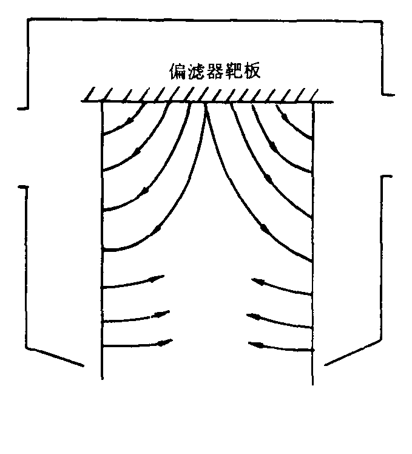

**图7.25** 偏滤器靶板区的粒子流图

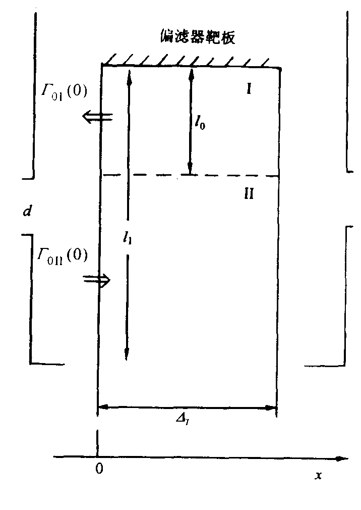

**图7.26** 用于计算的简化模型

$$
\lambda=v_{0}/n_{\mathrm{D}}\sqrt{S_{i}S_{\mathrm{cx}}} \tag{7.94}
$$

$$
\hat{S}_{0}=S_{0}/n_{\mathrm{D}}S_{i} \tag{7.95}
$$

则 I 区和 II 区中的解分别为：

$$
n_{0\mathrm{I}}=C_{\mathrm{I}}\left\{\exp(-x/\lambda)+\exp\left[-(\Delta_{r}-x)/\lambda\right]\right\}+\hat{S}_{0} \tag{7.96}
$$

$$
n_{0\mathrm{II}}=C_{\mathrm{II}}\left\{\exp(-x/\lambda)+\exp\left[-(\Delta_{r}-x)/\lambda\right]\right\} \tag{7.97}
$$

这里利用了对称条件：$n_{0}(x)=n_{0}(\Delta_{r}-x)$，在 I 区和 II 区的分界面处应满足连接条件

$$
n_{0\mathrm{I}}(0)=n_{0\mathrm{II}}(0) \tag{7.98}
$$

$$
\Gamma_{0\mathrm{I}}(0)l_{0}+\Gamma_{0\mathrm{II}}(0)(l_{1}-l_{0})+\frac{1}{4}n_{0}v_{0}d=0 \tag{7.99}
$$

其中中性粒子流$\Gamma_{0\mathrm{I}}$和$\Gamma_{0\mathrm{II}}$的方向如图 7.26 所示，$d$为两区之间的一个开放段宽度，它是偏滤器靶室和外区的连接部分。在周围器壁具有抽气功能的情况下，比值$d/l_{1}$也可以看成是这些表面对中性粒子的粘着几率。中性粒子离开靶室区域的几率由

$$
P=\frac{\dfrac{1}{4}n_{0}v_{0}d}{\dfrac{1}{2}S_{0}\Delta_{r}l_{0}} \tag{7.100}
$$

确定，将解代入后得

$$
P=\frac{\lambda_{i}}{2\Delta_{r}}\frac{d/l_{1}}{1+\dfrac{d}{4l_{1}}\sqrt{\dfrac{S_{\mathrm{cx}}}{S_{i}}}\dfrac{1+\exp(-\Delta_{r}/\lambda)}{1-\exp(-\Delta_{r}/\lambda)}} \tag{7.101}
$$

在上式分母中第二项远大于第一项时，或更简单地当$\Delta_{r}>>\lambda$时，中性粒子返回主约束室的几率将仅与比值$\Delta_{r}/\lambda$的大小有关

$$
P\approx P_{0}=\frac{2\lambda}{\Delta_{r}}\cdot\frac{1-\exp(-\Delta_{r}/\lambda)}{1+\exp(-\Delta_{r}/\lambda)} \tag{7.102}
$$

因此，靶室中中性粒子返回主约束室的几率基本上只与刮离区的宽度（等离子体在刮离区的剖面长度）及靶室中中性粒子的穿透长度有关，而这一穿透长度又主要由电荷交换过程确定。

由于事实上中性粒子返回等离子体中的几率（因而靶室中的高密度中性粒子对主约束等离子体造成影响）主要是由物理参数而非几何参数确定的，因此，现代偏滤器设计已不强调要将靶室与主约束室分开。将靶区与主约束区放在同一真空室中的偏滤器称开放式偏滤器。JET，JT-60U 和 ITER 的偏滤器都采用开放式结构，显然，这种结构节省了很大的空间，在主要性能上也可以与隔离式偏滤器比拟。

最后，对杂质的返回几率可以进行类似的估计。不过杂质密度总比中性粒子的密度小很多，杂质在电离后主要通过沿磁力线的扩散进入 X 点以内的刮离区，然后才有可能进入等离子体内。上面关于中性粒子返回几率的公式可以用于对杂质返回几率的估计，其中只需将杂质的穿透长度取代中性粒子的穿透长度。杂质的速度比中性粒子慢得多，而其电离率很大，结果，从靶板上溅射出来的杂质原子中的极大部分将不能进入主约束区。

### 7.6.3 靶板热负荷的均匀化

现代偏滤器要解决靶板表面上的很大的热负荷，目前主要的措施是：（1）改进靶板区的几何设计，消除一些尖端形组件；（2）采用晃动式 X 点位形，即对偏滤器线圈中的电流进行低频调制（每秒变动几次），让 X 点的位置不断移动，结果刮离区中磁力线与靶板表面的接触点不断晃动，使热负荷均匀化；（3）在靶板前沿增强轻杂质密度使辐射增大，在不使杂质返回率加大的条件下达到靶板与刮离区等离子体的热脱离。已发展了若干有关的二维计算程序和蒙特卡罗程序。JET 等装置中脉冲长度超过 20 s 的实验证实，这些新型偏滤器具有明显的优点。

偏滤器物理在托卡马克堆研究方面占有非常重要的地位，ITER 设计使一些与堆有关的偏滤器的 R&D 问题得到了深入的研究，目前几个大型装置如 JET，JT-60U，ASDEX-U 都正在进行 ITER 的偏滤器预研，一些新进展将在第十二章关于 ITER 的内容中介绍。

## 参考文献

1 Cracken G M M, Stott P E. Plasma-surface interactions in tokamaks. Nucl. Fusion, 1979, 19: 889

2 Stangeby P C. Plasma boundary phenomena in tokamaks. Nucl. Fusion, 1990, 30(7): 1225

3 Reiter D. Edge plasma physics overview. Transaction Fusion Tech., 1996, 29: 267

4 Roth J. Impurity generation processes in particle-surface interaction: Data status and needs, in Atomic and plasma-material interaction processes in controlled thermonuclear fusion, ed. Janev R K, Drawin H W. Elsevier Science Publisher, 1993

5 Stangeby P C. Plasma sheath transmission factors for tokamak edge plasmas. Phys. Fluids, 1984, 27(3): 682

6 李正武. 环流器聚变实验等离子体的品质参数空间. 核聚变与等离子体物理, 1986, 6(3): 132

7 Tendler M, et al. Simulation of the oxygen transport at the periphery in tokamak. Nucl. Fusion, 1984, 24(8): 989

8 Fussman G, Field A R, et al. Impurity transport and neoclassical predictions. Plasma Phys. Contr. Fusion, 1991, 33(13): 1677

9 Murakami M, et al. Some observations on density in tokamak experiments. Nucl. Fusion, 1976, 16: 347

10 Hugil J. Transport in tokamaks-a review of experiments. Nucl. Fusion, 1983, 23: 331

Hugil J, Sheffield J. Nucl. Fusion, 1978, 18: 15

11 Greenwald M, et al. A new look at density limit in tokamaks. Nucl. Fusion, 1988, 28: 2199

12 Lipschultz B, et al. Marfe: an edge plasma phenomenon, Nucl.Fusion, 1984, 24(8): 977

13 CHEN Xiaoping, SHI Bingren. MARFE: a strong condensation phenomena. Phys. Plasmas, 1996, 3: 4507

14 Borrass K. Disruptive tokamak density limit as scrapped-off layer/divertor phenomenon. Nucl. Fusion, 1991, 31(6): 1035

15 Borrass K, Scheneider R, Ferango R. A scrapped-off layer based model for Hugill-Greenwald type density limits. Nucl. Fusion, 1997, 37(4): 523

16 Harrison M F A, Harbour P J, Hotston E S. Plasma characteristics and gas transport in the single-null poloidal divertor of INTOR. Nucl. Tech. Fusion, 1983, 3: 432

17 Pitcher C S, Stangeby P C. Experimental divertor physics. Plasma Phys. Contr. Fusion, 1997, 39: 779~930

18 Waidmann G. Operational limits in tokamak machines. Trans. Fus. Tech., 1998, 33: 90

19 Post D E, et al. Steady state radiative cooling rates for low density high temperature plasmas. PPPL-1352, 1977

20 Post D E, et al. J. Nucl. Mater, 1995, 220: 143

# 附 录

## 适用于边缘区物理参数计算的几个公式

1. 氢、氘、氚的电子电离率

$$
S_{i}=S_{i0}\left[1+\left(\frac{10\ \mathrm{eV}}{T}\right)\left(\frac{n_{e}}{10^{14}\ \mathrm{cm}^{-3}}\right)^{0.5}\right]
$$

$$
S_{i0}=10^{-8}\exp[-(R+13.83)]
$$

$$
R=(((((-9.49\times10^{-3}\ln T+4.15\times10^{-3})\ln T-7.43\times10^{-2}\ln T)+0.705)\ln T-3.83)\ln T+11.44)\ln T-31.74
$$

式中$T$以 eV 计。

2. 电荷交换反应率

$$
S_{\mathrm{cx}}=2.0\times10^{-8}(T/10)^{1/3}
$$

电离率和电荷交换反应率均以$\mathrm{cm}^{3}\cdot\mathrm{s}^{-1}$为单位。
