# 第八章 磁约束聚变等离子体的加热和非感应电流驱动

为了将等离子体加热到氘氚燃烧所需温度，已经提出和应用了多种加热方法。本章将介绍适用于稳态和准稳态装置的最重要的几种加热方法的原理，以及实验证实的加热效率，但主要的实验结果将在有关托卡马克实验和其它装置实验的章节中介绍。这些方法主要是：中性束注入（NBI），离子回旋频段波加热（ICRF），电子回旋共振加热（ECRH）。对自持氘氚反应堆，最后是靠α粒子加热的，这一部分的内容将在第十二章讨论堆芯物理时介绍。

对于托卡马克装置，还存在一个使环向电流长期维持下去的问题，而单独靠欧姆变压器的磁通变化是不能将环向电流长期维持下去的。现已提出了一些非感应驱动电流的方案，包括中性束注入驱动和射频波驱动，并利用等离子体中因新经典效应产生的自举电流，来实现托卡马克的稳态运行。本章将介绍有关原理及实验中发现的主要问题。

欧姆加热是一种最简单的加热方法。对托卡马克，它产生的环向电流又是维持平衡位形必不可少的。在仿星器这类原则上不需要平行电流的装置中，也可以在等离子体产生的初期应用欧姆加热（因为方法简单），随后在引入其它加热手段后去掉欧姆电流（因为影响约束）。欧姆加热通过焦耳热首先加热电子成分，然后通过电子与离子的碰撞而将部分能量转到离子成分上。因此属于优先加热电子的方法。另一种优先加热电子的方法是电子回旋共振加热。在反应堆中，当等离子体温度还不是很高时，α粒子对本底等离子体的加热也是优先加热电子。因此，研究欧姆加热及电子回旋共振加热条件下等离子体对外加功率的响应，在一定程度上可以模拟氘氚燃烧条件下的约束性质。

## 8.1 欧姆加热

### 8.1.1 一般原理

欧姆加热是托卡马克等离子体平衡位形建立的基本手段，而且也可以有效地将等离子体加热到相当高的温度区（在中型和大中型装置中，中心电子温度很易达到 keV 量级，最高可达 3 keV）。研究欧姆加热产生的等离子体本身的性质在一些方面已很有意义（如磁场位形特性，电流的维持，等离子体与器壁相互作用），因此有一些装置的主要研究内容一直是欧姆加热。在大中型装置中，则需要以欧姆加热等离子体作为更高功率加热的靶体。除托卡马克外，在仿星器类型的装置上，也可以用欧姆加热建立初始等离子体。

欧姆加热的原理非常简单，即通过电流的焦耳热来加热等离子体。这一加热功率随电子温度的升高而迅速降低。欧姆加热的功率密度为

$$
p_{\mathrm{OH}} = \eta j^{2} \tag{8.1}
$$

$\eta$为 Spitzer 电阻率，实验证明它由经典碰撞机制确定（在放电初期环电压很大时，电阻率可能出现反常值，在反场箍缩放电和一些湍流放电实验中，反常系数可以很大，但对托卡马克等准稳态装置，初期阶段的等离子体不是研究的主要客体，它不影响长时间约束的性质）

$$
\eta = \eta_{L}\gamma_{E}Z_{\mathrm{eff}}\left(1+\varepsilon_{\mathrm{neo}}\right) \tag{8.2}
$$

式中$\eta_{L}$代表$Z_{\mathrm{eff}}=1$时的电阻率，$Z_{\mathrm{eff}}$是有效电荷数，$\gamma_{E}$是与$Z_{\mathrm{eff}}$有关的一个因子，当$Z_{\mathrm{eff}}=1$时，$\gamma_{E}=0.58$，$Z_{\mathrm{eff}}$很大时$\gamma_{E}\rightarrow 1$。最后一个参数$\varepsilon_{\mathrm{neo}}$是新经典效应（捕获电子对环向电

流没有贡献）对电阻率的修正因子，大体正比于$(r/R)^{1/2}$，对中心约束区其效应不大。

由于电阻率与电子温度有$\eta_{L}\propto T_{e}^{-3/2}$的关系，在准稳态，欧姆加热功率密度具有随小半径单调下降的剖面，主要沉积在等离子体中心

$$
p_{\mathrm{OH}} = p_{0}\left(\frac{\gamma_{E}(0)Z_{\mathrm{eff}}(0)}{\gamma_{E}Z_{\mathrm{eff}}}\right)\left(\frac{T_{e}}{T_{e}(0)}\right)^{3/2} \tag{8.3}
$$

式中磁轴处的欧姆功率密度$p_{0}=j_{0}E$可以用其他放电参数表示

$$
p_{0}=\left(\frac{5B}{\pi R q_{0}}\right)\left(\frac{V_{L}}{2\pi R}\right)=\frac{5BV_{L}}{2\pi^{2}R^{2}q_{0}} \tag{8.4}
$$

式中$V_{L}$为环电压，$q_{0}$为磁轴处安全因子。式（8.3）还表明，中心约束区的低 Z 杂质有助于提高等离子体温度，因为这类杂质加大了有效电荷数，而其辐射损失并不太严重，这一点已被许多实验所证明。

### 8.1.2 电流的感应驱动及其限制

实现欧姆加热的方法比较简单，即通过欧姆变压器的磁通变化（通常称伏秒数）在环向感应一个电场，开始时这一电场必须足够大以击穿工作气体，随后形成迅速上升的电流，等离子体的密度和温度也随之迅速加大。在气体击穿阶段，完全靠环电压来击穿气体要消耗相当部分的变压器伏秒数，从而影响对等离子体放电的维持时间，现在已应用了一些有效的预电离方法使这种伏秒消耗减至最小。在形成准稳态等离子体后，随着电子温度的上升，环电压迅速降至较小的水平，对中小型装置的典型环压是几伏，对大装置可以减至 1V 以下。

用欧姆驱动方法维持电流的时间受到变压器的伏秒数的限制。托卡马克的欧姆变压器开始采用铁心结构，这样使总的可利用磁通受到铁心饱和磁场的限制。后来一些变压器采用空心轴对称结构，以中心螺线圈为主，与布设在等离子体环周围的辅助线圈共同组成在等离子体约束区基本无漏磁场的一组极向磁场绕组（如图 8.1 所示）。这样，在占用同样的空间区域的条件下，可用磁通大体可以提高 3～5 倍。即使这样，总的可用磁通（伏秒数）仍有限，其中为建立等离子体电流消耗了

$$
(\Delta\Phi)_{I} = LI_{p} \tag{8.5}
$$

剩下的用于维持电阻消耗，等于环电压对时间的积分，这就限定了放电时间。

### 8.1.3 欧姆加热对离子和电子温度的限制

要具体估计欧姆加热条件下可达到的最高等离子体的温度，需结合装置参数及等离子体条件并给出具体的能量损失机制。主要的损失机制有：电离和辐射，电子和离子的热传导，对流损失，等等。其中电子热传导是由微观不稳定性引起的反常热传导，实验证明是主导欧姆加热中能量损失的主要机制；离子的热传导接近新经典离子热导率，但这也不是很小的损失。在密度较高时，从离子通道损失的功率可以超过从电子通道损失的功率。

在直圆柱近似下，等离子体的功率平衡方程可以写成

$$
\frac{3}{2}\frac{\partial}{\partial t}(nT_{e})=\frac{1}{r}\frac{\partial}{\partial r}\left(rn\chi_{e}\frac{\partial T_{e}}{\partial r}\right)+\eta j^{2}-p_{ei}-p_{r} \tag{8.6}
$$

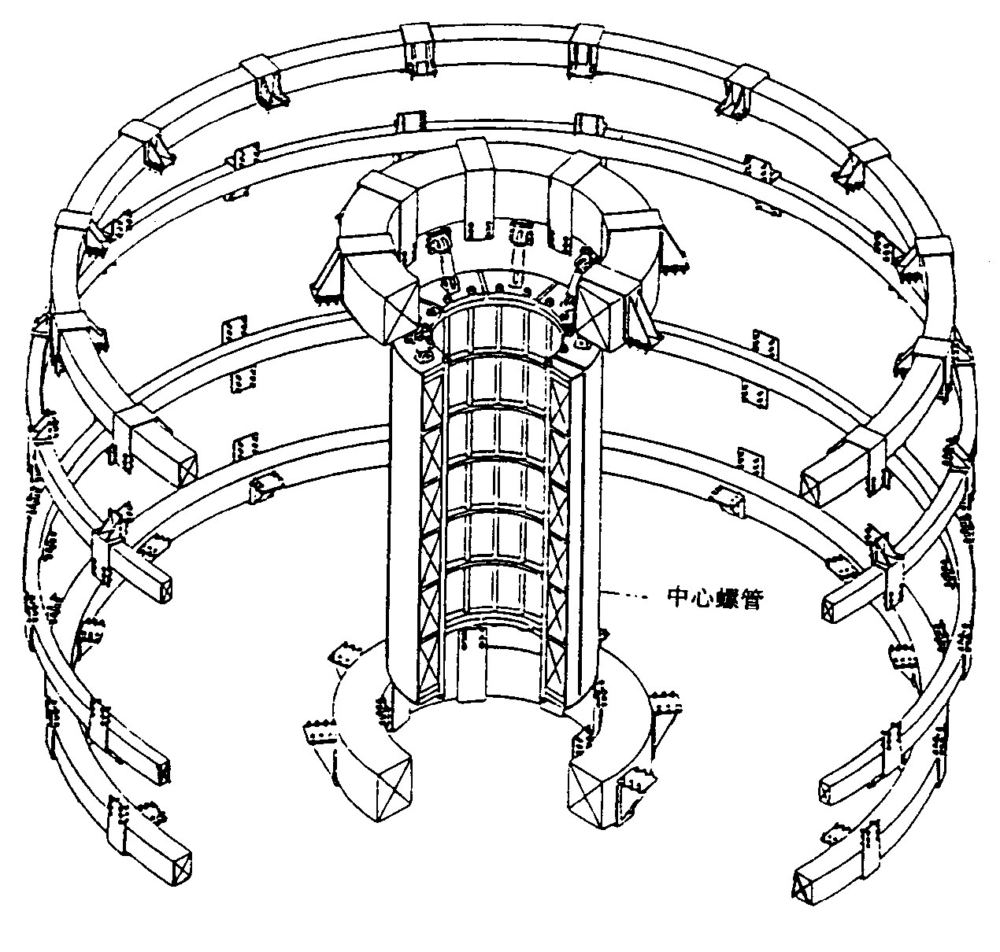

$$
\frac{3}{2}\frac{\partial}{\partial t}(nT_{i})=\frac{1}{r}\frac{\partial}{\partial r}\left(rn\chi_{i}\frac{\partial T_{i}}{\partial r}\right)+p_{ei} \tag{8.7}
$$

上面的简化处理中没有考虑对流损失，$p_{ei}$是通过碰撞由电子传给离子的功率密度

$$
p_{ei}=\frac{3}{2}\frac{n(T_{e}-T_{i})}{\tau_{ei}} \tag{8.8}
$$

电子-离子的能量传递时间$\tau_{ei}\propto T_{e}^{3/2}$，阿尔齐莫维奇（Artsimovich）最早指出，当电子温度超过离子温度较多时，具体说，在满足条件

$$
10>T_{e}/T_{i}>1.6 \tag{8.9}
$$

时，比值

$$
(T_{e}-T_{i})/T_{e}^{3/2}=f(\tau)/T_{i}^{1/2} \tag{8.10}
$$

$f(\tau)=(\tau-1)/\tau^{3/2}$对$\tau$的变化是不敏感的，其值大约在 0.3～0.39 间变动，近似地可取为 0.32 左右。这样一来，如果离子的热导率仅是离子温度的函数，在准稳态下，式（8.6）可化为仅与离子温度有关的方程

$$
\frac{1}{r}\frac{d}{dr}\left(rn\chi_{i}(T_{i})\frac{dT_{i}}{dr}\right)+CT_{i}^{-1/2}=0 \tag{8.11}
$$

对给定的离子热导率模型，求解这一非线性本征值方程，可以给出离子温度与各种参量间的关系。特别是，若假定离子热导率用离子新经典坪区公式表示，则有$\chi_{i}\propto T_{i}^{3/2}$，方程（8.11）的解给出中心离子温度与等离子体参量间的依赖关系如下：

$$
T_{i0}=6\times10^{-10}\left[\alpha I B_{\varphi}R^{2}\bar{n}_{e}\right]^{1/3}A_{i}^{1/2} \tag{8.12}
$$

式中参数$\alpha$用于对不同的等离子体密度及电流分布，以及离子热导率可能对新经典值的偏离等因素引起的修正。$\alpha=1$时化为阿尔齐莫维奇公式，其中温度以 keV 计，电流$I$以 A 计，磁场$B$以 kG（0.1 T）计，线平均等离子体密度以 cm$^{-3}$计，$A_{i}$为工作气体离子的核子数。一些早期的托卡马克实验结果与此式的预期值比较符合（如图 8.2 所示）。

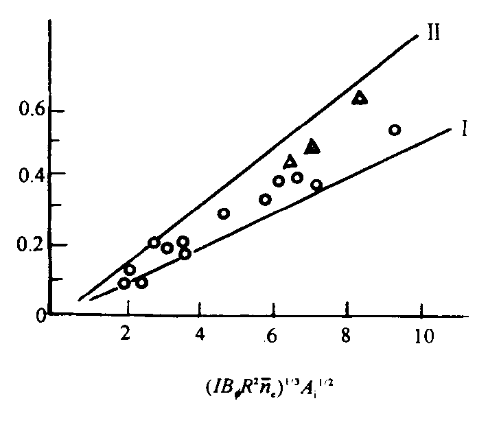

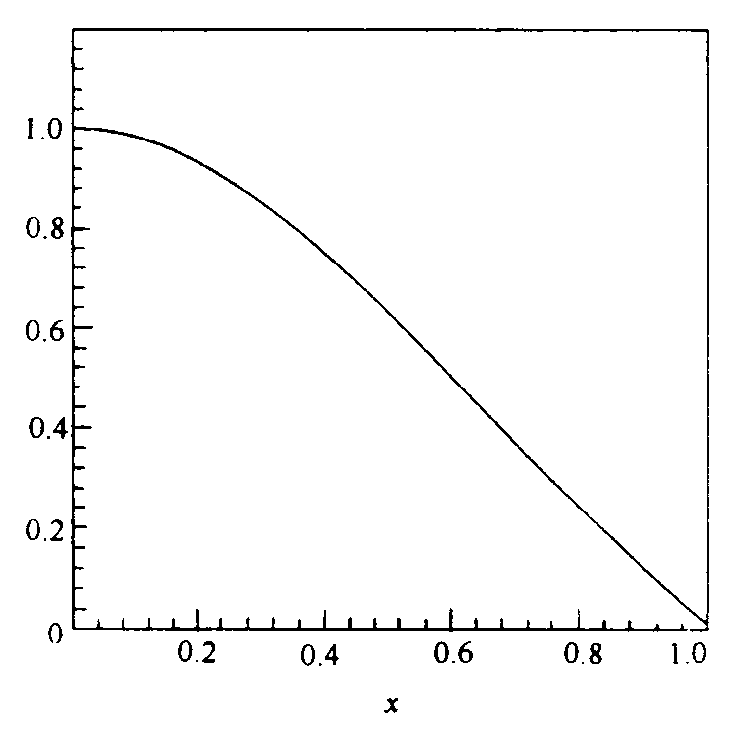

在等离子体密度较高时（线平均密度$>4\times10^{13}\ \mathrm{cm^{-3}}$），离子温度将接近电子温度，离子通道的功率损失可以超过电子通道的功率损失，以上估计不再适用。

对电子加热的估计可以通过假定总的热导率为 Neo-Alcator 定标来进行。具体做法是，假定电子与离子的温度接近，忽略辐射损失，在准稳态得

$$
\frac{1}{r}\frac{d}{dr}\left(rn\chi\frac{dT}{dr}\right)+\eta j^{2}=0 \tag{8.13}
$$

对 Neo-Alcator 定标，$n\chi=\kappa\approx\mathrm{const}$，可以将上式进一步写成

$$
\frac{d}{dx}\left(x\frac{dF}{dx}\right)+\Gamma xF^{3/2}=0 \tag{8.14}
$$

其中$F=T/T_{e0}$，

$$
\Gamma=\eta_{0}(T_{e0})j_{0}^{2}a^{2}/\kappa T_{e0}^{1/2} \tag{8.15}
$$

这也是一个非线性微分方程，解本征值问题可得中心等离子体温度与参量的关系。用数值方法求得对应于单调下降偶模解（图 8.3）的最小本征值为$\Gamma=5.897$。进一步假定$Z_{\mathrm{eff}}=1$，取$\ln\Lambda=15$，则等离子体电阻率

$$
\eta_{0}=3\times10^{-6}T_{e0}^{-3/2}\ \Omega\cdot\mathrm{cm} \tag{8.16}
$$

其中电子温度以 keV 计，而中心磁轴处电流密度

$$
j_{0}=5B/\pi Rq_{0} \tag{8.17}
$$

因此可得

$$
T_{e0}=\left[\frac{CB_{0}^{2}a^{2}}{R^{2}q_{0}^{2}}\right]^{2/5} \tag{8.18}
$$

式中磁场强度以 T 计，$C$与具体反常热导率数值有关，若取$\kappa=5\times10^{17}\ \mathrm{cm^{-1}\cdot s^{-1}}$，则$C=56$。无论是式（8.12）对离子温度的估计，还是式（8.18）对电子温度的估计，都可以看到，随着装置尺寸的加大，离子（电子）的温度可以有一定的提高，但提高得很慢，这实际上反映了欧姆加热的特性（即随着温度加大总的欧姆功率减小）。对合理的装置参数，仅依靠欧姆加热，即使对 ITER 这样大的装置，其中等离子体的温度也很难超过 3 keV。有人提出过采用超强磁场以提高容许的电流密度使欧姆加热功率增大，探索了仅用欧姆加热来实现聚变点火的可能。虽然在理想的条件下不排除这样一种可能，但在实践上，建造这类装置受到强磁场技术（要求将中心磁场提高到超过 20 T）的限制，而且很难想象会有反应堆应用前景。

从氘氚反应堆的角度，至少对托卡马克反应堆，不引入更强的加热手段是达不到将等离子体有效地加热到点火温度的要求的。现在已发展了一些有效的二级强功率加热手段，正确的做法是把这些加热方法进一步发展完善使之适合反应堆要求，并降低造价。下面从物理原理方面对主要的强功率加热方法做一些介绍。

## 8.2 中性束注入加热

粒子束注入加热的原理也是比较简单的，它基于利用已在等离子体外预先加速到能量比本底等离子体的电子和离子平均能量大得多的离子，通过与本底等离子体的碰撞而慢化的同时将能量传给电子和离子，只要电子和离子的平均约束时间大于高能离子的慢化时间，加热就会是有效的。在技术上，将离子加速到 100 keV 或更高的能量，对离子源和加速器技术来说并不难，这一能量已大大超过氘氚点火要求，用一个高能离子就可以加热十多个本底离子。不过，要将高能离子直接注入到本底等离子体中去是不可能的，因为高能离子一进入磁场就会因回绕磁力线转动而停留在很浅的表面区域，在托卡马克或其它环形装置中，由于磁场的不均匀性，这些离子与磁面间有一定的偏离，其中大部分离子会很快碰壁损失，反而引起很多的杂质。所以，必须以中性化束的形式实现注入。利用高能离子与同元素中性气体的电荷交换过程可以实现这种中性化。中性原子可以较深入地透入等离子体内部，使其重新变成高能离子是与本底等离子体的另一次电荷交换过程，或者是本底等离子体的电子和离子将其电离的过程，不管是哪一种过程起主导作用，高能中性粒子的能量的大部分将留在等离子体内，通过热化实现对本底等离子体的加热（见图 8.4）。

下面主要讨论与中性束加热有关的物理问题，有关高功率长脉冲强流中性束技术的问题超出本书要讨论的内容，有兴趣的读者请参看有关专题文献 [1]。

### 8.2.1 高能中性粒子与本底等离子体的相互作用[2,3]

高能中性粒子在被本底等离子体电离或与冷离子发生电荷交换后就被磁场捕获了。根据注入角度不同，捕获离子的轨道有不同的类型。对于垂直注入，相当一部分捕获离子将处在香蕉轨道上，与所在磁面有较大偏离。尤其是，如果环向磁场具有较大的波纹度，

将会引起很大“波纹扩散”，因而这些离子很易重新碰壁损失，并引起较大的杂质流进入等离子体。所以在尺寸较大的装置中，除了要求将环向磁场的波纹度减小外，一般采用平行于磁力线的切向注入，这时中性束与靶等离子体的有效作用距离要长得多，因而未被捕获的剩余中性束流量要小得多。在实践中，为避免剩余束直接与真空室壁作用，在注入束的对面要放置由石墨等轻元素材料做成的保护孔栏，虽然剩余束与其相互作用仍然要引起一些石墨原子被溅射到等离子体中，使碳杂质含量有一定的增大，但多年的实践已摸索出一些行之有效的方法来控制杂质含量。现在，大型装置中在很强的中性束注入功率下$Z_{\mathrm{eff}}$可以维持在 1.5 左右。

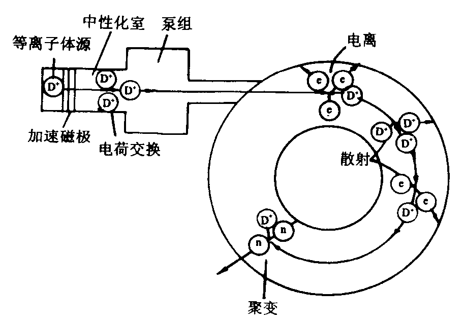

中性束注入在引入功率的同时本身也是一种粒子源。由于束粒子速度远大于气体分子，中性束注入加热的同时会对等离子体深部粒子密度剖面有很大影响（注意半径为$r$的等离子体柱体的内部体积与$r^{2}$成正比，虽然中性束所带粒子总数比靶等离子体粒子总数要少很多，但对半径较小的中心约束区域，有时可以使密度剖面峰化）。

中性束本身还是一种动量源，沿磁力线方向的注入会引起等离子体的环向转动，这种单向的切线注入方式称非平衡注入（unbalanced injection）。为了抵消这种效应，提出了平衡注入方案（balanced injection），即从相对方向注入两个束，使净动量基本抵消。不过，后来的 H-模约束实验发现，等离子体的转动并不一定是坏效应，尤其是沿极向的转动，可能是使约束由低模式向高模式转变的一个触发机制或手段，因而在一定条件下可能有意地采用非平衡注入方式，详见后面关于托卡马克实验的介绍。

中性束注入在一定程度上模拟了α粒子加热的物理过程，只是后者具有更大的能量。目前应用波加热方法也会产生部分能量很高（MeV 级）的离子，这些离子的重新热化也与中性束注入中的捕获离子的热化类似。这些离子的热化过程都是同一机制：与本底等离子体中电子和离子的经典碰撞冷却。

### 8.2.2 沿束注入方向束的透入深度

中性束与靶等离子体的相互作用主要是与靶等离子体中的离子的电荷交换，这是产生中性束的逆过

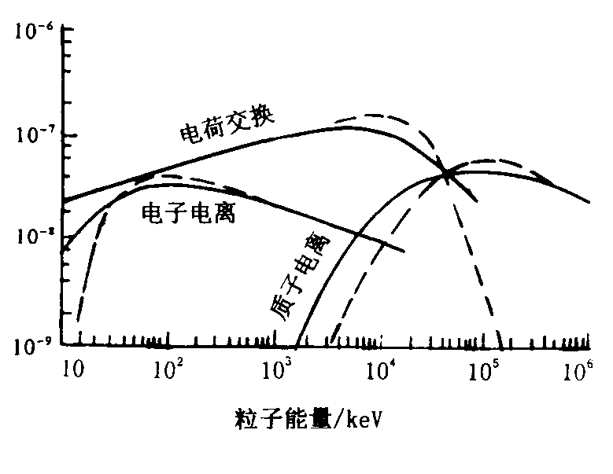

程，以及电子和离子对中性粒子的电离。在不同的束粒子能区，起主导作用的过程是不相同的。其相互关系如图 8.5 所示。可以看到，在氢等离子体中若中性束粒子的能量小于 40 keV，或氘等离子体中，中性束粒子的能量小于 80 keV 时，主要是电荷交换起主导作用；在更高的能区则是等离子体的电离起主导作用。对大型装置及反应堆来说主要是后一种机制起主导作用。

一般地，随着沿束的注入方向透入深度的加大，束的强度将按

$$
I_{N}=I_{0}\exp\left[-\int_{0}^{l}\lambda_{N}^{-1}(x)\mathrm{d}x\right] \tag{8.19}
$$

减小，积分自等离子体边界沿注入方向进行。$\lambda_{N}$是注入束的特征透入深度

$$
\lambda_{N}^{-1}=n_{e}\left(\sigma_{bi}+\sigma_{ch}+\frac{\langle\sigma_{be}v_{e}\rangle}{V_{b}}\right) \tag{8.20}
$$

式中$\sigma_{bi}$，$\sigma_{be}$，$\sigma_{ch}$分别表示图 8.5 所示的中性束与本底等离子体的离子，电子的电离截面和与冷离子的电荷交换截面。对绝大多数实际应用情况，中性束注入加热是在满足下面的物理条件下进行的

$$
v_{te}\gg v_{b}\gg v_{ti} \tag{8.21}
$$

因此，对电子来说，上面公式中的截面值是对速度分布求平均后的值，依赖于电子温度本身。但从图 8.5 中看到，随着电子温度的升高，电子电离的贡献越来越小，因而在大装置和反应堆中，主要是离子电离起主导作用。结果

$$
\lambda_{N}^{-1}\approx n_{e}\sigma_{bi} \tag{8.22}
$$

而当氘原子的能量大于 200 keV（氢原子能量大于 100 keV）以后，离子电离截面随氘原子（氢原子）能量进一步的提高而迅速下降，中性束透入深度随之迅速加大。对氢或氘等离子体，中性束粒子能量在 20～100 keV 范围内，可以用下面的估计公式来计算透入深度

$$
\lambda_{N}=5.5\times10^{13}E_{b}/(n_{e}A_{b})\ \mathrm{cm} \tag{8.23}
$$

式中束能量以 keV 计，$A_{b}$为束粒子的原子量。

托卡马克反应堆的一些概念设计研究指出，目前，中性束注入加热或用中性束在等离子体的中心约束区进行电流驱动，必须将束粒子的能量提高到超过 200 keV，对反应堆，甚至要求建造束粒子能量为 MeV 级的中性束注入设备。可是，随着粒子能量的加大，对正离子来说，其中性化的效率下降很快，而负离子的中性化效率相对保持较高的水平（图 8.6），近年来国际上对发展以负离子源为基础的强流长脉冲中性束技术非常重视，已获得重要的进展。

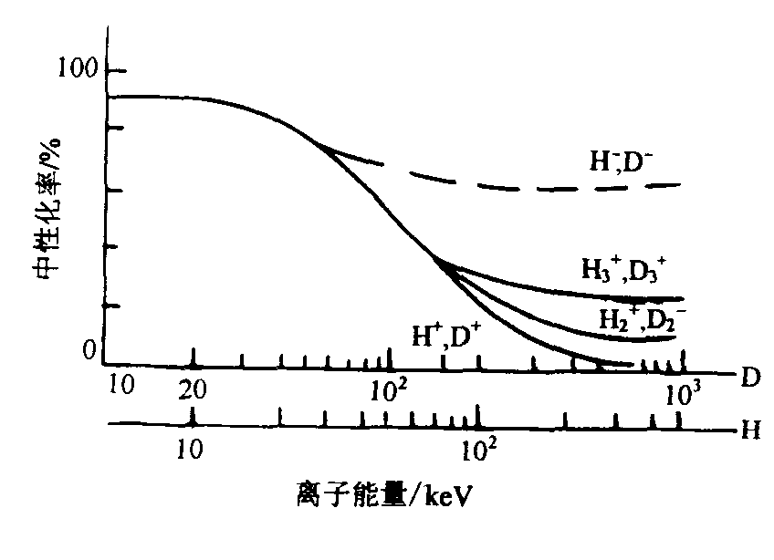

### 8.2.3 电子和离子成分加热功率沉积密度

高能离子在等离子体中与本底等离子体的电子和离子在碰撞过程中被慢化，这种过程的严格描述要通过求解相应的富克-普朗克方程。中性束注入的总功率密度将按被捕获离子所在位置的等离子体参数来确定对离子和电子两种加热成分的沉积比例。最简单的物理模型是就地沉积模型，即设被捕获离子在慢化过程中将其全部能量沉积在所处磁面上。按这一模型，高能离子（类别为 b）的能量慢化速率为[2]

$$
\frac{1}{V_{b}}\frac{\mathrm{d}E_{b}}{\mathrm{d}t}=-2\pi Z^{2}e^{2}\ln\Lambda\left[\frac{m_{b}}{E_{b}}\sum\frac{n_{i}Z_{i}^{2}}{m_{i}}+\frac{4n_{e}}{3\sqrt{\pi}}\left(\frac{m_{e}}{m_{b}}\right)^{1/2}\frac{E_{b}^{1/2}}{T_{e}^{3/2}}\right] \tag{8.24}
$$

此式按照对入射粒子能量的关系可以写成两项，第一项与$E_{b}$成反比，是冷离子的贡献，第二项与$\sqrt{E_{b}}$成正比，是电子的贡献。存在一个临界能量$E_{cr}$，当被捕获离子的能量大于这一临界值时，主要对电子加热；反之，离子的加热占优。这一临界能量主要与本底电子的温度有关

$$
E_{cr}=15T_{e}\left(A^{3/2}\sum\frac{n_{i}Z_{i}^{2}}{n_{e}A_{i}}\right)^{2/3} \tag{8.25}
$$

设被捕获离子的能量全部热化于所在磁面处，则离子获得的加热份额为

$$
G_{i}=\frac{E_{cr}}{E_{b}}\int_{0}^{E_{b}/E_{cr}}\frac{\mathrm{d}y}{1+y^{3/2}} \tag{8.26}
$$

电子所获得的加热份额为

$$
G_{e}=1-G_{i} \tag{8.27}
$$

$G_{i}$, $G_{e}$与$(E_{b}/E_{cr})$的关系如图 8.7 所示。

设中性束透入等离子体后在所考虑磁面上的平均功率沉积密度为$p_{\mathrm{NB}}$，则对离子和电子的加热功率密度分别为$G_{i}p_{\mathrm{NB}}$和$G_{e}p_{\mathrm{NB}}$，按这种就地沉积模型得出的加热计算子程序已在等离子体参数演变计算中得到广泛应用。

在更深入的研究中，要考虑被捕获离子能量的非就地沉积，因为这些离子的能量较大，其轨道与所在磁面有一定的偏离，其中具有香蕉轨道的粒子的偏离更大。在理论上，已发展了对香蕉轨道求平均的福克-普朗克计算编码。这种大轨道的总体效应是使功率沉积剖面变得更平坦。此外，在高能离子总额较大时，还要考虑这些离子自身反常扩散的影响。

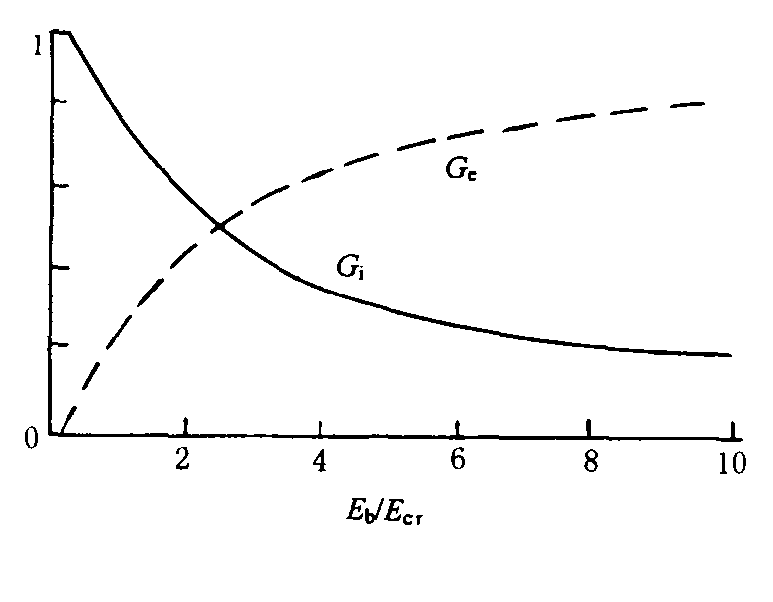

### 8.2.4 中性束加热效率

到目前为止，在各种尺寸的托卡马克装置中的中性束注入实验都获得了很好的效果，在磁镜装置和仿星器装置中也进行了大功率和大流量的中性束注入实验。在几个大型托卡

马克中已将离子加热到超过点火要求的温度范围，其中在 TFTR 和 JT-60U 中达到 40 keV 以上，并证明下述主要结论：(1) 在总功率比欧姆功率大一个数量级的条件下，中性束注入没有引起宏观不稳定性；(2) 束的捕获、慢化主要通过与等离子体的经典碰撞（包括电荷交换），没有发现明显的反常慢化过程；(3) 中性束加热的总效率可以超过 90% 以上，所以是很有效的加热方法；(4) 在中性束加热过程中，除本底等离子体外，同时存在高能离子成分，如用氘做工作气体则发现很大份额的由高能氘离子与本底离子间的核反应。在 TFTR 和 JET 的氘氚实验中，这类高能成分的贡献占总的聚变功率输出的 1/3 或更多。因此可以预期在未来氘氚反应堆中，由注入高能中性氚束产生的高能氚离子将对聚变反应产生可观的贡献。托卡马克装置中性束注入加热的一般情况见表 8.1$^{[3\sim8]}$。

**表 8.1 托卡马克装置中 NBI 实验概况$^{[3\sim8]}$**

| 装置名称 | 年份 | 能量/keV | 流强/A | 功率/MW | 脉宽/s | $T_i$/keV | 物理特征 |
|---|---|---|---|---|---|---|---|
| PLT | 1975$\sim$ 1980 | 40 | 60 | 10 | 0.5 | 8 | a |
| PDX | 1979$\sim$ | 50 | 100 | 10 | 2 | 10 | a, b, c, d |
| DIII-D | 1985$\sim$ | 80 | 60 | 20 | 10 | 25 | a, d, e, f, h |
| TFTR | 1984$\sim$ | 80$\sim$ 120 | 60 | 40 | 2 | 40 | a, c, d, e, f, g, h |
| JET | 1984$\sim$ | 80$\sim$ 140 | 100 | 40 | 30 | 30 | a, c, d, e, f, g, h |
| JT-60U | 1985$\sim$ | 120 | 100 | 40 | 10 | 44 | a, c, d, e, f, h |
| JT-60U | 1966 | 350 |  | 2.5 | 10 |  | 负离子源 |
| AGU | 1966 | 65 |  |  | 10 | 10 | a, d, f |

注：a. 平行注入或平衡注入；b. 垂直注入；c. 鱼骨模或锯齿稳定化；d. 实现 H-模；e. 电流驱动效应；f. 自举电流效应；g. 氚束注入进行氘氚实验；h. 环形本征模模拟实验。

### *8.2.5 高能离子分布函数：富克-普朗克方程

为了严格确定高能离子的沉积分布，计算加热效率，以及对聚变反应率的修正，需了解它们的分布函数，因此需求解富克-普朗克方程。在注入粒子能量满足条件 (8.21) 的情况下，束离子的分布函数随时间的演化由下面的简化形式的富克-普朗克方程描述

$$
\frac{\partial f_b}{\partial t}=\frac{1}{\tau_s v^2}\frac{\partial}{\partial v}\left[(v^3+v_c^3)f_b\right]+\frac{\alpha v_c^3}{\tau_s v^3}\frac{\partial}{\partial\chi}(1-\chi^2)\frac{\partial f_b}{\partial\chi}+S(r)f_b^0 \tag{8.28}
$$

式中$S(r)$是中性粒子通过与本底等离子体相互作用（电离或电荷交换）被捕获产生的粒子密度源函数，$f_b^0$是归一化分布函数，最简单的情况下可设

$$
f_b^0=\delta(v-v_b)\delta(\chi-\chi_b)/2\pi v_b^2 \tag{8.29}
$$

$\chi=\cos\theta=\boldsymbol{v}_b\cdot\boldsymbol{b}/v_b$是注入粒子速度与磁力线夹角的余弦，高能离子的慢化主要由与电子碰撞而确定

$$
\tau_s=\frac{3}{16\sqrt{\pi}}\frac{m_e m_b v_{T_e}}{n_e e^4\ln\Lambda Z_b^2} \tag{8.30}
$$

$v_c$是与临界能量$E_c$［式 (8.25)］对应的临界速度，参量

$$
\alpha=\frac{n_e Z_{\mathrm{eff}}}{2m_b\sum_i n_i Z_i^2/m_i} \tag{8.31}
$$

上述富克-普朗克方程的解可以表成对 Legendre 多项式展开的形式

$$
f_b(v,\chi)=\sum_n A_n(v)P_n(\chi) \tag{8.32}
$$

对应于初始注入分布由式 (8.29) 表示的情形，高能离子的分布函数可以写成

$$
f_b=S(r)\tau_s\chi_b\left(v_b^2/v_c\right)G\left(v_b/v_c\right) \tag{8.33}
$$

而函数$G$又可近似地由下面的公式逼近

$$
G(y)=\frac{y^2}{4+1.2Z_{\mathrm{eff}}}\exp\left(-1.3y^{0.78}\right)+\frac{1}{y}\exp\left(-2.5y^{-0.78}\right) \tag{8.34}
$$

求得高能离子的分布函数后，就可以确定有关的各种物理量。一般用于定态问题的分析。

### 8.2.6 伴随中性束注入的物理问题

（1）中性束注入在加热等离子体离子和电子的同时，对等离子体的总体性质有很大的影响。首先观察到等离子体稳定运行参数区有所扩展（关于稳定运行参数区见第五、七章讨论），主要是极限密度有相当大的提高，可能有两方面的物理原因。其一是中性束注入在一定程度上使密度剖面分布峰化，对应于较好的约束状态；第二是总加热功率的提高使等离子体能够在更高的密度下抵抗边缘区的辐射损失（与密度平方成正比）。

（2）普遍观察到高能离子成分的存在，这些高能离子，尤其是具有香蕉轨道的捕获离子会与磁流体本征模发生相互作用，其中处在$q=1$面内的高能捕获离子会与内扭曲模发生相互作用，引发所谓的鱼骨模（fishbone mode），这也是一种$m=1,n=1$的内扭曲模，但只有存在大量的高能捕获离子时才能被激发，它对高能离子本身的约束起很大的破坏作用，从而影响到中性束加热效率。但高能捕获离子在一定条件下又能起好的作用，这就是使锯齿稳定化。此外，最近在一些大装置中利用中性束加热产生的快离子对环形装置中阿尔芬本征模的激发条件进行了多项试验，这个问题关系到氘氚反应堆中$\alpha$粒子的约束特性，是堆芯物理中最重要的问题之一，在第十二章中还要讨论这些问题。

（3）不同于欧姆加热条件下的新的约束定标及 H-模。现代托卡马克实验中的中性束注入加热功率已远大于欧姆加热功率，等离子体的加热和约束特性主要都是与这一加热功率的沉积剖面和总功率有关。一个主要特点是，能量约束时间随加热总功率的加大按$P^{-1/2}$的规律而减小，其它高功率加热，如离子回旋频段波加热条件下情况也类似。对大量实验数据进行回归分析后发现，可以用各种装置参数及加热总功率来表示能量约束时间，这一定标关系称为 Goldston 定标。在第六章讨论等离子体的输运特性时已指出，这表明高功率加热条件下存在影响输运的湍流结构。如果能设法抑制湍流水平，约束时间可以提高，这为后来进行的大量改善约束的实验所证明，并把满足原先的约束定标的情况称为低模约束，或 L-模，而改善后的约束模式为高模，即 H-模。这些将在第九章中讨论。

（4）束离子对聚变产额的贡献：高能离子成分的存在使实际的氘氚反应率（以及氘氘反应率）有一定程度的提高，尤其在所谓的热离子模式实验中，这种提高对中子产额有很大贡献。在有关的实验分析编码中都考虑这类束靶反应的贡献。

（5）中性束驱动平行于磁力线的电流。这将在下面电流驱动研究的小节中讨论。

## 8.3 磁约束等离子体的波加热$^{[9]}$

利用波在磁约束等离子体中的传播和吸收性质，选用一定频段的电磁波，通过天线或波导将波功率发生器产生的强功率耦合到等离子体中，可以实现对等离子体电子或离子的加热，并最终达到整体等离子体温度的提高。理论和实验研究表明，有可能单独应用波加热方法或与中性束注入加热方法联合应用，在基本不破坏等离子体整体约束性质的情况下，将氘氚等离子体加热到聚变燃烧温度。根据第六章 6.4 节中关于波和等离子体相互作用的讨论知，有三个波段的微波可供选用，这就是离子回旋频段 (ICRF)、电子回旋频段 (ECRF) 及低混杂频段 (LHRF)。这三个频段的微波在真空中的波长分别属于米波段，分米波段和厘米波段，因此与等离子体间的耦合方式也有很大差别。我们不讨论微波功率产生的技术问题，而主要讨论波与等离子体相互作用和最终加热等离子体的物理问题。

对于波加热，在物理和工程上有几个环节的问题需要研究。第一，研制可以在上述三个波段产生强功率的微波器件，并将产生的微波通过适当的传输线传送到等离子体所在区域。这些微波发生器的频段对离子回旋频段为 30$\sim$ 200 MHz，可采用大功率真空四极管 (tetrode)；对低杂波频段为 1$\sim$ 8 GHz，可采用速调管 (klystron)；对电子回旋频段为 40$\sim$ 160 GHz 范围，可采用回旋管 (gyrotron)。经过 20 多年的研制，现在单管的微波功率已能达到 MW 量级。大部分实验装置中，微波功率以一定宽度的脉冲形式输入，脉宽在几十毫秒到几秒范围，几个大装置中的高功率微波脉冲宽度已达几十秒。对聚变堆来说，要将氘氚等离子体加热到自持燃烧温度，这些功率的脉宽也应达到几十秒，如果用作波电流驱动，则微波的产生和传输都要实现稳态。与波加热相关的工程问题，目前为止已取得重大进展，应用于反应堆的前景是令人鼓舞的。第二，外加波能与等离子体的耦合。被加热的等离子体是一个有界的不均匀介质，当通过外部的耦合系统（微波天线、波导）向等离子体发射大功率微波时，只有在等离子体内能产生相应波段的可传播的本征波时，才能将外部的微波能量耦合到等离子体中，这一条件是由等离子体的色散性质确定的，因此必须分析各有关波段的色散关系，计算出可以传入等离子体的波功率（确定耦合效率）。第三，这些被耦合的波能最终被等离子体吸收，第六章中的讨论已指出，这类吸收主要通过非碰撞型机制来实现，即通过等离子体中的部分粒子与波的相互作用，波对这些粒子实现共振加速而把波能转换为粒子的机械能的方式达到强的吸收。最后，这些被加速的粒子把能量传给周围等离子体而实现对等离子体的整体加热。

### 8.3.1 离子回旋频段 (ICRF) 波加热$^{[10\sim14]}$

这一频段是指波的频率在基频为

$$
f=\Omega_i/2\pi=15ZB/A\ \ \mathrm{MHz} \tag{8.35}
$$

范围，也常采用两倍此频率的加热模式，式中$B$以 T 计，$Z$和$A$是离子的电荷数和原子量，例如氘离子在$B=4\ \mathrm{T}$时，对应的频率为 30 MHz，对应的真空波长为 10 m，比装置的大半径还大一些，因此，离子回旋频段的波与等离子体的耦合是近场耦合。根据 6.4 节中的讨论，对于磁场均匀的情形，可采用离子回旋波（其频率略小于离子回旋共振频率）来加热，首先在跑道型仿星器装置的直线段上用斯蒂克斯线圈实现与等离子体的耦合，当波沿磁力线向两边传播到磁场较弱的区域时，因波长变成很短而使波发生衰减。对于托卡马克和环形仿星器，由于磁场的不均匀性，只有快磁声波（频率大于离子回旋频率）才能在等离子体内部传播。大功率微波与等离子体的耦合通过沿环向和极向都不对称的天线阵

列来实现。这种天线的结构比较复杂，但每一单元基本上由两块沿环向和极向都有一定宽度的良导体板组成，外部设有防止静电杂散场的法拉第屏蔽罩。由这种天线产生的波动电磁场应包含多个空间富氏分量，不过实验结果表明，这种很不对称的天线可以很有效地将微波功率耦合到等离子体中，目前已实现从每平方米天线向等离子体耦合 10 MW 以上功率。

离子回旋波段波加热的效果非常好，已成为托卡马克和仿星器装置的基本和重要的加热手段，多年来进行了大量的理论和实验研究，具有丰富的文献资料。学习了 6.4 节中介绍的一些基本知识，可以对加热的基本原理有一个最简单的理解。这里结合具体的加热模式，进一步介绍一些重要的物理问题。

**（1）射频天线与等离子体的功率耦合$^{[10]}$**

在托卡马克与仿星器装置中，ICRF 波段的射频波功率与等离子体的耦合是通过相当靠近等离子体的天线来实现的。天线形状和结构对波的耦合效率有重要的影响。天线的特征阻抗既影响等离子体的耦合效率，也影响波与传输系统的匹配特性。目前在大装置中，由几组天线元组成阵列，在中小装置中，可以只用一个单元。每一单元的天线由载流导体，接地导体及法拉第屏蔽罩组成。载流导体沿环向有一定宽度，沿极向的布设可采用不同的设计，有的绕极向形成完整的一圈，有的只有靠外侧的半圈，射频电流在一块导体上沿极向流动，在同一环向位置的另一块导体上返回。法拉第屏蔽罩的主要作用是使发射出的电磁波在等离子体中主要以快磁声波的形式耦合，同时使天线周围的强感应电场得到屏蔽，因为这些电场可以加速周围的离子，并使这些离子以很大的能量碰击天线的外侧，产生很多的杂质。图 8.8 所示为 JET 上一种新的 ICRF 天线的一个单元。

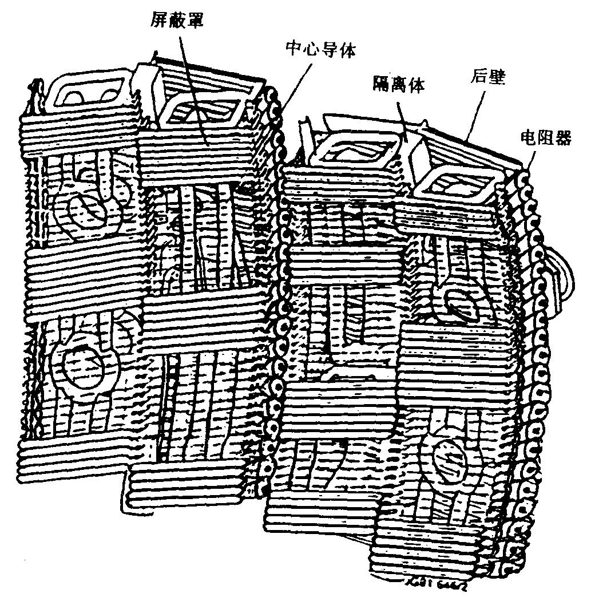

**图8.8** 由四个可调相电流片构成的 JET 的 ICRF 天线的一个单元$^{〔16〕}$由于 ICRF 波段的电磁波的波长达 10 m 左右，天线又非常靠近等离子体，天线与等离子体的耦合是近场耦合，计算耦合效率或等效地计算天线在存在等离子体时的有效阻抗值时要求解边缘区域中的波动方程，并结合在天线上电磁场应满足的边界条件。这些边界条件是

$$
E_z=0,\quad [B_z]=\frac{4\pi}{c}J_A,\quad [\nabla\cdot\boldsymbol{E}_\perp]=0 \tag{8.36}
$$

式中$E_z$是左旋电场分量。一般的三维波动方程为

$$
\nabla\times\nabla\times\boldsymbol{E}=\frac{\omega^2}{c^2}\left(\boldsymbol{E}+\frac{4\pi\mathrm{i}}{\omega}\boldsymbol{j}\right) \tag{8.37}
$$

要得到等离子体内部感应电流的表示式，必须将等离子体模型具体化。在第六章中对冷等离子体的模型已做过一般的分析，很多结论与本问题的分析有密切联系。一般，波动方程具有积分微分方程的形式，实际解应包含相当多的模，若将等离子体柱简化成圆柱状，忽略密度梯度效应，则极向模数为$m$的模满足下面的微分方程

$$
\frac{1}{r}\frac{\mathrm{d}}{\mathrm{d}r}\left(r\frac{\mathrm{d}E_\theta}{\mathrm{d}r}\right)+\left[\frac{(S-N_z^2)^2-D^2}{S-N_z^2}k_0^2-\frac{m^2}{r^2}\right]E_\theta=0 \tag{8.38}
$$

这是关于快波的方程，一般意义上的慢波在 ICRF 波段是消散波 (evanescent wave)，不能在等离子体中传播。

要与天线处的边界条件匹配，一般要用很大模数的叠加解。不过，模数越大，在等离子体内部受到反射的区域离边界越远，因此可进一步将等离子体看成吸收波的半无限区间。此外，考虑实际存在的密度梯度效应时，可以将式 (8.38) 的解作为零级近似，将局部色散关系展开

$$
N_\perp^2=\frac{(S-N_z^2)^2-D^2}{S-N_z^2}=N_{\perp0}^2\left(1-\frac{x-x_0}{L}\right) \tag{8.39}
$$

由边界区的电磁场解得出表面导纳 (surface admittance)

$$
Y_{\mathrm{sur}}=B_z/E_y=\frac{k_yD+(S-N_z^2)E_y'/E_y}{S-N_z^2-N_y^2} \tag{8.40}
$$

详细的计算需很长的篇幅来介绍，我们仅指出，计算结果与实际测量结果符合得相当好。

**（2）共振位置的调节**

无论采用双离子成分加热模式，还是采用单离子二次谐波加热模式，离子回旋衰减是主要的吸收波功率的机制。在托卡马克中，环向磁场比极向磁场大一个多数量级，因此总的磁场强度基本由环向磁场确定，这就是说，与波共振的空间位置基本上是与赤道平面垂直的平面（见图 8.9），这一平面切割了许多磁面，而电子和离子沿磁面的运动又会使被吸收的波能均匀化。在实际应用中，可以将共振区选在磁轴附近的中心约束区，称为近轴加热 (on-axis heating)；也可以有意选在较靠外部边界的区域，称偏轴加热 (off-axis heating)。后一种方式在研究等离子体输运规律中得到较广泛的应用。共振区位置的可调性也使等离子体电流剖面在一定程度上可调（通过调节电子温度剖面）。

**（3）双离子成分加热方式的主要物理问题**

在冷等离子体色散模型中，共振区由阿尔芬共振条件确定，即由

$$
S=1+\frac{\omega_{pe}^2}{\Omega_e^2}-\sum_j\frac{\omega_{pj}^2}{\omega^2-\Omega_j^2}=N_z^2 \tag{8.41}
$$

确定。通常平行折射率包含一定的谱，这里简化为单一波长来讨论。对快磁声波，$\omega>\Omega_1$，波的传播主要由第一种离子（多数离子）确定，多数离子与波不发生共振，而且波的偏振电场中含有较大的左旋分量［见第六章式 (6.151) 及其后的讨论］。但当波接近少数离子的共振区时，少数离子的作用才越来越明显［式 (8.41) 中具有与少数离子共振的分母］，同时波电场左旋分量将对少数离子进行有效的加热。

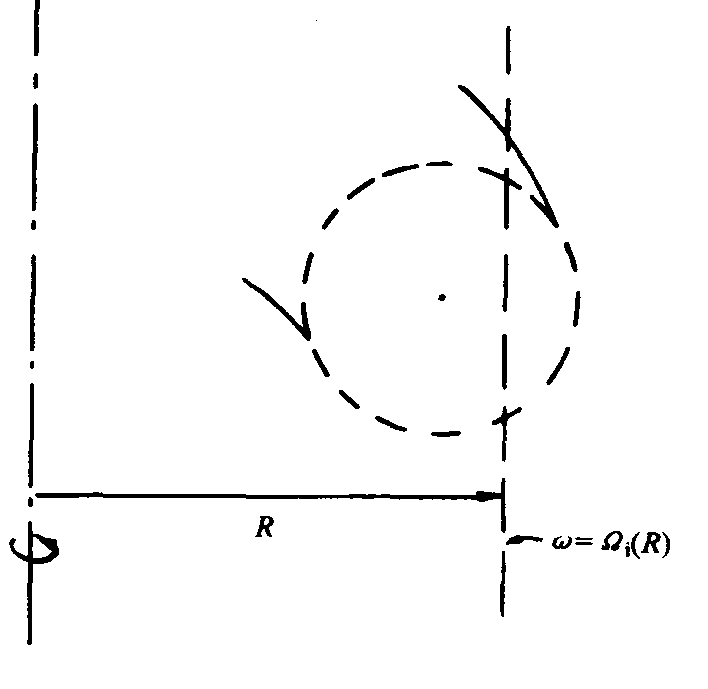

**图8.9** 托卡马克中离子回旋共振面的位置

如果少数离子含量不是非常小，要考虑一个新的共振频率

$$
\omega^2=\Omega_1\Omega_2\frac{n_1\Omega_2+n_2\Omega_1}{n_1\Omega_1+n_2\Omega_2} \tag{8.42}
$$

式中$n_1,n_2$可以理解为两种离子成分的绝对或相对密度。

最后，波的吸收主要通过少数离子的回旋共振实现，其它机制，如朗道衰减，TTMP 的效应都较小。

**（4）第二谐波加热（$\omega\approx2\Omega_2$）**

在第二谐波频率范围，快波可以在不均匀等离子体大部分区域传播，在满足阿尔芬共振条件时，一部分波的功率通过模转换成为伯恩斯坦波，最后通过电子的朗道衰减加热电子，可以调节参数使大部分波的功率通过第二谐波共振吸收。吸收功率密度由式 (6.174) 表示，除了与其他参数存在依赖关系外，吸收功率的大小随本底离子能量的加大而加大，这一机制使参与吸收波能的离子的能量越来越大，形成高能尾部，有人提出利用这一效应来增大氘氚反应率，最近 JET 的氘氚等离子体实验证明高能氘离子束对聚变功率的贡献很大$^{[14]}$。

在 ICRF 频段波加热实验中，无论是双成分离子模式，还是第二谐波加热模式，都观察到电子的明显加热。产生电子加热的原因除波的模转换效应外，高能离子通过与电子的碰撞慢化也是重要的因素，这与中性束加热的情况类似。但当存在锯齿活性的情况下，中心约束区的电子温度的提高受到很大的限制，实验中观察到 ICRF 加热条件下锯齿的周期延长，幅值加大。图 8.10 是 PLT 装置中锯齿变化的典型图。在另一种条件下，由 ICRF 加热产生的高能捕获离子对锯齿产生稳定化，在 JET 中观察到长达 18 s 的锯齿稳定实例。

一般条件下，ICRF 加热得到的等离子体的整体约束与中性束加热条件下的整体约束没有多少差别。一个共同的特点是能量约束时间随加热功率的加大而减小，即所谓的 L-模约束定标。这些问题在后面的约束实验中还要进一步讨论。

**（5）ICRF 加热的实验研究$^{[8\sim15]}$**

托卡马克装置中的 ICRF 加热开始于 70 年代，几个中小型装置中，在波的总功率和功率密度都比欧姆功率和功率密度大 5 倍以上的条件下，获得了很好的加热效果，等离子体的宏观稳定状态基本没有受到影响（虽然破裂几率增大）。早期的实验因天线附近的强电场造成离子对天线轰击，引起杂质含量的增大，以后通过改进法拉第屏蔽，基本控制了杂质增大趋势。在 ICRF 工程技术不断提高的情况下，等离子体物理参数有很大的提高。在 PLT，ASDEX，TFR，JIPP-T2 等一批装置上，总的输入功率达到 3$\sim$ 5 MW，按等离子体体积平均的功率密度达到 1 W/cm$^3$以上计算，这个数值约为聚变堆中应达到的加热功率密度的 10 倍。在 80 年代，随着 TFTR，JET，DIII，JT-60 等大装置投入运行，另一些精心设计的中型装置如 Textor，ASDEX-U 和超导磁体托卡马克 TORE-S 建成和运行，ICRF 加热工程和物理研究进入了新阶段，做出大量的新实验成果。其中一些实验结果对未来聚变具有重要参考价值，如 JET 和 TORE-S 中的长脉冲 ICRF 实验（分别达到 20 s 和 2 min），天线单位面积发射的射频功率密度达到和超过了 16 MW/m$^2$；单独应用或和中性束注入联用产生 H-模式约束，等等。最佳加热效果在 TFTR 装置上通过与中性束注入加热联用而获得，在耦合射频波功率达 12 MW 的条件下，离子温度由 26 keV 上升到 36 keV。最大粒子密度达$3\times10^{14}\ \mathrm{cm}^{-3}$时的加热最近在 ALCATOR，C-Mod 装置上实现，有很好的效果，这为在反应堆高密度条件下的加热提供了有益的参考。在仿星器装置上的 ICRF 加热也有很好的效果。其他一些典型的结果如表 8.2 所示。

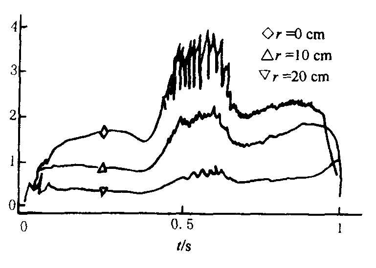

**图8.10** PLT 中 ICRF 加热时电子温度上出现的大锯齿振荡$^{〔3〕}$

### 8.3.2 电子回旋频段波加热$^{[9,12,13]}$电子回旋频段波的频率为

$$
f=\frac{|\Omega_e|}{2\pi}=\frac{enB}{2\pi m_ec}=28nB(\mathrm{T})\ \mathrm{GHz} \tag{8.43}
$$

$n$是谐波次数，这个频段的微波波长在厘米和毫米波段，波功率发生器主要是回旋管 (gyrotron)，目前已可制造单管功率为 MW 级的脉冲长度为 10 s 级的回旋管，微波的传输可通过波导，传输技术较简单和成熟，同时加热窗口小，和装置的匹配性好。电子回旋加热方法已在各种磁约束聚变实验装置中得到应用。对托卡马克和仿星器，高功率电子回旋波可用于等离子体产生，电子加热，电流剖面调控及电流驱动等多种目的。

在加热方面，主要是利用 O 波或 X 波在等离子体中传播和吸收的性质。冷等离子体近似下 O 波和 X 波的色散关系分别由第六章中的式 (6.154) 和式 (6.155) 描述。可以看到，在 O 波的色散关系中仅出现等离子体频率，这表明其传播性质仅与等离子体密度有关，并且存在一个最大的等离子体密度值，密度高于此值的区域对 O 波是截止的。如果选择波的频率为托卡马克等离子体磁轴处电子回旋频率，则波可达性条件为

$$
n_e<n_{ec}=9.7\times10^{12}B^2(\mathrm{T})\ \mathrm{cm}^{-3} \tag{8.44}
$$

**表 8.2 典型的 ICRF 实验结果**

| 装置名称 | 年份 | 总功率/MW | $n_e/\times10^{13}\ \mathrm{cm}^{-3}$ | $T_i$/keV | $T_e$/keV |  |
|---|---|---|---|---|---|---|
| PLT | 1975$\sim$ 1980 | 8 (5) | 4 | 8$\sim$ 10 | 4$\sim$ 6 | a, b, c, d |
| TFR | 1975$\sim$ 1984 | 3 | 12 | 1.5 | 2 | a, b, c, d |
| TEXTOR | 1993 | 4 (3) | 3 | 5 | 2 | a, b, c, d, e, g, h |
| TFTR | 1985$\sim$ 1996 | 15 (12) | 8$\sim$ 10.5 | 26$\sim$ 36 | 10 | a, b, c, d, e, f, g, h, k |
| JET | 1991 | 32 (22) | 3$\sim$ 6 | 13 | 15 | a, b, c, d, e, f, g, h, i, k |
| JT-60U | 1986$\sim$ | 8 (7) | 3$\sim$ 8 | 10 | 10 | a, b, c, d, e, f, g, h |
| DIII-D | 1984$\sim$ | 6 (4) | 3$\sim$ 6 | 10 | 10 | a, b, c, d, e, f, g, h |
| TORE-S | 1992$\sim$ | 14 (10) | 4$\sim$ 10 | 5 | 5 | a, b, c, d, e, i |
| ASDEX-U | 1992$\sim$ | 8 (4) | 5 |  | 1.7 | a, b, c, d, e |
| C-Mod | 1994$\sim$ | 4 (3.5) | 10$\sim$ 30 | 3 | 5 | a, b, c, d, e |
| ITER | 2005 | 64 (50) | 20 | 20 | 20 | b, c, e, h, i, j, k |

注：功率指标栏中括号中为实际耦合值；注解栏中各符号代表的意义为：a. 少数成分模式；b. 二次谐波模式；c. 大锯齿活性；d. L-模约束；e. H-模约束；f. 高能离子成分；g. 锯齿稳定化；h. 与中性束加热联合应用；i. 长脉冲实验；j. 快波电流驱动；k. 氘氚燃烧条件。

托卡马克中磁场从装置的内侧向外侧单调下降，O 波可以从任意一侧发射，但从外侧（弱场侧）发射较容易实现，所以 O 波都采用在外侧向等离子体发射。如果磁场足够强，在整个等离子体截面上不存在波的截止层，则波可以在等离子体中来回来回传播（穿透等离子体的那部分波很易被导体壳所反射，重新进入等离子体）。在冷等离子体模型下，O 波是电场沿主约束磁场方向的线偏振波，主要的吸收机制是碰撞吸收和朗道衰减。不过实际上等离子体的热运动效应非常重要（由于热运动的多普勒效应使很多电子处在波-粒子共振区），在高温等离子体条件下（$T_e>2\ \mathrm{keV}$），电子的相对论性效应也很重要（相对论性效应使速度空间中的波和粒子共振区域进一步加宽，详见后面电子回旋波电流驱动小节中的讨论），考虑上述因素，当传播方向不完全垂直于磁场时（波将不再是单纯的线偏振波），通过非常复杂的计算后，得出在回旋共振层（指电子满足回旋共振条件的区域）中，波的局部吸收系数为

$$
\eta_0=\frac{R_0T_e}{4c^3m_e}\alpha^2\sqrt{1-\alpha^2}\frac{1}{1+N_z^2(1-\alpha^2)} \tag{8.45}
$$

式中$\alpha=\omega_{pe}/\omega$，最大的吸收发生在$\alpha^2\approx0.8$和$N_z\approx0$的条件下。整个等离子体对波的功率吸收系数则为

$$
A=1-\exp(-2\pi\eta) \tag{8.46}
$$

显然，若局部吸收系数足够大，使得$2\pi\eta>1$，吸收就会非常有效，吸收层的宽度可以估算如下

$$
\Delta x\approx RN_z\left(T_e/m_ec^2\right)^{1/2} \tag{8.47}
$$

若$\Delta x<a$，则等离子体对所发射的 O 波是黑体。

在更多的情况下利用 X 波来加热托卡马克等离子体。从式 (6.155) 知，X 波存在一个高混杂共振层，另外存在由式 (6.157) 确定的两处截止层。这里不再重复数学推导，而由所谓的 CMA 图来描述 X 波的可达性。CMA 图是由 Clemmow-Mullaly-Allis 引入的，在参数平面上由波的共振条件和截止条件划分成若干个子区间，其中每一区间中波具有一种偏振性质，因而十分明晰。图 8.11 就是电子回旋频段 X 波的 CMA 图。图中用数字标出的区域是具有不同偏振性的区域，阴影区是 X 波不能传播的区域。该图的纵轴正比于$B^2$，而横轴正比于$n_e$。因为希望波能到达高混杂共振层，所以应从图中箭头所示方向发射 X 波，即应从强磁场一侧发射。但托卡马克和仿星器等环形装置的强磁场侧在环的内侧，空间非常紧凑，不可能安装微波发射和传输设备，所以一般采用在环的内侧安装反射镜的方法使 X 波从强磁场侧进入等离子体。

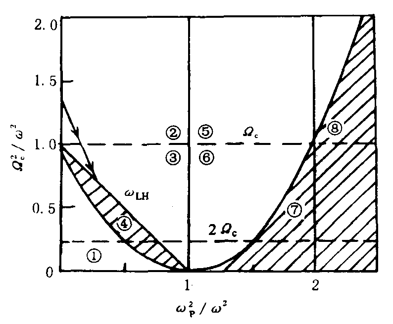

**图8.11** X 波的 CMA 图〔16〕

再次写出 X 波的偏振性质如下：

$$
\frac{\mathrm{i}E_x}{E_y}=\frac{N^2-S}{D} \qquad (8.48)
$$

可以看到当$\omega \to |\Omega_e|$时，上式右方变为 1，即 X 波成为右旋圆偏振波，通过电子的回旋衰减吸收可以对电子进行非常有效的加热。

X 波的局部吸收系数的表示式较复杂，一般具有下述形式

$$
\eta_X=\frac{R\omega}{c}\frac{T_e}{m_e c^2}\,g(N_z,N_\perp,\alpha) \qquad (8.49)
$$

因子$g$与波的传播角和频率比$\alpha$的大小有关。计算表明，等离子体对 X 波的吸收比对 O 波的吸收更有效。除基频外，X 波的谐波加热也相当有效，但更高频率的微波器件的制造难度更大，因而使应用受到限制。

电子回旋加热研究的情况见表 8.3。

表 8.3　电子回旋加热的实验研究简况

| 装置名称 | 年份 | 波功率/MW | $\langle n\rangle$ | $T_e/\mathrm{keV}$ | $T_i/\mathrm{keV}$ | 附　注 |
| --- | --- | --- | --- | --- | --- | --- |
| DIII-D | 1990 | 1.4 | 5 | 8 |  | a, c, d, f |
| T-10 | 1990 | 4 | 5 | 10 | 1.6 | a, b, c, d |
| FTU | 1990～ | 2(0.5) | 10 | 2.5 |  | a, c, d, f |
| W7-AS | 1996 | 1 | 30 | 3 |  | a, c |
| W7-X | 2000 | 10 | >10 | 10 | 10 | 待建超导仿星器 |
| LHD | 1997 | 10 | >10 | 10 | 10 | 超导仿星器，初步运行 |
| ITER | 2005 | 92 | 30 | 20 | 20 | g, h, i |

注：a. O-模耦合；b. X-模耦合；c. 大锯齿活性；d. 实现 H-模约束；e. 仿星器改善约束模式；f. 剖面控制实验；g. 初始加热和启动；h. 电流驱动；i. 氘氚燃烧条件。

## 8.3.3　低混杂频段波加热

低混杂频率的较简单的估计公式是

$$
f_{\mathrm{LH}}\approx \omega_{\mathrm{LH}}/2\pi=\sqrt{\Omega_i\Omega_e}/2\pi=0.67B(\mathrm{T})\ \mathrm{GHz} \qquad (8.50)
$$

式中$B$的量纲为 T，$f_{\mathrm{LH}}$的量纲为 GHz。严格按定义 (6.158) 确定的低混杂频还与等离子体密度有关。在利用低混杂波来驱动电流的情况下，实际选用频率要比低混杂频率大 2 倍以上。这一波段的大功率微波可以用速调管产生，单管功率可达 MW 以上，可以连续态运行。波能的输送可以通过波导阵列实现，可同时对入射波的偏振和平行折射率的大小进行调节，波导阵列所占窗口虽大于电子回旋波加热情形，但在中大型托卡马克和仿星器装置上都能实现。

低杂波段的耦合方式多采用多栅波导阵列 (grid)，对波谱形状具有很好的可调性 (见图 8.12)。

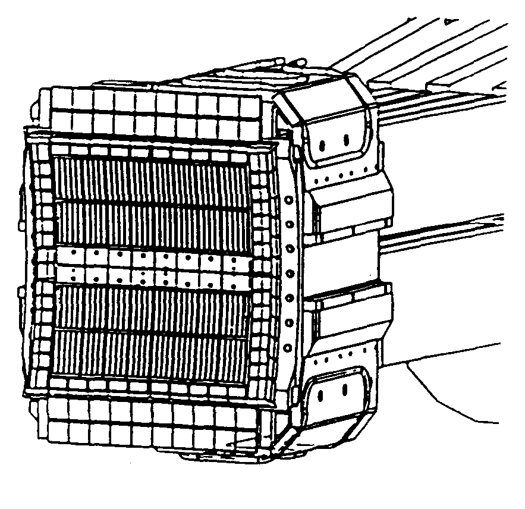

**图8.12** TS 装置上用于低杂波加热的多栅波导阵列及水冷结构〔16〕

低杂波段的微波在等离子体中的传播条件在 6.4 节中已作过初步讨论。现结合托卡马克装置的条件作一些进一步的讨论。当低杂波用作等离子体加热时，希望由边缘区向内传播的波功率可以到达等离子体中心区(磁轴附近)，因此，波的共振层 (折射率趋于无限大的空间区域) 选在磁轴附近。具体的参数关系一般要通过求解波束的束迹方程来确定。根据第六章中的讨论可知，波的传播一般可以用冷等离子体色散关系来描述，而波的吸收则要考虑热等离子体效应，尤其是波与粒子的共振条件。对低杂波，主要的不均匀性是等离子体的密度分布不均匀引起的，磁场的不均匀性不很重要。由于密度从边缘到中心可以改变一至二个数量级，对波的传播条件的分析也要区别在边缘附近还是在中心区。分析发现，对现代实验装置的参数，只有慢波分支可以同时满足可近性条件和波的共振条件；但对未来的反应堆参数，应采用快波模式，这一点是低杂波加热的特殊之处。

低杂波的吸收机制比较复杂，提出了若干理论机制，但还不清楚最可靠的机制是什么。比较肯定的是，在波到达共振层附近时，等离子体热运动效应变得很重要，这时，冷等离子体的慢波模将向热等离子体模转化，该模的传播方向与慢波模相反，即由等离子体中心向边缘传播。斯蒂克斯 (Stix) 认为，这种模可以通过极谐波回旋衰减方式被等离子体吸收；而卡内 (Karney) 等人认为非线性随机加热机制是主要的，这种解释在物理上更合理。其主要思想如下[12]：

在接近共振层时，慢波的垂直波数很快加大，因此波主要是垂直于磁场方向传播，而

且具有准纵波特征 ($|k\times E|\ll|k\cdot E|$)。因此在考虑粒子与波的相互作用时，可以近似地将波看成线偏振波，沿$x$方向传播。离子的运动方程化为

$$
\begin{aligned}
\ddot{x}&=\Omega_i\dot{y}+\frac{eE_0}{m_i}\cos(kx-\omega t)\\
\ddot{y}&=-\Omega_i\dot{x}
\end{aligned}
\qquad (8.51)
$$

这一方程可以简化成一维强迫振荡方程

$$
\ddot{x}+\Omega_i^2x=(e/m_i)E_0\cos(kx-\omega t) \qquad (8.52)
$$

对于这一类非线性振子的运动方程的研究可以说是非常充分的，结论是，两个以上的强迫振子的运动在一定的条件下可以变为无规运动。在本问题中，主要的参数是离子的初始回转半径 (由初始离子能量及磁场强度确定) 及波电场的幅值参数

$$
\alpha=kE_0/B_0\Omega_i \qquad (8.53)
$$

用归一化回转半径$\rho$及参数$\alpha$表示的无规化参数区如图 8.13 所示，曲线上方和右方为无规化区。基本结论是，考虑到低杂波在接近共振层时的模转换，波的准静电性质，以及波能密度在传播过程中具有集中的倾向 (求解波的束迹方程可以明确证实这一特性)，离子的随机加热机制具有合理性。

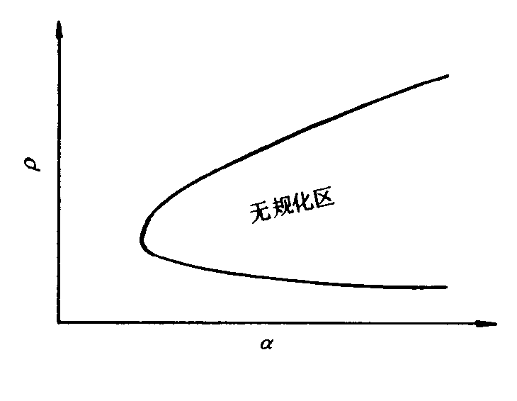

**图8.13** ($\rho,\alpha$) 空间中的无规化区〔12〕

低杂波在托卡马克装置中的传播还有另一重要特性，这就是波的平行折射率会在向内传播时逐渐加大，如果将波数矢量写成

$$
k\cdot B=\frac{m}{r}B_\theta+\frac{n}{R}B_\varphi \qquad (8.54)
$$

则可将波的束迹方程写成对$m$，$n$的求导形式，由于轴对称性，环向模数$n$在传播过程中不变，但极向模数$m$会不断变化。这一性质对电子通过朗道衰减而得到波能的过程非常重要，尤其是在利用低杂波来驱动电流的情况下，这是主要的物理机制，在下面的有关部分还要讨论。

对低杂波加热的实验研究相对说较少，主要的实验大多是在 80 年代前期或更早在几个中小型装置上进行的，除在 ALCATOR-C 上进行了 1 MW 的加热，而且密度达$(8\sim 20)\times10^{13}$ cm$^{-3}$，电子和离子温度都得到 0.5 keV 大小的提高外，其余装置实验的加热功率在 1 MW 以下，也观察到离子和电子的加热，波功率的吸收机制与随机加热理论相一致。在作为托卡马克装置实现稳态运行的重要条件之一的非感应电流驱动问题越来越受到重视后，低杂波段微波功率已被主要用作电流驱动，并在主要的托卡马克装置上进行了多方面的实验。有关的问题将在下面一小节中讨论。

## 8.4　非感应电流驱动：中性束驱动和自举电流

磁约束聚变反应堆能否在稳态条件下运行，对反应堆的经济品质及输电特性都是非常重要的。传统的用感应方式驱动环向电流的托卡马克型反应堆完全依靠变压器的磁通改变来产生环向感应电场以驱动电流，由于变压器提供的可变磁通总是有限的，因而电流可维

持的时间也总是有限的，这一直被认为是托卡马克途径的一个缺点。随着托卡马克实验研究的进展，70 年代开始就有很多人提出了以非感应方式驱动环向电流的设想，包括主要沿环向注入中性束产生离子电流，用具有特定的定向谱的射频波驱动电流，以及利用等离子体的自举电流来维持所需电流的种种方案，受到理论和实验研究的关注。后来在许多主要的托卡马克装置上开展了多种非感应电流的实验。在很多中小型装置中获得原理性验证的基础上，在大型装置 TFTR，JET，JT-60U，DIII-D，TS 上进行了多方面的具有相当规模的实验，包括一些完全由非感应方式驱动电流维持等离子体稳定平衡的实验，有的实验中环向电流已达到几个 MA，证实了非感应驱动电流方案的现实可行性。另外，发现了自举电流 (它不消耗磁通量) 占很大比例的稳定平衡位形，为充分利用自举电流来降低对驱动电流的要求提供了可能性，而且，近来关于反剪切位形改善约束的实验也是与具有大比例自举电流和非感应驱动电流的设想相辅相成的，这些进展为 ITER 的稳态运行方案提供了较可靠的理论和实验基础。根据 ITER 设计思想对各种非感应驱动电流的评价，本节开始将介绍中性束注入驱动，自举电流，射频波驱动电流等方案的原理和主要实验结果。

### 8.4.1　定向中性束注入产生的电流[19~21]

如果主要沿环电流方向注入中性束，则高能中性粒子被捕获后，其离子运动基本上沿中性粒子原来的方向，而被剥离的电子则已无规化。这样，这些离子就会形成一个定向电流。可以近似地对高能离子产生的电流进行估算，设$n_b=P_b/W_b$是在磁面$\psi$处沉积的高能离子密度，$P_b(\psi)$是沉积在该磁面上的平均中性束功率，则高能离子产生的电流密度为

$$
j_{b0}=Z_b n_b eV_{b0}\xi_0 I \qquad (8.55)
$$

$I$为与离子慢化过程有关的函数，$\xi_0=\cos\theta=V\cdot B/VB$为离子速度与磁力线夹角的余弦。

通过对描述快离子慢化过程的富克-普朗克方程的分析，可以得出

$$
I(x,y)=\frac{1}{x}\left(\frac{1+x^3}{x^3}\right)^{y}\int_0^x \mathrm{d}u\left[\frac{u^3}{1+u^3}\right]^{y+1} \qquad (8.56)
$$

或用近似展开式表示

$$
I(x,y)=x^3/[(4+3y)+(1.39+0.61y^{0.7})x^2+x^3] \qquad (8.57)
$$

式中$x=V_{b0}/v_c$，$v_c=v_{te}[(3\sqrt{\pi}/4)(m_e/m_b)(Z_{\mathrm{eff}}/Z_b)]^{1/3}$，后者是第六章中讨论过的临界速度，大于此速度的离子主要通过与电子碰撞而慢化。$y=Z_b/3$，$Z_b=\dfrac{\sum n_i Z_i^2}{m_b\sum n_i Z_i^2/m_i}$为特定的有效电荷量。

进一步分析发现，本底电子通过碰撞过程会受注入离子的牵动，这些电子又与本底离子碰撞使牵动运动受到阻尼，其总效果是产生一个与离子电流方向相反的电流，部分抵消离子电流的驱动效应。其具体大小与本底等离子体的有效电荷$Z_{\mathrm{eff}}$及注入离子的电荷值有关，因本底离子的阻尼与$Z_{\mathrm{eff}}^2$成正比，而离子的牵动效应与注入离子电荷$Z_b$成正比，因此，大体上，随着$Z_{\mathrm{eff}}$的加大，电子反向电流减小。不过，对反应堆来说，并不希望太大的有效电荷，一般$Z_{\mathrm{eff}}=1.5$是一个适当的数值。严格的反向电流的大小要由电子分布函数来确定，也就是要用粒子动力论方程来计算。构成中性束驱动电流的基础理论是 Cordey 等人的粒子动力论计算，后来又有许多改进研究[22]。考虑电子反向电流后，中性束注入产生的驱动电流密度可以写成

$$
j_b=j_{b0}\left[1-\frac{Z_b}{Z_{\mathrm{eff}}}(1-G)\right] \qquad (8.58)
$$

函数$G$要由电子的动力论方程来确定，其基本方法是：将离子电流的引入作为一种微扰，求电子分布函数的改变，通常可以以线性化碰撞算符来描述这一过程，设电子分布函数可以展成

$$
f_e=F_{Me}+\delta f_c \qquad (8.59)
$$

$F_{Me}$为麦氏分布，微扰部分由

$$
C_{eb}F_{Me}+C_{ei}\delta f_c+C_{ee}\delta f_c=\frac{v_\parallel}{r}\frac{B_\theta}{B_\varphi}\frac{\partial \delta f_c}{\partial \theta} \qquad (8.60)
$$

来确定，上式左方是非捕获电子的贡献，而右方项考虑了捕获电子效应。忽略右方项时，可以用类似于 Spitzer 处理电场驱动条件下的经典动力论问题的方法来求解

$$
\delta f_c^0=\frac{2Z_b}{Z_{\mathrm{eff}}}\frac{K_1 n_b v_b F_{Me}v_\parallel}{n_e v_{te}^2} \qquad (8.61)
$$

式中$K_1n_bv_b$对应于离子电流，上式对速度分布求积即为飞行电子产生的返回电流。剩下捕获电子的贡献可以由

$$
(C_{ei}+C_{ee})\delta \hat{f}_c=\frac{v_\parallel}{r}\frac{B_\theta}{B_\varphi}\frac{\partial \delta \hat{f}_c}{\partial \theta} \qquad (8.62)
$$

求出，其中线性化碰撞算子中的电子与本底离子的碰撞可以用螺旋角散射近似形式

$$
C_{ei}\delta \hat{f}_c=\nu_{ei}v_\parallel\frac{\partial}{\partial \mu}\left(\frac{\mu v_\parallel}{B}\frac{\partial \hat{f}_c}{\partial \mu}\right) \qquad (8.63)
$$

而电子与电子碰撞则要包括能量交换部分

$$
C_{ee}\delta \hat{f}_c=\nu_{ee}v_\parallel\left[\frac{\partial}{\partial \mu}\left(\frac{\mu v_\parallel}{B}\frac{\partial \hat{f}_c}{\partial \mu}\right)+\frac{F_{Me}\int \mathrm{d}^3v\,\nu_{ee}v_\parallel\delta \hat{f}_c}{\int \mathrm{d}^3v\,\nu_{ee}v_\parallel^2 F_{Me}}\right] \qquad (8.64)
$$

可以用标准的粒子动力论方法确定相应的解，然后求出总的电子反向电流。显然，其大小与电子温度，有效电荷比，以及具体位形 (主要是环径比) 有关。最后结果可以写成 (8.58) 的形式。上述理论预期的驱动效率 ($I_b/P_b$) 与粒子的密度无关，而随环径比 ($R/r$) 加大而减小，随电子温度加大而加大。这些特性使中性束注入驱动电流具有可以在反应堆条件下应用的品质。

后来的进一步理论研究还考虑了更多的物理因素，如快电子的扩散损失，电荷交换过程对离子捕获的影响，等等。各种具体条件下的结果可以参考有关文献[20~22]。

实验研究上，除早期的一些原理性实验外，在几个大型装置 DIII-D[24]，TFTR[25]，JET[26]，JT-60U[27]中实现了完全由中性束驱动的环向电流维持稳定的托卡马克平衡位形，存在时间达几秒以上，而对存在时间的限制来自中性束注入功率本身。一些重要的结果总结在表 8.4 中。

在很多高功率加热实验中，由中性束加热产生的等离子体常常同时具有较大的自举电流 (主要依赖于等离子体的极向比压值)。束驱动电流和自举电流在实验上是无法分辨的，如上表中 TFTR 的实验中自举电流达 0.35 MA，因此表中所列束驱动电流为理论计算值。

表 8.4　中性束电流驱动实验

| 装置名称 | 年份 | 注入功率 (粒子能量) MW/keV | 靶等离子体参数 $\langle n\rangle/10^{13}\mathrm{cm^{-3}}$ | 靶等离子体参数 $T_e/\mathrm{keV}$ | 靶等离子体参数 $T_i/\mathrm{keV}$ | 驱动电流 MA |
| --- | --- | --- | --- | --- | --- | --- |
| DIII-D | 1988 | 15 (80) | 4 | 3 |  | 0.3 |
| JET | 1987 | 20.5 (80) | 1.2 | 5 |  | 0.85 |
| JET |  | 15.2 (140) | 1.2 | 5 |  | 0.85 |
| TFTR | 1987 | 15 (120) | 2.2 | 6 | 20 | 0.25 |
| JT-60U | 1993 | 2 | 1 | 2.6 |  | 0.1 |
| ITER* | 1988 | 120 (1400) | 6 | 12 | 20 | 13.8 |

\* ITER 一栏的参数为概念设计值[28]。

以上实验实际上已证实中性束注入驱动电流的基本物理机制，而且与理论估计也基本一致。因此，在以后的实验中，以及在更多的装置上，虽然很多实验中观察到或多或少存在束驱动电流，但已不做特别研究，而且束驱动电流常常和自举电流同时存在，它们已经成为大装置实验中环向电流的一个不可分割的组成部分。此外，束驱动方式常常与波驱动方式联合采用，以达到建立具有高品质的约束位形的目的，有关的物理问题将在讨论改善约束的实验研究中还要做进一步的讨论。

在所有非感应电流驱动的研究中，从工程应用的目的出发，定义一个具有量纲的参量为驱动效率

$$
\eta=\frac{I\bar{n}_e R}{P}10^{20}\ \mathrm{A\cdot m^{-2}\cdot W^{-1}} \qquad (8.65)
$$

上式中总电流以 MA 计，总驱动功率以 MW 计，电子密度以$10^{20}$ m$^{-3}$计，大半径以 m 计。不难发现，式 (8.65) 中定义的驱动效率等于按截面平均电流密度与按体积平均驱动功率密度之比值乘以粒子密度，即$\eta=(J/P)\bar{n}_e$。对应于表 8.4 中的实验，中性束电流驱动效率大约为 0.05，与其他电流驱动方法得到的效率基本相同。ITER 设计要求的效率为 0.2，这一差距在 ITER 的高等离子体参数条件下被认为是可以消除的，包括对参数进行优化，其中关于注入中性粒子的能量，优化条件是

$$
W_b=40A_bT_e \qquad (8.66)
$$

式中$A_b$是中性粒子的原子量，对应于 ITER 这样的大尺寸反应堆，设$T_e=15$ keV，$A_b=2$，所需中性束粒子能量已超过 1 MeV，要求采用负离子源中性束技术，这与中性束加热方面的要求是一致的。

### 8.4.2　自举电流[29]

关于环形系统中等离子体约束和输运的新经典理论的一个重要贡献就是关于自举电流的预言。在第六章 6.3 节中已介绍了自举电流与等离子体基本参数间的关系。我们看到，利用简单的捕获粒子运动约束条件就可以给出自举电流的表示式

$$
j_{bs}=\sqrt{r/R}\,n_e e(v_{i\varphi}-v_{e\varphi})=\frac{c}{eB_\theta}\frac{\mathrm{d}p_i}{\mathrm{d}r} \qquad (8.67)
$$

式中$p_i$是捕获粒子的总压强，显然它正比于捕获粒子的密度，即$\sqrt{r/R}$量级。上面的简化推导指出，自举电流是环形约束系统中捕获粒子的压强梯度引起的沿环向的电流，它与感应驱动电流和其它非感应驱动电流是独立的。同时看出，如果等离子体的压强不是各向同性的，其垂直于磁场的分量比较大，则有利于产生较大的自举电流。下面要介绍的离子回旋频段波加热条件下产生的自举电流与此相洽。

根据严格的新经典输运理论得出的平行于平衡磁场的自举电流密度为[30]

$$
j_{b\parallel}=\sqrt{\frac{r}{R}}\frac{cp_e}{B_\theta}\left[-2.44\left(1+\frac{T_i}{T_e}\right)\frac{\mathrm{d}\ln n_e}{\mathrm{d}r}-0.69\frac{\mathrm{d}\ln T_e}{\mathrm{d}r}+\frac{T_i}{T_e}\frac{\mathrm{d}\ln T_i}{\mathrm{d}r}\right] \qquad (8.68)
$$

以上两式仅有系数的差别。

很多人研究了利用自举电流来实现托卡马克稳态运行的可能性。通过分析得出，自举电流与维持平衡位形所需的总电流之比与等离子体的极向比压值成正比[31]：

$$
I_{bs}/I=0.67\sqrt{a/R}\,\beta_p \qquad (8.69)
$$

因此，提高极向比压有利于提高自举电流比例，这为后来的实验所证实。不过，通过分析可以发现，要完全依靠自举电流实现稳态是有困难的。首先，从自举电流密度分布的公式中可以发现，极向磁场强度在磁轴处趋于零，或代入$B_\theta=B_\varphi r/Rq$，于是$j_{bs}\propto\sqrt{R/r}\,\mathrm{d}n_e/\mathrm{d}r$，若设粒子密度在磁轴附近具有抛物形剖面分布，即$\mathrm{d}n_e/\mathrm{d}r\propto -n_{e0}r/a^2$，最后得

$$
j_{bs}(r\to 0)\propto \sqrt{r/R}\to 0 \qquad (8.70)
$$

即自举电流在磁轴附近以平方根的方式趋于零。因此，一般需要在靠近磁轴处用其他方法产生一个种子电流 (seed current) 才能在原理上建立稳态平衡位形 (考虑磁轴附近区域中粒子轨道为有限的理论指出，磁轴处自举电流也不等于零，但比较小)；其次，还要研究自举电流的分布及其产生的磁场形态是否满足稳定约束和减小输运损失等多方面的问题。当然，首先是关于自举电流能否产生，以及能占总电流多大比例的问题。对这些问题，近年来开展了广泛的实验研究，最早在 TFTR 上观察到占相当比例的自举电流的存在[32]。随后在其他几个大型托卡马克装置 JET，DIII-D，JT-60U 上，都实现了大比例自举电流的约束位形[33~35]。其中一些实验中得到了几乎 100% 的非感应驱动电流，包括比例很大的自举电流[36]，而且这些位形具有很好的约束性质，这些将在第九章关于托卡马克实验的介绍中较详细地讨论。

自举电流的发现及由此引起的对欧姆定律的修正，使新经典输运理论的一个重要方面得到了托卡马克实验的直接证实，这在聚变等离子体物理发展史上是一件大事。对自举电流的实验分析必须结合新经典输运理论，主要是沿磁力线方向的广义欧姆定律，同时自举电流的理论表示式也要进一步精确化，要考虑杂质离子效应，环径比效应，以及输运理论中的“流”和“力”间的各种交叉项。这些在有关的文献中有详细的叙述[33]，并已做成用于分析实际实验数据的软件。这里我们仅指出其要点。沿磁力线的广义欧姆定律可以写成

$$
j_\parallel=\sigma^{NC}E_\parallel+j_{bs}+j_{dr} \qquad (8.71)
$$

式中$\sigma^{NC}$是新经典电导率，它与 Spitzer 电导率的关系为

$$
\sigma^{NC}=\sigma^{Sp}\left(1-\frac{f_t}{1+\xi\nu_*}\right)\left[1-C_R(Z_{\mathrm{eff}})\frac{f_t}{1+\xi\nu_*}\right] \qquad (8.72)
$$

式中$f_t$是捕获粒子比例，$\nu_*$是新经典特征碰撞参数，$\xi$，$C_R$是与有效电荷数$Z_{\mathrm{eff}}$有关的函数。目前对总电流的密度剖面分布已可从实验中确定，平行电场的大小可以直接由环电压求出，于是欧姆电流剖面分布可以通过电子温度及$Z_{\mathrm{eff}}$的空间分布而求得。两者之差是自举电流和其它非感应驱动源产生的电流，不可能再用实验方法将自举电流从中分离出来。因此，自举电流部分通常是通过将计算出的其它非感应驱动电流 (例如束驱动电流) 减去后获得的。各种非感应驱动电流的确定也依赖于理论模型，但关于中性束驱动的理论模型有很好的实验验证，关于波驱动电流的分析模型则仍需进一步的改善。在较粗糙的分析中，则可以对总电流减去欧姆电流得到非感应驱动电流。当存在自举电流和其它非感应驱动电流时，实验中发现，若仅考虑欧姆电流，环电压随时间的变化波形与下述理论预测值

$$
V_L=\frac{I_p R}{\int_0^a \mathrm{d}r\cdot r\sigma^{NC}}=\frac{I_p R}{\int_0^a \mathrm{d}r\cdot r\sigma^{Sp}} \qquad (8.73)
$$

将不符 (图 8.14 是 JET 上存在自举电流时的环压变化)，但若用理论模型确定的非感应驱动电流值代入，算出环电压随时间的变化，实验观察的环压变化与理论预期结果就可以符合得相当好，从而证实自举电流和其它非感应驱动电流的存在。

一些典型的自举电流实验总结在表 8.5 中。

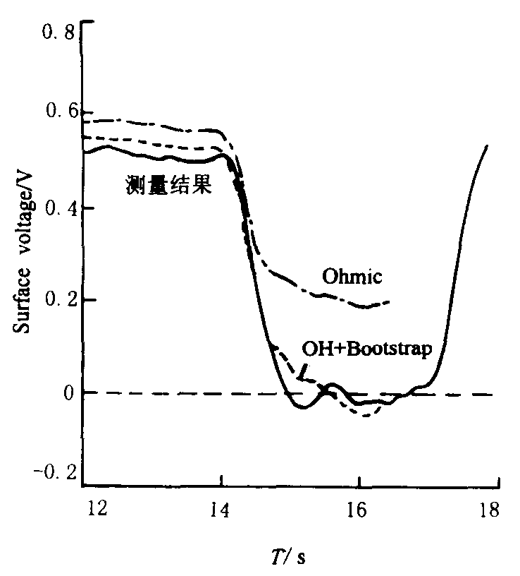

**图8.14** JET 实验中中性束加热下观察到的自举电流的环压波形〔33〕

表 8.5　获得大比例自举电流的托卡马克实验范例

| 装置名称 | 年份 | $I_p/\mathrm{MA}$ | $I_{bs}/I$ | 实验条件 |
| --- | --- | --- | --- | --- |
| TFTR | 1988 | 0.52 | 58% | $P_{NB}=12.5$ MW |
| JET | 1989 | 0.85 | 28% | $I=3$ MA, $P_{NI}=8$ MW |
| JT-60 | 1990 | 0.37 | 77% | $I=0.48$ MA, $\beta_p=3.2$, $P_{NB}=2$ MW |
| JT-60U | 1992 | 0.85 | 58% | $I=1.36$ MA, $\beta_p=2.0$, $P_{NB}=23$ MW |
|  | 1994 | 0.3 | 60% | $P_{NB}=12$ MW, $\beta_p=3.1$, $B_t=3.0$, $I_{bs}=0.24$ MA |

## 8.5　射频波驱动环向电流研究[37~42]

用射频波驱动环向电流是以非感应方式进行电流驱动的最重要的方案之一。从历史上看，提出用波来驱动电流并在小装置中进行原理性实验的时间可以追溯到磁约束研究的起始阶段。早在 1952 年，英国的聚变研究创始人之一，Thonemann 教授就在小环形装置上

用沿磁力线方向传播的行波进行过波驱动实验[39]，后来，继 Ohkawa 在 1970 年提出用中性束驱动电流后不久，1971 年 Wort 提出了用阿尔芬波来驱动电流的想法[40]。这些早期的想法有两个特点：第一，需要通过波对电子注入一定的平行动量；第二，主要驱动慢电子，因为慢电子占电子的大多数。不过这种驱动方案存在较明显的缺点，一方面，理论分析指出，慢电子驱动方案的效率随电子温度的提高而下降，这对聚变堆应用是不利的；另一方面，阿尔芬波与等离子体的耦合是通过靠近等离子体柱的同轴耦合线圈实现的，这与未来反应堆应用是不相容的。这种方法除在几个小装置上做一些原理性实验外，后来没有太多的发展。波驱动的较实质性的进展是在 70 年代末 Fisch 等人提出基于快电子的驱动想法以后[41]，当时大功率长脉冲微波器件也有了重大的发展，于是在许多托卡马克装置上先后开展了大功率低杂波、离子回旋频段和电子回旋频段的波驱动实验，并在 80 年代末期得到了具有反应堆应用前景的结果。我们主要介绍得到实验证明有效的并对反应堆有重要应用前景的研究结果。

对电流的驱动机制分共振机制和非共振机制两种。共振机制是快电子波驱动方案所依据的主要机制[37]，又分直接驱动和间接驱动两种方法。直接驱动的原理是，沿磁力线方向注入行波，通过朗道衰减，波在环向电流的反方向使电子产生一个定向速度分量，也就是使电子的速度分布函数产生定向移动，虽然电子与本底离子的碰撞会使电子定向运动无规化，但只要波驱动源存在，这种动量转换就可以得到平衡，因而电流可以维持下去。可以对这种驱动方式的效率进行简单的估计：若电子通过与行波的相互作用在单位时间内获得的平行于磁力线方向的动量为$m_e\Delta v_{\parallel}$，对应地电子从波获得的能量（即波的沉积功率）为$\Delta w = m_e v_{\parallel}\Delta v_{\parallel}$，在一次碰撞中电子将失去从波所获得的定向动量，这样，为了维持这一动量，波的沉积功率必需达到

$$
P_{\mathrm{CD}} = \nu(v)\Delta w \tag{8.74}
$$

这里$\nu$是速度为$v$的电子与本底离子的碰撞频率，$\nu \propto v^{-3}$，于是得到对驱动效率的估计（这里的效率定义为单位波功率密度产生的电流密度）：

$$
\frac{j}{P_{\mathrm{CD}}} = \frac{-e}{m_e v_{\parallel}\nu} \propto \frac{v^2}{n_e} \tag{8.75}
$$

式中$n_e$是本底等离子体的密度。Fisch 后来又发现一种通过电子回旋共振吸收波能使电子的垂直能量增大，来间接驱动平行电流的机制：设想初始时刻在同一空间位置有两个速度相等而在平行方向运动方向相反的电子，因此初始时刻没有净电流，但若其中一个电子满足电子回旋共振条件

$$
k_{\parallel} v_{\parallel} - \omega \pm n\Omega_e = 0 \tag{8.76}
$$

而获得波能，则其垂直速度增大，在以后的时刻内，获得波能的电子因能量加大而减慢了与本底离子的碰撞，其沿磁力线方向的动量将维持较长的时间；沿相反方向运动的电子未受波的加热，其沿磁力线方向的动量将较快地衰减，这样，电子在一个运动方向被加热的总效果将产生一个定向电流。可以证明这种间接驱动方案的驱动效果与直接驱动是类似的。从式（8.75）看出，驱动效率将随等离子体的温度增大而增大，但随等离子体密度增大而减小。以上是 Fisch-Karney 波驱动理论的基础[37~42]。

非共振机制是后来的研究中提出的[38]，主要基于“极化驱动”，包括波对等离子体

注入所谓的“螺旋量”（helicity）。当用较低频率的波段来进行波驱动时这类机制会发生作用。

从托卡马克聚变堆稳态运行的角度看，有效的电流驱动应在氘氚燃烧条件下维持下去才有实际意义，这就要求在粒子密度大于$10^{14}\ \mathrm{cm^{-3}}$（中心区密度大于$2\times10^{14}\ \mathrm{cm^{-3}}$）的条件下能够达到一定的驱动效率，反应堆设计给出的驱动效率为

$$
\eta_{\mathrm{CD}} = \frac{I_{\mathrm{CD}}\bar{n}_e R}{P_{\mathrm{RF}}} > (0.15 \sim 0.2)\times 10^{20}\ \mathrm{A\cdot m^{-2}\cdot W^{-1}} \tag{8.77}
$$

上式中定义的具有特定量纲的效率概念是电流驱动研究中普遍应用的概念，它与基于单位波功率密度驱动的电流密度的效率概念的差别是，前者比后者多乘一个平均等离子体密度，这与后者与密度成反比这一特征有关。

聚变堆应用对波驱动的两个要求（高密度条件及高的驱动效果）对可以选用的波电流驱动方案提出了苛刻的限制。现有实验中达到的各种非感应电流驱动都还没有能够同时满足这两个要求。尤其是，多数电流驱动实验中，如低杂波电流驱动实验，都限于较小的密度条件下才有较好的效果，而一些新的驱动方案，如离子回旋频段的快波驱动，电子回旋频段的波驱动，其实验研究水平还离反应堆要求相差一个多数量级。因此，在 ITER 确定的一系列研究和发展项目中，非感应电流驱动研究占有很显赫的地位。

### 8.5.1 波驱动电流的基本原理[37, 38, 42]

将强功率波源用于电流驱动目的时，对波的功率谱（波功率关于平行波矢量的分布）有特殊的要求：这种谱应当是不对称的，如载电流粒子是电子，大部分波功率应主要位于环电流的反向；对离子驱动则相反。可以通过调节天线阵列或波导阵列的相位来达到所要求的波谱形状。

从量子论可知，电磁波的能量和动量分别为$\hbar\omega$和$\hbar\vec{k}$，即分别与波的频率和波矢成正比。如果密度为$n_e$的电子吸收的波的功率谱为$P_e(k_{\parallel})$，则其平行于磁力线方向的动量增加率为

$$
\frac{\mathrm{d}M_{\parallel}}{\mathrm{d}t} = \frac{1}{\omega}\mathrm{Re}\left[\int \mathrm{d}k_{\parallel}\, k_{\parallel} P_e(k_{\parallel})\right] \tag{8.78}
$$

若这一动量增量为电子与离子的碰撞所平衡，则由

$$
\frac{e}{m_e}\frac{\mathrm{d}M_{\parallel}}{\mathrm{d}r} = -\nu_e j_{\parallel} \tag{8.79}
$$

由此得出

$$
j_{\parallel} = -\frac{1}{n_e e \omega \eta}\mathrm{Re}\left[\int \mathrm{d}k_{\parallel}\, k_{\parallel} P_e(k_{\parallel})\right] \tag{8.80}
$$

式中$\eta$为 Spitzer 电阻率。上式表明，驱动电流的大小由电子所吸收的总功率及这一功率对平行波矢量谱的形状所确定。

电子对波的吸收主要是通过朗道衰减来实现的，即共振条件

$$
\omega - k_{\parallel} v_{\parallel} = 0 \tag{8.81}
$$

这一条件有时又称为切伦科夫共振（Cerenkov resonance），切伦科夫发光是定向运动的带电粒子与介质中相速度小于光速的波相互作用的结果，这里的波的吸收是电子发射波的反过程。电子吸收波能的结果是电子的速度分布函数在波前进的方向被抬高和拉平，对应于

定向电流，如图 8.15 所示。Fisch 等人后来指出，除朗道衰减吸收波能可以直接驱动电流外，通过电子回旋共振条件式（8.76）也能等效地驱动电流，电子回旋共振吸收过程中波传给电子的定向动量非常小，可以忽略不计。波产生定向电流的机制与电子在波的作用下速度分布的演化过程有关，其原理已在前面指出，如图 8.16 所示。

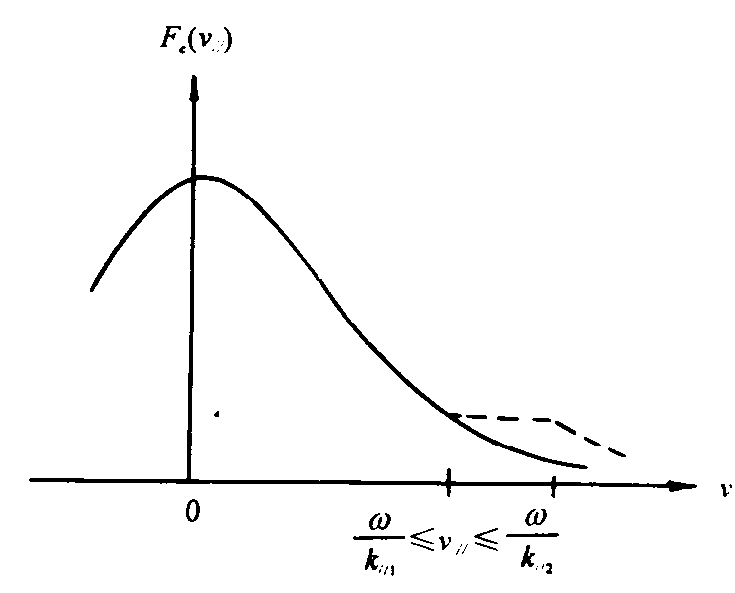

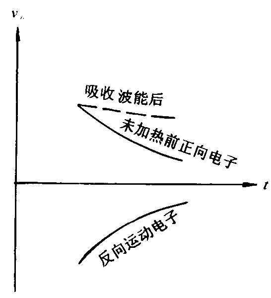

方程（8.77）表示的电流与直接吸收波的动量有关，可以用普遍的公式来表示[38]

$$
j_{\mathrm{M}} = \frac{N_{\parallel}}{4c\eta}\mathrm{Re}\left[V_e^-(E^-)^* + V_e^+(E^+)^* + 2V_{e\parallel}E_{\parallel}^*\right] \tag{8.82}
$$

式中 +、- 号代表右旋和左旋量，即$A^{\pm} = A_x \pm \mathrm{i}A_y$，$N_{\parallel}$为平行折射率。原理上，还可存在另一部分与波动量无关的驱动电流，称极化电流[38]

$$
j_{\mathrm{P}} = -\frac{1}{2n_e e\omega\eta}\mathrm{Im}\left[j_e\cdot\nabla\left(E_{\parallel}^* + \frac{\mathrm{i}\omega m_e}{e}V_{e\parallel}^*\right)\right] \tag{8.83}
$$

这两种电流中，又可以分出与波和粒子共振过程有关的部分及非共振部分，例如波能的碰撞吸收就属于非共振吸收。共振吸收过程及驱动的电流原则上要用粒子动力论方法来计算，基本数学工具是包括波驱动源项的富克-普朗克方程。此外，必须结合具体的波和等离子体耦合条件，具体计算波束在等离子体中传播的束迹方程。下面介绍这一理论方法的要点。

研究波电流驱动的主要理论工具是关于电子分布函数演化的富克-普朗克方程，存在波驱动源时其一般形式为

$$
\frac{\mathrm{d}f_e}{\mathrm{d}t} = C_{ee}(f_e, f_e) + C_{ei}(f_e, F_{\mathrm{M}i}) - \frac{\partial}{\partial v}S_{\mathrm{w}} \tag{8.84}
$$

左方对时间的全微分算子代表位置和速度空间中跟随电子运动的求导，若取磁矩$\mu$、能量$\varepsilon$为变量，则

$$
\frac{\mathrm{d}}{\mathrm{d}t} = \frac{\partial}{\partial t} + (v_d + v_{\parallel}b)\cdot\nabla + \frac{\partial\varepsilon}{\partial t}\frac{\partial}{\partial\varepsilon} \tag{8.85}
$$

其中利用了磁矩不变关系，在电磁波作用下电子能量可以改变

$$
\frac{\partial\varepsilon}{\partial t} = -ev_{\parallel}E_{\parallel} - \mu B\nabla\cdot v_E + (m_e v_{\parallel}^2 - \mu B)v_E\cdot(b\cdot\nabla b) \tag{8.86}
$$

式中$v_E$为电漂移速度。式（8.84）中代表波驱动作用的是源项$S_{\mathrm{w}}$，它正比于波功率密度，一般形式为

$$
S_{\mathrm{w}} = -\bar{D}_{\mathrm{RF}}\cdot\frac{\partial f_e}{\partial v} \tag{8.87}
$$

准线性扩散系数张量$\bar{D}_{\mathrm{RF}}$与波和粒子的相互作用机制有关。我们指出下面几点：第一，上面形式的方程在物理上相当于把波与等离子体相互作用及碰撞过程引起的分布函数的演变作为独立的过程，目前为止理论分析基本上限于这样一种理解；第二，波电流驱动与波加热是同一问题的两个方面，都从富克-普朗克方程出发，但研究侧面有所不同。要正确描述问题，应考虑等离子体吸收波能引起的总储能的变化，这可由下面的功率守恒方程描述：

$$
\nabla\cdot(W_{\mathrm{RF}}v_g) = -\int \mathrm{d}^3v\left(\frac{1}{2}mv^2\right)\frac{\partial}{\partial v}\bar{D}_{\mathrm{RF}}\frac{\partial f}{\partial v} \tag{8.88}
$$

式中$W_{\mathrm{RF}}$是波能密度，$v_g$是波的群速度，右方表示吸收波功率引起的等离子体能量的增大。

已经有大量文献报道了对方程（8.84）求解和电流驱动效率的研究，包括在非常一般化条件下的求解，此时要考虑电子在环形位形中的捕获效应，高能电子的相对论性效应，以及高能电子自身的反常扩散效应（上面的方程不能包括这种效应，但可以用唯象的方法引入描述反常扩散的附加项），等等。这些研究已做成可以研究各种具体参数下波驱动问题的计算编码，包括波的束迹计算，沿波束的波功率沉积，以及三维富克-普朗克计算。如果仅需了解波驱动效率，可以不必求出具体的电子分布函数，而直接由波驱动源函数确定驱动效率。例如，若设等离子体近似均匀，波的吸收发生在速度空间中与波和粒子共振相互作用的局部区域，参与作用的电子速度远大于热速度，这样主要的碰撞作用是螺旋角散射，所以与式（8.75）对应的波驱动效率可以表示成

$$
\frac{j}{P_{\mathrm{CD}}} = \frac{-e}{\Gamma(5+Z_{\mathrm{eff}})}\frac{S_{\mathrm{w}}\cdot(\partial/\partial v)(v_{\parallel}v^3)}{S_{\mathrm{w}}\cdot(\partial/\partial v)(m_e v^2/2)} \tag{8.89}
$$

式中

$$
\Gamma = 4\pi n_e e^4\ln\Lambda/m_e^2 \tag{8.90}
$$

对于前面讨论过的平行驱动和垂直驱动情形，式（8.89）中的波驱动扩散张量$D_{QL}$可以分别取成

$$
\begin{aligned}
\bar{D}_{QL} &= D_{\parallel}e_{\parallel}e_{\parallel} \quad \text{（对平行驱动）}\\
\bar{D}_{QL} &= D_{\perp}e_{\perp}e_{\perp} \quad \text{（对垂直驱动）}
\end{aligned} \tag{8.91}
$$

如将式（8.91）代入式（8.89）计算驱动效率，可以发现平行驱动与垂直驱动的效率为 4:3，这就证明了两种驱动方案同等有效。以上是 Fisch-Karney 理论及后来发展的理论的基本结果。

根据 Fisch 理论，似乎注入波的相速应越大越好，对平行驱动，就是平行折射率越小越好。但这个结论是不正确的，除了波的可近性要求平行折射率必须大于某个临界值外，

实际上，电子速度分布中高能电子的数目随能量加大急剧减少，参与共振的电子过少，被吸收的波功率也就很小，耦合到等离子体中的波能会重新逸出，或在其他的通道中损失，使实际被利用于电流驱动或加热的波功率的比例减小。这已为所有实验所证实。所以，具体问题中波功率谱的设计要根据各种条件综合起来考虑，在很大程度上要在实验中寻找最佳耦合和驱动条件。

应指出，波电流驱动是一个尚处在研究前沿的问题，包括驱动机制和处理方法在内的许多问题仍有待通过进一步的研究工作来澄清。一个典型的例子就是关于是否可以通过注入螺旋量（helicity）来有效地驱动电流在理论上存在截然相反的看法；另外如波和粒子的非共振相互作用在波加热和电流驱动中的效应问题，都是尚未有定论的问题。而且波在不均匀等离子体中传播时波矢量和偏振关系的不断变化，存在多种模转换过程，使实际分析变得更复杂和困难。在实验研究中，除了物理问题的复杂性外，在很多情况下，波工程本身及边缘物理效应常常更重要。所以这些因素决定了波电流驱动的研究必须理论与实验密切结合，为了确定在反应堆条件下的物理和工程可行性及效果，一些中大型托卡马克装置上正把波电流驱动作为重要的项目进行研究。

### 8.5.2 低杂波电流驱动（LHCD）

在第六章中关于波和等离子体相互作用的一般讨论中已指出，等离子体中的低杂波很接近于静电波，通过朗道衰减就可以使电子获得定向动量。同时微波工程的发展很快，这一频段微波的大功率器材（主要是速调管）的工艺相当成熟，近年来由于磁约束研究的需要，已成功研制了单管功率为 MW 级，脉宽几十秒到连续的器件，波与等离子体的耦合可以采用多栅格波导阵列，通过调节各分波导的相差可以给出不同的功率谱，具有很高的灵活性和很高的耦合效率。由于这些因素，托卡马克装置中低杂波电流驱动的研究已被广泛地进行。

根据理论，如果波的频率达到低杂波共振频率的两倍以上，在托卡马克等离子体中一般就不会存在波的截止层，即波的可近性条件将在整个等离子体区域得到满足（但后来的实验发现这个问题比较复杂，实际上波的可近性受环形几何形态的重大影响）。目前托卡马克装置中选用的频率，对中等密度装置，约在 2.45 GHz，对较高密度装置，选用 3.7 GHz 或 4.6 GHz，对强磁场高密度装置，最高频率达 8 GHz，具体值与等离子体的参数$\varepsilon = \omega_{pe}^2/\Omega_e^2 \propto n_e/B^2$的大小有关。多栅阵列发射的波谱是非对称谱，平均平行折射率在 1.7~3.0 范围内。

低杂波由波导阵列进入等离子体时会在边缘附近受到反射，这是因为边缘区的等离子体密度很低，对应的等离子体频率一般比注入波的频率低，因此边缘区存在一定宽度的波的消散层（evanescent layer）。调整波导口与边界的距离和其他参数（主要是波谱形状，边缘等离子体密度分布），可以使反射率减小。例如，JT-60U 装置的大功率低杂波电流驱动实验中已通过调节边缘参数使反射率降到 5%以下。一般实验中的波功率约有 20%~30% 被反射。

波在托卡马克等离子体中传播时，平行折射率是不断变化的，总的趋向是不断变大，这是与波的吸收过程密切相关的一个重要性质。对圆环截面位形，波矢量的平行分量可以写成

$$
k_{\parallel} = \frac{mB_{\theta}}{rB} + \frac{nB_{\phi}}{RB} \approx \frac{1}{R}(n + m/q) \tag{8.92}
$$

由于轴对称性，沿波迹环向模数$n$是不变的，但极向模数$m$可以变化。分析表明，由于托卡马克等离子体的磁面具有相对位移，极向模数$m$可以在很大的范围内变化，总的趋向是不断加大，从而引起平行折射率$N_{\parallel} = ck_{\parallel}/\omega$的加大，这意味着波和电子的共振条件向低能电子转移，将加速波的吸收过程。波的传播性质与等离子体参数，尤其是密度值有十分敏感的关系，当密度较高时，波迹比较难到达等离子体中心，大部分波迹集中在等离子体的外缘，并在那里停留较长的时间。由于等离子体外缘的密度有较大的涨落，它们将散射低杂波，使有效耦合效率大幅度降低。

低杂波的吸收主要通过朗道衰减，并导致高能电子群的产生，这与 Fisch 理论是一致的。这些定向速度很大的高能电子在维持环向电流的同时并不消耗伏秒数，因此观察到环电压的下降，在完全由低杂波驱动电流维持平衡的情况下，环压为零。通过高能电子产生的 X 射线的剖面分布可以推断高能电子及电流的剖面分布，同时观察等离子体内电感的变化也可以推断电流剖面的变化。

70 年代末，实验研究取得重大进展，在 PLT 装置上，在低密度条件下实现了 400 kA 级的完全低杂波驱动电流维持的平衡，时间达几秒；以后，采用更高频率的器件，在一系列装置上，在$1\times10^{13}\ \mathrm{cm^{-3}}$密度下实现了完全非感应驱动和电流驱升（ramp-up），以及与其他驱动方法结合的实验。通过对电子进行加热（中性束，离子回旋和电子回旋），驱动效率可以明显提高。最重要的实验有：在 JT-60U 装置上实现了总电流达 3 MA 的低杂波驱动电流；在 TS 装置上实现了长达 2 min 的 MA 级驱动电流；在另一小型超导磁体装置 TRAIN-1M 上，在较低的等离子体密度下（$n_e < 5\times10^{12}\ \mathrm{cm^{-3}}$），电流维持了几个小时。

JT-60 和 JET 装置中得到的电流驱动效率与电子温度成正比，可以用下面的公式表示

$$
\eta_{\mathrm{LH}} = \frac{T_e}{5+Z_{\mathrm{eff}}}C(N_{\parallel}) \tag{8.93}
$$

$C(N_{\parallel})$是与波谱有关的量。JT-60 中$C(N_{\parallel})$为$12\times10^{19}\ \mathrm{A\cdot m^{-2}\cdot W^{-1}}$，ASDEX 中则为

$$
C(N_{\parallel}) = 1240/(\ln\Lambda\langle N_{\parallel}^2\rangle) \tag{8.94}
$$

其中平行折射率平方倒数的定义为

$$
\frac{1}{\langle N_{\parallel}^2\rangle} = \frac{\int \mathrm{d}N_{\parallel}P(N_{\parallel})/N_{\parallel}^2}{\int \mathrm{d}N_{\parallel}P(N_{\parallel})} \tag{8.95}
$$

ASDEX 中没有报道驱动效率随电子温度的加大。

在 T-10 实验中发现，载电流快电子的扩散损失（一般是反常的）对实际的驱动效率要产生重要影响。对这一因素的比较简单的处理是在式（8.93）右方再除一个因子$(1+\tau_c/\tau_d)$，其中$\tau_d$，$\tau_c$分别表示快电子的碰撞特征时间由反常扩散损失确定的约束时间。

表 8.6 是对主要实验结果的综述[43~48]。

对于低杂波驱动是否可能在反应堆条件下得到应用，还要通过更结合 ITER 条件的实验研究来确定。但在一些方面已达到普遍的认识：（1）必须提高频率，考虑到微波器件研制的进展，设计采用 5 GHz 的长脉冲速调管；（2）高功率耦合是可以实现的，关键在于掌握一系列实际技术，如波导阵列的优化，器件的锻炼，边缘等离子体参数的控制等；（3）低

杂波作为一种补充手段的前景是肯定存在的，如用作等离子体靠外部区域的波驱动，用于电流剖面控制和形成反剪切位形。

**表 8.6　低杂波电流驱动实验综述**

| 装置名称 | 年份 | 实验条件及主要结果 |
|---|---|---|
| PLT（美） | 1985 | 在$\bar{n}_e \approx 2\times10^{12}\ \mathrm{cm^{-3}}$的低密度区，达到 400 kA 的全电流驱动，进行了电流驱升研究 |
| ASDEX（德） | 1988 | 在$\bar{n}_e = 1.2\times10^{13}\ \mathrm{cm^{-3}}$下，达到 500 kA 全电流驱动，采用 24×2 波导阵列，$\langle N_{\parallel}\rangle = 1.7$，2，45 GHz，2 MW。波功率主要用于电子加热，$T_{e0} = 7\ \mathrm{keV}$，剖面很陡 |
| Alcator（美） | 1988 | 采用 4.6 GHz 速调管，可以在较高密度下（$\bar{n}_e > 4\times10^{13}\ \mathrm{cm^{-3}}$）进行驱动 |
| JT-60（日） | 1989 | 利用 24×4 波导阵列发射窄功率谱，在$\bar{n}_e \approx 1\times10^{13}\ \mathrm{cm^{-3}}$条件下，达到 2 MA 的全电流驱动。效率达到$3.4\times10^{19}\ \mathrm{A\cdot m^{-2}\cdot W^{-1}}$ |
| JT-60U（日） | 1994 | 利用 48×4 阵列，通过调节波导口与等离子体距离及喷气速率，使耦合效率达到 95%，在$\bar{n}_e \approx 1.2\times10^{13}\ \mathrm{cm^{-3}}$条件下，达到 3 MA 全电流驱动 |
| Tore-S（法） | 1992 | 实现了 1.0 MA 长达 1 min 的电流驱动，有小的剩余电场（0.15V 环压）。3.7 GHz，2.5 MW，$\bar{n}_{e0} = 3.5\times10^{13}\ \mathrm{cm^{-3}}$，$T_{e0} = 5.5\ \mathrm{keV}$，驱动效率$\eta = 1.7\times10^{19}\ \mathrm{A\cdot m^{-2}\cdot W^{-1}}$ |
| TRAIM-1M（日） | 1992 | 在低密度条件下，实现了超过 1 h 的 25 kA 全电流驱动 |
| JET | 1991 | 利用 ICRF 辅助，达到 1.5 MA，$\eta_{\mathrm{LH}} = 0.4\times10^{20}\ \mathrm{A\cdot m^{-2}\cdot W^{-1}}$ |
| HL-1（中） | 1992 | 在$\bar{n}_e \approx 1\times10^{13}\ \mathrm{cm^{-3}}$条件下，达到超过 100 kA 的波驱动电流。观察到粒子约束的改善和快电子产生的反常多普勒不稳定性 |
| HT-7（中） | 1998 | 实现了 100 kA 级，维持时间达 3 s 的全电流驱动 |

上表最后两栏介绍了我国研究的较重要成果[47, 48]。我国从 80 年代末开始在 HL-1，HL-1M 装置和 HT-6B，HT-6M，HT-7 等装置上开展了电流驱动实验研究。低杂波频率为 2.45 GHz，耦合波功率已接近 1 MW，HL-1 和 HL-1M 上的波驱动电流超过 100 kA，0.1 s。目前 HT-7 装置准备进行长脉冲实验，该装置的环向场线圈是超导磁体，速调管采用连续波模式，因此可望达到 10 s 量级的全波驱动电流运行。这些成果表明，我国在非感应电流驱动研究方面已进入世界先进行列。

### 8.5.3 电子回旋波电流驱动（ECCD）[49]

电子回旋电流驱动是通过电子回旋频段的波被快电子吸收而实现的，对应于前面讨论过的垂直驱动模式[42]。理论分析得出的驱动效率应与平行驱动方案，如低杂波电流驱动的效率接近。但在电子垂直能量增大时，一些电子将会从飞行轨道转入捕获轨道，这一效应会减小驱动效率；此外，相对论性效应也很重要，所以一般的 ECCD 理论分析都要考虑这些效应。

对圆截面托卡马克，描述问题的富克-普朗克方程如下

$$
\frac{v_{\parallel}B_{\theta}}{rB}\frac{\partial f_{e1}}{\partial\theta} = C_e(f_{e1}) - \frac{\partial}{\partial v}S_{\mathrm{w}} \tag{8.96}
$$

其中$C_e$为电子与本底离子及电子的线性化碰撞算符，而波驱动源项现在取

$$
-\frac{\partial}{\partial v}S_{\mathrm{w}} = \frac{1}{v_{\perp}}\frac{\partial}{\partial v_{\perp}}\left[D_{v\perp}\left(\frac{v_{\perp}}{v_e}\right)^{2(n-1)}\delta\left(\frac{\omega - n\Omega_e}{k_{\parallel}} - v_{\parallel}\right)\frac{\partial F_e}{\partial v_{\perp}}\right] \tag{8.97}
$$

式中$D$为与波场强度有关的驱动量，$F_e$为本底电子分布函数，$n$为谐波数。上面的描述与电子回旋共振加热的理论处理是类似的，电子吸收波能的结果是使垂直能量增大，电流驱动是其附带效应（但这里主要讨论这一效应）。显然，垂直能量的加大将使一部分飞行电子变成捕获电子，而捕获电子对平行电流没有直接贡献（如不考虑自举电流），所以，以前关于垂直驱动方案的效果与平行驱动方案接近的结论要得到修正。计算结果表明[42]，电子的捕获和去捕获对平行电流的影响非常大，如果环径比$R/r$较大，后一效应可以使总的平行电流反向。此外，对电子回旋波加热和电流驱动的分析，共振条件中还需考虑相对论性效应，即电子回旋频率是与电子的能量有关的。在弱相对论性条件下，共振条件可以写成

$$
k_{\parallel}v_{\parallel} = \omega - n\Omega_e = \omega - n\Omega_{e0}\left(1 - \frac{v^2}{2c^2}\right) \tag{8.98}
$$

引入

$$
u_0 = (\omega - n\Omega_{e0})/k_{\parallel}v_e,\quad \varsigma = n\Omega_{e0}v_e/2k_{\parallel}c^2 \tag{8.99}
$$

这一共振条件可以写成：

$$
\left(\frac{v_{\parallel}}{v_e} - \frac{1}{2\varsigma}\right)^2 + \frac{v_{\perp}^2}{v_e^2} = \frac{1 - 4u_0\varsigma}{4\varsigma^2} \tag{8.100}
$$

在$(v_{\parallel}, v_{\perp})$空间，这是一系列圆，而在非相对论性近似下共振条件是一条直线，$v_{\parallel} = (\omega - n\Omega_{e0})/k_{\parallel}$或$u_0$ = 常数。相对论性效应使更多能量较低的电子参与共振，其效果是使波的吸收加大，电流驱动效率也相应地有所加大。结合起来，在托卡马克中，电子回旋波的电流驱动方案，虽有着可能使波传播到等离子体中心区的优点，但电子的捕获效应可以使驱动效率受较大影响。

电子回旋波电流驱动的实验研究虽然在 80 年代就在小装置上进行过，在原理上也证明是可以驱动电流的，但较有规模的实验在 90 年代才在几个中大型装置上进行，原因之一是相应的波器件即回旋管的技术难度大。俄罗斯在这一技术上占有独特优势，因此俄罗斯的 T-10 装置在电子回旋加热和波电流驱动研究中有特殊地位，在美国的 DIII-D 和欧洲的 JET 上也进行了有关研究，大多数情况下得到的电流驱动效率与参数的关系和低杂波的情况类似，即可以用式（8.92）描述，但效率的绝对值要比低杂波电流驱动得到的结果低几倍或更差。典型的结果如表 8.7 所综述[49~53]。

可以看到，已有的实验是在较低的等离子体密度下进行的，主要原因是希望电子温度较高以有利于获得较满意的驱动效率，但实际达到的效率并不高，比低杂波电流驱动低一个多数量级。这样，现有实验既未证明可以在较高密度下实现有效的波电流驱动，又没有达到高的驱动效率。显然，要证明电子回旋电流驱动可能在聚变堆条件下得到应用，还要在更高密度和更高波功率下进行实验。

最近，结合 ITER 的电流驱动方案，为 ECCD 的计算编制了更精确的程序[53]，研究发现，驱动效率与 EC 波的发射角有非常敏感的关系，结合 ITER 参数的计算结果如图 8.17 所示。该研究认为 T-10 的实验没有在最佳发射角下进行，等离子体密度剖面也与最佳驱动条件不符。如将 T-10 的现有实验结果“外推”到最佳条件，得到的驱动效率要提高 3 倍左右；对 ITER 参数，ECCD 效率在 20 keV 下基本随电子温度正比地增大，在 30 keV

下达到相对论极限，最佳 ECCD 效率可达$\eta_{\text{ECCD}} = 0.3\times10^{20}\ \text{A}\cdot\text{m}^{-2}\cdot\text{W}^{-1}$（见图 8.18），可以满足设计要求。

**表 8.7 电子回旋波驱动实验结果**

| 装置名称 | 年份 | 实验条件与主要结果 |
|---|---|---|
| T-10 | 1992 | $\bar{n}_e \approx 1\times10^{13}\ \text{cm}^{-3}$, $T_{e0} = 7\ \text{keV}$, $P_{\text{EC}} = 1.45\ \text{MW}$, $I_{\text{CD}} \approx 110\ \text{kA}$, $I_{\text{CD}}/P_{\text{EC}} = 0.1\ \text{A/W}$. 基波模式 |
| T-10 | 1994 | $\bar{n}_e \approx 1\times10^{13}\ \text{cm}^{-3}$, $T_{e0} = 4\ \text{keV}$, $P_{\text{EC}} = 0.65\ \text{MW}$, $I_{\text{CD}} \approx 35\ \text{kA}$, $I_{\text{CD}}/P_{\text{EC}} = 0.05\ \text{A/W}$. 二次谐波模式 |
| DIII-D | 1995 | $\bar{n}_e \approx 1\times10^{13}\ \text{cm}^{-3}$, $T_e = 4\ \text{keV}$, $P_{\text{EC}} = 1.1\ \text{MW}$, $I_{\text{CD}} = 80\ \text{kA}$, $\eta_{\text{EC}} = 0.013$, $\eta_{\text{FW}} = 0.016\times10^{20}\ \text{A}\cdot\text{m}^{-2}\cdot\text{W}^{-1}$. 与快磁声波结合 |

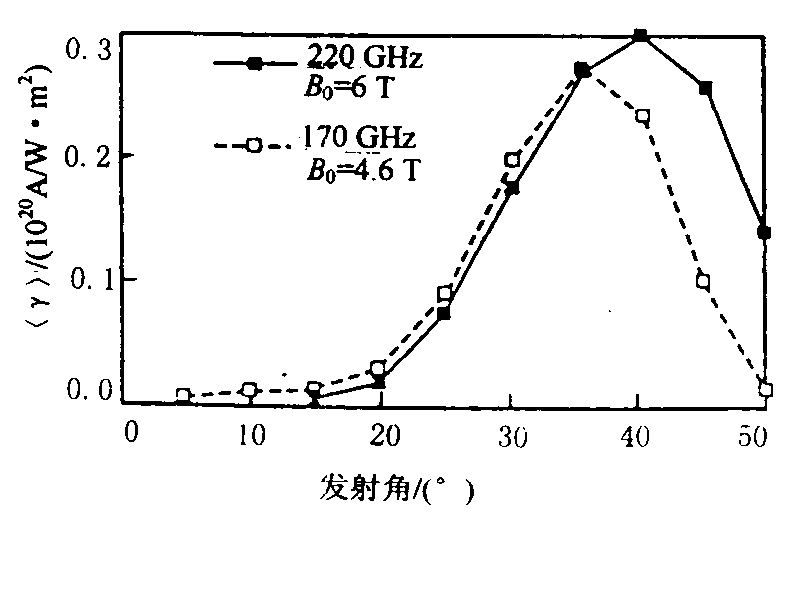

**图8.17** ECCD 效率与 EC 波的发射角的关系

靶等离子体参数：$T_{e0} = 30\ \text{keV}$，$n_{e0} = 1.7\times10^{14}\ \text{cm}^{-3}$$^{[19]}$

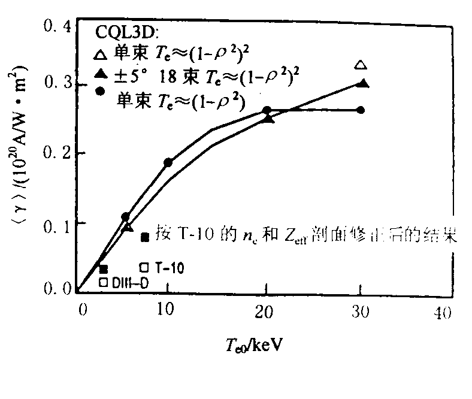

**图8.18** ECCD 最佳驱动效率与中心电子温度的关系

靶等离子体电流：$I_p = 24\ \text{MA}$$^{[19]}$

### 8.5.4 快磁声波电流驱动（FWCD）

低杂波电流驱动方案受等离子体密度的限制而不能达到聚变堆中心，因此，除上面提出的利用电子回旋波驱动外，还提出用快磁声波进行驱动的想法，简称快波驱动（Fast Wave Current Drive, FWCD），有时也称快阿尔芬波驱动。波的频率处在离子回旋频率的基频到若干倍谐频段，对托卡马克参数，大约在几十 MHz 到 200 MHz 范围。冷等离子体色散关系的分析表明，快波可以在较高密度等离子体中传播，对反应堆条件下的中心区等离子体满足可达性。这一频段的波与等离子体的相互作用既与离子有关，也与电子有关。离子主要通过回旋共振吸收波能，而电子主要通过朗道衰减（LD）和飞越期磁泵（TTMP）机制吸收波能$^{[37]}$。从微波技术角度考虑，利用这一频段的波来进行电流驱动有可靠的技术支持，波器件和传输天线阵列的有效性都在大功率加热实验中得到证实，并具有肯定的反应堆条件下的应用前景，此外，与中性束相比，利用 ICRF 波段的波来实现加热和波驱动

具有更好的经济性能，波频的可调性使温度剖面和电流密度剖面也具可调性。因此 ITER 将 FWCD 作为重要的 R&D 课题。

由于电流驱动主要依靠电子获得平行动量，与离子加热的情况有较大的差别，需满足一些新的物理要求。在已有的实验中，在 ICRF 频段，电子通过 LD 和 TTMP 获得的波功率并不大（电子加热主要是通过高能离子慢化或模转换而获得的，而不是通过朗道衰减或 TTMP 获得的），电流驱动的效果也不明显，但理论分析预期在反应堆条件下，驱动效率可以与低杂波及电子回旋频段的电流驱动效率相当。

对 ICRF 频段波的功率沉积的理论计算需采用完整的波动方程，结合天线边界条件，波的束迹方程，以及电子分布函数的演化方程联合进行，是非常复杂的，但都已建立相应的计算编码。加热与电流驱动的分析是相互联系的，而且，自举电流与驱动电流共同存在。通常，总电流要对磁面平均并可写成$^{[54]}$

$$
\langle j_{\parallel} B\rangle / B^{2} = G(\psi) + H(\psi) \tag{8.101}
$$

其中$G$是波驱动电流部分，$H$是自举电流部分。这两者相加，应等于托卡马克维持平衡的总电流。

从频段上看，用于快波电流驱动的波频率可以取在略低于离子回旋频率到接近低杂波共振频率，即$\Omega_i \lesssim \omega \lesssim \omega_{\text{LH}} \approx 40\Omega_i$，原则上，这一频段的波都能向等离子体中心约束区传播，但为了使在电子上的波功率衰减达到最大，对具体的实验或反应堆参数，要选取最佳的波频率和天线阵列的相差。根据理论分析$^{[55]}$，波功率在电子成分上的衰减可以用波矢量的垂直分量的虚部来表示

$$
\operatorname{Im}(k_{\perp}) / k_{\perp} = \frac{\sqrt{\pi}}{4}\beta_e \xi_e \exp(-\xi_e^{2})(1+\alpha^{-2}) \tag{8.102}
$$

其中$\beta_e$是电子的比压值，$\xi_e = \omega / k_{\parallel} v_{te}$，要使一次传播中波功率衰减因子

$$
A = 1 - \exp\left[-2\int_{0}^{a} \mathrm{d}r\, \operatorname{Im}(k_{\perp})\right] \tag{8.103}
$$

达到较大的值，最佳条件是选取$\xi_e = 1/\sqrt{2}$，或

$$
N_{\parallel 0} = \sqrt{250 / T_e(\text{keV})} \tag{8.104}
$$

在 DIII-D 装置上，目前条件下最佳的衰减因子$A$只能达到 0.3 左右，而且还要有意降低磁场和电流值，但这样又严重影响实际可能驱动的电流值。目前，快波电流驱动的实验还不是令人很满意的，但与同样条件下的理论计算值还是相符的。对 ITER 条件下的计算，预期可以达到驱动中心电流的要求，不过要与自举电流结合，或者同时与其它的驱动方案联合应用。

目前只在 DIII-D 和 TORE-Supra 等装置上进行过较大规模的快波电流驱动实验$^{[56, 58]}$，其中 DIII-D 的最新结果是：在 30～120 MHz 频段范围内，高频波功率为 3 MW 下，达到 275 kA 的快波驱动电流，驱动效率与电子温度成正比，但绝对值仅为$\eta \approx 0.05\times10^{20}$ A·m$^{-2}$·W$^{-1}$，为 JT-60U 中达到的低杂波驱动效率的 1/6，而且实验是在低等离子体密度下进行的。在 TORE-Supra 装置上，在较高密度条件下（$n_{e0} \approx 4\times10^{13}\ \text{cm}^{-3}$）进行了实验，取$3\Omega_D$的频率，天线阵列相差为$\Delta\Phi \approx 280^{\circ}$时达到最佳驱动，总电流为 0.4 MA 时，$I_{\text{FW}} \approx$

80±40 kA，同时自举电流为$I_{\text{bs}} \approx 90\pm 20\ \text{kA}$。虽然总效率不高，但与理论估计值 30 kA/MW 接近。在 JT-60U 装置上，采用 FWCD 方案计算，预期可以利用现有的 ICRF 设备（4 MW）驱动 1 MA 电流，但未被实验直接验证。总之，快波驱动虽在理论分析上很有前途，可以在堆心高密度条件下进行电流驱动，但现有实验远未证明其可行性，可能有一些基本物理工程问题未得到好的解决。

### 8.5.5 关于非感应电流驱动研究的小结

前几小节中介绍了可能在托卡马克反应堆中得到应用的几种主要的电流驱动方案的理论和主要实验研究情况。此外，还有其它一些可能的方案，包括更低频段的阿尔芬波驱动，直接注入螺旋量，等等。目前，低杂波电流驱动的研究最完善，可以说达到了反应堆条件下对驱动效率的要求，但仅限于较低等离子体密度（$\bar{n}_e < 2\times10^{13}\ \text{cm}^{-3}$）。为了应用于堆参数条件，提出采用更高的频率的方案，考虑微波工程的可行性，ITER 中将采用 5 GHz 的速调管。即使这样，由于 ITER 的磁场较强，估计只有等离子体柱的外区可以用低杂波驱动电流维持稳态运行。近年实验中还发现，外区低杂波驱动可能对实现稳态反剪切位形有利，因此，低杂波电流驱动的研究将与改善约束结合起来进行。对中心约束区，主要依靠中性束驱动或快波驱动，到目前为止的实验数据还不足证明这些方案一定是可行的，而且中性束驱动的经济性能缺乏竞争力。电子回旋频段的驱动在理论上预期有利，但实验研究仍处在初步阶段，需要作较大的外推，工程风险较大。快波驱动的物理工程可行性还有待实验证明。

现有的 ITER 设计预留了先进运行模式，它立足于大自举电流比的运行特征，在此种条件下的非感应电流驱动的负担已较轻，理论预期是令人振奋的，但需今后在 JET，JT-60U 等大装置上进一步实验验证。

## 参 考 文 献

1. Kunkel W B. Neutral Beam Injection, in Fusion V.1: Magnetic Confinement. Pt.B (Ed. E.Teller); 中译本，胥兵等译. 北京：原子能出版社，1981
2. Sivukhin D V. In Reviews of Plasma Phys. (Ed. M.A.Leontovich) V.4, Pergamon, Oxford, 1966
3. Furth H P. Tokamak, in Fusion V.1: Magnetic Confinement. Pt. A (Ed. E.Teller); 中译本，胥兵等译. 北京：原子能出版社，1981
4. The JET team. Features of JET plasma behaviour in two different divertor configurations. IAEA-CN-64/O1-4, 1996
5. Ushigusa K, the JT-60U team. Steady state operation research in JT-60U. IAEA-CN-64/O1-3, 1996
6. Kaufmann M, et al. Overview of ASDEX-U results. IAEA-CN-64/O1-5, 1996
7. Chan V S, DIII-D Team. DIII-D tokamak concept improvement research. IAEA-CN-64/O1-6, 1996
8. MacQuire K M, et al. Physics of high performance deuterium-tritium plasma in TFTR. IAEA-CN-64/O1-2, 1966
9. Stix T H. Waves in Plasmas. American Institute of Physics, 1992
10. Stix T H. Fast wave heating of two component plasma. Nucl. Fusion, 1979, 15: 737

11. Adam J. Review of tokamak heating by wave damping in the ion cyclotron range of frequency. Plasma Phys. Control. Fusion, 1987, 29(4): 443
12. Cairns R A. Radiofrequency Heating of Plasmas. IOP Publishing Ltd., 1991
13. Bosia G, et al. Ion cyclotron, electron cyclotron and lower hybrid heating and current drive in ITER. Proc. 16th Conf. on Fusion Energy (Montreal, Canada, 1996). IAEA, Vienna, 1997, 2: 917
14. Bhatnagar V P, et al. High concentration minority ICRH in JET. Nucl. Fusion, 1993, 33: 83
15. Taylor G. ICRF heating of deuterium-tritium plasmas in TFTR. IAEA-CN-60/A3-1, 1994
16. Start D P H, et al. D-T fusion with ICRH in the JET tokamak. Phys. Rev. Lett, 1998, 80: 4681
17. Ongena J, et al. Overview of heating and improved confinement on Textor. IAEA-CN-56/E-3-4, 1992
18. England A C, et al. Power transmission and coupling for radio-frequency heating of plasmas. Nucl. Fusion, 1989, 29: 1527
19. Okawa T. Nucl. Fusion, 1970, 10: 185
20. Cordey J G, Jones E M, Start D F H. A kinetic theory of beam-induced plasma currents. Nucl. Fusion, 1979, 19(2): 249
21. Start D F H, Cordey J G. Beam-induced currents in toroidal plasmas of arbitrary aspect ratio. Nucl. Fusion, 1980, 23(7): 1477
22. Okano K. Neoclassical formula for neutral beam current drive. Nucl. Fusion, 1990, 30(3): 423
23. Okano K. Exact treatment of charge-exchange loss in beam driven currents. Plasma Phys. Control. Fusion, 1987, 29(9): 1115
24. Simonen T C, et al. Neutral-Beam driven high poloidal beta operation of the DIII-D tokamak. Phys. Rev. Lett., 1988, 61: 1720
25. Zarnstorff M C, et al. Driven Current in TFTR, in Control. Fusion and Plasma Phys.(Proc. 14th Eur. Conf. Madrid, 1987). V. 11D, Pt. 1. European Physical Society,1987. 144
26. Challis C, et al. Neutral beam current drive studies in JET, ibid., Pt.3, p.1026
27. Kondoh T, the JT-60 Team. High performance and current drive in the JT-60U. Phys. Plasmas, 1994, 1(5): 1489
28. Gilleland J R, et al. Nucl. Fusion, 1989, 29: 1191
29. Bikerton R J, et al. Diffusion driven plasma current and bootstrap tokamak. Nature, 1971, 229: 110
30. Hazeltine R D, Meiss J D. Plasma Confinement, Addison-Wesley Publishing Company, The Advanced Book Program, 1992. Ch. 8
31. Cordey L G, Challis C D. Plasma Phys. Control. Fusion, 1988, 30: 1625
32. Zarnstorff M C, et al. Bootstrap current in TFTR. Phys. Rev. Lett., 1988, 60: 1306
33. Kikuchi M, Azumi M. Experimental evidence for the bootstrap current in a tokamak. Plasma Phys. Control. Fusion, 1995, 37: 1215
34. The JET Team. Latest JET results and future project, in Proc. 12nd IAEA Conf. on Plasma Phys. Control. Fusion Res., Nice, France, 1988, 1: 41
35. Kikuchi M, et al. Bootstrap current during perpendicular neutral injection in JT-60. Nucl. Fusion, 1990, 30: 343

36. Kamada Y, et al. Non-inductively current driven H mode with high $\beta_N$ and high $\beta_p$ values in JT-60U
37. Fisch N J. Theory of current drive in plasmas. Rev. Mod. Phys., 1987, 59: 175
38. Moroz P E. Global analysis of radio-frequency current drive. Plasma Phys. Control. Fusion, 1993, 35: 1145
39. Thonemann P C, Cowling W C, Davenport D P. Nature, 1952, 5: 34
40. Wort D J M. Plasma Phys., 1971, 13: 258
41. Fisch N J. Confining a tokamak plasma with rf-driven currents. Phys. Rev. Lett., 1978, 41: 873
42. Karney C F F, Fisch N J. Current driven by electron cyclotron waves. Nucl.Fusion, 1981, 21: 1549
43. Ikeda Y, et al. High power LHCD experiments in JT-60U. IAEA-CN-60/A3-1, 1994
44. Leuterer F, et al. Efficiency of LHCD at 2.45 GHz in ASDEX. Nucl. Fusion, 1991, 31: 315
45. Houtte D Van, et al. One minute pulse operation in Tore-Supra. Nucl. Fusion, 1993, 33: 137
46. The JET team. LHCD in JET and reactor applications. IAEA-CN-60/A3-2, 1994
47. 丁玄同等. HL-1 装置中 LHCD 和等离子体参数的关系. 核聚变与等离子体物理, 1994, 14(2): 12
48. KUANG Guangli, et al. Lower hybrid current drive on the HT-7 superconducting tokamak. Chin. Phys. Lett., 1998, 28: 116
49. Taguchi M. ECRH current drive in tokamak plasmas. Plasm Phys. Control. Fusion, 1989, 31: 241
50. Alikaev V V, et al. ECCD experiments on T-10. Nucl. Fusion, 1992, 32: 1811
51. Alikaev V V, et al. Second harmonic ECCD experiments on T-10. Nucl. Fusion, 1995, 35: 369
52. Petty C C, et al. Fast wave and ECCD in the DIII-D tokamak. Nucl. Fusion, 1995, 35: 773
53. Harvey W R, et al. Electron cyclotron heating and current drive in ITER. Nucl. Fusion, 1997, 37: 69
54. Ehst D A. Toroidal equilibria with low-frequency wave driven currents. Nucl. Fusion, 1985, 25: 629
55. Chiu S C. Theory of fast wave current drive. Nucl. Fusion, 1989, 29: 2175
56. Prater R, et al. Current drive experiments in the DIII-D. Plasma Phys. Control. Fusion, 1993, 35A: A53
57. Prater R, et al. Fast wave heating and current drive. IAEA-CN-64/E-1, 1996
58. Equipe TORE-Supra. High power fast wave direct electron heating and current drive. IAEA-CN-60/A1-6. 1994
