# 第九章 托卡马克实验研究

自本章开始，我们将具体介绍以托卡马克装置为代表的几种重要的磁约束聚变实验装置的主要研究成果、仍需解决的问题、今后的主要研究方向，以及建成磁约束聚变反应堆的前景。在前面各章中也曾多次提及一些与托卡马克等离子体约束与加热有关的内容，但当时是作为具体事例来说明所讨论的问题的，本章则将对托卡马克实验研究情况进行系统的介绍和讨论。

## 9.1　关于托卡马克实验研究的一般性综述[1~3]

还在磁约束聚变研究的最初阶段，即本世纪 50 年代初，原苏联科学家塔姆（Tamm）和美国科学家斯必泽（Spitzer）就独立地提出了用环向位形来长期约束高温等离子体的两种方案。塔姆的方案就是托卡马克的雏形，即由外部绕组产生的环向磁场与真空室内环向电流产生的极向磁场结合起来，形成具有旋转变换的位形；斯必泽的方案是环向磁场和极向磁场都由外部绕组产生，这就是仿星器的概念。在以后的研究中，对这些基础性的想法有了系统和深入的发展，形成了如今磁约束聚变研究的两种最重要途径。要研究约束位形的特性，首先要在真空室中产生完全电离的工作气体，即初始等离子体。通过强电流放电将气体电离和初步加热，是产生等离子体最简单的方法，一直被广泛采用。很多强电流放电实验装置是在直线型装置中进行的，开始不加磁场，因此放电电流产生的磁场会引起等离子体柱沿径向的箍缩（pinch），并产生压缩加热，因此称“箍缩放电”。可是，所有的箍缩放电实验都因等离子体产生宏观磁流体不稳定性（腊肠模和扭曲模）而受到挫折，实验中观察到等离子体存在的时间仅为微秒量级。后来理论研究发现，如果在电流流动方向外加上一定强度的磁场，同时真空室用良导体（铜）制成，上述磁流体模式可被稳定化。此外，为了避免等离子体与放电电极直接接触，最好采用环形无芯感应放电。利用这样的原理建造的一些环形放电装置，构成了托卡马克位形的原始型。原苏联的科学家是进行这类研究的先驱，而托卡马克一词本身也是从事这方面实验的原苏联科学家根据装置的主要工程特点，即在由具有外部绕组产生的磁场的环形真空室中进行无极放电，从俄文的电流，真空室和磁场等词组的字头所命名的一个特殊名词。我国磁约束聚变研究的奠基人之一李正武院士曾建议将托卡马克这一无直接物理含义的名词译成“环形电流器”，简称“环流器”，这一译法抓住了托卡马克装置的主要特性，但后来很多人仍按习惯用字音称呼，我们也按多数人的习惯仍称托卡马克。不过，80 年代我国建造的当时国内最大的托卡马克装置称为“中国环流器一号”，并按中文发音将装置命名为 HL-1，即“Huanliuqi”之意。

在 50 年代中到 60 年代初，当原苏联人进行最初的托卡马克实验期间，美国也在进行另一类环形装置即仿星器（由我国磁约束聚变研究的另一位先驱王承书院士按 Stellarator 一词所译，该译名被国内学者广泛采用）的研制。原苏联人最初的托卡马克装置所产生的等离子体是很“脏”的，其中有效电荷数非常高，达到 8～10，也就是相当于普通的空气等离子体，放电脉冲宽度只有几个毫秒到几十毫秒，等离子体电子温度在几十到几百电子伏。当时美国人的仿星器也采用欧姆放电来产生等离子体，得到的等离子体的品质与这些托卡马克中的等离子体很接近。1961 年美国建成较大的仿星器-C 装置，环向磁场绕组采

用飞轮电机供电，磁场脉冲可以拉得较宽（几百毫秒）。但很快发现，仿星器中等离子体的输运远大于最初的估计（后来的研究表明，这在很大程度上是由于仿星器-C 的工程设计和建造不够精确造成的，后来建成的设计精确的仿星器中等离子体约束性质与托卡马克非常接近），等离子体参数受到非常大的限制。在这一时期，原苏联的托卡马克研究取得了很大的进展，以 TM-6，T-3 等装置为代表的几个托卡马克的等离子体参数远高于仿星器，这得益于限制孔栏技术，壁处理技术和位移控制技术的发展。到 60 年代中，托卡马克装置 T-3 中等离子体的综合指标已比仿星器-C 高一个数量级，并在 1965 年在英国卡拉姆实验室（Culham Lab.）召开的第二届国际等离子体和聚变研究大会上做了介绍，但当时美英科学家怀疑其测量结果。到了 1968 年，在原苏联新西伯利亚召开的第三届国际等离子体和聚变研究大会上，托卡马克等离子体的电子温度已达 1 keV，离子温度达 500 eV，能量约束时间接近 10 ms，才引起西方的重视。其中重要的一点是，原苏联人称他们的等离子体输运明显好于玻姆（Bohm）扩散定标。以后发生的是一个国际聚变界常常乐于提及的故事：当时西方不太相信原苏联人的实验测量精确度，于是卡拉姆实验室的英国人带着他们先进的激光散射诊断设备到了原苏联的库尔卡托夫（Kurchatov）研究所，开始了一次具有历史意义的国际合作研究。英国人为托卡马克后来的发展（甚至是普及）作了很大贡献，他们声称，实际测量结果好于原苏联同行用较简易方法测得的结果。美国人闻讯而动，能源部决定在美国一口气建造 5 个托卡马克装置。普林斯顿大学等离子体实验室（PPPL）的仿星器-C 在半年左右就改建为托卡马克 ST（因为只需改造真空室和一些部件），成为美国的第一个托卡马克装置。由于美国在诊断技术上具有更先进的设备，ST 在重复证实原苏联人的结果的同时，在一些物理研究上取得新结果，其中著名的如通过软 X 光诊断发现了托卡马克内部的磁流体锯齿活性；在橡树岭国家实验室建造的 Ormak，主要研究中性束注入加热，这使美国人在加热方法方面超过了苏联人，后者一直只用欧姆加热；在麻省理工学院（MIT），美国科学家利用他们的强磁场工艺条件，建成一个强磁场托卡马克 ALCATOR-A，利用液氮冷却磁体，建成纵向磁场达 10 T 的装置，这类装置可以用很小的尺寸达到很高的等离子体参数，其中等离子体电流密度比常规磁体托卡马克中高两倍以上。后来发现，这类强磁场装置中的等离子体粒子密度可以超过反应堆的要求，并在理论上有可仅通过欧姆加热实现氘氚点火条件。在这类强纵向磁场托卡马克研究中，意大利裔美国人考比教授（Coppi）起了重大的作用，这位学者是一位在磁约束聚变研究的各个领域中著作颇丰的人，在国际上有相当的影响，最受他影响的是意大利人，意大利的法拉斯卡蒂国家等离子体实验室（Frascati，属 ENEA）的托卡马克装置一直采用强磁场位形，形成独特的 ALCATOR-FT 装置系列；在美国圣迭哥的通用原子公司（GA），产生了一种新构思，由大河千宏（Ohkawa）设计的一种称为双流器（Doublet）的新型装置改变了托卡马克的截面形状都是圆的传统，这是后来一系列非圆截面托卡马克的先导。70 年代末，日本科学家在此装置上与美国人同时工作，美国人做双流器位形，日本人做 D 形，结果日本人的结果好得多，从此双流器改成 D 形截面，取名为 DIII。这类截面的主要特点是沿环的对称轴方向（z 轴）截面具有一定程度的拉长，同时也具有一定的三角变形，构成现代托卡马克反应堆设计采用的标准位形；最后，在得克萨斯大学建造一个基本上是圆截面，但在诊断研究方面有许多特点的装置，这个装置的建成时间较晚，因此也就不断修改方案，但后来在一段时间内成为美国的重要的中型实验装置。70 年代是美国在托卡马克

途径上投入最多财力和人力的年代，当时的装置的更迭非常频繁，有的是扩大规模，有的则融入新思想。在普林斯顿，在 ST 之后又建造了 ATC，用于试验一种新型绝热压缩原理，后来建造了普林斯顿大环 PLT，把托卡马克实验推进到新的一轮，利用强功率非欧姆加热（中性束注入和离子回旋共振加热）将等离子体温度提高到接近氘氚点火所需范围；后来又建造了极向偏滤器装置 PDX（Poloidal Divertor eXperiment），不久又将它改成 PBX（Princeton Bean-shape eXperiment，意为蚕豆形截面），用于研究特殊变形截面给磁流体稳定性带来的改善；在橡树岭，继 Ormak 之后，又建造了杂质实验装置 ISX-A 和 ISX-B（Impurity Study eXperiment）。这些装置虽然具有共同的特点，但也十分强调各自的独特之处，而且从加热方法到诊断测量不断得到改进。这一代装置实验，使人们对托卡马克物理的理解大大加深，在很大程度上促进了磁约束聚变工程技术的发展，实际上已使托卡马克成为磁约束聚变研究的主攻途径。

在欧洲、法国、英国、德国和意大利，后来甚至在荷兰、瑞士等国都先后建成多个托卡马克装置。这些装置中很多都具有自己的特点，在世界托卡马克家族中各显其能，为磁约束聚变研究做出各自的贡献。这些装置中很多后来都成为重要的实验装置，在提供基础数据，研究定标规律，探索物理机理等方面起了重要作用。其中如德国加兴等离子体研究所（IPP，Garching，München）的 Pulsator 装置虽不大，但发现了有效电荷数接近 1 的等离子体状态，使粒子密度得到较大的提高，与美国的 ALCATOR 实验互相印证；尤其是 70 年代末建成的轴对称偏滤器 ASDEX（Axi-Symmetric Divertor Experiment）装置，在偏滤器物理和后来被重点研究的高约束模式即 H-模物理方面做出重要贡献。德国另一研究中心于利希（Jülich）核物理研究所的 TEXTOR 装置也是很有作为一个的中型托卡马克，至今仍在诊断方法、等离子体控制技术、等离子体与表面相互作用等领域发挥重要作用；法国的 TFR 装置是最早进行 MW 级 ICRF 加热和中性束注入加热的装置之一，后来改建成无厚导体壳而平衡位形控制到非常好的装置，在托卡马克物理和控制工程研究的许多方面有突出的成果。在英国的卡拉姆实验室，原先主要研究方向是另一种环形放电装置，以泽塔（Zeta）为代表，属于反场位形，也先后建成中小型托卡马克 Torsca，DITE（一个具有局部偏滤器的托卡马克）等，做出了一批非常有特色的实验成果。70 年代中欧洲已成为另一个磁约束聚变研究中心，为后来共同建造欧洲联合环 JET 奠定基础；日本以其迅猛发展的经济实力，在 70 年代中以后急起直追，在东海村的原子能研究所建成 JFT-2，DIVA 等装置，在文部省所属的名古屋等离子体研究所（IPP，Nagoya）建成仿星器和托卡马克混合型装置 JIPP-T-2 装置，在大阪大学建立中型螺旋器装置（Heliotron，属仿星器类型），另一些大学建成几个小型托卡马克，不久，原子能所开始了国际四大托卡马克之一的 JT-60 的建造，到 80 年代初，日本已成为磁约束聚变研究的大国。这一时期原苏联的研究单位在准备建造下一代大型装置 T-20（后来缩小规模为 T-15）的同时，建造和改造了很多装置，对一些新物理原理或工程技术进行了试验，但研究方向比较分散。如库尔卡托夫研究所的 T-7 装置用于试验超导磁体（这一装置后来转移到中国等离子体研究所，改造成可以进行物理实验的超导磁体托卡马克 HT-7）；T-11 进行中性束加热；T-9 用于非圆截面位形实验；此外在其他研究所和大学，还有几个用于波加热实验的装置。这些装置与西方新建的装置对比，其实验诊断手段较少，系统研究不够，因而影响较小。比较重要的是 T-10 装置，当时是与美国 PLT 装置同时建造的，但建成时间晚得多。这个装置在 ECRH 加热

上领先于西方其他装置，至今仍是俄罗斯的主要实验装置。

在我国，首先在 1974 年在中国科学院物理所建成一个小型托卡马克装置 CT-6（磁场线圈的储能为$10^{6}\ \mathrm{J}$量级），随后在中科院合肥等离子体所又建成 HT-6B，HT-6M（可用于非欧姆加热），1984 年，在核工业西南物理研究院建成我国最大的中国环流器一号，即 HL-1 装置。这一装置从设计到建成经历了十多年，主要部件都是国内制造的，装置的工程品质超过了 T-3，ST 等一批装置，与法国的 TFR 接近，它的建成和投入实验运行标志着我国磁约束聚变研究进入了新阶段[1]。该装置主要进行欧姆加热实验，一些主要参数达到或超过了国际同类装置，如稳定放电条件扩展到$q<2$，粒子密度达到$10^{14}\ \mathrm{cm}^{-3}$，同时还开展了低杂波电流驱动和冷冻弹丸注入研究，在边缘等离子体实验研究方面也完成了一批重要的实验。该装置在 1992 年改造成 HL-1M，除掉了厚铜壳，增大了诊断窗口数目，引入一批新诊断设备，开始进行 MW 级中性束注入加热，波加热和电流驱动实验。在中国科学院等离子体研究所，利用原苏联的 T-7 装置部件建成了我国第一个，世界第四个超导磁体托卡马克装置 HT-7，为开展长脉冲放电的工程和物理研究提供了条件。此外，还有几个用于较简单目的的小型托卡马克装置。作为发展中国家，我国在磁约束聚变研究方面的研究水平和成果得到了世界同行的好评。

随着一大批托卡马克实验装置的投入运行，有关欧姆加热，中性束注入加热，离子回旋频段波加热，以及绝热压缩加热，电子回旋共振加热，低杂波加热等加热实验广泛深入开展起来，获得了大量可重复的，互相印证但又常常具有新特征的结果。随着对高温等离子体加热和约束特性了解的日益深化，发现许多新的物理现象，许多重要问题的研究取得进展，如等离子体锯齿活性研究，等离子体破裂不稳定性的特征和控制研究，多种壁处理技术和杂质控制研究，聚变等离子体的输运特性研究，等等。可以说，托卡马克的约束和加热原理得到了全面的验证。到 70 年代末，国际聚变界开始了大型装置的研究计划，其主要目的是通过建造几个大型托卡马克装置，使等离子体参数基本达到能量得失相当的要求，从而更全面和更可靠地直接获取建立托卡马克反应堆的实验数据。当时计划有四大装置，即美国的托卡马克聚变试验反应器（Tokamak Fusion Test Reactor，TFTR），不过这一名为反应器的装置实际上仍是实验装置而非反应堆，因为除准备进行若干次氘氚等离子体燃烧实验外，该装置与一般托卡马克实验装置并无差别，也没有用于增殖氚的核包层，欧洲联合环（Joint European Torus，JET），日本的等离子体体积为$60\ \mathrm{m}^{3}$的 JT-60（后改建成 JT-60U），及原苏联的超导磁体装置 T-20。这四个装置中的前三个先后在 1982～1985 年期间建成投入实验，但原苏联的 T-20 未能按计划建造，后来改为较小的 T-15，虽在 80 年代末名义上建成，但实际上超导磁体常有故障，至今并无重要实验结果。在这期间，法国建成了超导磁体装置 TORE-SUPRA，这一装置的基本参数与 T-15 很接近，但实际性能要好得多，成为一个重要的大型实验装置，可以进行长脉冲约束实验。此外，德国的 ASDEX-U，美国的 DIII-D，其规模和参数都达到大型装置范畴，美国 ALCATOR 系列的新装置 ALCATOR-CMOD 也可以计入大型装置之中，因为该装置的磁场乘等离子体半径之积与其它大装置接近，等离子体的可达参数范围也很高。这些大装置的建造费用在 1～3 亿美元左右，每年的实验研究和工程改进费用也在 1 亿美元以上，加上对先进的相关工程技术及实验诊断技术的要求，因此，一个国家在磁约束聚变研究上的国际地位已成为全面的国家科研实力（科学技术、工业支持能力、科研人员素质）的反映。先进工业大国和

大国集团美、欧、日基本上主导了国际磁约束聚变的研究。我国作为发展中的大国，在国家的支持下，经全国上千名科技研究人员艰苦努力，在国际磁约束聚变研究领域已有一席之地，今后随着我国经济和科技实力的增强，可望在下世纪初有更大的发展，直至在中国建成磁约束聚变反应堆，为我国国民经济的持续发展，为人类文明，做出中华民族应有的贡献。

国际原子能机构（IAEA）在磁约束聚变研究中一直起着协调各国研究工作的作用。IAEA 系列的国际会议——“国际等离子体和聚变研究大会”一直是磁约束聚变研究领域中的最重要会议（见附录）。各国对磁约束聚变研究的管理各不相同。美国先由原子能委员会，后由能源部主管磁约束聚变研究工作；欧洲由欧共体统一领导和协调研究工作，各国的计划基本纳入统一规划，最大的共同研究项目就是欧洲联合环 JET。日本的研究由原子能委员会和文部省两方共同进行，但主要还是日本原子能委员会。欧共体中的德、法、意等工业强国则在共同计划外，各国还有自身的发展计划。其中一个重要的特点就是科学家在确定研究方向上有重要的发言权。例如德国，由于一些科学家对仿星器研究特别重视，德国在该方向的研究处于世界先进水平，而且把仿星器作为可能代替托卡马克的途径来看待。

在各种磁约束聚变研究途径中都进行过关于该种途径的反应堆设计研究，但做得最具体化的是托卡马克反应堆的概念设计研究。美、欧、日、俄、中等国都进行了多种方案的托卡马克氘氚聚变反应堆概念设计。其中，IAEA 支持下有两次关于反应堆概念设计的国际合作研究，第一次是 80 年代初的国际托卡马克聚变反应堆 INTOR（International Tokamak Reactor）的设计。该设计主要根据当时称为 ALCATOR 能量约束定标的外推，堆的大小尺寸和等离子体电流值做出现在看来是过分乐观的估计。可以用一个最简单的方法来估计托卡马克装置的工程规模，这就是装置中可达到的等离子体电流值$I_{p}$，因为电流值直接与磁场强度和装置尺寸大小有关。INTOR 的$I_{p}$为 6.4 MA，这是明显偏小的，实际上这一电流值在 JET 装置中即可达到。做出这种偏于乐观设计的原因是，当时得到的关于能量约束时间的定标主要是建立在欧姆加热实验数据库之上的，而这一标定在后来进行的高功率加热实验中并不适用。高功率加热条件下的约束较欧姆加热条件下的约束要差得多。第二次国际合作设计研究就是关于国际热核实验反应堆 ITER（International Thermonuclear Experimental Reactor），这已不是概念设计，而是真实的反应堆建造研究。ITER 起源于 1985 年苏美两国最高级会议中的一项建议：由苏美共同建造一个氘氚燃烧实验反应堆。IAEA 立即对这一国际合作表示支持，并且很快将主要合作伙伴扩大到包括欧共体和日本。1988～1990 年完成了初步的概念设计，这一阶段的工作称为 ITER 的 CDA（Conceptual Design Activity）。这一阶段的经费投入为 2 亿美元，这已经是磁约束聚变研究领域中国际合作项目的最大投入。自 1990 年开始，ITER 进入第二阶段即工程设计阶段，即 EDA（Engineering Design Activity），除对装置的工程细节要认真设计外，还制订了相当数目的有关重大物理和工程预研的 R&D 清单，并一一落实到参与合作的四方。成立了指导、执行和检查 ITER 的委员会，成立共同研究中心（设在德国慕尼黑的加兴）和四个分中心（设在参与合作的四方）。后来加拿大也参加了部分合作项目，加方在核包层研究和氚技术方面具有特长。此外，参与 ITER 研究的四方把国内主要实验装置的研究规划都做了调整，基本上围绕 ITER 所需解决的问题进行研究。关于 ITER 的详细情况将在第十二章的一节中进行讨论。

托卡马克研究国际化的另一特点是各国间围绕一些重要问题进行协调研究，这也与 ITER 的合作有密切关系，因为 ITER 计划实际上把世界磁约束聚变研究的绝大部分力量都组织了进去。设计的 ITER 的等离子体截面形状与 JET，DIII-D，JT-60U，ASDEX-U 都类似，是一个沿环的对称轴有中等拉长度的 D 形截面，其位形是近几年中国际聚变界公认的典型托卡马克位形。因此，由 DIII-D 和 JET 组成了关于约束定标的基本数据库，而 JT-60U 则以其纵向磁场更接近 ITER 设计值而提供独特的数据。ITER 设计的重要依据是 H-模定标，假定 ITER 中的能量约束时间可以达到 L-模约束定标确定的数值的 1.8 倍以上（越大越好）。这一要求对现有装置实现起来并非难事，很多改善约束实验都超过这一改进值），但现有装置的脉冲宽度都不很长，而 ITER 要求氘氚燃烧脉冲宽度达到 1000 s 以上，因此需要研究 H-模约束长期维持下去的可能性。在现有的许多装置中，真空室和第一壁表面的积累热负载还不很大，杂质积累也没有达到危险的程度，而这些对 ITER 都是实际要解决的问题。JET 近几年的研究方案有很大程度集中在了解和解决这类问题上。关于氘氚燃烧实验，现有装置中只有 TFTR 和 JET 可以进行实验研究，而且所产生的聚变功率最大也不过与输入的总加热功率相当，远达不到实现自持燃烧的要求。研究氘氚自持燃烧是建立 ITER 的主要目的，但也是 ITER 最冒风险之处。按以前美国等国的规划，在建造 ITER 这样大的全尺寸反应堆以前，应先对氘氚燃烧条件下的等离子体的约束性质进行较仔细的实验研究，即先建造一、二个没有核包层，主要进行氘氚等离子体实验的长脉冲实验装置。现在把这一任务加在 ITER 自身之上，因而可能有很大的风险。

目前 ITER 研究出现了不小的麻烦，这主要是在工程设计阶段对装置参数进行了一些必要的修改，使装置尺寸进一步加大，使整个工程造价由最初估计的 50 亿美元增大到 70 亿，后又增大到 100 亿美元以上。对于托卡马克型氘氚反应自持燃烧堆，根据不同的约束定标可以得到一个最小尺寸的判据，而 ITER 依据的是中等改善约束 H-模定标，因此装置尺寸比较大，聚变总功率为 1.5 GW，这是需要巨额投资的主要原因。ITER 是有史以来最大的国际合作科学研究项目，目前俄罗斯经济状态不佳，无力承担所分担的任务；美国国会对整个磁约束聚变研究政策也有较大的不利的变动（虽然这肯定会使美国失去在磁约束聚变研究中的国际领先地位，因而受到多数美国聚变科学家的反对），其结果直接影响到 ITER 是否会真正建造；日本和欧共体还在坚持将 ITER 进行下去，但其前景有很大的不确定性。不过，国际聚变界的这一重大合作，使人们对托卡马克建堆的物理和工程各方面的问题有了前所未有的深入了解，ITER 设计的积极意义是绝对应当肯定的。

## 9.2　托卡马克装置

磁约束聚变的主要研究方法是建立实验装置，在装置中产生和加热氢或氘等离子体，用各种诊断设备测量等离子体的多种参数随时间的变化，研究等离子体的平衡位形特性，磁流体稳定性，输运，等离子体与器壁的相互作用，以及整体约束性质，同时也探索各种加热方法，电流的驱动与维持，等离子体的控制等。这些研究的最终目的都是为了建造氘氚自持燃烧反应堆，一切都以最后能否达到此目的而做出取舍选择。装置的实验研究是磁约束聚变研究不断取得进展的主要手段，当然这是与多方面的聚变等离子体理论研究（包括大型数值模拟研究）结合的，是在聚变工程技术不断发展的支持下实现的，同时为达到新的实验目标，又不断对工程技术提出新的要求，包括建造大型超导磁体，强流高功率中性束注入设备，高功率射频加热设备，大抽速大体积高真空容器，新型材料，先进

诊断设备，以及电源系统，控制系统，等等。托卡马克途径是各种研究途径中获得最大成功，最接近建造氘氚聚变反应堆的途径，除聚变堆核包层未经试验外，可以说各种关键问题都经过了程度不同的实验，当然由于实验阶段装置的规模不可能太大，氘氚自持燃烧的实验不可能在现有装置中进行，这只能由 ITER 这样的特大型装置去完成。

托卡马克装置是以环形轴对称等离子体为研究对象的，但环形轴对称位形仍然包括多种性质，可以相差很大的位形。按传统的理解，托卡马克指的是那些环形等离子体柱的小半径比环的大半径小几倍，同时电流产生的极向磁场比环向磁场小一个数量级的位形。有一种小半径与大半径非常接近的位形，虽然有时称为小环径比（$R/a<1.2$）托卡马克，也称球形环（Spherical Toroid），但其平衡和稳定性特征已与传统托卡马克有质的差别，我们不把这类位形包括在本章的描述范围之内。

### 9.2.1　托卡马克装置的主要部件

托卡马克装置的装置本体由环形真空室，环向磁场磁体，欧姆变压器系统及极向磁场磁体，加热系统，等离子体诊断系统，反馈控制系统，供气及送料系统及机械支架系统等部件构成。此外，为产生和维持磁场，向磁场线圈供电的系统是主体装置外的最重要的系统，对大型装置，供电系统提供的平均电源容量已达几十万千瓦，是一座中等城市的装机容量，而且这还是采用飞轮储能电机才能做到的。大型托卡马克装置运行时因磁场线圈发热而消耗的瞬时功率加上加热系统消耗的功率可以超过百万千瓦，所以托卡马克实验装置是一类非常大的电物理装置。采用超导磁体后可以大幅度减小电能消耗，但仍然要对线圈系统储能，由中性束加热和射频加热设备消耗的总功率都超过了几十 MW，所需的供电功率仍以十万千瓦计。

下面对主要装置部件的功能作简单介绍：

（1）磁体

任何磁约束实验装置不可能离开磁体，在实验装置中采用的磁体分常规水冷磁体，液氮冷却磁体，以及超导磁体等三大类。通常用 12，16，24 等组件均匀布设来产生近似轴对称的环形磁场（见第四章）。现代托卡马克装置中的纵向磁场线圈的截面是 D 形的，设计时选择线圈受力最小的绕制方案。环向磁场是不均匀的，按环的大半径反比减小，因此线圈内侧的电流密度要高，所受电动力大，焦耳热也大，这些是限制线圈能产生最大磁场强度的主要因素。对反应堆，纵场线圈设置在核包层和辐射屏蔽层的外部，因此内外侧的大半径有较大的差别，而超导磁体的最大磁场强度受到超导材料的临界值的限制，例如铌三锡（Nb$_{3}$Sn）超导材料的临界磁场在 13 T 左右，所以 ITER 中磁轴处的最大磁场不能超过 6 T。当前实验装置中内外侧的差别没有那么大，限制要小一些。

托卡马克的另一磁体系统是由欧姆变压器线圈和产生平衡磁场和成形磁场的线圈及产生偏滤器位形的线圈等组成的极向磁体系统。这些磁体中的电流流向都是环向，所以属同一体系。欧姆变压器分铁心和空气心两类，目前应用较多的是空气心，因为铁心占空间大，铁心材料的饱和磁场值在 2 T 多一点，不易提供大的可变磁通量（伏秒数）。空气心变压器由中心圆柱形螺旋绕组以及布设在等离子体环周围的若干个线圈组成，应使其在等离子体约束区域中的漏磁场达到最小；平衡场线圈，成形场线圈及偏滤器线圈实际上都属同类线圈，其目的是形成所需的等离子体截面形状。但等离子体截面形状及极向磁通函数的空间分布也与等离子体内部的电流分布有关，由 Grad-Shafranov 方程的自洽解确定，因此，

上述磁场必须具有一定的可调性，能够跟随等离子体形状的变化。另外，对拉长截面位形，还需在靠近等离子体柱的地方设置一定的反馈场线圈。欧姆变压器可提供的可用磁通量主要由中心螺线圈确定，即

$$
\Delta\Phi = 2B_{s}\pi a_{s}^{2} \tag{9.1}
$$

式中$B_{s}$是螺线管中可达的最大磁场强度，$a_{s}$是螺线管半径。一般预先将螺线管中电流方向反置（偏磁），所以可变磁通量为 2 倍。

图 9.1 是 JET 装置的结构简图，图 9.2 是 DIII-D 装置的截面图。

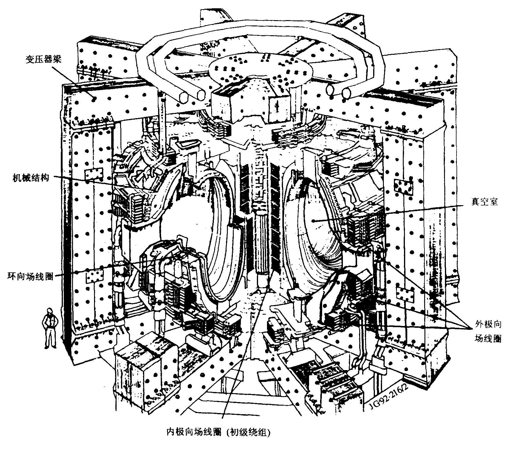

**图9.1** JET 装置结构简图

（取自 JET Annual Report 1992）

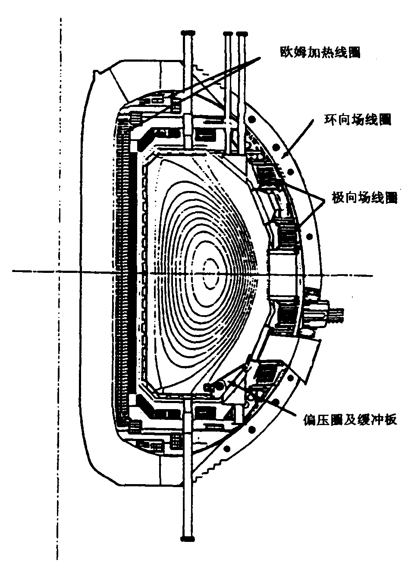

**图9.2** DIII-D 装置的截面图及$\beta=11\%$的磁面位形

（取自 IAEA-CN-53/A-1-4）

**(2) 环形真空室及孔栏**

大型装置的真空室本身一般由不锈钢制成，真空室外接大抽速真空机组（泵），大多采用无油涡轮高分子泵，能够将真空室的本底真空抽到$10^{-8}$托（Torr）$^{*}$。在第六章中已指出，杂质对等离子体的影响主要不是真空室中的剩余空气引起的，而是吸附在器壁上的杂质及器壁材料引起的，对大型装置的真空室，主要要考虑等离子体长期存在的条件下与器壁的相互作用。所以在真空室内壁上要用高品质石墨覆盖，也有用铍做内壁材料的，如 JET 的真空室。一般真空室的制造工艺是，先加工成形若干楔形段，然后将其焊成环形整室，在若干段上还有很多窗口，用于引入加热部件和用作诊断孔道。

为保护真空室避免受等离子体的直接作用，通常在真空室内设有特殊的孔栏。在中性束注入加热中，在束的对方位置也要设置保护孔栏。即使采用偏滤器位形，为了防止不稳

---

$^{*}$ 1 Torr = 133.3224 Pa.

定性引起的等离子体碰壁，也要设置一些孔栏。等离子体与孔栏的作用是不可避免的，所以如果用重金属钼或钨做孔栏，常常要在孔栏外覆盖一层石墨或硼，并且在若干次放电后再设法喷复一次，因为一些重杂质常常沉积在孔栏表面。

**(3) 加热设备**

主要的强功率加热方法是中性束注入和几种射频波加热，中性束注入加热所占的孔道相当大，可以从 JET 结构图中看出。ICRF 加热的天线要放在很靠近等离子体柱的地方，对等离子体约束有较大的影响（主要是天线的高频电场引起杂质含量的大幅度增大）。对天线加法拉第屏蔽后已基本解决了杂质增大问题，但法拉第屏蔽罩也成为一种特殊的孔栏，对其外表面也常喷硼覆盖。

**(4) 补充送气和固体弹丸注入系统**

器壁上的气体再循环是等离子体粒子补充的重要来源，此外，可对等离子体直接喷气（gas puffing）来补充送气，这是最常用的、可控制的一种送气方法。近年发展了用高速发射固体弹丸（冷冻的氢或氘丸）送料的方法，这种方法可以使粒子源进入等离子体内部较深的区域，使等离子体形成较陡的密度剖面，实验证明对改善约束有很明显的好处。预计这种送料方法将在反应堆条件下被广泛采用。

**表 9.1　托卡马克实验中最常用的诊断方法$^{[4]}$**

| 诊断方法 | 测定参数或过程 | 注 |
| --- | --- | --- |
| 静电探针阵列 | 电子密度、温度、电位 | 边缘低温区 |
| 罗可夫斯基线圈 | 等离子体总环向电流 | |
| 反磁线圈 | 等离子体储能 | 确定能量约束时间 |
| 电压环 | 等离子体环电压 | |
| 磁通探圈 | 相对磁通值 | 确定磁面形状 |
| 位移线圈 | 等离子体位移 | 提供反馈信号 |
| 米尔诺夫线圈 | MHD 扰动 | 不稳定模式 |
| 可见光谱 | 杂质含量、离子温度 | |
| 紫外和真空紫外光谱 | 杂质含量、电子温度 | |
| 多道韧致辐射 | 有效电荷数时空分布 | |
| 多道辐射量热器 | 辐射和电荷交换功率 | 输运分析 |
| 多道 HCN(DCN)激光干涉 | 电子密度的时空分布 | 粒子输运 |
| 多道微波吸收和干涉 | 电子密度的时空分布 | |
| 多道$H_{\alpha}$线 | 中性原子密度 | 气体再循环研究 |
| 多道激光散射 | 电子温度的时空分布 | 输运研究 |
| 多道 ECE(电子回旋发射) | 电子温度的时空分布 | 输运研究 |
| 中性原子束能谱 | 离子温度 | 离子输运研究 |
| 软 X 射线二极管阵列 | MHD 活性 | 中心约束区 |
| 软 X 射线能谱 | 电子温度、高能电子速度分布 | |
| 中子测量 | 氘氚反应率 | 推算氘离子温度 |

**(5) 诊断设备**

等离子体诊断设备的重要性对实验装置来说是不言而喻的。不仅对各种主要参数需了解它们的时空变化，还要对影响等离子体约束的重要物理过程的机理进行分析，研究控制方法和观察效果。所以，托卡马克实验装置周围布满各种诊断设备。对反应堆，也需要对若干重要的等离子体参数进行实时观察，以控制氘氚燃烧的过程。发展新型和可靠的诊断设备一直是磁约束聚变研究的一个任务。至今，一些重要的参数还缺乏可靠的诊断方法。许多诊断设备本身就是非常复杂的物理仪器。一些最常用的诊断方法如表 9.1 所列。表 9.2 是近年发展的几种重要诊断方法。

除了上面的基本诊断方法外，随着聚变实验研究的发展，不断提出一些新的诊断方法，或者对基本诊断方法进行改进和结合，用于研究新的物理现象，改善测量精度。表 9.2 总结了一些典型的新诊断方法。

**表 9.2　一些新的诊断方法$^{[5\sim8]}$**

| 诊断方法 | 测定参数或过程 | 说明 |
| --- | --- | --- |
| DCN 远红外偏振计 | 极向磁场或 q 剖面 | Faraday 旋转方法 |
| 运动 Stark 效应(MSE) | 极向磁场或 q 剖面 | 快离子束发射可见光谱 |
| 束发射谱仪 BES | 模式结构特征 | |
| 微波反射计 MWR | 中心和边缘密度及涨落 | 波在截止层的反射 |
| 电荷交换谱仪 CXS | 杂质离子密度分布 | |
| 多道光栅多色仪(GPC) | 电子温度的时空演变 | 能给出破裂前电子温度崩塌图象 |
| 锂束探测技术 | 边缘密度及涨落 | |
| 快电子韧致辐射(FEB) | 快电子空间分布 | 模拟非感应驱动电流剖面 |
| 神经网络技术 | 磁流体再联图象 | |

## 9.2.2　一些重要的托卡马克装置简介$^{[9]}$

**(1) T-3，T-4**

T-3 是最早引起国际聚变界注意的装置，T-4 是 T-3 经改进后的名称。原苏联早期的这几个托卡马克装置具有共同的特点，即等离子体截面形状为套圆系（磁面为不重叠的圆环系）；只进行欧姆加热；真空室外部有厚铜壳，可以对等离子体的位移和磁流体模式产生自动反馈；变压器是铁心的，电流脉宽在 200 ms 内；诊断设备较简单，主要是一些电磁探针。在对环向磁场绕组的供电方式上，T-3，T-4 已采用飞轮储能电机，这在当时是比较先进的。

在这些早期的装置中，广泛观察研究了磁流体稳定性条件，证实了沙弗朗诺夫平衡理论，发现了米尔诺夫振荡；在等离子体输运研究方面，曾得到离子热传导接近新经典理论值的结果，这一理论也是原苏联科学家萨格杰也夫等人最早提出的。这些装置中的电子温度达到 1 keV，离子温度达到 500 eV，电子密度达到$3\times10^{13}\ \mathrm{cm}^{-3}$，能量约束时间达到 10 ms。这些参数都高于仿星器，尤其是能量约束时间及其与电流的定标关系（$\tau_{E}\propto I_{p}$），改变了国际聚变界当时因一些装置中观察到的等离子体异常大的扩散而引起的沮丧情绪。直到 70

年代初大批托卡马克装置建成，这几个装置的总体参数仍是当时国际上最高的，可以说他们是现代磁约束研究得到全面的火种。

**(2) ST(1970～1975)，PLT(1975～1986)(圆截面位形)**

ST 作为美国第一个托卡马克装置，除验证了原苏联人的实验结果外，还进一步对等离子体内部锯齿活性的研究做出了贡献。PLT 作为一个中型装置，进行了 MW 级的中性束注入加热和 ICRF 加热研究，离子温度提高到接近 10 keV，即初步达到点火温度；还进行了低杂波电流驱动实验，得到 400 kA 的纯波驱动电流。在这些装置上，对杂质的产生和控制，以及破裂不稳定性进行了深入的研究，对电子的反常输运特性得到了较系统的了解。

**(3) ALCATOR-C(美国，MIT，1978～1993)，FT(意大利，Frascati，1978～1989)**

这两个装置都是强磁场系列装置（磁场达到 10～12 T），等离子体密度达到最高值$\left[(2\sim5)\times10^{14}\ \mathrm{cm}^{-3}\right]$，超过了反应堆设计要求。在这些装置上，总结出欧姆加热条件下的 ALCATOR 约束定标。在低杂波段和电子回旋频段波加热和电流驱动研究方面也获得引人注目的成果。在边缘物理研究中，首先发现了 MARFE 现象并对 DP 现象作了深入研究。

强磁场系列装置的新发展是美国 MIT 的 ALCATOR-CMOD (1993-05～) 和意大利的 FTU (1990～)。这两个装置虽然尺寸不很大，但其环向磁场强度与等离子体小半径的乘积可以和 JET 等人装置相比，环电流都超过 1 MA，因此属大型装置，主要研究高密度区域的欧姆加热（功率密度为普通托卡马克装置的 2～5 倍）及高功率和高功率密度条件下的波加热和电流驱动，同时研究高加热功率密度对壁的影响。目前 FTU 已实现密度值超过 Greenwald 极限 1.7 倍以上的稳定放电。

**(4) ASDEX(德国，Garching，1980～1990)，ASDEX-U (1991～)**

ASDEX 是具有极向偏滤器的中型实验装置，环电流可达 0.5 MA，加热功率超过 5 MW，获得了一批国际领先的研究成果，有很高的国际知名度，具有与主真空室隔离的偏滤器室，这是很独特的。主要研究成果包括：(Ⅰ) 对比研究了孔栏位形与偏滤器位形的约束特征；(Ⅱ) 发现欧姆加热条件下的约束随密度加大而变化，存在能量约束时间与密度成正比的欧姆约束 LOC，密度进一步增大时约束时间趋于饱和或下降的区域 SOC，通过改进送气方式使约束时间继续随密度增大而增大的区域 IOC；(Ⅲ) 对杂质物理进行了深入的研究，包括产生机制，输运定标；(Ⅳ) 发现了 H-模约束定标，为现代托卡马克物理研究和建堆条件的探索提供了方向。

ASDEX-U (1991～) 是一个新装置，环电流可达 1 MA，偏滤器在主真空室内（开放型），与 JET 等装置类似，总加热功率将达 20 MW 以上，预期可以研究堆芯物理的各种课题，是下世纪初仍将运行的主要实验装置之一。

**(5) T-10(原苏联，Kurchatov 原子能所，1975～)**

主要进行 ECRH 加热和电流驱动实验，在这一方面的研究中保持国际领先地位，电子温度达到 10 keV。该装置与美国的 PLT 在同一时期建造，规模接近，由于后来原苏联的大型超导磁体装置 T-15 建成后不能正常运行，而俄罗斯的回旋管技术在国际上领先，使 T-10 成为俄国的主要实验装置。

**(6) TEXTOR(德国，Julich，1981～1993)**

是中型实验装置，NBI 和 ICRF 的功率都超过 3 MW，有非常好的诊断设备和反馈控制系统，将边缘物理作为研究重点，创造了很多壁处理技术。在磁流体活性，约束模式变换，电流密度剖面测量和控制等方面的研究处于国际前沿。1994 年经改进后提高了总加热功率，增加了新诊断设备，并采用抽气环向孔栏来解决边缘粒子再循环，新装置称为 TEXTOR-94。

**(7) DIII(美国，GA，1979～1986)，DIII-D (1986～)**

是美国和国际上非常重要的大型装置，由最早的非圆截面位形双流器发展而来，日本曾投入巨资并派专家小组和美国专家共同研究，后来发现 D 形截面约束性质优于双流截面，加上国际偏滤器研究的进展，决定进行改装，新装置称 DIII-D，是美国和国际上几个用于 ITER 相关工程物理课题的重要装置之一。具有总功率 30 MW 的 NBI，ICRF 等加热设备，其约束数据与 JET 结合称 DIII-D-JET 系列。发现了平均比压超过 13% 的稳定位形，在改善约束研究中，先后发现非常高约束模 VH 模，中心负剪切模 NCS，在加热物理和电流驱动物理研究的很多领域的工作具有独特贡献。

**(8) TFTR (美国普林斯顿，1982 年末至 1996 年 5 月)**

与欧共体的 JET 一起成为国际上可以进行氘氚反应实验的仅有的两个装置，基本位形为圆截面位形，环向磁场较强，可达 5 T，水冷线圈，环电流 2.5 MA，总加热功率超过 60 MW，是目前等离子体总体参数最高的少数几个装置之一（其中离子温度超过 40 keV）。通过 TFTR 的实验研究，发现了一些具有特点的新的高约束模式，如 1985 年发现超放电模（Supershot，简称 S-模），使国际聚变界对改善约束的认识面大为拓宽，近年又发现增强反剪切模(ERS)，这是一种具有反向剪切和峰化密度剖面的位形，其中心约束区的输运特性为经典输运量级，开创了先进托卡马克位形的新参数区。TFTR 在约束和加热物理的主要领域始终处于国际领先地位。在高参数等离子体诊断物理方面，对许多先进诊断方法都在该装置上进行了实际应用，从而使人们可以直接了解聚变等离子体很多重要的时空演变性质。1996 年 5 月，在达到氘氚输出功率超过 10 MW ($Q=0.3$)，完成了主要研究任务后关闭。

TFTR 的主要不足是脉宽太窄，因而难以观察一些与长脉冲有关的物理现象，这与 TFTR 在设计阶段对聚变等离子体的物理和工程问题的认识还不够深刻有关。

**(9) JET(欧共体，1983 年 6 月～)**

是迄今所有托卡马克实验装置中尺寸最大的装置，真空室容积达$150\ \mathrm{m}^{3}$，D 型截面，环向场磁体为水冷线圈，飞轮机组供电，环电流达 7 MA（原始设计值为 4.8 MA，后经不断改进达 7 MA），具有双零偏滤器，可自由地选取孔栏位形，单零偏滤器或双零偏滤器位形，总加热功率（主要是中性束注入和 ICRF 频段波加热及 LH 波驱动功率）超过 60 MW，运行时总供电功率大于 20 万千瓦，大部分直接取自高压电网。按设计目标，要进行氘氚反应实验并验证能量得失相当条件，与美国的 TFTR 一起，是准备进行氘氚实验的仅有的两个装置。该装置自 1983 年 6 月运行以来，已完成高参数聚变等离子体加热和约束的大量课题，在聚变三因子乘积上屡创世界纪录，1991 年首次进行氘氚实验，达到 1.7 MW 的聚变功率输出。

JET 中的等离子体参数在 1991 年前后实际上已达当时的最高水平（$T_{i0}=28\ \mathrm{keV}$，$Q=1.1$），发现了很多类型的改善约束模式，其中如热离子 H-模，弹丸注入加强 H-模（PEP），

高极向比压 H-模等，最高改善约束因子可达$H=3$以上。同时发现，进一步提高参数的主要障碍是偏滤器靶板（石墨基）上的热负载过大，引起了碳杂质的迸发（Carbon bloom），使等离子体约束迅速变坏，这是首次观察到在较长脉冲条件下偏滤器排热性能不足对主体等离子体的限制，从此 JET 将改进偏滤器设计作为后续研究的重要内容，把解决靶板表面平均热负载容量的问题提上日程，先后提出几种新型偏滤器设计，这也是与 ITER 相关的最重要的课题之一。1994 年在改善约束研究方面取得了新进展，发现了中心负剪切模（CNS），对未来的反应堆设计及寻求先进托卡马克约束位形有重要参考意义；还进行了较低参数下的长脉冲实验（1 MA，2 min）；1996 年开始再次进行氘氚实验；1997 年达到聚变输出功率 17 MW，$Q_{\mathrm{DT}}$达到 0.6 以上。

JET 的原定实验目标基本已经完成，现因 ITER 工程设计需要，准备延长运行到 1999 年末，主要研究新型偏滤器 MARK-I 和 MARK-II 的性能及氘氚实验。

由于物理认识和工艺水平的限制，JET 装置也存在一些不足。如磁场不很高（3.5 T），影响其可达的密度极限。大量实验在平均密度为$5\times10^{13}\ \mathrm{cm}^{-3}$以下进行，可达密度主要受到 MARFE 现象的限制，这是该装置的主要不足。

**(10) JT-60(日本原子能所，1985-04～1990)，JT-60U (1991-03～)**

JT-60 是日本磁约束聚变研究的骨干装置，具有极向偏滤器，因其真空室容积达$60\ \mathrm{m}^{3}$得名。在 JT-60 上，偏滤器设置于中平面外侧，与其它装置设置于上下方进行对比实验，磁场较高 (4.8 T)，因此极限密度高于 JET，总电流可达 3.5 MA，总加热功率超过 40 MW。由于日本的工程技术基础先进，该装置上具有国际最先进的加热和电流驱动装备及诊断设施，等离子体总体参数达到很高水平，尤其是低杂波电流驱动及自举电流的研究处于国际领先水平。由于放在外侧的偏滤器的效果不理想，1991 年对装置进行了很大的改建，在改进装置 JT-60U 中，重新研制了真空室，容积扩大到$100\ \mathrm{m}^{3}$以上，并将偏滤器放在下方，加热总功率提高到 60 MW 以上，成为仅次于 JET 的第二大聚变实验装置。JT-60U 主要研究目标都与 ITER 有关，如非感应电流驱动研究，单元功率超 MW 级的负离子中性束研制及在装置上的实验等。

JT-60U 完成的实验研究在很多方面达到国际最高水平，如中心离子温度达 46 keV，聚变三因子乘积达$\bar{n}_{e}T_{i0}\tau_{E}>12\times10^{20}\ \mathrm{keV\cdot s\cdot m^{-3}}$，或由氘氚反应产生的聚变功率外推，得到聚变性能因子$Q>1.2$；全低杂波电流驱动达到 3.5 MA，效率达$\eta_{\mathrm{LH}}>3.5\times10^{19}\ \mathrm{A\cdot m^{-2}\cdot W^{-1}}$，接近 ITER 对驱动效率的要求；观察到一些具有新的物理特征的高约束模式，如具有内部输运位垒的中心区改善约束模式等；最近又进行了负离子束中性源注入的加热和电流驱动实验，离子能量 400 keV，束功率 2.5 MW（计划达 500 keV，10 MW）。

另一个中型装置 JFT-2A 是 JT-60 的配套装置，其数据为国际数据库所收集。

**(11)** 日本文部省下属的名古屋等离子体所的 JIPP-T-IIU 也是一个较有特色的中型装置，具有外加螺旋绕组，可以进行托卡马克与仿星器位形的结合研究，总加热功率达 3 MW，是加热功率密度最高的装置之一；另一个小型超导磁体装置 TRIAM-1M（日本九州大学，1986～）在电流较小（30 kA），密度较低的条件下，用低杂波维持了小时级的放电。

**(12) TFR (法国原子能委员会，1974～1986)，TORE-S (1988-04～)**

TFR 是中型实验装置，进行了 3 MW 级的中性束注入加热，ICRF 加热研究，是第二代托卡马克装置中的几个重要装置之一；TORE-S 是大型超导磁体装置，圆截面，无偏滤器，但进行了几种抽气孔栏的实验。TORE-S 装置与俄罗斯的 T-15 设计参数基本相同，但 T-15 长期不能运行，而 TORE-S 则成功地进行了长脉冲实验，达到 MA 级电流维持时间超过 2 min。总加热功率超过 30 MW，已获得堆级等离子体参数，进行了多种波加热和改善约束研究，是下世纪初仍将运行的几个重要装置之一。

**(13) TCV(瑞士，洛桑，1992-11～)**

这一近年新建的尺寸不大但电流可达 MA 级的装置，具有自身特点，真空室呈拉长形，通过一系列成形线圈，可以形成拉长度超过 2，正负三角形变率都很大的位形，以研究不同变形截面位形的磁流体稳定性及对约束时间的关系，寻找最佳位形。另外，具有很高功率的电子回旋加热设备 (4.5 MW)，等离子体参数较高。

**(14) HL-1(中国，乐山，1984～1992)，HL-1M (1992～)**

是中国主要的中型实验装置，电流达 300 kA，可维持 1 s，在磁流体稳定性，壁处理和杂质控制，边缘区特性，低杂波电流驱动，冷靶丸注入，孔栏加偏压实现类 H-模约束等多种课题研究中获得受国际同行重视的研究成果，多次获国家科技进步奖。今后，HL-1M 将进行 MW 级高功率中性束注入加热、波加热及电流驱动研究。

**(15) HT-6M (中国，合肥，1981～)，HT-7 (1996～)**

是中国科学院系统的主要装置，HT-6M 上进行了 0.5 MW 级 ICRF 加热实验，波加热和电流驱动联合实验，利用边界湍流加热实现类 H-模约束实验，绝热压缩实现类 H-模实验等，在国际会议上发表多篇论文，很多结果被同行引用；HT-7 是利用俄国的 T-7 改建的超导磁体装置，目的是研究长脉冲放电物理和工程问题，已实现 200 kA 的 3 s 级运行。

表 9.3 是主要的中型托卡马克装置的工程物理参数，表 9.4 是大型装置的参数及研究规划。

**表 9.3　主要的中型托卡马克实验装置的工程物理参数$^{[1]}$**

| 装置/国别 | 时间 | $R/\mathrm{m}$ | $a/\mathrm{m}$ | $\kappa$ | $B/\mathrm{T}$ | $I/\mathrm{MA}$ | $P_{\mathrm{NBI}}/\mathrm{MW}$ | $P_{\mathrm{RF}}/\mathrm{MW}$ | $t_{\mathrm{dis}}/\mathrm{s}$ | 位形特征 |
| --- | --- | --- | --- | --- | --- | --- | --- | --- | --- | --- |
| PLT/美 | 1975～1986 | 1.32 | 0.4 | 1 | 3.2 | 0.5 | 3 | 5 | 4 | 圆，孔栏 |
| ASDEX/德 | 1979～1989 | 1.64 | 0.4 | 1.4 | 2.8 | 0.5 | 7.5 | 5 | 20 | 偏滤器 |
| DITE/英 | 1975～1989 | 1.17 | 0.26 | 1 | 2.7 | 0.3 | 1.5 | | 1 | 圆，束偏滤器 |
| T-10/俄 | 1975～ | 1.5 | 0.4 | 1 | 5.0 | 0.65 | | 5 | 2 | 圆 |
| T-deV/加 | 1987～ | 0.86 | 0.26 | 1.2 | 1.5 | 0.3 | 2 | 2 | 30 | 偏滤器 |
| TFR/法 | 1974～1986 | 0.98 | 0.22 | 1.0 | 6 | 0.6 | 3 | 3 | 2 | 圆 |
| TEXTOR/德 | 1981～ | 1.75 | 0.5 | 1.0 | 2.6 | 0.6 | 5 | 5 | 5 | 圆 |

**续表 9.3**

| 装置/国别 | 时间 | $R/\mathrm{m}$ | $a/\mathrm{m}$ | $\kappa$ | $B/\mathrm{T}$ | $I/\mathrm{MA}$ | $P_{\mathrm{NBI}}/\mathrm{MW}$ | $P_{\mathrm{RF}}/\mathrm{MW}$ | $t_{\mathrm{dis}}/\mathrm{s}$ | 位形特征 |
| --- | --- | --- | --- | --- | --- | --- | --- | --- | --- | --- |
| FT/意 | 1978～1989 | 0.98 | 0.2 | 1.0 | 10 | 0.6 | | 3 | | 圆 |
| ALCATOR-C/美 | 1978～1992 | 0.64 | 0.17 | 1.0 | 14 | 0.8 | | 5 | | 圆 |
| TEXT/美 | 1980～ | 1.0 | 0.27 | 1.4 | 3 | 0.4 | | | | 偏滤器 |
| PBX-M/美 | 1987～ | 1.65 | 0.3 | 2.0 | 2.2 | 0.5 | 5 | 5 | | 偏滤器 |
| JFT-2M/日 | 1985～ | 1.3 | 0.3 | 1.6 | 1.4 | 0.3 | 3 | 3 | | 偏滤器 |
| JIPP-TII/日 | 1983～ | 0.91 | 0.23 | 1.0 | 3 | 0.3 | 3 | 3 | | 托-仿混合 |
| TCV/瑞士 | 1992～ | 0.88 | 0.25 | 2.2 | 1.43 | 0.8 | | 4.5 | 1.0 | 拉长变形 |
| HT-6M/中 | 1982～1998 | 0.65 | 0.2 | 1.0 | 2 | 0.2 | | 1.0 | 0.2 | 圆 |
| HL-1M/中 | 1992～ | 1.02 | 0.26 | 1.0 | 3 | 0.4 | 0.5 | 1.5 | 1 | 圆 |
| HT-7/中 | 1994～ | 1.22 | 0.26 | 1.0 | 2.2 | 0.25 | | 3 | (5) | 圆，超导 |

**表 9.4　大型托卡马克装置情况$^{*}$**

**TFTR (Tokamak Fusion Test Reactor，美 PPPL，1982-12～1997-05)**

$$
R=2.48\ \mathrm{m},\quad a=0.83\ \mathrm{m},\quad B=5.2\ \mathrm{T},\quad I=2.5\ \mathrm{MA},\quad t_{\mathrm{dis}}=4\ \mathrm{s}
$$

**工程参数**　$P_{\mathrm{NBI}}=40\ \mathrm{MW}$，$P_{\mathrm{RF}}=30\ \mathrm{MW}$（ICRF, LHCD）

冷冻弹丸

**物理参数**　$\langle n_{e}\rangle=(2\sim12)\times10^{13}\ \mathrm{cm}^{-3}$，$T_{i0}=40\ \mathrm{keV}$，$T_{e0}=20\ \mathrm{keV}$，$\tau_{E}=0.5\ \mathrm{s}$

$$
n\tau T=5\times10^{20}\ \mathrm{keV\cdot m^{-3}\cdot s},\quad P_{\mathrm{DT}}=10.7\ \mathrm{MW},\quad Q_{\mathrm{DT}}=0.4
$$

**说明**　1. 改善约束模式 S-模，ERS 模；2. 大份额自举电流位形；3. 氘氚反应实验

---

**DIII-D (1986 由 DIII 改进，美 GA)**

$$
R=1.67\ \mathrm{m},\quad a=0.67\ \mathrm{m},\quad \kappa=2.0,\quad B=2.2\ \mathrm{T},\quad I=3\ \mathrm{MA},\quad t_{\mathrm{dis}}=10\ \mathrm{s}
$$

**工程参数**　$P_{\mathrm{NBI}}=20\ \mathrm{MW}$，$P_{\mathrm{RF}}=10\ \mathrm{MW}$（ICRF, LHCD, ECRH）

冷冻弹丸，单零偏滤器

**物理参数**　$\langle n_{e}\rangle=4\times10^{13}\ \mathrm{cm}^{-3}$，$T_{i0}=20\ \mathrm{keV}$，$T_{e0}=10\ \mathrm{keV}$，$\tau_{E}=0.2\ \mathrm{s}$

$$
n\tau T=2\times10^{20}\ \mathrm{keV\cdot m^{-3}\cdot s},\quad Q_{\mathrm{DD}}=0.05,\quad \langle\beta\rangle=11\%
$$

**说明**　1. 最高稳定比压值；2. VH-模，NCS 模等；3. 多种电流驱动实验

---

**JET (Joint European Torus，欧共体，1983-05～)**

$$
R=2.96\ \mathrm{m},\quad a=1.25\ \mathrm{m},\quad b=2.10\ \mathrm{m},\quad B=3.5\ \mathrm{T},\quad I=7\ \mathrm{MA},\quad t_{\mathrm{dis}}=30\ \mathrm{s}
$$

**工程参数**　$P_{\mathrm{NBI}}=40\ \mathrm{MW}$，$P_{\mathrm{RF}}=30\ \mathrm{MW}$（ICRF, LHCD, ECRH）

双零偏滤器，冷冻弹丸

**物理参数**　$\langle n_{e}\rangle=7\times10^{13}\ \mathrm{cm}^{-3}$，$T_{i0}=30\ \mathrm{keV}$，$T_{e0}=20\ \mathrm{keV}$，$\tau_{E}=1.1\ \mathrm{s}$

$$
n\tau T=11\times10^{20}\ \mathrm{keV\cdot m^{-3}\cdot s},\quad P_{\mathrm{DT}}=17\ \mathrm{MW},\quad Q_{\mathrm{DT}}=0.7
$$

## 续表 9.4

### JET（Joint European Torus，欧共体，1983-05~）

- **说明**：1. 多种改善约束模：热离子 H-模，PEP 模，负剪切模；
  2. 最高聚变反应功率；3. 60 s 长脉冲放电；4. 大自举电流，大极向比压位形

### JT-60U（1991-05 由 JT-60 改进，日本，JAERI）

- **工程参数**：

$$
  R = 3.0\ \text{m},\quad a = 0.95\ \text{m},\quad \kappa = 1.7,\quad B = 4.8\ \text{T},\quad I = 6\ \text{MA},\quad t_{\text{dis}} = 20\ \text{s}
$$

$$
  P_{\text{NB}} = 40\ \text{MW},\quad P_{\text{RF}} = 20\ \text{MW}\ (\text{ICRF, LHCD, ECRH})
$$

  单零偏滤器，冷冻弹丸

- **物理参数**：

$$
  \langle n \rangle = 7\times 10^{13}\ \text{cm}^{-3},\quad T_{\text{i0}} = 44\ \text{keV},\quad T_{\text{e0}} = 20\ \text{keV},\quad \tau_E = 1.2\ \text{s}
$$

$$
  n\tau T = 12\times 10^{20}\ \text{keV}\cdot\text{m}^{-3}\cdot\text{s},\quad Q_{\text{DD}} = 1.2
$$

- **说明**：1. 多种改善约束模式；2. 最大无感电流驱动及效率；
  3 负离子中性束注入加热和电流驱动；4 全自举电流位形

### TORE-S（法国，Cadarache，1988~）

- **工程参数**：

$$
  R = 2.36\ \text{m},\quad a = 0.8\ \text{m},\quad B = 4.5\ \text{T}\ (\text{超导}),\quad I = 1.7\ \text{MA}
$$

$$
  P_{\text{RF}} = 30\ \text{MW}\ (\text{ICRF, LHCD, ECRH})
$$

- **物理参数**：

$$
  \langle n_e \rangle = 1.2\times 10^{14}\ \text{cm}^{-3},\quad T_{\text{i0}} = 5\ \text{keV},\quad T_{\text{e0}} = 10\ \text{keV},\quad \tau_E = 0.4\ \text{s}
$$

- **说明**：120 s 稳态放电及长脉冲物理研究

### ASDEX-U（德国，Garching，IPP，1991~）

- **工程参数**：

$$
  R = 1.65\ \text{m},\quad a = 0.5\ \text{m},\quad \kappa = 1.6,\quad B = 4\ \text{T},\quad I = 2\ \text{MA},\quad t_{\text{dis}} = 30\ \text{s}
$$

$$
  P_{\text{NB}} = 9\ \text{MW},\quad P_{\text{RF}} = 20\ \text{MW}\ (\text{ICRF, LH, ECRH})
$$

  单零偏滤器，冷冻弹丸

- **物理参数**：

$$
  \langle n_e \rangle = 1.2\times 10^{14}\ \text{cm}^{-3},\quad T_{\text{i0}} = 5\ \text{keV},\quad T_{\text{e0}} = 5\ \text{keV},\quad \tau_E = 0.2\ \text{s}
$$

- **说明**：重点为反应堆级装置的边缘区物理

### FTU（意大利，Frascati，1989~）

- **工程参数**：

$$
  R = 0.93\ \text{m},\quad a = 0.31\ \text{m},\quad B = 8\ \text{T},\quad I = 1.6\ \text{MA},\quad t_{\text{dis}} = 4\ \text{s},\quad P_{\text{RF}} = 10\ \text{MW}
$$

- **物理参数**：

$$
  \langle n_e \rangle = 4.5\times 10^{14}\ \text{cm}^{-3},\quad T_{\text{i0}} = 5\ \text{keV},\quad T_{\text{e0}} = 5\ \text{keV},\quad \tau_E = 0.2\ \text{s}
$$

- **说明**：强磁场高密度区物理，最高密度已超过 Greenwald 极限的 1.7 倍

### ALCATOR-C（美国，MIT，1993-05~）

- **工程参数**：

$$
  R = 0.67\ \text{m},\quad a = 0.21\ \text{m},\quad B = 8\ \text{T},\quad I = 1.2\ \text{MA},\quad t_{\text{dis}} = 4\ \text{s}
$$

$$
  P_{\text{RF}} = 10\ \text{MW}\ (\text{ICRF, LH, ECRH})
$$

  单零偏滤器

- **物理参数**：

$$
  \langle n_e \rangle = 4\times 10^{14}\ \text{cm}^{-3},\quad T_{\text{e0}} = 5\ \text{keV},\quad H = 2.0
$$

- **说明**：1. 高密度区 RF 加热及电流驱动物理；
  2. 初步的 FWCD 及 ECCD 实验

### T-15（俄，莫斯科 Kurchatov 所，1988~）

- **工程参数**：

$$
  R = 2.43\ \text{m},\quad a = 0.7\ \text{m},\quad B = 3.5\ \text{T}\ (\text{SnNb 超导})
$$

- **物理参数**：

- **说明**：该装置的超导磁体一直未能正常运行，只有低参数下的初步结果

---

\* 1. 物理参数栏中密度、温度、约束时间是不同放电中最高值；三因子乘积是同一次放电中达到的值；2. $Q_{\text{DD}}$是由氘氚反应外推到氘氘反应的值。

## 9.3 托卡马克等离子体磁流体平衡和稳定性

本节开始，我们将较全面地综述托卡马克实验研究成果。但需要指出的是，几十年来在上百个大小不一的装置上所进行的实验，所包含的内容虽然十分广泛，但从最终建造氘氚聚变反应堆的角度来检验，有不少实验并无太多参考价值。例如一些装置在很低的粒子密度下进行实验（$\bar{n}_e < 10^{13}\ \text{cm}^{-3}$），虽然观察到很多物理上有一定意义的现象，但对建立聚变堆没有直接的应用价值，因为聚变堆要求的密度范围至少是$\bar{n}_e > 10^{14}\ \text{cm}^{-3}$。因本书篇幅有限，对那些不很重要的结果将不予讨论。

托卡马克实验的目的归根结底是为了验证约束和加热的基本原理，并对聚变堆运行可能遇到的主要问题进行定标性研究，以期对现代装置实验规律外推到反应堆条件的可行性做出评价。影响聚变等离子体约束的主要因素是宏观稳定性，粒子和热量的输运，以及杂质辐射。这三方面的内容不仅对托卡马克，对其它的装置也是同样重要的，但托卡马克在这几方面的研究都已经做得相当深入广泛，数据基础最充分。下面我们将分别对一些重要问题进行介绍，主要包括：高温聚变等离子体的宏观稳定性；电子和离子的加热及约束定标和输运性质；改善约束位形及先进托卡马克概念。

### 9.3.1 磁流体平衡位形的建立

磁约束聚变实验研究中首先遇到的问题是要建立能稳定约束高温等离子体的平衡位形，其中不仅单个带电粒子可以得到长时间的约束，而且等离子体自身的能量不会很快通过扩散和热传导等输运过程而失去，或者说，聚变等离子体应具有很好的热绝缘。托卡马克作为一种人为地在实验室中产生的环形轴对称磁流体平衡位形，是否具有这些品质，是需要经多方面的实验检验的。

大多数托卡马克装置实验中并不真正使用氘氚混合燃料，在大部分实验中使用的是氢，一些实验中使用氘，偶然也用$^3\text{He}$及$^4\text{He}$。因此，现阶段实验的主要目的是对高温等离子体的约束和加热原理进行验证，看看理论提出的各种方案是否真的能将等离子体加热到热核温度，并长期稳定地约束这种等离子体。初始等离子体通过对预先充在环形真空室的工作气体进行欧姆感应放电来产生。气体的压强很低，全部电离后相当于等离子体的粒子密度在$5\times 10^{12} \sim 2\times 10^{14}\ \text{cm}^{-3}$范围，具体要由装置的运行参数范围确定。更低的密度值对聚变研究本身已没有太多意义；更高的粒子密度，因受物理过程本身的限制（密度极限）而不容易达到。

几乎所有的托卡马克等离子体都通过欧姆放电产生，为了将气体击穿，需要在初始时加上较大的环电压，也就是要消耗较大的变压器磁通。环形的等离子体柱本身实际等效于变压器的次级回路，由法拉第定律得

$$
\frac{\partial \Phi}{\partial t} = -2\pi R E_\varphi \qquad (9.2)
$$

当等离子体电流开始建立以后，等离子体自身的磁通的变化也要产生感应电场，这相当于等离子体柱的自感效应。有时将等离子体柱的自感分成内自感和外自感，内自感是环电流在柱体内部磁场的贡献，外自感是环形载电流柱体在柱外产生的磁场的贡献，外自感与电流在内部的分布的关系很弱，因此可以用统一的近似公式表示。对圆截面情形

$$
L_e = 4\pi R \ln\left(\frac{8R}{a} - 1.75\right) \qquad (9.3)
$$

若长度以 m 计，上式中电感的单位是$10^{-7}\ \text{H}$。内自感与电流剖面分布有关，可以用直圆柱近似来估计其大小，单位长度柱体内的内自感为

$$
l_i = \frac{\int_0^a dr\, r B_\theta^2}{2 I_p^2} \qquad (9.4)
$$

若电流完全在柱体表面，则$l_i$为零，反之，若电流非常集中在柱中心，则$l_i$接近 1。对沿截面均匀分布的电流，$l_i = 1/2$。

变压器磁通变化产生的感应电场将被等离子体电流增大所产生的互感抵消一部分，剩下的用于维持等离子体的电阻损耗。回路方程为

$$
-\frac{d\Phi}{dt} = \frac{d}{dt}(L I_p) + R I_p \qquad (9.5)
$$

在电流建立过程中变压器总的磁通消耗量为

$$
\Delta\Phi = L I_p + \int^t dt'\, R I_p \qquad (9.6)
$$

一般装置中电感部分占总磁通消耗量的一半左右。对反应堆，主要的消耗是电阻损耗。在等离子体电流建立的过程中，变压器在对等离子体做功，除了等离子体因欧姆加热增加了内能外，在内部和外部空间储存了磁能$\frac{1}{2} L I_p^2$。在初期实验中，为建立电流波头，常常要消耗很大一部分磁通，其中一部分是无用消耗（因气体未被击穿或电流不稳定等因素）。现在已可以完全排除这种无用消耗，并通过多种预电离措施使开始放电所需的环向感应电场减到很小。在仿星器中，可以完全通过 ECRH 来建立等离子体，这一方法可以部分地应用于托卡马克。

在等离子体电流建立初期，因平衡位移的控制不佳等原因，可能会有较强的等离子体与器壁（孔栏）的相互作用，等离子体会很不稳定。现代实验已可以很好地控制这一过程。但即使初始阶段存在一些磁流体模式（见第六章），也不影响后面的长期稳定约束。在建立准稳态电流以后，影响约束的主要磁流体模式是内扭曲模和撕裂模，托卡马克装置中研究的主要宏观模式就是这两类模。在非常高的比压下，可能出现气球模和表面理想扭曲模，这在大型装置和反应堆条件下是很重要的。

### 9.3.2 托卡马克等离子体的磁面结构

对托卡马克位形来说，非常重要的是环向等离子体电流的剖面分布，以及与之密切联系的磁面结构特性。一般的放电都经过开始时刻电流较集中在柱体表面，然后向中心磁轴处渗透，最后在磁轴处达到极大并形成单调地向边缘减小的剖面结构。托卡马克磁场的磁力线具有旋转变换，即磁力线既向大环方向伸张，同时也沿极向绕磁轴转动。在稳定性研究中引入的安全因子$q$值是描述每一磁面上磁力线旋转变换率的倒数的一个物理量。对任意截面位形，可以通过下面的公式来计算安全因子的大小

$$
q(r) = \frac{5 r^2 B_0}{R I(r)} \left[ \frac{1 + \kappa^2 (1 + 2\delta^2 - 1.2\delta^3)}{2} \right] f(\varepsilon) \qquad (9.7)
$$

式中$\varepsilon = r/R$，而

$$
f(\varepsilon) = \frac{1 + 0.62\varepsilon^2 - 2.22\varepsilon^3}{(1-\varepsilon^2)^2} \qquad (9.8)
$$

其中$\kappa, \delta$分别为截面的拉长比和三角变形度，$r$为赤道平面上所考虑磁面的小半径，$I$为该磁面内部的环向电流大小。对直圆柱近似，得到

$$
q_{\text{cyl}} = \frac{5 r^2 B_0}{R I(r)} \qquad (9.9)
$$

在磁轴处的安全因子值可以由上式取极限而得到

$$
q_0 = \frac{5 B_0}{\pi R j_0} \qquad (9.10)
$$

在欧姆驱动产生电流的情况下，由于电子温度总是由中心向边缘下降的，电流密度也具有峰化的分布。实验观察证实，磁面结构的确具有拓扑套环的形状。图 9.3 是 JET 中实际测量得出的磁面结构。

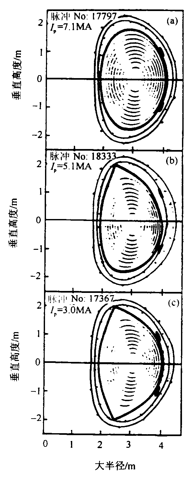

托卡马克实验证实，在满足条件

$$
q_a < 2.5 \qquad (9.11)
$$

时，只要对等离子体平衡位置及其它参数进行程序或反馈控制，所获得的平衡位形就可以长期稳定地维持下去。对于具有极向偏滤器的位形，在接近磁场的 X 点（极向磁场强度为零的特殊点）时，严格意义下的安全因子值为无限大，因此常用$q_{95}$这个量来代替上面的边界安全因子$q_a$，这是在极向磁通值为等离子体内总极向磁通的 95% 处取的值。

减小安全因子意味着增大总电流。从发挥欧姆加热作用以及改进高能粒子约束的角度来说，增大电流是有意义的，所以在实验探索中曾努力寻求过实现低$q$稳定位形的可能性。在特殊的条件下，边缘安全因子值的确可以达到更小的值，例如在导体壳非常靠近等离子体时，在一些装置实验中曾达到$q_a = 1.2$的稳定位形。不过，从反应堆应用的角度，减小安全因子会使破裂不稳定性发生的几率增大，是不利的。此外，太大的总电流将增大装置建造的工程难度，而且要求非常大的用于维持电流的变压器磁通可变量。目前反应堆设计已不倾向增大总电流。在 ITER 设计中采用的边缘$q$值正是 2.5，而先进位形反应堆还将进一步减小环向电流。

### 9.3.3 破裂不稳定性的实验研究$^{[10\sim 15]}$

早期的实验对电流极限破裂做了大量研究，有关的现象特征和机制，在 5.10 节中已作

过较详细地介绍。对产生这类破裂的原因，实验研究结果与理论分析是相当一致的，存在的几种机制，都与电阻性磁流体模的发展有关。第一种可能是靠近边缘区的有理磁面（$q_a = 3$）附近撕裂模的发展，引起大的磁岛结构；第二种可能是内部若干磁面附近的磁岛（如$q = 3/2,\ q = 2$）发生磁重连，形成大的磁岛；第三种可能是边缘若干磁岛重连，形成较宽区域的磁力线无规化，最后引起等离子体与器壁的强烈相互作用。很多装置中对破裂发生前的模式演变进行了细致的研究，对很多前兆现象进行了归纳，有一些前兆被用于反馈控制的启动信号。一般来说，在较大的边缘安全因子下运行并对电流剖面进行调控，电流极限破裂是可以得到控制的；在实验中常常发生因位移控制不善或因位移不稳定性引起的较软的破裂，其主要表现为位移突然加大（由于加料或加热太快，或杂散磁场漏入等）使等离子体柱碰壁，电流在伏秒数远未耗尽的情况下猝灭。对这类较软的破裂的控制，主要是改进位移控制技术及对位移不稳定性进行程序控制或反馈控制；对现代托卡马克实验来说，电流极限破裂和位移引发破裂已不构成主要的优虑，目前对大型装置，以及对未来的反应堆，主要的忧患来自密度极限破裂和 β-极限破裂，因为这两类破裂现象可以危害反应堆的长期稳定运行，并限定了可能达到的最高等离子体参数，最终限定聚变堆的经济性能。下面介绍这两类破裂不稳定性研究的一些新结果。

密度极限破裂：近年来在一些中大型装置中，采用一些先进的诊断手段，对密度极限破裂过程进行了详细的观察，发现这一过程可以分为三个阶段，即电子温度分布的崩塌，热猝灭（thermal quench）及最后的电流猝灭（current quench）。在 TFTR 装置上，利用多道光谱多色仪获得了电子温度剖面崩塌的清楚图像（见图 9.4）。在 JET 和其它一些装置上观察到类似的图像，虽然具体的温度剖面演变图像会因装置条件不同而有所不同，但主要的特征是类似的。电子温度分布的崩塌按如下的程序完成：当等离子体密度超过一定的极限值后，由于边缘热不稳定性过程及其与磁流体过程的耦合，边缘电子温度首先开始快冷却，这一过程逐渐向内部区域发展，导致热区域的很快收缩。这一过程中，芯部（$q = 1$面附近区域）电子温度降低（从 3 keV 降到 1 keV），剖面变平，当热区收缩到$q = 2$面附近或更向内时，开始进入第二阶段，即热猝灭阶段。上述温度剖面崩塌过程的特征时间在 100 ms 或更长，这使得对其控制成为可能。

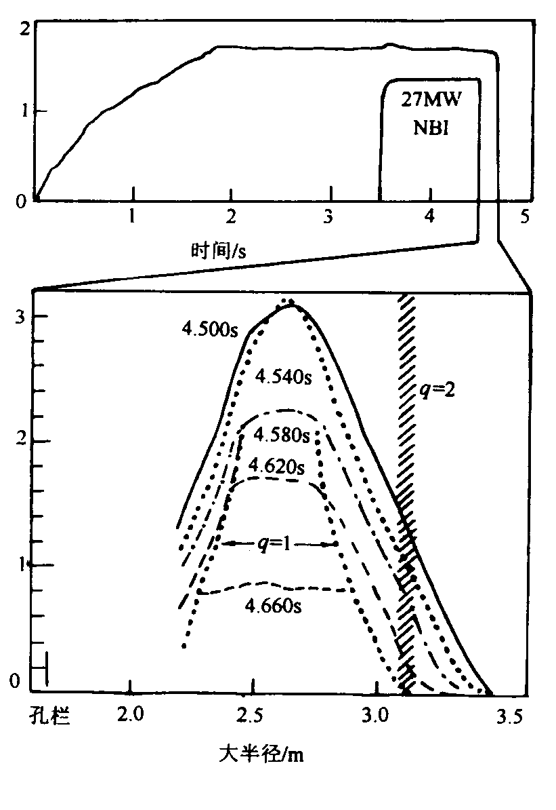

在热猝灭阶段，等离子体柱因外

区有冷等离子体包围，热区实际变成了脱栏状态，$n = 1$的外部扭曲模开始发展，导致冷等离子体与中心热等离子体的混合，用 ECE 或软 X-层析诊断可以观察到磁场位形演变的冷气泡结构。芯区电子温度进一步降低到 100 eV 左右，观察到总电流的正尖峰信号，同时内电感$l_i$减小。这一阶段维持约 10 ms 的时间，开始进入第三阶段，即电流的猝灭，放电终止，电流通道完全破裂，最后这一阶段的特征时间为几毫秒。

密度极限破裂的一些先兆现象，如 MARFE 现象，可以被用于对这种破裂的预警。即使已开始发生电子温度崩塌，这一过程中也来得及进行反馈控制，因此，密度极限破裂对反应堆运行所造成的威胁可能不算严重。

比压极限破裂：近年来发现在高等离子体参数实验条件下，还会因局部等离子体比压超过临界值（可能是气球模极限）而引发破裂，这是在聚变堆条件下很有可能会经常发生的一种破裂，具有许多新的特点，需要特别研究。在较软的情况下，这一破裂又称 β-崩塌（β-collapse）。最近在 TFTR, JET, JT-60U 等装置上对这类破裂的图像进行了详细的观察，发现与密度极限破裂过程有类似之处，但有许多新的特征，而且看来不象密度极限破裂那样较易控制。以 TFTR 上的观察结果来说明：比压极限破裂也存在性质不同的几个阶段，第一阶段是增长率较高的磁流体不稳定性的发展，引发第二阶段的一次或多次热猝灭，最后导致电流猝灭。如果整个过程影响到大部等离子体约束区，最终导致大破裂；如果仅影响部分约束区，可能发生一次 β-崩塌。

理论研究认为对比压的限制来自磁流体气球模，是过大的压强梯度与坏的磁场曲率效应相结合引起的。近年来在实验观察中，观察到若干高比压条件下发生的气球模实验事例。在不同环向位置上放置两台多道光栅多色仪，观察两处电子温度剖面的变化，发现了比压接近气球模理论极限时，先在一台 GPC 上观察到一定半径处的温度扰动，然后这一扰动传播到另一 GPC 所在位置（如图 9.5 所示）。这类扰动局限在环的外侧，相当于$n = 10$，$\gamma > 10^4\ \text{s}^{-1}$，这是典型的气球模模式和增长率。有时，这种具有气球模特征的扰动是与$n = 1$的磁流体模相结合的，有时可以单独发展。近年的理论研究指出，高比压下外部理想扭曲模（external ideal kink），有时称自由界面理想扭曲模会发展起来。上述观察对应于这类外部理想扭曲模和气球模结合或单独的气球模的发展，这两种情况都可能成为比压极限破裂的先兆。由于这些先兆不稳定性的发展太快，很难将其作为先兆预警。

在热猝灭发生前，可以观察到一个 ECE 的猝发，再过 0.4 ms 左右，开始热猝灭，电子温度剖面的变化如图 9.6 所示。与密度极限破裂中的温度崩塌不同，这一热猝灭过程仅持续不到 0.1 ms 的时间，它并不从边缘冷却开始，而是一下子由环的外侧向内侧扫过去，电子温度迅速降低，但保持峰化分布。最后，当电子温度低于 100 eV 左右时，开始电流猝灭阶段。在热猝灭阶段，没有观察到明显的磁再连现象，因此，等离子体是通过其他尚不清楚的过程损失的。如果认为热量的突然损失是局部区域中非磁再连类型的约束破坏引起的，可以估计出这时输运系数比热猝灭前增大了三个数量级。

由于电流猝灭是一个电流的磁能转变成热能并迅速损失的过程，而实验中没有观察到明显的磁再连现象，因此对比压极限破裂中电流的猝灭机制仍然难以解释。

目前实验中观察到的比压极限破裂事例并不多，TFTR 的高参数放电中破裂几率约为 1%，这是因为预先对高参数进行控制的结果，其中主要是规范化比压$\beta_N = \beta/[I_p(\text{MA})/a(\text{m})B(\text{T})]$要低于极限值。另外，观察到较多事例的 β-崩塌，即局部范围的较小的破裂，在使电子温度降低了 10% 左右后，放电又恢复到正常状态。不过，这类现象表明等离子体参数已接近产生危险的大破裂边界。

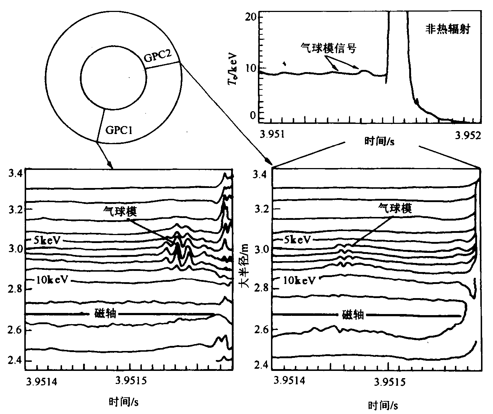

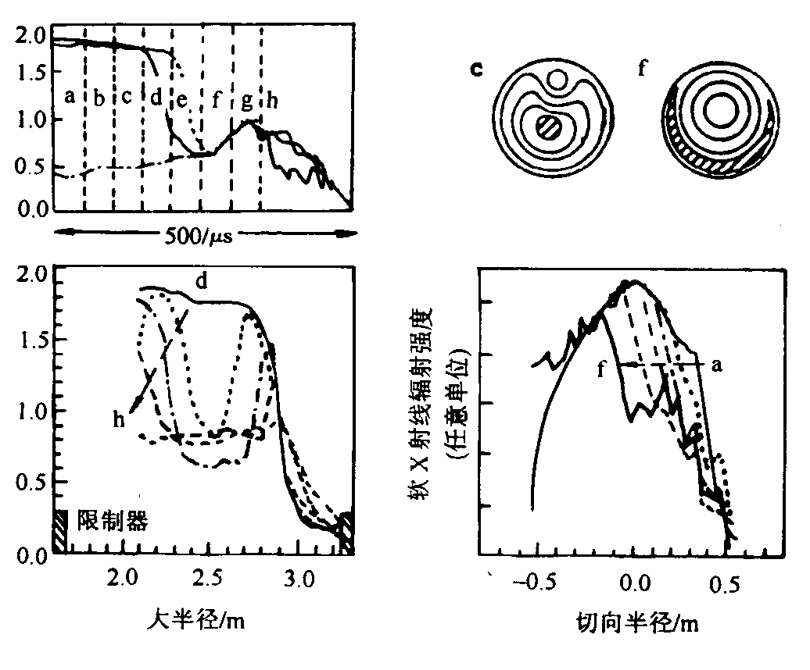

破裂过程中等离子体的热能猝灭（energy quench）及磁能的猝灭产生了瞬时的巨大功率输出，同时电流的极向磁场的猝灭产生了巨大的感应电场。前者将使真空室壁或偏滤器靶板受到突发的热负载的冲击；后一过程更危险，会使周围导体感生非常大的涡流，等离子体中也会产生很大的高能电子流，这些都会使装置真空室及周围设施受到破坏。对反应堆来说，等离子体储能达几千兆焦，环电流达几十兆安，破裂产生的破坏作用是极其危险的，实际情况下要求将恶性破裂几率降到万分之一或二以内。

### 9.3.4 内扭曲模和锯齿活性

对于具有单调下降的电流密度剖面，或者说单调上升的安全因子剖面，在磁轴处的安全因子值一般都小于 1，因此，托卡马克等离子体中存在一个$q \leqslant 1$的区域。这种位形我们称之为常规托卡马克位形。在第五章中详细讨论过内扭曲模的激发条件，通常情况下，总有某一类内扭曲模处在不稳定条件下：如果等离子体压强较低（对中小装置），电阻性内扭曲模是不稳定的；反之，若比压超过 Bussac 极限（大装置和聚变堆），理想内扭曲模是不稳定的。于是，在$q \leqslant 1$区域内总存在磁流体锯齿活性，在$q = 1$面附近不断发生局部的磁再连，使一部分等离子体能量很快被传送到$q = 1$面以外的区域，造成电子温度随时间呈锯齿形振荡。各类托卡马克装置都很重视对锯齿振荡特性的实验研究，但这类非线性磁流体现象呈现出非常复杂的特征，目前仍很难用统一的模型来描述。在 5.8 节中已对一些普遍的现象做了介绍。这里进一步介绍一些多年来由实验总结出来的关于锯齿活性的主要特征，其中很多与理论模型有相当大的差别。此外，近年实验中发现了一些具有重要意义的现象，我们将作较简单的介绍。

锯齿活性是一类非线性磁流体现象，在一个锯齿过程中，有不同的物理过程同时起作用，包括内扭曲模的发展，加热和输运过程，电阻性和非电阻性磁再连，等等。原苏联科学家卡多姆采夫（Kadomtsev）最早提出的理论模型，是将一个锯齿过程分成为几个阶段。在第一阶段，主要是加热，同时电流密度发生电阻性扩散，这一过程中中心磁轴处的安全因子$q_0$值逐渐减小；由于内扭曲模迅速发展，$q = 1$面内部产生磁岛结构，在$q = 1$面附近的磁再连加快，同时电子温度剖面受到很大的影响，锯齿发生崩塌，中心磁轴处到$q = 1$面以内的电子温度剖面被拉平（如图 9.7 所示），同时电流密度剖面和安全因子剖面也被拉平，整个$q = 1$面内的安全因子都取$q = 1$。锯齿过程对粒子密度和离子温度剖面也有一定的影响，但没有对电子温度剖面的影响那么大。对杂质离子，由于其质量大，轨道对磁场位形的变化更敏感，锯齿活性具有使杂质剖面拉平的效应。

在实验中实际观察到的锯齿活性远较理论模型预期的复杂。随时间变化的锯齿信号虽然大多呈简单的锯齿状，但也常常呈更复杂的结构。有双锯齿形，有倒锯齿形，有纯振荡形，有复锯齿形。对应的磁再连图像表面，大多数情况下，磁再连过程不是卡多姆采夫模型预言的完全再连，而是依赖于不同条件的部分再连。在很多实验中观察到的中心安全因子并不恢复到 1，而是在整个锯齿活性过程中一直小于 1，TFTR 中观察到$q_0$在 0.6~0.9 范围内变化，这可能意味着内扭曲模的发展与一定的临界磁剪切有关。

关于锯齿周期有很多理论模型，在实验上发现这一周期随装置的加大而迅速加大，也与电子温度有关，下面的定标能综合很多装置的实验结果$^{[16]}$

$$
\tau_s = 10^{-2} R^2 T_e^{3/2}/Z_{\text{eff}} \qquad (9.12)
$$

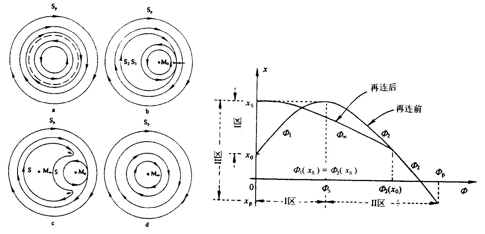

**图9.7** 卡多姆采夫模型下磁再连和螺旋磁通函数的变化〔10〕

式中$R$以 m 计，电子温度以 keV 计，时间以 s 计。锯齿活性不断将部分中心约束区的等离子体储能很快地排出$q = 1$面以外，相当于中心约束区有一个很大的热传导率，因此使总体约束变坏。可以近似地估计这种影响，设$q = 1$面以内逸出$q = 1$面处的那部分储能为$\Delta W_{\mathrm{p}}$，则锯齿活性对应于一个能量损失通道，其损失速率为

$$
\left( \frac{\mathrm{d}W}{\mathrm{d}t} \right)_{\mathrm{sw}} = -\frac{\Delta W}{\tau_{\mathrm{s}}} \tag{9.13}
$$

另一估计方法是假定$q = 1$面以内的等效热传导率为无限大，于是温度剖面在$q = 1$面以内为常量。这一计算给出锯齿活性对约束的最大可能的影响。

在近年的实验中，还发现了一系列与锯齿活性有直接关系，但更复杂的现象。其中对未来大装置和反应堆有重要意义的是下面几种：

（1）巨锯齿

在高功率加热实验中普遍观察到，电子温度的驰豫振荡幅度远大于欧姆加热条件下的值，同时锯齿周期普遍加大。在一定条件下，会出现周期很长，振幅非常大的锯齿崩塌，有时也称小破裂。通过对磁流体活性区域的 ECE 信号或软 X 信号的多道数据进行时空反演，发现磁再连的空间区域已不限于$q = 1$磁面附近，而是向外扩展了很多，有时达到$q = 2$面附近。这显然是非线性磁流体运动所致，也是多模耦合的结果。巨锯齿一般发生在高功率加热情况下，但在欧姆加热情况下也偶有发生，对应于较好的约束状态和较高的密度值。目前对巨锯齿的机制还没有理论能完满地解释。图 9.8 是 HL-1M 上观察到的一例巨锯齿事件，锯齿周期比正常锯齿周期大 5 倍以上。图 9.9 是 JET 中的巨锯齿。

（2）高能捕获离子对锯齿的稳定化[17]

另一类实验是在一定的条件下，即使中心安全因子小于 1，可以将锯齿稳定化。首先在实验上观察到锯齿稳定化是在 JET 上进行 ICRF 加热时，在$q_0$为 0.6～0.7 的情况下，锯齿稳定化时间可达 20 s，这一时间宽度与 ICRF 加热脉冲宽度有关，在停止加热后，锯齿重新出现，有时引起巨锯齿。典型的电子温度实验示波如图 9.10 所示。

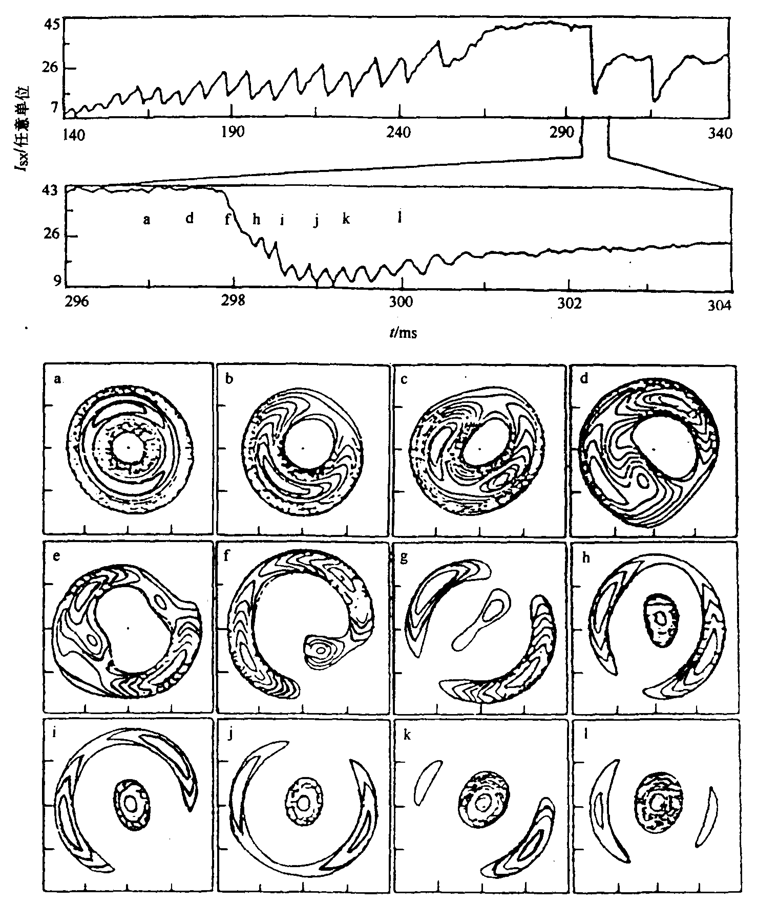

**图9.8** HL-1M 上高密度放电条件下的一次巨锯齿事件及磁面的层析结构分析〔24〕

在后来的实验中，很多装置（JT-60，TEXTOR）重复了 JET 的实验，并发现在中性束加热条件下也可以实现锯齿稳定化。在理论上，锯齿稳定化是一类线性稳定性问题，其机制比较简单。考比（Coppi）等人从内扭曲模理论分析中得出，主要的稳定机制是加热产生的高能捕获离子。理论上将这一稳定机制称为高能捕获离子对内扭曲模的零频率响应。在下面还要提到高能捕获离子的另一效应，就是引发另一类内扭曲模：鱼骨模。

（3）鱼骨模[18]

在存在高能捕获离子时，可能激发一类特殊的内扭曲模，在实验上，它先于锯齿稳定化的发现。1983 年，在 PDX 装置上，用垂直注入中性束加热时，发现极向扰动磁场信号有类似比目鱼鱼骨状的结构（如图 9.11 所示），同时中性束产生的高能离子被大量排出

约束区而损失，使加热效率大幅度降低。这种不稳定性的模结构特性与$m = 1$，$n = 1$的内扭曲模完全吻合，是一类新的内扭曲模。

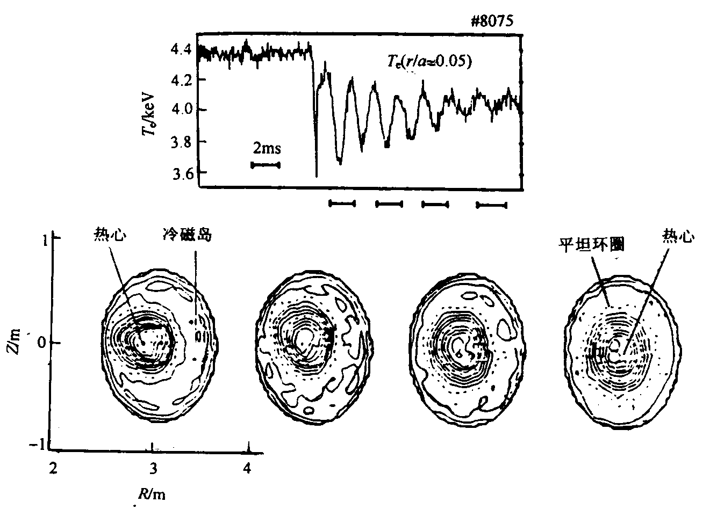

**图9.9** JET 的巨锯齿事件〔17〕

陈骝（CHEN Liu）等人指出[19]，鱼骨模是由高能捕获离子的环向进动与内扭曲模发生共振引起的，只有这些高能离子的比压值大于激发阈值时才发生。文献上称为 Chen-Rosenbluth 分支。后来考比又提出一种非共振激发机制，对应于较低的激发阈值，称 Coppi-Porcelli 分支[20]。陈的模具有的特征频率应在高能离子的进动频率范围，比较高；Coppi 的模对应于本底等离子体的离子抗磁漂移频率范围。由于实验上不可能做到非常适合分辨这两种模式的条件，而实际观察到的模的频率（几到几十千赫）对这两种机制都适用，现在普遍对两种机制都承认。对鱼骨模的理论研究也很活跃，进一步的研究指出，Coppi 模比较容易激发，但不稳定参数区域比较窄；Chen-Rosenbluth 模不容易激发，但存在很宽的不稳定参数区。

由于鱼骨模对 PDX 装置中的中性束注入加热效果起了很坏的影响，引起了托卡马克研究工作者的重视，在很多装置上重复了类似的实验，对比了鱼骨模的激发参数条件。其中 DIII-D，JET，JT-60U 等的实验都观察到了明显的鱼骨模，只是与 PDX 有很大的不同，

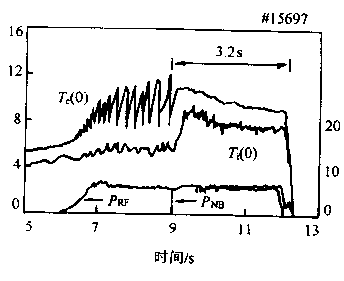

**图9.10** JET 上在 ICRF 加热条件下锯齿的稳定化〔17〕

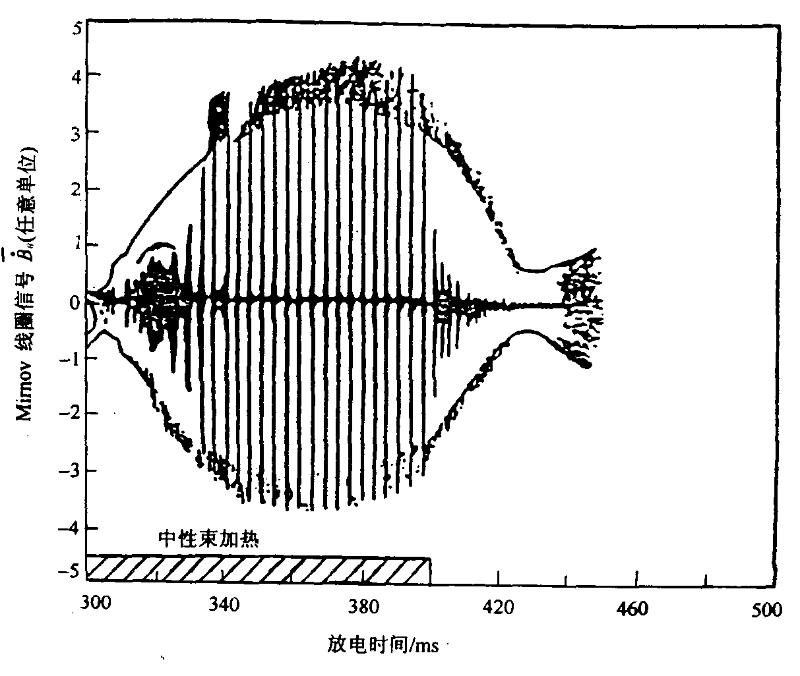

**图9.11** 垂直注入中性束加热条件下 PDX 上观察到 Mimov 信号的鱼骨状结构〔18〕

如在这些装置中的鱼骨模活性对高能离子约束的影响远没有 PDX 中那么大，这说明相应的鱼骨模振动的幅度要小得多。从理论上可以很好地解释这些差别，最主要的原因是 PDX 的环向磁场较低，仅为 1 T 左右，相应的等离子体和高能离子的比压很大，而鱼骨模的激发条件和饱和值都与这些比压直接有关。理论预期在较高磁场的装置中，鱼骨活性的影响不会很严重。对反应堆的 α 粒子可能激发类似的鱼骨模活性的问题也进行了理论研究，目前的结论认为，主要的内扭曲模应该是理想内扭曲模，鱼骨模不应是主要的影响约束的模式。另外，α 粒子也可能对锯齿有较明显的稳定效应。

还有一类重要的磁流体活性，主要发生在边缘附近，称边缘局域模（ELM，即 Edge Localized Mode）。这是与改善约束模式有关的磁流体模，将在改善约束的介绍中讨论。

包括本书作者在内的国内学者都对鱼骨模理论做过较深入的研究，获得了一些重要的结果，对这些较专业的理论成果有兴趣的读者可参看有关文献[21～23]。

### 9.3.5 磁流体活性对高性能参数的限制[12]

近年来在 JET，JT-60U 等大型装置上产生了一系列具有高品质因子的聚变等离子体，但同时发现磁流体活性不仅对参数的进一步提高有很大限制，而且往往会因一些类型的磁流体不稳定性的发展使高性能约束态终止，退化为 L-模约束态。JET 上发现主要是三类磁流体模式起作用：（1）低环向模数外扭曲模，尤其是$n = 1$的模；（2）中心区的锯齿活性；（3）边缘区的巨 ELM。在 JET 的热离子 H-模实验中，发现这些模式在比压值小于特罗荣极限（Troylon limit）时（对应于$\beta_N$接近 2）即发展起来，而且，本来锯齿活性主要在$q = 1$面内起作用，这时与外缘区的低$n$模相耦合；同样，巨 ELM 也扩大影响区域，使中心电

子温度和软 X 射线功率降低；这些活性的加剧使孔栏及偏滤器靶板上的热负载突然加大，引起杂质流和气体再循环的加大，甚至引发碳迸发。结合模拟分析，还发现等离子体的输运加大，最终导致高性能态的终止。这些实验表明，改善约束态的实现和长期维持，不仅是抑制微观模式以减小反常输运的问题，而且与更好地控制磁流体稳定性密切相关。

### 9.3.6 位形优化实验研究[13,14]

位形优化指的是，对基本相近的外部参数（环向磁场$B_{\mathrm{T}}$，总电流$I_{\mathrm{p}}$及装置尺寸），通过调整截面形状和电流密度剖面及粒子密度和电子离子的温度剖面形状，获得最佳的约束性能因子。这一部分的内容与下面有关改善约束的讨论关系密切，同时与磁流体稳定特性也紧密相连，所以本小节也进行一些讨论。

对具有中等拉长比（$\kappa \approx 1.5 \sim 1.8$）的截面，主要研究三角变形对约束的影响。获得了肯定的结论。代表性的研究是 JT-60U 上进行的，目的是在高参数条件下，改变三角变形因子来获得更高的比压值和更好的约束性能因子。以前实验中发现，规范化比压值随内电感$l_{\mathrm{i}}$的加大（意味着电流更峰化）而增大，进一步研究发现，比值$\beta_N/l_{\mathrm{i}}$随三角变形因子的加大而单调地增大（如图 9.12 所示）。前面已介绍过高比压下的主要磁流体模式是低$n$外扭曲模及气球模，因此较大的三角变形有利于稳定这些模式，提高了稳定性阈值。同时，关于 L-模的改善因子 H 也有提高。

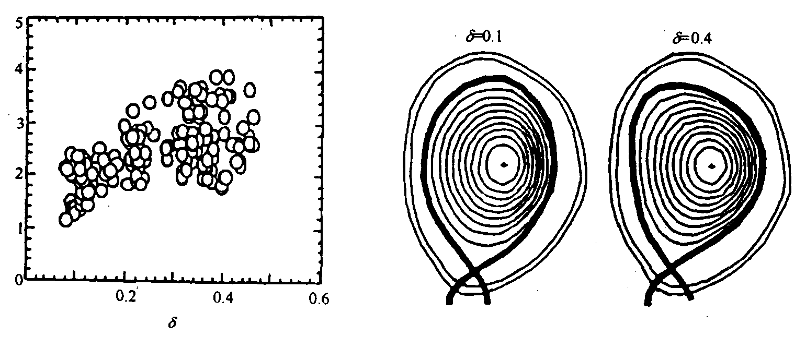

**图9.12** JT-60U 上（$\beta_N/l_{\mathrm{i}}$）值随三角变形度的变化〔13〕

同时显示了$\delta = 0.1, 0.4$的两个位形。

在高参数实验条件下，自举电流已占较大份额，因此，上述现象与自举电流在优化位形中能维持较长的时间有关。最后，由于低$n$电阻性模的作用，上述优化位形将发生退化。

## 9.4 托卡马克的加热、粒子补充及非感应电流驱动实验研究

在第八章中已对等离子体加热和非感应电流驱动的一般实验验证情况进行了介绍，本节进一步介绍有关的实验结果。托卡马克型氘氚反应堆要求在平均粒子密度达$10^{14}\ \mathrm{cm}^{-3}$时将电子和离子的平均温度加热到 10 keV 以上。目前为止，在几个大型装置如 DIII-D，JT-60U，TFTR 和 JET 上，离子温度都已超过 10 keV，甚至在一些中型装置上，也接近 10 keV，说明一些主要加热方法是有效的。不过，等离子体密度一般没有同时达

到要求；在高密度实验装置如 ALCATOR-C，FTU 上，虽达到了高密度，但离子温度仅在 5 keV 左右。

等离子体的加热效率是和约束性能不可分割的。早期研究中曾简单地用$\Delta T/\Delta P$来表示加热效率，但这是不合适的。事实上，加热效果（电子和离子温度的增大值）与磁流体稳定性，反常输运特性，杂质含量（边缘条件）都有关系。在约束研究中，应用了总体能量约束时间与各种工程物理参量间的定标律来对各种装置中的实验结果进行规范，实际上这一做法也适宜于加热实验。为说明此点，我们再次写出 ITER 约束定标：

$$
\tau_E = 0.048 I_p^{0.85} R^{1.2} a^{0.3} \langle n_e \rangle^{0.1} \kappa^{0.5} A_i^{0.5} P_i^{-0.5} \tag{9.14}
$$

按定态条件下能量约束时间的定义$\tau_E = W_p/P_t$，代入

$$
W_p = 1.5 \varsigma V_p \langle n_e \rangle \langle T_e + T_i \rangle \tag{9.15}
$$

式中$V_p$是等离子体的体积，$\varsigma$是与密度和温度剖面分布情况有关的因子，可得关于平均温度的类似定标

$$
\langle T_e + T_i \rangle \propto \sqrt{A_i P_t I_p^{0.85} / \varsigma \langle n_e \rangle^{0.9}} \tag{9.16}
$$

比例因子与装置几何参数有关。这一定标中比较重要的是以下几点：第一，温度随加热功率的增大是较慢的，与功率的开方值有关；第二，环电流大对加热有利（近似成正比）；第三，与密度近似成反比。

多年来多数装置实验表明，最有效的加热方法是中性束注入和离子回旋频段（ICRF）波加热，这也是大多数装置采用的和反应堆将采用的加热方案；电子回旋共振加热（ECRH）是可采用的辅助加热方案，而低杂波（LH）段射频波功率一般用于非感应电流驱动。

如果加热功率的沉积剖面是峰化的，称近轴加热（on-axis heating），如这种功率沉积剖面偏于磁轴外，称偏轴加热（off-axis heating）。根据不同的等离子体密度大小，装置的小半径，注入角度及调节中性束粒子能量，可以选择功率沉积剖面；对波加热，则通过调节波的频率，天线阵列的相位（波的平行折射率）可实现不同的沉积剖面。其中 ICRF 和 ECRH 主要通过调节频率以改变共振面的位置来形成不同的沉积剖面，因而比较方便和简单。

除欧姆加热首先加热电子，离子是依靠与电子的碰撞得到加热外，ECRH 也首先加热电子；中性束在注入粒子能量为 100 keV 以下，而等离子体密度较大的条件下，一般主要加热离子；少数成分模式 ICRF 加热中，波功率主要被少数离子吸收，形成能量远大于本底离子的高能成分，这些离子可能将大部分能量传给电子；此外，存在其他直接加热电子的机制，如通过模转换（IBM，EBM）等。下面列举几种重要的加热范例。

### 9.4.1 中性束注入加热

高能中性粒子进入靶等离子体后，通过电荷交换或电离过程变成高能离子而被磁场捕获，然后与电子和离子碰撞而将能量传给电子和离子。电子和离子得到的功率沉积份额与电子温度有很大关系，如注入粒子能量$E_b \gg 2E_{cr}$，则主要加热电子，这里的临界能量（见式 8.25）

$$
E_{cr} = 14.8 T_e A_b (Z_{\mathrm{eff}}/A_i)^{2/3} \tag{9.17}
$$

以 JET 实验为例，如采用氘中性束，$E_b = 140\ \mathrm{keV}$，$A_b = A_i = 2$，$Z_{\mathrm{eff}} = 2$，当本底电子温度为 5 keV 时，$E_{cr} = 150\ \mathrm{keV}$，即满足$E_b/E_{cr} < 2$条件，中性束将主要加热离子（见图 8.7）。

如果电子温度较低，则可能先加热电子，然后随着电子温度的增加而转化成主要加热离子。这是 JET 和其他大装置中实现热离子模式（$T_i/T_e > 1$）的物理原因。在这种情况下，离子成分的储能将大于电子成分，同时等离子体的主要能量损失通道是离子的反常热传导。热离子模式下的聚变反应产额也大于电子和离子温度接近的情形，所以在进行高聚变产额实验时，常常采用热离子模式。图 9.13 是 JET 热离子模式实验中有关物理量随时间变化的情况，可以看到，在中性束加热阶段，虽然电子温度也有较大上升，但离子温度上升更快，接近 30 keV。

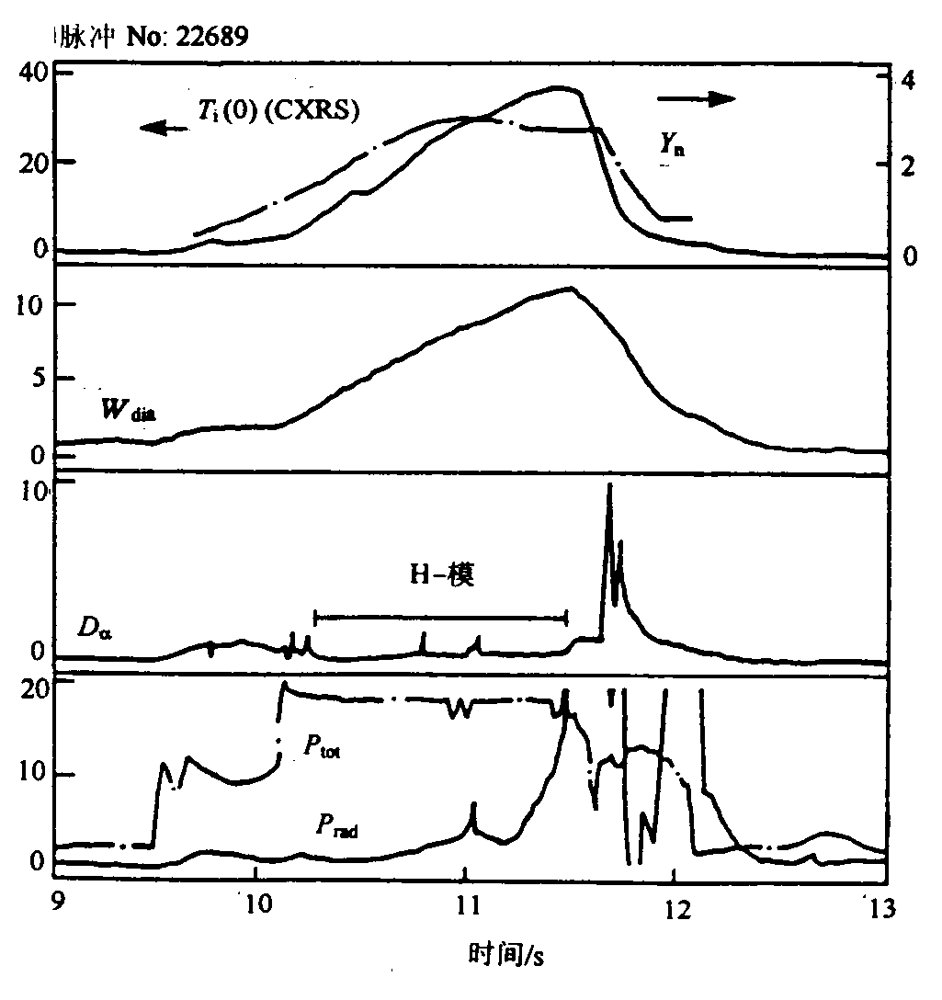

**图9.13** JET 上中性束加热热离子模式的离子温度的演变〔25〕

在满足热离子模式加热条件下，可以近似地单独考虑离子成分的功率平衡方程

$$
\frac{3}{2} n_i \frac{\partial T_i}{\partial t} = \frac{1}{r} \frac{\partial}{\partial r} \left( r n_i \chi_i \frac{\partial T_i}{\partial r} \right) + P_{NB} f_i \tag{9.18}
$$

其中离子成分的功率沉积份额$f_i$虽依赖于电子温度，但关系很弱，可以近似地取$f_i = 0.7$。于是对稳态，经两次积分可求得中心离子温度为

$$
T_{i0} = \int_0^a \frac{\mathrm{d}r}{r n_i \chi_i} \int_0^r \mathrm{d}r'\, r' P_{NB} f_i \tag{9.19}
$$

显然，在同样的功率下，中心离子温度与离子的热传导率$\chi_i$及密度$n_i$成反比。

中性束注入过程除引入能量外，同时还引入一定的粒子，而且与边缘喷气补充粒子的效果不同，是向中心约束区补充粒子，可以形成更峰化的粒子密度剖面分布。结果，中性束注入使可达到的粒子密度极限提高，这已在第七章中讨论[见式（7.78）]。

单向注入的中性束还引入动量，使等离子体的转动速度发生变化。如果采用双向注入，可使总的动量抵消。这种方式称平衡注入（balanced injection）。在后面介绍改善约束实验时将看到，等离子体转动与建立输运位垒有内在联系，一般使输运减小，约束改善。

通过中性束加热还可实现高极向比压模式，同时获得较大比例的自举电流。在 JT-60U 中，进行了 400 keV，2.5 MW 级的负离子源中性束注入实验，并计划进行 500 keV，10 MW 级的实验，这是与 ITER 设计密切相关的先行实验；在 JET 和 TFTR 中，进行了注入氚中性束的实验。

利用中性束注入产生的高能离子与本底等离子体的相互作用，还可以模拟研究聚变 α 粒子激发环形阿尔芬本征模的问题，这是与 α 粒子约束特性关系密切的问题，近年来为国际聚变界所重视。在几个大装置上都开展了有关实验，详细情况见第十二章。

值得指出，中性束加热研究的进展，是在束技术的不断发展的基础上的取得的。随着装置的扩大，要求束粒子能量不断加大，总加热功率达几十兆瓦，为了不占太大的窗口，需不断提高束输出的功率密度；根据 ITER 的要求，负离子源中性束技术也得到重要进展[26]；另一方面，强功率加热条件下的装置真空室研制也取得重大进展，杂质控制和器壁粒子再循环都在可控范围内。由于在反应堆中平均加热功率密度还小于现代的实验装置，因此上述进展具有重要意义。

### 9.4.2 离子回旋频段波加热实验

ICRF 加热的重要性仅次于中性束加热，主要的大装置 JET，TFTR，JT-60U 中 ICRF 加热的总功率都超过 10 MW，其中 JET 中最大耦合功率达 22 MW。改变天线阵列的相移，同一 ICRF 系统可用于快波模式加热或非感应电流驱动。在加热方面，早在 70 年代末，在 PLT 上用 ICRF 加热就使离子温度提高到近 10 keV，以后，ICRF 相关技术有了重要的进展，包括天线设计的改进和耦合功率的提高，ICRF 加热条件下等离子体与壁相互作用的控制，以及物理研究的进展，在 TFTR，JET 上，单独或与中性束注入联合，离子温度的提高超过 10 keV。90 年代初，在 JET 上，达到最大耦合功率为 22 MW；在 ALCATOR-C 上，在密度达$3 \times 10^{14}\ \mathrm{cm}^{-3}$的高密度下，成功地进行了多种模式的电子和离子加热，温度较欧姆加热有较多的提高。因此，ICRF 作为基本加热手段，已被证明完全适用于反应堆条件。

ICRF 加热具有功率沉积剖面可调（主要调节波频或环向磁场强度），加热模式多样（基频，二次谐波或三次以上高次谐波；少数成分或氘氚各半），对电流剖面控制（包括使大比例自举电流与平衡位形相洽）和压强剖面控制都很有用的特点。在一些实验中，还通过优先加热电子使低杂波驱动效率得到很大的提高。

等离子体总体参数的提高：ICRF 加热的最高水平的实验结果是在 JET 装置上获得的。在 JET 上，沿环向均匀地安装了八个 ICRF 天线，每一天线由一对与磁力线垂直的电流片（铜）组成，两电流片的电流的位相差可调成 0°（单极天线），180°（偶极天线），主要用于加热；也可通过匹配控制系统（matching control system）连续调节相差，用于加热和电流驱动。天线外部的法拉弟屏蔽罩早期采用高 Z 金属钽，现已改用低 Z 材料铍，目的是为了减小溅射产生的杂质的有效电荷值，因为天线屏蔽罩在一定程度上起孔栏的作用，与等离子体有很强的相互作用。这些改进对提高总耦合功率及改善等离子体品质有明显效果。

90 年代初，获得了一系列代表最高水平的结果。最大耦合功率达 22.3 MW（发生器总功率 32 MW），在热离子模式下，达到三因子乘积$n_D(0)T_{D0}\tau_E=7.8\times10^{20}\ \text{keV}\cdot\text{s}\cdot\text{m}^{-3}$，这一数值约为中性束加热条件下得到的最高三因子乘积的 2/3。

加热物理研究：对于少数成分加热模式，电子通过与少数成分高能离子的碰撞而达到加热，发现中心电子温度随单位电子上的功率沉积$P_{RF}/n_e$值加大而线性增大（如图 9.14 所示），在$P_{RF}/n_e=3\times10^{-19}\ \text{MW}\cdot\text{m}^{-3}$后达到饱和，电子温度的饱和值为 10 keV 大小，而高能离子能量经常超过 1 MeV。

在 D-³He 实验中，以 ³He 为少数成分，还获得 140 kW 的聚变功率输出，这是氘氚实验以前获得的最高聚变反应功率。

关于 ICRF 功率在电子成分和离子成分上沉积的计算，已发展了很先进的编码，其中考虑了高能离子的产生，慢化及轨道效应，考虑了电子通过 TTMP 过程对波能的直接吸收。实际测得的电子直接吸收波功率在数值上与理论计算一致，但剖面分布有很大差别（如图 9.15 所示），表明有一些人们并未了解的重要物理过程在起作用。

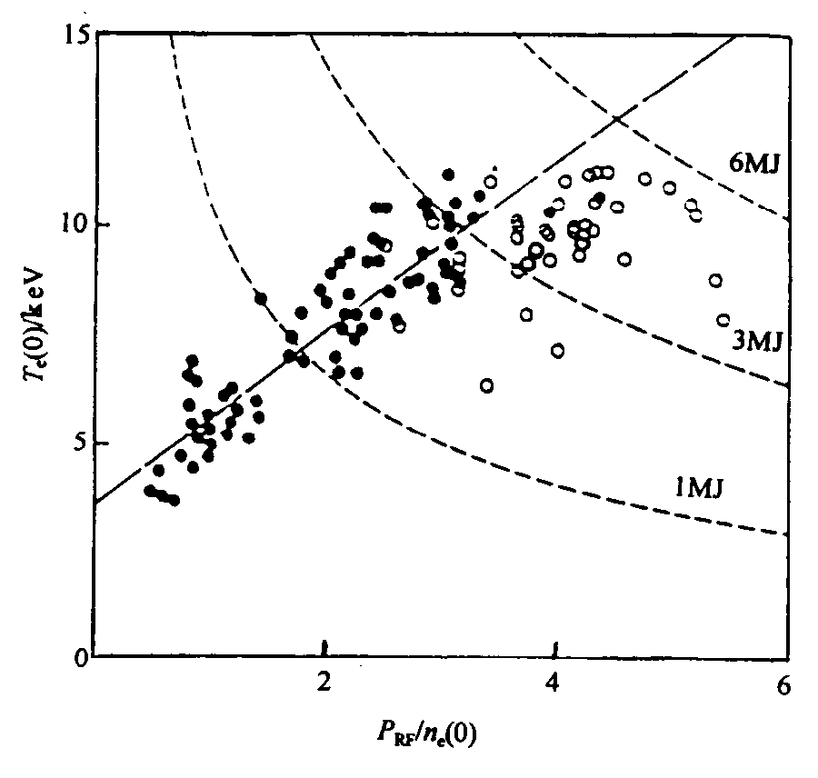

**图9.14** JET 少数成分 ICRF 加热下中心电子温度随$(P_{RF}/n_e)$的变化〔27〕

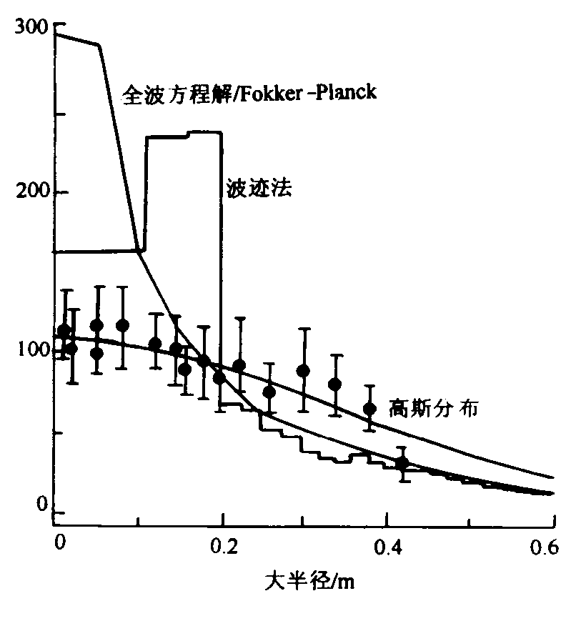

**图9.15** JET 少数成分 ICRF 加热时电子上的功率沉积剖面的测量结果与理论模拟结果的比较〔27〕

协同加热方式：与中性束注入同时应用是最常见的协同加热方式，可以根据不同的实验目的采用不同的功率比，利用 ICRF 加热功率沉积剖面的易调性，达到最佳的实验结果。

锯齿稳定化：在 JET 上，利用高能捕获离子对内扭曲模的稳定作用，实现了稳定时间达 20 s 的无锯齿放电，总电流为 3 MA；在总电流为 6 MA 下，也能观察到无锯齿稳定放电，只是维持时间较短。实现无锯齿放电的天线条件是取相差为$+90^{\circ}$，无锯齿状态出现在总 RF 功率超过一定阈值时，无锯齿阶段结束后往往出现巨锯齿。这些复杂的非线性物理过程既与加热物理有关，也与内扭曲模的磁流体非线性演变有关，目前对其内在物理的了解还很初步。

自举电流实验：单纯通过 ICRF 加热，实现了自举电流比例达 0.7 的稳定放电（见第八章）。

ICRF 加热 H-模：在主要的托卡马克装置的 ICRF 实验中都实现了从 L-模到 H-模约束的转换，这种转换和 H-模的维持与中性束加热条件下在本质上是类似的，说明 H-模与加热方式没有直接联系。

氘氚等离子体的 ICRF 加热：在 TFTR 和 JET 中对氘氚等离子体进行了 ICRF 加热研究，包括氚的二次谐波，相当于氘的三次谐波。TFTR 中用$2\Omega_T$频率的 ICRF 波进行等离子体启动（Start-up）研究，发现在 100 ms 内可以形成 0.5 MV 的高能氚离子，其效应与注入同样能量的中性束相当[28]。最近在 JET 上对氘氚等离子体进行了低杂波驱动、ICRF 加热和中性束注入加热的联合实验，以获得最佳约束位形，在注入中性氘束功率为 23 MW 的基础上，用$2\Omega_T$频率引入 ICRF 功率 5.8 MW，同时引入 2% 的 ³He 以增大波的一次传播吸收，结果使$T_{i0}$从 22 keV 增大到 36 keV[29]。

### 9.4.3　低杂波电流驱动实验研究

很多装置中开展了低杂波电流驱动研究，低杂波的频率约在$2\omega_{LH}$范围或更高，采用定向功率谱，由波的可近性条件，平行折射率一般取在$1.5<N_{\parallel}<2.8$范围，大部分实验谱的宽度不大，$\Delta N_{\parallel}\approx0.5$。用于产生波功率的速调管技术发展很快，目前已能提供 2.45 GHz，3.7 GHz 等频段的 MW 级长脉冲商品管，一些高密度装置中还采用 4.6 GHz 和 8 GHz 管子，ITER 将采用 5.7 GHz 长脉冲速调管。波的传输都采用多阵列波导（Grid 或 multi-junction）。

日本的 JT-60 和后来改进的 JT-60U 装置的低杂波实验，代表了最高的研究水平[30]。该装置具有两套低杂波设备，频率分别为 2.0 GHz 和 2.45 GHz，波导系统几经改进，现采用 4×48 阵列，其出口与等离子体边界的距离有一定的可调性，已达到最佳耦合。先由欧姆放电产生平均密度为$1.2\times10^{13}\ \text{cm}^{-3}$，平均电子温度超过 1 keV，总电流为 3.5 MA 的靶等离子体，环压约为 1 V，对应于欧姆加热总功率为 3.5 MW。随后关闭欧姆电源，在欧姆电流开始下降时注入低杂波以维持总电流不变，随着低杂波功率的加大，环压开始下降直到降为零或负值，表明电流已完全由波驱动的快电子维持。上述参数下所需低杂波功率约为 4.5 MW，相当于规范化驱动效率为$2.8\times10^{19}\ \text{m}^{-2}\cdot\text{A/W}$。最佳情况下，这一效率可提高到 3.4。

结合 JET，ASDEX 及 JT-60 的数据，得到关于效率的定标为

$$
\eta_{LH}=\frac{\bar n_e R I_{LH}}{P_{LH}}=\frac{12\langle T_e\rangle}{5+Z_{eff}}\times10^{19}\ \text{m}^{-2}\cdot\text{A/W}
\qquad (9.20)
$$

式中$T_e$以 keV 计。

从反应堆应用的角度看，低杂波电流驱动的最大缺点是其效率在密度增大时急剧下降。多数装置中当平均密度高于$2\times10^{13}\ \text{cm}^{-3}$时，低杂波就难以进入中心约束区，同时波功率被等离子体吸收的比例大幅度下降。JET 中对归一化磁通量为 0.7 以内的区域中等离子体对波功率的吸收比进行测量，结果发现，在$\bar n_e<1\times10^{13}\ \text{cm}^{-3}$或更低密度下，波被 100% 吸收，而当密度增大到$\bar n_e>3.5\times10^{13}\ \text{cm}^{-3}$时，只有 25% 的波功率被吸收，其余波功率因边缘密度涨落引起的散射而损失[31]。一些实验表明，增大发射波谱的$N_{\parallel}$值可以提高吸收

比例，但会使波在边缘消散区中的第一次反射比加大。提高的波频率可以使极限密度加大。

从目前实验结果外推，即使采用更高的频率，要用低杂波来驱动反应堆中心约束区的电流也是做不到的，但可以利用低杂波驱动较外层区域中的电流，中心约束区主要依靠自举电流，辅以快波驱动或中性束驱动来形成种子电流的方案。这是近年来对快波驱动研究非常重视的原因。但到目前为止的相关实验仍是原理性的，处在较低水平，而且在很低的密度下进行，还没有高密度下快波驱动电流的直接实验验证。电子回旋波驱动（ECCD）的实验研究也处于初期阶段。我们不准备详细介绍有关的实验，部分情况已在第八章中引述。

低杂波驱动电流维持的等离子体的物理性质：与欧姆电流维持的平衡位形对比，低杂波电流维持的平衡位形具有一些新颖的物理特性，主要是：

(1) 磁流体稳定性：随着低杂波功率的加大，锯齿周期加长，然后消失，主要原因是低杂波电流剖面一般不是峰化的，随着低杂波驱动电流比例的加大，电流剖面变平，$q=1$面的区域逐渐收缩直至消失，变成$q_0>1$位形。所以这种无锯齿放电不同于被 ICRF 稳定的无锯齿放电，后者仍存在$q<1$的区域。

(2) 利用低杂波驱动产生反剪切位形，改善整体能量约束，这已在 JET 等一些装置上经常运用。

(3) 低杂波驱动电流维持长脉冲放电：在 TORE-SUPRA 上已实现 2 min 较高参数的放电。

(4) 电子加热：在低杂波电流驱动实验中普遍观察到电子被强烈加热，同时，电子温度的提高自动地提高了电流驱动的效率。在实验基础上统计等离子体的约束定标时，并不区分低杂波主要用于加热还是电流驱动，因为波能的吸收一定引起加热。尚未完全了解清楚的是波的主要吸收机制是什么。

### 9.4.4　弹丸注入送料实验[32~35]

磁约束聚变装置的燃料补充一直是一个很重要的研究课题，边缘主动送气（以可控制的方式脉冲喷气，或按特定要求反馈送气）和被动送气（器壁上工作气体的再循环）都将导致比较平坦的粒子密度剖面分布。对器壁进行碳化、硼化等处理可以在一段时间内控制再循环，获得较陡的密度剖面分布，这是装置在实验中最常用的方法。从反应堆运行角度，最佳的送料方式是通过注入具有高速的冷冻小丸（pellet），可以做到按物理要求向深部送料。包括托卡马克和仿星器在内的现代磁约束聚变实验装置都具有多发弹丸送料系统。

弹丸射入等离子体后，其表面会立刻受到电子轰击，被加热的表面粒子将变成中性化气体，随后进一步被电离。有很多关于弹丸消融的理论模型，其中固体弹丸周围的中性气体对弹丸本身形成一定屏蔽效应的模型被认为较为符合实验结果，称为中性气体屏蔽模型（NGS），ASDEX 装置弹丸加料实验与此模型的预期较接近，但 JET 上的数据要求对这种模型进一步改进，还要考虑弹丸所在位置的磁通管两边被电离的冷等离子体的屏蔽作用，这些屏蔽使弹丸能够飞行更长的距离，即有更长的穿透深度[35]。这种模型称为中性气体和等离子体屏蔽模型（NGPS）。

根据 NGS 模型，弹丸的穿透深度由下述定标式确定

$$
\frac{\lambda}{a_0}\propto\left(\frac{n_m r_{p0}^2}{a_0 T_{e0}^2}\right)^{\beta}
\qquad (9.21)
$$

式中$n_m$为固体氢（氘）分子粒子密度，$r_{p0}$为弹丸球的半径，$a_0$为规范化半径（例如取为等离子体的小半径），$\beta=1/(1+2\alpha_T)$，$\alpha_T$为等离子体电子温度剖面分布的指数。这个模型的特点是穿透深度不直接依赖于弹丸的速度，这是等离子体屏蔽效应起主导作用条件下的结果，不适用于低速弹丸情形。对较低速弹丸，ASDEX 的实验结果是中性气体屏蔽模型（NGS）较符合实验。引入特征参量

$$
Z=\frac{d_p^{5/2}v_p}{n_{e0}^{1/3}T_{e0}^{5/3}}
\qquad (9.22)
$$

其中$d_p$是弹丸直径，以 mm 计，弹丸速度$v_p$以 km/s 计，电子密度以$10^{13}\ \text{cm}^{-3}$计，温度以 keV 计，弹丸穿透深度与$Z$的关系为

$$
\frac{\lambda}{a_0}=f_1Z^{1/3}-f_2
\qquad (9.23)
$$

系数$f_1$，$f_2$对欧姆加热等离子体和中性束注入等离子体有一定差别。对前者，$f_1=0.858$，$f_2=0.085$；对后者，$f_1=0.905$，$f_2=0.176$。

目前已将十多个装置上弹丸加料实验的数据汇总成国际弹丸加料实验数据库[34]。同时用回归分析方法得出关于穿透深度的唯象的定标关系

$$
\frac{\lambda}{a}=CT_e^{-5/9}(\text{keV})\bar n_e^{-1/9}(10^{14}\ \text{cm}^{-3})r_p^{5/9}(\text{mm})v_p^{1/3}(\text{m/s})
\qquad (9.24)
$$

其中$C$为比例常数，通常也由实验给出。

用弹丸注入因其具有深部加料特性而使等离子体的密度剖面变陡，导致总体约束的改善，很多装置上将弹丸注入作为一种改善约束的辅助手段。在欧姆加热情况下，ALCATOR-C 装置上观察到 LOC 阶段延长一倍以上（关于 LOC 的讨论见下一小节）；在高功率加热条件下，可以形成 PEP-H 模，这是一类弹丸注入使约束性能进一步改善的 H-模，但是弹丸注入形成了更峰化的密度分布会很快向较平坦的剖面过渡，这类改善约束不能维持太长的时间。

弹丸注入条件下还可能出现一些新的物理现象，例如密度的蛇形扰动，是一类局部密度梯度过大引发的非线性磁流体现象[34]。

除上述两种送料方式外，还在 HL-1M 装置上实现了一种特殊的送料方式，即定向分子束注入，并发现有很好的效果[36]。这种分子束的定向速度可达 350 m/s，相当于较慢的弹丸速度。与弹丸注入不同，分子束送气可以连续进行，从而获得准稳态的密度剖面分布。在 HL-1M 装置上，与一般的喷气方式对比，用分子束送气可以使密度剖面峰化因子$n_e(0)/\bar n_e$从 1.35 左右提高到 1.7，同时观察到能量约束时间的明显提高（如图 9.16 所示）。

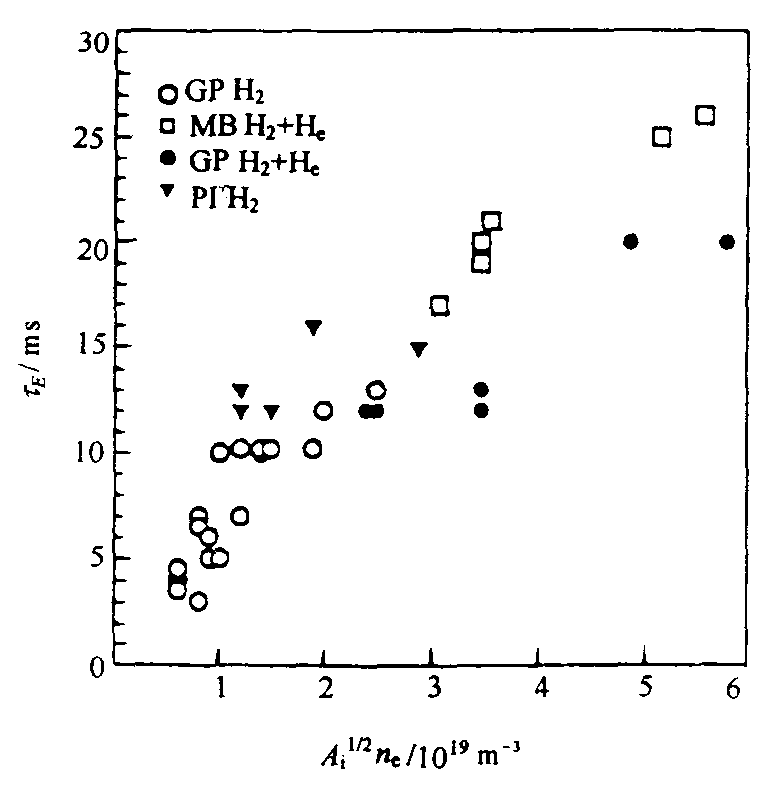

**图9.16** HL-1M 上分子束注入条件下能量约束时间与粒子密度的关系〔36〕

## 9.5　托卡马克能量约束定标：欧姆约束定标和高功率加热的 L-模定标

从上一小节关于等离子体加热实验的介绍中看到，实现磁约束聚变的两个基本判据之一，即将等离子体加热到超过点火温度的要求实际上已在很多装置实验中得到满足，其中几个大装置中可以用几种方法获得高于 20 keV 的离子温度。但另一判据，即同时将$n\tau_E$值提高到大于$2\times10^{14}\ \text{cm}^{-3}\cdot\text{s}$，还相差 5 倍左右。目前在 JET 和 JT-60U 这样的大尺寸装置中的能量约束时间已超过 1 s，但其离子密度只达到$5\times10^{13}\ \text{cm}^{-3}$或更低。除了前面曾多次讨论过的密度极限问题外，还存在杂质进入中心约束区后使工作气体离子的有效密度淡化的问题，在氘氚实验中这种杂质对工作元素的淡化效应使有效聚变功率输出减少了一半。因此，增大能量约束时间（改善约束性能）和减少杂质水准，是当前托卡马克约束研究要解决的两大课题。

在有关约束原理的各章中我们已经多次指出，影响等离子体约束性能的主要物理过程包括磁流体活性，杂质辐射（及电荷交换），电子和离子的反常输运。在最危险的磁流体不稳定性不发生的前提下，实验上对约束的研究可以通过两种方法来描述。第一种方法是研究整体能量约束时间与各种工程物理参量的关系，这种关系称为约束时间的定标律（energy confinement scaling law）；第二种方法是通过实验获得各种条件下磁约束聚变等离子体的扩散和热传导率的唯象表示式，这是在更深层次上的实验定标关系，以这种定标关系外推到聚变堆条件下得出的结论比从能量约束时间定标外推得出的结论更可信。

先讨论第一种方法。根据等离子体的总体能量约束时间的定义

$$
\tau_E=\frac{W_p}{P_t-\mathrm{d}W_p/\mathrm{d}t}
\qquad (9.25)
$$

它包括了一切通道的能量损失（辐射、热传导和对流），是可以从实验中直接或间接测定的物理量（等离子体储能$W_p$可以直接由反磁线圈测定，也可以通过测定的密度和温度剖面算出，总加热功率中的欧姆功率可以直接由总电流及环电压的乘积得出，其它沉淀到等离子体中的加热功率也可用相应的方法确定）。如果能得到有关参量的时空变化数据，原则上可以确定每一时刻的能量约束时间。由大量的实验数据经回归分析可得出$\tau_E$对各种装置参数和某些等离子体参数的依赖关系。

### 9.5.1　欧姆加热条件下的约束定标研究

最早的定标关系是从欧姆加热等离子体实验中得出的，开始，从原苏联的几个装置中得出关于$\tau_E$正比于总电流的定标，称 T-3 定标。后来根据更多的装置实验数据，尤其是 ALCATOR 装置的数据，总结得出欧姆加热条件下$\tau_E$与平均密度成正比的定标，这一定标实际上包括了 T-3 定标。

$$
\tau_E=7\times10^{-2}\bar n_e aR^2q_a
\qquad (9.26)
$$

此定标称 ALCATOR 定标。进一步的实验证实，这一定标只适用于平均密度小于某种临界值的条件下，超过临界值，$\tau_E$不再随密度加大，而是达到饱和或回落，这种超过临界密度值的定标称新 ALCATOR 定标。其中的临界密度值与装置参数有关，可以用 Shimomura 关系式表示出来[10]

$$
n_e=B\sqrt{A_i/2}/q_aR
\qquad (9.27)
$$

超过此临界密度，约束时间不再增大而达到饱和值

$$
\tau_{E,\max}=7\times10^{-2}aRB\sqrt{A_i/2}
\qquad (9.28)
$$

式 (9.27) 表明，ALCATOR 类小尺寸强磁场装置可以达到较高的临界密度，而最大约束时间正比于$aRB$值。

值得指出的是，当时（70 年代末）得出的这一约束定标律使国际聚变界非常乐观地估计了建造氘氚聚变反应堆的前景，在 IAEA 的支持下，80 年代初进行了国际托卡马克反应堆（International Tokamak Reactor，简称 INTOR）的设计，由上述欧姆加热条件下的约束定标外推得出的 INTOR 设计表明，一个电流达到 6 MA 的反应堆即可实现氘氚自持燃烧[37, 38]。而后来的实验证明，在这样的电流下，连要达到能量得失相当条件都困难。这类定标的另一影响是，先后在 80 年代初建成的 TFTR，JET，JT-60 等大型装置对达到能量得失相当条件的预期过于乐观。例如 TFTR 的含义是试验反应堆，设计时认为聚变性能因子$Q$可以超过 1，但实际达到的$Q$值仅略大于 0.3。

在 ASDEX 实验中，对欧姆加热条件下的约束定标进行了更深入的研究，发现满足 Neo-ALCATOR 定标的密度限可以进一步向高密度区扩展。现在已经清楚，这种扩展是在获得更陡的密度剖面分布时实现的。通过对器壁进行预处理使中性气体再循环减小，可以实现较陡的密度剖面；用弹丸方式加料或分子束定向送气，也可以达到较陡的密度剖面。这些方法都在实验中得到应用。扩展后的约束参数区称 IOC，意为改善的欧姆约束区。ASDEX 装置中欧姆加热的能量约束时间与密度的关系如图 9.17 所示。

### 9.5.2　高功率加热下的 L-模约束定标

随着一批装置中采用中性束注入和离子回旋频段波加热，总加热功率超过欧姆功率的实验结果大量涌现，几乎无例外地发现，随着总加热功率的增加，能量约束变坏。这种约束定标首先是 Goldston 发现的，后来 Kaye 与 Goldston 又作了补充，称 Kaye-Goldston 定标[39]（简称 K-G 定标）。这一定标的最重要特征是能量约束时间随总加热功率的增大而按$P_t^{-1/2}$减小。在 ITER 设计阶段，根据很多装置的数据建立的 ITER-89P 定标，是这一定标的新的形式。

将欧姆加热与高功率加热结合在一起，可以认为约束的下降是从总加热功率超过欧姆加热开始的，以 SOC 阶段作为欧姆加热的最高约束时间，得到

$$
\tau_E=\tau_{E,IOC}\sqrt{P_{OH}/P_t}
\qquad (9.29)
$$

能量约束时间与密度的关系如图 9.18 所示。

K-G 定标或 ITER89P 定标意味着等离

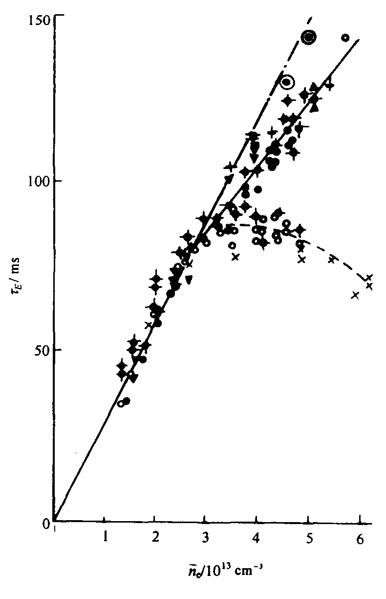

**图9.17** ASDEX 欧姆加热条件下能量约束时间与平均粒子密度的关系〔37〕

表面存在 LOC，SOC 和 IOC 态。

子体总储能随总加热功率的 1/2 幂增大。需要指出，ITER-89P 形式的定标，即能量约束时间与总加热功率具有 (-1/2) 幂依赖关系的定标并不是唯一适用于解释实验结果的定标。实际上，还发现另一类定标关系，称为截距线性定标（off-set linear scaling），它将能量约束时间与总加热功率的关系表示成

$$
\tau_E=0.064I_p^{0.8}R^{1.2}a^{0.6}\langle n_e\rangle^{0.6}B^{0.35}A_i^{0.2}\kappa^{0.5}P_t^{-1}+0.04I_p^{0.5}R^{0.3}a^{0.8}\langle n_e\rangle^{0.1}A_i^{0.5}\kappa^{0.6}
\qquad (9.30)
$$

对应于等离子体的总储能与总加热功率的关系为

$$
W=W_0+W_1P_t
\qquad (9.31)
$$

当不存在非欧姆加热时，$P_t=P_\Omega$，因此，$W_\Omega=W_0+W_1P_\Omega$对应于纯欧姆加热情形（如图 9.19 所示）。关于 ITER 设计的上述两种基本定标律是综合大量实验数据得出的，与实验结果的符合精确度都达到 25% 以内。

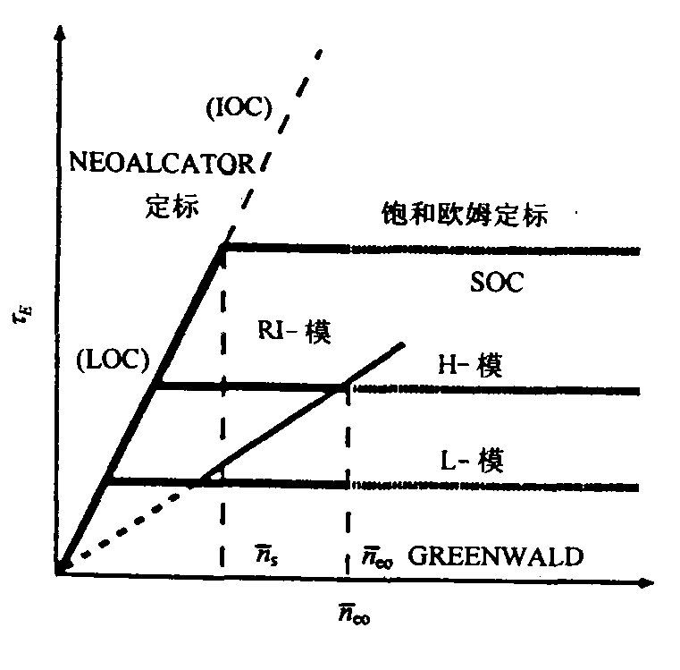

**图9.18** 高功率加热下能量约束时间与平均密度的关系

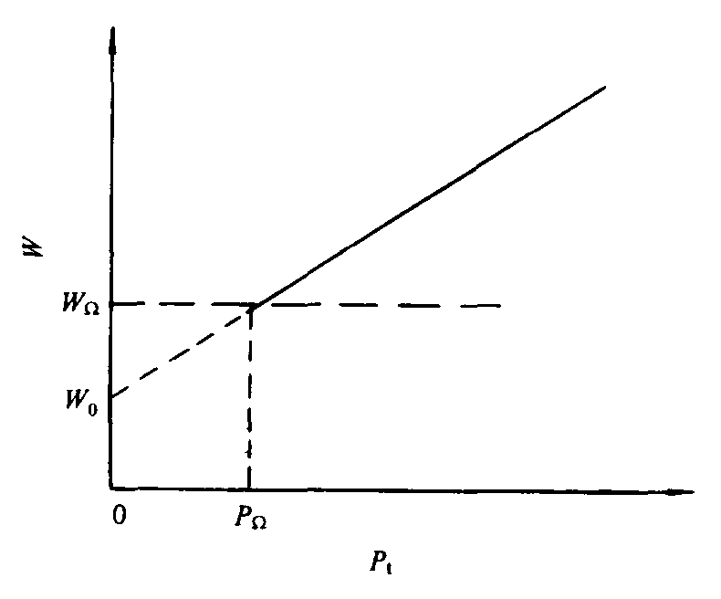

**图9.19** 高功率加热下等离子体总储能与总加热功率的关系

对 L-模约束的物理本质的理解还不是很清楚，从现象学的角度，L-模是在总加热功率远大于欧姆加热功率条件下的约束定标（虽然形式上适用于非欧姆加热功率不一定很大的情形），因此，可以认为 L-模是与欧姆加热解耦的，或者说，与电流剖面分布的细节没有强的依赖关系；其次，强功率加热条件下，高能粒子本身的储能在总等离子体储能中占有很大比例，而高能粒子的约束可以与本体等离子体约束存在很大区别。在这种意义上，截距线性定标与物理实质的联系要比 K-G 定标深刻。

### 9.5.3　L-模定标下的反常输运研究[40, 41]

现在讨论研究约束定标的第二种方法，即从实验测定的密度、温度剖面来确定电子和离子的反常扩散和反常热导率。原则上还应确定动量的反常输运系数，即反常粘滞率，但大多数实验没有特别对反常粘滞率进行测量，在一般的能量平衡方程中，当出现反常粘滞率有关的物理项时，目前认为反常粘滞率与反常热导率基本相等。

如果能从实验上确定加热功率的沉积剖面，从辐射热测仪（bolometer）确定辐射和电荷交换损失的剖面，原则上就可以通过唯象输运方程确定电子和离子的热导率。但事实上还存在一定的复杂性。首先，从非平衡态热力学关系知，扩散和热传导是"力和流"矩阵关系中的对角元素，还存在非对角元素的贡献，即

$$
\begin{pmatrix}\Gamma_\perp\\ q_\perp\end{pmatrix}
=-\begin{pmatrix}D & M_{12}\\ M_{21} & n\chi\end{pmatrix}
\begin{pmatrix}e_\psi\nabla n\\ e_\psi\nabla T\end{pmatrix}
\qquad (9.32)
$$

$e_\psi$为垂直于磁面向外的单位法线矢量，这里已假定在同一磁面上的密度和温度分别都是常数，垂直下标代表垂直于磁面方向，严格意义上还要对截面形状进行修正，这里仅讨论一般方法，因此将不拘于数学的严格性。原则上粒子流通量及热流通量是可以从实验上确定的，但很明显，仅由这两个物理量不能完全确定扩散和热导率（对角元素）以及对流（非对角元素）。另外，电子与离子的热传导是独立的物理量，而有关的过程是互相耦合的，这些都使从实验上确定反常输运系统变得很困难。实际采用的一些近似方法可以归纳为：

(1) 等效热导率近似：由于实验观察到反常热传导对能量损失的贡献最大，可以将热流通量简单写成

$$
q_\perp=-n_e\chi_{eff}e_\psi\nabla T
\qquad (9.33)
$$

这相当于将对流损失也归入反常热传导损失之中。考虑稳态功率平衡方程，可得

$$
q_\perp(r)=\int_0^r\mathrm{d}r'\,r'(p-p_r)
\qquad (9.34)
$$

式中$p$为加热功率密度，$p_r$为辐射损失功率密度，前者可以通过相应物理过程中的物理量测量求出，后者可以通过多道辐射热测量方法得出。不过，上面的简化情形与实际情形往往有较大的差别，得出的反常热导率有较大的误差。

(2) 假定一定形式的粒子流和热流表示式，利用唯象输运方程，将测量得到的密度和温度剖面分别代入，确定待定量。例如对粒子的反常扩散，常常设

$$
\Gamma=-De_\psi\nabla n+v_rn
\qquad (9.35)
$$

其中$D$和$v_r$分别代表扩散系数和对流速度，如果令

$$
v_r=-r/a^2D
\qquad (9.36)
$$

则可以从实验中得到反常扩散和向内的对流。当然，这类假定也不是随便做的，而是根据实验结果来做的。

(3) 加热扰动实验。通过对加热功率进行调制，等离子体的温度也将随时间调制，于是通过对功率平衡方程的微扰形式，可以确定相应的反常热导率。与主动调制实验类似，还可以通过等离子体内部的一些扰动过程来确定相应的反常输运系数，最有影响的例子是利用锯齿过程中因$q=1$面内部分热量被磁流体活性迅速排出$q=1$面引起的热脉冲传播，测定电子的反常热导率。

需要指出，上述方法各自得出的结果并不很相符，这有测量方面的原因，也有物理本质的问题，也就是物理模型本身的问题。扰动方法得出的是一种微分性质的即时值，而功率平衡方法得出的是平均值。总的来说，对反常输运的实验测定还有待今后进一步深入。

### 9.5.4　L-模约束的输运模型

L-模约束的基本特征是能量约束时间随加热功率的增长而下降，这实际意味着等离

体的反常输运随温度提高而加大。如果假定反常热导率正比于电子和离子的中心温度，可以得出按加热功率的（-1/2）幂变化的能量约束时间[42]。另一种方法是设反常热导率与温度梯度成正比，例如 Taroni 模型[43]，

$$
\chi = \alpha \frac{c|\nabla T|}{eB} aq^2 \tag{9.37}
$$

$\alpha$是由实验确定的常数。上式具有玻姆型结构，对应于长波湍流扰动，它起着主导的反常输运作用。这一模型除了可以给出能量约束时间与总加热功率的（-1/2）幂的关系外，热导率随半径的变化也与实验观察一致，即热导率从中心向边缘较快地增大。在式（9.37）中，这种增大是通过安全因子$q$而体现的，边缘热导率约比中心大一个数量级。这里“中心”的含义可以是$q=1$面附近，在无锯齿情况下，则为磁轴附近。

在理论研究中，国际上各个主要实验室都发展了各自的理论模型来解释 L-模约束，并且在一定程度上都能与实验结果相符。JET 的理论研究人员强调了这样一个事实，即 L-模约束出现于高功率加热条件下，因此对应于某种临界温度梯度，当实际温度梯度大于此临界值，新的不稳定模将被激发，于是反常热导率加大。PPPL 的理论家则发展了基于捕获电子模的模型，并将其与加热功率沉积剖面联系起来，实际上是一种半唯象的模型。在第六章中还介绍过其他一些模型。ITER 设计中采用了与（9.37）类似的输运模型。

L-模约束对托卡马克的进一步发展，即建成氘氚反应堆的努力是一个沉重的打击。最初的 INTOR 设计远不能满足氘氚自持燃烧的要求，连 TFTR，JET 这样原本想进行能量得失相当实验的装置，其可达参数也远低于设计指标。在国际聚变磁约束研究几乎陷入困境的情况下，ASDEX 装置上首先获得了比 L-模约束好得多的稳定放电，使托卡马克研究进入“柳暗花明”的转机。

## 9.6 H-模约束性质的研究 (1)：边缘 H-模[44, 45]

1982 年德国科学家瓦格纳领导的研究组发表了关于在 ASDEX 装置上发现 H-模约束的实验结果，对磁约束聚变研究来说，这是一个具有划时代意义的事件，其重要性不亚于 60 年代末托卡马克装置在国际范围的推广。所谓 H-模约束，指的是与 L-模约束定标相比，能量约束时间有较大提高的稳定放电状态。与通常的 L-模约束态对比，这种约束态有很多新的特点。这以后，在几乎所有的具有较大非欧姆加热功率的装置上，都观察到类似的 H-模约束态，而且无论是偏滤器位形或孔栏位形，无论是中性束加热或射频波加热(ICRF，ECRH)，甚至是非感应电流驱动条件下，都可实现 H-模约束；接着，又陆续发现了与 ASDEX 的 H-模特征不同的其他改善约束态，这些改善约束不仅具有更高的改善因子，而且具有明显的中心约束区得到改善的特征。由于改善约束研究对未来聚变堆的建造具有根本重要性，我们将分两小节来介绍有关研究，本节主要介绍与 ASDEX 类型 H-模有关的实验研究，因为这类 H-模对应于边缘区的反常输运抑制，我们称其为边缘 H-模。

### 9.6.1 边缘 H-模的基本特征

H-模约束的最基本特征是能量约束时间比 L-模定标确定的值有明显的提高，这一提高用 H 因子表示

$$
H = \tau_E^{\mathrm{H}} / \tau_E^{\mathrm{L}} \tag{9.38}
$$

ASDEX 的 H-模的$H$值在 2 左右。能量约束时间的增大意味着在同样的加热功率下等离子体的储能的增大。在 ASDEX 装置上，这种增大既来自电子和离子温度的增大，也来自

粒子密度的提高。

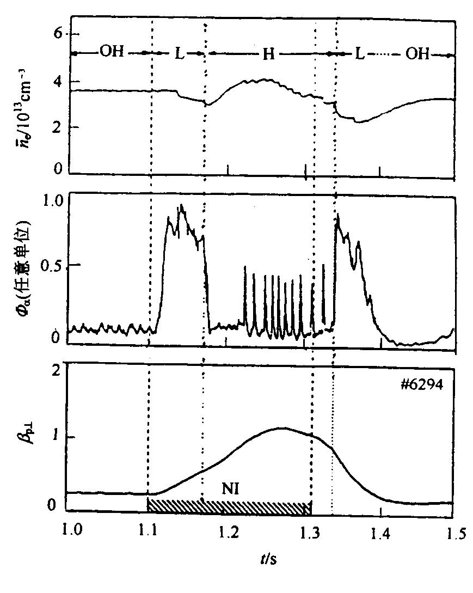

在实验中，从 L-模约束向 H-模约束的转换过程是自动发生的，不必通过外部对参数的调整（如图 9.20 所示）。因此，H-模是在加热过程中等离子体的某些相关参数的大小及剖面分布发展到一定阶段而发生的。后来的观察进一步证实，L-H 转换与边缘区的等离子体的极向转动速度的加大以及这种速度的空间梯度的加大密切联系，很可能具有因果关系；普遍观察到 L-H 转换的发生需满足一些必要条件，对 ASDEX 和其他很多装置，这些条件是：

(1) 加热功率需大于一定阈值，对 ASDEX 装置，H-模发生在按等离子体表面积平均的功率密度$P/A > (2 \sim 3)\times 10^{-2}\ \mathrm{MW/m^2}$条件下，根据更多装置实验数据得出的功率阈值被归纳成两种定标[46]：

$$
\text{(i)}\qquad P_S = 0.025\,\bar{n}_e^{\,0.75} B_T S \tag{9.39}
$$

$$
\text{(ii)}\qquad P_S = 0.4\,\bar{n}_e B_T R^{2.5} \tag{9.40}
$$

式中$\bar{n}_e$以$10^{14}\ \mathrm{cm^{-3}}$计，$B_T$以 T 计，$R$以 m 计，$S$为等离子体表面积，功率阈值$P_S$以 MW 计。对 ITER，这两种定标给出的功率阈值分别为 100 MW 和 200 MW。

(2) 对 ASDEX，H-模仅发生在较高的密度参数区(图 9.21)，大体是

$$
\bar{n}_e > 3\times 10^{13}\ \mathrm{cm^{-3}} \tag{9.41}
$$

进一步的研究指出，在较低的密度下，H-模也能够实现，但要求更大的功率阈值。（与上面的定标关系（9.39），（9.40）不相洽。）

### 9.6.2 边缘 H-模的一种重要伴随现象：边缘定域模（ELM）活性[47]

首先在 ASDEX 装置上，后来在各种装置上都观察到，在 H-模状态下，在等离子体边缘区域经常出现一类特殊的非线性磁流体不稳定性，其主要表现是在$H_\alpha(D_\alpha)$信号上出现以一定频率重复的尖脉冲，这一信号与软 X 射线信号及反磁信号存在一一对应的关联（如图 9.22 所示）。

后来的实验和理论研究对这一非线性现象有了较深入的了解，但同时又发现了更多的 ELM 类型的现象。对 H-模来说，ELM 并不是必须的，存在无 ELM 的 H-模，而且，由于 ELM 过程中从边缘区排出一定的能量和粒子(包括杂质粒子)，因此，单从能量平衡的角度，ELM 使约束变坏，所以无 ELM 的 H-模一般对应于更高的 H 因子。但是，无 ELM

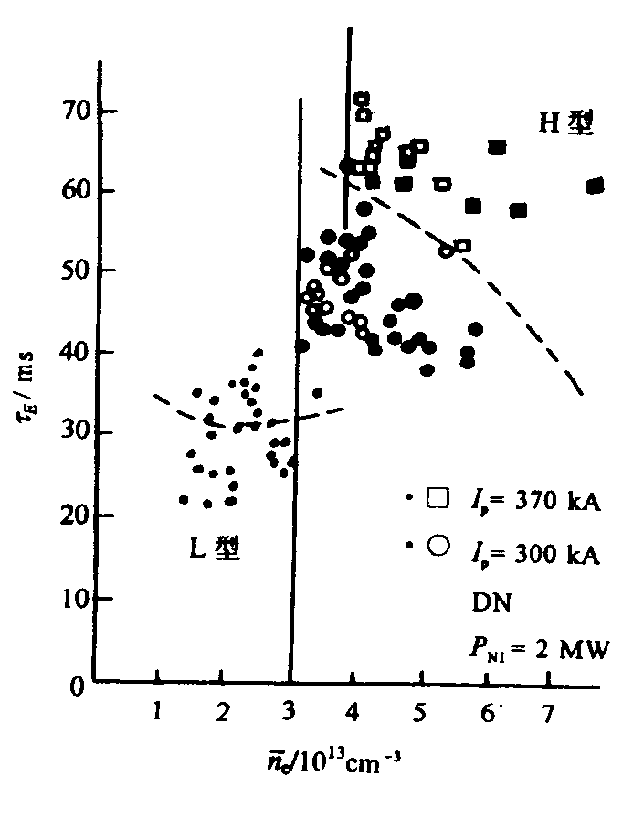

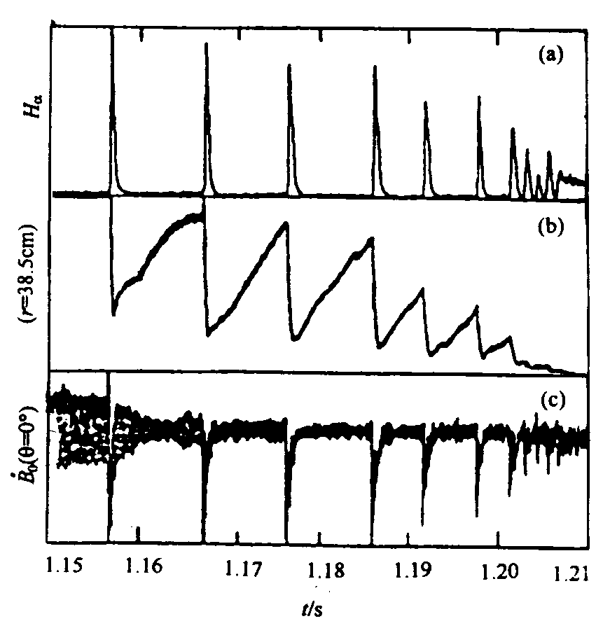

时粒子约束的改善必然使杂质离子的约束也得到改善，而且，杂质离子总是比氢（氘）离子的约束更好，最终造成杂质在中心区域的积累，杂质辐射损失加大，电子温度剖面受到大的影响，最终使 H-模终止。而存在 ELM 的 H-模，由于 ELM 不断排出杂质，在较好的控制下，H-模状态可以长期维持。

ELM 本身可以区分为多种类型：I 型 ELM 的特征是其频率随通过磁分界面的能量通量的加大而增大，很可能是由于边缘区压强剖面变陡使气球模得到激发而产生的；III 型 ELM 可能与电阻性磁流体不稳定性有关，其重复频率随通过磁分界面的能量通量的增大而降低；还有一类可能本身是 L 到 H 和 H 到 L 态的重复转换，发生在加热功率接近阈值的情况下，称高频振荡 ELM（II型）；最后，在高参数条件下，存在巨型 ELM，与比压崩塌现象有直接关系。

### 9.6.3 H-模状态下的输运特性：输运壁垒及其机制

H-模状态下边缘附近等离子体的极向转动速度明显加大，这一现象是 H-模约束态的重要伴随现象，但进一步的观察发现，极向转动的加大发生在 L-模向 H-模转换之前，而且径向电场的最大剪切（即$\mathrm{d}E_r/\mathrm{d}r$）和极向速度最大剪切的位置是与粒子密度，电子和离子温度梯度最大的位置基本一致的，也与密度涨落减小的位置一致（如 DIII-D 的典型实验，见文献[48]），因而证实理论预言，即极向转动速度及其剪切的加大，或径向电场剪切的加大，是使湍流输运减小因而使约束改善的必要条件。此外，一些装置上还进行了在孔栏上加电偏压，或在边缘附近另加一偏压电极的实验，发现在偏压电场达到一定大小时，等离子体约束态也会发生类似于 L$\rightarrow$H 态转换现象，这种类 H-模约束态具有因加热产生的 H-模态类似的特征，因此从另一角度证实了边缘电场及其剪切在产生 H-模转换过程中的作用。不过，这种外加偏压的实验只能在较低的等离子体密度下进行($\bar{n}_e \le 2\times 10^{13}\ \mathrm{cm^{-3}}$)，

因此仅在研究物理机制上有意义。

H-模约束态对应于边缘区反常输运的下降，这在 ASDEX 实验中已清楚地观察到，图 9.23 是 ASDEX 边缘区密度剖面和电子温度剖面的变化。从图中可以看到，H-模下密度和电子温度梯度明显增大，这表明输运减小，这种现象称为输运壁垒（transport barrier）。

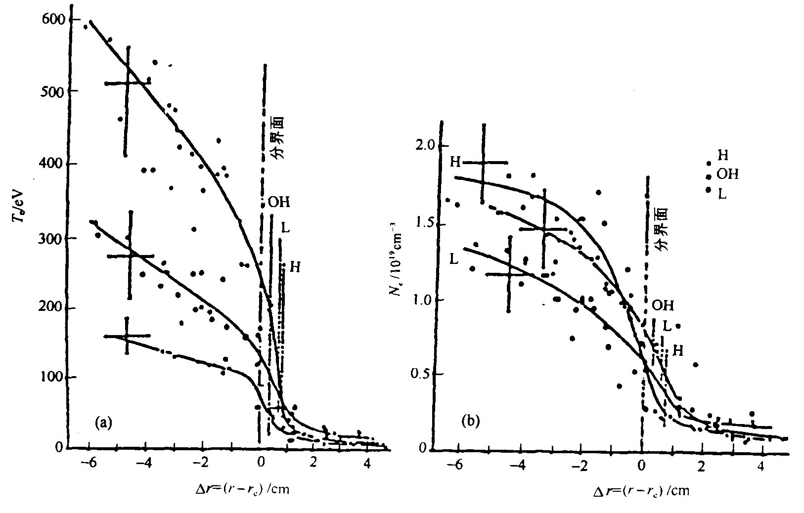

理论研究发现在极向速度剪切对很多湍流模式有稳定作用，可以抑制湍流水准，从而减小反常输运。很多理论研究还试图说明径向电场或极向转动及其剪切产生的机制，但至今没有自洽的并与实验观察一致的理论。等离子体转动是与半径方向的电场密切相关的，不可能由广义欧姆定律

$$
E_r + \frac{1}{c}\left(v_\theta B_\varphi - v_\varphi B_\theta\right) - \frac{\nabla p_i}{Zen_e} = 0 \tag{9.42}
$$

同时确定极向速度与环向速度，需要考虑其他的物理过程，这些过程在形成等离子体平衡态以前起作用，包括加热过程，边缘附近高能离子的轨道损失过程（高能离子的香蕉轨道易与孔栏相触，而且轨道本身关于赤道平面是不对称的），以及可能的非线性的和湍性的过程。必须强调如下几个基本实验事实：(1) L 态向 H 态的转换是在一定的加热功率下或外加偏压下发生的，而当加热功率减小到低于阈值或取消偏压时，约束态将回复到 L-模态，这表明一定的加热功率是维持某种使 H-模态得以存在的必要驱动源；(2) H-模态下密度和温度梯度的加大使径向电场或等离子体转动加大[式（9.42）中与压强梯度有关的项]，但它比实验观察到的相应量小很多，而且上面已经指出，密度和温度梯度的加大是

改善约束的后果而非原因，因此存在尚不了解的驱动“反常”极向转动的机制；(3) 在 H-模态，边缘湍流水准降低，其极向不对称性也变小，因此，基于湍流或极向不对称性维持反常极向转动的机制是与事实不符的。

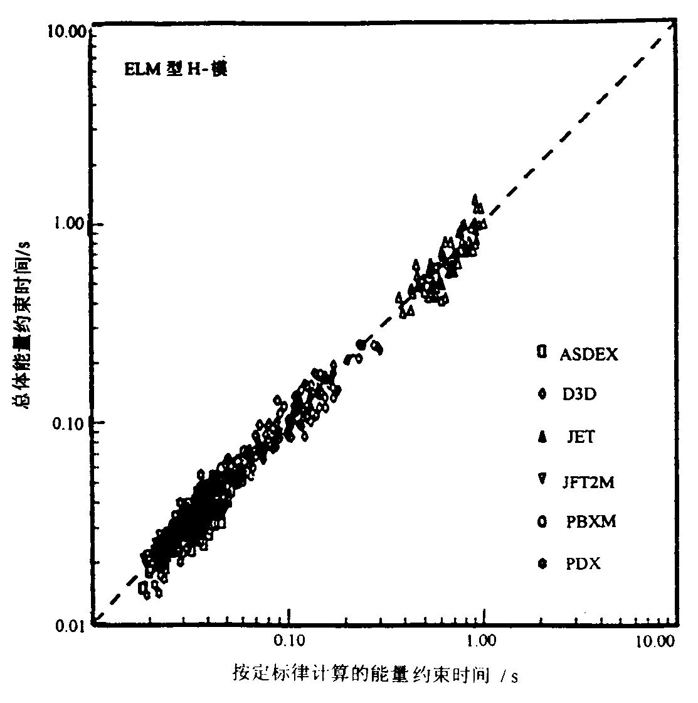

### 9.6.4 H-模约束的实验定标[49]

由于 ITER 设计研究的需要及为了对主要的托卡马克 H-模实验进行总结，已对 H-模约束定标进行了较系统的分析。主要的数据库是由几个具有拉长截面的托卡马克装置提供的，包括 ASDEX，DIII-D，JET，JFT-2M，PBX-M，PDX。约束定标分成两大类，即具有 ELM 的约束和不存在 ELM 的约束。类似于 ITER-89P 的 L-模定标，能量约束时间与主要物理和工程参数的关系为：

具有 ELM 的 H-模：

$$
\tau_E^{\mathrm{ELMy}} = 0.032\, I_p^{0.63} B_T^{0.34} P_t^{-0.53} M^{0.33} R^{2.52} n_e^{0.26} \varepsilon^{0.33} \kappa^{-0.46} \tag{9.43}
$$

不存在 ELM 的 H-模：

$$
\tau_E^{\mathrm{ELM-free}} = 0.045\, I_p^{0.87} B_T^{0.45} P_t^{-0.55} M^{0.43} R^{1.84} n_e^{0.03} \varepsilon^{-0.02} \kappa^{-0.53} \tag{9.44}
$$

上两式中，密度的单位是$10^{19}\ \mathrm{m^{-3}}$，$M$是离子的原子质量数（即$A_i$），$\varepsilon = r/R$是倒环径比。其他量的单位与 L-模定标中的一致。图 9.24 和 9.25 分别是实验数据与定标关系确定的能量约束时间的比较，符合程度很好。

由于改善约束研究对未来建堆的重要性，近年来各主要实验装置的研究重点都放在改善约束研究上，实验研究的发展非常快，又接连发现了许多类型的改善约束态，这些约束态可能对反应堆品质的改进具有更大的意义。下一小节将介绍其中较重要的实验。

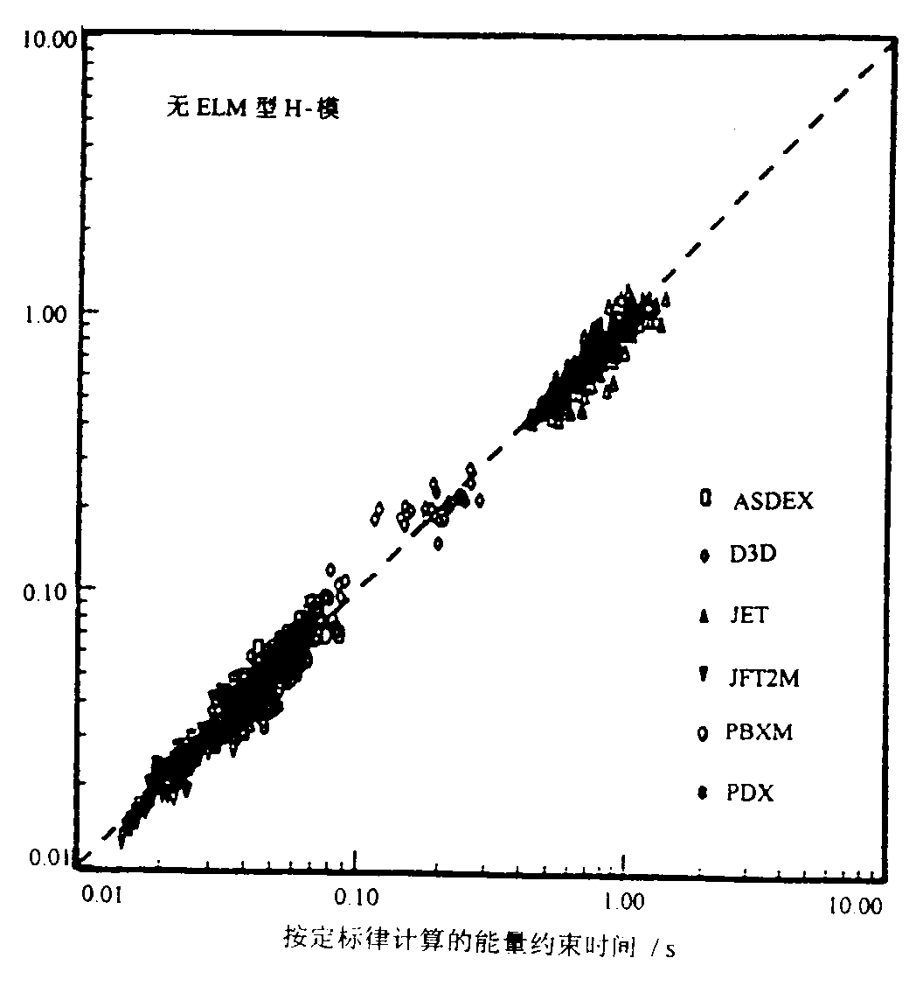

## 9.7 H-模约束性质的研究 (2)：中心区改善约束模式

在 ASDEX 的 H-模约束发现后的一段时间内，很多装置发现了类似的 H-模态约束，产生 H-模的方式也变成多样化，对形成 H-模态的机制研究取得一定的进展。除了理论上对产生大的极向等离子体转动机制尚不清楚外，随着实验研究的深入，又发现了更多的深层次问题，其中比较重要的是，边缘 H-模的影响是否仅限于边缘附近区域？在 JET 等大型装置的实验中发现，虽然明显的输运壁垒是在边缘附近，但反常热导率的减小是全域性的。图 9.26 是 JET 上关于无 ELM 的 H-模态下给出的反常热导率的剖面分布。这种全域性的下降对改善中心区约束是很有意义的。产生这种全域性改善可能有两方面的原因，其一是，引起反常热导率的湍流本身依赖于许多参量的剖面分布，因而边缘建立的输运壁垒通过改变密度和温度及电流密度剖面影响了内部区域的反常输运；第二个原因是一种理论推测，即认为处于饱和态的湍流对

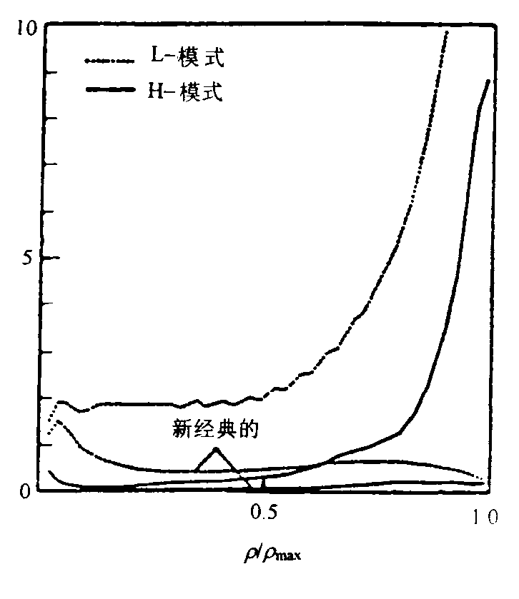

外来扰动的响应是可以传播的，传播速度接近于湍流所对应的微观模式的群速度，这一速度远大于热脉冲传播速度，因此在宏观上显示出即时的全域性变化。

虽然边缘 H-模的效应在一定程度上可以向内部区域扩展，但从反应堆热绝缘的角度，如果直接使中心约束区的输运得到更大的改善会更有利。实际上，在许多装置上已经发现了这种类型的改善约束模式，下面介绍其中比较重要的几种，并讨论一些改善约束模式间存在的一些内在关系。

### 9.7.1 TFTR 的超放电（Supershot，简称 S-模）[51]

TFTR 研究人员利用独特的壁处理技术在喷气供料条件下设法获得了非常陡的密度剖面分布，同时在很强的加热功率下，使具有这种陡密度剖面的位形得到了比一般 H-模态的改善约束因子更高的改善约束。这种独特的模式被称为超放电，其 H 因子可达到 4 左右，三因子乘积$n_e(0)\tau_E T_i(0)$比 L-模情况下增大 20 倍，为一般边缘 H-模态的 5 倍。能量约束时间与密度峰化因子的关系如图 9.27 所示。

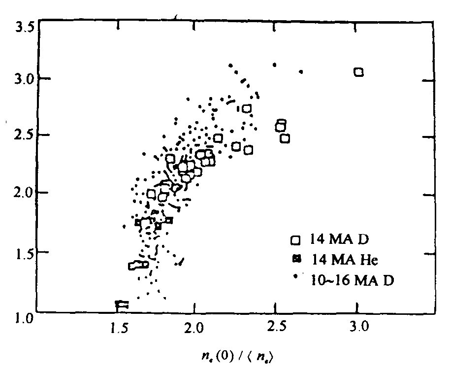

在欧姆加热条件下观察到的改善欧姆约束(IOC)实验中曾观察到密度峰化对改善约束的效应，而 S-模是第一种被发现因密度峰化使强功率加热条件下改善约束进一步优化的模式，而且得到改善的程度非常大，因而具有重要的意义。早在 1990 年前后，TFTR 就在 S-模约束态下获得了非常高的等离子体参量，如中心离子温度达 35 keV，以及上面提到的很高的三因子乘积值。另外，S-模实验与后来发现的同时具有反磁剪切和密度峰化剖面的加强反剪切位形(ERS)是有联系的。

对 S-模下等离子体参数进一步提高的限制来自磁流体不稳定性。TFTR 实验中 S-模下的最高规范化比压$\beta_N < 2.7$，而极向比压不能超过条件$\varepsilon\beta_p < 0.7$（$\varepsilon = a/R$）。主要的不稳定模式是低$n$外扭曲模及气球模，表现为较软的比压崩塌或快破裂。

与 S-模的峰化密度剖面有一定关系的一类改善约束模式是弹丸加料产生的 H-模，或称 PEP 模。弹丸加料能产生短期的峰化密度剖面分布，因此在 H-模条件下注入弹丸，常常使约束进一步改善。很多装置上都进行了这类实验。

### 9.7.2 高极向比压 H-模[52]

在同样的等离子体参数下，高极向比压($\varepsilon\beta > 1$)意味着较小的环向电流，如果这类位形具有好的稳定和输运性质，对减轻反应堆工程的压力是有利的，同时也有利于稳态运行所要求的非感应电流驱动。这类位形的边缘安全因子值较大，中心$q = 1$面包围的区域很小甚至消失，因而具有很多与标准托卡马克位形不同的特性。但在 L-模约束定标关系中看到，小的环向电流对应于小的能量约束时间，因此，高极向比压位形在以前的研究中没

有得到较多的重视。

在实验操作上高极向比压态是通过一种特殊的步骤实现的：在进行高功率加热以前突然将环向电流较大幅度地降低，这就引起加热过程中内电感值$l_i$的加大，即电流密度变得更峰化，从而使低$n$磁流体模得到抑制。结果，无论是规范化比压值还是极向比压值都得到提高：$\beta_N$可达 4.7，而$\beta_p$可达 1.6。一般，高极向比压 H-模都不能维持很长的时间，在电流剖面变得较平坦后，退化为一般的 H-模。

高极向比压位形中自举电流将起比较重要的作用，这可以从自举电流的公式中清楚地看出。而自举电流占一定比例时，中心区的磁剪切将由正剪切逐渐变小，甚至变成负剪切。大约在 1992 年前后，随着高极向比压实验的进行和高自举电流比实验事例的不断发展，小剪切和负剪切位形研究就日益得到重视。

### 9.7.3 DIII-D 和 JET 的甚高约束模式（VH）[53~55]

DIII-D 装置上通过进一步的壁处理（硼化和放电前的壁烘烤，氦放电清洗等）使杂质内流降到很低的水平（降低一个数量级），粒子再循环也非常小，实现了一种新的，比边缘 H-模的输运壁垒的位置明显内移的甚高约束模式。这种模式是从无 ELM 的 H-模演化来的，条件是边缘粒子源和杂质源得到更好的控制。其主要特征是粒子密度和温度的快速上升区域明显地向内移到约为小半径的 0.7 倍处，在内部，粒子密度非常平坦而温度梯度很大（如图 9.28 所示）。这一约束模式对应的改善约束因子 H 值可达 4 以上，这种模式也是瞬态的，在 0.5 s 后转化为一般 H-模。

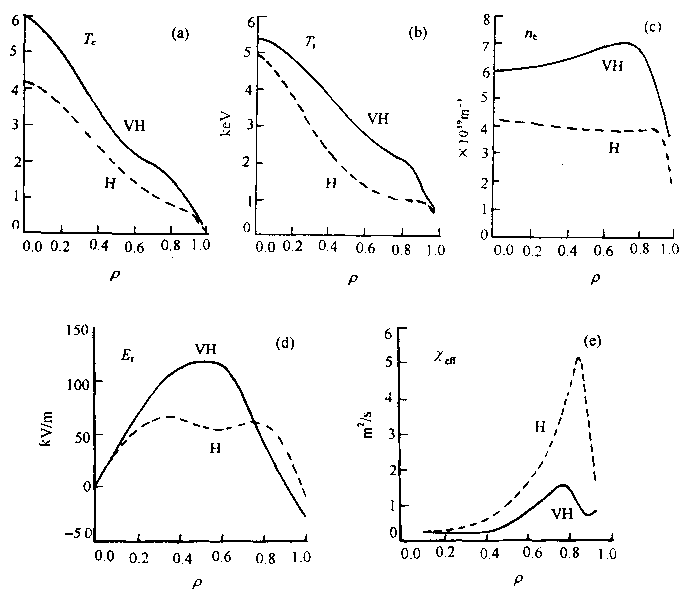

VH-式的输运壁垒仍然比较靠近边缘，结果引起较大的边缘区自举电流。这一边缘自举电流使边缘电流剖面变平，通道加宽，通过对 JET 上 VH-态下的实测电流和压强分布来进行的气球模分析，证实了稳定区的扩展，甚至将第一稳定区和第二稳定区连成一片，导致气球模的无条件稳定化[55]。此外，将实验数据代入输运编码计算后看出，在约束模式从 ELM 到 ELM 消失再到 VH-态的演化过程中，粒子扩散系数和离子的热导率一直在减小，因此等离子体储能不断增加，即能量约束时间不断加大。VH-式是瞬态的，存在时间约为 0.1 s，这主要是杂质不断积累使辐射加大及低$n$磁流体模发展的结果，内部扭曲模的发展也可能起作用。

### 9.7.4 JET 的热离子 H-模[57]

热离子模式是指通过中性束或 ICRF 加热，在较低的粒子密度条件下（$\bar{n}_e < 2\times10^{19}\ \text{cm}^{-3}$），使离子得到优先加热形成的$T_i(0) > 1.5T_e(0)$的运行状态，在此状态下实现 H-模，就成为热离子 H-模。JET 上获得最大聚变三因子乘积或最高中子产额的实验，大多是在热离子 H-模态下得到的。类似于其它 H-模式，良好的壁处理是先决条件。约束态的转换是自然发生的，可以持续 1~2 s，对应的改善约束因子$H$值可达 4 左右。在达到 H-态后，粒子密度有较大的上升，中心密度可达$5\times10^{19}\ \text{cm}^{-3}$，观察到锯齿稳定化，因而中心区的电子温度上升。热离子 H 态的终止可能是多种因素造成的。有的转换成一般 H 态，有的退化为 L 态，有时则引起碳迸发。理论分析认为气球模的发展是热离子 H-模终止的重要原因，但未能直接从实验上证实。

### 9.7.5 增强反剪切位形(ERS)和中心负剪切位形(NCS)模态[58~61]

这里 ERS 和 NCS 是 TFTR 发现的增强约束反剪切模式 (Enhanced Reversed Shear)[58] 和 DIII-D 发现的中心负剪切模式 (Negative Central Shear)[59] 的缩写。这是与当前研究热点——先进托卡马克位形有较密切关系的两类位形；另外，JT-60U 和 JET 的内部输运位垒位形 ITB (Internal Transport Barrier) 也是重要的先进约束位形[60, 61]。这些约束模式在实现方法和物理特征上具有较多的共同性，可能对改进反应堆品质和经济性能有重要意义。下面主要通过 ERS 位形来说明。

ERS 位形是通过下述操作步骤实现的：在环电流有一个较快的上升后，在电流达到 1 MA 时调整为较慢的上升，同时加上中等大小的中性束注入功率（5 MW），在电流达到平顶值 1.5 MA 时，再加上一个大的中性束注入（20 MW）。这一操作造成了初期电流剖面是空心型的，后来的中性束加热使电子温度很快提高，从而空心型电流剖面不能在随后的加热阶段得到弛豫，进一步的高功率中性束加热产生两重效应，一是压强梯度的迅速加大，二是中性束使中心区的粒子密度很快提高，这两种效应都使自举电流比例加大，于是反剪切位形得到长时间的维持。因此，ERS 位形是一种同时具有中心反剪切和中心粒子密度非常峰化剖面的位形。这些情况如图 9.29～9.32 所示。

ERS 位形最使人注目之处是，在中心约束区内，由于反剪切和密度峰化的双重效应，输运变成完全经典型的。实际上，测得的扩散系数和离子热导率“低于”新经典值（见图 9.33）。但这是不可能的，原因是原有的新经典理论计算结果在靠近磁轴附近是不正确的（估计过大）。这一情况已为后来更严格的理论处理所证实。当然还有另一种可能，即 ERS 位形下可能存在较大的向内的粒子和热量的对流。但不管理论如何去解释实验结果，这在

实验上观察到经典性质的输运，这在托卡马克研究史上还是第一次，有着重要的科学意义和对反应堆的潜在应用价值。

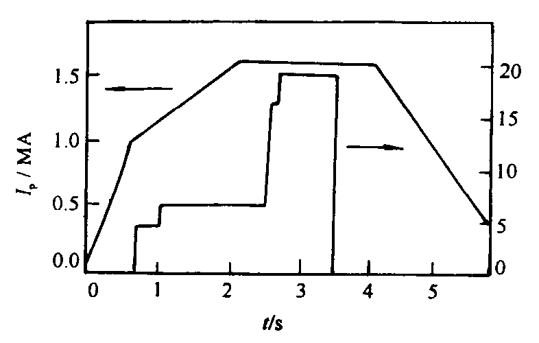

**图9.29** TFTR 上进行 ERS 实验时电流上升及中性束加热的时间安排〔58〕

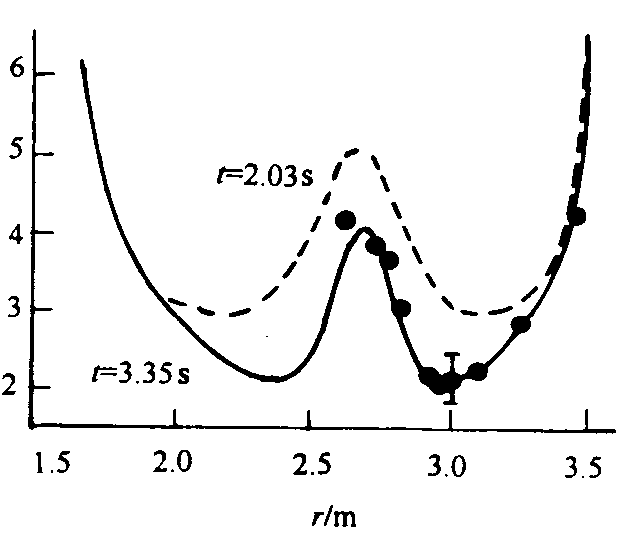

**图9.30** 反剪切位形的形成〔58〕

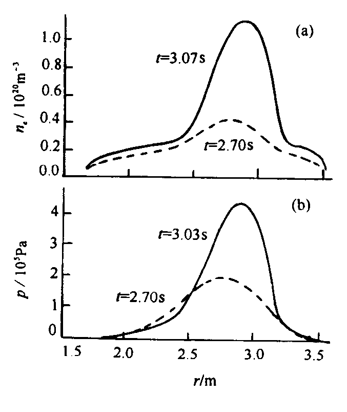

**图9.31** 粒子密度和压强剖面的变化〔58〕

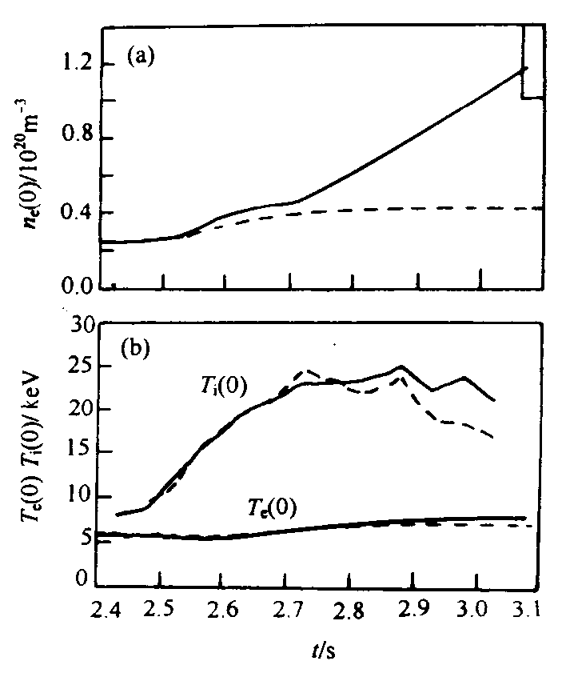

**图9.32** 磁轴处粒子密度和电子离子温度的变化〔58〕

ERS 态的约在电阻性扩散时间内发生演化，中空形的电流剖面将被逐渐填平，反剪切区域缩小，同时输运壁垒外移，最后在坏曲率区引发磁流体不稳定性(infernal mode)，这种定域在环的外侧的模与沿环向定域的气球模的耦合使 ERS 态终止。要长期维持 ERS 型的约束态，有必要引入非感应电流驱动，目前在 JET 上实现的反剪切约束态是这种思想的一个实践。在 JET 和其他装置上，除利用上面的控制电流上升和调制加热功率的方法外，主要采用将自举电流和低杂波驱动电流结合的方法[61]。改善约束因子明显高于一般的 H-模态。这种方法具有更好的可控性，也就更接近反应堆应用目标。但是，由于低杂波电流驱动受密度的限制，因此，主要的电流驱动区域比较靠边缘，相应的粒子密度仍要低一些。

DIII-D 的 NCS 位形的建立方式与 ERS 的建立方式类似，也是在电流的较慢上升阶段先加一个中等大小的中性束功率，在电流达到平顶后再加一个大的中性束功率，其效应也与 ERS 类似，在中心区形成既有反磁剪切，又有密度峰化剖面的位形，从而使反常输运得到抑制，但没有报道达到了经典输运水平。另外，NCS 位形的反剪切区域比 ERS 的大，这是通过控制电流上升速率及加热功率有意达到的，因为较大的反剪切区域显然有利于提高总的等离子体储能。此外，NCS 位形的外缘处于 L-模结构，即靠外缘区的输运仍较大，这种设计的主要目的是为了得到更好的稳定性，亦即使 NCS 位形得以长期维持。

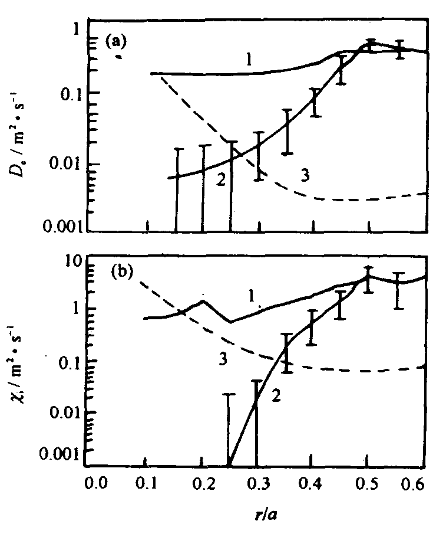

**图9.33** ERS 建立前后粒子扩散系数和热导率的剖面〔58〕

JET 和 JT-60U 上的具有内部输运壁垒的位形在位形建立过程中采用了低杂波电流驱动来调控电流密度剖面，用 ICRF 加热来减慢电流扩散，用中性束加热芯部并使芯部粒子密度较快上升，形成很陡的中心压强梯度区。分析发现，输运壁垒是先在较内部区域形成的，然后向外部扩展到 2/3 小半径处，这时中心区的剪切实际已非常小，或者为负值，磁轴上安全因子值约为 2。此时离子热导率降低到新经典水准。

### 9.7.6 长脉冲 H-模约束实验[62]

长脉冲 H-模是指在等离子体存在时间内，H-模态没有因磁流体不稳定性或杂质内流的影响而退化的约束模式。从反应堆角度看，那些瞬态的高约束模即使得到很高的改善约束因子，充其量只能在堆的启动阶段减小对总加热功率的要求，因而其实用意义很不确定；高品质的自持燃烧氘氚反应堆需要的是在 α 粒子加热条件下的长脉冲 H-模。目前，长脉冲 H-模实验分两种类型，一类是利用 ELM 控制向内杂质流，在 JET 上实现了具有可控制 ELM 的 H-模态的存在时间已超过 20 s，但相应的改善约束因子 H 值降低到 1.3 大小，还不能满足 ITER 的设计要求。第二类方法是采用低杂波驱动或与自举电流效应结合，这种改善约束位形原则上可以长期维持，代表性的研究是在 TORE-S 装置上完成的[62]。目前得到的最长脉冲为 110 s，电流 0.8 MA，主要由低杂波驱动（功率 2.5 MW），环电压维持在 0.1 V（装置的变压器磁通为 15 Wb）。整个放电期间输入低杂波的总能量达 280 MJ，是当前的世界记录。低杂波主要加热电子，中心电子温度$T_e(0) = 6\ \text{keV}$，远高于离子温度$T_i(0) = 1.5\ \text{keV}$，是热电子模式。电子密度$\bar{n}_e \approx 1.2\times10^{19}\ \text{cm}^{-3}$，受到低杂波可近性条件的限制而不能增大。这种长脉冲 H-模的改善约束因子不是通过与 L-态的对比定义的，而是通过所谓的 RLW 定标来确定的。RLW 是 Rebut, Lilia, Watkins 根据临界温度梯度理论所确定的一种 L-约束时间计算公式，与唯象定标关系基本吻合。得到的$H_{\text{RLW}} = 1.6$。这种约束改善在整个放电期间得到保持。理论分析认为，约束的改善主要是中心区安全因子

剖面很平，因此剪切很小甚至变负引起的。

表 9.5 托卡马克改善约束态介绍

| 模式名称 | 主要装置 | 主要特征 | $H$因子 |
|---|---|---|---|
| 边缘 H-模 | ASDEX 及多数托卡马克装置 | 1. 存在功率阈值 2. 有或没有 ELM 3. 输运壁垒在边缘附近 4. 可以长期维持 | 1.5~2 |
| 无锯齿放电 | JET, TFTR, JT-60, TEXTOR 等 | 1. 中心区是输运性质的 2. $q_0<1$时由高能离子稳定 3. 杂质会在中心积累 | 1.3 |
| 超放电 (S-模) | TFTR | 1. 密度剖面峰化 2. 输运壁垒处在内部 3. 容易转换成边缘 H-模 | 3~4 |
| 热离子 H-模 | JET, DIII-D, JT-60U,… | 1. $T_i>2T_e$ 2. 输运壁垒在内部 3. 获得最佳参数 4. 接近磁流体稳定极限 | >2 |
| VH-模 | DIII-D, JET, JT-60U | 1. 输运壁垒内移 2. 密度剖面很平 3. 易转换成边缘 H-模 | 3~4 |
| 弹丸增强 H-模 | JET, DIII-D 及很多装置 | 1. 密度峰化剖面 2. 特殊的磁流体活性：蛇形扰动 3. 瞬态 | 2 |
| 高极向比压 H-模 | JET, TFTR, JT-60U,… | 1. $\beta_p>2$ 2. 自举电流效应重要 3. 小或负磁剪切 | 2 |
| ERS, NCS, 最佳剪切模板 ITG 模 | TFTR, DIII-D, JET, JT-60U | 1. 中心约束区改善约束模 2. 密度剖面很陡 3. 反磁剪切，大自举电流比 4. 有可能长期维持 | 3 |
| 高环向比压 H-模 | DIII-D | 1. $\beta_N>3,\ \langle\beta\rangle>10\%$ 2. 进入第二稳定区 | >2 |
| 边缘杂质 H-模 | TEXTOR | 1. 边缘轻杂质形成强辐射带 2. 边缘输运壁垒 | 2 |
| 长脉冲 H-模 | TORE-S | 1. 电流驱动产生反磁剪切 2. 已维持 110 s | 1.7 |
| 氘氚反应 H-模 | TFTR, JET | 1. 氘氚同位素效应 2. 其他类似一般非氘氚放电 | >2 |

在实验中发现粒子的再循环可以基本保持不变，杂质水准也基本不变（$Z_{\text{eff}} = 2.4\pm0.3$），这是很有意义的。

需要指出的是，目前的装置都难以在较高的密度下维持长脉冲运行，这是将目前已有的实验结果向 ITER 类型的反应堆外推时最不可靠的地方之一，因而反应堆 α 加热条件下是否能实现长脉冲 H-模态还缺乏直接的实验证据。

### 9.7.7 其他改善约束实验及小结

除上面介绍的主要改善约束态实验外，还有其他多种具有一定特征的改善约束态被发现，下面简要介绍各种改善约束态的主要特征。

改善约束研究的最终目的是为反应堆运行寻求适合的约束模式，因此应与氘氚自持反应条件下的物理状态相洽。目前存在的主要问题是：

(1) 只有具有 ELM 的 H-模态才可以较长期维持，并将作为 ITER 设计的主要参考；其他$H$因子较大的改善约束态大多不能长期维持；

(2) 初步获得了可能形成先进托卡马克位形的改善约束态，但要解决磁流体稳定性和中心区杂质积累等难题；

(3) 目前得到的 H-模态在较高的密度下（但低于 Greenwald 极限，$n_G$）常常要反转换为 L-模态，而 ITER 和未来反应堆要求的密度范围甚至超过$n_G$极限，这是一个非常严重的挑战，这有待实验，包括 ITER 自身实验的验证。

## 9.8 托卡马克偏滤器实验

在第七章中，我们已对等离子体边缘区物理，尤其是偏滤器物理的基本内容及这一领域研究的重要性作了介绍和说明。本小节将介绍托卡马克装置上最新的偏滤器物理研究成果[63~68]。现在国际上约有 10 个正规的大中型偏滤器装置（见表 9.6），正在运行的大型装置中，JET 和 DIII-D 是较早建造的，但最近对真空室和极向偏滤器系统进行了大幅度改造；JT-60U 是 1991 年由 JT-60 改建的，将原来的 X 点位置由中平面外侧移至下方；ASDEX-U（常简称 AUG）是 1990 年新建的；ALCATOR-C 是尺寸虽小但密度很高的偏滤器装置。以上装置的偏滤器磁位形基本类似，即截面具有一定的拉长度，并可有一定的三角变形，具有单零或双零分界点（X-点），这也是 ITER 将要采用的位形。此外，其他在表中没有列入的装置中，也有一些装置通过一定的工程改进，可以进行部分具有偏滤器功能的实验研究，如 TORE-S 的各态历经偏滤器（ergodic divertor）。中国即将建造的两个新装置 HL-2A 和 HT-7U 也具有 ITER 型偏滤器，预期在下世纪初投入运行。

偏滤器物理的内容十分丰富和重要，最新研究成果已有详细的总结[64]，本节将重点介绍 JET 上结合 ITER 设计的研究。偏滤器的最初目的是控制杂质，后来实验中发现在偏滤器位形中较易产生和维持 H-模约束态，目前大部分装置的实验还主要处在利用偏滤器形成 H-模态的阶段。但是，90 年代初在 JET 和 TFTR 等大装置实验上已发现一个与未来聚变堆运行关系密切的问题，即在大的加热功率下，孔栏或偏滤器靶板上的局部热负荷已非常大，形成了“热斑”，因而引起了碳杂质的“增强升华”（ERS），即所谓“碳迸发”。如使热负载均匀化，装置的总热负荷可以提高，但要想从根本上解决，就要设法将热量排出，也就是偏滤器应具有排热的功能。对反应堆，偏滤器还需具有另一功能，即排除氘氚反应产生的废料——氦，即偏滤器应具有抽气功能。与此项功能相关的是控制工作气体返流，即再循环，已多次指出这与中心区等离子体品质有密切关系。在现有的大装置中，

JET 的放电脉宽较长，总加热功率大，最适合进行与 ITER 相关的偏滤器物理先行实验[66, 67]。为此在 JET 上先后安装了特殊设计的 MARK-I（Mk-I）和 MARK-II（Mk-II）两种新型抽气偏滤器，完成了一批非常有实用意义的实验研究。

表 9.6 主要偏滤器托卡马克装置[64]

*（$R$、$a$、$\kappa$、$B$、$I_p$、$P_t$为装置工程参数）*

| 装置名 | 国别 | $R$ | $a$ | $\kappa$ | $B$ | $I_p$ | $P_t$ | 分界面特征 | 粒子通道特征 |
|---|---|---|---|---|---|---|---|---|---|
| JET | 欧共体 | 3.0 | 1.0 | 1.8 | 3.4 | 6 | 42 | 单, 双零 | 开, 封 |
| DIII-D | 美国 | 1.7 | 0.7 | 1.9 | 2.1 | 3 | 22 | 单, 双零 | 开放型 |
| ALCATOC-C | 美国 | 0.67 | 0.21 | 1.6 | 9 | 2 | 10 | 单, 双零 | 开, 封 |
| PBX-M | 美国 | 1.65 | 0.3 | 1.6 | 2 | 0.9 | 10 | 双零 | 开, 封 |
| JFT-2M | 日本 | 1.3 | 0.35 | 1.3 | 2.2 | 0.33 | 2 | 单, 双零 | 开, 封 |
| JT-60U | 日本 | 3.25 | 1.0 | 1.6 | 4.2 | 5 | 55 | 单零 | 开放型 |
| AUG | 德国 | 1.7 | 0.5 | 1.7 | 3.9 | 1.6 | 17 | 单零 | 开, 封 |
| T-deV | 加拿大 | 0.84 | 0.23 | 1.15 | 2.1 | 0.25 | 1.3 | 单双零 | 开, 封 |
| COMPASS-D | 英国 | 0.56 | 0.18 | 1.6 | 2 | 0.3 | 1.8 | 单零 | 开放型 |
| TCV | 瑞士 | 0.88 | 0.25 | 3 | 1.5 | 1 | 4 | 单, 双零 | 开放型 |
| HL-2A | 中国 | 1.65 | 0.5 | 1.6 | 3 | 0.8 | 10 | 单, 双零 | 开, 封 |
| HT-7U | 中国 | 1.7 | 0.4 | 2 | 3.5 | 1 | 8 | 单零 | 开放型 |

### 9.8.1 JET 的 Mk-I 和 Mk-IIA 偏滤器实验

Mk-I 的实验在 1994～1995 年进行，Mk-IIA 的实验在 1996～1997 年进行，现在正进行 Mk-IIGB 实验，这套偏滤器系统要在氘氚反应条件下运行，因此具有远距离调控的灵活性，但其详情尚未见报道。Mk-I 和 Mk-IIA 是安装在装置底部用于产生单零位形的磁线圈-真空部件，它们的剖面结构如图 9.34 所示

这两种结构的主要不同是，Mk-I 对中性气流是开放型的，即中性气流和杂质流返回主约束等离子体的通道是开放的，与孔栏位形的不同是靶板区不直接与主约束等离子体接触，偏滤器区的密度高而温度低，杂质溅射产额大幅降低（见第七章）。Mk-I 的 X 点位置通过低频（4 Hz）调制线圈可以有一定的晃动，于是与靶板相交的磁力线在一定范围内来回扫动，使靶板表面上的热负载均匀化，从而增大了可承受的总加热容量。Mk-I 和 Mk-II 的抽气是通过安装在外侧偏滤器线圈下面的冷凝泵实现的。Mk-II 由于特殊的靶板几何形状，打到偏滤器靶板上的粒子的相当一部分将被散射到气体室内，然后被冷凝泵抽出，靶板本身还直接通过水冷结构冷却。靶板的表面都覆盖有复合碳纤维（CFC）瓦或铍瓦，真空室其余部分则覆盖有石墨瓦。

与孔栏位形比较，偏滤器位形的有效等离子体体积有所减小，因为相对于孔栏位形，等离子体界面(LCFS)向内移，同时上下不对称性加大，这两种因素都使垂直不稳定性容易发生而且增长率加大，因此需相应地改进垂直位置的反馈控制系统。

在 1994～1995 年期间进行的 Mk-I 实验的效果是明显的，在总加热能量达 180 MJ（对

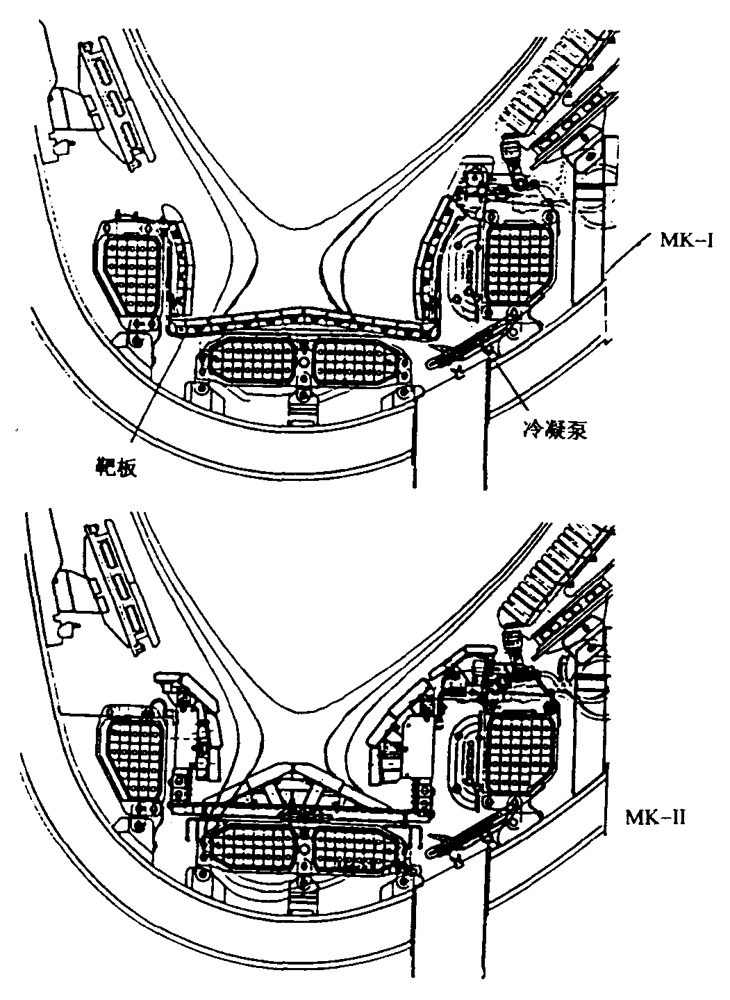

**图9.34** JET 新安装的 Mk-I 和 Mk-IIA 的剖面结构图〔63〕

CFC 瓦）或 120 MJ（对铍瓦）的条件下，也避免了碳迸发现象，即承受热负载能力提高了十多倍，等离子体总体性能超过改进前的最好水平，在 6 MA 电流下运行的总等离子体储能达到 13.5 MJ，聚变三因子乘积和氘氚反应中子产额都提高到最新水平。此外，还进行了初步的辐射偏滤器概念的实验，通过在边缘有控制地充入氮气或氖气，可以使等离子体外流热量的 80%在到达靶板前被辐射掉，从而减小靶板的直接热负荷。但是杂质最终流向等离子体内并破坏 H-模态约束的问题没有解决。

Mk-IIA 的安装在 1996 年 3 月完成，投入实验后发现，对热负荷的处理能力比 Mk-I 差不多提高了 3～5 倍，并在当前达到的脉宽和加热功率下，已无必要再采用 X-点的晃动措施。中性粒子在气体室的滞留率有很大提高，使有效抽气效率明显增大。在总加热能量达 150 MJ 下，没有发现杂质含量有明显加大。模拟了 ITER 偏滤器可能采用的所谓“气体室”的效应。

关于在上述偏滤器位形下一系列改善约束的实验结果已在其他章节中介绍，值得指出，JET 的实验是最接近 ITER 设计的实验条件下获得的，因而具有重要的科学价值。

### 9.8.2 高密度辐射偏滤器的初步实验

由于聚变堆中偏滤器靶板上的平均热负荷很大，例如 ITER 为$20\ \text{MW/m}^2$，在长脉冲运行条件下，排热问题非常不易解决。很多人提出了通过增强偏滤器区域中的辐射来减小热负荷，这需要加大电子密度并引入某类种子杂质（seed impurity）。但这一方法与中心约束区需长期处在 H-模态有矛盾。存在的问题是：(1) 边缘密度的提高会引起 H-模向 L-模的转变；(2) 杂质向中心约束区的渗透既可能破坏 H-模约束，又可能使燃料粒子淡化，表现为$Z_{\text{eff}}$的增大。如何解决这两个基本矛盾，在 ASDEX-U 等装置上进行了关于辐射偏滤器的原理性实验[68]。

在辐射功率与外流热功率的比例超过 0.9 的情况下，靶板与等离子体的热接触处于基本脱离状态，类似于孔栏实验中的脱壁等离子体 (detached plasma)，这种情况下的偏滤器称脱板偏滤器 (detached divertor)。

实验先通过中性束注入使氘等离子体达到 H-模约束态，然后在偏滤器区域增大氘气喷射速率，再在主真空室内喷入种子杂质气体，被选作种子杂质的元素是 N₂, Ne 和 Ar。氘或杂质的主动喷气均是可控制的。实验发现，喷气时边缘电子温度的下降是使 H-模态转向 L-模态的重要因素。喷种子杂质使主约束区的边缘附近形成一个强辐射层，在内侧靠近剥离层的区域出现 MARFE，而高功率加热使中心约束区具有很高的温度和很大的储能。

提高密度或增大杂质含量因而增大边缘区辐射时，H-模态常常反转换为 L-模态，其原因可能是边缘输运壁垒存在条件已被破坏。是否发生反转换，能否维持具有完全脱靶性质的稳态 H-模约束 CDH (complete detached H-mode)，取决于很多因素。初步发现，注入 Ne 杂质可以获得稳态的 CDH，但中心约束区中的$Z_{\text{eff}}$超过 3，这为聚变堆运行所不容。有必要改进偏滤器设计，使杂质在偏滤器区域的滞留率 (retention rate) 有较大的提高。

初步结论是，虽然提出了很多解决聚变堆偏滤器基本工程物理难题的设想，但仍需进一步的实验证实，尤其是长脉冲运行条件下的实验。在这种意义上，现有装置可以做的事是有限的，而 ITER 本身实验的重要目标之一也是为了解决聚变堆的偏滤器工程物理问题。

## 9.9 JET 和 TFTR 装置上的氘氚实验[69~71]

JET 和 TFTR 是仅有的可以进行并已经进行氘氚实验的托卡马克装置。按原来的设计目标，这两个装置都要达到能量得失相当条件，即$Q_{\text{DT}} = 1$。1991 年末，首次在 JET 上进行了含氚实验，氚是通过中性束注入而引入系统的，当时没有进行 1:1 的氘氚实验，氘氚比为 1:7，利用热离子 H-模态所达到的高参数，获得了 1.7 MW 的聚变功率输出，外推到 1:1 的氘氚条件，相当于$Q_{\text{DT}} = 0.3$[69]。JET 的初步实验发现中心区氘氚离子密度受杂质离子的严重影响，离子密度淡化因子达到 0.7，使有效聚变功率下降一半。随后 JET 停止了氘氚实验，重点放在新型偏滤器研究上。TFTR 的氘氚实验开始于 1993 年，次年获得了 10.7 MW 的最高聚变功率输出(如图 9.35 所示)，相当于$Q_{\text{DT}} = 0.27$，一次放电中产生的总聚变能为 6.5 MJ。在进行了多项与氘氚等离子体物理和工艺有关的实验后，TFTR 已于 1997 年 5 月关闭。

### 9.9.1 氘氚等离子体物理研究

TFTR 上主要在 S 态和反剪切位形下对氘氚等离子体进行了实验，JET 上则主要采用无 ELM 的 H-模态进行实验，目的是模拟 ITER 的运行状态。这些实验证明等离子体状态不仅可以保持氘氚实验中的改善约束位形，而且由于氚离子的“同位素效应”，约束品质还有一定的提高。在能量约束定标律中，约束时间对离子质量数有一个$A_i^{1/2}$的依赖关系，说明大的离子质量对约束是有利的，这为杂质离子的约束规律所证明，现又从氘氚实验中得到直接证明。在现有条件下，聚

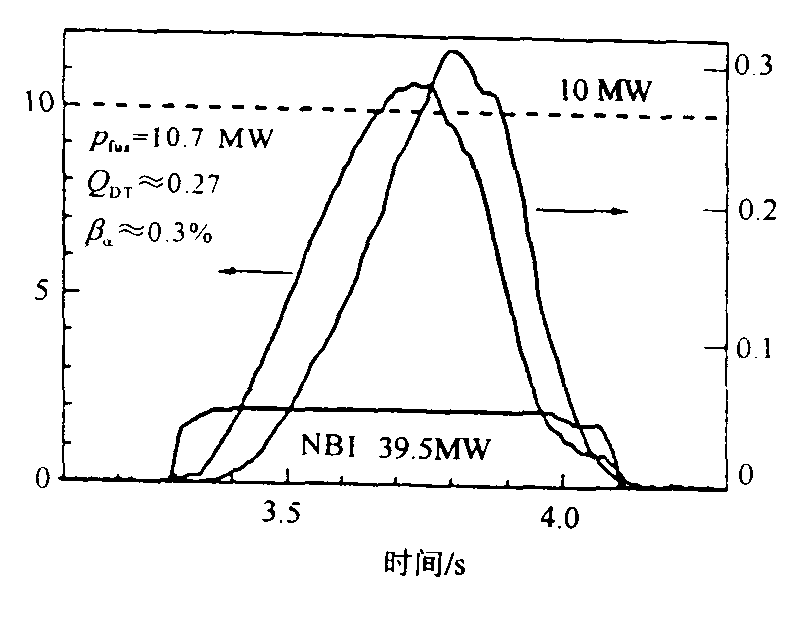

**图9.35** TFTR 上最大聚变功率输出的示波图〔72〕

变产物高能$\alpha$粒子的含量还很低，但也观察到$\alpha$粒子对电子有 15% 的加热贡献。

JET 装置的新一轮氘氚实验是 1997 年中开始的，到年底获得了最高 17.6 MW 的聚变功率输出，相应于$Q_{\text{DT}}=0.65$。此外，进行了多方面的氘氚等离子体实验，包括：

（1）最佳剪切位形实验：在前面 9.7 节中已介绍了与 TFTR 类似的 JET 的最佳剪切位形实验，在氘等离子体和氘氚等离子体中都实现了最佳剪切位形，这是结合低杂波电流驱动，ICRF 加热和中性束注入加热及控制充料的结果。在总加热功率为 20 MW 情况下，获得了 2 MW 的聚变功率输出。

（2）氘氚等离子体中的 ICRF 加热实验：分别对氚离子作为少数成分的基波模式和氚的二次谐波模式进行了 5 MW 级的加热，都实现了向 H-模态的转换，后者的效果更好，若再加入 1% 的${}^{3}\text{He}$，聚变中子产额可增加 3 倍，达到$8\times10^{16}\ \text{s}^{-1}$，相当于聚变功率 0.23 MW（波加热功率 4 MW）。但纯氘氚情况下效果反而不好，其原因是高能氚离子的能量太大，达 5 MeV，对约束不利。

（3）在 JET 上进行了氚扩散实验：在 ELM 型 H-模态的氘等离子体中用喷气方法注入示踪级的氚，将聚变中子的测量值和理论值对比发现，氚向内渗透过程比较快，相当于扩散系数约为$0.5\ \text{m}^{2}\cdot\text{s}^{-1}$，而向外扩散过程（密度衰减过程）比较慢，相当于扩散系数约为$0.2\ \text{m}^{2}\cdot\text{s}^{-1}$。

## 9.9.2 α 粒子物理的初步研究

聚变等离子体物理研究的一个非常重要的内容是$\alpha$粒子自身约束及其慢化和扩散。理论预期$\alpha$粒子会激发等离子体的阿尔芬本征模，在这种模的作用下产生反常扩散。近年来在几个大装置上围绕这一课题进行了很多实验，有意识地通过中性束产生的高能离子，或通过 ICRF 加热产生的高能离子来激发这种模式，的确发现可以引起高能离子的很明显的反常扩散。因此，这种被称为环形效应引起的阿尔芬模（toroidicity induced Alfven eigen mode，简称 TAE）引起了很大的忧虑。在 JET 上，对阿尔芬本征模的激发及效应进行了观察：利用 ICRF 加热方法验证了模的激发条件，观察到模具有$n=1$的结构。在热离子 H-模态条件下，约 5 MW 的 ICRF 功率可以激发$n=5\sim11$的动力阿尔芬模，估计对应的磁扰动很小，$\delta B/B\approx10^{-5}$，对本底等离子体约束性能没有多大影响。

在 TFTR 和 JET 上，目前为止观察到的聚变$\alpha$粒子的慢化过程与经典碰撞慢化一致，即主要通过与电子的碰撞而慢化；其扩散损失不易直接测量，但肯定不是反常的，磁流体活性（锯齿振荡、撕裂模、气球模、破裂）对$\alpha$粒子的损失的贡献不是主要的。这些结果非常有利于反应堆运行，但由于目前实验中获得的$\alpha$粒子的密度很低，不能由此推断反应堆条件下的$\alpha$粒子的约束也满足经典规律。

## 9.9.3 氚工艺问题

氘氚实验为反应堆的氚工艺积累了非常有价值的经验。氚的注入主要通过中性束，在 TFTR 上也有 20% 的实验用喷气方法注入氚。氚的处理是一个重要的工艺问题。氚的半衰期为 12.35 a，即每年衰减 5.61%，因此有一定的放射性。此外，氘氚反应产生的 14.1 MeV 的快中子与器壁材料的反应引起这些材料一定程度的活化。在氘氚实验后，要对真空室，中性束系统，RF 天线，氚纯化器等一系列与氚发生接触的系统进行氚清除工作。这包括放电清洗，辉光放电，真空室烘烤及湿空气冲洗，实践证明湿空气冲洗很有效。在 TFTR

的三年氘氚实验中共用了 1 MCi（$1\ \text{Ci}=3.7\times10^{10}\ \text{Bq}$）的氚（100 g），其中就地余留的有 50 kCi（5 g）。1997 年 4 月结束实验后有 35%的氚（17.5 kCi）留在真空室系统中，经过 5 周时间用上述方法进行清除后仍有约 13 kCi 的氚仍牢固地余留在系统中。TFTR 装置关闭后各种部件将不能再使用。

## 参考文献

1. 李正武. 我国受控核聚变研究发展的里程碑. 核聚变与等离子体物理, 1986, 6 (3): 129
2. 石秉仁. 受控热核聚变研究的进展与展望. 大自然探索, 1992, 11: 14
3. Wolf G H. Overview of tokamak results. Trans. Fusion Tech., 1998, 33: 357
4. 项志遴, 俞昌旋. 高温等离子体诊断技术. 上海: 上海科技出版社, 1982
5. Start P E. Diagnostics for contemporary fusion experiments. Nucl. Fusion, 1992, 32: 167
6. Bretz N C. Microwave reflectrometry for fusion plasma diagnostics. Nucl. Fusion, 1994, 34: 1283
7. Sadler G J. Fast particle diagnostics at JET: status and plans. Nucl Fusion, 1995, 35: 1629
8. Wolf R C, et al. Comparison of poloidal field measurements on JET. Nucl. Fusion, 1993, 33: 663
9. World survey of activities in controlled fusion research. 1991 ed. IAEA, Vienna, 1991
10. Kadomtsev B B. Tokamak Plasma: A Complex Physical System, IOP Publishing Ltd., 1992
11. Fredrickson E D, et al. $\beta$-limit disruptions in TFTR. Phys. Plasmas, 1995, 2: 4216
12. Nave M F F, et al. An overview of MHD stability at the termination of JET hot ion mode. Nucl. Fusion, 1997, 37: 809
13. Koide Y, the JT-60 team. Progress in confinement and stability with plasma shape and profile control in JT-60U. Phys. Plasmas, 1997, 4: 1623
14. Koide Y, et al. High triangularity discharges with improved stability and confinement in JT-60U. IAEA-CN-64/A1-6. 1996
15. Troyon F, et al. MHD limits to plasma confinement. Plasma Phys. Contrl. Fusion, 1984, 26: 209
16. Park W, Monticello D A. Sawteeth oscillations in tokamak, PPPL-2601, 1989
17. Campbell D J, et al. Sawtooth activity and current density profiles in JET. IAEA-CN-50/A-7-2
18. McGuire K M, et al. Study of high-beta MHD modes and fast ion losses in PDX. Phys. Rev. Lett., 1983, 50: 891
19. Chen L, et al. Excitation of internal kink modes by trapped energetic beam ions. Phys. Rev. Lett., 1984, 54: 1122
20. Coppi B, Porcelli F. Theoretical model of fishbone oscillations in magnetically confinement plasmas. Phys. Rev. Lett., 1986, 57: 2272
21. 石秉仁, 隋国芳. 电阻性鱼骨模理论. 核聚变与等离子体物理, 1994, 14 (3): 1
22. Shi B R, Vandam J W, Carrera R. Resistive effect on ion fishbone mode in tokamaks. Acta Physica Sinica (oversea ed.), 1993, 2: 260
23. Shi B R, Sui G F. Fishbone mode excitation in ion kinetic regime. Phys. Plasmas, 1997, 4: 2785
24. 董贾福, 郭干城, 钟云泽等. HL-1 装置几种锯齿崩塌机制的层析分析. 核聚变与等离子体物理, 1996.

16 (4): 14

25. Keilhacker M, the JET team. Progress in performance and understanding. Plasma Phys. Control. Fusion, 1991, 33: 1453
26. 王惠三. 负离子中性束系统发展概况. 国外核聚变与等离子体应用, 1998 (3): 39～46
27. Start D P H, et al. Fast wave heating and current drive in JET: in Proc. of IAEA TCM on Fast Wave Current Drive in Reactor Scale Tokamaks, Arles (France), 1991
28. Rogers J H, et al. ICRF heating and current drive on TFTR, IAEA-CN-64/EP-2, 1996
29. The JET Team. Features of JET plasma behaviour in two different divertor configurations, IAEA-CN-64/O1-4, 1996
30. Matsuoka M, et al. Non-inductive current drive experiments in JT-60U. Fusion Engin. Design, 1995, 26: 59
31. Pericoli-Ridolfini, et al. Functional dependence of the LH power absorption coefficient in JET. Plasma Phys. Control. Fusion, 1997, 39: 1115
32. Houlberg W A, et al. Pellet penetration experiments on JET. Nucl. Fusion, 1992, 32: 1951
33. Houlberg W A, et al. Neutral and plasma shielding model for pellet ablation. Nucl. Fusion, 1988, 28: 595
34. Milora S L, et al. Pellet refuelling. Nucl. Fusion, 1995, 35: 657
35. Baylor L R, et al. An international pellet ablation database. Nucl. Fusion, 1997, 37: 445
36. YAO Lianghua, et al. Plasma behaviour with molecular beam injection in the HL-1M tokamak, Nucl. Fusion, 1998, 38: 631
37. 石秉仁. 托卡马克改善约束研究. 国外核聚变与等离子体应用, 1997, (5): 1～25
38. Stacey Jr W M. INTOR: Overview of the INTOR workshop, IAEA-CN-44/G-I-2, 1984
39. Goldston R J. Energy confinement scaling in tokamaks. Plasma Phys. Control. Fusion, 1984, 26: 87
40. Cardozo N J L. Pertubative transport studies in fusion plasmas. Plasma Phys. Contr. Fusion, 1995, 37: 799
41. Callen J D, Jahns G L. Experimental measurement of electron heat cohductivity in a tokamak. Phys. Rev. Lett., 1977, 38: 491
42. SHI Bingren. Tokamak local transport model and scaling relations under high power heatings. 中国核科技报告, CNIC-01163, SIP-0097. 北京: 原子能出版社, 1997.5
43. Taroni A, et al. Global and local energy confinement properties of simple transport coefficients of the Bohm type. Plasma Phys. Contr. Fusion, 1994, 36: 1629
44. Wagner F, et al. Regime of improved confinement and high-beta in neutral beam heated divertor discharges of the ASDEX tokamak. Phys. Rev. Lett., 1982, 49: 1408
45. ASDEX team. The H-mode of ASDEX. Nucl. Fusion, 1989, 29: 1959
46. Kaye S, the ITER joint team, home team. Projection of ITER performance using the multi-machine-L and H-mode databases, IAEA-CN-60/E-P-3
47. Zohm H, et al. The Edge Localized Modes. Plasma Phys. Contr. Fusion, 1996, 38: 105
48. Burrell K H, et al. Physics of the L-mode to H-mode transition in tokamaks. Plasma Phys. Contr. Fusion, 1992, 34: 1859
49. Thomsen K, et al. ITER H-mode confinement database upgrade. Nucl. Fusion, 1994, 34: 131
50. Bak P, et al. Physics of L and H mode confinement in JET. Nucl. Fusion, 1996, 36: 321
51. Meade D M, et al. Recent TFTR results. IAEA-CN-53/A-I-1, 1990

52. Hawryluk R J, et al. Overview of TFTR trasport studies. Plasma Phys. Contr. Fusion, 1991, 33: 1509
53. Jackson G L, et al. Regime of very high confinement in the boronized DIII-D tokamak. Phys. Rev. Lett., 1991, 67: 3098
54. Groebner R J, et al. Overview of H-mode studies in DIII-D. Plasma Phys. Contr. Fusion, 1994, 36: Suppl. A13
55. Deliyanakis L, et al. The VH-mode in JET. Plasma Phys. Contr. Fusion, 1994, 36: 1159
56. DIII-D Team. Recent DIII-D results. IAEA-CN-56/A-1-2, 1992
57. The JET team. Overview of JET high performance H mode. Plasma Phys. Contr. Fusion, 1994, 36: A23
58. Levinton F M, et al. Improved confinement with reversed magnetic shear in TFTR. Phys. Rev. Lett., 1995, 75: 4417
59. Rice B W, et al. Observations of enhanced core confinement in negative magnetic shear discharges. Nucl. Fusion, 1996, 36: 1271
60. Koide Y, the JT-60 team. Progress in steady state operation and stability on JT-60U. Phys. Plasmas, 1977, 4: 1623
61. Keilhacker M, et al. Latest JET results in deuterium and deuterium-tritium plasmas. Plasma Phys. Contr. Fusion, 1977, 39: B1
62. Litaudon X, Equipe Tore Supra. Stationary regime of improved confinement in Tore Supra. Plasma Phys. Contr. Fusion, 1996, 38: A251
63. JET Team. Features of JET plasma behaviour in two different divertor configurations. IAEA-CN-64/O1-4, 1996
64. Pitcher C S, Stangeby P C. Experimental divertor physics. Plasma Phys. Contr. Fusion, 1997, 39: 779～930
65. Keilhacker M, the JET team. Latest JET results in deuterium and deuterium-tritium plasmas. Plasma Phys. Contr. Fusion, 1997, 39: B1
66. Post D, et al. ITER divertor modelling: predictions and experimental validation, IAEA-CN-60/E-P-7, 1994
67. Dietz K J, et al. ITER divertor concept, IAEA-CN-60/E-1-1-4, 1994
68. Kallenbach A, et al. Radiative boundary discharges with impurity injection and the H-L transition in ASDEX-U. Plasma Phys. Contr. Fusion, 1996, 38: 2097
69. The JET team. Fusion energy production from a deuterium-tritium plasma in the JET tokamak. Nucl. Fusion, 1992, 32: 187
70. Strachan J D, et al. TFTR DT experiments. Plasma Phys. Contr. Fusion, 1997, 39: B103
71. The JET team. Latest JET results in deuterium and deuterium-tritium plasmas. Plasma Phys. Contr. Fusion, 1997, 39: B1
