# 第十章 仿星器——环形螺旋装置研究

仿星器是磁约束聚变研究中最早期进行探索的几个途径之一，是美国著名学者 L. Spitzer 提出的，其基本原理是通过磁力线的旋转变换使带电粒子在环形区域中的漂移轨道封闭而得到长期约束，同时在宏观上建立低比压稳定平衡位形$^{[1]}$。使磁力线产生旋转变换的方法有两种，一是将螺旋圈（即托卡马克装置中用于产生环向磁场的线圈）绕在轴线具有可变空间曲率的圆截面真空室上；二是在平面轴线真空室上用两种绕组来产生磁场，一种是普通的螺旋圈，即托卡马克的环形磁场线圈，另一种是大螺距绕组，以相邻两线圈通相反电流的方式运行，组成一对绕组。前一类仿星器的典型是空间 8 字形装置，后一类是较常用的标准仿星器，图 10.1 是标准仿星器装置 W7-A 的线圈布设，该装置具有两对大螺距绕组。

最早的几个仿星器装置是在美国普林斯顿大学等离子体物理实验室（PPPL）建成的，其中仿星器-C 在 60 年代初是国际上最大的磁约束实验装置。这个装置以欧姆放电和注入等离子体团的方式建立初始等离子体，装置为平面跑道形，在两边直线段上分别设有局部偏滤器和离子回旋共振加热线圈。对欧姆加热和 ICRF 加热进行了较详细的研究，其中关于离子对波能的“磁滩”（magnetic beach）吸收机制是很有意义的一项实验。美国的整个仿星器研究规划进行到 1969 年后就基本停止了，因实验中发现等离子体的扩散非常快，类似湍性的玻姆扩散。当时以为这种扩散损失是与仿星器位形相联系的现象，因而对仿星器的约束品质产生了怀疑。在托卡马克获得好得多的等离子体综合参数之后，美国能源部决定将仿星器-C 改建成托卡马克装置 ST。后来在原苏联和德国的仿星器实验中发现，过快的等离子体损失是仿星器磁场线圈的设计加工不够精确引起的，并不是仿星器位形本身的固有缺陷。在托卡马克取得飞快发展的 70 年代，在原苏联、德国、日本的一些坚持仿星器研究的实验室中不断取得进展，其等离子体综合参数不低于同等规模托卡马克的参数，国际范围内又建成许多小中型仿星器，同时对标准仿星器位形进行修改，提出了扭曲器（torsatron）和螺旋器（heliotron）位形。这两种修正位形的主要特点是其中的大螺距绕组中的电流不是正负相间流动的，而是同向流动的。到 80 年代，仿星器概念又有新的发展，出现了用单一形状的线圈绕在空间轴线真空室上的空间磁轴仿星器 Heliac 及对等离子体自身电流成分进行优化，以及对粒子轨道和平衡位形进行优化的 Helias 概念，并建成中型实验装置。另一重要的进展是，实现了磁体结构的模块化，即用一系列特殊设计的模块式线圈来产生原来由环向磁场线圈和大螺距绕组产生的磁场位形，实验证明这种模块式仿星器的位形非常理想，完全适用于

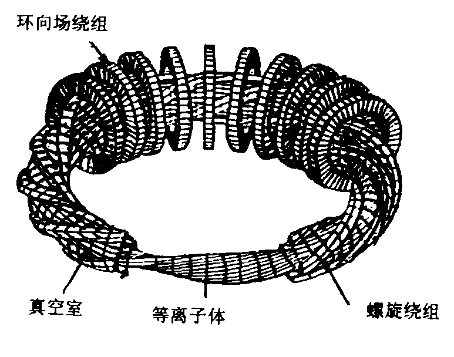

未来的反应堆。同时在 80 年代后新建的一批中型仿星器中的非欧姆加热（波加热和中性束注入加热）功率达到若干兆瓦，对等离子体约束的研究也达到中型托卡马克装置的水平，而这一时期随着托卡马克等离子体参数接近反应堆芯要求的参数，几个有关建立托卡马克型反应堆的非常严重的物理工程问题已被明确提出，仿星器途径内含的优越性再次被确认。这主要指下面两个问题：

（1）关于托卡马克堆不能稳态运行的问题，这与环向电流的感应驱动方式有关，虽然现代实验证实存在多种以非感应方式驱动环向电流的可能性，但其中任何一种方案都远未达到完全适用于反应堆条件的程度。

（2）与托卡马克要求很强的环向电流有关的一个问题就是：托卡马克存在破裂不稳定性，它对反应堆运行造成严重威胁，这也是现代托卡马克工程和物理研究必须解决的难题。

仿星器在原理上恰好不存在这两个问题。从实现磁约束的原理看，仿星器和托卡马克是非常类似的，即都通过磁力线的旋转变换来实现环形区域中带电粒子运动轨道的闭合，同时实现低比压条件下的环形磁流体的稳定平衡。但仿星器依靠外部螺旋绕组来实现磁力线的旋转变换，并可以将压强梯度产生的内部电流限制在较小的比例内，因此基本上不存在电流破裂问题；同时，若将环向绕组和螺旋绕组都采用超导磁体制作，对自持氘氚反应堆，稳态运行的问题基本上也不存在困难。这两点是仿星器在托卡马克途径得到迅猛发展的情况下，依然能够得到相当程度的发展，成为仅次于托卡马克，而且可能在未来代替托卡马克，或对托卡马克进行改进的一种有生命力的途径的根本原因。

在磁体工程方面，仿星器的模块式磁体相对于托卡马克中环向场磁体与极向场磁体的不可分离的联通结构来说是一大优点，后者使装置和反应堆的安装和拆卸非常麻烦，对某些部件的修理更换常常要重新将整个装置拆开，这可能是托卡马克反应堆应用上的严重障碍。

托卡马克的磁场位形是环形轴对称的，是空间二维结构。存在某些三维扰动结构，但整体上托卡马克是二维结构。仿星器的磁场结构特征确定其平衡位形一定是三维性质的，原则上没有任何对称性。在不同的环向位置上，磁面的截面形状可以相差甚大，这使等离子体的有效占有体积变小。仿星器磁体的设计和加工要求达到非常高的精确度，否则可能影响整体性能。现代仿星器位形分析只能通过大型的计算程序来完成，但是，正如第四章讨论中指出的，作为仿星器约束磁场组成部分的环形螺旋磁场，在“直线近似”的意义上具有螺旋对称性。这类磁场可以区分成$l=1$，$l=2$，$l=3$，…等基本谐波，加上一个代表环向本底磁场的量。用磁标势表示

$$
\Phi(r,\theta,s)=B_{0}s+\frac{L}{2\pi}\sum_{l}b_{l}I_{l}(2l\pi r/L)\cos l\left(\theta-\frac{2\pi s}{L}\right) \tag{10.1}
$$

式中$s$代表磁轴上的长度变量，$\theta$为极向角变量，$L$为螺距。为讨论方便，下面以这种“直线仿星器位形”为例来说明仿星器位形的一些基本性质。首先是磁力线的旋转变换。通常用$\iota$来表示磁力线的旋转变换率，它与托卡马克位形中的安全因子$q$的关系为

$$
\iota=l/2\pi=1/q \tag{10.2}
$$

其大小及空间剖面分布与螺旋磁场有关

$$
\iota=2\pi\left(\frac{b_{l}}{B_{0}}\right)^{2}\frac{l^{5}\left[1-1+2\left(\frac{l\pi r}{L}\right)^{2}\right]}{(2^{l}l!)^{2}}\left[\frac{2l\pi r}{L}\right]^{2(l-2)} \tag{10.3}
$$

这一表示式比第四章中相应公式更广泛，包括了$l=1$的情形。对$l\geqslant 3$，磁轴处的旋转变换率$\iota(0)=0$，然后随半径增大，按托卡马克中的磁剪切的定义，现在得到的剪切是负的

$$
s=-\frac{r}{\iota}\frac{\mathrm{d}\iota}{\mathrm{d}r} \tag{10.4}
$$

对$l=1$和$l=2$，在整个约束区域中旋转变换率近似不变，磁剪切近似为零。仿星器位形的另一重要特征是磁阱（magnetic well），定义为磁面所含体积对磁通的导数

$$
U=\frac{\mathrm{d}V}{\mathrm{d}\psi}=\oint\frac{\mathrm{d}s}{B} \tag{10.5}
$$

函数$U$在边缘的值与在磁轴处的值之差称磁阱深度。理论研究指出，一定深度的磁阱可以使磁流体交换模和局部模得到稳定。

仿星器位形的磁轴不一定是平面曲线（圆或跑道），在很多情况下是空间曲线，例如早期的空间 8 字形位形，就是一种具有空间曲线磁轴的位形，在后来的对仿星器位形的优化过程中，发现了更多形式的具有空间曲线磁轴的位形。仿星器的发展过程基本上围绕两个中心问题而进行：第一个是物理上进一步改善位形结构，这将在下面较详细地介绍；第二个是为了解决磁体结构的一个基本问题，即环向磁体与极向磁体间的联通结构。现在基本上已解决了这两种磁体的联通困难，实现了磁体结构的模块化，这是向反应堆工程方向的一个很大的进展。

在更广泛的意义上，仿星器被称作环形螺旋系统。但由于习惯，也由于上述磁场位形结构上的基本特征，所有环形螺旋系统仍称仿星器。下面各小节将较详细地讨论和介绍有关磁场位形特征，主要实验装置，加热和约束研究，改善约束研究及边缘和偏滤器等内容。

## 10.1 仿星器位形的发展和特征$^{[2\sim9]}$

### 10.1.1 多种仿星器形态

在传统仿星器（即第四章讨论过的，由环形磁场和一对或几对大螺距绕组的磁场产生的环形约束位形）的基础上，后来发展了扭曲器（torsatron），螺旋器（heliotron），空间磁轴装置（heliac），优化螺旋位形（helias）等多种位形。其中，标准仿星器和扭曲器及螺旋器具有平面磁轴，而 Helias 和 Heliac 具有空间磁轴。下面简单介绍几种重要的仿星器位形：

（1）Torsatron：螺旋绕组中的电流流动方向相同，可只用一种螺旋绕组产生原来传统仿星器用两种绕组得到的位形，但要另一组轴对称线圈来补偿垂直场。这种位形具有自然的偏滤器。

（2）Heliotron：是日本学者 K.Uo 提出的一种特殊的仿星器，类似于扭曲器，螺旋绕组中电流同向，但保留环向磁场线圈，另加垂直场线圈。图 10.2 是 Heliotron 的线圈布设情况。

（3）Heliac：意为空间磁轴装置（Helical Axis device），单纯利用一种线圈，即平面圆形线圈在空间曲线上以不同的取向排列，加上其他平面圆形线圈（包括螺旋真空室轴线处的一个圆形线圈），所产生的磁场可以形成磁力线具有旋转变换的，具有一定闭合磁面区

的位形，磁轴是空间曲线，并且具有可变曲率。这种位形完全由平面圆形线圈所产生，具有工程简易性，适合于反应堆应用。图 10.3 是 Tj-II Heliac 装置的线圈布设。

（4）Helias：先进螺旋仿星器（Helacai Advanced Stellarator）的简称。在具有空间轴线的真空室上通过调节线圈组合和排列，可以使平衡等离子体中沿磁力线的电流分量的比例降到很低；也可以使粒子轨道与磁面的偏离降到很小，是一种对约束性能进行多方面优化的仿星器，其磁体通常采用模块式结构。除平面圆形线圈外，采用了多种非平面扭曲形线圈，其总体效应相当于螺旋线圈。图 10.4 是部分优化位形的 W7-AS 装置的线圈布设。

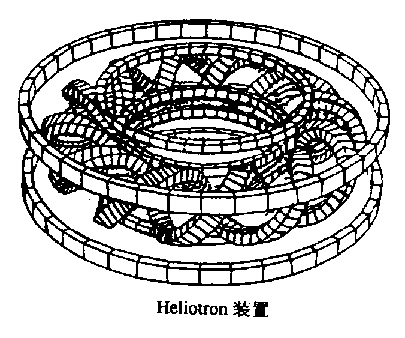

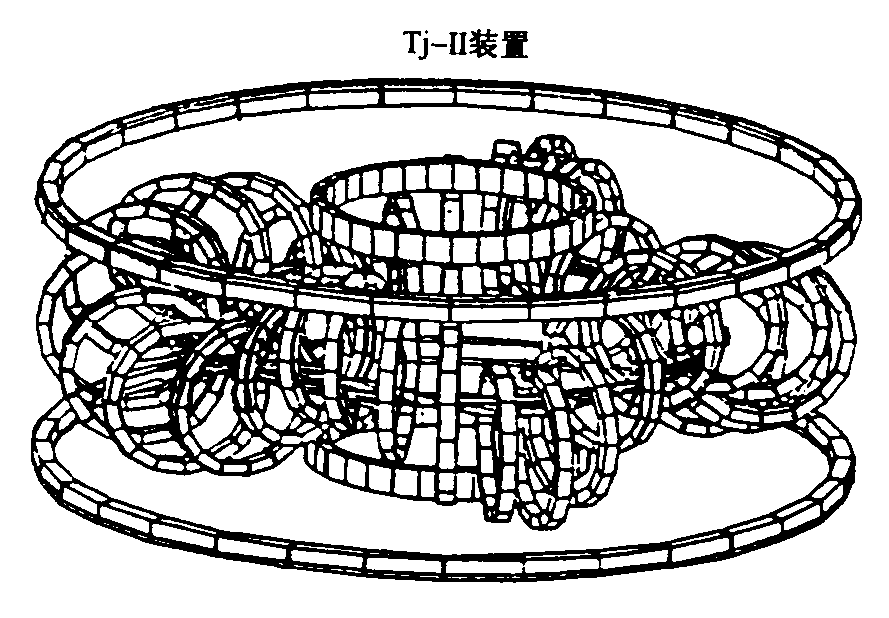

### 10.1.2 螺旋线圈的模块化及模块化仿星器$^{[2]}$

螺旋线圈与环向场线圈的联通结构使装置和反应堆工程复杂化。为解决这一难题，对螺旋线圈的磁场进行了详细分析，发现可以用分成模块的绕组来产生类似的磁场形态。图 10.3 表示其中的一个例子。对于由下面方法在圆环面上绕制的一对螺旋线圈：

$$
\theta_{1}=\frac{2}{5}(\pi-\varphi),\quad \theta_{2}=-\frac{1}{5}\varphi \tag{10.6}
$$

其中一个螺旋线圈的螺距为另一个的两倍，电流流动方向相反。这些螺旋线圈在环面上的形状及在$(\theta,\varphi)$平面上的映象分别如图 10.5 中的（a）上下两图所示。分析表明，这对螺旋线圈的主要富氏分量可以用图 10.5 中（b）图的三种类型共 15 个模块线圈来代替，它们在$(\theta,\varphi)$平面上的相应映象如下图所示。

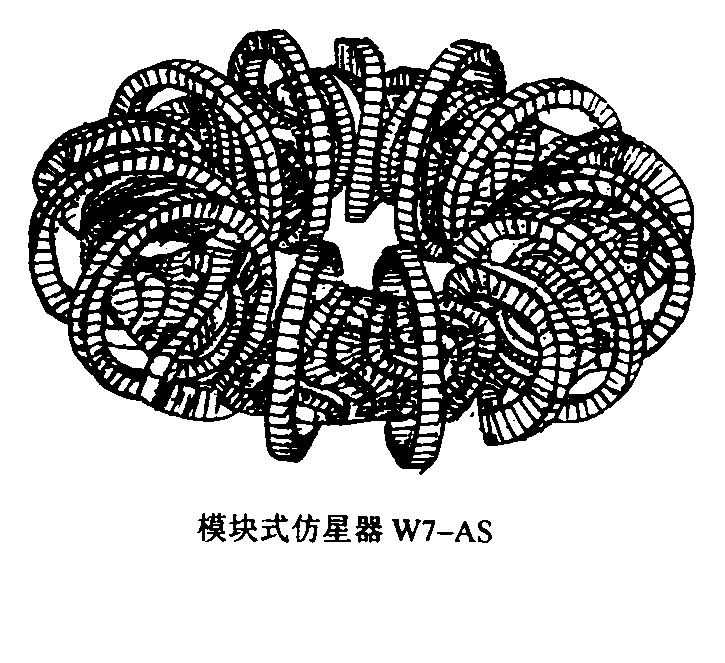

利用各种形式的模块式线圈及其它环向场线圈和辅助线圈产生仿星器位形的装置称模块式仿星器，其中的线圈不存在联通结构。

### 10.1.3 仿星器位形的优化$^{[3\sim5]}$

仿星器位形的空间三维结构特性使带电粒子运动轨道复杂化。与托卡马克位形相比，磁场的不均匀性不仅来自环形效应，还来自螺旋波纹磁场。因此，沿一条磁力线，磁场强度$B$除存在$qR$尺度上相对大小为$\varepsilon_{t}=a/R$的变化外，还存在尺寸更小的螺旋场的调制（相对大小为$\varepsilon_{h}=b_{h}/B_{0}$）（如图 10.6 所示），这使带电粒子的运动轨道复杂化。除了可以自由沿磁面运动的粒子即飞行粒子（passing particles）外，还存在两类捕获粒子，即环形效应产生的类似于托卡马克中香蕉粒子的第一类捕获粒子和局部磁镜效应产生的局部捕获粒子。环形捕获粒子也受到螺旋磁场波纹的影响，其沿极向运动轨道的投影是带毛刺的“香蕉”，有的文献中称其为“超香蕉”（super banana）（如图 10.7 所示）。与托卡马克相比，飞行粒子和捕获粒子轨道与磁面的偏离都要大，尤其是局部磁镜所捕获的粒子，其轨道可能不闭合（可能产生由一个局部磁镜漂移到另一个磁镜的运动）。这不仅影响粒子的约束，也使仿星器的输运性质和托卡马克有很大的差别。

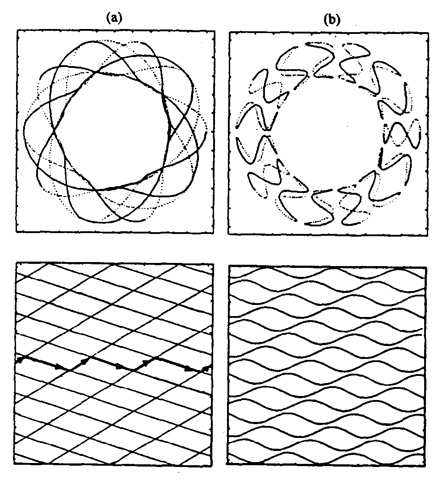

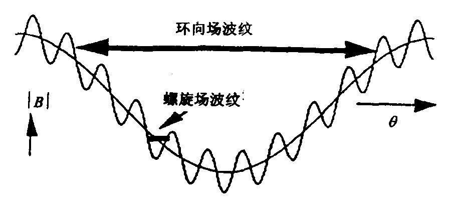

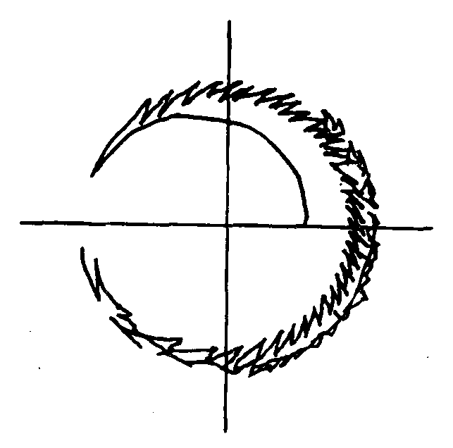

与托卡马克一样，仿星器中等离子体的输运也是由新经典输运和湍流引起的反常输运组成的，新经典输运是可能得到的最低水准的输运。对仿星器的新经典输运作过很多理论分析，这些分析必须结合仿星器的具体位形，而实际的仿星器位形非常复杂，不可能在本书中详细描述，我们只能引述一些重要结论。研究发现，在经典的未优化的仿星器中，在小碰撞参数区的输运明显大于托卡马克中的对应值，这是由局部磁镜所捕获的粒子所贡献的。在较低的碰撞参数下，具体说，在满足

$$
\frac{1}{\tau_{h}}\gg\nu_{\mathrm{eff}}\gg\frac{1}{\tau_{b}} \tag{10.7}
$$

（上式中$\tau_{h}$为粒子在局部磁镜间的运动特征时间，$\tau_{b}$为香蕉粒子的周期，$\nu_{\mathrm{eff}}=\nu/\sqrt{\varepsilon}$为有效碰撞频率）的条件下，输运系数存在一个与有效碰撞参数成反比的参数区，称$1/\nu$扩散区（如图 10.8）。在新经典输运的意义上，经典仿星器比托卡马克差很多。但是如果能减小捕获粒子相对于磁面的偏离，这种性质的输运可以大幅度降低，所以，仿星器位形在物理上优化的一个基本方面就是减小这种轨道偏离。

可以将粒子回转中心的运动方程写成：

$$
\begin{aligned}
\frac{\mathrm{d}r}{\mathrm{d}t}&=v_{d\perp}\sin\theta\\
r\frac{\mathrm{d}\theta}{\mathrm{d}t}&=v_{d\perp}\cos\theta+r\omega_{h}+r\omega_{E}
\end{aligned} \tag{10.8}
$$

其中$v_{d}$是环形漂移速度，$\omega_{h}$，$\omega_{E}$分别为螺旋磁场产生磁力线的旋转变换和径向电场对应的圆频率。所考虑的优化，就是要设法使粒子沿径向的偏离减小。可以调节的物理量就是环形漂移速度和两种旋转变换。电场是自洽地产生的（与等离子体密度和比压值等有关），在计算粒子轨道时考虑其效应即可；磁力线的旋转变换与$\varepsilon_{h}^{2}$成正比，加大旋转变换即可以减小径向偏离，但加大旋转变换必然要加大螺旋场的波纹度，使更多的粒子变成局部捕获粒子，因此，最好的方法是减小环形漂移本身。由环形漂移速度的定义

$$
v_{d}=\frac{v_{\parallel}^{2}+v_{\perp}^{2}/2}{\Omega}\boldsymbol{b}\times\nabla b \tag{10.9}
$$

上式右方的矢量积代表的是磁力线的测地曲率（geodesic curvature）。如果使这一曲率具有正负变化，平均起来，总的环形漂移就可以大幅度减小。这一思想实际上是后来对仿星器位形优化的基本出发点之一。一个最直观的方法是将几个直线段仿星器联接成环（如 W7-AS 的五角形），就可以使有效漂移大幅度减小。

另一个基本问题是平衡位形要受到等离子体产生的电流的影响。在宏观上，处于磁流体平衡态的等离子体中要产生反磁电流，这是与磁力线垂直的电流，为了使电流线连续，必然要存在沿磁力线的电流，由$\nabla\cdot\boldsymbol{j}=0$，可以求得

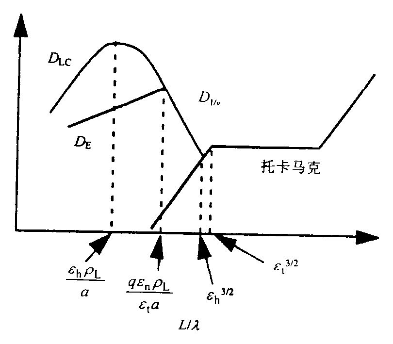

$$
j_{\parallel}\approx\frac{2}{\iota}j_{\perp}\approx\frac{4\pi}{B_{0}}\frac{\mathrm{d}p}{\mathrm{d}r}\cos\theta \tag{10.10}
$$

这个电流通常称 P-S 电流，它将产生一个垂直磁场，影响等离子体的整体位移。更重要的是沿磁力线的电流影响磁流体稳定性（主要是电阻性扭曲模）。产生沿磁力线方向电流的另一物理因素是环形捕获粒子产生的自举电流，其大小与压强梯度及极向磁场本身有关。与托卡马克的情况相反，在仿星器中并不希望太大的自举电流比，所以在仿星器位形的优化研究中，把$\langle j_{\parallel}^{2}/j_{\perp}^{2}\rangle$的大小作为重要的优化指标，这里的平均是对整个磁面进行的。我们将不讨论详细的磁场计算而仅介绍主要的研究结论。在 Helias 概念的研究中，德国学者发现，主要通过减小磁力线的平均曲率和适当加大旋转变换率，可以达到既使粒子与磁面的偏离减小，又使平行电流比例减小的目的。仿星器 W7-A，W7-AS，W7-X 就是沿这一思路优化的典型实例。W7-A 是经典仿星器，基本螺旋磁场具有$l=2$特征，有一定深度的磁阱，剪切很小，其中的平均电流比$\langle j_{\parallel}^{2}/j_{\perp}^{2}\rangle=12$，这是很大的值，对应于很大的磁面位移和很低的稳定比压值；W7-AS 是部分优化的位形，而且是由模块式磁体产生的，其中$\langle j_{\parallel}^{2}/j_{\perp}^{2}\rangle\approx3$，相应地磁面位移减小很多，可达比压值有很大提高；最后，设计中的 W7-X 超导磁体模块仿星器的，$\langle j_{\parallel}^{2}/j_{\perp}^{2}\rangle\approx0.5$，达到了完全的优化，对应的稳定比压可达 6% 左右，满足反应堆的要求。这种优化的一个重要特征是利用了空间磁轴特性，使磁力线的曲率有时为正，有时为负。这在 Spitzer 的早期研究中曾指出过，现在已可用模块式磁体结构来实现了。

图 10.9 和 10.10 分别是部分优化的 W7-AS 和完全优化的 W7-X 中的电流分量及粒子轨道情况。

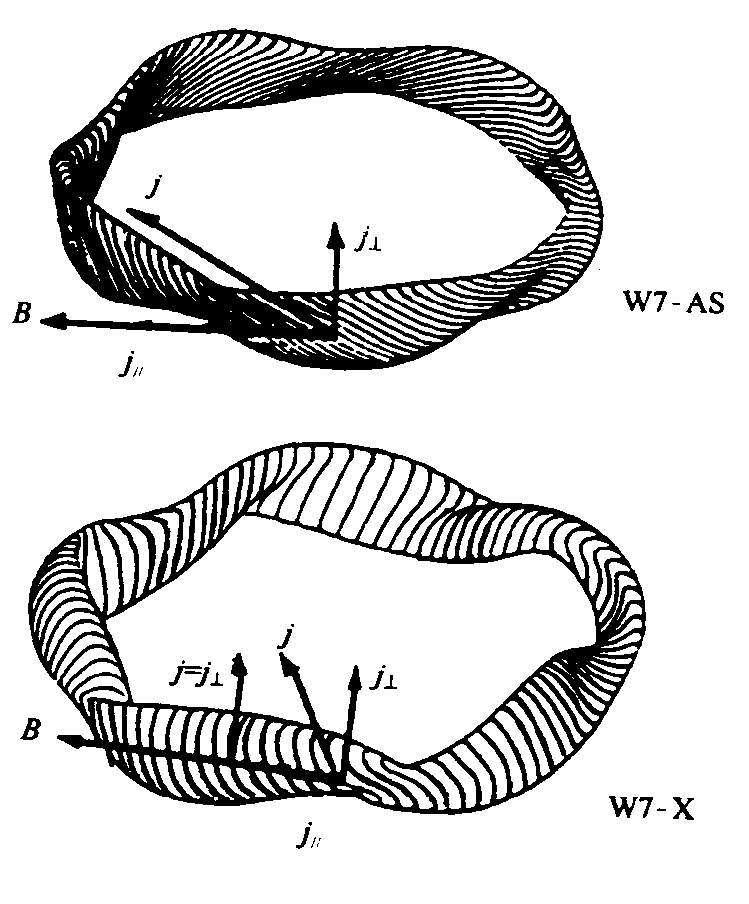

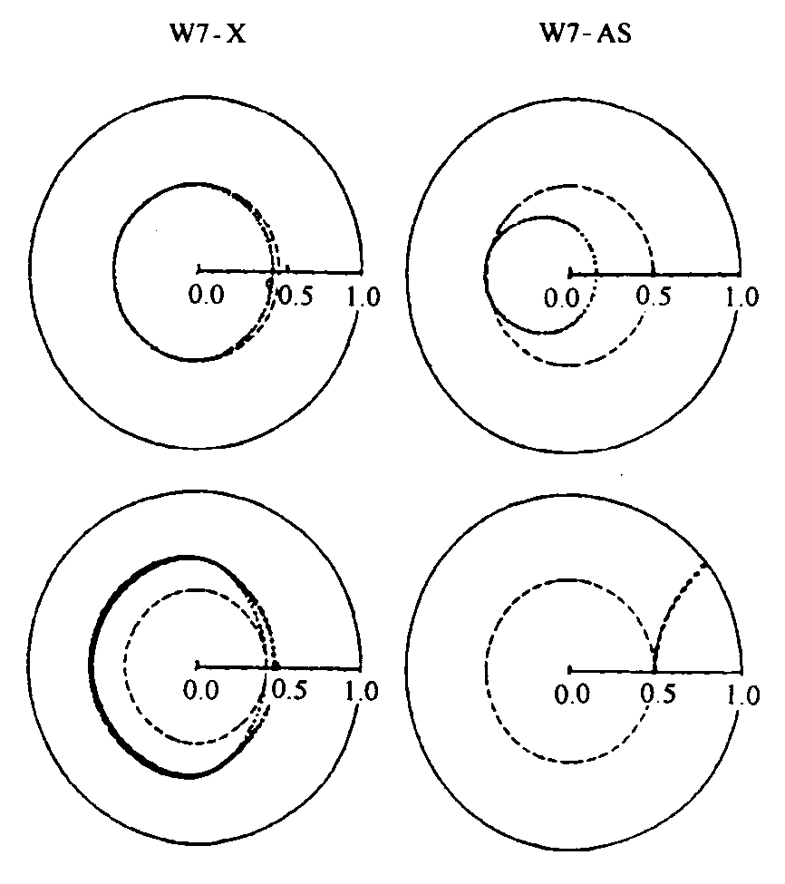

### 10.1.4 仿星器实验装置

作为环形磁约束实验装置，仿星器与托卡马克有很多的共同点。装置由磁体，真空室，加热设备，送气送料设备，诊断设备等组成。由于磁场位形是三维的，真空室一般也是非对称的，但与位形一致，沿环向可以分成若干周期段，每一周期段由若干模块组件构成。这种模块结构是仿星器对托卡马克的一大改进。各种部件的功能与托卡马克对应的部件是类似的，因此不重复介绍。

### 10.1.5 主要的仿星器装置简介

美国 PPPL 是最早进行仿星器研究的实验室，起始于 50 年代末，共建成 5 个装置，最大的是 C-仿星器。在原苏联和欧洲也有一些小型装置，这些装置上主要用欧姆加热产生等离子体，但欧姆电流要使原来的真空磁场位形产生变形，加上这些装置的磁场位形的设计和建造精度不高，造成等离子体约束较差。在 70 年代初，我国的西南物理研究院也建成一个小型仿星器“凌云”，是跑道型装置，有局部偏滤器和离子回旋共振加热段，用注入等离子体团来产生初始等离子体。该装置因磁面不精确而难于开展深入实验。第一代仿星器装置中的大部分装置是 70 年代后建的，磁场设计和建造的精度已改进，装置的真空磁面完善，带电粒子的约束良好。普遍采用了非欧姆加热手段。第二代装置是 80 年代和 90 年代设计建造的，吸收了托卡马克研究的许多经验，在加热方法，第一壁处理，送料技术和等离子体控制等方面与托卡马克类似，但具有仿星器的独特优点，因此实验研究取得重要进展。下面对几个重要的第一代仿星器及第二代仿星器做一些简单介绍。第一代和第二代仿星器装置中的一些装置其规模和达到的等离子体参数相当于托卡马克 T-4，TFR，HL-1，最高的接近 PLT 的水平。

（1）W7-A（德国）：是标准仿星器，基本螺旋磁场是$l=2$型。采用欧姆加热和 ECRH 加热。该装置上的实验证实，仿星器中等离子体总体参数和约束性能可达到同等尺寸托卡马克的水平。其线圈布设见图 10.1。

（2）W7-AS（德国）：是具有模块结构的优化型仿星器，属 Helias 型，整个装置呈五角形，由五个模块段组成，每个模块段具有九个特别设计的非平面线圈，两个环向场线圈，在五个角上各有一个平面线圈，另外还设有垂直场线圈，共同形成较优化的位形，具有可调旋转变换和全域磁阱，但剪切很小。采用 ECRH，NBI 加热，总功率超过 5 MW，等离子体总体参数与中型托卡马克接近，在加热和约束研究中取得重要成果，包括发现了仿星器的 H 模式约束，是欧共体和国际仿星器规划中的骨干装置之一。

（3）Heliotron-E（日本）：由文部省所属京都大学建造，磁力线的旋转变换率随半径增加较快，因此具有较大的磁剪切。采用 NBI，ECRH 和 ICRH 加热，其中中性束加热功率达 4 MW，对等离子体平衡和稳定性及输运性质进行了详细研究，是环形螺旋装置系列中的重要实验装置，等离子体总体参数接近中型托卡马克。最近新建成的大型装置 LHD 是在其研究基础上的发展。

（4）CHS（日本）：由日本文部省名古屋大学聚变科学研究所（NIFS）建造，属螺旋器，是一种紧凑型螺旋装置（Compact Helical System，故名 CHS），与其它仿星器不同，该装置具有较小的环径比（$R/a=5$）。采用 NBI，ECRH，ICRH 加热，对平衡、稳定性和输运进行了较全面的研究，是仿星器系列中较重要的装置，等离子体总体参数接近中型托卡马克，但达到的粒子密度偏低，可能是为了突出研究内在电场效应和高能离子约束性能。

（5）H-1（澳大利亚）：由圆形线圈绕在环形闭合空间螺旋轴线上来产生空间磁轴仿星器位形，属 Heliac，具有可调的旋转变换和一定深度的磁阱。由于只采用一种形状的磁体，装置结构相对简化。对比于其他仿星器，Heliac 是新发展的一种，目前仍进行原理性实验。已证实豆形的磁面结构，用 Helicon 波（频率在$\Omega_i < \omega < |\Omega_e|$范围）实现了低密度等离子体的长期约束。在较低的磁场下（$B < 0.5\ \mathrm{T}$）观察到改善的仿星器约束模式。

（6）Tj-II（西班牙）：也是 Heliac 型，全部磁体由绕在环形空间螺线上的 32 个平面线圈及附加垂直场线圈构成。环形螺线的大半径$R = 1.5\ \mathrm{m}$，小半径$r = 0.28\ \mathrm{m}$，沿环向有四个周期，具有可调旋转变换和磁阱，实验中寻求非共振磁面平衡的运行窗口。该装置于 1994 年新建，准备进行 1 MW 的 ECR 和 4 MW 的 NBI 加热，W7-AS 和 Tj-II 是当前欧共体仿星器规划中的两个主要装置。目前已获得理想的豆形磁面结构和中等参数的等离子体。

（7）ATF（美国）：即先进环形装置（Advanced Toroidal Facility），1987 年由 ORNL 所建，属扭曲器，采用 NBI，ECRH，ICRH 加热，其中中性束加热功率超过 4 MW，与类似尺寸的托卡马克实验进行对比，加热和约束结果相当接近。中心电子和离子温度都超过 1 keV，平均密度达$1.3\times10^{14}\ \mathrm{cm}^{-3}$。该装置上仅用 ECR 加热使低密度等离子体维持超过 1 h 的长脉冲，证明可用非欧姆方法实现等离子体的建立和加热。1992 年后因经费原因停止运行。

其他装置的简况如表 10.1 所列。

**表 10.1 主要的第一、二代仿星器参数**

| 装置名称（国别） | $R/\mathrm{m}$ | $a/\mathrm{m}$ | $B/\mathrm{T}$ | 位形特征 | 加热功率/MW NBI | ECR | ICR |
|---|---|---|---|---|---|---|---|
| Cleo（英国） | 0.9 | 0.1 | 2.0 | $\iota=2,\ m=7$ $\iota_0=0,\ \iota_a=0.6$ | 欧姆加热 |  |  |
| W7-AS（德国） | 2.0 | 0.11~0.18 | 3.0 | $\iota=2,\ m=5$ $\iota_0\approx\iota_a=0.35\sim0.52$ | 1.5 | 1.0 | 3.0 |
| Heliotron-E（日本） | 2.2 | 0.2 | 2.0 | $\iota=2,\ m=19$ $\iota_0=0.51,\ \iota_a=2.75$ | 4.0 | 1.0 | 3.0 |
| ATF（美国） | 2.1 | 0.27 | 2.0 | $\iota=2,\ m=12$ $\iota_0=0.3,\ \iota_a=1.0$ | 4.5 | 0.4 | 0.3 |
| CHS（日本） | 1.7 | 0.22 | 1.5 | $\iota=2,\ m=8$ $\iota_0=0.31,\ \iota_a=1.10$ | 4.0 | 0.2 | 0.5 |
| U-2M（乌克兰） | 1.7 | 0.22 | 2.4 | $\iota=2,\ m=4$ $\iota=1.0$ | 3.0 | 0.2 | 2.0 |
| Tj-II (Heliac)（西班牙） | 1.5 | 0.22 | 1.0 | $\iota=1,\ m=4$ $\iota=0.9\sim2.5,\ s=0.1$ | 2(4) |  | 1.0 |
| H-1 (Heliac)（澳大利亚） | 1.0 | 0.2 | 1.0 | $\iota=1,\ m=3$ |  |  | 0.2 |
| L-2M（俄国） | 1.0 | 0.12 | 1.5 | $\iota=2,\ m=14$ $\iota_0=0.19,\ \iota_a=0.8$ |  |  | 0.3 |

两个具有更大尺寸的装置 LHD 和 W7-X 是已批准建造的下一代仿星器的主要装置。LHD 由日本文部省所属国家聚变科学研究所（NIFS）建造，是大型超导磁体装置，属螺旋器类型，已于 1997 年末建成；W7-X 是欧共体和德国计划建造的大型超导磁体仿星器，属模块式完全优化仿星器，计划于 2004 年建成。这两个装置的总加热功率都将达 30 MW，设有极向偏滤器，等离子体参数将达到 DIII-D，ASDEX-U 的水平，将为仿星器途径的下一步发展提供决定性的实验数据。装置的具体参数如表 10.2 所示。

**表 10.2 LHD 和 W7-X 设计参数**

| 参数 | LHD | W7-X |
|---|---|---|
| 环大半径 / m | 3.9 | 5.5 |
| 等离子体平均半径 / m | 0.65 | 0.52 |
| 等离子体体积 / m³ | 30 | 30 |
| 位形参数 | $l/m = 2/10$ $\iota_0 = 0.5,\ \iota_a = 1.0$ | $l/m = 2/5$ $\iota_0 = 0.84\pm0.2,\ \iota_a = 0.99\pm0.2$ |
| 磁场强度 / T | 3.0 | 3.0 |
| 加热功率 / MW | 30(42) | 30 |
| $P_{\mathrm{NBI}}$ | 15(20) |  |
| $P_{\mathrm{EC}}$ | 10 |  |
| $P_{\mathrm{IC}}$ | 3(12) |  |
| 偏滤器 | 螺旋形或局部磁岛型 | 环向 5 周期磁岛链 |

## 10.2 仿星器的磁面位形及等离子体稳定性研究

### 10.2.1 真空磁面结构的实验观察

不存在等离子体时仿星器的磁面称真空磁面。存在理想的真空磁面是带电粒子可以得到长期约束和建立稳定的等离子体平衡位形的前提。每个仿星器装置建成后第一件事就是研究其真空磁面结构。研究方法之一是在装置中产生一些高能电子（例如用$\beta^-$衰变同位素）并观察这些电子的约束。这可以定性地了解磁面结构的完整程度。在 Cleo 仿星器中用这种方法证明高能电子可以在装置中运行几百万次而不逸出。更定量地研究磁面结构的方法是注入低能电子，它们基本上沿磁力线运动，再利用涂有萤光材料的可移动探测棒跟踪电子的轨迹，用这些轨迹可以描述出较完整的磁面映象。这一方法被普遍采用。

下面介绍 W7-AS 装置的测量结果[10]。前面已介绍，这是一个部分优化的模块式仿星器，沿环向有五个周期，当沿环向移动时，其理想磁面结构在三角形与椭圆形之间变化（如图 10.11 所示）。实际磁面与理论结果会有一些偏离。这些偏离来源于各种杂散磁场的扰动。我们曾多次指出，环形效应本身可以看成是对直线仿星器位形的扰动。扰动磁场中，那些变化周期与旋转变换相近的扰动会产生最大的偏离。扰动场的两种最常见和最重要的效应是：(1) 产生磁岛结构；(2) 在边缘区产生无规化结构。后一种扰动将使有效约束区缩小。

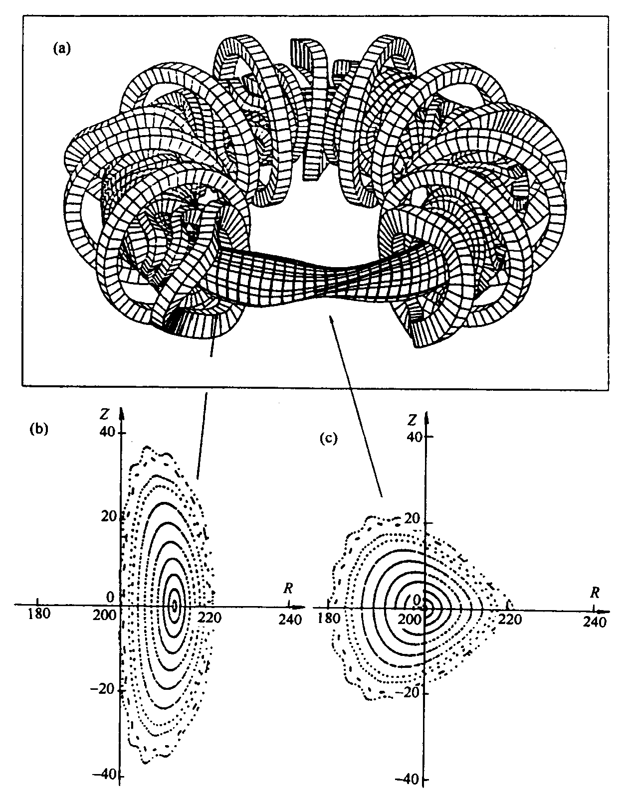

$\iota = 0.40$闭合磁面所在区域的大小是与旋转变换角的大小有关的：随着$\iota$的加大，闭合磁面内部区域减小，这一性质在测量中看得很清楚。图 10.12 是中心$\iota$值小于 1/3 时的结果，闭合磁面一直伸展到平均小半径$\bar{r} = 20\ \mathrm{cm}$处，没有磁岛结构。

随着$\iota$值的加大，首先在中心区观察到$m = 3$的磁岛。由于磁剪切很小，磁岛结构的电子束的映象不清晰，但磁岛发生的区域与对应的计算结果吻合。理论预期另一类磁岛具有$n = 5$的特征，果然，当$\iota$增大到在内部包括 5/11，5/9 等值时，明显地观察到这类磁岛结构。图 10.13 是 11 个磁岛的情形。

实验观察到的磁面结构基本与理论计算一致，但并不完全相符。有时，需另外加入一个微扰磁场才能再现实验观察到的结果。这说明，除了与装置结构特性有关的扰动（装置的磁轴近于五角形，沿环向存在五个周期）外，还有一些不很清楚扰动场成分，它们的周期$n < 5$。W7-AS 的设计可以说相当精确，但并非完善。实验上可以观察到很大尺寸的

磁岛，在$\iota = 1/2$时磁岛的宽度可以达到平均半径的一半，小的磁岛则只占半径的 5%，磁岛的存在影响粒子运动和输运，对约束不利；此外，外区的磁力线无规化也在实验中得到证实，这种无规化的一个应用是使偏滤器的热负载均匀化。

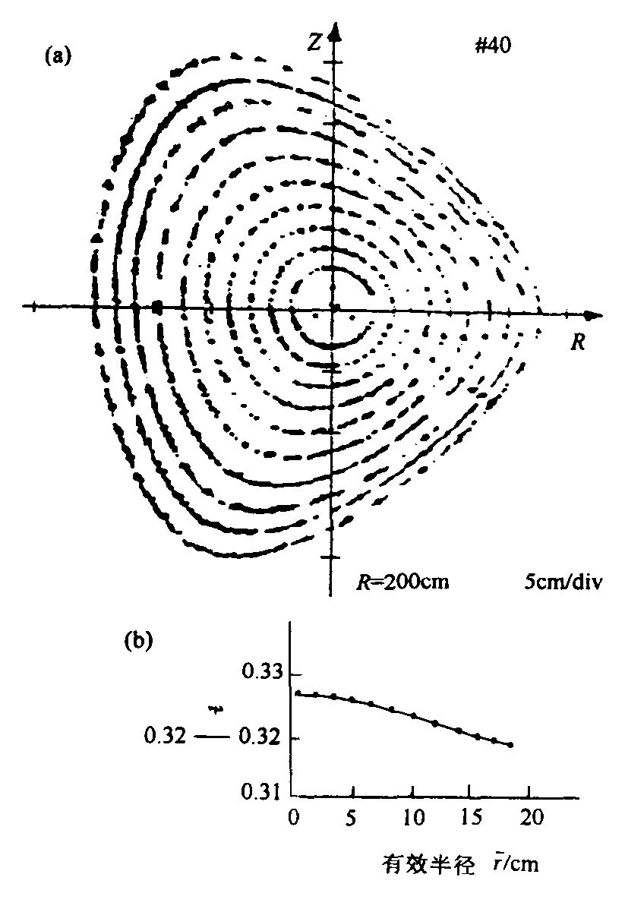

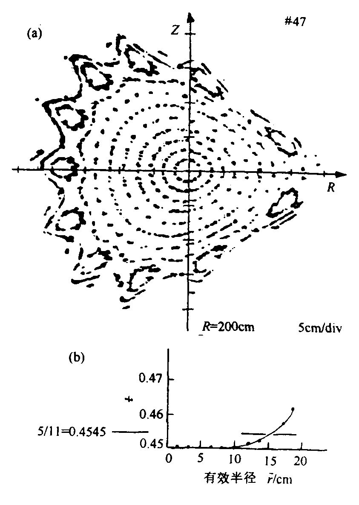

在另一类可能有应用价值的位形——Heliac 装置中，如 Tj-II，观察到沿空间螺旋线磁轴的豆形磁面结构，与理论计算吻合。但到目前为止 Heliac 型装置上的物理实验研究还刚开始，还没有开展更多的深入的物理研究。图 10.14 是 Tj-II 在四个不同环向位置处真空磁面的形状，可以看到这些磁面形状类似，只是具有不同的倾角，这是具有螺旋状空间磁轴仿星器 Heliac 的一个特点。

前一小节介绍过现代仿星器的四种典型装置，即扭曲器，螺旋器，Heliac 和 Helias。代表性的装置分别是扭曲器 ATF，螺旋器 H-E，Heliac Tj-II，Helias W7-AS。这四类装置中，前两种具有平面磁轴，其磁力线的旋转变换率随半径变化大，有大的磁剪切；后两种具有空间磁轴，磁力线的旋转变换率基本不随半径变化，磁剪切很小，但具有有限磁阱值。图 10.15 是四类装置的旋转变换率随半径变化的情况。

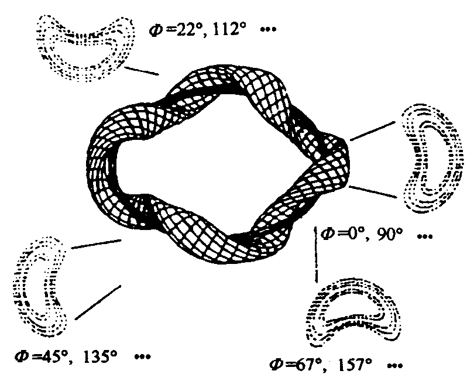

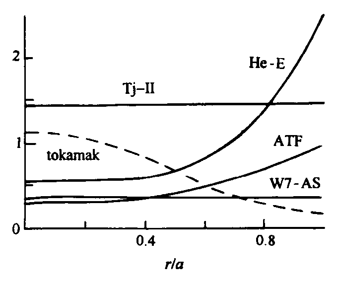

### 10.2.2 等离子体平衡位形及平衡电势[11~13]

存在等离子体时真空磁面结构将发生变化。等离子体产生的反磁电流$j_\perp$的主要影响是使内部磁场强度有所减小（“反磁性”），这将加大中心区与边缘区的磁阱差，对约束是有利的。但电流连续性条件要求总电流线闭合，由此得到沿磁力线方向的 P-S 电流（见 10.1 节讨论）。这一电流产生的等效垂直场使磁面发生位移，位移的大小与等离子体压强值成正比，一般认为：位移达到平均小半径的一半时平衡位形将受到破坏，这一条件给出关于平衡的比压极限

$$
\langle\beta\rangle = C\iota^2 / A \tag{10.11}
$$

式中，$A = R/\bar{r}_p$为平均倒环径比，$C$为大小为 1 的数字因子，与磁面的优化程度有关。例如对 W7-AS，$C = 2$，$A = 11$。如果存在欧姆电流或自举电流，以及束驱动电流，要考虑这些电流的影响。在目前的实验中，这些电流的影响都不大（采用非欧姆加热，等离子体的参数还不高，束或波驱动份额不大）。比较理论计算的平衡磁面结构与实验测定的结构则可说明有限比压等离子体的影响。在实验上确定的是等压强面，根据平衡位形的理论，等压强面基本与磁面符合。同样，等温度面也与磁面符合，即

$$
p = p(\psi),\quad T = T(\psi) \tag{10.12}
$$

利用实验测定的密度和电子温度剖面分布可以重构等压强面；另外，直接由软 X 射线信号强度也可以近似地重构等电子温度面，在 W7-AS 上，用这两种方法得出的等压强面或等电子温度面与理论计算的磁面符合得相当好，包括在$\langle\beta\rangle = 0.018$的条件下，没有发现磁面结构的破坏。按式（10.11）计算，取$\iota = 1/3 \sim 1/2$，W7-AS 中的平衡比压极限为 0.02～0.045。这表明，W7-AS 的磁面在接近平衡比压极限时仍保持良好的结构。

仿星器装置中由螺旋磁场引起的不均匀性使某些高能电子和离子的轨道较大地偏离平衡磁面并和第一壁相碰，在不同的条件下，这将引起电子或离子的优先逸出。这种情况类似于磁镜的逸出锥损失，并将产生双极电势。在 CHS 装置中，对 ECR 和 NBI 加热的低密度等离子体研究了双极电势的性质。研究是通过注入最高能量达 200 keV 的铯离子束来实现的。对非常低的密度（$n_e = 3\times10^{12}\ \mathrm{cm}^{-3}$），用 ECR 和 NBI 加热产生的$T_{e0} = 2.5\ \mathrm{keV}$，此时中心电势为 400 V，随着电子密度增大，电子温度下降，在$n_{e0} = 8\times10^{12}\ \mathrm{cm}^{-3}$时，中

心电势为 200 V。电势的大小及剖面分布依赖于加热功率和密度。这些结果主要说明仿星器位形可约束非电中性的等离子体，但密度太低的情况对反应堆并无多大意义。

### 10.2.3 宏观稳定性与密度极限问题

仿星器等离子体中的平行于磁力线的电流远小于托卡马克等离子体，所以在较低比压下不存在电流引起的扭曲模和撕裂模，也没有破裂问题。理论研究指出，局部模（所谓 Mercier 模）及电阻性交换模是可能存在的不稳定磁流体模式。这些模式一般不会影响整体约束，但可能使压强剖面得到某种局部性调整。在高比压下，类似于托卡马克，气球模不稳定性应限制可达到的最高比压。

在 W7-AS 的高功率加热实验中，当比压较高时，可以观察到一些磁流体活性，如 Mirnov 信号和软 X 信号上的非相干高频振荡。这可能与电阻性交换模或所谓的表面剥离模（Peeling）的激发有关。在当前已达比压下（$\bar{\beta} \approx 0.022,\ \beta_0 > 0.04$），没有发生硬的破裂现象。这实际上已证实仿星器不存在托卡马克破裂不稳定性的理论预期。这应当是仿星器研究的一个重要科学成果。

另一个问题是密度极限。对于托卡马克，存在由于加热和辐射间的功率平衡而引起的密度极限（Murakami 极限），或与破裂限制有关的密度极限（Hugill 极限）。对仿星器，由于真空磁面是外绕组中的电流确定的，不会产生类似托卡马克的电流通道收缩的现象，所以密度极限行为应不同于托卡马克。在 W7-AS 中曾进行一类实验，在 ECR 加热产生的较低密度的等离子体中打入冷弹丸，使等离子体密度迅速加大，电子温度则很快降低，这时观察到总辐射功率加大到接近总加热功率，而密度远高于等效的 Murakami 极限（用等效的旋转角公式算出），但这种高密度低温强辐射等离子体仍然得到充分的约束。目前在几个主要的仿星器装置中，等离子体密度在 ECR 加热或与 NBI 共同加热条件下，很容易达到$2\times10^{14}\ \mathrm{cm}^{-3}$以上的值，而且主要是 ECR 波受截止而限制了更高的密度值，因此，仿星器不存在类似托卡马克那样的密度极限，这是仿星器与托卡马克的一个重大区别。

曾经对 ASDEX 托卡马克和 W7-AS 仿星器的密度极限物理问题进行对比实验研究[14]。对 Hugill 极限值做对比后发现，仿星器中可达到的最大 Hugill 参数比托卡马克的相应参数高好几倍。基本在同样的加热功率和器壁条件下，对 ASDEX 托卡马克，Hugill 参数$\bar{n}_e R q_g / B_t = 3\times10^{20}\ \mathrm{m}^{-2}\cdot\mathrm{T}^{-1}$，超过这一参数将发生破裂；对 W7-AS，已达到$\bar{n}_e R / B_t \geq 8.5\times10^{20}\ \mathrm{m}^{-2}\cdot\mathrm{T}^{-1}$。在超过这一参数时，可能发生较软的热崩塌（thermal collapse），其表现为：在能量约束时间的时标内，等离子体将失去很大一部分储能，但 ECR 加热支持的等离子体放电不破裂。

两种装置中密度极限的不同还表现在对

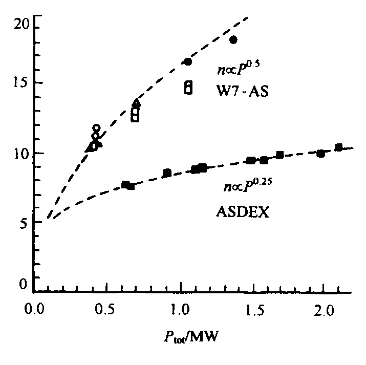

加热功率的依赖关系上。对 ASDEX 托卡马克，极限密度值随加热功率的变化$\propto P_t^{1/4}$，而 W7-AS 中极限密度随加热功率的增大要快，按$\propto P_t^{1/2}$变化。图 10.16 是 ASDEX 和 W7-AS 上用中性束注入加热得到的最高密度随中性束有效功率的变化。两个装置的器壁均进行了硼化处理。对应条件：ASDEX 为$B_t = 2.1\ \mathrm{T}$，$1/q_a = 0.34$；W7-AS 为$B_t = 1.28\ \mathrm{T}$，$\iota_a = 0.33$。

托卡马克等离子体在接近密度极限时会发生 MARFE 或脱栏现象，在仿星器中，存在类似的物理过程，但表现出的现象特征有较大的差别。仿星器的类 MARFE 现象发生在辐射功率与总加热功率比达到 30% 以上时，在环的内侧边缘附近出现一块很亮的区域，同时$H_\alpha$线的强度突然变弱，CIII 线突然增强，这些表明该区域的温度已明显变低，然后可能发生热崩塌。

但是，在确定的加热功率下，从刮离区功率平衡的角度，可能存在对边缘密度值的限制。W7-AS 的实验证实，边缘密度与磁场强度及流到孔栏或偏滤器靶板上的热流通量有关，存在下述定标[15]

$$
n_s = 0.52 B^{0.81} q_\perp^{0.52} \tag{10.13}
$$

此处$q_\perp$是流向孔栏的热流通量。因此，当中心区密度增大使总辐射功率随之增大时，流到孔栏表面的热流通量减小，可维持的边缘密度值将下降，这反过来要影响中心区可达的密度。但这一现象在何种程度上对整体密度极限产生影响，还要靠进一步的实验来验证。最后，托卡马克中的 Greenwald 密度极限依赖于总电流，目前仿星器实验观察到的最高密度已明显高于这个极限（以等效的旋转变换率计算），例如 W7-AS 中达到的最高密度$3\times10^{14}\ \mathrm{cm}^{-3}$（近期获得的新结果，比图 10.14 中标出的最大值更高）已是等效的 Greenwald 极限（$n_G = \dfrac{5B_t}{\pi R}\iota_a \approx 1\times10^{14}\ \mathrm{cm}^{-3}$）的三倍多，而且还可能达到更高值。

但是也应指出，对不同的加热条件，可能达到的最高密度是不同的：对 ECR 加热，往往是波的截止限制了可达密度；对中性束加热，可能达到的最高密度值已远大于托卡马克对应的极限密度；对 ICRF 加热，可达密度受到较大限制，如 W7-AS 上采用氢的二次谐波加热模式时，当中心密度超过$5\times10^{13}\ \mathrm{cm}^{-3}$时，就会引起热崩塌。这一密度值甚至低于托卡马克的相应极限密度[16]。

## 10.3 仿星器等离子体的加热和约束研究

### 10.3.1 仿星器等离子体的加热[17~20]

未来的仿星器型反应堆中，等离子体的产生和初始加热将主要用电子回旋频段波加热来实现，其可行性已在一些装置中得到证实。在初期的仿星器加热研究中，也常采用欧姆加热，这似乎与仿星器不需要环向电流相矛盾，但对于实验研究，这并无多大妨碍。欧姆电流在一定程度上要改变真空磁面的结构和位形特性，但在仿星器中，欧姆电流始终是从属性的，磁力线的旋转变换主要还靠外螺旋绕组形成。欧姆加热产生等离子体的过程和特征与托卡马克装置中没有差别，因此我们将不特别讨论。

(1) ECRF 加热：目前仿星器装置中等离子体的建立（启动）大多采用 ECR 加热方法，有时也采用较低频率的射频击穿作为辅助。在粒子密度$\bar{n}_e = (1\sim20)\times10^{13}\ \mathrm{cm}^{-3}$范围内进行了大量的实验，获得了一些具有普遍性的规律。以 W7-AS 的实验为例，主要采用 X 模方式（在强磁场侧射入波束），70 GHz 的频段对应于基波，而 140 GHz 频段对应于二次

谐波，发现不同密度下的 ECR 等离子体具有不同的输运和约束性质：

(a) 在低密度（$n_e < 1\times10^{13}\ \mathrm{cm}^{-3}$）下，等离子体中心区具有正偏压，电场是正的，$E_r = 600\ \mathrm{V/cm}$，分析表明，这一电场主要是 ECR 加热时产生的电子部分被螺旋波纹磁场捕获的结果；

(b) 在中高密度下，电场变负而且主要集中在压强梯度较大的空间区，即边缘附近，$E_r = -700\ \mathrm{V/cm}$。

在 W7-AS 和 Heliotron-E 等装置中，用 ECR 加热得到的等离子体的电子温度可达 2 keV 或更高；在 ATF 中，对三次和四次谐波 ECR 加热的实验发现可以形成满意的靶等离子体，用于进一步的中性束注入加热，这种高次谐波下的波功率的吸收机制相当复杂，与电子伯恩斯坦模的激发和模转换有关。

(2) NBI 加热：在 W7-AS 中，无论是直接以 NBI 加热，或与 ECR 联合加热，或对 ECR 产生的靶等离子体进行 NBI 加热，所达到的离子温度与密度有很大的关系。较早的实验以较强的中性束功率来加热，结果粒子密度达到$3\times10^{14}\ \mathrm{cm}^{-3}$（密度的升高是由于中性束粒子的沉积），但电子和离子温度仅为 0.4 keV（在上一小节中已指出，这一高密度值是等效的 Greenwald 极限值的三倍）；以后通过调节密度值及结合 ECR 加热，离子温度逐步提高到 1 keV 以上，并发现在$\bar{n}_e = 5\times10^{13}\ \mathrm{cm}^{-3}$下进行 NBI 加热，得到的离子温度最高，已获得$T_{i0} = 1.5\ \mathrm{keV}$的仿星器装置中的最高离子温度，同时电子温度超过 2 keV。这一最佳加热结果的获得还依赖于对器壁的硼化及利用小功率 NBI 的多次放电清洗。在此基础上，当再提高密度时（到$\bar{n}_e = 1.2\times10^{14}\ \mathrm{cm}^{-3}$），电子和离子的温度只有较小的下降，表明已达到类似于托卡马克欧姆加热中的线性约束态 LOC（$n_e\chi \approx \mathrm{const}$）。

(3) ICRF 加热：在几个主要的仿星器上都进行了 ICRF 快波加热，采用的模式与托卡马克类似，即主要成分粒子的二次谐波加热和少数成分粒子的基波加热。目前的加热功率在 1 MW 以下，离子和电子的加热与理论预期基本相符。其中，CHS 装置实验中采用了双离子共振模式，在$n_e = 4\times10^{13}\ \mathrm{cm}^{-3}$下，采用 30% 的氢，70% 的氘，ICRF 加热功率为 0.6 MW 下，获得 ICRF 单独维持的等离子体，其中$T_{e0} \approx 0.6\ \mathrm{keV}$，$T_{i0} \approx 0.4\ \mathrm{keV}$。在 Heliotron-E 上，氢为少数成分（5%），氘为多数成分，ICRF 加热功率为 1 MW 下，$T_i$由 300 eV 提高到 600 eV，同时观察到 200 keV 的高能质子。在 W7-AS 上，中性束加热产生的等离子体为靶体（$n_{e0} = 5\times10^{13}\ \mathrm{cm}^{-3}$，$T_e(0) \approx T_H(0) = 0.45\ \mathrm{keV}$），天线发射功率达 1.1 MW 时，测量得到等离子体吸收的波功率超过 70%，电子和离子的温度都提高 0.2 keV，效果低于同等功率下的中性束加热。在各种加热模式实验中，壁处理及预清洗放电（低功率 ICRF 放电）对获得好的等离子体参数是至关重要的。同时，和托卡马克的情形一样，放电过程中壁放气使离子成分比迅速变化，氢成分加大，因此加热效果受到影响。此外，现有仿星器装置的尺寸仅相当于中等偏小型的托卡马克装置，所以 ICRF 的天线也较简单，通常是沿极向的一排导体，激励电流沿极向具有正弦波形。更大功率并具体更精密天线的 ICRF 实验有待在较大的下一代仿星器中进行。

前面已指出，在不同的加热方式下，可能达到的最高密度有较大的差别。中性束加热下可以达到最高的密度，其次是 ECRF 加热，波截止对应的密度值也比较高，而且可以进一步提高，但对 ICRF 加热，对最高密度存在较大的限制。有关的物理机制还不很清楚。

目前为止仿星器装置中的加热实验仅相当于第一代托卡马克的水平，达到的最高电子温度为 3 keV，离子温度为 1.5 keV。更接近堆芯温度区的等离子体的获得要在第三代装置中才能实现。

### 10.3.2 约束定标研究[21~24]

虽然仿星器实验比起托卡马克实验来其数据库要小得多，所研究问题的范围也小得多，但第二代仿星器研究中对约束定标律非常注重，在几个装置实验中曾获得了几种定标关系。在此基础上，建立了国际仿星器实验数据库。

目前已推荐的约束定标中较完整的是国际仿星器定标 ISS-95。这是类比于托卡马克 L 模的一种定标。对仿星器，主要加热方式是非欧姆型的，因此一般不区分欧姆加热定标和“辅助加热”（本书称为强功率加热）定标，即 Kaye-Goldstone 的 L 模定标，或更新形式的 ITER-89P 定标。数据主要来自 ATF，CHS，Heliotron-E，W7-A 和 W7-AS 等装置。参数范围：密度 (1\~20) $10^{13}\ \mathrm{cm^{-3}}$；温度$T_e$，$T_i$ (0.1\~2) keV；磁场 (1\~3) T；装置包括标准仿星器，优化仿星器 Helias，扭曲器和螺旋器。空间磁轴 Heliac 的实验刚开始，未包括在内。

ISS-95 定标具有如下形式：

$$
\tau_E^{\mathrm{ISS95}} = 0.079\,a^{2.21}R^{0.65}\bar{n}_e^{0.51}B^{0.85}\iota_{2/3}^{0.4}P^{-0.65} \qquad (10.14)
$$

式中长度以 m 计，密度以$10^{14}\ \mathrm{cm^{-3}}$计，磁场强度以 T 计，功率以 MW 计，时间以 s 计，旋转变换率是在半径的 2/3 处取值的。与托卡马克的 L 模定标相比，有下述几点主要差别：

(1) 对粒子密度的依赖关系更为有利，加上前一小节中讨论过的密度极限问题，仿星器的密度极限至少要好于托卡马克，因此在提高密度并获得更高的约束时间方面有明显的优势；

(2) 托卡马克对总电流的依赖性很强（$\tau_E \propto I^{0.85}$），仿星器原则上不存在环向电流，为作对比，可将电流用磁力线的旋转变换率来表示

$$
t_\varepsilon = \frac{1}{q_\varepsilon} \propto \frac{RJ}{a^2 B} \qquad (10.15)
$$

因此，仿星器的能量约束时间对旋转变换率的依赖弱于托卡马克。

(3) 对总加热功率的依赖更强，即能量约束时间随总加热功率的增大更快地变坏。这可能是托卡马克中的总功率包括欧姆加热，而上述仿星器装置的数据不包括欧姆加热。

总的情况是，就一个具体装置来说，仿星器中等离子体的能量约束时间比“同等”参数的托卡马克要好（大约为 2 倍），但对加热功率的关系类似。在最近的实验中发现存在仿星器改善约束模式后，上述约束定标被归为仿星器 L-模定标。

在输运系数的实验确定方面，W7-AS 及其它几个主要的仿星器装置都结合能量平衡数值分析，进行了较详细的研究。以 W7-AS 为例，发现中心区基本是新经典输运，边缘区比新经典输运大得多。前面已指出，仿星器装置的新经典输运与托卡马克有较大的差别，一般说，由于仿星器磁场的螺旋波纹较大（典型地$b_h/B_0 \approx 10\%$），粒子与磁面的偏离也大得多，而且捕获粒子的局域性很强，这些都使新经典输运系数加大。由于输运系数对具体磁面位形的依赖性很强，不同的装置的结果可以差别很大。对于 W7-AS 这类部分优化的位形，用跟踪粒子轨道的编码计算出的离子热导率比托卡马克的对应结果大一个量级，而且这是考虑负径向电场后的结果。

边缘区的输运只能用湍流输运来解释。一些实验对静电湍流和磁湍流特性进行了研究。目前仿星器的参数比托卡马克低，实验观察到的电磁涨落现象与中小型托卡马克装置中的现象类似。

### 10.3.3 仿星器 H-模约束[25, 26]

在 W7-AS 上首次观察到类似于托卡马克边缘 H-模态的改善约束态（由 Wagner 领导的研究组获得）[25]。实验是在采用 0.4 MW 的 140 GHz 的 ECR 加热下获得的，密度达到$8\times10^{13}\ \mathrm{cm^{-3}}$。旋转变换率控制在$0.51 \le \iota \le 0.53$的较狭窄的范围（主要考虑减小等离子体电流对旋转变换率的影响）。能量约束时间达到 30 ms，是该装置的最高水平；对应的电子反常热导率降到$\chi_e \approx 3\times10^{3}\ \mathrm{cm^{2}\cdot s^{-1}}$，也达到最低值。这种 H-模的许多特点非常类似于托卡马克装置 ASDEX 首次观察到的 H-模（也是 Wagner 首次报道）：边缘$H_\alpha$线辐射强度的明显减弱；观察到边缘等离子体转动的反向和绝对值加大（从杂质谱线$\mathrm{B^{IV}}$推算出），即边缘输运壁垒的建立。不过，相应的增大约束因子仅达$H = 1.3$，比托卡马克边缘 H-模达到的$H = 2$要低。从 L-模到 H-模的转换只能在较高的密度下实现，这一密度下限大约为$\bar{n}_e \approx (4 \sim 5)\times10^{13}\ \mathrm{cm^{-3}}$，这是为什么要采用较高的 ECR 频段（140 GHz）的原因，该频段对应的截止密度是$1.2\times10^{14}\ \mathrm{cm^{-3}}$。W7-AS 还有一套 70 GHz 的 ECR 设备，对应的截止密度与最低转换密度接近，因而用 70 GHz 的 ECR 加热比较难达到 H-模约束态。

从 L-模态到 H-模态的转换是在 140 GHz 波段的 ECR 加热开始后发生的（如图 10.17 所示），对应地密度有所增大，等离子体储能增大明显。在 140 GHz 的波加热停止后，H-模态又重新退化为 L-模态。

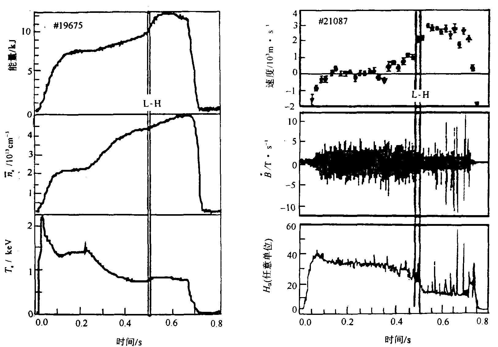

在仿星器装置上进行 H-模实验的主要困难是对磁场位形的控制，因为等离子体参数的变化在一定程度上要改变磁力线的旋转变换和磁阱深度。例如自举电流的效应。在 W7-AS 上曾故意用欧姆驱动电流去抵消自举电流的影响，并在较小的旋转变换率下也实现 H-模。此外，器壁的有效处理总是实现了 H-模转换的一个必要条件。

### 10.3.4 仿星器研究的进一步发展

在结束对仿星器途径研究情况的介绍时，我们想对这一途径的发展前景进行一些讨论。国际聚变界，尤其在欧共体和日本，对仿星器途径的研究非常重视，已投入很大的经费和人力。美国也计划建造国家仿星器装置。这当然主要是仿星器在建堆方面具有稳态运行和无电流破裂两大优点，以及磁体结构可以实现模块化的优点。除此以外，在物理上还可能有其他方面的内在优点。目前为止，仿星器上达到的等离子体总体参数不低于同等规模托卡马克，甚至在一些重要方面还要更好。最突出的是达到的密度值。在仿星器中，比较容易实现高于$10^{14}\ \mathrm{cm^{-3}}$的密度值，而在同样的磁场下，JET 上很难达到这一密度值，而且根据仿星器的约束定标，较高的密度对提高能量约束时间有利。不过，对比于托卡马克途径，毕竟仿星器实验的数据库太小，参数范围太窄，特别是接近堆心条件的参数还有待下一代装置提供。因此如果随意地将现有实验进行太大的外推，其结论的可靠性就有较大的问题。另外，在工程技术的难度上，在研究经费上，仿星器途径未必会比托卡马克途径少和省。这些都要今后十至二十年内的实践来说明。下世纪初，几个第三代仿星器装置的实验是至关重要的。

表 10.3  托卡马克和仿星器上等离子体参数对比

| 参数 | 托卡马克 | 仿星器 |
| --- | --- | --- |
| $T_{i0}$ / keV | 44 | 1.6 |
| $T_{e0}$ / keV | 15 | 4.0 |
| $n_{e0}$ / $10^{14}\ \mathrm{cm^{-3}}$ | 10 | 3.0 |
| $\tau_E$ / s | 1.1 | 0.05 |
| $\langle \beta \rangle$ / % | 12.3 | 2.2 |
| $P_{\text{fus}}$ / MW | 16.5 | 0 |

表 10.3 是托卡马克和仿星器已达到的参数的对比。但要指出，托卡马克的最高参数是在不同的装置上获得的，而仿星器的参数基本上可在同一装置上获得（但不是在同一次放电中）。

### 10.4 仿星器的偏滤器系统

原理上，仿星器位形是具有自然磁分界面的，因此，可以设置自然的偏滤器系统。但与托卡马克不同，仿星器位形没有轴对称性，一般而言，沿环一周由若干周期段组成（例如 W7-AS 和 W7-X 有五个周期段），在每一周期段内，磁面的形状和方向是变化的，这将使偏滤器的设计复杂化。在第一代和第二代的仿星器中，实际上没有设置偏滤器系统，而且在很多实验中，类似于托卡马克，设置了内孔栏，其等效半径小于磁分界面的半径，并得到了较好的等离子体品质。典型的例子是 W7-AS 中通过附加垂直场使等离子体柱内移，结果有效的等离子体体积减小，中性束加热效果有明显的改善，并为获得较高的比压值创造了条件[27]。以上情况并非说明偏滤器无关紧要，而只是由于目前的仿星器实验尚处于较低水平阶段，总加热功率不大，脉冲宽度不长（有一些脉宽达 20 s 的放电，等离子体参数较低）。对下一代仿星器来说，因加热总功率将达 20 MW，脉宽达 10 s 以上，甚至将达到小时级，所以偏滤器实验将是重要内容之一。

目前在第二代仿星器上进行的偏滤器实验事例较少，这里简单介绍 CHS 上在近期进

行的一个关于局部磁岛偏滤器（Local Island Divertor，简称 LID）的实验[28]。该实验通过外加扰动磁场故意在边界附近形成一个 1/1 磁岛，在磁岛的侧面处置了靶板，其主要作用是使流入偏滤器区域的粒子流在磁岛附近发生复合并被泵抽去相当部分（如图 10.18 所示）结果是再循环率减小，并观察到总体能量约束时间得到改善。

在下一代装置上，将设置完整的偏滤器。对 LHD，除将进行 LID 型的实验外，还设有类似托卡马克的螺旋偏滤器（如图 10.19 所示）这种偏滤器包在整个等离子体柱的外部，随磁面的转动而转动，占据了装置的相当大的空间。预期其作用原理和效能应与托卡马克的极向偏滤器类似。

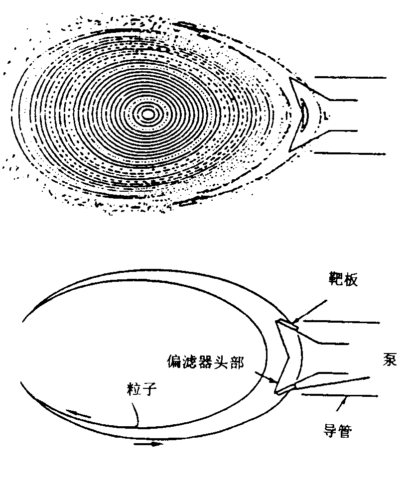

在 W7-X 中也将设置偏滤器，但由于磁面结构特性与 LHD 不同，在 W7-X 的磁分界区，磁面结构具有自然的磁岛链（见 10.2 节中讨论）。对应地，提出了磁岛链偏滤器的设计（如图 10.20 所示）。等离子体内部的粒子流和热通量流入偏滤器区后，将从一个磁岛流向另一磁岛。在磁岛所在空间区域，复合的粒子将被重新电离。这种性质的偏滤器将具有较长的联结长度，从而提高偏滤器的实际效率。图 10.21 是这种偏滤器沿环向的配置。

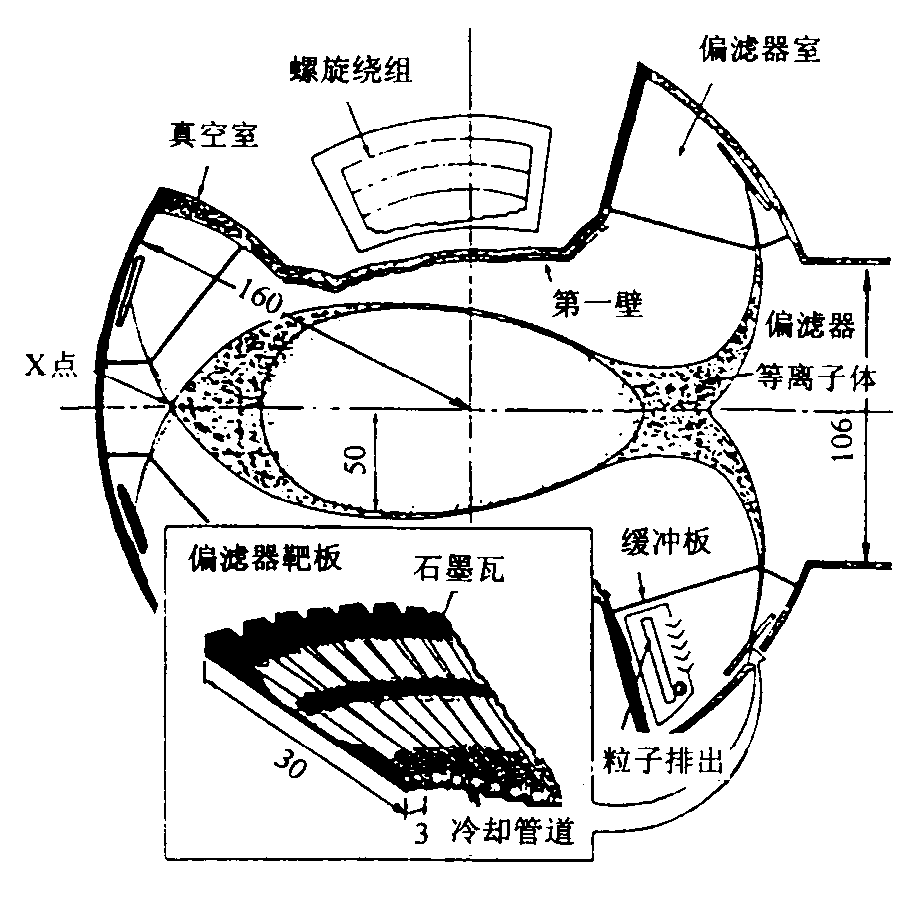

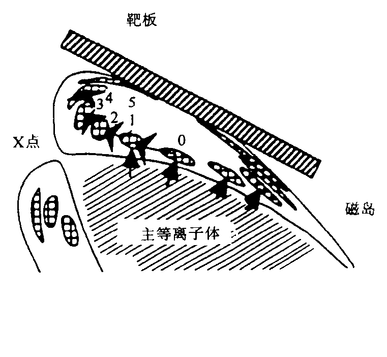

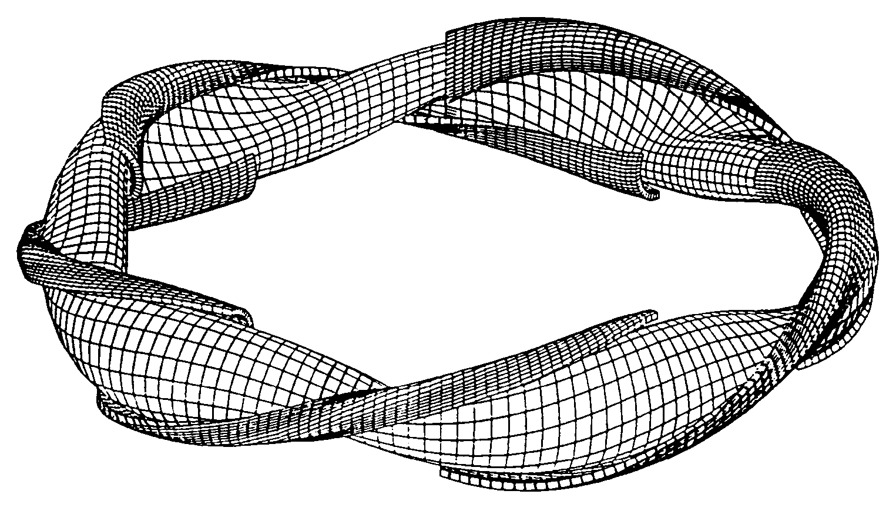

但是，这类可能具有优良性能的偏滤器的实际可行性还有待证实。有一些问题需要获得确切的答案。首先是有关的边缘磁岛链结构的稳定性。边缘磁岛结构与中心区等离子体性质及参数是相互联系的，要对内部等离子体参数变化带来的磁岛结构变动进行必要的补偿；此外，磁岛链对热流和粒子流的效应并不清楚；再有杂质在这类偏滤器区域的行为受辐射的影响；等等。这些都需进一步的研究，尤其是在实际装置上的实验研究。

## 参 考 文 献

1. Spitzer L, Jr. The stellarator concept. Phys. Fluids, 1958, 1: 253
2. Anderson D T, et al. Recent progress in torsatron/stellarator research in USA. IAEA-CN-38/BB-1. 1980
3. Lyon J F. Stellarators. Nucl. Fusion, 1990, 30: 125
4. Grieger G. Physics optimization of stellarators. Phys. Fluids, 1992, B4: 2081
5. Wobig H. Theoretical basis of a drift optimized stellarator reactor. Plasma Phys. Contr. Fusion, 1993, 35: 903
6. Wagner F. Stellarators and optimized stellarators. Trans. Fusion Tech. 1998, 33(2T): 67
7. Grieger G, et al. Modular stellarator reactors and plans for W7-X. Fusion Tech., 1992, 21: 1767
8. Fujiwara M, et al. Progress in LHD program. Plasma Phys. Contr. Fusion, 1997, 39: A261
9. Alejaldre C, et al. TJ-II: a flexible heliac stellarator. Fusion Tech., 1990, 17: 131
10. Jaenicke R, et al. Detailed investigation of the vacuum magnetic surfaces on W7-AS stellarator. Nucl. Fusion, 1993, 33: 687
11. Jaenicke R, et al. High power heating experiments on the W7-AS. Plasma Phys. Contr. Fusion, 1995, 37: A163
12. Kick M, et al. High ion temperature and high beta in W7-AS. IAEA-CN-64/C1-4. 1996
13. Fujisawa A, et al. Experimental results of plasma confinement and heating in the CHS. IAEA-CN-64/C1-5. 1996
14. Staabler A, et al. Comparison of density limit physics on the ASDEX tokamak and the W7-AS stellarator. IAEA-CN-56/C-2-6. 1992
15. Giannone L, et al. Bolometer measurements and transport simulations of the density limit in the W7-AS. Proc. of the 24th Euro Phys. Soc. Conf. on Contr. Fusion & Plasma Phys., 1997, 4: 1565

16. Hartmann D A, et al. Second harmonic heating on the W7-AS stellarator. in 25th EPS Conf. on Contr. Fusion & Plasma Phys P1. 077, 1998
17. Kick M, et al. High ion temperature and high beta in W7-AS. IAEA-CN-64/C1-4 1996
18. Masuda S, et al. Study of electron heating in CHS ICRF heating experiment. Nucl. Fusion, 1997, 37: 153
19. Okada H, et al. Study of high energy particles produced by ICRF heating in Heliotron-E. Nucl. Fusion, 1996, 36: 465
20. Murakami M, et al. Recent results of the ATF torsatron. Phys. Fluids, 1991, B3: 2261
21. Sudo S, et al. Scaling of energy confinement and density limit in stellarator/heliotron devices. Nucl. Fusion, 1990, 30: 11
22. Stroth U, et al. Ennergy confinement scaling from the international stellarator database. Nucl. Fusion, 1996, 36: 1063
23. Kick M, et al. Electric field and transport in W7-AS. Paper in the 25th EPS Conf. on Contr. Fus. Plasma Phys., 1998, 2: 491
24. Fujisawa A, et al. Experimental study of plasma confinement and heatings in CHS. IAEA-CN-64/C1-5 1996
25. Erckmann V, et al. H-mode of the W7-AS stellarator. Phys. Rev. Lett., 1993, 70: 2086
26. Wagner F. Stellarators and optimized stellarators. Trans. Fusion Tech., 1998, 33: 67
27. Kick M, et al. High ion temperatures and high beta in W7-AS. IAEA-CN-64/C1-4 1996
28. Komori A, et al. Edge plasma control by a local island divertor in CHS. IAEA-CN-64/C1-2. 1996
29. Fujiwara M, et al. Progress in the LHD (Large Helical Device) program. Plasma Phys. Contr. Fusion, 1997, 39: A261
30. Wagner F. Stellarators and optimised stellarators. Trans. Fusion Tech., 1998, 33: 67
