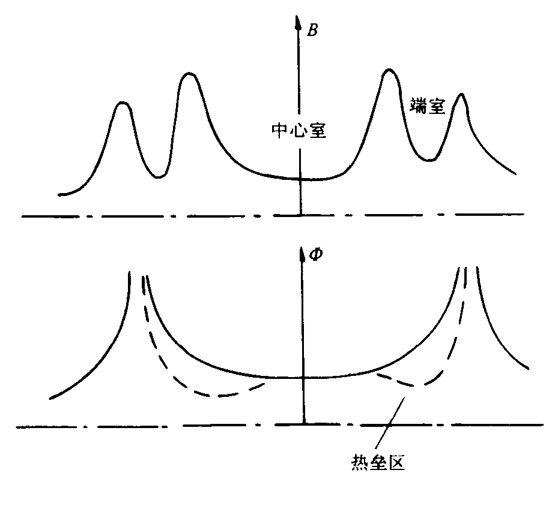
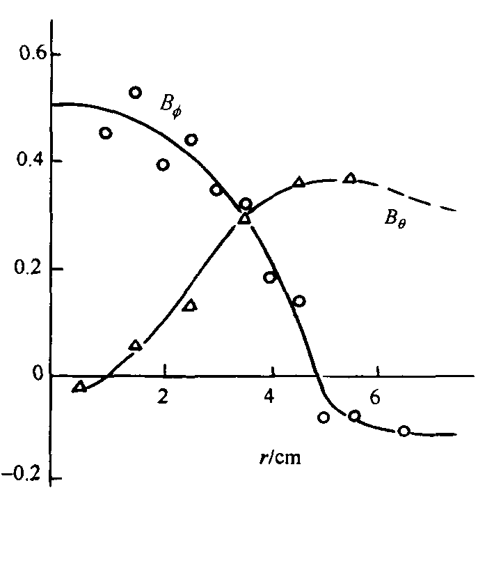
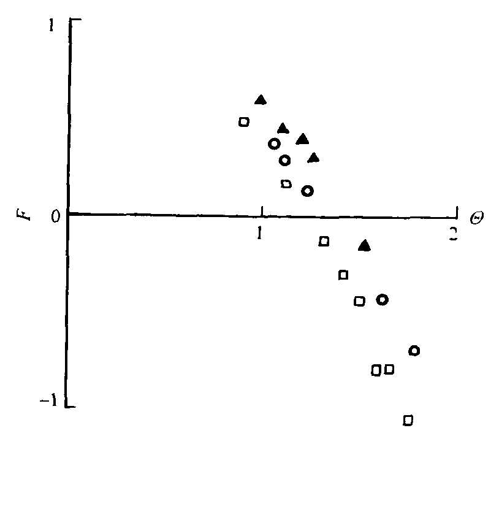
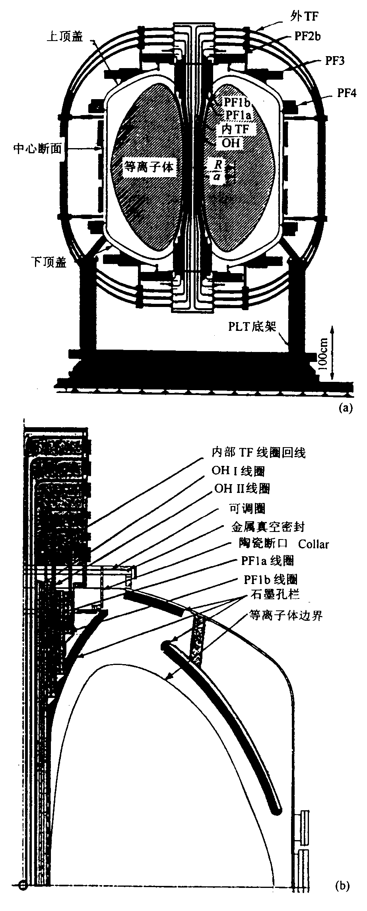

# 第十一章 磁镜、反向场箍缩、球形环位形

本章将简单介绍除托卡马克和仿星器以外的其它主要磁约束途径的研究情况。其中，磁镜位形曾被广泛研究而目前研究规模已大幅度缩小的一种基本磁约束途径，所取得的理论和实验成果在某些方面是非常有意思的，但要想进一步向聚变堆方面发展却存在明显的困难，一些重要的物理问题需在相当大的装置上进行实验才能确定其可行性，但目前国际聚变界没有进行这种研究投入的动向。反向场箍缩位形在高比压稳定性方面是对托卡马克的一种改进，因此多年来作为托卡马克的可能替代途径在一些实验室中进行了一定规模的探索，如果有较好的结果，可能会进行更大规模的探索，但离建反应堆尚有很长的距离。球形环位形（spherical toroid）包括几种位形，其中的一种即小径比托卡马克，是近年来发展较快的装置，并已获得相当令人鼓舞的成果，这一新途径受到国际聚变界的重视，欧共体将这一途径列为托卡马克和仿星器之后的第三种重点探索途径。磁约束聚变研究的其他途径，包括已经被研究过的途径和近来提出的新思想，由于本书篇幅所限，从略。

## 11.1 磁镜位形的研究

磁镜位形由于其相对简单，在磁约束研究的早期即被广泛采用，各种磁镜实验装置多不胜举。有关研究情况已有很详细的文献总结[1~3]，这里仅对主要的物理思想和重要的实验结果作一简介。

在简单的磁镜位形中，带电粒子的一部分受磁镜反射被约束在两端磁镜之间的区域中，而速度与磁力线的夹角较小的粒子将沿磁力线逸出约束区外。这样，在速度空间就存在一个损失锥，锥角由磁镜比确定

$$
\sin\theta_c = \sqrt{\frac{B_0}{B_m}} \tag{11.1}
$$

$B_0$和$B_m$分别是中心约束区轴线上的磁场和磁镜区的磁场。粒子通过库仑碰撞会不断进入逸出锥，通常条件下，电子的相互碰撞频率远大于离子，因此电子优先逸出，中心约束区将呈正电位，这一双极电位阻止了电子的快逸出，最后，等离子体粒子的约束时间基本由离子的碰撞时间确定

$$
\tau_p \approx \tau_{ii} \tag{11.2}
$$

从宏观磁流体稳定性（交换模）的角度，简单的磁镜位形对有限比压等离子体是不稳定的，因此在 60 年代初，原苏联学者约飞提出了通过加约飞棒产生磁场（即沿磁轴方向的多极电流产生的磁场）使磁镜位形具有磁阱，又称极小 B 位形。后来美国学者又发明用垒球线圈或阴阳线圈产生具有磁阱的磁镜位形，并采用注入中性束粒子来产生和积累高密度和高离子温度等离子体的方法。这类磁镜位形称标准磁镜。美国的 2X 系列标准磁镜装置上获得的等离子体参数最高，我们简单介绍有关结果。

### 11.1.1 标准磁镜实验

70 年代中，2X 装置上通过注入大流量中等能量的中性束（典型参数：束能 20 keV，流强 500 A，一般采用 10 个以上的束同时注入），靶等离子体可以通过注入等离子体团并将其绝热压缩形成。结果，获得的离子能量达 13 keV，这些离子基本上就是所注入的中性粒子被捕获形成的；电子温度在 100 eV 附近。这种等离子体的离子和电子温度比达

到$T_i/T_e > (m_i/m_e)^{1/3}$，所以称为热离子等离子体。主要的问题是，这些离子会很快损失，因此很难使等离子体密度提高。研究发现，这是由于离子的速度空间分布具有空锥以及离子能量较高，要产生一类称为漂移回旋损失锥不稳定性（DCLC）的微观模式，另外还有对流损失锥模式（CLC），及由三位发现者 Dory、Guest、Harris 的名字字头命名的 DGH 模式，这些模式都使离子很快损失。对这些模的实验观察是在美国和原苏联的几个磁镜装置 2X，XII，PR6，PR7 上进行的，根据理论分析，提出了几种稳定这些模式的方案。在 2XIIB 上采用的方案是，在磁镜的两个端部设置储有较高密度的气体箱，使从中心约束区沿磁力线逸出的电子和离子在进入气体箱后与中性气体作用，产生低温高密度的等离子体。采用这种简单的方法达到了稳定 DCLC 模的效果，于是在向中心约束区再注入强流中性束时，热离子等离子体的密度不断上升，最高达到$2\times10^{14}\ \mathrm{cm^{-3}}$，比采用气体箱致稳前提高一个数量级，并能稳定地维持下去。

70 年代末，代表标准磁镜实验研究最高水平的 2XIIB 装置上达到的中心约束区的等离子体参数如下：

密度：$2\times10^{14}\ \mathrm{cm^{-3}}$；

离子温度$T_i$：13 keV；

电子温度$T_e$：140 eV；

等离子体比压：2.0（以轴线上磁场$B_0 = 0.67\ \mathrm{T}$计算）；

等离子体半径：7 cm，长度：20 cm，体积：$3.2\times10^{-3}\ \mathrm{m^3}$；

离子约束时间：$<1\ \mathrm{ms}$。

实验条件：

中性束能量：20 keV，流强：500 A，脉宽：10 ms，致稳方法：气体箱。

关于上面的实验，需要特别强调指出，所达到的等离子体比压是前所未有的，不仅比托卡马克和仿星器这些低比压装置中的值高一个多数量级，也比通常意义下的高比压装置所能达到的最大值高几倍。在物理上，这还意味着，磁镜中心区的等离子体中的磁场实际已达到完全被反磁电流排开的程度，在相应的反磁测量实验中证实了这一分析，$\Delta B/B \approx 1$。这一反磁电流主要是离子产生的，在上述实验中，离子回旋半径相当大，与等离子体半径之比可达 1/2。后来的实验曾使等离子体半径和体积增大，达到$r_p/\rho_i \ge 7$，但等离子体比压值降为 0.45，这仍然是非常高的值。

虽然标准磁镜实验证明可以产生和稳定地维持热离子等离子体，但从聚变能输出的角度，标准磁镜装置存在明显的缺点。这主要是由于离子的约束时间太短，使维持单位体积热离子等离子体所需的中性束功率很大，甚至可能大于聚变输出功率。计算功率增长因子

$$
Q = \frac{1}{4} n_e \tau_{ii} \langle \sigma v\rangle_{DT} \frac{E_{\alpha 0}}{E_0} \tag{11.3}
$$

取中性束能$E_0 = 200\ \mathrm{keV}$，$\langle\sigma v\rangle_{DT} = 10^{-15}\ \mathrm{cm^3 \cdot s^{-1}}$，$n_e\tau_{ii} = 1.6\times10^{10} E_i^{3/2}$，得$Q = 1$。这里还没有考虑电子的能量损失，而且计算中离子能量取得太高（主要使$Q$达到极大），实际反应堆中达不到这样高的能量。但即使在比较理想化的条件下，标准磁镜型反应堆最大的功率因子仍不会超过 1，因此，标准磁镜是无法实现聚变能放大的。

要提高$Q$值，只能从加大离子约束时间着手。基本思路是在磁镜两端形成正电位的

端塞。这就是串级磁镜（tandem mirror）的概念。美国曾在 80 年代提出建造大型串级磁镜装置 MFTF 的计划，但在 80 年代中，美国能源部因需将经费集中用于托卡马克途径，决定停止磁镜规划，大型串级磁镜未能建造。目前只有日本等国在坚持进行串级磁镜研究。

### 11.1.2 串级磁镜研究

已经指出，在中心室中，电子的损失比离子快得多，因此中心室中等离子体在实验室坐标中具有正电位。如果在两个端室中也建立由外部加热维持的等离子体（例如通过向两个端室中注入强中性束），并使该等离子体相对于中心室等离子体具有更高的正电位$\phi_i$，则中心室中热离子的约束时间将增大为

$$
\tau_i = \left[ \frac{\phi_i}{T_i}\exp\left(\frac{\phi_i}{T_i}\right)\right] \tau_{ii} \tag{11.4}
$$

如果设法使这一电位差比中心室的离子温度高很多，就可以达到使中心室离子的约束时间加大很多倍的目的。对电子来说，端室最外部的电位更低，因此，电子要完全逸出整个磁镜系统，也要克服一个电位差$\phi_e$。所以端室对中心室中的等离子体来说，既有利于离子约束时间的提高，也增大了电子的约束时间。求解完整的稳态粒子流方程，可以得出

$$
\phi_i = T_e \ln(n_p/n_c) \tag{11.5}
$$

$n_p$和$n_c$分别是端室和中心室中的电子密度，因此中心室中离子约束时间与电子温度和端室中密度及中心室中密度比有关

$$
\tau_i = \tau_{ii}(n_p/n_c)^{T_e/T_i}\ln\left[(n_p/n_c)^{T_e/T_i}\right] \tag{11.6}
$$

同时，相当一部分电子可以在端室和中心室之间自由来往。以上思想基本上构成了串级磁镜装置的约束原理，基于上述思想的串级磁镜称标准串级镜。这种位形有一明显的缺点，即端室和中心室之间电子热传导很大，要提高离子的约束时间，主要依靠提高端室中等离子体的密度，这既加大了技术难度，对提高整个装置的总体聚变能增大因子也不利。克服这一缺点的方法是在端室建立“热垒”，即通过对端室中电子的加热（如采用 ECRH 或 ICRF）提高端室电子温度，这时式（11.6）中的电子温度应理解为端室的电子温度，显然，增大端室电子温度的效应远高于增大密度的效应，并可大幅度降低对加热功率和束流强度的要求。这种同时具有正电位差和“热垒”的串级磁镜被称为新型的或第二代的串级磁镜（虽然第一代的或标准串级磁镜装置并不多，两者也无太根本的差别）。图 11.1 是标准串级磁镜和具有热垒的串级磁镜的电位变化原理。

为了证实这些原理，80 年代前后建造了几个较小的标准串级磁镜装置和中型装置 TMX，后一装置利用了原 2XIIB 的加热设备，有相当强的中性束流强和加热功率。这一装置很快又改造成 TMX-U。该装置长 8 m，等离子体半径可达 0.5 m，中心室等离子体的磁流体稳定性由四极磁阱场来保证（因此磁场位形是非轴对称的），端室等离子体用中性束产生和维持，并采用 ECRH 加热提高电子温度，中心室等离子体也用中性束注入产生和维持，并增加了 ICRF 加热。实验过程中要想成功建立热垒，需采用一系列特殊步骤，详细讨论见 Post 的评述文章。TMX-U 的实验证实可以建立接近千伏级的热垒，在另一装置，日本的 Gamma-10 上也获得类似结果。需要指出的是，由于实验的重点已不是进一步提高中心室等离子体的参数，而是对串级磁镜有关的新原理的实验证明，因此，直到现在，在整个磁镜途径的实验研究中，整体等离子体参数并没有超过 80 年代初在 2XIIB 上的参数，尤其是密度值。目前在几个仍在坚持进行串级磁镜实验的装置上，例如在 Gamma-10 上，等离子体密度小于$10^{13}\ \mathrm{cm^{-3}}$。因此，整体上，磁镜途径的研究仍处在基本原理的验证阶段，要研究磁镜反应堆的可行性，还要在实验上对诸如径向输运，杂质辐射和控制，边缘物理，能量回收（这一问题一开始就得到重视，提出很多方案，但缺乏规模性实验研究）等多个 R&D 的课题进行深入研究，而这需要大量投资，建立几代装置进行实验。由于国际聚变界并没有重新启动磁镜途径的意图，仅通过目前尚在坚持的几个装置的实验，充其量只能得到一些新的物理结果，为磁镜物理的深入理解作一些贡献。对已经感到耗费过于巨大的磁约束聚变研究来说，磁镜途径基本上已成为一种历史回顾。

## 11.2 反向场位形的研究

### 11.2.1 反向场位形的产生和稳定性

直线箍缩放电是导致托卡马克途径发展的源头之一。从直线放电研究转入环形放电研究的过程中，本来就存在两种发展方向，都与磁流体稳定性有关。第一种是托卡马克，采用强环向磁场来稳定扭曲模；第二种是英国的 Zeta 装置的方法，采用中等强度的环向磁场，加上靠近等离子体的导体壁来稳定扭曲模。第一种方法对应于安全因子$q > 1$的参数区，而第二种方法对应于$q < 1$的参数区。在此基础上，理论和实验研究中发现，环形放电中产生的等离子体，在形成初始不稳定的等离子体后，经一段湍性张弛过程（turbulent relaxation）后，会进入一个稳定的静态（quiescent state）。这一稳定位形具有这样一个特点，即环向磁场在靠近边界处其方向与中心处相反，反向场位形的名称即来源于此。另外，这一位形中环向电流产生的极向磁场的场强与环向磁场的场强接近，而在托卡马克中，极向磁场强度为环向磁场的$r/qR$，其中$q$在整个截面上基本大于 1。根据安全因子的同样表示法可知，对反向场位形，$q$的量级为$r/R$，而且在边缘附近变为负值。

在最初发现稳定的反向场位形的实验中，反向场是“自动”产生的：在环形导体壳内预先有一定强度的环向磁场，放电过程中等离子体中发展起不稳定磁流体湍流，这种湍性状态的演化受到两个条件的制约，一个条件是所谓的总体螺旋量守恒[4]

$$
\iiint \mathrm{d}\tau\, \mathbf{A}\cdot\mathbf{B} = \mathrm{const} \tag{11.7}
$$

式中积分对全部等离子体区域进行，$\mathbf{A}$是磁场的矢势，标积$\mathbf{A}\cdot\mathbf{B}$代表局部的螺旋量，式（11.7）的含义是等离子体位形具有无作用力位形特性，即磁力线处处与电流同向。对低比压等离子体，这个条件应近似成立；第二个条件是外加导体壳内的总环向磁通量保持常数

$$
\iint \mathrm{d}\mathbf{S}_\phi \cdot \mathbf{B} = \mathrm{const} \tag{11.8}
$$

这个条件在小于导体壳的扩散特征时间内显然是正确的。在上述条件下，可以得到具有反向场的平衡解。在 Zeta 及 HBTX 等装置实验中，则观察到稳定的反向场位形（如图 11.2 所示）。

进一步的研究发现，也可以通过按一定的程序加上环向磁场来达到建立反向场位形的目的：首先沿环的正向加一定的环向磁场，然后以较快的方式进行环向放电，使总电流达到一定的大小，其极向磁场的强度与环向磁场同量级，这时原加的环向磁通被快速形成的等离子体所“冻结”，再很快地加一反向环向磁场，稳定的反向场位形就建立起来了。从聚变反应堆的角度看，反向场位形的下述特性引起人们的兴趣：这一位形的环向磁场强度与极向磁场强度同量级，而且，边缘附近的反向环向磁场的值是以总环向磁通计算的平均值的大小。只需要由外加绕组产生边缘的反向环向磁场就可以达到稳定约束一定比压等离子体的目的，这比托卡马克的环向磁场小一个因子$a/R$，因此要经济得多。以常用的参数表示

$$
F = B_\phi(a)/\langle B_\phi\rangle \tag{11.9}
$$

这个量称反向场比，如$F$达到 1 的大小，表明反向场位形已牢固地形成；从磁流体稳定性的角度看，稳定的反向场位形与下面的称为箍缩参数的物理量的大小有关：

$$
\Theta = B_\theta(a)/\langle B_\phi\rangle \tag{11.10}
$$

Tarlor 的理论预期，只有当$\Theta > 1.2$时反向场才能形成，而只有当$\Theta > 1.6$时，反向场位形才是稳定的。这在实验中得到证明（如图 11.3 所示）。

如果用安全因子来表示稳定性条件，与托卡马克的$q > 1$，$q_a > 2.5$不同，现在的条件是处处$\mathrm{d}q/\mathrm{d}r \neq 0$，即$q$在等离子体中单调变化，不存在极值。由于$q$在边缘变负，这意味着

$q$在中心最大，随半径加大而减小，直到变负。在环向磁场反向处，$q = 0$。从磁力线旋转变换率来看，则旋转变换率在该处是无限大。这些与托卡马克和仿星器位形都不相似。

根据安培定律

$$
\mathrm{d}B_\theta/\mathrm{d}r = -\frac{4\pi}{c} j_\theta \tag{11.11}
$$

环向磁场的反向结构意味着等离子体中存在很大的极向电流，此电流在场反向位置附近达到最大值。现在还不清楚产生和维持这一极向电流的机制（单纯的反磁电流达不到实验观察到的极向磁场值）。有人假设这一电流是湍性机制维持的，如果确实如此，则原来的平衡位形理论就不能用，更严重的是，就难以证明这一电流（也就是反向场位形本身）在产生后如何能在较长时间内维持下去。即使反向场位形能在电阻性扩散的时间内维持下去，将来的反向场反应堆也一定是脉冲式的。

### 11.2.2 反向场实验研究[4~8]

1958 年建成的 Zeta 装置是最早可以进行反向场位形实验的装置，这是一个比较胖的环形装置（$R/a = 150\ \mathrm{cm}/50\ \mathrm{cm}$），环向电流可达 500 kA，开始的实验主要是导体壳稳定下的低$q$实验，在$\bar n_e \approx 5\times10^{13}\ \mathrm{cm^{-3}}$下，电子温度达到 100 eV，但能量约束时间仅为 0.1 ms。发现了初始不稳定态之后，等离子体又进入新的平静态，电子温度提高一倍，约束明显改善，而上环向磁场在靠近边缘处变成反向，导致了反向场位形的研究，在国际上开始建造几个专门进行反向场实验的装置。在最初若干个小装置上实验重复证实可以形成稳定的反向场位形后，反向场位形的稳定性在原理上得到了承认，并开始建立了几个中等规模的装置，如美国的 ZT-40M（LANL）（$R/a = 1.14\ \mathrm{m}/0.2\ \mathrm{m}$，$I_p \le 0.6\ \mathrm{MA}$，$B_\phi \le 0.6\ \mathrm{T}$，$t_\perp/t_\psi = 0.7\ \mathrm{ms}/35\ \mathrm{ms}$），MST（Madison 大学）（$R/a = 1.5\ \mathrm{m}/0.52\ \mathrm{m}$，$I_p \le 0.5\ \mathrm{MA}$，$t_\perp/t_\psi = 10\ \mathrm{ms}/40\ \mathrm{ms}$）；意大利的 RFX（Euratom-ENEA 与 Padova 大学联合，是目前最大的反向场实验装置）（$R/a = 2.0\ \mathrm{m}/0.46\ \mathrm{m}$，$I_p \le 2.0\ \mathrm{MA}$，$t_\perp/t_\psi = 20\ \mathrm{ms}/120\ \mathrm{ms}$）。在我国的核工业西南物理研究院，也改建了一个小型反向场装置 SWIP-RFP，进行了建立和维持反向场的实验。国际上反向场研究的主要实验结果可以综述如下：

(1) 达到的最好参数与装置大小直接有关，目前 RFX 已达到 0.8 MA 放电，脉宽 120 ms，这已与中型托卡马克装置的放电参数类似。电子和离子的加热满足功率平衡关系，即

$$
V_\phi I_\phi - V_\theta I_\theta = \frac{\mathrm{d}W}{\mathrm{d}t} + P_L \tag{11.12}
$$

$V_\phi$，$V_\theta$为环向和极向回路电压，环向回路电压是外部变压器提供的（欧姆驱动），极向回路电压是等离子体电流分布变化感应的。功率损失主要是杂质辐射和输运损失，与托卡马克的情况类似。杂质损失引起对可达密度的限制，大体相当于托卡马克中的 Murakami 条件（辐射极限）。目前大多数反向场装置中达到的最大密度不超过$10^{14}\ \mathrm{cm^{-3}}$，这与早期设想的高密度差之甚远（一个例子是 ZT-40 的设计密度可达$10^{16}\ \mathrm{cm^{-3}}$，实际只达$5\times10^{13}\ \mathrm{cm^{-3}}$）。电子与离子的温度接近，这说明除一般的欧姆加热机制起作用外，还存在对离子的直接加热，一般认为是磁湍流的加热作用。最高等离子体温度不超过 0.5 keV，一个例外是低密度条件下（$\bar n_e = 1\times10^{13}\ \mathrm{cm^{-3}}$），$T_i$可达到 1 keV。

RFP 位形的优点之一是可以达到较托卡马克高的比压值，目前最高平均极向比压达 0.13（MST）。在容许达到的密度范围内，发现能量约束时间和极向比压随密度的加大而

加大，但超过密度极限放电会发生破裂。

(2) 采用了托卡马克的壁处理措施，如预清洗放电，壁硼化等。等离子体品质有一定的改善，如环电压下降，相应的温度和能量约束时间有 30% 左右的提高。

(3) 与托卡马克不同，磁扰动的幅值较高，可达 1% 以上（比托卡马克高两个数量级），这在物理上是容易理解的，因为反向场位形是磁流体不稳定湍流态发展过来的，所谓的静态是相对于不稳定态而言的，但这种静态仍然保持有较大幅度的磁扰动，因此认为降低磁扰动是进一步改善反向场位形的关键之一。近来一些实验和理论分析认为，被导体壳所锁定的低模数撕裂模是较高幅度磁扰动的一个重要因素，因此要采用附加措施来抑制这类模式。

(4) 近来发现存在改善约束的反向场模式[8]。在 MST 实验中，采用了附加瞬时极向感应电场来调节原来的极向电流剖面的方法，结果使磁扰动幅度降低，欧姆加热功率大幅度下降（从 4.5 MW 降到 1.5 MW），而温度反而有所增高，导致能量约束时间大幅度增大（从 1 ms 增至 5 ms），极向比压达到 0.13。但这一实验是在低密度下进行的（$\bar n_e = 1\times10^{13}\ \mathrm{cm^{-3}}$），无法预期在高密度下会发生何种变化。

### 11.2.3 关于反向场研究的发展趋向

反向场实验揭示了许多不同于托卡马克物理的有趣现象，有的与空间和天体等离子体有密切联系，如可能的发电机（dynamo）机制问题。但从实现聚变的角度看，反向场的进展不理想。达到的等离子体参数很低，密度也不高，比压只有较小的提高（与托卡马克相比），而能量约束时间仅达毫秒量级。以最大的 RFX 装置为例，虽然该装置尚未在最高设计参数下运行，今后仍有提高等离子体总体参数的余地，但在目前已达到的参数下（$I_p = 0.8\ \mathrm{MA}$），等离子体总体参数明显低于同等欧姆电流下的托卡马克装置。这主要是反向场位形下的能量损失过大，杂质不易控制，而这一般是短脉冲实验的内在缺点，这一缺点可能严重阻碍反向场位形的反应堆应用前景。目前没有建造更大装置的规划，因而国际聚变界不可能盲目支持前景很不确定的研究规划。据欧共体的最新聚变规划，反向场研究已不再作为有可能替代托卡马克的替代途径。

## 11.3 球形环（小环径比托卡马克）的研究

球形环系统（Spherical Toroid），简称 ST，是近年来受到重视的一个途径。ST 的位形属环形轴对称类型，按理论分类，又可以分成[9]：

(1) 球形托卡马克，边界安全因子满足$q_a > 1$；

(2) 球形箍缩放电，边界安全因子满足$1 > q_a > 0$；

(3) 球形器（spheromak），边界安全因子满足$q_a = 0$（即环向磁场为零）；

(4) 球形反向场，边界安全因子满足$q_a < 0$。

在以上位形中，球形器是最早得到研究的，球形托卡马克则在近几年受到很大重视，而其他两类位形是原理上可以实现，但还没有开展广泛实验研究。球形器的研究重点在一些小型装置上进行，主要证明存在稳定的，环径比很小（$R/a < 1.2$）的磁流体平衡位形，等离子体通过放电或由外部注入等离子体团来产生，基本上没有进入与聚变等离子体有更直接关系的问题的研究，因此我们在本节中主要介绍第一类位形，即球形托卡马克。当然，ST 位形有一些共同特性，例如等离子体的截面是非圆形的，沿对称轴具有比较大的拉长度（$\kappa \ge 2$），读者可以参看一些总结性文献[10]。

### 11.3.1 球形环位形及稳定性

球形环是轴对称环形位形的特殊情况，其环径$R/a$仅略大于 1，等离子体截面具有较大的自然拉长度，因此外形接近球形。与原来的 spheromak 装置不同，在球形环中，等离子体的产生和维持稳定平衡态的原理类似于托卡马克，实际上是一种小环径比的托卡马克位形。由于环径比小，等离子体环的内侧和外侧的差别加大，在等离子体约束区内环向磁场强度有很大的变化，因此，局部的磁力线旋转率在环的内外侧差别甚大，在同一磁面上，磁力线在环的外侧转动很快，而在环的内侧转动很慢，因而带电粒子在内侧即环的有利曲率区将停留较长时间，根据磁流体理论和粒子动力论理论，这有利于等离子体的稳定性。另外，小环径比也有利于使垂直位移模及扭曲模稳定化，这些都已被实验所证实。

已指出，托卡马克等离子体的比压主要受理想磁流体气球模的限制，根据 Troyan 极限的一般规则，极限比压与规范化比压量（$I_p/aB$）成正比，对球形托卡马克，由于环径比小和自然的拉长度，此量比经典托卡马克要大。利用适用于小环径比情况下的公式[9]

$$
I_p(\mathrm{MA}) = \frac{5a(\mathrm{m})B_{t0}(\mathrm{T})}{q_a} \frac{C_1 \varepsilon}{(1-\varepsilon^2)^2} \frac{(1+\kappa^2)}{2} \tag{11.13}
$$

其中

$$
C_1 = 1.22 - 0.68\varepsilon \tag{11.14}
$$

$\varepsilon = a/R$为倒环径比，显然，规范化比压量仅与环径比、边缘安全因子及截面拉长度有关，而小环径比和大拉长度对提高规范化比压值有利。例如取$\varepsilon = 1/1.2$，$\kappa = 2$得到$I_p/aB_t = 77$，这意味着平均比压$\beta_T = g(I_p/aB)$可以很容易地达到 1，当然这里的估计是定性的，因为在非常高的比压下，等离子体位形的内在特性与低比压下有重大差别，不能简单地应用低比压公式作外推。

对小环径比托卡马克等离子体的密度极限和电流密度极限的研究进行得很少，因此，装置实验研究是获得这方面知识的主要渠道。

近年的实验发现两类与高比压或高密度有联系的不稳定性，一类是内部磁再连事件，另一类是与高能离子成分有关的高频突发性磁扰动，每一脉动（burst）持续约 0.2~0.3 ms，称 chirping 模，其特征是每发生一次突发脉冲，扰动频率下降一半。这些磁流体活性不会造成等离子体的突然破裂，后一类扰动虽在一定程度上要使高能离子约束变坏，但也没有造成对加热效率的明显影响。

### 11.3.2 球形托卡马克实验研究

目前虽已有若干个球形托卡马克装置，但电流维持时间超过 10 ms，实现环向电流超过 200 kA 的装置仅有卡拉姆实验室的 START（小型紧凑环径比托卡马克。装置参数：$R/a = 0.32\ \mathrm{m}/0.26\ \mathrm{m}$，$A = 1.25$，$I_p \le 0.25\ \mathrm{MA}$，$B_{t0} \le 0.4\ \mathrm{T}$，$t_\psi = 40\ \mathrm{ms}$），其运行方式及得到的等离子体性质基本上与经典托卡马克等离子体属同一类型，但在等离子体的产生方式上有一些独特之处。START 上采用两种方法获得最终具有相当拉长度的等离子体：一种方法是，在一定功率的 ECR 预电离下，通过直接感应放电在靠内侧中平面附近首先击穿气体（在装置的中心导体上下方有一定的螺线圈，加上用于产生极向磁场的线圈，构成具有一定可变磁通的变压器），在电流上升阶段，等离子体在增大截面积的同时增大拉长度。观察到最大拉长度达$\kappa \approx 4$，电流呈集肤分布的稳定位形（不用外加反馈场可以稳定

维持若干毫秒），在电流剖面逐渐向平坦分布和峰化分布过渡后，仍可达到接近 2 的稳定拉长度；第二种方法是在上下两个半平面上先形成两个电流环，然后通过改变极向磁场使两个电流环压缩成一个具有中等拉长度的环。这一磁再联过程持续约 50 μs，保持总电流基本守恒。这种方法可以消耗较小的磁通变化量（伏秒数），然后利用中心螺线圈的磁通变化来维持这一电流，也可以进行电流再上升研究。

在加热方法上，开始仅有欧姆加热，目前已进行 MW 级中性束注入加热（中性束能量为 40 keV）。除了证实可以形成多种稳定的，具有较大拉长度和三角变形的平衡位形，包括具有自然偏滤器的位形外，还获得了一系列非常有意义的实验结果，简述如下：

（1）有类似的海吉尔参数图，但不存在经典托卡马克中的电流极限和密度极限破裂不稳定性，最低边缘安全因子和最高密度由内部磁再连事件所限，这是一类比较软的内部不稳定性。这种磁流体不稳定性也在环压信号上表现负尖峰（电流剖面发生快变化），同时总电流有一正尖峰信号，随后等离子体总储能的一部分（<1/2）很快失去。虽然这类事件实际形成了对运行参数的限制，但不造成非常有害的大破裂，因此在这一方面球形托卡马克明显优于经典托卡马克。

（2）可以达到很高的环向比压，最新实验结果显示，在 MW 级的中性束注入加热下，$\langle \beta_T \rangle = 0.40$的位形是稳定的$^{[11,\ 12,\ 14]}$，对应于$\beta_N = 5.6$，已高于 Troyon 极限 40%，而且没有迹象表明已到实际的比压极限；而且，这类高比压等离子体的能量约束时间高于最新 ITER 的 H-模定标（见下一小段讨论）。但是，所有高比压放电最终以出现内部磁再连事件而终止。

（3）在 0.5 MW 的切向中性束注入加热下，发现类似 H 模态的改善约束位形。采用双零偏滤器形态，在中性束持续注入约 30 ms 后，密度从$3\times10^{13}\ \mathrm{cm}^{-3}$增加到超过$5\times10^{13}\ \mathrm{cm}^{-3}$，电子温度略有下降，$D_\alpha$信号出现了 ELM 状颤动（dithering），等离子体极向转动速度明显加大，瞬时能量约束时间从 2 ms 提高到 4 ms。

（4）在偏滤器位形欧姆放电条件下注入固体弹丸，获得非常高的密度$^{[13]}$：$n_{e0}$从$9\times10^{13}\ \mathrm{cm}^{-3}$激增至$5\times10^{14}\ \mathrm{cm}^{-3}$，平均密度由$6\times10^{13}\ \mathrm{cm}^{-3}$增至$2\times10^{14}\ \mathrm{cm}^{-3}$。

（5）建立关于约束定标的初步数据库，发现最佳约束条件下的等离子体能量约束优于最新版托卡马克 H-模定标（ITER97-H）：对欧姆加热有$\tau_E = 1.3\tau_E^{\mathrm{ITER97-H}}$；对中性束加热，有$\tau_E = 1.6\tau_E^{\mathrm{ITER97-H}}$。

目前为止的球形托卡马克实验中，虽达到了很高的比压值$^{[15]}$，但这是在环向磁场很小的情况下获得的（START 的典型$B_T$为 0.2 T），而等离子体的温度还非常低（在 START 的高比压实验中电子和离子温度为 0.2 keV 左右），现有小装置的环向磁场已难以提高，因此，只有扩大装置规模，才能达到更高的温度值。

此外，在球形托卡马克和其他小环径比位形实验中，包括装置的设计建造中，如何驱动环向电流是一个难题。由于环径比小，不可能像经典托卡马克那样利用中心柱作为变压器的主要螺线圈，因此，用于感应环向电流的装置的可变磁通受到大的限制。在一些装置中，试图用注入螺旋量来形成环向电流，如 HIT 装置（美国西雅图，华盛顿大学），达到 150 kA，6 ms 的较好结果，但等离子体温度很低（40 eV），因此，这类装置除试验了一种新的电流驱动方法外，难以进行有意义的实验研究。

## 11.3.3 球形托卡马克的发展展望

以上结果对国际聚变界是非常大的鼓舞。在经典托卡马克的发展上，由于投资过大，关于 ITER 是否最终能投入建造有很多疑问，而其他非托卡马克途径的发展，除仿星器途径发展还算顺利，反向场箍缩的结果非常难以令人满意，因此，球形托卡马克的一系列新结果具有"柳暗花明"的效应，欧共体聚变部已将其列为托卡马克和仿星器之后的第三位重点研究途径。已准备建造几个更大的球形托卡马克装置来进一步验证 START 的结果。这包括 UKAEA 和 EURATOM 聚变部合建的 MAST$^{[16]}$（Mega Ampere ST），美国 PPPL，ORNL 及两个大学共建的国家球形环实验装置 NSTX$^{[17]}$（National Spherical Torus eXperiment）（见图 11.4），俄罗斯也有建造中型装置的计划，中国在自然科学基金委员会及清华大学支持下，也在筹备建一小型装置。

MAST 和 NSTX 的设计参数如下表所示：

**表 11.1　MAST 和 NSTX 的参数**

|  | $R/\mathrm{m}$ | $a/\mathrm{m}$ | $A$ | $B_t/\mathrm{T}$ | $\kappa$ | $I_p/\mathrm{MA}$ | $t_p/\mathrm{s}$ | $P/\mathrm{MW}$ |
|---|---|---|---|---|---|---|---|---|
| MAST | 0.7 | 0.5 | 1.4 | 0.63 | 2.5 | 2.0 | 1.3 | 5.0 (NBI) |
| NSTX | 0.85 | 0.67 | 1.25 | 0.3 | 2 | 1.0 | 5 | 5 (NBI), 6 (ICRF) |

NSTX 已在 1999 年中投入运行，它利用了原 TFTR 的一些设备，尤其是 80 keV，5 MW 的中性束注入和 6 MW 的 ICRF 设备，准备重点研究强功率加热，其安全因子取得较大（环电流较小），$q_a \approx 10$，将利用较大比例的自举电流，脉宽较长；MAST 是 START 的扩展，其中心柱上有螺线圈，可以提供 1 伏秒的可变磁通，能够将 1 MA 等离子体维持 1 s。如果中性束电流驱动有效，可以将脉宽加大到 5 s。这两个装置将为球形托卡马克研究的未来发展作出重要的贡献。这些装置仅相当于中型托卡马克，但在有些方面可以将大型托卡马克装置（JET, JT-60, DIII-D）的实验范围进行扩展（高比压，大自举电流比等）。

但是，球形托卡马克是否能成为有竞争力的新途径，取决于今后研究中能否从实验中证实下面的几个重要问题：

环向电流的驱动和维持：球形托卡马克由于大半径小，拉长度大，等离子体的自电感和电阻都较经典托卡马克小得多，电流的磁能（1/2）$LI_p^2$及环压$2\pi R\langle \eta/S \rangle$也小得多，因此为驱动和维持同样大小的环向电流所消耗的伏秒数要小得多。但由于装置结构的紧凑性，中心柱的面积太小，不可能利用中心螺线圈提供很大的伏秒数。因此，长脉冲运行主要依靠自举电流和非感应电流驱动，目前最可靠的是中性束电流驱动。

（1）能否产生大比例的自举电流。虽然球形托卡马克中捕获粒子的份额比经典托卡马克中大得多，而且可以维持稳定的高比压平衡，因而根据新经典理论，达到较大比例的自举电流份额是可行的，但这必须直接从实验得到证实，因为低环径比情况下的新经典理论的正确性本身也需实验的证实，而且自举电流的剖面分布是否与稳定约束的要求相洽，也是需要进一步证实的。

（2）适合小环径比托卡马克的有效非感应电流驱动方法需由实验直接证实。目前认为中性束注入方案比较适合，而且按现有定标推算，所需的功率也并不大，但现有的实验（经

典托卡马克的实验）还没有在粒子密度高（$\bar n_e > 10^{14}\ \mathrm{cm}^{-3}$），环向磁场低的条件下进行过。

壁能承受的中子通量：球形托卡马克可以达到相当高的稳定比压值（$\beta_T > 0.4$），这一点已为实验证明，达到更高的比压值也是可能的。高的比压值虽可以大幅度提高聚变能功率密度，加上装置具有大的面积/体积比，因此壁的中子通量更快地加大。一些球形托卡马克反应堆设计中假定可以达到 8 MW/m² 的中子壁负载，其可行性需得到实验证实。一种折中的方法是降低磁场而扩大装置尺寸，这也需进一步进行物理、工程和经济可行性研究。

总体上，球形托卡马克途径具有工程简易，可采用常规技术，反应堆规模小的特点（据定标分析，象 DIII-D 大小的装置就可能达到$Q > 1$的聚变能输出），因此投资大幅度降低（类似 ITER 的燃烧实验堆约需 10 亿美元，仅为 ITER 的 1/10）。环向场线圈可采用水冷铜线圈，因此中心铜柱的欧姆热构成主要的能量消耗。分析表明，聚变功率与铜线圈所耗功率之比与$R^4$成正比，适当加大尺寸可以做到聚变功率远大于铜线圈功率损耗；对铜线圈受中子辐照的材料损伤问题也做过分析，认为可以在几十年内承受这种辐照。

## 参考文献

1　Fowler T K. The mirror theory. In: Fusion, Vol. 1: Magnetic Confinement, Academic Press. 1981. 胥兵，李长和，汤大荣等译. 聚变. 第一卷，北京：原子能出版社，1987

2　Post R F. The physical experimental bais of mirror confinement, in Fusion, Vol. I, Magnetic Confinement, Academic Press. 1981 胥兵，李长和，汤大荣等译. 聚变. 第一卷，北京：原子能出版社，1987

3　Post R F. The magnetic mirror approach to fusion. Nucl Fusion, 1987, 27: 1579

4　Taylor J B. Phys. Rev. Lett., 1974, 33: 1139

5　Manheimer W M, Lashmore-Davies C N. MHD and Microinstabilities in Confined Plasma. IOP Publishing Ltd., 1989

6　Baker D A, Quinn W E. Reversed Field Pinch. In Fusion, Vol. I Magnetic Confinement. Part A. 见：胥兵，李长和，汤大荣等译 聚变. 北京：原子能出版社，1987

7　Rostagni G. Confinement results in RFP. Plasma Phys. Contr. Fusion, 1994, 36: B203

8　Den Hotag D J, et al. Reducing and measuring fluctuation in the MST RFP. IAEA-CN-64/C2-3. 1996

9　Peng Y-K M, Strickler D J. Features of spherical torus plasmas. Nucl. Fusion, 1986, 26: 769

10　Sykes A. Progress on sperical tokamak. Plasma Phys. Contr. Fusion, 1994, 36: B93

11　O'Brien M R, et al. Stability and additional heating properties of spherical tokamak. IAEA-CN-64/C2-1. 1996

12　Carolan P G, et al. Enhanced performance in the START tokamak. Plasma Phys. Contr. Fusion, 1998, 40: 615. 及 Gryazenevich M. et al. Phys. Rev. Lett., 1998

13　Ribeiro C, et al. Pellet injection, confinement, and H-mode features on START. 25th EPS Conf. on Contr. Fusion and Plasma Phys., 1998, P4. 012

14　Gryaznevich M P, et al. High beta improved confinement regime and energetic ion driven instabilities in the START spherical tokamak. Fusion and Plasma Phys., 1998, P4. 013

15　Gryaznevich M P, et al. Achievement of record beta in the START. Phys. Rev. Lett., 1998, 80: 3972

16　Drake A C, et al. Mega Ampere spherical tokamak. IEEE/NPSS (1995) 1456

17　Peng Y-K M, et al. National sphericla torus experiment. 25th EPS Conf. on Contr. Fusion & Plasma Phys., 1998, P1. 038
