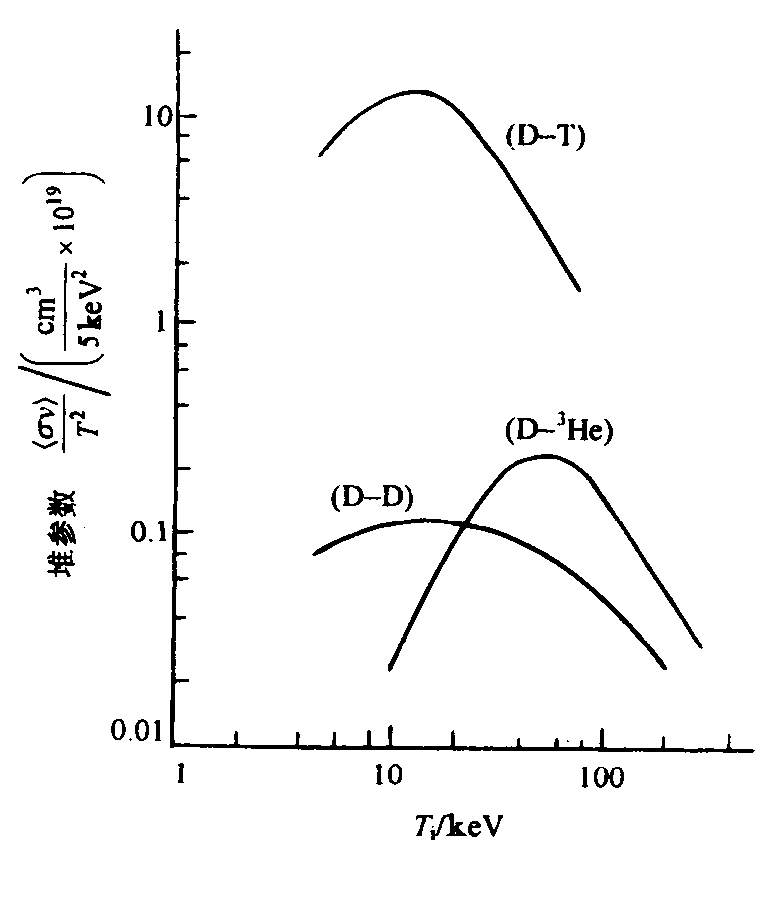
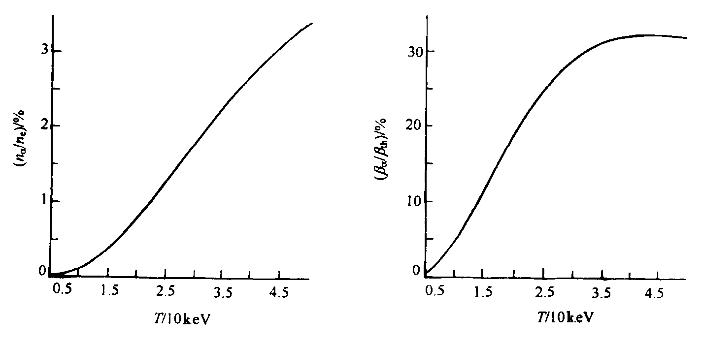
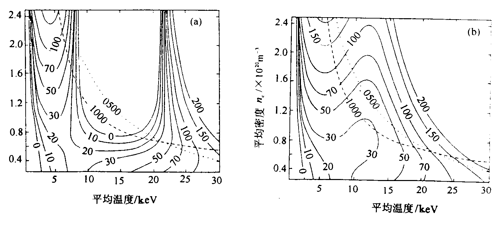
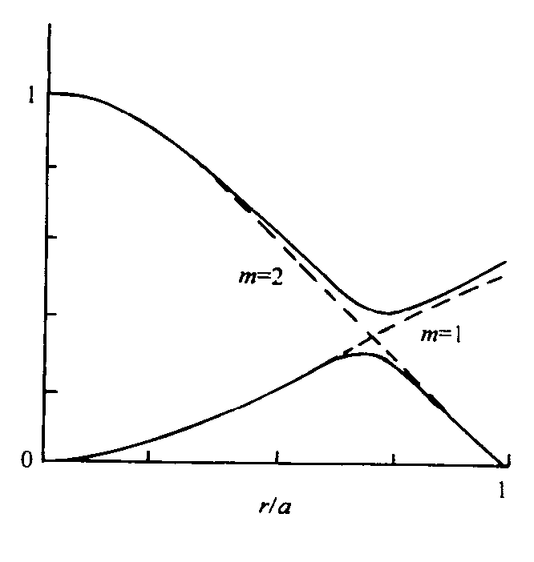
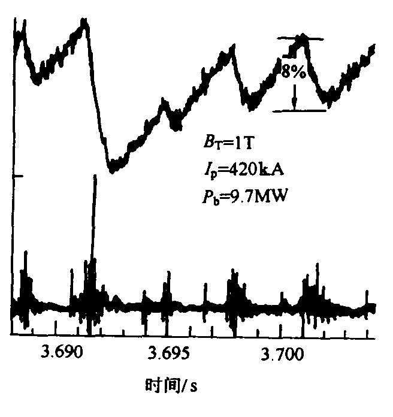
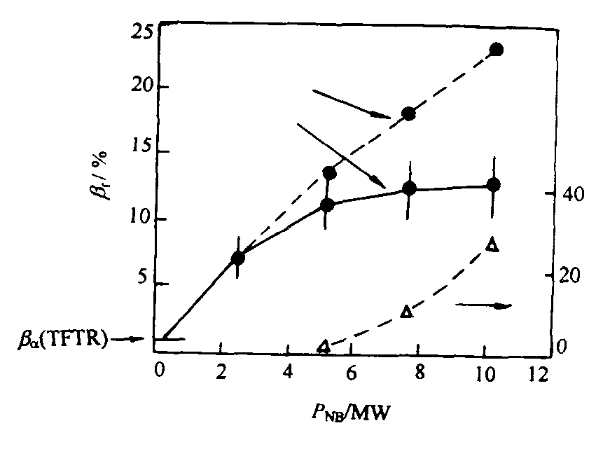
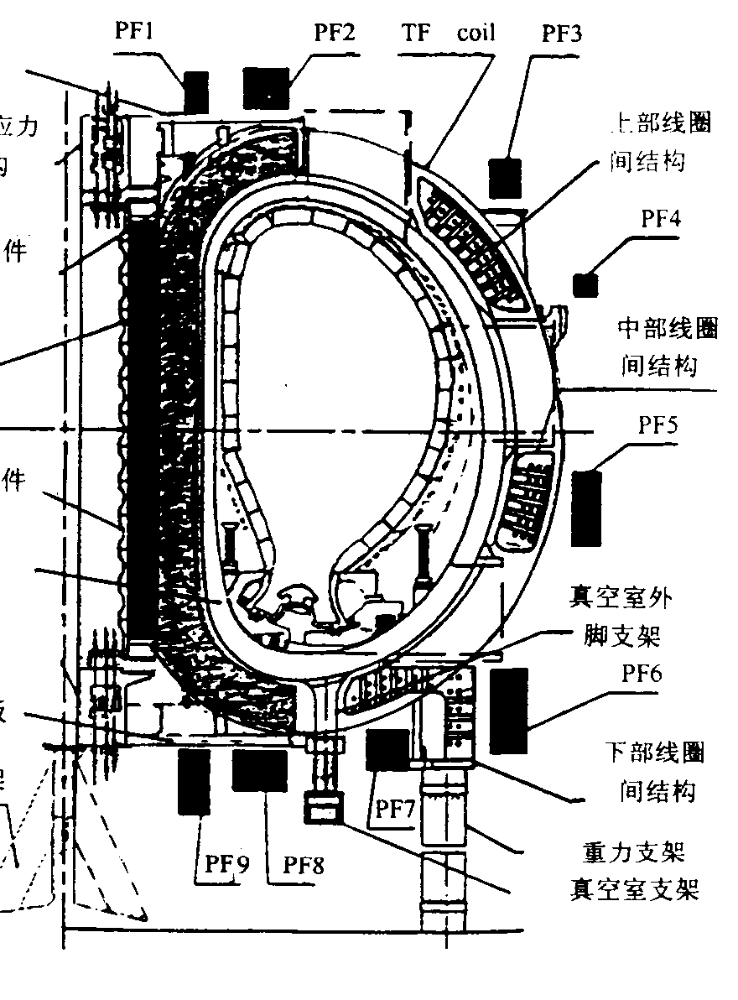

# 第十二章 氘氚燃烧物理及研究规划

磁约束聚变研究的最终目的是建立自持燃烧的聚变反应堆。迄今为止，人们仅在实验型装置上模拟研究了与高温等离子体的产生、加热和约束有关的诸多问题，探索了可能实现氘氚自持燃烧的方式及约束高温等离子体的最佳磁场位形。但是，除了在两个托卡马克实验装置（TFTR 和 JET）上进行了含氚的直接实验外，所有的实验都没有涉及真正的氘氚反应，而上述两个装置的氘氚反应产生的聚变功率，仅能达到与外加加热功率相等的大小（为了验证所谓的能量得失相当条件，即科学可行性），远不能达到自持燃烧条件。因此，真正的自持燃烧物理问题还不可能在当前已建装置中进行直接的实验。

然而，人们已认识到，反应堆条件下等离子体的约束性质实际上是由迄今没有经过实验验证的物理规律所制约的。这是因为，氘氚自持燃烧条件下，主要的甚至是唯一的加热方式是高能 α 粒子对本底氘氚等离子体的加热。这一加热功率的物理机制和作用功能与现今所采用的各种加热功率（欧姆加热、波加热和中性束注入加热）虽然也有一些相似之处，但更重要的是有很多原则性的差别。这些差别会使氘氚等离子体在一些重要物理性质上与现有装置中的等离子体不同，其中有的将有利于更好的约束，但有的也可能非常不利于约束。本来，正常的研究规划应包括非常重要的一步，即建造几个进行氘氚自持燃烧的实验装置，直接从实验上探索氘氚燃烧条件下等离子体的约束性质。美国学者在 90 年代初曾先后提出建造燃烧等离子体实验装置 CIT（紧凑点火托卡马克）及 BPX（燃烧物理实验装置）的计划，可惜没有被批准建造，原因之一是与 ITER 的科学研究目标重复。确实，ITER 的主要物理研究目标就是氘氚燃烧物理，但 ITER 是一个全尺寸的反应堆（虽然不产生电能），要同时对许多聚变堆工程技术进行预研并对堆包层进行直接实验研究，因而装置很大，投资过高，基本上将吸收国际磁约束聚变研究的全部财力。如果建造顺利，当然会对整体聚变研究起重要的推动作用，但若未能按计划建造，将使整体磁约束聚变研究的国际规则陷入混乱，一些国家将不得不重新考虑建造燃烧实验装置的规划。

在理论研究上，对燃烧物理的重视由来已久，其中对燃烧物理的核心问题之一，即 α 粒子物理，从 70 年代就已开始研究，自进行 BPX 和 ITER 设计以来，这方面的研究显得十分火爆。本章的内容之一是简单介绍有关物理问题的实质，然后介绍燃烧实验装置，主要是 ITER 的设计研究，某些在 TFTR 和 JET 上观察到的实验现象也将简单介绍（在第九章中已有一些讨论）。

## 12.1 氘氚燃烧等离子体的基本特征[1,2]

我们这里主要讨论的是自持燃烧反应堆堆芯（即第一壁以内）的等离子体物理问题，这种等离子体应具有如下的基本特性：

（1）参数已达到自持燃烧条件，即电子和氘氚离子温度超过 10 keV，在最佳条件下，离子温度在 20 keV 左右；粒子平均密度超过$10^{14}\ \text{cm}^{-3}$，聚变性能因子超过 30。这些条件意味着，等离子体运行参数区已接近比压极限，而密度极限可能已经超过（这种可能性有待进一步的实验证实），等离子体总体上应具有较好的磁流体稳定性余度，尤其是不能发生硬破裂。

（2）等离子体存在时间（有效燃烧时间）远大于等离子体的能量约束时间和粒子寿命，

典型的情况，能量约束时间为几秒，而存在时间达 10 h 量级。这意味着，中心约束区中的等离子体与第一壁（真空室、孔栏、偏滤器）间有长时间的相互作用。在这样长时间的物理过程中，许多不太重要的因素会积累起来而成为重要因素，典型的例子就是杂质（包括氦灰）。

（3）等离子体约束状态长期处在 H-模态，否则燃烧会被中断；ITER 将对 1000 s 级的长脉冲 H-模约束的物理和工艺问题进行实验。

（4）环向电流由感应的或非感应的方式长期保持，在一些运行方案中，自举电流具有很大的份额。

（5）α 粒子是主要的甚至是唯一的加热源，等离子体位形性质及稳定性与这种加热方式直接有关，而且可以认为与堆启动阶段的各种因素基本无关。因此，α 粒子物理成为堆芯物理的核心。

### 12.1.1 α 粒子加热功率的特征及热不稳定性

氘氚反应产物中，14.1 MeV 的高能中子将直接从反应区逸出进入包层，在那里与锂元素进行反应产生氚；另一种粒子，即 3.5 MeV 的 α 粒子，将被约束在本底氘氚等离子体中，在与氘氚离子和电子的碰撞过程中其能量将逐步传给本底等离子体，这就是 α 粒子加热。本小节将讨论这种加热方式的基本物理特征，同时讨论被加热的本底等离子体，即燃烧等离子体的基本物理特征。

α 粒子加热的功率密度可以写成

$$
P_{\alpha} = \frac{1}{4} n_e^2 f_{DT}^{\,2} \langle \sigma v \rangle_{DT} E_{\alpha 0} \eta_{\alpha} \tag{12.1}
$$

式中$E_{\alpha 0} = 3.5\ \text{MeV}$是 α 粒子的初始能量，

$$
f_{DT} = (n_D + n_T)/n_e \tag{12.2}
$$

是氘氚离子的有效浓度比，此比值小于 1 的原因是存在非氘氚离子，其中包括冷却后的 α 粒子即“氦灰”，以及不可避免地进入等离子体的轻重杂质。所以，杂质的存在除了要产生附加辐射损失外，还直接地影响聚变功率输出。对轻杂质（氧、碳、硼、锂），主要的效应是这种使有效氘氚离子浓度降低的“淡化”作用。

在早期的研究中，常常假定 α 粒子的全部能量都沉淀在所产生的磁面上，这种就地沉淀相当于处处满足

$$
\eta_{\alpha} = 1 \tag{12.3}
$$

但实际上，在托卡马克反应堆中，α 粒子的能量不可能就地沉淀。即使从经典粒子运动的角度（即不存在不稳定湍性输运），由于 α 粒子的运动轨道与磁面有较大的偏离，以及环向磁场存在一定的波纹度，都会使 α 粒子的能量从产生地向约束区外部扩散，有的 α 粒子将会打到孔栏或真空室壁而损失。以上经典性的损失或扩散过程的影响可以用蒙特卡罗程序进行计算，结果表明与环电流大小有很大关系：大的环电流对应小的损失。近年来的研究发现，非就地能量沉淀的主要原因是 α 粒子自身会激发某些湍流模式，这些湍流模式会使 α 粒子以较快的速率逸出约束区。这将在下一小节中讨论。

从式（12.1）中看到，α 粒子加热的一个重要特点是它与粒子密度的平方成正比。已指出，杂质辐射损失的功率密度也具有同样的密度依赖关系。因此，在燃烧等离子体中，不会存在因密度增大而产生辐射功率超过加热功率的情况。由此推断，与这一现象有关的

村上和海吉尔密度极限将不会发生。现在还不清楚 Greenwald 密度极限到底与何种物理机制相联系，因此不能断定燃烧等离子体一定不存在密度极限，但毫无疑问，它与当前托卡马克装置中的密度极限现象会有不同的特征。

由于氘氚反应率与离子温度有很强的依赖关系（在$7\ \text{keV} < T_i < 20\ \text{keV}$内接近于$T_i^2$，如图 12.1 所示），这将引起有关燃烧是否稳定的忧虑。设想如果由于偶然的原因离子温度有所上升，于是反应率增大，这将使反应率进一步上升，造成过度燃烧（oberburn）；反之，若温度偶然降低，反应率减小，又引起温度进一步降低，就会引起燃烧熄灭（extinction）。这两种现象都不利于反应堆的稳定运行。引起燃烧状态变化的物理因素是多得很的，如密度的变化，杂质的进入，输运状态的变化，等等。控制燃烧过程使聚变功率稳定地输出，是燃烧等离子体物理的一个重要课题。已提出多种反馈控制燃烧的方案，包括控制附加加热功率（因此反应堆已不再完全的自持燃烧堆），控制注入粒子密度，等等。研究还发现，燃烧的稳定性与等离子体的输运系数有很大的关系，也就是与等离子体的约束模式有很大关系。例如，输运系数随温度的加大而增大时（对 L-模或增强约束 H-模，我们曾指出，可以用与中心温度成正比的输运系数来描述），可以不发生燃烧不稳定性。另外，用一个与中心温度变化规律相反地变化的可控制镇定功率，也能有效地抑制燃烧不稳定性。12.2 小节还要讨论燃烧不稳定性问题。

### 12.1.2 α 粒子的经典特性

α 粒子在产生后，一方面通过与等离子体的碰撞将能量传给电子和离子，同时本身不断慢化，直到其能量与本底离子能量接近，就成为没有用的杂质——氦灰；另一方面，碰撞也使 α 粒子不断向边缘扩散。如果没有不稳定模式的作用，这种扩散是按新经典规律进行的，其中环向磁场的波纹度对加大扩散系数有很大的作用。（在仿星器中，还要考虑螺旋场的影响，在第十章中已指出，减少 α 粒子的扩散是仿星器位形优化研究的一个重要方面。）

如简单地用等效碰撞频率$\nu_L$来描述扩散，用慢化时间$\tau_s$来描述慢化，则 α 粒子分布函数的演化可以通过下面的动力方程来求出[3]：

$$
\nu_L f_\alpha = C_\alpha(f_\alpha) + S_\alpha \frac{\delta(v - v_{\alpha 0})}{4\pi v^2} \tag{12.4}
$$

其中碰撞慢化算符

$$
C_\alpha = \frac{1}{\tau_s} \frac{\partial}{\partial v}\left(1 + \frac{v_c^3}{v^3}\right) v f_\alpha \tag{12.5}
$$

而$v_c$是第六章中讨论过的临界速度，是高能离子将能量主要传给电子还是离子的分界点。上述方程给出解

$$
f_{\alpha} = S_{\alpha} \tau_s \frac{(v_{\alpha 0}^3 + v_c^3)^{\mu - 1}}{4\pi (v^3 + v_c^3)^{\mu}} H(v_{\alpha 0} - v) \tag{12.6}
$$

式中

$$
\mu = 1 - \nu_L \tau_s / 3 \tag{12.7}
$$

这就是广义的慢化分布函数，在不考虑扩散时$\mu = 1$，化为一般常用的慢化分布函数，而且对大多数高能 α 粒子，$v \gg v_c$，故有$f_{\alpha} \propto v^{-3}$。

更严格的 α 粒子分布函数需从包括扩散项的 α 粒子的动力论方程求出，一般要采用数值方法。一种实用性很广的方法是将 α 粒子按能量分群，对每一群，假定扩散系数可用唯象方法确定，则得一系列扩散方程[4]

$$
\frac{\partial n_{\alpha 0}}{\partial t} = \frac{1}{r} \frac{\partial}{\partial r}\left(r D_{\alpha 0} \frac{\partial n_{\alpha 0}}{\partial r}\right) - \frac{n_{\alpha 0} - n_{\alpha 1}}{\tau_{s 0}} + S_{\alpha 0} \tag{12.8}
$$

$$
\frac{\partial n_{\alpha j}}{\partial t} = \frac{1}{r} \frac{\partial}{\partial r}\left(r D_{\alpha j} \frac{\partial n_{\alpha j}}{\partial r}\right) - \frac{n_{\alpha j} - n_{\alpha j+1}}{\tau_{s j}}, \quad j = 1, 2, \ldots, N \tag{12.9}
$$

注意到 α 粒子产生率$S_{\alpha 0} = \frac{1}{4} n_e^2 f_{DT}^2 \langle \sigma v \rangle_{DT}$是本底离子温度的函数，而本底离子温度分布本身又与 α 粒子的能量沉淀及反常输运有关，实际上要对离子温度剖面和 α 粒子扩散进行自洽求解[5,6]，而式（12.1）中定义的 α 粒子能量沉淀函数由最终的解确定，

$$
\eta_{\alpha} = 1 + \left[ \sum_j E_{\alpha j} D_{\alpha j} \frac{\partial n_{\alpha j}}{\partial r} \Big/ E_{\alpha 0} S_{\alpha 0} \right] \tag{12.10}
$$

实际求解必须采用叠代方法。

如果将各种因素造成的 α 粒子的扩散都包括在内，上述讨论为研究反应堆堆芯等离子体性质提供了一种基本的方法。上述方法同时确定了 α 粒子的比压值，这一参数在稳定性分析中起重要作用。在就地沉淀的条件下，α 粒子的密度和比压仅与本底等离子体的温度和有效电荷数有关，而与密度无关，如图 12.2 所示。

## 12.2 氘氚燃烧过程的启动和维持[7,8]

### 12.2.1 放电的建立

磁约束聚变反应堆的启动、发电、关堆和停机实际上是指堆芯等离子体的产生和加热，达到自持燃烧条件并长期维持，由于各种原因中断燃烧和准备下一次启动的一个完整的长脉冲运行及准备下一脉冲运行的过程。等离子体建立和加热过程与现代大型托卡马克装置没有大的区别。对标准托卡马克，等离子体的建立和初步加热都通过环形放电来达到。已发展了利用微波预电离建立电流波头的完整技术，包括控制杂散磁场的影响，节约伏秒数，减轻等离子体与壁的相互作用等。根据一般原理，启动时将先把等离子体加热到 100 eV 左右，然后使电流第二次上升到额定值，并把等离子体加热到 keV 级。值得指出的是，现有实验表明，在电流上升阶段，电流密度逐渐向中心透入的过程具有明显的反常特征，即实际电流趋向峰化的时间比用经典电阻率算出的电流扩散时间快几倍到一个量级，这有利于缩短所需的启动时间。对标准托卡马克型反应堆，启动时间为 10 s 左右。在整个电流上升阶段，通常先采用孔栏位形，再在中间或最后过渡到偏滤器位形。

在基本位形建立以后，通过强功率加热，达到 10 keV 以上的自持燃烧温度，基本上可以关闭外部加热源，氘氚自持燃烧开始。

### 12.2.2 燃烧的维持：热不稳定性的控制

在环向电流及 H-模约束态长期维持下去的条件下，通过不断补充氘氚燃料（边缘喷气及注入固体弹丸）使氘氚粒子数保持平衡，并有效地控制杂质成分，原理上燃烧过程可以保持下去。但氘氚燃烧过程是一种具有内在不稳定性的热物理过程，可能需要外部的反馈控制。

对燃烧过程、功率平衡特性及热不稳定性的理论分析有两种方法，一种是将描述功率平衡的唯象方程对整个等离子体体积积分，然后假定密度和温度具有给定的空间分布，于是功率平衡方程化成空间零维随时间变化的方程，同时将加热功率作为参数，可以在（n，T）空间获得一系列对应于不同聚变输出功率的等值线，此法称为等离子体运行等值线法（Plasma Operation CONtour），或 POPCON 方法；另一方法是直接求解一维（更普遍地是 1&1/2 维）输运方程，即自洽地确定等离子体温度的时空变化。前一方法不仅数学处理简单，而且可以和能量约束时间的定标直接结合起来，可以用于初步分析一个反应堆系统的热平衡特性及获得点火的基本条件，被广泛地用于对反应堆参数的初步设计研究，缺点是不能自洽分析等离子体参数的空间变化；后一方法较精确（在给定反常输运系数模型的意义上），并可与磁场位形演变结合起来，计算量大，已发展了几个计算程序编码。不过，对具有圆截面的等离子体，位形演变可以简化，只要分析一维输运方程就可以得出主要的物理结果。

（1）POPCON 分析

通过对体积积分，可以获得燃烧等离子体的电子和离子的稳态功率平衡条件

$$
P_{\alpha e} + P_{OH} + P_{\text{aux},e} + P_{ie} - P_{rad} - P_{tr,e} = 0 \tag{12.11}
$$

$$
P_{\alpha i} + P_{\text{aux},i} - P_{ie} - P_{tr,i} = 0 \tag{12.12}
$$

式（12.11）中各项依次表示 α 粒子对电子的加热，欧姆加热，辅助加热，离子与电子的功率交换，辐射及输运损失，都是对体积积分的总量；式（12.12）则依次为 α 粒子对离

子的加热，辅助加热，离子交给电子的功率及输运损失。两式相加，得整个等离子体的功率平衡方程

$$
P_{\alpha} + P_{OH} + P_{\text{aux}} - P_r - P_{tr} = 0 \tag{12.13}
$$

其中输运损失功率可以与能量约束时间联系起来

$$
P_{tr} = W_p / \tau_E \tag{12.14}
$$

而能量约束时间可以通过各种形式的唯象约束定标与等离子体参数和装置工程参数相联系。在 POPCON 分析中，通常假定 α 粒子的能量就地沉淀，但也可以唯象地假定某种损失系数。方程（12.13）是关于密度和温度的非线性代数方程，对给定的装置参数及密度和温度的空间分布，将辅助加热功率作为参数，可以得出平均密度与平均温度的一条关系曲线。一般，方程有两个解。图 12.3 是关于 ITER 原概念设计参数的一个例子，假定能量约束时间是 Goldston 定标的 2 倍，杂质氦灰含量为 5%。图中标明 1000 的曲线是聚变输出功率为 1000 MW，而 500 的曲线对应于$\beta = 2.5 I_p/aB = 0.5$。图中表明，自持燃烧有两个区域，即 1000 曲线与 0 曲线的两个交点，一个点位于低温度高密度区，另一点位于高温度低密度区，前者对应于

$$
\partial P_{\text{aux}} / \partial T < 0 \tag{12.15}
$$

即热不稳定燃烧（如温度突然降低，燃烧需由辅助加热维持）；后者是稳定燃烧，但对密度的降低是不稳定的。POPCON 图还可以给出燃烧过程对其他参数的依赖关系，如假定反常输运较大，约束改善因子仅为 1.7，则不可能存在自持燃烧[9,10]（图 12.3）。

**图12.3** （2）输运分析

燃烧热不稳定性还表现在温度空间分布的变化上：若某一区域的温度突然上升而输运过程来不及使其回复到平衡态，则该区域中的聚变功率将进一步加大，导致温度的进一步提高，造成温度的峰化。这种过程的模拟要通过时空输运分析来进行。我们曾建议附加一个反馈镇定加热源，具有

$$
P_{\text{dyn}} = A/T_0^s \tag{12.16}
$$

的形式，其中$s > 1$，通过模拟计算，发现用较小的反馈功率源，可以获得稳定的燃烧[8]，而燃烧品质因子 Q（即聚变功率与外加热功率比）仍具有很大的值。

曾研究过多种稳定燃烧的方案，包括控制燃料注入，适当注入杂质，通过调节 α 粒子的损失调节燃烧率，等等。燃烧控制的问题是一个需系统地考虑的问题，很多因素还停留在以现有实验数据做外推的阶段，具有较大的不确定性，因此，真正的研究还有待于类似 ITER 这样的实验反应堆建成后的直接实验验证。

## 12.3 聚变 α 粒子与环形阿尔芬本征模的相互作用

在第六章和第七章中曾指出，高能离子，尤其是高能捕获离子可以激发某些低频磁流体模式，如鱼骨模，这些模式反过来又会使高能离子很快地逸出约束区域，造成加热效率的降低。早在 70 年代，理论上就指出，聚变 α 粒子可能激发另一类磁流体模式——阿尔芬波[12]。这是因为，聚变 α 粒子的速度已可与磁约束系统中的阿尔芬波的相速相比，因而可以与波产生持续的相互作用。例如，设$B = 5\ \text{T}$，$n_e = 10^{14}\ \text{cm}^{-3}$，则阿尔芬速度$v_A = B/\sqrt{4\pi n_e m_i} = 7.7\times10^{8}\ \text{cm/s}$，大约相当于 1.2 MeV 能量的 α 粒子的速度。因此，聚变 α 粒子，以及为实现非感应电流驱动而从外部注入的高能中性束产生的高能离子（例如 ITER 设计中提出用 1.3 MeV 的中性束来驱动环向电流），都可能激发阿尔芬波。

但是，对于托卡马克型的反应堆，或者更一般地对所有的磁约束聚变实验装置和反应堆，磁场和等离子体密度都是不均匀的，因此，阿尔芬波的频率

$$
\omega_A = k_{\parallel} v_A \tag{12.17}
$$

是随空间变化的，这意味着阿尔芬波的波谱是连续谱。对于不均匀物理体系中具有连续谱的波，可以普遍地证明它们是一类衰减波［有关的衰减机制称为连续衰减（continue damping）］，不可能在没有激励机制的条件下存在，因此一般在实验上也观察不到。（连续衰减的数学证明很复杂，其物理实质是：对一给定频率，对应一定域性很强的模结构，对这种定域性强的模式，波包一旦传出定域区即失去激励，于是很快地通过朗道衰减而消失。）实际上，只有具有分立谱的广域模（global mode）才能被有效地激发。

关于激发广域阿尔芬模的研究开始是与等离子体加热问题相联系的，激发的方法是在等离子体外部绕某种具有特殊结构的天线，被激发的模主要与本底等离子体电子的共振将波能传给电子。现在的研究倒了过来，人们担心的是高能离子和波的共振相互作用激发广域阿尔芬模，与这些模对应的电磁湍流与高能离子的再作用可能使高能离子很快逸出约束区，以前实验上发现的鱼骨模就属于这种情形。

### 12.3.1 托卡马克中的环形阿尔芬本征模[13,14]

在托卡马克及其它环形装置中，由于环向磁场的不均匀性，极向模数相邻的两个模是互相耦合的（略去高阶模耦合效应），这将使连续谱随空间的变化不同于直线系统。根据平行波矢量的定义，

$$
k_{\parallel} = \frac{1}{B}\left(\frac{mB_{\theta}}{r} - \frac{nB_{\varphi}}{R}\right) \approx \frac{1}{qR}(m - nq) \tag{12.18}
$$

两个相邻模产生环形阿尔芬连续谱的频率公式为[13]：

$$
\omega_{\pm}^2 = \frac{v_A^2}{2(1 - \varepsilon^2 x^2)}\left[\left(k_{\parallel m}^2 + k_{\parallel m+1}^2\right) \pm \sqrt{\left(k_{\parallel m}^2 - k_{\parallel m+1}^2\right)^2 + 4\varepsilon^2 x^2 k_{\parallel m}^2 k_{\parallel m+1}^2}\right] \tag{12.19}
$$

其重要的物理意义是，原先的极向模数相邻的两个连续谱在$q = m + (1/2n)$处发生分裂，形成宽度为

$$
\Delta\omega = \omega_+ - \omega_- \approx 2 q x k_{\parallel m} v_A \tag{12.20}
$$

的裂缝。一个例子如图 12.4 所示，图中设$q = 1 + x^2$，而密度为常数。虚线为直线情况下的连续谱，相交于$q = 1.5$处。

一个重要的分立谱存在于这种间隙之间，称为 TEA 模（Toroidicity-induced Eigen Alfven mode），这种模具有广域结构[14]。这一模式一直被广泛地研究，后来又在 TFTR，DIII-D 等主要的托卡马克装置上被证实。此外，早期在考虑阿尔芬波加热时曾研究过另一类广域模式，即称广域本征阿尔芬模 GAE（Global Alfven Eigenmode）[15]，不久又发现由于截面的非圆特性也可以使连续谱分裂，其间隙中也存在一类分立广域模，称椭圆本征阿尔芬模 EAE（Elliptical Alfven Eigenmode）；在考虑离子的动力效应时（有限回转半径效应），还存在一类新的分立广域本征模，称动力本征阿尔芬模 KAE（Kinetic Alfven Eigenmode）或 KTAE。这几种本征模中，EAE 可以认为是非圆截面系统中的 TAE 的推广，而 KTAE 是更普遍意义上的 TAE，因此实际主要是两类模式：TAE 和 GAE。由于 GAE 的频率大体处在连续谱的极值位置，对托卡马克反应堆来说，其峰值将处在等离子体的边缘附近，而在那里的 α 粒子的产生率很低，因此 GAE 的影响不会是很重要的，而且，GAE 模与连续谱间有很强的耦合，具有大的衰减率。TAE 模的本征函数峰值一般都在中心约束区，这一区域正是 α 粒子最集中的区域，所以对 α 粒子约束产生最重要影响的可能是 TAE 模。

### 12.3.2 TAE 模及其效应的实验证实

已指出，激发 TAE 模的必要条件是存在高能离子，使

$$
v_{hi} > v_A \tag{12.21}
$$

在现有装置上进行激发 TAE 的实验，最可利用的是中性束注入产生的高能离子[15,16]，其次是 ICRF 加热中产生的高能离子，但后者一般是垂直于磁力线运动的，容易与内扭曲模发生作用。沿磁力线方向注入的中性束则产生基本沿磁力线的高能离子，其速度分布为慢化分布函数，与 α 粒子相似。对这种粒子，理论得出的模的增长率为[13]：

$$
\gamma \approx \frac{9}{4}\left[\beta_h\left(\frac{\omega_{*h}}{\omega_0} - \frac{1}{2}\right) F(v_A/v_0)\right]\omega_0 - \gamma_d \tag{12.22}
$$

式中$\omega_{*h} \propto \frac{\mathrm{d}n_h}{\mathrm{d}r}$是高能离子的反磁漂移频率，$\omega_0 = \frac{v_A}{2qR}$，函数因子

$$
F = x(1 + 2x^2 + 2x^4)\exp(-x^2) \tag{12.23}
$$

的量级为 1，$\gamma_d$代表各种机制引起的总的衰减因子，可能的衰减包括：电子和离子的朗道衰减，碰撞衰减，与连续谱作用引起的连续衰减，等等。不同的实验研究曾给出很不同的信息。起初，发现 TAE 不太容易激发，于是人们怀疑存在尚不认识的衰减机制，后来，用外部线圈（在 JET 中用鞍形线圈）激发各种环形本征阿尔芬模，然后实测了各种衰减率，又发现各种机制的衰减率都不大，远小于理论预期[17]。但这种外部线圈激发的环形本征模可能与 α 粒子激发的本征模不属同类模式，因此不能说明 TAE 模的衰减真的很小。

在 TFTR 实验中，有意降低环向磁场到$B_T = 1\ \mathrm{T}$，又将中性束（能量 100 keV）主要注入到$q = 1$面内部，形成局部较大的热离子压强梯度。提高粒子密度对降低模频率和激发条件有利，但粒子最高密度受密度极限所限，在 TFTR 上，只能在很小的参数范围内进行 TAE 模激发实验。模的激发由米尔诺夫信号观察得到，模的结构由束发射谱技术 BES（Beam Emission Spectroscopy）所确定，类似于鱼骨模的情形，TAE 模的激发与高能离子的损失加快之间存在关联，后者由中子发射率所证实（如图 12.5 所示），也由所达到的实际的高能离子压强与理想情况下应达到的压强的对比所证实（如图 12.6 所示）。

**图12.5** TFTR 上用中性束注入模拟 TAE 模激发条件的研究〔15〕

中子产生率变化与 TAE 模的关联。

**图12.6** DIII-D 高能离子比压值随中性束功率的变化〔16〕

与经典理论值的偏离发生在 TAE 模激发时。

从 DIII-D 上的实验中发现了 TAE 模与鱼骨模的耦合，两者的共同作用可以使 70% 的注入离子很快损失，不过，提高环向磁场后这种损失很快就被抑制。另一重要的结果是发现高能离子的约束时间与模产生的扰动磁场强度（模的幅值）接近成反比：

$$
\tau_h \propto (B_\theta)^{-1.03 \pm 0.21} \tag{12.24}
$$

这些实验使人相信，α 粒子如果真的激发起某种环形本征阿尔芬广域模，这类模式反过来会加快 α 粒子的扩散损失，影响自持燃烧过程和反应堆的品质。因此进一步研究 TAE 模及类似的模仍然是今后堆芯物理的重要课题。

最近的深入的理论分析和数值模拟研究表明[18]，不同空间区域的 α 粒子的损失机制是不同的。在靠近边界处，TAE 模可以引起 α 粒子的直接损失，在此损失区内部，则主要通过随机扩散过程损失，但存在与随机磁场的不同的依赖性：对相空间中处在所谓的共振漂移轨道岛（drift orbit island）中的粒子，按$(\delta B/B)^{1/2}$规律扩散；而在漂移轨道岛区附近的粒子，按$(\delta B/B)$规律扩散；与共振岛不发生关系的粒子，则按$(\delta B/B)^{2}$规律扩散。总体效应比较复杂。另外，产生随机性扩散的扰动磁场的阈值，在只有单模时，为$(\delta B/B) \approx 10^{-3}$，但若存在多模，这一阈值可降到$10^{-4}$量级，从而对 α 粒子约束产生重大影响。这些理论结果也说明了当前实验观察为什么存在很大的分散性。

## 12.4 国际热核聚变实验反应堆（ITER）研制[19~25]

国际热核实验反应堆（International Thermonuclear Experimental Reactor，即 ITER）是一项正在执行的超大型国际合作磁约束聚变装置工程，前面已多次提到和引用其参数。ITER 是一个全尺寸托卡马克型聚变实验反应堆，与未来真正发电的反应堆具有同样的装置参数，具有试验核包层，但仅进行长脉冲（1000 s）运行，不能向电网供电。与已有的大型托卡马克装置不同，ITER 将在自持氘氚燃烧条件下运行，即主要靠 α 粒子自加热维持氘氚燃烧，反应堆的各种部件完全按实际发电反应堆要求设计，所以是在确定示范反应堆即 DEMO 前的最后一个研究阶段。

在前几章中已指出，当前托卡马克研究虽取得重大进展，但缺乏直接的氘氚自持燃烧实验数据，美国曾提出过建造以用于氘氚燃烧物理实验为目的的装置，如 90 年代初提出的紧凑点火装置 CIT 和后来进一步修改设计的燃烧物理实验装置 BPX，但该装置因与 ITER 的物理研究目标重复而未被批准。因此，实际上 ITER 将集物理研究和反应堆相关工程技术研究两大任务于一身，以“毕其功于一役”的方式，成为国际磁约束研究项目的重中之重。ITER 设计中以“最保险的方式”将现代托卡马克实验中发现的加热和约束定标外推到反应堆条件下，因而装置尺寸较大，采用的技术一般是有把握的，但造价较大，现估计已超百亿美元，国际聚变界对此做法也是见仁见智，存在不同的看法。本节主要介绍与 ITER 规划相关的科学内容，不想对 ITER 的最终建造前景多作评论。

### 12.4.1 ITER 概念设计 CDA（Conceptual Design Activity）（1988～1990）

ITER 所确定的研究目标在物理上是对长脉冲氘氚自持燃烧物理进行实验研究，在工程技术上是对与反应堆相关的重要工程技术进行可行性研究。主要的研究课题及设计依据是：

(1) 按照现有托卡马克实验数据外推确定装置参数，以实现长脉冲自持氘氚燃烧为目标，研究自持燃烧的物理问题，如 α 粒子约束，热不稳定性及长脉冲条件下改善约束模式的特性，探索稳定运行参数区（按现代托卡马克定标外推，包括密度极限，比压极限，破裂控制，H-模加热功率阈等）。

(2) 基本上以感应电流驱动方式实现 1000 s 量级长脉冲放电；在整个长脉冲放电周期内，相对于 L-模约束定标，达到 2 倍或略低的改善约束因子；产生 1.5 GW 的总聚变功率输出。

(3) 偏滤器及第一壁均按实际发电反应堆要求设计，第一壁能承受 1 MW/m² 的中子注量率和总中子注量率 1 MW·a/m²；真空室及偏滤器系统能排除从等离子体中流出的全部热量（总功率 300 MW），并有效地控制杂质和排除氦灰。

(4) 预设可以进行先进托卡马克模式运行的实验条件，即具有大自举电流情况下的非

感应电流驱动，稳态运行，提高聚变功率密度。

(5) 对主要的反应堆工程技术进行试验，包括远距离控制和装卸维修真空室内部部件，核包层实验模块的试验和更换，等等。

装置参数按 ITER-89P 的 L-模定标改善 2 倍或略低来考虑，运行模式为经典托卡马克模式，即低安全因子大电流（$q_{95} \le 3.05$），$q = 1$面以内的中心约束区宽大，自举电流比例小，环向电流主要由感应方式驱动，截面拉长度为中等，破裂几率低于万分之二。这种比较保守的设计使风险降到最小，代价是装置尺寸较大，在进入工程设计阶段后，还需不断进行修正。根据最新发表的材料给出的 ITER 参数如表 12.1 所示[19,20]：

**表 12.1　ITER 设计参数**

| 装置工程参数 | 等离子体参数 |
|---|---|
| 大半径$R = 8.1\ \mathrm{m}$小半径$a = 3\ \mathrm{m}$拉长度$\kappa = 1.6$ | 平均密度$\bar{n}_e = 1.3\times10^{14}\ \mathrm{cm^{-3}}$中心离子温度$T_{i0} = 20\ \mathrm{keV}$ |
| 磁轴处磁场$B_t = 5.7\ \mathrm{T}$边缘环向场波纹度 < 2% | 中心电子温度$T_{e0} = 10\ \mathrm{keV}$平均温度$(T_e + T_i) = 10.5\ \mathrm{keV}$ |
| 环电流$I_p = 21\ \mathrm{MA}$ | 杂质含量$f_{\mathrm{He}} = 0.02$，$f_\alpha = 0.12$　$Z_{\mathrm{eff}} = 1.5$ |
| 变压器磁通$\Delta\Phi = 530\ \mathrm{Wb}$（其中 80 Wb 用于维持电流平顶，450 Wb 用于极向磁能） | 聚变功率$P = 1500\ \mathrm{MW}$辐射功率比 0.36 |
| 平顶期环电压$V_L = 72\ \mathrm{mV}$燃烧时间 1160 s | 输运损失等效能量约束时间 6.2 s |
| 达到点火所需加热总功率 100 MW　主要加热方式　中性束，ICRF | 规范化比压值$\beta_N = 2.4$极向比压$\beta_p = 0.9$ |
| 辅助方式　ECRH | 氘氚三因子乘积$\langle n_{Di}\rangle\langle T\rangle\tau_E = 3.3\times10^{21}\ \mathrm{m^{-3}\cdot keV\cdot s}$ |
| 脉冲平顶宽度　1000 s | 等离子体储能 1.2 GJ　极向磁场储能 1.1 GJ |
| 位形　单零偏滤器位形 | 第一壁上平均中子负载 1 MW/m²　总中子注量率 1 MW·a/m² |

在确定基本运行参数时，基本原则是以现有装置实验结果进行外推，考虑到 ITER 的长脉冲运行而适度降低额定指标，例外是粒子密度极限，下面进行简要的说明[21]：

关于比压极限，ITER 位形的磁流体比压极限的理论值可达$\beta_N = 3.5$（$\beta = 4.6\%$），而对达到 1.5 GW 的聚变输出功率来说，只要达到$\beta_N = 2.2$（$\beta = 3.3\%$）就行了，所以留有很大余地。这主要考虑长脉冲条件下一些原来较次要的物理因素可能起作用，主要是一些非理想模式引起的效应（例如自举电流引起的新经典磁岛现象），在实验上表现为一些较软的限制因素，但可能对长脉冲条件下的比压产生不利影响。不过，对这些较软的限制也比较容易进行控制，真实情况要在实验中验证。

对电流极限破裂的考虑也留有较大余地。首先截面的拉长度已减至 1.6 左右，原则上对垂直位移不必主动反馈控制，因而大大降低了破裂几率。对电流上升段和下降段可能发生的破裂将通过调节上升和下降速率而得到控制。

但是，额定的粒子密度超过了 Greenwald 极限（$0.8\times10^{14}\ \mathrm{cm^{-3}}$）。我们在前几章有关密度极限的讨论中曾指出，氘氚燃烧条件下的密度极限物理机制应不同于现代托卡马克实验。另外，最近也已有些实验证实，如密度具有峰化剖面分布，超过 Greenwald 极限是可能的。尤其是对 H-模态，边缘等离子体比 L-模态要“热”，增大边缘粒子密度的物理响应一般是发生 ELM 而不是 MARFE，而 ELM 有可能通过对位形进行优化加以控制（这是

与边缘局部区域中等离子体比压值超过气球模极限有关的一类物理过程），从而提高密度极限值。另外，ITER 的偏滤器设计考虑了对中性粒子返流的严格限制，速度达 1.5 km/s 的弹丸注入可以提供较深的粒子沉淀，这些都有利于形成较陡的密度剖面，从而提高稳定的密度值。最后，即使将来实验表明密度真的不能超过 Greenwald 极限，也可以通过增加辅助加热功率（30 MW）来达到额定的聚变功率输出。

另一不确定因素是 H-模改善因子，对此进行了灵敏性分析：若$H = 2.4$，则自持燃烧得到保证，聚变总功率可达$P_{\mathrm{fus}} = 1.5\ \mathrm{GW}$；若$H$值降到 1.8，则氘氚燃烧可以在 100 MW 辅助加热功率下实现，聚变总功率可达$P_{\mathrm{fus}} = 1\ \mathrm{GW}$，即相当于$Q = 10$。

### 12.4.2 工程设计研究（EDA）（Engineering Design Activity）及主要的 R&D 项目

1990 年开始进入称为 EDA 的第二阶段，对各子工程项目进行深入的设计研究，对一些重要的元部件进行必要的预研工作，同时确定，将四方主要的托卡马克实验装置，如 JET，JT-60U，TFTR，DIII-D，TS，ASDEX-U，TEXTOR，…的研究完全纳入 ITER 规划，除对 ITER 有关的改善约束进行多方面研究外，JET 重点对偏滤器，JT-60U 重点对负离子中性源，TS 对超导技术及长脉冲放电物理，TFTR 和 JET 对氘氚实验进行更深入研究。

EDA 工作在一个总部（设在德国 Garching 的马-普等离子体研究所）和四个分部（分别设在美国的 GA，英国的 Culham，日本的 Naka 及俄罗斯莫斯科的 Kurchatov 研究所）进行，子课题分解到各有关实验室和项目承担单位，工程研究项目以国际投标方式操作。以非常频繁的专家会议形式对各课题各阶段的进展进行评估，确定以后的研究内容和方式，由中心进行总的协调，整个研究在总主任领导下进行，总主任对理事会负责。EDA 的总经费预算为 10 亿美元。

进入 EDA 阶段后，无论是从物理方面考虑还是从具体部件设计间的协调都不时带来一些对装置总体参数的改动，有的还是较大的改动。例如，为了更好地控制垂直位移不稳定性，也为了控制破裂不稳定性，在 EDA 阶段决定将等离子体截面拉长比从 2.0 减小到 1.55，因而基本上不用主动反馈即可保证不发生垂直不稳定性。其他的重要改动是

**图12.7** ITER 的断面结构〔26〕

适当扩大了大半径和加大环向磁场强度。在具体结构上的变动则更多，今后仍有可能变动。因此，这里介绍的材料也不是最后的定案结论。由于整个 ITER 设计已产生大量科技文件，可以从 IAEA 得到，我们不可能也不准备在本书中对详细的技术设计进行介绍，而仅指出一些主要的特点。ITER 装置的断面结构如图 12.7 所示，其主要部件的特点简介如下：

(1) 磁体[22]

ITER 的磁体由环向场磁体（TF 线圈），中心螺线圈（空心变压器）CS，极向场线圈（PF 线圈）组成。整体布置如图 12.7 所示。导体材料分别为$\mathrm{Nb_3Sn}$及 NbTi。其中，原先采用 24 个 TF 磁体方案，现已调整为 20 个，由 65% 的$\mathrm{Nb_3Sn}$和 35% 的 NbTi 超导材料制成，线圈内侧最高磁场为 13 T，在大半径$R = 8.1\ \mathrm{m}$处的磁场可达 5.8 T。线圈内部除真空室外，还装有试验用核包层，因此安装拆卸和维修是一个非常重要的问题。比起原先 24 个线圈方案，20 个线圈方案使真空室内部部件的维修变得容易多了，尤其是对于前者，拆换一次核包层需 2 年的时间，而采用 20 个线圈可以缩短 5 个月的维修周期。此外，增大了中性束注入、ICRF 天线装卸和诊断窗口等。环向场的波纹度在 X 点仍保证小于 2%。

与现代实验装置不同，ITER 的环向超导线圈将受到堆心聚变中子的轰击，这些线圈放在核包层和屏蔽层的外面，因此能够达到超导磁体的中子注量率已不很大，计算得到轰击环向线圈的中子注量小于$1\times10^{18}\ \mathrm{m^{-2}}$，这一通量对超导材料的影响不严重，但不清楚是否会对有机绝缘体产生较大影响。

作为空芯变压器主体的中心螺线圈也由$\mathrm{Nb_3Sn}$材料用层绕法绕制，中心最高磁场也是 13 T。

PF 线圈共有 7 个，包括平衡场线圈和偏滤器线圈，都放在 TF 线圈的外面，因此不存在两组线圈间的互连通，代价是加大了 PF 线圈中的电流，尤其是两个偏滤器线圈。最外边的三个大线圈用$\mathrm{Nb_3Sn}$，其他用 NbTi 制造。

由于所有这些超导线圈其大小和受力情况在磁约束聚变研究历史上都是空前的，缺乏直接经验，因此准备进行两项先行实验：一项是内直径为 1.6 m 的中心超导螺线圈 CS；另一为一个全尺寸的 TF 线圈。

(2) 偏滤器[23]

ITER 的偏滤器系统需具有排热、杂质控制、排除氦灰三种功能。在总聚变功率为 1.5 GW 时，由等离子体边界排出的最大热功率为 300 MW，如全部沉淀在偏滤器靶板上，热通量可达 100 MW/m²，这是现有材料和技术解决不了的。解决方案是让大部分热量在进入偏滤器室前通过辐射及与中性粒子的相互作用冷却（电荷交换及电离激发辐射），这部分功率将较均匀地沉淀在整个真空室壁上，而进入偏滤器室的剩余热通量还可以通过在靶板前与高密度冷等离子体的辐射和电荷交换冷却均匀地沉淀在整个偏滤器室壁上，使最终在靶板上的热负荷降低到 5 MW/m²。近几年对偏滤器的研究进展较快，ITER 的偏滤器有多种方案，进行了多方面的模拟研究（如气体室概念，辐射和脱靶概念等），其中一些设想正在 JET 和 ASDEX-U 等装置上进行可行性实验。

偏滤器系统作为第一壁的一部分，直接受到热核中子的辐照，因此需加入防辐射结构。

(3) 真空室、第一壁及屏蔽包层（shielding blanket）

真空室为双层结构，宽度为 0.4～0.7 m，壁厚 30～40 mm，由因科镍尔 625 合金或 SS316

不锈钢制成，具有极向加强筋，水冷；真空室高 15 m，宽 9 m，内表面面积 1800 m²，烘烤温度 350℃。在 ITER 的初期实验阶段，将采用屏蔽包层，主要是一些含硼钢球，放在真空室的外壳以内，足以防止中子和热对磁体的损伤；在第二阶段，准备采用氚增殖包层（breeding blanket）代替屏蔽包层。这些包层都做成模块，可以通过真空室上方的窗口进行更换。对于冷却方式，考虑了将真空室和屏蔽包层一体冷却和分别冷却的两种方案。真空室的第一壁将承受 80% 的热负荷（即 α 粒子功率），容许局部峰化因子为 2.5。考虑了对 21 MA 电流发生大破裂时（电流在 10 ms 内降到零）的突发应力的承受问题，设有厚环向背撑板来防御高达 1.5 MPa 的突发应力和周围部件中产生的感应电流（最大达 17 MA）产生的作用力。

在放电启动时需从孔栏位形过渡到偏滤器位形，而在放电终止阶段则需反向过渡，因此设有环向带孔栏，具有承受 5 MW/m² 热负荷的能力。

(4) ITER 加热系统

包括 50 MW 的中性束，最高功率可能达 50 MW 的 ICRF 及同样功率的 ECRH。按现有定标确定的 ITER 最低加热功率也是 50 MW，同时要考虑第二阶段非感应电流驱动稳态运行的需要，上述三种加热方式都可以转用于电流驱动。预留扩大总加热功率到 100 MW 的余度。

中性束系统：由四个模块组成，每一模块提供 12.5 MW 的功率，粒子能量为 1 MeV，需采用负离子源技术，氘束和氘束都将被采用。近年来在负离子源技术研制上取得重大进展，流强 1 A 级 500 keV 的负离子源中性注入设备已在 JT-60U 上投入直接实验，而接近 1 MeV 的中性束也基本过关，可以保证在 ITER 建成后投入应用。

ICRF 系统：由于可应用的模式很多，相应的频率范围很宽，提出了多共振耦合天线的设计概念。氘离子的基频为 43 MHz，而二倍氘离子频率为 60 MHz，还可能采用其它少数粒子模式，所以总的频率范围在 40～90 MHz 内。微波器件按总功率 50 MW，长脉冲运行要求研制。

ECRH 系统：设有两个窗口，每一个通过一椭圆形包层孔道（$0.4\times0.47\ \mathrm{m^2}$）注入 50 MW 功率，天线采用$\mathrm{HE_{11}/HE_{12}}$混合模式。正在研制频率为 170 GHz，单管功率达 1 MW 的 CW 高效（>50%）回旋管。

以上三种主要加热方案都可以用于电流驱动。

### 12.4.3 氚的提供和处理

ITER 的增殖包层的设计要求是达到 0.9 以上的氚增殖比，但在实验的第一阶段，采用屏蔽包层时，除了在氘氚反应中烧掉一部分氚外，一些氚将滞留在第一壁和偏滤器材料中，大部分可以回收使用。整个 ITER 实验周期中将消耗一定的氚，所需氚的总量估计在 0.5～1.5 kg 范围，将由加拿大的裂变反应堆提供。

### 12.4.4 主要的 R&D 项目[25]

对主要的物理和工程课题列出了 R&D 项目[24]，其中有一些已取得重大进展。简要情况如表 12.2 所列，其中工程和工艺方面是很不完整的。

### 12.4.5 经费

所需经费为 100～120 亿美元。这一经费太大，不仅直接影响 ITER 本身的建造，而

且使人怀疑今后托卡马克型反应堆的经济竞争力。有几个研究文件指出，ITER 的投资不

**表 12.2　ITER 的主要 R&D 项目及研究进展**

| 物理研究 | 工程和工艺研究 |
|---|---|
| (1) 功率和粒子的排出 在现有装置中进行有关实验：杂质辐射和输运；氦及氢的排出；主动控制和条件优化；面对等离子体材料的特性和试验；偏滤器靶板的新概念。 (2) 破裂的控制和运行极限 破裂特性及统计学；垂直位移事件的特性及破裂过程中等离子体运动；破裂的避免和控制；比压极限现象的特性及控制；密度极限。 (3) 改善约束 具有改善约束位形的稳态运行；磁流体活性的控制；托卡马克等离子体输运机制。 (4) 运行方案的优化和长脉冲运行 长脉冲运行的经验；启动过程的优化；放电终止过程的优化；无软破裂终止；加热物理；充料物理；尤其是弹丸烧蚀模型。 (5) 燃烧等离子体物理 快粒子与等离子体的能量转移；快粒子损失机制；单粒子和集体模式效应；氘氚等离子体的性质和 α 粒子加热物理。 | (1) 磁体的设计和预研 TF 线圈设计和全尺寸预研；CS 设计和预研；PF 线圈设计；材料实验；应力实验；防辐射问题。 (2) 偏滤器 不同偏滤器方案的设计、实验和对比；靶板材料的热负荷和防中子辐射。 (3) 加热设备和技术 负离子源中性束单元研制；大功率长脉冲或 CW 运行 ICRF 及 ECR 器材研制；天线系统。 (4) 真空室系统，送料系统 第一壁材料的热负荷和核活性；泵系统；氚的储存和回收；边缘喷气系统；弹丸送料系统。 (5) 氚增殖包层 液态锂的磁流体特性；其他包层；包层的更换。 (6) 诊断设备 α 粒子诊断。 (7) 装配、拆卸和维修 远距离操作系统；真空室内部维修。 |

能代表未来托卡马克型反应堆的实际经费，因为这是研究性装置，包括很多试制项目。对未来商用托卡马克堆的估计表明，聚变电费将不会高于快中子堆。

ITER 的 EDA 阶段本应在 1998 年结束，然后做出建造 ITER 的最后决定。但由于普遍感到经费过大，现已将 EDA 阶段延长三年，希望完成一个投资较低的设计。最终前景既与未来 ITER 几年的进展有关，更与参加各方决策层的态度有关。但不管 ITER 是否建造，ITER 研究已为今后磁约束聚变发展提供了非常宝贵的科学资料和经验。

## 参考文献

1. Shi Bingren. Deuterium-tritium Burning physics in tokamak reactors. Invited lecture at Asian Science Seminar on Frontier of Physics in fusion relevant plasmas, jointly Sponsorde by China & Japan. Hefei, China. Oct. 20～28, 1996
2. Furth H P, et al. Burning plasmas. Nucl. Fusion, 1990, 30: 1799
3. Sigmar D J, et al. Alpha physics in tokamaks. Plasma Phys. Contr. Fusion, 1992, 34: 1845
4. Attenberger S E, Houlberg W A. Fast alpha diffusion and thermalization in tokamak reactors. Nucl. Tech./Fusion, 1983, 4: Pt. 2, 129
5. 于亭焱，石秉仁. α 粒子反常扩散效应及等离子体温度空间自洽分布. 核聚变与等离子体物理, 1995, 15(3): 12
6. 石秉仁，龙永兴. 长脉冲托卡马克反应堆堆心物理 核聚变与等离子体物理, 1997, 17(1): 27

7. Furth H P, et al. Burning plasmas. Nucl. Fusion, 1990, 30: 1799
8. Shi Bingren, et al. Dynamic stabilization of D-T burn in tokamak reactors. Nucl. science & Tech., 1997, 8: 27
9. Houlberg W A, et al. Contour analysis of fusion reactor performance. Nucl. Fusion, 1982, 22: 935
10. Uckan N A, et al. Influence of fast alpha diffusion and thermal alpha buildup on tokamak reactor performance. Fusion Tech., 1988, 13: 411
11. Manderkas J, Stacey W M. Evaluation of different methods for the thermal stability of the ITER. Fus. Tech. 1991, 19: 57
12. Rosenbluth M N, Rutherford P H. Phys. Rev. Lett., 1975, 34: 1428
13. Fu G Y, Vandam J W. Excitation of toroidicity-induced shear Alfven eigenmode by fusion alpha particles in an ignited tokamak. Phys. Fluids, 1989, B1: 1949
14. Cheng C Z, Chance M S. Low-n shear Alfven spectra in axisymmetric toroidal plasmas. Phys. Fluids, 1986, 29: 3695
15. Wong K L, et al. Investigation of global Alfven instability in TFTR. Phys. Fluids, 1992, B4: 2122
16. Duong H H, et al. Loss of energetic beam ions during TAE instabilities. Nucl. Fusion, 1993, 33: 749
17. Fasoli A, et al. Alfven eigenmode experiment in the tokamaks and stellarators. Plasma Phys. Contr. Fusion, 1997, 39: B287
18. Cheng C Z, et al. Energetic particle physics issues for ITER. IAEA-CN-64/F1-23
19. ITER-JCT and Home team. Status of ITER. Plasma Phys. Contr. Fusion, 1995, 37: A19
20. Aymar R, et al. The ITER project: A physics and technology experiment. IAEA-CN-64/O1-1
21. Wesley J C, the ITER JCT. ITER: Physical issues, capabilities and the physical program plans. Phys. Plasmas, 1996, 4: 2642
22. Huguet M, et al. The ITER magnet system. IAEA-CN-60/E-1-1-5
23. Perkins F, et al. The ITER divertor concept. IAEA-CN-60/E-1-1-4
24. Parker R R, et al. ITER vacuum vessel, blanket and shield. IAEA-CN-60/E-1-1-6
25. Engelmann F, et al. ITER physics R and D programme. IAEA-CN-53/F-III-18
26. Huguet M, et al. The integrated design of ITER magnets and their auxiliary systems. IAEA-CN-69/P1-04, 1998
