# 磁约束聚变

## 原理与实践

石秉仁 著

原子能出版社

# 磁约束聚变

## 原理与实践

石秉仁 著

原子能出版社

·北京·

图书在版编目（CIP）数据

磁约束聚变 原理与实践/石秉仁著. —北京：原子能出版社，1999.12
ISBN 7-5022-2091-7

Ⅰ. 磁… Ⅱ. 石… Ⅲ. 磁约束-受控聚变-概论 Ⅳ. TL61

中国版本图书馆 CIP 数据核字（1999）第 50317 号

## 内容简介

本书主要内容分三部分：第一部分由前三章组成，比较通俗地介绍了磁约束聚变研究的基本原理和研究进展，可供一般读者阅读。第二部分由第四章至第八章组成，分别介绍了与磁约束聚变装置及反应堆有关的磁场位形，等离子体磁流体运动特性，等离子体微观粒子动力学运动特性，边缘等离子体物理和等离子体与器壁相互作用，加热及电流的非感应驱动的原理及研究方法等，这几章内容可供物理专业高年级学生及专业研究人员学习参考。第三部分由第九章至第十二章组成，其中第九章详细介绍了托卡马克途径的进展和研究前沿，第十章较详细介绍了仿星器途径研究进展，第十一章简单介绍了磁镜途径、反场途径及球形环途径的研究情况，第十二章介绍了托卡马克反应堆的设计研究和堆芯等离子体物理的研究进展。著者认为托卡马克、仿星器和球形环具有建堆前景，是今后磁约束聚变研究的三种主要途径。

原子能出版社出版 发行

责任编辑：孙凤春

社址：北京市海淀区阜成路 43 号 邮政编码：100037

中国文联印刷厂印刷 新华书店经销

开本 787×1092 mm 1/16 印张 22.625 字数 536.5 千字

1999 年 12 月北京第一版 1999 年 12 月北京第一次印刷

印数：1—700

定价：46.00 元

# 前 言

作者在从事磁约束聚变研究工作 40 年的时候写出的这本书，希望能作为献给伟大祖国建国 50 周年国庆的一件小礼。聚变能的开发研究对维持和发展人类文明是极端重要的。地球上的聚变能资源极其丰富，超过其他所有形式的能源总储量的千万倍，可以在今后若干亿年内为人类生存和发展提供无尽的电力和氢燃料。但聚变能的研究开发是如此艰难，以致较具规模的国际聚变研究已经历了 40 多年的历程，直到 20 世纪 90 年代，才基本获得可以建造第一座磁约束聚变实验反应堆的必要知识和技术。而这种耗资十分巨大的实验性反应堆的建造本身，还仅仅是一系列同样投资巨大，在科学和技术上充满挑战的特大型科学工程的开始。实验反应堆的整个研制周期约为 20 年，至少还要经过示范反应堆的研究阶段，大约也需 20 年，才能建造为电网提供电力的第一个聚变能电站，而具有经济竞争力的聚变能电站的发展，还需作出更多的努力。因此，聚变能的大规模开发应用，必然是 21 世纪中叶以后的事了。中国作为能源消耗的大国，在国家的支持下，再经过几代人的努力，是能够为实现聚变能的和平利用而作出自己的贡献的。我国的石油资源不很富裕，要长期地解决中国的能源需求，除有限度地继续利用煤（设想为年开采 30 亿吨，并装机 3 亿千瓦）和天然气，以及大力开发水电（装机 1.5 亿千瓦）外，其余一半以上必须依靠开发可再生能源而获得，而最大的可再生能源，就是聚变能和太阳能。

目前已发展了两种基本途径来实现聚变能的和平利用：一种就是本书介绍的磁约束聚变研究；另一种为惯性约束的研究。后者因在物理原理和工程技术方面与磁约束聚变差别甚大，不属本书讨论范畴。在磁约束聚变方面，由于作者的知识面有限，本书仅总结有关物理研究的成果。磁约束研究是依靠相关工程技术的不断发展而获得进展的，作者同样希望其他工程专家来总结这方面的成果。本书根据研究实践，主要介绍托卡马克途径和仿星器途径的研究情况；对其他途径——磁镜、反向场箍缩及球形环仅作简单介绍；另一些曾经进行过探索或最新提出而未发展到规模性研究阶段的途径恕不赘述。磁镜曾是磁约束聚变研究的重要途径，在以前出版的书中有较多的介绍，但其研究仍处在原理性探索阶段，而且国际聚变界基本上已不再将其作为重要途径看待。反向场途径也曾被作为可能替代托卡马克的途径之一，但只进行了较小规模的研究，而且进展不很明显，目前看不到会有新突破的可能。球形环实际是一种特殊的托卡马克，是当前较受重视并有发展前景的一个分支途径，只是现有实验规模太小，更多的研究成果要由正在建造中的下一代装置提供。托卡马克虽然仍有一些关键问题需要进一步实验验证，但已进入建造实验反应堆的阶段。仿星器在稳态运行和无电流破裂方面具有独特优点并且近年的实验获得进展，被看成托卡马克的可能改进型，其进展仅比托卡马克慢一步。

本书前三章介绍磁约束聚变的基本原理，如果一些读者对聚变等离子体物理不十分了解，只看这三章也能了解磁约束聚变研究的基本情况。第四到第八章分别介绍磁约束聚变等离子体的磁场位形，宏观磁流体运动特性，微观粒子动力论特性，聚变等离子体与周围器壁的相互作用，加热和电流驱动原理。这几章构成本书的“原理”部分。第九，十，十一章介绍具体的装置实验。第十二章是关于堆芯等离子体的研究。这四章的内容是关于

“实践”的部分。诚然，完整的磁约束研究规划应包括聚变物理（主要是装置实验和理论研究），聚变工程技术，材料研制及聚变核技术等方面，而且实验研究中也应包括诊断技术，可是作者的知识领域限制了对所有这些重要方面的内涵和特征的领会，因此只能老实地写第一部分，而且不包括诊断技术。即使这样，相关内容仍然太多太广，虽然本书介绍的内容只是一种起步性的东西，但要较好地理解这些内容，仍需读者具有一定的专业理论基础。这大概是所有想介绍聚变等离子体物理的学者都会遇到的困难吧。

在完成初稿的时候，听到了中国聚变研究的先驱之一，北京大学胡济民院士与世长辞的噩耗，使我不胜悲痛。正是胡先生将我带入磁约束研究领域的，作者为此终生无悔并引以为自豪。同时，作者深情怀念另一位老师王承书院士，早年我在她领导的研究室工作时，受到她深切的关怀、鼓励和指导，同时她为人处事的无私精神使我终身受益。作者诚挚感谢李正武院士，孙湘教授，丁厚昌教授和钱皋韵院士等几位先辈科学家，他们不仅学识渊博，他们的身教和言教更使人懂得应如何做人，因此我从内心对他们充满感激之情。作者感谢中国核工业科学基金会对本书的支持。我的很多同行好友在书稿酝酿和写作过程中给予了许多帮助，核工业西南物理研究院的领导对写此书更是大力支持，谨致诚挚的谢忱。

由于知识面有限，加上一年的时间太短促，书中错误遗漏在所难免，诚望读者与同行不吝指正。

作 者

1998 年 10 月于成都

# 第一章 绪言

## 1.1 人类文明发展对能源的需求

能源是人类文明得以维持和发展的基础。现代人类的一切衣食住行,无不与某种形式的能源密切相关。不要说较遥远的过去,就是与一个世纪以前相比,现代社会对能源的需求已经提高了几十倍。地球上可以提供的能源资源是有限的,除了可以重复产生的水力、生物能、风能、潮汐与海浪等资源外,一切化石燃料资源如石油、煤炭、天然气和其他可燃气体,都只能越用越少,有的已近乎枯竭。地球上的人口越来越多,而人的寿命越来越长,人均能源消费越来越大。这样发展下去人类如何才能繁衍发展并使自己的物质和精神生活过得越来越好呢?要解决的一个基本的和极其重要的课题就是能源问题。

一个多世纪以来,特别是二战结束以来,以美国、西欧各国、日本、加拿大等为代表的发达资本主义国家的经济获得了巨大的发展,它们主要是靠消耗大量的石油而发展起来的。目前,中国、印度、印尼、巴西及其他大批发展中国家也开始了经济起飞。这些国家人口多,除巴西外,几乎人均资源都较少。他们已不可能走美国等国家发展的老路,即依靠消耗大量化石燃料来发展经济。但遗憾的是,恰恰在这些国家,其生产单位产值所消耗的燃料资源却比发达资本主义国家高得多,有的高一倍以上。并且,相应的环境问题也更为突出。以中国为例,从90年代以来,中国的煤产量已连续多年居世界第一,人均发电量从1996年开始超过日本,居世界第二。但是,按人均计算,中国的人均发电量仅为美国的十分之一左右。中国的发电以煤电为主,这是资源条件和历史条件决定的,今后相当长时间内难以改变这一格局,这对中国的生态环境和交通运输造成了重压。显然,对于今后的经济的可持续发展,能源问题是重中之重。

科学家早就认识到,要解决人类的能源问题,必须大规模使用太阳能和开发聚变能。前者取决于廉价的太阳能储藏和转换器件,一旦将来技术问题解决,大规模发展太阳能电站成为可能,相当一部分的能源需求就可以得到满足。但是,这种取能方式要占很大的面积,适宜于分散应用。聚变能则具有消耗燃料少,而且资源极其丰富,无污染,电站规模大(每个电站能发电几百万千瓦)的优势,一旦成功,一个电站可以供百万人口以上城市的生产和生活需要。对中国和印度这些发展中大国来说,聚变能源是解决他们发展最合适的能源。

## 1.2 核聚变——原子能科学的光辉未来[2]

20世纪是在物理学发展历史中具有划时代意义的一个世纪。正是从20世纪初开始,人类对物质世界的探索进入了微观探索的阶段,从原子结构到核结构,从牛顿力学到爱因斯坦相对论,从基本粒子结构假说到各种夸克的实际发现,一些哲学上的神圣命题化成了物理学上的实证。而人类探索研究客观世界的方法也从被动的观察演进到主动的试验。这种试验的手段和规模也从单个实验室中采用一些较简单的仪器设备演进到采用大规模的价值昂贵的先进物理工程装置,如粒子加速器、聚变实验装置、核反应堆等。很多实验研究已成为一种国际合作项目。正因为研究探索方式和手段的这种演进,物理学和其他科学上的发现和发明,在数量和质量上都远非以往时代可以比拟,它们对人类文明和现代生产力的提高起到了决定性的作用。当代中国的伟人邓小平说过,科学技术不仅是一般意义上的生产力, 而且是第一生产力。物理学和其他科学领域的发展史, 完全证明这一论断的正确性。

一些重大的探索领域虽然取得了重大进展, 但要完全掌握其规律并使之为人类服务, 还须付出更艰巨的努力。最突出的例子就是受控热核反应。现在, 受控热核反应的研究, 已经是国际合作研究中规模最大, 费时最长, 有待解决的问题最复杂, 而一旦成功则对人类的贡献又难以估量的少数几个重大项目之一。从 20 世纪 50 年代苏、美、英等少数几个核大国的秘密研究 (因为当时以为受控聚变可以较快地实现, 而它又具有重要的军事应用) 到 50 年代末的解密, 再到 60 年代后很多国家参与受控聚变的研究, 从开始以小型脉冲放电装置到具有大型磁体的大实验装置研究, 已经对许多, 可以说是五花八门的设想进行了原理性探索, 现在集中到以托卡马克为主的装置研究上。从 60 年代中开始, 现代激光技术有了迅猛发展, 在苏、美、法等国又先后开展了用激光聚爆产生极高密度等离子体使之实现聚变反应的研究。由于这一方案与军事应用密切相关, 它可以用于模拟核爆, 所以相关研究得到了迅速发展, 现在这一研究途径已发展为与使用磁场约束的研究途径同等规模。在这两个方向上, 下一代装置的研制费用都在十亿美元以上, 也就是说, 都是一些超大型的物理工程装置。

磁约束聚变, 英文简称 MCF (Magnetic Confinement Fusion), 是受控热核反应研究的两条主要途径之一。另一条途径是惯性约束聚变, 英文简称 ICF (Inertial Confinement Fusion)。当前这两条研究途径虽然都以实现氘氚聚变能的和平应用为目的, 但在实现氘氚等离子体的自持燃烧及将这种燃烧维持下去的科学原理及技术手段上有着重大差别, 甚至可以说是物理上的两个极端。磁约束聚变途径走的是低密度长时间燃烧的路子; 而惯性约束聚变走的是极高密度极短时间内实现燃烧的路子。目前, 这两条途径的研究都取得了重要进展, 也都还存在很多物理及工程技术方面的问题需要解决。由于两种途径牵涉的物理原理和工程方案完全不同, 很难在同一本书中统一描述, 我们在本书中基本上只讨论磁约束聚变的物理及相关的工程技术问题。

从实际可行性上讲, 在下一世纪中能够作为聚变能应用的只能是基于氘氚反应的聚变堆。其次是基于氘氚- 3 反应的所谓先进燃料的聚变反应堆。至于基于氘氚反应的聚变堆, 由于其实验条件比氘氚反应堆要难得多 (要求相应的聚变性能因子高两个数量级, 关于聚变性能因子的定义见以后的讨论), 因此, 在有关技术未能实现重大突破前, 氘氚反应堆的研究只能留待我们的子孙去研究了。所谓受控热核反应可以提供取之不尽, 用之不竭的能源的说法, 只有在氘氚反应的实现时才能做到。但是, 这并不是说, 目前进行的有关氘氚反应堆的研究的意义就小了。实际上, 我们在下面的分析中将指出, 人类一旦掌握了氘氚聚变反应堆技术, 在今后几千年乃至几万年内, 地球上人类能源需求的相当大一部分就可以得到解决。在这以后的年代中, 人类完全有能力, 也有足够的时间去解决有关氘氚聚变能的开发利用。作者以为, 今后几十年内, 我们只要把氘氚反应堆的物理工程问题解决了, 使第一个氘氚反应堆发出的强大电能输入电网, 一个崭新的和平利用核能的新世纪就宣布开始了。这一天到来的迟早, 在很大程度上取决于我们现在的工作好坏, 取决于目前对磁约束和惯性约束研究的科研投入的多少, 取决于国际合作研究的进展, 也取决于国内在较高层次上组织协调有序的规划。作者写本书的一个目的就是希望在以上方面能起一些正面的作用。

受控热核反应的研究带动了等离子体物理研究, 首先是磁约束聚变, 它使低密度高温等离子体的研究进入了新阶段。原先, 等离子体物理主要是在气体放电和空间物理研究中应用较多, 现在, 它已成为掌握磁约束聚变的必不可少的手段。说到底, 几十年的磁约束聚变研究, 实际上是关于在具体装置中产生、加热和约束高温等离子体的研究, 是关于温度从几十万度到几亿度, 粒子密度$10^{12} \sim 10^{16} \mathrm{~cm}^{-3}$的等离子体的磁流体稳定性、辐射、粒子和能量的输运特性、与物质材料的相互作用和控制以及如何长期维持等离子体等问题的研究。这些研究的最终目的是建立磁约束聚变反应堆, 它使聚变反应释放的功率大于为加热和约束等离子体所消耗的功率, 并能长时间地运行下去。在经济上, 它能与已有的发电方法相竞争并对生态环境不产生不可弥补的消极影响。

人类对热核反应的认识, 可以追溯的本世纪20年代, 在1929年, Atkinson和Houtemans提出了太阳能可能由热核反应产生的假说, 后来的观察和一系列物理研究证实了这一假说[1]。正如我们现在知道的, 太阳得以在若干亿年中不间断地和几乎是平稳地释放巨大的能量, 是由于在太阳中进行$(p, p)$反应, 即氢核 (质子) 之间的聚合反应。这种反应的截面非常小, 而氢的储量又非常大, 所以, 太阳的寿命可以长达数亿乃至数十亿年。在地球上, 在实验室条件下, 利用质子间的热核反应来产生能量是达不到的。这是由于地球本身比太阳就已经小得多, 任何容器中的氢的总量就更小了。因此, 即使可以用独特的物理方法在该容器中将氢的温度加热到太阳中心的高温 (事实上, 现在在磁约束装置中达到的等离子体温度, 已经可以超过太阳中心区温度的几十倍), 相应的质子间的聚变反应能量仍小得难以观察到。这是因为质子与质子间的反应截面太小。正因为如此, 在太阳中, 这种反应消耗的氢也较少, 而整个太阳所储存的氢的数量非常大, 因而这一反应可以在几十亿年的时间内长期进行下去。在地球上要实现聚变能的输出, 不管用什么方法, 必须要求有效输出的聚变反应能量, 让人们在设法实现这种反应时注入的能量要大才行。显然, 只有反应截面最大的聚变反应才最可能被应用。在所有已知的轻核聚变反应中, 只有氘氚反应的截面最大, 实现的条件最容易。我们将主要讨论基于这种反应的理论和实验研究。

氘和氚都是氢原子核的同位素。氘是天然存在的一种同位素, 而氚则是由人工方法产生的同位素, 其寿命只有12年, 因此, 它不能长期存放, 需要时用其它核反应方法生产, 这当然是非常昂贵的。因此, 必须设法解决氘的生产问题。我们在下面将要说明这些问题。

氘氚反应过程及其主要特性可以从下面的核反应方程看出

$$
\mathrm{D} + \mathrm{T} \rightarrow {}^{4}\mathrm{He} + \mathrm{n} + 17.6 \mathrm{MeV} \quad (1.1)
$$

其中: n 表示中子, $^{4}\mathrm{He}$表示氦的一种同位素, 又称$\alpha$粒子。在这一反应中, 发生了质量转化为能量的过程。氘和氚的静止质量之和大于$\alpha$粒子和中子的静止质量之和, 根据爱因斯坦的质能当量公式: $W = M c^{2}$ , 两者质量之差转化为能量, 它等于$17.6 \mathrm{MeV}$。又根据动量守恒定律, 在反应产物中, 质量比$\alpha$粒子小4倍的中子所带的能量比前者大4倍。也就是说, 中子的动能为$14.1 \mathrm{MeV}$ , 而$\alpha$粒子的动能约为$3.5 \mathrm{MeV}$。现在我们对粒子动能与热能之间的关系进行一些初步讨论。考虑一个由大量粒子组成的统计系统, 若这一系统中粒子的平均动能为$1 \mathrm{keV}$ , 但粒子间达到了热平衡, 因此可以用温度来描述系统的热力学特性。则粒子平均动能与动力温度 (kinetic temperature, 以后也简称为温度) 之间的当量约为

$$
1 \mathrm{keV}=10^{7}\mathrm{K} \quad (1.2)
$$

近似地说,平均动能为1keV的粒子组成的热力学系统,其温度为一千万度(K)。于是,由氘氚反应产生的α粒子,它所具有的3.5MeV的动能,在热化后相当于350亿度。这一能量大大高于实现氘氚反应所需的能量(约为一亿度左右),因此,如果将这些α粒子的能量利用起来,用它来进一步加热较冷的氘核和氚核,就不必再由外部来加热。这是氘氚反应堆中等离子体自加热的基本原理。

其次,我们来讨论快中子的作用。对比从裂变反应堆中产生的中子,具有14MeV能量的中子是一种非常快的中子。一方面,它将立刻从聚变反应区域逸出,另一方面,如果在氘氚等离子体的外部区域布设一些特殊的轻元素(例如锂)或重元素(例如铀),这种中子可用于引发一系列核反应并产生许多次级核素。在氘氚磁约束聚变反应堆中,这种供聚变产生的快中子进行反应的区域称为核包层(blanket),在该区域中要利用快中子对氘进行再生产,主要是利用以下的核反应:

$$
\begin{array}{r l}
\mathrm{n} + {}^{6}\mathrm{Li}\rightarrow \mathrm{T} + {}^{4}\mathrm{He} + 4.79\mathrm{~MeV}\\
\mathrm{n} + {}^{7}\mathrm{Li}\rightarrow \mathrm{n} + \mathrm{T} + {}^{4}\mathrm{He} - 2.47\mathrm{~MeV}
\end{array} \quad (1.3)
$$

在上面的反应中,第一个是放热反应,可以由慢中子引发;而第二个是吸热反应,要求中子有一定的阈能(2.47MeV)。天然锂中含$92.44\%$的$^{7}\mathrm{Li}$和$7.56\%$的$^{6}\mathrm{Li}$ ,因此总体说来,中子与锂的反应主要是吸热反应。我们注意到在快中子与$^{7}\mathrm{Li}$的反应中,又产生了一个中子,由于聚变中子的能量非常大,除去所消耗的部分能量,新的中子仍然有足够大的能量再次与$^{7}\mathrm{Li}$发生下一次反应,也就是说,一个聚变中子可以产生大于一个的氚。于是,我们只需在第一次投料时"借用"一定数量的氚,以后就可以利用中子与锂的反应来补充氚,甚至用一个聚变堆为几个聚变堆生产出所需的氚投料。所以,氘氚聚变堆最终消耗的是氘和锂。

有的科学家认为,氘氚反应产生的中子及其在核包层中进行的反应,包括生产氚的反应,仍然使聚变堆具有一定的放射性。因此,氘氚聚变堆还不算是一种真正干净的堆。他们建议采用氘氚- 3的聚变反应来生产核能。由于这种反应要在更高的温度下才能有效地进行(一般认为要在$50\sim 100\mathrm{keV}$ ,即$5\sim 10$亿度),因此实现起来比氘氚聚变堆更困难。但是,如果今后的托卡马克装置和其他更先进的装置研究获得更好的结果,在下一世纪建立这类聚变堆的可能性也是存在的。在传统上称利用氘氚- 3的聚变为先进燃料聚变,目前主要进行一些理论探索。另外,地球上氦- 3很少,但在月球表面可以比较容易地获得氦- 3,因此有人建议利用在地球和月球间运行的月球车来不断提供氦- 3,这虽近乎科幻,但还是有相当的现实意义的。

40多年来,国际上磁约束聚变能开发研究的历史表明,起决定作用的因素是实验研究,而它们是在大型装置中进行的。为建造和改进这些装置,必须不断提高聚变工程技术。科学家们提出过许多有希望实现点火和自持燃烧的原理,但在实验中发现,实际中高温等离子体的性质,远比原先理论上设想的要复杂。而观察到的等离子体加热和约束的物理现象,大多无法用简单的物理原理来描述。这就决定了磁约束聚变研究的基本特征:这是以当代最先进的工程技术为基础的实验科学。本书强调了研究实践的重要性,因此不准备一般地讨论大量的, 已为实践证明没有太多价值的约束和加热原理及有关装置的实验, 而较集中地讨论托卡马克概念, 就是这个道理。在讨论托卡马克时, 我们也主要总结其实验成果, 结合必要的理论分析。

本书中, 我们主要通过对托卡马克装置上的实验研究及有关物理过程和机制的叙述来说明磁约束聚变的内涵。这是因为, 通过 30 多年在几十个托卡马克装置上的实验研究, 科学家们认为用这种位形来实现聚变能的输出是可行的。托卡马克是一种环形强磁场装置, 特殊构造的磁场位形可以使等离子体得到稳定的约束, 用中性束注入加热和离子回旋频段的微波加热已在一些大型实验装置中将氘和氢等离子体的离子温度加热到$20 \sim 40 \mathrm{keV}$范围, 最高的是在日本的 JT- 60U 装置上, 离子温度达到$45 \mathrm{keV}$ , 比氘氚聚变堆堆芯等离子体所要求的较理想的燃烧温度, 即$20 \mathrm{keV}$左右, 高了一倍多。目前, 对影响聚变堆经济性能的几个重要物理问题, 如提高约束改善因子 (其含义将在有关章节中讨论)、提高等离子体比压值、破裂不稳定性的预防和控制、杂质的有效控制、热量的引出及燃料的补充、第一壁的修理和更换等等都有了相应对策, 有的已获得虽是初步的但令人振奋的结果。从长远看, 完全可能存在比托卡马克位形更优良的位形, 一种由仿星器 (Stellarator) 发展起来的先进环形位形的实验研究正在以仅次于托卡马克研究的规模在一些国家 (德国、日本和俄罗斯) 中进行, 科学家们认为这种装置可以克服托卡马克的一些内在弱点, 达到完全的稳态运行和更好的经济品质。此外, 利用较小的装置作为强中子源或裂变反应堆的堆芯, 形成聚变裂变混合系统, 也具有很多引人入胜的特点。这方面的一个代表设想就是小环径比 (其定义为等离子体环的大半径与小半径之比) 托卡马克或称球形环约束装置。本书也将对这些位形的特性进行介绍。

在本书开始进行写作的时候, 传来了欧共体最大的托卡马克装置"欧洲联合环"即 JET 装置上进行新一轮氘氚实验产生聚变功率的消息。在 1997 年 10 月的几次氘氚粒子密度为 1:1 的实验中, 聚变输出功率已达$16 \mathrm{MW}$ , 而所谓的聚变性能因子, 即聚变输出功率与为加热等离子体而输入的功率比, 也已达到 0.6 以上。这超过了 1996 年在美国普林斯顿大学的国家等离子体实验室的另一个大型托卡马克装置上达到的聚变输出功率$10 \mathrm{MW}$和聚变性能因子为 0.28 的世界记录。这是目前世界上仅有的两个可以进行氘氚燃烧实验的磁约束实验装置。另一个规模近似但因日本宪法规定而不允许进行含氘实验的装置 JT- 60U 上, 还达到更高的等效的聚变性能因子$Q > 1.3$ , 它是从氘氚实验得出的结果外推后算出的。这些实验, 基本上证实了基于氘氚燃料的磁约束聚变的科学可行性。在国际原子能机构 (IAEA) 的支持下, 由欧、美、日、俄四国 (方面) 联合设计的国际热核实验反应堆即 ITER 正按计划进行深入的工程设计和重要项目 (如超导磁体) 的先行研制或研究。按计划, 这个全尺寸的具有核包层的托卡马克型反应堆将在下世纪初建成。虽然由于总投资过大 (100 亿美元) 及在选址等问题上参与计划的各方有不同的意见, 因而该庞大的国际合作项目的最后结果仍有一定的未知因素, 但是, 人类探索聚变这种新能源的努力将会继续下去, 各大国或集团的总投入仍将上升, 探索的步伐也将加快, 这是人类面临的能源总体要求所确定的。

我国约束聚变研究起步于 50 年代末, 相对说并不太晚。但由于国力限制以及"文革"期间的耽误, 我国总体研究水平比美欧日俄等仍落后多年。近年来, 党和国家领导对聚变研究十分关怀, 大大激发了研究人员的积极性。我国在中型托卡马克装置如 HL- 1 及后来改进的 HL- 1M 上, 在超导磁体托卡马克装置 HT- 7 上, 以及在一批小型装置上, 作出了世界同类装置上较好的结果。最近, 国家已批准一个大型超导磁体托卡马克装置 HT- 7U 的立项, 另一个由德国赠送的大装置将改建为 HL- 2A。这两个装置可以进行聚变堆堆芯级的等离子体物理和工程技术课题的研究。我国有两个专业性磁约束聚变研究所, 都有相当的规模, 他们为下一步更大更前沿的研究提供了重要基础。

## 参考文献

1. Bickerton R J. The purpose, status and future of fusion research. Plasma Phys. Contr. Fusion, 1993, 35: B3
2. Ongena J P H E, Oost G Van. Energy for future centuries: Will fusion be an inexhaustable, safe and clean energy source? Trans. Fus. Tech., 1998, 33: 9
3. Teller E. 主编; 胥兵, 汤大荣译. 聚变, 第一卷: 磁约束. 北京: 原子能出版社, 1988.2
4. 李正武. 共生聚变堆. 核聚变与等离子体物理, 1982, 2 (1): 1

# 第二章 聚变能

## 2.1 太阳中的聚变反应

茫茫宇宙, 无际无涯。人类所生存的地球是太阳系中的一颗行星, 而太阳所在的银河系有几千亿个恒星 (太阳), 整个宇宙又由几千亿个类似银河系的星系所组成。在太阳和那些发光的恒星中, 不间断地进行着的主要反应就是聚变反应。从天文学的观点看, 太阳是一颗生命力仍然十分旺盛的恒星。这主要是指其中进行的聚变反应, 主要是由四个氢原子核聚合成一个氮核的反应。这种聚合不是一个简单的过程, 而是由下述连续发生的几个过程组成的:

$$
\begin{array}{r l}
{}^{1}\mathrm{H} + {}^{1}\mathrm{H}\rightarrow{}^{2}\mathrm{H} + \beta^{*} + \nu\\
{}^{1}\mathrm{H} + {}^{2}\mathrm{H}\rightarrow{}^{3}\mathrm{He} + \gamma\\
{}^{3}\mathrm{He} + {}^{3}\mathrm{He}\rightarrow{}^{4}\mathrm{He} + {}^{1}\mathrm{H} + {}^{1}\mathrm{H}
\end{array}
\quad (2.1)
$$

氢核 ( $^{1}\mathrm{H}$ ) 通常用质子的符号$\mathbf{p}$来表示, 重氢核 ( $^{2}\mathrm{H}$ ) 通常用氘核 (D) 来表示, $\beta^{*}$为正电子, $\nu$为中微子, $\gamma$为光子。式 (2.1) 中的第一个过程的特征时间为$7 \times 10^{9}$ a, 第二个过程的特征时间仅为$10 \mathrm{~s}$ , 第三个过程的特征时间为$3 \times 10^{5}$ a。因此, 整个复合过程的特征时间主要是由第一个过程确定的。它们的综合结果是四个质子聚合成一个氨核, 同时放出一个正电子和一个中微子。这一过程中发生了大约占四个质子总质量的$1\%$的质量亏损。按照爱因斯坦公式, 相当于放出了$25 \mathrm{MeV}$ , 或者说$4 \times 10^{- 12}$ J 的能量。现在已知太阳的直径为$1.392 \times 10^{6}$ km, 约为地球直径的 109 倍, 太阳的质量为$1.989 \times 10^{27}$ kg, 约为地球质量的 33 万倍。组成太阳的主要成分是氢, 占$78.4\%$ , 其次是氦, 占$19.8\%$ , 剩下的为其他元素, 占总量的$1.8\%$。在有的恒星中, 氢的比例比氦小, 表明这个恒星已步入其生命的后期, 其中主要的核反应已不是上面指出的那一种复合过程。对太阳来说, 氢仍占多数, 而且仍然可以稳定地燃烧几十亿年。

太阳中每秒钟要烧掉约$4.22 \times 10^{9}$ kg 的氢, 同时以$3.83 \times 10^{20}$ MW 的功率向外释放聚变反应产生的能量, 主要以光辐射能的形式进入茫茫太空。据计算, 这些能量大约有十亿分之一可以进入地球大气层上界, 其中约$30\%$被大气层反射回太空中, $23\%$被大气层吸收, 余下的$47\%$的能量到达地球表面, 其功率约为$8.2 \times 10^{10}$ MW, 这一功率相当于 45 万个长江三峡水电站的功率。事实上, 地球上的万事万物, 都依靠这个太阳辐射才能生存发展, 包括现在大量被利用的化石燃料: 煤、石油和天然气, 都是远古时候动植物在地壳变动时形成的, 也就是以前地球上保留下来的太阳能。

那么, 能不能在地球上用人工方法来制造一个人造的小太阳呢? 也就是说, 能不能采用特殊的方法人工控制聚变反应, 使其为人类的文明和发展服务呢?

## 2.2 轻核聚变反应

有很大数量的轻核聚变反应都能放出能量。但从实现这些反应的科学和技术可行性看, 最容易实现的聚变反应应当是反应截面最大, 产生反应的条件最简单的那几种。轻核都带有正电荷, 因此相互间具有库仑排斥作用。聚变反应仅在两个轻核非常接近时 (即两个原子核基本相挨时) 才能产生, 此时互相吸引的核力将大于库仑排斥力。也就是说, 聚变反应要求两个原子核相互以很大的速度对撞时才能发生。一个由大量粒子组成的体系, 如果每个粒子都具有很大的无规运动能量, 那么这个体系就具有极高的温度。所以, 氢核间的聚变反应必须在热核条件下才能实现, 这是热核反应一词的来源。显然, 氢及其同位素因带电荷最少, 核间的库仑排斥力也最小; 另一方面, 实验发现, 在较易达到的能量区内, 氢的两种同位素气和氘间的反应截面较之其他轻核间的聚变反应截面都大, 这两个条件结合起来, 说明氘反应最容易实现, 因此, 人类能够最先实现的可控制热核反应是氘氘聚变反应。

氘反应方程式已在第一章绪言中引述。作为比较, 我们再引述其他几种重要的聚变反应。

氘反应, 共有两个分支, 它们具有接近的反应截面:

$$
\begin{array}{c}
\mathrm{D}+\mathrm{D}\rightarrow\mathrm{T}+\mathrm{p}+4.04\ \mathrm{MeV}\\
\mathrm{D}+\mathrm{D}\rightarrow{}^{3}\mathrm{He}+\mathrm{n}+3.37\ \mathrm{MeV}
\end{array}
\quad (2.2)
$$

氘氘- 3反应:

$$
\mathrm{D} + {}^{3}\mathrm{He}\rightarrow{}^{4}\mathrm{He} + \mathrm{p} + 18.14\ \mathrm{MeV}
\quad (2.3)
$$

氢- 11反应:

$$
\mathrm{p} + {}^{11}\mathrm{B}\rightarrow 3({}^{4}\mathrm{He}) + 18.67\ \mathrm{MeV}
\quad (2.4)
$$

这些反应中所释放的能量, 都以反应产物的动能的形式存在。根据反应过程中总动量守恒原理, 若设两种反应产物的质量为$M_{1}$和$M_{2}$ , 则它们间的能量按

$$
E_{1} = \frac{M_{2}}{M_{1} + M_{2}} E, \quad E_{2} = \frac{M_{1}}{M_{1} + M_{2}} E
\quad (2.5)
$$

分配。例如, 氘氘反应的总释放能量为$17.6\mathrm{MeV}$ , 取中子的质量为 1, 则$\alpha$粒子的质量为 4。于是, 中子获得$17.6\mathrm{MeV}$能量中的 4/5, 即$14.1\mathrm{MeV}$ , 而$\alpha$粒子获得其中的 1/5, 即$3.5\mathrm{MeV}$。

所有氢核反应的截面都是由实验测定的。以上所述的几种聚变反应的截面随反应粒子能量的变化曲线见图 2.1。

从图 2.1 可以看到, 氘氘反应的能量阈值最低, 反应截面最大, 所以聚变反应最容易实现。在本书中, 我们主要讨论以氘氘为燃料的聚变反应。

## 2.3 关于用束靶作用和对碰束来实现聚变反应的问题

从原理上说, 要将带电离子加速到可以产生聚变反应的能量并不困难。从普通离子源中引出能量为$10\mathrm{keV}$的离子也是比较容易的。那么, 是否可以利用具有几十$\mathrm{keV}$的氘离子束来打氘靶, 或用两束相对运动的氘氘离子束来实现聚变反应呢? 由于聚变反应只有在氘氘离子非常接近的条件下才能发生, 而在两束相对运动的离子达到可以产生聚变反应的距离以前, 大多数离子将在相互排斥的库仑力作用下被散射而偏离对碰轨道, 结果, 实际产生的聚变反应非常少。在离子束入射到固体靶的情况下, 则由于入射离子 (氘核) 在达到可以与靶中氘核产生聚变反应的距离以前, 氘核的能量已经大部分消耗在与靶材料中的电子的相互作用中, 以辐射能形式而逸出。所以, 大多数氘核实际上不能到达可以产生聚变反应的距离。因此, 以上基于离子束打靶或离子束对碰来实现聚变反应的想法, 在科学上是行不通的。有关的证明要用到等离子体中粒子碰撞过程的计算, 我们将在以后的章节中讨论。

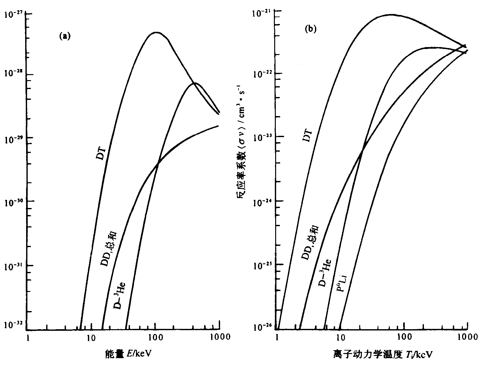

**图2.1** (a) DT、DD、D-$^{3}\mathrm{He}$的聚变反应截面随能量的变化；(b) DT、DD、D-$^{3}\mathrm{He}$和$\mathbf{P}^{6}\mathbf{L}\mathbf{i}$聚变反应的反应率系数随离子动力学温度的变化

## 2.4 实现受控聚变反应的基本要求

设想在某种聚变反应堆中实现聚变反应。因为反应燃料的温度非常高,燃料已经成为完全电离的等离子体(和氢原子一样,氘氚原子中的电子的电离能也是$13.6\mathrm{eV}$ ,因此,当温度超过几十万度时,氘氚原子已被完全电离,聚变堆中温度要高得多,实际上所有元素将被电离,成为等离子体)。那么,在这种由聚变燃料组成的高温等离子体中,实现聚变能输出的基本条件是什么呢?

设想这些等离子体得到较好的约束,也就是说,其中的离子和电子都可以在反应器中长时间地运动而不逸出。但即使达到这样的条件,也不一定保证有效的聚变能输出。这是因为,在高温等离子体中,带电粒子间的相互作用会使一部分能量从所约束区域逸出。只有聚变反应产生的能量大于损失的能量时,才能达到有效的能量输出。

### 2.4.1 聚变反应功率

聚变反应器中聚变反应的功率密度为

$$
P_{\mathrm{fus}} = \gamma_{\mathrm{ij}}n_{\mathrm{i}}\gamma_{\mathrm{ij}}\langle \sigma \nu \rangle_{\mathrm{ij}}E_{\mathrm{ij}}
\quad (2.6)
$$

式中,i,j代表两种相互作用的离子(例如氘核和氚核),对同类离子, $\gamma_{\mathrm{ij}} = 1 / 2$ ,对非同类离子, $\gamma_{\mathrm{ij}} = 1$。如果$E_{\mathrm{ij}}$以MeV为单位,离子密度以$10^{14}\mathrm{cm}^{- 3}$为单位, $\langle \sigma \nu \rangle$以$\mathrm{cm}^{3}\cdot \mathrm{s}^{- 1}$为单位, $P_{\mathrm{fus}}$以$\mathrm{W}\cdot \mathrm{cm}^{- 3}$为单位,则上式右方要乘一系数$1.6\times 10^{15}$。另外,上式中代表反应几率的函数$\langle \sigma \nu \rangle$已经是对粒子的分布函数(基本上是麦克斯威分布)做了平均的量,因此是粒子温度的函数。对氘氚反应,在氘氚离子温度为$10 \mathrm{keV}$ (大约为1亿度)时, $\langle \sigma \nu \rangle_{\mathrm{DT}} = 1.1 \times 10^{- 16} \mathrm{cm}^{3} \cdot \mathrm{s}^{- 1}$ ,而$E_{\mathrm{DT}} = 17.6 \mathrm{MeV}$ ,因此, $p_{\mathrm{DT}} = 3.1 \mathrm{W} \cdot \mathrm{cm}^{- 3}$。而氘氚反应的功率密度不到这一数值的百分之一。

一些重要的聚变反应几率$\langle \sigma \nu \rangle$随温度的变化已由Hively归纳成有用的计算公式[1],现引述如下:

氘氚反应:

$$
\begin{array}{r l}
\langle \sigma \nu \rangle_{\mathrm{DT}} &= \exp \left[\frac{a_{1}}{T^{\gamma}} +a_{2} + a_{3}T + a_{4}T^{2} + a_{5}T^{3} + a_{6}T^{4}\right]\\
a_{1} &= -21.377\,697,\ a_{2} = -25.204\,054,\ a_{3} = -7.101\,342\,7\times 10^{-2}\\
a_{4} &= 1.937\,545\,1\times 10^{-4},\ a_{5} = 4.024\,659\,2\times 10^{-6},\ a_{6} = -1.982\,697\,2\times 10^{-8}\\
\gamma &= 0.2935
\end{array}
\quad (2.7)
$$

氘氚反应:

$$
\begin{array}{r l}
\langle \sigma \nu \rangle_{\mathrm{DD}} &= a_{1}(1 + a_{3}T^{\gamma})T^{-2 / 3}\exp (-a_{2} / T^{1 / 3})\\
a_{1} &= 2.001\,860\,2\times 10^{-14},\ a_{2} = 19.307\,336,\\
a_{3} &= 5.775\,625\,9\times 10^{-3},\ \gamma = 0.949\,556\,69
\end{array}
\quad (2.8)
$$

氘氚- 3反应:

$$
\begin{array}{r l}
\langle \sigma \nu \rangle_{\mathrm{D^{3}He}} &= a_{1}(1 + a_{3}T^{0.75})T^{-2 / 3}\exp (-a_{2} / T^{1 / 3}) / \sqrt{1 + a_{4}T^{3.25}}\\
a_{1} &= -4.219\,543\,8,\ a_{2} = 28.415\,67,\\
a_{3} &= -2.573\,906\,7,\ a_{4} = -1.300\,751\,6\times 10^{-4}
\end{array}
\quad (2.9)
$$

用以上计算公式在计算机上计算起来并不困难,而且与现有实验数据库符合很好,相对误差都在$1\%$左右或更小。不过,实验数据本身的分散性有时可达$5\%$。

### 2.4.2 辐射损失

等离子体中的辐射损失包括韧致辐射、杂质谱线的线辐射、复合辐射及磁约束情况下电子的回旋辐射。这里仅考虑韧致辐射。这是一种因电子和离子及电子间相互作用时,电子发生变速而引起的辐射。由于电子间相互作用的贡献很小,可以忽略,主要考虑电子与离子的作用就行了。等离子体中的电子是处于自由能级上的,电子- 离子作用中电子连续释放出光子,但仍处在自由能级,因此,这是自由- 自由状态跃迁。对于单纯由氘氚离子及电子组成的纯等离子体,假设没有任何杂质离子混合其中,如电子的温度与离子相等,则电子运动引起的韧致辐射损失功率密度可以通过电动力学公式算出。最常用的公式是Bethe- Heitler公式,它适用于聚变堆中电子温区( $8\sim 20 \mathrm{keV}$ ),其形式如

$$
P_{\mathrm{brem}} = \frac{32}{3}\sqrt{\frac{2}{\pi}} Z^{2}n_{e}n_{i}\frac{e^{2}}{h c}\left(\frac{e^{2}}{m_{e}^{2}c^{2}}\right)^{2}m_{e}c^{2}\sqrt{\frac{k T_{e}}{m_{e}c^{2}}}
\quad (2.10)
$$

代入有关物理常数,粒子密度以$10^{14} \mathrm{~cm}^{- 3}$计算,得

$$
P_{\mathrm{brem}} = 4.81 \times 10^{-3} Z n_{e}^{2} T_{e}^{1 / 2} \mathrm{~W} \cdot \mathrm{cm}^{-3}
\quad (2.10')
$$

式中电子温度以$\mathrm{keV}$为单位。

在实际等离子体中,不可避免地会混入相当数量的杂质离子(即非燃料离子)。一方面,这是由于高温等离子体与周围的固体材料要产生很强的相互作用,材料中吸附的气体及组成材料的物质的离子会不断进入等离子体中;另一方面,聚变反应的产物,如氘氚反应产生的氦离子也是一种杂质。所以,实际的辐射损失功率密度要比上式算出的大。如果杂质离子的外层电子被完全剥离,则相应的辐射损失可以通过在上面的辐射损失功率密度表示式中乘一个等效的电荷值来表示

$$
Z_{\mathrm{eff}} = \frac{1}{n_{\mathrm{e}}}\sum Z_{\mathrm{i}}n_{\mathrm{i}}^{2}
\quad (2.11)
$$

各种杂质引起的辐射功率是温度的复杂的函数。D.P.Post对主要的元素的辐射冷却率在日冕模型下作出了辐射曲线及插值函数[2],将在以后有关章节中讨论。

### 2.4.3 劳逊判据

对实际反应堆来说,最大的能量损失是通过热传导和对流方式的损失。这一功率损失可以唯象地用一个能量约束时间来描述。等离子体的热能密度为$3n_{\mathrm{e}}T$ ,所以相应于热传导损失的功率密度为$3n_{\mathrm{e}}T / \tau_{\mathrm{E}}$。原则上,这里的物理量都要对有关体积积分。但为简单起见,我们把有关物理量理解为某种平均值。假定从聚变堆中逸出的总功率,即聚变功率加辐射功率加热传导功率为外部集热器所收集,然后以一定的转化因子转化为电功率,利用这个电功率来维持聚变堆中的等离子体功率损失,可以得到一个条件,这个条件称为劳逊判据:

$$
\eta \left(\frac{1}{4} n_{\mathrm{e}}^{2}\langle \alpha \nu \rangle E_{\mathrm{gas}} + p_{\mathrm{brem}} + \frac{3n_{\mathrm{e}}T}{\tau_{\mathrm{E}}}\right)\geq \frac{3n_{\mathrm{e}}T}{\tau_{\mathrm{E}}} +p_{\mathrm{brem}}
\quad (2.12)
$$

上式取等号并解出$n_{\mathrm{e}}\tau_{\mathrm{E}}$ ,得

$$
n_{\mathrm{e}}\tau_{\mathrm{E}} = \frac{3T(1 - \eta)}{\eta\left[\frac{1}{4}\langle\alpha\nu\rangle E_{\mathrm{gas}} + c\sqrt{T}\right] - c\sqrt{T}}
\quad (2.13)
$$

上式右方仅为温度的函数,若温度以$\mathbf{k}\mathbf{e}\mathbf{V}$计,则上面公式右方分母中的$E_{\mathrm{gas}}$应乘以$10^{15}$ (例如,对氘氚反应, $E_{\mathrm{DT}} = 17.6\times 10^{15}$ ),而初致辐射功率项中的相应常数$c = 0.3$。对不同的聚变反应,可以得出$n_{\mathrm{e}}\tau_{\mathrm{E}}$值与温度的不同曲线(见图2.2),曲线上方代表可以实现聚变能净输出的参数区。

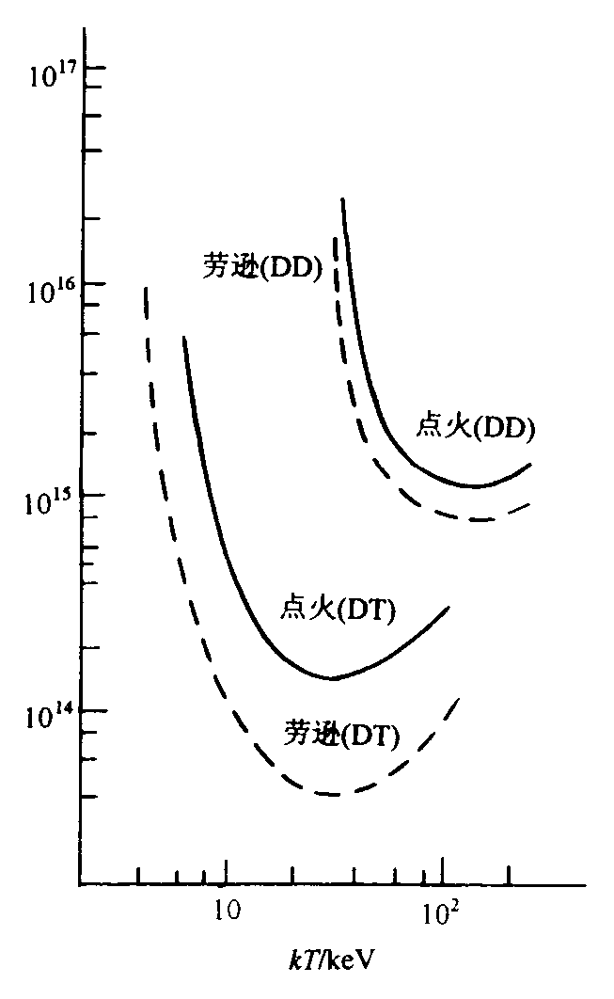

对氘氚聚变堆来说,在劳逊条件中,没有考虑$\alpha$粒子对氘氚等离子体的自加热。这一部分功率为全部聚变功率的$1 / 5$。在以后的讨论中我们将强调,这种自加热效应极其重要,是建立自持聚变反应堆的基础。

### 2.4.4 能量得失相当判据(零功率堆判据)

考虑$\alpha$粒子对氘氚等离子体的自加热,这时直接逸出反应堆区域的聚变功率是由中子携带的那部分聚变功率,即$(4 / 5)p_{\mathrm{gas}}$ ,进行类似的分析,实现零功率输出的条件为

$$
\frac{3n_{\mathrm{e}}T}{\tau_{\mathrm{E}}} +p_{\mathrm{brem}} - \frac{1}{5} p_{\mathrm{DT}} = \eta \left[\frac{4}{5} p_{\mathrm{DT}} + p_{\mathrm{brem}} + \frac{3n_{\mathrm{e}}T}{\tau_{\mathrm{E}}}\right]
\quad (2.14)
$$

解出$n_{\mathrm{e}}\tau_{\mathrm{E}}$ ,得

### 2.4.5 自持燃烧条件(点火条件)

对氛氪聚变堆来说,由于存在$\alpha$粒子的自加热,有可能建立完全或基本上依靠这种自加热将聚变反应长期维持下去的工作状况。其物理设想是,先用外加热方法将氛氪等离子体加热到足够高的温度,如果约束也足够好,则在关闭外加热功率时聚变反应可以长期维持下去。这个条件称"点火"。类似于普通的烧煤的炉子,当把煤点燃后,如煤的温度已足够高,煤就可以自身维持燃烧状态。显然,一个实用的聚变堆,应该是在自燃状态下工作的。否则,虽然可以获得净能量输出,但需从外部维持对等离子体的加热,这种加热设备将是十分昂贵的。自持燃烧条件的推导非常简单,即要求$\alpha$粒子的功率等于或大于总的等离子体损失功率

$$
\frac{1}{5} P_{\mathrm{DT}}\geq \frac{3n_{\mathrm{e}}T}{\tau_{E}} +P_{\mathrm{brem}}
\quad (2.16)
$$

由此得到

$$
n_{\mathrm{e}}\tau_{E}\geq \frac{3T}{\frac{1}{20}\langle\sigma v\rangle_{\mathrm{DT}}E_{\mathrm{DT}} - c\sqrt{T}}
\quad (2.17)
$$

对氛氪反应,劳逊条件比零功率条件要求高,而比点火条件要求低。它们随温度的变化如图2.3所示。

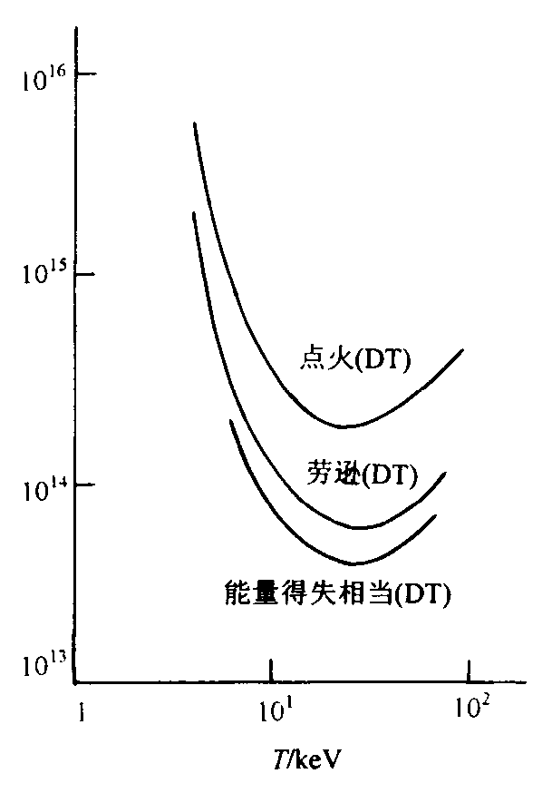

**图2.3** DT的劳逊条件、点火条件及零功率得失相当条件的比较（设$\eta_{\mathrm{th}} = 0.4$ ）

以上计算都是很粗糙的近似估算,因为没有考虑物理量的空间分布,也没有考虑许多重要的物理过程。例如,在关于点火条件的分析中,假定$\alpha$粒子的功率完全沉淀在氛氪等离子体中,这是太理想化的假定。此外,没有考虑杂质辐射以及杂质成分引起的有效燃料成分的减少。事实上,根据电中性条件

$$
n_{\mathrm{e}} = n_{\mathrm{D}} + n_{\mathrm{T}} + \sum_{Z > 1}Z n_{Z}
\quad (2.18)
$$

可知,在反应堆中心混入很微量的杂质离子,也会引起有效燃料离子浓度的很大减少,从而使有效聚变功率更大的减少。聚变$\alpha$粒子的能量也决不可能是就地沉淀在氛氪等离子体中,它们本身有特定的约束规律,这些都是聚变等离子体物理的重要研究内容。虽然以上得到的公式和曲线都是粗糙的近似,但仍然对聚变研究指出了方向。对氛氪聚变来说,基本上归结为两方面的要求: 第一, 要求将氘氚等离子体的温度加热到$10 \mathrm{keV}$ $(10^{8} \mathrm{~K})$以上; 第二, 要求等离子体的粒子密度与能量约束时间的乘积大于$(2 \sim 4) \times 10^{14} \mathrm{~cm}^{- 3} \cdot \mathrm{s}$以上。更为严格的条件将在有关聚变堆设计和堆芯等离子体物理分析的章节中论述。

在结束本章讨论以前, 再看一下关于点火条件推导中的公式, 我们发现, 如假定等离子体的容积足够大, 以致可以不计热传导损失, 那么, 聚变功率中由带电粒子所携带的那部分如果都沉淀在等离子体中, 当这部分功率大于初致辐射功率时, 燃烧就能自动维持下去。假定没有杂质, 这个条件对氘氚反应来说, 离子温度超过$4.2 \mathrm{keV}$ , 对氘氚反应为$35 \mathrm{keV}$ , 对氘氚- 3反应为$24 \mathrm{keV}$。如果考虑杂质辐射效应, 这些最低能阈都将有较大提高。这表明, 在当前能够达到的技术条件下, 要使后两种聚变反应实现自持状态, 还确实有较大的困难。但非自持状态下的应用 (如用作强中子源) 还是可能的。

## 2.5 聚变能资源

地球上储有十分丰富的聚变能资源。首先是氢的同位素氘, 它储于水中。氘在天然氢中占1/6700, 可计算出, 每立方米水中含氘量为$33 \mathrm{~g}$。地球上的海水所含的氘, 如果用于氘氚聚变反应堆, 可供人类使用上亿年。因此, 氘是一种取之不尽, 用之不竭的资源。不过, 氘反应聚变堆的实现太困难, 因此, 我们把主要注意力放在氘氚聚变上, 也讨论一下基于氘氚- 3反应的资源问题。

锂: 这是产生氘的材料。锂在地球上有比较丰富的储量。以每个锂核转换一个氘核计, 可以估算出, 每生产一万亿度电能, 要消耗约$100 \mathrm{t}$锂。以我国的锂资源为例, 可采锂储量超过数百万吨, 如每年用于聚变电站$1000 \mathrm{t}$ , 也可以用几千年, 而海水中储藏的潜在锂资源的总量要比陆上大万倍。(注: 以氘氚反应经核包层中一些核反应后总产能为$22.4 \mathrm{MeV}$计, 设每一个锂原子用于增殖一个氘, 则每克锂的聚变能当量为$3.08 \times 10^{11} \mathrm{~J}$ ; 又设热电转换效率为$1 / 3$ , 则每克锂可产生的电能约为$10^{11} \mathrm{~J}$ , 相当于2.8万度电。每$100 \mathrm{t}$锂用于氘氚聚变电站中可产生2.8万亿度电能。)

氦- 3: 在地球上, 氦- 3储量很少, 全部氦- 3不过为$10 \sim 15 \mathrm{t}$左右。但在月球上, 由于长期受太阳风的照射, 在其表土中含有较丰富的氦- 3。估计在每一平方公里表体月壤中含氦- 3可达$10 \sim 1000 \mathrm{t}$ , 全部月壤约有$5 \times 10^{4} \mathrm{~km}^{3}$ , 含氦- 3达$50 \sim 500$万吨。如用月球车每年运回到地球上$1000 \mathrm{t}$用于发电每年可达万亿度。

其它稀有金属: 建造磁约束聚变堆, 要用大量的稀有金属材料, 如铍 (用于增殖中子), 因其含量有限, 可能对某些聚变包层方案造成很大限制; 再如铌 (用于制造超导磁体), 需用量很大,但它的有限储量可能会限制含铌超导的实际可用量。

人类的历史是在不断产生问题又不断解决问题中前进的,各种资源的限制会促使人类去开发新的资源。例如,高温超导就不再依赖铌,如果高温超导材料达到实用,并能满足聚变堆超导的要求,则以上所说的限制就大大放宽了。总之,在已有资源条件下,利用氘氚聚变来提供人类所需的电能和氢能,解决几百年的能源需求问题,应该是不存在困难的。将来,依靠人类的新智慧,实现氘氚聚变的应用,以及直接应用太阳辐射能,则地球上的能源问题是可以解决的。

## 2.6 聚变-裂变资源的混合开发[3]

若将氘氚聚变堆产生的一部分中子用于增殖裂变燃料,如$^{238}\mathrm{U}$或$^{232}\mathrm{Th}$ ,则可以将现有裂变燃料的使用率提高上百倍。在同等的电功率当量下,氘氚聚变堆对裂变元素如$^{239}\mathrm{Pu}$ , $^{233}\mathrm{U}$等的增殖效果要比快中子堆高十倍以上。因此,锂资源与铀,钍等裂变资源的混合开发,可使裂变资源获得非常充分的利用。而且,可以大幅度减少高放核废料,为核能开发带来重大的效益。

## 参考文献

1. Hively L M. Convenient Computational Forms for Maxwellian Reactivities. Nucl. Fusion, 1977, 17: 873
2. Post D P. Nucl. Data and Atomic Data Table, 1977, 20: 397
3. Moir R W. 裂变- 聚变燃料工厂, E. Teller 主编; 肖兵, 汤大荣译. 聚变: 第一卷磁约束, 中译本下册. 北京: 原子能出版社, 1988 年 2 月

# 第三章 磁约束聚变原理

在本章中,我们将介绍磁约束聚变的基本原理。我们将通过定性的说明来介绍有关磁约束的基本概念和内容以及研究发展。对那些希望了解磁约束聚变研究基本情况而在等离子体物理方面不熟悉的读者,可以通过本章的学习而达到目的。

氘氚反应只能在极高的温度下进行,此时氘氚燃料以等离子体的形态存在。因此,人工受控聚变的问题化为如何在一定的容器中产生和控制高温等离子体,并使所要求的聚变反应能相对平稳地进行下去的问题。在地球上,以爆炸形式释放聚变能已经在氢弹爆炸中实现。这种产生聚变能的形式从应用的角度看有根本性的缺点,使它不太可能用于和平目的。氢弹爆炸的威力太大,其破坏性极大,而且在爆炸过程中仅有一小部分聚变材料产生了反应,绝大部分都在爆炸中飞散损失了。本世纪60年代后期提出了惯性约束聚变的概念,这实际上是利用微型氢弹爆炸的原理,具体说就是利用功率密度极高的激光束或其他粒子束将内含氘氚燃料的微丸在极短的时间内压缩聚爆达到极高的密度,同时将氘氚离子加热到热核聚变反应温度,并在向心聚爆形成的极高密度的等离子体飞散以前(即利用等离子体的向内运动的惯性)产生足够的聚变反应,获得能量增益。惯性约束(主要是激光核聚变研究)得到美、俄、法等核大国的高度重视,因为微丸的聚爆过程与氢弹爆炸过程在物理机制上类似,在一定程度上可以通过微丸聚爆实验模拟核爆,因此,激光核聚变研究与国防科学及国家安全有密切关系。这是推动激光核聚变研究的一个重要因素。有关的讨论请参看有关专著[1]。

磁约束聚变倾向于以准稳态过程实现氘氚聚变燃烧。早期一些基于快过程(如直线箍缩放电(linear pinch)、角向箍缩放电( $\theta - \mathrm{pinch})$ )的方案都已放弃,现在重点研究的托卡马克和先进环形装置的反应堆设计都采用长脉冲(一次燃烧将维持一天或更长时间)甚至稳态的方案,目前已建立可靠的物理和工程技术基础。大体的设想如下:在一定大小的真空容器中(根据不同的设计思想,这种容器的容积一般在$100\sim 1000\mathrm{m}^{3}$左右),将氘氚燃料用特殊的加热方法加热到聚变反应温区(即1亿度以上)以“点燃”氘氚反应(即使聚变反应释放的能量大于外加热所消耗的能量),利用特殊设计的磁场位形将这种高温等离子体稳定地约束在该真空容器内,使释能反应能够长期持续下去。为此,将利用反应产生的高能$\alpha$粒子(3.5MeV)来加热不断补充输入系统的冷燃料,而能量为14MeV的快中子则穿越器壁进入真空容器外部的核包层中,在那里这些中子在被慢化的同时,部分用于与金属锂相互作用增殖氚,部分与其他元素作用增大热能。不同的包层设计得出的热能增加值及氚增殖系数不同,这意味着可以按用户要求设计不同的聚变堆型。一般说来,经包层中一系列反应以后,一次聚变反应(即消耗一对氘氚离子)产生的总热能按典型的堆设计可以达到22.4MeV。总的热能送入热交换器用于产生电能。其中,与$\alpha$粒子所携带的能量对应的热能将直接沉淀在真空容器壁上或特殊设计的收集器中,而在核包层中产生的热能则类似于裂变反应堆通过载热剂的热交换输出到包层外部。因此,聚变反应容器和核包层一起构成聚变反应堆的“一次回路”。与裂变反应堆相似,在“二次回路”中,将热能转化为电能,输送到外电网中为用户服务。

在实现上面设想中,特殊形式的磁场位形是关键。几十年磁约束聚变研究的中心任务之一就是研究如何产生这样的磁场位形。这里,磁场位形一词指的是由外加磁场及等离子体内部电流产生的磁场共同组成的一种磁场形态,在这种合成磁场中,等离子体中的大部分带电粒子(电子和离子)可以长时间地运动而不会逸出;但是,粒子间存在着相互作用,在受到其它粒子的碰撞或外部扰动的作用时,粒子会改变运动状态,产生向器壁的输运。一种好的磁场位形必须具有约束带电粒子的良好品质。此外,这种磁场位形还应具有很好的热绝缘性质,使中心等离子体的极高温度能在得到一定加热的条件下维持下去,同时其热传导性应足够小,使得能够在较小的容器中维持具有聚变高温的等离子体。一般情况下,等离子体的温度总是由中心约束区向边缘(即器壁所在处)下降的。在器壁附近,等离子体的温度已不是很高,但仍然比人们日常接触的所谓高温高得多。例如,在本书将要重点讨论的托卡马克反应堆中,边缘等离子体温度将在$50\sim 200 \mathrm{eV}$左右,也就是说在$50\sim 200$万度左右。对比一下,一般的炼钢炉中心的温度在三干度左右,电弧的温度可达一万度。显然,聚变堆真空容器边缘的温度比日常生产和生活中人们接触到的温度要高得多。几十万度以上的高温在一般概念上是物质材料无法承受的。不过,由于磁约束聚变等离子体的粒子密度非常低,比空气低一百万倍(正常条件下空气中的分子密度为$2.5\times 10^{19} \mathrm{cm}^{- 3}$ ,而托卡马克等离子体的粒子密度为$10^{14} \mathrm{cm}^{- 3}$ ,在边缘还要更低),所以,对于等离子体的器壁来说,它感受到的是总的热通量,而这个热通量在一定的冷却条件下,器壁是可以忍受的。此外,器壁将受到慢化后但仍然具有很高能量的α粒子及其它较低能量粒子对它的轰击。这种轰击会引起壁材料的损伤(物理和化学溅射、氦起泡,等等),更重要的是,真空器壁要受到$14 \mathrm{MeV}$中子的轰击,这些中子绝大部分都能穿越器壁进入核包层,但由于长期作用,也要引起壁材料的损伤和活化(activation)。从材料科学研究的角度看,聚变堆相关材料是一个极具挑战性的研究领域。以上问题将在以后的章节中详细讨论。

## 3.1 磁场对带电粒子的约束

在均匀磁场中,带电粒子一方面绕磁力线做拉莫尔(Larmor)转动(又称回旋转动,这个转动中心称回转中心),一方面可以自由地沿磁力线运动而不受阻力。举例看,一个$1 \mathrm{keV}$能量的氘离子的速度为$10^{7} \mathrm{cm / s}$ ,它穿过$10 \mathrm{m}$长的区域仅需$1 \mu \mathrm{s}$ ,同样能量的电子的速度比氘离子的大60多倍,飞出该区域的时间更短。显然,均匀磁场不能达到约束带电粒子的目的。在磁约束聚变研究的历史上,提出过并在相当一段时间内在装置实验中实践过两类位形:直线装置中的磁镜位形和环形位形。为了了解有关的基本概念,需先讨论一下带电粒子的横向运动。一个熟知的概念是带电粒子在磁场中的拉莫尔转动。拉莫尔半径$\rho_{1}$与粒子的质量、横向速度、磁场强度以及粒子的电荷数有关:

$$
\rho_{1} = \frac{m_{1} \nu_{1} c}{Z_{1} e B} \tag{3.1}
$$

式中$Z_{1}$为电荷数,对电子为$(- 1)$ , $m_{1}$为粒子的质量, $c$为光速, $\nu_{1}$为垂直于磁场的速度分量;由于粒子在受到其它力的作用时,例如受到周围粒子的碰撞时,可以从一根磁力线移动到另一根磁力线,所以必须要求约束系统的横向尺度远大于离子拉莫尔半径的大小。在大多数已建成的磁约束实验装置中,主磁场的强度从$1\sim 10 \mathrm{T}^{*}$不等,在聚变堆中,例如在托卡马克聚变堆中,基于已达到的并能在大型装置中采用的产生磁场的技术,等离子体中心区的磁场强度约为5T,能量为$10\mathrm{keV}$的氘离子的拉莫尔半径为$0.27\mathrm{cm}$ ,而能量为3.5MeV的$\alpha$粒子的拉莫尔半径为$4\mathrm{cm}$。目前设计的托卡马克聚变堆的横向尺寸为$3\sim 5\mathrm{m}$比高能粒子的拉莫尔半径大得多。因此,完全可以认为等离子体的各种宏观参数(如粒子密度$n$ ,温度$T$ ,压强$p$ ,等等)的空间分布是电子和离子的回转中心所处位置的函数,而电子和离子的拉莫尔特动对这种分布只产生次级影响。

表征带电粒子在磁场中运动特性的另一个重要物理量是粒子的磁矩,其定义为

$$
\mu = \frac{m\nu_{1}^{2} / 2}{B} \tag{3.2}
$$

磁矩的方向总是与本底磁场的方向相反,表明等离子体是反磁性介质。这一定义可以推广到磁场不均匀的情形,而且,如磁场的不均匀性不强(其含义为:在粒子回转半径范围内磁场的变化量远小于磁场强度本身),则由带电粒子运动方程可以证明,粒子的磁矩是该粒子的一个近似的运动积分,习惯上称为绝热不变量(Adiabatic invariance)。在静磁场中,粒子的能量是严格的运动积分。由能量和磁矩的守衡立即可以推断出在不均匀磁场中,粒子的平行运动速度与磁场强度的变化有如下关系:

$$
\nu_{||} = \sqrt{E - Ze\Phi} -\mu B \tag{3.3}
$$

式中$\Phi$为静电势。在不存在静电势或静电势沿磁力线为常数的条件下,粒子在不均匀磁场中将不断进行平行能量与垂直能量间的转换。如在某处粒子的全部能量都变成垂直能量,粒子将不再可能向原来运动的方向运动而折向相反的方向,这种空间位置称为粒子的镜型反射点。

一种最简单的防止带电粒子沿磁力线损失的方法是采用环形位形。在环形位形中,磁场强度是不均匀的。这可以从磁场矢量是涡旋矢量这一性质来说明。不过,更简单的是以无限长直线电流的磁场随空间位置的变化来讨论。这一电流产生的磁场的磁力线是平面曲线(圆)。以电流方向为$z$轴构成柱坐标,则磁力线在$\theta$方向,其强度为

$$
\begin{array}{l}
B = B_{\theta}e_{\theta}\\
B_{\theta} = \frac{B_{\theta}R_{\theta}}{R}
\end{array} \tag{3.4}
$$

如果我们考虑一个环形区域,在此区域中,上述直线电流产生的磁场与回绕在该真空室外的均匀螺线管电流产生的磁场是一致的。在托卡马克装置中,这一磁场称为环向磁场,它在确定托卡马克等离子体性质方面极具重要性。现在看到,这一磁场随着离开电流线的距离的加大而反比地减小。它同时具有两重“不均匀性”,即它的力线具有曲率,曲率半径即为离电流线的距离$R$ ;同时,它的强度具有梯度$\nabla B = - B_{0}R_{0} / R^{2}$。根据带电粒子运动的回转中心理论,这两种因素将引起带电粒子横越磁力线的漂移,其方向既垂直于磁力线本身,又垂直于磁场梯度的方向(见第六章)。在本问题中,粒子漂移运动的方向恰好是$z$轴方向,而且,电子和离子的漂移方向是相反的,于是,原来是电中性的等离子体将因这种环形漂移而产生电荷分离,产生沿$z$轴方向的极化电场。这一电场又使带电粒子产生既垂直于磁场,又垂直于电场的电漂移

$$
\nu_{E} = c\frac{E\times B}{B^{2}} \tag{3.5}
$$

在等离子体物理中,这个电漂移性质是十分重要的,它构成磁流体运动和微观粒子输运的基础。在本问题中,电漂移方向指向真空室,因此,这一电场会引起等离子体的整体漂移损失(见图3.1)。

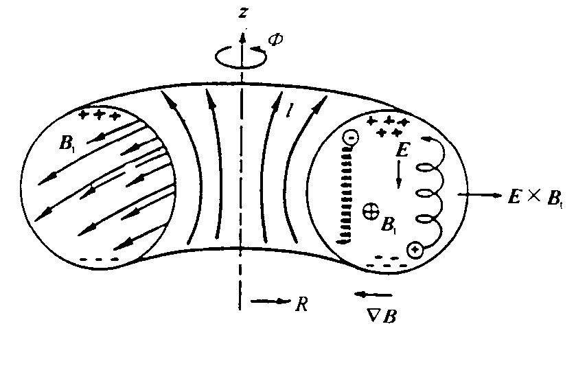

**图3.1** 简单环形磁力线系统中等离子体的电荷分离和电漂移

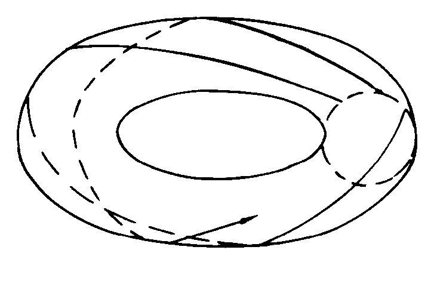

**图3.2** 环形系统中由具有旋转变换的磁力线构成的磁面

以上例子表明,简单的环向磁场不可能实现对带电粒子的有效约束。现在再考虑一种由直线电流和环向电流合成的磁场(见图3.2),这时磁力线是绕环向电流线转动(螺旋线)的。这种位形是托卡马克位形的原型,它的一个重要特征是磁力线存在旋转变换(rotational transform)。也就是说,当磁力线主要沿环向磁场方向前进时,它同时沿极向(poloidal)(即环面与球坐标系中的子午面相交的方向)转动。一般,在绕大环方向转一周后,磁力线并不回到原出发点。这样,经无限多次绕大环方向的转动,一根磁力线将形成一个环形磁面(见图3.2)。磁力线存在旋转变换是环形装置能够约束等离子体的一个必要条件。在这种磁场形态下,带电粒子将在闭合的轨道上运动,而极化漂移引起的电场将被沿磁力线流动的电流所补偿,仅产生较小的次级效应。在实际的托卡马克装置中,环向线电流为等离子体自身的环向电流所代替,但约束带电粒子的原理是相似的。

在80年代以前,具有磁镜位形的直线装置的研究曾受到一定程度的重视。因为这种装置的几何形态简单,如建成聚变堆,具有多方面的优越性。磁镜位形在自然界是可以普遍观察到的一种位形。例如地球两极附近,地球的偶极磁场是很不均匀的,磁场强度人的区域对带电粒子来说就像是一个反射镜。但这种反射只发生在那些速度与磁力线的夹角较大的粒子上,对接近平行于磁力线运动的粒子,除非镜区的磁场强度非常大,它们将穿过镜区而逸出约束区。这相当于在速度空间中存在一个逸出锥。问题是粒子间存在碰撞,不断有粒子从约束区进入这个逸出锥。因此,简单的直线磁镜装置不能将等离子体约束足够长的时间。曾提出用多级磁镜来减少粒子损失率和改善约束的设想,但实际上这将使聚变堆的规模变得很大,投资增大很多,而且其有效性也未能得到证明,加上托卡马克的发展迅速,各国对多级磁镜的研究计划实际上停止了。也提出过用电位垒或高频电磁场位垒来控制镜区粒子损失的方案,但从一些装置上的实验结果未能得出有说服力的证据,结果,磁镜研究计划基本上停止了。

除托卡马克外,还有一种不依靠等离子体环向电流来实现磁力线转动的方案。实际上,这种被称为仿星器(Stellarator)的磁场位形概念比托卡马克出现得早,它是著名磁约束聚变研究先驱 L. Spitzer 教授提出的。Spitzer 最初提出将真空室连同绕在真空室外的螺线管磁场线圈一起扭成空间 8 字型来实现磁力线的旋转变换, 后来, 又提出在原有的螺线绕组外再加几组大螺旋绕组来实现磁力线的旋转变换。这些想法都在美国的 Princeton 大学的国家等离子体实验室 (PPPL) 中建成的几个仿星器装置上进行过原理性实验。目前, 类似于仿星器构想的环形磁约束装置还在进行, 而且, 在很多重要的方面有了许多本质性演化, 并已成为可与托卡马克装置竞争甚至可能在总体品质上超过托卡马克的一种位形。这些将在以后的章节中讨论。

## 3.2 等离子体稳定约束对磁场位形的要求

可以长期约束带电粒子只是有效的约束位形的一个必要条件; 另一个必须满足的条件是该磁场位形必须能够稳定地约束高温等离子体。描述高温等离子体的最简单的宏观模型是磁流体模型。研究中首先需要确定的是高温等离子体在特定磁场位形中的宏观平衡态, 确定在已知外加磁场中等离子体的压强$p$ , 电流密度$j$ , 自恰磁场$B$之间的相互关系。这里, 自恰磁场指的是外加磁场与等离子体自身的电流产生的磁场之和。从宏观上看, 磁场对等离子体的约束来自磁场自身的压强。设想一个理想的磁约束位形, 假设等离子体内磁场强度为零, 等离子体压强直到边界均为常数, 这时可得一个压强平衡条件

$$
P = \frac{B^{2}}{8\pi} \tag{3.6}
$$

这种位形在自然界和实验室中都不可能形成, 因为它不满足磁流体稳定性条件。实际位形中磁场和等离子体是互相渗透的, 磁场对等离子体的约束不是直接由其压强大小, 而是由压强的梯度提供的。根据磁流体平衡条件, 在静磁平衡近似下(即假定等离子体的宏观速度很小, 其效应可以忽略), 空间各点都要满足

$$
\nabla p = \frac{1}{c} j \times B \tag{3.7}
$$

式中左方为等离子体的压强梯度, 右方为洛伦兹 (Lorentz) 力。利用麦氏方程中的安培定律

$$
\nabla \times B = \frac{4\pi}{c} j \tag{3.8}
$$

右方项可以改写成

$$
\frac{1}{c} j \times B = -\nabla \left(\frac{B^{2}}{8\pi}\right) + \frac{B \cdot \nabla B}{4\pi} \tag{3.9}
$$

这样, 方程 (3.7) 可以改写成

$$
\nabla \left(p + \frac{B^{2}}{8\pi}\right) = \frac{B \cdot \nabla B}{4\pi} \tag{3.10}
$$

左方梯度算符作用的量称为等离子体- 磁场系统的总压强, 其中等离子体压强所占的比重

$$
\beta = \frac{8\pi p}{B^{2}} \tag{3.11}
$$

称为等离子体的比压值, 这一参量在确定等离子体的宏观平衡和磁流体稳定性质上起决定性作用, 而且, 在与反常输运现象有关的机制中也是关键性参数。等离子体的压强与等离子体的粒子密度及动力温度有关, 满足理想气体的物态方程, 即

$$
p = n(T_{\mathrm{e}} + T_{\mathrm{i}}) \tag{3.12}
$$

由等离子体的输运性质确定的粒子密度及动力温度通常都是由等离子体约束系统的中心向边缘单调下降的,因此,压强分布也是由系统的中心向边缘单调下降的函数。经常采用对等离子体体积平均后的比压值$\langle \beta \rangle$来表征等离子体的总体平衡的稳定性质,同时这也是与氘氚反应堆品质直接联系的量。理论与实验研究都指出,这个平均比压值存在运行极限,它与一系列宏观磁流体模式的激发条件密切相关,也与一些重要的微观模式及反常输运相关。具体的模式特性及相关的限制条件与位形的特性有关。不仅直线磁镜系统与环形托卡马克系统有很大差别,而且,就是同样属于托卡马克约束系统,也与位形结构的许多几何参数,例如等离子体环的小半径与环的大半径之比$a / R$ (这一参数称为倒环径比),等离子体环的横向断面的形状,尤其是所谓的拉长比(断面沿环形对称轴方向的线度与环的赤道平面方向的线度比)和三角变形度有关。最近研究表明,极限比压还与等离子体参数的剖面分布有很大关系,也就是说,通过适当控制许多重要物理参量的空间分布,有可能将反应堆的品质大幅度提高。这些将在以后的章节中讨论。

一般而言,对环形装置,无论是托卡马克,还是改进型仿星器,其极限压强大体为等离子体环的倒环径比的数量级:

$$
\langle \beta \rangle = \frac{a}{R} C(a / R, \kappa , \delta , \dots , \lambda_{n}, \lambda_{T}, \dots) \tag{3.13}
$$

式中, $c$的数量级为1,具体值与倒环径比$a / R$、拉长度$\kappa$、三角变形度$\delta$、以及密度、温度等的剖面分布特征量$\lambda_{n}$ , $\lambda_{T}$有关。

## 3.3 等离子体输运与约束的关系

满足粒子约束和磁流体稳定性的磁场位形不一定就能满足建立经济性能好的聚变堆的要求。这是因为,一种约束系统的物理和经济品质根本上还要由其热绝缘性质确定。聚变堆等离子体是不均匀物理体系,各种基本参数都是空间位置的函数。已指出,粒子密度和动力温度一般都由等离子体中心区域向边缘区域单调地减小。实际上,这正是粒子和能量输运过程所确定的结果。不过,在聚变等离子体物理所牵涉的输运中,包括各种磁流体活性引起的对流和反常热传导,也包括由微观不稳定性引起的反常扩散和热传导。而且,在几乎所有形式的聚变实验装置中都观察到,对等离子体参数的大小和空间分布起主导作用的,除磁流体活性区中主要是磁流体活性外,在输运区,主要是反常输运。这里“反常”一词的含义,一方面是该种性质的输运系数通常比经典碰撞引起的输运大很多,另一方面也是由于对其物理机制不甚了解,没有一种普遍适用的物理模型来描述这类输运现象。

等离子体作为由完全电离的电子和离子组成的物理体系,粒子间的相互作用是库仑长程力。因此,其中的粒子碰撞需在约定的物理意义上来理解。一个基本的物理图像是,粒子间(电子与电子,电子与离子,离子与离子,以及离子与杂质离子,等等)的每次作用(一种粒子飞过另一种粒子一次)平均说来仅引起微小轨道偏离,由此定义的偏转角$\Delta \theta < < 1$由于这种偏转是无规的,可以将这种偏转看成是速度空间中的扩散,则$N$次小碰撞引起的偏转角为$\sqrt{N}\Delta \theta$ ,由此定义所谓的90度偏转的碰撞,对电子与离子,其碰撞频率为

$$
\nu_{\mathrm{ei}} = \frac{4\sqrt{2\pi} n_{\mathrm{i}}Z^{2}e^{4}\ln A}{3\sqrt{m_{\mathrm{e}}(T_{\mathrm{e}})^{3 / 2}}} = 2.91\times 10^{-6}n_{\mathrm{e}}\ln A T_{\mathrm{e}}^{-3 / 2}(\mathrm{eV}) \tag{3.14}
$$

式中$\ln \Lambda$称库仑对数, 对聚变等离子体其大小约为$12 \sim 15$ ; 上式右方第二个等式中电子温度以 eV 计, 电子密度以$10^{14} \mathrm{~cm}^{- 3}$计, 对聚变等离子体, 电子与离子的碰撞频率在$10^{3} \sim 10^{4} \mathrm{~s}^{- 1}$量级。离子与离子的碰撞频率为上述值的$(m_{e} / m_{i})^{1 / 2}$倍。如果没有磁场约束, 粒子运动的自由程为其热速度除以碰撞频率, 而碰撞引起的扩散系数和热导率的大小均约为$1 / 3 \nu \lambda^{2}$ , 无论对电子或离子, 这都是非常非常大的数字, 它表明等离子体的热绝缘将在瞬间失去; 在存在磁场时, 沿磁力线方向的输运基本没有受到磁场的影响, 因此等离子体的基本参数如粒子密度和动力温度都可以看成沿磁力线是常数。根据前面的讨论, 在托卡马克或仿星器等类型的环形装置中, 磁力线旋转变换而形成磁面, 所以, 在同一磁面上, 粒子密度及温度近似为常数。在横越磁场方向, 粒子的拉莫尔转动使得粒子被定位在某根磁力线上, 一次 90 度碰撞引起的位移大小为拉莫尔半径量级, 这种位移也是随机的, 于是, 形成了横越磁面的输运。这种经典扩散与热传导率的大小都为$\nu_{\mathrm{ei}} \rho_{\mathrm{ei}}^{2}$的量级。在磁场强度为 1 T 大小时, 这种输运是非常小的。根据输运系数与总体约束时间之间的关系式

$$
\tau = \frac{a^{2}}{C\chi} \tag{3.15}
$$

可以估计出总体约束时间。上式中$c$大约为 5 左右, 另外不应将上式分母中的输运系数理解为某点上的值, 而应看成一种平均值。若将其取为扩散系数, 则得出粒子约束时间, 如取为热传导系数, 则得出能量约束时间。回顾对聚变堆自持燃烧的条件, 即$n\tau_{E} \geq 5 \times 10^{14} \mathrm{~cm}^{- 3} \cdot \mathrm{s}$ , 取等号, 将上面估计的能量约束时间代入, 可以得出聚变堆堆芯等离子体尺寸的估计:

$$
a = \sqrt{5C\chi / n_{14}} \tag{3.16}
$$

式中$n_{14}$表示密度以$10^{14} \mathrm{~cm}^{- 3}$计, 若热导率$\chi$以$\mathrm{m}^{2} / \mathrm{s}$计, 则半径为$a(\mathrm{m})$。可以看到, 当$\chi$达到$1 \mathrm{~m}^{2} / \mathrm{s}$的量级, 等离子体的横向尺寸要达到$5 \mathrm{~m}$。相应的聚变堆输出功率约为数千 MW, 其造价按目前技术条件估计要超过百亿美元。显然, 这将缺乏经济竞争力, 将极大地限制聚变堆的发展。这一讨论指出, 具有良好经济品质的聚变堆与具有良好物理品质的约束位形要求是一致的。这里所说的物理品质除上面讨论的好的宏观稳定性要求外, 主要指好的热绝缘特性。

强磁场中横越磁场的经典输运很小, 典型值为$0.01 \mathrm{~m}^{2} / \mathrm{s}$ , 给出的粒子和能量约束时间很长。事实上, 如果没有后来的实验中发现的各种反常输运, 小半径为$1 \mathrm{~m}$的堆芯, 只要用 1 T 大小的磁场, 就可以满意地将聚变等离子体很好地约束住。但是, 几乎在所有可能作为聚变堆的磁约束位形中, 都发现存在各种形式的, 其大小远大于经典输运值的反常输运。了解这些反常输运的物理机制, 寻求输运品质好的约束位形, 一直是磁约束聚变理论和实验研究的中心课题。

在以后的章节中我们还要介绍一种与环形位形相联系的, 仍属于经典性质的输运, 称为新经点输运。这种输运本质上是粒子间碰撞引起的, 所以是经典的, 但考虑了环形位形中带电粒子轨道已不是简单的沿磁面的运动加绕磁力线的转动, 磁力线的弯曲和不均匀性引起的磁漂移对粒子的轨道有本质性的影响, 尤其是, 磁场局部磁镜效应使一部分横向能量大的粒子被约束在局部空间区域, 它们不能沿整个磁面自由飞行。这些粒子称捕获粒子(trapped particles), 它们对最终的输运系数有很大的贡献。由于这种输运是碰撞引起的,所以, 它构成环形约束位形中等离子体输运的底线, 不可能有比这种输运再小的环形位形存在。

聚变等离子体是人为地约束在相当小体积中的, 温度和粒子密度梯度都很大的物理体系, 其中可以激发起很多形式的集体相互作用模式, 即等离子体即使处于相对平稳的状态, 其中也存在各种微观的不稳定模或小尺度的宏观不稳定模, 在局部区域也可能存在较大尺度的宏观的不稳定模, 这些都将影响总体约束。例如, 一种使平衡态磁场发生小的畸变的微撕裂模 (microtearing mode) 可能使磁力线产生无规化畸变, 原来光滑的磁面变得非常粗糙, 而且与相邻的磁面发生连接, 这种连接是随机性的, 变化不定的, 于是, 带电粒子沿磁力线的快运动等价地有一个横越磁力线的分量, 其大小正比于$(8B / B)^{2}$ , 这里的微扰磁场的相对值很小, 仅为$10^{- 5} \sim 10^{- 4}$的量级, 但由于沿磁力线的输运实在太大, 如此小的磁场随机畸变足以使横越磁场的输运加大几百倍。另一种反常输运是由静电湍流引起的, 这种湍流的总体水准也不高, 其能量也仅为等离子体热能的一小部分, 在等离子体边缘区域要大一些, 有时可以达到等离子体热能的大小, 它们引起随机性电漂移, 宏观上相当于一种横越磁场的对流损失, 其大小也比经典碰撞损失大很多。从原理上说, 我们并不要求完全地将所有上述湍流抑制下去, 但聚变堆堆芯等离子体所容许的湍流水准有一定限制。由于各种微观模式或宏观局域性模式 (即小尺度宏观模式) 的性质十分复杂, 其时空特性难以用普遍的物理模型描述, 所以, 利用实验装置来研究具有好的总体约束品质的高温等离子体, 是磁约束研究的关键内容。

### 3.4 等离子体的产生和加热

在磁约束实验装置和反应堆中, 等离子体的产生和加热到聚变燃烧温度的过程与约束位形的建立及不断改进的过程是不可分割地联系在一起的。确实, 在一些非常小的用于原理性试验的装置中还可以用喷枪注入等离子体, 但这种等离子体的温度不高, 而且含大量的杂质, 不可能用于长脉冲实验装置和反应堆中。对反应堆来说, 产生和初步加热的方法主要是欧姆加热及波加热, 这两种方法都可以均匀地将大体积的气体电离后加热到 keV 量级, 为进一步的加热提供好的靶体。进一步的加热包括强流高能中性束注入、离子回旋频段的波加热、低杂频段的波加热及电子回旋共振加热, 在某些装置中还可以采用绝热压缩加热, 最后, 在反应堆中, 主要依靠$\alpha$粒子的加热来维持自持燃烧。

#### 3.4.1 等离子体的产生和宏观平衡位形的建立

在预设有外加约束磁场的真空室中, 充入试验用气体 (大部分实验用氢气, 有时也用氘气或氦气, 因为当前实验目的是建立供实验诊断观察用的高温等离子体), 通过对气体进行放电或注入微波, 使工作气体完全电离和实现初期加热。理论和实验证明, 甚至在很小尺寸的装置中, 通过对气体进行欧姆加热, 就能很容易地建立电子温度为数百 eV 的等离子体。同时, 放电电流的磁场成为约束磁场的有机组成部分。对托卡马克位形, 这一部分的磁场在决定约束性质上起着关键性作用, 这个磁场称为极向磁场 (poloidal magnetic field)。在仿星器位形等离子体建立中, 也可以在开始阶段引入一个比较小的电流 (相对托卡马克而言), 它足以建立温度超过几百 eV 的初始等离子体而不对仿星器的真空磁场位形 (即由外部线圈产生的磁场) 产生太大的扰动, 随后用较强的波加热提高等离子体温度, 并将驱动电流的电源关闭, 完全依靠外电流产生的极向磁场来约束等离子体。在脉冲放电型等离子体约束实验中, 则主要依靠等离子体内部电流的磁场来平衡和稳定等离子体, 典型的例子是反场约束位形 (Reversed field configuration, 简称 RFC)。在后一种例子中, 等离子体在初始阶段可能是不稳定的, 经过一个磁流体驰豫过程后建立了稳定的平衡态。从磁流体稳定性的角度看, RFC 位形有可能实现比托卡马克位形大几倍的等离子体比压值, 因而有较好的堆晶质因子。不过, 在其它方面, 这类位形尚存在很多不易解决的问题, 在这一类型实验装置中达到的等离子体参数比托卡马克要低两个数量级以上, 迄今其研究仍在原理性探索阶段。

在实践上, 我们并不要求等离子体位形是绝对稳定的。对一些约束时间和等离子体存在时间 (放电脉冲宽度) 很长的装置, 如托卡马克或仿星器, 感兴趣的是后期长时间的干净的等离子体的约束, 所以容许在初始建立阶段等离子体存在各种并不严重危害约束的不稳定性。另外, 如果一些不稳定性只发生在局部区域而不影响整体等离子的宏观平衡态, 则这些不稳定性也可以存在于实验装置或反应堆中。就象在太阳中不断地发生各种不稳定过程, 如太阳黑子就是一种强大的磁流体不稳定性, 但整个太阳是一个很稳定的物理体系, 因为这些不稳定性只局限于某些局部空间中, 只发生在一定时间尺度内, 它们没有影响太阳整体基本上平稳燃烧的总体状况。在聚变堆中, 我们也不要求氘氚等离子体具有随时空不变的平稳态 (这种要求是很难实现的)。我们只要求一种总体上的平稳, 而在一定时间尺度、一定空间范围内, 等离子体局部状态与平稳态有一定的偏离。例如, 在托卡马克位形中, 从实验上观察到在所谓$q = 1$的磁面内部存在相当强的磁流体活性, 称为锯齿活性, 它在一定程度上使约束变坏, 但同时有控制杂质向中心约束区积累的功能。这种磁流体活性没有破坏等离子体的总体约束, 是容许的。此外, 氘氚燃烧本身也具有偏离平稳态的倾向, 需要不断地从外部加以控制。

#### 3.4.2 等离子体的进一步加热: 中性束注入和微波加热

欧姆加热的效率随电子温度的提高而迅速下降, 即使对托卡马克这类约束非常好的装置, 其加热电子的极限温度约为$2 \mathrm{keV}$ , 离氘氚自持燃烧所需温度还很远。有人设想过用单纯的欧姆加热来实现氘氚燃烧, 但即使按理论上很理想化的设计参数, 也要求主约束磁场强度超过$20 \mathrm{T}$ , 一般的超导体的临界磁场达不到这一数值, 目前为止没有令人信服的实验证据可说明单纯欧姆加热可以在任何形态的装置中能建立氘氚自持燃烧, 国际聚变界的一致看法是需要二次加热。由于历史的原因, 二次加热被称为辅助加热 (auxiliary heating), 但实际上无论对托卡马克或仿星器, 二次加热的总功率和功率密度都比欧姆加热大很多, 所以正确的理解应该是二次强功率加热。最主要的方法是中性束注入和波加热, 这些方法都已建立了很强的技术基础。中性束注入是建立在强流离子源技术基础上的, 因为带电粒子不能自由地横越磁力线进入装置中心区, 所以采用将高能离子中性化的措施。这里的高能离子不是在加速器中的高能粒子概念, 是相对于等离子体温度而讲的。目前实验装置中的离子能量在$200 \mathrm{keV}$以下, 采用超高压静电加速技术不难达到这一能区, 但实现强流的技术比较复杂, 在大托卡马克实验装置中, 总的中性束注入能量已达$50 \mathrm{MW}$量级, 单一离子源引出的功率接近$MW$级, 粒子流可达$10 \mathrm{A}$ , 这一技术是磁约束聚变研究所促成的。对反应堆, 由于装置尺寸加大及等离子体粒子密度的增高, 要求将注入粒子能量提高到$\mathrm{MeV}$ , 这时正离子的中性化效率将大幅度降低 (见后面有关章节较详细的讨论), 因此提出了发展负离子源技术,这也是ITER的研究与发展项目,近年已取得很好的进展。例如在日本的JT- 60U装置上,已成功地进行了$500\mathrm{keV}$几个安培的中性束注入加热。

另一种在托卡马克装置中取得重大进展的加热方法是离子回旋频段的微波加热,它主要是采用直接加热离子的方法,使采用耦合天线将频率为几十到$200\mathrm{MHz}$的总功率达$10\mathrm{MW}$的微波引入等离子体的技术得到实验考验,解决了一系列技术问题,包括与等离子体很好的耦合,杂质(由离子轰击天线引起)问题,具有很好的在反应堆应用的前景。尤其是近年对电流驱动的研究,这类波可能在堆的中心区驱动足够的电流来达到托卡马克的稳态运行。此外,电子回旋共振加热由于占用的窗口小,对装置的可近性好,以及可能调节电流剖面等优点,也具有反应堆应用前景。

#### 3.4.3 非感应电流驱动

对于托卡马克而言,环向电流是其用于维持平衡位形的不可缺少的成分。用变压器产生的磁通变化来驱动电流,虽然其方法简单,但变压器可以提供的磁通变化量是有限的,即使充分利用托卡马克等离子体内部自身的自举电流(Bootstrap current),长脉冲托卡马克的一次脉冲宽度也仅限于一天左右。当然,这已适用于具有经济竞争力的聚变堆,但若实现非感应驱动的稳态堆,其优点就更突出了。目前在实验中主要采用低杂波(等离子体中一种频率介于电子回旋和离子回旋之间的本征波,典型波频在$2\sim 5\mathrm{GHz}$间)进行非感应电流驱动,并达到了几个MA的驱动效果。其缺点是这种驱动只能在等离子体密度较低的条件下进行,还不能适用于反应堆中心约束区的电流驱动,但可作为辅助驱动方法用于反应堆等离子体的电流剖面调节。原理上,可以采用中性束注入方法或离子回旋频段(快波)的波来驱动密度更高的聚变等离子体中的环向电流,不过在实验上还没有直接验证高密度条件下的有效电流驱动,而且相关的工程技术(如$1 \mathrm{MeV}$的强流长脉冲负离子中性束注入器)还处在研制阶段。

### 3.5 燃料的补充

在大多数中小型实验装置中,作为氘氚代替元素的氢或氘气(称工作气体)在放电过程中因向外扩散损失而需不断补充。真空室器壁总是吸有大量工作气体,在较长的放电过程中,器壁吸放气体将处于平衡,因此器壁总是气体源。不过,器壁放气是一种被动的边缘源,它一般使等离子体的粒子剖面变平,这不是好的约束位形所希望的,而且器壁放电常常带入较多的非工作气体,即轻杂质。在过去十多年的实验中,科学家花了大量的精力来控制这种器壁放气,减少所谓的气体再循环,为此对真空室器壁及孔径等进行了多种处理,包括碳化、硼化、硅化(利用这些元素能大量吸氢气的性质)来控制再循环,甚至采用全铍真空内壁来减少杂质。后来,发明了用冷冻氢(氘)丸高速射入等离子体靶体的方法,实现了中心区工作元素的补充。目前,燃烧元素的排出及补充与杂质的控制,都与偏滤器(Divertor)物理相联系。从反应堆平稳运行的角度,希望将大部分等离子体中的热量及冷粒子流通过偏滤器引出系统,并使进入主体等离子体的杂质大幅度减少。对反应堆来说,还需不断地将冷$\alpha$粒子即所谓的氦灰排出燃烧区,这些问题都是在建成反应堆前就需有可靠解决方案的课题。

### 3.6 磁约束聚变研究的途径及其发展阶段

从本世纪50年代初开始,首先在原苏联、美、英等核大国,后来发展到法、意、日等许多国家, 包括一些发展中国家, 都先后开展了磁约束聚变的研究。由磁约束的一般原理出发, 提出了五花八门的研究方案, 建立了许多小装置, 经过一段时间的筛选, 一些明显没有研究前途的方案消失了, 形成了几种主要探索途径。这些途径包括: 以直线或环形真空室中的快脉冲放电来形成和约束等离子体的快箍缩途径; 利用直线磁镜磁场来约束等离子体的磁镜约束途径; 在环形真空室中利用具有旋转变换的磁场来约束的仿星器途径。到 60 年代末, 原苏联的托卡马克实验异军突起, 形成了今天的磁约束研究主攻方向: 托卡马克途径。同时, 仿星器途径得到了发展和演化, 形成另一重要的环形约束途径。总的说来, 磁约束聚变的发展和未来研究规划, 应包括下述主要内容:

(1) 建立装置, 进行高温等离子体实验研究, 它要经历或将经历原理性验证, 规模实验, 氘氚燃烧实验, 实验性反应堆, 示范反应堆, 最后到商用反应堆这样的研究阶段。装置研究是磁约束聚变研究的主要手段, 因为只有在一定规模的装置中才能产生、加热和约束对聚变堆有意义的高温等离子体, 并对其进行实验诊断研究。这里“诊断”一词的含义是, 等离子体的很多参数及其行为不可能直接观察, 而必须通过特殊设计的仪器对等离子体发出的光信号、电磁信号和粒子束等进行直接或间接的测量, 然后根据物理规律来判断, 类似医生对病人看病一样。不同途径研究中所涉及的诊断方法也有很大差别, 而为了分析研究等离子体中的一些重要过程, 如各种湍流对反常输运的效应, 磁场位形结构对稳定性的效应, 等等, 需要非常先进的诊断设备。等离子体诊断是先进的实验研究的必不可缺的组成部分, 其自身已构成物理实验研究领域的一个重要分支。

在所有的磁约束研究途径中, 一开始都是从比较简单的物理原理出发的, 因而所建立的装置也比较简单。但是, 在实验中常常观察到未曾预料到的现象, 而且, 从建立聚变堆的角度看, 这些新发现的现象几乎都是不利于原先设想的现象。例如一些新的宏观或微观不稳定性, 它们使等离子体参数达不到原先的设计要求, 或使等离子体很快损失。为了解决新发现的问题, 物理学家会从理论原理上提出解决方案, 并根据这些理论方案对原实验装置进行改造或建立新的装置。如果实验很成功, 则为了进一步提高等离子体参数使之更接近聚变堆堆芯等离子体参数, 需要扩大实验规模, 也就要建立更大规模的装置, 包括增大加热设备, 改进器壁处理技术, 改进诊断手段, 等等。这样, 对所有的途径, 总是一个接一个地建新装置, 等离子体总体参数也随之不断提高。

虽然每一途径的研究中都或多或少地取得了许多物理及工程方面的成果, 但实际上不同装置间形成了竞争, 因为即使是美、欧、日这样的大国或大国集团, 也不可能有足够的人力和财力来支持所有途径的研究, 尤其是当它们的规模越来越大时。结果, 总是不断有一些相对说来效果不明显, 进一步发展有困难的研究方向被迫停止进行研究。上面说到的许多途径有的在经历原理性实验后就被放弃了(如角向收缩放电装置), 有的在发展到一定规模后因无法决策去建更大规模的装置而被搁置 (如磁镜途径), 目前留下的主要是托卡马克途径和由仿星器演化来的环形螺旋装置 (有时也称先进仿星器装置) 的研究在进行较大规模的研究。对托卡马克, 目前已有的装置中只有欧洲的 JET 和美国的 TFTR 可以进行氘氚实验, 其中 TFTR 在完成主要的研究规划后已于 1997 年 5 月关闭。这两个装置也还不能进行自持燃烧实验, 因其约束时间还不够长 (装置规模还不够大), 其聚变品质因子的设计值仅为 1 左右 (这一设计值是为了验证所谓的能量得失相当条件)。有人将实现这样的条件称为物理可行性的研究, 不过, 实际上的物理可行性应为$Q > 5$ , 即实现氘氚的自持燃烧或点火。目前已建装置离点火条件还有差距。一些国家曾有过建立专门进行氘氚自持燃烧实验装置的规划, 如美国已进行了长脉冲氘氚燃烧装置的详细的物理和工程设计, 日本和原苏联也做过较短脉宽的氘氚燃烧设计。后来, 由于国际合作的超大型工程 ITER 设计建造规划的推进, 美国已放弃单独再建一个氘氚燃烧实验装置的计划。也就是说, 目前国际聚变界的想法是把实验反应堆与氘氚燃烧实验放在一个装置中进行。对于非直接应用氘氚做实验的中小型及多数大型装置来说, 实验中使用的是氢或氘, 有时也用氘。因为这些装置的目的是研究高温等离子体的产生、加热和约束, 探索其中的物理规律, 以便对未来的反应堆设计提供各种物理和工程方面的依据。这些研究虽有一些是重复的, 但基本上每个装置都有自身的特点, 能为国际聚变界提供有用的数据或报道观察到的规律。正是依靠这些大量的, 既在一定条件下可以重复的, 又在很多方面互相补充的数据库, 目前托卡马克研究已可以给出一些非常重要的定标定律, 它使那些非常昂贵的下一阶段的大装置设计, 立于科学的基础之上。

(2) 与上述装置研究密切相关, 磁约束聚变研究的另一重要内容是聚变工程技术的开发, 这包括为建造大型装置所需的磁体技术、真空技术、大型电源技术、也包括为加热等离子体所需的高功率大束流中性束 (强流离子源及束中性化) 技术、多个波段的强功率微波源技术, 以及等离子体控制技术, 先进送料技术, 等等。这些工程技术本身具有先进、综合和尖端的特点。很多技术可以说就是由磁约束聚变研究发展需要而被提出和研制成功的。在每一个技术的分领域, 又可以分成几个研究方面。例如, 磁体技术中, 可以分成常规水冷磁体, 液氮冷却磁体和超导磁体; 在加热设备技术方面, 几十 MW 级的加热设备已在装置上使用, 但为未来实验的需要, 还须研制长脉冲的加热设备。其它技术分支的情况也类似, 总是有更高的新的研究和发展项目提出来。这样, 就使聚变工程技术成为磁约束聚变研究的一个重要方面。

(3) 材料研究。磁约束聚变堆所面临的新材料的要求是非常具有挑战性的。事实上, 在大型托卡马克装置的实验阶段, 已经感到材料问题的重要性, 这还只是为改善等离子体参数而提出的。例如, 与等离子体边界直接接触的孔栏 (limiter) 以及偏滤器靶板的材料问题将不仅与等离子体中心约束区中的杂质含量直接有关, 而且与总体等离子体的参数及品质有关。在后面的详细讨论中将举出这方面的实例, 这里仅简要地指出所谓的密度极限现象。当杂质及其辐射功率较高时, 会引起边缘区热绝缘的破坏, 大幅度限制可达到的粒子密度值; 此外, 当等离子体脉冲宽度较大时, 一些大型装置中流向孔栏或偏滤器靶板的热负荷会超过材料的物理或化学溅射阈值, 引起大量的材料元素的强烈发射, 它们进入中心等离子体后将使等离子体参数迅速变坏或干脆使放电熄灭, 典型的事例如 JET 装置上当碳孔栏上的热负荷超过一定值时出现的瞬间碳进发 (Carbon bloom), 它限制了 JET 中心区等离子体的参数。因此, 最近几年 JET 新的工程改进与实验内容中相当一部分是关于新型偏滤器及其功能的演示。对聚变堆来说, 还需解决高能粒子尤其是$\alpha$粒子对壁的作用问题。大量氦气进入器壁会引起壁材料的起泡等物理化学过程, 使壁材料性能变质, 这是所谓面向等离子体的材料问题; 而对聚变堆来说, 更严格的还是长期中子辐照下材料的变性及核活化问题。在中子的长期轰击下, 材料中原子核会发生位移, 这种位移过大就引起材料变性,失去原有的性质:一些元素则会与中子起核反应,形成新的具有放射性的元素。

为了直接获得$14 \mathrm{MeV}$中子轰击下材料性质变化的实验数据,首先要制造可以产生具有足够中子通量的$14 \mathrm{MeV}$中子源。事实上,这一设备的技术难度及造价不比现代大型托卡马克装置低,因为$14 \mathrm{MeV}$的中子只能由氘氚聚变反应产生,这种中子源的核心部件仍然是氘氚反应器,为此必须将氘氚等离子体加热到足够高的温度和约束足够长的时间,也就是首先要制造一个略低于聚变堆堆芯等离子体要求的装置(不要求有聚变能输出,也不一定类似托卡马克或其它磁约束装置)。按国际聚变研究规划,这是另一项国际合作研制的大型工程,将与ITER的研制并行开展,估计要耗资10亿美元。

### 3.7 主要的研究途径和发展情况

下面简单地介绍一下各种主要研究途径的发展与目前研究情况,对当前研究的重点途径的发展前景也作一定的讨论。

#### (1) 托卡马克

原苏联在50年代中即已开展了原型托卡马克装置的研究工作,它实际上是从环形真空室中强电流放电发展出来的。类似于直线放电,环形放电等离子体中的扭曲模不稳定性可使等离子体在微秒级的时间内损失,理论研究指出,在沿电流流动方向加上了较强的磁场可将扭曲模稳定住,如果所加环向磁场强度比电流产生的磁场强度大很多,就形成托卡马克位形,当然还需另加一定的用于维持位置平衡的其它磁场,如垂直于赤道面的垂直场等。金属(铜或不锈钢)制的环形真空室中的涡流也起到稳定等离子体的作用。为了减小等离子体与器壁的相互作用,在托卡马克装置中一般要在真实室壁附近加一些伸向等离子体的用难熔金属制的圆圈形或轨道形凸片,称限制孔栏(limiter),这种简单的方法非常有效,加之对等离子体平衡位置的有效控制,大幅度减少了杂质含量,因而改善了等离子体品质,等离子体参数得到了重大的提高。如在库尔查托夫研究所(Kurchatov Institute)的T- 3,T- 4等装置中的参数比当时美国仿星器装置Stellarator- C中的参数明显提高,这些结果在1968年的新西伯利亚会议上公布后引起了震动。不久,英国Culham实验室的聚变科学家带了当时最先进的激光散射测量诊断设备到T- 3上做了重复测量,得到了比原苏联人报告的还要好的结果。托卡马克实验连同它的原苏联负责这项研究的科学家阿尔齐莫维奇(L.A.Artsimovich)从此一举扬名,在他去世以后,国际原子能机构关于聚变研究的大会都在正式论文报告前,要由指定的国际知名聚变物理学家宣读一篇以纪念他为名的专题报告。1970年前后,美国决定将PPPL的仿星器C改建为托卡马克ST(其实只需改造真空室及部分极向场,因而这项改造仅在7个月中即告完成),并同时在MIT,TEXAS大学,GA公司等处建造了有各自特点的托卡马克装置,以便在国际磁约束聚变研究中取得领先地位。美国的先进诊断技术在证实原苏联人的结果是可靠的同时,对托卡马克等离子体性能的了解更加深化,于是,法国、日本、英国等都相继建造了托卡马克装置。中国在70年代也开始了托卡马克途径的研究,并在1974年在中科院北京物理所建成我国的第一个小型托卡马克装置CT- 6,同时在核工业西南物理研究院开始研制中型托卡马克装置HL- 1(中国环流器一号)。这些装置中大部分是圆截面的,等离子体环向电流在几十kA到200kA量级,这些电流主要用来对等离子体进行加热(欧姆加热),电子温度在$0.1 \sim 2 \mathrm{keV}$量级,离子温度要低一些。这在当时已比所有其它磁约束聚变装置中得到的结果好得多。

当时在磁镜装置中的等离子体温度虽高得多,但其粒子密度却大大低于托卡马克,而且磁镜等离子体的稳定性问题很棘手。事实上当时托卡马克的优势已很明显。到70年代中,随着聚变工程技术的发展,一些大型加热设备如MW级中性束注入设备,离子回旋共振波加热设备被研制出来,先后用于托卡马克研究,把离子温度提高了一大截。随后,美、日、欧的磁约束研究经费有很大的增加,主要用于较大规模的装置如美国的PLT,原苏联的T- 10,德国的ASDEX及TEXTOR等装置的建造及诊断设备的改进。这些装置在70年代中相继建成,随后,在这些装置上将等离子体的电子和离子温度提高到近$10\mathrm{keV}$ ,即接近最低的点火温度。同时,从控制杂质及改进磁流体稳定性的角度出发,提出了建造非圆截面托卡马克的设想。从70年代末开始,在美、欧、日、苏开始建造四个大型托卡马克,它们是后来在磁约束聚变研究中做出了决定性贡献的四个装置,即美国的TFTR(托卡马克聚变试验反应器),欧洲的JET(欧洲联合环),日本的JT- 60和原苏联的T- 20(后来因经费及技术原因改为较小的T- 15,采用超导磁体)。在这些装置中,TFTR和JET准备进行氘氚燃烧实验;JET和JT- 60的等离子体具有拉长和三角变形截面。此外,美国GA公司的DIII装置基本上也属于大型装置,它实际上取代了原苏联的T- 15的地位,其等离子体位形和JET非常相似,为后来形成的JET-DIII数据库打下基础。这些装置的等离子体电流都超过了1MA,其中JET达到7MA,JT- 60U(JT- 60的改进型)达到了6MA。这些装置中的高功率加热主要由中性束注入(NBI),离子回旋频段波加热(ICRF)及电子回旋共振加热(ECRH)等设备组成,总加热功率都在$20\sim 40\mathrm{MW}$量级。除TFTR是圆截面外,其他三个都是非圆截面装置,都具有偏滤器用于杂质控制。可以说,与托卡马克装置建造同步,聚变工程技术得到了飞速发展。

然而,在80年代初,随着托卡马克实验研究的深入,发现等离子体约束主要受反常输运的制约。更严重的是,总体能量约束时间随加热功率的加大而减小(相应的约束定标称GoldstonL- 模约束定标)。L是英文Low的缩写,表示一种低约束状态。理论计算表明,按这种约束得出的定标关系外推至反应堆参数,托卡马克反应堆的规模必须非常大才行,相应的造价是根本无法接受的。根据这些结果外推,当时的四大装置中的三个,即美国的TFTR,欧洲的JET和日本的JT- 60U原先可以实现能量得失相当$(Q = 1)$的目标根本实现不了。托卡马克研究有点到了“山重水复疑无路”的地步。到了1984年,德国的ASDEX装置在著名科学家Wagner教授领导下,观察得到:在一定的条件下(当时主要是对器壁条件进行精心处理和对充气方法进行控制),等离子体的总体能量约束时间可以比前面提到的Goldston定标要高两倍。这在托卡马克研究历史上是值得大书一笔的具有划时代意义的事件。从此以后,改善约束研究成为托卡马克研究的重点,而多种形式的改善约束位形相继发现。正如我们在绪言中已强调的,磁约束聚变研究是以装置实验研究为主的研究,托卡马克等离子体是一个非常复杂的物理系统,各种约束状态对应于一定条件下的非线性的结构,只要这种结构是稳定的,可以重复和控制的,就可以加以利用。理论研究表明,只要ASDEX及其它托卡马克装置中的改善约束状态在反应堆条件下可以重现和控制,而且,只要相对于L- 模约束的改善因子达到2或略小,一种工程上合理的聚变反应堆即可建造。目前进行的ITER设计的改善约束因子就约为2。

在反应堆级别的装置设计研究提到日程上来以后,目前已建装置的一些弱点也就显示出来了。因为在所有已建装置中等离子体存在的时间(放电脉冲宽度)都小于一分钟。而对反应堆来说,这一时间应至少在小时量级,最好达到天的量级。对托卡马克装置来说,这就要求将磁体做成超导磁体,否则对装置的供电会消耗非常大的能量(JET的电网容量已达200MW)。此外,等离子体的电流已不可能只用欧姆变压器驱动和维持,因为欧姆变压器只能提供有限的磁通变化,发明新的非感应驱动电流的方法,成为80年代后托卡马克装置实验中一个重要内容。同样重要的,还要解决孔栏材料及器壁,以及偏滤器靶板上的长期热负荷问题。在以后的托卡马克装置中,孔栏都采用低Z材料制造以减少高Z元素引起的辐射,对器壁也进行多种方式的处理,如钛化、碳化及硼化等,目的是控制器壁上气体的吸附性质,改善气体的再循环,以及防止重杂质进入等离子体心部。在一些大装置中,采用了石墨孔栏、器壁全碳化、铍孔栏或器壁全铍化等措施,使等离子体的品质有了很大的改善。但对反应堆来说,热量的传出方式、燃料的补充、杂质的控制、面向等离子体材料及在其上热负荷的均匀化等一系列物理工程上的研究与发展课题都要深入研究。另外,放电控制,尤其是破裂不稳定性(一种使电流突然断裂的磁流体不稳定性)的控制,都是有待解决的重大课题。

1985年原苏联和美国两国最高领导人决定合作设计建造国际热核实验反应堆即ITER,得到IAEA的支持,三国(美、日、苏)加欧共体一起开始了ITER的设计。在此以前,80年代初,IAEA曾支持过另一项国际托卡马克反应堆即INTOR(InternationalTokamakReactor)的设计,该设计由于当时对托卡马克等离子体的约束规律认识不足,设计过分乐观,从现在认识到的约束规律看,它根本不可能实现自持燃烧。ITER的设计(一些主要的参数见表3.1)则立足于已成熟的工程技术,在物理上,从现有装置实验结果到反应堆的外推也比较保守,风险较小,实际结果很可能好于设计值。但是,由于装置的尺寸比较大,对装置造价的估算一再加码,估计在$70\sim 100$亿美元或更高一些。这样,连美国也觉得负担不起。所以,目前还存在一些不确定因素。

表3.1 ITER的主要参数（工程设计基线）

| 参数 | 值 |
|---|---|
| 等离子体主半径 | 8 m (6 m) |
| 等离子体半宽度 | 3 m (2.15 m) |
| 等离子体拉长度 | 1.6 (2.0) |
| 环向磁场强度 | 5.7 T (4.85 T) |
| 环向电流 | 24 MA (22 MA) |
| 聚变功率 | 1.5 GW (1 GW) |
| 脉冲宽度 | 1000 s |
| 经费预算 | 100亿美元 (70亿美元) |

注：括号中数字为1990年完成初步概念设计时的值。

与此相联系,物理学家开始寻找更好的解决方案,这就是先进的托卡马克概念。最近几年在实验上,在几个大装置上,有时也在一些较小的装置上,不断观察到比ASDEX上的H- 模更好的约束状态,有的约束改善因子短期内达到4以上,有的实验观察到中心约束区等离子体的输运服从经典规律,所有这些都可能大幅度降低反应堆的造价,使托卡马克型反应堆可以与现有裂变核电站竞争。当然,这些都要在反应堆级的真实装置中实现时才能被确认。

在近几年的实验中,得到了前所未有的好结果,包括离子温度已达4亿度以上,TFTR和JET的氘氚实验已在秒级脉冲宽度下分别获得10MW和16MW的聚变功率输出,JT- 60U上的聚变性能因子已大于1,等等。但也有不少物理学家认为现在不应急于建造象ITER那样大规模,投资那么大的工程装置,而应对托卡马克物理规律,如输运等问题进行更深入的研究。不过,一代装置的研究需耗时10年以上,把建ITER这样的实验反应堆推迟,会使整个聚变能的商用化推迟。持这一意见的科学家认为,深入的物理研究也可以在ITER上进行,而且是在实在的氘氚燃烧条件下进行,把物理研究与工程研究两者结合为一体,因而可缩短聚变能商用化周期。这两种意见各有一定道理,我们认为,象中国这样的国家,要结合自己的国情来决定政策。但不管结果如何,托卡马克途径的领先位置不可动摇,深入的物理工程研究将进行下去。首先在托卡马克型反应堆上实现聚变能的应用前景是光明的。

表3.2和表3.3简要地总结了托卡马克途径在物理和工程参数方面取得的进展:

表3.2 托卡马克装置中达到的最高物理参数

| 参数 | 原始数据 |
|---|---|
| 装置名称 | TFTR JET DIII-D JT-60U TS ITER |
| 离子温度/keV | 40 30 25 44 10 20 |
| 粒子密度/$10^{11}\mathrm{cm}^{-3}$ | 10 5 4 8 10 12 |
| 平均比压/% | 5 5 1 2 5 25 |
| 脉冲宽度/s | 4 1 20 10 10 120 1000 |
| 聚变功率/MW | 10.5 16.5 15 0 0 |
| Q因子 | 0.3 1.1 0.15 1.2 >30 |

注:ITER的参数为设计值,其它装置中的最高参数是分别在不同的实验中得出的。$Q =$等效氘氚反应功率/外加热总功率。

表3.3 托卡马克装置达到的最高工程参数

| 参数 | 原始数据 |
|---|---|
| 装置名称 | TFTR JET DIII-D JT60-U TS ITER |
| 环向磁场/T | 4.5 2.8 2.2 4.5 4 6 |
| 磁体 | 水冷线圈 水冷线圈 水冷线圈 水冷线圈 NbTi Nb3Sn, NbTi |
| 环向电流/MA | 2 7 2 6 1 24 |
| 总加热功率/MW | 50 50 30 50 15 100 |
| 杂质及热流控制 | 孔栏 偏滤器 偏滤器 偏滤器 孔栏 偏滤器 |

#### (2) 仿星器及其改进装置

仿星器途径是磁约束聚变研究的元老,基本概念是Spitzer教授在50年代提出的,他建议了几种在环形装置中产生磁力线旋转变换的方法, 其中在原有强环向场上另加一组由大螺旋绕组产生的螺旋场的方案是最具优越性的。有关的理论研究进行得相当深入。60年代初, 美国就决定建一个当时最大的磁约束聚变实验装置仿星器- C, 其中用于产生环向磁场的电源第一次采用飞轮储能电机, 后来在托卡马克装置中广泛采用。仿星器装置中初始等离子体不像托卡马克那样可直接由环向电流的欧姆加热来产生, 因为仿星器途径希望避免这种电流引起的磁流体不稳定性。所以, 小型仿星器也采用外注入等离子体团的方法。在采用欧姆加热时, 也尽量限制这一电流的大小, 以避免对磁场位形的干扰。早期几个仿星器的实验结果不太好, 尤其是等离子体扩散很快, 所以人们怀疑仿星器位形并不利于高温等离子体约束。到70年代, 英国、原苏联等国的仿星器获得了很好的结果, 证实原先的快扩散是磁场位形不够精确引起的, 是可以克服的。现在, 仿星器位形已有较大发展, 发明了多种具有良好约束品质的新位形, 同时普遍采用的微波加热 (ECR)方案来产生和加热等离子体, 使等离子体参数有了很大提高。现在所说的仿星器, 包括改变大螺旋绕组中电流走向而形成具有偏滤器结构的扭曲器 (Torsatron), 和利用不同的螺旋绕组组合形成具有非常好的稳定性品质的螺旋器 (Heliotron) (这一位形在日本已建成目前最大的超导磁体仿星器 LHD 装置, 总投资500亿日元), 及可以用模块磁体合成优化环形位形的模块式仿星器 (Helias) (一个大型超导磁体装置 W7- X 将在下世纪初建成)。另外, 近年来对一种空间磁轴仿星器概念进行了较广泛的研究, 这种称为 Heliac 的位形可以只用一种平面圆形线圈通过放置在具有空间轴线的真空室的外部来产生, 并具有现代仿星器的基本优点。所有这些装置的磁场及真空室的加工和安装的要求非常严格, 误差不得超过万分之一。理论研究指出, 通过改变装置磁轴的曲率变化, 可以提高极限比压, 减少输运损失, 从而使约束达到优化。现在, 一些仿星器实验获得了与理论预期基本一致的结果, 与同等规模的托卡马克 (装置尺寸, 磁场大小, 加热功率) 相比, 仿星器中达到的等离子体参数不比托卡马克低, 并在一些方面具有潜在的优点。例如, 仿星器不需在等离子体中驱动电流, 不仅避免了一些很难控制的磁流体不稳定性 (尤其是破裂不稳定性), 还为稳态运行提供了方便; 仿星器中可以获得更高的粒子密度, 因此有利于提高聚变功率输出; 仿星器的偏滤器是其磁场位形的内在品质, 不须另加偏滤器绕组; 可以制成组件, 与反应堆维修要求相合。但是, 仿星器中磁场在靠近真空室时不可避免地具有混沌性质, 仍然要引起较大的输运, 这已在一些装置中发现。另外, 其装置结构太紧凑, 对诊断和加热都有较多限制。在接近堆芯条件下, 仿星器的品质有待在更大的装置中由实验验证。目前, 德国、日本及俄罗斯对仿星器的研究很重视, 其中日本已建成了大型超导磁体装置 LHD, 德国则计划建造大型超导磁体仿星器 W7- X, 其规模相当于大型托卡马克。作为托卡马克途径的可能代替或改进, 仿星器途径的研究刚好比托卡马克慢一步。仿星器研究的简况见表 3.4。

#### (3) 磁镜途径

磁镜装置因其位形和工程的简单性, 在早期研究中被普遍采用。70年代初在采用约飞位形克服磁流体不稳定性后, 到80年代初, 又在克服主要的微观不稳定性方面获得重大进展, 总体参数有很大的提高。在2X- IIB装置上, 利用中性束注入建立离子温度为$13 \mathrm{keV}$ , 利用气体箱稳定技术得到密度超过$10^{14} \mathrm{~cm}^{- 3}$的好结果, 但沿磁力线的“逸出锥损失”未能得到解决, 离子约束时间仅为 ms 级。为解决这一难题, 提出了多级磁镜概念和在镜区建立“热垒”的方案,并建造了几个原理性实验装置,但美国的大型多级磁镜计划未被批准。目前在日欧的几个多级磁镜装置上,虽在一定程度上证实了“热垒”概念的行性,但等离子体总体参数比以前2X- IIB已达到的低很多(密度仅为$10^{13}\mathrm{cm}^{- 3}$量级,离子温度为几个keV),这与中性束注入没有达到足够的功率有关。因此,磁镜研究仍然处在原理性探索阶段。没有迹象表明这一途径的研究今后会再次被重视。

表3.4 仿星器研究进展

| 项目 | 实验结果 | 预期结果 | 托卡马克 |
|---|---|---|---|
| 离子温度/keV | 1.5(W7-AS) | 5(LHD) | 45(JT-60U) |
| 粒子密度/$10^{-4}\mathrm{cm}^{-3}$ | 3.0(W7-AS) | 3.0 | 5(ALCATOR-C) |
| 比压值/% | 1.0 | 2.0 | 10(DIII-D) |
| 能量约束时间/s | 0.01 | 0.05 | 1.2(JET) |

·托卡马克的最高参数是从不同装置中获得的,而仿星器的结果基本是同一装置中取得的。

#### (4) 反向场箍缩途径(RFP)

这一途径从位形特性上与托卡马克有一定联系,即都是通过环形放电建立等离子体。但RFP的特点是环向磁场与极向磁场同量级,环电流非常大,理论上可以达到比托卡马克高的比压值,因而可能具有更好的经济品质。这一途径的要点是建立反向环向场,同时由欧姆加热获得高温等离子体。实验证明可以通过几种方法建立反向场位形,但这种位形能否长期维持下去则难以从现有装置上证实,因为最大的RFP装置(其规模与中型托卡马克相当),等离子体仅存在若干ms。此外,由于存在大量杂质,等离子体温度比同等条件下的托卡马克低,也就是能量约束比托卡马克差很多。目前,只有意大利等少数国家在坚持开展较有规模的研究工作,但近期内难以得到引人注目的进展。

#### (5) 小环径比托卡马克(球形环)

最近几年,一类小环径比$(R / a\leqslant 1.4)$的新形托卡马克位形研究引起人们注意。这种装置可以广义地归属于托卡马克位形,但环的小半径已接近于大半径,整体结构类似于球形在中部挖去一个小圆柱。实验已证明可以获得很高的比压值(在英国的START装置上已获得平均比压超过$45\%$的稳定等离子体),而且不发生使托卡马克途径感到非常麻烦的破裂不稳定性。虽然目前得到的温度和能量约束时间还不很高,但预期在扩大规模的实验中(欧美都正在建造较大规模的装置)可以大幅度提高这些参数。这一途径的另一特点是,可以用常规水冷磁体来建造反应堆,中等尺寸的装置就可能达到净聚变能输出,因而可以使聚变堆小型化,或用于建造强中子源。如果下一代装置实验在提高等离子体基本参数(如离子温度)上获得重要进展,球形环位形可能成为另一研究热点,甚至可能使聚变能的实际应用时间提前。除美国、欧洲外,目前俄罗斯及中国都对进一步研究球形环有兴趣。

本书第九、十和十一章将分别介绍托卡马克、仿星器和包括球形环在内的其他途径的具体研究情况。

### 3.8 反应堆概念设计及核包层研究

核包层是氘氚聚变反应堆的重要组成部分,其主要功能一是使14MeV的快中子慢化并增殖氙: 二是产生热能 (3/4 以上的聚变能将由包层以热能形式输出)。聚变堆包层与热中子裂变堆的主要差别是快中子,一定意义上这有点类似于快堆,但中子的能量更高。可以设计不同应用目的的包层,如纯聚变包层,主要用于增殖氙和产生热能; 聚变- 裂变堆包层,既增殖氙,又利用$^{238}\mathrm{U}$作为能量倍增剂,并产生更多的热能; 也可介于两者之间。总之,不同的设计在于对快中子的不同利用方案。值得指出的是,在原理上,聚变- 裂变混合堆中在燃烧掉一个$^{238}\mathrm{U}$而增殖可用于裂变堆的燃料$^{239}\mathrm{Pu}$时,有较大的反应截面并产生较多的次级中子,因而有很大的增殖比。目前已发展了若干适用于各类包层的中子学计算编码。聚变堆包层技术还有很多独特的问题需解决,如既可作为氙增殖器,又可解决传热剂液态锂在强磁场中的流动问题。ITER 将对真实的包层模块进行实验研究。

未来的聚变反应堆,虽然采用的磁场位形可以差别很大,但热能转换、加料和除灰、氙的提取流程是类似的,如图 3.3 所示。

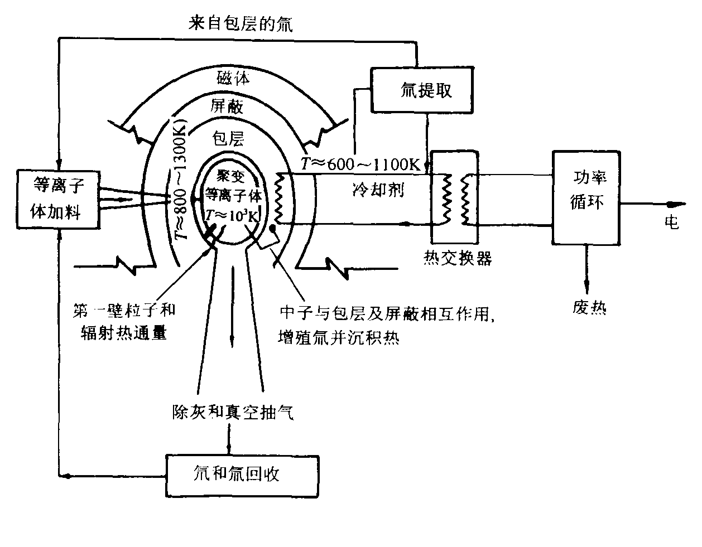

**图3.3** 氙氙聚变反应堆的主要部件及流程示意图

### 3.9 下世纪初磁约束聚变研究的发展前景

从现代托卡马克装置研究发展到 ITER 的研制,是超常规的发展步骤,其目的是建造一个既可以全面进行氙氙燃烧物理研究,又可对主要的反应堆相关工程技术在全尺寸规模上进行试验的装置,如果成功,将可以使示范反应堆 DEMO 的建造提前,因而至少可以使聚变能的应用时间提前十年。但是,尽管 ITER 理事会及一些著名聚变专家全力支持 ITER 的建造,国际聚变界的一些专家 (包括托卡马克 ICRF 加热研究的先驱 Stix 教授) 对这种“毕其功于一役”的做法是有不同意见的,因为这一装置花钱太多,基本上要吸收掉各主要参加国的聚变研究经费,而研制周期在 10 年以上,加上物理工程研究时间又需 10 年,也就是下世纪前 20 年的磁约束聚变研究几乎全靠 ITER 了,如果出现重大的物理问题或工程故障,会不会使事情变得“欲速则不达”呢?

美国已决定减少对ITER的参与程度,而俄罗斯虽十分支持ITER,但力不从心,没有经济实力,只有欧共体和日本全力支持建造,日本甚至表示,如装置建在日本,日将出$70\%$的经费。实际上,日本和欧共体国家现已成为支持国际磁约束聚变研究规划的主体力量,其原因是:欧洲,尤其是日本,都缺乏能源资源,因而迫切需要开发新的能源。一些著名的聚变科学家曾指出,也许在人类完全掌握聚变能技术之前,需要500亿美元的投资,但这也不过相当于欧洲一年的进口石油的花费。另外,日本的实业界对磁约束聚变研究有相当的兴趣,并已积极参与一些大工程项目的研制。虽然有日欧的积极支持,但ITER是否最终能建造,仍然有诸多不定因素。首先看看不同意见(主要是一些美国学者提出的):一种反对意见认为,走ITER这一大步的时机未到,因为有一些重要的物理和工程问题尚未解决,如偏滤器的排热、大破裂的防御、密度极限、长脉冲H- 模的维持、中心区杂质积累等等。这些都是确实存在而且未有把握解决的问题。另一意见是从战略安排方面考虑的,认为ITER会影响对更多具有全局重要性的物理和工程项目的安排,使这些项目的研究推迟,包括先进约束模式的实验研究;等离子体控制工程的一些重大课题;防14MeV中子辐照材料研制以及聚变堆的最佳化设计的系列课题。对于以上反对意见,支持建造的人(占多数,包括著名学者Rosenbluth)的看法是,以上问题中大部分正是ITER想解决的问题,但解决的唯一方法是在全尺寸反应堆上进行实验。如果改成先建造规模较小的,物理和工程目标较低的一个替代装置(美国曾提出类似建议,为ITER理事会所拒绝),那将会把一些非常重要的课题留下来,例如在长脉冲条件下氘氚燃烧的物理和相关工程问题,使下一代装置的建造具有不确定性,其结果是推迟聚变能的应用时间。

另一个问题是,ITER的昂贵造价是否意味着未来磁约束聚变堆的一次投资过高,使聚变能开发失去竞争力。一些分析表明,ITER不能代表真正的反应堆投资。除了反应堆的规模生产可以大幅度降低元部件(如超导磁体)的造价外,高性能的聚变反应堆将大幅度降低实际电价,托卡马克型反应堆的最终电价可以和增殖堆竞争,一些设计给出的电价在10美分/度以内。

除ITER外,欧洲一直有NET的研制规划,其基本内涵与ITER类似,可能在规模大小上略有差别;日本有建造JT- 60ST的规划,这是一座环电流为10MA的超导磁体长脉冲托卡马克装置。如果ITER真的因各种不可预测的原因被搁置起来,以上两个装置将在下世纪初建造。在仿星器的研究途径中,德国的W7- X超导磁体装置将在下世纪初建造。此外,聚变工程和材料研究的规划将按既定方针进行下去。

### 3.10 中国的磁约束聚变研究

1984年9月,我国最大的托卡马克型装置中国环流器一号(HL- 1)投入运行,标志着我国磁约束聚变实验研究进入一个新时期[7]。在此以前,中科院物理所的CT- 6(1974)和合肥等离子体所的HT- 6B,HT- 6M等较小规模的装置上,都对放电物理和磁流体活性等大量物理课题进行了研究,不过,当时以上装置主要限于欧姆加热。从1987年以后,在HT- 6M和HL- 1装置上开展了电子回旋和离子回旋加热,低杂波电流驱动的研究。1992年后,HL- 1改造成HL- 1M,不久,合肥等离子体所又成功地将原苏联的T- 7装置(主要用于工程试验)改建成可以进行实验研究的超导磁体托卡马克装置,使我国成为法、日、俄之后第四个具有超导磁体托卡马克装置的国家。HL- 1M 和 HT- 7 的研究水平已达国际同类装置中较先进之列。目前，中国正在研制和改建两个重要的托卡马克装置，一个是中科院等离子体物理研究所（IPPAS）主建的世界第一座具有偏滤器的超导磁体托卡马克装置 HT- 7U，其环向电流可达 1MA，总加热功率可达 10 MW，长脉冲运行，属大型装置，可以研究与堆芯物理有关的许多重要课题；另一是核工业西南物理研究院（SWIP）主建的 HL- 2A 装置，这是利用原德国的偏滤器托卡马克装置 ASDEX 的主要部件改造的一个装置。这两个装置在聚变等离子体研究上有很好的互补性，HT- 7U 将主要研究长脉冲物理，而 HL- 2A 则主要研究强功率加热（中性束注入等）和高密度区物理。因此，下世纪初，中国的磁约束聚变研究有望达到国际先进水平。但必须指出，中国缺乏全面的研究规划，因此对许多重要物理和工程课题的研究没有总体设想和全国协调的安排布局。如关于中性束技术，这是托卡马克和仿星器等离子的主要加热手段，但中国的研究水平远低于国际水平。但一个非常有利的条件是，中国的国家领导人对聚变研究非常重视，江泽民总书记在 1991 年 4 月视察核工业西南物理研究院时曾亲笔题词：“开发聚变能源，造福子孙后代”，这是对从事聚变开发研究的广大科技人员的巨大鼓舞。象中国和印度这样的发展中的大国，人口多与资源少的矛盾十分突出，在解决发展与能源及环境的关系问题上是不可能走美欧日这些发达国家的老路的。因此，在开发新能源上，可以借鉴但不能照搬别人的经验，更不能看到美国暂时对聚变研究的支持有所下降而跟着做。美国有美国的国情，人均资源远高于中国，几十年内还不会发生能源危机；何况大多数美国科学家对政府减少聚变研究经费是持强烈反对态度的，认为美国将为此付出沉重代价。很多美国科学家对中国在现阶段能同时支持两个较大的项目（HT- 7U 和 HL- 2A）十分欣赏，认为这是中国对国际磁约束聚变研究的重大支持。总之，中国应从能源发展，特别是核能源开发的长远布局出发，制订有权威的国家长远规划，从经费和人才各方面采取有效措施，不仅要赶上先进国家，而且要在中国开创聚变能应用的新时代。随着中国国家总体经济实力的增强，人民对能源和环境意识的加强，国家和实业界对聚变研究的支持一定会增强，笔者相信，中国磁约束聚变研究的前景将是十分令人鼓舞的。

结合中国的实际，必须十分重视聚变能开发过程中发展起来的相关技术的推广应用工作，只有在发展聚变研究的同时，让各种聚变工程技术在国民经济的重要方面产生直接的经济效益，才能引起实业界对聚变研究的兴趣，也才能取得纳税人对这种投资巨大的项目的理解和支持。有识之士曾多次强调，全世界聚变和等离子体技术具有每年数千亿美元的市场潜力。但重要技术的开发需要人力和财力的长期投入和攻关时间，需要经费、人力和时间这三个因子的乘积达到一定的数值，那种急功近利式的开发不可能真正得到长期的成效。

笔者认为，聚变能开发研究是不可替换的，非进行不可的，与国家和人民利益攸关的，大科学工程（如三峡工程或可能的航天工程项目），要由国家领导人和最高权力机构（人大）来决策。国际性合作可以减少风险，缩短周期，中国必然要加入国际合作研究。但是，本身的实力具有决定性作用，必须从物理工程和人才培养等方面全方位考虑发展聚变研究的长远规划。

1 王乃彦等 新兴的强激光. 北京: 原子能出版社, 1993

2 丁厚昌, 黄锦华等. 聚变能——21世纪的新能源. 北京: 原子能出版社, 1998.2

3 Roth J R. 李兴中等译. 聚变能引论. 北京: 清华大学出版社, 1993

4 Wolf G H. Overview of tokamak results. Trans. Fusion Tech., 1998, 33: 357

5 Wagner F. Stellarators and optimised stellarators. Trans. Fusion Tech., 1998, 33: 67

6 Sessler A M, et al. To build the ITER? Phys. Today, 1966, 49(6): 21

7 李正武. 我国受控核聚变研究发展的里程碑. 核聚变与等离子体物理, 1986, 6(3): 129

# 第四章 磁约束聚变装置中的磁场位形

在各类磁约束聚变实验装置中，采用了多种形式的特殊设计的磁场形态。虽然总的磁场是由外部线圈中的电流与等离子体内部的电流共同形成的，但在相当一部分装置中，外部线圈电流产生的磁场构成了所需约束场的基本框架，而等离子体中的电流仅产生对基本框架磁场的修正。在等离子体内部电流很重要的装置中（如托卡马克和环形箍缩放电），也缺少不了基本的约束磁场。因此，本章对用于磁约束聚变装置的磁场的特性做一些普遍性的讨论。对那些与具体装置特性联系非常紧密的问题则在其他有关章节中介绍。

在本书中采用高斯单位制来描述电磁量。此外，我们把等离子体约束区看成真空区域，其中的电流看成自由电流，而且真空导磁率取为$\mu_{0}=1$。这样，我们将不区别磁场强度与磁感应强度这两个物理量，而统一用磁场强度来称呼，符号用矢量$\pmb{B}$，在物理分析文献中，过去常用单位为 Gs（高斯）；在工程性应用中，则采用 T（特斯拉，$1\mathrm{T}=10^{4}\mathrm{Gs}$）。

## 4.1 关于聚变等离子体中磁场位形的基本知识[1,2]

如果某一空间中的磁场是由多种电流产生的，则它等于各个分流所产生的磁场的总和（叠加原理）。这一性质使我们可以分别计算不同来源的电流产生的磁场。当然，等离子体中的电流是一种自洽电流，它的存在和它在空间分布的形式一般是与外磁场互相耦合的。但在很多情况下，等离子体中电流的磁场仅仅对总磁场形成一些修正，因此可先确定外电流产生的磁场，再用微扰法计算等离子体中电流产生的磁场。

本章主要讨论准稳态磁场的性质。关于准稳态条件的含义及内容将在以后的章节中结合具体实例讨论。对等离子体来说，可以先简单地理解为处于静平衡态。由于在实际装置中存在一些金属导体，如真空室以及用于维持等离子体平衡或用于使磁流体模式稳定化的特殊布设的导体，导体中产生的涡电流的磁场对总的磁场位形也有重要效应。本章中也将对一些特定形态的导体的效应进行讨论。

### 4.1.1 基本方程组

静磁场由稳态电流产生，其关系由安培定义描述

$$
\nabla \times \pmb {B} = \frac{4\pi}{c}\pmb {j} \tag{4.1}
$$

另一个方程为磁场矢量的散度，是无源的：

$$
\nabla \cdot \pmb {B} = 0 \tag{4.2}
$$

在平衡态，电流密度矢量的散度也是无源的：

$$
\nabla \cdot \pmb {j} = 0 \tag{4.3}
$$

(4.3) 是 (4.2) 的自然结果。在电磁学中就已知道，如知道全部电流在空间的分布，则总的磁场可以用毕奥-沙伐公式表示。先引入矢势$\pmb{A}$：

$$
\pmb {B} = \nabla \times \pmb{A} \tag{4.4}
$$

则有

$$
A(r) = \frac{1}{c}\iiint \mathrm{d}V^{\prime}\frac{j(r^{\prime})}{R} \tag{4.5}
$$

积分对全部电流存在的空间进行，式中$R$为场点到源点的距离，$R = r - r^{\prime}$。磁场为

这一方法虽然普遍适用，但一般并不方便，而且计算量很大。在许多情况下，电流分布具有某种对称性，这时磁场的计算可以很大地简化。不过，在实际问题中，经常不存在严格意义上的对称性，而只有近似的对称性。这时，那些具有对称分布的电流的磁场形态可以成为讨论的出发点，非对称部分的贡献可以用微扰的方法估算。

在与磁约束聚变装置联系的磁场位形中，有关电流的分布常常具有圆柱形态。一般外电流存在于线圈绕组中，具有一定的体积，但我们可以先处理其中某一曲面（如圆柱面）上的电流，然后将所得结果对电流所处的体积积分求得总磁场。这时在该曲面的内部和外部，都可以用标势来描述磁场：

$$
B = \nabla \Phi \tag{4.7}
$$

这一标势在曲面的内部和外部都满足拉普拉斯方程：

$$
\nabla^{2}\Phi = 0 \tag{4.8}
$$

求得相应的解后，利用在曲面上的联结条件

$$
n\times (\nabla \Phi) = j_{\sigma} \tag{4.9}
$$

解就完整地确定了。上式中$n$为所考虑曲面的向外的单位法线矢量，$\langle \rangle$代表物理量在曲面两边的差值，$j_{\sigma}$代表面电流密度。

### 4.1.2 磁力线及磁力线组成的曲面

求得总磁场后，可以由磁力线方程

$$
B\times \mathrm{d}r = 0 \tag{4.10}
$$

或

$$
\frac{\mathrm{d}x}{B_{x}} = \frac{\mathrm{d}y}{B_{y}} = \frac{\mathrm{d}z}{B_{z}} \tag{4.11}
$$

求出磁力线的形状。这是一组非线性常微分方程，具有两个积分，分别代表两个由磁力线所组成的曲面：

$$
f_{1}(x,y,z) = c_{1}, \quad f_{2}(x,y,z) = c_{2} \tag{4.12}
$$

这两个曲面的交线就是磁力线。在最简单的情况下，磁力线是平面曲线。由于磁场是无源的，这种曲线如果闭合，就是拓扑圆，如不闭合，将伸展到无限远。在磁约束聚变装置中，磁力线常常是空间曲线。这是因为约束等离子体要求磁场要由多种电流产生，其合成磁场的磁力线多数是空间曲线。由于磁力线自身不能相交，因此，这种空间曲线将在某种曲面上来回缠绕，有时，一条磁力线还可以经无限多次缠绕后自身形成一个曲面。这种曲面只能是拓扑环面。一个最简单的例子是由一条直线电流和一个以此直线为轴的圆圈电流合成的磁场（如图4.1所示），这种位形最先是由苏联科学家Tamm提出的。由于这一系统具有轴对称性，由磁力线组成的曲面的性质十分清楚（见下一小节讨论），场的磁力线将处在轴对称环面上（严格说并非圆环，但在靠近圆圈电流处接近圆环）。

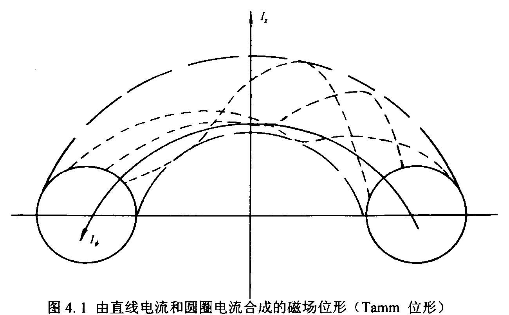

**图4.1** 由直线电流和圆圈电流合成的磁场位形（Tamm位形）

对于磁场这种无源场矢量，存在一个普遍的定理，即它可以用两个独立的标量函数的梯度的矢积来表示。我们将不加证明地引入这一概念，并在以后的实际例子中说明如何去定义这两个标函数：

$$
B = \nabla F\times \nabla G \tag{4.13}
$$

代入式 (4.2) 可以直接使该式得到满足，而且函数$F$和$G$是磁力线方程的两个积分。$F$和$G$属于流函数。

## 4.2 环形约束系统的一般性质

磁约束聚变实验装置中的磁场位形与等离子体自身的电流不能分割。在所谓的静磁平衡模型中（即等离子体宏观运动速度不出现在方程中），若等离子体的压强可用标压强来描述，则得到下面的动量（力）平衡方程

$$
\nabla p = \frac{1}{c} j\times B \tag{4.14}
$$

由这个方程得知

$$
B\cdot \nabla p = 0 \tag{4.15}
$$

即等压强面是磁面。对于直线型装置，这一关系意味着在各个由磁力线组成的曲面中，应选取具有某种对称性的曲面作为磁面，因为压强分布是具有对称性的；对环形磁面系统，在该磁面上压强为常数。所以无论哪种约束位形，我们都可以把等压面与磁面等同起来，而

$$
p = p(\Psi) \tag{4.16}
$$

此处$\Psi$为磁面函数（即式 (4.13) 中两个流函数中的一个）。

从静磁平衡方程还可看出

$$
j\cdot \nabla p = 0 \tag{4.17}
$$

这表明，电流线也在同一等压面上，即磁面也是电流面。这一电流还可以按是否垂直于磁力线而分成两部分，其中垂直于磁力线的分量是与等离子体压强分布有关的：

$$
j_{\perp} = c\frac{B\times\nabla p}{B^{2}} \tag{4.18}
$$

这一部分电流称为反磁电流。对多数磁约束聚变装置来说，由于等离子体的比压值比较小

$$
\langle \beta \rangle = \frac{8\pi\langle p\rangle}{\langle B^{2}\rangle}\ll 1 \tag{4.19}
$$

相应地，反磁电流的贡献也比较小。因此，对很多装置，这一电流的贡献可以用微扰方法进行估算，而把外部电流分布产生的磁场作为约束位形的基本构架。但是，还存在沿磁力线的电流，它可由电流连续性条件$\nabla \cdot \pmb {j} = 0$结合上面的垂直电流的表示式，给出一个关系式：

$$
B\cdot \nabla (j_{H} / B) = -\nabla \cdot \left(c\frac{B\times\nabla p}{B^{2}}\right) \tag{4.20}
$$

这一方程称为磁微分方程，仅由它还不能完全确定平行于磁力线的电流，因为它的解由与非齐次项有关的特解加齐次方程的通解构成，齐次方程

$$
B\cdot \nabla (j_{H} / B) = 0 \tag{4.21}
$$

表明沿磁力线的电流与磁场的比值在同一磁面上为常数，这个常数的大小要由其他条件，即由电流的驱动条件确定。根据是否存在较大的平行于磁力线的驱动电流，磁约束聚变装置又可分成不同的类别。对仿星器及类似装置，基本不存在或仅有很小的平行电流，其磁场位形构架基本上由外部电流分布产生的磁场确定；对托卡马克及箍缩放电装置，存在很大的沿磁力线的电流，其磁场位形由外部电流分布及等离子体中的电流，主要是这一平行于磁力线的电流共同确定。在本章中，我们主要讨论第一类装置的磁场位形。对第二类装置仅作一些模型讨论，严格的平衡位形的确定将在下一章中研究，但许多用于表征磁面结构特性的特征量和一些描述方法，对所有的装置都适用。

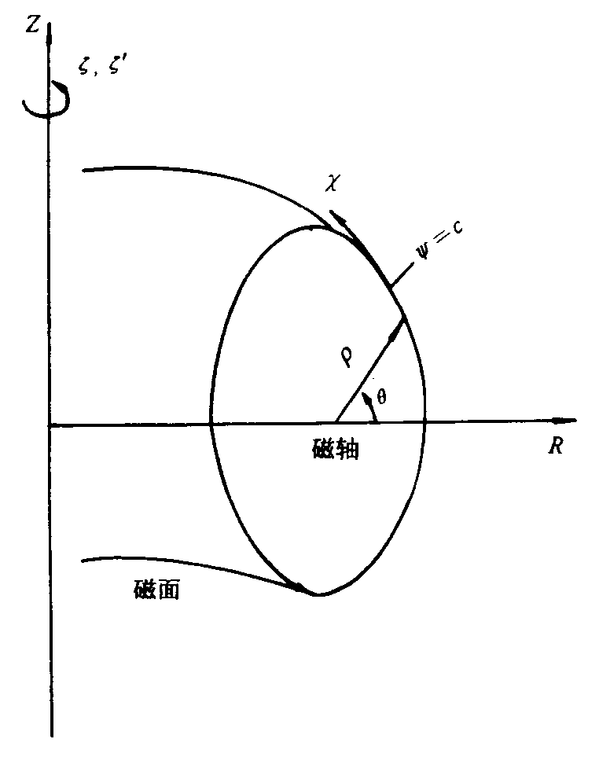

**图4.2** 环形坐标系$(\Psi,\chi,\zeta)$及局部坐标系$(\rho,\theta,\zeta^{\prime})$从重要性和普遍性的角度考虑，我们主要研究环形约束位形。一些直线位形可以看成是将环形剪断后拉直的结果。如果在两端加上周期性条件，这种“直线近似”在很多方面可以描述环形装置的基本特征。

如图4.1，引入环形坐标系，但此环不一定是圆环。一般地我们可以定义“环向”和“极向”这两个特征方向。为避免过分的数学化，我们不妨以图4.1即Tamm位形（它是轴对称的）为代表，环向就是围绕对称轴的方向。我们假定所研究的磁面具有单一的磁轴，即由单一的磁力线构成的闭合曲线，它是整个磁面系统的组成部分，只是由面退化为一条线。在上面的Tamm位形的例子中，圆圈电流所在的位置就是磁轴。有时系统具有若干条退化的闭合曲线，使描述变得非常复杂，但原则上可以分区域来讨论。不失一般性，我们考虑单磁轴的情形，并在磁轴上建立一个局部的极坐标系。这样，一般的磁面坐标系由磁面函数$\Psi$，环向角坐标$\zeta$，极向角坐标$\chi$组成，而局部极坐标由式$\rho,\theta,\zeta$构成（如图4.2所示）其中的角变数均以$2\pi$为周期。两者的关系可以表示成：

$$
\rho = \sqrt{(R - R_{0})^{2} + Z^{2}}
$$

$$
\begin{array}{l}
\theta = \tan^{-1}\left(\dfrac{Z}{R - R_{0}}\right) \\
\zeta^{\prime} = -\zeta
\end{array} \tag{4.22}
$$

式中$R,z$为磁面上一点的圆柱坐标值。

再引入有关的磁通函数的定义。环向磁通为：

$$
\Psi_{\mathrm{T}} = \frac{1}{2\pi}\iiint \mathrm{d}V B\cdot \nabla \zeta \tag{4.23}
$$

积分对环面的内部区域进行。极向磁通为：

$$
\Psi_{\mathrm{p}} = \frac{1}{2\pi}\iiint \mathrm{d}V B\cdot \nabla \chi \tag{4.24}
$$

以上定义具有普遍意义，利用角变数的周期性及磁场的无源性质，上述两个体积分可以还原为关于环向和极向截面上的面积分。

还可以定义磁面上磁力线的旋转变换

$$
i(\psi) = 2\pi \frac{\mathrm{d}\psi_{\mathrm{p}}}{\mathrm{d}\psi_{\mathrm{T}}} \tag{4.25}
$$

它代表所考察磁面上磁力线的平均旋转性质（当磁力线绕环向转动一圈时沿极向转动角度的平均值）。在不同的磁面上旋转变换可以不相同，其变化率

$$
s(\psi) = \frac{\psi}{i}\frac{\mathrm{d}i}{\mathrm{d}\psi} \tag{4.26}
$$

称为磁力线的剪切或简称磁剪切。还有一个特征参量，称为磁面的比拟，其定义为磁面的体积对磁通函数的变化率

$$
U(\Psi) = \frac{\mathrm{d}V}{\mathrm{d}\Psi} \tag{4.27}
$$

这个函数再对磁通函数求一次导数得出所谓的磁阱深度，所有这些参量与聚变等离子体的磁流体和粒子动力论稳定性密切相关。

对具体装置中的各种与磁面位形有关的特性参数的确定及性质的讨论将在介绍具体装置时进行。下面将介绍一些有关装置中普遍应用的磁场的计算方法，并讨论其中一些磁场位形的特性，它们主要是外部电流分布产生的。

## 4.3 某些特定电流产生的磁场

### 4.3.1 圆圈电流产生的磁场

设圆圈电流位于圆柱坐标系$(R,\theta,Z)$中的$Z = 0$平面上，半径为$a$（图4.3）。在一般电磁学和电动力学教科书中都有这一电流产生的磁场的计算公式，这里引用如下：磁场矢势的角向分量为

$$
A_{\theta}(R,Z)=\frac{4J}{c}\frac{a}{\sqrt{(R+a)^{2}+Z^{2}}}
\left[\frac{(2-k^{2})K(k)-2E(k)}{k^{2}}\right]
$$

式中

$$
k^{2} = \frac{4aR}{(R + a)^{2} + Z^{2}} \tag{4.29}
$$

$K(k)$和$E(k)$是第一类和第二类完全椭圆积分。这种轴对称形状的电流的磁场的磁力线可以用下面的流函数

$$
\psi (R,Z) = RA_{\theta}(R,Z) \tag{4.30}
$$

来描述，这时 (4.13) 中的另一个函数是角变数$\theta$自身，即

$$
B_{\mathrm{p}} = \nabla \psi \times \nabla \theta \tag{4.31}
$$

按前面提到的分类方法，电流圈的磁场属极向磁场，故用下标$\mathrm{p}$表示，其形状也画在图4.3中。我们指出，如果同时存在一个环向磁场$B_{\mathrm{r}} = B_{\theta}e_{\theta}$，例如由Tamm位形中沿$R = 0$轴的直线电流产生的磁场，则磁力线组成环形曲面，但此曲面在$\theta = \mathrm{const}$上的截面形状仍由上面的流函数$\psi (R,Z)$表示，其图形仍如图4.3中磁力线所示。也就是说，在轴对称系统中，环向磁场的大小不影响磁力线组成的曲面的形态，但它影响磁力线转动的快慢。

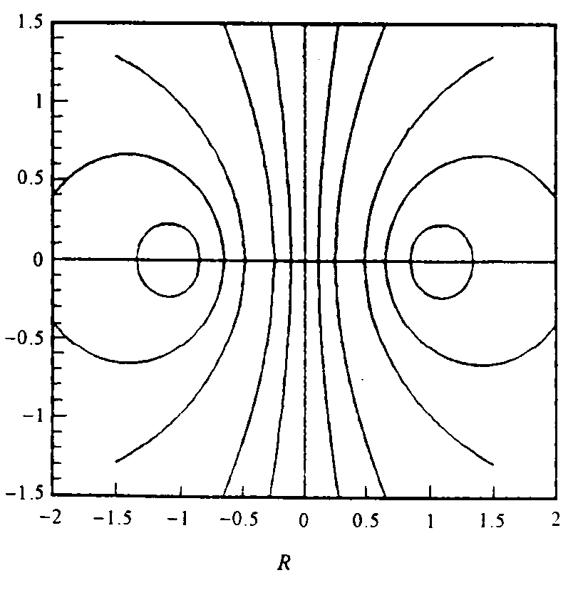

**图4.3** 平面圆圈电流的磁力线

在接近电流圈时，即当$R\rightarrow a$，$k\rightarrow 1$时，可以利用椭圆积分$K(k)$和$E(k)$的渐近展开式

$$
E(k) = 1 + \frac{1}{2}\left(\ln \frac{4}{\sqrt{1 - k^{2}}} -\frac{1}{2}\right)(1 - k^{2}) - \dots \tag{4.32}
$$

$$
K(k) = \ln \frac{4}{\sqrt{1 - k^{2}}} +\frac{1}{4}\left(\ln \frac{4}{\sqrt{1 - k^{2}}} -1\right)(1 - k^{2}) + \dots \tag{4.32}
$$

得出近似的磁场流函数

$$
\psi (R,Z) = \frac{2J a}{c}\left(\ln \frac{8a}{\sqrt{(R - a)^{2} + Z^{2}}} -2\right) = \mathrm{const} \tag{4.33}
$$

其截面为圆环，中心即为电流圈所处位置

$$
\left(R - a\right)^{2} + Z^{2} = \mathrm{const} \tag{4.34}
$$

在靠近$R = 0$轴处，宗量$k^{2}$也很小，此时可利用椭圆积分的展开式

$$
\begin{array}{l}
E(k)=\dfrac{\pi}{2}\left(1-\dfrac{k^{2}}{4}-\dfrac{3k^{4}}{64}-\cdots\right) \\
K(k)=\dfrac{\pi}{2}\left(1+\dfrac{k^{2}}{4}+\dfrac{9k^{4}}{64}+\cdots\right)
\end{array} \tag{4.35}
$$

得另一近似式

$$
\psi (R,Z) = M\frac{R^{2}}{\left[(R + a)^{2} + Z^{2}\right]^{3 / 2}} = \mathrm{const} \tag{4.36}
$$

式中

$$
M = \frac{J}{c\pi a^{2}} \tag{4.37}
$$

代表偶极磁场的磁矩。

利用上述结果可以很容易地讨论一些对磁约束聚变位形有意义的基本位形结构。

### 4.3.2 简单的磁镜位形

用两个放在同一圆柱面上相距为$2l$的圆圈电流即可产生简单的磁镜位形（如图4.4所示）。若取坐标原点在对称轴上两个圆圈电流的中点，即$R = 0$，$Z = 0$，则磁力线的流函数为：

$$
\begin{aligned}
\psi (R,Z) ={}& \frac{4J\sqrt{aR}}{c}\left\{\left[\left(\frac{1}{k_{+}} - \frac{k_{+}}{2}\right)K(k_{+}) - \frac{1}{k_{+}} E(k_{+})\right]\right. \\
&+\left.\left[\left(\frac{1}{k_{-}} - \frac{k_{-}}{2}\right)K(k_{-}) - \frac{1}{k_{-}} E(k_{-})\right]\right\}
\end{aligned} \tag{4.38}
$$

$$
k^{2}{}_{+} = \frac{4aR}{(a + R)^{2} + (l\pm Z)^{2}} \tag{4.39}
$$

其形状如图4.4所示。在轴线上（$R = 0$）的磁场（仅为$Z$分量）可以用初等函数表示：

$$
B_{Z}(Z) = 2M\left\{\frac{1}{\left[a^{2} + (l + Z)^{2}\right]^{3 / 2}} +\frac{1}{\left[a^{2} + (l - Z)^{2}\right]^{3 / 2}}\right\} \tag{4.40}
$$

这一磁场的强度由中心（$Z = 0$）处向两边加大，在线圈所处位置（$Z = \pm l$）达到最大，然后又开始减小（见图4.4）。在磁场最大处形成所谓的磁镜。所以，根据带电粒子的磁矩守恒条件，它们中具有较大横向能量的那些在由中心区运动到磁镜处会反射回中心区。如没有其他作用力，它们将长期约束在该区域内。

### 4.3.3 会切场位形

将图4.4两个线圈中的电流互相反向，得到一种称为会切场的位形（如图4.5所示）。其特点是，磁力线类似于双曲线形状，在对称轴方向及$Z = 0$平面上形成缝隙，在$R = 0$，$Z = 0$点的磁场强度为零，由此点向外磁场强度增大。这种场形称极小$B$场形，此处$B$为磁场强度。从磁流体稳定性的角度，若等离子体处在这种场中，则对于所谓的磁流体交换模是稳定的。可是，带电粒子可以从磁力线的缝隙中逸出约束系统，因此，单纯的会切场像简单磁镜场系统一样不能充分约束高温等离子体。

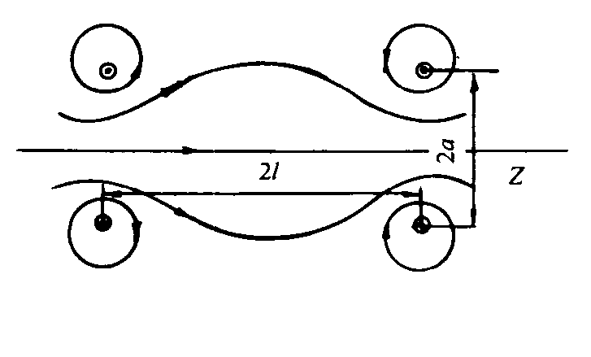

**图4.4** 简单磁镜的位形

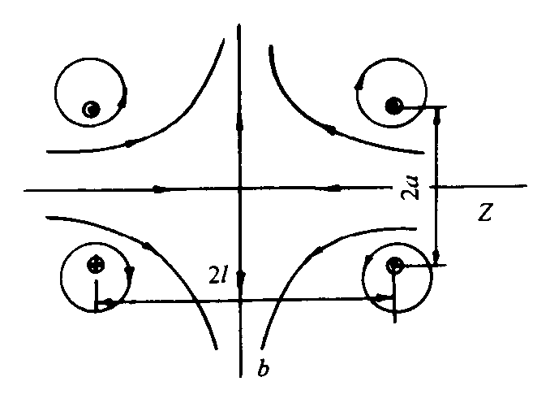

**图4.5** 会切场位形

### 4.3.4 圆柱面上相距为$b$的多个电流圈产生的磁场（见图4.6）

这是实际装置中应用的线圈绕组的一种理论简化。真实绕组产生的磁场可以通过这里给出的结果对绕组体积积分而获得，因此本小节中的结果有重要的实用价值。

用标势法求解，在圆柱面内外将标势满足的拉普拉斯方程的解用贝塞尔函数展开，可以得到

$$
\Phi (r,z) = \frac{2k J}{c}\left\{z + 2a\sum_{n = 1}^{c}\mathrm{K}_{1}(n k a)\mathrm{I}_{0}(n k r)\sin n k z\right\}, \quad r< a \tag{4.41}
$$

$$
\Phi (r,z) = -\frac{4k a J}{c}\sum_{n = 1}^{c}\mathrm{I}_{1}(n k a)\mathrm{K}_{0}(n k r)\sin n k z, \quad r > a \tag{4.41}
$$

其中$k = 2\pi /b$，$\mathrm{I}_{0,1}$，$\mathrm{K}_{0,1}$是修正的贝塞尔函数。从上式得到的一个重要结果是，这种电流布置产生一个较强的本底磁场，它由上式中第一式的第一项表示

$$
B_{z0} = \partial \Phi /\partial z\approx 2k J / c = 4\pi J / c b \tag{4.42}
$$

上式表明，分离配置的线圈绕组电流产生的磁场的主分量的大小正比于单位长度上的安匝数，这是普通电工学中就知道的结果。但分离配置将产生谐波场分量，使总磁场的磁力线形成波纹形，这些谐波分量就称波纹场。在磁约束实验装置中，由于需要留出实验诊断和用于引入加热功率的窗口，在主磁场上必然会叠加波纹场分量。波纹场在接近绕组所在位置时增大，也就是在约束区的外缘有较大的值，它们对带电粒子的约束有较大的影响。

如果将圆柱面弯成圆环面，当环的大半径比环的小半径大很多时，则可将上述磁场的标势看成环形情况下磁场标势的最低一级近似，于是环形区域中的本底磁场为

$$
B_{\phi 0} = \frac{1}{R}\frac{\partial\Phi}{\partial\phi} = \frac{B_{0}R_{0}}{R} \tag{4.43}
$$

其中$R_{0}$为真空室中心的位置，$B_{0}$为该处的磁场。环形磁场是沿大半径方向减小的磁场。

### 4.3.5 直线多极磁场

采用圆柱坐标系$(r,\theta ,z)$，设在圆柱面上沿$z$轴方向布设$n$根直线电流，则其磁场可用上面求标势的方法求出，在靠近轴心处$(r\ll a)$，近似地有：

$$
\begin{array}{l}
B_{r}=\left(\dfrac{4\pi n J}{c}\right)\left(\dfrac{r}{a}\right)^{n-1}\sin n\theta, \\
B_{\theta}=\left(\dfrac{4\pi n J}{c}\right)\left(\dfrac{r}{a}\right)^{n-1}\cos n\theta
\end{array} \tag{4.44}
$$

而在靠近电流处，高阶谐波场很重要，磁力线绕每根电流转动。图4.7所示磁场对等离子体的磁流体不稳定性有很好的稳定作用。

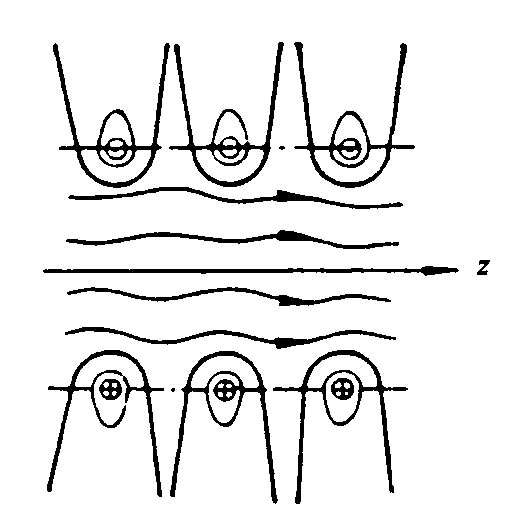

**图4.6** 由直圆柱面上多个圆圈电流产生的波纹磁场

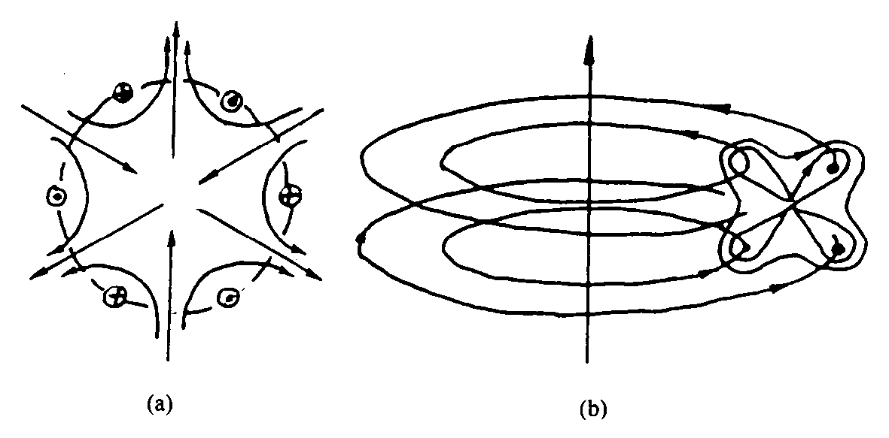

**图4.7** (a) 由圆柱面上三对相邻反向电流棒产生的六极场；(b) 由四个同向圆圈电流产生的环形八极场

### 4.3.6 圆柱面上螺旋对称电流产生的磁场及直线仿星器的磁面

设圆柱面上有一根螺旋线电流，线的螺矩为$L$，引入螺旋参数

$$
\alpha = 2\pi /L
$$

显然，该系统具有螺旋对称性，所有量都只是$r$及$\theta = \phi - \alpha z$的函数。将电流分布的$\delta$函数按富氏级数展开，可以得出相应的标势为

$$
\Phi (r,\theta) = b_{0}z + \sum_{n}b_{n}I_{n}(n\alpha r)\sin n\theta \tag{4.45}
$$

$b_{0},b_{n}$与电流分布参数有关

$$
b_{0} = \frac{2\alpha J}{c}, \quad b_{n} = \frac{4\alpha J a}{c} K_{n}^{\prime}(n\alpha a) \tag{4.46}
$$

式中$I_{n},K_{n}$均为$n$阶修正的贝塞尔函数。如果在同一圆柱面上均匀地布置$l$对螺旋电流，并适当选取这些绕组的宽度，就可以使高阶谐波很小。因此在下面的分析中我们只考虑含一种谐波的螺旋对称磁场。

利用下面关系先求出相应的矢势分量

$$
\frac{\partial\Phi}{\partial r} = -\frac{\partial A_{\theta}}{\partial z}, \quad \frac{1}{r}\frac{\partial\Phi}{\partial\phi} = \frac{\partial A_{r}}{\partial z} \tag{4.47}
$$

（这里对矢势$\pmb{A}$的定义可有一定的随意性，对应于选择不同规范。）于是直接得出：

$$
\begin{array}{l}
A_{r}=-\dfrac{1}{\alpha^{2}r}b_{1}I_{1}(l\alpha r)\sin n\theta \\
A_{\theta}=\dfrac{b_{0}r}{2}-\dfrac{1}{\alpha}b_{1}I_{1}^{\prime}(l\alpha r)\cos n\theta \\
A_{z}=0
\end{array} \tag{4.48}
$$

定义磁面函数$\Psi (r,\theta)$，它满足

$$
\pmb {B}\cdot \nabla \Psi = 0 \tag{4.49}
$$

并假定另外有一沿$z$轴的本底强磁场$B_{0}$，则可将相应的磁面函数写出：

对于$l = 1,2,3$，磁面的形状如图4.8所示。

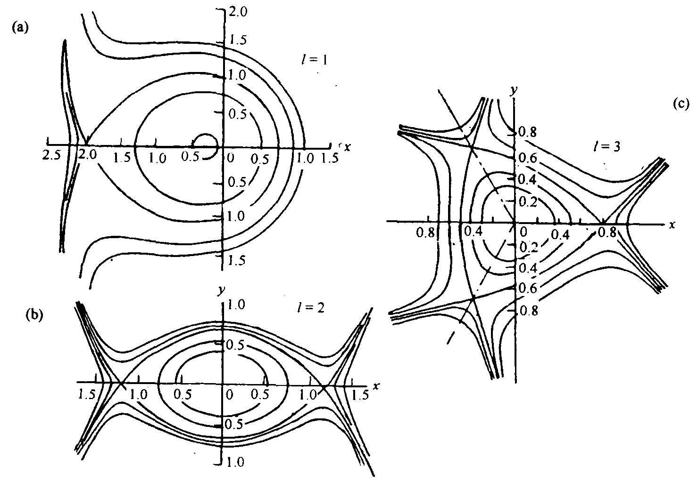

**图4.8** (a) $l = 1$，(b) $l = 2$，(c) $l = 3$直线仿星器的磁面位形〔1〕

观察这些位形结构可以发现，每种位形都具有两个不同的区域，即半径较小时的闭合磁面与半径较大处的开放型磁力线。两者的相对大小由本底磁场与螺旋磁场幅值参数间的比值以及螺旋绕组的位置参数决定，是可以调整的。最后一个闭合磁面称磁分界面。这种磁场结构非常符合约束等离子体的要求：将高温等离子体约束在磁面闭合区，而在边缘附近让磁面开放以控制杂质元素的进入。所以上述磁场位形很早就被磁约束聚变装置所采用。仿星器就是基于上述概念的一种装置。

### 4.3.7 具有螺旋绕组的磁场中磁力线的旋转变换

上述磁场的另一重要性质是磁力线具有绕极向的转动。为此需较细致地考虑磁力线方程的解。下面用$(r,\phi ,z)$来表示圆柱坐标，写出磁力线方程

$$
\frac{\mathrm{d}r}{\mathrm{d}z} = \frac{b_{r}}{B_{0} + b_{z}} \approx \frac{b_{r}}{B_{0}} \cdot \frac{b_{r} b_{z}}{B_{0}^{2}}, \tag{4.51}
$$

$$
\frac{\mathrm{d}\phi}{\mathrm{d}z} = \frac{b_{\phi}}{r(B_{0} + b_{z})} \approx \frac{b_{\phi}}{r B_{0}} \cdot \frac{b_{\phi} b_{z}}{r B_{0}^{2}}
$$

这是一组非线性常微分方程，它具有两个可利用的特点，第一是变量具有周期变化性质，第二是右方各量都是小量（当本底磁场$B_{0}$很大时，这一条件对所考虑的系统是满足的）。这时可以应用平均近似方法[1]来求解。定义平均磁面函数

式中各量都是平均变数的函数，上面一横及$\langle \rangle$号都是对周期求平均，角号为变量与平均值之差。对于前面讨论的螺旋对称磁场，上述平均磁面函数仅是$\bar{r}$的函数，因此平均磁面为圆。显然这只适用于磁面为闭合曲面的区域。磁面开放的区域中上述近似不适用，需对磁力线方程进行数值求解。在闭合磁面内，利用平均磁面函数，磁力线沿$z$轴的平均转动速率可表达成

$$
\frac{\mathrm{d}\bar{\phi}}{\mathrm{d}z} = \alpha \omega \tag{4.53}
$$

$\omega$称磁力线的旋转变换率

$$
\omega = \left(\frac{b_{l}}{B_{0}}\right)^{2}\left[\frac{2}{l!}\left(\frac{l}{2}\right)^{l + 1}\right]^{2}\left[\left(1 - \frac{1}{l}\right)(\alpha r)^{2l - 4} + \frac{l}{2}\left(\alpha r\right)^{2l - 2} + \dots \right] \tag{4.54}
$$

可以看到，对$l = 1$和$l = 2$，在$r = 0$处的旋转变换率不为零，但对$l \geqslant 3$，$r = 0$处的旋转变换率为零。不过，对于旋转变换的导数，$l = 2$时近似为零，而对$l \geqslant 3$则不为零。这种导数称为磁力线的剪切，一般的定义为（与 (4.26) 等价）

$$
s = \frac{r}{{\omega}}\frac{\mathrm{d}\omega}{\mathrm{d}r} \tag{4.55}
$$

这一特征量与等离子体的稳定性有重要关系。

需要指出的是，实际磁力线的轨迹远比平均方程给出的结果要复杂，近似到小量的一级，磁力线沿$z$轴前进时极向角的变化方程为

$$
\phi = 2\pi \omega z / L - \frac{1}{\alpha^{2}r^{2}B_{0}}\sum_{l = 1}b_{l}I_{l}(l\alpha r)\sin l\theta \tag{4.56}
$$

所以实际上极向角是在来回摆动的过程中产生平均的旋转变换的，这一情况与托卡马克等离子体中磁力线基本上均衡地旋转有很大差别。从小量展开的角度看，托卡马克的磁力线的旋转变换是一级量，而仿星器中磁力线的旋转变换是二级量。要产生同样大小的旋转变换，后者的螺旋磁场强度要更大，这样，它引起的磁面关于平均磁面（圆环面）的畸变也就更大。

另一个很重要的物理结果是，在靠近磁分界面时，磁力线的旋转变换率变得非常大。详细的计算要通过精确求解磁力线方程得出[1]。图4.9表示其中一个结果，可以看出，在磁分界面内部，近似解很好地与精确解一致，但接近磁分界面时，实际的旋转变换远大于近似解并迅速加大。这一结果对其他具有磁分界面的位形也定性地正确。

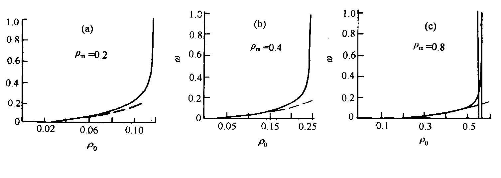

**图4.9** 磁力线旋转变换率；实线为精确解，虚线为平均近似解；(a)～(c) 中，分界面半径$\rho_{\mathrm{m}} = 0.2,0.4$和$0.8$〔1〕。

## 4.4 环形仿星器的真空磁场及磁面[3-5]

外部电流产生的磁场给出了仿星器装置的基本磁场结构，这种磁场称真空磁场。实际上对于环形装置，所有线圈绕组都是绕在环形真空室外面的，必须考虑环形与上面讨论的直线位形的差别。为此首先要较精确地计算环形装置中的磁场。

### 4.4.1 环形区域中求解真空磁场的小量展开法

这里我们简要地考察圆环面上电流产生的磁场，引入准环坐标系$(r,\theta ,s)$（如图4.10所示），这是一组正交坐标系，其三个变量的拉梅因子为

$$
h_{r} = 1, \quad h_{\theta} = r, \quad h_{s} = 1 - \frac{r}{R} \cos \theta \tag{4.57}
$$

设环面上的电流分布为

$$
J = J_{\theta} e_{\theta} + J_{s} e_{s} \tag{4.58}
$$

由电流的连续性条件$\nabla \cdot J = 0$可以引入一个表征电流分布的函数$F(\theta , s)$使

$$
\left(1 - \frac{a}{R} \cos \theta\right) J_{\theta} = -\frac{\partial F}{\partial s}, \quad
J_{s} = \frac{1}{a} \frac{\partial F}{\partial \theta}
$$

这样，标势满足的边界条件简化成

$$
\left(\Phi_{e} - \Phi_{i}\right)_{a} = \frac{4\pi}{c} F \tag{4.60}
$$

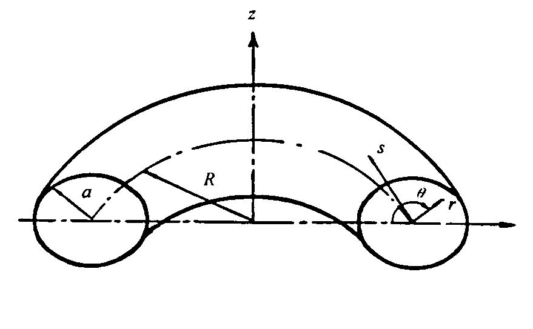

**图4.10** 准环坐标系

在上述坐标系中，拉普拉斯方程化为

$$
\begin{aligned}
&\frac{1}{r}\frac{\partial}{\partial r} \left(r\frac{\partial\Phi}{\partial r}\right) + \frac{1}{r^{2}}\frac{\partial^{2}\Phi}{\partial\theta^{2}} +\frac{1}{(1 - r\cos\theta / R)}\frac{\partial^{2}\Phi}{\partial s^{2}} -\frac{\cos\theta}{R - r\cos\theta}\frac{\partial\Phi}{\partial r} \\
&\qquad + \frac{1}{r}\frac{\sin\theta}{R - r\cos\theta}\frac{\partial\Phi}{\partial\theta} = 0
\end{aligned} \tag{4.61}
$$

设$r / R$为小量，将所有物理量及算符都对此小量展开，可得出一系列齐次及非齐次微分方程：

$$
\begin{array}{l}
\Delta^{0}\Phi_{0} = 0 \\
\Delta^{0}\Phi_{1} = -\Delta^{1}\Phi_{0}
\end{array} \tag{4.62}
$$

其中各级算符为

$$
\Delta^{0} = \frac{1}{r}\frac{\partial}{\partial r}\left(r\frac{\partial}{\partial r}\right) + \frac{1}{r^{2}}\frac{\partial^{2}}{\partial\theta^{2}} + \frac{\partial^{2}}{\partial s^{2}},
$$

$$
\Delta^{1} = -\nabla^{0}\left(\frac{r\cos\theta}{R}\right)\cdot\nabla^{0} + \frac{2r\cos\theta}{R}\frac{\partial^{2}}{\partial s^{2}}, \tag{4.63}
$$

$$
\nabla^{0} = e_{r}\frac{\partial}{\partial r} + e_{\theta}\frac{1}{r}\frac{\partial}{\partial\theta} + e_{s}\frac{\partial}{\partial s}
$$

下面结合不同的场型（波纹场，螺旋场，多极场）来讨论环形修正。

### 4.4.2 基本磁场（零级近似）

（1）波纹场

$$
\Phi_{i} = B_{0}s + b_{1}I_{0}(nkr)\sin nks,
$$

$$
\Phi_{0e} = b_{1}\frac{I_{1}^{\prime}(nka)}{K_{1}^{\prime}(nka)}K_{0}(nkr)\sin nks \tag{4.64}
$$

式中$k = 2\pi / L$，$b_{1}$为波纹场相对大小的参量，下脚标 i，e 代表圆柱面的内部及外部；

（2）螺旋对称磁场

$$
\Phi_{0i} = B_{0}s + b_{2}I_{1}(l\alpha r)\sin lu,
$$

$$
\Phi_{0e} = -b_{2}\frac{I_{1}^{\prime}(l\alpha a)}{K_{1}^{\prime}(l\alpha a)}K_{1}(l\alpha r)\sin lu \tag{4.65}
$$

式中$u = \theta - \alpha s$。

（3）多极磁场

$$
\Phi_{0i} = b_{3}r^{m}\sin m\theta,
$$

$$
\Phi_{0e} = -b_{3}\frac{a^{2m}}{r^{m}}\sin m\theta + b_{4}\theta \tag{4.66}
$$

上面第二式中右方第二项是沿圆柱面的$s$方向均匀流动的电流产生的磁场，它在直圆柱面内部的磁场为零。但在圆环情况下，将产生垂直于环的赤道面的次级磁场分量。

### 4.4.3 环形修正的一级近似解

标势的一级修正满足

$$
\frac{1}{r}\frac{\partial}{\partial r}\left(r\frac{\partial\Phi_{1}}{\partial r}\right) + \frac{1}{r^{2}}\frac{\partial^{2}\Phi_{1}}{\partial\theta^{2}} + \frac{\partial^{2}\Phi_{1}}{\partial s^{2}}
= \frac{\cos\theta}{R}\frac{\partial\Phi_{0}}{\partial r} - \frac{\sin\theta}{Rr}\frac{\partial\Phi_{0}}{\partial\theta} - \frac{2r\cos\theta}{R}\frac{\partial^{2}\Phi_{0}}{\partial s^{2}} \tag{4.67}
$$

这类方程的求解基本上等价于求第$n$个谐波的两个边带模（sideband）($n\pm1$)，即基本上是关于非齐次常微分方程及关于贝塞尔函数的一些变换运算，虽然比较繁琐，但不困难，我们将直接引入结果，详细的推导参见参考文献[4,5]。

（1）螺旋磁场的一级环形修正

$$
\begin{aligned}
\Phi_{0i}={}&-b_{2}\frac{r}{4R}\left\{\left[l\alpha r I_{l-1}(l\alpha r)+(2l+1)I_{l+1}^{\prime}(l\alpha r)\right]\sin(lu+\theta)+\frac{a_{+}}{l\alpha r}I_{l-1}(l\alpha r)\right.\\
&\left.\left[l\alpha r I_{l-1}(l\alpha r)-(2l-1)I_{l-1}^{\prime}(l\alpha r)+\frac{a_{-}}{l\alpha r}I_{l+1}(l\alpha r)\right]\sin(lu-\theta)\right\}
\end{aligned} \tag{4.68}
$$

式中含待定常数$\pmb{a}_{+}$的项相应于齐次方程的通解，需由具体的环面电流分布的细节并与环面的外部解结合起来确定，为使结果完整，这里引入它的一种表示式，它对应于将直线螺旋绕组均匀地变形为环的情形。

$$
\begin{aligned}
a_{\pm} ={}& -x_{0}^{2}\mp \frac{2l x_{0}}{\mathbf{K}_{l}^{\prime}(x_{0})}\mp \left[(2l\pm 3)x_{0}^{2} + (2l\pm 3)(l\pm 1)^{2}\right]\mathbf{K}_{l\pm 1}(x_{0})\int \left(\mathbf{I}_{l\pm 1} + \frac{\mathbf{I}_{l}^{\prime}}{\mathbf{K}_{l}^{\prime}}\mathbf{K}_{l\pm 1}\right)\pm \\
& x_{0}^{2}(2l\pm 1)\mathbf{K}_{l\pm 1}^{\prime}\left(\mathbf{I}_{l\pm 1} + \mathbf{K}_{l\pm 1}^{\prime}\frac{\mathbf{I}_{l}^{\prime}}{\mathbf{K}_{l}^{\prime}}\right)
\end{aligned} \tag{4.69}
$$

式中$x_{0} = l\alpha a$。

（2）波纹场及多极场可以作为螺旋场的两种极限情形来处理

令$l\rightarrow 0$，$l\alpha \rightarrow n k$，$l u\rightarrow n k s$，则得波纹场的解，

$$
\begin{aligned}
\Phi_{0}={}&-b_{1}\frac{r}{2R}\left[n k r I_{1}(n k r)+I_{1}^{\prime}(n k r)+\frac{\delta}{n k r}I_{1}(n k r)\right]\sin n k s\cos\theta \\
\delta={}&(n k a)^{2}\left[\mathbf{K}_{1}^{\prime}(n k a)\left(\mathbf{I}_{1}^{\prime}(n k a)-\mathbf{I}_{1}(n k a)\frac{\mathbf{K}_{1}^{\prime}(n k a)}{\mathbf{K}_{1}(n k a)}\right)-1\right]
\end{aligned} \tag{4.70}
$$

（3）令$\alpha \rightarrow 0$则可从螺旋场的表示式得出多极场的表示式

$$
\begin{aligned}
\Phi_{0i} ={}& \frac{b_{3}}{4R}\left[\left(r^{m+1} - \frac{m a^{2}}{m - 1} r^{m - 1}\right)\sin (m - 1)\theta -\frac{1}{m + 1} r^{m + 1}\sin (m + 1)\theta \right] \\
&-\frac{b_{4}}{4R}\left(1 - 2\ln \frac{8R}{a} r\right)\sin \theta
\end{aligned} \tag{4.71}
$$

其中最后一项是垂直于赤道面的分量，这是环形效应中特有的情况，其零级近似场为零。关于这一垂直场，通过直接对圆圈电流的场的严格积分可以求得更精确的表示式

$$
B_{\perp} = -\frac{2\pi J_{s}}{c R}\left[\left(\ln \frac{8R}{a} -\frac{1}{2}\right) - \left(\frac{9a^{2}}{64R^{2}}\right)\right] \tag{4.72}
$$

这一磁场在所谓的扭曲器（Torsatron）位形（一种仿星器形位形，但有许多独特之处，利用同向流动的$n$对螺旋绕组产生）中起重要的作用。它也与托卡马克位形需加垂直于赤道面的磁场有密切联系。

### 4.4.4 $l = 3$的环形仿星器的真空磁面[5]

利用前两小节中得出的结果，可以对环形仿星器的真空磁面结构进行数值分析。由于这是三维空间中的问题，已不存在对称性，磁面的严格结构要通过对磁力线方程的积分求出。但利用平均方法，可以对内部闭合磁面的性质作近似分析。下面讨论一种由$l$对螺旋绕组，其中两根相邻螺旋线中电流流动的方向相反，及环向磁场$B_{0}$形成的圆环仿星器（即螺旋绕组位于圆环面上）的位形。相应的磁标势函数可以简化为：

$$
\begin{aligned}
\Phi (r,\theta ,s) ={}& B_{0}s + A I_{1}(x)\sin l u + f_{+}(x)\sin (l u + \theta) \\
&+ f_{-}(x)\sin (l u - \theta) + B_{1}r\cos \theta
\end{aligned} \tag{4.73}
$$

其中$x = l\alpha r$，$f_{\pm}(x)$是环形效应对螺旋场的修正因子，与上面式 (4.68)，(4.69) 中结果对应，但在这里还引入一个垂直场成分，它在调整环形位形中起很重要的作用。

通过对磁力线的平均方程求积分得到下面的平均磁面函数

可以将其改写为

$$
\psi (r,\theta) = g_{1}(x) + g_{2}(x)\cos \theta \tag{4.75}
$$

这里已将平均变量简写为一般变量，图4.11中是上述磁面方程在有无垂直场时的图形。

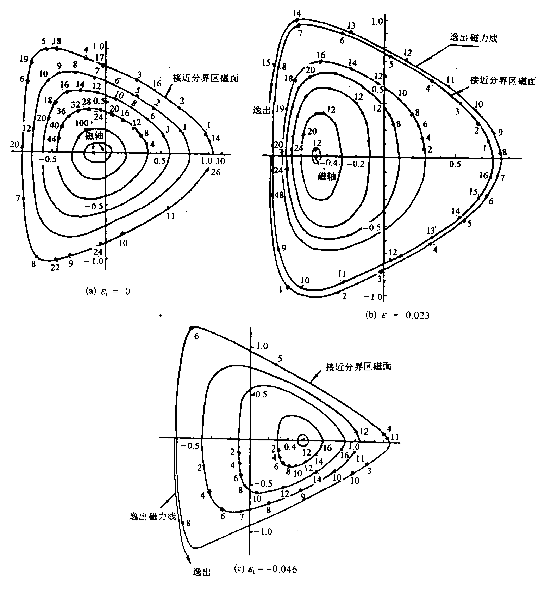

**图4.11** 环形仿星器的真空磁面（平均近似解）〔6〕：(a) 无外加垂直场；(b) 加正垂直场；(c) 加负垂直场。（$\epsilon_{1}$代表垂直场相对大小）

以上分析适用于磁轴附近区域。我们也看到，环形效应使磁轴区域的结构发生较大改变，其中单一磁轴分解为两个磁轴，但在加垂直场后，又只有单一磁轴。离磁轴较远处以及接近磁分界面处，必须用磁力线的严格积分来描述。具体做法是沿不同的磁力线进行数值积分，这时可以发现，内部的一根磁力线在绕大环方向转多次后仍处在同一磁面上，但靠近分界面处，一根磁力线绕大环方向转动多次后会逸出约束区，这正是磁分界面存在的证据。（如图4.12所示）

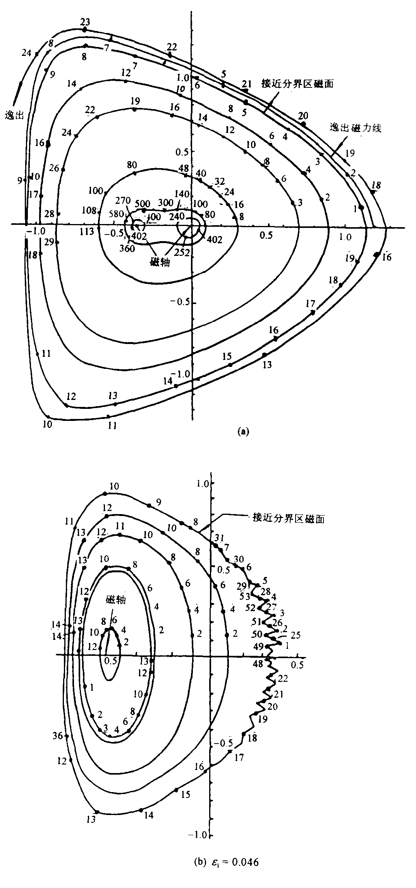

**图4.12** 环形仿星器的真空磁场位形（严格解）〔6〕：(a) 无外加垂直场；(b) 有正垂直场。

## 4.5 托卡马克位形的模拟分析

托卡马克位形是磁约束聚变研究中最重要的种位形，它基本上是轴对称的，非轴对称的因素可以看成一些扰动。由于等离子体中的电流在确定位形中起本质性的作用，而等离子体中的电流分布与等离子体参数及电流的驱动方法有关，所以真实的平衡位形分析将在下一章中进行。这里我们将利用前面得到的一些电流产生的磁场的表示式和关于磁面结构的一般性讨论，对托卡马克位形进行模拟性讨论，即假定等离子体中电流可以设定，然后研究有关的其他问题。这样得出的许多基本结论实际上适用于真实的托卡马克位形。

### 4.5.1 模拟托卡马克位形

托卡马克位形由环向磁场和极向磁场的合成磁场构成。环向磁场由绕在环形真空室外面的螺线圈绕组产生，这一绕组在环内的磁场主要是基波成分，即由 (4.43) 式表示的那部分场，此外还有一定的波纹分量，通过线圈的适当布设可以减小波纹场的比值，但靠近线圈时还是波纹场比较大。在环的外部漏场很小，基本不影响诊断设备及加热设备运行。在环的内部，这种绕组产生的磁场与Tamm位形中直线电流产生的磁场是相符的。

极向磁场的主要部分是等离子体环向电流产生的磁场，这一电流基本上平行于磁力线。前面讨论已指出，它需由某种驱动机制来维持，一般是靠欧姆变压器中磁通变化产生的感应电动势来驱动，近年来对非感应方法进行电流驱动做了很多研究，原理和实践上都证明可以通过注入定向粒子束或注入微波行波来驱动所需电流。此外，在等离子体的参数达到较高值时，等离子体自身由于新经典效应产生的自举电流（bootstrap current）可以在平行于磁力线的电流中占很大的比重，因而受到重视。在这里我们将用模拟电流分布来表示环向电流，这一电流产生的磁场是极向场的重要部分。

在环形装置中，还必须引入垂直于赤道平面的磁场，这在前面分析仿星器位形时已看到它的作用。这种垂直场可以通过特殊设置的绕组来产生。在更普遍的意义上，要考虑的不仅是垂直场，还有使等离子体截面形状产生所需变形（沿$z$轴拉长，三角变形，等等）的其他极向场。产生这些磁场的电流线圈也都是沿环向布设的，统称为极向磁场绕组。围绕真空室外部导体壁的涡电流的方向也在环向，它们的磁场也是极向场的一部分。这部分由外部环向电流产生的磁场的极向磁通函数可以用普遍的积分表示式求出（见下一章对托卡马克平衡位形的更严格讨论）。这里仅考虑垂直场，其极向磁通函数为

$$
\psi_{\mathrm{pr}} = \frac{1}{2} B_{z}R^{2} \tag{4.76}
$$

如再加上圆圈电流的磁通函数［见 (4.30)，(4.36)］，即得托卡马克等离子体的磁面函数。

环向磁场不出现在这一函数中，即环向磁场不影响磁面的形状，但它确定了磁力线旋转变换的大小。

### 4.5.2 直线托卡马克近似的一些性质

在研究环形装置时经常要应用直线近似，这是因为很多装置的环的大半径要比等离子体的小半径大几倍（典型值$R / a = 5$），即其倒数是 0.1 量级，这已足以用于作近似展开，对圆截面托卡马克，零级近似就是直圆柱，其长度为$2\pi R$，且具有全同端面，即相距$2\pi R$的两个断面是同一面。

直圆柱中的电流与磁场的关系可以用简单的初等函数或积分表示，从而使分析变得很方便。设环向电流分布（现仅为小半径坐标$r$的函数）为

$$
j_{\theta} = j_{0}f(r) \tag{4.77}
$$

则极向磁场（在圆柱坐标中为角向）

$$
B_{\theta} = \frac{4\pi j_{0}}{cr}\int \mathrm{d}r^{\prime}r^{\prime}f(r^{\prime}) \tag{4.78}
$$

磁力线的旋转变换为

$$
i(r) = \frac{RB_{\theta}}{rB_{0}} \tag{4.79}
$$

与仿星器情况不同，它与极向磁场和环向磁场比值的一次方成正比。如果环向电流分布是均匀的，则这一旋转变换沿等离子体截面为常量，即其剪切为零。一般而言，托卡马克等离子体中的环向电流分布是从磁轴向外减小的，磁剪切不为零。在托卡马克研究中，更多应用的物理量是磁剪切的倒数$q$，称为安全因子

$$
q(r) = \frac{1}{i} = \frac{rB_{0}}{RB_{\theta}} \tag{4.80}
$$

它与磁流体模式的结构及稳定性有密切联系。为使表面扭曲模稳定，必须对边界处的安全因子$q_{a}$有一定限制（不能太小），否则会因环向电流太大引起很强的磁流体扭曲模不稳定性，使等离子体放电破裂。安全因子之名也来源于此。

关于托卡马克位形更多和更深入的研究将在第五及第九章中进行。

## 4.6 准稳态电磁场中导体的作用

在许多实验装置中，尤其是用放电方式产生和加热等离子体的装置中，都采用了一些金属（铜）导体来帮助平衡和稳定等离子体。采用金属做真空室在达到和维持高的真空状态方面是有利的，一些装置（如初期的托卡马克和环形箍缩放电）则在不锈钢做的真空室外再加一层厚铜壳，其目的是利用其中的电流涡流来跟踪等离子体中电流的变化（电流柱的位移，变形），成为一种被动反馈系统。在将来的反应堆中，一般不希望在金属导体，但从近年来对高比压托卡马克等离子体的实验研究中得出结论，靠近等离子体的一些导体是稳定快变化模式的有效手段，因此，在真空室内等离子体附近采用适当布设的金属导体很可能是较理想的方案，虽然这会给反应堆总体安排造成很多不便。

在本节中将对导体的效应进行物理原理性的讨论。在很多情况下，这些导体并不具有理想的几何形状，在它们上面常因各种需要而开了许多切口。最简单的考虑是不能让导体阻挡有用的磁场的建立。我们主要以托卡马克装置中的导体为例来讨论。

### 4.6.1 导体面上电磁场边界条件的理解

导体中满足的电磁场方程包括

磁感应方程

$$
\frac{1}{c}\frac{\partial\mathbf{B}}{\partial t} = -\nabla \times \mathbf{E} \tag{4.81}
$$

导体的欧姆定律

$$
\sigma \mathbf{E} = j \tag{4.82}
$$

此处$\sigma$为金属的电导率。在瞬态过程中还要考虑空间电荷效应，即电场有一非旋（静电场）成分：

$$
\nabla \cdot \mathbf{E} = -4\pi \rho \tag{4.83}
$$

真实导体的涡流问题是一个经典的电动力学问题，其解法是完全确定的，但分析起来却很复杂的。为了获得对问题的基本理解，不妨考虑圆柱面导体情形。

### 4.6.2 具有切口时导体中涡流回路的分析[7]

下面分析几种实际问题中常遇到的导体壳切口问题。为简单计，假定等离子-导体壳系统具有直线圆柱几何形态，但需设想两端是重合的。第一种切口是将直圆柱金属外壳垂直于$z$轴截成几段（至少是一个切口），这是因为采用感应方式使等离子体沿$z$轴放电时，在金属外壳上要产生反向电流涡流，如果金属导体的电导性非常良好，可以看成超导体（即在放电时间内磁场不能透入导体内部），则导体壳上的涡电流（用极向模数表示为$m = 0$的电流）将完全屏蔽外加感应电场。由于涡电流必须在内外壳表面构成回路，沿$z$向的切口将切断涡电流的电流线，于是感应电场可以对内部等离子体起作用，剩下的涡电流将是次级效应（由环形效应引起），它们的电流线仍可以闭合，如图4.13所示。如计入金属的电阻效应，则在所谓的趋肤时间内，

$$
\tau_{s} = \frac{4\pi\alpha d^{2}}{c^{2}} \tag{4.84}
$$

类似的涡电流存在于金属壳的内外表面，在长于这一时间后，这一涡电流逐渐消失。总之，由于切口的存在，沿$z$轴的电流将存在于圆柱的外部。对圆环的情形，此时电流圈的电感要用

$$
L = 8\pi R\left(\ln \frac{8R}{a} -2\right) \tag{4.85}
$$

来计算。

同样是这种切口，对于另一种电流变化，即电流柱整体的位移却可以产生使变化的那部分磁通不透过圆柱面的必要的涡电流。在位移比柱的半径小很多时，位移引起的磁场变化可以用$\cos \theta$函数来表示$(m = 1)$，这种变化在金属壳面上产生的涡电流，完全可以沿圆柱面构成回路（见图4.14），它也具有$\cos \theta$分布。对于这种变化，涡电流的趋肤时间也不同于上面对轴对称电流的趋肤时间，它等于

$$
\tau_{\mathrm{c}} = \frac{4\pi\alpha R d}{c^{2}} \tag{4.86}
$$

即比$m = 0$的电流的趋肤时间长$R / d$倍。于是，在趋肤时间内，电流柱位移引起的磁场变化将被这种具有切口的金属导体壳所屏蔽。而相应于这一部分磁场来定义的电感应为

$$
L_{\mathrm{c}} = 4\pi R\ln \frac{b}{a} \tag{4.87}
$$

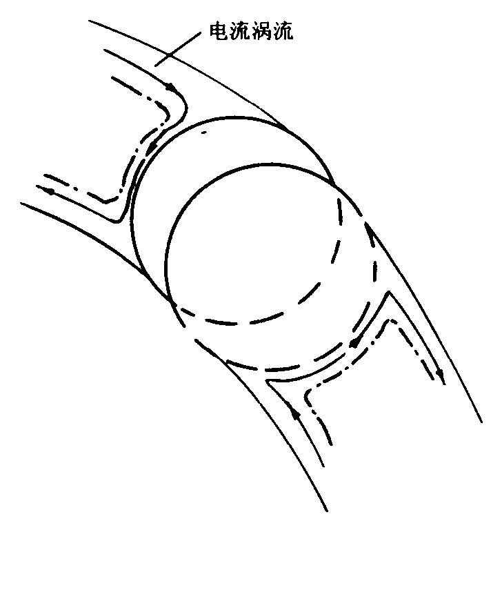

**图4.13** 具有纵向切口的圆环导体壳及电流涡流图

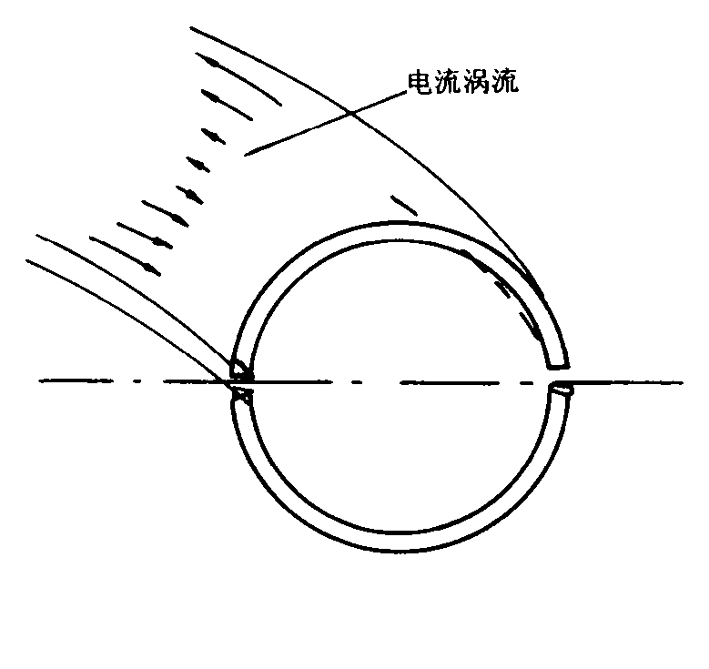

**图4.14** 在赤道面上具有切口的圆环导体壳及电流涡流图

为导体壳的内半径。

第二种重要的切口是沿环形柱的赤道面的切口，其目的是阻止产生纯极向涡电流（环向模数$n = 0$），当对主磁场线圈充电时会产生这种涡电流，它对主磁场的建立是有害的。这个切口的位置不能随便取，而必须位于赤道平面上，即在环形坐标系$\theta = 0,\pi$的面上，这样才不会切断上面讨论的$\cos \theta$分布的涡电流的电流线。如果切口取在$\theta = \pm \pi /2$处，就会阻断必要的涡电流回路而使导体壳对电流的位移（在托卡马克等离子体平衡问题中，对等离子体柱由于参数变化产生的位移）不能产生响应。当然，因为相应的涡电流不能形成闭合回路，沿赤道平面的切口对垂直位移将没有反馈响应。

金属壳切口处的涡电流会产生一些扰动磁场，例如，上面具有$\cos \theta$分布的涡电流在切口处的那部分电流要产生对垂直于环的赤道面的磁场的修正。相应的计算比较复杂，详细的计算结果请参看参考文献[7]。

## 4.7 磁场位形结构的稳定性

### 4.7.1 主要的磁场扰动及来源

实际装置中的磁场位形与理论设计的位形会有一定程度的差别。例如托卡马克或环形箍缩放位形，其理想状态是轴对称的，但实际上，首先那些用于产生环向主约束磁场的线圈就是分立布设的，在前面的分析中已指出，这将产生一系列的波纹磁场，这种场可以看成是对轴对称环形约束的一种扰动；此外，实际线圈间要有联接线，这些联接线中的电流产生的场是不希望有的杂散场，它们可以具有多个富氏分量，形成对理想位形的扰动。可以说这些场是不可避免的。除了在设计和磁体的制造加工中尽量减少杂散场外，还需分析它们可能造成的效果。

在实际应用中，还有一种情况，即人们希望有意地用较小的特定形态的磁场去影响原先的磁场以改变某些要观察或要控制的量的性质（有时要故意加大场的扰动以改变某些物理量），如在托卡马克装置中加入某种螺旋场。在前面的讨论中还指出，等离子体中电流产生的磁场，尤其是反磁电流产生的磁场，也可以看成扰动磁场，它们改变了原先由外电流分布产生的真空磁场的位形框架。更重要的一种情况是，在等离子体内部某些特殊位置（一般是在某些特殊磁面上），会因磁流体模式的发展而产生对原先磁场形态的扰动，通常这种扰动磁场具有一个占优的螺旋结构，因此可以用螺旋扰动来描述，这种螺旋场对原来磁场位形的扰动在装置物理中十分重要。所以，研究扰动磁场对某些特定磁场位形的影响是一个非常具有普遍意义和实用意义的课题。

应区分两种性质的扰动。即一种是非共振性的，另一种是共振性的。所谓共振性的，指的是扰动场的空间变化与磁面结构有内在相似性，例如在某一磁面上，扰动场的变化率与磁力线的旋转率很接近，结果，扰动具有久期性质，一个小的扰动可以引起磁面结构在局部区域中的很大的变化，甚至是拓扑结构的变化（如由闭合变成开放）。

一般情况下磁力线虽是一种概念性的东西而并非物理实体，但在磁约束聚变装置中，它具有更接近物理实体的含义。例如，可以把磁力线近似地看成是沿磁力线运动的电子的轨迹（严格意义上是质量为零的带电粒子的轨迹），这也是一种实际可用的观察磁面结构的实验方法。因此，对磁场结构的扰动，实际上也是对带电粒子轨道的扰动。不过，在环形约束区中对后者的扰动，尤其是对离子（有更大的拉莫尔半径）和高能粒子的轨道的扰动，比磁面本身所产生的扰动要大得多而且更复杂。

### 4.7.2 非共振型扰动磁面的估算

假定未扰动磁场及磁面函数分别为$\pmb{B}^{(0)}$及$\psi_{0}$，扰动磁场为$\pmb{B}^{(1)}$，扰动后的磁面函数

$$
\psi = \psi_{0} + \psi_{1} \tag{4.88}
$$

则扰动对磁面函数的修正可以通过将$\pmb{B}\cdot \nabla \psi = 0$进行微扰展开，忽略高级项得

$$
\pmb{B}^{(0)}\cdot \nabla \psi_{1} = -\pmb{B}^{(1)}\cdot \nabla \psi_{0} \tag{4.89}
$$

求非齐次项的贡献而获得

$$
\psi_{1} = -\int_{0}^{1}\mathrm{d}l\frac{B^{(1)}\cdot\nabla\psi_{0}}{B^{(0)}} \tag{4.90}
$$

上式右边被积函数中都是已知量，积分沿微扰动磁场的磁力线进行。但是，如果扰动磁场的变化与未扰磁场的磁力线具有共振性质，上面的积分将产生一个久期贡献，微扰方法失效（必须计入被忽略的高阶项$\pmb{B}^{(1)}\cdot \nabla \psi_{1}$），而需要用其他方法来分析。例如，内在闭合磁面内部用平均近似，更一般的用直接对整个磁力线方程作数值积分来研究。

### 4.7.3 共振扰动的磁面

下面我们就一种扰动后仍具有对称性而在物理上又非常重要的情形作为例子进行较详细的讨论。这一例子就是直线圆截面托卡马克位形受到一个螺旋对称谐波磁场的扰动。设直线托卡马克位形的磁场为

$$
\pmb{B}^{(0)} = B_{0}e_{z} + B_{\theta}(r)e_{\theta} \tag{4.91}
$$

其中环向磁场$\pmb{B}_{0}$为常数，未扰磁面函数仅依赖于半径$r$，并可写成

$$
\psi_{0}(r) = R\int_{0}^{r}\mathrm{d}r B_{\theta}(r) \tag{4.92}
$$

螺旋扰动磁场若用标势表示，则

$$
\Phi_{m} = b_{m}I_{m}(m\sigma)\cos m u \tag{4.93}
$$

设它在$2\pi R$长度上有$n$个周期，即$\alpha = n / R$，$u = \theta - n z / R$，利用螺旋对称磁场位形中磁面函数与磁场的矢势分量间的关系式

$$
\alpha \frac{\partial\psi}{\partial r} = \frac{\partial}{\partial r} [A_{z} + rA_{\theta}] \tag{4.94}
$$

再代入关于直线托卡马克的电流的矢势的$z$分量

$$
A_{z} = -\int_{0}^{r}\mathrm{d}r^{\prime}B_{\theta}(r^{\prime}) = -\frac{B_{0}}{R}\int_{0}^{r}\mathrm{d}r^{\prime}r^{\prime}i(r^{\prime}) \tag{4.95}
$$

可得

$$
\psi (r,u) = \frac{B\alpha_{0}r^{2}}{2m} +r b_{m}I_{m}(m n r / R)\cos m u - \frac{B_{0}}{R}\int_{0}^{r}\mathrm{d}r^{\prime}r^{\prime}i(r^{\prime}) \tag{4.96}
$$

式中$i$为未扰磁场磁力线的旋转变换率，即$1 / q$，$q$为安全因子。以上表示的从外部加螺旋对称磁场对直线托卡马克位形的扰动，设想了一个类似的螺旋对称扰动磁场，但它是等离子体内部的磁流体不稳定性产生的，它主要局限于共振磁面附近，也就是$q = m / n$的磁面附近，如将上式中的贝塞尔函数换成某种局限于共振磁面附近的函数，则得类似的磁面表示式。这类表示式与无扰动时磁面表示式不同的地方是，未扰动前的磁面，代表由磁轴算起的极向磁通，是随半径加大的单调变化的函数，而存在扰动时，即式 (4.96) 中的函数随半径的变化在某些磁面附近呈现有局部的极大和极小，实际上，这时该处的磁面将被分裂成$m$个磁岛，如图4.16所示。将式 (4.96) 中的磁面函数对半径求偏导数得

$$
\frac{\partial\psi}{\partial r} = \frac{B_{0}r}{R}\left[\frac{n}{m} - i(r)\right] + b_{m}\left(rI_{m}^{\prime}\frac{mnr}{R}\right)\cos mu \tag{4.97}
$$

对$\cos mu = 0$，上式表明极大值的位置$\left(\frac{\partial\psi}{\partial r} = 0\right)$满足$i = n / m$，这正是所谓的共振面的位置，它对应于磁岛的中心；而$\cos mu = \pm 1$的位置对应于磁岛的边缘，相邻两个磁岛在极向是相联接的，磁岛的宽度与未扰磁场的磁力线的剪切大小有关（详见后面第五章）

$$
w = 4\left(\frac{b_{mn}R}{m B_{0}\,\mathrm{d}i/\mathrm{d}r}\right)^{1 / 2} \tag{4.98}
$$

在磁约束聚变实验装置中遇到的情况，往往是磁岛的区域与磁面结构仍是光滑的区域交叉地存在，但它们一般不具有简单的对称性，因而结构更为复杂。图4.15中所示例子是这一情况的很大简化。

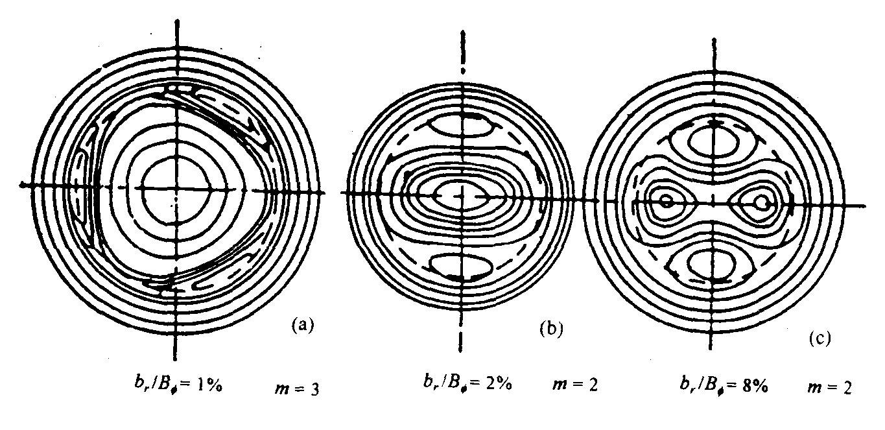

**图4.15** 圆柱位形中由 (a) $m = 3$和 (b)(c) $m = 2$的螺旋扰动磁场产生的磁岛结构；扰动磁场与本底磁场强度比分别为$1\%$、$2\%$和$8\%$。

### 4.7.4 磁岛的重叠及磁场位形结构的无规化区域

在实际应用中会见到一种很重要的物理现象，即一些不同的模式引起的磁岛会互相重叠。这出现在不同的磁岛宽度大于磁岛间的距离时。在磁岛重叠区域，磁力线的走向将呈现无规化趋势。这是因为，扰动磁场往往是随时空变化的，而且并不只是一种单纯的谐波分量起作用。

在磁岛重叠区域，由于带电粒子沿磁力线的快运动以及沿磁力线的快输运，尤其是热传导，等离子体中的热量将很快被传出该约束区，因而对等离子体总体约束产生很大的影响。磁岛的形成以及相应的磁力线无规化在自然界中是很普遍的，这种现象称为磁重连（magnetic reconnection），在宇宙空间等离子体中，如在地球的船前激波（bow shock）及磁尾区（magnetic tail）中就经常发生。在聚变实验装置中，尤其是那些具有内部大电流的装置中，如托卡马克和箍缩放电装置，这种磁重连和输运的增大都是重要的物理现象。磁力线的无规化有时也被主动地用来控制杂质输运或加大靠近某些边缘区的输运，以使热量较均匀地沉淀在靶体上，减少相关的等离子体与材料的作用。

## 4.8 偏滤器位形（divertor）

偏滤器一词起源于仿星器装置，为了控制杂质向等离子体中心约束区的透入，在跑道型仿星器装置的直线段有意识地加一个产生与主磁场反向的磁场线圈，在靠近边界处磁场有一零点（见图4.16），一部分磁力线将逸出主约束区，并在主约束区及真空室壁之间形成一个称为剥离层（scrape-off layer）的中间区域。这样，从外部进入靠真空室壁处产生的杂质原子或分子中有很大一部分将在剥离层中电离，象其他带电粒子一样，杂质离子沿磁力线的运动远快于横越磁力线的运动，因而可以使大部分杂质离子引入到特殊的靶室中使之重新复合成中性原子或分子，然后用大抽速泵抽出系统。这种形式的偏滤器在托卡马克型装置中也被采用过（英国的DITE），称为局部偏滤器，以区别于后来广泛应用的极向偏滤器。对托卡马克装置，这种偏滤器带来不对称性，而且为使环向磁场的磁力线偏转出真空室，所需的偏滤电流是很大的，这可以从下面的估计中看出。在靠近线圈处，用圆圈电流产生的磁场的大小大体可由下式估计

$$
B_{\mathrm{div}} = \frac{2I_{\mathrm{div}}}{cx} \tag{4.99}
$$

$x$为离偏滤线圈中心的距离，而环向磁场的大小为

$$
B_{\mathrm{T}} = \frac{1}{c} 4\pi n I_{0} \tag{4.100}
$$

$n$为单位长度平均的线圈匝数。为了在离偏滤器线圈中心$x$处生成$x$-点，上两种磁场应相互抵消，于是要求

$$
I_{\mathrm{div}} = 2\pi nxI_{0} \tag{4.101}
$$

这一条件大体上相当于要求偏滤器线圈中的电流比环向磁线圈中电流大一个量级，这是很不经济的。

在仿星器装置中，磁面结构被磁分界面自动分成磁力线闭合区和开放区，因此可以利用开放区作为偏滤器。但产生仿星器位形所需的大螺距绕组中的电流只有环向磁场绕组中电流的十分之一，现代仿星器采用同一绕组产生环向和极向磁场分量，具有内在的优越性（见第十章）。在托卡马克装置中，在靠近等离子体柱的地方设置一个与等离子体中电流流动方向相同的偏滤器线圈，只要极向磁场在真空室内形成$x$-点，就可以构成偏滤器，这是一种轴对称偏滤器，即整个极向磁通函数具有分界面，而用于产生反向极向磁场的线圈成为托卡马克装置的极向场绕组的一个重要组成部分。多数大型托卡马克实验装置及未来的反应堆都设有或将设有偏滤器。

托卡马克极向偏滤器线圈的电流也相当大，因为要形成$x$-点，即在某点达到极向磁场为零，所以要求偏滤器线圈中点流的大小为

$$
I_{\mathrm{div}} = \frac{x}{b} I_{\mathrm{p}} \tag{4.102}
$$

式中$b$为拉长截面等离子体环的长轴半径，$x$为$x$-点离偏滤器线圈的距离。通常要求这个线圈中的电流达到等离子体电流的$1/5$或更大。

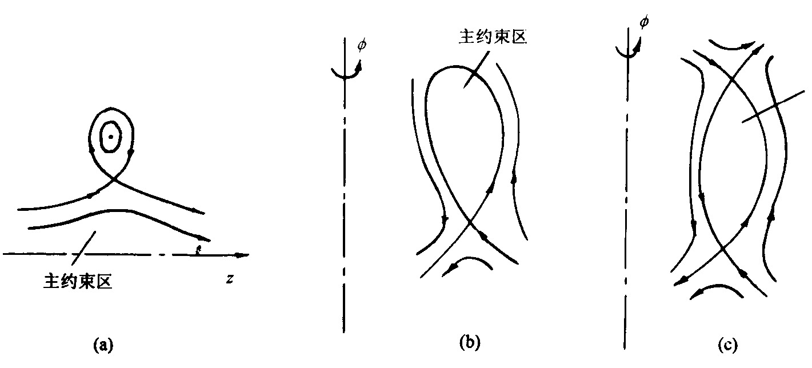

**图4.16** 几种偏滤器位形示意图：(a) 局部偏滤器；(b) 单零轴对称偏滤器；(c) 双零偏滤器。

从反应堆的角度看，偏滤器的功能已不限于控制杂质，可以说其主要功能是控制等离子体流出的热量和粒子流，有目的地让其沉淀在偏滤器的靶板区。这样，主真空室所受的热负荷将大幅度减少，带电粒子对主真空室壁的溅射也大幅度减少。从现有设计的偏滤器看，其靶板上的热负荷大小已达临界，并反过来限制了托卡马克等离子体的参数和反应堆经济性能的提高。因此，先进的偏滤器设计和实验验证已是目前托卡马克研究的一个重要内容（见第七、九章）。

## 参考文献

1. Morozov A I, Soloviev L S. The structure of magnetic fields, in Review of Plasma Physics. V.2, Ed. M.A. Leontovich, Consultant Bureau, N Y, 1966
2. 宫本健郎. 热核聚变等离子体物理学. 金尚宪译，北京：科学出版社，1981
3. 石秉仁. 圆环面电流产生的磁场的近似解. 核工业西南物理研究院对外交流资料，1974.12
4. 石秉仁. 空间磁轴仿星器中真空磁场的近似表示式. 核聚变，1980，1(3): 183
5. 石秉仁，高庆弟. 环形仿星器的真空磁面. 核工业西南物理研究院对外交流资料，1974.8，及“等离子体与受控核聚变”会议论文集，成都，北京：原子能出版社，1974.66～74
6. Shi Bingren. Averaged Magnetic Surfaces of Spatial Axis Stellarator with External Helical Windings. Proc. Int. Sump on Stellarator with Three Dimensional Axis, Sendia, Japan, 1979.67～80
7. Mukhovatov V S, Shafranov V D. Plasma equilibria in tokamaks. Nucl. Fusion, 1971, 11: 605～633
8. Filonenko N N, Sagdeev R Z, Zaslavsky G M. Destruction of magnetic surface by irregularities of magnetic fields. Nucl. Fusion, 1967.7: 253～266

# 第五章 磁约束等离子体的宏观运动特性

本章讨论磁约束等离子体的宏观运动，即从流体运动层次来研究等离子体的性质。另一个研究层次是从组成等离子体的基本粒子（电子和各种离子）运动的角度，研究粒子在由外加电磁场和自治电磁场组成的电磁场中的运动特性，以及等离子体的集体行为。

在流体运动层次上，也有两个基本点。第一个是从磁流体动力学出发，描述带电粒子体系的麦克斯韦-玻尔兹曼方程的矩积分[1]，它是在假定等离子体离热平衡态不远的条件下，通过取等离子体压强张量为标压强而将矩方程展开截断使体系闭合的。另一个基本点是宏观输运方程，这是基于粒子、动量和能量的守恒率，用唯象的方法确定输运系数而获得的。所谓唯象方法是指输运系数采用实验观察确定的值，这些值一般都比由基于碰撞过程而得出的经典输运系数的理论值大得多，有时大几个数量级。一般认为这是等离子体中集体模相互作用的结果。等离子体物理学家一直在努力研究产生反常输运的原因，但由于反常输运既与速度空间粒子运动特性有关，又与几何空间特性有关，而且两者是耦合在一起的，研究的难度很大，所以虽在大量的实验观察的基础上得出了一些规律性的认识，在物理机制研究方面也取得了重要进展，但迄今尚未有普遍适用的物理模型。

## 5.1 宏观运动状态的描述方法：磁流体运动方程组和输运方程组[1-3]

假定等离子体离热平衡态不远，用宏观流体密度$\rho$，运动速度$\nu$及标压强$p$来描述运动状态，用磁场强度$\boldsymbol{B}$，电流密度$\boldsymbol{j}$，电场强度$\boldsymbol{E}$来描述电磁场量，并假定电中性条件得到满足，即假定等离子体中没有空间电荷，这时，这些物理量间满足下述磁流体运动方程组：

$$
\frac{\partial\rho}{\partial t}+\nabla\cdot\rho\nu=S \tag{5.1}
$$

$$
\rho\frac{\mathrm{d}\nu}{\mathrm{d}t}=-\nabla p+\frac{1}{c}j\times B \tag{5.2}
$$

式中$S$代表粒子源，方程(5.2)中原则上也可加入一项动量源。不过在考察磁流体运动时一般不考虑源项的作用，因为它们一般都仅在输运层次起作用，而磁流体运动都是较快的运动。式(5.2)中的电流密度$\boldsymbol{j}$要由等离子体运动本身来确定，在磁流体力学框架内，它由所谓的广义欧姆定义来确定，即

$$
\frac{m_{\mathrm{e}}c^{2}}{n_{\mathrm{e}}e^{2}}\frac{\partial j}{\partial t}
=E+\frac{1}{c}\nu\times B+\frac{c}{en_{\mathrm{e}}}\nabla p_{\mathrm{e}}
-\frac{c}{en_{\mathrm{e}}}j\times B-\eta j \tag{5.3}
$$

式中左边项是电子的惯性，右边前两项是运动等离子体中的电场，第三项是反磁效应项，第四项是霍尔（Hall）电流效应，最后一项是电阻效应项。在下面研究磁流体稳定性时，将根据不同的情况分别忽略那些起次要作用的项以简化处理。以上方程加上麦克斯韦方程组则有：

$$
\nabla\times B=\frac{4\pi}{c}j+\frac{1}{c}\frac{\partial E}{\partial t} \tag{5.4}
$$

$$
\nabla\cdot B=0 \tag{5.5}
$$

$$
\nabla\times E=-\frac{1}{c}\frac{\partial B}{\partial t} \tag{5.6}
$$

及电中性关系

$$
n_{\mathrm{e}}=\sum_{i}n_{i} \tag{5.7}
$$

为使上述方程闭合，通常还需将压强$p$与运动速度联系起来，这种关系叫状态方程。一种最简单的状态方程就是关于流体运动是不可压缩的假定：

$$
\nabla\cdot\nu=0 \tag{5.8}
$$

它同时取代了粒子守恒方程式(5.1)。在一定条件下，这一假定可以近似描述那些运动速度比阿尔芬速度及等离子体的离子的热速度慢很多的运动。

关于等离子体的宏观运动，按其运动速度和变化率（加速度）的大小，又可分成几种情况来描述。变化最快的运动是理想磁流体不稳定性，其次是电阻性不稳定性，然后是输运，最后是准稳磁平衡态，又称静磁平衡态，因为此时运动速度对平衡物理量不起作用。真实等离子体不会处于理想的静磁平衡态，可是，下面将证明，在一定物理条件下，每一时刻的等离子体状态，往往可以用当时的静磁平衡解来描述。

考虑准稳态运动。设约束系统的特征几何尺度为$L$，离子的热运动速度为$v_{\mathrm{th}}$，我们假定物理量的变化相当慢，因而

$$
\frac{L}{v_{\mathrm{th}}}\frac{\partial A}{\partial t}\ll1 \tag{5.9}
$$

另外，等离子体的宏观运动速度远小于离子的热速度及阿尔芬速度（见本章5.5节）

$$
\left|v\right|\ll\left[v_{\mathrm{th}},\ v_{\mathrm{A}}=\frac{B}{\sqrt{4\pi\rho c^{2}}}\right] \tag{5.10}
$$

以上条件称准稳态条件，在准稳条件下，运动方程(5.2)中的惯性项

$$
\rho\frac{\mathrm{d}\nu}{\mathrm{d}t}
=\rho\left(\frac{\partial\nu}{\partial t}+\nu\cdot\nabla\nu\right) \tag{5.11}
$$

将远小于压强梯度项（右边第一项），因而每一时刻，满足静磁平衡条件

$$
\nabla p=\frac{1}{c}j\times B \tag{5.12}
$$

对应的麦克斯韦方程组就只有安培定律

$$
\nabla\times B=\frac{4\pi}{c}j \tag{5.13}
$$

及磁场为无源的条件

$$
\nabla\cdot B=0 \tag{5.14}
$$

所以称方程组(5.12)～(5.14)为静磁平衡方程，可以看到这组方程中不出现等离子体的宏观速度。但是，用这组方程导出的静磁平衡态，可以代表每一时刻由于输运（加热、粒子补充及扩散、热导）引起的变化，也可以描述某些特殊的不稳定运动下的等离子体状态，例如等离子体柱的整体位移和轴对称性的变形运动。但对破坏对称性的运动，一般不能用静磁平衡态来描述。

下面引入描述输运的唯象方程组，设等离子体只含一种离子成分。完整的输运方程组包含以下两个方程，即：粒子守恒方程

$$
\frac{\partial n}{\partial t}+\nabla\cdot\Gamma=S \tag{5.15}
$$

和关于电子和离子的热量守恒条件

$$
n\frac{\partial T_{\mathrm{e}}}{\partial t}+\nabla\cdot q_{\mathrm{e}}=h_{\mathrm{e}} \tag{5.16}
$$

式中$h_{\mathrm{e}}$为在电子和离子成分上的外加功率密度，$\Gamma,q_{\mathrm{e}}$代表粒子通量流密度及电子和离子的热流密度，在输运层次上，它们应代表由粒子密度梯度及温度梯度引起的扩散和热传导以及对流：

$$
\Gamma=-D\nabla n \tag{5.17}
$$

$$
q=-\kappa\nabla T+\frac{5}{2}nT\nu \tag{5.18}
$$

这里为简单起见，所有输运系数（扩散系数$D$和热导率$\kappa$）都假定为标量，(5.18)中的速度是输运层次上的对流速度，它远小于磁流体不稳定性运动速度。利用(5.15)～(5.18)原则上已可以描述由于加热、补充送料以及各种经典的和反常输运过程引起的平衡量（粒子密度，电子和离子温度）的变化，它们又引起静磁平衡态参数，包括电流密度和磁场位形的缓慢演变。其中，

$$
p=n(T_{\mathrm{e}}+T_{\mathrm{i}}) \tag{5.19}
$$

在每一时刻，由静磁平衡条件式(5.12)知，

$$
B\cdot\nabla p=0 \tag{5.20}
$$

这表明，等压面$p=\mathrm{const}$是磁面量（在同一磁面上为常量的物理量），在输运过程中，磁面形状可以发生变化，但是压强在磁面上保持常数的性质不变。更进一步，由于沿磁力线的热导率非常大，因此，实际上在同一磁面上，电子和离子的温度也是不变的：

$$
T_{\mathrm{e}}=\mathrm{const},\quad T_{\mathrm{i}}=\mathrm{const} \tag{5.21}
$$

由式(5.19)得到粒子密度沿磁面也是常数

$$
n=\mathrm{const} \tag{5.22}
$$

进一步的讨论必须在了解平衡位形的基础上进行。最重要的平衡位形是托卡马克等离子体的环形轴对称位形，它由所谓的Grad-Shafranov方程来描述，这一方程也适用于描述另外一些轴对称环形平衡位形，如反向场位形（RFP），小环径比（$R/a$接近于1）的轴对称位形，后一种位形有时也叫球形环位形（Spherical toroid）。

## 5.2 轴对称环形平衡位形[4～7]

### 5.2.1 一般讨论

在第四章对磁场位形进行一般讨论时已指出，闭合的约束位形其边界面的几何形态必然是某种拓扑环面，但一般说这个环形曲面是不具对称性的三维空间曲面。托卡马克位形是最简单的环形位形，它具有轴对称性，并依赖于两个独立坐标变数，即$R,Z$。这里取圆柱坐标系，$z$轴为对称轴（参见图5.1）。由于轴对称性，即所有变量与角坐标$\phi$无关，从式(5.14)，磁场可以用两个流函数$\psi(R,Z),F(R,Z)$来表示：

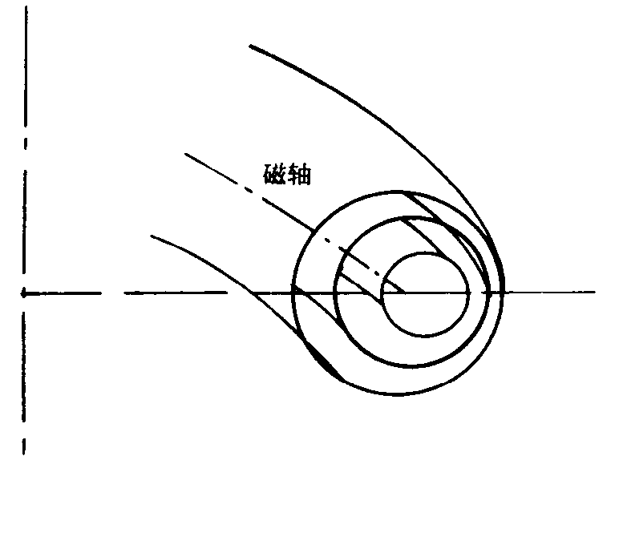

$$
B=\nabla\psi\times\nabla\phi+F\nabla\phi \tag{5.23}
$$

其中

$$
F(R,Z)=RB_{\phi} \tag{5.24}
$$

$B_{\phi}$为磁场的环向分量。流函数$F$的物理意义是它确定了反磁电流的分布形式（见以后讨论）。磁场的极向分量$B_{p}$为

$$
B_{p}=\nabla\psi\times\nabla\phi \tag{5.25}
$$

或

$$
B_{R}=-\frac{1}{R}\frac{\partial\psi}{\partial Z},\quad
B_{Z}=\frac{1}{R}\frac{\partial\psi}{\partial R} \tag{5.26}
$$

另外，由(5.20)知，等压强面是磁面，$p$仅为$\psi$的函数

$$
p=p(\psi) \tag{5.27}
$$

容易证明，电流密度矢量也处在同一磁面上，即

$$
j\cdot\nabla\psi=0,\quad j\cdot\nabla p=0 \tag{5.28}
$$

在静磁平衡态，各物理量间存在一定关系，首先是环向电流密度$j_{\phi}$将与上面定义的两个流函数有关：

$$
j_{\phi}=cR\frac{\mathrm{d}p}{\mathrm{d}\psi}+\frac{c}{8\pi R}\frac{\mathrm{d}F^{2}}{\mathrm{d}\psi} \tag{5.29}
$$

其次，流函数$\psi$满足所谓的Grad-Shafranov方程[4.5]：

$$
\mathrm{L}\psi=R^{2}\nabla\cdot\left(\frac{\nabla\psi}{R^{2}}\right)
=-4\pi R^{2}\frac{\mathrm{d}p}{\mathrm{d}\psi}-\frac{1}{2}\frac{\mathrm{d}F^{2}}{\mathrm{d}\psi} \tag{5.30}
$$

这一方程先后由美国科学家Grad和前苏联科学家Shafranov导出，后者对托卡马克位形做了非常详尽的研究，包括各种非轴对称因素对位形的微扰[7]。

需要再一次指出的是，虽然方程(5.29)给出了环向电流密度与压强及其反磁电流参数间的关系，但它并没有确定这一电流的具体分布形式。具体分布是由驱动电流的物理条件确定的。在纯欧姆驱动的条件下，它主要与电子温度分布有关。当我们把方程(5.29),(5.30)与输运方程结合起来时，这一点就很清楚了。在每一时刻，若等离子体的压强（通过粒子密度$n$及电子和离子的温度$T_{\mathrm{e}},T_{\mathrm{i}}$）的分布已确定，驱动电流的方式也已确定，则原则上环向电流分布也确定了，我们可以求出磁面函数及反磁函数$F$。实际上，$F$等于给定磁面内部的环向总电流

$$
F=\int\int\mathrm{d}R\mathrm{d}Z\,j_{\phi} \tag{5.31}
$$

在理论分析上，常常采用相反的做法，即先假定压强$p$及函数$F$与流函数$\psi$有某种给定的关系，最简单的是二次函数关系，即

$$
p=p_{0}+p_{1}\psi+p_{2}\psi^{2}, \tag{5.32}
$$

$$
F=F_{0}+F_{1}\psi+F_{2}\psi^{2} \tag{5.32}
$$

这样一来，Grad-Shafranov方程(5.30)形式上就化成了一个$\psi$的二阶椭圆型线性偏微分方程。不过下面将指出，一般情况下这一方程是非线性的。先看方程(5.30)中的算符

式中$\Delta(r)$是所考察磁面相对于磁轴的位移。我们假定$r/R_{0},\Delta/r$为小量，并将所有物理量对此小量展开。由(5.29)式，环向电流密度可以写成：

$$
j_{\phi}(R,Z)=\frac{R}{R_{0}}j_{1}(r)+\frac{R_{0}}{R}j_{2}(r) \tag{5.38}
$$

其中$j_{1}(r),j_{2}(r)$分别代表与压强分布及反磁效应有关的两部分电流，它们是磁面函数：

$$
\begin{aligned}
j_{1}(r)&=cR_{0}\frac{\mathrm{d}P}{\mathrm{d}\psi},\\
j_{2}(r)&=\frac{c}{8\pi R_{0}}\frac{\mathrm{d}F^{2}}{\mathrm{d}\psi}
\end{aligned} \tag{5.39}
$$

通过算符间变换，可以将Grad-Shafranov方程（非线性二阶椭圆型偏微分方程）在该坐标系中写出[9]：

$$
\frac{\mathrm{d}^{2}\psi_{0}}{\mathrm{d}r^{2}}+\frac{1}{r}\frac{\mathrm{d}\psi_{0}}{\mathrm{d}r}
=-\frac{4\pi}{c}j_{\phi_{0}}(r) \tag{5.40}
$$

同时位移函数$\Delta(r)$满足

$$
\frac{\mathrm{d}^{2}\Delta}{\mathrm{d}r^{2}}
+\left(\frac{1}{r}+\frac{2\psi''}{\psi'_{0}}\right)\frac{\mathrm{d}\Delta}{\mathrm{d}r}
=-\frac{1}{R_{0}}+\frac{8\pi R_{0}}{c}\frac{r p'(r)}{\psi_{0}'^{2}} \tag{5.41}
$$

以上两个方程加上关于电流密度与压强及反磁函数$F$的一些关系，就确定了圆截面托卡马克的位形结构特性，其中位移函数是环形磁面与直圆柱位形差别的主要标志。在数学上，上述方程组(5.40),(5.41)是非齐次常微分方程组，求解这些近似的常微分方程比求解严格的非线性椭圆型偏微分容易得多，这就是有关展开方法的优点。实际上，以上方法还可以直接地推广到非圆截面位形，条件是非圆变形参数（椭圆变形，三角变形，等等）比磁面平均半径小很多，与上面的展开参数是同级小量[7]。除(5.37)外，再设

$$
r=\rho+\sum a_{n}(\rho)\cos n\theta \tag{5.42}
$$

同时取位移函数$\Delta=\Delta(\rho)$，则通过将上面(4.40)～(4.42)各式的变量$r\rightarrow\rho$，这些式子仍然正确。此外，关于变形函数$a_{n}(\rho)$的一级近似方程为

$$
\frac{\mathrm{d}^{2}a_{n}}{\mathrm{d}\rho^{2}}
+\left(\frac{1}{\rho}+\frac{2\psi''}{\psi'}\right)\frac{\mathrm{d}a_{n}}{\mathrm{d}\rho}
-\frac{n^{2}-1}{\rho^{2}}a_{n}=0\quad(n\geqslant2) \tag{5.43}
$$

与位移函数不同，变形函数满足二阶齐次常微分方程，其解由给定的边界面上的变形大小确定。由于(5.42)中定义的磁面变量$\rho$是磁面截面的几何平均值，而所定义的变形函数是相对于这一平均值的偏差，因此，一个不大的变形函数可以描述较大的实际变形（例如沿$z$轴的拉长变形，在这里被描述成在水平方向为负而在垂直方向为正的较小的变形），因此这种展开方法可以保证在较好的精度内描述许多理论和实验研究上感兴趣的位形。

### 5.2.3 直圆柱近似（零级近似）

下面分析直圆柱近似方程(5.40)的解的性质。零级近似下，环向电流密度

$$
j_{\phi_{0}}=R_{0}c\frac{\mathrm{d}p}{\mathrm{d}\psi_{0}}
+\frac{c}{8\pi R_{0}}\frac{\mathrm{d}F^{2}}{\mathrm{d}\psi_{0}} \tag{5.44}
$$

现在我们假定环向电流密度以及压强都由实验确定，从(5.40)得出

根据极向场定义

$$
B_{\theta}=\frac{|\psi'|}{R_{0}} \tag{5.46}
$$

安全因子

$$
q(r)=\frac{rB_{\phi}}{R_{0}B_{\theta}}=\frac{rB_{\phi}}{|\psi'|} \tag{5.47}
$$

式(5.45)～(5.47)中表示的是载电流直圆柱等离子体的一般结果，既适用于托卡马克，也适用于扩散箍缩放电等离子体。将$F$用零级量$F_{0}=R_{0}B_{\phi0}$代入，式(5.39)即为直圆柱等离子体的总压强（等离子体压强加磁压强）平衡方程。对托卡马克，极向场远小于环向场，对应于安全因子$q>1$，一般来说，根据扭曲模稳定性条件，要求边缘$q_{a}\geq2.5$，同时等离子体比压$\beta=\frac{\langle8\pi p\rangle}{B_{\phi0}^{2}}\approx\left(\frac{a}{R}\right)^{2}$，所以托卡马克又称为低比压约束系统。但对所谓的反向场箍缩（Reversed Field Pinch，简称RFP），极向场的大小与环向场同量级，因而其等离子体比压理论上可以达到1的数量级。在确定压强分布及总电流分布后，$F$函数可以给出为：

$$
F(r)=\left[F_{0}^{2}+\frac{8\pi R_{0}}{c}\int_{0}^{r}\mathrm{d}r'\,j_{2}(r')\psi'_{0}(r')\right]^{1/2} \tag{5.48}
$$

RFP的$F$函数（以及环向场）在靠近边缘处反向。托卡马克及RFP的压强，极向场和环向场的典型剖面如图5.3所示。

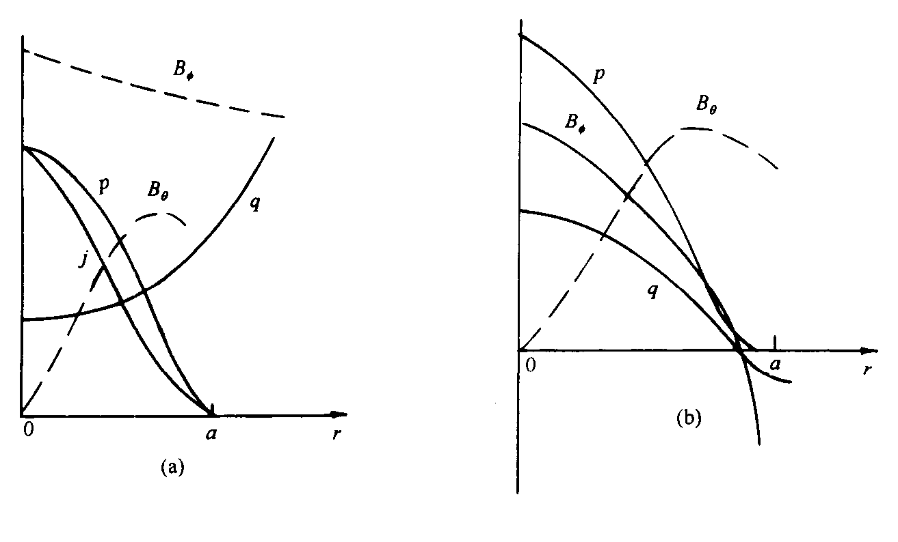

**图5.3** (a)托卡马克位形的$B_{\phi},B_{\theta},p,j,q$沿半径的分布；(b)反向场位形的相应分布

在实际装置中，各种物理量是互相关联的。从外部可以控制的是环向磁场和电流，以及用于控制位移量大小的垂直于赤道平面（$Z=0$面）的磁场。在上面的公式中，它等于边界处的极向场减去由等离子体中电流产生的极向场。但这样做非常不直观。我们回到Shafranov最初的推导[5]，将其直接与装置参数及等离子体的两个积分量（平均比压值和内电感）联系起来，这样可以得到等离子体柱边缘处垂直场的大小为

$$
B_{\perp}=\frac{I_{\mathrm{p}}}{cR}\left(\ln\frac{8R}{a}+\Lambda-\frac{1}{2}\right) \tag{5.49}
$$

其中

$$
\Lambda=\frac{\langle8\pi p\rangle}{B_{\theta}^{2}}+\frac{l_{\mathrm{i}}}{2}-1 \tag{5.50}
$$

上式中右方第一项是等离子体的极向比压，其数量级大小为1，第二项中的$l_{\mathrm{i}}$是等离子体的内电感，定义为

$$
l_{\mathrm{i}}=\frac{\iint\mathrm{d}r\mathrm{d}\theta\,B_{\theta}^{2}}{\pi a^{2}B_{\theta}^{2}(a)} \tag{5.51}
$$

在感应电子加速器设计中即知，要使电子束的轨道稳定，垂直磁场的场形不能是完全垂直的，而应有一定的曲度。对托卡马克中的环向电流来说也有同样的要求，这就是垂直场的指数因子须满足条件

$$
\frac{3}{2}>n=-\frac{r}{B_{\perp}}\frac{\mathrm{d}B_{\perp}}{\mathrm{d}r}>0 \tag{5.52}
$$

其中$n>0$是对垂直位移的稳定性要求，$n<3/2$是对水平位移的稳定性要求。所形成的场形如图5.4所示。最初都采用在等离子体柱的外部加厚铜壳的方法来满足稳定的要求。在磁场从铜壳内扩散到铜壳外去的特征时间内铜壳能起平衡和稳定等离子体的作用，但在更长的时间内，铜壳失效。在70年代以后建造的装置中，一般不再采用厚铜壳，而采用反馈控制的场来跟踪等离子体的变化。这还要与等离子体的磁流体稳定性结合起来解决。尤其是，在后来发展的具有沿环的对称轴（$z$轴）拉长的截面的托卡马克装置中，容易发展起沿$z$轴的竖直位移不稳定性，必须由外加控制场来稳定。

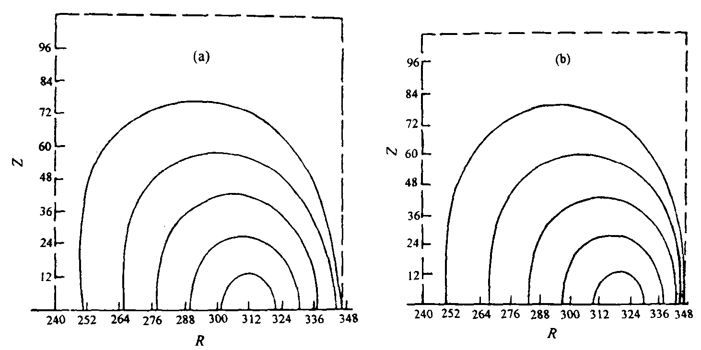

**图5.4** 由简单的垂直场加四极场获得的稳定垂直场位形示意图

## 5.3 托卡马克等离子体的位形演变：$1\&1/2$维输运[11-14]

现在讨论输运时间尺度上等离子体位形的变化，主要的理论工具是$1\&1/2$维平衡输运编码。实际上，这是采用唯象方法对具有总体稳定约束性质的托卡马克等离子体的一种基本描述，在实际研究中被广泛应用。

### 5.3.1 关于$1\&1/2$维输运问题的一般讨论

托卡马克等离子体，或更广泛地说，磁约束聚变装置中的等离子体，是处在动平衡状态中的物理体系，其中的粒子和能量都和外界不断进行交换，等离子体的各种参数是不断随时间变化的。在本章前几小节的讨论中已指出，在输运时标上，每一时刻的等离子体参量间的关系可以用该时刻的静磁平衡条件描述。而且，由于带电粒子沿磁力线的快运动，主要的物理参量都近似地仅为磁面坐标的函数。我们假定在某一时刻的磁面位形为已知，对托卡马克，即极向磁通函数$\psi(x,t)$为已知，不失一般性，我们可以通过这一函数确定其它有关的函数及宏观参量，例如环向磁通函数$\Phi(x,t)$，然后定义一个相当于从磁轴（其位置也是变化的，但我们假定每一时刻总有单一的磁轴存在）到所考察磁面的径向“距离”变数，

$$
\rho(x,t)=\left(\frac{\Phi}{\pi B_{0}}\right)^{1/2} \tag{5.53}
$$

以及磁面的内部体积$V(x,t)$，定义一个几何参数，

$$
H=\frac{\partial V/\partial\rho}{4\pi^{2}R_{0}\rho} \tag{5.54}
$$

以及任意物理量关于对整个磁面的平均值，经一个简单的约化后，面积分变成为线积分

$$
\langle A\rangle=\oint\frac{A\mathrm{d}l}{B_{p}}\bigg/\oint\frac{\mathrm{d}l}{B_{p}} \tag{5.55}
$$

式中回路积分沿极向截面的回线进行。将输运方程对磁面求平均，得到粒子连续性方程的平均形式

$$
\frac{\partial}{\partial t}\left[nV(\rho,t)\right]
+\frac{\partial}{\partial\rho}\langle n u\cdot\nabla V\rangle
=V'(S) \tag{5.56}
$$

为避免混淆，式中已将等离子体的宏观速度写成$\boldsymbol{u}$，当然这里的宏观速度主要指与输运过程有关的速度，这里及以后参量右上方的一撇代表对$\rho$求偏导。代入扩散流的关系，上式化成

$$
\frac{\partial n}{\partial t}
+\frac{1}{H\rho}\frac{\partial}{\partial\rho}\left(H\rho F\right)
=\langle S\rangle-n\frac{\partial}{\partial t}\ln H \tag{5.57}
$$

用同样的方法可得电子和离子温度（能量）输运方程的平均形式

$$
\frac{3}{2}\frac{\partial}{\partial t}\left(nT_{\mathrm{e}}\right)
+\frac{1}{H\rho}\frac{\partial}{\partial\rho}\left[H\rho\left(q_{\mathrm{e}}+\frac{5}{2}T_{\mathrm{e}}\Gamma\right)\right]
=\langle Q_{\mathrm{e}}\rangle+
\frac{\Gamma}{n}\frac{\partial}{\partial\rho}\left(nT_{\mathrm{e}}\right)
-\frac{5}{2}nT_{\mathrm{e}}\frac{\partial}{\partial t}\ln H \tag{5.58}
$$

式中$\Gamma,q_{\mathrm{e}}$分别为粒子流密度和电子及离子热流密度垂直于磁面的分量，$Q_{\mathrm{e}}$为沉积在离子和电子上的外加热功率密度。

由于现在考虑的是随时间变化的状态，所以与单纯的静磁平衡分析不同，需要考虑磁通本身随时间的变化。有关的方程是法拉弟定律

$$
\frac{1}{c}\frac{\partial B_{\mathrm{p}}}{\partial t}
=\frac{\langle E\cdot B\rangle}{R_{0}F(R^{-2})} \tag{5.59}
$$

式中$F$是前面定义的环向电流通量函数。

在欧姆驱动的条件下，环向电流与电场间可以用欧姆定律联系起来，结果得到磁扩散方程

$$
\frac{\partial B_{\mathrm{p}}}{\partial t}
=\frac{\partial}{\partial\rho}\left[
\frac{c^{2}\eta F}{4\pi H\rho(R^{-2})}
\frac{\partial}{\partial\rho}\left(
\frac{H\rho}{F}\frac{|\nabla\rho|^{2}}{R^{2}}
\right)B_{\mathrm{p}}
\right] \tag{5.60}
$$

原则上，利用上述输运方程的平均形式，在适当的与磁面位形相洽的坐标系中，如已知各种源项，我们可以计算粒子密度和电子及离子温度随时间和空间变数$\rho$的变化，一般这需用数值方法求解。在求解若干个时间步长后，利用所得的新的有关压强及极向磁场的剖面知识，再回到Grad-Shafranov方程重新求一次磁面函数，计算新的有关的平均变数和其它几何量，可将对输运的计算推进到下一步。为了求Grad-Shafranov方程右方的量，还需补充以下关系式

$$
\frac{\mathrm{d}p}{\mathrm{d}\psi}
=\frac{\mathrm{d}p}{\mathrm{d}\rho}\bigg/\frac{\mathrm{d}\psi}{\mathrm{d}\rho},
\quad
\frac{\mathrm{d}F}{\mathrm{d}\psi}
=\frac{\mathrm{d}F}{\mathrm{d}\rho}\bigg/\frac{\mathrm{d}\psi}{\mathrm{d}\rho} \tag{5.61}
$$

$$
F\frac{\mathrm{d}F}{\mathrm{d}\psi}
=-\frac{4\pi}{\langle R^{-2}\rangle}\frac{\mathrm{d}p}{\mathrm{d}\psi}
-\frac{R^{0}}{H\rho\langle R^{-2}\rangle}
\frac{\partial}{\partial\rho}\left[
H\rho\frac{\langle\nabla\rho\rangle^{2}}{R^{2}}
\right]B_{\mathrm{p}} \tag{5.62}
$$

方程(5.53)～(5.62)加上Grad-Shafranov方程(5.30)及相应的边界条件（最简单的是边界磁面固定不变）完整地描述了欧姆驱动电流条件下托卡马克等离子体的位形演变。必须指出，有关粒子流密度及热流密度与粒子密度及温度间的关系，以及电阻率的表示式，原则上并不限于理论上推导的公式，其中关于粒子扩散及热传导系数的确定，基本上要根据实验确定的值。因此，关于输运的描述是唯象性的。对于电阻率，托卡马克实验没有观察到它与从经典碰撞导出的关系式间有大的差别。但是，磁场的扩散却比经典电阻率引起的扩散要快很多，这意味着用式(5.60)来描述磁场的扩散是得不到正确的结果的，但又不能通过假定电阻率是反常的来达到与实验一致。类似的物理问题在讨论有关磁再联机制时将再次遇到。这是等离子体物理尚未解决的难题之一。

### *5.3.2 快加热过程中磁面的演变：通量守恒托卡马克位形[14,15]

下面考虑一种极限情况，即等离子体参数因快加热或受到快绝热压缩而磁力线来不及扩散出所观察的磁面，因而每一磁面内部的磁通在演变过程中保持守恒。在这种情况下，安全因子$q(\psi)$也保持守恒

$$
q(\psi,t)=\frac{F}{2\pi}V'(\psi)\langle R^{-2}\rangle=q(\psi,0) \tag{5.63}
$$

式中$V'(\psi)=\mathrm{d}V/\mathrm{d}\psi$，同时只需考虑加热方程

$$
\frac{\mathrm{d}}{\mathrm{d}t}\left\{\frac{3}{2}\left[V'(\psi)\right]^{p_{0}}p(\psi)\right\}
=\left[V'(\psi)\right]^{p_{0}}\langle Q\rangle \tag{5.64}
$$

上式中对时间的导数是随等离子体运动而进行的。将平衡方程(5.30)写成

$$
\frac{1}{V'(\psi)\langle R^{-2}\rangle}
\frac{\mathrm{d}}{\mathrm{d}\psi}\left(
V'\left\langle\frac{|\nabla\psi|^{2}}{R^{2}}\right\rangle
\right)
=-4\pi\frac{P'(\psi)}{\langle R^{-2}\rangle}-FF'(\psi) \tag{5.65}
$$

上式称广义微分方程，实际上只能通过叠代方法才能求解。

下面用5.2节中介绍的方法近似求解具有小变形的磁场位形的情形。将磁面函数$\Delta,a_{n}$按式(5.41)(5.43)中的形式展开，这相当于定义了一种磁面半径坐标，即

$$
\begin{aligned}
R&=R_{0}+\Delta(\rho)+r\cos\theta,\\
Z&=r\sin\theta,\\
r&=\rho+\sum_{n\geq2}a_{n}(\rho)\cos n\theta
\end{aligned} \tag{5.66}
$$

其中并令压强$p$和反磁函数$F$均为平均半径$\rho$的函数，最低一级近似下

$$
\frac{1}{\rho}(\rho\psi')=-\frac{4\pi}{c}R_{0}(j_{1}+j_{2}) \tag{5.67}
$$

其中

$$
j_{1}(\rho)=cR_{0}\frac{\mathrm{d}\rho}{\mathrm{d}\psi} \tag{5.68}
$$

$$
j_{2}(\rho)=\frac{c}{8\pi R_{0}}\frac{\mathrm{d}F^{2}}{\mathrm{d}\psi} \tag{5.69}
$$

关于位移函数$\Delta(\rho)$及变形函数$a_{n}(\rho)$所满足的方程分别为(5.42)和(5.43)，这里不重复。与计算有关的几个磁面量为

$$
V'(\psi)=\frac{4\pi^{2}R_{0}\rho}{\left|\psi'(\rho)\right|}
\left\{
1+\frac{1}{2R_{0}}\left(2\Delta+\rho\Delta'\right)
+\left(\frac{\Delta\Delta'}{2\rho}-\frac{\Delta^{2}}{4\rho^{2}}\right)
+\sum\left[\frac{a_{n}a_{n}'}{2\rho}-\frac{n^{2}a_{n}^{2}}{4\rho^{2}}\right]
+\dots
\right\} \tag{5.70}
$$

$$
\begin{aligned}
V'\left(\frac{|\nabla\psi|^{2}}{R^{2}}\right)
={}&2\pi|\psi'|\frac{\rho}{R_{0}}
\left\{
1+\frac{1}{2R_{0}}\left(-\Delta+\rho\Delta'\right)
+\left(-\frac{\Delta\Delta'}{2\rho}+\frac{\Delta^{2}}{2}+\frac{\Delta^{2}}{4\rho}\right)
\right.\\
&\left.+\sum\left[-\frac{a_{n}a_{n}'}{2\rho}+\frac{a_{n}^{2}}{2}+\frac{n^{2}a_{n}^{2}}{4\rho}\right]
+\dots
\right\}
\end{aligned} \tag{5.71}
$$

$$
q(\psi)=\frac{\rho F}{R_{0}|\psi'|}
\left\{
1-\frac{1}{2R_{0}}\left(2\Delta+\rho\Delta'-\frac{\rho^{2}}{R_{0}}\right)
+\dots
\right\} \tag{5.72}
$$

这些磁面量有一共同特点，即它们关于倒环径比$a/R_{0}$展开的一级修正都仅与位移函数有关，而变形函数仅给出二级以上的修正。

考虑一个非压缩快加热的实例。设

$$
q(\psi)=q_{0}\left[3-(2\psi/\psi_{\mathrm{m}})\right] \tag{5.73}
$$

其中$\psi_{\mathrm{m}}$为磁轴上的值，另设边界上$\psi_{b}=0$，则求得

$$
\psi_{0}(\rho)=\frac{\psi_{\mathrm{m}}}{2}\left[3-\left(1+8x^{2}\right)^{\psi/2}\right] \tag{5.74}
$$

其中

$$
x=\rho/a,\quad \psi_{\mathrm{m}}=B_{0}a^{2}/4q_{0} \tag{5.75}
$$

相应的电流分布为

$$
j=j_{1}+j_{2}=j_{0}\left(1+4x^{2}\right)/\left(1+8x^{2}\right)^{\psi/2} \tag{5.76}
$$

再设初始压强分布为

$$
p(\rho)=p_{0}\left[3-\left(1+8x^{2}\right)^{1/2}\right] \tag{5.78}
$$

由于加热，压强分布按下面的关系变化

$$
p(\rho,t)=p(\rho,0)\left[\psi_{0}(\rho)/\psi_{\mathrm{m}}\right]^{t} \tag{5.79}
$$

这一分布表示，随着加热，不仅中心压强加大，而且压强分布将变窄。当压强变化时，位移函数跟着变化，电流剖面也有较大变化。在压强达到一定值后，在内侧的电流可以变负。但磁面保持拓扑不变，只是由于位移而向外侧压挤，这是通量守恒托卡马克的特点。图5.5(a)～(d)为磁面截面变化及压强分布和电流分布变化的例子。

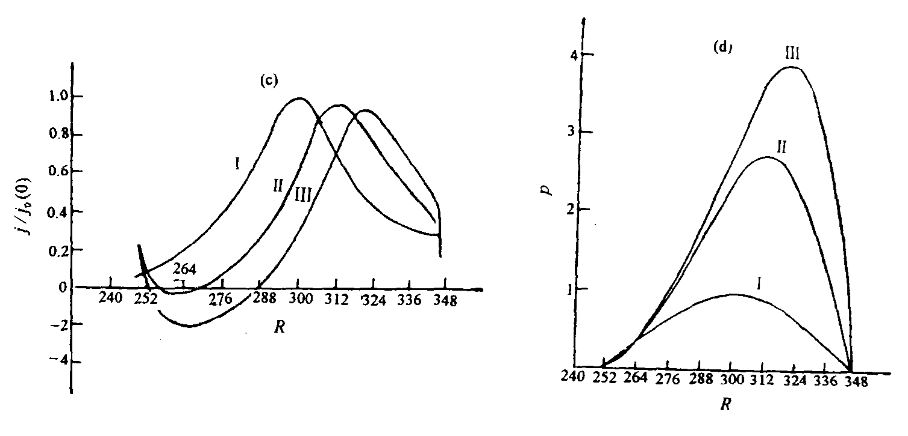

**图5.5** 托卡马克通量守恒位形演变〔14〕

(a) 加热前磁面位形；(b) 加热后的磁面位形；(c) 赤道面上的电流分布；(d) 压强分布。

(c),(d)中I,II,III分别对应于$\beta_{\theta}=0.375,1.2,1.78$

## 5.4 关于磁约束聚变等离子体磁流体不稳定性的一般讨论[16～18]

从磁约束基本原理的讨论中已知，磁约束聚变装置必须满足能稳定约束高温等离子体的要求。早期的一些研究途径就因为不能很好满足这个条件而失败了。因此，磁流体稳定性的研究，尤其是结合聚变装置中等离子体实际位形的研究，成为磁约束聚变理论和实验研究的重要组成部分。

### 5.4.1 磁流体动力学方程组[1～3]

磁流体运动，尤其是与不稳定性模式的发展相关的运动属于快运动，也就是说，这类运动发展过程中，主要是宏观的电磁力及压强梯度在起作用，那些与输运有关的过程仅起次要作用，所以在研究处于线性和非线性发展阶段的磁流体不稳定性模式时，将假定平衡位形为已知，然后由扰动运动方程及相应的麦克斯韦方程，以及广义欧姆定律来确定运动状态随时间的变化，其中广义欧姆定律把等离子体运动与感应电场联系了起来。在第六章中将看到，当考虑粒子动力论效应时，广义欧姆定律在性质和形式上都要有重要变化。主要的磁流体动力学方程包括：连续性方程

$$
\frac{\partial n}{\partial t}+\nabla\cdot(n\nu)=0 \tag{5.80}
$$

和单磁流体的动量（力）方程

$$
\rho\frac{\mathrm{d}\nu}{\mathrm{d}t}=-\nabla p+\frac{1}{c}j\times B \tag{5.81}
$$

式中

$$
\frac{\mathrm{d}}{\mathrm{d}t}=\frac{\partial}{\partial t}+\nu\cdot\nabla \tag{5.82}
$$

是跟随等离子体元的对时间微分算符，另一方程是最简化形式的广义欧姆定律

$$
E+\frac{1}{c}\nu\times B=\eta j \tag{5.83}
$$

欧姆定律取式(5.83)的形式时称电阻性磁流体近似。若忽略右方含电阻率的项，则称理想磁流体近似，此时，从带电粒子的运动角度看，相当于仅考虑粒子的电漂移，对电子和离子，它们都等于

$$
\nu_{\mathrm{ei}}=c\frac{E\times B}{B^{2}} \tag{5.84}
$$

在理想磁流体近似下，很易证明，任意流体元中所携带的磁通在运动过程中保持不变（又称磁力线冻结定理，见一般磁流体动力学书籍）。计入与电阻有关的项时（这里的电阻率$\eta$通常取Spitzer值，即经典碰撞效应确定的值），对横越磁场的运动几乎没有多大影响，因为式(5.83)的右边项仅仅引起一个很小的横越磁力线的经典碰撞扩散，其速度远小于磁流体运动速度。但是，电阻项的引入意味着在平行于磁力线方向可以有一定大小的电场分量，在特定条件下，这一电场对磁流体运动可以产生本质性的影响（见后面关于电阻性磁流体不稳定性的讨论）。此外，在考虑其它的物理机制时，可以对式(5.83)进行各种修正，用更强的机制取代电阻项，从而得到有不同物理内涵的等离子体宏观运动现象。这将在具体问题中讨论。

从流体运动的角度，要使方程组闭合，还需将标压强与运动速度联系起来，这就是所谓的状态方程。一般采用绝热运动定理

$$
\frac{\mathrm{d}}{\mathrm{d}t}\left(p/n^{\gamma}\right)=0 \tag{5.85}
$$

式中$\gamma$是绝热指数，对三维运动，它等于5/3。在一定条件下，还可采用更简单的关于运动为不可压缩的假定来代替上面的绝热运动方程

$$
\nabla\cdot\nu=0 \tag{5.86}
$$

这一假定在流体运动速度较小或变化较慢时可以较好地描述一些不稳定性模，尤其是近临界状态模（见后面讨论）。

有关的麦氏方程包括

$$
\frac{\partial B}{\partial t}=-c\nabla\times E \tag{5.87}
$$

$$
\nabla\times B=\frac{4\pi}{c}j \tag{5.88}
$$

$$
\nabla\cdot B=0 \tag{5.89}
$$

可以看到，式(5.88)中没有取位移电流项，这与式(5.84)中只考虑与宏观运动有关的电场以及只考虑粒子的电源移速度一致。在考虑等离子体波的性质时则必须加入位移电流项。以上方程完整地描述了等离子体的磁流体线性和非线性运动特性。

### 5.4.2 线性化方程与位移函数

首先考虑离开平衡态的小运动及其稳定性，设未扰态为静磁平衡态，即本章前面几节讨论的位形。从这一意义上，运动速度、电场都是一级小量，将其他物理量写成

$$
\begin{aligned}
p&=p_{0}+\delta p\\
B&=B_{0}+\delta B\\
j&=j_{0}+\delta j
\end{aligned} \tag{5.90}
$$

引入等离子体的位移函数矢量

$$
\nu(x,t)=\frac{\partial\xi(x,t)}{\partial t} \tag{5.91}
$$

对于理想等离子体，即电阻效应可忽略时，则由式(5.83),(5.87)可得

$$
\delta B=\nabla\times(\xi\times B_{0}) \tag{5.92}
$$

$$
\delta p=-\xi\cdot\nabla p_{0}-p_{0}\nabla\cdot\xi \tag{5.93}
$$

这样，可以将运动方程的线性化形式

$$
\rho\frac{\partial\nu}{\partial t}
=-\nabla\delta p+\frac{1}{c}\left(\delta j\times B_{0}+j_{0}\times\delta B\right) \tag{5.94}
$$

写成

$$
\rho\frac{\partial^{2}\xi}{\partial t^{2}}
=-\nabla\left(-\xi\cdot\nabla p_{0}-p_{0}\nabla\cdot\xi\right)
+\frac{1}{c}\left(
j_{0}\times Q+\frac{c}{4\pi}\nabla\times Q\times B_{0}
\right)
=F(\xi) \tag{5.95}
$$

式中$\boldsymbol{F}$为线性化作用力算符，它是位移$\boldsymbol{\xi}$的一次函数，但包括多个微分运作步骤。另外已采用

$$
Q=\nabla\times(\xi\times B_{0}) \tag{5.96}
$$

来表示扰动磁场。

对磁流体不稳定模的分析可以采用两种方法，一种是直接对各种模实行时空富民展开，简称正模方法（Normal mode analysis），这一方法适用于简单的具有对称性的几何形态，如平板形态，圆柱形态，等等；另一方法为变分法，基于理想磁流体的能量原理[19]。后一方法在处理复杂的几何形态时有明显的优越性，对多数实际的磁约束聚变等离子体位形，基本的磁流体稳定性分析都离不开能量原理的计算。

### 5.4.3 理想磁流体能量变分原理[19]

理想磁流体能量变分原理方法是分析理想磁流体模式的基本方法，在各种有关等离子体物理的书中均有较详细叙述。由于这一方法的重要性，虽然本书不把重点放在讨论等离子体物理方面，对这一方法也要简要地进行介绍，否则难以进行有关内容的讨论。

Bernstein等人提出的这一方法的主要论点是，线性作用力算符$\boldsymbol{F}$是厄米（Hermitian）型的，因此由运动方程(5.95)可以得出能量积分

$$
K(\xi',\xi')+\delta W(\xi,\xi)=\mathrm{const} \tag{5.97}
$$

其中

$$
K(\xi,\xi')=\frac{1}{2}\iiint\mathrm{d}\tau(\xi')^{2} \tag{5.98}
$$

是所考虑等离子体的总动能，$\xi'$是位移函数对时间的偏导数，积分对等离子体所占体积进行。

$$
\delta W(\xi,\xi)=-\frac{1}{2}\iiint\mathrm{d}\tau\,\xi\cdot F(\xi) \tag{5.99}
$$

是线性力对等离子体做的功的负值，故$\delta W$是等离子体的位能的改变量。由于线性力算符的厄米性质，若将$\delta W$看成一个关于满足同样边界条件的两个位移函数$\xi$和$\eta$的二次形，则这两个函数具有可交换性，即

$$
\delta W(\xi,\eta)=\delta W(\eta,\xi) \tag{5.100}
$$

与这一性质对应的是该系统的振荡的特征频率为实数。

经过一系列矢量运算，式(5.99)中的积分可以分成三部分

$$
\delta W=\delta W_{\mathrm{p}}+\delta W_{\mathrm{s}}+\delta W_{\mathrm{v}} \tag{5.101}
$$

它们依次分别表示等离子体内部，等离子体与真空区分界面，真空区中对等离子体-磁场体系的位能变化的贡献，其表示式分别为

$$
\delta W_{\mathrm{p}}
=\iiint\mathrm{d}\tau\left\{
Q^{2}/4\pi+\frac{1}{c}j_{0}\cdot\xi\times Q
+\xi\cdot\nabla p_{0}\nabla\cdot\xi
+\frac{5}{3}p_{0}(\nabla\cdot\xi)^{2}
\right\} \tag{5.102}
$$

$$
\delta W_{\mathrm{s}}
=\iint\mathrm{d}S\cdot\xi_{n}^{2}\left[n\cdot(p_{0}+B^{2}/8\pi)\right] \tag{5.103}
$$

$$
\delta W_{\mathrm{v}}=\iiint\mathrm{d}\tau_{\mathrm{v}}(\nabla\times A)^{2} \tag{5.104}
$$

在面积分表示式中的$[\cdots]$代表物理量跨越表面时的由内向外的变化量，$\boldsymbol{n}$为表面的向外法线矢量，式(5.104)中

$$
\nabla\times A=\delta B_{\mathrm{v}} \tag{5.105}
$$

是真空区域中磁场的变化，这是由于等离子体边界形状变化引起的。在所考虑的模型中，

磁力线不能穿越等离子体-真空区界面, 内外的磁通量各自保持守衡。因此, 在等离子体与真空区域的分界面上应满足连接条件:

$$
Q_{n} = \delta B_{e n} \quad (5.106)
$$

如果等离子体界面固定不变, 则关于表面和真空区的贡献为零。很多不稳定性问题仅研究了这种固定边界的情形。但式 (5.102) 还有其它一些写法, 分别强调各种物理因素在所考虑问题中的作用, 这些都属于进一步的数学技巧。

设扰动的频率为$\omega$, 各微扰量随时间的变化都具有$\exp (- i\omega t)$的形式, 一般系统的频率是复数$\omega = \omega_{t} + \mathrm{i}\gamma$, 实频率$\omega_{t}$代表模的转动频, $\gamma$为模的增长率。在上述问题中, 动能项化成

$$
K = -\omega^{2}\iiint \mathrm{d}\tau \xi^{2} \quad (5.107)
$$

于是得到

$$
\omega^{2} = \frac{\delta W}{\iiint \mathrm{d}\tau \xi^{2}} \quad (5.108)
$$

以上表示式中出现的矢量相乘应理解成复矢量间的共扼相乘, 即$\mathbf{A} \cdot \mathbf{B} = \mathbf{A} \cdot \mathbf{B}^{\ast}$。由于力算符的厄米性质, 代表位能变化的项$\delta W$必为实数, 故$\omega^{2}$仅取实数值, 这样, 只有$\omega^{2}< 0$时, 即对所考虑的模式其频率为纯虚数时, 系统才是不稳定的。因此得出相应的能量变分原理: 对所考虑的模式, 当且仅当对应的位能的变化量为负时 (此时动能才能为正), 即当

$$
\delta W< 0 \quad (5.109)
$$

时, 该模才是不稳定的, 这个条件既是必要的, 也是充分的。反之, 若系统对一切可能的模式都具有位能的变化量为正, 系统对一切磁流体扰动都是稳定的。不过, 在以后的讨论中将看到, 没有必要要求磁约束聚变等离子体对一切模式都是稳定的, 这样的位形可能并不存在, 但对那些最有危害性的模式必须是稳定的。这类模式的特点是, 在随时间变化方面具有最大的增长率, 在随空间变化方面具有很宽的模结构。反之, 那些增长甚慢, 在空间局限于有限区域的模, 并不一定非要稳定化, 但要研究它们对等离子体总体约束的影响。

在位能变化量的表示式中可以看到, 无论是等离子体内部的项$\delta W_{p}$, 还是真空区域项$\delta W_{r}$中代表扰动磁场的部分都给出正的贡献, 因此, 那种使磁场不产生畸变的微扰最不易被稳定。当然, 这只是一种定性的说法, 因为各种因素是互相牵连的, 在实际问题中并不一定是引起磁场变形的扰动就不那么危险, 而且情况可能刚好相反, 引起磁场变形的扰动是磁约束聚变系统首先要避免的。一般, 引起磁场变形的扰动是与存在平行电流的等离子体平衡位形相联系的, 这种电流的存在, 从磁流体稳定性的角度看, 是为不稳定性的发展提供了一种动力源, 它使等离子体处在较高的位能状态, 因而倾向于向较低的位能态转移, 造成不稳定性。而其稳定化的方法在原理上只有两个, 一是选择较为稳定的参数空间, 对应于对位形设计的最佳化; 第二种方法就是由外部提供强制的稳定手段。在磁约束聚变装置中, 这两种方法都采用。

在稳定性分析程序中, 首先要分析与真空区有关的扰动模式, 这种模式称为自由边界模式, 或表面模。如果这类模是稳定的, 就要分析固定边界模, 或内部模。从位能变化量的三个成分的表示式还看到, 真空部分给出正定项, 也就是对模式起稳定的效应, 所以原则上, 表面模被稳定后, 内部模仍可能不稳定。对一般参数连续变化的位形, 表面上总压强(等离子体压强与磁压强之和)是连续的, 故代表表面项的位能变化为零。但对一些特殊的位形, 总压强在边界附近可能有较陡的变化, 这一项的贡献需要考虑进去。下面就是这样的一个实例。

### 5.4.4 等离子体边界稳定性:能量原理的一个简单应用实例

作为一个最简单的物理实例, 考虑等离子体内部没有磁场, 等离子体完全由外部真空磁场维持平衡的情形。这一问题也与磁约束聚变的基本概念有一定联系, 可以帮助理解等离子体稳定约束对磁场位形的一个必要条件。由于内部不存在平衡磁场, 因此也就不存在一级扰动磁场: $\pmb {\mathscr{Q}} = 0$, 进一步选择不可压缩位移作为试验函数, 于是与一级压强变化有关的项也为零。这样

$$
\delta W_{p} = 0 \quad (5.110)
$$

进而若选择扰动使真空磁场的变化也为零, 则这一系统的稳定性完全由表面项所确定。这一积分仅与表面上总压强沿表面法线方向的变化有关。现在证明, 它与表面上磁力线的曲率有关。按一般微分几何的定义, 磁力线的曲率矢量为

$$
\kappa = \frac{B}{B}\cdot \nabla \left(\frac{B}{B}\right) = b\cdot \nabla b \quad (5.111)
$$

$b$为磁场方向的单位矢量, 利用矢量等式

$$
b\cdot \nabla b = -b\times \nabla \times b \quad (5.112)
$$

以及压强平衡关系

$$
\nabla \left(p + \frac{B^{2}}{8\pi}\right) = -\frac{B\cdot\nabla B}{4\pi} \quad (5.113)
$$

因为曲率矢量总是垂直于切线矢量$\kappa \cdot b = 0$, 最后磁力线的曲率矢量可以表示成

$$
\kappa = \frac{1}{2B^{2}}\nabla_{\perp}[B^{2} + 8\pi p] \quad (5.114)
$$

式中垂直方向的梯度定义为

$$
\nabla_{\perp} = (\vec{I} -b b)\cdot \nabla \quad (5.115)
$$

显然, 这一梯度微分的方向正好是曲面的法线方向。于是表面位能变化可以写成:

$$
\delta W_{s} = \iint \mathrm{d}S\cdot \kappa (2B^{2}\xi_{n}^{2}) \quad (5.116)
$$

从这一表示式立即可以得到关于所考虑系统稳定性的一个必要条件:若表面磁力线的曲率矢量处处为正, 即磁力线的曲率中心都在等离子体的外部, 则该系统对所考察的模式是稳定的。由这一简单的原理, 在位形设计中就要考虑尽量使约束等离子体的磁场具有曲率中心处在等离子体外的结构, 也就是要使磁力线凸向等离子体。在第三章中有这样的例子, 如简单磁镜位形的磁力线是凹向等离子体的, 因此并不满足磁流体稳定性条件。确实, 简单的磁镜位形在实验上发现对所谓的交换模是不稳定的。曾提出磁力线处处凸向等离子体的会切场位形, 但在其它方面, 这种位形不能将等离子体约束足够长的时间。现在研究的重点途径如托卡马克, 其磁力线既不处处凸向, 也不处处凹向等离子体, 这种系统的稳定性要由多种因素确定。

对于磁力线为空间曲线的情形, 在第四章中关于约束位形的讨论中已指出, 磁力线为空间曲线的闭合位形只能是环形位形。此时, 按微分几何的分类, 曲率矢量将由两部分组成, 一部分为法向曲率(normal curvature), 另一部分为测地曲率(geodesic curvature)。因此可将总的曲率矢量写成[20]

$$
\kappa = \kappa_{\nu}\frac{\nabla\psi}{\left|\nabla\psi\right|} +\kappa_{g}\left[\nabla \zeta -q(\psi)\nabla \theta \right] \quad (5.117)
$$

其中采用了磁面系统坐标系$(\psi ,\theta ,\zeta)$, 而$q$是磁力线旋转变换的倒数, 即托卡马克中的安全因子。可以从托卡马克类型装置中磁力线在环面上的走向直观地看出, 在环的外侧, 磁力线的曲率中心在等离子体一侧, 而在环的内侧, 其曲率中心在等离子体外。从上面磁流体稳定性的角度看, 外侧的磁力线具有"环曲率", 而内侧的磁力线具有"好曲率", 整个托卡马克系统, 在对磁面平均以后将具有较小的好的曲率, 可以稳定较小比压值的等离子体。当然, 要进行严格的分析才能确定具体位形的稳定性品质, 也有可能通过优化位形参数来提高托卡马克的稳定性, 包括选择截面形状, 改变侧环径比, 以及调节等离子体参数的空间剖面形状, 等等。比如说, 如让磁力线在环的内侧的总长度增大, 就会改变总的平均曲率, 使其有利于稳定约束较高比压的等离子体。具体的例子将在后面的"小环径比位形"中研究(见第十一章)。

### 5.5 磁流体波[20]

等离子体波动是等离子体作为一种宏观介质的一个重要的内在性质。在磁流体力学框架内, 存在几种重要的波动, 即阿尔芬波及声波, 前者又分为剪切阿尔芬波和压缩阿尔芬波(磁声波)。利用前面的磁流体动力学运动方程组, 可以对这些波的色散关系进行一般的讨论, 研究强磁场中均匀等离子体的情形, 其中平衡态的速度及电流均为零。

将有关方程组线性化, 令一级物理量具有$\exp (- i\omega t + i k\cdot x)$的形式, 得出

$$
\omega \rho_{1} = \rho_{0}k\cdot \nu \quad (5.118)
$$

$$
\omega \rho_{0}\nu = k\rho_{1} + \frac{1}{4\pi c} B_{0}\times (k\times B_{1}) \quad (5.119)
$$

$$
\omega B_{1} = -k\times (\nu \times B_{0}) \quad (5.120)
$$

$$
p_{1} = \frac{5}{3}\rho_{1}\left(\frac{p_{0}}{\rho_{0}}\right) \quad (5.121)
$$

以上各式中$\rho_{0},\rho_{1}$为等离子体的质量密度及其扰动量。定义阿尔芬速度及声速为

$$
\nu_{\mathrm{A}} = \frac{B_{0}}{\sqrt{4\pi\rho_{0}}},\quad \nu_{\mathrm{s}} = \sqrt{5\rho_{0} / 3\rho_{0}} \quad (5.122)
$$

则上述齐次代数方程(共有7个独立变量)的有解条件, 即其系数行列式为零, 给出关于磁流体波的一般色散关系

$$
\omega (\omega^{2} - k_{\mu}^{2}\nu_{\mathrm{A}}^{2})[\omega^{4} - \omega^{2}k^{2}(\nu_{\mathrm{A}}^{2} + \nu_{\mathrm{S}}^{2}) + (k k_{\mu}\nu_{\mathrm{A}}\nu_{\mathrm{S}})^{2}] = 0 \quad (5.123)
$$

在它的7个解中, 具有物理意义的三对解为:

(1)剪切阿尔芬波

$$
\omega = \pm k_{\mu}\nu_{\mathrm{A}} \quad (5.124)
$$

它是不可压缩运动解( $\rho_{1} = \rho_{1} = 0$ ), 是一类横波, 即扰动速度及磁场都与本底磁场垂直, 但在切向形成对原有本底磁场的剪切形扰动, 故名剪切阿尔芬波。

(2) 压缩阿尔芬波

$$
\omega = \pm k\nu_{\mathrm{A}} \quad (5.125)
$$

该波主要在垂直于本底磁场的方向传播, 而扰动磁场在平行于本底磁场的方向, 形成对本底磁场的压缩(膨胀)。一般说来, 当等离子比压不大时, 这一波动很难激发, 或其幅度非常小。所以对低比压等离子体(聚变实验装置中的等离子体), 压缩阿尔芬波是可以不予考虑的。

(3) 声波

$$
\omega = \pm k_{\nu}\nu_{\mathrm{s}} \quad (5.126)
$$

这是与沿磁力线方向等离子体的可压缩运动联系的波, 是纵波, 它不改变本底磁场特性, 原则上与一般连续介质中的声波没有差别。声波对沿磁力线的等离子体运动性质有很大影响。一般来说, 只有频率(增长率)比声波频率小很多的运动才能近似地看成是不可压缩的[21]。

原则上, 所有上述三类波都是互相耦合的, 只有在一定的附加条件下才能将它们分离出来。这些附加条件在不同的物理问题中有较大差别。对聚变等离子体, 主要是剪切阿尔芬波和声波起作用。下面将要分析的等离子体不稳定性运动大多属于剪切阿尔芬波类型。

实际等离子体都是不均匀的, 但若其不均匀性不强烈, 具体说, 若在剪切阿尔芬波波长范围内等离子体参数的变化不明显, 上面的分析在WKB近似的意义上仍适用。对聚变装置, 这一限制不易满足, 因此必须考虑不均匀性对剪切阿尔芬波的影响。

在考虑各种阻尼因素时, 一般条件下磁流体波将是阻尼波, 不可能在等离子体中长期存在。但若存在某些可能激发这些波的物理机制时(聚变等离子体中存在这类机制), 磁流体波不仅可以存在, 而且可以具有相当大的波幅, 对等离子体约束形成很大的影响。

### 5.6 载电流等离子体圆柱的扭曲模不稳定性(Kink mode)[22]

在直圆柱真空室中充以氘气或氢气, 然后进行强流脉冲放电是最早进行磁约束聚变研究的几种方案之一。可是在实验中很快发现, 这种放电产生的位形是不满足磁流体稳定性要求的。放电过程因"腊肠型"和"扭曲型"不稳定性的发展而在极短的时间内被破坏(有关讨论请参看一般等离子体物理书籍)。后来通过理论分析, 发现如沿放电柱方向加一磁场, 这些不稳定性就可被完全稳定化或大幅度降低增长率。按所加磁场与电流产生的磁场的强度比不同, 发展了两类稳定的放电位形, 这就是在前面讨论过的托卡马克位形(外加纵向磁场远大于电流产生的磁场)及箍缩放电位形(纵向磁场与电流产生的磁场同量级)。虽然实际装置都已发展成环形, 但在理论研究上, 在一定条件下, 有关磁流体稳定性的许多基本概念和分析都可用直圆柱载流等离子体模型来近似描述。设圆柱总长为$2\pi R$, 其两端是全同的(因为是环形柱被虚拟地截断了)。沿$z$轴(对应于环向)有一均匀强磁场$B_{0}$, 在等离子体内部( $r\leq a$ )沿$z$轴有一密度分布为$j(r)$的电流, $a$为等离子体的小半径, 另有一同轴圆柱形导体壁, 半径为$b$。在本问题中将把它看成理想导体, 磁场不能穿透。

#### 5.6.1 直圆柱平衡条件

首先对平衡条件做一些补充分析。写出磁场和电流的平衡量

$$
B_{0}(r) = B_{\theta}(r)e_{\theta} + B_{z}(r)e_{z} \quad (5.127)
$$

其间关系为

$$
j(r) = j_{\theta}(r)e_{\theta} + j_{z}(r)e_{z} \quad (5.128)
$$

$$
B_{\theta}(r) = \frac{4\pi}{c r}\int_{0}^{r}\mathrm{d}r r j_{z}(r) \quad (5.129)
$$

对托卡马克, 这是环向电流产生的极向磁场。当$r\rightarrow 0$, 即接近磁轴时, $B_{\theta}\rightarrow \frac{2\pi j_{0}r}{c}$即极向场在磁轴处为零。环向磁场分量的大小可以通过压强平衡方程求出

$$
\frac{\mathrm{d}}{\mathrm{d}r} (p + \frac{B^{2}}{8\pi}) = -\frac{B_{\theta}^{2}}{4\pi r} \quad (5.130)
$$

积分得

$$
B_{z}(r) = \left\{B_{0}^{2} + 8\pi [p_{0} - p(r)] - B_{\theta}^{2} - 2\int_{0}^{r}\mathrm{d}r\frac{B_{\theta}^{2}(r)}{r}\right\}^{1 / 2} \quad (5.131)
$$

对托卡马克, 若取倒环径比$a / R = \epsilon$, 则等离子体比压$\beta = 8\pi p / B_{0}^{2}\approx \epsilon^{2}$, 极向磁场与环向磁场之比是一级小量$B_{\theta} / B_{0}\approx \epsilon$, 于是由上式知, 对环向磁场的修正为二级小量

$$
B_{z} = B_{0} + \frac{1}{2}\left\{(\beta_{0} - \beta) - \left[B_{\theta}^{2} + 2\int_{0}^{r}\mathrm{d}r(B_{\theta}^{2}(r) / r)\right]\right\} +\dots \quad (5.132)
$$

在稳定性分析中, 可以简单地将环向磁场看成常数。

#### 5.6.2 极小化位能变化的表示式

对这类具有对称性的较简单位形的稳定性分析, 除能量变分方法外, 还可以直接应用简正模方法。无论哪一种方法都可令所有物理量的一级变化量具有富氏形式

$$
f = f_{0}(r)\exp [-i\alpha t + i m\theta +i k z] \quad (5.133)
$$

原则上, 运动方程(5.95)可以对上述扰动的一个富氏分量(即给定$m,k$ )严格求解, 将内部解与真空区中关于真空磁场的扰动量的解联合起来, 即可确定所求的解。但即使对上述简单的位形, 在电流分布为任意的情况下, 解的形式仍很复杂, 尤其是本征频率(以$\omega^{2}$形式出现)将出现在本征方程的两边。由于用能量变分原理求解的程序比较简单, 得出的解的表示式也较清晰, 下面用这一方法进行推算。首先对内部位能变化项进行分析, 可以严格证明, 具有不可压缩的位移函数将使这一项的贡献取极小

$$
\nabla \cdot \xi = \frac{1}{r}\frac{\mathrm{d}}{\mathrm{d}r} (r\xi_{r}) + \frac{i m}{r}\xi_{\theta} + \mathrm{i} k\xi_{z} = 0 \quad (5.134)
$$

这样一来, 方程(5.102)中含$\nabla \cdot \xi$的两项就可忽略, 而且它们都与等离子体压强的一级量有关。所以, 对载电流等离子体柱的稳定性问题, 等离子体压强没有大的贡献。进一步简记

$$
\left(\frac{m B_{\theta}}{r} +k B_{z}\right) = k\cdot B \quad (5.135)
$$

扰动磁场化成

$$
Q_{r} = \mathrm{i}(k\cdot B)\xi_{r} \quad (5.136)
$$

$$
Q_{\omega} = \mathrm{i}k(\xi_{\theta}B_{z} - \xi_{z}B_{\theta}) - (\xi_{r}B_{\theta}) \quad (5.137)
$$

$$
0=\mathrm{i}m(8B_{z}-8B_{\theta})+(rB_{\theta}) \quad (5.138)
$$

实际上位能积分仅依赖于两个变量: $\xi_{r}$及$A = \xi_{\theta}B_{z} - \xi_{z}B_{\theta}$, 通过进一步对$\pmb{A}$求极小, 将位能函数写成仅含$\xi_{r}$的表示式, 最后再通过对$\xi_{r}$求极小, 得到关于$\xi_{r}$的本征方程如下

$$
\frac{\mathrm{d}}{\mathrm{d}r}\bigg[f(r)\frac{\mathrm{d}\xi}{\mathrm{d}r}\bigg] - g(r)\xi = 0 \quad (5.139)
$$

这里为简化起见已略去下标, 而

$$
f(r) = \frac{r(k\cdot B)^{2}}{k^{2} + m^{2} / r^{2}} \quad (5.140)
$$

$$
g(r) = \frac{1}{r}\frac{(k B_{z} - m B_{\theta} / r)^{2}}{k^{2} + m^{2} / r^{2}} +r(k\cdot B)^{2} - \frac{2B_{\theta}}{r}\frac{\mathrm{d}(r B_{\theta})}{\mathrm{d}r} - \frac{\mathrm{d}(r B_{\theta})}{\mathrm{d}r}
$$

$$
\frac{\mathrm{d}}{\mathrm{d}r}\left(\frac{k^{2}B_{z}^{2} - (m B_{\theta} / r)^{2}}{k^{2} + m^{2} / r^{2}}\right) \quad r \leqslant a \quad (5.141)
$$

对应的位能变化项为

$$
\delta W_{\rho} = \frac{1}{8}\int_{0}^{a}\mathrm{d}r\cdot r\left\{f\left(\frac{\mathrm{d}\xi}{\mathrm{d}r}\right)^{2} + g\xi^{2}\right\} +W_{\bullet} \quad (5.142)
$$

其中$W_{\bullet}$为仅与表面处位移有关的项

$$
W_{\bullet} = \frac{1}{8}\frac{k^{2}B_{z}^{2} - \left[m B_{\theta}(a)\right]^{2} / a^{2}}{k^{2} + m^{2} / a^{2}}\xi^{2}(a) \quad (5.143)
$$

#### 5.6.3 表面项及真空项

表面位能变化项显然为零

$$
\delta W_{s} = 0 \quad (5.144)
$$

关于真空区的方程由极小化条件得出

$$
\nabla \times \nabla \times A = 0 \quad (5.145)
$$

这一表示式不受位形的限制。在本问题中, 加上圆柱位形条件, 以及磁场的无源条件$\nabla \cdot \delta B_{e} = 0$, 可以严格地得到

$$
\frac{\mathrm{d}}{\mathrm{d}r}\left(\frac{1}{r(k^{2} + m^{2} / r^{2})}\frac{\mathrm{d}\xi}{\mathrm{d}r}\right) - \frac{1}{r}\xi = 0,\qquad a< r\leqslant b \quad (5.146)
$$

其中

$$
\xi = r\delta B_{e} \quad (5.147)
$$

真空区的解可以立刻用贝塞尔函数的形式表示出, 满足边界条件

$$
\begin{aligned}
\xi (a) &= \mathrm{i}a[k B_{z}(a) + m B_{\theta}(a) / a]\xi (a),\\
\xi (b) &= 0
\end{aligned}
\quad (5.148)
$$

的真空区解的一般形式为(这一解式在等离子体磁场扰动的测量中有实用价值)

$$
\xi = \mathrm{i}r\frac{\Gamma_{m}^{\prime}(k r)\mathrm{K}_{m}^{\prime}(k b) - \mathrm{K}_{m}^{\prime}(k r)\Gamma_{m}^{\prime}(k b)}{\Gamma_{m}^{\prime}(k a)\mathrm{K}_{m}^{\prime}(k b) - \mathrm{K}_{m}^{\prime}(k a)\Gamma_{m}^{\prime}(k b)}\left(k B_{z} + \frac{m B_{\theta}}{a}\right)\xi (a) \quad (5.149)
$$

与第三章中的情况一样, 式中函数都是修正的贝塞尔函数。真空区项最后化成

#### 5.6.4 关于电流分布的讨论

以托卡马克中的欧姆放电为例, 实际的电流分布在不同的放电阶段是不同的。在起始建立阶段, 尤其是在较大型的装置中, 总电流处于上升并存在相当程度的趋肤现象, 即电流对半径的分布呈中空形状, 随后, 电流逐渐透入内部区域, 电流分布呈平坦形状, 最后, 由于中心区电子温度的升高, 电流分布变成钟罩形或更陡并单调地由中心向外下降。实验观察发现在不同的阶段, 磁流体模式具有不同的特性。此外, 在不同类型的装置中, 放电建立的方式也不同, 各参量间的关系可以有很大的差别。现对一些比较重要的情况分别进行分析。

(1)托卡马克欧姆放电:利用前面讨论的低比压圆截面位形的参数间的量级关系[称为托卡马克编阶(tokamak ordering)], 以倒环径比$a / R = \epsilon$为量度, 则

$$
B_{\theta}(a) / B_{0}\approx \epsilon , 8\pi \langle p\rangle /B_{0}^{2}\approx \epsilon^{2}, q = r B_{0} / R B_{\theta}\approx 0(1) \quad (5.151)
$$

这时可将总的位能变化项写成大为简化的表示式

$$
\begin{aligned}
\delta W={}&\frac{\pi^{2}B_{0}^{2}}{R}\Bigg\{\int_{0}^{a}\mathrm{d}r\, r\Bigg[\Big(r\frac{\mathrm{d}\xi}{\mathrm{d}r}\Big)^{2}+(m^{2}-1)\xi^{2}\Bigg]\Bigg(\frac{n}{m}-\frac{1}{q}\Bigg)^{2}\\
&+\Bigg[\frac{2}{q_{a}}\Bigg(\frac{n}{m}-\frac{1}{q_{a}}\Bigg)+\Bigg(1+m\lambda\Bigg(\frac{n}{m}-\frac{1}{q_{a}}\Bigg)^{2}\Bigg)\Bigg]a^{2}\xi_{a}^{2}\Bigg\}
\end{aligned}
\quad (5.152)
$$

其中与导体壳有关的稳定效应参数

$$
\lambda = [1 + (a / b)^{2m}] / [1 - (a / b)^{2m}] \quad (5.153)
$$

以上公式适用于分析$m\geq 2$的扭曲模, 对于$m = 1$的模, 还需考虑被忽略的较次级量的贡献(如环形效应)。

在放电过程中, 随着总电流的逐渐加大, 边界安全因子$q_{a}$的值逐渐减小, 而不同$q$值的面不断向等离子体外部移动。如先忽略导体壳的作用, 可以计算出不同模的不稳定参数区域以及模的增长率随有关参数的变化。从上面公式中看出, 对模的稳定区及增长率起作用的主要参数现在只剩下$n q_{a}$, 其他参数在这一级近似中均可忽略。假定电流具有抛物线分布

$$
j_{i}(r) = j_{0}(1 - r^{2} / a^{2}) \quad (5.154)
$$

则对不同极向模数$m$的模, 其增长率随$n q_{a}$的变化如图5.6所示。从图中看到, 在两个不稳定模的中间存在一个稳定区, 这一特性是对托卡马克的运行参数区的一系列限制之一(总电流的大小和电流分布形状)。大多数托卡马克选择的边缘安全因子

$$
q_{a} > 3 \quad (5.155)
$$

这样从图中看到, 等离子体具有较大稳定范围。

边界安全因子是在实际问题中经常要用到的一个参数, 它与环向电流密度分布情况无关, 可以用总电流值表示出来

$$
q_{a} = \frac{5a^{2}B_{0}}{R I_{p}} \quad (5.156)
$$

式中电流以A计, 磁场强度以Gs计, 长度单位为cm。对应于$q_{a} = 1$时的等离子体总电流

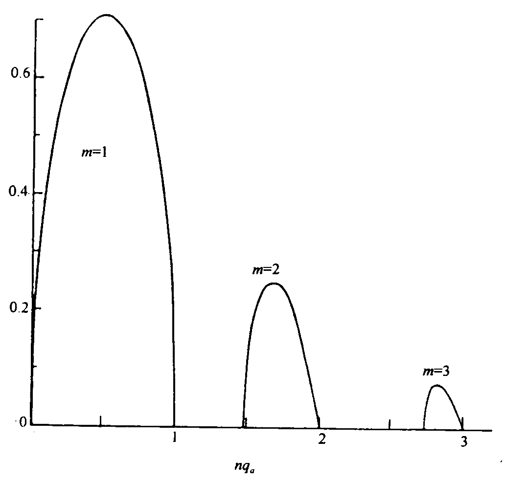

**图5.6** 电流具有抛物形分布的圆柱等离子体的扭曲模的增长率随边缘$q$值的变化〔18〕

$$
I_{p} = 5a^{2}B_{0} / R \quad (5.157)
$$

称为 Kruskal-Shafranov 极限电流。托卡马克放电电流只能达到这一极限值的 1/3 多一点, 而对环形箍缩放电则可在大于这一极限值下实现稳定。

(2) 箍缩放电[泽塔 (Zeta) 位形]

泽塔位形的特点是环向磁场与极向磁场同量级, 需采取特殊的放电程序来形成这样的位形。这里仅讨论最终形态的磁流体稳定性。由于总电流已超过 Kruskal-Shafranov 极限, 所以最危险的模式为$m = 1$的模。对这种模, 比较方便的是将前面的位能变化量式 (5.152) 改写成[2]

$$
\delta W_{p} = \frac{1}{8}\int \mathrm{d}r r\left\{\frac{\left|(k\cdot B)(\mathrm{d}\xi /\mathrm{d}r) + h\xi /r\right|^{2}}{k^{2} + m^{2} / r^{2}} +\left[(k\cdot B)^{2} - \frac{8\pi j_{z}B_{\theta}}{r}\right]\xi^{2}\right\} \quad (5.158)
$$

式中

$$
h = k B_{z} - m B_{\theta} / r \quad (5.159)
$$

从此式可知, 若某些空间区域中的环向电流反向, 即满足

$$
8\pi j_{z}B_{\theta} = \frac{1}{r^{3}}\frac{\mathrm{d}}{\mathrm{d}r} (r B_{\theta})^{2}< 0 \quad (5.160)
$$

则在该区域中满足稳定性的充分条件(位能变化恒为正值)。由于这一条件太苛刻, 不可能在全部约束区域中得到满足。但对泽塔位形, 边缘区的电流的确具有反向结构, 部分地满足这个条件。

回到式(5.141), (5.142), 对$m = 1$的模, 令$L = r B_{z} / B_{\theta}$, 则函数$g(r)$化为

$$
g(r) = \frac{8\pi k^{2}r^{2}}{1 + k^{2}r^{2}}\frac{\mathrm{d}p_{0}}{\mathrm{d}r} +\frac{(k r B_{\theta})^{2}}{r(1 + k^{2}r^{2})}\left[(k L + 1)(k L(3 + k^{2}r^{2}) + (k^{2}r^{2} - 1))\right] \quad (5.161)
$$

对$kL$求极小, 然后由所得的$g(r) < 0$给出另一充分条件

$$
\frac{8\pi}{B_{b}^{2}}\left|\frac{\mathrm{d}p_{a}}{\mathrm{d}r}\right| > \frac{2}{(1 + k^{2}r^{2})(3 + k^{2}r^{2})} \quad (5.162)
$$

择塔位形的特点大体上相当于在边缘区满足式(5.160),而在中心区满足式(5.162)。

严格地说,对$m = 1$的模,必须考虑环形效应,稳定性分析相当复杂。但上面的简单分析基本上给出了扩散箍缩位形的稳定性的基本情况,在实验中也观察到这类位形有较好的磁流体稳定性。但在其它方面,等离子体的最好参数及能量约束等都比不上托卡马克位形。由泽塔位形发展起来的反场位形的研究还处在原理性阶段(见第十一章)。

#### 5.6.5 磁流体模的实验观察[23]

关于早期直线和环形放电装置中$m = 0$的腊肠型不稳定性及$m = 1$的扭曲模不稳定性的实验结果,已在早期出版的很多著作中作了详细介绍,这些模式在现有装置中已被排除,我们不再作讨论。对于托卡马克装置,现在已能实现非常长的稳定放电,但这并不是说托卡马克位形已对所有的磁流体模稳定化。实际上,在电流上升初期,仍可观察到一些典型的磁流体模式。不过,这是一些极向模数较高$(m > 3)$,只存在较短时间的模。电流不断上升意味着$nq_{a}$值的不断减小,因此从图(5.7)看到,随着电流的上升,等离子体经历了几次不稳定到稳定又到不稳定参数区域的变化,最后处于一个稳定参数区(例如$nq_{a} = 2\sim$ 3之间的稳定区)。在实验中的确观察到这种变化。最早的观察是前苏联科学家米尔诺夫(Mimov)等人在等离子体柱周围用布设的磁探针系列得到的磁扰动信号上实现的,这种信号以后就称为Mimov信号。图(5.7)典型地反映了这种放电上升阶段的磁流体模式逐渐演变的情况。由理论分析知道,这些高极向模数的模,其增长率较小,而且仅在一段时间内存在,这些模的空间特征分布也具有明显的趋肤性质(其特征分布函数近似地按$(na / R)^{m - 1}$关系变化),所以虽然在放电初期会对等离子体约束造成一定影响,但它们不会整体地破坏放电。但是,对极向模数$m< 4$的模式,其增长率已相当可观,模的空间分布也已扩展到内部,因而是不容许发展的。在实验上,要使边界安全因子小于3,一般要非常小心地控制放电参数的变化。至于更小的边界安全因子值,除非在等离子体柱附近加上导体壳,否则不易实现。采用导体壳的特定实验中实现了$q_{a} = 1.2$的稳定放电,在我国的环流器HL-1上也实现了$q_{a}< 2$的稳定放电。这些研究虽在了解磁流体稳定性的控制方面很有意义,但在应用到反应堆时有

3之间的稳定区)。在实验中的确观察到这种变化。最早的观察是前苏联科学家米尔诺夫(Mimov)等人在等离子体柱周围用布设的磁探针系列得到的磁扰动信号上实现的,这种信号以后就称为Mimov信号。图(5.7)典型地反映了这种放电上升阶段的磁流体模式逐渐演变的情况。由理论分析知道,这些高极向模数的模,其增长率较小,而且仅在一段时间内存在,这些模的空间特征分布也具有明显的趋肤性质(其特征分布函数近似地按$(n a / R)^{m - 1}$关系变化),所以虽然在放电初期会对等离子体约束造成一定影响,但它们不会整体地破坏放电。但是,对极向模数$m< 4$的模式,其增长率已相当可观,模的空间分布也已扩展到内部,因而是不容许发展的。在实验上,要使边界安全因子小于3,一般要非常小心地控制放电参数的变化。至于更小的边界安全因子值,除非在等离子体柱附近加上导体壳,否则不易实现。采用导体壳的特定实验中实现了$q_{a} = 1.2$的稳定放电,在我国的环流器HL-1上也实现了$q_{a}< 2$的稳定放电。这些研究虽在了解磁流体稳定性的控制方面很有意义,但在应用到反应堆时有

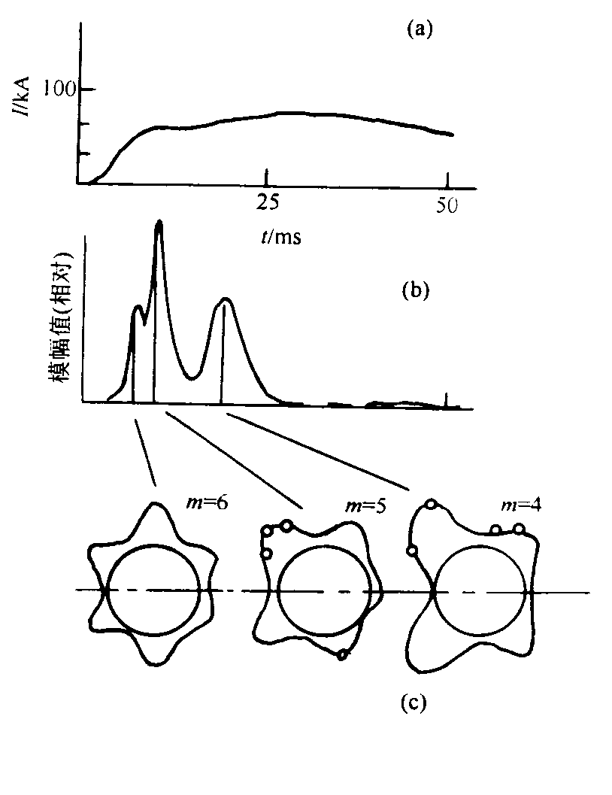

**图5.7** T-3装置电流上升阶段的Mimov信号及相应的磁流体模式〔23〕

(a)总电流随时间变化;(b)Mimov信号幅值;(c)对应的磁流体模式。

较大限制,目前国际公认的托卡马克稳定安全因子为$q_{a} > 2.4$。关于这一问题还要在电阻性磁流体模的一节中讨论。

### 5.7 电阻性磁流体不稳定性[24\~30]

很长时期以来,在有关空间等离子体行为的大量观察中,发现等离子体中的能量耗散过程对等离子体宏观运动特性有着重大的影响。磁约束聚变实验,尤其是托卡马克装置中关于磁流体活性的实验,极大地丰富了这方面的观察资料。多年来的理论和实验研究,也使人们深化了对有关现象的物理机制的了解,其中与电阻效应有关的磁流体运动,尤其是电阻性磁流体不稳定性,对天体和实验室等离子体的运动状态和性质十分重要,在理论上也得到了比较透彻的研究。理论研究的出发点是5.4.1节中引入的宏观磁流体方程组(5.80)\~(5.83)。与理想磁流体描述的最大不同是,电阻磁流体描述采用式(5.83)型的欧姆定律,即保留电阻项,对应地存在一个较小的平行于磁力线的电场

$$
E_{n} = \eta j_{n} \quad (5.163)
$$

同时等离子体经受一个不大的能量损耗,大小等于欧姆热$\eta j_{n}^{2}$。一个非常重要的物理特征是,这个平行电场及欧姆热损耗对大部分空间区域中的等离子体来说是微不足道的,因而其运动性质仍然由理想磁流体方程来描述,但在一些特殊的空间区域,这种效应可以从根本上改变等离子体的运动特性。理想磁流体在运动过程中,任意等离子体元中所含的磁通始终保持不变(磁力线冻结定理)。在前面的例子中已经知道,当等离子体形状发生畸变时,其内部的和外部的磁通都分别保持不变,也就是说,等离子体的磁面形状可以发生变化,但磁面的拓扑结构不会变化,两个相邻的磁面间的磁力线也不会发生联接。下面将看到,考虑电阻效应后,这个结论有所改变。

#### 5.7.1 运动等离子体中的磁扩散方程

为研究电阻对等离子体运动的影响,将法拉弟定律(5.6)和欧姆定律(5.83)结合起来得出运动等离子体中的磁扩散方程

$$
\frac{\partial\mathbf{B}}{\partial t} = \nabla \times (\nu \times \mathbf{B}) + \frac{\eta\mathbf{c}^{2}}{4\pi}\nabla^{2}\mathbf{B} \quad (5.164)
$$

对于静止等离子体,上式右方第一项不存在,此式变成描述静止电阻性介质中的磁扩散方程,设特征尺寸为$d$, 则特征扩散时间为

$$
\tau_{\mathrm{R}} = \frac{4\pi d^{2}}{\eta\mathbf{c}^{2}} \quad (5.165)
$$

考虑运动时,对不同的运动类型有不同的特征时间。对于剪切阿尔芬波,其特征时间为

$$
\tau_{\mathrm{A}} = L / \nu_{\mathrm{A}} \quad (5.166)
$$

这里$L$是传播方向上的特征长度,对托卡马克,这一长度的典型值为$2\pi q R$, 一般情况下,它比与电阻扩散有关的特征长度大得多。但即使两个特征长度相差几个量级,对聚变装置中的等离子体参数而言,这两个特征时间仍然相差甚大,其比值

$$
S_{\mathrm{M}} = \tau_{\mathrm{R}} / \tau_{\mathrm{A}} \quad (5.167)
$$

称磁雷诺数(Magnetic Reynolds number),对聚变等离子体大约在$10^{5}\sim 10^{9}$范围。一般来说,只有磁雷诺数较小时电阻效应才重要。在多数情况下,等离子体运动满足理想磁流体条件。

可是,对一些特殊的空间区域,例如,对某些特征尺寸远小于等离子体约束区的小半径的奇异层,情况就不一样了。除了相应的扩散时间大大缩短外,还可能出现新的不稳定性,其特征时间比理想磁流体不稳定性要慢得多。两者结合,电阻效应对这类不稳定性就很重要。下面要讨论的撕裂模(tearing mode)就具有这样的性质。为说明这类模的性质,先考虑一个几何形态最简单的磁场位形:平板位形中的反向流动的电流。

#### 5.7.2 平板位形中的撕裂模[24,25]

设有反向流动的平板电流,在对称平面上,电流产生的磁场为零,在其两边,磁力线的方向相反。再设在垂直于电流流动的方向有一均匀的外加强磁场,这就有点类似于托卡马克位形(如图5.8所示)。按理想磁流体定律,如果对这一位形加一扰动,其中心面两边的磁力线形状可以发生变化,但两边的磁力线将保持各自的转动方向不变,也不会互相联接。

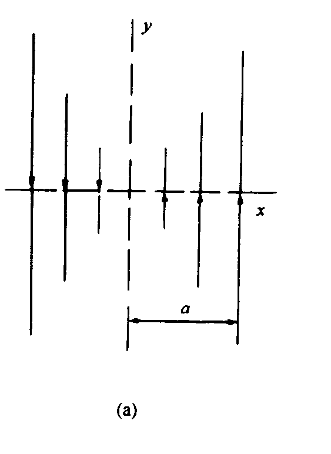

**图5.8** (a)沿$z$轴流动的平板电流的磁力线;(b)撕裂模产生的磁岛结构

先写出平衡态电流和磁场

$$
B_{0} = B_{0}e_{z} + B_{y}(x)e_{y}, \quad j = j_{z}(x)e_{z} \quad (5.168)
$$

设电流关于中平面$x = 0$反对称,于是$B_{y}(0) = 0$, 中平面是一个奇异面。在中平面附近,电流产生的磁场可以写成

$$
B_{y}(x) = B_{y}^{\prime}(0)x \quad (5.169)
$$

对这种平板位形,可以采用简正模方法进行线性稳定性分析。将所有扰动物理量对$y$坐标进行富氏展开,各扰动量写成$f(x,y) = f_{1}(x)\exp (- i\alpha t + i k y)$。引入扰动磁场的矢势,则

$$
\delta B_{z} = \mathrm{i}k A_{z} \quad (5.170)
$$

对线性化运动方程(5.94)取旋度,这样右方的压强梯度项消失,用矢势$\pmb{A}$表示扰磁场,所得方程的$z$分量为

$$
\rho_{0}\left(\nabla \times \frac{\partial \nu}{\partial t}\right)_{z} = -\frac{1}{4\pi} (B_{0}\cdot \nabla)\nabla_{z}^{2}A_{z} + \frac{1}{c}\nabla \times A\cdot \nabla j_{z} \quad (5.171)
$$

式中$\nabla_{z}^{2} = \frac{\partial^{2}}{\partial x} - k^{2}$, 再利用等离子体的不可压缩条件

两方程结合可简化成一个基本方程

$$
\frac{\rho_{0}}{k^{2}}\frac{\partial}{\partial t}\nabla_{\perp}^{2}\nu_{x} = -\frac{B_{y}}{4\pi}\nabla_{\perp}^{2}A_{z} + \frac{A_{z}}{c}\frac{\mathrm{d}}{\mathrm{d}x} j_{z} \quad (5.173)
$$

同时将欧姆定律写成

$$
\frac{\partial A_{z}}{\partial t} - \nu_{x}B_{y} = \frac{\eta c^{2}}{4\pi}\nabla_{\perp}^{2}A_{z} \quad (5.174)
$$

联立上述方程确定了所研究的电阻模的性质。可以看到,沿$z$轴的外加强磁场不出现在方程中,对电阻模起作用的仅仅是电流产生的磁场。从方程(5.174)还可以看出,当电阻率为零时,在中心平面$x = 0$处的扰动磁场$\delta B_{x}(0) = \mathrm{i}k A_{z}(0) = 0$, 这表明理想的等离子体中不存在使中心平面发生畸变的模式。用能量原理可以严格证明,上述位形对理想磁流体模是稳定的。有了电阻项的作用,(5.174)的左方项可以不为零,这个项其实就是运动等离子体中平行于磁力线的电场分量。因此,平行于磁场的电场分量不为零是产生非理想磁流体模的必要条件。

在第四章中关于磁场位形结构稳定性的分析中已经指出,如果在某些特殊的磁面附近加一扰动磁场,会产生磁岛结构,现在的情况正是如此。在所考察的平板位形上加一扰动磁场,会产生如图5.8所示的磁岛。现在,这种扰动磁场来自电阻模,它使原先的磁场结构被撕裂,所以称撕裂模。

现在存在两个空间区域,一是奇异面附近的小区域,其尺度为$2\delta$, 其中电阻效应很重要;另一为外部区域,其中电阻效应仍然可以忽略。电阻区域的具体大小要由所导出的方程自治地确定。在奇异区,除电阻效应外,等离子体的惯性效应也是重要的,而在大部分其它区域(称理想区域),惯性效应可以忽略。

对于含电阻效应的磁流体方程的分析,发展了一种特殊的方法,称奇异层分析,其基本点是,先求出奇异层两边的理想区中磁流体方程的解,在奇异层处令这两个解满足一定的联接条件,就可以得出稳定性判据,进而,考虑奇异层本身的解,可以给出模的增长率。

理想区中扰动磁场满足方程

$$
\left(\frac{\mathrm{d}^{2}}{\mathrm{d}x^{2}} -k^{2}\right)A_{z} - \frac{4\pi}{c B_{y}}\frac{\mathrm{d}j_{z}}{\mathrm{d}x} A_{z} = 0 \quad (5.175)
$$

这个方程的求解将分别在奇异面的两边进行。解的具体形状与电流分布的情况有关。为简单起见,设在两边$x\pm a$处有导体壳,使该处的扰动磁场为零。在中心平面处扰动磁场不连续,这是因为在奇异层中存在扰动磁场(电阻及惯性效应引起),其结构要由奇异层中的本征方程来确定。在求理想区解时,只要知道该扰动磁场是有限的就行了。因为本问题中$A_{z}$具有扰动磁场的磁通的含义,虽然奇异层中的扰动磁场对这一磁通有贡献,但因奇异层的宽度很小,其贡献可以忽略,于是可以近似地认为$A_{z}$在通过奇异层时连续,但磁通函数的导数不连续。定义

$$
A^{\prime} = \frac{1}{A_{z}(0)}\left[\frac{\mathrm{d}A_{z}}{\mathrm{d}x}\right]_{x = 0} \quad (5.176)
$$

1C代表量$c$在通过奇异层时的改变量。下面将看到,求解理想区方程的全部作用在于确定$\Delta^{\prime}$值。发生撕裂模的条件为

$$
\Delta^{\prime} > 0 \quad (5.177)
$$

这将在导出撕裂模的增长率表示式后清楚地看出。

#### 5.7.3 撕裂模的增长率

求奇异层中模的本征方程(5.173)的解,然后将其与理想区的解联接起来,就可确定模的增长率(本征频率)和模的本征函数。利用(5.169),因奇异层宽度很小,只保留的最低一级近似,式(5.173)化成

$$
\frac{\mathrm{i}\omega\rho_{\circ}}{k^{2}}\frac{\mathrm{d}^{2}\nu_{\mathrm{x}}}{\mathrm{d}x^{2}} +\frac{B^{\prime}}{n c^{2}} (\mathrm{i}\omega A_{\mathrm{z}} + B^{\prime}_{\mathrm{y}}x\nu_{\mathrm{x}}) = 0 \quad (5.178)
$$

这个方程中除变量$\nu_{\mathrm{x}}$外,还出现变量$A_{z}$, 原则上应与(5.171)联立求解。但根据上面说的理由, $A_{z}$可以近似地看成常量,这一做法称"恒常$\psi$近似"。求奇异区的解时要注意解的渐近性质以及奇偶性质。现在$A_{z}$是偶函数, $\nu_{\mathrm{x}}$是奇函数。在接近理想区时要与该区的解有相同的性质,这意味着

$$
\nu_{\mathrm{x}}\rightarrow \mathrm{i}\omega A_{z} / B_{\mathrm{y}}^{\prime}x\qquad \mathrm{当}x\rightarrow \pm \infty \quad (5.179)
$$

具体的解的表示式及求解方法在弗思(Furth)的著名论文[24]中有详细描述,我们现在不必了解其具体形式,仅认为解已求得,将其代回(5.174),然后积分一次,即得

$$
\left[\frac{\mathrm{d}A_{z}}{\mathrm{d}x}\right]_{x = 0} = \frac{\mathrm{i}4\pi}{n c^{2}}\int_{x}^{\infty}\mathrm{d}x[\omega A_{z}(0) + B_{\mathrm{y}}^{\prime}x\nu_{\mathrm{x}}] \quad (5.180)
$$

令所得的数值解与理想区域中方程(5.175)得出的对应值相等,就得到一个将模的增长率$\gamma = - \mathrm{i}\omega$与(5.176)中定义的$\Delta^{\prime}$相联系的关系式,从中解出增长率,得

$$
\gamma = 0.5(k a)^{2 / 5}(\Delta^{\prime}a)^{4 / 5}\tau_{\mathrm{R}}^{-1 / 5}\tau_{\mathrm{R}}^{-3 / 5} \quad (5.181)
$$

式中引入了新的特征时间$\tau_{\mathrm{R}}$, 它代表剪切阿尔芬波沿电流产生的磁场的磁力线的传播时间

$$
\tau_{\mathrm{R}} = \frac{\sqrt{4\pi\rho_{0}c}}{B_{\mathrm{y0}}^{\prime}} \quad (5.182)
$$

另外,在$\tau_{\mathrm{R}}$的表示式中应以$a$取代$d$。这样,实际上在上面的增长率的表示式中电流板的宽度$a$可以消去。现在看到,的确出现了一种新的不稳定性,其增长率比理想磁流体模的增长率(大体为$\tau_{\mathrm{R}}^{- 1}$)慢得多,但又比经典电阻扩散时间$\tau_{\mathrm{R}}$快得多。在聚变实验装置中,这一特征时间比等离子体的能量约束时间短很多,相应的磁流体活性可以被清楚地观察到,它们对等离子体的总体约束特性有重要的影响。

#### 5.7.4 托卡马克中的撕裂模[25\~30]

讨论撕裂模时,托卡马克仍可以当作直圆柱(设等离子体的截面为圆,否则讨论要复杂得多,但基本特性类似),因此可以将扰动磁场及各种一级变化量按$\exp (\mathrm{i}m\theta +\mathrm{i}k z)$展开,这里$k = n / R$, 而与上面例子中的中心平面位置对应的奇异面由条件$k\cdot B = (m B_{\theta} / r) - (n B_{\theta} / R) = 0$确定,满足这一条件的空间位置正好是安全因子等于两整数$m$和$n$的比值的位置

$$
q(r_{\mathrm{t}}) = m / n \quad (5.183)
$$

这些磁面称为有理磁面。常常把出现在满足上面公式的有理磁面附近的磁流体模称为$m / n$模。根据上面平板位形的例子可以推断,撕裂模将使有理磁面分裂成$m$个磁岛,它们沿环向有$n$个周期。磁岛的宽度由饱和后的撕裂模的幅值及托卡马克极向磁场的剪切值确定。但在下面的处理中,我们采用由撕裂模临界稳定条件来确定磁岛宽度,然后反过来确定撕裂模的幅值的方法。对托卡马克,一般说来有理磁面附近的磁岛宽度都远小于等离子体的小半径,因此相应的奇异层局限于有理磁面附近的小区域中,可以近似地将其看成平板,于是奇异层中的物理问题与上面简单例子中的没有太大差别。但在理想区则要用圆柱位形来分析,令

$$
\psi = r\delta B_{r} \quad (5.184)
$$

则与平板位形中式(5.175)对应的模的本征方程为

$$
\frac{1}{r}\frac{\mathrm{d}}{\mathrm{d}r} (r\frac{\mathrm{d}\psi}{\mathrm{d}r}) - \frac{m^{2}}{r^{2}}\psi = \frac{m\mathrm{d}j_{r} / \mathrm{d}r}{B_{\theta}(m - nq)}\psi \quad (5.185)
$$

在有理磁面$r = r_{s}$的两边求解,在磁轴上,由式(5.184)得到

$$
\psi (0) = 0 \quad (5.186a)
$$

在边界上,为简单计,设有一理想导体壳,于是有

$$
\psi (a) = 0 \quad (5.186b)
$$

在奇异面处取

$$
\psi (r_{s}) = 1 \quad (5.186c)
$$

方程(5.185)对给定电流剖面可以用数值方法求解,在靠近奇异面时解有对数发散特性,要结合解析方法来处理这种发散,再利用一些具有很高精确度的数值方法(例如样条配置法)然后就可以得到精确度足够好的解了[25]。同时也可计算在相应奇异面处的$\Delta^{\prime}$

$$
\Delta^{\prime}_{m n} = \left(\frac{\psi^{\prime}_{s} - \psi^{\prime}}{{\psi}}\right)_{r_{s}} \quad (5.187)
$$

微分方程(5.185)可以看成是下述泛函数求极值得出的欧拉(Euler)方程

$$
W = \int_{0}^{a}\mathrm{d}r r\left[\left(r\frac{\mathrm{d}\psi}{\mathrm{d}r}\right)^{2} + \frac{m^{2}}{r^{2}}\psi^{2} - \frac{m\mathrm{d}j_{r} / \mathrm{d}r}{B_{\theta}(m - nq)}\psi^{2}\right] \quad (5.188)
$$

它与理想磁流体能量变分$\delta W_{p}$的表示式精确地一致(差一任意的比例常数)。对撕裂模,这个能量积分可以写成与$\Delta^{\prime}$相联系的表示式

$$
\delta W_{p} = -\frac{r_{s}}{2}\psi (r_{s})\left[\frac{\mathrm{d}\psi}{\mathrm{d}r}\right]_{r_{s}} = -\frac{r_{s}}{2}\Delta^{\prime}_{m n}\psi^{2} \quad (5.189)
$$

由此可知,撕裂模的不稳定条件为

$$
\Delta^{\prime}_{m n} > 0 \quad (5.190)
$$

在实际问题中,最主要的模式是极向模数较低的那些模,即$3 / 2,2 / 1,3 / 1$,等等。这些模对应的磁岛最大,对等离子体的约束影响也最大。在一定意义上,如能通过选择电流剖面来实现对这些低极向模数的模的稳定化,可以认为是实现了最佳的电流剖面[27\~30]。

在实验运作上,一种简单的控制电流剖面的方法是调节电流的上升速率,同时调节等离子体密度的上升速率(通过调节充气速率)[31]。因为电子温度剖面分布既与能量输运过程有关,又与气体电离引起的能量损失有关,也与电子密度本身有关;而电子温度剖面又与欧姆电场大小有关,它影响电流密度剖面,同时电流上升速率也影响电流自身向内部的扩散。合成的机制虽很复杂,但可以从实验上观察Mimov信号来确定具有最佳稳定条件的参数区。具体做法是从电子密度的上升速率和电流上升速度的不同组合中找出最佳的组合,此时Mimov信号最小,对应于撕裂模的幅值最低,也就是一种最佳的电流剖面。在我国的托卡马克装置HL-1中进行了这样的实验,找到具有最小Mimov讯号的条件(见图5.9)。由于控制了撕裂模的增长,就有可能扩大稳定参数区,即将边界安全因子$q_{\alpha}$降低(增大总电流)。在HL-1装置上实现了$q_{\alpha} = 1.8$时的稳定的托卡马克放电。

根据等离子体沿磁力线建立能量平衡速率非常快的特点,而且认为磁岛的形成将改变磁岛所在区域的输运性质,磁岛区域的电子温度可以近似地看成是很平的,因为电子沿磁岛的运动将使温度拉平。将这种效应与输运过程结合起来可以用等效的输运模型来描述托卡马克等离子体的总体能量平衡,同时确定主要的磁岛结构[32]。磁岛的大小可以近似地从临界稳定条件

$$
\Delta_{m m}^{\prime}(r_{\mathrm{t}}\pm w) = 0 \quad (5.191)
$$

得出。用这一方法确定磁岛宽度不仅十分简单,而且其物理意义非常清晰。但当磁岛尺寸较大时,应当采用环形位形,因为对大尺寸的磁岛,直圆柱模型太粗糙了。

撕裂模对托卡马克位形及其它具有大的放电电流的位形(如RFP)的约束有重要影响,尤其是,有的磁岛可以发展到很大的尺寸,相邻的磁岛可能发生联接。在一定条件下,会使放电过程破裂。这一过程非常快,可与理想磁流体模的发展速率相比,它不仅使一次放电完全停止,而且可以因引起巨大的感应涡流而破坏装置的真空室或周围导电组件。这种非线性的不稳定性称破裂不稳定性(disruptive instability),是托卡马克装置控制工程的主要研究课题之一,下面将有一小节内容专门讨论这种不稳定性。

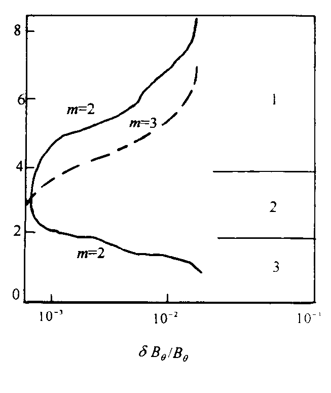

**图5.9** HL-1装置中通过调节电流上升率及送气率以控制电流剖面,得到最低Mimov信号的参数区〔31〕

#### 5.7.5 撕裂模的转动频率

实验观察到撕裂模不仅具有增长率,而且具有转动频率,其表现是由撕裂模形成的磁岛是以一定角速度绕极向和环向转动的。在理论上很早就预言撕裂模具有复频率,其描述方法是采用双流体近似(电子成分和离子成分分别用磁流体方程描述)[33,34]。受到影响的仅是奇异层中的物理过程,因此双流体描述基本不影响位能改变量的表示式,前面关于撕裂模的$\Delta^{\prime}$理论仍然有效,不过模的频率$\omega$要由色散关系确定,在一定的条件下,这个色散关系可以简化成一个包含几个特征频率的代数方程

$$
\omega (\omega - \omega_{\mathrm{tr}})^{3}(\omega - \omega_{\mathrm{n}}) = \mathrm{i}\gamma_{\mathrm{s}}^{5} \quad (5.192)
$$

式中$\gamma_{\mathrm{s}}$表示原先由单磁流体近似描述得出的结果,即前面公式(5.181)表示的结果(但

要在其中代入圆柱位形的参数)，另两个特征频率的定义为

$$
\omega_{\mathrm{r}_{1}} = -\frac{c}{n_{\mathrm{e}}e B_{0}r_{\mathrm{s}}}\left(\frac{\mathrm{d}p_{\mathrm{i}}}{\mathrm{d}r}\right)_{r_{\mathrm{s}}} \quad (5.193)
$$

$$
\omega_{\mathrm{r}_{\mathrm{T}}} = -\frac{m c(T_{\mathrm{e}} + T_{\mathrm{i}})}{n_{\mathrm{e}}e B_{0}r_{\mathrm{s}}}\left(\frac{\mathrm{d}n_{\mathrm{e}}}{\mathrm{d}r}\right)_{r_{\mathrm{s}}} \quad (5.194)
$$

各有关参数在奇异面处取值。方程(5.192)可以方便地用简单的数值计算解出，在两种极限情况下可以用更简单的形式表示。第一种极限是当模的增长率远大于实频率时

$$
\omega = (3\omega_{\mathrm{r}_{\mathrm{T}}} + \omega_{\mathrm{r}_{\mathrm{i}}}) / 5 + \mathrm{i}\gamma_{\mathrm{r}} \quad (5.195)
$$

此时模的增长率基本上仍是单磁流体近似得出的值，但模在离子反磁漂移方向以一个大体上等于离子反磁漂移频率的角频率沿极向转动；另一极限是模的增长率远小于离子反磁漂移频率，此时可以认为模基本上不转动，而增长率为

$$
\gamma = \gamma_{\mathrm{r}}^{\mathrm{i}} / (\omega_{\mathrm{r}_{\mathrm{T}}}^{\mathrm{i}}\omega_{\mathrm{i}}) \quad (5.196)
$$

此式表明离子反磁漂移对撕裂模有稳定作用(增长率有较大的减小)。

#### 5.7.6 撕裂模的非线性发展

撕裂模的发展将伴随着随时间增大的磁岛结构，磁岛发展到一定大小时，模的增长会变慢，其增长方式将由实际的$\Delta^{\prime}_{m n}$确定，

$$
\frac{\mathrm{d}\psi_{m n}}{\mathrm{d}t} = 1.66\eta (r_{m n})\Delta^{\prime}_{m n} \quad (5.197)
$$

其中$\Delta^{\prime}_{m n}$形式上仍由式(5.192)定义，但$\mathrm{d}\psi_{m n} / \mathrm{d}r$应在磁岛两边，即在$r_{m n}\pm \nu_{m n} / 2$处取值。$\psi_{m n}$形式上仍满足式(5.192)，但其中的电流剖面函数由每一时刻的输运方程确定。输运方程中的输运系数除采用唯象规律所假定的形式外，要考虑磁岛结构对输运系数的影响，最简单的做法是令磁岛区的反常热导率等于一个很大的数，这样，在磁岛区的电子温度分布将基本上是平台形的，电流分布相应地也是平台形的。改变了的电流分布函数将影响$\Delta^{\prime}_{m n}$的值，如果$\Delta^{\prime}_{m n} = 0$，则磁岛达到饱和。

上面关于磁岛结构效应的分析一般仅适用于单模(例如2/1模)起较大作用的场合，此外，还可能有其它非线性效应对模的饱和有影响。例如磁流体运动本身(对流运动)对模发展的影响；不同模之间的耦合效应，尤其是模数相邻的模之间的耦合效应的影响；模发生混合时的运动等等。理论研究中采用简化的磁流体(the reduced mhd)方程组来模拟这些效应，非线性运动常常给出非常复杂的磁场位形结构，另一方面，在实验上，利用多通道电子温度测量结果的层析方法(tomographic)，可以给出每一时刻的等温剖面结构，通常认为电子温度剖面与磁面结构基本是相同的，于是理论和实验存在可比性。不过，这类对比只能在定性的意义上加以判断，因为理论模型实在是非常简化的。

#### 5.7.7 导体壳效应

导体壳对撕裂模的线性发展影响较小，但磁岛发展到一定大小时，靠近等离子体的导体壳对饱和磁岛的尺寸有非常大的影响。图5.10是导体壳相对位置对$m = 2, n = 1$的磁岛饱和尺寸影响的算例。其中$a$为等离子体柱小半径，$b$为导体壳半径。存在导体壳时，对应于$(m, n)$模的磁通函数应满足边界条件

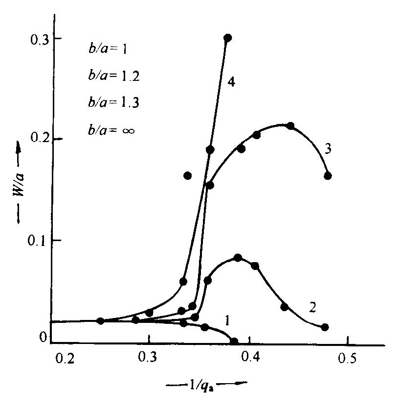

**图5.10** 不同导体壳位置下饱和磁岛相对尺度〔57〕

图5.10表明，靠近等离子体的导体壳对磁岛的饱和尺寸有非常大的影响，在$\frac{b}{a} >1.3$的情况下，(2,1)磁岛在边界安全因子值小于3后将很快发展成相对尺度超过小半径的1/5大小，对破裂不稳定性的发展起决定性的作用。

最后，有必要介绍一下我国学者在撕裂模理论研究中的贡献。我国的年轻学者李定等人在对撕裂模的环形耦合及撕裂模的非线性发展的理论研究中，改进和发展了国外学者的理论，受到同行的重视[35,38]；而曲文孝则考虑了新经典效应(捕获粒子效应，见第六章)对撕裂模非线性增长过程的影响[39]，该文献被广泛引用。考虑这些更实际的效应，撕裂模的稳定性条件和增长率都将改变。因此，本章介绍的内容基本上只适用于线性阶段，而非线性阶段模的发展要在更复杂的条件下研究。由于篇幅限制，本书不可能一一介绍，有兴趣的读者可参看有关文献。

改变。因此，本章介绍的内容基本上只适用于线性阶段，而非线性阶段模的发展要在更复杂的条件下研究。由于篇幅限制，本书不可能一一介绍，有兴趣的读者可参看有关文献。

### 5.8 托卡马克锯齿型磁流体活性和内扭曲模[40\~50]

托卡马克等离子体约束的一个重要特征是，当环向电流建立起来以后，大体在一个能量约束时间的时刻内，等离子体各种参数将趋于准稳态分布，其中电子温度将达到峰化剖面分布。在欧姆驱动条件下，由于等离子体电导率正比于$T_{\mathrm{e}}^{3 / 2}$，因此，电流剖面将比电子温度剖面更峰化。这意味着磁轴处的安全因子将不断减小。磁轴处安全因子的大小与装置参数间有简单的关系(对圆截面等离子体)

$$
q_{0} = \frac{5B_{0}}{\pi R j_{0}} \quad (5.199)
$$

此式中磁场以Gs计，电流密度以$\mathbf{A} / \mathbf{cm}^{2}$计，长度单位为cm。在环压给定时，磁轴处的电流密度仅与电子温度有关

$$
j_{0} = \sigma (T_{\mathrm{e}})E_{0} = \frac{\sigma V_{\mathrm{L}}}{2\pi R}\propto T_{\mathrm{e}}^{3 / 2}V_{\mathrm{L}} \quad (5.200)
$$

此处$V_{\mathrm{L}}$为环电压。由此可知，随着电子温度的升高，即使保持总电流不变，中心电流密度仍将不断加大，而中心安全因子将不断减小。在正常的托卡马克放电中，中心安全因子值$q_{0}$都会低于1，这意味着在等离子体内部存在一个$q = 1$的磁面和一个$q \leqslant 1$的空间区域。这个区域的相对大小与边界安全因子$q_{0}$及电流峰化程度有关。与之对应，会发展起$m = 1, n = 1$的磁流体模，这个模与前面讨论的$m > 1$的模在模式的空间结构上和模的增长率的大小上都有很大差别，需要特殊处理。

#### 5.8.1 理想内扭曲模[34,40\~44]

由分析载电流直圆柱位形时得到的能量变分表示式知道，$m = 1$的模与$m\geq 2$的模有显著的不同，从小量展开的角度说，$m = 1$的模对磁流体位能增加量的贡献出现在二级小量项中。这可以从位能改变量的表示式

$$
\delta W_{\mathrm{p}} = \frac{\pi}{2}\int_{0}^{\eta}\mathrm{d}r\left[f\left(\frac{\mathrm{d}\xi}{\mathrm{d}r}\right)^{2} + g\xi^{2}\right] \quad (5.201)
$$

看出，按倒环径比展开时的最低一级近似表示式（5.152）中与$(m^{2} - 1)$有关的主要项消失，剩下的是低两级$[(ka)^{2}$级和$\beta$级）的贡献，对$m = 1$的模，上式中的函数

$$
f = \frac{r(B_{\theta} + k r B_{z})^{2}}{1 + k^{2}r^{2}} \quad (5.202)
$$

$$
g = \frac{k^{2}r^{2}}{1 + k^{2}r^{2}}\left[2p^{\prime} + \frac{(B_{\theta} + k r B_{z})^{2}}{r} +\frac{2(k^{2}r^{2}B_{z}^{2} - B_{\theta}^{2})}{r(1 + k^{2}r^{2})}\right] \quad (5.203)
$$

从小量展开的角度看，函数$f$是零级量，$g$是二级小量，而含$f$的项是正定的，因此，可能的不稳定模必须满足条件

$$
\frac{\mathrm{d}\xi_{0}}{\mathrm{d}r} = 0,\qquad r< r_{1} \quad (5.204)
$$

这意味着模的径向位移函数在$q = 1$面内部是均匀扰动。取一个具有下面形状的试验函数（图5.11）：在奇异面内设径向位移按梯形下降，即设

$$
\xi = \xi_{0} = \mathrm{const}, \qquad r< r_{1}
$$

$$
\xi = \xi_{0}\frac{(r_{1} - \delta)}{\delta}, \qquad (r_{1} - \delta)< r< r_{1}
$$

$$
\xi = 0 \qquad r_{1}< r< a
$$

$r_{1}$是$q = 1$面的位置，这时位能改变量化成

$$
\delta W_{\mathrm{p}} = \frac{\pi}{6} r_{1}\xi_{0}^{2}s^{2}n^{2}\delta +\delta W_{\mathrm{min}} \quad (5.206)
$$

$$
\delta W_{\mathrm{min}} = \frac{\pi}{2}\xi_{0}^{2}\int_{0}^{r_{1}}\mathrm{d}r g \quad (5.207)
$$

式（5.206）中的$s$是磁剪切量，定义为

$$
s = \left(\frac{r}{q}\frac{\mathrm{d}q}{\mathrm{d}r}\right)_{r_{1}} \quad (5.208)
$$

对理想内扭曲模，奇异层是惯性奇异层，其含义是，在此层内，惯性项将起重要作用。为说明此点，考察由式（5.205）表示的位移函数，$\nabla \cdot \xi = 0$得出

$$
\frac{1}{r}\frac{\mathrm{d}}{\mathrm{d}r} (r\xi) + \frac{\mathrm{i}m}{r}\xi_{\theta} + \mathrm{i}k\xi_{z} = 0 \quad (5.209)
$$

不妨忽略$\xi_{z}$，则在奇异层附近

$$
\xi_{\theta} = -\mathrm{i}r_{1}\xi_{0} / \delta \quad (5.210)
$$

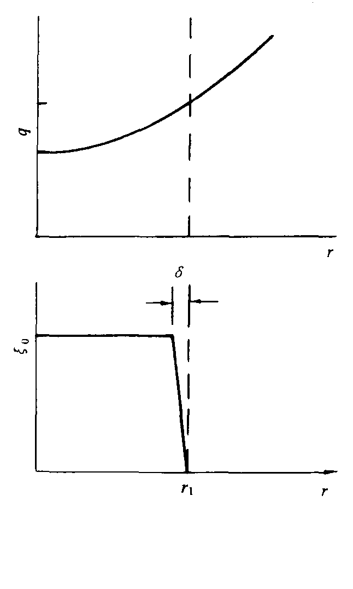

**图5.11** 内扭曲模对应的位移函数

相应地其动能项为

$$
K = \pi \rho_{0}\gamma^{2}\xi_{0}^{2}r_{1}^{3} / 2\delta \quad (5.211)
$$

即位移的$\theta$分量和动能都随奇异层厚度的减小而趋发散。这说明奇异层必须具有一定的厚度，而且这个厚度的大小是与模的增长率相联系的。这就是惯性奇异层的特征。

在物理上，内扭曲模的上述特性对应于这样一种扰动：在$q = 1$面内等离子体均匀地挤向$q = 1$面，在其附近，等离子体迅速沿极向流回而构成闭合回路。从而使很薄的奇异层中等离子体的动能超过了内部理想区的动能。现在总的能量改变量$K + \delta W$是$\delta$函数，需要对此参数求极值，得到

$$
\delta_{\mathrm{min}} = \frac{\sqrt{3}\rho_{0}r_{1}\gamma}{s n} \quad (5.212)
$$

相应地求得增长率

$$
\gamma = -\omega_{\mathrm{A}}\frac{\delta W_{\mathrm{min}}}{\pi r_{1}\xi_{0}^{2}n s} \quad (5.213)
$$

式中$\omega_{\mathrm{A}} = \nu_{\mathrm{A}} / \sqrt{3} q R$是阿尔芬频率。此式表明，内扭曲模的增长率与表面扭曲模的增长率比起来的确是二级小量。严格地处理奇异层和理想区的本征方程得到的结果不改变增长率与基本参量的关系，仅对系数做些修正。而模的本征函数的形式为

$$
\xi = \frac{\xi_{0}}{2}\left[1 - \frac{2}{\pi}\mathrm{arctg}\left(\frac{n s x}{\sqrt{\rho_{0}\gamma r_{1}}}\right)\right] \quad (5.214)
$$

#### 5.8.2 环形效应对内扭曲模的作用[40\~42]

按上面用直圆柱模型推导出的结果，将函数$g$的显示式写出

$$
g = \frac{n^{2}r^{2}}{1 + k^{2}r^{2}}\left[2p^{\prime}B_{q}^{2} - r\left(\frac{1}{q} -n\right)\left(\frac{1}{q} +3n\right)\right] \quad (5.215)
$$

显然，只要

$$
\frac{\mathrm{d}p}{\mathrm{d}r} < 0 \quad (5.216)
$$

就有$g< 0$。上式对任意的单调下降形压强剖面都满足，于是得出结论，即只要存在$q = 1$面，理想内扭曲模就一定是不稳定的。这与实验事实不符，实验中$q_{0}$可以比1低，最低可达到$0.5\sim 0.6$左右；其次，不稳定模也不是马上增长起来的，有一个稳定的周期，而且这个稳定的周期比模的增长特征时间长，在大装置中要长几个数量级。

在理论上早就认识到，用直圆柱近似处理内扭曲模是不正确的，因为所忽略的环形效应与保留的二级效应同一量级。Bussac[40]最早得出严格的环形位形中理想内扭曲模的分析结果。该分析方法很复杂，超出本书要重点介绍的内容，但其结果对本书又十分重要，因此这里引进其主要结果。

在环形位形中，位能总的改变量可以写成

$$
\delta W_{\mathrm{p}} = \left[\left(1 - \frac{1}{n^{2}}\right)\delta W_{\mathrm{c}} + \frac{1}{n^{2}}\delta W_{\mathrm{T}}\right] \quad (5.217)
$$

式中$\delta W_{\mathrm{c}}$代表前面用直圆柱模型得出的位能改变量，$\delta W_{\mathrm{T}}$表示环形效应修正。可以看到，对环向模数$n$很大的模，直圆柱近似的结果基本适用，但最危险的模是环向模数小的模，如在$n = 1$时，直圆柱近似的贡献完全被消去，模的稳定性完全由环形效应确定。

假定$q = 1$面内部的安全因子具有抛物线分布

$$
q(r) = q_{0} + (1 - q_{0})r^{2} / r_{1}^{2}\qquad r\leqslant r_{1} \quad (5.218)
$$

这时，前面定义的磁剪切量$s = 2(1 - q_{0})$。总的位能改变量的表示式可以写成

$$
\delta W_{p} = \frac{3\pi}{2}\left(\frac{r_{1}}{R}\right)^{2}\left(1 - q_{0}\right)\left[\hat{\beta}_{p}^{2} - \frac{13}{144}\right] \quad (5.219)
$$

其中定义了一个等效的极向比压值

$$
\hat{\beta}_{p} = -\frac{8\pi}{B_{\theta}^{2}(r_{1})}\int_{0}^{r_{1}}\mathrm{d}r r^{2}\frac{\mathrm{d}p}{\mathrm{d}r} \quad (5.220)
$$

理想内扭曲模的不稳定条件现在化为

$$
\hat{\beta}_{p} > \sqrt{13 / 144}\approx 0.3 \quad (5.221)
$$

主要结论是，只有当等离子体在$q = 1$面内部的等效极向压强大于一个临界值时，理想内扭曲模才变成不稳定的。这是对直圆柱近似的重要修正。但是，如果将托卡马克装置的真实参数代入，可以看到，这是一个相当严格的限制，使得大多数中小型装置中，理想内扭曲模是稳定的。为此不妨设压强也具有抛物线分布

$$
p(r) = p_{0}[1 - a_{p}r^{2} / r_{1}^{2}]\qquad r\leqslant r_{1} \quad (5.222)
$$

代入定义(5.220)得出$\hat{\beta}_{p} = a_{p}\beta_{p} / 2$，这里$\beta_{p}$是实在的极向比压值，以$q = 1$处的极向磁场计算。一般，对欧姆加热的托卡马克装置，这一比压值是小于1的量，取$a_{p} = 0.4$，这已代表很陡的压力分布，理想内扭曲模的不稳定条件相当于要求$\beta_{p} > 1.5$，这一条件对多数中小型托卡马克装置不满足。

#### 5.8.3 离子反磁漂移效应

类似于撕裂模的分析，若应用双流体近似，将引入离子反磁漂移效应，这种效应可以简单地将单流体近似中的色散关系用代换

$$
\omega^{2}\rightarrow \omega (\omega -\omega_{n}) \quad (5.223)
$$

而得到。于是考虑离子反磁漂移效应后理想内扭曲模的色散关系化成

$$
[\omega (\omega -\omega_{n})]^{1 / 2} = \mathrm{i}\omega_{\Lambda}\gamma_{\mathrm{mhd}} \quad (5.224)
$$

式中$\gamma_{\mathrm{mhd}}$对前面假定的安全因子剖面(5.218)可以写成

$$
\gamma_{\mathrm{mhd}} = \frac{3\pi}{2}\left(\frac{r_{1}}{R}\right)^{2}\left[\hat{\beta}_{p}^{2} - \frac{13}{144}\right] \quad (5.225)
$$

考虑离子反磁漂移使理想内扭曲模更稳定，因为由色散方程(5.224)解出，模的复频率为

$$
\omega = \frac{\omega_{n}}{2}\pm \sqrt{\left(\frac{\omega_{n}}{4}\right)^{2} - (\omega_{\Lambda}\gamma_{\mathrm{mhd}})^{2}} \quad (5.226)
$$

取正号时代表上面讨论的理想内扭曲模，取负号的模现在是稳定的，它对应于下面讨论的电阻性内扭曲模。可以看到，理想内扭曲模总是在离子反磁漂移方向转动。模的不稳定条件现在化为

$$
\gamma_{\mathrm{mhd}} > \frac{\omega_{\mathrm{s1}}}{2\omega_{\mathrm{A}}} \quad (5.227)
$$

对应地，关于不稳定比压极限有所升高

$$
\hat{\beta}_{\mathrm{p}} > \sqrt{\frac{13}{144} + \frac{2}{3\pi}\left(\frac{R}{r_{1}}\right)^{2}\left(\frac{\omega_{\mathrm{s1}}}{2\omega_{\mathrm{A}}}\right)} \quad (5.228)
$$

根据上面的讨论，在没有考虑离子反磁漂移时对大多数中小型托卡马克装置来说，理想内扭曲模已经是稳定的，考虑这种效应只能使其更稳定。显然，需要寻找其它的不稳定模式来解释实验现象。这就是式(5.226)中取负号时的解，对应于一个转动很慢的模，引起不稳定的原因是电阻效应。

#### 5.8.4 关于锯齿活性的实验[51]

关于$m = 1$的磁流体活性的实验观察在比较早的托卡马克实验中就报道了。美国的第一个托卡马克，Princeton国家实验室中由仿星器Stellarator-C改造的ST装置上最早观察到这类活性。这就是由vonGeoler用软X射线诊断观察到的锯齿振荡信号[51]。软X射线是通过测量等离子体在软X波段的辐射来诊断中心约束区中电子温度和杂质含量的。结果发现在总的辐射水准上总是叠加有周期变化的锯齿形振荡(见图5.12)，对叠加在这些锯齿信号上的先兆振荡进行富氏分析发现，其空间结构符合$m = 1,n = 1$，因此认为这些锯齿振荡由内扭曲模驱动的非线性磁流体活性，简称锯齿活性构成。以后在几乎所有的托卡马克装置上都观察到锯齿活性，从而软X射线诊断也成了托卡马克装置的最基本诊断手段之一。从几个方向安排的软X射线探测器阵列得到的信号，经层析重构(tomographic reconstruction)，可以给出磁流体模式非线性时空演变的详细图象，结合理论研究，使托卡马克装置成为研究磁再联这类重要的物理现象的实验设施。

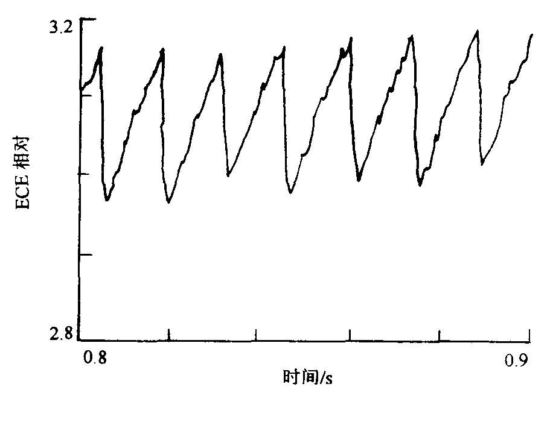

**图5.12** Tokamak的ECE信号的典型锯齿

根据上面的分析，理想内扭曲模对多数中小型托卡马克等离子体应该是稳定的，那么如何解释头验观察到的锯齿活性呢?理论分析指出，电阻性内扭曲模是这类活性的原始原因。下面简单介绍有关的知识。

#### 5.8.5 电阻性内扭曲模[41\~44]

锯齿型活性是一类非常复杂的非线性磁流体现象，下面仅介绍一些最简单的基本知识。实际在不同的装置中，在不同的条件下，实验观察到的锯齿振荡从锯齿形状，到锯齿周期，以及锯齿的崩蹦快慢(crash time)，崩蹦前后中心安全因子的相对变化，开始崩塌时有无前兆振荡，等等，都有很多特性，长期以来引起理论和实验研究者的兴趣。本节讨论最基础的理论：电阻性内扭曲模。这是理想内扭曲模的对应体，除在奇异层$(q = 1$面)中要考虑电阻效应外，其他与理想内扭曲模相同。上节中得到的关于位移函数，位能改变量的表示式等都适用于本节的分析。

但是在引入电阻效应后，关于稳定性的能量变分法就不能直接应用了。内区中得到的位能改变量与奇异层中物理过程的联系将通过两区位移函数的边界联接条件来表示。这个条件就是，奇异层中位移函数在理想区边界处与理想区位移函数联接，其具体数学形式是

$$
\frac{\mathrm{d}\xi}{\mathrm{d}x}\to -\frac{\delta W_{\mathrm{min}}}{\omega_{\mathrm{A}}\pi x^{3}s\xi_{0}}\qquad \mathrm{当} x\to \infty \quad (5.229)
$$

式中$x = (r - r_{\mathrm{I}}) / \delta$。

采用双流体方程组，引入

$$
\psi = r\delta B, \quad (5.230)
$$

模的本征方程将由$\psi$和$\xi$满足的联立微分方程组成

$$
-\omega (\omega -\omega_{\mathrm{e}})\frac{\mathrm{d}^{2}\xi}{\mathrm{d}x^{2}} = x\frac{\mathrm{d}^{2}\psi}{\mathrm{d}x^{2}} \quad (5.231)
$$

$$
\psi = -x\xi +\frac{\mathrm{i}}{S_{\mathrm{M}}(\omega - \omega_{\mathrm{e}})}\frac{\mathrm{d}^{2}\psi}{\mathrm{d}x^{2}} \quad (5.232)
$$

式中$S_{\mathrm{M}} = \tau_{\mathrm{R}} / \tau_{\mathrm{A}}$是前面式(5.167)中已定义过的磁雷诺数，电阻效应包含于其中。方程组(5.231)(5.232)的求解最早由Coppi等给出[41]，并由边界联接条件(5.229)给出电阻性内扭曲模的色散方程。这一方程对磁剪切量$s$有密度关系，可是在文献中这种依赖关系被弄混乱了，下面给出色散关系的正确形式[41]

$$
F(\Lambda)[\omega (\omega -\omega_{\mathrm{e}})]^{1 / 2} = \mathrm{i}\omega_{\mathrm{A}}\gamma_{\mathrm{mhd}} \quad (5.233)
$$

与理想内扭曲模的色散关系的不同是左方乘一因子

$$
F(\Lambda) = \frac{8\mathrm{i}}{\Lambda^{9 / 4}}\frac{\Gamma[(\Lambda^{3 / 2} + 5) / 4]}{\Gamma[(\Lambda^{3 / 2} - 1) / 4]} \quad (5.234)
$$

式中$\Gamma$为复伽玛(Gamma)函数，其宗量中出现的参量

$$
\Lambda = -\mathrm{i}\frac{[\omega(\omega - \omega_{\mathrm{e}})(\omega - \omega_{\mathrm{e}})]^{1 / 3}}{\gamma_{\mathrm{R}}} \quad (5.235)
$$

$$
\gamma_{\mathrm{R}} = s\omega_{\mathrm{A}}S_{\mathrm{M}}^{-1 / 3}
$$

这一方程的求解要用数值方法，它具有下述特点：模的实频率与增长率都是磁剪切量$s$的函数，而$s$是与中心安全因子的大小相关的，这就定性地与锯齿振荡的崩塌发生在$q_{0}$小于某一定值的实验结果一致。我们将这一理论称为临界剪切理论[46,47]。图5.13为电阻性内扭曲模的实频率与增长率随剪切量的增大而变化的关系。

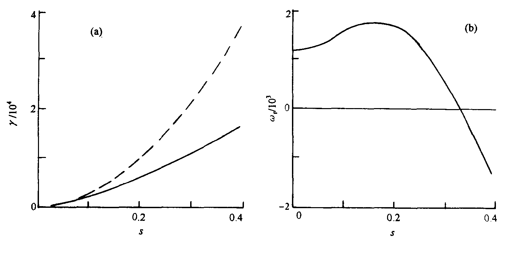

**图5.13** 内扭曲模的实频率 (a) 和增长率 (b) 随剪切量的变化〔46〕 (a)中虚线是微扰展开结果; 实线为严格解。

内扭动模是一种非常重要的磁流体模式，与托卡马克和其它一些载电流等离子体中的物理现象有密切联系，也影响等离子体宏观约束。锯齿活性直接影响$q = 1$磁面内部等离子体的约束，而锯齿现象本身呈现多种非线性行为，我们将在第九章中进一步讨论。

最后指出，我国学者在内扭曲模理论研究方面有突出的贡献，其中一些最新结果可参看文献[45\~50]。

### 5.9 轴对称不稳定性[52\~55]

现代托卡马克装置中等离子体的截面一般都采用非圆形，原因之一是为了设置偏滤器，普遍认为必须用偏滤器来处理杂质和排出废气及大部分热量；第二个原因是从理论上发现，对截面适当的变形有利于提高等离子体参数，特别是比压值，而比压值的大小直接与反应堆的经济品质相关。在实际应用中采用最多的变形是将等离子体沿装置的对称轴即柱坐标中的$z$轴方向拉长，这样做的一个直观好处就是在不扩大装置的大半径的条件下将等离子体的体积加大了，形象地说，将两个圆截面托卡马克等离子体重叠起来就成了拉长截面的等离子体。定义拉长参数

$$
\kappa = b / a \quad (5.236)
$$

其中$b$和$a$分别为等离子体截面的水平方向和垂直方向的半宽度。此外，一般还需三角变形。一个典型的变形截面等离子体如图5.14所示。

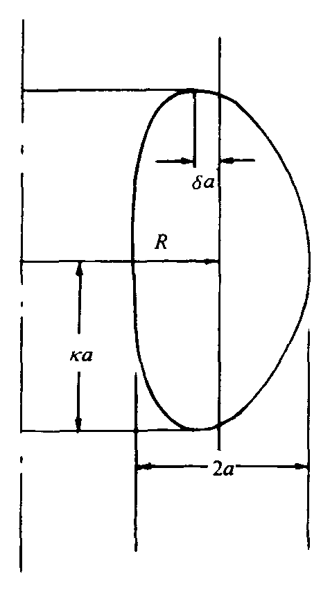

**图5.14** 典型的托卡马克位形的磁面截面形状

5.9.1 近似于圆截面的位形中的轴对称扰动

在位形设计中要考虑拉长截面位形对轴对称扰动的稳定性。所谓轴对称扰动是指环向模数$n = 0$的扰动。理论研究中对导体壳的稳定作用做了计算，采用能量变分原理方法，最危险的扰动是沿$z$轴方向的均匀位移，即

$$
\xi = \xi_{0}\epsilon_{z} \quad (5.237)
$$

对圆截面位形，在直圆柱近似下，利用前面研究扭曲模得到的公式，可以写出位能改变量

$$
\delta W = \frac{\pi}{2} B_{0}^{2}(a)\xi^{2}(a)(m\lambda -1) + \delta W_{\mathrm{p}} \quad (5.238)
$$

$$
\delta W_{\mathrm{p}} = \frac{\pi}{2}\left(\frac{B_{0}}{R}\right)^{2}\int_{0}^{a}\mathrm{d}r r\left[r^{2}\left(\frac{\mathrm{d}\xi}{\mathrm{d}r}\right)^{2} + (m^{2} - 1)\xi^{2}\right]\bigg / q^{2} \quad (5.239)
$$

$$
\lambda = [1 + (a / a_{\mathrm{w}})^{2m}] / [1 - (a / a_{\mathrm{w}})^{2m}] \quad (5.240)
$$

对式(5.237)中的均匀位移$(m = 1,n = 0)$，$\delta W_{\mathrm{p}} = 0$

$$
\delta W = \frac{\pi B_{0}^{2}(a)a^{2}\xi_{0}^{2}}{a_{w}^{2} - a^{2}} \quad (5.241)
$$

式中$a_{\mathrm{w}}$为导体壳的半径。上面对直圆柱等离子体的分析表明，圆截面等离子体在有导体壳时是稳定的。如没有导体壳，则要求垂直磁场具有一定的四极分量，使磁场指数满足(见第四章)

$$
\frac{3}{2} >n = -\frac{R}{B_{\perp}}\frac{\mathrm{d}B_{\perp}}{\mathrm{d}R} >0 \quad (5.242)
$$

真实等离子体的截面即使在外部具有圆环铜壳成形的条件下也不可能是完全圆形的，一般来说，随着内电感和等离子体压强的变化，截面沿$z$轴稍有拉长变形。拉长度

$$
\frac{b}{a} = 1 + \frac{a^{2}}{R^{2}}\left[\frac{3}{4}\ln \frac{8R}{a} -\frac{17}{16} -n\left(\ln \frac{8R}{a} +\beta_{\mathrm{p}} - \frac{5}{4}\right)\right] \quad (5.243)
$$

$n$为上面定义的磁场指数。更严格的计算给出，在没有导体壳稳定时，允许的最大拉长度为

$$
\frac{b}{a} < 1.25 \quad (5.244)
$$

5.9.2 导体壳的稳定作用:椭圆截面位形

对具有同焦点导体壳的椭圆截面等离子体直柱的分析表明，只有在椭圆度不大时导体壳才能稳定轴对称扰动[18]，其结果示于图5.15。如无导体壳，这一计算给出对椭圆度的限制

$$
\kappa = \frac{b}{a} < 1.6m \quad (5.245)
$$

对$m = 1$的模(刚性位移)，得到对拉长度的限制为$\frac{b}{a} < 1.6$。

在实际装置中，围绕等离子体的环向导体也可以起稳定作用，如用于控制等离子体截面形状的成形线圈就能起到导体壳的作用。计算表明[53]，对椭圆拉长度的大小也有一定限制，大体上与式 (5.245) 给出的限制类似。

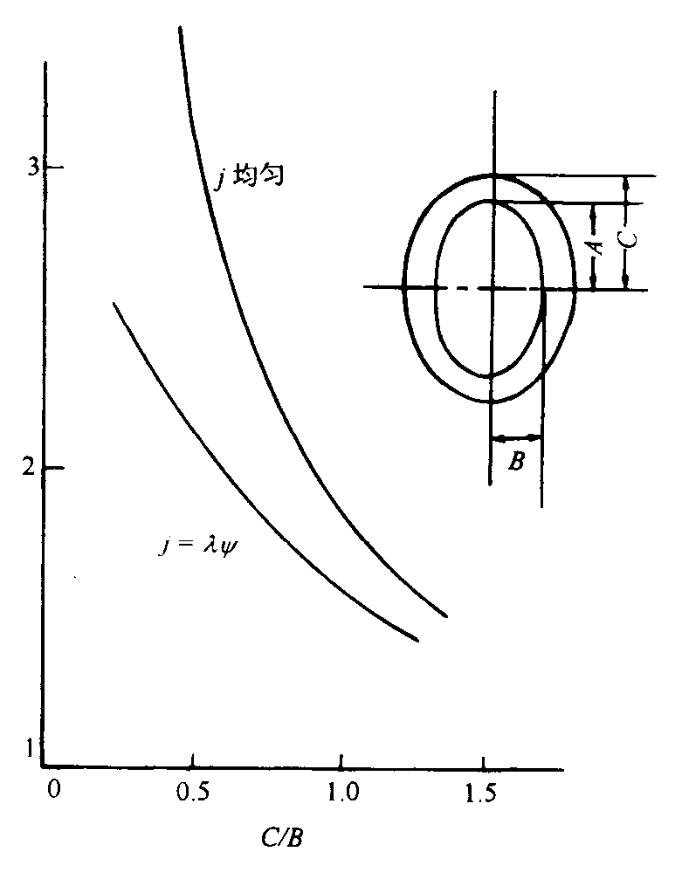

**图5.15** 具有同心导体壳的直椭圆柱关于垂直位移的稳定区〔11〕

#### 5.9.3 位移不稳定性对等离子体约束的影响及控制

实际装置中，即使是圆截面等离子体 (即拉长度没有达到限制值时)，在满足式 (5.242) 的情况下，在等离子体维持时间很长时，也会因杂散磁场的透入或等离子体参数的变化加快，或杂质进入等离子体使等离子体冷却而改变电流分布，都会使平衡条件破坏，出现等离子体整体向真空室壁的运动。这时等离子体的水平或垂直位移迅速加大，等离子体整体碰壁并使环电压较快地消失，放电终止，这是托卡马克实验中最常遇到的现象。在拉长截面的情况下，平衡控制更为困难，大量实验结果统计表明，突然增大的位移是引起等离子体破裂 (软破裂) 的重要原因。

即使目前对等离子体的位移控制技术已发展得相当完善，主动的反馈控制技术能将等离子体放电维持很长的时间，但对拉长截面等离子体的控制仍是一个难题。对于大型装置，破裂不稳定性产生的脉冲感应电场会对装置本体产生重大的破坏。因此 ITER 最初在概念设计时取拉长度为 2 或稍大，并采用靠近等离子体的导体致稳，后来的改进设计则为稳妥起见，将拉长因子改成 1.5 左右。结合现代控制技术，这是一个合理的和可靠的数值 (见第十二章托卡马克反应堆设计研究)。

### 5.10 破裂不稳定性[18,56]

托卡马克放电中经常会发生一种称为破裂不稳定性的突发的非线性不稳定现象，即放电突然在很短的时间内断裂，放电终止。发生破裂的原因主要是磁流体扭曲模 (撕裂模) 的迅速发展，所形成的磁晶结构使靠近边界的等离子体与器壁发生热接触，或由于等离子体平衡失控 (位移不稳定性) 使等离子体柱整体碰壁，造成强烈的等离子体与器壁的相互作用，并引起大量杂质进入等离子体，使等离子体迅速冷却，电流通道被堵塞，最后，等离子体中的热能及其周围导体中所储存的磁能都在很短的时间内 (在 1 ms 左右) 释放出来。对于实验装置，这意味着一次放电过程以不可控方式的结束，对于大型装置和反应堆，这就是一次非常危险的 "事故"，因为不仅大量的热量瞬间沉淀到周围器件上会损坏这些器件，而且由于大电流的瞬间熄灭要感应起很大的沿环向的电场，会使周围导体材料及其绝缘结构损坏。已经有过因破裂放电而使大型装置真空室损坏和打坏线圈绝缘的事例。对磁约束聚变堆来说，破裂放电基本上是不允许的 (其出现几率应小于$1 / 10^{4} \sim 2 / 10^{4}$)，应设法控制，或者至少要让破裂过程 "软化"，使其不对周围组件造成损害。但在当前的实验装置中，发生破裂放电的几率非常高，平均达到总的托卡马克放电次数的 1/3 左右，当然其中大部分是破坏性较小的软破裂，如由于电流上升太快或其它放电参数变化太快使等离子体柱的平衡位置失控引起的破裂。除这些与放电操作过程有关的，以后可以大幅度改进的因素外，有几种与内在物理机制有关的因素，这就是电流超过稳定性极限及粒子密度升高后辐射功率加大引起等离子体边缘区冷却，在后面的边缘等离子体一章中将要对这种机制特别进行讨论。

### 5.10.1 破裂不稳定性的类别及主要特征

根据发生破裂不稳定性的起因及主要后果上的差别，通常把破裂不稳定性分成以下几种类型:

1)电流极限破裂，即总电流超过磁流体稳定性极限时产生的破裂，大都出现在低q大电流放电情况下，有关参数已进入磁流体扭曲模的不稳定参数区，或者虽然等离子体总体运行在稳定参数区，但离不稳定参数区的边界不远，于是实验条件稍有变动，例如中性气流突然的加大，或杂质流的突然增加使边缘很快冷却，导致实际电流通道的收缩，边缘等效安全因子降低而进入不稳定区。

(2)密度极限破裂，在一定的总加热功率下，粒子密度加大时总辐射功率以正比于密度的平方的方式加大，因而在一定的极限密度下，总辐射功率可以接近总加热功率，使边缘区冷却，电流通道收缩，以后的过程类似于电流极限破裂。

(3)平衡位置控制失效，这种情况在实际实验中非常普遍，如充气过快或加热太快引起密度温度的快变化，平衡条件变化了而控制位移的响应跟不上，引起等离子体向器壁靠近，加大了与器壁的相互作用。

(4)因电流上升过快引起的破裂，这类破裂一般是极向模数较高的模引起的，影响较小空间范围。

(5)比压极限破裂，这是在高功率加热条件下出现的一类新现象，即使边界安全因子远离磁流体不稳定性边界，也会因等离子体比压大于某种临界值而引发破裂。

破裂过程大体上可以区分成四个不同的阶段，下面的讨论中，其时间尺度均以JET装置上的特征时间为标准进行比较:

(1)预先兆阶段(1s)，等离子体可能因辐射功率加大而有脱栏现象，使等离子体的小半径有所收缩，或因磁流体不稳定原因有所收缩。

(2)先兆阶段(100ms)，此时由热收缩发展为电流通道的收缩，电流密度的梯度加大，撕裂模的磁岛开始发展。

(3)快破裂(热量消亡)阶段(1ms)，原因可以是$m = 2$的大磁岛与$m = 1$的磁岛相耦合并与边界孔径等物质相连接，引起大范围的热损失；或由于许多撕裂模发展成滞性磁场位形结构，使热量很快损失。

(4)电流消亡阶段(10ms)，等离子体因冷却而加大了电阻，使放电很快终止。

总之，破裂不稳定性是一类复杂的非线性过程，磁流体不稳定性或位移失控是起因，而等离子体柱与器壁的强烈相互作用是重要的后继因素，最终使大部分等离子体的热量和磁能迅速损失是后果。有一些破裂过程没有使全部的等离子体能量损失，等离子体放电在后来又重新恢复过来，这类破裂称软破裂，或小破裂。从原因上分析，这类破裂往往是内部的大锯齿活性引发的，或是与较小区域的磁岛结构有关，在一部分等离子体能量被引出约束区外后，剩余的等离子体在环电压的作用下，又开始恢复平衡态。

破裂不稳定性的共同特征是环向电流的突然熄灭，此外，还有其它一些普遍存在的特征。最明显的特征是环电压示波信号上出现负尖峰，此时总的电流没有什么变化，说明这是等离子体中某些区域中电流突然改变了分布。产生这种改变的条件之一就是磁岛区的磁再联过程:其次，破裂过程中X射线强度有较大的突然下降，这与磁再联过程中等离子体能量(密度与温度)的再分布相关。对比于$q = 1$面内部的锯齿活性，破裂不稳定性

的主要实验特征量如表5.1所示。

表5.1不同类型破裂及锯齿活性中的一些实验信号或参数的比较

| 类别 | 锯齿活性 | 小破裂 | 大破裂 |
|---|---|---|---|
| 环压信号 | 无变化 | 小负尖峰 | 大负尖峰 |
| $\Delta V$ | — | -1～-10 V | -10～-500 V |
| 软X射线强度 | $\approx 10\%$ | $\approx 20\%\sim 80\%$ | 下降几倍 |
| $\Delta T_c$ | $\approx 10\%$ | $\approx 20\%\sim 50\%$ | $\approx 90\%$ |
| $\Delta n_e$ | $<5\%$ | $\approx 10\%$ | $\approx 30\%$ |
| $B_c/B_o$ | — | $<4\%$ | $20\%$ |
| $m$变化顺序 | 1,0 | (3),2,1,0 | (3),2,1,0,3,4 |

## 5.10.2 破裂不稳定性的机制

很多装置中对破裂不稳定性发生和发展过程进行了仔细的观察，虽然破裂过程中的非线性发展可能有多种机制起作用，但引起破裂的原因都是磁流体扭曲模的发展，主要是撕裂模，它使有理磁面附近发展起磁岛结构。由于撕裂模不稳定性条件依赖于电流剖面的细致结构，而电流剖面在放电过程中是不断变化的，与等离子体中的粒子和能量输运过程密切相关，因此不同的装置之间，甚至是同一装置的不同实验阶段之间关于撕裂模是否稳定，或不稳定模以何种速率发展，都有不同的结果。此外，实验和理论研究都发现，破裂不稳定性发生与否不仅取决于当时的物理条件，而且与等离子体以前的历史有关。例如由于电流的快速上升引起空间某些区域中撕裂模的发展，但这些模当时没有使等离子体的约束产生很大的影响，然而在后来适当的条件下，其中有的模会进一步发展成为影响约束的全局性因素。这就是破裂不稳定性会在明明是处在稳定参数运行区的等离子体中突然发展起来的原因，这种潜伏的机制也是破裂不稳定性的发生带有随机特征的原因所在。

破裂不稳定性有几种可能的发展:一种是边界安全因子略人于2，因而$m = 2$，$n = 1$的磁岛非常靠近边界，当此磁岛足够大时，会使边界附近的温度分布变平，或者这一磁岛会与孔柱接触，这些都会引起大量的热量损失及大量中性气体和杂质流的进入，最终使放电被完全破坏；另一种情况是磁岛发生在较内层区域，但可能存在几组磁岛，典型的是(2,1),(3,1)的一组或(2,1),(3,2)的一组，当这些磁岛发展到一定大小，可能会发生重合，在较大区域内影响能量平衡和输运，这也会最终引发大破裂；在密度极限破裂的情况下，人多是与边界附近有理磁面对应的磁岛起作用。密度极限破裂一般比电流极限破裂要软一些；还有可能由较大的锯齿活性引起破裂，这主要发生在强功率加热条件下，锯齿活性已演化成小破裂，即其影响区域已超出$q = 1$面以内，大量的热能外流引起外部区域温度的重新分布，并常常使相应的有理磁面附近的撕裂模不稳定性加剧。在观察到大破裂前常常有几次较小的破裂，电压信号有几次较小的负尖峰，对应于这种演变过程。

破裂过程中使等离子体失去能量的直接原因是等离子体柱整体与孔柱甚至真空室本身的强烈相互作用。位移失控或位移不稳定性引起的破裂更直接与这一机制相关。大量的中性气流和杂质流的进入会使等离子体完全冷却和被污染，最终使放电熄灭。在这种非线性相互作用中，会伴随有等离子体柱的先膨胀后收缩的过程。

5.10.3 破裂不稳定性的防止与控制

对破裂不稳定性主要是被动防止法，即让等离子体运行在离磁流体不稳定性边界较远的参数区中。这主要是适当减小总放电电流，使边缘安全因子大于2.5或超过3，这样$m = 2$的磁岛就不易发展起来；其次是调整电流剖面，使模数较小的撕裂模不易发生。另外也研究了用外加螺旋磁场或用可调节沉积剖面的加热方法(如ECRH加热)来控制电流剖面，得到较稳定的运行区(实验上可以通过观察米尔诺夫信号来判断磁岛大小及存在区域)。

在主动防止方面，主要是利用一些先兆现象，如小破裂，MARFE(一种非线性边缘辐射现象，见第七章介绍)等，预先减小总电流或调节电流剖面。

### 5.11 气球模不稳定性和比压极限[58\~61]

磁约束聚变装置中的等离子体的稳定性除与等离子体中的电流有关外，还与等离子体的压强梯度有关，这两种因素构成了与等离子体约束性质密切相关的两类主要的宏观不稳定性模式。实际上，前面讨论的与电流有关的不稳定性模式(扭曲模、内扭曲模、位移模)主要与平行于磁力线的电流有关，其主要特性在圆柱近似下就清楚地表现出来(但内扭曲模与环形特性有关)，可以用圆柱近似来描述约束位形，因而在理论研究方面比较简单。对压强梯度驱动的模式，则与垂直于磁力线的电流，即磁化电流有关，其驱动机理与位形结构的细节有关，必须采用较严格的位形描述。一般，对托卡马克这种轴对称环形位形，严格的描述虽不算很困难，但进行稳定性分析时会非常复杂，通常要用数值方法进行最后的计算。最简单的能够反映位形特性的位形是位移圆环族，即等离子体的磁面形状仍为圆环，但不同的磁面间存在由压强梯度引起的位移，这些圆环互不相交，构成套环体系。下面将以这种简化的位形为基础进行分析。

在5.4.4节的例子中，对于等离子体约束区域不存在磁场的位形，已得出一个稳定性的必要条件，这就是磁力线必须处处凸向等离子体，或磁力线的曲率中心处在等离子体约束区外部。对托卡马克，详细分析式(5.117)中定义的磁力线的曲率矢量可知，不同的区域中曲率的大小和符号是不同的。相对于环的对称轴，在磁轴内侧即靠近对称轴的部分，磁力线的曲率取正值，曲率中心在等离子体外，对稳定性来说是好曲率区；反之，在环的外侧，曲率是负的，是坏曲率区。所谓的气球模，就是那种主要在坏曲率区发展起来的局域模式，因类似于厚度不均匀的气球，在膜较薄的地方会鼓起一个大包而得名。

下面对圆截面托卡马克位形的曲率矢量的特性进行讨论。设磁面位形为相邻磁面间具有位移的圆环族，磁面上任一点可由下面的坐标表示

$$
R = R_{0} + \Delta (r) + r\cos \theta \quad (5.246)
$$

$$
Z = r\sin \theta \quad (5.246)
$$

磁轴位置由$r = 0$确定，$\theta > 0$的区域代表环的外侧，$\theta < 0$为环的内侧。从曲率矢量的定义表示式(5.114)式出发，代入

$$
p = p(r) \quad (5.247)
$$

$$
B = B_{0}R_{0} / (R_{0} + \Delta +r\cos \theta) \quad (5.247)
$$

根据曲率矢量的定义(5.114)，通过直接求导，展开到小量$(\Delta ,r / R_{0})$的第一级，可得

$$
\kappa = \frac{1}{2}\left\{e_{r}\left[\beta^{\prime}(r) - 2(\Delta^{\prime} + \cos \theta) / R\right] - e_{\theta}\frac{2\sin\theta}{R_{0}}\right\} \quad (5.248)
$$

式中$\beta = 8\pi p / B_{0}^{2}$是等离子体的比压值，压强梯度通常是负的，位移函数的导数也是负的，因此在环的外侧，法向曲率取负值，是坏曲率；只有在内侧，对较小的比压值 (例如$\beta \approx (a / R)^{2}$量级)，曲率才能成为好曲率；至于沿极向的分量，按式 (5.117) 中定义，称测地曲率，在赤道面的上下方有不同的符号。

对于一种具体的模式，托卡马克磁场的效应是起稳定还是去稳定，要由模式的空间结构特性及平衡位形对模式的总体作用来确定。最简单的分析工具是能量变分原理。为了讨论气球模，需将能量变分表示式 (5.102) 改写成可以直接讨论曲率效应的形式

$$
\begin{aligned}
\delta W_{\mathrm{p}} = \frac{1}{2}\int \mathrm{d}\tau \Big\{&\left|Q_{\perp}\right|^{2} - \frac{j_{b}}{B}\left(\xi_{\perp}\times B\right)\cdot Q_{\perp} - 2(\xi_{\perp}\cdot \nabla p)(\xi_{\perp}\cdot \kappa) + \\
& B^{2}(\nabla \cdot \xi_{\perp} + 2\xi_{\perp}\cdot \kappa)^{2} + \eta \rho (\nabla \cdot \xi)^{2}\Big\} \quad (5.249)
\end{aligned}
$$

这一表示方式最初由弗思给出[4]，式中各项具有较清楚的物理含义:第一项是正定的，代表磁力线弯曲引起的稳定作用；第二项是电流驱动作用项，是引起扭曲模不稳定性的主要因素；第三项是压强驱动效应项，是产生气球模和交换模的主要因素；第四项与磁场受压缩时磁能变化有关，也与磁力线的曲率有关；最后，第五项也是正定的，是等离子体受压缩时产生的稳定作用。遵照能量极小化步骤，第一步可以考虑不可压缩模

$$
\nabla \cdot \xi = 0 \quad (5.250)
$$

并将垂直位移函数用一个标量函数来表示

$$
\xi_{\perp} = \frac{\mathrm{i}}{n B_{0}^{2}} B_{0}\times \nabla \Phi \quad (5.251)
$$

标函数$\Phi$的变化具有这样一种特征:沿磁力线的变化非常缓慢，而垂直于磁力线的变化非常快。在 WKB 近似意义上，这种具有双重变化坐标的函数可以写成下面的形式:

$$
\Phi (r,\theta ,\zeta) = \Phi_{0}(r,\theta)\exp [-i n S(r,\zeta -m\theta /n)] \quad (5.252)
$$

式中$\Phi_{0}$为慢变化部分，指数函数为快变化部分，$S(r,\zeta - m\theta /n)$称为程函。作为初步估计，可以仅考虑能量变分表示式 (5.249) 前两项间的竞争。首先，与压强梯度驱动及磁力线曲率效应有关的被积函数部分的大小为

$$
(\xi_{\perp}\cdot \nabla p)(\xi_{\perp}\cdot \kappa)\approx p\xi^{2} / R_{0} \quad (5.253)
$$

而磁力线弯曲引起的稳定项的大小为

$$
Q_{\perp}{}^{2}\approx B^{2}\xi^{2} / q^{2}R_{0}^{2} \quad (5.254)
$$

要求压强驱动效应小于磁力线弯曲的稳定效应相当于对等离子体比压值的一个限制

$$
\beta \leqslant \beta_{\mathrm{e}}\approx \frac{a}{q^{2}R_{0}} \quad (5.255)
$$

以上的初步估计指出，托卡马克约束系统是一个低比压稳定约束系统，典型的稳定比压值在百分之几。不过，实际位形的约束品质可能会更高，因为严格的气球模分析指出，改变截面形状和改变电流剖面分布都可能导致稳定比压值的提高，因为能量变分表示式中的其它项将在一定条件下起重要作用。另外，当考虑存在于等离子体中的高能离子成分的效应时，也发现可以提高稳定的比压值。本书仅对最基本的物理进行必要的介绍。

在位移圆环磁面条件下的气球模本征方程的一般形式如下[59]

在推导气球模本征方程时，应用了所谓的气球模表象描述[58]，这是一类特殊的数学变换，是通常的富氏变换或拉氏变换的一种推广，主要用于处理这样一类特殊问题:物理量沿平行于磁力线方向的变化很慢，而沿垂直于磁力线的方向变化很快，当磁力线存在剪切，普通坐标系中的描述就出现困难。为解决这一困难，发现只要将原先的径向坐标理解成新坐标系中的"广义极向"坐标，原方程的形式将不变，但这一新极向坐标定义在无限区间中，即

$$
-\infty \leqslant \theta \leqslant \infty \quad (5.257)
$$

这一近似使二维问题化为一维问题。在上面方程中，$\boldsymbol{\Pi}_{I}$为本征值，取正值代表不稳定性，其它各量的定义是

$$
\alpha_{p} = 1 + \Delta^{\prime}\cos \theta
$$

$$
\Sigma = \frac{1}{\alpha_{p}^{2}} (s\theta +s_{1}\sin \theta +\dots) \quad (5.258)
$$

$$
G = \frac{8\pi R_{0}q^{2}p^{\prime}}{B_{0}^{2}}
$$

$s$为磁剪切，函数$\boldsymbol{W}$中主要部分为

$$
W = \alpha_{p}^{2}(\cos \theta +\Sigma \sin \theta) \quad (5.259)
$$

在上面各式中，含$\alpha_{p}$的量代表因磁面位移产生的贡献，其总体效应是减小压强驱动作用而增大剪切稳定作用，由于磁面位移是与压强梯度成正比的，因此当压强梯度非常大时，总体效应可能是稳定的，这就是出现第二稳定区的物理机理。通过变分分析可以较清楚地说明这一问题，将本征方程(5.256)写成变分形式

$$
\Gamma^{2} = (J_{c} - J_{\Lambda}) / J_{1} \quad (5.260)
$$

其中各积分量为

$$
J_{c} = \int \limits_{-\infty}^{\infty}\mathrm{d}\theta G W|\phi |^{2} \quad (5.261)
$$

$$
J_{\Lambda} = \int \limits_{-\infty}^{\infty}\mathrm{d}\theta (1 + \Sigma^{2})\left|\frac{\mathrm{d}\phi}{\mathrm{d}\theta}\right|^{2} \quad (5.262)
$$

$$
J_{1} = \int \limits_{-\infty}^{\infty}\mathrm{d}\theta \alpha_{p}^{2}(1 + \Sigma^{2})|\phi |^{2} \quad (5.263)
$$

可以看到，压强梯度$(J_{c}$项)是不稳定性的驱动力，而剪切和磁面位移在这里起稳定作用$(J_{\Lambda}$项)。在$(s,G)$参数平面上，严格求解得出的稳定性图如图5.16所示。一个重要特征是:依赖于磁剪切的大小，当压强梯度参数$G$大于临界值后，气球模变为不稳定，但在更大的压强梯度区，由于磁面位移

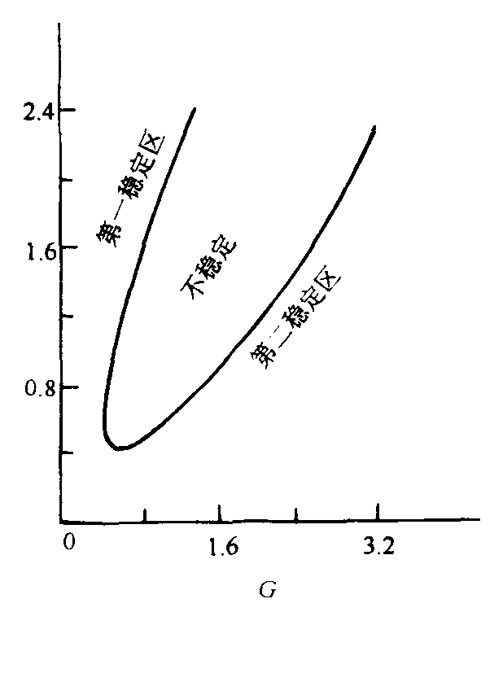

**图5.16** 典型的托卡马克气球模稳定参数区

的稳定效应，模将重新被稳定化。这一区域称为气球模的第二稳定区。显然，从约束高参数等离子体的角度，这个第二稳定区非常吸引人，成为后来理论和实验研究的一个热点。

先不谈第二稳定区问题，因为等离子体总是逐步提高比压值的，首先要考虑的是气球模的第一不稳定条件。如果气球模不稳定性的发展会导致等离子体总体约束的严重变坏，则这一条件应给出对可达到的等离子体比压值的一个限制。不过，到目前为止关于比压极限的直接实验观察还很不充分。另外，上面的讨论其实仅限于非常局域的气球模式，理论上称为高环向模数气球模$(n > 10)$。但实际上低环向模$(n< 5)$可能对约束的影响更大，这类低环向模数模具有二维广域结构，主要在环曲率区域发展，有的文献称其为环区模 (infermal mode)，只能采用复杂的数值方法进行分析。现已发展了相应的数值计算编码，可以对多种位形进行数值研究，得到的一个重要结果是等离子体存在某种比压极限，称为脱罗阳极限 (Troyan limit)[59]。用标准的形式写出，这一极限表明托卡马克装置和反应堆的极限比压值为

$$
\beta_{e} = g\frac{I_{p}}{a B} \quad (5.264)
$$

式中磁场$B$以特斯拉(T)计，等离子体总环向电流$I_{p}$以MA计，等离子体小半径$a$以$\mathbf{m}$计，比压值$\beta_{e}$用$\%$表示。一般托卡马克系统的临界稳定比压对应于$g\leq 3$。但如对截面形状进行优化，允许的稳定比压值可以提高。理论分析指出，在环的内侧向内凹的截面，如蚕豆形截面许(bean shape)可以允许很大的稳定比压。为了研究这种截面等离子体的性质，PPPL的PDX装置改成具有蚕豆形截面的PBX装置来进行实验。不过，实现高的等离子体比压并不只依赖于截面形状，还必须与有效的加热和好的输运品质相结合。真正做到最高稳定比压的装置是DIII- D，实现了超过$12\%$的平均稳定比压，而中心稳定比压达到了$30\%$以上。在ITER的设计中，$I_{p} = 24$，$a = 2.8$，$B = 6$，因此当取$g = 3.5$时，临界比压仅为$5\%$左右，为了达到更高的比压值，要对位形进一步优化。

上面的气球模分析是在固定等离子体边界的条件下进行的，即假定等离子体位移函数在边界上为零。还可能存在高比压条件下的自由边界模，即高比压扭曲模，得到的对等离子体比压的限制要更严格，即$g$值会更小。近年的大装置实验获得了关于高比压扭曲模影响约束的很多证据。改善磁流体稳定性，仍是今后理论和实验研究的一个重要方面。

近年的很多实验发现，具有负剪切的位置可能更稳定，同时反常输运将大幅度降低。理论研究曾指出负剪切在稳定很多模式上的正面作用。这里引述我们曾指出的一个重要结果：具有负剪切的托卡马克位形可以稳定的比压值比正剪切位形高数倍[62\~65]。

在图5.16中反映的临界比压参数$G$与磁剪切值$s$的关系中，若将其推广到负剪切参数区，发现可以稳定的比压值将加大。具体讨论如下：从变分表示式 (5.260) 出发，取试验函数为

$$
\Phi (\theta) = \exp (-\alpha \theta^{2}) \quad (5.265)
$$

因为讨论的是第一稳定区，取

$$
\alpha_{p}\approx 1
$$

$$
G = -R_{0}q^{2}\beta^{\prime}(r) \quad (5.266)
$$

对变分式求极小可以得出函数$G$与变分参数$\alpha$间的一一对应关系

$$
G(\alpha ,s) = (4\alpha^{2} + 3\alpha s)\exp (1 / 8\alpha) / (4\alpha +s) \quad (5.267)
$$

代入极值条件

$$
\partial G / \partial \alpha = 0 \quad (5.268)
$$

由上述步骤得出的最佳函数$G$及$\alpha$值与剪切$s$的关系如图5.17所示。

一个重要的情况是，在负剪切参数区，可稳定的压强梯度加大。设

$$
q(r) = q_{0}[1 + \gamma (r / a)^{l}] \quad (5.269)
$$

进一步计算$q$-剖面如图5.18所示的几种情形，得出对应的临界稳定比压剖面如图5.19所示。我们发现，负剪切位形的最大比压可比正剪切位形大数倍。

在当时，我们还难以确定如何去建立负剪切位形。但在90年代的大型托卡马克实验中已发现，自举电流可以使中心约束区的剪切变负；另外，采用非感应电流驱动也可控制剪切值。总之，负剪切位形的稳定作用受到理论和实验研究的很大关注。

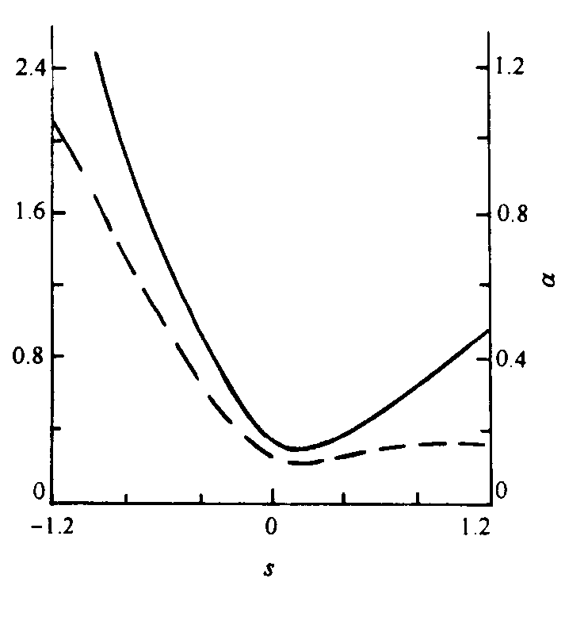

**图5.17** 临界稳定性条件下气球模参数$G$（实线）和$\alpha$（虚线）与磁剪切量$s$的关系〔63〕

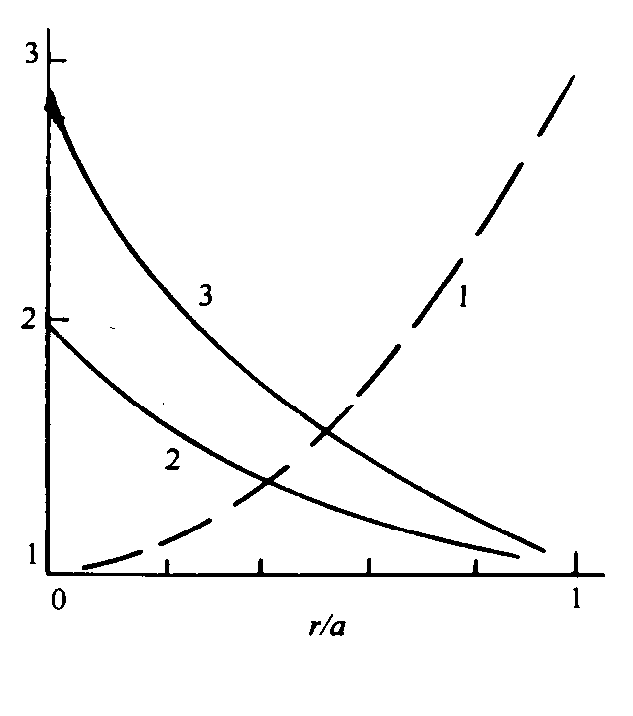

**图5.18** 用于比较正负剪切效应的$q$-剖面图〔63〕

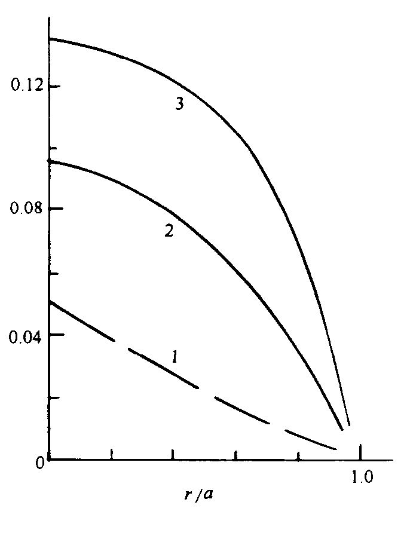

**图5.19** 稳定比压剖面与正负剪切的关系〔63〕

1. $q_{0} = 1, r = 2, l = 2$，2. $q_{0} = 2, r = -0.5, l = 0.5$，3. $q_{0} = 3, r = -2/3, l = 0.5$。

随着实验研究的进展，现代托卡马克装置中已能达到临界比压值，而且一些实验中获得了创纪录的稳定的高比压值，表明已进入第二稳定区。但是，仍然存在需要进一步解决的问题，这就是如何在长脉冲条件下使高比压等离子体被稳定地约束。因为在长脉冲放电条件下，即使理想气球模已被稳定化，电阻性气球模仍可能不稳定，这种不稳定性以较慢的方式影响等离子体的约束。这方面的理论要牵涉很深的等离子体理论知识，介绍有关理论研究已超出本书范围，但在第九章将介绍一些近期的有关研究成果。

## 参考文献

1. Spitzer L Jr. Physics of Fully Ionized Gases. New York: Interscience Publishers, INC., 1956
2. 宫本健郎著. 金尚宪译. 热核聚变等离子体物理学. 第九章. 北京: 科学出版社, 1981
3. 朱士尧. 核聚变原理. 合肥: 中国科技大学出版社, 1992
4. Grad H, Rubin H. Hydromagnetic equilibria and force- free field, in Proc UN Int Conf. Peaseful Uses At Energy, Geveva, 1958, 31 190
5. Shafranov V D. Plasma equilibria in a magnetic field, in Review of Plasma Physics. Vol. 2, Consultant Bureau, New York, 19
6. Suzuki Y. Nucl. Fusion, 1974, 14: 354
7. Mukhavot V S, Shafranov B D. Tokamak plasma equilibrium. Nucl. Fusion, 1971, 11: 605
8. 石秉仁, 李芳著, 宫野. 轴对称自由边界平衡问题的积分解法. 核聚变与等离子体物理, 1982, 2(3): 190
9. 石秉仁. 非均匀分布电流环流器平衡问题的近似解法. 科学通报, 1981, 26(3): 144
10. Greene J M, Johnson J L, Weimer K E. Physics Fluids, 1971, 14: 671
11. 石秉仁. 托卡马克等离子体平衡位形随时间的演变. 核工业西南物理研究院, 1980, 7
12. Hogan J L. In Method Comput. Phys. V.16 (ed. J. Killeen) New York: Academic Press, 1976. 211
13. 李有宜, 牟宗泽, 吴灵桥. 托卡马克位形与输运的自治计算. 核聚变与等离子体物理, 1982, 2(4): 193
14. 石秉仁. 快加热环流器的位形演变. 物理学报, 1981, 30(9): 1196
15. Peng Y- K M, Dory R A. Flux conserving tokamaks. Nucl. Fusion, 1977, 17: 21
16. Manheimer W M, Lashmore- Davies C N. MHD and Microinstabilities in Confined Plasma, Adam Hilger, Bristol and New York. IOC Publishing Ltd. 1989
17. Kadomtsev B B. Hydromagnetic stability of a plasma, in Review Plasma physics (ed. Leontovich M A), Consultant Bureau, Vol. 2, 1966
18. Wesson J A. Hydromagnetic stability of tokamaks. Nucl. Fusion, 1978, 18: 87
19. Bernstein I B, Frieman E A, Kruskal M D, Kulsrud R M. An energy principle for hydromagnetic stability problem. Proc. Roy Soc. 1958, A244: 17
20. Hazeltine R D. Meiss J D, Plasma confinement, Addison- Wesley Publishing Co. 1992
21. 石秉仁. 可压缩理想等离子体柱的稳定性. 物理学报, 1964, 20: 785
22. Shafranov V D. Hydromagnetic stability of a current- carrying pinch in a strong longitudinal magnetic field. Soviet Phys. Tech Phys., 1970, 15: 175
23. Mimov S V, Semenov I B. Investigation of instabilities of plasma column in T- 3 tokamak by correlation techniques. At Energy. USSR30 (1971), 20
24. Furth H P, Killeen J K, Rosenbluth M N. Finite resistive instabilities of a sheet pinch. Phys. Fluids, 1963, 6: 459
25. Rosenbluth M N, Rutherford P H. Stability of tokamak plasma, in Fusion Vol. 1, Magnetic confinement, Pt A. ed. E Teller. Academic Press, 1981. 中译本, 身骨兵等译. 北京: 原子能出版社, 1987
26. Furth H P, Rutherford P H, Rosenbluth M N. Tearing modes in the cylindrical tokamaks. Phys. Fluids, 1973, 16: 1054
27. Glasser A H, Furth H P, Rutherford P H. Stabilization of resistive kink modes in the tokamak. Phys. Rev. Lett. 1977, 38: 234
28. 李芳著, 徐文斌, 石秉仁. 环流器等离子体撕裂模型定电流剖面. 核聚变与等离子体物理, 1991, 11(4): 201
29. 马腾才, 宫野. 电流分布对破裂不稳定性的影响. 核聚变, 1981, 2(1): 1
30. 高庆弟, 于亭焱. 导体壳对电阻磁流体不稳定性的影响. 核聚变与等离子体物理, 1990, 10(3): 129
31. 郑永真, 石秉仁, 徐光碧等. HL- 1 装置的低$q$放电实验. 核聚变与等离子体物理, 1990, 10(2): 67
32. 严龙文, 石秉仁. 托卡马克等离子体中$q = 2$磁面附近的磁流体驰豫振荡. 核聚变与等离子体物理, 1990, 10(2): 112
33. Coppi B, Greene J M, Johnson J L. Resistive instabilities in a diffuse linear pinch. Nucl. Fusion, 1966, 6: 101
34. White R B. Theory of tokamak plasmas, Elsevier Science Publishers B V., 1989
35. Li D, Huo Y P. Nonlinear coupling of disparate helical tearing mode. Phys. Plasmas, 1994, 1: 315
36. Li D. A new algebric growth of nonlinear tearing mode. Phys. Plasmas, 1995, 2: 315
37. Li D, Wang C. Influence of poloidal rotation on the toroidally coupled tearing modes. Phys. Plasmas, 1995, 2: 1026
38. Li D. Instability criterion of tearing mode for arbitrary magnetic shear configurations. Phys. Plasmas, 1998, 5: 1231
39. Qu W X, Callen J D. Nonlinear growth of a single neoclassical MHD tearing mode in tokamak. Univ. Wisconsin Plasma Rep. 85- 5(1985)
40. Bussac M N, Pellat R, Edery D, Soule J. Internal ki nk modes in toroidal plasma with circular cross- section. Phys. Rev Lett., 1975, 35: 1638
41. Coppi B, Galvao R, Pellat R, et al. Resistive internal kink modes. Soviet Phys. Plasma Phys., 1977, 2: 533
42. Ara G, Basu B, Coppi B, et al. Magnetic reconnection and $m = 1$ oscillation in current carrying plasmas. Ann. Phys., 1978. (NY)112(2): 443
43. Migliuolo S. Theory of ideal and resistive $m = 1$ modes in tokamaks, Nucl. Fusion, 1993, 33(11): 1721
44. 石秉仁. 托卡马克内扭曲模色散关系中的磁剪切量. 核聚变与等离子体物理, 1995, 15(1): 7
45. 石秉仁. 氘氚燃烧托卡马克等离子体扭曲模稳定化分析. 核聚变与等离子体物理, 1992, 12(4): 193
46. 石秉仁, 隋国芳, 郭干城. 离子动力参数区托卡马克内扭曲模稳定性分析. 物理学报, 1996, 45(5): 801
47. SHI Bingren, SUI Guofang. Ion viscosity stabilization of tokakak resistive internal kink modes. Commun. Theor. Phys., 1998, 29(3): 453
48. 缪敏, 曲文孝. 反常电子粘滞性与锯齿崩塌. 核聚变与等离子体物理, 1998, 18(1): 1
49. 曲文孝, Callen J D. 反常输运与非线性自持磁岛的自洽分析. 核聚变与等离子体物理, 1997, 17(4): 1
50. 曲文孝, 缪敏. 非理想效应与$m = 1$内扭曲模本证方程. 核聚变与等离子体物理, 1998, 18(3): 1
51. Geoler S von, Stotick W, Sauthoff N. Studies of internal disruptions and $m = 1$ oscilations in tokamak discharges with soft- X ray techniques, Phys. Rev. Lett., 1974, 33: 1201
52. Rebhan E, Salat A. Nucl. Fusion, 1976, 16: 805
53. 石秉仁. 成形线圈系统对非圆截面等离子体竖直扰动的反馈镇定. 核聚变与等离子体物理, 1982, 2(2): 65
54. 李芳著等. 托卡马克垂直不稳定性控制. 核聚变与等离子体物理, 1995, 15(3): 6
55. 毛国平, 王中天. 小环径比托卡马克系统中的竖直位移不稳定性. 核聚变与等离子体物理, 1998, 18(3): 23
56. Stott P E. Density limit and disruptions in plasmas. Nucl. Fusion, 1988, 28(8): 1469
57. Hopcraft K I, Sykes A, Turner M F. Comparision of tokamak disruption simulations. Nucl. Fusion, 1988, 28(8): 1469
58. Connor J W, Hastie R J, Taylor J B. Shear, periodicity, and plasma ballooning modes. Phys. Rev. Lett., 1978, 40: 396
59. Troyan F, et al. MHD limits to plasma confinement. Plasma Phys. Contr. Fusion, 1984, 26: 209
60. 石秉仁. 环流器等离子体高$n$气球模的第二稳定区. 物理学报, 1983, 32(11): 1398
61. 石秉仁, 隋国芳. 含第二稳定区的环流器气球模分析. 物理学报, 1984, 33: 1546
62. 石秉仁, 隋国芳. 离子有限拉摩半径效应对环流器气球模的影响. 核聚变与等离子体物理, 1984, 4(2): 65
63. 石秉仁. 环流器等离子体压强分布关于理想磁流体气球模的最佳化. 核聚变与等离子体物理, 1985, 5(3): 179
64. 王晓刚, 石秉仁. 非圆截面环流器等离子体对于高$n$理想磁流体气球模的最佳压强分布. 核聚变与等离子体物理, 1986, 6(2): 9
65. 石秉仁. 高比压环流器等离子体位形的稳定性. 物理学报, 1982, 31(10): 1308

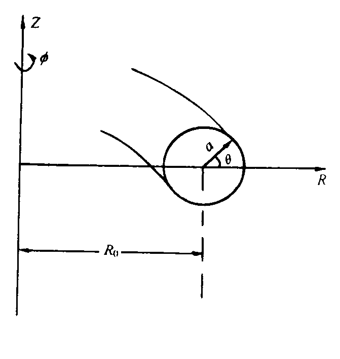

# 第六章 聚变等离子体的粒子动力论 (kinetic theory) 描述

本章将从粒子运动的层次来描述聚变等离子体的基本性质，这种描述也称等离子体的微观理论。在朗道的理论物理文集中，将这一层次的描述称为物理动力学(physical kinetics)，是较恰当的。很多人将“kinetic theory”译成“动力理论”，易与描述宏观运动特性的“dynamic”相混。本书则以粒子动力论或微观理论表述。另外，本书讨论的重点是与聚变装置中等离子体约束和加热性质有密切关系的内容，对一些最基本的粒子动力论性质，仅为叙述的完整性而简单引述，详细的讨论请参看一些专门参考文献(例如参考文献[1])。

## 6.1 聚变等离子体粒子相互作用的一般特性

简单地说，磁约束聚变等离子体是一类处在有界空间中，具有特殊磁约束位形的完全电离气体，这是一个电中性条件得到很好满足，粒子受到强磁场(外加磁场与自洽磁场)约束而集体相互作用非常强的物理体系。这一物理体系具有不均匀的空间分布，与周围环境存在强烈的作用，除了宏观性质可以近似地用磁流体动力学描述外，还有很多重要性质和过程需用粒子动力论来描述。首先考虑磁约束聚变等离子体的参数特征，不管将采用何种具体的约束位形，这类等离子体与宇宙空间等离子体或其它实验室中的应用等离子体所处的参数区有明显的差别，也与惯性约束装置中的等离子体处在完全不同的参数区。

当前磁约束聚变研究的最主要途径是托卡马克和先进环形约束装置(先进仿星器)。本书也将主要研究这些装置中的等离子体性质，因此，为讨论方便，下面将参数范围具体化，分别以A,B,C,D,E来代表中小型实验装置，大型实验装置，聚变堆中心约束区，聚变堆边缘区，及偏滤器区中的等离子体，于是，典型的粒子密度和等离子体温度(电子或离子)值如表6.1所示。

表6.1 磁约束聚变实验装置和反应堆中等离子体参数

| 类别 | 类别代号 | 粒子密度/cm³ | 电子（离子）温度/eV |
| --- | --- | --- | --- |
| 中小型实验装置 | A | $2\times10^{13}$ | 1000 |
| 大型实验装置 | B | $5\times10^{13}$ | 10000 |
| 反应堆主约束区 | C | $2\times10^{14}$ | 10000 |
| 反应堆边缘区 | D | $1\times10^{13}$ | 100 |
| 偏滤器区 | E | $1\times10^{14}$ | 20 |

在聚变堆边缘区及偏滤器区中等离子体存在与中性原子或分子的相互作用，以及与器壁材料的相互作用，这些内容将在第七章中介绍，本章主要研究A,B,C三类等离子体的微观性质。

### 6.1.1 Debye屏蔽

聚变等离子体的温度已远大于工作气体的电离能，因此工作气体实际上已被完全电离(器壁附近的边缘区例外)，其中的带电粒子间存在长程库仑相互作用。由于带同种电荷的粒子的作用力相斥，带异种电荷的粒子的作用力相吸，因此其中任一个粒子与其它粒子的作用必然受到另外异性粒子的屏蔽。由于电子的质量比离子轻得多，对空间区域中出现的任何多余的电荷，电子会很快地作出响应，其特征时间是电子的等离子体频率的倒数，即$\tau_{\mathrm{pe}} \approx \omega_{\mathrm{pe}}^{-1}$，这里

$$
\omega_{\mathrm{p}j} = \left(\frac{4\pi n_{j}e^{2}Z_{j}}{m_{j}}\right)^{1/2} \quad (6.1)
$$

如果把要考虑的一个粒子看成试验粒子，若它是正离子，则在其周围将形成一个电子云；反之，若试验粒子是电子，则它将排开一部分周围电子，使周围形成一个离子云。结果，试验粒子自身的库仑电势将受到这些云的屏蔽，这个性质在关于电介质的研究中已经清楚。对等离子体，利用粒子动力论方程描述，可以推导出具有任意运动速度的非相对论性带电粒子在等离子体中运动时周围静电势的公式[1](由于磁约束聚变等离子体的温度范围远达不到相对论性效应起作用的参数区，其中的粒子运动完全可以用牛顿力学来描述。只有在用微波加热的特殊情况下，部分高能电子的运动要用相对论力学来描述)。简言之，快速运动的粒子不存在库仑屏蔽，而速度慢于本底等离子体电子热速度的粒子，将受到库仑屏蔽。空间一点(其位置矢量为$x$) $x'$处电量为$q_j$的粒子的电势为

$$
\phi(x,t) = \frac{q_{j}}{|x-x'|}\exp\left(-\frac{|x-x'|}{\lambda_{\mathrm{D}j}}\right) \quad (6.2)
$$

式中$\lambda_{\mathrm{D}j}$为$j$类粒子的德拜(Debye)屏蔽距离，也称德拜长度

$$
\lambda_{\mathrm{D}j} = \left(\frac{T_{j}}{4\pi n_{j}q_{j}^{2}}\right)^{1/2}
= \frac{\sqrt{T_{j}/m_{j}}}{\omega_{\mathrm{p}j}} \quad (6.3)
$$

代入有关参数后容易看到，对磁约束聚变等离子体，离子和电子的德拜长度都远小于装置的几何尺寸。这意味着这些等离子体在非常高的程度上满足电中性条件。实际上，只有在非常靠近等离子体边界的区域，在宽度为德拜长度大小的等离子体鞘层中，电中性条件才不满足。

另一方面，磁约束等离子体中存在很强的外加的或自身运动产生的磁场，带电粒子将围绕磁力线作转动。为清楚起见，我们将A,B,C类装置中的磁场做一些规定，设中小型实验装置中的磁场为2 T，大型实验装置为4 T，反应堆中为6 T，按拉莫尔半径(回转半径)的公式，计算离子和电子的回转半径，

$$
\rho_{j} = \frac{m_{j}v_{\perp j}c}{q_{j}B}
= \frac{\sqrt{2T_{j}/m_{j}}}{\Omega_{j}} \quad (6.4)
$$

这里$\Omega_j$是带电粒子的回旋频率(拉莫尔频率)，

$$
\Omega_{j} = \frac{q_{j}B}{m_{j}c} \quad (6.5)
$$

可以发现，回转半径比德拜长度大得多。比值

$$
\frac{\lambda_{\mathrm{D}j}}{\rho_{j}} = \frac{\sqrt{2}\Omega_{j}}{2\omega_{\mathrm{p}j}} \quad (6.6)
$$

是一个重要的特征参量，对磁约束聚变等离子体它远小于1(见表6.2)。这意味着，在考虑两个带电粒子间在德拜球内的相互作用时，磁场的效应(使粒子轨道偏转)是可以忽略的。这只是说磁场对两个带电粒子间的散射角的计算的影响可以忽略，而绝对不是说库仑作用比磁场作用大。情况恰好相反，对磁约束聚变等离子体来说，带电粒子在电磁场中的运动是最基本的运动。如把等离子体自身的自洽电磁场包括进去，则确定等离子体约束性质的主要是带电粒子在总的电磁场中的运动特性，而粒子间的库仑相互作用所等价的碰撞仅起次要的作用。

对磁约束聚变等离子体来说，另一个非常重要的参数是以德拜长度为边长的正立方体中的粒子数(或简称德拜球内粒子数)，其倒数是一个重要的粒子动力论参数

$$
g = \frac{1}{n\lambda_{\mathrm{D}}^{3}} \quad (6.7)
$$

这一参量远小于1，因此在粒子动力论中被作为展开参数。

表6.2 磁约束聚变等离子体的一些特征量

| 类别代号 | $\lambda_D/\mathrm{cm}$ | $\rho_i/\mathrm{cm}$ | $\lambda_D/\rho_i$ | $\rho_i/a$ | 原文表内附加数值 | $\ln\Lambda$ |
| --- | --- | --- | --- | --- | --- | --- |
| A | $5\times10^{-3}$ | 0.22 | 0.021 | $10^{-2}$ | $4\times10^{-7}$ | 16.7 |
| B | $10^{-2}$ | 0.35 | 0.03 | $3.5\times10^{-3}$ | $2\times10^{-8}$ | 18.5 |
| C | $5\times10^{-3}$ | 0.24 | 0.021 | $10^{-3}$ | $4\times10^{-8}$ | 17.8 |

\* 在上表中，$\alpha$代表等离子体的小半径，对A,B,C类装置分别假定为$20\mathrm{cm},1\mathrm{m},3\mathrm{m}$。工作气体为氖。

### 6.1.2 二体碰撞

考虑两个带电粒子间的一次相互作用。在等离子体中，不可能存在这种单纯的相互作用，因为每个粒子同时与许多个粒子间存在库仑力作用，按粒子动力论的处理方法，先考虑德拜球内的一对带电粒子间的库仑作用，然后对所有粒子求统计平均得出总的效应。另一个问题是如何考虑磁场的影响。磁场使带电粒子绕磁力线转动，虽然在确定粒子的运动轨道时，粒子间的碰撞效应比磁场的作用要小得多，但由于带电粒子间有效的库仑相互作用仅发生在德拜球以内，而在磁约束聚变装置中离子的德拜长度又远小于回转半径，因此，就两个离子或离子与电子的一次碰撞过程所产生的对原先轨道的偏转而言，磁场的影响并不大(在德拜球内的离子回转半径的弧可以近似地用弦来代替)，这意味着一次库仑碰撞中离子-离子或离子-电子间的相互作用可以近似地用无磁场时的卢瑟福散射公式来计算。但对电子而言，在上述典型参考参数下，电子的回转半径与德拜长度为同量级量，因此磁场对电子-离子及电子-电子的库仑作用有明显的影响。因此，在下面引述的结果中，有关电子的散射结果应作一定的修正(参见参考文献[2])。有关库仑散射的计算在一般的原子物理书籍中均有叙述，这里简要地引述一些结果。取图6.1所示的质心坐标系，$b$为碰撞参量，$\chi$为质心系中观察的粒子碰撞前后的偏转角，$\sigma(\chi)\mathrm{d}\Omega$为粒子因散射而进入$\chi$方向小立体角$\mathrm{d}\Omega$的截面，则有

$$
\tan\left(\frac{\chi}{2}\right) = \frac{q_{1}q_{2}}{m_{t}u^{2}b} \quad (6.8)
$$

式中$m_t$为两个粒子的折合质量，$q_1,q_2$为它们的电荷数，$u$为相对速度。微分散射截面为

$$
\sigma(\chi) = \frac{(q_{1}q_{2})^{2}}{[2m_{t}u^{2}\sin^{2}(\chi/2)]^{2}} \quad (6.9)
$$

其中

$$
m_{t} = \frac{m_{1}m_{2}}{m_{1}+m_{2}} \quad (6.10)
$$

$m_1,m_2$为两个粒子的质量。

利用上述结果作进一步的讨论时，需区分不同的物理条件。首先是关于等离子体自身电子和离子间的相互作用情况，我们将设两者具有近似相同的温度。另外，要将质心坐标系中散射角化回实验室坐标中。对电子-离子体系，记$\theta$为实验室系统中散射角，分别有

$$
\begin{array}{lll}
\theta \approx \chi, & m_{1}\ll m_{2}\\
\theta \approx \chi/2, & m_{1}=m_{2}\\
\theta \approx \frac{m_{2}}{m_{1}}\sin\chi, & m_{1}\gg m_{2}
\end{array} \quad (6.11)
$$

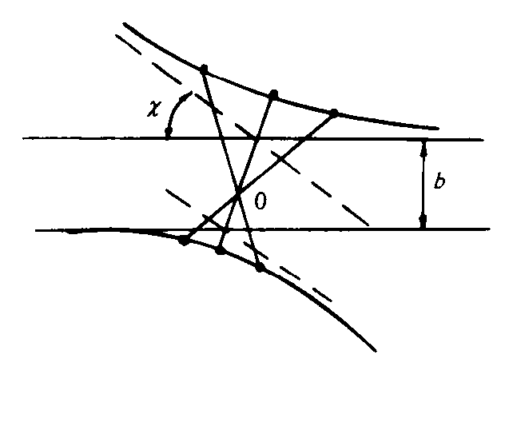

**图6.1** 质心系中带电粒子相互作用时轨迹图

这样，若一个粒子是电子，另一个是离子，则折合质量为电子质量，而相对速度可取为电子的速度，对小角度散射，记$\Delta\theta=\chi$，由式(6.9)近似得

$$
\Delta\theta \approx \frac{2Ze^{2}}{m_{e}v_{e}^{2}b} \quad (6.12)
$$

式(6.11)表明，一次库仑作用产生的偏转角的大小与粒子的能量成反比。此外，这种偏转是随机的，当对大量的这类相互作用求统计平均时，总的偏转为零

$$
\langle\Delta\theta\rangle = 0 \quad (6.13)
$$

具有实际意义的是偏转角的方均值。对德拜球内所有的可能库仑作用求统计平均，并计算试验粒子在等离子体中穿越长度为$L$的距离后产生的总效应，得出

$$
\left\langle(\Delta\theta)^{2}\right\rangle
= \int (\Delta\theta)^{2}F(\Delta\theta)\mathrm{d}(\Delta\theta) \quad (6.14)
$$

$$
F(\Delta\theta)\mathrm{d}(\Delta\theta) = nL2\pi b\mathrm{d}b \quad (6.15)
$$

结果得

$$
\left\langle(\Delta\theta)^{2}\right\rangle
= \frac{8\pi nLZ^{2}e^{4}}{m_{e}^{2}v_{e}^{4}}
\ln\left(\frac{b_{\max}}{b_{\min}}\right) \quad (6.16)
$$

式(6.16)给出等离子体粒子动力论的一个重要结果，即关于小角度散射的积累效应。这里的简化处理在物理实质上是与有关速度空间中“扩散”的福克-普朗克方程的严格处理等价的。在小角度散射公式中出现了一个对数因子，按一般等离子体物理理论研究中的讨论，碰撞参数$b$的最大值取为德拜长度，而最小值取为一次库仑作用产生90度散射的对应碰撞参数，即

$$
b_{\min} = \frac{Ze^{2}}{m_{e}v_{e}^{2}} \quad (6.17)
$$

于是得到所谓的库仑对数因子

$$
\ln\Lambda = \ln\frac{b_{\max}}{b_{\min}}
= \ln\left[\frac{3(\kappa T)^{3/2}}{2Ze^{3}\sqrt{\pi n_{e}}}\right] \quad (6.18)
$$

当电子温度高于$4.2\times10^{5}\mathrm{K}$时，上面的$\Lambda$因子需考虑量子效应修正，要乘一因子$(4.2\times10^{5}/T)^{1/2}$，相应地库仑对数值将有所减小。对上述约定参数的磁约束聚变等离子体，需要计入这一修正，于是

$$
\ln\Lambda = \ln\left[
\frac{3(\kappa T)^{3/2}}{2Ze^{3}\sqrt{\pi n_{e}}}
\left(\frac{4.2\times10^{5}}{T}\right)^{1/2}
\right] \quad (6.19)
$$

对于不同的磁约束聚变等离子体类别A,B,C，相应的库仑对数值示于表6.2，可以看到，对所举三种范例，库仑对数因子很接近。

将等离子体中具有热平均速度的电子看成试验粒子，若取产生于90度处的方均散射的距离$L$为该粒子在等离子体中的自由程，定义通过这一自由程的时间为碰撞驰豫时间，则

$$
\tau_{\mathrm{ei}} = \frac{L}{v_{\mathrm{te}}}
= \left(\frac{3^{1/2}\pi}{32}\right)
\frac{m_{i}^{1/2}T_{e}^{3/2}}{n_{e}Z^{2}e^{4}\ln\Lambda} \quad (6.20)
$$

类似地可以得出关于电子-电子间的积累散射公式，与电子-离子间的情况相比，除在角度和折合质量换算上有二倍差异，要用相对速度代入外，它仍为热速度量级，因此显然有

$$
\tau_{\mathrm{ee}}\approx\tau_{\mathrm{ei}} \quad (6.21)
$$

而对离子-离子间的库仑作用，折合质量为$m_i/2$，速度为相对速度，角度换算中有一因子2。结果应为

$$
\tau_{\mathrm{ii}}\approx (m_{i}/m_{e})^{1/2}\tau_{\mathrm{ei}} \quad (6.22)
$$

对离子-电子间作用，要注意角度换算中有一因子$(m_e/m_i)$，结果将有

$$
\tau_{\mathrm{ie}}\approx (m_{i}/m_{e})\tau_{\mathrm{ei}} \quad (6.23)
$$

在一次小角度碰撞中两个粒子间产生的能量转移可以用下式估计

$$
\frac{\delta E}{E}
= \frac{4m_{1}m_{2}}{(m_{1}+m_{2})^{2}}
\sin^{2}\left(\frac{\chi}{2}\right) \quad (6.24)
$$

经90度散射后的积累效应为

$$
\frac{\Delta E}{E}
\approx \frac{2m_{1}m_{2}}{(m_{1}+m_{2})^{2}} \quad (6.25)
$$

可见，同类粒子间的能量转移特征时间与同类粒子间90度散射的特征时间是接近的；但电子-离子间的能量转移特征时间要比散射特征时间长$(m_i/m_e)$倍

$$
\tau_{E,\mathrm{ei}}
= \frac{3m_{e}m_{i}}{8\sqrt{2\pi}n_{e}Z^{2}e^{4}\ln\Lambda}
\left(\frac{T_{e}}{m_{e}}+\frac{T_{i}}{m_{i}}\right)^{3/2} \quad (6.26)
$$

因此，在磁约束聚变等离子体中，电子自身建立能量平衡的时间最短，而离子自身建立能量平衡的时间尺度比电子间要长40倍左右；至于电子与离子间的能量平衡时间就要更长，是电子自身能量平衡时间的近2000倍。因此，在实验室条件下，出现电子和离子具有两种温度的可能性十分大。

另一种有意义的情况是一种高能粒子成分与本底等离子体的相互作用。这种与中性束注入加热、$\alpha$粒子加热，以及在微波加热中出现的部分高能成分粒子慢化的有关问题将在有关章节讨论。

## 6.2 带电粒子的运动特性和描述方法

在磁约束聚变实验装置和反应堆中，电子和离子的碰撞频率都很低，碰撞特征时间远大于带电粒子穿越装置特征长度所需时间(粒子自由程远大于其装置的特征尺寸)，即

$$
\tau_{\mathrm{ei}}v_{\mathrm{te}}/L\gg1,\quad
\tau_{\mathrm{ei}}v_{\mathrm{ti}}/L\gg1 \quad (6.27)
$$

因此，粒子间库仑相互作用对粒子运动的影响是次级因素。对应地，在粒子动力论意义上，如果将动力论方程链对小参数(例如上式中比值的倒数)展开，则在最低一级近似下，等离子体是无碰撞的带电粒子集合，这个物理系统的运动规律完全由初始条件及全体粒子在电磁场中的无碰撞运动特性所确定。但是要强调的是，所述电磁场是包括外加场和自洽场在内的，因此，等离子体自身运动产生的电磁场，包括不稳定性运动的电磁场也在其内。

在本小节中，我们主要介绍慢变化电磁场中带电粒子的运动。所谓慢变化，指的是电磁场的变化时间远大于粒子的回旋周期，或

$$
\Omega_{\mathrm{i,e}}\tau\gg1 \quad (6.28)
$$

此外，假定所考虑的电磁场随空间的变化也很慢，因而其特征空间尺寸远大于带电粒子的回转半径

$$
\rho_{\mathrm{i,e}}/L\ll1 \quad (6.29)
$$

满足以上条件的物理系统称渐变系统(adiabatic system)，在有些等离子体物理文献中按“adiabatic”的英文字母意思译成“绝热系统”，这一译名失去了真正的物理含义，因为这与热没有任何关系。(60年代初，已故卢鹤绂先生曾建议将adiabatic正确地译成“逐渐不变”，可惜未被已习惯于“绝热”译法者所接受。)

对磁约束聚变等离子体来说，其中绝大多数粒子的运动可以用经典力学运动方程来描述，相对论性效应不重要。只有在有关波与等离子体相互作用中部分电子的能量可以超过其相对论性静止能量$m_{e}c^{2}=0.511\mathrm{MeV}$，故需要考虑相对论性效应。

### 6.2.1 均匀强磁场中的电漂移

首先研究在均匀磁场中具有横向电场的情形，带电粒子的牛顿运动方程为

$$
m\frac{\mathrm{d}\mathbf{v}}{\mathrm{d}t}
= q\left(\mathbf{E}+\frac{1}{c}\mathbf{v}\times\mathbf{B}\right) \quad (6.30)
$$

$$
\mathbf{v}=\frac{\mathrm{d}\mathbf{r}}{\mathrm{d}t} \quad (6.31)
$$

这里不考虑平行于磁力线的电场，这一电场使带电粒子不断加(减)速，必须引入其它机制使之实现平衡。在第五章中讨论过这样一些机制，最简单的是电阻效应，它是电子与离子碰撞引起的。在碰撞不重要的情况下，如平行电流为有限量，则平行电场可以忽略。

在以下面的速度垂直于磁场运动的系统中，电场将消失。如果电场也是均匀的，于是剩下的就是在这一运动系统中带电粒子绕磁力线的回转运动及沿磁力线的自由运动。所以方程(6.31)的精确解为

$$
\mathbf{v} = v_{\parallel}\mathbf{b}
+ v_{\perp}\left[\mathbf{x}\cos(\phi_{0}-\Omega t)
+\mathbf{y}\sin(\phi_{0}-\Omega t)\right]
+\mathbf{v}_{E} \quad (6.33)
$$

式中$\mathbf{b}$是沿磁力线的单位矢量，$\mathbf{x}$和$\mathbf{y}$是垂直于磁力线的直角坐标的单位矢量。如果电场不是均匀的，或者是随时间变化的，则除上述结果外，还有一些次级效应：随时间的变化将产生沿电场方向的极化；随空间的变化将产生有质动力项(ponderomotive force)，它们分别以下式右方的两项所表示

$$
\mathbf{v}_{2}
= \frac{mc^{2}}{qB^{2}}\frac{\partial\mathbf{E}_{\perp}}{\partial t}
+\frac{mc^{2}}{2qB^{2}}\nabla E_{\perp}^{2} \quad (6.34)
$$

这个二级效应项与电荷符号有关，因此要引起沿电场方向的电流并积累起极化电荷。

### 6.2.2 漂移近似方程

在不均匀磁场中，运动方程组(6.30),(6.31)(非线性常微分方程)的解在一般情况下比较复杂，但在满足渐变条件的情况下，可以相当简单地用漂移近似来描述。建立局部的直角坐标系$(x,y,b)$，类似于式(6.33)，将速度写成

$$
\mathbf{v} = v_{\parallel}\mathbf{b}
+ v_{\perp}\left[\mathbf{x}\cos(\phi_{0}-\Omega t)
+\mathbf{y}\sin(\phi_{0}-\Omega t)\right]
+\mathbf{v}_{d} \quad (6.35)
$$

现在这一坐标的方向随粒子运动的轨道是变化的。将粒子的轨道(如图6.2所示)写成

$$
\mathbf{r}=\mathbf{R}+\boldsymbol{\rho} \quad (6.36)
$$

其中$\boldsymbol{\rho}$是由回转中心(gyro-center)，也称导向中心(guiding center)指向粒子所在位置的矢量确定的，其大小等于局部磁场所确定的回转半径值；$\mathbf{R}$是回转中心的坐标矢量，由平行于磁力线的运动及垂直于磁力线的漂移运动确定

$$
\frac{\mathrm{d}\mathbf{R}}{\mathrm{d}t}
= v_{\parallel}\mathbf{b}+\mathbf{v}_{d} \quad (6.37)
$$

漂移速度为

$$
\mathbf{v}_{d}
= \mathbf{v}_{E}
+\frac{c}{qB}\mathbf{b}\times
\left[\mu\nabla B+m v_{\parallel}^{2}\mathbf{b}\cdot\nabla\mathbf{b}\right] \quad (6.38)
$$

上式右方第一项是电漂移项，对电子和离子是相同的；方括号中两项分别表示由磁场不均匀性及磁力线曲率引起的磁漂移，它们与电荷符号有关，因此，这种漂移将引起等离子体的电流(反磁电流)。在式(6.38)中定义了一个称为磁矩的量

$$
\mu = \frac{mv_{\perp}^{2}}{2B} \quad (6.39)
$$

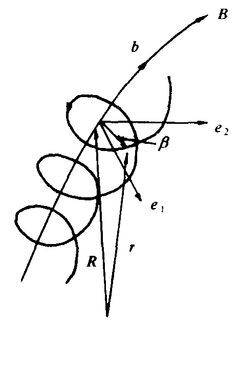

**图6.2** 回转中心坐标系

可以证明，在漂移近似下(即满足渐变条件下)，这是一个运动积分(不变量)，称渐态不变量(adiabatic invariant)(有些中文文献中称绝热不变量)

$$
\frac{\mathrm{d}\mu}{\mathrm{d}t}=0 \quad (6.40)
$$

另一个运动积分是粒子的总能量，因为磁场不会对粒子做功

$$
W=\frac{1}{2}mv_{\parallel}^{2}+\mu B+q\Phi=\mathrm{const} \quad (6.41)
$$

$\Phi$为电场的静电势函数。

如果把渐变条件(6.29)中的比值看成展开小量，则更严格的理论分析表明，直到二级近似，上述漂移近似的结果都正确。在磁约束聚变实验装置和反应堆中，对空间的变化来说，除在磁分界面附近的区域渐变条件不满足，在大部分约束区域都满足；在随时间变化方面，除在用电子回旋波或离子回旋波加热的条件下不满足渐变条件外，在其他包括存在各种低频不稳定模的情况下，漂移近似的结果都适用。由于电子和离子的回转半径都远小于装置的尺寸，因此在几乎所有的理论研究中，都将采用回转中心的轨道来代替粒子的真实轨道。带电粒子的运动被归结为沿磁力线的运动，绕磁力线的回旋运动及垂直于磁力线的漂移之和。在特殊的情况下，还需考虑一些二级运动，如式(6.34)所示的极化和有质动力项。

#### 6.2.3 回转中心的轨道：捕获粒子和飞行粒子[4]

在实际研究中，常常需要确定粒子的具体轨道。从单粒子约束的角度，一些高能粒子(中性束加热或波加热中产生的高能离子或电子，以及氘氚聚变产生的$\alpha$粒子)的轨道可能很大，与装置的尺寸可以比拟甚至超过；在粒子动力论研究中，确定粒子在平衡磁场中的粒子轨道是进行微扰研究的出发点。

要确定粒子的轨道，只要在漂移近似下确定回转中心的轨道就行了，为此需要知道三个运动积分。在渐变条件下，已有两个渐态不变量：磁矩和总能量。第三个运动积分可以通过下面的论证求出。在没有电场的情况下，可将回转中心的运动方程写成

$$
\frac{\mathrm{d}\mathbf{R}}{\mathrm{d}t}
= \frac{v_{\parallel}}{B}\nabla\times
\left[\mathbf{A}+\frac{mv_{\parallel}}{qB}\mathbf{B}\right] \quad (6.42)
$$

此式的意义是，回转中心的运动方程是与广义磁场

$$
\mathbf{B}^{*}
= \nabla\times\left(\mathbf{A}+\frac{mv_{\parallel}}{qB}\mathbf{B}\right) \quad (6.43)
$$

的磁力线方程一致的，因此，该广义磁场的磁力线与回转中心的轨道相重合。这样，在具有对称性的条件下，类似于实际磁场的磁面函数的讨论，可以给出另一个运动积分。特别是，若系统具有轴对称性，如理想磁镜和托卡马克(环形轴对称)，可以给出一个精确的运动积分：广义角动量：

$$
P_{\varphi}
= \frac{Ze}{c}\psi(R,Z)
+ mRv_{\varphi}\frac{B_{\varphi}}{B} \quad (6.44)
$$

式中$\psi(R,Z)$是第四章中定义的磁面函数，即极向磁通。三个运动积分：磁矩、能量和广义角动量，将确定平衡位形中粒子回转中心的轨道。对于简单磁镜位形，磁场在两端磁塞处最强，只有垂直速度大于临界值的粒子可以从磁塞处被反射回中心区，这就是磁镜约束条件

$$
\frac{v_{\perp}}{v}>\sqrt{\frac{B_{0}}{B_{s}}} \quad (6.45)
$$

这样，在粒子的速度空间将存在一个锥形逸出区，处于此锥内的粒子不被磁镜所约束。对托卡马克位形，由于环向磁场是不均匀的，因此类似于简单的磁镜磁场，有一部分粒子也会从磁场较强的环的内侧反射回来，这些粒子不可能回绕整个环运动，被局限于环的外侧的一定空间区域中。这类粒子称为捕获粒子(trapped particle)；大多数粒子可以沿环向自由运动，这些粒子称飞行粒子(passing particle)，或非捕获粒子(untrapped particle)，或穿行粒子(transit particle)。确定这些粒子分界的条件是平行速度是否会变成零

$$
v_{\parallel} = \pm\sqrt{\frac{2}{m}(W-Ze\Phi-\mu B)} \quad (6.46)
$$

写出托卡马克的磁场强度公式

$$
B = \sqrt{B_{p}^{2}+(\nabla\psi)^{2}/R^{2}} \quad (6.47)
$$

由于极向磁场$B_{p}=|\nabla\psi|/R$是一级小量，它对总磁场强度的贡献是二级小量，所以近似到一级小量时可以仅考虑环向磁场就够了，也就是

$$
B\approx B_{0}\left(1+\frac{r}{R}\cos\theta\right)^{-1} \quad (6.48)
$$

其中采用了以磁轴为中心的局部极坐标表示，$\frac{\pi}{2}\geq\theta\geq-\frac{\pi}{2}$代表环的外侧。这样就可确定捕获粒子的条件

$$
1+\frac{r}{R}
\geq\Lambda=\frac{\mu B_{0}}{W}
\geq1-\frac{r}{R} \quad (6.49)
$$

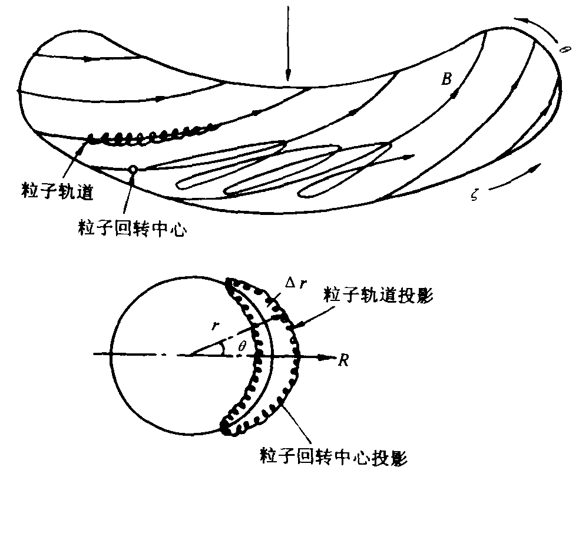

**图6.3** 托卡马克中典型的捕获粒子轨道

脚标0表示粒子处在环的上下顶端$(\theta=\pm\frac{\pi}{2})$时的值。近似地，捕获粒子的数量可以从上式得出

$$
\frac{n_{1}}{n}\approx\sqrt{\frac{2r}{R}} \quad (6.50)
$$

但是要特别注意，上式是关于捕获粒子比例的估计，而不是真正的捕获粒子空间密度分布。真正的空间密度与极向角有关，这可以从捕获粒子的轨道形状直接看出。捕获粒子的轨道类似于第四章中分析的理想磁面附近形成的磁岛的形状，在$\phi=\mathrm{const}$截面上其形状类似于香蕉(如图6.3所示)，称香蕉轨道(banana orbit)，所以捕获粒子又称香蕉粒子。每一香蕉轨道对应有一对反转点，在该点的粒子平行于磁力线的速度变为零。所有的捕获粒子都经过$\theta=0$的点，那些反转点$\theta_{1}<\theta$的捕获粒子对$(\theta,\pi)$范围内的捕获粒子密度没有贡献，而经过$\theta=\pi$点的捕获粒子数趋于零。近似地得到

$$
n_{1}(r,\theta)=n_{10}\cos\frac{\theta}{2} \quad (6.51)
$$

一般来说，电子的轨道非常接近于磁面自身，而离子的轨道则与磁面有一定的偏离。对于能量不很大的离子，可以近似地从轨道方程得出这一偏离的估计值：

$$
\delta r\approx -\frac{mv_{\parallel}c}{ZeB_{\theta}} \quad (6.52)
$$

以上只是在离磁轴较远的区域中才是正确的，但不适用于非常接近磁轴的区域。根据上面的分析，在非常接近磁轴时(即$r\rightarrow0$时)，将得出如下结果：(1)捕获粒子数趋于零；(2)捕获粒子及飞行粒子与磁面的偏离都趋于无限大。显然，这两个结论都是不正确的，而且这些结论直接影响新经典理论的结果。最近有人对非常靠近磁轴时的偏离作了更精确的估算(参见[10])。严格的分析要从轨道方程(6.44)出发，对大环径比托卡马克位形，可得到描述接近磁轴的粒子轨道为一个三次代数方程

$$
x^{3}+2(Iv_{\parallel0}/\Omega_{0})x
-\left(2I^{2}C_{1}/\Omega_{0}^{2}\right)
\left(v_{\parallel0}^{2}+\mu B_{0}\right)\cos\theta=0 \quad (6.53)
$$

式中$I=RB_{\phi}$，$\Omega_{0}$是粒子(电子和离子)在磁轴处的回旋频率，$x$是规范化长度，代表与磁轴的距离，$C_{1}$与磁通函数间的关系为

$$
r/R=C_{1}\sqrt{\psi} \quad (6.54)
$$

方程(6.53)的正实数解代表真实物理解。区分捕获粒子与飞行粒子的参数将是

$$
\kappa
= \frac{8}{27}
\frac{(I|v_{\parallel0}|/\Omega_{0})^{3}}
{(I^{2}C_{1}/\Omega_{0}^{2})^{2}
(v_{\parallel0}^{2}+\mu B_{0})^{2}} \quad (6.55)
$$

捕获粒子满足条件

$$
-1\leq\sigma\kappa\leq0 \quad (6.56)
$$

其中$\sigma=v_{\parallel0}/|v_{\parallel0}|$代表粒子的两个飞行方向。由这一理论得到的捕获粒子数将是

$$
f_{t}\approx\left(\frac{v_{1}}{\Omega_{0}}C_{1}^{2}\right)^{1/3} \quad (6.57)
$$

这一数值在接近磁轴时是有限值，而捕获轨道与磁面的偏离也将是有限量，由确定。

从粒子轨道分析可以得出如下三点重要结论：(1)具有最大轨道偏离的是那些刚好被捕获的粒子(barely trapped particle)，其平行于磁力线的速度在磁面的最内侧刚好为零，于是在磁面的最外侧其平行速度等于

$$
v_{\parallel}\approx\frac{2r}{R}v_{0} \quad (6.59)
$$

(2)反之，那些在磁面最外侧其垂直速度接近总速度的粒子将被捕获并停留在靠近最外侧的赤道平面附近，这些粒子称为深捕获粒子(deeply trapped particle)；(3)靠近磁轴处的粒子轨道与磁面的偏离加大，但相应的捕获粒子的总数减少。

飞行粒子与磁面也有一定的偏离，对离磁轴较远的情形，从粒子轨道方程(6.44)可以给出这一偏离的估计值

$$
\delta r\approx q\rho_{p} \quad (6.60)
$$

式中$q$为安全因子，$\rho_{p}$为用极向磁场计算的回旋半径。同样，在靠近磁轴时这一估计不正确，而且飞行粒子轨道具有四种不同的结构形式，限于篇幅，我们将不再引述。

#### 6.2.4 捕获粒子对外场的响应

由于捕获粒子不能沿整个磁面运动，它在外场作用下的运动特性与飞行粒子有重大差别，这一特点对托卡马克等离子体的约束性质有重要影响。

捕获粒子被限制在靠环的外侧局部空间区域中的原因是总能量守衡和磁矩近似守衡，因此磁场的不均匀性使捕获粒子运动轨道具有折返点。显然，这一性质不因存在其他外场而改变，尤其是，若外场的势函数也是磁面函数时，捕获粒子的折返点是近似不变的。于是，若有等效的径向电场$K_{r}$，则所产生的极向漂移$v_{\theta}=-cK_{r}B_{\theta}/B^{2}$的总效应不是使捕获粒子沿极向自由漂移，而是沿磁力线的运动速度加快或减慢，对整个捕获轨道平均后，总效应是产生一个附加的沿环向的运动速度。可以用约束条件

$$
v_{\theta}=0 \quad (6.61)
$$

来描述总体效应，然后由

$$
K_{r}+\frac{1}{c}(v_{\theta}B_{\varphi}-v_{\varphi}B_{\theta})=0 \quad (6.62)
$$

代入(6.55)得出

$$
v_{\theta}=cK_{r}/B_{\theta} \quad (6.63)
$$

这一运动速度比直接由局部漂移公式给出的大$(B_{\theta}/B_{\varphi})$倍。同样的讨论可以给出，环向等效电场将产生一个大的沿径向的速度：

$$
v_{r}=-cK_{\theta}/B_{\theta} \quad (6.64)
$$

捕获粒子虽数目少于飞行粒子，但由于对外场的特殊响应特性，其整体贡献可以超过飞行粒子。这一类性质的问题被称为“新经典效应”，在托卡马克输运和稳定性分析研究中很重要。其中式(6.57)和(6.59)可以直接和所谓的“自举电流”及“Ware 缩效应”联系起来。

可以对带电粒子的漂移近似方程进行更严格的分析或进行数值方法求解，这样的研究工作在文献中很多。很重要的一点是，对高能离子的轨道要进行较精确的计算，因为这些离子有可能因轨道与限制器或器壁相交而直接损失，使靠近边界的粒子的损失率加大。类似于磁镜情形，托卡马克位形中在粒子的速度空间也存在逸出锥，但与磁镜不同的情形是，在这种情况下，与磁面偏离最大的离子最容易损失，而逸出锥的形状和大小与粒子速度大小及磁面位置有关。从上面对捕获粒子轨道的分析可以看出，要减少这类损失，需加大极向磁场，也就是在保证磁流体稳定性的条件下加大环向电流。

## 6.3 等离子体集体相互作用的描述：玻-麦方程组、经典和新经典输运[6,8]

对等离子体集体相互作用采用两种描述方法：一种是将等离子体的电子和离子的全体都看成是位置空间和速度空间中的连续介质，用各自的粒子分布函数来描述系统的统计状态，如果知道每一时刻的分布函数，就确定了系统的全部物理状态和性质。对分布函数的变化，采用气体分子运动论中的方法，由初始条件及包括二体碰撞项的玻尔兹曼-麦克斯韦方程确定其变化；另一种分析方法是将等离子体看成分立的多粒子体系，在初始条件给定后，由$N$维位置空间和$N$维速度空间中的刘维方程确定其力学运动，$N$是电子和离子的各自粒子总数。显然，这样的力学方程是无法求解的，但在此基础上，对$N-1$个粒子的位置空间和速度空间积分，留下单粒子分布函数，它基本上等价于第一种方法中的连续分布函数，但可由二粒子分布函数来确定二体关联，它基本上就是二体碰撞项。这样，两种描述方法在很大的范围内重合，但后者可以包括对热涨落(thermal fluctuation)现象的描述。不过，实验证实，在大多数有意义的情况下，由等离子体湍流涨落引起的宏观效应远大于热涨落效应，而等离子体湍流可以用玻-麦方程来描述，很多情况下甚至连二体碰撞也不重要。因此，我们主要介绍玻-麦方程。

### 6.3.1 玻-麦方程的一般形式

我们不再重复写出麦克斯韦电磁场方程组，但要记住，下面讨论的电磁场都是自洽场，即包括外加电磁场和等离子体内部电荷和电流产生的电磁场。结合磁约束聚变等离子体的参数范围，我们将不考虑相对论效应。令$f_{s}(x,v,t)$为$s$类粒子的分布函数，其变化由动力论方程即玻-麦方程确定

$$
\frac{\partial f_{s}}{\partial t}
+\mathbf{v}\cdot\nabla f_{s}
+q_{s}\left(\mathbf{E}+\frac{1}{c}\mathbf{v}\times\mathbf{B}\right)\cdot
\frac{\partial f_{s}}{\partial\mathbf{v}}
=C_{s}(f_{s}) \quad (6.65)
$$

上式左方实际上是分布函数对位置和速度空间变数的全微分，可以简写成$\frac{\mathrm{d}f_{s}}{\mathrm{d}t}$，并且对于变量变换具有不变性。如果没有碰撞，式(6.65)化成六维空间中的刘维方程，这一方程称弗拉索夫方程(Vlasov equation)：

$$
\frac{\mathrm{d}f_{s}}{\mathrm{d}t}
=\frac{\partial f_{s}}{\partial t}
+\mathbf{v}\cdot\nabla f_{s}
+q_{s}\left(\mathbf{E}+\frac{1}{c}\mathbf{v}\times\mathbf{B}\right)\cdot
\frac{\partial f_{s}}{\partial\mathbf{v}}
=0 \quad (6.66)
$$

粒子运动积分的任意函数都是该方程的解，如果可以找到运动不变量，动力论方程的形式可以简化，这将在下面的例子中说明。此外，在实际求解时要考虑一些基本物理规律，例如粒子体系离热平衡态的偏离是小量，无扰动场时，分布函数为麦氏分布，等等。

### 6.3.2 碰撞积分的形式：朗道算子

符合库仑长程相互作用条件下的粒子间的二体碰撞项首先是朗道推导出来的(Landau,1944)，后来罗森布拉斯(Rosenbluth,1955)给出了一种称为罗森布拉斯势的形式[7]，与朗道的结果是完全一致的。以后，在不同的问题中，这一算子的形式有不同的简化表示式，在需要时我们将介绍有关形式。朗道的形式为

$$
C_{s}(f_{s})
=\sum_{s'}\int\int
\left[
f_{s}(\mathbf{p})\frac{\partial^{2}}{\partial p_{\alpha}\partial p_{\beta}}
-f_{s'}(\mathbf{p}')\frac{\partial^{2}}{\partial p_{\alpha}'\partial p_{\beta}'}
\right]
B_{\alpha\beta}\,\mathrm{d}^{3}p' \quad (6.67)
$$

求和对包括自身粒子类型在内的所有粒子类型进行，被积式中的函数$B_{\alpha\beta}$可写为

$$
B_{\alpha\beta}
=\frac{2\pi q_{s}^{2}q_{s'}^{2}}{|\mathbf{v}-\mathbf{v}'|}
A\left[
\delta_{\alpha\beta}
-\frac{(v_{\alpha}-v_{\alpha}')(v_{\beta}-v_{\beta}')}
{(\mathbf{v}-\mathbf{v}')^{2}}
\right] \quad (6.68)
$$

$\mathbf{p}$为动量，$A$为库仑对数。

罗森布拉斯等人推出一个与上述朗道形式不同但实质一致的碰撞算子形式，称RMJ形式[7]，引入两个辅助函数

$$
G_{s}(\mathbf{v})
=\int\mathrm{d}^{3}v'f_{s}(\mathbf{v}')u \quad (6.69)
$$

$$
H_{s}(\mathbf{v})
=\int\mathrm{d}^{3}v'f_{s}(\mathbf{v}')/u \quad (6.70)
$$

式中$u=|\mathbf{v}-\mathbf{v}'|$是相对速度，一般的碰撞算子就可以表示成

$$
C_{ss'}
=\frac{\gamma_{ss'}}{2}
\left\{
\frac{1}{m_{s}}
\frac{\partial^{2}}{\partial v_{\alpha}\partial v_{\beta}}
\left(f_{s}\frac{\partial^{2}G_{s'}}{\partial v_{\alpha}\partial v_{\beta}}\right)
-2\left(\frac{1}{m_{s}}+\frac{1}{m_{s'}}\right)
\frac{\partial}{\partial v_{\alpha}}
\left(f_{s}\frac{\partial H_{s'}}{\partial v_{\alpha}}\right)
\right\} \quad (6.71)
$$

RMJ形式在数值计算中的应用比原始的朗道形式方便，但仍然太复杂，在很多具体情况下，可以对碰撞算子的形式进一步简化。如在二体碰撞过程中，其他物理过程就显得不重要了，这时为了估计碰撞的影响，可以将碰撞积分写成

$$
C_{s}(f_{s})=-\nu_{\mathrm{eff}}(f_{s}-F_{s0}) \quad (6.72)
$$

等式右方被表示成等效碰撞频率与分布函数对平衡分布的偏差之积，文献中称式(6.72)形式的碰撞积分为克鲁克(Krook)碰撞算子。

由于电子质量远小于离子质量，电子和离子间的碰撞积分形式可以进一步简化为

$$
C_{\mathrm{ei}}
=\frac{1}{m_{i}n_{i}}\mathbf{F}_{\mathrm{ei}}\cdot
\frac{\partial f_{i}}{\partial\mathbf{v}}
+\frac{m_{e}}{m_{i}}\frac{1}{\tau_{\mathrm{ei}}}
\frac{\partial}{\partial\mathbf{v}}\cdot
\left[
(\mathbf{v}-\mathbf{v}_{i})f_{i}
+\frac{T_{e}}{m_{i}}\frac{\partial f_{i}}{\partial\mathbf{v}}
\right] \quad (6.73)
$$

其中$\mathbf{v}_{i}$是离子的宏观速度，阻尼力

$$
\mathbf{F}_{\mathrm{ei}}
=-\gamma_{\mathrm{ei}}n_{i}\int\mathrm{d}^{3}v\,
f_{e}\mathbf{v}/v^{3}
+\frac{m_{e}n_{e}}{\tau_{\mathrm{ei}}}\mathbf{v}_{i} \quad (6.74)
$$

$$
\gamma_{\mathrm{ei}}
=\frac{4\pi Ze^{4}}{m_{i}}\ln\Lambda \quad (6.75)
$$

在不同的情况下，还可以引入其它的简化形式。

### 6.3.3 动力论方程的简化形式：漂移动力论方程和回旋动力论方程

对强磁场中的等离子体，正如粒子运动方程可以用简化描述来代替一样，动力论方程也可以简化。第一种简化形式是将分布函数看成是粒子的回转中心的分布函数，根据6.2节中的讨论，回转中心的运动速度可以表示成

$$
\mathbf{v}_{g}=v_{\parallel}\mathbf{b}+\mathbf{v}_{D} \quad (6.76)
$$

而且漂移速度$\mathbf{v}_{D}$与平行速度$v_{\parallel}$相比是一级小量，此外磁矩

$$
\mu=mv_{\perp}^{2}/2B \quad (6.77)
$$

是近似的运动不变量，当磁场不变时，另一运动不变量是总能量

$$
U=\frac{1}{2}mv^{2}+Ze\Phi \quad (6.78)
$$

$\Phi$是静电势。当磁场变化时，总能量将变化

$$
\frac{\mathrm{d}U}{\mathrm{d}t}
=Ze\frac{\mathrm{d}\Phi}{\mathrm{d}t}
+\mu\frac{\mathrm{d}B}{\mathrm{d}t}
+\mathbf{v}_{g}\cdot[Ze\mathbf{E}-\mu\nabla B] \quad (6.79)
$$

其中电场由法拉弟定律给出

$$
\mathbf{E}=-\nabla\Phi-\frac{1}{c}\frac{\partial\mathbf{A}}{\partial t} \quad (6.80)
$$

$\mathbf{A}$为磁场的矢势。根据刘维方程对运动变量变换的不变性，当用回旋中心的坐标来描述时，粒子动力论方程化成

$$
\frac{\partial f}{\partial t}
+(\mathbf{v}_{g}+\mathbf{v}_{D})\cdot\nabla f
+\frac{\mathrm{d}U}{\mathrm{d}t}\frac{\partial f}{\partial U}
=C \quad (6.81)
$$

上式称为漂移动力论方程，它比一般动力论方程至少可以减少一个变数，这实际上是因为另一个变数(回旋角)消去了，等效于分布函数的变化对回旋角进行了平均。

在磁约束聚变等离子体与波或不稳定模相互作用问题中，常常要考虑波长与粒子回转半径同量级的情况，此时上述漂移动力论方程就不够精确。要用一个更严格的近似方程。(仍然对回转角变数求平均，但保留$\mathbf{k}\cdot\boldsymbol{\rho}$级量。这一方程的推导相当复杂，但又非常重要，我们建议有兴趣的读者参看Hazeltine等人的专著[6]。)

### 6.3.4 速度分布函数的线性化和准线性化演变

在实际问题中，常常出现这样一种情形，即物理状态可以由缓慢变化的部分及快变化的扰动部分组成，而慢变部分(包括对平衡态的小偏离)确定了物理状态的宏观特性，快变部分以统计形式构成对这种演化的贡献。设零级分布函数为$F^{0}$，将一般分布函数写成

$$
f=F^{0}+f_{1} \quad (6.82)
$$

忽略扰动分布函数的二阶项，扰动分布函数的线性化演变方程为

$$
\frac{\partial f_{1}}{\partial t}
+\mathbf{v}\cdot\nabla f_{1}
+q\left(\mathbf{E}+\frac{1}{c}\mathbf{v}\times\mathbf{B}_{0}\right)\cdot
\nabla_{v}f_{1}
=-q\left(\delta\mathbf{E}+\frac{1}{c}\mathbf{v}\times\delta\mathbf{B}\right)\cdot
\nabla_{v}F^{0}
+C(f_{1})
$$

式中碰撞项也对扰动分布线性化，以上方程通过色散关系确定各种扰动模式的结构和随时间的增长率。在扰动电磁场的作用下，零级分布也将由原始的平衡分布开始演变，下面只考虑静电扰动的情形，则

对实际发生在磁约束聚变实验装置中的情况，往往是扰动电场的贡献远大于碰撞的效应。在下面关于反常输运的研究中，主要考虑扰动电磁场的效应。

本节中，作为应用玻-麦方程来研究集体相互作用的例子，我们引述关于碰撞引起不均匀等离子体输运的主要结果。

### 6.3.5 磁场中等离子体的经典输运

这一内容包括了基础等离子体物理的一大块理论，由于本书的主要目的不是讨论等离子体物理的基本问题，我们只能非常简单地引述一些主要的结果。假定等离子体粒子的回转中心的速度分布函数具有局部麦氏分布形式

$$
F_{\mathrm{M}}
=n(r)\left(\frac{m}{2\pi T(r)}\right)^{3/2}
\exp\left(-\frac{mv^{2}}{2T(r)}\right) \quad (6.85)
$$

这里假定粒子密度和温度仅为磁面坐标的函数。在更简单的圆柱近似下，则仅为柱半径$r$的函数。

离子回绕磁力线的运动引起对分布函数的一个小修正

$$
\widetilde{f}
=-\boldsymbol{\rho}\cdot\nabla F_{\mathrm{M}}
=-\frac{f_{\mathrm{M}}}{\Omega}\mathbf{b}\times\mathbf{v}\cdot
\left\{
\nabla\ln n+\frac{e\Phi}{T}
+\left[\frac{U-e\Phi}{T}-\frac{3}{2}\right]\nabla\ln T
\right\} \quad (6.86)
$$

式中$U=\frac{mv^{2}}{2}+e\Phi$为离子的总能量。电子离子碰撞的效应产生的阻尼力为

$$
\mathbf{F}_{c}=\int\mathrm{d}v\,m\mathbf{v}C(\widetilde{f}) \quad (6.87)
$$

脚标$c$表示经典碰撞，它使粒子产生一个附加的小漂移，相当于一个粒子流，

$$
n\mathbf{v}_{c}=-\frac{c}{eB}\mathbf{b}\times\mathbf{F}_{c} \quad (6.88)
$$

对于由电子和一种离子构成的纯等离子体，这个阻尼力等于：

$$
\mathbf{F}_{c}
=\frac{nme}{\tau_{e}}
\left[
\mathbf{v}_{\perp i}-\mathbf{v}_{\perp e}
-\frac{3}{2}\frac{c}{eB}\mathbf{b}\times\nabla T_{e}
\right] \quad (6.89)
$$

上式中的垂直速度对应于对静磁平衡态的一级扰动速度

$$
n\mathbf{v}_{\perp s}
=\frac{c}{e_{s}B}\mathbf{b}\times
[\nabla p_{s}+e_{s}n\nabla\Phi] \quad (6.90)
$$

其中电势$\Phi$是双极电势，将扩散流写成通常用扩散系数$D$表示的形式，即$n\mathbf{v}_{e}=-D_{e}\nabla n_{e}$消去双极电势项，得到

$$
D_{e}=\frac{1}{2}v_{e}\rho_{e}^{2}\left(1+\frac{T_{i}}{T_{e}}\right) \quad (6.91)
$$

实际上这个量非常小，对托卡马克等离子体，实验观察到的电子反常扩散系数比经典扩散值大$2\sim3$个数量级。

碰撞经典引起的热传导可以用类似的方法推出，经典热流密度矢量为：

其中与碰撞有关的积分定义为:

$$
G_{\mathrm{c}} = \int \mathrm{d}^{3}\nu \frac{1}{2} m\nu^{2}\nu C(-\rho \cdot \nabla F_{\mathrm{M}}) \tag{6.93}
$$

近似的估计给出

$$
\begin{aligned}
G_{\mathrm{di}}&\approx p\nu_{\mathrm{ti}}\nu_{\mathrm{ti}}(\rho_{\mathrm{i}} / L) \\
G_{\mathrm{ce}}&\approx p\nu_{\mathrm{te}}\nu_{\mathrm{te}}(\rho_{\mathrm{e}} / L)
\end{aligned} \tag{6.95}
$$

因此离子热流与电子热流之关系大约为:

$$
q_{\mathrm{di}}\approx \left(\frac{m_{\mathrm{i}}}{m_{\mathrm{e}}}\right)^{1 / 2}p\nu_{\mathrm{e}}\approx \left(\frac{m_{\mathrm{i}}}{m_{\mathrm{e}}}\right)^{1/2}q_{\mathrm{ce}} \tag{6.96}
$$

更精确的计算式为:

$$
q_{\mathrm{di}} = -2(m_{\mathrm{i}}\Omega_{\mathrm{e}}^{2}\tau_{\mathrm{e}})^{-1}p_{\mathrm{i}}\nabla T_{\mathrm{i}} \tag{6.97}
$$

$$
q_{\mathrm{ce}} = -(m_{\mathrm{e}}\Omega_{\mathrm{e}}^{2}\tau_{\mathrm{e}})^{-1}\left[4.66p_{\mathrm{e}}\nabla T_{\mathrm{e}} - \frac{3}{2} T_{\mathrm{e}}\nabla p\right] \tag{6.98}
$$

式中$\pmb{p}$为总压强。

对应地得出电子和离子的经典热导率为

$$
\kappa_{\mathrm{e}} = 4.66n_{\mathrm{e}}\rho_{\mathrm{e}}^{2} / \tau_{\mathrm{e}} \tag{6.99}
$$

$$
\kappa_{\mathrm{i}} = 2n_{\mathrm{i}}\rho_{\mathrm{i}}^{2} / \tau_{\mathrm{ii}} \tag{6.100}
$$

上面用粒子动力论方法推导出来的扩散系数和热导率的表示式,是与随机行走方法估计出来的公式一致的。根据随机行走得出的输运系数是

$$
D,\chi \propto \nu (\Delta x)^{2} \tag{6.101}
$$

对横越磁场的输运,随机行走的步长显然是电子或离子的回转半径,计及双极电场的作用,就得到式(6.91)中的扩散系数和(6.99),(6.100)中的热导率,只是不能得出公式前面的数值因子,另外, $\kappa = n\chi$。

#### 6.3.6 新经典输运[8]

在环形约束系统中,粒子的轨道与磁面位置间可以存在较大的偏离,尤其是捕获粒子,其香蕉轨道的宽度远大于回转半径。碰撞可以使粒子的轨道发生突变,同时可以使捕获粒子变成飞行粒子或相反,因此,环形约束系统中的粒子输运也必然与粒子运动特性有内在联系。这种考虑粒子轨道因素的输运理论就是新经典输运理论。这一理论仍基于经典碰撞机理,但每次碰撞产生的随机行走的步长是与粒子的运动轨道相联系的。这是一种速度空间与位置空间结合起来的输运理论,最早是原苏联学者伽里也夫(Galeev)和萨格杰也夫(Sagdeev)提出来的,可以说是在磁约束聚变研究推动下粒子动力理论方面的一个创举。

对托卡马克,由于轴对称性,粒子轨道的分析变得比较简单(见6.2节)。用随机行走估计可以看出捕获粒子如何影响输运。捕获粒子在速度空间中仅处在角度为$\Delta \theta = (r / R)^{1 / 2}$的锥形区域中,因此,用不到$90^{\circ}$碰撞就会使其脱离捕获区,而这种变化意味着一个很大的随机步长。有效碰撞频率为

捕获粒子香蕉轨道的特征宽度为

$$
(\Delta x)_{\mathrm{b}} = (R / r)^{1 / 2}q\rho \tag{6.103}
$$

于是得出捕获粒子对输运系数的估计

$$
D = (r / R)^{1 / 2}\nu_{\mathrm{eff}}(\Delta x)_{\mathrm{b}}^{2} = (R / r)^{3 / 2}q^{2}\nu \rho^{2} \tag{6.104}
$$

因此,仅捕获粒子对输运的贡献即已比经典输运大一个因子$(R / r)^{3 / 2}q^{2}$ ,对大部分约束区域,这个因子的数量级是100。事实上,新经典效应也主要来自捕获粒子,飞行粒子的贡献虽然比经典情况大一些,但比捕获粒子要小一个数量级。这一点对其他要用粒子动力论描述的物理过程也是适用的,因此,在很多有关托卡马克微观不稳定性的作用机制研究中,捕获粒子效应常常起决定性的作用。

在考虑新经典效应的粒子动力论分析中,区分碰撞是否重要的参数是捕获粒子的有效碰撞频率与这种粒子沿捕获轨道运动的周期的乘积。这个参数称无量纲碰撞数

$$
\nu^{*} = \left(\frac{R}{r}\right)^{3 / 2}\nu q R / \nu_{\mathrm{t}} \tag{6.105}
$$

而按照$\nu^{*}\ll 1,\nu^{*}\approx 1,\nu^{*}\gg 1$将系统定义成香蕉参数区,坪区和碰撞区(磁流体区)。当然,这种定义对电子和离子可以分别进行。式(6.104)给出的是香蕉参数区的输出系数的估计。对坪区(即粒子在绕香蕉轨道运动过程中就可能发生碰撞的情形),将$\nu^{*} = 1$的条件代入式(6.104),即取$(R / r)^{3 / 2}\nu = \nu_{\mathrm{t}} / q R$ ,就得出坪区的新经典输运系数的表示式。碰撞区的输运系数可以直接由磁流体方程组导出,其中考虑了环形效应引起的电荷分离产生的电场作用,结果是对经典输运系数乘一个因子$(1 + 1.6q^{2})$。对于粒子的扩散,和经典输运的情况一样,要考虑双极电势的修正,而热导率与双极电势无关。用粒子动力论方法推导出来的离子热传导为:

$$
\chi_{\mathrm{i}} = \left\{ \begin{array}{ll}
0.66(R / r)^{3 / 2}q^{2}\nu \rho_{\mathrm{i}}^{2} & (\text{香蕉区}) \\
1.9q\nu_{\mathrm{ii}}\rho_{\mathrm{i}}^{2} / R & (\text{坪区}) \\
(1 + 1.6q^{2})\nu \rho_{\mathrm{i}}^{2} & (\text{碰撞区})
\end{array} \right. \tag{6.106}
$$

这一结果表示在图6.4中。

在托卡马克装置中,新经典扩散系数及电子热导率比实验观察到的相应量小很多,但离子热导率的大小与实验值很接近。这是因为,托卡马克等离子体的扩散和电子热传导主要是由微观不稳定性引起的反常输运决定的;离子热传导在一定条件下也可能出现反常,这时实际测量值可能超过新经典值几倍。

对于非常接近磁轴的区域,以上结果也需作重大修正[10]。首先看到,根据小轨道偏离理论得出的结果,存在下

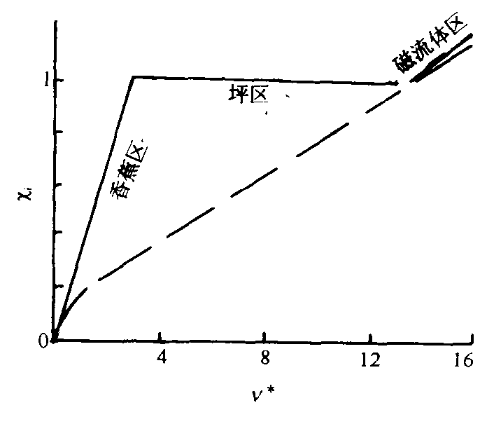

**图6.4** 新经典输运系数随碰撞参数的变化[8]

对应于文中关于香蕉区、坪区及碰撞区的近似公式:

- -为统一理论得出的光滑结果。

述不正确的结论:(1)在接近磁轴时,捕获粒子数趋于零,这已在上一小节中讨论,但这一结论对新经典输运的表现为,由于式(6.105)中的无量纲碰撞参数在接近磁轴时发散,因此,磁轴附近一定属于坪区,这一结论是不正确的;(2)香蕉区输运系数在接近磁轴时发散,这一结论也是不正确的。通过求解有限轨道条件下的漂移粒子动力论方程,可以得到严格的结果,以新经典离子热导率为例,定义横越磁面的热流通量的平均值为

$$
\langle q\cdot \nabla \psi \rangle = -n_{i}\chi_{\nu}\frac{\mathrm{d}T_{i}}{\mathrm{d}\psi} \tag{6.107}
$$

则

$$
\chi_{\nu} = 0.8\nu_{i}\left(\frac{I\nu_{\mathrm{ii}}}{\Omega_{0}}\right)^{7 / 3}\left(\frac{q}{I R}\right)^{1 / 3} \tag{6.108}
$$

这一表示式与一维情况下具有不同的量纲关系,使用时应予注意。

#### 6.3.7 自举电流(Bootstrap current)

新经典理论的另一重要物理结果是关于存在自举电流的论述。这是上一小节中关于捕获粒子在径向力作用下存在沿环向漂移运动的自然结果。"Bootstrap"一词的原意是"鞋带",利用了希腊神话中英雄Alice以自己的鞋带将自身悬挂在空中的含义,也就是以自身机制不用"外力"来驱动的电流。最初推导自举电流的理论分析是相当复杂的,但利用上一小节引入的关于捕获粒子沿极向运动的限制条件,这一推导将变得非常直观[11]。考虑香蕉区情形,将捕获粒子看成一类特殊的流体,由捕获粒子的流体动力学平衡条件。

$$
\nabla p_{\mathrm{y}} = \frac{1}{c} j_{\mathrm{y}}\times B = \frac{1}{c} [j_{\theta_{1}}B_{\theta} - j_{\theta_{1}}B_{\theta}] \tag{6.109}
$$

加上捕获粒子沿极向运动的限制条件

$$
j_{\theta_{1}} = 0 \tag{6.110}
$$

得出:

$$
j_{\theta_{1}} = -c\nabla p_{\mathrm{y}} / B_{\theta} \tag{6.111}
$$

将电子和离子的贡献相加,即得

$$
j_{\mathrm{boost}} = -c\sqrt{2r / R\nabla p} / B_{\theta} \tag{6.112}
$$

更严格的分析给出[6]

$$
j_{\mathrm{boost}} = \frac{P_{e}}{B_{\theta}}\left(\frac{r}{R}\right)^{1 / 2}\left[-2.44\left(1 + \frac{T_{i}}{T_{e}}\right)(\ln n)^{i} - 0.69(\ln T_{e})^{i} + T_{i}(\ln T_{i})^{i} / T_{e}\right] \tag{6.113}
$$

相应地,在磁轴附近,应考虑捕获粒子轨道与磁面偏离的有限性及捕获粒子数的有限性,因此,上述表示式要作一些修正。结果,在接近磁轴时,自举电流也将具有有限值。

### 6.4 波和等离子体的相互作用[12,13]

波动是物质运动的一种普遍而重要的形式。等离子体作为由大量带电粒子组成的连续介质,其中的波过程非常丰富,具有一些与其它物理介质中波动过程不同的新的特性。对等离子体中波的研究,是等离子体物理学的重要组成部分,在很多等离子体物理基础性教程中都有详细的叙述,并有几本写得很好的专著。在本章中,我们将介绍一些有关等离子体波的基本性质(波的传播和吸收),主要目的是为了对波加热和利用波与粒子相互作用驱动定向电流的基本原理和方法提供必要的基础知识。波加热和波电流驱动都是利用外来波与等离子体的相互作用,所选用的波必须是在等离子体中传播的,同时等离子体能强烈吸收波的能量以达到加热的目的。

#### 6.4.1 冷等离子体的色散关系

在研究外加波与等离子体的相互作用时,必须了解波的传播性质,而首先要了解的是空间均匀等离子体中波的性质。磁约束聚变等离子体是不均匀的,但对于波长比等离子体特征尺寸小的波,常常可以采用局域近似(WKB近似)来研究波的传播,即在空间的每一点,可以用均匀等离子体模型得出的介电张量(dielectric tensor)的局部值代入波传播方程来计算波的轨迹。一般的光学介质是时间色散介质,即介质中光(电磁波)的相速度或波的折射率与波的频率有关。与一般光学介质不同,等离子体是一种时空色散介质,也就是说,波在等离子体中的相速度或折射率不仅与频率有关,而且与波长或波数有关。下面先给出均匀冷等离子体,即流体模型下的介电张量的表示式。

考虑一个单色平面电磁波,其电场矢量为

$$
E(r,t) = E(\omega ,k)\exp [\mathrm{i}(k\cdot r - \omega t)] \tag{6.114}
$$

由麦克斯韦方程

$$
\nabla \times \pmb {B} = \frac{4\pi}{c} j + \frac{1}{c}\frac{\partial\pmb{E}}{\partial t} = \frac{1}{c}\frac{\partial\pmb{D}}{\partial t} \tag{6.115}
$$

得到电位移矢量$\pmb{D}$与电场矢量$\pmb{E}$间的关系,由介电张量定义为:

$$
D(\omega ,k) = \vec{\epsilon} (\omega ,k)E(\omega ,k) = E(\omega ,k) + \frac{4\pi\mathrm{i}}{\omega} j(\omega ,k) \tag{6.116}
$$

上式中的定义是具有普遍性的,与采用何种近似来描述等离子体的性质无关。但是电流密度$j$的具体表示式与等离子体模型有关。在冷等离子体或流体模型中

$$
j = \sum_{s}j_{s} = \sum_{s}n_{s}q_{s}v_{s} \tag{6.117}
$$

设沿$z$轴有一均匀磁场$\pmb {B} = B_{0}z$ ,先解出均匀磁场中$s$类粒子的运动速度的表示式,定义

$$
v^{z} = \frac{1}{2} (v_{x}\pm \mathrm{i}v_{y}),\qquad E^{z} = \frac{1}{2} (E_{x}\pm \mathrm{i}E_{y}) \tag{6.118}
$$

即得

$$
v_{s}^{z} = \frac{\mathrm{i}q_{s}}{m_{s}}\frac{E^{z}}{\omega\mp\Omega_{s}},\qquad v_{s z} = \frac{\mathrm{i}q_{s}}{m_{s}}\frac{E_{z}}{\omega} \tag{6.119}
$$

其中沿$z$轴的运动速度是与式(6.34)中的介电漂移一致的。$\Omega_{s}$是$s$类粒子的回旋频率,代入式(6.116),(6.117),就确定了介电张量的表示式

$$
\vec{\epsilon} = \left[ \begin{array}{ccc}S & -\mathrm{i}D & 0\\ \mathrm{i}D & S & 0\\ 0 & 0 & P \end{array} \right] \tag{6.120}
$$

其中

$$
S = \frac{1}{2} (R + L) = 1 - \sum_{s}\frac{\omega_{\mathrm{ps}}^{2}}{\omega^{2} - \Omega_{s}^{2}},\quad D = \frac{1}{2} (R - L) = \sum_{s}\frac{\omega_{\mathrm{ps}}^{2}\Omega_{s}}{\omega(\omega^{2} - \Omega_{s}^{2})} \tag{6.121}
$$

$$
R=1-\sum_{s}\frac{\omega_{\mathrm{ps}}^{2}}{\omega(\omega+\Omega_{s})},\quad L=1-\sum_{s}\frac{\omega_{\mathrm{ps}}^{2}}{\omega(\omega-\Omega_{s})}
$$

$$
P=1-\sum_{s}\frac{\omega_{\mathrm{ps}}^{2}}{\omega^{2}} \tag{6.122}
$$

式中$\omega_{\mathrm{ps}}$是$s$类粒子的等离子体频率。

均匀等离子体中每一富氏分量的波动方程可以写成代数方程形式

$$
\mathbf{k}\times(\mathbf{k}\times\mathbf{E})+\frac{\omega^{2}}{c^{2}}\vec{\epsilon}\mathbf{E}=0 \tag{6.123}
$$

或用折射率关系

$$
N = \frac{kc}{\omega} \tag{6.124}
$$

这一方程为

$$
N\times(N\times E)+\vec{\epsilon}E=0 \tag{6.125}
$$

不失一般性,可设$N$处在$x,z$平面上,则波动方程化为

$$
\begin{pmatrix}
S-N^{2}\cos^{2}\theta & -\mathrm{i}D & N^{2}\cos\theta\sin\theta\\
\mathrm{i}D & S-N^{2} & 0\\
N^{2}\cos\theta\sin\theta & 0 & P-N^{2}\sin^{2}\theta
\end{pmatrix}
\begin{pmatrix}E_{x}\\E_{y}\\E_{z}\end{pmatrix}=0 \tag{6.126}
$$

其可解性条件给出著名的ABC色散关系,即冷等离子体波的一般色散关系

$$
AN^{4} - BN^{2} + C = 0 \tag{6.127}
$$

其中

$$
A=S\sin^{2}\theta+P\cos^{2}\theta,\quad B=RL\sin^{2}\theta+PS(1+\cos^{2}\theta),\quad C=PRL \tag{6.128}
$$

上述色散关系还有另一种写法,称为Astron-Allis方程

$$
\tan^{2}\theta = \frac{-P(N^{2}-R)(N^{2}-L)}{(SN^{2}-RL)(N^{2}-P)} \tag{6.129}
$$

可以从ABC方程中将$N^{2}$的显示式对任意传播角解出,但从这个复杂的表示式也不易看清波的基本性质。下面对两种特殊传播角进行讨论:平行于磁场和垂直于磁场的传播情形。对平行于磁场传播的波,即$\theta=0$的波,可以分解成独立的三支:

$$
P=0,\quad N^{2}=R,\quad N^{2}=L \tag{6.130}
$$

分别相应于等离子体纵向振荡,右旋圆偏振波和左旋圆偏振波。对垂直于磁场传播的波,即$\theta=\pi/2$,有两个解,即

$$
N^{2}=P,\quad N^{2}=\frac{RL}{D} \tag{6.131}
$$

#### 6.4.2 波的偏振 (polarization): O波和X波,快波和慢波

从波动方程(6.126)的$y$分量可得

$$
\frac{\mathrm{i}E_{x}}{E_{y}} = \frac{N^{2}-S}{D} \tag{6.132}
$$

对平行于磁场传播的波,代入$N^{2}=R$可得$\mathrm{i}E_{x}/E_{y}=1$,即为右旋圆偏振波;同理满足$N^{2}=L$的波为左旋圆偏振波,即$\mathrm{i}E_{x}/E_{y}=-1$;而对$\theta=\pi/2$的情形,满足$N^{2}=RL/D$的波的偏振性质由

$$
\mathrm{i}E_{y}/E_{x} = -S/D \tag{6.133}
$$

确定,不管其偏振情况,这支波的电场与磁场垂直,文献中称其为非常模,或$X$波;而满足$N^{2}=P$的波,仅含平行于磁场的电场分量,是线偏振波,这支波称寻常模,或O波。

除上面的称呼外,通常还把波的相速度大($N$小)的那支波称为快波,而相速度小($N$大)的另一支波称为慢波。

#### 6.4.3 波的截止与共振

当波在不均匀等离子体传播时,波矢量或折射率的大小是随等离子体参数的变化而变化的。当波传播到一些特殊的空间区域时,折射率可能变为零或无限大,阿里斯(P.W.Allis,1959)把$N=0$的情况称为截止(cutoff),把$N\rightarrow \infty$的情况称为共振(resonance)。(请注意波的"共振"与波和带电粒子的共振不是同一概念,虽然对一些波来说,两者有密切联系。)在普通物理和光学中知道,折射率大的介质称为光密介质,折射率小的介质为光疏介质。当光从光密介质传到光疏介质中时,会发生全反射现象。从上面冷等离子体中波的色散关系知道,等离子体中波的折射率是随空间变化的,在冷等离子体模型中,主要与等离子体粒子密度(通过等离子体频率)及磁场强度(通过回旋频率)有关。从式(6.130),(6.131)中看出,对于平行和垂直传播的两种情形,当满足

$$
P = 0, R = 0, L = 0 \tag{6.134}
$$

中的一种情况时,相应的波将满足截止条件,即该支波将在截止区域前被全部反射。对于仅由电子和一种离子组成的等离子体,平行传播(式6.130)对应于下面两个解

$$
\omega^{2} = \omega_{\mathrm{pe}}^{2} \tag{6.135}
$$

$$
N_{z}^{2} = \frac{\omega^{2}\pm\omega\Omega_{e} + \Omega_{e}\Omega_{i} - \omega_{\mathrm{pe}}^{2}}{(\omega\pm\Omega_{e})(\omega\pm\Omega_{e})} \tag{6.136}
$$

其中式(6.135)称为等离子体振荡,在冷等离子体模型下,这支波是不能传播的,若考虑粒子的热运动,它变成等离子体声波,传播的相速度为离子热速度的量级。式(6.136)中取正号时对应于$N_{z}^{2} = R$ ,即右旋圆偏振波;取负号对应于$N_{z}^{2} = L$ ,即左旋圆偏振波。

对垂直传播,与色散关系式(6.131)对应的两支解为

$$
\omega^{2} = \omega_{\mathrm{pe}}^{2} + k_{1}^{2}c^{2} \tag{6.137}
$$

$$
N_{z}^{2} = \frac{(\omega^{2} + \omega\Omega_{e} + \Omega_{e}\Omega_{i} - \omega_{\mathrm{pe}}^{2})(\omega^{2} - \omega\Omega_{e} + \Omega_{e}\Omega_{i} - \omega_{\mathrm{pe}}^{2})}{(\omega^{2} - \omega_{\mathrm{IH}}^{2})(\omega_{2} - \omega_{\mathrm{IH}}^{2})} \tag{6.138}
$$

式中定义了两个特征频率,其中的$\omega_{\mathrm{IH}}$称下(低)混杂频率,由

$$
\frac{1}{\omega_{\mathrm{IH}}^{2}} = \frac{1}{\omega_{\mathrm{pl}}^{2} + \Omega_{i}^{2}} +\frac{1}{|\Omega_{i}\Omega_{e}|} \tag{6.139}
$$

确定,而$\omega_{\mathrm{IH}}$为上(高)混杂频率,其定义为

$$
\omega_{\mathrm{IH}}^{2} = \omega_{\mathrm{pe}}^{2} + \Omega_{e}^{2} \tag{6.140}
$$

这些波在等离子体波加热中都是具有实际应用意义的。

折射率变为无限大或波的相速度变为零时称为共振,这是因为在满足波共振的空间区域时,波将被强烈吸收,这正是用波加热等离子体时所需满足的条件。不过,波的共振条件和粒子与波的共振条件虽然常常有紧密的联系,但并不完全等价,这将在后面的实例中加以说明。$N^{2}$变为无限大时色散关系化为

$$
\tan^{2}\theta = -P / S \tag{6.141}
$$

其中,当$\theta = 0$时,共振发生在

$$
S = \frac{1}{2} (R + L) \rightarrow \pm \infty \tag{6.142}
$$

时,特别是, $R \rightarrow \pm \infty$代表电子回旋共振; $L \rightarrow \pm \infty$代表离子回旋共振。当$\theta = \pi / 2$时,共振发生在$S = 0$时,对应于混杂共振 (hybrid resonance)。对一种离子的情形,式(6.138)的两个共振频率正是低混杂频率和高混杂频率。

除截止区和共振区外的其他区域中,波的传播特性基本上可以用冷等离子体的介电张量来描述。在接近截止层和共振层的区域中,要做特别处理,包括考虑更实际的物理因素,如粒子的热运动效应,波的吸收和模式转换 (mode conversion)。

#### 6.4.4 波在不均匀等离子体中的传播特性:波的束迹 (ray tracing) 方程

当介质的不均匀性不很强,具体说,当波长范围内介质参量的变化为小量时,可以近似应用均匀介质中波的色散关系来分析波的传播性质,其中有关参数要用当地值。这种近似在波动力学中称 WKB 方法。对于一种具体的波,求解色散方程,考察折射率随参数的变化,可以得出波对具体介质的可近性 (accessibility),即能否达到共振区的条件。对于给定频率的波,所确定的波矢量$\pmb{k}$可能是复数,对应于波在传播时会有衰减,这实际意味着部分波能被介质所反射。这种空间区域称为波的消散区 (evanescient region)。在消散区宽度不很大时,波在通过消散区后能继续向前传播,在实际应用中常常遇见这类情况。

下面讨论几种最重要的情况:

(1)离子回旋频段的波

对离子回旋频率的波来说,由于$\Omega_{1} \ll \omega_{\rho}$ ,即相对于等离子体频率,离子回旋频段的波都属低频波,因此式(6.122)中定义的各特征量$R, L, P$的绝对值都远大于1,而且有$P \gg |N_{x} = N \cos \theta , N_{x} = N \cos \theta \sin \theta |$ ,因此由波动方程(6.126)中的第三式知, $\left|E_{z}\right| \ll \left|E_{x}, E_{y}\right|$ ,即低频波的电矢量主要处在垂直于磁场的平面内。同时色散关系可以得到较大的简化,只考虑电场的垂直分量,保留最大的项,可以将色散关系写成

$$
\left( \begin{array}{cc}S - N_{z}^{2} & -\mathrm{i} D \\ \mathrm{i} D & S - N^{2} \end{array} \right) \left( \begin{array}{c}E_{x} \\ E_{y} \end{array} \right) = 0 \tag{6.143}
$$

此时波的色散关系简化为

$$
N_{z}^{2} = \frac{(R - N_{z}^{2})(L - N_{z}^{2})}{S - N_{z}^{2}} \tag{6.144}
$$

此式清楚地表明,低频波有两个截止区,分别由$R = N_{z}^{2}$和$L = N_{z}^{2}$确定,有一个共振区,由$S = N_{z}^{2}$确定,这个共振条件在文献中称为"阿尔芬共振"。将上式写成对$N$的代数式

式中

$$
\gamma \equiv \frac{4\pi n_{1}m_{1}c^{2}}{B} \tag{6.146}
$$

方程(6.139)有两支解,对于离子回旋频段的波,若$\left|\Omega_{1}^{2} - \omega_{2}\right|\ll \Omega_{1}^{2}$ ,则其中对应于慢波的解为

$$
\omega^{2} = \Omega_{1}^{2}\left[1 + \frac{\omega_{\mathrm{pi}}^{2}}{k_{z}^{2}c^{2}} +\frac{\omega_{\mathrm{pi}}^{2}}{k^{2}c^{2}}\right]^{-1} \tag{6.147}
$$

这支波的频率低于离子回旋频率,其偏振性质由

$$
\frac{\mathrm{i}E_{x}}{E_{y}} = -\frac{\Omega_{1}}{\omega}\left(1 + \frac{k_{z}^{2}}{k_{z}^{2}}\right) \tag{6.148}
$$

确定,即为左旋椭圆偏振波,与离子转动方向一致,对离子起加速作用。另一支解由

$$
N^{2}\approx \frac{\gamma}{1 + \cos^{2}\theta} \tag{6.149}
$$

确定,这是快波,对应于$\omega >\Omega_{1}$的一支,其偏振由

$$
\frac{\mathrm{i}E_{x}}{E_{y}}\approx \frac{(\omega / \Omega_{1})^{2} + \cos^{2}\theta}{(\omega / \Omega_{1})(1 + \cos^{2}\theta)} \tag{6.150}
$$

确定,若$\omega = \Omega$ ,则这是右旋圆偏振波,对离子起减速作用。

由于托卡马克和仿星器等环形装置中磁场都是不均匀的,左旋的离子回旋波不能在等离子体中自由传播(截止区在等离子体表面附近),而频率接近离子回旋频率的右旋快波虽然能够在环形约束装置的等离子体中传播,但又不能对离子加热,所以要寻找其它谐波频率的快波来解决这个矛盾。现在采用两种方式使离子回旋频段的波能对托卡马克或仿星器等离子体进行加热。第一种是采用快波的二次谐波加热模式;另一种是双成分离子加热模式,即由一种多数成分离子来确定色散性质,而由另一种少数成分离子来实现共振吸收。例如,以氘离子为多数成分(比如说占$90\%$ ),以氢离子为少数成分(占$10\%$以下),选取波的频率为氘离子的二次谐波,因为氘离子占极大多数,波的传播性质主要由氘离子确定,但波的吸收性质主要由氢离子确定。在反应堆情况下,由氘氘各半组成的等离子体中,则可以选用以氘离子的3/2次谐波加热氘离子。这时的快波一般是椭圆偏振的,同时含有左右旋电场分量,其比值由下面的关系式确定

$$
\frac{E^{+}}{E^{-}} = -\frac{R - N_{z}^{2}}{L - N_{z}^{2}}\approx \frac{\Omega_{1} / (\omega + \Omega_{1}) - N_{z}^{2}}{\Omega_{1} / (\omega - \Omega_{1}) + N_{z}^{2}} \tag{6.151}
$$

式中$E^{+} = E_{x}\pm \mathrm{i}E_{y}$ ,分别为左旋和右旋电场分量值(若波具有左旋圆偏振,则$E^{- } = 2E_{x}$ , $E^{- } = 0$ )。可以看到,若$N_{z} = 0$ ,对二次谐波,两者之比可达2/3。如考虑离子的热运动效应,这一比值还会更大,这是快波加热的物理基础。

(2)电子回旋频段波

这时可以完全忽略离子运动的贡献,色散关系可写成

$$
N^2=1-\frac{2\omega^2(1-\omega_{\mathrm{pe}}^2/\omega^2)}
{2\omega^2(1-\omega_{\mathrm{pe}}^2/\omega^2)-\Omega_e^2\sin^2\theta\pm\Omega_e\Delta} \tag{6.152}
$$

其中

$$
\Delta = [\Omega_{\mathrm{e}}^{2}\sin^{4}\theta +4\omega^{2}(1 - \omega_{\mathrm{pe}}^{2} / \omega^{2})^{2}\cos^{2}\theta ]^{1 / 2} \tag{6.153}
$$

式(6.152)中对O波取正号,X波取负号。波的具体性质与参数比$\omega_{\mathrm{pe}}^{2} / \Omega_{\mathrm{e}}^{2}$的大小有很大关系。对近垂直传播,可以进一步化简。对O波

$$
N^{2}\approx 1 - \omega_{\mathrm{pe}}^{2} / \omega^{2} \tag{6.154}
$$

对X波

$$
N^{2}\approx 1 - \frac{\omega_{\mathrm{pe}}^{2}(\omega^{2} - \omega_{\mathrm{pe}}^{2})}{\omega^{2}(\omega^{2} - \omega_{\mathrm{UH}}^{2})} \tag{6.155}
$$

其中

$$
\omega_{\mathrm{UH}}^{2} = \omega_{\mathrm{pe}}^{2} + \Omega_{\mathrm{e}}^{2} \tag{6.156}
$$

称上混杂频率。此式表明,当频率接近上混杂频率时发生共振,而在接近下面式子定义的频率时将发生截止,

$$
\omega_{\pm} = \frac{\Omega_{\mathrm{e}}}{2} [\pm 1 + (1 + \omega_{\mathrm{pe}}^{2} / \Omega_{\mathrm{e}}^{2})^{1 / 2}] \tag{6.157}
$$

(3)低混杂波段

式(6.139)中定义的低混杂频率可以改写成

$$
\omega_{\mathrm{LH}}^{2} = \left|\Omega_{\mathrm{e}}\Omega_{\mathrm{i}}\right|\frac{\omega_{\mathrm{pi}}^{2} + \Omega_{\mathrm{i}}^{2}}{\omega_{\mathrm{pi}}^{2} + \left|\Omega_{\mathrm{e}}\Omega_{\mathrm{i}}\right| + \Omega_{\mathrm{i}}^{2}} \tag{6.158}
$$

对密度较高的情形,若$\omega_{\mathrm{pi}}^{2}\gg \left|\Omega_{\mathrm{e}}\Omega_{\mathrm{i}}\right|$ ,这一频率近似化为$\omega_{\mathrm{LH}}\approx \sqrt{\left|\Omega_{\mathrm{e}}\Omega_{\mathrm{i}}\right|}$ ,在相反的极限下,即当$\omega_{\mathrm{pi}}^{2}\ll \left|\Omega_{\mathrm{e}}\Omega_{\mathrm{i}}\right|$时,简化为$\omega_{\mathrm{LH}}\approx \sqrt{\omega_{\mathrm{pi}}^{2} + \Omega_{\mathrm{i}}^{2}}$。不管何种情形,这一频率处在电子和离子的回旋频率的中间段。在实际应用中,这一频段的波被用于加热和非感应电流驱动。在低混杂频段,式(6.120)中等离子体介电张量的各个元素具有下述近似值:

$$
S = 1 + \frac{\omega_{\mathrm{pe}}^{2}}{\Omega_{\mathrm{e}}^{2}} -\frac{\omega_{\mathrm{pi}}^{2}}{\omega^{2}}, D = \frac{\omega_{\mathrm{pe}}^{2}}{\omega\Omega_{\mathrm{e}}}, P = 1 - \frac{\omega_{\mathrm{pe}}^{2}}{\omega^{2}} \tag{6.159}
$$

冷等离子体色散方程(6.127)满足条件$B^{2}\gg 4A C$ ,此时对应于慢波的解可以写成:

$$
N_{1S}^{2} = -\frac{P(N_{i}^{2} - S) + D^{2}}{S} \tag{6.160}
$$

而快波解为

$$
N_{1\mathrm{F}}^{2} = \frac{D^{2} - (N_{i}^{2} - S)^{2}}{(N_{i}^{2} - S) + D^{2} / P} \tag{6.161}
$$

其中慢波的共振条件为$S = 0$ ,这个条件就是波的频率接近当地的低混杂频率,即式(6.158)。如果平行折射率比1大很多,即满足$N_{i}^{2}\gg 1 + 2\omega_{\mathrm{pe}}^{2}\left|\Omega_{\mathrm{e}}^{2} - \omega_{\mathrm{pi}}^{2}\right|\omega^{2}$ ,则慢波的波矢量与偏振电场几乎平行,也就是说,慢波基本上是静电波,其色散关系简化为

时,进入等离子体中的波的能量将集中在一个与磁场接近平行的小角度内。

与离子回旋频段波情况有很大的不同,在低混杂波频段,介电张量中各元素的变化主要不是磁场强度的不均匀引起的,而是等离子体的密度分布不均匀引起的。分析表明,如果波的平行折射率较小,快波在边缘附近有一较宽的消散区,通过消散区后,又在一个较低的极限密度值处被反射;对于慢波,在边缘附近也有一个较窄的消散区,小部分波能被反射,但大部分可以传入密度较高的内部区域。不过,如果平行波数较小,慢波也不能到达中心密度高的区域。只有当

$$
N_{t}^{2} > N_{z c} = 1 + \frac{\omega_{z c}^{2}}{\Omega_{z}^{2}} = 1 + \frac{4\pi n_{e}m_{e}c^{2}}{B^{2}}\Big|_{\text{中心}} \tag{6.163}
$$

时慢波才能传播到共振区,这个条件称为低混杂波的可近性条件。对实际等离子体参数, $N_{z}$应在$1.4\sim 1.8$左右。太大的$N_{z}$也不适宜,因为在等离子体边缘附近, $N_{z}$大时会有很人一部分波被反射,影响波的耦合效率。

在考虑等离子体温度效应时,在密度和温度较高的区域,慢波将转化成离子等离子体波,此时波的能量很容易通过离子的朗道衰减被离子所吸收。以上性质可以从图6.5中更形象地看出[14]。

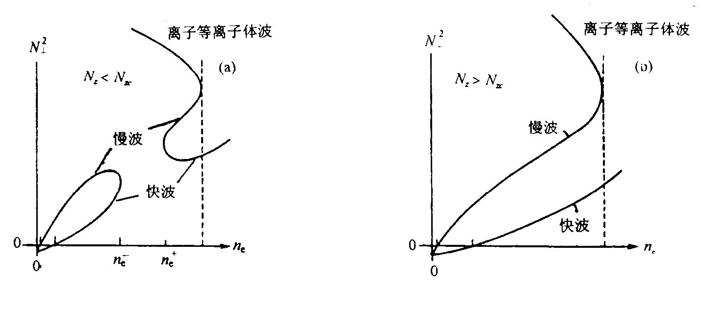

**图6.5** 两支低杂波的垂直折射率随等离子体密度的变化[14]

以上的讨论是通过分析色散关系得出的定性结果,进一步的分析要研究波的能量的实际传播特性。在不均匀色散介质中,波的能量是以群速度传播的,波的群速度由

$$
\nu_{s} = \frac{\partial\omega}{\partial k} \tag{6.164}
$$

确定。若介质的不均匀性不强,即在一个波长范围内的介质可以近似地看成均匀时,波能的传播由下述波迹方程描述

对于一种给定的波,上述方程中有关的微分值要由相应的波的色散关系确定。在第八章中,当讨论有关电子和离子回旋频段及混杂频段加热的问题时,我们将具体研究这些关系。

#### 6.4.5 波的吸收

波的吸收过程是波能转换成等离子体机械能的过程,当这种机械能进一步转换成热能时,才实现了波对等离子体的加热。一些经特殊选用的波对电子或离子有择优吸收倾向,例如离子回旋波倾向于被离子吸收,而电子回旋波主要被电子吸收。但在一般情况下,主要加热离子的波也会被电子吸收;即使被离子吸收,那些因吸收波能而被加速的高能离子也会在慢化的过程中加热电子,这些将在第八章讨论波加热方法时介绍。和欧姆加热的情况类似,粒子间的碰撞将使部分波的能量直接转化为电子热能,但在聚变实验装置中,主要的波能耗散机制是非碰撞性的,这些机制都与粒子与波的共振相互作用有关。

(1) 波的回旋衰减 (cyclotron damping)

当波的频率接近带电粒子的回旋频率而且波的电场的偏振方向与带电粒子的回转方向相同时,带电粒子将因波电场的不断加速而增大能量,而波场本身的储能将减小,这就是回旋衰减的基本物理机制。带电粒子被波场加速的能量变化率为

$$
\frac{\mathrm{d}w}{\mathrm{d}t} = qv\cdot E \tag{6.166}
$$

先用一个简化的模型进行估算,设波是线偏振的

$$
E = \hat{x} E\cos (k_{\perp}x - \omega t),\quad x = \rho \sin (\Omega t + \phi) \tag{6.167}
$$

可计算出

$$
\frac{\mathrm{d}w}{\mathrm{d}t} = qE\Omega \rho \mathrm{Re}\left\{\sum_{n}J_{n}(k_{\perp}\rho)\exp\left[\mathrm{i} n(\Omega t + \phi) - \mathrm{i}\omega t\right]\right\} \mathrm{Re}\left[\exp\mathrm{i}(\Omega t + \phi)\right] \tag{6.168}
$$

这一改变量除周期变化的部分外,当

$$
\omega = (n\pm 1)\Omega \tag{6.169}
$$

时将产生一个正比于$\rho J_{n}(k_{\perp}\rho)\cos [(n\pm 1)\phi ]$的久期项,也就是说,粒子得到波的加速。考虑圆偏振波并对全部粒子求平均,因这一机制而吸收的波功率密度为

$$
p = E\cdot j = \sum n_{i}q_{i}v_{i}\cdot E \tag{6.170}
$$

因实际上波具有相速度,能够保持与波电场共振相互作用的仅仅是那些运动速度与波的相速度接近的粒子。要计算这些粒子对波的吸收功率密度,需要知道热等离子体的介电张量的表示式,推导这些表示式要用很大的篇幅,但可以很容易地从有关等离子体波的专著中找到,此处仅引入结果[12]

$$
\begin{aligned}
P_s={}&\frac{\omega_p^2}{8\pi}\sum_{n=-\infty}^{\infty}\Bigg\{ \mathrm{e}^{-\lambda}\Bigg[\frac{n^2 I_n}{\lambda}E_x^*E_x
-\mathrm{i} n(I_n-I_n^*)(E_x^*E_y-E_y^*E_x)\\
&\quad+\left(\frac{n^2}{\lambda}I_n+2\lambda I_n-2\lambda I_n^*\right)E_y^*E_y\Bigg]\mathrm{Im}A^{s}_{n} \Bigg\}
\end{aligned} \tag{6.171}
$$

式中$\mathbf{I}_{n}$等为修正的贝塞尔函数,其宗量$\lambda = k_{y}^{2}v_{1}^{2} / \Omega^{2}$。大多数情况下$\lambda$是小量,可以将贝塞尔函数展开,取最低级项,得

$$
P_{\mathrm{s}} = \frac{\omega_{\mathrm{p}}^{2}}{16\pi}\sum \frac{n}{(n - 1)!}\left(\frac{\lambda}{2}\right)^{n - 1}\left(\left|E^{-}\right|^{2}\mathrm{Im}A_{\mathrm{s}} + \left|E^{-}\right|^{2}\mathrm{Im}A_{\mathrm{-}n}\right) \tag{6.172}
$$

其中

$$
\mathrm{Im}A_{n} = \sqrt{\pi}\frac{(\omega - k_{y}v_{z} - n\Omega)T_{z} + n\Omega T_{z}}{k_{y}v_{z}\omega T_{z}}\exp \left[-\left(\frac{\omega - k_{y}v_{z} - n\Omega}{k_{y}v_{z}}\right)^{2}\right] \tag{6.173}
$$

这里考虑了非常一般的情形:等离子体具有沿磁场方向的宏观运动速度$\nu_{z}$以及平行方向和垂直方向温度不相等,波是椭圆偏振的, $\nu_{z}$是沿磁场方向的平均热速度。一般情况下右旋分量的贡献非常小,可以不计。将上式应用于单纯的二次谐波加热模式,得

$$
P = \frac{\omega_{\mathrm{p}}^{2}}{16\sqrt{\pi}\Omega_{z}^{2}}\frac{k_{y}^{2}\nu_{\mathrm{ti}}}{k_{z}}\left|E^{-}\right|^{2}\exp \left[-\left(\frac{\omega - 2\Omega_{z}}{k_{y}\nu_{\mathrm{ti}}}\right)^{2}\right] \tag{6.174}
$$

在产生同样强度波电场的条件下,沿磁场方向的波长较长时对吸收有利。另外,温度高的离子对波有更高的吸收效率,这一机制将导致形成高能离子成分。

(2)波能的朗道衰减(Landau damping)

线偏振波和等离子体相互作用中的非碰撞性能量交换的一种主要过程是朗道衰减,这种机制在等离子体微观不稳定性机制中也非常重要,不过与波的吸收过程相反,在激发不稳定模式过程中,等离子体中粒子的一部分定向能量被转换为波能,所以这一过程又称逆朗道衰减。

考虑一个平面线偏振波

$$
E = \hat{z} E\cos (k z - \omega t) \tag{6.175}
$$

那些沿$z$轴以速度$\nu_{z} \approx \omega / k$运动的粒子将与波有较大的能量交换,求解波场中粒子运动方程,可得粒子的平均能量增加率为

$$
\left\langle \frac{\mathrm{d} m \nu^{2}}{\mathrm{d} t} \right\rangle = \frac{q^{2} E^{2}}{2 m} \left(-\frac{\omega \sin \alpha t}{\alpha^{2}} + t \cos \alpha t + \frac{\omega t \cos \alpha t}{\alpha}\right) \tag{6.176}
$$

式中$\alpha = k \nu_{0} - \omega$ ,进一步对粒子速度分布函数求平均,可得

$$
\left\langle \frac{\mathrm{d} m \nu^{2}}{\mathrm{d} t} \right\rangle = -\frac{\pi q^{2} E^{2} \omega}{\alpha m k^{2}} \left(\frac{\partial \overline{E}}{\partial \nu}\right)_{\nu_{z} = \omega / k} \tag{6.177}
$$

当分布函数为麦氏速度分布时,上式中的偏导数取负值,因此粒子总是从波中得到能量,引起波的衰减。

朗道衰减引起的总吸收功率密度为

$$
P_{\mathrm{s}} = \frac{\omega_{\mathrm{p}}^{2}}{k_{y}^{2}\nu_{z}^{2}} \mathrm{e}^{-1} \mathrm{I}_{0}(\lambda) \frac{E_{z}^{2}}{8 \pi} \frac{\sqrt{\pi} \omega(\omega - k_{y} \nu_{z})}{k_{y} \nu_{z}} \exp \left[-\left(\frac{\omega - k_{y} \nu_{z}}{k_{y} \nu_{z}}\right)^{2}\right] \tag{6.178}
$$

朗道衰减对电子和离子都可能发生,哪种机制更重要由波的相速度确定。在低混杂波的共振区,根据不同的物理条件,电子和离子都可能通过朗道衰减而得到加热。

(3)穿越期磁泵共振(transit time magnetic pumping resonance,简称TTMPR)机制引起的吸收

除上面讨论的与波电场作用有关的机制外, 还有一种与波的磁场分量有关的机制, 这是一种由于粒子在穿越波场区时因磁场变化而使轨道压缩或膨胀而得到加 (减) 速, 因而引起波能衰减 (增长) 的机制。这种机制的共振条件和朗道衰减是一样的, 即

$$
\omega -k_{z}v_{z} = 0 \tag{6.179}
$$

而粒子沿磁力线的运动, 受到波的磁场的作用力影响, 为明确起见, 不考虑平行电场项, 粒子的运动方程是

$$
m \frac{\mathrm{d}v_{z}}{\mathrm{d}t} = -\mu \frac{\partial B(\mathbf{r},t)}{\partial z} \tag{6.180}
$$

将其与平行电场中粒子运动方程相比, 可以看出现在磁矩$\mu$相当于电荷$q$ , 磁场强度$B$相当于电势$\Phi$。只要在粒子穿越所考虑空间区域时所受作用力总在同一方向, 那么粒子与波场的相互作用就会与朗道衰减的机制类似, 因此这一机制称为穿越期磁泵共振, 简写为TTMPR, 这一机制在后面要讨论的波电流驱动中起重要作用 (见 8.5 节)。TTMPR 引起的波能衰减也与朗道衰减公式类似

$$
p = \beta_{s}[\mathrm{I}_{0}(\lambda) - \mathrm{I}_{1}(\lambda)]\mathrm{e}^{- \lambda}\left|\frac{B_{1}}{8\pi}\right|^{2}\sqrt{\pi}\omega (\omega - k_{z}v_{z})\exp \left[-\left(\frac{\omega - k_{z}v_{z}}{k_{z}v_{\pi}}\right)^{2}\right] \tag{6.181}
$$

式中$\beta_{s}$为$s$类粒子的比压值。显然, 只有在较高比压的等离子体条件下, 例如聚变反应堆条件下, TTMPR 才较重要。

所有上述三种吸收机制都与共振条件直接相关, 但其效果有很大的差别。对回旋共振, 满足共振条件的离子和电子可以在很长的时间内保持与波电场的共振状态, 因而可以被加速到很高的能区, 比本底离子和电子能量大几十倍或更高。朗道衰减对粒子的加速则将使粒子脱离共振条件, TTMPR 的情况与之类似, 只有当沿平行方向的波谱具有一定宽度时, 粒子才能与波存在较长的共振作用。

#### 6.4.6 模转换和波的随机吸收

不均匀等离子体中, 波在传播过程中其波矢量 (折射率) 的大小和方向都要不断变化, 波会发生截止和共振。在一定的等离子体区域中, 会出现两支或多支波同时共存的情况, 而且可能发生由一支波转换成另一支波的过程。研究波的局部色散关系随某些参数的变化可以发现, 有时两支波可以在一定的参数区相汇, 如低混杂波段中的快波与慢波可以在某一密度区相汇; 有时因考虑更多的物理效应, 如温度效应, 同一支波会转化成性质很不相同的另一支波。后一情况的典型例子如低混杂波在共振区附近转化成离子等离子体波, 快磁声波在离子回旋共振区附近转化成离子伯恩斯坦波 (ion Bernstein wave), 这是在考虑离子热运动效应后得出的一支新模, 具有准静电波的特性, 即其电场与波矢量近似平行。研究模转换过程要从微分形式的波动方程出发, 并考虑粒子热运动效应和参数的不均匀分布。详细的介绍将占去很大的篇幅, 这里仅引进一些重要的结果。

(1) 离子回旋频段波的模转换

在考虑离子的热运动效应后, 离子回旋频段的波将增加一支离子伯恩斯坦模, 它基本上是离子回旋频率的谐波, 所以在采用离子的二次谐波模式加热时, 快波的一部分在一定空间区域 (靠近共振区) 会转换成伯恩斯坦模, 另一部分被反射。被转换成伯恩斯坦模的那部分波将被电子所吸收, 因为伯恩斯坦模是准静电模, 其朗道衰减率非常大。

2) 在低混杂波频段, 慢波在共振区附近模转换成离子等离子体波。如果平行折射率小于临界值, 则在中等密度区域, 慢波会模转换成快波, 并向边缘区传播, 因此, 这种模转换实际是增加了一个使慢波能量损失的通道。

(3) 电子回旋频段的 O 模与 X 模在一定的磁场和密度条件下也可以互相发生模转换。例如, 考虑电子的热运动后, X 波与电子伯恩斯坦波相耦合并发生模转换, 而 O 波与电子回旋谐波相耦合并发生模转换, 分析表明, 是否发生模转换的基本条件是参数$\zeta = \omega_{\mathrm{p}}^{2} / \Omega_{\mathrm{c}}^{2}$是否可以接近和大于 1, 这对应于一个临界密度值, 超过这个临界密度, 模转换就会发生。详细的计算比较复杂, 请参看有关文献。$^{*}6.4.7$关于ICRF波段中慢波定义的一个附记

前面对ICRF波段中慢波的描述是根据Stix理论分析来做的,但在文献中所定义的慢波不是Stix和这里讨论的那支波。由一般性色散方程(6.127),除得到(6.144)的解外,还有一支解

$$
N_{\perp}^{2} = \frac{P(S - N_{\perp}^{2})}{S} \tag{6.182}
$$

文献中将这支解称为慢波, 而将满足 (6.127) 的解称为快波。在一般意义上, 这样做并没有什么问题。但是, 对ICRF波段加热来说, 在均匀磁场条件下得到应用的是Stix所讨论的离子回旋波, 即在式 (6.127) 中, 当$\omega \leq \Omega_{\mathrm{c}}$时得出的解 (6.147), 而不是一般文献中满足 (6.182) 的那支慢波。对满足 (6.182) 的慢波, 很容易看出, 在ICRF波段, $P$是负的而绝对值非常大, 只有频率范围满足

$$
N_{\perp}^{2} > S > 0 \tag{6.183}
$$

的波才能传播 ( $N_{\perp}^{2} > 0$ ), 这意味着频率要满足

$$
(\Omega_{\mathrm{i}} - \omega) > \frac{\omega_{\mathrm{p}}^{2}}{2\Omega_{\mathrm{i}}N_{\mathrm{i}}^{2}} \tag{6.184}
$$

这与前面讨论的离子回旋波不是一回事, 虽然这两支解在非常接近离子回旋频率时不易被分辨。但是, 在低混杂波段, 由色散关系 (6.182) 表示的波很重要, 这是不应混淆的。

### 6.5 托卡马克等离子体的反常输运现象的理论研究[15\~17]

磁约束聚变装置实验研究的一个普遍的和重要的结果是, 在几乎所有的装置中, 在多种运行条件下, 实际观察到的等离子体的输运通量 (粒子流, 热流以及动量流) 都远人于经典碰撞理论 (包括新经典理论) 所预期的值。这表明, 等离子体集体相互作用的效应不能完全由碰撞过程所描述; 碰撞过程引起的输运对等离子体总体约束的影响往往是较小的, 起决定作用的是各种微观不稳定性模式, 这些模式使等离子体处于湍流状态。因此, 微观不稳定性的研究是几十年磁约束聚变物理研究的重要组成部分。各种微观不稳定性达到相对饱和态后将产生一定的宏观输运效应, 即湍性输运。

普遍认为可以引起等离子体反常输运的湍性状态分为两类, 一类是漂移波湍流, 包括低比压条件下的静电湍流和电磁湍流, 对应于扰动电场引起粒子运动轨道的无轨化; 另一类是等离子体比压较大时产生的磁湍流, 对应于位形空间中因湍性磁扰动产生的磁场位形的一定程度的无轨化。理论研究提出了大量的可能引起上述两类湍流状态的不稳定模式。对漂移波静电湍流, 以及漂移波电磁湍流, 产生这些不稳定模式的机制是宏观物理量 (粒子密度、温度、宏观运动速度)的不均匀性,这些不均匀性与粒子在微扰电场作用下产生的电漂移结合起来可能导致不稳定模式的增长。由于不均匀性是普遍存在的,因此这类模式也是普遍存在的,但同时存在一些物理因素(例如磁场的剪切、等离子体宏观转动),可能对这类漂移波产生致稳效应,因此,一种具体的模式是否稳定,要由多种因素确定。对磁湍流,对应的不稳定模式可以是微尺度电阻性磁流体模,主要是电流分布不均匀性引起的,也可以是漂移波湍流中的微扰磁场较大时引起的微磁岛或磁场位形无规化。这些也是普遍存在的模式。在介绍一些重要的具体模式前,这里先对不稳定模式可能产生的反常输运机理进行一些一般性讨论。

6.5.1 静电湍流产生的反常输运[15,16]

静电湍流发生在比压低低的等离子体中,一般判据是

$$
\beta_{\mathrm{e}}< m_{\mathrm{e}} / m_{\mathrm{i}}\approx 5\times 10^{-4} \tag{6.185}
$$

首先分析一个单模的静电波引起宏观粒子流的条件。考虑一个最简单的位形:一维平板位形。设沿$z$轴方向有一磁场$B$ ,沿$x$方向密度不均匀,存在一个单模扰动电场,其电势为

$$
\phi (x,y,t) = \phi_{0}(x)\exp [-\mathrm{i}(\omega t - k y)] + c c \tag{6.186}
$$

cc表示复数共轭值。设频率很低,在电子穿越波长的时间内可以看成波的位相是几乎不变的,即

$$
k\nu_{\mathrm{e}}\gg \omega \tag{6.187}
$$

因此电子密度满足玻尔兹曼分布

$$
n_{\mathrm{e}} = n_{\mathrm{e}0}(x)\exp (e\phi /T_{\mathrm{e}}) \tag{6.188}
$$

这个电场引起离子沿密度不均匀方向的漂移运动,由离子的连续性方程,离子的密度变化可以写成

$$
\delta n_{\mathrm{i}} = \frac{k c}{\omega B}\frac{\mathrm{d}n_{\mathrm{e0}}}{\mathrm{d}x}\phi_{0}\exp [-\mathrm{i}(\omega t - k y)] + c c \tag{6.189}
$$

对波长求平均,得出扰动引起的离子流为

$$
\left\langle \delta n_{\mathrm{i}}v_{\mathrm{i}}\right\rangle = -\frac{k}{2\pi}\int_{0}^{2\pi /k}\mathrm{d}y\delta n_{\mathrm{i}}\frac{c}{\beta}\frac{\partial\phi}{\partial y} = -\frac{2\gamma}{\omega_{\mathrm{i}}^{2} + \gamma^{2}}\left(\frac{c}{B}\right)^{2}\frac{\mathrm{d}n_{\mathrm{e0}}}{\mathrm{d}x} k^{2}\left|\phi_{0}\right|^{2} \tag{6.190}
$$

式中$\omega = \omega_{i} + \mathrm{i}\gamma$。注意,密度梯度是负的,所以上式表明,一个随时间增长的不稳定漂移波会引起宏观的向外的(即向密度梯度相反的方向)离子流。在上面的分析中并没有说明波增长的原因,但显示了这样一个事实,即不稳定波与宏观流之间存在某种联系。

对于具有一定频谱和波谱的静电微扰,可以从准线性动力论方程(6.84)出发来讨论,略去碰撞项,设未扰态的电场不存在,电子分布函数的准线性演化方程为

$$
\frac{\partial\tilde{\mathbf{r}}_{\mathrm{e}}}{\partial t} +\nu \cdot \nabla F_{\mathrm{e}} - \frac{e}{m_{\mathrm{e}}c} (\nu \times \mathbf{B})\cdot \frac{\partial\tilde{\mathbf{r}}_{\mathrm{e}}}{\partial\nu} = -\frac{e}{m_{\mathrm{e}}}\langle \nabla \phi \cdot \frac{\partial}{\partial\nu} f_{\mathrm{e}}\rangle \tag{6.191}
$$

将上式乘$\nu_{y}$后对速度空间求积,式(6.191)中左方项的主要贡献是第三项,于是可得沿$x$方向的电子流为:

$$
\Gamma_{\mathrm{e}} = -\frac{\mathrm{i}c}{B}\sum_{k}\phi (k)\int \mathrm{d}^{3}\nu \delta f_{\mathrm{e}}(-k) \tag{6.192}
$$

上式中积分部分等于密度的扰动量$\delta n_{\mathrm{e}}(- k)$ ,求和是对湍流谱进行的,因此所考虑的系统

与单模条件是完全不同的。这种求和相当于对统计系统求平均。

同样的方法可以给出电子热流的表示式

$$
Q_{\epsilon} = -\frac{\mathrm{i}c}{B}\sum_{k}k\phi (k)\int \mathrm{d}^{3}\nu f_{\epsilon}(-k)\left(\frac{1}{2} m_{\epsilon}\nu^{2} + m_{\epsilon}\nu_{\epsilon}^{2}\right)
\quad (6.193)
$$

在微观稳定性理论中可以证明,这些流在电子的速度分布仅含绝热变化部分(含义在后面有关讨论中说明)时为零,因为对波数$k$求和时, $\pm k$谱的贡献是成对地互相抵消的。只有非绝热变化部分能够产生有效的宏观流,捕获电子效应就是一类产生非绝热贡献的机制。

关于静电湍流引起的输运,还有一个非常简单的表示式,称为强湍输运公式

$$
D,\chi = \gamma /k_{\perp}^{2}
\quad (6.194)
$$

这一表示式相当于将随机行走理论中的步长取为湍流的特征波长(或所谓的湍流关联长度),而“碰撞频”取为模的特征增长率。一般认为,这一估计给出的是静电湍流产生的输运系数的上限。由于高温等离子体中微观不稳定模的增长率比碰撞频率大得多,而模的关联长度也比粒子的回转半径大很多,因此,静电湍流扩散和热传导率比经典碰撞引起的扩散和热传导要大得多。

在一些合理的假定下,从漂移波不稳定性的一般性质可以推导出(6.194)形式的输运系数公式。令

$$
\Gamma_{\epsilon} = -D\frac{\partial n_{\epsilon 0}}{\partial x}
\quad (6.195)
$$

在式(6.192)中用漂移波条件下的扰动分布函数代入(推导见6.6节)

$$
\delta f_{\epsilon} = F_{\epsilon \mathrm{M}}(\epsilon \phi /T_{\epsilon})(\omega_{\epsilon} / \omega)
\quad (6.196)
$$

其中$\omega = \omega_{\epsilon} + \mathrm{i}\gamma$,将对$k$的求和理解为平均值,则可看出,只有当扰动电势$\phi$与扰动分布函数$\delta f_{\epsilon}$具有相位差时,平均值的实部才不为零,在前面关于单模产生宏观粒子流的讨论中已指出,只有不稳定模才产生宏观向外的粒子流。具体写出

$$
\mathrm{Re}\left\{\mathrm{i}\int \mathrm{d}^{3}\nu \frac{c}{B} k_{\gamma}\phi^{\ast}\frac{e\phi}{\tau_{\epsilon}}\frac{\omega}{\omega_{\epsilon}} F_{\epsilon \mathrm{M}}\right\} = \frac{k_{\gamma}c}{e B} |e\phi |^{2}\frac{\gamma}{\omega_{\epsilon}} n_{\epsilon 0}
\quad (6.197)
$$

代入反磁漂移频率的表示式

$$
\omega_{\epsilon} = \frac{k_{\gamma}c T_{\epsilon}}{e B L_{n}}
\quad (6.198)
$$

最后可得

$$
D = \left|\frac{e\phi}{T_{\epsilon}}\right|^{2}\gamma L_{n}^{2}
\quad (6.199)
$$

其中$L_{n}$是密度剖面的特征长度。如果再代入关于漂移波湍流饱和值的估计

$$
\left|\frac{e\phi}{T_{\epsilon}}\right| = \frac{1}{k_{\perp}L_{n}}
\quad (6.200)
$$

此式的物理含义是:当漂移波引起的密度扰动梯度与平衡密度剖面分布的梯度接近时,漂移波达到饱和。这个条件仅是一种唯象性判断,其合理性需由实验结果证实。这样,式(6.199)就回到式(6.194)。

式(6.194)型的扩散系数的估计式也可以直接从扰动密度的扩散方程中得出

$$
\frac{\partial \hat{n}}{\partial t} = -\nabla \cdot (D\nabla \hat{n}) \approx k_{\perp}^{2} D\hat{n}
\quad (6.201)
$$

然后左方用$\hat{n}$代替,这就表明,式(6.194)意味着湍流的饱和条件是:线性增长率等于扩散引起的粘滞阻尼。但是,把扰动密度的扩散与平衡密度分布的扩散完全等同起来,采用相同的扩散系数来描述,这完全是一种唯象性假定。

式(6.194)形式的反常输运系数的表示式虽然很简单,但在实际应用中引起很大的不确定性,因为对一种具体的不稳定模式,虽然其线性增长率可以从有关物理条件很好地确定,但模的饱和谱及关联长度的确定就不很简单了。

从上面的讨论还可以得出一个结论,要使具有漂移波型静电湍流的等离子体体系的输运减小(即改善约束),可以有两种方法,第一是对漂移波的不稳定机制进行抑制,使增长率减小;第二是缩小湍流的关联长度。在很多具体的漂移波研究中,最小的关联长度(或波长)已可以和粒子的回转半径相比拟,不能再减小,因此,抑制不稳定性的增长率是减小反常输运的主要途径。

最后介绍另一种常用的关于静电漂移波湍流饱和谱强度的估计公式,称为混合长度判据(mixing length criterion)。根据这一判据,当一次静电漂移长度与波的径向波长可比拟时,波将饱和。代入静电漂移长度

$$
|\xi_{\perp}| = \frac{\nu_{\mathrm{E}}}{\omega} = \frac{k_{\theta}c\phi}{\omega B}
\quad (6.202)
$$

及径向半波长

$$
\lambda_{\mathrm{r}} / 2 = \pi /k_{\mathrm{r}}
\quad (6.203)
$$

近似地认为$k_{\perp} \approx k_{\mathrm{r}} \approx k_{\theta}$,可以得出混合长度判据所确定的静电漂移波湍流饱和幅值的上限为

$$
\left|\frac{e\phi}{T_{\mathrm{e}}}\right| \leqslant \frac{\omega}{\Omega} \frac{\pi}{k_{\perp}^{2} \rho_{\mathrm{i}}^{2}}
\quad (6.204)
$$

其中已近似地取电子和离子的温度相等, $\rho_{\mathrm{i}}$是离子的平均回转半径。一些实验对这一判据进行了对比,发现实际达到的漂移波湍流水平低于上述估计值。

漂移波湍流理论可以从饱和湍流谱给出粒子扩散的表示式,但不能自动给出关于热传导率的表示式。因为式(6.192)型的漂移波湍性热流的表示式不能自动给出正比于温度梯度的结果,因此,关于静电湍流热导率的定义实际上是形式上的,即按宏观热传导定律的形式,令$Q = - \kappa \nabla T$,然后算出

$$
\kappa = -Q / \nabla T = -QL_{T} / T
\quad (6.205)
$$

式中$L_{T}$是温度剖面长度。虽然很多静电模式产生的湍流热流远大于粒子对流所带走的热量(即$\frac{5}{2} T T$),但它与一般意义上的热传导存在物理机制上的差别,这一点务必引起注意。

在较大的比压下,必须考虑磁场的扰动。但对于托卡马克类型其比压仍然不算很高的磁约束系统,主要考虑扰动磁场中垂直于平衡磁场的分量就够了,这一近似称剪切阿尔芬近似,即压缩阿尔芬波的作用可以不计。这样,微扰电磁场可以表示成

式中$\pmb {b} = \pmb {B} / \pmb{B}$是平衡磁场的磁力线方向, $\pmb{A}$是微扰磁场的矢势沿$\pmb{b}$的分量。对于微扰磁场仍然很小,因此对输运的贡献主要来自电源移的情形,在准线性理论框架内,相应的反常电子热导率可以表示成

$$
\chi_{e} = \sum_{a,k}\frac{\sqrt{\pi}c^{2}k_{z}^{2}}{B}\int \frac{\mathrm{d}v_{//}}{\nu_{e}}\exp \left(-\frac{\nu_{//}^{2}}{\nu_{e}^{2}}\right)\phi -\frac{\nu_{//}}{\nu_{e}^{2}} A^{2}\delta (\omega -k_{n}\nu_{n})
\quad (6.207)
$$

求和对所有的频率和波数进行。

#### 6.5.2 磁扰动产生的反常输运[16,17]

在第五章中曾讨论过电阻性磁流体不稳定模式所引起的对磁面结构的破坏。通常,这种扰动引起有理磁面附近的磁岛结构,由于电子沿磁力线的快运动和非常大的热传导率,磁场结构的任何破坏都将引起宏观参数(粒子密度、温度、电流密度)的重新分布,这相当于横向输运的增大。现在讨论比宏观磁流体扭曲模的尺度小得多的微观磁扰动,例如所谓的微撕裂模(micro- tearing mode)引起的磁扰动,在满足模的重合(overlap)条件下,这些磁扰动产生了随机变化的磁湍流,一般,其幅度非常小,只有平衡磁场的万分之一或更小,因此,这类磁扰动对宏观约束特性并不产生过大的影响,但是,由于上面说的电子沿磁力线的快运动和很大的沿磁力线的热传导,任何这类磁湍流将产生反常的横向输运。考虑一个具体的例子并回顾一些基本知识,设在圆柱约束位形的平衡磁场上叠加一个扰动磁场,其径向分量为

$$
b_{r} = b_{m n}\exp [\mathrm{i}(n_{S} + m\theta)]
\quad (6.208)
$$

在$q = m / n$的磁面附近,这一扰动磁场将产生一个宽度为

$$
w = 4\left\{\frac{b_{m n}R}{|m B\mathrm{d}q / \mathrm{d}r|}\right\}^{1 / 2}
\quad (6.209)
$$

的磁岛。如果外加的扰动磁场具有一定宽度的谱,则对应地将形成一系列磁岛,随着扰动磁场的增大,这些磁岛将独自增大,当邻近磁面间发生相接,即磁岛达到互相复盖条件时,磁岛结构将趋于无规化。这个条件可以表示成

$$
\delta q = \frac{1}{n^{2}} = \frac{q^{2}}{m^{2}}
\quad (6.210)
$$

两个有理磁面间的距离是与磁面的剪切量$s = (r / q)\mathrm{d}q / \mathrm{d}r$有关的,定义磁面覆盖参数

$$
u = \frac{1}{2}\frac{(\Delta r_{m,n_{1}} + \Delta r_{m,n_{2}})}{|r_{m,n_{1}} - r_{m,n_{2}}|}
\quad (6.211)
$$

则知,当扰动磁场的相对幅值达到

$$
\frac{b_{m n}}{B} = \frac{u^{2}q^{2}}{16R m^{3}q^{\prime}}
\quad (6.212)
$$

磁场结构将局部随机化。当$m > 10$时,这一参数在$10^{- 4}$以下。

随机磁场结构产生的等效横向输运对不同的参数区是不同的。首先引入关于磁场本身扩散系数的定义(其量纲是长度)

其中$L_{\mathbf{M}}$是磁扰动沿磁力线的关联长度,即

$$
L_{\mathbf{M}} = \frac{1}{b_{0}^{2}}\int_{0}^{\infty}\mathrm{d}z b(z,0)b(0,0)
\quad (6.214)
$$

对托卡马克,这一关联长度与平衡磁场的特征长度$2\pi qR$及磁岛的宽度有关,可以证明

$$
L_{\mathbf{M}} = \frac{2\sqrt{2}Rq}{nq^{1}w}
\quad (6.215)
$$

式中$\pmb{n}$是环向模数, $\pmb{w}$是磁岛宽度。

由于无规化扰动,磁场引起的电子横向热导率应为

$$
\chi_{e M} = D_{M}\chi_{e W} / L_{1}
\quad (6.216)
$$

其中$\chi_{e W}$是电子沿磁力线方向的热导率,代入上面有关的量,磁湍流引起的电子反常热导率与磁岛宽度间的关系可以表示成

$$
\chi_{e M} = \frac{\nu_{e}}{L_{r}}\sum_{m}w w_{m}^{3}
\quad (6.217)
$$

式中$L_{s}$是剪切长度, $\pmb{m}$是极向模数。从上面的式子可以看出,只要扰动磁场与平衡磁场的比值达到万之一,就可产生非常大的反常热导率,足以解释实验观察到的电子反常输运。但实际情况没有这样简单,因为根据电子本身的快运动特性,如果等离子体中扰动磁场达到一定的幅值(现有实验方法还难以直接测定这一磁场),则快电子本身具有等效的横向扩散系数应为

$$
D_{\mathrm{TP}} = D_{\mathrm{M}}\nu_{z}
\quad (6.218)
$$

式中$\nu_{z}$是快电子沿平衡磁场磁力线方向的运动速度。举例说, $30\mathrm{keV}$电子的速度为$10^{10}\mathrm{cm / s}$对万分之一大小的相对磁扰动,快电子的扩散系数应达$100L_{\mathrm{M}}$,对一般装置则超过$10\mathrm{m}^{2} / \mathrm{s}$也就是说,如果真的是扰动磁场引起了实验观察到的电子反常热传导,那么同时应当观察到快电子很快逸出约束区域。实际上实验中没有发现这种协同性,相反,观察到快电子具有很好的约束性质。因此,不能认为上面关于磁场扰动引起反常输运的估算已是成熟的理论。

在实验中观察到另一类重要的,由不稳定电磁模式产生的对高能粒子约束的破坏效应。这类模式常常是由高能粒子引发的磁流体模式,具有广域结构,典型的如$q = 1$磁面附近由高能捕获离子产生的磁流体鱼骨模,以及在一些有理磁面附近由高能飞行离子(在反应堆中由聚变$\alpha$粒子)产生的环形阿尔芬模,等等。这类模式可以发展到一定的幅值(实验中可以从米尔诺夫信号观察到),结果对高能离子产生散射,使其改变原先的运动轨道,总体效应是使高能离子加快损失,其损失率基本与扰动磁场的幅值成正比

$$
\frac{\mathrm{d}N}{\mathrm{d}t}\propto -A^{2}
\quad (6.219)
$$

关于这类模式的重要例子在本章后面的有关小节中将作简要介绍。

### 6.6 静电漂移波不稳定性[18,19]

不均匀等离子体中由一些基本参数的空间不均匀性,如粒子密度梯度、电子和离子的温度梯度,以及更一般地由压强梯度,在一些特殊的条件下由电流密度梯度都可以引起所谓的漂移波不稳定性。称为漂移波的原因是,在物理机制上,这些不稳定模是上述不均匀性对应的宏观漂移运动引发的,其特征频率与相应的漂移频率接近;更深入的机制分析发现,波的增长大都与粒子与漂移波的相互作用有关。以圆截面托卡马克为例,密度不均匀性对应的宏观漂移频率的定义为

$$
\omega_{\mathrm{ij}} = \frac{k_{\theta}cT_{\mathrm{j}}}{Z_{\mathrm{j}}eB r}\frac{\mathrm{d}\ln n}{\mathrm{d}r}
\quad (6.220)
$$

这一频率一般远小于粒子的回旋频率,所以漂移波属于低频波。另外,对等离子体反常输运具有重要性的漂移波的波速与等离子体粒子的热运动速度是可以比拟的,即

$$
\omega \geq k\nu_{\mathrm{i}}
\quad (6.221)
$$

从6.5节中关于反常输运的一般讨论中知道,漂移波湍流的确可以产生粒子和热量的输运,其主要机制是粒子的随机静电漂移运动。最终的输运大小与湍流的时空饱和谱相关,而直到现在,对这种饱和谱的特性仍然缺乏有效的理论手段来精确确定。另一方面,理论研究的确提出了很多可能对反常输运有重要作用的漂移波类型,线性研究可以说已达到相当的宽度和深度,并根据实际位形的主要特征,研究了多种可能激发不稳定模的机制,利用不同的方法推导了多种形式的电子或离子的反常热导率表示式,这些表示式在不同程度上能或多或少地与实验结果相对照。这些漂移波包括由于电子和离子温度梯度效应引起的模,以及由捕获电子和捕获离子效应引起的模,由碰撞效应与捕获粒子效应结合引起的耗散捕获粒子模,由环形漂移引起的环形模,等等。对所有的漂移波不稳定模,磁力线的剪切都有很大的作用(一般是稳定作用)。

从引起反常输运的角度考虑,不稳定模在半径方向的特征宽度具有重要性。通过所谓的量纲理论分析可知,如果模的径向特征宽度与等离子体宏观参量的剖面特征长度同量级,则它们引起的反常输运是玻姆型的(Bohm type),亦即输运系数将与环向磁场成反比;如果不稳定模的径向剖面非常局域,其尺度与离子回转半径$\rho_{\mathrm{i}}$、非碰撞集肤深度$\delta = c / \omega_{\mathrm{pe}}$或电阻性奇异层宽度(见第五章)同量级,则它们引起的反常输运系数是回旋玻姆型的(Gyro- Bohm type)。大多数微观模式和一些高模数的磁流体模式在径向是非常局域的,因此所引起的反常输运系数具有回旋玻姆型,具体说,以反常热导率为例,其形式如[18]

$$
\chi_{\mathrm{e}} = \frac{c_{\mathrm{s}}\rho_{\mathrm{s}}^{2}}{L_{\mathrm{n}}} F_{\mathrm{e}}(\nu_{\mathrm{e}},\beta ,\tau ,m_{\mathrm{e}} / m_{\mathrm{i}},q,s,\eta_{\mathrm{i}},\eta_{\mathrm{e}},\epsilon_{\mathrm{n}},\dots)
\quad (6.222)
$$

式中$c_{\mathrm{s}} = \sqrt{T_{\mathrm{e}} / m}$ ; $\rho_{\mathrm{s}} = c_{\mathrm{s}} / \Omega_{\mathrm{i}} L_{\mathrm{n}}$是粒子密度剖面的特征宽度;函数$F_{\mathrm{e}}$中的宗量是各种无量纲参数,如$\nu_{\mathrm{e}}$是电子的碰撞参数, $\beta$ , $\tau$分别是等离子体比压和电子与离子的温度比, $s$是剪切参数, $\epsilon_{\mathrm{n}} = L_{\mathrm{n}} / R$,其他参量已在前面说明。微观不稳定性理论研究的主要目的就是要确定函数$F_{\mathrm{e}}$的具体形式。多数理论研究确认,各种微观模式是局域型的,所引起的反常输运是回旋玻姆型的。本节将介绍几种主要不稳定模的特性并综述关于电子和离子反常热导率的理论表示式的研究情况。

在理论处理方法上,经常先考虑局域近似,即6.4节中研究波时讨论过的WKB近似,在波长远小于不均匀性特征长度的假定下,用局部的色散关系分析波的不稳定条件。为了了解模的空间结构,要进一步进行微分方程或微分积分方程本征值分析。对托卡马克,严格说是二维本征值问题,即物理量要依赖于极向和径向两个变数。为了简化处理,经常采用两种方法:第一种方法是将实际位形理想化成一维平板位形,这相当于假定每一环向模数$m$和极向模数$n$给定的模在半径方向也是局域的,且剪切为常数。这种模如果是不稳定的,原则上可以在环形条件下找到对应的模,并仍称平板模;第二种方法对真实环形位形进行研究,但采用所谓的气球模表象来处理。该方法与第五章中讨论的高$n$磁流体气球模的描述基本上是一致的,即限于沿磁力线方向波长很长而垂直于磁力线方向波长很短的模,这仍然是半径方向非常局域的模。气球模表象方法是将半径方向的模解耦,使模的本征方程仅与极向变数有关(与平板近似下模仅与半径坐标有关相当),因此,除了增加一些与环形效应有关的量外,气球模近似下的本征方程的形式与平板近似是非常相似的,因此两者的数学处理方法也是基本一样的。对于低模数模,本征模的结构具有二维特征,同时沿径向也具有广域结构,对这种二维模只能用数值方法研究,但对这类低模数模对约束的影响还缺乏深入研究。

下面各分节将介绍一些有代表性的和重要的漂移波模式。

#### 6.6.1 平板电子和离子温度梯度模:局域近似

电子和离子热传导反常性使人首先联系到温度梯度效应对漂移波的影响。最早,对漂移波的研究是从粒子密度梯度效应开始的,密度梯度产生如式(6.220)中表征的宏观反磁漂移运动,如果粒子与这种漂移运动共振,原理上可以产生不稳定性。这种单纯由密度梯度引起的漂移波将被磁力线的剪切效应所稳定。现考虑同时存在密度和温度梯度的情形。令未扰粒子速度分布为局部麦氏分布

$$
F_{j}(x,\nu) = n_{0}(x)\left(\frac{m_{j}}{2\pi T_{0j}(x)}\right)^{3 / 2}\exp \left(-\frac{m_{j}\nu^{2}}{2T_{0j}(x)}\right)
\quad (6.223)
$$

求这个分布对不均匀方向$x$的导数

$$
\frac{\mathrm{d}F_{j}}{\mathrm{d}x} = F_{j}\frac{\mathrm{d}\ln n_{0}}{\mathrm{d}x}\left[1 - \eta_{j}\left(\frac{3}{2} -\frac{\nu^{2}}{2\nu_{0}^{2}}\right)\right]
\quad (6.224)
$$

其中

$$
\eta_{j} = \frac{\mathrm{d}\ln T_{0j}}{\mathrm{d}\ln n_{0}}
\quad (6.225)
$$

令

$$
f_{j} = F_{j} + \delta f_{j}
\quad (6.226)
$$

设碰撞项不重要,求解漂移近似下的仅含静电扰动电场的线性化符拉索夫方程

$$
- \mathrm{i}(\omega - k_{z}\nu_{z})\delta f_{j} + k_{y}\nu_{E}\frac{\partial F_{0j}}{\partial x} +\frac{Z e E_{z}}{m}\frac{\partial F_{0j}}{\partial z} = 0
\quad (6.227)
$$

可得一阶微扰分布函数为

$$
\delta f_{j} = -\frac{n_{0}Z_{j}e\phi}{T_{0j}}\left\{1 - \frac{1}{\omega - k_{z}\nu_{z}}\left(\omega -\omega_{z}\right)\left[1 - \eta_{j}\left(\frac{3}{2} -\frac{\nu^{2}}{2\nu_{0}^{2}}\right)\right]\right\}
\quad (6.228)
$$

对电子, $Z_{j} = - 1$。对应地,粒子的扰动密度为

在式(6.228)和(6.229)中,右方第一项表示的就是前面提到过的对扰动的绝热响应部分,相当于对电子或离子的运动用流体运动来描述,所以又称流体近似;而第二项为非绝热响应部分,对应于粒子动力论中才具有的贡献。如果波的频率处在下面的参数区

$$
k_{z}\nu_{\mathrm{e}}\gg \omega \gg k_{z}\nu_{\mathrm{ti}}
\quad (6.230)
$$

则离子密度扰动可以由流体近似给出(有关的速度积分可直接进行)

$$
\delta n_{\mathrm{t}} = -\frac{\omega_{\mathrm{t}}}{\omega}\frac{e\phi n_{\mathrm{0}}}{T_{\mathrm{io}}}
\quad (6.231)
$$

局域色散关系由电中性条件

$$
\delta n_{\mathrm{e}} = \delta n_{\mathrm{t}}
\quad (6.232)
$$

给出

$$
\omega = \omega_{\mathrm{e}} - \mathrm{i}\left(\frac{\pi}{2}\right)^{1 / 2}\frac{\omega[\omega - \omega_{\mathrm{e}}(1 - \eta_{\mathrm{e}} / 2)]}{k_{z}\nu_{\mathrm{te}}}
\quad (6.233)
$$

此式给出模的实频为

$$
\omega_{\mathrm{e}} = \omega_{\mathrm{e}}
\quad (6.234)
$$

模的增长率为

$$
\gamma = -\left(\frac{\pi}{2}\right)^{1 / 2}\left(\frac{\omega_{\mathrm{e}}}{k_{z}\nu_{\mathrm{te}}}\right)^{2}\eta_{\mathrm{e}}
\quad (6.235)
$$

这个方程给出模为不稳定的条件是$\eta_{\mathrm{e}}< 0$,通常情况下不会出现这样的温度密度剖面,因为从宏观输运方程得出的解,密度和温度都应该是从中心到边缘单调下降的,因而$\eta_{\mathrm{e}} > 0$。

现在考虑与式(6.230)相反的极限,设离子对波有重要贡献,其密度扰动要从式(6.229)严格计算,而电子的密度扰动可以从绝热近似给出

$$
\delta n_{\mathrm{e}} = \frac{n_{0}e\phi}{T_{\mathrm{e0}}}
\quad (6.236)
$$

局域色散关系化为

$$
D(\omega) = 1 + T_{\mathrm{io}} / T_{\mathrm{e0}}
\quad (6.237)
$$

式中

$$
D(\omega) = \frac{1}{n_{0}}\int_{-\infty}^{\infty}\mathrm{d}\nu_{z}\frac{F_{\mathrm{io}}}{\omega - k_{z}\nu_{z}}\left\{\omega -\omega_{\mathrm{e}}\left[1 - \frac{\eta_{1}}{2}\left(1 - \frac{\nu_{z}^{2}}{\nu_{i}^{2}}\right)\right]\right\}
\quad (6.238)
$$

可以用复平面上求留数的方法求色散关系式(6.238)的解。可以得出接近稳定性边界时模的频率满足的关系为

$$
\omega = \frac{k_{z}^{2}\nu_{\mathrm{ti}}^{2}}{\eta_{1}\omega_{\mathrm{t}}}{\left\{1\pm \left[1 - \frac{\eta_{1}\omega_{\mathrm{t}}^{2}}{k_{z}^{2}\nu_{\mathrm{ti}}^{2}}(2 - \eta_{1})\right]^{1 / 2}\right\}}
\quad (6.239)
$$

而产生不稳定性的条件化为

注意, 粒子密度分布一般比较平坦 (由于粒子源一般处在边缘附近), 这一条件在离子温度较高而且较陡的情况下可以得到满足, 所以在托卡马克输运研究中对这支模非常重视, 并由于条件 (6.240), 称此模为平板$\eta_{i}$模, 它本质上属于离子声波。

在更接近实际位形条件下对离子温度梯度模 (Ion Temperature Gradient Mode, 简称 ITG 模) [20] 的研究是近二十多年中理论研究的一个重要方面。对环形位形, 更重要的是环曲率驱动的模式, 即离子气球模。这种模的增长率约为

$$
\gamma \approx \omega_{n} \sqrt{2 \epsilon_{n} (1 + \eta_{i})}
\quad (6.241)
$$

式中$\epsilon_{n} = L_{n} / R$。对应的临界值

$$
\eta_{i c} = \left\{ \begin{array}{ll} 1 & \text{当} \epsilon_{n} < 0.2 \\ 1 + 2.5(\epsilon_{n} - 0.2) & \text{当} \epsilon_{n} > 0.2 \end{array} \right.
\quad (6.242)
$$

卡多姆采夫等人最早对反常离子热导率进行了估算, 其方法是在离子动力方程中加一项用反常扩散引起的损失, 然后再由最危险的不稳定模的稳定条件确定反常扩散 (反常热导率) 对参数的依赖关系, 所得的表示式为

$$
\chi_{i} \approx \frac{1}{40} \frac{c_{s} \rho_{s}^{2} L_{s}}{L_{T} L_{T}}
\quad (6.243)
$$

其中$L_{s} = R q / s$为剪切长度, 此式表明, 剪切起稳定效应 ( $\chi_{i} \propto 1 / s$ ), 但有的研究指出剪切起去稳作用。后来霍顿 (Horton) 等人通过准线性分析给出的离子热导率为 [21]

$$
\chi_{i} = \frac{c_{s} \rho_{s}^{2} q}{L_{n}} (1 + \eta_{i})^{1 / 2}
\quad (6.244)
$$

其中剪切也起稳定作用, 类似的离子反常热导率的表示式约有 20 种 (见康诺尔的总结)。这些表示式虽然在绝对值上与实验确定的离子热导率接近, 而且很多约束改善的实验研究也确认 ITG 模的重要性, 但在反常离子热导率的剖面分布特征上与实验结果很不一致。实验观察的结果是内部区域的$\chi_{i}$值很小, 随半径向外增大, 理论结果与此相反。

#### 6.6.2 捕获电子模[22,23]

虽然电子模在平板位形中是稳定的, 但在环形位形中, 考虑到捕获电子效应, 可能产生新的驱动源。在 6.2 节中已指出, 由于环向磁场的不均匀性, 当粒子的平行速度分量很小时, 粒子轨道将被限制在靠近环的外侧的局部区域, 对应地, 在速度空间中存在一个捕获锥

$$
\nu_{z} / \nu_{\perp} < \sqrt{2 r / R_{0}}
\quad (6.245)
$$

对捕获电子的线性化微扰动力论方程要单独写出和求解

$$
\frac{\partial \delta f_{T}}{\partial t} + \frac{c}{B} (b \times \nabla \phi) \cdot \nabla F_{T} = -\nu_{\mathrm{eff}} \left(\delta f_{T} - \frac{e \phi}{T_{e}} F_{T}\right)
\quad (6.246)
$$

上式右方是克鲁克碰撞项, 其中

$$
\nu_{\mathrm{eff}} = \frac{\nu_{\mathrm{ei}}}{\nu} \left(\frac{\nu_{\mathrm{ei}}}{\nu}\right)^{3}
\quad (6.247)
$$

式中电子离子碰撞频率是按电子速度为热速度$\nu_{\mathrm{ei}}$时计算的。捕获电子的零级分布函数仍为局部麦氏分布,但粒子数密度要乘一个因子$\sqrt{2r / R}$ ,于是由式(6.246)解出

$$
\delta f_{r} = \left\{(\sqrt{2r / R})\left(-\frac{c}{B}\mathrm{i}k\frac{\phi}{L_{n}}\left[1 + \eta_{\mathrm{e}}\left(\frac{m_{\mathrm{e}}\nu^{2}}{2T_{\mathrm{e}}} -\frac{3}{2}\right)\right] + \nu_{\mathrm{ef}}\frac{e\phi}{T_{\mathrm{e}}}\right)F_{\mathrm{e}r}\right\} (-i\omega +\nu_{\mathrm{ef}})^{-1}
\quad (6.248)
$$

对飞行电子的微扰分布函数,仅考虑其绝热响应

$$
\delta f_{\mathrm{u}} = \left(1 - \sqrt{2r / R}\right)\frac{e\phi}{T_{\mathrm{e}}} F_{\mathrm{e}}
\quad (6.249)
$$

离子的微扰密度可以由流体近似给出

$$
\delta n_{\mathrm{i}} = \frac{\omega_{\mathrm{e}}}{\omega}\frac{e\phi}{T_{\mathrm{i}}} n_{\mathrm{i0}}
\quad (6.250)
$$

最后由电中性条件给出局部色散关系

$$
\frac{\omega_{\mathrm{e}}}{\omega} = 1 - \sqrt{2r / R}\left(\frac{\omega - \omega_{\mathrm{e}}}{\omega + i\nu_{\mathrm{ef}}}\right)
\quad (6.251)
$$

式中角号为电子分布函数求平均,而电子的反磁漂移频率是与速度有关的量

$$
\omega_{\mathrm{e}} = \omega_{\mathrm{e}}\left[1 + \eta_{\mathrm{e}}\left(\frac{m_{\mathrm{e}}\nu^{2}}{2T_{\mathrm{e}}} -\frac{3}{2}\right)\right]
\quad (6.252)
$$

上面的色散关系给出模的实频略大于$\omega_{\mathrm{e}}$ ,而增长率为

$$
\gamma = \frac{\sqrt{2}(r / R)^{3 / 2}\eta_{\mathrm{e}}\omega_{\mathrm{e}}^{2}}{\nu_{\mathrm{ei}}}\left(\frac{m_{\mathrm{e}}\nu^{2}}{2T_{\mathrm{e}}} -\frac{3}{2}\right)\left(\frac{\nu}{\nu_{\mathrm{ei}}}\right)^{3}
\quad (6.253)
$$

上式中与速度分布函数有关的平均量在一定参数范围内给出正值,对应于模的不稳定区。这个条件大体上相当于

$$
\omega_{\mathrm{i}} / \nu_{\mathrm{ei}}< 0.7
\quad (6.254)
$$

上述不稳定模既与捕获电子效应有关,又依赖于碰撞过程,所以称耗散捕获电子模(dissipative trapped electron mode)。

上面的分析是说明性的,严格的分析还要考虑捕获电子沿磁面的分布,微扰分布函数要对电子轨道求平均,模在空间的本征分布及模的频率和增长率都需用数值方法求出。

除了在6.5节中已介绍过的估计反常扩散或热导率的方法外,霍顿等人还用试验粒子在随机电磁场中运动轨道无规化判据来估计反常电子热导率[21]。主要贡献来自捕获电子,利用随机扩散公式,取步长为$\rho_{\mathrm{e}}$ (模的径向尺度满足$k_{\perp}\rho_{\mathrm{e}}\approx 1$ ),这是相对径向尺寸较宽的模而言的,粒子与模的“去关联频率”(关联时间的倒数)为$\omega_{\mathrm{e}}$ ,则产生的反常热导率为$\sqrt{\epsilon c_{\mathrm{e}}\rho_{\mathrm{e}}^{2} / L_{n}}$量级;另一方面,对径向尺度较短的模,其步长为无碰撞趋肤宽度$\delta = c / \omega_{\mathrm{pe}}$量级,电子与模的去关联频率为$\omega_{\mathrm{pe}}$ (捕获电子的反转频率),对应的反常热导率为$\sqrt{\epsilon\omega_{\mathrm{pe}}(c / \omega_{\mathrm{pe}})^{2}}$量级;另外,碰撞效应仍然要产生一定的贡献,而且对所有电子起作用,加起来,反常电子热导率的一般表示式可以写成

$$
\chi_{\mathrm{e}} = \sqrt{\epsilon}\left[\frac{c_{\mathrm{e}}\rho_{\mathrm{e}}^{2}}{L_{n}} D_{\mathrm{i}}(\alpha) + \Omega_{\mathrm{e}}\left(\frac{c}{\omega_{\mathrm{pe}}}\right)^{2}D_{\mathrm{2}}(\alpha)\right] + \nu_{\mathrm{ei}}\left(\frac{c}{\omega_{\mathrm{pe}}}\right)^{2}D_{\mathrm{3}}(\alpha)
\quad (6.255)
$$

式中$D_{1}, D_{2}, D_{3}$是数量级为 1,依赖于湍流谱结构参数$\alpha$的系数。

此外, 理论分析发现, 不稳定模关于共振面的宇称性 (parity) 是很重要的。奇模 (odd parity) 对反常输运有更大的贡献。对奇模, 如果将朗道衰减特征时间

$$
\Delta t \approx 1 / k_{t} \nu_{\mathrm{te}} = q R / s \nu_{\mathrm{te}}
\quad (6.256)
$$

代入随机行走公式, 则可得出另一个电子反常热导率的上限估计

$$
\chi_{e} = \left(\frac{c}{\omega_{\mathrm{pe}}}\right)^{2} \frac{\nu_{\mathrm{te}} s}{q R}
\quad (6.257)
$$

这个公式最早由大河干宏 (T. Ohkawa) 给出。

有一些研究利用 6.5 节中公式 (6.192) 和 (6.193) 直接计算反常输运粒子流和热流。例如对非碰撞捕获电子模, 其不稳定条件由等离子体的压强梯度和电子的环形漂移运动的相互作用所致, 科比 (Coppi) 称其为普适模 (ubiquitous mode) [23], 因为这两个条件对所有的托卡马克或其它环形约束系统都存在。采用回旋动力论方程, 对具体的托卡马克位形, 可求出模的线性不稳定频率和增长率, 它们是压强梯度参数、磁剪切量等的函数, 用数值方法可以算出这些依赖关系。这种不稳定模主要在环曲率区域 (环的外侧) 发展起来, 具有气球模特征, 其实频与增长率同量级, 都在$(c_{s} / L_{n})$范围, 这里$c_{s}$是离子声速, 依赖于不同的$\eta_{1}$值, 模的实频和增长率随参数$b_{\theta}$的关系如图 6.6 中(a), (b) 所示。

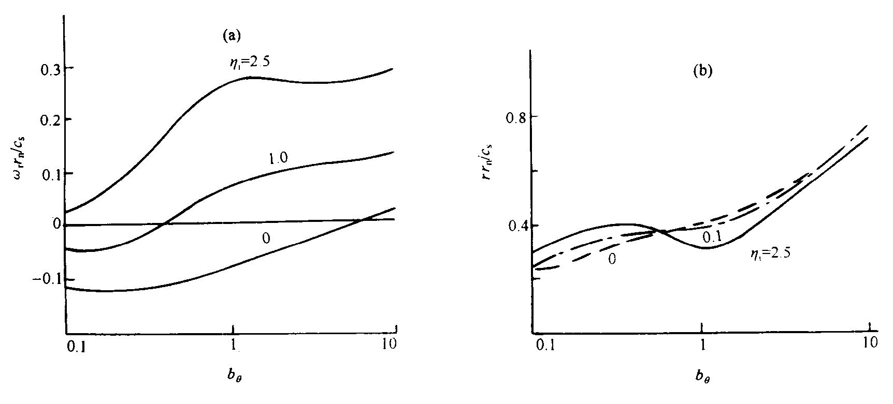

**图6.6** 非碰撞捕获电子模的实频 (a) 及增长率 (b) 随参数$b_{\theta}$的变化 〔23〕

除上面已引述的几种表示式外, 由静电和电磁漂移波湍流增大的反常电子热导率的理论表示式还有很多种, 康诺尔总结了各种表示式的适用条件。

中国学者在漂移波理论和反常输运研究中著作颇丰, 如曲文孝利用剖面不变性确定电子反常输运系数的研究 [24], 董家齐等人在离子温度梯度模方面的系列研究 [25\~28], 蔡诗尔、陈雁平、郭思宠等在回旋动力近似下的漂移波稳定性研究 [29\~33] 等。

### 6.7 引起磁湍流的主要微观模式 [34, 35]

在 6.5 节中指出, 很低程度的无规化磁场结构就可以产生很大的横越磁力线输运。理论研究提出了可能引起和维持磁湍流的一些模式,主要有:微撕裂模(这是一类极向模数$m$和环向模数$n$都很大的撕裂模,对应于尺寸非常小的磁岛结构)、电阻性压强梯度模(气球模)、电阻梯度模,等等。等离子体比压较大时一般的漂移波模式将成为电磁漂移波,因此也含扰动磁场成分,主要是垂直于平衡磁场的分量,因此,除前面讨论过的电场分量对输运的影响外,磁场分量的影响也要考虑,但是否会形成磁湍流,要由具体的模式中磁场分量的相对大小来确定。

从第五章中对较大尺寸的撕裂模的讨论中知道,磁岛结构对约束有直接影响,在$q = 1$磁面内部,这种影响还起主导作用,而靠近边缘处的3/2,2/1,3/1磁岛可以引起破裂。一般条件下,即使总体上磁面结构维持正常状态,在一些主要的有理磁面之间的空间区域,仍然可能存在微观结构的局部被破坏。本节介绍的理论模型,是卡多姆采夫根据近年的实验结果提出的某种理论设想,其理论证明不能说很严格,而且又很复杂,本书不可能详细介绍,但由于类似的理论模型比较重要,下面对其主要思路作简单介绍。

#### 6.7.1一种微撕裂模型及形成磁湍流的条件:非线性离子泵浦机制[34,35]

考虑一种尺寸非常小的磁岛链结构,设

$$
\rho_{\mathrm{L}}\gg \nu \gg \rho_{\mathrm{e}}
\quad (6.258)
$$

因此,离子在一个回旋半径范围内可以穿越很多磁岛,为了解形成这种磁岛链的物理条件,先分析圆柱近似下的结果。离子和电子的流体运动方程各为

$$
n m_{1}\frac{\mathrm{d}\nu_{1}}{\mathrm{d}t} = -\nabla p_{1} + n e E + \frac{n e}{c}\nu_{1}\times B
\quad (6.259)
$$

$$
\nabla p_{e} = -n e E - \frac{n e}{c}\nu_{e}\times B
\quad (6.260)
$$

设电场仅为扰动部分

$$
E = -\nabla \phi +\frac{1}{c} e_{z}\frac{\partial\psi}{\partial t}
\quad (6.261)
$$

磁场由平衡磁场及扰动磁场组成,但具有螺旋对称性,故可以用流函数$\psi (r,\theta - q\phi)$表示

$$
B = B_{e}e_{e} + e_{e}\times \nabla \psi
\quad (6.262)
$$

方程(6.260)对应于最简单形式的无碰撞欧姆定律,由其确定的环向扰动电流与扰动磁场的流函数$\psi$间的关系是安培定律:

$$
n V_{e\phi} = -j / e = -\frac{c}{4\pi e}\Delta_{\perp}\psi
\quad (6.263)
$$

如果离子的密度用绝热近似部分表示

$$
n = n_{0}(1 - \kappa x - e\phi /T_{1})
\quad (6.264)
$$

式中$x = r - r_{s}$ , $\kappa = - (d n_{0} / \mathrm{d}x) / n_{0}$ ,则由连续性方程及其它麦氏方程,可以得出一组描述微撕裂模的非线性方程

$$
\frac{\partial\psi}{\partial t} +\nu_{e}\frac{1}{r}\frac{\partial\psi}{\partial\theta} = \frac{1 + \tau}{\tau} D_{B}B\cdot \nabla \overline{{\phi}}
\quad (6.265)
$$

$$
\frac{\partial\overline{{\phi}}}{\partial t} -\nu_{e}\frac{1}{r}\frac{\partial\overline{{\phi}}}{\partial\theta} = -L B\cdot \nabla \Delta_{\perp}\psi
\quad (6.266)
$$

式中

其他各量的定义是:

$$
\nu_{\bullet} = \frac{c k T_{\bullet}}{e B_{\bullet}}, D_{B} = \frac{c T_{\bullet}}{e B_{\bullet}}, \tau = T_{\bullet} / T_{\bullet}, L = \frac{c\tau}{4\pi e n B_{\bullet}}
\quad (6.268)
$$

对应于上述方程组,存在系统的一个能量积分量,

$$
W = W_{\bullet} + W_{\nu} = \int \mathrm{d}\tau \left[\frac{(\nabla_{\perp}\psi)^{2}}{8\pi} +\frac{P_{0}}{2r^{2}}\overline{{\phi}}^{2}\right]
\quad (6.269)
$$

其中$p_{0} = n_{0}(T_{\bullet} + T_{\bullet})$为平衡态压强。

确定这组非线性方程的一般解需较深入的数学推导,这里仅限于简单的磁岛链解

$$
\psi = \psi_{0} + \delta \psi = -x^{2} / 2 + \alpha \cos k y
\quad (6.270)
$$

所描述的磁岛链如图6.7所示。

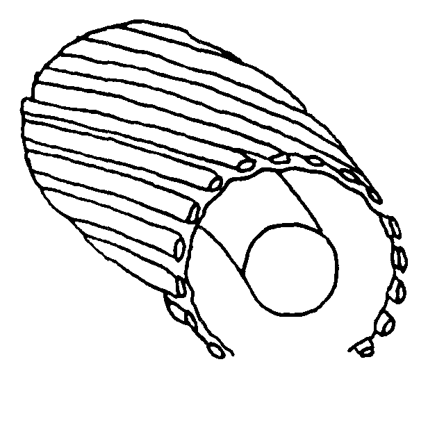

**图6.7** 圆柱位形中磁岛链

考虑碰撞的影响(电阻效应)后可以证明,这类磁岛链将衰减

$$
\frac{\partial}{\partial t} (k w) = -C A^{2}k^{2}\nu_{\bullet}
\quad (6.271)
$$

这里$\Lambda = c / \omega_{\mathrm{pe}}$是无碰撞趋肤深度(为了与所引文献符合一致), $c$是常数。上面的讨论所用模型是非常简单的,但说明一个物理事实,即等离子体具有自我修补位形的功能。

卡多姆采夫提出,考虑环形系统中平衡磁场的不均匀性,离子在穿越一系列磁岛的过程中,其回转中心将向磁场弱的区域(环的外侧)漂移。这种漂移是准稳运动,始终保持磁矩和广义环向角动量守恒,这意味着离子不断将能量传给电磁场(湍流)。由于环向效应,磁岛链的结构也不再保持对称,而是系统地向一个方向倾斜,这些效应加在一起,系统的电磁能将在离子的非线性泵浦及电子的修补之间竞争

$$
\frac{\overline{{M}}}{\overline{{a}}} = 2\gamma_{\mathrm{L}}W_{\mathrm{p}} - \frac{\nu_{\mathrm{s}}}{q R} F_{\mathrm{e}}W_{\mathrm{v}}
\quad (6.272)
$$

$F_{\mathrm{e}}$是一个与磁岛间联接的紧密度有关的量。

在证明托卡马克等离子体存在漏性自组织态的可能性之后,卡多姆采夫进而导出电子反常热导率的表示式,并称可以获得L- 模定标的结论。由于这些论证的非常定性,而且没有考虑真实托卡马克位形结构的一些重要特征(例如磁剪切),结果的可靠性是值得商榷的。本书引述这一结果,主要是介绍物理思路,同时使读者了解磁湍流的一些共有特性。

#### 6.7.2 电阻性压强驱动模(电阻性气球模)[36,37]

对托卡马克,在压强较高时主要的不稳定模式是气球模,这类模式的稳定条件被认为是确定等离子体比压极限的主要因素。可以证明,对于理想气球模稳定的系统,电阻性气球模仍然可以是不稳定的,但其增长率较低,其效应类似于微撕裂模,引起磁场结构的无规化,从而引起等离子体的反常输运。

有关的主要参数及限制如下

$$
n \gg 1, \quad n^{2} / S_{\mathrm{M}} \ll 1, \quad \beta q^{2} \ll a / R
\quad (6.273)
$$

式中$n$是环向模数, $S_{\mathrm{M}} = \tau_{\mathrm{R}} / \tau_{\mathrm{A}}$是磁雷诺数。在气球模理论分析中起重要作用的另一物理量是比压梯度参数(在5.11节中该量用$G$表示)

$$
\alpha = -\frac{8\pi R q^{2}}{B^{2}} \frac{\mathrm{d}p}{\mathrm{d}r}
\quad (6.274)
$$

和剪切量$s$。利用量纲分析方法可以得出,电阻性气球模对应的扰动磁场的相对幅值为:

$$
(\delta B / B)^{2} = g \frac{a^{2}}{R^{2} q^{2} S_{\mathrm{M}}} \left(\frac{\alpha}{s}\right)^{5 / 2}
\quad (6.275)
$$

$g$为数量级为1大小的数值因子。

电阻性气球模引起的反常热导率表示式的具体形式依赖于所考虑的因素。最近,卡诺(Connor)考虑电子惯性对电阻率的影响,即

$$
\eta_{k,\omega}^{-1} = -\mathrm{i} \frac{n_{\mathrm{e}} e^{2} \omega}{k_{\mu} T_{\mathrm{e}}} \left[1 + \frac{\omega}{k_{\mu} T_{\mathrm{e}}} Z \left(\frac{\omega}{k_{\mu} \nu_{\mathrm{e}}}\right)\right]
\quad (6.276)
$$

这里的电阻率是在$k, \omega$富氏表象中写出的, $Z$为等离子体色散函数。由式(6.276)得出:

$$
\chi_{\mathrm{e}} = \alpha \left(\frac{c}{\omega_{\mathrm{pe}}}\right)^{2} \frac{\nu_{\mathrm{ie}}}{R q}
\quad (6.277)
$$

与前面6.6节中由静电湍流推出的电子反常热导率公式相比,这里用比压梯度参数$\alpha$代替了捕获粒子参数。这种相似性是量纲分析共有的特征。

## 参考文献

1 Krall N A, Trivelpiece A W Principles of Plasma Physics. McGraw- Hill Book Company, 1973. 中译本, 郭书印, 黄林等 北京原子能出版社, 1983

2 Sivukhin D V. Coulomb collisions in a fully ionized plasma. in Review of Plasma Physics. V. 4 (ed. Leontovich M A.), Consultant Bureau, N.Y.1965

3 钟云霄, 胡济民. 考虑磁场对碰撞影响的等离子体输运. 核聚变与等离子体物理, 1986, 6(2): 65

4 Sivukhin D V. Motion of charged particles in electromagnetic fields in the drift approximation. in Review of Plasma Physics. V. 1 (ed. M. A. Leontovich), Consultant Bureau, N.Y. 1965

5 宫本健郎, 金尚宪译. 热核聚变等离子体物理学. 北京: 科学出版社, 1981

6 Hazeltine R D, Meiss J D. Plasma Confinement. Addison- Wesley Publishing Company, 1991

7 Rosenbluth M N, et al. Fokker- Planck equations for an inverse- square force. Phys. Rev., 1957, 107: 1

8 Hinton F L, Hazeltine R D. Theory of plasma transport in toroidal confinement systems. Rev. Mod. Phys., 1976, 48: 239

9 Bicherton R J, et al. Diffusion driven plasma current and bootstrap tokamak. Nature, 1971, 229: 110

10 Shiang K C, et al. Ion transport process around magnetic axis in tokamaks. Phys. Plasmas, 1997, 4: 771

11 曲洪鹏, 石秉仁. 四流体模型及其在$m = 1$内扭曲模不稳定性分析中的应用. [硕士论文]. 成都: 核工业西南物理研究院. 1998

12 Stix T H. Waves in Plasmas, American Institute of Physics. 1992

13 Cairns R A. Radiofrequency Heating of Plasmas, IOP Publishing Ltd. 1991

14 England A C, et al. Power transmission and coupling for radio- frequency heating of plasma. Nucl. Fusion, 1989, 29: 1527

15 Connor J W. Tokamak turbulence: electrostatic or magnetic? Plasma Phys. Control. Fusion, 1993, 35: B293

16 Connor J W. Survey of theories of anomalous transport. Plasma Phys. Control. Fusion, 1994, 36: 719

17 Bikerton R J. Magnetic turbulence and the transport of energy and particles in tokamaks. Plasma Phys. Control. Fusion, 1997, 39: 339

18 Callen J D. Transport processes in magnetically confined plasmas. Phys. Fluids, 1992, B4(7): 2142

Connor J W. Transport in tokamaks: theoretical models and comparison with experimental results. Plasma Phys. Control. Fusion, 1995, 37: A119

19 Connor J W, Wilson H R. Survey of theories of anomalous transport. Plasma Phys. Control. Fusion, 1994, 36: 719\~795

20 Horton W. Onset of stochasticity and the diffusion approximation in drift waves. Plasma Phys. Control. Fusion, 1985, 27(9): 937

21 Horton W, Choi D- I, Yushmanov P N, et al. Electron diffusion in tokamaks due to electromagnetic fluctuations. Plasma Phys. Control. Fusion, 1987, 29(7): 901

22 Guzdar P N, Liu C S, Dong J Q, Lee Y C. Model for thermal transport in tokamaks. Phys. Rev Lett., 1986, 57(22): 2818

23 Coppi B, Migliuolo S, Pu Y- K. Candidate mode for electron thermal energy transport in multi- kev plasmas. Phys. Fluids, 1990, B2(10): 2322

24 曲文孝. 剖面不变性、反常电子热导及托卡马克装置约束性能分析. 核聚变与等离子体物理, 1991, 11(4): 193

25 Dong J Q, Horton W. Kinetic quasitoroidal ion temperature gradient instability in the presence of shear flows. Phys. Fluids, 1993, B5: 4034

26 Dong J Q, et al. Momentum- energy transport from turbulence driven by parallel flow shear. Phys. Plasmas, 1994, 1: 3250

27 Dong J Q, et al. Isotope scaling and $\eta_{1}$ - mode with impurities in tokamak plasmas. Phys. Plasmas, 1994, 1: 3635

28 Dong J Q, Horton W. Studies of impurity mode and ion temperature gradient mode in toroidal plasmas. Phys. Plasmas, 1995, 2: 3412

29 Chen L, Tsai S T. Electrostatic waves in general magnetic configurations. Phys. Fluids, 1983, 26: 141

30 Chen L, Tsai S T. Linear oscillations in general magnetically confined plasmas. Plasma Phys., 1983, 25: 359

31 Guo S C, Chen L, Tsai S T. Ion temperature gradient instability and anomalous transport. Chin. Phys. Lett., 1988, 5: 397

32 Tsai S T, Chen L. Theory of kinetic ballooning modes excited by energetic particles in tokamaks. Phys. Fluids, 1993, B5: 3284

33 Chen Y P, Tsai S T. Finite banana width effect on magnetoacoustic cyclotron instability. Phys. Plasmas, 1995, 2: 3049

34 Kadomtsev B B. Plasma transport in tokamaks. Nucl. Fusion, 1991, 31: 1301

35 Kadomtsev B B. Tokamak Plasma: A Complex Physical System, Cp 9, IOP Publishing, Ltd. 1992

36 Connor J W, Chen L. Resistive ballooning mode in an axisymmetric toroidal plasma with long mean free path. Phys. Fluids, 1985, 28(7): 2201

37 Connor J W. Pressure gradient turbulence transport and collisionless reconnection. Plasma Phys. Control. Fusion, 1993, 35: 757

# 第七章 边缘等离子体物理、等离子体与器壁相互作用及杂质物理

70年代以前的磁约束聚变实验对器壁问题及边缘等离子体特性重视得很不够,当时得到的等离子体很不干净,混有多种杂质,有效电荷数常常超过3或4,有时甚至达到5以上;同时由于器壁上气体再循环条件变化不定,等离子体密度剖面不可控制,总体等离子体参数较低。80年代以来,随着托卡马克研究的深入进行,对这些问题开始重视起来,并发展了一系列器壁处理技术,如各种预放电清洗(discharge conditioning),以及喷钛(titanium gettering),壁碳化(carbonization),硼化(boronization),硅化(siliconization),采用铍孔栏甚至全铍壁,等等,对杂质以及器壁和限制孔栏表面上的气体再循环有了较好的控制,等离子体一些重要参数的剖面分布渐趋优化,加上装置尺寸不断加大,及加热技术和等离子体控制技术的发展,等离子体总体参数不断提高,其中一些重要参数已接近甚至超过点火实验和反应堆要求。现在,边缘等离子体特性的研究已成为磁约束聚变实验研究的一个重要方面。实际上,获得和维持优良的边缘条件,包括性能优良的偏滤器,是关系到磁约束聚变反应堆能否得到较早商业应用的关键问题之一。

从反应堆的角度看,聚变等离子体的边缘区及偏滤器要具有下述功能:

(1) 要将聚变反应产生的热量(即$\alpha$粒子所携带的能量及外部对等离子体的加热功率转化的热量)通过边缘区输出到真空室外,现代托卡马克设计要求将$80\%$以上的热能通过偏滤器输出,基于标准托卡马克堆设计的计算表明,偏滤器靶板上的长期平均热负载达$20\mathrm{MW} / \mathrm{m}^2$以上。要提高托卡马克堆的经济性能,这一指标还要成倍提高;

(2) 对杂质的有效控制,使中心约束区中重杂质(钼、钨等)的相对含量低于$0.01\% \sim 0.02\%$;轻杂质(碳、铍、锂)的相对含量控制在$2\% \sim 3\%$以内,还要将燃烧后的氨灰从堆中心区有效地排出;

(3) 在长期长脉冲运行条件下保持良好器壁条件,能稳定控制器壁中工作气体再循环,基本排除非工作气体(轻杂质)的进入。

(4) 从器壁材料自身的角度看,还应维持良好的边缘环境条件,使等离子体对器壁材料的总腐蚀率控制在容许的范围内,或可对受损部分进行有效的维修及更换。

80年代以来,一些大装置中的高功率加热实验已使直接与等离子体接触或接受其排出的热量和粒子流的第一壁材料受到考验,出现了作为孔栏或偏滤器靶板材料的石墨或铍的局部高热及腐蚀加剧,并引发大量杂质进入主约束等离子体,使等离子体发生破裂的现象。因此,近几年中,JET,JT- 60U,ASDEX- U等大型装置把改进和设计新型偏滤器作为主要的研究内容。在控制杂质品种和含量方面,国内外的大多数装置中都取得了重要进展,但实际达到的杂质含量仍然太大,常常使等离子体总体约束品质受很大影响,同时使中心约束区中工作元素氢、氘、氚离子的有效浓度降低。在一些特定的实验中等离子体虽达到很高的纯度,但这种情况往往只在短时间内得到维持,或经过长时间预处理后在一段时间内得到维持,因而离反应堆中的实用条件还有相当距离。大量实验证明,器壁上气体再循环率对托卡马克等离子体的品质也十分重要,目前实验中观察到的许多改善约束位形与壁条件,尤其与粒子的再循环率关系密切。如何在长脉冲放电条件下维持这种条件,也是今后要解决的重要问题。最后,关于控制材料的腐蚀率,被看成反应堆能够有效运行的关键问题之一。总之,边缘等离子体及等离子体与器壁的相互作用已作为长期研究课题和磁约束聚变堆的研究及发展的重要项目,受到国际聚变界的高度重视。1974年以来,以等离子体与器壁相互作用为专题的两年一次的国际专业会议已进行十多次,研究的内容已很具实用性。国际上还有一些装置的研究重点就是等离子体与器壁的相互作用,另一些专门从事材料腐蚀和新材料研制的大型工程或实验项目已在有效地运作。

## 7.1 磁约束聚变等离子体边缘区的特性[1-3]

托卡马克装置(以及其它可能实现氘氚点火的装置)中,将中心高温等离子体与真空室器壁隔开的方法不外乎两种:第一种是采用限制孔栏,这时主约束等离子体的外缘与孔栏相切后将真空室内的等离子体分成两个区域,切面所在的磁面被称为最后一个封闭磁面LCFS(Last Closed Flux Surface),切面以内的区域首先是一个参数较低的冷边缘区EP(Edge Plasma),然后是参数逐渐增大的主约束区MP(Main Plasma);切面外部是刮离区SOL(Scrapped- Off Layer),其中靠近孔栏表面处有一等离子体鞘PS(Plasma Sheath)(如图7.1所示)。通常意义上的边缘等离子体区应包括切面内的冷区和切面外的刮离区,这一区域的主要特征是含有较多的中性气体和杂质,因而分子原子过程很重要,杂质的线辐射功率很大,常常可以超过该区域中的局部加热功率,在一定条件下可以形成一个辐射层(radiation mantle),相应地使流向孔栏或偏滤器的热流量得到很大的减小。控制这一区域的参数可对主约束区的总体参数起较大的影响。

第二种是用磁偏滤器将磁面分界的情形。常采用具有一个X点或两个X点的位形,这时磁分界面就是最后一个封闭磁面,它代替了孔栏位形中与孔栏相切的磁面,但可避免等离子体与物质材料直接接触。在分界面到真空室壁间的阴影区,还可以设置几个孔栏,用于保护等离子体因不稳定位移与主真空室的接触,或用于吸收中性束注入中的剩余束。除了减少主等离子体与真空室和孔栏材料的直接相互作用外,偏滤器位形的最大特点是将大多数粒子和热量引入专门的偏滤器区域,让热量沉淀在特设的靶板上,并以特殊的磁场结构使靶板上溅射产生的杂质较难回流至主等离子体区(如图7.2所示)。

归结起来,边缘区对主约束区的影响有以下两方面:

(1)控制等离子体与器壁相互作用产生的杂质流。通常按杂质元素的原子量和电荷数大小将它们分成重杂质和轻杂质两类。重杂质主要是真空室壁或孔栏和偏滤器靶板材料中的重金属成分,如镍,钼,钨,这类杂质在进入中心约束区后成为非常大的辐射损失源,只要有万分之几的含量就可以完全阻止氘氚点火,因此是必须防止的;第二类是氧,碳,锂,铍,硼等轻杂质,有的是真空室壁中吸附的,有的是用于孔径的材料,或放电前预覆盖在某些与等离子体接触或靠近的表面上的。包括真空室壁、孔栏及偏滤器靶板在内的与等离子体要直接接触的或很靠近的材料称为面向等离子体的材料(plasma- facing material),也称第一壁材料,对这些材料的研制也是磁约束聚变相关科技的重要分支。

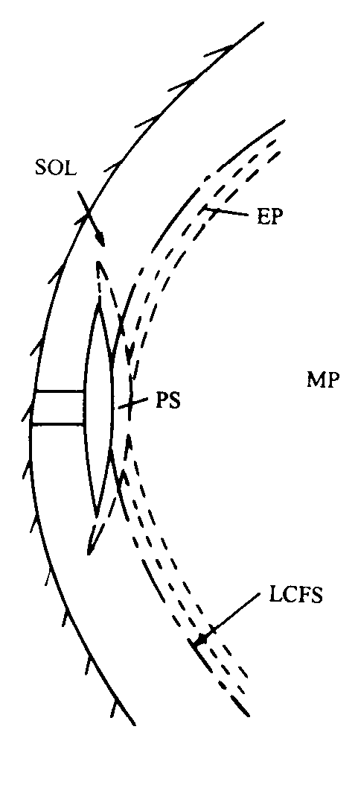

**图7.1** 孔栏位形的边缘区示意

SOL—刮离区;EP—边缘等离子体;PS—等离子体鞘;LCFS—最外部封闭磁面;MP—主等离子体。

(2)由第一壁表面放气引起的再循环送气,或简称器壁送气。即使送的是纯工作气体,由于这种送气不是实验中预设的,所以对实验并不利。因此,控制再循环是很多实验的重要内容,而且很难达到长期有效的效果。

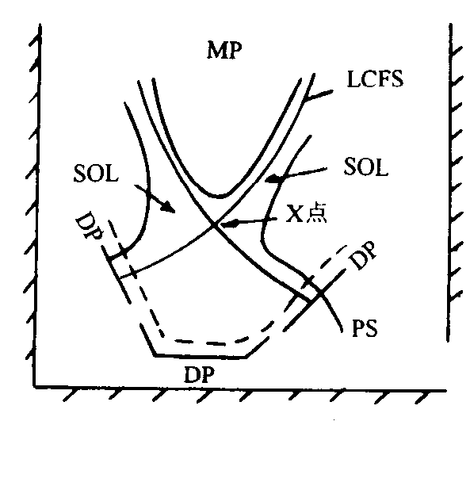

**图7.2** 偏滤器位形的边缘区示意

磁约束聚变装置及反应堆中的等离子体与器壁相互作用还具有本身的一些特点,即材料表面长期接受很大的热和粒子流负荷。在这种大的热负荷作用下,孔栏或偏滤器靶板的局部温度可能非常高,从而出现特殊的物理化学过程。一般情况下,等离子体与器壁的作用与壁前的等离子体鞘的性质有很大关系。严格说,根据孔栏面的几何结构的不同,实际上磁力线不会完全和表面垂直,因而鞘的结构是比较复杂的。下面我们仅对理想化的一维垂直鞘(假定磁力线垂直于壁表面)进行讨论,复杂的二维分析请参考有关文献。

从粒子和能量平衡的角度看,在边缘区中,除了必须考虑分子原子过程、杂质辐射效应外,它们构成输运方程组中的源项或漏项(sink),等离子体输运特性与主约束区中等离子体有很大差别。例如,与横越磁力线的输运相比,沿磁力线的输运也很重要,在剥离区则主要是沿磁力线的输运起主导作用。另外还需特别注意,各种过程不是独立的,它们之间存在有机的联系,例如杂质的产生与等离子体参数直接有关,气体流量与器壁条件有关,边缘参数与主约束区参数有关,等等。边缘等离子体物理研究的任务就是要确定各种有关物理过程间的关系,寻求对参数的最佳控制,以达到磁约束聚变研究的主要目的。

## 7.2 剥离区和等离子体鞘特性[2,5]

从图7.1可以看到,对孔栏位形,等离子体与物质材料的相互作用主要发生在孔栏与等离子体相切面附近,以及处在剥离区中的孔栏表面上。直接能和真空室壁作用的是电荷交换产生的快中性粒子,以及一些高能粒子或离群电子。相当一部分从主约束区流出的热量也将沉淀在孔栏表面上,等离子体中扩散出来的粒子也有相当一部分直接打到孔栏上,并将孔栏表面的气体,各种吸附材料解吸或溅射出来。一般来说,剥离层越厚,对真空室的保护作用越大。对偏滤器位形,在磁分界面附近没有器壁材料,从而避免了与主约束等离子体的直接接触,减弱了等离子体与器壁的相互作用。偏滤器靶板附近的物理过程与孔栏表面附近的物理过程是类似的,但孔栏位形与偏滤器位形的剥离区中的输运特性可以有很大的区别。在现代偏滤器中,在保持等离子体压强沿磁力线基本为常数的条件下,其粒子密度和温度都可以变化,使靶板附近有较高的粒子密度和较低的温度。这些将在下面分别讨论。

### 7.2.1 一维剥离层模型

这一小节中要讨论的内容原则上对孔栏位形和偏滤器位形都适用,但对应者,沿磁力线的输运要考虑热传导,这将在后面的小节中补充。

实际的边缘区域中磁场位形可能比较复杂,但很多研究表明,用比较符合实际的复杂位形计算得出的结果,与非常简单的一维模型得出的在定性上是一致的。取如图7.3所示的位形,设有左右对称的两块固体靶板(如果在托卡马克装置中只有一个孔栏,这两块靶板实际上代表该孔栏的左右两侧),假定在固体靶板上的热沉淀是可以容许的,固体表面的温度(典型值1000K)远小于等离子体边缘的温度(典型值$5\times 10^{4}\mathrm{K}$ ),先不考虑杂质效应$(Z = 1)$ ,等离子体中电子和离子按流体运动方式向靶板表面流动,其连接长度(典型值为几倍的$q R)$为$2L_{\mathrm{c}}$,流体速度为声速量级

$$
c_{\mathrm{s}} = \left(\frac{T_{\mathrm{e}} + T_{\mathrm{i}}}{m_{\mathrm{i}}}\right)^{1 / 2} \tag{7.1}
$$

由于磁力线与靶体相交,电子很容易沿磁力线运动到靶体表面,于是靶体将处在负电位,电子在剥离层中将具有玻尔兹曼分布

$$
n_{\mathrm{e}}(x) = n_{\mathrm{e0}}\exp (e\phi /T_{\mathrm{e}}) \tag{7.2}
$$

式中$n_{\mathrm{e0}}$是在$x = L_{\mathrm{c}} / 2$处的电子密度。在大部分空间区域,等离子体仍满足电中性条件,即$n_{\mathrm{e}} = n_{\mathrm{i}}$,只有在靠近靶体表面约几个德拜长度的范围内,电子和离子的密度才不相等,形成等离子体鞘。在电场的作用下,离子被加速,最后以接近鞘电位的能量打到靶的表面上。将鞘电位等于1/2电子温度值的地方定义为鞘的分界面,该处的等离子体密度将下降一半,离子密度接近但略高于电子。在鞘的内部,离子密度的下降慢于电子,根据不同的物理模型计算得到的鞘电位值是接近的,大约为$(- 3T_{\mathrm{e}} / e)$,被鞘电位加速的离子大体上以这一能量打到靶体表面上。因此,边缘电子温度越高,离子轰击靶体表面的能量也越大。这一能量的大小将影响靶体上杂质被溅射的程度。举例说明有关参数:设$T_{\mathrm{e}} = 20 \mathrm{eV}$, $n_{\mathrm{e}} = 2\times 10^{12} \mathrm{cm}^{- 3}$则$\lambda_{\mathrm{D}} = 10^{- 3} \mathrm{cm}$,鞘的特征宽度为$10^{- 2} \mathrm{cm}$左右,而连接长度$L_{\mathrm{c}}$对不同的装置在几米到几十米之间。

**图7.3** 等离子体鞘附近的电位、流动速度及电子和离子密度的变化

### 7.2.2 等离子体鞘的内部特性

通常在鞘的界面处的离子初速度远小于最终被加速后的速度,因此可以假定离子从零速度开始加速,则由连续性方程,得鞘内离子密度为

$$
n_{\mathrm{i}} = n_{\mathrm{i}}\left(\phi_{\mathrm{i}} / \phi\right)^{1 / 2} \tag{7.3}
$$

而电子密度由玻尔兹曼分布给出为

$$
n_{\mathrm{e}} = n_{\mathrm{i}}\exp [e(\Phi - \Phi_{\mathrm{i}}) / T_{\mathrm{e}}] \tag{7.4}
$$

式中下标$\mathbf{s}$表示在鞘分界面处取值。确定鞘中电位分布的是泊松方程

$$
\frac{\mathrm{d}^{2}\Phi}{\mathrm{d}x^{2}} = -4\pi e(n_{\mathrm{i}} - n_{\mathrm{e}}) \tag{7.5}
$$

这是一个非线性二阶常微分方程,在非常靠近鞘分界面处,利用近似展开,可以得到线性近似方程

$$
\frac{\mathrm{d}^{2}\Phi}{\mathrm{d}x^{2}} = -4\pi e(\Phi_{\mathrm{i}} - \Phi)\left(\frac{2}{T_{\mathrm{e}}} -\frac{1}{2|\Phi_{\mathrm{i}}|}\right) \tag{7.6}
$$

这个方程的解与上面关于鞘参数的预先假定是一致的,即$\Phi_{\mathrm{i}}\geqslant T_{\mathrm{e}} / 2e$, $\nu_{\mathrm{s}}\geqslant (T_{\mathrm{e}} / m_{\mathrm{i}})^{1 / 2}$。后一速度是离子温度为零时的流体声速。考虑离子温度效应,最后将得到分界面处的流体速度就是声速。

一个重要的物理结论是,从等离子体中打到鞘上的离子流量为

$$
\Gamma_{\mathrm{i}}^{\mathrm{e}} = n_{\mathrm{i}}\nu_{\mathrm{s}} = 0.5n_{\mathrm{o}}c_{\mathrm{s}} \tag{7.7}
$$

另一个重要的物理结果是靶体表面相对于剥离区等离子体内部的浮动电位为

$$
\frac{e\Phi_{\mathrm{f}}}{T_{\mathrm{e}}} = 0.5\ln \left[\left(\frac{2\pi m_{\mathrm{e}}}{m_{\mathrm{i}}}\right)\left(1 + \frac{T_{\mathrm{i}}}{T_{\mathrm{e}}}\right)(1 - \delta)^{-2}\right] \tag{7.8}
$$

式中$\delta$为固体表面的电子二次发射系数。

电子和离子在与靶体相互作用中将把部分热量传输到靶体表面上。定义电子的能量传输系数

$$
\gamma_{\mathrm{e}}^{\mathrm{e}} = \frac{P_{\mathrm{e}}^{\mathrm{e}}}{T_{\mathrm{e}}\Gamma^{\mathrm{e}}} \tag{7.9}
$$

从剥离区中心流向靶体表面的电子热流密度为

$$
P_{\mathrm{e}}^{\mathrm{e}} = \left(\frac{2T_{\mathrm{e}}}{1 - \delta} -e\Phi_{\mathrm{i}}\right)\Gamma_{\mathrm{net}}^{\mathrm{e}} \tag{7.10}
$$

因此可确定

$$
\gamma_{\mathrm{e}}^{\mathrm{e}} = \frac{2}{1 - \delta} -\frac{e\Phi_{\mathrm{f}}}{T_{\mathrm{e}}} +c_{\mathrm{o}} \tag{7.11}
$$

其中常数$c_{\mathrm{o}}\approx 0.5$。定义类似的离子能量传输系数,则可得

$$
\gamma_{\mathrm{i}}^{\mathrm{i}}\approx 3.5T_{\mathrm{i}} / T_{\mathrm{e}} \tag{7.12}
$$

其中确定系数3.5的条件是打到靶体表面的离子热流密度约为:

$$
P_{\mathrm{e}}^{\mathrm{e}} = (\frac{5}{2} T_{\mathrm{i}} + \frac{1}{2} m_{\mathrm{i}}c_{\mathrm{s}}^{2}),\approx 3.5T_{\mathrm{i}}\Gamma \tag{7.13}
$$

在等离子体鞘电位的作用下,电子流向靶体的流量有较大的减小,它超过离子因鞘电位的加速而增大的热流,因此,流向靶体的总热流将减小,这是好的方面;不好的一面是被鞘加速的离子会加大对靶体材料的溅射产额,从而增大了杂质源。当前的装置实验和反应堆设计,尤其是偏滤器靶板区的设计中要研究的一个重要问题就是既要减少热负荷,又要减小离子的溅射,即使鞘电位下降。增大靶板区附近的轻杂质辐射可以同时达到这两个目的,但要控制好杂质的返流。

### 7.2.3 剥离区特性

剥离区的真实物理宽度是由等离子体的横越磁力线的反常扩散与平行于磁力线的输运间的竞争所确定的,一般要求这一宽度小于最后一个封闭磁面到真空室的距离,这样才能确实保护真空室壁免遭大量等离子体粒子的轰击。假定由最后一个封闭磁面扩散出来的粒子流全部打到孔栏表面上,在剥离区内,电子和离子的密度由最后封闭磁面向外沿半径方向按指数方式减小

$$
n_{\mathrm{e}} = n_{\mathrm{e}}(a)\exp [-(\boldsymbol {r} - \boldsymbol {a}) / \lambda_{\mathrm{n}}] \tag{7.14}
$$

同样,假定外流的全部热量也都沉淀在孔栏表面,电子和离子的温度也都按指数方式减小

$$
T_{\mathrm{e}} = T_{\mathrm{e}}(a)\exp [-(\boldsymbol {r} - \boldsymbol {a}) / \lambda_{\mathrm{r}}] \tag{7.15}
$$

三个特征长度$\lambda_{\mathrm{n}}, \lambda_{\mathrm{r}}, \lambda_{\mathrm{r}}$要由粒子和热的三个平衡方程来确定。首先考虑粒子平衡条件

$$
L_{\mathrm{c}}\frac{\mathrm{d}}{\mathrm{d}r}\left(D_{\mathrm{t}}\frac{\mathrm{d}n}{\mathrm{d}r}\right)_{\mathrm{LCFS}} = 0.5n c_{\mathrm{s}} \tag{7.16}
$$

若有关特征量都在LCFS处取值,此式给出

$$
\frac{D_{\mathrm{t0}}}{\lambda_{\mathrm{n}}} = \frac{c_{\mathrm{t0}}\lambda_{\mathrm{n}}}{2L_{\mathrm{c}}} \tag{7.17}
$$

于是得出粒子密度在SOL中的特征长度为

$$
\lambda_{\mathrm{n}} = (2D_{\mathrm{t0}}L_{\mathrm{c}} / c_{\mathrm{t0}})^{1 / 2} \tag{7.18}
$$

其中反常扩散大体是玻姆扩散量级

$$
D_{\mathrm{t}} = \frac{c T_{\mathrm{e}}}{16B} \approx 0.06 T_{\mathrm{e}}(\mathrm{eV}) / B(\mathrm{T}) \mathrm{m}^{2} \cdot \mathrm{s}^{-1} \tag{7.19}
$$

在很多托卡马克装置实验中发现,实际的粒子密度特征长度与由式 (7.18) 和 (7.19) 所确定的符合得相当好,其中在 ASDEX、FT、AL- C、TEXTOR、JET 和 TFTR 等装置中,实测值与上述由简单模型得出的理论值的偏离不足$\pm 20\%$。这样,实际上还可以从 SOL 中测得的粒子密度特征长度$\lambda_{\mathrm{n}}$来确定边缘附近等离子体的反常扩散系数。关于 SOL 中粒子密度的测量可以应用简单而且可靠性高的朗缪尔探针法,所以关于边缘区附近等离子体的扩散具有玻姆型 (7.19) 的结论也相当可信。

关于电子和离子温度的特征长度要由关于电子和离子的两个能量平衡条件来确定

$$
L_{\mathrm{c}}\left(n\chi_{\mathrm{t}}\frac{\mathrm{d}T_{\mathrm{e}}}{\mathrm{d}r} +\frac{5}{2} D_{\mathrm{t}}T_{\mathrm{e}}\frac{\mathrm{d}n}{\mathrm{d}r}\right)_{\mathrm{LCFS}} = 0.5n_{\mathrm{c}}c_{\mathrm{s}}\gamma_{\mathrm{s}}^{\mathrm{t}}T_{\mathrm{e}} \tag{7.20}
$$

$$
L_{\mathrm{c}}\frac{\mathrm{d}}{\mathrm{d}r}\left(\frac{5}{2} D_{\mathrm{t}}T_{\mathrm{t}}\frac{\mathrm{d}n}{\mathrm{d}r}\right)_{\mathrm{LCFS}} = 0.5n_{\mathrm{c}}c_{\mathrm{s}}\gamma_{\mathrm{s}}^{\mathrm{t}}T_{\mathrm{e}} \tag{7.21}
$$

式中在向外流的离子热量中没有考虑离子热传导的贡献,因为实验中发现边缘区中主要是电子的反常热传导及对流传热占优。另外,若在式 (7.21) 中关于离子在鞘上的能量传输系数取$\gamma_{\mathrm{s}}^{\mathrm{t}} = 2.5T_{\mathrm{t}} / T_{\mathrm{e}}$ [前面公式 (7.12) 中这一系数为 3.5],则关于离子能量平衡的公式 (7.21) 中的离子温度可以消去,剩下的部分与粒子平衡方程 (7.16) 是一回事,这意味着离子温度是近似不变的,即$\lambda_{\tau}$很大。于是上面公式中的声速取LCFS处值的假定也是正确的。关于电子能量平衡的公式(7.20)给出

$$
\frac{D_{\mathrm{lo}}}{\lambda_{\mathrm{n}}}\left(\frac{5}{2} +\frac{\chi_{\mathrm{lo}}\lambda_{\mathrm{n}}}{D_{\mathrm{lo}}\lambda_{\tau_{\mathrm{r}}}}\right) = \frac{\gamma_{\mathrm{e}}^{\star}c_{\mathrm{so}}}{2L_{\mathrm{c}}}\left(\frac{1}{\lambda_{\mathrm{n}}} +\frac{1}{\lambda_{\tau_{\mathrm{r}}}}\right)^{-1} \tag{7.22}
$$

或者写成比值的形式

$$
\left(\frac{5}{2} +\frac{\chi_{\mathrm{lo}}\lambda_{\mathrm{n}}}{D_{\mathrm{lo}}\lambda_{\tau_{\mathrm{r}}}}\right)\left(1 + \frac{\lambda_{\mathrm{n}}}{\lambda_{\tau_{\mathrm{r}}}}\right) = \gamma_{\mathrm{e}}^{\star} \tag{7.23}
$$

这是关于两个特征长度比值的二次代数方程,可以看出它与两个主要参数有关,一是电子反常热导率与反常玻姆扩散系数的比值,另一为电子在钠上的能量传输系数。与粒子密度特征长度的情形不同,电子温度特征长度还依赖于许多没有考虑的物理因素,如电子与离子的碰撞引起的能量传递,离子反常热传导效应,SOL内可能存在的垂直电场(例如双极电场),等等。因此由上面的公式与SOL中的实验结果(关于电子温度分布的探针测量结果)对比得出的关于电子反常热导率的结果会有较大的误差。

但是,上面关于SOL中粒子密度、电子温度和离子温度特征长度的一般考虑是恰当的。实验证实,三个参量间存在尺度关系

$$
\lambda_{\tau_{\mathrm{r}}} > \lambda_{\tau_{\mathrm{r}}}\geqslant \lambda_{\mathrm{n}} \tag{7.24}
$$

以上分析比较适用于孔径形,但定性上也可描述偏滤器位形中剥离区中的一些物理特性。其间的差别将在有关偏滤器的小节中专门讨论。

## 7.3 边缘等离子体中的分子原子过程及边缘参数与中心参数的联系[1-3,6]

### 7.3.1 中性粒子向等离子体内部的透入

托卡马克装置中等离子体是通过在真空室中预充工作气体(氢或氘)然后通过欧姆放电形成的,以后,通过主动送气(最一般的做法,也是早期实验唯一的方法)来补充因扩散而损失的等离子体。等离子体周围的器壁材料表面吸附有大量的工作气体,它们在放电过程中因边缘等离子体与壁表面的相互作用会不断放出来,成为一种被动气体源。但无论主动送气或壁放气,气体总是通过边界向等离子体约束区内部扩散的。首先是气体要通过刮离区,那里的等离子体密度较低,一般不足以完全使中性气体电离。一些装置如PLT,DITE,JET,T- 10等都具体确定过气体通过SOL后的电离比例,结果发现除T- 10中有较高的电离比外,大部分装置中被SOL中等离子体电离的部分小于$30\%$。因此,大部分气体将进入LCFS以内。中性粒子的穿透深度与它们的各种分子原子反应截面有关。这些截面包括:

(1)分子被电离成分子态离子

$$
\mathrm{e} + \mathrm{H}_{2}\rightarrow \mathrm{H}_{2}^{+} + 2\mathrm{e} \tag{7.25}
$$

(2)分子被解离成原子

$$
\mathrm{e} + \mathrm{H}_{2}\rightarrow 2\mathrm{H}^{0} + \mathrm{e} \tag{7.26}
$$

(3)分子被解离成原子,同时一个原子被电离

$$
\mathrm{e} + \mathrm{H}_{2}\rightarrow \mathrm{H}^{0} + \mathrm{H}^{+} + 2\mathrm{e} \tag{7.27}
$$

(4)分子态离子吸附一个电子同时被解离成两个原子

$$
\mathrm{e} + \mathrm{H}_{2}^{+}\rightarrow 2\mathrm{H}^{0} \tag{7.28}
$$

(5) 分子态离子被解离成一个原子和一个离子

$$
\mathrm{e} + \mathrm{H}_{2}^{+}\rightarrow \mathrm{H}^{0} + \mathrm{H}^{+} + \mathrm{e} \tag{7.29}
$$

(6) 原子电离

$$
\mathrm{e} + \mathrm{H}^{0}\rightarrow \mathrm{H}^{+} + 2\mathrm{e} \tag{7.30}
$$

(7) 原子与离子间电荷交换

$$
\mathrm{H}^{0} + \mathrm{H}^{+}\rightarrow \mathrm{H}^{+} + \mathrm{H}^{0} \tag{7.31}
$$

具体的截面数据如图7.4所示。

从图7.4看出,对应于边缘等离子体温度为$10\sim 100 \mathrm{eV}$的具体情况,截面大的反应依次为第五,第一,第六和第七种,即分子被电离及分子态离子被解离,原子被电离及电荷交换。这就确定了中性气体对中心等离子体约束区穿透过程的一些基本特点。首先考虑氢分子的穿透问题。在室温下,分子的运动速度很小,按$\nu_{0} = (2T_{0} / m)^{1 / 2}$, $\lambda = \nu_{0} / n_{\mathrm{e}}\langle \sigma \nu \rangle$计算透入深度,氢分子在$300 \mathrm{K}$下的平均速度约为$1.5\times 10^{5} \mathrm{cm}\cdot \mathrm{s}^{- 1}$, $10 \mathrm{eV}$的电子温度下降解率小于$10^{- 8} \mathrm{cm}^{3}\cdot \mathrm{s}^{- 1}$,若设SOL中等离子体密度为$10^{12} \mathrm{cm}^{3}$,则$\lambda$大于$10 \mathrm{cm}$,即氢分子可以穿透SOL。但一进入最后一个封闭磁面,等离子体密度升至$10^{13} \mathrm{cm}^{- 3}$量级,电子温度在几十电子伏,分子氢的电离率升至

**图7.4** 主要的分子和原子反应率随电子和离子温度的变化[2]

$5\times 10^{- 7}\mathrm{cm}^{3}\cdot \mathrm{s}^{- 1}$,穿透深度将下降到$2\mathrm{cm}$以下,因而分子氢只能透入到非常靠近最后封闭磁面的边缘区。分子态氢在电离后,得到的分子态离子的离解率非常高,因此几乎立即被解离。在分子态离子被解离成中性原子时,它在与电子的碰撞过程中获得了一定的能量,使中性原子具有$3\mathrm{eV}$左右的能量,其速度比室温(300K)提高了一个数量级,达到$2\times 10^{6}\mathrm{cm}\cdot \mathrm{s}^{- 1}$,这些原子的电离率为$10^{- 8}\mathrm{cm}^{3}\cdot \mathrm{s}^{- 1}$,相应的穿透深度可达$10\sim 20 \mathrm{cm}$,相当于中小型装置的等离子体的小半径。这种被解离而具有较大能量的粒子,称为弗兰克- 康登(Fronk- Condon)粒子,它是中性粒子能够较深地透入等离子体内部的原因之一。

中性原子可以更深地透入等离子体内部的另一原因与式(7.31)有关,即原子与离子间的电荷交换起重要作用。简单的原理是,较冷的中性原子与较热的离子发生电荷交换后,产生的中性原子具有原来热离子的能量,这些原子的一部分将离开等离子体而损失,但总有一部分射向更深入的约束区内,它们又会被电离,或发生另一次电荷交换,结果产生另一个能量更大的中性原子。这一级联过程(cascade)的总效果是部分中性原子深入到内部约束区。等效地可以把中性原子向内穿透等离子体的速度$\nu_{0}$进一步提高,不同装置实验及计算编码中采用$\nu_{0} \approx (2 \sim 4.4) \times 10^{6} \mathrm{~cm} \cdot \mathrm{s}^{- 1}$,相当于取$\nu_{0} \approx 4 \sim 20 \mathrm{eV}$。已发展了一些基于上述分析的一维和二维数值计算编码,可用于实际分析。氢分子、氢原子的等离子体密度的剖面示意图如图7.5所示。

#### 7.3.2 边缘粒子密度与中心粒子密度的关系

真空室壁和孔径表面等预先吸附的气体在放电过程中将不断放出,成为被动的供气源。在放电过程中,由等离子体中扩散出来的带电粒子和电荷交换产生的中性粒子不断地回流到器壁表面,这些粒子与表面上原先吸附的粒子的碰撞使部分入射粒子又重新返回等离子体中,另一些被吸附粒子则可能被溅射出来。所以,除产生杂质流外,等离子体与表面相互作用的另一后果是使大量工作气体返回等离子体。一个入射到器壁的粒子引起的返回粒子数称再循环率。在研究等离子体密度积累及计算等离子体粒子约束时间时,必须考虑再循环的影响。

**图7.5** 边缘区附近氢分子、氢原子的剖面小总

现在介绍一个由Engelhardt等人首先提出的简单的模型来分析等离子体约束区中粒子密度与边缘密度以及送气量的关系。设中性原子由最外封闭磁面$r = a$的向内穿透距离为$\lambda_{z}$,等离子体的横向扩散系数为$D_{\perp}$,除向外扩散外,等离子体有一个向内的流动速度

$$
\nu_{\mathrm{in}} = -\xi D_{\perp}r / a^{2} \tag{7.32}
$$

式中$\xi$为一数字因子,如果没有这个向内的流动速度,得到的密度剖面在$r = a - \lambda_{z}$的内部是平坦的,因为内部基本不存在粒子源,这个结果不符合实验观察。因此,引入向内的流动速度(对流速度)是根据实验结果所做的唯象假定。根据新经典输运理论,可能存在对流速度项,但其值太小,不能解释实验中观察到的粒子密度分布剖面的峰化程度。所以有关等离子体粒子向内对流的机制是一个理论上没有解决的问题。

在稳态条件下,得到粒子流的平衡关系

$$
\Gamma = -D_{\perp}\frac{\mathrm{d}n_{\mathrm{e}}}{\mathrm{d}r} +\frac{\xi D_{\perp}m_{\mathrm{e}}}{a^{2}} = 0,\qquad 0< r< a - \lambda_{\mathrm{iz}} \tag{7.33}
$$

$$
\Gamma = -D_{\perp}\frac{\mathrm{d}n_{\mathrm{e}}}{\mathrm{d}r} = \Phi_{\mathrm{in}},\qquad a - \lambda_{\mathrm{iz}}< r< a \tag{7.34}
$$

式中$\Phi_{\mathrm{in}}$是单位长度等离子体柱上向内的总的中性原子通量,由式(7.34),在$r = a - \lambda_{\mathrm{iz}}$处的等离子体密度为

$$
n_{\mathrm{e}}(r_{\mathrm{i}}) = \Phi_{\mathrm{in}}\lambda_{\mathrm{iz}} / D_{\perp} \tag{7.35}
$$

式中$\lambda_{\mathrm{iz}}$是中性原子的电离长度

由式(7.33),内部的密度分布为高斯型

$$
n_{\mathrm{e}}(r) = n_{\mathrm{e}}(r_{1})\exp [\xi (1 - r^{2} / a^{2}) / 2] \tag{7.37}
$$

上面两式给出了送气量与中心粒子密度的关系,当然与粒子的扩散及向内对流密度相关。由于粒子向内的对流运动引起密度分布的峰化,定义峰化比为

$$
f = \langle n_{\mathrm{e}}\rangle /n_{\mathrm{e}}(r_{1}) \tag{7.38}
$$

在上述假定下,峰化度仅与向内对流速度的数字因子$\xi$有关:

$$
f = 2[\exp (\xi /2) - 1] / \xi \tag{7.39}
$$

再考虑SOL区内的粒子流平衡条件:假定全部外流粒子在SOL内都沿磁力线流到靶体表面,则得

$$
\Gamma = D_{\mathrm{L}}[n_{\mathrm{e}}(r_{1}) - n_{\mathrm{e}}(a)] / \lambda_{\mathrm{zz}} = D_{\mathrm{L}}n_{\mathrm{e}}(a) / \lambda_{\mathrm{n}} \tag{7.40}
$$

式中$\lambda_{\mathrm{n}}$是(7.18)中定义的粒子刮离长度,代入电离长度的表示式(7.36),最后得出最后封闭磁面处的粒子密度与中心区平均密度的关系为

$$
n_{\mathrm{e}}(a) = \frac{\lambda_{\mathrm{n}}\langle\sigma\nu\rangle_{\mathrm{i}}(\langle n_{\mathrm{e}}\rangle)^{2}}{2f^{2}\nu_{0}} \tag{7.41}
$$

这个关系式表明,边缘粒子密度与中心区的平均密度的平方成正比。虽然在推导中做了很多简化假定,但这一结果与JET等装置的实验观察具有可比性。当然,另一些实验指出,边缘粒子密度与平均密度的关系还要更强,超过平方依赖关系。

#### 7.3.3 边缘等离子体温度的估计

可以通过进入SOL的热流来估计最外封闭磁面处的电子温度(当离子温度较低时)。流入SOL的总热流应等于总加热功率减去封闭磁面内部等离子体辐射的总功率,假定这些功率被全部带到孔栏或偏滤器靶板上

$$
(p_{\mathrm{h}} - p_{\mathrm{r}}) = 0.5n_{\mathrm{e}}(a)c_{\mathrm{w}} \gamma_{\mathrm{r}} T_{\mathrm{e}}(a) A_{\mathrm{L}} \tag{7.42}
$$

式中$\gamma_{\mathrm{r}}$是电子的能量传输系数, $A_{\mathrm{L}}$是孔栏或偏滤器靶板的接收热量的面积。为消去这个几何参数,引入粒子约束时间和总体能量约束时间的概念

$$
\frac{\langle n\rangle V}{\tau_{\mathrm{p}}} = 0.5n_{\mathrm{e}}(a)c_{\mathrm{w}} A_{\mathrm{L}} \tag{7.43}
$$

$$
(1 - p_{\mathrm{r}} / p_{\mathrm{h}})\frac{3\langle n\rangle\langle T\rangle V}{\tau_{\mathrm{E}}} = 0.5n_{\mathrm{e}}(a)c_{\mathrm{w}}\gamma_{\mathrm{r}} T_{\mathrm{e}}(a)A_{\mathrm{L}} \tag{7.44}
$$

这里设集热面积与集粒子面积基本相同,则

$$
T_{\mathrm{e}}(a) = 0.3\langle T\rangle (1 - p_{\mathrm{r}} / p_{\mathrm{h}})\frac{\tau_{\mathrm{p}}}{\tau_{\mathrm{E}}} \tag{7.45}
$$

一般而言,随着粒子密度的增大,内部区域的总辐射功率以正比于密度的平方的方式加大,而粒子的约束时间,根据一些装置中的实验定标研究,与平均密度接近于反比关系。这样由上式知,随着粒子密度的加大,边缘等离子体温度有较快的下降。因而等离子体鞘电位随之下降,这将有利于减小杂质的溅射产额。

## 7.4 杂质物理

磁约束聚变装置中的等离子体与材料表面的相互作用主要包括两方面的问题,第一是器壁(或更一般地面向等离子体物质材料)中放出的各种粒子(包括所吸附的工作气体、杂质气体以及组成材料本身的元素)进入等离子体约束区后对等离子体约束特性造成的影响;第二是物质材料本身受等离子体中粒子长期作用后的损伤。后一问题对多数处于实验阶段的装置还不是很紧迫的问题,因为这些装置中每次放电中等离子体存在的时间并不长,有的装置从运行直到完成实验目标,总的等离子体与器壁的有效作用时间也不过等效于几天的量级(几秒乘几万次),因而等离子体对器壁的积分腐蚀效应(erosion)还不致破坏材料基本物理化学性能。可是对未来的长脉冲实验,尤其是反应堆级实验,一次放电脉宽就达几千秒或更长,一天的实验其有效作用就可能超过中小装置中整个实验周期的效果。对商用反应堆,装置基本上处在连续运行状态,而且器壁表面一直有大的热和粒子流负荷,解决这种条件下的腐蚀则是反应堆材料工程的重大难题之一。

长期以来,对采用低$z$材料还是高$z$材料做与等离子体直接接触的表面组件一直存在争论。70年代以前的实验中多采用高$z$材料(钼、钨)做孔栏,主要是因为这些材料有较高的熔点,而且物理溅射的阈值高,但实验结果发现如果等离子体中含有很高水准的高$z$杂质,则等离子体总体品质很差。后来的实验多改用低$z$材料,如用石墨、硼或铍做孔栏,或在高$z$材料的孔栏表面覆盖一层低$z$材料,在JET中甚至采用过全铍真空室,实验结果是杂质辐射损失和有效电荷值大幅度降低,约束明显改善,取得很好的效果。但是,这些轻材料的腐蚀率很大,一些长脉冲放电实验中,低$z$杂质的含量超过$5\%$以上,使工作元素的离子含量降低,从反应堆运行的角度看,这将直接影响有效的聚变功率输出,这是一个方面;另一方面,高的腐蚀率对材料的损伤太大,也是不能容许的。现在的大装置实验中的偏滤器靶板又重新考虑使用高$z$材料制造,在反应堆设计中也主要考虑使用高$z$材料。当然,现在在控制重杂质进入主约束区方面的技术已有很大改进,同时在减小总腐蚀率方面也已有较好的解决方案。

### 7.4.1 杂质产生的机制

主约束区中等离子体要不断向外扩散,当粒子因扩散逸出封闭磁面后,大部分将沿磁力线打到孔栏或偏滤器靶板上,也有部分直接打到真空室壁上(因电荷交换过程逸出的中性粒子则可以直接打到真空室壁上)。此外,在高功率加热中产生的一些高能离子因运动轨道与封闭磁面的偏离太大而会直接打到器壁上,这种损失常常因边缘区域中环向磁场的波纹度较大而加剧。在反应堆中,聚变α粒子也有一部分会因轨道触壁而直接损失。通过改进磁场位形及其均匀性,可以减少直接接触真空室壁的损失,但粒子与孔栏或偏滤器靶板的作用则是永存的,这是研究的重点。

等离子体与材料表面相互作用中有关的表面物理过程是很复杂的,包含多种机制,主要有:背散射(back scattering)、热解吸(thermal desorption)、物理溅射(physical sputtering)、化学溅射(chemical sputtering)、辐射增强升华(RES——radiation enhanced sublimation),以及非正常条件下等离子体与器壁的强相互作用,如等离子体破裂时大量粒子,包括一些因破裂过程中感生电场加速而获得高能的粒子与器壁的突然加大的相互作用对材料的腐蚀,等等。具体是哪一类过程起主要作用与受作用的基体的温度有关,也与入射粒子(主要是离子和中性粒子)的能量有关。下面对有关机制分别简要地介绍。

#### 7.4.1.1 背散射

很多入射离子或原子,如H,D,T,He等,在进入器壁表面后会和材料中的原子发生一系列弹性和非弹性碰撞,最后会回到等离子体边界层中,这一过程称为背散射。背散射粒子大多是以中性粒子的形式出现,较少仍以离子状态出现,同时原先具有的能量已损失一部分。入射粒子中的一部分也可能留在表面,即被固体所吸附。背散射过程并不增加杂质含量,但对工作气体的再循环有较大的影响。

#### 7.4.1.2 解吸(desorption)

通常条件下,固体表面有一层来自周围环境的吸附气体,包括工作气体和杂质气体。不同的被吸附气体与固体表面原子或分子的结合能各不相同,对物理吸附,结合能仅为$0.3 \mathrm{eV}$,对化学吸附,结合能可达$3 \mathrm{eV}$。结合能低的气体,在表面温度加高时首先被解吸,而结合能高的原子和分子只有从外部入射粒子中得到较多能量时才能释出。由于吸附气体的放出会很大程度上影响主约束等离子体的性质,是实验所不希望的,在实际操作中常要将真空室壁长时间预加热到$300 \mathrm{K}$以上,这样可使低结合能的气体离开器壁;如真空室有较好的结构,可加热到$600 \mathrm{K}$,这时,结合能小于$1 \mathrm{eV}$的气体很快就释出。

作为杂质被吸附在第一壁表面的主要气体是空气中的氧和氮,氧容易和工作元素氢化合成水,对含碳器壁,则会生成碳氧化合物。实验发现,经长期器壁烘烤后仍有大量的氧杂质存在,因此又发展了许多通过预放电对器壁进行清洗的技术。主要有低参数下的欧姆放电,亦称泰勒放电,使器壁表面受能量为几个电子伏的电子和离子的长时间轰击,这样做对大部分的表面是起作用的,但对一些等离子体粒子不易直接作用到的角落很难起到清洗效果。比泰勒放电更有效的是进行有极或无极辉光放电,将真空室壁作为负电极,经长期作用,可以驱除大量被吸附的氧。实验中还采用喷钛(titanium gettering)、器壁碳化、硼化等处理方法,使器壁表面覆盖一层钛、石墨或硼,这样做可以使器壁在一段时间中对氧杂质进行控制,同时由于钛具有很高的吸氢能力,可以在一段时间内有效地控制工作气体的再循环。这些方法在实验研究阶段有明显的效果,但在反应堆中的应用前景则有待进一步的实验验证,因为它们只在短时间内有效。

#### 7.4.1.3 物理溅射

入射粒子的部分能量通过碰撞传给固体中的原子后,若这些原子的能量已超过结合能,该原子会从表面层逸出,进入等离子体,这个过程就叫溅射。级联过程(cascade)会对这种能量转换起很大影响。这是磁约束聚变等离子体中产生杂质的主要机制,因为不可能采用预处理技术来减小这种过程的发生。显然,溅射发生在入射粒子的能量大于某种阈值下,设固体原子的结合能为$W_{0}$,则这个阈值应为

$$
E_{0} = \frac{(m_{1} + m_{2})^{2}}{4m_{1}m_{2}} W_{0} \tag{7.46}
$$

随着入射粒子能量的加大,溅射率迅速加大。图7.6是Be,B,C,Cu,W等材料在气离子轰击下的溅射产额和自溅射产额。图7.7和图7.8是钨和铍在气离子和自身离子作用下的溅射率随入射粒子能量的变化。前面关于等离子体鞘的介绍中已指出,入射离子将受到输电位的加速,其能量至少是鞘电位加速得到的能量,因此鞘电位对溅射产额有重大影响。对于电荷数为Z,温度为$T_{i}$的粒子,在鞘电位加速后的平均能量为

$$
E_{i} = 2T_{i} + 3Z T_{e}(a) \tag{7.47}
$$

显然,较低的边缘电子温度(因而较低的鞘电位)对减小溅射率从而减少杂质及材料腐蚀是有利的。

**图7.6** 气离子对Be,B,C,Cu,W的溅射产额和自溅射产额[4]

**图7.7** 钨被气离子轰击溅射和自溅射的产额随入射离子能量的变化[4]

图7.6 (a) 溅射产额; (b) 自溅射产额。

**图7.8** 铍被气离子轰击的溅射和自溅射的产额[4]

目前对一些重材料元素的溅射已有很好的了解, 包括理论模型及基于实验的经验公式, 它们与实验结果的符合度很好。对很多与聚变应用有关的材料, 已经有可实用的数据库, 例如, 采用两个数字因子就可描述法向入射时的材料溅射产额 (Bohdonsky 拟合公式)

$$
Y(E_{0},0^{0}) = Q S_{n}(E_{0})\left[1 - \left(\frac{E_{\mathrm{th}}}{E_{0}}\right)^{2 / 3}\right]\left(1 - \frac{E_{\mathrm{th}}}{E_{0}}\right)^{2} \tag{7.48}
$$

其中$S_{\mathrm{n}}$是入射离子的核阻止截面 (nuclear stopping cross- section), $Q$及$E_{\mathrm{th}}$是拟合参数, 对不同的元素已有对应的数据表可用。另外还有一个有较广泛应用的估计总溅射产额的经验公式

$$
Y = \frac{A(E_{0} - E_{\mathrm{th}})}{(E_{0} - E_{\mathrm{th}} + B)} \tag{7.49}
$$

$A, B$为拟合参数, 不同的元素粒子有不同的值。

从上面三图看出, 自溅射产额远大于气离子的溅射产额。这在物理上是很显然的, 因为同类粒子的碰撞产生最大的能量转换。由于自溅射在实际问题中的重要性, 对材料的有效溅射产额应计入自溅射

$$
Y_{\mathrm{eff}} = \frac{Y}{1 - g Y_{\mathrm{s}}} \tag{7.50}
$$

式中$g$是受溅射粒子重新打到靶体表面的几率, 与靶体表面温度密度相关, 也与具体的位形及等离子体边缘区参数有关。在特定的条件下会出现$g \rightarrow 1$的情况, 这时溅射产额迅速加大, 加上下面要介绍的 RES 效应, 将形成杂质流喷霜现象 (impurity bloom), 或称杂质突增现象 (impurity runaway): 大量杂质迅速进入等离子体约束区, 使约束迅速恶化或引发破裂不稳定性 (见下面关于 RES 的例子)。

溅射产额与基体表面的机械性能关系很大, 提高表面的光洁度可以减小溅射率。图 7.9 是几种具有不同光洁度的基体的溅射产额角分布, 可以看出, 溅射主要发生在靠近$90^{\circ}$角附近, 而且与表面光洁度关系极大。

**图7.9** 几种重要碳基材料的溅射角分布[4]

对于磁约束聚变装置中的实际情形, 入射粒子来自四面八方, 这时被溅射粒子的角分布接近余弦分布

$$
Y(\theta) = Y_{0}\cos \theta \tag{7.51}
$$

而能量分布可以用下面的公式表示

$$
\frac{\mathrm{d}Y}{\mathrm{d}E_{1}} = \frac{E_{1}}{(E_{1} + E_{s})^{3}} \tag{7.52}
$$

式中$E_{1}$是被溅射原子的能量, 而$E_{s}$是表面的束缚能。

#### 7.4.1.4 化学溅射

化学溅射主要发生在石墨和碳基复合材料中。入射粒子与碳结合成挥发性分子, 例如氢离子或原子入射到碳基复合材料中形成碳氢化合物, 氧离子入射形成 CO 等。在一定的温度区, 这种效应成为比物理溅射更重要的材料腐蚀机制。已有相当多的实验数据可供参考, 图 7.10 为氘离子入射到热解石墨及含硼石墨材料 USB15 上得到的形成氘甲烷 (CD4) 的产额曲线。这种机制对纯石墨的腐蚀在室温下已超过物理溅射的效应。

**图7.10** 化学溅射产额与基体温度的关系

通过在石墨中加入B,Si,Ti等元素可以大幅度降低化学溅射产额。这类研究仍在积极地进行中。

#### 7.4.1.5 辐射增强升华 (RES)

对石墨及一些碳基复合材料,当基体的温度超过$1500\mathrm{~K~}$时,会发生一种很奇特的腐蚀过程。图7.11所示为含硼石墨及碳化硼$(\mathbf{B}_{4}\mathbf{C})$在$1\mathrm{~keV~D^{+}}$和$5\mathrm{~keV~Ar^{+}}$作用下溅射率随基体温度的变化。可以看到,在$1500\mathrm{~K~}$以上区域,溅射产额随温度迅速加大。这一过程与物理升华不是一回事,后者按理应在更高的温度下$(>2000\mathrm{~K~})$才发生。这一过程称为辐射增强升华现象(RES)。在RES过程中,碳原子的激活能阈值仅为$0.78\mathrm{~eV~}$。RES的机制是:在入射离子碰撞下,靶体原子的晶格发生了位移,这时填隙(interstitial)碳原子发生了热发射。

从图7.11所示实验结果还可看出,在石墨中加硼对延缓RES到更高的温度区有一定的作用。

**图7.11** 温度超过临界值时溅射产额的快速增长〔4〕

对RES,也已总结出实用拟合公式来计算溅射产额,其形式类似于前面关于物理溅射产额公式(7.48),其中的拟合参数$\mathcal{Q}$应以下面的数值代替:

$$
\mathcal{Q}_{\mathrm{RES}} = 54M_{1}^{1.18}\exp \left(-\frac{0.78\mathrm{eV}}{T}\right)\left[\frac{\Gamma}{10^{16}\mathrm{cm}^{-2}\cdot\mathrm{s}^{-1}}\right]^{-0.1} \tag{7.53}
$$

其中$M_{1}$是被溅射元素的原子质量, $\Gamma$是入射粒子的通量密度。RES产额随入射粒子通量的增加有所下降, $(Y\propto \Gamma^{- 0.1})$。一些模拟计算中得出对入射粒子通量更强的依赖关系: $Y\propto \Gamma^{- 0.25}$ ,见图7.12所示。

**图7.12** 辐射增强升华RES与粒子通量的关系〔4〕

在大型托卡马克装置JET和TFTR的高功率加热实验中, 实际观察到RES和杂质流喷霜现象。由于短时间内在某些限制孔栏或偏滤器靶板上沉淀了大量热量, 使石墨孔栏或靶板的局部区域的温度超过$1800 \mathrm{~K}$ , 出现所谓的"热斑"(hot spot), 结果引发了碳杂质的突然增大, 同时发现, 碳离子的自溅射对这一过程有关键作用: 碳离子重新打到热斑中, 引起接近1的自溅射率。

#### 7.4.2 杂质输运[8]

要了解等离子体与壁相互作用过程中产生的杂质对等离子体约束的影响, 除了要知道壁附近的杂质源, 还必须知道杂质是如何扩散并进入到等离子体内的过程。杂质输运包括中性杂质原子或分子的渗透和各次电离度的杂质离子的扩散。中性杂质粒子的渗入过程与中性工作气体(氢或氘、氚)类似, 不过杂质粒子的原子量大, 因而运动速度慢, 它们将在更靠近真空室壁的区域被电离。对低电离化的杂质离子, 在进入最后一个封闭磁面内部后, 在与主约束等离子体的碰撞过程中逐渐向内扩散。原则上, 若等离子体存在足够长的时间, 杂质粒子能一直透入到等离子体中心, 在那里, 因等离子体温度高而得到高度的离化。对高$Z$杂质如钼、钨, 一般不可能达到完全的离化。一些主要的杂质的离化度与等离子体电子温度的关系如图7.13所示。

**图7.13** 一些杂质$(O, S, Mo)$的平均离化度与电子温度的关系〔19〕

可以看到, 象锂、铍、硼、碳、氧这类轻杂质在聚变等离子体中心将被完全离化, 而钼、钨这些高$Z$杂质则只能剥离外层的二十几个电子。这些离子的电离辐射非常强, 所以不容许它们在等离子体中心约束区存在(见下面关于杂质辐射效应的讨论)。

关于杂质输运描述的复杂性还在于: 对每种杂质有$Z + 1$个成分的粒子需同时考虑。原则上, 不同离化度的离子的输运系数都是独立的, 但是, 迄今理论上连总体反常输运系数也未能确定; 实验上要分辨各种离化度的离子的不同输运系数就更困难了。所以在所有的分析中, 都简单地假定不同离化度的离子的输运系数是相同的。

此外, 类似于本底等离子体中电子和离子输运的描述, 要解释实验观察到的杂质空间剖面, 必须引入与扩散系数有关的向内的对流速度: 杂质通量密度表示成

$$
\Gamma_{z} = -D_{z}\frac{\mathrm{d}n_{z}}{\mathrm{d}r} +V_{z}n_{z},\qquad Z = 1,2,\dots ,N \tag{7.54}
$$

其中

$$
V_{z} = -SD_{z}r / a^{2} \tag{7.55}
$$

$S$是数量级为1的系数。

在实际模拟研究中要知道中性杂质原子(分子)源的大小, 这是与前面讨论过的杂质的产生机制相关的。此外, 需要知道所讨论杂质元素的所有各级的电离率和复合率, 以及杂质与工作气体间的电荷交换反应率。

在一维柱模型近似位形中, 关于各次电离度杂质离子的时空演变方程为:

$$
\frac{\partial n_{z}}{\partial t} + \frac{1}{r}\frac{\partial}{\partial r}(r\Gamma_{z}) = n_{e}\{n_{z-1}S_{z-1}-n_{z}S_{z}+n_{z+1}G_{z+1}-n_{z}G_{z-1}\}, \quad Z=1,2,\dots,N \tag{7.56}
$$

$$
\frac{\partial n_{0}}{\partial t} + \frac{1}{r}\frac{\partial}{\partial r}(r\Gamma_{0}) = -n_{e}n_{0}S_{0}+CX \tag{7.57}
$$

式中$S_z$和$G_z$分别代表$Z$次电离度离子的电离率（源项）和复合率（漏项）, $CX$代表电荷交换的贡献。对主要的杂质元素, 近年来发展的杂质输运计算编码中包含所需的分子原子的电离复合和电荷交换的基本截面数据, 也已对多种杂质进行了模拟计算。非常明显, 这种计算基于对杂质离子扩散系数及对流速度的唯象假定之上。随着实验分析手段的进一步改善, 可以更完善地描述杂质输运, 但其工作量是非常大的。

类似于讨论等离子体粒子密度的方法, 可以对稳态条件下的中心杂质密度与边缘杂质密度的关系进行一些简单的模型分析。先将上面关于各次电离度的杂质离子的输运方程求和, 从初次电离度直至最高可能的电离度, 可以看到, 所有中间过程消失, 留下的仅是初次电离度的源项及最高次电离度的漏项。若忽略电荷交换项并设最高阶电离度离子的复合项相对不重要, 则关于杂质粒子总体密度的输运方程与关于工作气体粒子的输运方程类似。令

$$
N_{z} = \sum_{1}^{z} n_{i} \tag{7.58}
$$

则其输运方程为

$$
\frac{\partial N_{z}}{\partial t} = \frac{1}{r}\frac{\partial}{\partial r}\left[rD\left(\frac{\partial N_{z}}{\partial r}-Sr/a^{2}\right)\right]+n_{e}n_{0}S_{i} \tag{7.59}
$$

设中性杂质在SOL中的电离长度为$\lambda_{\mathrm{sol}}$ , 在进入最后一个封闭磁面后的电离长度为$\lambda_{z}$ , 若这些杂质在SOL中基本上被初次电离, 则取后一个量为零。这样, 在$r=r_1=a-\lambda_z$处的杂质密度为

$$
N_{z}(r_{1})=\frac{\Phi_{z}(\lambda_{\mathrm{sol}}+\lambda_{z})}{D_{z}A_{p}} \tag{7.60}
$$

式中$\Phi_{z}, A_{p}$分别为孔栏和真空室表面放出的总杂质通量和等离子体表面积。再往内, 杂质的向内对流速度将起作用, 于是中心杂质密度将等于

$$
N_{z}(r)=N_{z}(r_{1})\exp[0.5S(1-r^{2}/a^{2})] \tag{7.61}
$$

一般说, 如果等离子体的电子温度剖面是中心峰化的单调分布, 则最高次电离度的杂质离子的稳态空间剖面是在等离子体中心峰化的, 而中间电离度的离子的峰值不在等离子体的中心, 其峰值位置随电离度的减小而外移。这是因为, 对这些离子, 电离度为$Z-1$的离子的电荷贡献 (源) 与电离度为$Z$的离子的电荷贡献 (漏) 是两个互相竞争的过程, 对复合过程也是这样, 相邻两次电离度离子的复合贡献一个是源, 另一个是漏, 结果, 电子温度越高的区域越有利于较高次电离度的杂质离子的积累, 形成所述的剖面分布。一个关于氧杂质的计算实例如图7.14所示。

**图7.14** 不同电离度氧离子的剖面分布

上面的分析中没有指出引起杂质扩散的具体机制是什么。由于一般杂质粒子的密度远小于本底等离子体的密度, 杂质离子与等离子体粒子间的相互作用总是占主导地位的因素。对质量大和电荷数多的粒子来说,新经典效应是比较重要的,所以,新经典流将是杂质流的一个重要组成部分,其它的部分可以认为是由湍流效应引起的反常扩散,可以将杂质流写成

$$
\Gamma_{z} = \Gamma_{\mathrm{sn}} + \Gamma_{\mathrm{neo}} = -(D_{\mathrm{sn}} + D_{\mathrm{neo}})\frac{\mathrm{d}n_{z}}{\mathrm{d}r} +(\nu_{\mathrm{sn}} + \nu_{\mathrm{neo}})n_{z}
$$

其中下标为$z$的部分表示新经典效应 的贡献,它与本底等离子体的密度和温度的剖面有关:

$$
\Gamma_{\mathrm{neo}} = -D_{\mathrm{neo}}\frac{\mathrm{d}n_{z}}{\mathrm{d}r} +D_{\mathrm{neo}}Z\left[\frac{\mathrm{d}\ln n_{z}}{\mathrm{d}r} -0.5(1 - 1 / Z)\frac{\mathrm{d}\ln T}{\mathrm{d}r}\right]n_{z} \tag{7.63}
$$

进一步假定反常扩散系数与反常对流速度间也存在关系

$$
\nu_{\mathrm{sn}} = -a D_{\mathrm{sn}}r / a^{2} \tag{7.64}
$$

并记

$$
\beta = D_{\mathrm{neo}} / D_{\mathrm{sn}} \tag{7.65}
$$

则在定常条件下,即总杂质流为零时,杂质离子的分布应具有向中心区积聚的形式,即

$$
n_{z}(r) = n_{z0}\left[\left(\frac{n_{i}}{n_{i0}}\right)^{Z}\left(\frac{T}{T_{0}}\right)^{-(Z-1) / 2}\right]^{\beta /(1 + \beta)}\exp \left[-\frac{\alpha r^{2}}{2(1 + \beta)a^{2}}\right] \tag{7.66}
$$

与前面式(7.61)的剖面比较,式(7.66)的剖面要更陡,因为除指数型分布外,还要乘一个与本底粒子密度及温度有关的因子。由于这一部分的分析中也没有考虑杂质离子的电离复合过程,这一分析应只适用于对总的杂质粒子密度或对最高级离化度的杂质离子密度的估计。虽然有这些局限性,上面的分析仍表明,在准稳态下杂质有趋向中心积聚的倾向,这是对磁约束聚变不利的。在实际装置运行中应加一些主动控制使杂质离子不能形成峰化的剖面分布,这是等离子体控制工程的一项重要课题。

#### 7.4.3 杂质含量与等离子体参数的关系

杂质产生和输运都与主约束区中等离子体参数有直接或间接的关系,而且这些关系是很复杂的,不容易用简单的数学公式表示出来。在托卡马克实验中,对这类关系做了非常多的研究,得到一些比较普遍的规律,下面对一些重要的方面进行简要的介绍。

#### 7.4.3.1 密度屏蔽效应

当等离子体密度升高时,普遍观察到等离子体约束区中总杂质含量的相对值的下降。最简单的是观察有效电荷数$Z_{\mathrm{eff}}$与平均密度的关系,几乎所有的装置中都发现,随着密度的加大,$Z_{\mathrm{eff}}$很快下降。图7.15是TFTR中两种孔栏条件下的实验结果。

**图7.15** TETR 中$Z_{\mathrm{eff}}$与等离子体密度的关系〔1〕

杂质相对含量随密度增大而减小的现象是与前面分析过的机制相合的。较直观的一个原因是,密度的增大使边缘温度降低,因而孔栏表面附近的等离子体的鞘电位下降,使杂质溅射产额减小, 虽然轰击表面的粒子数加大, 但溅射产额的下降因素更重要, 因而总杂质流将减少。图 7.16 是 JET 中用氘进行欧姆放电时碳离子密度随等离子体平均密度的变化情况, 更进一步说明上面机制与这种现象的关系。

**图7.16** JET 中碳离子密度随等离子体平均密度的变化〔2〕

7.4.3.2 杂质含量与总加热功率的关系

随着加热功率的加大, 杂质的总含量和相对含量都要增加。从图 7.16 可见 JET 中杂质含量随欧姆加热电流的变化, 在同样的等离子体密度下, 电流加大时碳密度迅速加大。在高功率加热 (离子回旋频段波加热、中性束注入加热)条件下, 杂质含量随加热功率加大而上升的现象更明显, 这在定性上很易理解。一方面, 高功率加热一般都增加了新的作用机制, 例如离子回旋频段波加热是通过在真空室内靠近等离子体边界处引入很大的天线来实现的, 这个天线的外屏蔽罩本身与边缘等离子体粒子的相互作用就非常强, 而且天线的电场会加速周围的离子, 使溅射产额加大。因此, 好的天线屏蔽本身就是重要的研究课题。对中性束注入加热, 也有很多在边界附近被捕获的高能离子会重新打到孔栏或注入口上, 引起很多的杂质, 另一方面, 随着等离子体温度的增高, 边界处的电子和离子的温度加大, 鞘电位也要加大, 因此溅射产额加大。

7.4.3.3 与约束模式的关系

当代托卡马克实验的重要方面是研究改善约束模式。实验发现,在好约束即H- 模条件下,杂质含量要加大。这主要是因为改善约束模式下的粒子约束,包括杂质离子在内都有很大的改善。另外,H- 模下边缘的温度梯度明显加大,逸出约束区的离子能量也加大,这些都要引起杂质产生率的提高。

#### 7.4.4 杂质效应

杂质对主约束等离子体的效应主要是两方面:第一,辐射能量并影响等离子体中参数的空间分布以及等离子体的总体能量约束时间;第二,使工作元素的离子密度稀化(dilution),从而影响聚变反应功率密度。

辐射的计算是很繁杂的,要考虑各次离化度的杂质离子的贡献,还要考虑多种激发态的条件,而且有些元素的基本数据并不齐全。目前常采用Post等人的日冕模型来计算:定义辐射函数$L_{Z}(T_{\mathrm{e}})$为一个杂质粒子在一定电子温度下的总辐射功率[又称冷却率(cooling rate)],则总的辐射功率密度为

$$
p_{t} = n_{e}\sum_{t} n_{2} L_{Z}(T_{\mathrm{e}}) \tag{7.67}
$$

对主要元素的$L_{Z}$与温度的关系,Post等人已将其做成表,可以直接进行数值计算。一些主要元素的$L_{Z}$随电子温度的变化如图7.17所示。

**图7.17** 一些主要元素的辐射率函数〔19〕

由该图清楚地看到,重杂质的辐射函数比轻杂质的大两个数量级以上。轻杂质的最大辐射功率出现在低温区(对氧约为$20 \mathrm{eV}$ ,碳更低一些),而重杂质的最大辐射功率区在温度为$1 \mathrm{keV}$左右。但是重杂质在低温区的辐射函数仍然比轻杂质的辐射函数的最大值约大两个数量级。对于氘氚燃烧等离子体,即温度在$10 \mathrm{keV}$数量级时,轻杂质及一些中$Z$杂质(如Si)都已完全电离,它们在高温区的辐射函数实际上是韧致辐射(电子的自由- 自由跃迁),而重杂质Mo,W仍处在内层电子的激发跃迁占优的条件下。

由于边缘区等离子体密度较低,实际上杂质离子很难达到日冕平衡条件(其物理意义是,可以被剥离的杂质外层电子没有被充分剥离)。这意味着实际的边缘杂质辐射冷却率将远大于日冕模型的结果。例如,根据日冕模型,铍在$10 \mathrm{eV}$以上,硼在$20 \mathrm{eV}$以上,碳在$30 \mathrm{eV}$以上,氧在$40 \mathrm{eV}$以上的温度区中的辐射已很小,而实验中发现这些杂质在$40 \mathrm{eV}$以下的边缘区的辐射仍非常大。近年对非日冕模型的辐射进行了很多计算分析,图7.18是关于碳的计算结果,主要与参数$n_{e} \tau_{\mathrm{res}}$有关,当此参数很大时,回到日冕模型的结果(代表一种最低的辐射水平),而此参数小时,实际冷却率可以比日冕模型的值大几个数量级,这里$\tau_{\mathrm{res}}$是杂质离子在等离子体中停留的特征时间。

**图7.18** 碳的非日冕平衡辐射率〔20〕

对碳,可以经验地取$n_{\mathrm{e}}\tau_{\mathrm{res}} = 10^{17}\mathrm{~s}\cdot \mathrm{m}^{- 3}$作为一个特征量,因为这时辐射率已比最高值下降了30倍(图中的实线)。其物理意义是,碳杂质在长于$10^{17} / n_{\mathrm{e}}$的时间内将"停止"辐射。由于非日冕效应,实际有效的边缘辐射带的宽度也要增大很多,应由

$$
\lambda_{\mathrm{rad}}\approx \sqrt{D_{\perp}\tau_{\mathrm{res}}}\approx \sqrt{10^{17}D_{\perp} / n_{\mathrm{e}}} \tag{7.68}
$$

确定。例如,取$n_{\mathrm{e}} = 10^{19}\mathrm{m}^{- 3}$ , $D_{\perp} = 1\mathrm{m}^{2}\cdot \mathrm{s}^{- 1}$ ,则$\lambda_{\mathrm{rad}}\approx 0.1\mathrm{m}$。这与实际情况相符。

前面已经提到,在较早进行的一些托卡马克实验中(如PLT,DITE),采用了高$z$材料孔径,结果在等离子体约束区中有效电荷数非常高( $Z_{\mathrm{eff}} > 5,6$ ),而且中心区的辐射功率很大,超过了欧姆加热功率,结果形成电子温度的中空分布和安全因子$q$的非单调分布(如图7.19)。

**图7.19** DITE中总辐射功率剖面和相应的电子温度、密度及安全因子剖面出现的中心$q$反向分布〔21〕

杂质辐射对约束的影响可以用一维输运模型来分析。辐射直接影响的是电子温度剖面,而局部电子温度是与局部电阻率的大小有关的,并因而影响环向电流密度剖面和安全因子的剖面,这些剖面又与等离子体的宏观磁流体稳定性直接相关,也与很多微观模式的激发条件有关。若等离子体发生宏观不稳定性,例如由于边缘过分冷却使电流通道收缩,会使扭曲模和撕裂模发展起来,形成大的磁岛,导致破裂不稳定性。在较软的条件下,则使等离子体约束有较大程度的恶化。

现代的多数托卡马克实验已对杂质有较好的控制,有效电荷数降低到2左右或更低,但在靠近边缘区域,轻杂质的含量可能较高,总辐射功率可以达到较大值。尤其是,总辐射功率与电子密度的平方成正比(设杂质密度与电子密度也成正比),而欧姆加热和各种高功率加热的总功率与电子密度并无关系,显然,当电子密度超过某个临界值时,会出现辐射总功率超过总加热功率的情况。

在可容许的等离子体电子密度下,杂质离子含量太大时会产生严重影响中心约束区中工作离子的浓度。工作离子密度

$$
n_{\mathrm{i}} = n_{\mathrm{e}} - \sum_{z}n_{z}Z \tag{7.69}
$$

举一例子,若中心的碳离子密度达到电子密度的$5\%$ ,碳原子被完全离化,即$Z = 6$时,工作离子的密度降低为$0.7n_{\mathrm{e}}$ ,若工作粒子为氘氚,则聚变功率下降一半。在聚变等离子体中,还必然含有一定数量的氦灰(较冷的$\alpha$粒子),通常含量可以达到电子密度的$10\%$左右,在这种情况下,氘氚离子密度已经降低到$0.8n_{\mathrm{e}}$ ,因此,更多的轻杂质实际上已经不是能容许的。

### 7.5 与辐射有关的边缘物理现象[9\~13]

在托卡马克等离子体中,杂质辐射不仅对总体能量约束时间有明显的影响,而且对可达到的等离子体最高粒子密度有更直接的影响。非常耐人寻味的一个事实是,经过30多年的探索,已经可以将托卡马克等离子体的离子温度加热到$40\mathrm{keV}$以上,比初期装置中的离子温度提高了近两个数量级,超过了对点火温度的要求,但等离子体的粒子密度在大多数实验中仅为$5\times 10^{13}\mathrm{cm}^{- 3}$左右,比较难于超过$10^{14}\mathrm{cm}^{- 3}$ ,只有在高环向磁场装置中可以达到更高的值。这一水平与早期的装置实验相比,仅提高了二三倍左右,这离聚变堆中的要求有一定的差距。是什么原因使粒子密度不能进一步提高呢?多年来的理论和实验研究发现,粒子密度具有某种运行极限,其大小与宏观磁流体不稳定性,杂质辐射,加热功率沉淀,参数的剖面形状以及边缘和器壁条件等多种因素有关。到目前为止还没有完全弄清楚密度极限的机制,也没有适用于所有情况的理论模型,但对其中一些非常重要的现象已有相当深入的研究。本节要介绍的与辐射和总加热功率有关的密度极限现象,如边缘不对称多层辐射现象(MARFE),脱栏等离子体现象(detached plasma,简称DP),就是其中最重要的,他们对未来反应堆的运行可能有很大影响。

#### 7.5.1 密度极限破裂现象

重杂质含量过大时会引起电子温度的中空分布,这对约束是不利的,这些"脏放电"现在已有方法防止。对含较多轻杂质的放电,只要其含量小于一定的值,一般是容许的。上面已指出,轻杂质的辐射函数的最大值处在电子温度较低的区域,即$10\sim 30\mathrm{eV}$范围,这正是等离子体的外缘区(靠近LCFS的内部及SOL中),这一区域的宽度与中性原子在等离子体中的透入特征长度基本上接近,所以其中的粒子密度有较大的梯度,加上电离度较低的杂质离子也比较集中在靠近外缘的区域,这些因素结合起来,形成了在边缘区附近辐射功率的迅速加大,一定条件下可以形成辐射屏罩,即将等离子体内部传输出来的热量中的相当大一部分通过这一区域中的辐射和电荷交换直接传送出去,结果使电子温度剖面变平,温度下降,也就是形成所谓的冷区。这样一来,这一区域中的电导率也就要下降,导致环向电流的通道向内部区域收缩。载电流等离子体柱的边界安全因子是根据实际的电流通道的宽度确定的,因此,在同样的放电电流下,这种收缩不仅使有效边界处的安全因子降低,而且使这一区域中电流密度分布的梯度加大。在第五章中关于撕裂模的理论中指出,电流密度梯度的加大会引起撕裂模的迅速发展,最后引起放电破裂。这种例子在很多装置中都可以实际观察到,图7.20是JET中的一例,从量热器测定的总辐射功率剖面,可以非常明显地看到,在破裂不稳定性发生前,辐射层向内移动,造成放电通道的收缩。

**图7.20** JET中破裂发生前辐射带的内移〔2〕

考虑圆柱模型下的功率平衡条件

$$
\frac{1}{r}\frac{\mathrm{d}}{\mathrm{d}r}\left(r n\chi\frac{\mathrm{d}T}{\mathrm{d}r}\right)+p_h-p_r=0 \tag{7.70}
$$

为简单计,没有考虑电子与离子的功率交换项,例如不妨设电子与离子的温度相等,这种简化不影响我们对主要问题的分析。辐射功率与粒子密度的平方成正比

$$
p_{r} = n_{e}^{2}\sum_{z}\alpha_{z}L_{z}(T_{e}) \tag{7.71}
$$

而加热功率一般是外部因素所确定的,与密度没有直接关系(例外的是在聚变堆情况下的$\alpha$粒子加热,其功率也与密度平方成正比,这将要特殊讨论,见关于堆芯物理的讨论),因此,当密度达到一定极限值时,原则上总辐射功率可以接近或超过总加热功率。

从这个简单的功率平衡模型立刻可以看到,若总的辐射功率开始接近总的加热功率,电子的温度剖面会变得很平,

$$
\frac{\mathrm{d}T_{e}}{\mathrm{d}r} = -\frac{1}{m\chi}\int_{0}^{r}\mathrm{d}r^{\prime}r^{\prime}(p_{h} - p_{r}) \tag{7.72}
$$

形式上还可以将温度分布写出:

$$
T_{e} = T_{\infty} - \int_{0}^{r}\mathrm{d}r^{\prime}\frac{1}{r^{\prime}n\chi}\int_{0}^{r}\mathrm{d}x x(p_{h} - p_{r}) \tag{7.73}
$$

利用边界条件可以写出中心电子温度:

$$
T_{\mathrm{e}0} = T_{\mathrm{e}} + \int_{0}^{r}\frac{\mathrm{d}r^{\prime}}{r^{\prime}n\chi}\int_{0}^{r}\mathrm{d}x x(p_{h} - p_{r}) \tag{7.74}
$$

$T_{\mathrm{e}}$为边缘处温度。在物理上很明显,由于辐射功率损失,对等离子体的有效加热功率减小,因而电子温度将下降。前面的讨论已指出[例如由(7.45)式],边缘的电子温度不是任意的,本身与总的有效加热功率及能量约束时间有关。所以,随着辐射总功率的加大,边缘将变冷,温度剖面变平,即冷区将扩大,这些就是电流通道收缩的原因。

1976年Murakami首先总结了当时已知的托卡马克等离子体所能达到的最高密度的数据,将其与辐射功率与总加热功率的平衡条件联系起来,得出欧姆加热条件下可能达到的密度极限值,这个极限条件指出,对一定的托卡马克装置,其Murakami数是有限的[9],

$$
M = \frac{\langle n_{e}\rangle R}{B} \tag{7.75}
$$

$R$为装置的大半径, $B$为环向磁场强度。因此,可达到的最大密度是与$(B / R)$成正比的。

由于密度极限问题对未来聚变堆参数有关键性的意义,几乎所有的装置都将其作为重要研究课题。目前关于密度极限有几种定标,一种是对村上(Murakami)定标的推广,称海吉尔(Hugill)定标,它指出,在边界安全因子较大时,密度极限值应正比于$(B / q_{e}R)$ ,因此可定义海吉尔数[10]

$$
H = \frac{\langle n_{e}\rangle R}{B} q_{e} \tag{7.76}
$$

在边界安全小于 3 时, 则按村上关系变化。海吉尔将上述条件在$(q_{\mathrm{a}}^{- 1}, M)$空间中作图, 得出关于托卡马克放电的运行参数区, 其中安全因子的最小值在 2.2 左右, 另一方面, 太小的密度将导致离群放电, 不属于正规的托卡马克放电。综合这些因素, 稳定的放电参数区将如图 7.21 所示。此图取自 Textor 的实验数据, 是很有代表性的。该图明白地显示, 中性束加热和壁的有效处理可以提高极限密度。

**图7.21** Textor的海吉尔图〔18〕

后来, 在更广泛的数据基础上, Greenwaldt 等人又总结出另一个密度极限定标[11], 指出密度极限与平均放电电流密度有直接关系, 即

$$
\langle n_{\mathrm{e}}\rangle_{\mathrm{max}}\propto I_{\mathrm{p}} / \pi a^{2} \tag{7.77}
$$

在圆截面情况下, 这一定标与海吉尔定标相符, 在具有相当拉长度的非圆截面情形, 后一定标给出对拉长度有利的密度值。关于这一密度极限的进一步讨论将在托卡马克实验研究一章中进行。

由于密度极限的重要性, 所以人们基本上对所有的托卡马克装置本身的稳定运行参数区都进行了实际测量, 得出了各自的实际密度极限值及与各种参数的关系。这意味着村上值对不同的装置可以有不同, 这不是说明上面的分析没有普遍性, 而是说明有一些装置由于边缘条件不很理想, 在实验中没有达到理论容许的较高的密度值。在 JET 中, 测量了密度极限与多种参量, 包括截面的拉长度的关系, 得到下面的密度极限表示式

$$
n_{\mathrm{e, JET}} = 3.5\left[\frac{p_{\mathrm{a}}R q_{\mathrm{a}}}{(Z_{\mathrm{eff}} - 1)a b(q_{\mathrm{a}} - 2a / b)}\right]^{1 / 2} \tag{7.78}
$$

这个结果的重要性是指出了与杂质含量的关系, 当有效电荷数$Z_{\mathrm{eff}}$接近 1 时, 密度极限值可以明显加大。此外, 加大加热功率将使可达到的密度按功率的方根方式增大。

将上面的分析应用到聚变$\alpha$粒子加热条件下, 会发现将不存在类似的密度极限, 因为这时加热功率与辐射功率一样, 都与密度的平方成正比。对反应堆条件下实际可能的密度限制要考虑更多的物理因素。

#### 7.5.2 来自边缘的多层次非对称辐射(MARFE)现象

7.5.2 来自边缘的多层次非对称辐射(MARFE)现象除密度极限现象外,在较小的辐射功率比值下,最初在ALCATOR- C装置上,后来在很多托卡马克装置上,发现另一种很奇特的物理现象,即当等离子体密度增加到一定程度时,在靠近环的内侧的边缘附近,会出现一个非常强的辐射带。这一辐射带沿大环方向是对称的,但沿极向有很明显的定域性质:主要集中在靠内侧的$30^{\circ} \sim 60^{\circ}$的角度内,沿半径方向看,主要在孔径附近。按照发现人对这一现象的称呼:来自边缘的非对称辐射的英文字头,将其称为MARFE现象(如图7.22所示)。通常定义与MARFE现象有关的密度值为[12]:

$$
\langle n_{\mathrm{e,mar}}\rangle = C_{\mathrm{mar}}\frac{I_{\mathrm{p}}}{\pi a^{2}} \tag{7.79}
$$

其形式与Greenwald密度极限相同,但相关的物理机制并不一样。式中总欧姆电流用MA计,半径用m计,则平均密度用$10^{14}\mathrm{cm}^{- 3}$计,综合十多个观察到MARFE的托卡马克装置(AL- C,ASDEX,DIII- D,DITE,FT,JET,TFTR,HL- 1M,...)的实验数据,因子$C_{\mathrm{mar}}$大约在$0.4\sim 0.7$范围,典型值是0.55。应指出,出现MARFE时的密度比引起破裂的极限密度低,因而与引起破裂的密度极限现象有不同的机制。在JET装置上,甚至发现在一定条件下,当总辐射功率仅达到总加热功率的$20\%$左右时,也会出现MARFE现象,随后约束受到很大破坏。但大多数情况下可以过渡到更为稳定的状态。例如,在出现MARFE后,如继续提高密度,然后降低电流,定域区会沿极向扩大,直到变成沿极向也对称,这时的总辐射功率已非常接近总加热功率,出现下面要讨论的所谓脱栏等离子体现象。但不是所有的MARFE都可以演化成DP的,多数情况下,密度的进一步增大将引发破裂。正由于MARFE出现在破裂对应的密度极限以前,因此可以把它作为破裂的前兆,在出现MARFE后立即对参数进行调节或采用必要的控制措施。

**图7.22** Alcator-C上观察的MARFE现象

(a)辐射量热器信号;(b)可见光信号[2]。

对产生MARFE的机制已进行了多年的研究,最初认为这是由于辐射函数与电子温度有关而引起的一种热不稳定性。这在物理上很好理解。以氧的辐射函数为例,其最大值在$20 \mathrm{eV}$附近,在大于峰值的温度范围内有

$$
\partial L(T_{\mathrm{e}}) / \partial T_{\mathrm{e}}< 0 \tag{7.80}
$$

因此,如边缘等离子体的电子温度高于$20 \mathrm{eV}$ ,由于杂质辐射的突然增大而使电子温度有所下降,结果使辐射函数加大,这反而进一步加大了辐射冷却率,从而进一步使温度下降,引发热不稳定性。但要用这种简单的机制解释MARFE现象是不容易的。因为一方面,托卡马克等离子体所处磁面的磁力线是有旋转变换的,沿磁力线的电子的快运动,包括很大的沿磁力线的热传导会将可能出现的局部温度扰动均匀化;另一方面,MARFE 是一种沿环向均匀而沿极向不均匀的现象,也就是属于环向模数$n = 0$的扰动结构。可是,所有的热不稳定性理论分析都假定螺旋扰动结构,两者不相符。此外,理论得出的不稳定阈值对应于功率比接近于1,这与实际观察到的MATFE的出现条件不一致。

近来提出了更多的基于更多实际物理过程的机制,得到的功率阈值可以较低,与实验观察较接近。我们分析了各种理论的缺陷后提出了一种新看法[13],认为MARFE可能是与中性原子送气过程和粒子凝结效应(condensation)有关的一类不稳定性或非线性现象。在托卡马克实验中可以经常观察到关于极向分布的不对称性,不过一般这些不对称性仅是一级小量。但在一定条件下,可能存在更大的不对称性,例如等离子体沿极向的转动,可以引起与边缘密度大小同级的不对称性。非常重要的是,计算发现,与MARFE现象类似,在环的内侧出现密度的峰化。这种密度凝结与关于温度的热不稳定性结合,会使出现MARFE的机制的解释更合理。

#### 7.5.3 脱栏等离子体现象

在特定的条件下,即使总辐射功率与总加热功率的比值接近1,等离子体也并不破裂,而是产生一类新的位形:由于向外的传热量几乎全部通过辐射和电荷交换过程直接送到真空室壁上,靠近孔栏处的等离子体将冷却,电流通道有所收缩,但没有太过分的收缩,因此,撕裂模没有发展起来,但等离子体实际上脱离了与孔栏的热接触。产生脱栏而不破裂的条件是比较苛刻的,其中之一就是边界安全因子必须较大(典型情况是$q_{\mathrm{s}} > 5$ ),另外对壁上气体再循环和杂质的再流入都有较好的控制。在物理上,脱离孔栏的位形有点类似于偏滤器位形,即最后一个封闭磁面与器壁表面不直接接触,有助于减少等离子体与器壁的相互作用,最直接的效应是降低孔栏表面的热负载,从而降低了孔栏的温度,避免因材料高温而引发的杂质突然增大。但是,必须强调,脱壁只是消除了直接的接触,并不能使从等离子体中扩散出来的粒子不去碰击器壁(首先是孔栏)表面,因此其效应是有限的。实验发现,脱壁等离子体的总体能量约束时间没有明显的提高,从前面讨论的边缘物理的基本特性来看,这是不难理解的。脱栏等离子体中边缘附近的密度和温度剖面及热流和粒子流的平衡方式如图7.23所示。图中显示热流基本消失,粒子流仍存在。

**图7.23** 脱栏条件下边缘电子温度和密度剖面示意

由于脱栏条件带来的最大好处是减小第一壁材料表面的热负载,使材料表面的温度不致太高,这恰好能减小材料的溅射腐蚀率,控制了杂质的产生。于是在现代偏滤器设计中应用了这一概念。如果在偏滤器靶板前的稠密冷等离子体中有意加入一定含量的轻杂质(例如惰性气体氖),使流入偏滤器区域的热量在到达靶板前通过辐射和电荷交换大量释放到周围空间中,可以使靶板与这些冷等离子体脱离热接触,这一概念称脱靶偏滤器 (detached divertor)。

### 7.6 偏滤器物理[14\~17]

偏滤器物理是磁约束聚变装置物理的重要组成部分,这一部分的内容在近几年中有非常充实的发展,而且一些新概念还在不断提出,因此,本书的这一小节只能对偏滤器物理的基本概念做一些介绍,而不可能对最新发展做文献评述性总结。

偏滤器位形与孔径位形有许多相似之处,如将主约束区与刮离区分开,孔径与偏滤器靶板都是热量和粒子的收集器和交换器。但两者在作用机制上有一些重要的差别,这就是偏滤器的刮离区中存在一个不直接接受主约束等离子体中的粒子和热流的区域(即从X点到靶板前的这段区域),在这一区域中,可以充入较高密度的中性气流,形成一个密度高而温度低的靶前等离子体区域。因此,对偏滤器的刮离区,不能再假定沿磁力线的温度是均匀的,必须考虑沿磁力线的热传导。

#### 7.6.1 刮离区模型[15]

在一维近似下,取位形的中间对称点为驻留点(stagnation point),从此点到X点为一区域,其中有来自主约束区的热流和粒子流。从X点到靶板起的等离子体鞘为另一区域,其中存在较强的气体再循环。最后是鞘区,仍假定是简单的一维垂直鞘结构(如图7.24所示)。

**图7.24** 一维偏滤器刮离区简化模型

现在考虑形式上是二维的刮离区模型, $x$是横越磁力线坐标, $z$是沿磁力线坐标。设

$$
n(x,z) = n(z)\exp (-x / \Delta_{n}),\quad T(x,z) = T(z)\exp (-x / \Delta_{T}) \tag{7.81}
$$

关于粒子平衡的分析与孔径位形中的类似,不再重复;进一步假定压强沿磁力线近似不变,于是沿磁力线的粒子流速也基本不变。而热流平衡方程为(假定电子与离子温度相等):

$$
\frac{\partial}{\partial x}\left[-n\chi_{\perp}\frac{\partial T}{\partial x} -3T D_{\perp}\frac{\partial n}{\partial x}\right] + \frac{\partial q_{\parallel i}}{\partial z} = 0 \tag{7.82}
$$

式中沿磁力线的热流为

$$
q_{\parallel i} = -K T^{5 / 2}\frac{\partial T}{\partial z} \tag{7.83}
$$

$\kappa$代表沿磁力线的热传导系数中的常数因子

$$
\kappa = \frac{1}{\sqrt{m_{e}e^{4}\ln\Lambda}} \tag{7.84}
$$

再进一步假定横越磁力线的热导和扩散均为玻姆型: $\chi_{\perp} = D_{\perp} = \alpha_{\mathrm{B}}[c T / 16e B]$ , $\alpha_{\mathrm{B}}$为数字因子。记

$$
q_{\perp} = -\alpha_{\mathrm{B}}D_{\perp}\left[n(0,z)\frac{\partial T(0,z)}{\partial z} = 3T(0,z)\frac{\partial n(0,z)}{\partial z}\right] \tag{7.85}
$$

再积分一次可得出沿磁力线的温度变化关系

式中$z = L_{1}$表示再循环区的入口位置。上式表明,沿磁力线的温度降是沿磁力线的热传导维持的,事实上在接近靶板区的温度已大大低于驻留点附近的温度,因此可忽略上式中左边第二项,于是得出驻留点即磁分界面处的温度为:

$$
T_{0}(0)^{7 / 2} - T_{0}(L_{1})^{7 / 2} = \frac{49}{4\kappa L_{T}}\int_{0}^{L_{T}}\int_{0}^{L_{T}}d z^{\prime}q_{\perp} \tag{7.86}
$$

其中$z = L_{1}$表示再循环区的入口位置。上式表明,沿磁力线的温度降是沿磁力线的热传导维持的,事实上在接近靶板区的温度已大大低于驻留点附近的温度,因此可忽略上式中左边第二项,于是得出驻留点即磁分界面处的温度为:

$$
T_{\mathrm{b}} = \left(\frac{49}{4\kappa}\frac{\alpha_{\mathrm{B}}q_{\perp}L L_{\mathrm{s}}}{\Delta_{r}}\right)^{2 / 7}\left[1 - \left(\frac{T_{\mathrm{D}}}{T_{\mathrm{B}}}\right)^{7 / 2}\right]^{-2 / 7} \tag{7.87}
$$

上面的垂直于磁力线的热流通量密度可以与实验中的具体宏观参数,如总加热功率,装置几何参数及具体流入所考虑的偏滤器的热流比(如果偏滤器靶板不只一个)联系起来

$$
q_{\perp} = \frac{m_{\mathrm{B}}}{4\pi^{2}R a\sqrt{k}} \tag{7.88}
$$

这里$k$是截面的拉长度, $\eta$是流入所考虑的偏滤器的热流比。

表征刮离区宽度的因子$\Delta_{r}$ , $\Delta_{r}$可以通过上述方程及压强近似不变条件

$$
T(0,z)n(0,z)\approx T_{\mathrm{B}}n_{\mathrm{B}} \tag{7.89}
$$

得出,代入玻姆扩散系数,假定$\Delta_{r} = \Delta_{n} / 2$ ,有

$$
\Delta_{r} = \frac{5c}{32e}\frac{\alpha_{\mathrm{B}}n_{\mathrm{B}}T_{\mathrm{B}}^{2}}{q_{\perp}B_{\mathrm{T}}} \tag{7.90}
$$

流入等离子体鞘区的功率流密度可以算出为

$$
\int_{0}^{\infty}\mathrm{d}x q_{i j}(x,L) = 3.5\gamma n_{\mathrm{D}}T_{\mathrm{D}}c_{\mathrm{s}}A_{T} \tag{7.91}
$$

$\gamma$为等离子体与鞘间的能量传输系数,已在孔径位形中引入并导出其与等离子体参量间的关系。

#### 7.6.2 靶区物理

具体的靶区附近的物理非常密切地与具体的靶区工程设计有关,这里的例子所考虑的是 ASDEX 型隔离偏滤器的情形。设气体靶室的形状如下面图 7.25 所示,这是一个二维问题,但可以简化成一个二维二区问题处理:在靠近靶板区(I区),有高的中性粒子源(来自靶板表面的再循环);在再循环区外至 X 点附近为 II 区,基本上没有再循环粒子源,如图 7.26 所示。

在 I 区中,中性粒子密度非常高,主要的过程是电荷交换,于是可得等效的中性粒子扩散系数为

$$
D_{0}\approx \frac{\nu_{0}^{2}}{n_{0}S_{\mathrm{ex}}} \tag{7.92}
$$

$S_{\mathrm{ex}}$是电荷交换反应率,中性粒子的扩散方程为

$$
\frac{\partial}{\partial x}\left(-D_{0}\frac{\partial n_{0}}{\partial x}\right) = S_{0} - n_{0}n_{0}S_{1} \tag{7.93}
$$

$S_{i}$是电离率,引入参数

**图7.25** 偏滤器靶板区的粒子流图

**图7.26** 用于计算的简化模型

$$
\lambda=v_{0}/n_{\mathrm{D}}\sqrt{S_{i}S_{\mathrm{cx}}} \tag{7.94}
$$

$$
\hat{S}_{0}=S_{0}/n_{\mathrm{D}}S_{i} \tag{7.95}
$$

则 I 区和 II 区中的解分别为：

$$
n_{0\mathrm{I}}=C_{\mathrm{I}}\left\{\exp(-x/\lambda)+\exp\left[-(\Delta_{r}-x)/\lambda\right]\right\}+\hat{S}_{0} \tag{7.96}
$$

$$
n_{0\mathrm{II}}=C_{\mathrm{II}}\left\{\exp(-x/\lambda)+\exp\left[-(\Delta_{r}-x)/\lambda\right]\right\} \tag{7.97}
$$

这里利用了对称条件：$n_{0}(x)=n_{0}(\Delta_{r}-x)$，在 I 区和 II 区的分界面处应满足连接条件

$$
n_{0\mathrm{I}}(0)=n_{0\mathrm{II}}(0) \tag{7.98}
$$

$$
\Gamma_{0\mathrm{I}}(0)l_{0}+\Gamma_{0\mathrm{II}}(0)(l_{1}-l_{0})+\frac{1}{4}n_{0}v_{0}d=0 \tag{7.99}
$$

其中中性粒子流$\Gamma_{0\mathrm{I}}$和$\Gamma_{0\mathrm{II}}$的方向如图 7.26 所示，$d$为两区之间的一个开放段宽度，它是偏滤器靶室和外区的连接部分。在周围器壁具有抽气功能的情况下，比值$d/l_{1}$也可以看成是这些表面对中性粒子的粘着几率。中性粒子离开靶室区域的几率由

$$
P=\frac{\dfrac{1}{4}n_{0}v_{0}d}{\dfrac{1}{2}S_{0}\Delta_{r}l_{0}} \tag{7.100}
$$

确定，将解代入后得

$$
P=\frac{\lambda_{i}}{2\Delta_{r}}\frac{d/l_{1}}{1+\dfrac{d}{4l_{1}}\sqrt{\dfrac{S_{\mathrm{cx}}}{S_{i}}}\dfrac{1+\exp(-\Delta_{r}/\lambda)}{1-\exp(-\Delta_{r}/\lambda)}} \tag{7.101}
$$

在上式分母中第二项远大于第一项时，或更简单地当$\Delta_{r}>>\lambda$时，中性粒子返回主约束室的几率将仅与比值$\Delta_{r}/\lambda$的大小有关

$$
P\approx P_{0}=\frac{2\lambda}{\Delta_{r}}\cdot\frac{1-\exp(-\Delta_{r}/\lambda)}{1+\exp(-\Delta_{r}/\lambda)} \tag{7.102}
$$

因此，靶室中中性粒子返回主约束室的几率基本上只与刮离区的宽度（等离子体在刮离区的剖面长度）及靶室中中性粒子的穿透长度有关，而这一穿透长度又主要由电荷交换过程确定。

由于事实上中性粒子返回等离子体中的几率（因而靶室中的高密度中性粒子对主约束等离子体造成影响）主要是由物理参数而非几何参数确定的，因此，现代偏滤器设计已不强调要将靶室与主约束室分开。将靶区与主约束区放在同一真空室中的偏滤器称开放式偏滤器。JET，JT-60U 和 ITER 的偏滤器都采用开放式结构，显然，这种结构节省了很大的空间，在主要性能上也可以与隔离式偏滤器比拟。

最后，对杂质的返回几率可以进行类似的估计。不过杂质密度总比中性粒子的密度小很多，杂质在电离后主要通过沿磁力线的扩散进入 X 点以内的刮离区，然后才有可能进入等离子体内。上面关于中性粒子返回几率的公式可以用于对杂质返回几率的估计，其中只需将杂质的穿透长度取代中性粒子的穿透长度。杂质的速度比中性粒子慢得多，而其电离率很大，结果，从靶板上溅射出来的杂质原子中的极大部分将不能进入主约束区。

### 7.6.3 靶板热负荷的均匀化

现代偏滤器要解决靶板表面上的很大的热负荷，目前主要的措施是：（1）改进靶板区的几何设计，消除一些尖端形组件；（2）采用晃动式 X 点位形，即对偏滤器线圈中的电流进行低频调制（每秒变动几次），让 X 点的位置不断移动，结果刮离区中磁力线与靶板表面的接触点不断晃动，使热负荷均匀化；（3）在靶板前沿增强轻杂质密度使辐射增大，在不使杂质返回率加大的条件下达到靶板与刮离区等离子体的热脱离。已发展了若干有关的二维计算程序和蒙特卡罗程序。JET 等装置中脉冲长度超过 20 s 的实验证实，这些新型偏滤器具有明显的优点。

偏滤器物理在托卡马克堆研究方面占有非常重要的地位，ITER 设计使一些与堆有关的偏滤器的 R&D 问题得到了深入的研究，目前几个大型装置如 JET，JT-60U，ASDEX-U 都正在进行 ITER 的偏滤器预研，一些新进展将在第十二章关于 ITER 的内容中介绍。

## 参考文献

1 Cracken G M M, Stott P E. Plasma-surface interactions in tokamaks. Nucl. Fusion, 1979, 19: 889

2 Stangeby P C. Plasma boundary phenomena in tokamaks. Nucl. Fusion, 1990, 30(7): 1225

3 Reiter D. Edge plasma physics overview. Transaction Fusion Tech., 1996, 29: 267

4 Roth J. Impurity generation processes in particle-surface interaction: Data status and needs, in Atomic and plasma-material interaction processes in controlled thermonuclear fusion, ed. Janev R K, Drawin H W. Elsevier Science Publisher, 1993

5 Stangeby P C. Plasma sheath transmission factors for tokamak edge plasmas. Phys. Fluids, 1984, 27(3): 682

6 李正武. 环流器聚变实验等离子体的品质参数空间. 核聚变与等离子体物理, 1986, 6(3): 132

7 Tendler M, et al. Simulation of the oxygen transport at the periphery in tokamak. Nucl. Fusion, 1984, 24(8): 989

8 Fussman G, Field A R, et al. Impurity transport and neoclassical predictions. Plasma Phys. Contr. Fusion, 1991, 33(13): 1677

9 Murakami M, et al. Some observations on density in tokamak experiments. Nucl. Fusion, 1976, 16: 347

10 Hugil J. Transport in tokamaks-a review of experiments. Nucl. Fusion, 1983, 23: 331

Hugil J, Sheffield J. Nucl. Fusion, 1978, 18: 15

11 Greenwald M, et al. A new look at density limit in tokamaks. Nucl. Fusion, 1988, 28: 2199

12 Lipschultz B, et al. Marfe: an edge plasma phenomenon, Nucl.Fusion, 1984, 24(8): 977

13 CHEN Xiaoping, SHI Bingren. MARFE: a strong condensation phenomena. Phys. Plasmas, 1996, 3: 4507

14 Borrass K. Disruptive tokamak density limit as scrapped-off layer/divertor phenomenon. Nucl. Fusion, 1991, 31(6): 1035

15 Borrass K, Scheneider R, Ferango R. A scrapped-off layer based model for Hugill-Greenwald type density limits. Nucl. Fusion, 1997, 37(4): 523

16 Harrison M F A, Harbour P J, Hotston E S. Plasma characteristics and gas transport in the single-null poloidal divertor of INTOR. Nucl. Tech. Fusion, 1983, 3: 432

17 Pitcher C S, Stangeby P C. Experimental divertor physics. Plasma Phys. Contr. Fusion, 1997, 39: 779~930

18 Waidmann G. Operational limits in tokamak machines. Trans. Fus. Tech., 1998, 33: 90

19 Post D E, et al. Steady state radiative cooling rates for low density high temperature plasmas. PPPL-1352, 1977

20 Post D E, et al. J. Nucl. Mater, 1995, 220: 143

# 附 录

## 适用于边缘区物理参数计算的几个公式

1. 氢、氘、氚的电子电离率

$$
S_{i}=S_{i0}\left[1+\left(\frac{10\ \mathrm{eV}}{T}\right)\left(\frac{n_{e}}{10^{14}\ \mathrm{cm}^{-3}}\right)^{0.5}\right]
$$

$$
S_{i0}=10^{-8}\exp[-(R+13.83)]
$$

$$
R=(((((-9.49\times10^{-3}\ln T+4.15\times10^{-3})\ln T-7.43\times10^{-2}\ln T)+0.705)\ln T-3.83)\ln T+11.44)\ln T-31.74
$$

式中$T$以 eV 计。

2. 电荷交换反应率

$$
S_{\mathrm{cx}}=2.0\times10^{-8}(T/10)^{1/3}
$$

电离率和电荷交换反应率均以$\mathrm{cm}^{3}\cdot\mathrm{s}^{-1}$为单位。

# 第八章 磁约束聚变等离子体的加热和非感应电流驱动

为了将等离子体加热到氘氚燃烧所需温度，已经提出和应用了多种加热方法。本章将介绍适用于稳态和准稳态装置的最重要的几种加热方法的原理，以及实验证实的加热效率，但主要的实验结果将在有关托卡马克实验和其它装置实验的章节中介绍。这些方法主要是：中性束注入（NBI），离子回旋频段波加热（ICRF），电子回旋共振加热（ECRH）。对自持氘氚反应堆，最后是靠α粒子加热的，这一部分的内容将在第十二章讨论堆芯物理时介绍。

对于托卡马克装置，还存在一个使环向电流长期维持下去的问题，而单独靠欧姆变压器的磁通变化是不能将环向电流长期维持下去的。现已提出了一些非感应驱动电流的方案，包括中性束注入驱动和射频波驱动，并利用等离子体中因新经典效应产生的自举电流，来实现托卡马克的稳态运行。本章将介绍有关原理及实验中发现的主要问题。

欧姆加热是一种最简单的加热方法。对托卡马克，它产生的环向电流又是维持平衡位形必不可少的。在仿星器这类原则上不需要平行电流的装置中，也可以在等离子体产生的初期应用欧姆加热（因为方法简单），随后在引入其它加热手段后去掉欧姆电流（因为影响约束）。欧姆加热通过焦耳热首先加热电子成分，然后通过电子与离子的碰撞而将部分能量转到离子成分上。因此属于优先加热电子的方法。另一种优先加热电子的方法是电子回旋共振加热。在反应堆中，当等离子体温度还不是很高时，α粒子对本底等离子体的加热也是优先加热电子。因此，研究欧姆加热及电子回旋共振加热条件下等离子体对外加功率的响应，在一定程度上可以模拟氘氚燃烧条件下的约束性质。

## 8.1 欧姆加热

### 8.1.1 一般原理

欧姆加热是托卡马克等离子体平衡位形建立的基本手段，而且也可以有效地将等离子体加热到相当高的温度区（在中型和大中型装置中，中心电子温度很易达到 keV 量级，最高可达 3 keV）。研究欧姆加热产生的等离子体本身的性质在一些方面已很有意义（如磁场位形特性，电流的维持，等离子体与器壁相互作用），因此有一些装置的主要研究内容一直是欧姆加热。在大中型装置中，则需要以欧姆加热等离子体作为更高功率加热的靶体。除托卡马克外，在仿星器类型的装置上，也可以用欧姆加热建立初始等离子体。

欧姆加热的原理非常简单，即通过电流的焦耳热来加热等离子体。这一加热功率随电子温度的升高而迅速降低。欧姆加热的功率密度为

$$
p_{\mathrm{OH}} = \eta j^{2} \tag{8.1}
$$

$\eta$为 Spitzer 电阻率，实验证明它由经典碰撞机制确定（在放电初期环电压很大时，电阻率可能出现反常值，在反场箍缩放电和一些湍流放电实验中，反常系数可以很大，但对托卡马克等准稳态装置，初期阶段的等离子体不是研究的主要客体，它不影响长时间约束的性质）

$$
\eta = \eta_{L}\gamma_{E}Z_{\mathrm{eff}}\left(1+\varepsilon_{\mathrm{neo}}\right) \tag{8.2}
$$

式中$\eta_{L}$代表$Z_{\mathrm{eff}}=1$时的电阻率，$Z_{\mathrm{eff}}$是有效电荷数，$\gamma_{E}$是与$Z_{\mathrm{eff}}$有关的一个因子，当$Z_{\mathrm{eff}}=1$时，$\gamma_{E}=0.58$，$Z_{\mathrm{eff}}$很大时$\gamma_{E}\rightarrow 1$。最后一个参数$\varepsilon_{\mathrm{neo}}$是新经典效应（捕获电子对环向电

流没有贡献）对电阻率的修正因子，大体正比于$(r/R)^{1/2}$，对中心约束区其效应不大。

由于电阻率与电子温度有$\eta_{L}\propto T_{e}^{-3/2}$的关系，在准稳态，欧姆加热功率密度具有随小半径单调下降的剖面，主要沉积在等离子体中心

$$
p_{\mathrm{OH}} = p_{0}\left(\frac{\gamma_{E}(0)Z_{\mathrm{eff}}(0)}{\gamma_{E}Z_{\mathrm{eff}}}\right)\left(\frac{T_{e}}{T_{e}(0)}\right)^{3/2} \tag{8.3}
$$

式中磁轴处的欧姆功率密度$p_{0}=j_{0}E$可以用其他放电参数表示

$$
p_{0}=\left(\frac{5B}{\pi R q_{0}}\right)\left(\frac{V_{L}}{2\pi R}\right)=\frac{5BV_{L}}{2\pi^{2}R^{2}q_{0}} \tag{8.4}
$$

式中$V_{L}$为环电压，$q_{0}$为磁轴处安全因子。式（8.3）还表明，中心约束区的低 Z 杂质有助于提高等离子体温度，因为这类杂质加大了有效电荷数，而其辐射损失并不太严重，这一点已被许多实验所证明。

### 8.1.2 电流的感应驱动及其限制

实现欧姆加热的方法比较简单，即通过欧姆变压器的磁通变化（通常称伏秒数）在环向感应一个电场，开始时这一电场必须足够大以击穿工作气体，随后形成迅速上升的电流，等离子体的密度和温度也随之迅速加大。在气体击穿阶段，完全靠环电压来击穿气体要消耗相当部分的变压器伏秒数，从而影响对等离子体放电的维持时间，现在已应用了一些有效的预电离方法使这种伏秒消耗减至最小。在形成准稳态等离子体后，随着电子温度的上升，环电压迅速降至较小的水平，对中小型装置的典型环压是几伏，对大装置可以减至 1V 以下。

用欧姆驱动方法维持电流的时间受到变压器的伏秒数的限制。托卡马克的欧姆变压器开始采用铁心结构，这样使总的可利用磁通受到铁心饱和磁场的限制。后来一些变压器采用空心轴对称结构，以中心螺线圈为主，与布设在等离子体环周围的辅助线圈共同组成在等离子体约束区基本无漏磁场的一组极向磁场绕组（如图 8.1 所示）。这样，在占用同样的空间区域的条件下，可用磁通大体可以提高 3～5 倍。即使这样，总的可用磁通（伏秒数）仍有限，其中为建立等离子体电流消耗了

$$
(\Delta\Phi)_{I} = LI_{p} \tag{8.5}
$$

剩下的用于维持电阻消耗，等于环电压对时间的积分，这就限定了放电时间。

### 8.1.3 欧姆加热对离子和电子温度的限制

要具体估计欧姆加热条件下可达到的最高等离子体的温度，需结合装置参数及等离子体条件并给出具体的能量损失机制。主要的损失机制有：电离和辐射，电子和离子的热传导，对流损失，等等。其中电子热传导是由微观不稳定性引起的反常热传导，实验证明是主导欧姆加热中能量损失的主要机制；离子的热传导接近新经典离子热导率，但这也不是很小的损失。在密度较高时，从离子通道损失的功率可以超过从电子通道损失的功率。

在直圆柱近似下，等离子体的功率平衡方程可以写成

$$
\frac{3}{2}\frac{\partial}{\partial t}(nT_{e})=\frac{1}{r}\frac{\partial}{\partial r}\left(rn\chi_{e}\frac{\partial T_{e}}{\partial r}\right)+\eta j^{2}-p_{ei}-p_{r} \tag{8.6}
$$

$$
\frac{3}{2}\frac{\partial}{\partial t}(nT_{i})=\frac{1}{r}\frac{\partial}{\partial r}\left(rn\chi_{i}\frac{\partial T_{i}}{\partial r}\right)+p_{ei} \tag{8.7}
$$

上面的简化处理中没有考虑对流损失，$p_{ei}$是通过碰撞由电子传给离子的功率密度

$$
p_{ei}=\frac{3}{2}\frac{n(T_{e}-T_{i})}{\tau_{ei}} \tag{8.8}
$$

电子-离子的能量传递时间$\tau_{ei}\propto T_{e}^{3/2}$，阿尔齐莫维奇（Artsimovich）最早指出，当电子温度超过离子温度较多时，具体说，在满足条件

$$
10>T_{e}/T_{i}>1.6 \tag{8.9}
$$

时，比值

$$
(T_{e}-T_{i})/T_{e}^{3/2}=f(\tau)/T_{i}^{1/2} \tag{8.10}
$$

$f(\tau)=(\tau-1)/\tau^{3/2}$对$\tau$的变化是不敏感的，其值大约在 0.3～0.39 间变动，近似地可取为 0.32 左右。这样一来，如果离子的热导率仅是离子温度的函数，在准稳态下，式（8.6）可化为仅与离子温度有关的方程

$$
\frac{1}{r}\frac{d}{dr}\left(rn\chi_{i}(T_{i})\frac{dT_{i}}{dr}\right)+CT_{i}^{-1/2}=0 \tag{8.11}
$$

对给定的离子热导率模型，求解这一非线性本征值方程，可以给出离子温度与各种参量间的关系。特别是，若假定离子热导率用离子新经典坪区公式表示，则有$\chi_{i}\propto T_{i}^{3/2}$，方程（8.11）的解给出中心离子温度与等离子体参量间的依赖关系如下：

$$
T_{i0}=6\times10^{-10}\left[\alpha I B_{\varphi}R^{2}\bar{n}_{e}\right]^{1/3}A_{i}^{1/2} \tag{8.12}
$$

式中参数$\alpha$用于对不同的等离子体密度及电流分布，以及离子热导率可能对新经典值的偏离等因素引起的修正。$\alpha=1$时化为阿尔齐莫维奇公式，其中温度以 keV 计，电流$I$以 A 计，磁场$B$以 kG（0.1 T）计，线平均等离子体密度以 cm$^{-3}$计，$A_{i}$为工作气体离子的核子数。一些早期的托卡马克实验结果与此式的预期值比较符合（如图 8.2 所示）。

在等离子体密度较高时（线平均密度$>4\times10^{13}\ \mathrm{cm^{-3}}$），离子温度将接近电子温度，离子通道的功率损失可以超过电子通道的功率损失，以上估计不再适用。

对电子加热的估计可以通过假定总的热导率为 Neo-Alcator 定标来进行。具体做法是，假定电子与离子的温度接近，忽略辐射损失，在准稳态得

$$
\frac{1}{r}\frac{d}{dr}\left(rn\chi\frac{dT}{dr}\right)+\eta j^{2}=0 \tag{8.13}
$$

对 Neo-Alcator 定标，$n\chi=\kappa\approx\mathrm{const}$，可以将上式进一步写成

$$
\frac{d}{dx}\left(x\frac{dF}{dx}\right)+\Gamma xF^{3/2}=0 \tag{8.14}
$$

其中$F=T/T_{e0}$，

$$
\Gamma=\eta_{0}(T_{e0})j_{0}^{2}a^{2}/\kappa T_{e0}^{1/2} \tag{8.15}
$$

这也是一个非线性微分方程，解本征值问题可得中心等离子体温度与参量的关系。用数值方法求得对应于单调下降偶模解（图 8.3）的最小本征值为$\Gamma=5.897$。进一步假定$Z_{\mathrm{eff}}=1$，取$\ln\Lambda=15$，则等离子体电阻率

$$
\eta_{0}=3\times10^{-6}T_{e0}^{-3/2}\ \Omega\cdot\mathrm{cm} \tag{8.16}
$$

其中电子温度以 keV 计，而中心磁轴处电流密度

$$
j_{0}=5B/\pi Rq_{0} \tag{8.17}
$$

因此可得

$$
T_{e0}=\left[\frac{CB_{0}^{2}a^{2}}{R^{2}q_{0}^{2}}\right]^{2/5} \tag{8.18}
$$

式中磁场强度以 T 计，$C$与具体反常热导率数值有关，若取$\kappa=5\times10^{17}\ \mathrm{cm^{-1}\cdot s^{-1}}$，则$C=56$。无论是式（8.12）对离子温度的估计，还是式（8.18）对电子温度的估计，都可以看到，随着装置尺寸的加大，离子（电子）的温度可以有一定的提高，但提高得很慢，这实际上反映了欧姆加热的特性（即随着温度加大总的欧姆功率减小）。对合理的装置参数，仅依靠欧姆加热，即使对 ITER 这样大的装置，其中等离子体的温度也很难超过 3 keV。有人提出过采用超强磁场以提高容许的电流密度使欧姆加热功率增大，探索了仅用欧姆加热来实现聚变点火的可能。虽然在理想的条件下不排除这样一种可能，但在实践上，建造这类装置受到强磁场技术（要求将中心磁场提高到超过 20 T）的限制，而且很难想象会有反应堆应用前景。

从氘氚反应堆的角度，至少对托卡马克反应堆，不引入更强的加热手段是达不到将等离子体有效地加热到点火温度的要求的。现在已发展了一些有效的二级强功率加热手段，正确的做法是把这些加热方法进一步发展完善使之适合反应堆要求，并降低造价。下面从物理原理方面对主要的强功率加热方法做一些介绍。

## 8.2 中性束注入加热

粒子束注入加热的原理也是比较简单的，它基于利用已在等离子体外预先加速到能量比本底等离子体的电子和离子平均能量大得多的离子，通过与本底等离子体的碰撞而慢化的同时将能量传给电子和离子，只要电子和离子的平均约束时间大于高能离子的慢化时间，加热就会是有效的。在技术上，将离子加速到 100 keV 或更高的能量，对离子源和加速器技术来说并不难，这一能量已大大超过氘氚点火要求，用一个高能离子就可以加热十多个本底离子。不过，要将高能离子直接注入到本底等离子体中去是不可能的，因为高能离子一进入磁场就会因回绕磁力线转动而停留在很浅的表面区域，在托卡马克或其它环形装置中，由于磁场的不均匀性，这些离子与磁面间有一定的偏离，其中大部分离子会很快碰壁损失，反而引起很多的杂质。所以，必须以中性化束的形式实现注入。利用高能离子与同元素中性气体的电荷交换过程可以实现这种中性化。中性原子可以较深入地透入等离子体内部，使其重新变成高能离子是与本底等离子体的另一次电荷交换过程，或者是本底等离子体的电子和离子将其电离的过程，不管是哪一种过程起主导作用，高能中性粒子的能量的大部分将留在等离子体内，通过热化实现对本底等离子体的加热（见图 8.4）。

下面主要讨论与中性束加热有关的物理问题，有关高功率长脉冲强流中性束技术的问题超出本书要讨论的内容，有兴趣的读者请参看有关专题文献 [1]。

### 8.2.1 高能中性粒子与本底等离子体的相互作用[2,3]

高能中性粒子在被本底等离子体电离或与冷离子发生电荷交换后就被磁场捕获了。根据注入角度不同，捕获离子的轨道有不同的类型。对于垂直注入，相当一部分捕获离子将处在香蕉轨道上，与所在磁面有较大偏离。尤其是，如果环向磁场具有较大的波纹度，

将会引起很大“波纹扩散”，因而这些离子很易重新碰壁损失，并引起较大的杂质流进入等离子体。所以在尺寸较大的装置中，除了要求将环向磁场的波纹度减小外，一般采用平行于磁力线的切向注入，这时中性束与靶等离子体的有效作用距离要长得多，因而未被捕获的剩余中性束流量要小得多。在实践中，为避免剩余束直接与真空室壁作用，在注入束的对面要放置由石墨等轻元素材料做成的保护孔栏，虽然剩余束与其相互作用仍然要引起一些石墨原子被溅射到等离子体中，使碳杂质含量有一定的增大，但多年的实践已摸索出一些行之有效的方法来控制杂质含量。现在，大型装置中在很强的中性束注入功率下$Z_{\mathrm{eff}}$可以维持在 1.5 左右。

中性束注入在引入功率的同时本身也是一种粒子源。由于束粒子速度远大于气体分子，中性束注入加热的同时会对等离子体深部粒子密度剖面有很大影响（注意半径为$r$的等离子体柱体的内部体积与$r^{2}$成正比，虽然中性束所带粒子总数比靶等离子体粒子总数要少很多，但对半径较小的中心约束区域，有时可以使密度剖面峰化）。

中性束本身还是一种动量源，沿磁力线方向的注入会引起等离子体的环向转动，这种单向的切线注入方式称非平衡注入（unbalanced injection）。为了抵消这种效应，提出了平衡注入方案（balanced injection），即从相对方向注入两个束，使净动量基本抵消。不过，后来的 H-模约束实验发现，等离子体的转动并不一定是坏效应，尤其是沿极向的转动，可能是使约束由低模式向高模式转变的一个触发机制或手段，因而在一定条件下可能有意地采用非平衡注入方式，详见后面关于托卡马克实验的介绍。

中性束注入在一定程度上模拟了α粒子加热的物理过程，只是后者具有更大的能量。目前应用波加热方法也会产生部分能量很高（MeV 级）的离子，这些离子的重新热化也与中性束注入中的捕获离子的热化类似。这些离子的热化过程都是同一机制：与本底等离子体中电子和离子的经典碰撞冷却。

### 8.2.2 沿束注入方向束的透入深度

中性束与靶等离子体的相互作用主要是与靶等离子体中的离子的电荷交换，这是产生中性束的逆过

程，以及电子和离子对中性粒子的电离。在不同的束粒子能区，起主导作用的过程是不相同的。其相互关系如图 8.5 所示。可以看到，在氢等离子体中若中性束粒子的能量小于 40 keV，或氘等离子体中，中性束粒子的能量小于 80 keV 时，主要是电荷交换起主导作用；在更高的能区则是等离子体的电离起主导作用。对大型装置及反应堆来说主要是后一种机制起主导作用。

一般地，随着沿束的注入方向透入深度的加大，束的强度将按

$$
I_{N}=I_{0}\exp\left[-\int_{0}^{l}\lambda_{N}^{-1}(x)\mathrm{d}x\right] \tag{8.19}
$$

减小，积分自等离子体边界沿注入方向进行。$\lambda_{N}$是注入束的特征透入深度

$$
\lambda_{N}^{-1}=n_{e}\left(\sigma_{bi}+\sigma_{ch}+\frac{\langle\sigma_{be}v_{e}\rangle}{V_{b}}\right) \tag{8.20}
$$

式中$\sigma_{bi}$，$\sigma_{be}$，$\sigma_{ch}$分别表示图 8.5 所示的中性束与本底等离子体的离子，电子的电离截面和与冷离子的电荷交换截面。对绝大多数实际应用情况，中性束注入加热是在满足下面的物理条件下进行的

$$
v_{te}\gg v_{b}\gg v_{ti} \tag{8.21}
$$

因此，对电子来说，上面公式中的截面值是对速度分布求平均后的值，依赖于电子温度本身。但从图 8.5 中看到，随着电子温度的升高，电子电离的贡献越来越小，因而在大装置和反应堆中，主要是离子电离起主导作用。结果

$$
\lambda_{N}^{-1}\approx n_{e}\sigma_{bi} \tag{8.22}
$$

而当氘原子的能量大于 200 keV（氢原子能量大于 100 keV）以后，离子电离截面随氘原子（氢原子）能量进一步的提高而迅速下降，中性束透入深度随之迅速加大。对氢或氘等离子体，中性束粒子能量在 20～100 keV 范围内，可以用下面的估计公式来计算透入深度

$$
\lambda_{N}=5.5\times10^{13}E_{b}/(n_{e}A_{b})\ \mathrm{cm} \tag{8.23}
$$

式中束能量以 keV 计，$A_{b}$为束粒子的原子量。

托卡马克反应堆的一些概念设计研究指出，目前，中性束注入加热或用中性束在等离子体的中心约束区进行电流驱动，必须将束粒子的能量提高到超过 200 keV，对反应堆，甚至要求建造束粒子能量为 MeV 级的中性束注入设备。可是，随着粒子能量的加大，对正离子来说，其中性化的效率下降很快，而负离子的中性化效率相对保持较高的水平（图 8.6），近年来国际上对发展以负离子源为基础的强流长脉冲中性束技术非常重视，已获得重要的进展。

### 8.2.3 电子和离子成分加热功率沉积密度

高能离子在等离子体中与本底等离子体的电子和离子在碰撞过程中被慢化，这种过程的严格描述要通过求解相应的富克-普朗克方程。中性束注入的总功率密度将按被捕获离子所在位置的等离子体参数来确定对离子和电子两种加热成分的沉积比例。最简单的物理模型是就地沉积模型，即设被捕获离子在慢化过程中将其全部能量沉积在所处磁面上。按这一模型，高能离子（类别为 b）的能量慢化速率为[2]

$$
\frac{1}{V_{b}}\frac{\mathrm{d}E_{b}}{\mathrm{d}t}=-2\pi Z^{2}e^{2}\ln\Lambda\left[\frac{m_{b}}{E_{b}}\sum\frac{n_{i}Z_{i}^{2}}{m_{i}}+\frac{4n_{e}}{3\sqrt{\pi}}\left(\frac{m_{e}}{m_{b}}\right)^{1/2}\frac{E_{b}^{1/2}}{T_{e}^{3/2}}\right] \tag{8.24}
$$

此式按照对入射粒子能量的关系可以写成两项，第一项与$E_{b}$成反比，是冷离子的贡献，第二项与$\sqrt{E_{b}}$成正比，是电子的贡献。存在一个临界能量$E_{cr}$，当被捕获离子的能量大于这一临界值时，主要对电子加热；反之，离子的加热占优。这一临界能量主要与本底电子的温度有关

$$
E_{cr}=15T_{e}\left(A^{3/2}\sum\frac{n_{i}Z_{i}^{2}}{n_{e}A_{i}}\right)^{2/3} \tag{8.25}
$$

设被捕获离子的能量全部热化于所在磁面处，则离子获得的加热份额为

$$
G_{i}=\frac{E_{cr}}{E_{b}}\int_{0}^{E_{b}/E_{cr}}\frac{\mathrm{d}y}{1+y^{3/2}} \tag{8.26}
$$

电子所获得的加热份额为

$$
G_{e}=1-G_{i} \tag{8.27}
$$

$G_{i}$, $G_{e}$与$(E_{b}/E_{cr})$的关系如图 8.7 所示。

设中性束透入等离子体后在所考虑磁面上的平均功率沉积密度为$p_{\mathrm{NB}}$，则对离子和电子的加热功率密度分别为$G_{i}p_{\mathrm{NB}}$和$G_{e}p_{\mathrm{NB}}$，按这种就地沉积模型得出的加热计算子程序已在等离子体参数演变计算中得到广泛应用。

在更深入的研究中，要考虑被捕获离子能量的非就地沉积，因为这些离子的能量较大，其轨道与所在磁面有一定的偏离，其中具有香蕉轨道的粒子的偏离更大。在理论上，已发展了对香蕉轨道求平均的福克-普朗克计算编码。这种大轨道的总体效应是使功率沉积剖面变得更平坦。此外，在高能离子总额较大时，还要考虑这些离子自身反常扩散的影响。

### 8.2.4 中性束加热效率

到目前为止，在各种尺寸的托卡马克装置中的中性束注入实验都获得了很好的效果，在磁镜装置和仿星器装置中也进行了大功率和大流量的中性束注入实验。在几个大型托卡

马克中已将离子加热到超过点火要求的温度范围，其中在 TFTR 和 JT-60U 中达到 40 keV 以上，并证明下述主要结论：(1) 在总功率比欧姆功率大一个数量级的条件下，中性束注入没有引起宏观不稳定性；(2) 束的捕获、慢化主要通过与等离子体的经典碰撞（包括电荷交换），没有发现明显的反常慢化过程；(3) 中性束加热的总效率可以超过 90% 以上，所以是很有效的加热方法；(4) 在中性束加热过程中，除本底等离子体外，同时存在高能离子成分，如用氘做工作气体则发现很大份额的由高能氘离子与本底离子间的核反应。在 TFTR 和 JET 的氘氚实验中，这类高能成分的贡献占总的聚变功率输出的 1/3 或更多。因此可以预期在未来氘氚反应堆中，由注入高能中性氚束产生的高能氚离子将对聚变反应产生可观的贡献。托卡马克装置中性束注入加热的一般情况见表 8.1$^{[3\sim8]}$。

**表 8.1 托卡马克装置中 NBI 实验概况$^{[3\sim8]}$**

| 装置名称 | 年份 | 能量/keV | 流强/A | 功率/MW | 脉宽/s | $T_i$/keV | 物理特征 |
|---|---|---|---|---|---|---|---|
| PLT | 1975$\sim$ 1980 | 40 | 60 | 10 | 0.5 | 8 | a |
| PDX | 1979$\sim$ | 50 | 100 | 10 | 2 | 10 | a, b, c, d |
| DIII-D | 1985$\sim$ | 80 | 60 | 20 | 10 | 25 | a, d, e, f, h |
| TFTR | 1984$\sim$ | 80$\sim$ 120 | 60 | 40 | 2 | 40 | a, c, d, e, f, g, h |
| JET | 1984$\sim$ | 80$\sim$ 140 | 100 | 40 | 30 | 30 | a, c, d, e, f, g, h |
| JT-60U | 1985$\sim$ | 120 | 100 | 40 | 10 | 44 | a, c, d, e, f, h |
| JT-60U | 1966 | 350 |  | 2.5 | 10 |  | 负离子源 |
| AGU | 1966 | 65 |  |  | 10 | 10 | a, d, f |

注：a. 平行注入或平衡注入；b. 垂直注入；c. 鱼骨模或锯齿稳定化；d. 实现 H-模；e. 电流驱动效应；f. 自举电流效应；g. 氚束注入进行氘氚实验；h. 环形本征模模拟实验。

### *8.2.5 高能离子分布函数：富克-普朗克方程

为了严格确定高能离子的沉积分布，计算加热效率，以及对聚变反应率的修正，需了解它们的分布函数，因此需求解富克-普朗克方程。在注入粒子能量满足条件 (8.21) 的情况下，束离子的分布函数随时间的演化由下面的简化形式的富克-普朗克方程描述

$$
\frac{\partial f_b}{\partial t}=\frac{1}{\tau_s v^2}\frac{\partial}{\partial v}\left[(v^3+v_c^3)f_b\right]+\frac{\alpha v_c^3}{\tau_s v^3}\frac{\partial}{\partial\chi}(1-\chi^2)\frac{\partial f_b}{\partial\chi}+S(r)f_b^0 \tag{8.28}
$$

式中$S(r)$是中性粒子通过与本底等离子体相互作用（电离或电荷交换）被捕获产生的粒子密度源函数，$f_b^0$是归一化分布函数，最简单的情况下可设

$$
f_b^0=\delta(v-v_b)\delta(\chi-\chi_b)/2\pi v_b^2 \tag{8.29}
$$

$\chi=\cos\theta=\boldsymbol{v}_b\cdot\boldsymbol{b}/v_b$是注入粒子速度与磁力线夹角的余弦，高能离子的慢化主要由与电子碰撞而确定

$$
\tau_s=\frac{3}{16\sqrt{\pi}}\frac{m_e m_b v_{T_e}}{n_e e^4\ln\Lambda Z_b^2} \tag{8.30}
$$

$v_c$是与临界能量$E_c$［式 (8.25)］对应的临界速度，参量

$$
\alpha=\frac{n_e Z_{\mathrm{eff}}}{2m_b\sum_i n_i Z_i^2/m_i} \tag{8.31}
$$

上述富克-普朗克方程的解可以表成对 Legendre 多项式展开的形式

$$
f_b(v,\chi)=\sum_n A_n(v)P_n(\chi) \tag{8.32}
$$

对应于初始注入分布由式 (8.29) 表示的情形，高能离子的分布函数可以写成

$$
f_b=S(r)\tau_s\chi_b\left(v_b^2/v_c\right)G\left(v_b/v_c\right) \tag{8.33}
$$

而函数$G$又可近似地由下面的公式逼近

$$
G(y)=\frac{y^2}{4+1.2Z_{\mathrm{eff}}}\exp\left(-1.3y^{0.78}\right)+\frac{1}{y}\exp\left(-2.5y^{-0.78}\right) \tag{8.34}
$$

求得高能离子的分布函数后，就可以确定有关的各种物理量。一般用于定态问题的分析。

### 8.2.6 伴随中性束注入的物理问题

（1）中性束注入在加热等离子体离子和电子的同时，对等离子体的总体性质有很大的影响。首先观察到等离子体稳定运行参数区有所扩展（关于稳定运行参数区见第五、七章讨论），主要是极限密度有相当大的提高，可能有两方面的物理原因。其一是中性束注入在一定程度上使密度剖面分布峰化，对应于较好的约束状态；第二是总加热功率的提高使等离子体能够在更高的密度下抵抗边缘区的辐射损失（与密度平方成正比）。

（2）普遍观察到高能离子成分的存在，这些高能离子，尤其是具有香蕉轨道的捕获离子会与磁流体本征模发生相互作用，其中处在$q=1$面内的高能捕获离子会与内扭曲模发生相互作用，引发所谓的鱼骨模（fishbone mode），这也是一种$m=1,n=1$的内扭曲模，但只有存在大量的高能捕获离子时才能被激发，它对高能离子本身的约束起很大的破坏作用，从而影响到中性束加热效率。但高能捕获离子在一定条件下又能起好的作用，这就是使锯齿稳定化。此外，最近在一些大装置中利用中性束加热产生的快离子对环形装置中阿尔芬本征模的激发条件进行了多项试验，这个问题关系到氘氚反应堆中$\alpha$粒子的约束特性，是堆芯物理中最重要的问题之一，在第十二章中还要讨论这些问题。

（3）不同于欧姆加热条件下的新的约束定标及 H-模。现代托卡马克实验中的中性束注入加热功率已远大于欧姆加热功率，等离子体的加热和约束特性主要都是与这一加热功率的沉积剖面和总功率有关。一个主要特点是，能量约束时间随加热总功率的加大按$P^{-1/2}$的规律而减小，其它高功率加热，如离子回旋频段波加热条件下情况也类似。对大量实验数据进行回归分析后发现，可以用各种装置参数及加热总功率来表示能量约束时间，这一定标关系称为 Goldston 定标。在第六章讨论等离子体的输运特性时已指出，这表明高功率加热条件下存在影响输运的湍流结构。如果能设法抑制湍流水平，约束时间可以提高，这为后来进行的大量改善约束的实验所证明，并把满足原先的约束定标的情况称为低模约束，或 L-模，而改善后的约束模式为高模，即 H-模。这些将在第九章中讨论。

（4）束离子对聚变产额的贡献：高能离子成分的存在使实际的氘氚反应率（以及氘氘反应率）有一定程度的提高，尤其在所谓的热离子模式实验中，这种提高对中子产额有很大贡献。在有关的实验分析编码中都考虑这类束靶反应的贡献。

（5）中性束驱动平行于磁力线的电流。这将在下面电流驱动研究的小节中讨论。

## 8.3 磁约束等离子体的波加热$^{[9]}$

利用波在磁约束等离子体中的传播和吸收性质，选用一定频段的电磁波，通过天线或波导将波功率发生器产生的强功率耦合到等离子体中，可以实现对等离子体电子或离子的加热，并最终达到整体等离子体温度的提高。理论和实验研究表明，有可能单独应用波加热方法或与中性束注入加热方法联合应用，在基本不破坏等离子体整体约束性质的情况下，将氘氚等离子体加热到聚变燃烧温度。根据第六章 6.4 节中关于波和等离子体相互作用的讨论知，有三个波段的微波可供选用，这就是离子回旋频段 (ICRF)、电子回旋频段 (ECRF) 及低混杂频段 (LHRF)。这三个频段的微波在真空中的波长分别属于米波段，分米波段和厘米波段，因此与等离子体间的耦合方式也有很大差别。我们不讨论微波功率产生的技术问题，而主要讨论波与等离子体相互作用和最终加热等离子体的物理问题。

对于波加热，在物理和工程上有几个环节的问题需要研究。第一，研制可以在上述三个波段产生强功率的微波器件，并将产生的微波通过适当的传输线传送到等离子体所在区域。这些微波发生器的频段对离子回旋频段为 30$\sim$ 200 MHz，可采用大功率真空四极管 (tetrode)；对低杂波频段为 1$\sim$ 8 GHz，可采用速调管 (klystron)；对电子回旋频段为 40$\sim$ 160 GHz 范围，可采用回旋管 (gyrotron)。经过 20 多年的研制，现在单管的微波功率已能达到 MW 量级。大部分实验装置中，微波功率以一定宽度的脉冲形式输入，脉宽在几十毫秒到几秒范围，几个大装置中的高功率微波脉冲宽度已达几十秒。对聚变堆来说，要将氘氚等离子体加热到自持燃烧温度，这些功率的脉宽也应达到几十秒，如果用作波电流驱动，则微波的产生和传输都要实现稳态。与波加热相关的工程问题，目前为止已取得重大进展，应用于反应堆的前景是令人鼓舞的。第二，外加波能与等离子体的耦合。被加热的等离子体是一个有界的不均匀介质，当通过外部的耦合系统（微波天线、波导）向等离子体发射大功率微波时，只有在等离子体内能产生相应波段的可传播的本征波时，才能将外部的微波能量耦合到等离子体中，这一条件是由等离子体的色散性质确定的，因此必须分析各有关波段的色散关系，计算出可以传入等离子体的波功率（确定耦合效率）。第三，这些被耦合的波能最终被等离子体吸收，第六章中的讨论已指出，这类吸收主要通过非碰撞型机制来实现，即通过等离子体中的部分粒子与波的相互作用，波对这些粒子实现共振加速而把波能转换为粒子的机械能的方式达到强的吸收。最后，这些被加速的粒子把能量传给周围等离子体而实现对等离子体的整体加热。

### 8.3.1 离子回旋频段 (ICRF) 波加热$^{[10\sim14]}$

这一频段是指波的频率在基频为

$$
f=\Omega_i/2\pi=15ZB/A\ \ \mathrm{MHz} \tag{8.35}
$$

范围，也常采用两倍此频率的加热模式，式中$B$以 T 计，$Z$和$A$是离子的电荷数和原子量，例如氘离子在$B=4\ \mathrm{T}$时，对应的频率为 30 MHz，对应的真空波长为 10 m，比装置的大半径还大一些，因此，离子回旋频段的波与等离子体的耦合是近场耦合。根据 6.4 节中的讨论，对于磁场均匀的情形，可采用离子回旋波（其频率略小于离子回旋共振频率）来加热，首先在跑道型仿星器装置的直线段上用斯蒂克斯线圈实现与等离子体的耦合，当波沿磁力线向两边传播到磁场较弱的区域时，因波长变成很短而使波发生衰减。对于托卡马克和环形仿星器，由于磁场的不均匀性，只有快磁声波（频率大于离子回旋频率）才能在等离子体内部传播。大功率微波与等离子体的耦合通过沿环向和极向都不对称的天线阵

列来实现。这种天线的结构比较复杂，但每一单元基本上由两块沿环向和极向都有一定宽度的良导体板组成，外部设有防止静电杂散场的法拉第屏蔽罩。由这种天线产生的波动电磁场应包含多个空间富氏分量，不过实验结果表明，这种很不对称的天线可以很有效地将微波功率耦合到等离子体中，目前已实现从每平方米天线向等离子体耦合 10 MW 以上功率。

离子回旋波段波加热的效果非常好，已成为托卡马克和仿星器装置的基本和重要的加热手段，多年来进行了大量的理论和实验研究，具有丰富的文献资料。学习了 6.4 节中介绍的一些基本知识，可以对加热的基本原理有一个最简单的理解。这里结合具体的加热模式，进一步介绍一些重要的物理问题。

**（1）射频天线与等离子体的功率耦合$^{[10]}$**

在托卡马克与仿星器装置中，ICRF 波段的射频波功率与等离子体的耦合是通过相当靠近等离子体的天线来实现的。天线形状和结构对波的耦合效率有重要的影响。天线的特征阻抗既影响等离子体的耦合效率，也影响波与传输系统的匹配特性。目前在大装置中，由几组天线元组成阵列，在中小装置中，可以只用一个单元。每一单元的天线由载流导体，接地导体及法拉第屏蔽罩组成。载流导体沿环向有一定宽度，沿极向的布设可采用不同的设计，有的绕极向形成完整的一圈，有的只有靠外侧的半圈，射频电流在一块导体上沿极向流动，在同一环向位置的另一块导体上返回。法拉第屏蔽罩的主要作用是使发射出的电磁波在等离子体中主要以快磁声波的形式耦合，同时使天线周围的强感应电场得到屏蔽，因为这些电场可以加速周围的离子，并使这些离子以很大的能量碰击天线的外侧，产生很多的杂质。图 8.8 所示为 JET 上一种新的 ICRF 天线的一个单元。

**图8.8** 由四个可调相电流片构成的 JET 的 ICRF 天线的一个单元$^{〔16〕}$由于 ICRF 波段的电磁波的波长达 10 m 左右，天线又非常靠近等离子体，天线与等离子体的耦合是近场耦合，计算耦合效率或等效地计算天线在存在等离子体时的有效阻抗值时要求解边缘区域中的波动方程，并结合在天线上电磁场应满足的边界条件。这些边界条件是

$$
E_z=0,\quad [B_z]=\frac{4\pi}{c}J_A,\quad [\nabla\cdot\boldsymbol{E}_\perp]=0 \tag{8.36}
$$

式中$E_z$是左旋电场分量。一般的三维波动方程为

$$
\nabla\times\nabla\times\boldsymbol{E}=\frac{\omega^2}{c^2}\left(\boldsymbol{E}+\frac{4\pi\mathrm{i}}{\omega}\boldsymbol{j}\right) \tag{8.37}
$$

要得到等离子体内部感应电流的表示式，必须将等离子体模型具体化。在第六章中对冷等离子体的模型已做过一般的分析，很多结论与本问题的分析有密切联系。一般，波动方程具有积分微分方程的形式，实际解应包含相当多的模，若将等离子体柱简化成圆柱状，忽略密度梯度效应，则极向模数为$m$的模满足下面的微分方程

$$
\frac{1}{r}\frac{\mathrm{d}}{\mathrm{d}r}\left(r\frac{\mathrm{d}E_\theta}{\mathrm{d}r}\right)+\left[\frac{(S-N_z^2)^2-D^2}{S-N_z^2}k_0^2-\frac{m^2}{r^2}\right]E_\theta=0 \tag{8.38}
$$

这是关于快波的方程，一般意义上的慢波在 ICRF 波段是消散波 (evanescent wave)，不能在等离子体中传播。

要与天线处的边界条件匹配，一般要用很大模数的叠加解。不过，模数越大，在等离子体内部受到反射的区域离边界越远，因此可进一步将等离子体看成吸收波的半无限区间。此外，考虑实际存在的密度梯度效应时，可以将式 (8.38) 的解作为零级近似，将局部色散关系展开

$$
N_\perp^2=\frac{(S-N_z^2)^2-D^2}{S-N_z^2}=N_{\perp0}^2\left(1-\frac{x-x_0}{L}\right) \tag{8.39}
$$

由边界区的电磁场解得出表面导纳 (surface admittance)

$$
Y_{\mathrm{sur}}=B_z/E_y=\frac{k_yD+(S-N_z^2)E_y'/E_y}{S-N_z^2-N_y^2} \tag{8.40}
$$

详细的计算需很长的篇幅来介绍，我们仅指出，计算结果与实际测量结果符合得相当好。

**（2）共振位置的调节**

无论采用双离子成分加热模式，还是采用单离子二次谐波加热模式，离子回旋衰减是主要的吸收波功率的机制。在托卡马克中，环向磁场比极向磁场大一个多数量级，因此总的磁场强度基本由环向磁场确定，这就是说，与波共振的空间位置基本上是与赤道平面垂直的平面（见图 8.9），这一平面切割了许多磁面，而电子和离子沿磁面的运动又会使被吸收的波能均匀化。在实际应用中，可以将共振区选在磁轴附近的中心约束区，称为近轴加热 (on-axis heating)；也可以有意选在较靠外部边界的区域，称偏轴加热 (off-axis heating)。后一种方式在研究等离子体输运规律中得到较广泛的应用。共振区位置的可调性也使等离子体电流剖面在一定程度上可调（通过调节电子温度剖面）。

**（3）双离子成分加热方式的主要物理问题**

在冷等离子体色散模型中，共振区由阿尔芬共振条件确定，即由

$$
S=1+\frac{\omega_{pe}^2}{\Omega_e^2}-\sum_j\frac{\omega_{pj}^2}{\omega^2-\Omega_j^2}=N_z^2 \tag{8.41}
$$

确定。通常平行折射率包含一定的谱，这里简化为单一波长来讨论。对快磁声波，$\omega>\Omega_1$，波的传播主要由第一种离子（多数离子）确定，多数离子与波不发生共振，而且波的偏振电场中含有较大的左旋分量［见第六章式 (6.151) 及其后的讨论］。但当波接近少数离子的共振区时，少数离子的作用才越来越明显［式 (8.41) 中具有与少数离子共振的分母］，同时波电场左旋分量将对少数离子进行有效的加热。

**图8.9** 托卡马克中离子回旋共振面的位置

如果少数离子含量不是非常小，要考虑一个新的共振频率

$$
\omega^2=\Omega_1\Omega_2\frac{n_1\Omega_2+n_2\Omega_1}{n_1\Omega_1+n_2\Omega_2} \tag{8.42}
$$

式中$n_1,n_2$可以理解为两种离子成分的绝对或相对密度。

最后，波的吸收主要通过少数离子的回旋共振实现，其它机制，如朗道衰减，TTMP 的效应都较小。

**（4）第二谐波加热（$\omega\approx2\Omega_2$）**

在第二谐波频率范围，快波可以在不均匀等离子体大部分区域传播，在满足阿尔芬共振条件时，一部分波的功率通过模转换成为伯恩斯坦波，最后通过电子的朗道衰减加热电子，可以调节参数使大部分波的功率通过第二谐波共振吸收。吸收功率密度由式 (6.174) 表示，除了与其他参数存在依赖关系外，吸收功率的大小随本底离子能量的加大而加大，这一机制使参与吸收波能的离子的能量越来越大，形成高能尾部，有人提出利用这一效应来增大氘氚反应率，最近 JET 的氘氚等离子体实验证明高能氘离子束对聚变功率的贡献很大$^{[14]}$。

在 ICRF 频段波加热实验中，无论是双成分离子模式，还是第二谐波加热模式，都观察到电子的明显加热。产生电子加热的原因除波的模转换效应外，高能离子通过与电子的碰撞慢化也是重要的因素，这与中性束加热的情况类似。但当存在锯齿活性的情况下，中心约束区的电子温度的提高受到很大的限制，实验中观察到 ICRF 加热条件下锯齿的周期延长，幅值加大。图 8.10 是 PLT 装置中锯齿变化的典型图。在另一种条件下，由 ICRF 加热产生的高能捕获离子对锯齿产生稳定化，在 JET 中观察到长达 18 s 的锯齿稳定实例。

一般条件下，ICRF 加热得到的等离子体的整体约束与中性束加热条件下的整体约束没有多少差别。一个共同的特点是能量约束时间随加热功率的加大而减小，即所谓的 L-模约束定标。这些问题在后面的约束实验中还要进一步讨论。

**（5）ICRF 加热的实验研究$^{[8\sim15]}$**

托卡马克装置中的 ICRF 加热开始于 70 年代，几个中小型装置中，在波的总功率和功率密度都比欧姆功率和功率密度大 5 倍以上的条件下，获得了很好的加热效果，等离子体的宏观稳定状态基本没有受到影响（虽然破裂几率增大）。早期的实验因天线附近的强电场造成离子对天线轰击，引起杂质含量的增大，以后通过改进法拉第屏蔽，基本控制了杂质增大趋势。在 ICRF 工程技术不断提高的情况下，等离子体物理参数有很大的提高。在 PLT，ASDEX，TFR，JIPP-T2 等一批装置上，总的输入功率达到 3$\sim$ 5 MW，按等离子体体积平均的功率密度达到 1 W/cm$^3$以上计算，这个数值约为聚变堆中应达到的加热功率密度的 10 倍。在 80 年代，随着 TFTR，JET，DIII，JT-60 等大装置投入运行，另一些精心设计的中型装置如 Textor，ASDEX-U 和超导磁体托卡马克 TORE-S 建成和运行，ICRF 加热工程和物理研究进入了新阶段，做出大量的新实验成果。其中一些实验结果对未来聚变具有重要参考价值，如 JET 和 TORE-S 中的长脉冲 ICRF 实验（分别达到 20 s 和 2 min），天线单位面积发射的射频功率密度达到和超过了 16 MW/m$^2$；单独应用或和中性束注入联用产生 H-模式约束，等等。最佳加热效果在 TFTR 装置上通过与中性束注入加热联用而获得，在耦合射频波功率达 12 MW 的条件下，离子温度由 26 keV 上升到 36 keV。最大粒子密度达$3\times10^{14}\ \mathrm{cm}^{-3}$时的加热最近在 ALCATOR，C-Mod 装置上实现，有很好的效果，这为在反应堆高密度条件下的加热提供了有益的参考。在仿星器装置上的 ICRF 加热也有很好的效果。其他一些典型的结果如表 8.2 所示。

**图8.10** PLT 中 ICRF 加热时电子温度上出现的大锯齿振荡$^{〔3〕}$

### 8.3.2 电子回旋频段波加热$^{[9,12,13]}$电子回旋频段波的频率为

$$
f=\frac{|\Omega_e|}{2\pi}=\frac{enB}{2\pi m_ec}=28nB(\mathrm{T})\ \mathrm{GHz} \tag{8.43}
$$

$n$是谐波次数，这个频段的微波波长在厘米和毫米波段，波功率发生器主要是回旋管 (gyrotron)，目前已可制造单管功率为 MW 级的脉冲长度为 10 s 级的回旋管，微波的传输可通过波导，传输技术较简单和成熟，同时加热窗口小，和装置的匹配性好。电子回旋加热方法已在各种磁约束聚变实验装置中得到应用。对托卡马克和仿星器，高功率电子回旋波可用于等离子体产生，电子加热，电流剖面调控及电流驱动等多种目的。

在加热方面，主要是利用 O 波或 X 波在等离子体中传播和吸收的性质。冷等离子体近似下 O 波和 X 波的色散关系分别由第六章中的式 (6.154) 和式 (6.155) 描述。可以看到，在 O 波的色散关系中仅出现等离子体频率，这表明其传播性质仅与等离子体密度有关，并且存在一个最大的等离子体密度值，密度高于此值的区域对 O 波是截止的。如果选择波的频率为托卡马克等离子体磁轴处电子回旋频率，则波可达性条件为

$$
n_e<n_{ec}=9.7\times10^{12}B^2(\mathrm{T})\ \mathrm{cm}^{-3} \tag{8.44}
$$

**表 8.2 典型的 ICRF 实验结果**

| 装置名称 | 年份 | 总功率/MW | $n_e/\times10^{13}\ \mathrm{cm}^{-3}$ | $T_i$/keV | $T_e$/keV |  |
|---|---|---|---|---|---|---|
| PLT | 1975$\sim$ 1980 | 8 (5) | 4 | 8$\sim$ 10 | 4$\sim$ 6 | a, b, c, d |
| TFR | 1975$\sim$ 1984 | 3 | 12 | 1.5 | 2 | a, b, c, d |
| TEXTOR | 1993 | 4 (3) | 3 | 5 | 2 | a, b, c, d, e, g, h |
| TFTR | 1985$\sim$ 1996 | 15 (12) | 8$\sim$ 10.5 | 26$\sim$ 36 | 10 | a, b, c, d, e, f, g, h, k |
| JET | 1991 | 32 (22) | 3$\sim$ 6 | 13 | 15 | a, b, c, d, e, f, g, h, i, k |
| JT-60U | 1986$\sim$ | 8 (7) | 3$\sim$ 8 | 10 | 10 | a, b, c, d, e, f, g, h |
| DIII-D | 1984$\sim$ | 6 (4) | 3$\sim$ 6 | 10 | 10 | a, b, c, d, e, f, g, h |
| TORE-S | 1992$\sim$ | 14 (10) | 4$\sim$ 10 | 5 | 5 | a, b, c, d, e, i |
| ASDEX-U | 1992$\sim$ | 8 (4) | 5 |  | 1.7 | a, b, c, d, e |
| C-Mod | 1994$\sim$ | 4 (3.5) | 10$\sim$ 30 | 3 | 5 | a, b, c, d, e |
| ITER | 2005 | 64 (50) | 20 | 20 | 20 | b, c, e, h, i, j, k |

注：功率指标栏中括号中为实际耦合值；注解栏中各符号代表的意义为：a. 少数成分模式；b. 二次谐波模式；c. 大锯齿活性；d. L-模约束；e. H-模约束；f. 高能离子成分；g. 锯齿稳定化；h. 与中性束加热联合应用；i. 长脉冲实验；j. 快波电流驱动；k. 氘氚燃烧条件。

托卡马克中磁场从装置的内侧向外侧单调下降，O 波可以从任意一侧发射，但从外侧（弱场侧）发射较容易实现，所以 O 波都采用在外侧向等离子体发射。如果磁场足够强，在整个等离子体截面上不存在波的截止层，则波可以在等离子体中来回来回传播（穿透等离子体的那部分波很易被导体壳所反射，重新进入等离子体）。在冷等离子体模型下，O 波是电场沿主约束磁场方向的线偏振波，主要的吸收机制是碰撞吸收和朗道衰减。不过实际上等离子体的热运动效应非常重要（由于热运动的多普勒效应使很多电子处在波-粒子共振区），在高温等离子体条件下（$T_e>2\ \mathrm{keV}$），电子的相对论性效应也很重要（相对论性效应使速度空间中的波和粒子共振区域进一步加宽，详见后面电子回旋波电流驱动小节中的讨论），考虑上述因素，当传播方向不完全垂直于磁场时（波将不再是单纯的线偏振波），通过非常复杂的计算后，得出在回旋共振层（指电子满足回旋共振条件的区域）中，波的局部吸收系数为

$$
\eta_0=\frac{R_0T_e}{4c^3m_e}\alpha^2\sqrt{1-\alpha^2}\frac{1}{1+N_z^2(1-\alpha^2)} \tag{8.45}
$$

式中$\alpha=\omega_{pe}/\omega$，最大的吸收发生在$\alpha^2\approx0.8$和$N_z\approx0$的条件下。整个等离子体对波的功率吸收系数则为

$$
A=1-\exp(-2\pi\eta) \tag{8.46}
$$

显然，若局部吸收系数足够大，使得$2\pi\eta>1$，吸收就会非常有效，吸收层的宽度可以估算如下

$$
\Delta x\approx RN_z\left(T_e/m_ec^2\right)^{1/2} \tag{8.47}
$$

若$\Delta x<a$，则等离子体对所发射的 O 波是黑体。

在更多的情况下利用 X 波来加热托卡马克等离子体。从式 (6.155) 知，X 波存在一个高混杂共振层，另外存在由式 (6.157) 确定的两处截止层。这里不再重复数学推导，而由所谓的 CMA 图来描述 X 波的可达性。CMA 图是由 Clemmow-Mullaly-Allis 引入的，在参数平面上由波的共振条件和截止条件划分成若干个子区间，其中每一区间中波具有一种偏振性质，因而十分明晰。图 8.11 就是电子回旋频段 X 波的 CMA 图。图中用数字标出的区域是具有不同偏振性的区域，阴影区是 X 波不能传播的区域。该图的纵轴正比于$B^2$，而横轴正比于$n_e$。因为希望波能到达高混杂共振层，所以应从图中箭头所示方向发射 X 波，即应从强磁场一侧发射。但托卡马克和仿星器等环形装置的强磁场侧在环的内侧，空间非常紧凑，不可能安装微波发射和传输设备，所以一般采用在环的内侧安装反射镜的方法使 X 波从强磁场侧进入等离子体。

**图8.11** X 波的 CMA 图〔16〕

再次写出 X 波的偏振性质如下：

$$
\frac{\mathrm{i}E_x}{E_y}=\frac{N^2-S}{D} \qquad (8.48)
$$

可以看到当$\omega \to |\Omega_e|$时，上式右方变为 1，即 X 波成为右旋圆偏振波，通过电子的回旋衰减吸收可以对电子进行非常有效的加热。

X 波的局部吸收系数的表示式较复杂，一般具有下述形式

$$
\eta_X=\frac{R\omega}{c}\frac{T_e}{m_e c^2}\,g(N_z,N_\perp,\alpha) \qquad (8.49)
$$

因子$g$与波的传播角和频率比$\alpha$的大小有关。计算表明，等离子体对 X 波的吸收比对 O 波的吸收更有效。除基频外，X 波的谐波加热也相当有效，但更高频率的微波器件的制造难度更大，因而使应用受到限制。

电子回旋加热研究的情况见表 8.3。

表 8.3　电子回旋加热的实验研究简况

| 装置名称 | 年份 | 波功率/MW | $\langle n\rangle$ | $T_e/\mathrm{keV}$ | $T_i/\mathrm{keV}$ | 附　注 |
| --- | --- | --- | --- | --- | --- | --- |
| DIII-D | 1990 | 1.4 | 5 | 8 |  | a, c, d, f |
| T-10 | 1990 | 4 | 5 | 10 | 1.6 | a, b, c, d |
| FTU | 1990～ | 2(0.5) | 10 | 2.5 |  | a, c, d, f |
| W7-AS | 1996 | 1 | 30 | 3 |  | a, c |
| W7-X | 2000 | 10 | >10 | 10 | 10 | 待建超导仿星器 |
| LHD | 1997 | 10 | >10 | 10 | 10 | 超导仿星器，初步运行 |
| ITER | 2005 | 92 | 30 | 20 | 20 | g, h, i |

注：a. O-模耦合；b. X-模耦合；c. 大锯齿活性；d. 实现 H-模约束；e. 仿星器改善约束模式；f. 剖面控制实验；g. 初始加热和启动；h. 电流驱动；i. 氘氚燃烧条件。

## 8.3.3　低混杂频段波加热

低混杂频率的较简单的估计公式是

$$
f_{\mathrm{LH}}\approx \omega_{\mathrm{LH}}/2\pi=\sqrt{\Omega_i\Omega_e}/2\pi=0.67B(\mathrm{T})\ \mathrm{GHz} \qquad (8.50)
$$

式中$B$的量纲为 T，$f_{\mathrm{LH}}$的量纲为 GHz。严格按定义 (6.158) 确定的低混杂频还与等离子体密度有关。在利用低混杂波来驱动电流的情况下，实际选用频率要比低混杂频率大 2 倍以上。这一波段的大功率微波可以用速调管产生，单管功率可达 MW 以上，可以连续态运行。波能的输送可以通过波导阵列实现，可同时对入射波的偏振和平行折射率的大小进行调节，波导阵列所占窗口虽大于电子回旋波加热情形，但在中大型托卡马克和仿星器装置上都能实现。

低杂波段的耦合方式多采用多栅波导阵列 (grid)，对波谱形状具有很好的可调性 (见图 8.12)。

**图8.12** TS 装置上用于低杂波加热的多栅波导阵列及水冷结构〔16〕

低杂波段的微波在等离子体中的传播条件在 6.4 节中已作过初步讨论。现结合托卡马克装置的条件作一些进一步的讨论。当低杂波用作等离子体加热时，希望由边缘区向内传播的波功率可以到达等离子体中心区(磁轴附近)，因此，波的共振层 (折射率趋于无限大的空间区域) 选在磁轴附近。具体的参数关系一般要通过求解波束的束迹方程来确定。根据第六章中的讨论可知，波的传播一般可以用冷等离子体色散关系来描述，而波的吸收则要考虑热等离子体效应，尤其是波与粒子的共振条件。对低杂波，主要的不均匀性是等离子体的密度分布不均匀引起的，磁场的不均匀性不很重要。由于密度从边缘到中心可以改变一至二个数量级，对波的传播条件的分析也要区别在边缘附近还是在中心区。分析发现，对现代实验装置的参数，只有慢波分支可以同时满足可近性条件和波的共振条件；但对未来的反应堆参数，应采用快波模式，这一点是低杂波加热的特殊之处。

低杂波的吸收机制比较复杂，提出了若干理论机制，但还不清楚最可靠的机制是什么。比较肯定的是，在波到达共振层附近时，等离子体热运动效应变得很重要，这时，冷等离子体的慢波模将向热等离子体模转化，该模的传播方向与慢波模相反，即由等离子体中心向边缘传播。斯蒂克斯 (Stix) 认为，这种模可以通过极谐波回旋衰减方式被等离子体吸收；而卡内 (Karney) 等人认为非线性随机加热机制是主要的，这种解释在物理上更合理。其主要思想如下[12]：

在接近共振层时，慢波的垂直波数很快加大，因此波主要是垂直于磁场方向传播，而

且具有准纵波特征 ($|k\times E|\ll|k\cdot E|$)。因此在考虑粒子与波的相互作用时，可以近似地将波看成线偏振波，沿$x$方向传播。离子的运动方程化为

$$
\begin{aligned}
\ddot{x}&=\Omega_i\dot{y}+\frac{eE_0}{m_i}\cos(kx-\omega t)\\
\ddot{y}&=-\Omega_i\dot{x}
\end{aligned}
\qquad (8.51)
$$

这一方程可以简化成一维强迫振荡方程

$$
\ddot{x}+\Omega_i^2x=(e/m_i)E_0\cos(kx-\omega t) \qquad (8.52)
$$

对于这一类非线性振子的运动方程的研究可以说是非常充分的，结论是，两个以上的强迫振子的运动在一定的条件下可以变为无规运动。在本问题中，主要的参数是离子的初始回转半径 (由初始离子能量及磁场强度确定) 及波电场的幅值参数

$$
\alpha=kE_0/B_0\Omega_i \qquad (8.53)
$$

用归一化回转半径$\rho$及参数$\alpha$表示的无规化参数区如图 8.13 所示，曲线上方和右方为无规化区。基本结论是，考虑到低杂波在接近共振层时的模转换，波的准静电性质，以及波能密度在传播过程中具有集中的倾向 (求解波的束迹方程可以明确证实这一特性)，离子的随机加热机制具有合理性。

**图8.13** ($\rho,\alpha$) 空间中的无规化区〔12〕

低杂波在托卡马克装置中的传播还有另一重要特性，这就是波的平行折射率会在向内传播时逐渐加大，如果将波数矢量写成

$$
k\cdot B=\frac{m}{r}B_\theta+\frac{n}{R}B_\varphi \qquad (8.54)
$$

则可将波的束迹方程写成对$m$，$n$的求导形式，由于轴对称性，环向模数$n$在传播过程中不变，但极向模数$m$会不断变化。这一性质对电子通过朗道衰减而得到波能的过程非常重要，尤其是在利用低杂波来驱动电流的情况下，这是主要的物理机制，在下面的有关部分还要讨论。

对低杂波加热的实验研究相对说较少，主要的实验大多是在 80 年代前期或更早在几个中小型装置上进行的，除在 ALCATOR-C 上进行了 1 MW 的加热，而且密度达$(8\sim 20)\times10^{13}$ cm$^{-3}$，电子和离子温度都得到 0.5 keV 大小的提高外，其余装置实验的加热功率在 1 MW 以下，也观察到离子和电子的加热，波功率的吸收机制与随机加热理论相一致。在作为托卡马克装置实现稳态运行的重要条件之一的非感应电流驱动问题越来越受到重视后，低杂波段微波功率已被主要用作电流驱动，并在主要的托卡马克装置上进行了多方面的实验。有关的问题将在下面一小节中讨论。

## 8.4　非感应电流驱动：中性束驱动和自举电流

磁约束聚变反应堆能否在稳态条件下运行，对反应堆的经济品质及输电特性都是非常重要的。传统的用感应方式驱动环向电流的托卡马克型反应堆完全依靠变压器的磁通改变来产生环向感应电场以驱动电流，由于变压器提供的可变磁通总是有限的，因而电流可维

持的时间也总是有限的，这一直被认为是托卡马克途径的一个缺点。随着托卡马克实验研究的进展，70 年代开始就有很多人提出了以非感应方式驱动环向电流的设想，包括主要沿环向注入中性束产生离子电流，用具有特定的定向谱的射频波驱动电流，以及利用等离子体的自举电流来维持所需电流的种种方案，受到理论和实验研究的关注。后来在许多主要的托卡马克装置上开展了多种非感应电流的实验。在很多中小型装置中获得原理性验证的基础上，在大型装置 TFTR，JET，JT-60U，DIII-D，TS 上进行了多方面的具有相当规模的实验，包括一些完全由非感应方式驱动电流维持等离子体稳定平衡的实验，有的实验中环向电流已达到几个 MA，证实了非感应驱动电流方案的现实可行性。另外，发现了自举电流 (它不消耗磁通量) 占很大比例的稳定平衡位形，为充分利用自举电流来降低对驱动电流的要求提供了可能性，而且，近来关于反剪切位形改善约束的实验也是与具有大比例自举电流和非感应驱动电流的设想相辅相成的，这些进展为 ITER 的稳态运行方案提供了较可靠的理论和实验基础。根据 ITER 设计思想对各种非感应驱动电流的评价，本节开始将介绍中性束注入驱动，自举电流，射频波驱动电流等方案的原理和主要实验结果。

### 8.4.1　定向中性束注入产生的电流[19~21]

如果主要沿环电流方向注入中性束，则高能中性粒子被捕获后，其离子运动基本上沿中性粒子原来的方向，而被剥离的电子则已无规化。这样，这些离子就会形成一个定向电流。可以近似地对高能离子产生的电流进行估算，设$n_b=P_b/W_b$是在磁面$\psi$处沉积的高能离子密度，$P_b(\psi)$是沉积在该磁面上的平均中性束功率，则高能离子产生的电流密度为

$$
j_{b0}=Z_b n_b eV_{b0}\xi_0 I \qquad (8.55)
$$

$I$为与离子慢化过程有关的函数，$\xi_0=\cos\theta=V\cdot B/VB$为离子速度与磁力线夹角的余弦。

通过对描述快离子慢化过程的富克-普朗克方程的分析，可以得出

$$
I(x,y)=\frac{1}{x}\left(\frac{1+x^3}{x^3}\right)^{y}\int_0^x \mathrm{d}u\left[\frac{u^3}{1+u^3}\right]^{y+1} \qquad (8.56)
$$

或用近似展开式表示

$$
I(x,y)=x^3/[(4+3y)+(1.39+0.61y^{0.7})x^2+x^3] \qquad (8.57)
$$

式中$x=V_{b0}/v_c$，$v_c=v_{te}[(3\sqrt{\pi}/4)(m_e/m_b)(Z_{\mathrm{eff}}/Z_b)]^{1/3}$，后者是第六章中讨论过的临界速度，大于此速度的离子主要通过与电子碰撞而慢化。$y=Z_b/3$，$Z_b=\dfrac{\sum n_i Z_i^2}{m_b\sum n_i Z_i^2/m_i}$为特定的有效电荷量。

进一步分析发现，本底电子通过碰撞过程会受注入离子的牵动，这些电子又与本底离子碰撞使牵动运动受到阻尼，其总效果是产生一个与离子电流方向相反的电流，部分抵消离子电流的驱动效应。其具体大小与本底等离子体的有效电荷$Z_{\mathrm{eff}}$及注入离子的电荷值有关，因本底离子的阻尼与$Z_{\mathrm{eff}}^2$成正比，而离子的牵动效应与注入离子电荷$Z_b$成正比，因此，大体上，随着$Z_{\mathrm{eff}}$的加大，电子反向电流减小。不过，对反应堆来说，并不希望太大的有效电荷，一般$Z_{\mathrm{eff}}=1.5$是一个适当的数值。严格的反向电流的大小要由电子分布函数来确定，也就是要用粒子动力论方程来计算。构成中性束驱动电流的基础理论是 Cordey 等人的粒子动力论计算，后来又有许多改进研究[22]。考虑电子反向电流后，中性束注入产生的驱动电流密度可以写成

$$
j_b=j_{b0}\left[1-\frac{Z_b}{Z_{\mathrm{eff}}}(1-G)\right] \qquad (8.58)
$$

函数$G$要由电子的动力论方程来确定，其基本方法是：将离子电流的引入作为一种微扰，求电子分布函数的改变，通常可以以线性化碰撞算符来描述这一过程，设电子分布函数可以展成

$$
f_e=F_{Me}+\delta f_c \qquad (8.59)
$$

$F_{Me}$为麦氏分布，微扰部分由

$$
C_{eb}F_{Me}+C_{ei}\delta f_c+C_{ee}\delta f_c=\frac{v_\parallel}{r}\frac{B_\theta}{B_\varphi}\frac{\partial \delta f_c}{\partial \theta} \qquad (8.60)
$$

来确定，上式左方是非捕获电子的贡献，而右方项考虑了捕获电子效应。忽略右方项时，可以用类似于 Spitzer 处理电场驱动条件下的经典动力论问题的方法来求解

$$
\delta f_c^0=\frac{2Z_b}{Z_{\mathrm{eff}}}\frac{K_1 n_b v_b F_{Me}v_\parallel}{n_e v_{te}^2} \qquad (8.61)
$$

式中$K_1n_bv_b$对应于离子电流，上式对速度分布求积即为飞行电子产生的返回电流。剩下捕获电子的贡献可以由

$$
(C_{ei}+C_{ee})\delta \hat{f}_c=\frac{v_\parallel}{r}\frac{B_\theta}{B_\varphi}\frac{\partial \delta \hat{f}_c}{\partial \theta} \qquad (8.62)
$$

求出，其中线性化碰撞算子中的电子与本底离子的碰撞可以用螺旋角散射近似形式

$$
C_{ei}\delta \hat{f}_c=\nu_{ei}v_\parallel\frac{\partial}{\partial \mu}\left(\frac{\mu v_\parallel}{B}\frac{\partial \hat{f}_c}{\partial \mu}\right) \qquad (8.63)
$$

而电子与电子碰撞则要包括能量交换部分

$$
C_{ee}\delta \hat{f}_c=\nu_{ee}v_\parallel\left[\frac{\partial}{\partial \mu}\left(\frac{\mu v_\parallel}{B}\frac{\partial \hat{f}_c}{\partial \mu}\right)+\frac{F_{Me}\int \mathrm{d}^3v\,\nu_{ee}v_\parallel\delta \hat{f}_c}{\int \mathrm{d}^3v\,\nu_{ee}v_\parallel^2 F_{Me}}\right] \qquad (8.64)
$$

可以用标准的粒子动力论方法确定相应的解，然后求出总的电子反向电流。显然，其大小与电子温度，有效电荷比，以及具体位形 (主要是环径比) 有关。最后结果可以写成 (8.58) 的形式。上述理论预期的驱动效率 ($I_b/P_b$) 与粒子的密度无关，而随环径比 ($R/r$) 加大而减小，随电子温度加大而加大。这些特性使中性束注入驱动电流具有可以在反应堆条件下应用的品质。

后来的进一步理论研究还考虑了更多的物理因素，如快电子的扩散损失，电荷交换过程对离子捕获的影响，等等。各种具体条件下的结果可以参考有关文献[20~22]。

实验研究上，除早期的一些原理性实验外，在几个大型装置 DIII-D[24]，TFTR[25]，JET[26]，JT-60U[27]中实现了完全由中性束驱动的环向电流维持稳定的托卡马克平衡位形，存在时间达几秒以上，而对存在时间的限制来自中性束注入功率本身。一些重要的结果总结在表 8.4 中。

在很多高功率加热实验中，由中性束加热产生的等离子体常常同时具有较大的自举电流 (主要依赖于等离子体的极向比压值)。束驱动电流和自举电流在实验上是无法分辨的，如上表中 TFTR 的实验中自举电流达 0.35 MA，因此表中所列束驱动电流为理论计算值。

表 8.4　中性束电流驱动实验

| 装置名称 | 年份 | 注入功率 (粒子能量) MW/keV | 靶等离子体参数 $\langle n\rangle/10^{13}\mathrm{cm^{-3}}$ | 靶等离子体参数 $T_e/\mathrm{keV}$ | 靶等离子体参数 $T_i/\mathrm{keV}$ | 驱动电流 MA |
| --- | --- | --- | --- | --- | --- | --- |
| DIII-D | 1988 | 15 (80) | 4 | 3 |  | 0.3 |
| JET | 1987 | 20.5 (80) | 1.2 | 5 |  | 0.85 |
| JET |  | 15.2 (140) | 1.2 | 5 |  | 0.85 |
| TFTR | 1987 | 15 (120) | 2.2 | 6 | 20 | 0.25 |
| JT-60U | 1993 | 2 | 1 | 2.6 |  | 0.1 |
| ITER* | 1988 | 120 (1400) | 6 | 12 | 20 | 13.8 |

\* ITER 一栏的参数为概念设计值[28]。

以上实验实际上已证实中性束注入驱动电流的基本物理机制，而且与理论估计也基本一致。因此，在以后的实验中，以及在更多的装置上，虽然很多实验中观察到或多或少存在束驱动电流，但已不做特别研究，而且束驱动电流常常和自举电流同时存在，它们已经成为大装置实验中环向电流的一个不可分割的组成部分。此外，束驱动方式常常与波驱动方式联合采用，以达到建立具有高品质的约束位形的目的，有关的物理问题将在讨论改善约束的实验研究中还要做进一步的讨论。

在所有非感应电流驱动的研究中，从工程应用的目的出发，定义一个具有量纲的参量为驱动效率

$$
\eta=\frac{I\bar{n}_e R}{P}10^{20}\ \mathrm{A\cdot m^{-2}\cdot W^{-1}} \qquad (8.65)
$$

上式中总电流以 MA 计，总驱动功率以 MW 计，电子密度以$10^{20}$ m$^{-3}$计，大半径以 m 计。不难发现，式 (8.65) 中定义的驱动效率等于按截面平均电流密度与按体积平均驱动功率密度之比值乘以粒子密度，即$\eta=(J/P)\bar{n}_e$。对应于表 8.4 中的实验，中性束电流驱动效率大约为 0.05，与其他电流驱动方法得到的效率基本相同。ITER 设计要求的效率为 0.2，这一差距在 ITER 的高等离子体参数条件下被认为是可以消除的，包括对参数进行优化，其中关于注入中性粒子的能量，优化条件是

$$
W_b=40A_bT_e \qquad (8.66)
$$

式中$A_b$是中性粒子的原子量，对应于 ITER 这样的大尺寸反应堆，设$T_e=15$ keV，$A_b=2$，所需中性束粒子能量已超过 1 MeV，要求采用负离子源中性束技术，这与中性束加热方面的要求是一致的。

### 8.4.2　自举电流[29]

关于环形系统中等离子体约束和输运的新经典理论的一个重要贡献就是关于自举电流的预言。在第六章 6.3 节中已介绍了自举电流与等离子体基本参数间的关系。我们看到，利用简单的捕获粒子运动约束条件就可以给出自举电流的表示式

$$
j_{bs}=\sqrt{r/R}\,n_e e(v_{i\varphi}-v_{e\varphi})=\frac{c}{eB_\theta}\frac{\mathrm{d}p_i}{\mathrm{d}r} \qquad (8.67)
$$

式中$p_i$是捕获粒子的总压强，显然它正比于捕获粒子的密度，即$\sqrt{r/R}$量级。上面的简化推导指出，自举电流是环形约束系统中捕获粒子的压强梯度引起的沿环向的电流，它与感应驱动电流和其它非感应驱动电流是独立的。同时看出，如果等离子体的压强不是各向同性的，其垂直于磁场的分量比较大，则有利于产生较大的自举电流。下面要介绍的离子回旋频段波加热条件下产生的自举电流与此相洽。

根据严格的新经典输运理论得出的平行于平衡磁场的自举电流密度为[30]

$$
j_{b\parallel}=\sqrt{\frac{r}{R}}\frac{cp_e}{B_\theta}\left[-2.44\left(1+\frac{T_i}{T_e}\right)\frac{\mathrm{d}\ln n_e}{\mathrm{d}r}-0.69\frac{\mathrm{d}\ln T_e}{\mathrm{d}r}+\frac{T_i}{T_e}\frac{\mathrm{d}\ln T_i}{\mathrm{d}r}\right] \qquad (8.68)
$$

以上两式仅有系数的差别。

很多人研究了利用自举电流来实现托卡马克稳态运行的可能性。通过分析得出，自举电流与维持平衡位形所需的总电流之比与等离子体的极向比压值成正比[31]：

$$
I_{bs}/I=0.67\sqrt{a/R}\,\beta_p \qquad (8.69)
$$

因此，提高极向比压有利于提高自举电流比例，这为后来的实验所证实。不过，通过分析可以发现，要完全依靠自举电流实现稳态是有困难的。首先，从自举电流密度分布的公式中可以发现，极向磁场强度在磁轴处趋于零，或代入$B_\theta=B_\varphi r/Rq$，于是$j_{bs}\propto\sqrt{R/r}\,\mathrm{d}n_e/\mathrm{d}r$，若设粒子密度在磁轴附近具有抛物形剖面分布，即$\mathrm{d}n_e/\mathrm{d}r\propto -n_{e0}r/a^2$，最后得

$$
j_{bs}(r\to 0)\propto \sqrt{r/R}\to 0 \qquad (8.70)
$$

即自举电流在磁轴附近以平方根的方式趋于零。因此，一般需要在靠近磁轴处用其他方法产生一个种子电流 (seed current) 才能在原理上建立稳态平衡位形 (考虑磁轴附近区域中粒子轨道为有限的理论指出，磁轴处自举电流也不等于零，但比较小)；其次，还要研究自举电流的分布及其产生的磁场形态是否满足稳定约束和减小输运损失等多方面的问题。当然，首先是关于自举电流能否产生，以及能占总电流多大比例的问题。对这些问题，近年来开展了广泛的实验研究，最早在 TFTR 上观察到占相当比例的自举电流的存在[32]。随后在其他几个大型托卡马克装置 JET，DIII-D，JT-60U 上，都实现了大比例自举电流的约束位形[33~35]。其中一些实验中得到了几乎 100% 的非感应驱动电流，包括比例很大的自举电流[36]，而且这些位形具有很好的约束性质，这些将在第九章关于托卡马克实验的介绍中较详细地讨论。

自举电流的发现及由此引起的对欧姆定律的修正，使新经典输运理论的一个重要方面得到了托卡马克实验的直接证实，这在聚变等离子体物理发展史上是一件大事。对自举电流的实验分析必须结合新经典输运理论，主要是沿磁力线方向的广义欧姆定律，同时自举电流的理论表示式也要进一步精确化，要考虑杂质离子效应，环径比效应，以及输运理论中的“流”和“力”间的各种交叉项。这些在有关的文献中有详细的叙述[33]，并已做成用于分析实际实验数据的软件。这里我们仅指出其要点。沿磁力线的广义欧姆定律可以写成

$$
j_\parallel=\sigma^{NC}E_\parallel+j_{bs}+j_{dr} \qquad (8.71)
$$

式中$\sigma^{NC}$是新经典电导率，它与 Spitzer 电导率的关系为

$$
\sigma^{NC}=\sigma^{Sp}\left(1-\frac{f_t}{1+\xi\nu_*}\right)\left[1-C_R(Z_{\mathrm{eff}})\frac{f_t}{1+\xi\nu_*}\right] \qquad (8.72)
$$

式中$f_t$是捕获粒子比例，$\nu_*$是新经典特征碰撞参数，$\xi$，$C_R$是与有效电荷数$Z_{\mathrm{eff}}$有关的函数。目前对总电流的密度剖面分布已可从实验中确定，平行电场的大小可以直接由环电压求出，于是欧姆电流剖面分布可以通过电子温度及$Z_{\mathrm{eff}}$的空间分布而求得。两者之差是自举电流和其它非感应驱动源产生的电流，不可能再用实验方法将自举电流从中分离出来。因此，自举电流部分通常是通过将计算出的其它非感应驱动电流 (例如束驱动电流) 减去后获得的。各种非感应驱动电流的确定也依赖于理论模型，但关于中性束驱动的理论模型有很好的实验验证，关于波驱动电流的分析模型则仍需进一步的改善。在较粗糙的分析中，则可以对总电流减去欧姆电流得到非感应驱动电流。当存在自举电流和其它非感应驱动电流时，实验中发现，若仅考虑欧姆电流，环电压随时间的变化波形与下述理论预测值

$$
V_L=\frac{I_p R}{\int_0^a \mathrm{d}r\cdot r\sigma^{NC}}=\frac{I_p R}{\int_0^a \mathrm{d}r\cdot r\sigma^{Sp}} \qquad (8.73)
$$

将不符 (图 8.14 是 JET 上存在自举电流时的环压变化)，但若用理论模型确定的非感应驱动电流值代入，算出环电压随时间的变化，实验观察的环压变化与理论预期结果就可以符合得相当好，从而证实自举电流和其它非感应驱动电流的存在。

一些典型的自举电流实验总结在表 8.5 中。

**图8.14** JET 实验中中性束加热下观察到的自举电流的环压波形〔33〕

表 8.5　获得大比例自举电流的托卡马克实验范例

| 装置名称 | 年份 | $I_p/\mathrm{MA}$ | $I_{bs}/I$ | 实验条件 |
| --- | --- | --- | --- | --- |
| TFTR | 1988 | 0.52 | 58% | $P_{NB}=12.5$ MW |
| JET | 1989 | 0.85 | 28% | $I=3$ MA, $P_{NI}=8$ MW |
| JT-60 | 1990 | 0.37 | 77% | $I=0.48$ MA, $\beta_p=3.2$, $P_{NB}=2$ MW |
| JT-60U | 1992 | 0.85 | 58% | $I=1.36$ MA, $\beta_p=2.0$, $P_{NB}=23$ MW |
|  | 1994 | 0.3 | 60% | $P_{NB}=12$ MW, $\beta_p=3.1$, $B_t=3.0$, $I_{bs}=0.24$ MA |

## 8.5　射频波驱动环向电流研究[37~42]

用射频波驱动环向电流是以非感应方式进行电流驱动的最重要的方案之一。从历史上看，提出用波来驱动电流并在小装置中进行原理性实验的时间可以追溯到磁约束研究的起始阶段。早在 1952 年，英国的聚变研究创始人之一，Thonemann 教授就在小环形装置上

用沿磁力线方向传播的行波进行过波驱动实验[39]，后来，继 Ohkawa 在 1970 年提出用中性束驱动电流后不久，1971 年 Wort 提出了用阿尔芬波来驱动电流的想法[40]。这些早期的想法有两个特点：第一，需要通过波对电子注入一定的平行动量；第二，主要驱动慢电子，因为慢电子占电子的大多数。不过这种驱动方案存在较明显的缺点，一方面，理论分析指出，慢电子驱动方案的效率随电子温度的提高而下降，这对聚变堆应用是不利的；另一方面，阿尔芬波与等离子体的耦合是通过靠近等离子体柱的同轴耦合线圈实现的，这与未来反应堆应用是不相容的。这种方法除在几个小装置上做一些原理性实验外，后来没有太多的发展。波驱动的较实质性的进展是在 70 年代末 Fisch 等人提出基于快电子的驱动想法以后[41]，当时大功率长脉冲微波器件也有了重大的发展，于是在许多托卡马克装置上先后开展了大功率低杂波、离子回旋频段和电子回旋频段的波驱动实验，并在 80 年代末期得到了具有反应堆应用前景的结果。我们主要介绍得到实验证明有效的并对反应堆有重要应用前景的研究结果。

对电流的驱动机制分共振机制和非共振机制两种。共振机制是快电子波驱动方案所依据的主要机制[37]，又分直接驱动和间接驱动两种方法。直接驱动的原理是，沿磁力线方向注入行波，通过朗道衰减，波在环向电流的反方向使电子产生一个定向速度分量，也就是使电子的速度分布函数产生定向移动，虽然电子与本底离子的碰撞会使电子定向运动无规化，但只要波驱动源存在，这种动量转换就可以得到平衡，因而电流可以维持下去。可以对这种驱动方式的效率进行简单的估计：若电子通过与行波的相互作用在单位时间内获得的平行于磁力线方向的动量为$m_e\Delta v_{\parallel}$，对应地电子从波获得的能量（即波的沉积功率）为$\Delta w = m_e v_{\parallel}\Delta v_{\parallel}$，在一次碰撞中电子将失去从波所获得的定向动量，这样，为了维持这一动量，波的沉积功率必需达到

$$
P_{\mathrm{CD}} = \nu(v)\Delta w \tag{8.74}
$$

这里$\nu$是速度为$v$的电子与本底离子的碰撞频率，$\nu \propto v^{-3}$，于是得到对驱动效率的估计（这里的效率定义为单位波功率密度产生的电流密度）：

$$
\frac{j}{P_{\mathrm{CD}}} = \frac{-e}{m_e v_{\parallel}\nu} \propto \frac{v^2}{n_e} \tag{8.75}
$$

式中$n_e$是本底等离子体的密度。Fisch 后来又发现一种通过电子回旋共振吸收波能使电子的垂直能量增大，来间接驱动平行电流的机制：设想初始时刻在同一空间位置有两个速度相等而在平行方向运动方向相反的电子，因此初始时刻没有净电流，但若其中一个电子满足电子回旋共振条件

$$
k_{\parallel} v_{\parallel} - \omega \pm n\Omega_e = 0 \tag{8.76}
$$

而获得波能，则其垂直速度增大，在以后的时刻内，获得波能的电子因能量加大而减慢了与本底离子的碰撞，其沿磁力线方向的动量将维持较长的时间；沿相反方向运动的电子未受波的加热，其沿磁力线方向的动量将较快地衰减，这样，电子在一个运动方向被加热的总效果将产生一个定向电流。可以证明这种间接驱动方案的驱动效果与直接驱动是类似的。从式（8.75）看出，驱动效率将随等离子体的温度增大而增大，但随等离子体密度增大而减小。以上是 Fisch-Karney 波驱动理论的基础[37~42]。

非共振机制是后来的研究中提出的[38]，主要基于“极化驱动”，包括波对等离子体

注入所谓的“螺旋量”（helicity）。当用较低频率的波段来进行波驱动时这类机制会发生作用。

从托卡马克聚变堆稳态运行的角度看，有效的电流驱动应在氘氚燃烧条件下维持下去才有实际意义，这就要求在粒子密度大于$10^{14}\ \mathrm{cm^{-3}}$（中心区密度大于$2\times10^{14}\ \mathrm{cm^{-3}}$）的条件下能够达到一定的驱动效率，反应堆设计给出的驱动效率为

$$
\eta_{\mathrm{CD}} = \frac{I_{\mathrm{CD}}\bar{n}_e R}{P_{\mathrm{RF}}} > (0.15 \sim 0.2)\times 10^{20}\ \mathrm{A\cdot m^{-2}\cdot W^{-1}} \tag{8.77}
$$

上式中定义的具有特定量纲的效率概念是电流驱动研究中普遍应用的概念，它与基于单位波功率密度驱动的电流密度的效率概念的差别是，前者比后者多乘一个平均等离子体密度，这与后者与密度成反比这一特征有关。

聚变堆应用对波驱动的两个要求（高密度条件及高的驱动效果）对可以选用的波电流驱动方案提出了苛刻的限制。现有实验中达到的各种非感应电流驱动都还没有能够同时满足这两个要求。尤其是，多数电流驱动实验中，如低杂波电流驱动实验，都限于较小的密度条件下才有较好的效果，而一些新的驱动方案，如离子回旋频段的快波驱动，电子回旋频段的波驱动，其实验研究水平还离反应堆要求相差一个多数量级。因此，在 ITER 确定的一系列研究和发展项目中，非感应电流驱动研究占有很显赫的地位。

### 8.5.1 波驱动电流的基本原理[37, 38, 42]

将强功率波源用于电流驱动目的时，对波的功率谱（波功率关于平行波矢量的分布）有特殊的要求：这种谱应当是不对称的，如载电流粒子是电子，大部分波功率应主要位于环电流的反向；对离子驱动则相反。可以通过调节天线阵列或波导阵列的相位来达到所要求的波谱形状。

从量子论可知，电磁波的能量和动量分别为$\hbar\omega$和$\hbar\vec{k}$，即分别与波的频率和波矢成正比。如果密度为$n_e$的电子吸收的波的功率谱为$P_e(k_{\parallel})$，则其平行于磁力线方向的动量增加率为

$$
\frac{\mathrm{d}M_{\parallel}}{\mathrm{d}t} = \frac{1}{\omega}\mathrm{Re}\left[\int \mathrm{d}k_{\parallel}\, k_{\parallel} P_e(k_{\parallel})\right] \tag{8.78}
$$

若这一动量增量为电子与离子的碰撞所平衡，则由

$$
\frac{e}{m_e}\frac{\mathrm{d}M_{\parallel}}{\mathrm{d}r} = -\nu_e j_{\parallel} \tag{8.79}
$$

由此得出

$$
j_{\parallel} = -\frac{1}{n_e e \omega \eta}\mathrm{Re}\left[\int \mathrm{d}k_{\parallel}\, k_{\parallel} P_e(k_{\parallel})\right] \tag{8.80}
$$

式中$\eta$为 Spitzer 电阻率。上式表明，驱动电流的大小由电子所吸收的总功率及这一功率对平行波矢量谱的形状所确定。

电子对波的吸收主要是通过朗道衰减来实现的，即共振条件

$$
\omega - k_{\parallel} v_{\parallel} = 0 \tag{8.81}
$$

这一条件有时又称为切伦科夫共振（Cerenkov resonance），切伦科夫发光是定向运动的带电粒子与介质中相速度小于光速的波相互作用的结果，这里的波的吸收是电子发射波的反过程。电子吸收波能的结果是电子的速度分布函数在波前进的方向被抬高和拉平，对应于

定向电流，如图 8.15 所示。Fisch 等人后来指出，除朗道衰减吸收波能可以直接驱动电流外，通过电子回旋共振条件式（8.76）也能等效地驱动电流，电子回旋共振吸收过程中波传给电子的定向动量非常小，可以忽略不计。波产生定向电流的机制与电子在波的作用下速度分布的演化过程有关，其原理已在前面指出，如图 8.16 所示。

方程（8.77）表示的电流与直接吸收波的动量有关，可以用普遍的公式来表示[38]

$$
j_{\mathrm{M}} = \frac{N_{\parallel}}{4c\eta}\mathrm{Re}\left[V_e^-(E^-)^* + V_e^+(E^+)^* + 2V_{e\parallel}E_{\parallel}^*\right] \tag{8.82}
$$

式中 +、- 号代表右旋和左旋量，即$A^{\pm} = A_x \pm \mathrm{i}A_y$，$N_{\parallel}$为平行折射率。原理上，还可存在另一部分与波动量无关的驱动电流，称极化电流[38]

$$
j_{\mathrm{P}} = -\frac{1}{2n_e e\omega\eta}\mathrm{Im}\left[j_e\cdot\nabla\left(E_{\parallel}^* + \frac{\mathrm{i}\omega m_e}{e}V_{e\parallel}^*\right)\right] \tag{8.83}
$$

这两种电流中，又可以分出与波和粒子共振过程有关的部分及非共振部分，例如波能的碰撞吸收就属于非共振吸收。共振吸收过程及驱动的电流原则上要用粒子动力论方法来计算，基本数学工具是包括波驱动源项的富克-普朗克方程。此外，必须结合具体的波和等离子体耦合条件，具体计算波束在等离子体中传播的束迹方程。下面介绍这一理论方法的要点。

研究波电流驱动的主要理论工具是关于电子分布函数演化的富克-普朗克方程，存在波驱动源时其一般形式为

$$
\frac{\mathrm{d}f_e}{\mathrm{d}t} = C_{ee}(f_e, f_e) + C_{ei}(f_e, F_{\mathrm{M}i}) - \frac{\partial}{\partial v}S_{\mathrm{w}} \tag{8.84}
$$

左方对时间的全微分算子代表位置和速度空间中跟随电子运动的求导，若取磁矩$\mu$、能量$\varepsilon$为变量，则

$$
\frac{\mathrm{d}}{\mathrm{d}t} = \frac{\partial}{\partial t} + (v_d + v_{\parallel}b)\cdot\nabla + \frac{\partial\varepsilon}{\partial t}\frac{\partial}{\partial\varepsilon} \tag{8.85}
$$

其中利用了磁矩不变关系，在电磁波作用下电子能量可以改变

$$
\frac{\partial\varepsilon}{\partial t} = -ev_{\parallel}E_{\parallel} - \mu B\nabla\cdot v_E + (m_e v_{\parallel}^2 - \mu B)v_E\cdot(b\cdot\nabla b) \tag{8.86}
$$

式中$v_E$为电漂移速度。式（8.84）中代表波驱动作用的是源项$S_{\mathrm{w}}$，它正比于波功率密度，一般形式为

$$
S_{\mathrm{w}} = -\bar{D}_{\mathrm{RF}}\cdot\frac{\partial f_e}{\partial v} \tag{8.87}
$$

准线性扩散系数张量$\bar{D}_{\mathrm{RF}}$与波和粒子的相互作用机制有关。我们指出下面几点：第一，上面形式的方程在物理上相当于把波与等离子体相互作用及碰撞过程引起的分布函数的演变作为独立的过程，目前为止理论分析基本上限于这样一种理解；第二，波电流驱动与波加热是同一问题的两个方面，都从富克-普朗克方程出发，但研究侧面有所不同。要正确描述问题，应考虑等离子体吸收波能引起的总储能的变化，这可由下面的功率守恒方程描述：

$$
\nabla\cdot(W_{\mathrm{RF}}v_g) = -\int \mathrm{d}^3v\left(\frac{1}{2}mv^2\right)\frac{\partial}{\partial v}\bar{D}_{\mathrm{RF}}\frac{\partial f}{\partial v} \tag{8.88}
$$

式中$W_{\mathrm{RF}}$是波能密度，$v_g$是波的群速度，右方表示吸收波功率引起的等离子体能量的增大。

已经有大量文献报道了对方程（8.84）求解和电流驱动效率的研究，包括在非常一般化条件下的求解，此时要考虑电子在环形位形中的捕获效应，高能电子的相对论性效应，以及高能电子自身的反常扩散效应（上面的方程不能包括这种效应，但可以用唯象的方法引入描述反常扩散的附加项），等等。这些研究已做成可以研究各种具体参数下波驱动问题的计算编码，包括波的束迹计算，沿波束的波功率沉积，以及三维富克-普朗克计算。如果仅需了解波驱动效率，可以不必求出具体的电子分布函数，而直接由波驱动源函数确定驱动效率。例如，若设等离子体近似均匀，波的吸收发生在速度空间中与波和粒子共振相互作用的局部区域，参与作用的电子速度远大于热速度，这样主要的碰撞作用是螺旋角散射，所以与式（8.75）对应的波驱动效率可以表示成

$$
\frac{j}{P_{\mathrm{CD}}} = \frac{-e}{\Gamma(5+Z_{\mathrm{eff}})}\frac{S_{\mathrm{w}}\cdot(\partial/\partial v)(v_{\parallel}v^3)}{S_{\mathrm{w}}\cdot(\partial/\partial v)(m_e v^2/2)} \tag{8.89}
$$

式中

$$
\Gamma = 4\pi n_e e^4\ln\Lambda/m_e^2 \tag{8.90}
$$

对于前面讨论过的平行驱动和垂直驱动情形，式（8.89）中的波驱动扩散张量$D_{QL}$可以分别取成

$$
\begin{aligned}
\bar{D}_{QL} &= D_{\parallel}e_{\parallel}e_{\parallel} \quad \text{（对平行驱动）}\\
\bar{D}_{QL} &= D_{\perp}e_{\perp}e_{\perp} \quad \text{（对垂直驱动）}
\end{aligned} \tag{8.91}
$$

如将式（8.91）代入式（8.89）计算驱动效率，可以发现平行驱动与垂直驱动的效率为 4:3，这就证明了两种驱动方案同等有效。以上是 Fisch-Karney 理论及后来发展的理论的基本结果。

根据 Fisch 理论，似乎注入波的相速应越大越好，对平行驱动，就是平行折射率越小越好。但这个结论是不正确的，除了波的可近性要求平行折射率必须大于某个临界值外，

实际上，电子速度分布中高能电子的数目随能量加大急剧减少，参与共振的电子过少，被吸收的波功率也就很小，耦合到等离子体中的波能会重新逸出，或在其他的通道中损失，使实际被利用于电流驱动或加热的波功率的比例减小。这已为所有实验所证实。所以，具体问题中波功率谱的设计要根据各种条件综合起来考虑，在很大程度上要在实验中寻找最佳耦合和驱动条件。

应指出，波电流驱动是一个尚处在研究前沿的问题，包括驱动机制和处理方法在内的许多问题仍有待通过进一步的研究工作来澄清。一个典型的例子就是关于是否可以通过注入螺旋量（helicity）来有效地驱动电流在理论上存在截然相反的看法；另外如波和粒子的非共振相互作用在波加热和电流驱动中的效应问题，都是尚未有定论的问题。而且波在不均匀等离子体中传播时波矢量和偏振关系的不断变化，存在多种模转换过程，使实际分析变得更复杂和困难。在实验研究中，除了物理问题的复杂性外，在很多情况下，波工程本身及边缘物理效应常常更重要。所以这些因素决定了波电流驱动的研究必须理论与实验密切结合，为了确定在反应堆条件下的物理和工程可行性及效果，一些中大型托卡马克装置上正把波电流驱动作为重要的项目进行研究。

### 8.5.2 低杂波电流驱动（LHCD）

在第六章中关于波和等离子体相互作用的一般讨论中已指出，等离子体中的低杂波很接近于静电波，通过朗道衰减就可以使电子获得定向动量。同时微波工程的发展很快，这一频段微波的大功率器材（主要是速调管）的工艺相当成熟，近年来由于磁约束研究的需要，已成功研制了单管功率为 MW 级，脉宽几十秒到连续的器件，波与等离子体的耦合可以采用多栅格波导阵列，通过调节各分波导的相差可以给出不同的功率谱，具有很高的灵活性和很高的耦合效率。由于这些因素，托卡马克装置中低杂波电流驱动的研究已被广泛地进行。

根据理论，如果波的频率达到低杂波共振频率的两倍以上，在托卡马克等离子体中一般就不会存在波的截止层，即波的可近性条件将在整个等离子体区域得到满足（但后来的实验发现这个问题比较复杂，实际上波的可近性受环形几何形态的重大影响）。目前托卡马克装置中选用的频率，对中等密度装置，约在 2.45 GHz，对较高密度装置，选用 3.7 GHz 或 4.6 GHz，对强磁场高密度装置，最高频率达 8 GHz，具体值与等离子体的参数$\varepsilon = \omega_{pe}^2/\Omega_e^2 \propto n_e/B^2$的大小有关。多栅阵列发射的波谱是非对称谱，平均平行折射率在 1.7~3.0 范围内。

低杂波由波导阵列进入等离子体时会在边缘附近受到反射，这是因为边缘区的等离子体密度很低，对应的等离子体频率一般比注入波的频率低，因此边缘区存在一定宽度的波的消散层（evanescent layer）。调整波导口与边界的距离和其他参数（主要是波谱形状，边缘等离子体密度分布），可以使反射率减小。例如，JT-60U 装置的大功率低杂波电流驱动实验中已通过调节边缘参数使反射率降到 5%以下。一般实验中的波功率约有 20%~30% 被反射。

波在托卡马克等离子体中传播时，平行折射率是不断变化的，总的趋向是不断变大，这是与波的吸收过程密切相关的一个重要性质。对圆环截面位形，波矢量的平行分量可以写成

$$
k_{\parallel} = \frac{mB_{\theta}}{rB} + \frac{nB_{\phi}}{RB} \approx \frac{1}{R}(n + m/q) \tag{8.92}
$$

由于轴对称性，沿波迹环向模数$n$是不变的，但极向模数$m$可以变化。分析表明，由于托卡马克等离子体的磁面具有相对位移，极向模数$m$可以在很大的范围内变化，总的趋向是不断加大，从而引起平行折射率$N_{\parallel} = ck_{\parallel}/\omega$的加大，这意味着波和电子的共振条件向低能电子转移，将加速波的吸收过程。波的传播性质与等离子体参数，尤其是密度值有十分敏感的关系，当密度较高时，波迹比较难到达等离子体中心，大部分波迹集中在等离子体的外缘，并在那里停留较长的时间。由于等离子体外缘的密度有较大的涨落，它们将散射低杂波，使有效耦合效率大幅度降低。

低杂波的吸收主要通过朗道衰减，并导致高能电子群的产生，这与 Fisch 理论是一致的。这些定向速度很大的高能电子在维持环向电流的同时并不消耗伏秒数，因此观察到环电压的下降，在完全由低杂波驱动电流维持平衡的情况下，环压为零。通过高能电子产生的 X 射线的剖面分布可以推断高能电子及电流的剖面分布，同时观察等离子体内电感的变化也可以推断电流剖面的变化。

70 年代末，实验研究取得重大进展，在 PLT 装置上，在低密度条件下实现了 400 kA 级的完全低杂波驱动电流维持的平衡，时间达几秒；以后，采用更高频率的器件，在一系列装置上，在$1\times10^{13}\ \mathrm{cm^{-3}}$密度下实现了完全非感应驱动和电流驱升（ramp-up），以及与其他驱动方法结合的实验。通过对电子进行加热（中性束，离子回旋和电子回旋），驱动效率可以明显提高。最重要的实验有：在 JT-60U 装置上实现了总电流达 3 MA 的低杂波驱动电流；在 TS 装置上实现了长达 2 min 的 MA 级驱动电流；在另一小型超导磁体装置 TRAIN-1M 上，在较低的等离子体密度下（$n_e < 5\times10^{12}\ \mathrm{cm^{-3}}$），电流维持了几个小时。

JT-60 和 JET 装置中得到的电流驱动效率与电子温度成正比，可以用下面的公式表示

$$
\eta_{\mathrm{LH}} = \frac{T_e}{5+Z_{\mathrm{eff}}}C(N_{\parallel}) \tag{8.93}
$$

$C(N_{\parallel})$是与波谱有关的量。JT-60 中$C(N_{\parallel})$为$12\times10^{19}\ \mathrm{A\cdot m^{-2}\cdot W^{-1}}$，ASDEX 中则为

$$
C(N_{\parallel}) = 1240/(\ln\Lambda\langle N_{\parallel}^2\rangle) \tag{8.94}
$$

其中平行折射率平方倒数的定义为

$$
\frac{1}{\langle N_{\parallel}^2\rangle} = \frac{\int \mathrm{d}N_{\parallel}P(N_{\parallel})/N_{\parallel}^2}{\int \mathrm{d}N_{\parallel}P(N_{\parallel})} \tag{8.95}
$$

ASDEX 中没有报道驱动效率随电子温度的加大。

在 T-10 实验中发现，载电流快电子的扩散损失（一般是反常的）对实际的驱动效率要产生重要影响。对这一因素的比较简单的处理是在式（8.93）右方再除一个因子$(1+\tau_c/\tau_d)$，其中$\tau_d$，$\tau_c$分别表示快电子的碰撞特征时间由反常扩散损失确定的约束时间。

表 8.6 是对主要实验结果的综述[43~48]。

对于低杂波驱动是否可能在反应堆条件下得到应用，还要通过更结合 ITER 条件的实验研究来确定。但在一些方面已达到普遍的认识：（1）必须提高频率，考虑到微波器件研制的进展，设计采用 5 GHz 的长脉冲速调管；（2）高功率耦合是可以实现的，关键在于掌握一系列实际技术，如波导阵列的优化，器件的锻炼，边缘等离子体参数的控制等；（3）低

杂波作为一种补充手段的前景是肯定存在的，如用作等离子体靠外部区域的波驱动，用于电流剖面控制和形成反剪切位形。

**表 8.6　低杂波电流驱动实验综述**

| 装置名称 | 年份 | 实验条件及主要结果 |
|---|---|---|
| PLT（美） | 1985 | 在$\bar{n}_e \approx 2\times10^{12}\ \mathrm{cm^{-3}}$的低密度区，达到 400 kA 的全电流驱动，进行了电流驱升研究 |
| ASDEX（德） | 1988 | 在$\bar{n}_e = 1.2\times10^{13}\ \mathrm{cm^{-3}}$下，达到 500 kA 全电流驱动，采用 24×2 波导阵列，$\langle N_{\parallel}\rangle = 1.7$，2，45 GHz，2 MW。波功率主要用于电子加热，$T_{e0} = 7\ \mathrm{keV}$，剖面很陡 |
| Alcator（美） | 1988 | 采用 4.6 GHz 速调管，可以在较高密度下（$\bar{n}_e > 4\times10^{13}\ \mathrm{cm^{-3}}$）进行驱动 |
| JT-60（日） | 1989 | 利用 24×4 波导阵列发射窄功率谱，在$\bar{n}_e \approx 1\times10^{13}\ \mathrm{cm^{-3}}$条件下，达到 2 MA 的全电流驱动。效率达到$3.4\times10^{19}\ \mathrm{A\cdot m^{-2}\cdot W^{-1}}$ |
| JT-60U（日） | 1994 | 利用 48×4 阵列，通过调节波导口与等离子体距离及喷气速率，使耦合效率达到 95%，在$\bar{n}_e \approx 1.2\times10^{13}\ \mathrm{cm^{-3}}$条件下，达到 3 MA 全电流驱动 |
| Tore-S（法） | 1992 | 实现了 1.0 MA 长达 1 min 的电流驱动，有小的剩余电场（0.15V 环压）。3.7 GHz，2.5 MW，$\bar{n}_{e0} = 3.5\times10^{13}\ \mathrm{cm^{-3}}$，$T_{e0} = 5.5\ \mathrm{keV}$，驱动效率$\eta = 1.7\times10^{19}\ \mathrm{A\cdot m^{-2}\cdot W^{-1}}$ |
| TRAIM-1M（日） | 1992 | 在低密度条件下，实现了超过 1 h 的 25 kA 全电流驱动 |
| JET | 1991 | 利用 ICRF 辅助，达到 1.5 MA，$\eta_{\mathrm{LH}} = 0.4\times10^{20}\ \mathrm{A\cdot m^{-2}\cdot W^{-1}}$ |
| HL-1（中） | 1992 | 在$\bar{n}_e \approx 1\times10^{13}\ \mathrm{cm^{-3}}$条件下，达到超过 100 kA 的波驱动电流。观察到粒子约束的改善和快电子产生的反常多普勒不稳定性 |
| HT-7（中） | 1998 | 实现了 100 kA 级，维持时间达 3 s 的全电流驱动 |

上表最后两栏介绍了我国研究的较重要成果[47, 48]。我国从 80 年代末开始在 HL-1，HL-1M 装置和 HT-6B，HT-6M，HT-7 等装置上开展了电流驱动实验研究。低杂波频率为 2.45 GHz，耦合波功率已接近 1 MW，HL-1 和 HL-1M 上的波驱动电流超过 100 kA，0.1 s。目前 HT-7 装置准备进行长脉冲实验，该装置的环向场线圈是超导磁体，速调管采用连续波模式，因此可望达到 10 s 量级的全波驱动电流运行。这些成果表明，我国在非感应电流驱动研究方面已进入世界先进行列。

### 8.5.3 电子回旋波电流驱动（ECCD）[49]

电子回旋电流驱动是通过电子回旋频段的波被快电子吸收而实现的，对应于前面讨论过的垂直驱动模式[42]。理论分析得出的驱动效率应与平行驱动方案，如低杂波电流驱动的效率接近。但在电子垂直能量增大时，一些电子将会从飞行轨道转入捕获轨道，这一效应会减小驱动效率；此外，相对论性效应也很重要，所以一般的 ECCD 理论分析都要考虑这些效应。

对圆截面托卡马克，描述问题的富克-普朗克方程如下

$$
\frac{v_{\parallel}B_{\theta}}{rB}\frac{\partial f_{e1}}{\partial\theta} = C_e(f_{e1}) - \frac{\partial}{\partial v}S_{\mathrm{w}} \tag{8.96}
$$

其中$C_e$为电子与本底离子及电子的线性化碰撞算符，而波驱动源项现在取

$$
-\frac{\partial}{\partial v}S_{\mathrm{w}} = \frac{1}{v_{\perp}}\frac{\partial}{\partial v_{\perp}}\left[D_{v\perp}\left(\frac{v_{\perp}}{v_e}\right)^{2(n-1)}\delta\left(\frac{\omega - n\Omega_e}{k_{\parallel}} - v_{\parallel}\right)\frac{\partial F_e}{\partial v_{\perp}}\right] \tag{8.97}
$$

式中$D$为与波场强度有关的驱动量，$F_e$为本底电子分布函数，$n$为谐波数。上面的描述与电子回旋共振加热的理论处理是类似的，电子吸收波能的结果是使垂直能量增大，电流驱动是其附带效应（但这里主要讨论这一效应）。显然，垂直能量的加大将使一部分飞行电子变成捕获电子，而捕获电子对平行电流没有直接贡献（如不考虑自举电流），所以，以前关于垂直驱动方案的效果与平行驱动方案接近的结论要得到修正。计算结果表明[42]，电子的捕获和去捕获对平行电流的影响非常大，如果环径比$R/r$较大，后一效应可以使总的平行电流反向。此外，对电子回旋波加热和电流驱动的分析，共振条件中还需考虑相对论性效应，即电子回旋频率是与电子的能量有关的。在弱相对论性条件下，共振条件可以写成

$$
k_{\parallel}v_{\parallel} = \omega - n\Omega_e = \omega - n\Omega_{e0}\left(1 - \frac{v^2}{2c^2}\right) \tag{8.98}
$$

引入

$$
u_0 = (\omega - n\Omega_{e0})/k_{\parallel}v_e,\quad \varsigma = n\Omega_{e0}v_e/2k_{\parallel}c^2 \tag{8.99}
$$

这一共振条件可以写成：

$$
\left(\frac{v_{\parallel}}{v_e} - \frac{1}{2\varsigma}\right)^2 + \frac{v_{\perp}^2}{v_e^2} = \frac{1 - 4u_0\varsigma}{4\varsigma^2} \tag{8.100}
$$

在$(v_{\parallel}, v_{\perp})$空间，这是一系列圆，而在非相对论性近似下共振条件是一条直线，$v_{\parallel} = (\omega - n\Omega_{e0})/k_{\parallel}$或$u_0$ = 常数。相对论性效应使更多能量较低的电子参与共振，其效果是使波的吸收加大，电流驱动效率也相应地有所加大。结合起来，在托卡马克中，电子回旋波的电流驱动方案，虽有着可能使波传播到等离子体中心区的优点，但电子的捕获效应可以使驱动效率受较大影响。

电子回旋波电流驱动的实验研究虽然在 80 年代就在小装置上进行过，在原理上也证明是可以驱动电流的，但较有规模的实验在 90 年代才在几个中大型装置上进行，原因之一是相应的波器件即回旋管的技术难度大。俄罗斯在这一技术上占有独特优势，因此俄罗斯的 T-10 装置在电子回旋加热和波电流驱动研究中有特殊地位，在美国的 DIII-D 和欧洲的 JET 上也进行了有关研究，大多数情况下得到的电流驱动效率与参数的关系和低杂波的情况类似，即可以用式（8.92）描述，但效率的绝对值要比低杂波电流驱动得到的结果低几倍或更差。典型的结果如表 8.7 所综述[49~53]。

可以看到，已有的实验是在较低的等离子体密度下进行的，主要原因是希望电子温度较高以有利于获得较满意的驱动效率，但实际达到的效率并不高，比低杂波电流驱动低一个多数量级。这样，现有实验既未证明可以在较高密度下实现有效的波电流驱动，又没有达到高的驱动效率。显然，要证明电子回旋电流驱动可能在聚变堆条件下得到应用，还要在更高密度和更高波功率下进行实验。

最近，结合 ITER 的电流驱动方案，为 ECCD 的计算编制了更精确的程序[53]，研究发现，驱动效率与 EC 波的发射角有非常敏感的关系，结合 ITER 参数的计算结果如图 8.17 所示。该研究认为 T-10 的实验没有在最佳发射角下进行，等离子体密度剖面也与最佳驱动条件不符。如将 T-10 的现有实验结果“外推”到最佳条件，得到的驱动效率要提高 3 倍左右；对 ITER 参数，ECCD 效率在 20 keV 下基本随电子温度正比地增大，在 30 keV

下达到相对论极限，最佳 ECCD 效率可达$\eta_{\text{ECCD}} = 0.3\times10^{20}\ \text{A}\cdot\text{m}^{-2}\cdot\text{W}^{-1}$（见图 8.18），可以满足设计要求。

**表 8.7 电子回旋波驱动实验结果**

| 装置名称 | 年份 | 实验条件与主要结果 |
|---|---|---|
| T-10 | 1992 | $\bar{n}_e \approx 1\times10^{13}\ \text{cm}^{-3}$, $T_{e0} = 7\ \text{keV}$, $P_{\text{EC}} = 1.45\ \text{MW}$, $I_{\text{CD}} \approx 110\ \text{kA}$, $I_{\text{CD}}/P_{\text{EC}} = 0.1\ \text{A/W}$. 基波模式 |
| T-10 | 1994 | $\bar{n}_e \approx 1\times10^{13}\ \text{cm}^{-3}$, $T_{e0} = 4\ \text{keV}$, $P_{\text{EC}} = 0.65\ \text{MW}$, $I_{\text{CD}} \approx 35\ \text{kA}$, $I_{\text{CD}}/P_{\text{EC}} = 0.05\ \text{A/W}$. 二次谐波模式 |
| DIII-D | 1995 | $\bar{n}_e \approx 1\times10^{13}\ \text{cm}^{-3}$, $T_e = 4\ \text{keV}$, $P_{\text{EC}} = 1.1\ \text{MW}$, $I_{\text{CD}} = 80\ \text{kA}$, $\eta_{\text{EC}} = 0.013$, $\eta_{\text{FW}} = 0.016\times10^{20}\ \text{A}\cdot\text{m}^{-2}\cdot\text{W}^{-1}$. 与快磁声波结合 |

**图8.17** ECCD 效率与 EC 波的发射角的关系

靶等离子体参数：$T_{e0} = 30\ \text{keV}$，$n_{e0} = 1.7\times10^{14}\ \text{cm}^{-3}$$^{[19]}$

**图8.18** ECCD 最佳驱动效率与中心电子温度的关系

靶等离子体电流：$I_p = 24\ \text{MA}$$^{[19]}$

### 8.5.4 快磁声波电流驱动（FWCD）

低杂波电流驱动方案受等离子体密度的限制而不能达到聚变堆中心，因此，除上面提出的利用电子回旋波驱动外，还提出用快磁声波进行驱动的想法，简称快波驱动（Fast Wave Current Drive, FWCD），有时也称快阿尔芬波驱动。波的频率处在离子回旋频率的基频到若干倍谐频段，对托卡马克参数，大约在几十 MHz 到 200 MHz 范围。冷等离子体色散关系的分析表明，快波可以在较高密度等离子体中传播，对反应堆条件下的中心区等离子体满足可达性。这一频段的波与等离子体的相互作用既与离子有关，也与电子有关。离子主要通过回旋共振吸收波能，而电子主要通过朗道衰减（LD）和飞越期磁泵（TTMP）机制吸收波能$^{[37]}$。从微波技术角度考虑，利用这一频段的波来进行电流驱动有可靠的技术支持，波器件和传输天线阵列的有效性都在大功率加热实验中得到证实，并具有肯定的反应堆条件下的应用前景，此外，与中性束相比，利用 ICRF 波段的波来实现加热和波驱动

具有更好的经济性能，波频的可调性使温度剖面和电流密度剖面也具可调性。因此 ITER 将 FWCD 作为重要的 R&D 课题。

由于电流驱动主要依靠电子获得平行动量，与离子加热的情况有较大的差别，需满足一些新的物理要求。在已有的实验中，在 ICRF 频段，电子通过 LD 和 TTMP 获得的波功率并不大（电子加热主要是通过高能离子慢化或模转换而获得的，而不是通过朗道衰减或 TTMP 获得的），电流驱动的效果也不明显，但理论分析预期在反应堆条件下，驱动效率可以与低杂波及电子回旋频段的电流驱动效率相当。

对 ICRF 频段波的功率沉积的理论计算需采用完整的波动方程，结合天线边界条件，波的束迹方程，以及电子分布函数的演化方程联合进行，是非常复杂的，但都已建立相应的计算编码。加热与电流驱动的分析是相互联系的，而且，自举电流与驱动电流共同存在。通常，总电流要对磁面平均并可写成$^{[54]}$

$$
\langle j_{\parallel} B\rangle / B^{2} = G(\psi) + H(\psi) \tag{8.101}
$$

其中$G$是波驱动电流部分，$H$是自举电流部分。这两者相加，应等于托卡马克维持平衡的总电流。

从频段上看，用于快波电流驱动的波频率可以取在略低于离子回旋频率到接近低杂波共振频率，即$\Omega_i \lesssim \omega \lesssim \omega_{\text{LH}} \approx 40\Omega_i$，原则上，这一频段的波都能向等离子体中心约束区传播，但为了使在电子上的波功率衰减达到最大，对具体的实验或反应堆参数，要选取最佳的波频率和天线阵列的相差。根据理论分析$^{[55]}$，波功率在电子成分上的衰减可以用波矢量的垂直分量的虚部来表示

$$
\operatorname{Im}(k_{\perp}) / k_{\perp} = \frac{\sqrt{\pi}}{4}\beta_e \xi_e \exp(-\xi_e^{2})(1+\alpha^{-2}) \tag{8.102}
$$

其中$\beta_e$是电子的比压值，$\xi_e = \omega / k_{\parallel} v_{te}$，要使一次传播中波功率衰减因子

$$
A = 1 - \exp\left[-2\int_{0}^{a} \mathrm{d}r\, \operatorname{Im}(k_{\perp})\right] \tag{8.103}
$$

达到较大的值，最佳条件是选取$\xi_e = 1/\sqrt{2}$，或

$$
N_{\parallel 0} = \sqrt{250 / T_e(\text{keV})} \tag{8.104}
$$

在 DIII-D 装置上，目前条件下最佳的衰减因子$A$只能达到 0.3 左右，而且还要有意降低磁场和电流值，但这样又严重影响实际可能驱动的电流值。目前，快波电流驱动的实验还不是令人很满意的，但与同样条件下的理论计算值还是相符的。对 ITER 条件下的计算，预期可以达到驱动中心电流的要求，不过要与自举电流结合，或者同时与其它的驱动方案联合应用。

目前只在 DIII-D 和 TORE-Supra 等装置上进行过较大规模的快波电流驱动实验$^{[56, 58]}$，其中 DIII-D 的最新结果是：在 30～120 MHz 频段范围内，高频波功率为 3 MW 下，达到 275 kA 的快波驱动电流，驱动效率与电子温度成正比，但绝对值仅为$\eta \approx 0.05\times10^{20}$ A·m$^{-2}$·W$^{-1}$，为 JT-60U 中达到的低杂波驱动效率的 1/6，而且实验是在低等离子体密度下进行的。在 TORE-Supra 装置上，在较高密度条件下（$n_{e0} \approx 4\times10^{13}\ \text{cm}^{-3}$）进行了实验，取$3\Omega_D$的频率，天线阵列相差为$\Delta\Phi \approx 280^{\circ}$时达到最佳驱动，总电流为 0.4 MA 时，$I_{\text{FW}} \approx$

80±40 kA，同时自举电流为$I_{\text{bs}} \approx 90\pm 20\ \text{kA}$。虽然总效率不高，但与理论估计值 30 kA/MW 接近。在 JT-60U 装置上，采用 FWCD 方案计算，预期可以利用现有的 ICRF 设备（4 MW）驱动 1 MA 电流，但未被实验直接验证。总之，快波驱动虽在理论分析上很有前途，可以在堆心高密度条件下进行电流驱动，但现有实验远未证明其可行性，可能有一些基本物理工程问题未得到好的解决。

### 8.5.5 关于非感应电流驱动研究的小结

前几小节中介绍了可能在托卡马克反应堆中得到应用的几种主要的电流驱动方案的理论和主要实验研究情况。此外，还有其它一些可能的方案，包括更低频段的阿尔芬波驱动，直接注入螺旋量，等等。目前，低杂波电流驱动的研究最完善，可以说达到了反应堆条件下对驱动效率的要求，但仅限于较低等离子体密度（$\bar{n}_e < 2\times10^{13}\ \text{cm}^{-3}$）。为了应用于堆参数条件，提出采用更高的频率的方案，考虑微波工程的可行性，ITER 中将采用 5 GHz 的速调管。即使这样，由于 ITER 的磁场较强，估计只有等离子体柱的外区可以用低杂波驱动电流维持稳态运行。近年实验中还发现，外区低杂波驱动可能对实现稳态反剪切位形有利，因此，低杂波电流驱动的研究将与改善约束结合起来进行。对中心约束区，主要依靠中性束驱动或快波驱动，到目前为止的实验数据还不足证明这些方案一定是可行的，而且中性束驱动的经济性能缺乏竞争力。电子回旋频段的驱动在理论上预期有利，但实验研究仍处在初步阶段，需要作较大的外推，工程风险较大。快波驱动的物理工程可行性还有待实验证明。

现有的 ITER 设计预留了先进运行模式，它立足于大自举电流比的运行特征，在此种条件下的非感应电流驱动的负担已较轻，理论预期是令人振奋的，但需今后在 JET，JT-60U 等大装置上进一步实验验证。

## 参 考 文 献

1. Kunkel W B. Neutral Beam Injection, in Fusion V.1: Magnetic Confinement. Pt.B (Ed. E.Teller); 中译本，胥兵等译. 北京：原子能出版社，1981
2. Sivukhin D V. In Reviews of Plasma Phys. (Ed. M.A.Leontovich) V.4, Pergamon, Oxford, 1966
3. Furth H P. Tokamak, in Fusion V.1: Magnetic Confinement. Pt. A (Ed. E.Teller); 中译本，胥兵等译. 北京：原子能出版社，1981
4. The JET team. Features of JET plasma behaviour in two different divertor configurations. IAEA-CN-64/O1-4, 1996
5. Ushigusa K, the JT-60U team. Steady state operation research in JT-60U. IAEA-CN-64/O1-3, 1996
6. Kaufmann M, et al. Overview of ASDEX-U results. IAEA-CN-64/O1-5, 1996
7. Chan V S, DIII-D Team. DIII-D tokamak concept improvement research. IAEA-CN-64/O1-6, 1996
8. MacQuire K M, et al. Physics of high performance deuterium-tritium plasma in TFTR. IAEA-CN-64/O1-2, 1966
9. Stix T H. Waves in Plasmas. American Institute of Physics, 1992
10. Stix T H. Fast wave heating of two component plasma. Nucl. Fusion, 1979, 15: 737

11. Adam J. Review of tokamak heating by wave damping in the ion cyclotron range of frequency. Plasma Phys. Control. Fusion, 1987, 29(4): 443
12. Cairns R A. Radiofrequency Heating of Plasmas. IOP Publishing Ltd., 1991
13. Bosia G, et al. Ion cyclotron, electron cyclotron and lower hybrid heating and current drive in ITER. Proc. 16th Conf. on Fusion Energy (Montreal, Canada, 1996). IAEA, Vienna, 1997, 2: 917
14. Bhatnagar V P, et al. High concentration minority ICRH in JET. Nucl. Fusion, 1993, 33: 83
15. Taylor G. ICRF heating of deuterium-tritium plasmas in TFTR. IAEA-CN-60/A3-1, 1994
16. Start D P H, et al. D-T fusion with ICRH in the JET tokamak. Phys. Rev. Lett, 1998, 80: 4681
17. Ongena J, et al. Overview of heating and improved confinement on Textor. IAEA-CN-56/E-3-4, 1992
18. England A C, et al. Power transmission and coupling for radio-frequency heating of plasmas. Nucl. Fusion, 1989, 29: 1527
19. Okawa T. Nucl. Fusion, 1970, 10: 185
20. Cordey J G, Jones E M, Start D F H. A kinetic theory of beam-induced plasma currents. Nucl. Fusion, 1979, 19(2): 249
21. Start D F H, Cordey J G. Beam-induced currents in toroidal plasmas of arbitrary aspect ratio. Nucl. Fusion, 1980, 23(7): 1477
22. Okano K. Neoclassical formula for neutral beam current drive. Nucl. Fusion, 1990, 30(3): 423
23. Okano K. Exact treatment of charge-exchange loss in beam driven currents. Plasma Phys. Control. Fusion, 1987, 29(9): 1115
24. Simonen T C, et al. Neutral-Beam driven high poloidal beta operation of the DIII-D tokamak. Phys. Rev. Lett., 1988, 61: 1720
25. Zarnstorff M C, et al. Driven Current in TFTR, in Control. Fusion and Plasma Phys.(Proc. 14th Eur. Conf. Madrid, 1987). V. 11D, Pt. 1. European Physical Society,1987. 144
26. Challis C, et al. Neutral beam current drive studies in JET, ibid., Pt.3, p.1026
27. Kondoh T, the JT-60 Team. High performance and current drive in the JT-60U. Phys. Plasmas, 1994, 1(5): 1489
28. Gilleland J R, et al. Nucl. Fusion, 1989, 29: 1191
29. Bikerton R J, et al. Diffusion driven plasma current and bootstrap tokamak. Nature, 1971, 229: 110
30. Hazeltine R D, Meiss J D. Plasma Confinement, Addison-Wesley Publishing Company, The Advanced Book Program, 1992. Ch. 8
31. Cordey L G, Challis C D. Plasma Phys. Control. Fusion, 1988, 30: 1625
32. Zarnstorff M C, et al. Bootstrap current in TFTR. Phys. Rev. Lett., 1988, 60: 1306
33. Kikuchi M, Azumi M. Experimental evidence for the bootstrap current in a tokamak. Plasma Phys. Control. Fusion, 1995, 37: 1215
34. The JET Team. Latest JET results and future project, in Proc. 12nd IAEA Conf. on Plasma Phys. Control. Fusion Res., Nice, France, 1988, 1: 41
35. Kikuchi M, et al. Bootstrap current during perpendicular neutral injection in JT-60. Nucl. Fusion, 1990, 30: 343

36. Kamada Y, et al. Non-inductively current driven H mode with high $\beta_N$ and high $\beta_p$ values in JT-60U
37. Fisch N J. Theory of current drive in plasmas. Rev. Mod. Phys., 1987, 59: 175
38. Moroz P E. Global analysis of radio-frequency current drive. Plasma Phys. Control. Fusion, 1993, 35: 1145
39. Thonemann P C, Cowling W C, Davenport D P. Nature, 1952, 5: 34
40. Wort D J M. Plasma Phys., 1971, 13: 258
41. Fisch N J. Confining a tokamak plasma with rf-driven currents. Phys. Rev. Lett., 1978, 41: 873
42. Karney C F F, Fisch N J. Current driven by electron cyclotron waves. Nucl.Fusion, 1981, 21: 1549
43. Ikeda Y, et al. High power LHCD experiments in JT-60U. IAEA-CN-60/A3-1, 1994
44. Leuterer F, et al. Efficiency of LHCD at 2.45 GHz in ASDEX. Nucl. Fusion, 1991, 31: 315
45. Houtte D Van, et al. One minute pulse operation in Tore-Supra. Nucl. Fusion, 1993, 33: 137
46. The JET team. LHCD in JET and reactor applications. IAEA-CN-60/A3-2, 1994
47. 丁玄同等. HL-1 装置中 LHCD 和等离子体参数的关系. 核聚变与等离子体物理, 1994, 14(2): 12
48. KUANG Guangli, et al. Lower hybrid current drive on the HT-7 superconducting tokamak. Chin. Phys. Lett., 1998, 28: 116
49. Taguchi M. ECRH current drive in tokamak plasmas. Plasm Phys. Control. Fusion, 1989, 31: 241
50. Alikaev V V, et al. ECCD experiments on T-10. Nucl. Fusion, 1992, 32: 1811
51. Alikaev V V, et al. Second harmonic ECCD experiments on T-10. Nucl. Fusion, 1995, 35: 369
52. Petty C C, et al. Fast wave and ECCD in the DIII-D tokamak. Nucl. Fusion, 1995, 35: 773
53. Harvey W R, et al. Electron cyclotron heating and current drive in ITER. Nucl. Fusion, 1997, 37: 69
54. Ehst D A. Toroidal equilibria with low-frequency wave driven currents. Nucl. Fusion, 1985, 25: 629
55. Chiu S C. Theory of fast wave current drive. Nucl. Fusion, 1989, 29: 2175
56. Prater R, et al. Current drive experiments in the DIII-D. Plasma Phys. Control. Fusion, 1993, 35A: A53
57. Prater R, et al. Fast wave heating and current drive. IAEA-CN-64/E-1, 1996
58. Equipe TORE-Supra. High power fast wave direct electron heating and current drive. IAEA-CN-60/A1-6. 1994

# 第九章 托卡马克实验研究

自本章开始，我们将具体介绍以托卡马克装置为代表的几种重要的磁约束聚变实验装置的主要研究成果、仍需解决的问题、今后的主要研究方向，以及建成磁约束聚变反应堆的前景。在前面各章中也曾多次提及一些与托卡马克等离子体约束与加热有关的内容，但当时是作为具体事例来说明所讨论的问题的，本章则将对托卡马克实验研究情况进行系统的介绍和讨论。

## 9.1　关于托卡马克实验研究的一般性综述[1~3]

还在磁约束聚变研究的最初阶段，即本世纪 50 年代初，原苏联科学家塔姆（Tamm）和美国科学家斯必泽（Spitzer）就独立地提出了用环向位形来长期约束高温等离子体的两种方案。塔姆的方案就是托卡马克的雏形，即由外部绕组产生的环向磁场与真空室内环向电流产生的极向磁场结合起来，形成具有旋转变换的位形；斯必泽的方案是环向磁场和极向磁场都由外部绕组产生，这就是仿星器的概念。在以后的研究中，对这些基础性的想法有了系统和深入的发展，形成了如今磁约束聚变研究的两种最重要途径。要研究约束位形的特性，首先要在真空室中产生完全电离的工作气体，即初始等离子体。通过强电流放电将气体电离和初步加热，是产生等离子体最简单的方法，一直被广泛采用。很多强电流放电实验装置是在直线型装置中进行的，开始不加磁场，因此放电电流产生的磁场会引起等离子体柱沿径向的箍缩（pinch），并产生压缩加热，因此称“箍缩放电”。可是，所有的箍缩放电实验都因等离子体产生宏观磁流体不稳定性（腊肠模和扭曲模）而受到挫折，实验中观察到等离子体存在的时间仅为微秒量级。后来理论研究发现，如果在电流流动方向外加上一定强度的磁场，同时真空室用良导体（铜）制成，上述磁流体模式可被稳定化。此外，为了避免等离子体与放电电极直接接触，最好采用环形无芯感应放电。利用这样的原理建造的一些环形放电装置，构成了托卡马克位形的原始型。原苏联的科学家是进行这类研究的先驱，而托卡马克一词本身也是从事这方面实验的原苏联科学家根据装置的主要工程特点，即在由具有外部绕组产生的磁场的环形真空室中进行无极放电，从俄文的电流，真空室和磁场等词组的字头所命名的一个特殊名词。我国磁约束聚变研究的奠基人之一李正武院士曾建议将托卡马克这一无直接物理含义的名词译成“环形电流器”，简称“环流器”，这一译法抓住了托卡马克装置的主要特性，但后来很多人仍按习惯用字音称呼，我们也按多数人的习惯仍称托卡马克。不过，80 年代我国建造的当时国内最大的托卡马克装置称为“中国环流器一号”，并按中文发音将装置命名为 HL-1，即“Huanliuqi”之意。

在 50 年代中到 60 年代初，当原苏联人进行最初的托卡马克实验期间，美国也在进行另一类环形装置即仿星器（由我国磁约束聚变研究的另一位先驱王承书院士按 Stellarator 一词所译，该译名被国内学者广泛采用）的研制。原苏联人最初的托卡马克装置所产生的等离子体是很“脏”的，其中有效电荷数非常高，达到 8～10，也就是相当于普通的空气等离子体，放电脉冲宽度只有几个毫秒到几十毫秒，等离子体电子温度在几十到几百电子伏。当时美国人的仿星器也采用欧姆放电来产生等离子体，得到的等离子体的品质与这些托卡马克中的等离子体很接近。1961 年美国建成较大的仿星器-C 装置，环向磁场绕组采

用飞轮电机供电，磁场脉冲可以拉得较宽（几百毫秒）。但很快发现，仿星器中等离子体的输运远大于最初的估计（后来的研究表明，这在很大程度上是由于仿星器-C 的工程设计和建造不够精确造成的，后来建成的设计精确的仿星器中等离子体约束性质与托卡马克非常接近），等离子体参数受到非常大的限制。在这一时期，原苏联的托卡马克研究取得了很大的进展，以 TM-6，T-3 等装置为代表的几个托卡马克的等离子体参数远高于仿星器，这得益于限制孔栏技术，壁处理技术和位移控制技术的发展。到 60 年代中，托卡马克装置 T-3 中等离子体的综合指标已比仿星器-C 高一个数量级，并在 1965 年在英国卡拉姆实验室（Culham Lab.）召开的第二届国际等离子体和聚变研究大会上做了介绍，但当时美英科学家怀疑其测量结果。到了 1968 年，在原苏联新西伯利亚召开的第三届国际等离子体和聚变研究大会上，托卡马克等离子体的电子温度已达 1 keV，离子温度达 500 eV，能量约束时间接近 10 ms，才引起西方的重视。其中重要的一点是，原苏联人称他们的等离子体输运明显好于玻姆（Bohm）扩散定标。以后发生的是一个国际聚变界常常乐于提及的故事：当时西方不太相信原苏联人的实验测量精确度，于是卡拉姆实验室的英国人带着他们先进的激光散射诊断设备到了原苏联的库尔卡托夫（Kurchatov）研究所，开始了一次具有历史意义的国际合作研究。英国人为托卡马克后来的发展（甚至是普及）作了很大贡献，他们声称，实际测量结果好于原苏联同行用较简易方法测得的结果。美国人闻讯而动，能源部决定在美国一口气建造 5 个托卡马克装置。普林斯顿大学等离子体实验室（PPPL）的仿星器-C 在半年左右就改建为托卡马克 ST（因为只需改造真空室和一些部件），成为美国的第一个托卡马克装置。由于美国在诊断技术上具有更先进的设备，ST 在重复证实原苏联人的结果的同时，在一些物理研究上取得新结果，其中著名的如通过软 X 光诊断发现了托卡马克内部的磁流体锯齿活性；在橡树岭国家实验室建造的 Ormak，主要研究中性束注入加热，这使美国人在加热方法方面超过了苏联人，后者一直只用欧姆加热；在麻省理工学院（MIT），美国科学家利用他们的强磁场工艺条件，建成一个强磁场托卡马克 ALCATOR-A，利用液氮冷却磁体，建成纵向磁场达 10 T 的装置，这类装置可以用很小的尺寸达到很高的等离子体参数，其中等离子体电流密度比常规磁体托卡马克中高两倍以上。后来发现，这类强磁场装置中的等离子体粒子密度可以超过反应堆的要求，并在理论上有可仅通过欧姆加热实现氘氚点火条件。在这类强纵向磁场托卡马克研究中，意大利裔美国人考比教授（Coppi）起了重大的作用，这位学者是一位在磁约束聚变研究的各个领域中著作颇丰的人，在国际上有相当的影响，最受他影响的是意大利人，意大利的法拉斯卡蒂国家等离子体实验室（Frascati，属 ENEA）的托卡马克装置一直采用强磁场位形，形成独特的 ALCATOR-FT 装置系列；在美国圣迭哥的通用原子公司（GA），产生了一种新构思，由大河千宏（Ohkawa）设计的一种称为双流器（Doublet）的新型装置改变了托卡马克的截面形状都是圆的传统，这是后来一系列非圆截面托卡马克的先导。70 年代末，日本科学家在此装置上与美国人同时工作，美国人做双流器位形，日本人做 D 形，结果日本人的结果好得多，从此双流器改成 D 形截面，取名为 DIII。这类截面的主要特点是沿环的对称轴方向（z 轴）截面具有一定程度的拉长，同时也具有一定的三角变形，构成现代托卡马克反应堆设计采用的标准位形；最后，在得克萨斯大学建造一个基本上是圆截面，但在诊断研究方面有许多特点的装置，这个装置的建成时间较晚，因此也就不断修改方案，但后来在一段时间内成为美国的重要的中型实验装置。70 年代是美国在托卡马克

途径上投入最多财力和人力的年代，当时的装置的更迭非常频繁，有的是扩大规模，有的则融入新思想。在普林斯顿，在 ST 之后又建造了 ATC，用于试验一种新型绝热压缩原理，后来建造了普林斯顿大环 PLT，把托卡马克实验推进到新的一轮，利用强功率非欧姆加热（中性束注入和离子回旋共振加热）将等离子体温度提高到接近氘氚点火所需范围；后来又建造了极向偏滤器装置 PDX（Poloidal Divertor eXperiment），不久又将它改成 PBX（Princeton Bean-shape eXperiment，意为蚕豆形截面），用于研究特殊变形截面给磁流体稳定性带来的改善；在橡树岭，继 Ormak 之后，又建造了杂质实验装置 ISX-A 和 ISX-B（Impurity Study eXperiment）。这些装置虽然具有共同的特点，但也十分强调各自的独特之处，而且从加热方法到诊断测量不断得到改进。这一代装置实验，使人们对托卡马克物理的理解大大加深，在很大程度上促进了磁约束聚变工程技术的发展，实际上已使托卡马克成为磁约束聚变研究的主攻途径。

在欧洲、法国、英国、德国和意大利，后来甚至在荷兰、瑞士等国都先后建成多个托卡马克装置。这些装置中很多都具有自己的特点，在世界托卡马克家族中各显其能，为磁约束聚变研究做出各自的贡献。这些装置中很多后来都成为重要的实验装置，在提供基础数据，研究定标规律，探索物理机理等方面起了重要作用。其中如德国加兴等离子体研究所（IPP，Garching，München）的 Pulsator 装置虽不大，但发现了有效电荷数接近 1 的等离子体状态，使粒子密度得到较大的提高，与美国的 ALCATOR 实验互相印证；尤其是 70 年代末建成的轴对称偏滤器 ASDEX（Axi-Symmetric Divertor Experiment）装置，在偏滤器物理和后来被重点研究的高约束模式即 H-模物理方面做出重要贡献。德国另一研究中心于利希（Jülich）核物理研究所的 TEXTOR 装置也是很有作为一个的中型托卡马克，至今仍在诊断方法、等离子体控制技术、等离子体与表面相互作用等领域发挥重要作用；法国的 TFR 装置是最早进行 MW 级 ICRF 加热和中性束注入加热的装置之一，后来改建成无厚导体壳而平衡位形控制到非常好的装置，在托卡马克物理和控制工程研究的许多方面有突出的成果。在英国的卡拉姆实验室，原先主要研究方向是另一种环形放电装置，以泽塔（Zeta）为代表，属于反场位形，也先后建成中小型托卡马克 Torsca，DITE（一个具有局部偏滤器的托卡马克）等，做出了一批非常有特色的实验成果。70 年代中欧洲已成为另一个磁约束聚变研究中心，为后来共同建造欧洲联合环 JET 奠定基础；日本以其迅猛发展的经济实力，在 70 年代中以后急起直追，在东海村的原子能研究所建成 JFT-2，DIVA 等装置，在文部省所属的名古屋等离子体研究所（IPP，Nagoya）建成仿星器和托卡马克混合型装置 JIPP-T-2 装置，在大阪大学建立中型螺旋器装置（Heliotron，属仿星器类型），另一些大学建成几个小型托卡马克，不久，原子能所开始了国际四大托卡马克之一的 JT-60 的建造，到 80 年代初，日本已成为磁约束聚变研究的大国。这一时期原苏联的研究单位在准备建造下一代大型装置 T-20（后来缩小规模为 T-15）的同时，建造和改造了很多装置，对一些新物理原理或工程技术进行了试验，但研究方向比较分散。如库尔卡托夫研究所的 T-7 装置用于试验超导磁体（这一装置后来转移到中国等离子体研究所，改造成可以进行物理实验的超导磁体托卡马克 HT-7）；T-11 进行中性束加热；T-9 用于非圆截面位形实验；此外在其他研究所和大学，还有几个用于波加热实验的装置。这些装置与西方新建的装置对比，其实验诊断手段较少，系统研究不够，因而影响较小。比较重要的是 T-10 装置，当时是与美国 PLT 装置同时建造的，但建成时间晚得多。这个装置在 ECRH 加热

上领先于西方其他装置，至今仍是俄罗斯的主要实验装置。

在我国，首先在 1974 年在中国科学院物理所建成一个小型托卡马克装置 CT-6（磁场线圈的储能为$10^{6}\ \mathrm{J}$量级），随后在中科院合肥等离子体所又建成 HT-6B，HT-6M（可用于非欧姆加热），1984 年，在核工业西南物理研究院建成我国最大的中国环流器一号，即 HL-1 装置。这一装置从设计到建成经历了十多年，主要部件都是国内制造的，装置的工程品质超过了 T-3，ST 等一批装置，与法国的 TFR 接近，它的建成和投入实验运行标志着我国磁约束聚变研究进入了新阶段[1]。该装置主要进行欧姆加热实验，一些主要参数达到或超过了国际同类装置，如稳定放电条件扩展到$q<2$，粒子密度达到$10^{14}\ \mathrm{cm}^{-3}$，同时还开展了低杂波电流驱动和冷冻弹丸注入研究，在边缘等离子体实验研究方面也完成了一批重要的实验。该装置在 1992 年改造成 HL-1M，除掉了厚铜壳，增大了诊断窗口数目，引入一批新诊断设备，开始进行 MW 级中性束注入加热，波加热和电流驱动实验。在中国科学院等离子体研究所，利用原苏联的 T-7 装置部件建成了我国第一个，世界第四个超导磁体托卡马克装置 HT-7，为开展长脉冲放电的工程和物理研究提供了条件。此外，还有几个用于较简单目的的小型托卡马克装置。作为发展中国家，我国在磁约束聚变研究方面的研究水平和成果得到了世界同行的好评。

随着一大批托卡马克实验装置的投入运行，有关欧姆加热，中性束注入加热，离子回旋频段波加热，以及绝热压缩加热，电子回旋共振加热，低杂波加热等加热实验广泛深入开展起来，获得了大量可重复的，互相印证但又常常具有新特征的结果。随着对高温等离子体加热和约束特性了解的日益深化，发现许多新的物理现象，许多重要问题的研究取得进展，如等离子体锯齿活性研究，等离子体破裂不稳定性的特征和控制研究，多种壁处理技术和杂质控制研究，聚变等离子体的输运特性研究，等等。可以说，托卡马克的约束和加热原理得到了全面的验证。到 70 年代末，国际聚变界开始了大型装置的研究计划，其主要目的是通过建造几个大型托卡马克装置，使等离子体参数基本达到能量得失相当的要求，从而更全面和更可靠地直接获取建立托卡马克反应堆的实验数据。当时计划有四大装置，即美国的托卡马克聚变试验反应器（Tokamak Fusion Test Reactor，TFTR），不过这一名为反应器的装置实际上仍是实验装置而非反应堆，因为除准备进行若干次氘氚等离子体燃烧实验外，该装置与一般托卡马克实验装置并无差别，也没有用于增殖氚的核包层，欧洲联合环（Joint European Torus，JET），日本的等离子体体积为$60\ \mathrm{m}^{3}$的 JT-60（后改建成 JT-60U），及原苏联的超导磁体装置 T-20。这四个装置中的前三个先后在 1982～1985 年期间建成投入实验，但原苏联的 T-20 未能按计划建造，后来改为较小的 T-15，虽在 80 年代末名义上建成，但实际上超导磁体常有故障，至今并无重要实验结果。在这期间，法国建成了超导磁体装置 TORE-SUPRA，这一装置的基本参数与 T-15 很接近，但实际性能要好得多，成为一个重要的大型实验装置，可以进行长脉冲约束实验。此外，德国的 ASDEX-U，美国的 DIII-D，其规模和参数都达到大型装置范畴，美国 ALCATOR 系列的新装置 ALCATOR-CMOD 也可以计入大型装置之中，因为该装置的磁场乘等离子体半径之积与其它大装置接近，等离子体的可达参数范围也很高。这些大装置的建造费用在 1～3 亿美元左右，每年的实验研究和工程改进费用也在 1 亿美元以上，加上对先进的相关工程技术及实验诊断技术的要求，因此，一个国家在磁约束聚变研究上的国际地位已成为全面的国家科研实力（科学技术、工业支持能力、科研人员素质）的反映。先进工业大国和

大国集团美、欧、日基本上主导了国际磁约束聚变的研究。我国作为发展中的大国，在国家的支持下，经全国上千名科技研究人员艰苦努力，在国际磁约束聚变研究领域已有一席之地，今后随着我国经济和科技实力的增强，可望在下世纪初有更大的发展，直至在中国建成磁约束聚变反应堆，为我国国民经济的持续发展，为人类文明，做出中华民族应有的贡献。

国际原子能机构（IAEA）在磁约束聚变研究中一直起着协调各国研究工作的作用。IAEA 系列的国际会议——“国际等离子体和聚变研究大会”一直是磁约束聚变研究领域中的最重要会议（见附录）。各国对磁约束聚变研究的管理各不相同。美国先由原子能委员会，后由能源部主管磁约束聚变研究工作；欧洲由欧共体统一领导和协调研究工作，各国的计划基本纳入统一规划，最大的共同研究项目就是欧洲联合环 JET。日本的研究由原子能委员会和文部省两方共同进行，但主要还是日本原子能委员会。欧共体中的德、法、意等工业强国则在共同计划外，各国还有自身的发展计划。其中一个重要的特点就是科学家在确定研究方向上有重要的发言权。例如德国，由于一些科学家对仿星器研究特别重视，德国在该方向的研究处于世界先进水平，而且把仿星器作为可能代替托卡马克的途径来看待。

在各种磁约束聚变研究途径中都进行过关于该种途径的反应堆设计研究，但做得最具体化的是托卡马克反应堆的概念设计研究。美、欧、日、俄、中等国都进行了多种方案的托卡马克氘氚聚变反应堆概念设计。其中，IAEA 支持下有两次关于反应堆概念设计的国际合作研究，第一次是 80 年代初的国际托卡马克聚变反应堆 INTOR（International Tokamak Reactor）的设计。该设计主要根据当时称为 ALCATOR 能量约束定标的外推，堆的大小尺寸和等离子体电流值做出现在看来是过分乐观的估计。可以用一个最简单的方法来估计托卡马克装置的工程规模，这就是装置中可达到的等离子体电流值$I_{p}$，因为电流值直接与磁场强度和装置尺寸大小有关。INTOR 的$I_{p}$为 6.4 MA，这是明显偏小的，实际上这一电流值在 JET 装置中即可达到。做出这种偏于乐观设计的原因是，当时得到的关于能量约束时间的定标主要是建立在欧姆加热实验数据库之上的，而这一标定在后来进行的高功率加热实验中并不适用。高功率加热条件下的约束较欧姆加热条件下的约束要差得多。第二次国际合作设计研究就是关于国际热核实验反应堆 ITER（International Thermonuclear Experimental Reactor），这已不是概念设计，而是真实的反应堆建造研究。ITER 起源于 1985 年苏美两国最高级会议中的一项建议：由苏美共同建造一个氘氚燃烧实验反应堆。IAEA 立即对这一国际合作表示支持，并且很快将主要合作伙伴扩大到包括欧共体和日本。1988～1990 年完成了初步的概念设计，这一阶段的工作称为 ITER 的 CDA（Conceptual Design Activity）。这一阶段的经费投入为 2 亿美元，这已经是磁约束聚变研究领域中国际合作项目的最大投入。自 1990 年开始，ITER 进入第二阶段即工程设计阶段，即 EDA（Engineering Design Activity），除对装置的工程细节要认真设计外，还制订了相当数目的有关重大物理和工程预研的 R&D 清单，并一一落实到参与合作的四方。成立了指导、执行和检查 ITER 的委员会，成立共同研究中心（设在德国慕尼黑的加兴）和四个分中心（设在参与合作的四方）。后来加拿大也参加了部分合作项目，加方在核包层研究和氚技术方面具有特长。此外，参与 ITER 研究的四方把国内主要实验装置的研究规划都做了调整，基本上围绕 ITER 所需解决的问题进行研究。关于 ITER 的详细情况将在第十二章的一节中进行讨论。

托卡马克研究国际化的另一特点是各国间围绕一些重要问题进行协调研究，这也与 ITER 的合作有密切关系，因为 ITER 计划实际上把世界磁约束聚变研究的绝大部分力量都组织了进去。设计的 ITER 的等离子体截面形状与 JET，DIII-D，JT-60U，ASDEX-U 都类似，是一个沿环的对称轴有中等拉长度的 D 形截面，其位形是近几年中国际聚变界公认的典型托卡马克位形。因此，由 DIII-D 和 JET 组成了关于约束定标的基本数据库，而 JT-60U 则以其纵向磁场更接近 ITER 设计值而提供独特的数据。ITER 设计的重要依据是 H-模定标，假定 ITER 中的能量约束时间可以达到 L-模约束定标确定的数值的 1.8 倍以上（越大越好）。这一要求对现有装置实现起来并非难事，很多改善约束实验都超过这一改进值），但现有装置的脉冲宽度都不很长，而 ITER 要求氘氚燃烧脉冲宽度达到 1000 s 以上，因此需要研究 H-模约束长期维持下去的可能性。在现有的许多装置中，真空室和第一壁表面的积累热负载还不很大，杂质积累也没有达到危险的程度，而这些对 ITER 都是实际要解决的问题。JET 近几年的研究方案有很大程度集中在了解和解决这类问题上。关于氘氚燃烧实验，现有装置中只有 TFTR 和 JET 可以进行实验研究，而且所产生的聚变功率最大也不过与输入的总加热功率相当，远达不到实现自持燃烧的要求。研究氘氚自持燃烧是建立 ITER 的主要目的，但也是 ITER 最冒风险之处。按以前美国等国的规划，在建造 ITER 这样大的全尺寸反应堆以前，应先对氘氚燃烧条件下的等离子体的约束性质进行较仔细的实验研究，即先建造一、二个没有核包层，主要进行氘氚等离子体实验的长脉冲实验装置。现在把这一任务加在 ITER 自身之上，因而可能有很大的风险。

目前 ITER 研究出现了不小的麻烦，这主要是在工程设计阶段对装置参数进行了一些必要的修改，使装置尺寸进一步加大，使整个工程造价由最初估计的 50 亿美元增大到 70 亿，后又增大到 100 亿美元以上。对于托卡马克型氘氚反应自持燃烧堆，根据不同的约束定标可以得到一个最小尺寸的判据，而 ITER 依据的是中等改善约束 H-模定标，因此装置尺寸比较大，聚变总功率为 1.5 GW，这是需要巨额投资的主要原因。ITER 是有史以来最大的国际合作科学研究项目，目前俄罗斯经济状态不佳，无力承担所分担的任务；美国国会对整个磁约束聚变研究政策也有较大的不利的变动（虽然这肯定会使美国失去在磁约束聚变研究中的国际领先地位，因而受到多数美国聚变科学家的反对），其结果直接影响到 ITER 是否会真正建造；日本和欧共体还在坚持将 ITER 进行下去，但其前景有很大的不确定性。不过，国际聚变界的这一重大合作，使人们对托卡马克建堆的物理和工程各方面的问题有了前所未有的深入了解，ITER 设计的积极意义是绝对应当肯定的。

## 9.2　托卡马克装置

磁约束聚变的主要研究方法是建立实验装置，在装置中产生和加热氢或氘等离子体，用各种诊断设备测量等离子体的多种参数随时间的变化，研究等离子体的平衡位形特性，磁流体稳定性，输运，等离子体与器壁的相互作用，以及整体约束性质，同时也探索各种加热方法，电流的驱动与维持，等离子体的控制等。这些研究的最终目的都是为了建造氘氚自持燃烧反应堆，一切都以最后能否达到此目的而做出取舍选择。装置的实验研究是磁约束聚变研究不断取得进展的主要手段，当然这是与多方面的聚变等离子体理论研究（包括大型数值模拟研究）结合的，是在聚变工程技术不断发展的支持下实现的，同时为达到新的实验目标，又不断对工程技术提出新的要求，包括建造大型超导磁体，强流高功率中性束注入设备，高功率射频加热设备，大抽速大体积高真空容器，新型材料，先进

诊断设备，以及电源系统，控制系统，等等。托卡马克途径是各种研究途径中获得最大成功，最接近建造氘氚聚变反应堆的途径，除聚变堆核包层未经试验外，可以说各种关键问题都经过了程度不同的实验，当然由于实验阶段装置的规模不可能太大，氘氚自持燃烧的实验不可能在现有装置中进行，这只能由 ITER 这样的特大型装置去完成。

托卡马克装置是以环形轴对称等离子体为研究对象的，但环形轴对称位形仍然包括多种性质，可以相差很大的位形。按传统的理解，托卡马克指的是那些环形等离子体柱的小半径比环的大半径小几倍，同时电流产生的极向磁场比环向磁场小一个数量级的位形。有一种小半径与大半径非常接近的位形，虽然有时称为小环径比（$R/a<1.2$）托卡马克，也称球形环（Spherical Toroid），但其平衡和稳定性特征已与传统托卡马克有质的差别，我们不把这类位形包括在本章的描述范围之内。

### 9.2.1　托卡马克装置的主要部件

托卡马克装置的装置本体由环形真空室，环向磁场磁体，欧姆变压器系统及极向磁场磁体，加热系统，等离子体诊断系统，反馈控制系统，供气及送料系统及机械支架系统等部件构成。此外，为产生和维持磁场，向磁场线圈供电的系统是主体装置外的最重要的系统，对大型装置，供电系统提供的平均电源容量已达几十万千瓦，是一座中等城市的装机容量，而且这还是采用飞轮储能电机才能做到的。大型托卡马克装置运行时因磁场线圈发热而消耗的瞬时功率加上加热系统消耗的功率可以超过百万千瓦，所以托卡马克实验装置是一类非常大的电物理装置。采用超导磁体后可以大幅度减小电能消耗，但仍然要对线圈系统储能，由中性束加热和射频加热设备消耗的总功率都超过了几十 MW，所需的供电功率仍以十万千瓦计。

下面对主要装置部件的功能作简单介绍：

（1）磁体

任何磁约束实验装置不可能离开磁体，在实验装置中采用的磁体分常规水冷磁体，液氮冷却磁体，以及超导磁体等三大类。通常用 12，16，24 等组件均匀布设来产生近似轴对称的环形磁场（见第四章）。现代托卡马克装置中的纵向磁场线圈的截面是 D 形的，设计时选择线圈受力最小的绕制方案。环向磁场是不均匀的，按环的大半径反比减小，因此线圈内侧的电流密度要高，所受电动力大，焦耳热也大，这些是限制线圈能产生最大磁场强度的主要因素。对反应堆，纵场线圈设置在核包层和辐射屏蔽层的外部，因此内外侧的大半径有较大的差别，而超导磁体的最大磁场强度受到超导材料的临界值的限制，例如铌三锡（Nb$_{3}$Sn）超导材料的临界磁场在 13 T 左右，所以 ITER 中磁轴处的最大磁场不能超过 6 T。当前实验装置中内外侧的差别没有那么大，限制要小一些。

托卡马克的另一磁体系统是由欧姆变压器线圈和产生平衡磁场和成形磁场的线圈及产生偏滤器位形的线圈等组成的极向磁体系统。这些磁体中的电流流向都是环向，所以属同一体系。欧姆变压器分铁心和空气心两类，目前应用较多的是空气心，因为铁心占空间大，铁心材料的饱和磁场值在 2 T 多一点，不易提供大的可变磁通量（伏秒数）。空气心变压器由中心圆柱形螺旋绕组以及布设在等离子体环周围的若干个线圈组成，应使其在等离子体约束区域中的漏磁场达到最小；平衡场线圈，成形场线圈及偏滤器线圈实际上都属同类线圈，其目的是形成所需的等离子体截面形状。但等离子体截面形状及极向磁通函数的空间分布也与等离子体内部的电流分布有关，由 Grad-Shafranov 方程的自洽解确定，因此，

上述磁场必须具有一定的可调性，能够跟随等离子体形状的变化。另外，对拉长截面位形，还需在靠近等离子体柱的地方设置一定的反馈场线圈。欧姆变压器可提供的可用磁通量主要由中心螺线圈确定，即

$$
\Delta\Phi = 2B_{s}\pi a_{s}^{2} \tag{9.1}
$$

式中$B_{s}$是螺线管中可达的最大磁场强度，$a_{s}$是螺线管半径。一般预先将螺线管中电流方向反置（偏磁），所以可变磁通量为 2 倍。

图 9.1 是 JET 装置的结构简图，图 9.2 是 DIII-D 装置的截面图。

**图9.1** JET 装置结构简图

（取自 JET Annual Report 1992）

**图9.2** DIII-D 装置的截面图及$\beta=11\%$的磁面位形

（取自 IAEA-CN-53/A-1-4）

**(2) 环形真空室及孔栏**

大型装置的真空室本身一般由不锈钢制成，真空室外接大抽速真空机组（泵），大多采用无油涡轮高分子泵，能够将真空室的本底真空抽到$10^{-8}$托（Torr）$^{*}$。在第六章中已指出，杂质对等离子体的影响主要不是真空室中的剩余空气引起的，而是吸附在器壁上的杂质及器壁材料引起的，对大型装置的真空室，主要要考虑等离子体长期存在的条件下与器壁的相互作用。所以在真空室内壁上要用高品质石墨覆盖，也有用铍做内壁材料的，如 JET 的真空室。一般真空室的制造工艺是，先加工成形若干楔形段，然后将其焊成环形整室，在若干段上还有很多窗口，用于引入加热部件和用作诊断孔道。

为保护真空室避免受等离子体的直接作用，通常在真空室内设有特殊的孔栏。在中性束注入加热中，在束的对方位置也要设置保护孔栏。即使采用偏滤器位形，为了防止不稳

---

$^{*}$ 1 Torr = 133.3224 Pa.

定性引起的等离子体碰壁，也要设置一些孔栏。等离子体与孔栏的作用是不可避免的，所以如果用重金属钼或钨做孔栏，常常要在孔栏外覆盖一层石墨或硼，并且在若干次放电后再设法喷复一次，因为一些重杂质常常沉积在孔栏表面。

**(3) 加热设备**

主要的强功率加热方法是中性束注入和几种射频波加热，中性束注入加热所占的孔道相当大，可以从 JET 结构图中看出。ICRF 加热的天线要放在很靠近等离子体柱的地方，对等离子体约束有较大的影响（主要是天线的高频电场引起杂质含量的大幅度增大）。对天线加法拉第屏蔽后已基本解决了杂质增大问题，但法拉第屏蔽罩也成为一种特殊的孔栏，对其外表面也常喷硼覆盖。

**(4) 补充送气和固体弹丸注入系统**

器壁上的气体再循环是等离子体粒子补充的重要来源，此外，可对等离子体直接喷气（gas puffing）来补充送气，这是最常用的、可控制的一种送气方法。近年发展了用高速发射固体弹丸（冷冻的氢或氘丸）送料的方法，这种方法可以使粒子源进入等离子体内部较深的区域，使等离子体形成较陡的密度剖面，实验证明对改善约束有很明显的好处。预计这种送料方法将在反应堆条件下被广泛采用。

**表 9.1　托卡马克实验中最常用的诊断方法$^{[4]}$**

| 诊断方法 | 测定参数或过程 | 注 |
| --- | --- | --- |
| 静电探针阵列 | 电子密度、温度、电位 | 边缘低温区 |
| 罗可夫斯基线圈 | 等离子体总环向电流 | |
| 反磁线圈 | 等离子体储能 | 确定能量约束时间 |
| 电压环 | 等离子体环电压 | |
| 磁通探圈 | 相对磁通值 | 确定磁面形状 |
| 位移线圈 | 等离子体位移 | 提供反馈信号 |
| 米尔诺夫线圈 | MHD 扰动 | 不稳定模式 |
| 可见光谱 | 杂质含量、离子温度 | |
| 紫外和真空紫外光谱 | 杂质含量、电子温度 | |
| 多道韧致辐射 | 有效电荷数时空分布 | |
| 多道辐射量热器 | 辐射和电荷交换功率 | 输运分析 |
| 多道 HCN(DCN)激光干涉 | 电子密度的时空分布 | 粒子输运 |
| 多道微波吸收和干涉 | 电子密度的时空分布 | |
| 多道$H_{\alpha}$线 | 中性原子密度 | 气体再循环研究 |
| 多道激光散射 | 电子温度的时空分布 | 输运研究 |
| 多道 ECE(电子回旋发射) | 电子温度的时空分布 | 输运研究 |
| 中性原子束能谱 | 离子温度 | 离子输运研究 |
| 软 X 射线二极管阵列 | MHD 活性 | 中心约束区 |
| 软 X 射线能谱 | 电子温度、高能电子速度分布 | |
| 中子测量 | 氘氚反应率 | 推算氘离子温度 |

**(5) 诊断设备**

等离子体诊断设备的重要性对实验装置来说是不言而喻的。不仅对各种主要参数需了解它们的时空变化，还要对影响等离子体约束的重要物理过程的机理进行分析，研究控制方法和观察效果。所以，托卡马克实验装置周围布满各种诊断设备。对反应堆，也需要对若干重要的等离子体参数进行实时观察，以控制氘氚燃烧的过程。发展新型和可靠的诊断设备一直是磁约束聚变研究的一个任务。至今，一些重要的参数还缺乏可靠的诊断方法。许多诊断设备本身就是非常复杂的物理仪器。一些最常用的诊断方法如表 9.1 所列。表 9.2 是近年发展的几种重要诊断方法。

除了上面的基本诊断方法外，随着聚变实验研究的发展，不断提出一些新的诊断方法，或者对基本诊断方法进行改进和结合，用于研究新的物理现象，改善测量精度。表 9.2 总结了一些典型的新诊断方法。

**表 9.2　一些新的诊断方法$^{[5\sim8]}$**

| 诊断方法 | 测定参数或过程 | 说明 |
| --- | --- | --- |
| DCN 远红外偏振计 | 极向磁场或 q 剖面 | Faraday 旋转方法 |
| 运动 Stark 效应(MSE) | 极向磁场或 q 剖面 | 快离子束发射可见光谱 |
| 束发射谱仪 BES | 模式结构特征 | |
| 微波反射计 MWR | 中心和边缘密度及涨落 | 波在截止层的反射 |
| 电荷交换谱仪 CXS | 杂质离子密度分布 | |
| 多道光栅多色仪(GPC) | 电子温度的时空演变 | 能给出破裂前电子温度崩塌图象 |
| 锂束探测技术 | 边缘密度及涨落 | |
| 快电子韧致辐射(FEB) | 快电子空间分布 | 模拟非感应驱动电流剖面 |
| 神经网络技术 | 磁流体再联图象 | |

## 9.2.2　一些重要的托卡马克装置简介$^{[9]}$

**(1) T-3，T-4**

T-3 是最早引起国际聚变界注意的装置，T-4 是 T-3 经改进后的名称。原苏联早期的这几个托卡马克装置具有共同的特点，即等离子体截面形状为套圆系（磁面为不重叠的圆环系）；只进行欧姆加热；真空室外部有厚铜壳，可以对等离子体的位移和磁流体模式产生自动反馈；变压器是铁心的，电流脉宽在 200 ms 内；诊断设备较简单，主要是一些电磁探针。在对环向磁场绕组的供电方式上，T-3，T-4 已采用飞轮储能电机，这在当时是比较先进的。

在这些早期的装置中，广泛观察研究了磁流体稳定性条件，证实了沙弗朗诺夫平衡理论，发现了米尔诺夫振荡；在等离子体输运研究方面，曾得到离子热传导接近新经典理论值的结果，这一理论也是原苏联科学家萨格杰也夫等人最早提出的。这些装置中的电子温度达到 1 keV，离子温度达到 500 eV，电子密度达到$3\times10^{13}\ \mathrm{cm}^{-3}$，能量约束时间达到 10 ms。这些参数都高于仿星器，尤其是能量约束时间及其与电流的定标关系（$\tau_{E}\propto I_{p}$），改变了国际聚变界当时因一些装置中观察到的等离子体异常大的扩散而引起的沮丧情绪。直到 70

年代初大批托卡马克装置建成，这几个装置的总体参数仍是当时国际上最高的，可以说他们是现代磁约束研究得到全面的火种。

**(2) ST(1970～1975)，PLT(1975～1986)(圆截面位形)**

ST 作为美国第一个托卡马克装置，除验证了原苏联人的实验结果外，还进一步对等离子体内部锯齿活性的研究做出了贡献。PLT 作为一个中型装置，进行了 MW 级的中性束注入加热和 ICRF 加热研究，离子温度提高到接近 10 keV，即初步达到点火温度；还进行了低杂波电流驱动实验，得到 400 kA 的纯波驱动电流。在这些装置上，对杂质的产生和控制，以及破裂不稳定性进行了深入的研究，对电子的反常输运特性得到了较系统的了解。

**(3) ALCATOR-C(美国，MIT，1978～1993)，FT(意大利，Frascati，1978～1989)**

这两个装置都是强磁场系列装置（磁场达到 10～12 T），等离子体密度达到最高值$\left[(2\sim5)\times10^{14}\ \mathrm{cm}^{-3}\right]$，超过了反应堆设计要求。在这些装置上，总结出欧姆加热条件下的 ALCATOR 约束定标。在低杂波段和电子回旋频段波加热和电流驱动研究方面也获得引人注目的成果。在边缘物理研究中，首先发现了 MARFE 现象并对 DP 现象作了深入研究。

强磁场系列装置的新发展是美国 MIT 的 ALCATOR-CMOD (1993-05～) 和意大利的 FTU (1990～)。这两个装置虽然尺寸不很大，但其环向磁场强度与等离子体小半径的乘积可以和 JET 等人装置相比，环电流都超过 1 MA，因此属大型装置，主要研究高密度区域的欧姆加热（功率密度为普通托卡马克装置的 2～5 倍）及高功率和高功率密度条件下的波加热和电流驱动，同时研究高加热功率密度对壁的影响。目前 FTU 已实现密度值超过 Greenwald 极限 1.7 倍以上的稳定放电。

**(4) ASDEX(德国，Garching，1980～1990)，ASDEX-U (1991～)**

ASDEX 是具有极向偏滤器的中型实验装置，环电流可达 0.5 MA，加热功率超过 5 MW，获得了一批国际领先的研究成果，有很高的国际知名度，具有与主真空室隔离的偏滤器室，这是很独特的。主要研究成果包括：(Ⅰ) 对比研究了孔栏位形与偏滤器位形的约束特征；(Ⅱ) 发现欧姆加热条件下的约束随密度加大而变化，存在能量约束时间与密度成正比的欧姆约束 LOC，密度进一步增大时约束时间趋于饱和或下降的区域 SOC，通过改进送气方式使约束时间继续随密度增大而增大的区域 IOC；(Ⅲ) 对杂质物理进行了深入的研究，包括产生机制，输运定标；(Ⅳ) 发现了 H-模约束定标，为现代托卡马克物理研究和建堆条件的探索提供了方向。

ASDEX-U (1991～) 是一个新装置，环电流可达 1 MA，偏滤器在主真空室内（开放型），与 JET 等装置类似，总加热功率将达 20 MW 以上，预期可以研究堆芯物理的各种课题，是下世纪初仍将运行的主要实验装置之一。

**(5) T-10(原苏联，Kurchatov 原子能所，1975～)**

主要进行 ECRH 加热和电流驱动实验，在这一方面的研究中保持国际领先地位，电子温度达到 10 keV。该装置与美国的 PLT 在同一时期建造，规模接近，由于后来原苏联的大型超导磁体装置 T-15 建成后不能正常运行，而俄罗斯的回旋管技术在国际上领先，使 T-10 成为俄国的主要实验装置。

**(6) TEXTOR(德国，Julich，1981～1993)**

是中型实验装置，NBI 和 ICRF 的功率都超过 3 MW，有非常好的诊断设备和反馈控制系统，将边缘物理作为研究重点，创造了很多壁处理技术。在磁流体活性，约束模式变换，电流密度剖面测量和控制等方面的研究处于国际前沿。1994 年经改进后提高了总加热功率，增加了新诊断设备，并采用抽气环向孔栏来解决边缘粒子再循环，新装置称为 TEXTOR-94。

**(7) DIII(美国，GA，1979～1986)，DIII-D (1986～)**

是美国和国际上非常重要的大型装置，由最早的非圆截面位形双流器发展而来，日本曾投入巨资并派专家小组和美国专家共同研究，后来发现 D 形截面约束性质优于双流截面，加上国际偏滤器研究的进展，决定进行改装，新装置称 DIII-D，是美国和国际上几个用于 ITER 相关工程物理课题的重要装置之一。具有总功率 30 MW 的 NBI，ICRF 等加热设备，其约束数据与 JET 结合称 DIII-D-JET 系列。发现了平均比压超过 13% 的稳定位形，在改善约束研究中，先后发现非常高约束模 VH 模，中心负剪切模 NCS，在加热物理和电流驱动物理研究的很多领域的工作具有独特贡献。

**(8) TFTR (美国普林斯顿，1982 年末至 1996 年 5 月)**

与欧共体的 JET 一起成为国际上可以进行氘氚反应实验的仅有的两个装置，基本位形为圆截面位形，环向磁场较强，可达 5 T，水冷线圈，环电流 2.5 MA，总加热功率超过 60 MW，是目前等离子体总体参数最高的少数几个装置之一（其中离子温度超过 40 keV）。通过 TFTR 的实验研究，发现了一些具有特点的新的高约束模式，如 1985 年发现超放电模（Supershot，简称 S-模），使国际聚变界对改善约束的认识面大为拓宽，近年又发现增强反剪切模(ERS)，这是一种具有反向剪切和峰化密度剖面的位形，其中心约束区的输运特性为经典输运量级，开创了先进托卡马克位形的新参数区。TFTR 在约束和加热物理的主要领域始终处于国际领先地位。在高参数等离子体诊断物理方面，对许多先进诊断方法都在该装置上进行了实际应用，从而使人们可以直接了解聚变等离子体很多重要的时空演变性质。1996 年 5 月，在达到氘氚输出功率超过 10 MW ($Q=0.3$)，完成了主要研究任务后关闭。

TFTR 的主要不足是脉宽太窄，因而难以观察一些与长脉冲有关的物理现象，这与 TFTR 在设计阶段对聚变等离子体的物理和工程问题的认识还不够深刻有关。

**(9) JET(欧共体，1983 年 6 月～)**

是迄今所有托卡马克实验装置中尺寸最大的装置，真空室容积达$150\ \mathrm{m}^{3}$，D 型截面，环向场磁体为水冷线圈，飞轮机组供电，环电流达 7 MA（原始设计值为 4.8 MA，后经不断改进达 7 MA），具有双零偏滤器，可自由地选取孔栏位形，单零偏滤器或双零偏滤器位形，总加热功率（主要是中性束注入和 ICRF 频段波加热及 LH 波驱动功率）超过 60 MW，运行时总供电功率大于 20 万千瓦，大部分直接取自高压电网。按设计目标，要进行氘氚反应实验并验证能量得失相当条件，与美国的 TFTR 一起，是准备进行氘氚实验的仅有的两个装置。该装置自 1983 年 6 月运行以来，已完成高参数聚变等离子体加热和约束的大量课题，在聚变三因子乘积上屡创世界纪录，1991 年首次进行氘氚实验，达到 1.7 MW 的聚变功率输出。

JET 中的等离子体参数在 1991 年前后实际上已达当时的最高水平（$T_{i0}=28\ \mathrm{keV}$，$Q=1.1$），发现了很多类型的改善约束模式，其中如热离子 H-模，弹丸注入加强 H-模（PEP），

高极向比压 H-模等，最高改善约束因子可达$H=3$以上。同时发现，进一步提高参数的主要障碍是偏滤器靶板（石墨基）上的热负载过大，引起了碳杂质的迸发（Carbon bloom），使等离子体约束迅速变坏，这是首次观察到在较长脉冲条件下偏滤器排热性能不足对主体等离子体的限制，从此 JET 将改进偏滤器设计作为后续研究的重要内容，把解决靶板表面平均热负载容量的问题提上日程，先后提出几种新型偏滤器设计，这也是与 ITER 相关的最重要的课题之一。1994 年在改善约束研究方面取得了新进展，发现了中心负剪切模（CNS），对未来的反应堆设计及寻求先进托卡马克约束位形有重要参考意义；还进行了较低参数下的长脉冲实验（1 MA，2 min）；1996 年开始再次进行氘氚实验；1997 年达到聚变输出功率 17 MW，$Q_{\mathrm{DT}}$达到 0.6 以上。

JET 的原定实验目标基本已经完成，现因 ITER 工程设计需要，准备延长运行到 1999 年末，主要研究新型偏滤器 MARK-I 和 MARK-II 的性能及氘氚实验。

由于物理认识和工艺水平的限制，JET 装置也存在一些不足。如磁场不很高（3.5 T），影响其可达的密度极限。大量实验在平均密度为$5\times10^{13}\ \mathrm{cm}^{-3}$以下进行，可达密度主要受到 MARFE 现象的限制，这是该装置的主要不足。

**(10) JT-60(日本原子能所，1985-04～1990)，JT-60U (1991-03～)**

JT-60 是日本磁约束聚变研究的骨干装置，具有极向偏滤器，因其真空室容积达$60\ \mathrm{m}^{3}$得名。在 JT-60 上，偏滤器设置于中平面外侧，与其它装置设置于上下方进行对比实验，磁场较高 (4.8 T)，因此极限密度高于 JET，总电流可达 3.5 MA，总加热功率超过 40 MW。由于日本的工程技术基础先进，该装置上具有国际最先进的加热和电流驱动装备及诊断设施，等离子体总体参数达到很高水平，尤其是低杂波电流驱动及自举电流的研究处于国际领先水平。由于放在外侧的偏滤器的效果不理想，1991 年对装置进行了很大的改建，在改进装置 JT-60U 中，重新研制了真空室，容积扩大到$100\ \mathrm{m}^{3}$以上，并将偏滤器放在下方，加热总功率提高到 60 MW 以上，成为仅次于 JET 的第二大聚变实验装置。JT-60U 主要研究目标都与 ITER 有关，如非感应电流驱动研究，单元功率超 MW 级的负离子中性束研制及在装置上的实验等。

JT-60U 完成的实验研究在很多方面达到国际最高水平，如中心离子温度达 46 keV，聚变三因子乘积达$\bar{n}_{e}T_{i0}\tau_{E}>12\times10^{20}\ \mathrm{keV\cdot s\cdot m^{-3}}$，或由氘氚反应产生的聚变功率外推，得到聚变性能因子$Q>1.2$；全低杂波电流驱动达到 3.5 MA，效率达$\eta_{\mathrm{LH}}>3.5\times10^{19}\ \mathrm{A\cdot m^{-2}\cdot W^{-1}}$，接近 ITER 对驱动效率的要求；观察到一些具有新的物理特征的高约束模式，如具有内部输运位垒的中心区改善约束模式等；最近又进行了负离子束中性源注入的加热和电流驱动实验，离子能量 400 keV，束功率 2.5 MW（计划达 500 keV，10 MW）。

另一个中型装置 JFT-2A 是 JT-60 的配套装置，其数据为国际数据库所收集。

**(11)** 日本文部省下属的名古屋等离子体所的 JIPP-T-IIU 也是一个较有特色的中型装置，具有外加螺旋绕组，可以进行托卡马克与仿星器位形的结合研究，总加热功率达 3 MW，是加热功率密度最高的装置之一；另一个小型超导磁体装置 TRIAM-1M（日本九州大学，1986～）在电流较小（30 kA），密度较低的条件下，用低杂波维持了小时级的放电。

**(12) TFR (法国原子能委员会，1974～1986)，TORE-S (1988-04～)**

TFR 是中型实验装置，进行了 3 MW 级的中性束注入加热，ICRF 加热研究，是第二代托卡马克装置中的几个重要装置之一；TORE-S 是大型超导磁体装置，圆截面，无偏滤器，但进行了几种抽气孔栏的实验。TORE-S 装置与俄罗斯的 T-15 设计参数基本相同，但 T-15 长期不能运行，而 TORE-S 则成功地进行了长脉冲实验，达到 MA 级电流维持时间超过 2 min。总加热功率超过 30 MW，已获得堆级等离子体参数，进行了多种波加热和改善约束研究，是下世纪初仍将运行的几个重要装置之一。

**(13) TCV(瑞士，洛桑，1992-11～)**

这一近年新建的尺寸不大但电流可达 MA 级的装置，具有自身特点，真空室呈拉长形，通过一系列成形线圈，可以形成拉长度超过 2，正负三角形变率都很大的位形，以研究不同变形截面位形的磁流体稳定性及对约束时间的关系，寻找最佳位形。另外，具有很高功率的电子回旋加热设备 (4.5 MW)，等离子体参数较高。

**(14) HL-1(中国，乐山，1984～1992)，HL-1M (1992～)**

是中国主要的中型实验装置，电流达 300 kA，可维持 1 s，在磁流体稳定性，壁处理和杂质控制，边缘区特性，低杂波电流驱动，冷靶丸注入，孔栏加偏压实现类 H-模约束等多种课题研究中获得受国际同行重视的研究成果，多次获国家科技进步奖。今后，HL-1M 将进行 MW 级高功率中性束注入加热、波加热及电流驱动研究。

**(15) HT-6M (中国，合肥，1981～)，HT-7 (1996～)**

是中国科学院系统的主要装置，HT-6M 上进行了 0.5 MW 级 ICRF 加热实验，波加热和电流驱动联合实验，利用边界湍流加热实现类 H-模约束实验，绝热压缩实现类 H-模实验等，在国际会议上发表多篇论文，很多结果被同行引用；HT-7 是利用俄国的 T-7 改建的超导磁体装置，目的是研究长脉冲放电物理和工程问题，已实现 200 kA 的 3 s 级运行。

表 9.3 是主要的中型托卡马克装置的工程物理参数，表 9.4 是大型装置的参数及研究规划。

**表 9.3　主要的中型托卡马克实验装置的工程物理参数$^{[1]}$**

| 装置/国别 | 时间 | $R/\mathrm{m}$ | $a/\mathrm{m}$ | $\kappa$ | $B/\mathrm{T}$ | $I/\mathrm{MA}$ | $P_{\mathrm{NBI}}/\mathrm{MW}$ | $P_{\mathrm{RF}}/\mathrm{MW}$ | $t_{\mathrm{dis}}/\mathrm{s}$ | 位形特征 |
| --- | --- | --- | --- | --- | --- | --- | --- | --- | --- | --- |
| PLT/美 | 1975～1986 | 1.32 | 0.4 | 1 | 3.2 | 0.5 | 3 | 5 | 4 | 圆，孔栏 |
| ASDEX/德 | 1979～1989 | 1.64 | 0.4 | 1.4 | 2.8 | 0.5 | 7.5 | 5 | 20 | 偏滤器 |
| DITE/英 | 1975～1989 | 1.17 | 0.26 | 1 | 2.7 | 0.3 | 1.5 | | 1 | 圆，束偏滤器 |
| T-10/俄 | 1975～ | 1.5 | 0.4 | 1 | 5.0 | 0.65 | | 5 | 2 | 圆 |
| T-deV/加 | 1987～ | 0.86 | 0.26 | 1.2 | 1.5 | 0.3 | 2 | 2 | 30 | 偏滤器 |
| TFR/法 | 1974～1986 | 0.98 | 0.22 | 1.0 | 6 | 0.6 | 3 | 3 | 2 | 圆 |
| TEXTOR/德 | 1981～ | 1.75 | 0.5 | 1.0 | 2.6 | 0.6 | 5 | 5 | 5 | 圆 |

**续表 9.3**

| 装置/国别 | 时间 | $R/\mathrm{m}$ | $a/\mathrm{m}$ | $\kappa$ | $B/\mathrm{T}$ | $I/\mathrm{MA}$ | $P_{\mathrm{NBI}}/\mathrm{MW}$ | $P_{\mathrm{RF}}/\mathrm{MW}$ | $t_{\mathrm{dis}}/\mathrm{s}$ | 位形特征 |
| --- | --- | --- | --- | --- | --- | --- | --- | --- | --- | --- |
| FT/意 | 1978～1989 | 0.98 | 0.2 | 1.0 | 10 | 0.6 | | 3 | | 圆 |
| ALCATOR-C/美 | 1978～1992 | 0.64 | 0.17 | 1.0 | 14 | 0.8 | | 5 | | 圆 |
| TEXT/美 | 1980～ | 1.0 | 0.27 | 1.4 | 3 | 0.4 | | | | 偏滤器 |
| PBX-M/美 | 1987～ | 1.65 | 0.3 | 2.0 | 2.2 | 0.5 | 5 | 5 | | 偏滤器 |
| JFT-2M/日 | 1985～ | 1.3 | 0.3 | 1.6 | 1.4 | 0.3 | 3 | 3 | | 偏滤器 |
| JIPP-TII/日 | 1983～ | 0.91 | 0.23 | 1.0 | 3 | 0.3 | 3 | 3 | | 托-仿混合 |
| TCV/瑞士 | 1992～ | 0.88 | 0.25 | 2.2 | 1.43 | 0.8 | | 4.5 | 1.0 | 拉长变形 |
| HT-6M/中 | 1982～1998 | 0.65 | 0.2 | 1.0 | 2 | 0.2 | | 1.0 | 0.2 | 圆 |
| HL-1M/中 | 1992～ | 1.02 | 0.26 | 1.0 | 3 | 0.4 | 0.5 | 1.5 | 1 | 圆 |
| HT-7/中 | 1994～ | 1.22 | 0.26 | 1.0 | 2.2 | 0.25 | | 3 | (5) | 圆，超导 |

**表 9.4　大型托卡马克装置情况$^{*}$**

**TFTR (Tokamak Fusion Test Reactor，美 PPPL，1982-12～1997-05)**

$$
R=2.48\ \mathrm{m},\quad a=0.83\ \mathrm{m},\quad B=5.2\ \mathrm{T},\quad I=2.5\ \mathrm{MA},\quad t_{\mathrm{dis}}=4\ \mathrm{s}
$$

**工程参数**　$P_{\mathrm{NBI}}=40\ \mathrm{MW}$，$P_{\mathrm{RF}}=30\ \mathrm{MW}$（ICRF, LHCD）

冷冻弹丸

**物理参数**　$\langle n_{e}\rangle=(2\sim12)\times10^{13}\ \mathrm{cm}^{-3}$，$T_{i0}=40\ \mathrm{keV}$，$T_{e0}=20\ \mathrm{keV}$，$\tau_{E}=0.5\ \mathrm{s}$

$$
n\tau T=5\times10^{20}\ \mathrm{keV\cdot m^{-3}\cdot s},\quad P_{\mathrm{DT}}=10.7\ \mathrm{MW},\quad Q_{\mathrm{DT}}=0.4
$$

**说明**　1. 改善约束模式 S-模，ERS 模；2. 大份额自举电流位形；3. 氘氚反应实验

---

**DIII-D (1986 由 DIII 改进，美 GA)**

$$
R=1.67\ \mathrm{m},\quad a=0.67\ \mathrm{m},\quad \kappa=2.0,\quad B=2.2\ \mathrm{T},\quad I=3\ \mathrm{MA},\quad t_{\mathrm{dis}}=10\ \mathrm{s}
$$

**工程参数**　$P_{\mathrm{NBI}}=20\ \mathrm{MW}$，$P_{\mathrm{RF}}=10\ \mathrm{MW}$（ICRF, LHCD, ECRH）

冷冻弹丸，单零偏滤器

**物理参数**　$\langle n_{e}\rangle=4\times10^{13}\ \mathrm{cm}^{-3}$，$T_{i0}=20\ \mathrm{keV}$，$T_{e0}=10\ \mathrm{keV}$，$\tau_{E}=0.2\ \mathrm{s}$

$$
n\tau T=2\times10^{20}\ \mathrm{keV\cdot m^{-3}\cdot s},\quad Q_{\mathrm{DD}}=0.05,\quad \langle\beta\rangle=11\%
$$

**说明**　1. 最高稳定比压值；2. VH-模，NCS 模等；3. 多种电流驱动实验

---

**JET (Joint European Torus，欧共体，1983-05～)**

$$
R=2.96\ \mathrm{m},\quad a=1.25\ \mathrm{m},\quad b=2.10\ \mathrm{m},\quad B=3.5\ \mathrm{T},\quad I=7\ \mathrm{MA},\quad t_{\mathrm{dis}}=30\ \mathrm{s}
$$

**工程参数**　$P_{\mathrm{NBI}}=40\ \mathrm{MW}$，$P_{\mathrm{RF}}=30\ \mathrm{MW}$（ICRF, LHCD, ECRH）

双零偏滤器，冷冻弹丸

**物理参数**　$\langle n_{e}\rangle=7\times10^{13}\ \mathrm{cm}^{-3}$，$T_{i0}=30\ \mathrm{keV}$，$T_{e0}=20\ \mathrm{keV}$，$\tau_{E}=1.1\ \mathrm{s}$

$$
n\tau T=11\times10^{20}\ \mathrm{keV\cdot m^{-3}\cdot s},\quad P_{\mathrm{DT}}=17\ \mathrm{MW},\quad Q_{\mathrm{DT}}=0.7
$$

## 续表 9.4

### JET（Joint European Torus，欧共体，1983-05~）

- **说明**：1. 多种改善约束模：热离子 H-模，PEP 模，负剪切模；
  2. 最高聚变反应功率；3. 60 s 长脉冲放电；4. 大自举电流，大极向比压位形

### JT-60U（1991-05 由 JT-60 改进，日本，JAERI）

- **工程参数**：

$$
  R = 3.0\ \text{m},\quad a = 0.95\ \text{m},\quad \kappa = 1.7,\quad B = 4.8\ \text{T},\quad I = 6\ \text{MA},\quad t_{\text{dis}} = 20\ \text{s}
$$

$$
  P_{\text{NB}} = 40\ \text{MW},\quad P_{\text{RF}} = 20\ \text{MW}\ (\text{ICRF, LHCD, ECRH})
$$

  单零偏滤器，冷冻弹丸

- **物理参数**：

$$
  \langle n \rangle = 7\times 10^{13}\ \text{cm}^{-3},\quad T_{\text{i0}} = 44\ \text{keV},\quad T_{\text{e0}} = 20\ \text{keV},\quad \tau_E = 1.2\ \text{s}
$$

$$
  n\tau T = 12\times 10^{20}\ \text{keV}\cdot\text{m}^{-3}\cdot\text{s},\quad Q_{\text{DD}} = 1.2
$$

- **说明**：1. 多种改善约束模式；2. 最大无感电流驱动及效率；
  3 负离子中性束注入加热和电流驱动；4 全自举电流位形

### TORE-S（法国，Cadarache，1988~）

- **工程参数**：

$$
  R = 2.36\ \text{m},\quad a = 0.8\ \text{m},\quad B = 4.5\ \text{T}\ (\text{超导}),\quad I = 1.7\ \text{MA}
$$

$$
  P_{\text{RF}} = 30\ \text{MW}\ (\text{ICRF, LHCD, ECRH})
$$

- **物理参数**：

$$
  \langle n_e \rangle = 1.2\times 10^{14}\ \text{cm}^{-3},\quad T_{\text{i0}} = 5\ \text{keV},\quad T_{\text{e0}} = 10\ \text{keV},\quad \tau_E = 0.4\ \text{s}
$$

- **说明**：120 s 稳态放电及长脉冲物理研究

### ASDEX-U（德国，Garching，IPP，1991~）

- **工程参数**：

$$
  R = 1.65\ \text{m},\quad a = 0.5\ \text{m},\quad \kappa = 1.6,\quad B = 4\ \text{T},\quad I = 2\ \text{MA},\quad t_{\text{dis}} = 30\ \text{s}
$$

$$
  P_{\text{NB}} = 9\ \text{MW},\quad P_{\text{RF}} = 20\ \text{MW}\ (\text{ICRF, LH, ECRH})
$$

  单零偏滤器，冷冻弹丸

- **物理参数**：

$$
  \langle n_e \rangle = 1.2\times 10^{14}\ \text{cm}^{-3},\quad T_{\text{i0}} = 5\ \text{keV},\quad T_{\text{e0}} = 5\ \text{keV},\quad \tau_E = 0.2\ \text{s}
$$

- **说明**：重点为反应堆级装置的边缘区物理

### FTU（意大利，Frascati，1989~）

- **工程参数**：

$$
  R = 0.93\ \text{m},\quad a = 0.31\ \text{m},\quad B = 8\ \text{T},\quad I = 1.6\ \text{MA},\quad t_{\text{dis}} = 4\ \text{s},\quad P_{\text{RF}} = 10\ \text{MW}
$$

- **物理参数**：

$$
  \langle n_e \rangle = 4.5\times 10^{14}\ \text{cm}^{-3},\quad T_{\text{i0}} = 5\ \text{keV},\quad T_{\text{e0}} = 5\ \text{keV},\quad \tau_E = 0.2\ \text{s}
$$

- **说明**：强磁场高密度区物理，最高密度已超过 Greenwald 极限的 1.7 倍

### ALCATOR-C（美国，MIT，1993-05~）

- **工程参数**：

$$
  R = 0.67\ \text{m},\quad a = 0.21\ \text{m},\quad B = 8\ \text{T},\quad I = 1.2\ \text{MA},\quad t_{\text{dis}} = 4\ \text{s}
$$

$$
  P_{\text{RF}} = 10\ \text{MW}\ (\text{ICRF, LH, ECRH})
$$

  单零偏滤器

- **物理参数**：

$$
  \langle n_e \rangle = 4\times 10^{14}\ \text{cm}^{-3},\quad T_{\text{e0}} = 5\ \text{keV},\quad H = 2.0
$$

- **说明**：1. 高密度区 RF 加热及电流驱动物理；
  2. 初步的 FWCD 及 ECCD 实验

### T-15（俄，莫斯科 Kurchatov 所，1988~）

- **工程参数**：

$$
  R = 2.43\ \text{m},\quad a = 0.7\ \text{m},\quad B = 3.5\ \text{T}\ (\text{SnNb 超导})
$$

- **物理参数**：

- **说明**：该装置的超导磁体一直未能正常运行，只有低参数下的初步结果

---

\* 1. 物理参数栏中密度、温度、约束时间是不同放电中最高值；三因子乘积是同一次放电中达到的值；2. $Q_{\text{DD}}$是由氘氚反应外推到氘氘反应的值。

## 9.3 托卡马克等离子体磁流体平衡和稳定性

本节开始，我们将较全面地综述托卡马克实验研究成果。但需要指出的是，几十年来在上百个大小不一的装置上所进行的实验，所包含的内容虽然十分广泛，但从最终建造氘氚聚变反应堆的角度来检验，有不少实验并无太多参考价值。例如一些装置在很低的粒子密度下进行实验（$\bar{n}_e < 10^{13}\ \text{cm}^{-3}$），虽然观察到很多物理上有一定意义的现象，但对建立聚变堆没有直接的应用价值，因为聚变堆要求的密度范围至少是$\bar{n}_e > 10^{14}\ \text{cm}^{-3}$。因本书篇幅有限，对那些不很重要的结果将不予讨论。

托卡马克实验的目的归根结底是为了验证约束和加热的基本原理，并对聚变堆运行可能遇到的主要问题进行定标性研究，以期对现代装置实验规律外推到反应堆条件的可行性做出评价。影响聚变等离子体约束的主要因素是宏观稳定性，粒子和热量的输运，以及杂质辐射。这三方面的内容不仅对托卡马克，对其它的装置也是同样重要的，但托卡马克在这几方面的研究都已经做得相当深入广泛，数据基础最充分。下面我们将分别对一些重要问题进行介绍，主要包括：高温聚变等离子体的宏观稳定性；电子和离子的加热及约束定标和输运性质；改善约束位形及先进托卡马克概念。

### 9.3.1 磁流体平衡位形的建立

磁约束聚变实验研究中首先遇到的问题是要建立能稳定约束高温等离子体的平衡位形，其中不仅单个带电粒子可以得到长时间的约束，而且等离子体自身的能量不会很快通过扩散和热传导等输运过程而失去，或者说，聚变等离子体应具有很好的热绝缘。托卡马克作为一种人为地在实验室中产生的环形轴对称磁流体平衡位形，是否具有这些品质，是需要经多方面的实验检验的。

大多数托卡马克装置实验中并不真正使用氘氚混合燃料，在大部分实验中使用的是氢，一些实验中使用氘，偶然也用$^3\text{He}$及$^4\text{He}$。因此，现阶段实验的主要目的是对高温等离子体的约束和加热原理进行验证，看看理论提出的各种方案是否真的能将等离子体加热到热核温度，并长期稳定地约束这种等离子体。初始等离子体通过对预先充在环形真空室的工作气体进行欧姆感应放电来产生。气体的压强很低，全部电离后相当于等离子体的粒子密度在$5\times 10^{12} \sim 2\times 10^{14}\ \text{cm}^{-3}$范围，具体要由装置的运行参数范围确定。更低的密度值对聚变研究本身已没有太多意义；更高的粒子密度，因受物理过程本身的限制（密度极限）而不容易达到。

几乎所有的托卡马克等离子体都通过欧姆放电产生，为了将气体击穿，需要在初始时加上较大的环电压，也就是要消耗较大的变压器磁通。环形的等离子体柱本身实际等效于变压器的次级回路，由法拉第定律得

$$
\frac{\partial \Phi}{\partial t} = -2\pi R E_\varphi \qquad (9.2)
$$

当等离子体电流开始建立以后，等离子体自身的磁通的变化也要产生感应电场，这相当于等离子体柱的自感效应。有时将等离子体柱的自感分成内自感和外自感，内自感是环电流在柱体内部磁场的贡献，外自感是环形载电流柱体在柱外产生的磁场的贡献，外自感与电流在内部的分布的关系很弱，因此可以用统一的近似公式表示。对圆截面情形

$$
L_e = 4\pi R \ln\left(\frac{8R}{a} - 1.75\right) \qquad (9.3)
$$

若长度以 m 计，上式中电感的单位是$10^{-7}\ \text{H}$。内自感与电流剖面分布有关，可以用直圆柱近似来估计其大小，单位长度柱体内的内自感为

$$
l_i = \frac{\int_0^a dr\, r B_\theta^2}{2 I_p^2} \qquad (9.4)
$$

若电流完全在柱体表面，则$l_i$为零，反之，若电流非常集中在柱中心，则$l_i$接近 1。对沿截面均匀分布的电流，$l_i = 1/2$。

变压器磁通变化产生的感应电场将被等离子体电流增大所产生的互感抵消一部分，剩下的用于维持等离子体的电阻损耗。回路方程为

$$
-\frac{d\Phi}{dt} = \frac{d}{dt}(L I_p) + R I_p \qquad (9.5)
$$

在电流建立过程中变压器总的磁通消耗量为

$$
\Delta\Phi = L I_p + \int^t dt'\, R I_p \qquad (9.6)
$$

一般装置中电感部分占总磁通消耗量的一半左右。对反应堆，主要的消耗是电阻损耗。在等离子体电流建立的过程中，变压器在对等离子体做功，除了等离子体因欧姆加热增加了内能外，在内部和外部空间储存了磁能$\frac{1}{2} L I_p^2$。在初期实验中，为建立电流波头，常常要消耗很大一部分磁通，其中一部分是无用消耗（因气体未被击穿或电流不稳定等因素）。现在已可以完全排除这种无用消耗，并通过多种预电离措施使开始放电所需的环向感应电场减到很小。在仿星器中，可以完全通过 ECRH 来建立等离子体，这一方法可以部分地应用于托卡马克。

在等离子体电流建立初期，因平衡位移的控制不佳等原因，可能会有较强的等离子体与器壁（孔栏）的相互作用，等离子体会很不稳定。现代实验已可以很好地控制这一过程。但即使初始阶段存在一些磁流体模式（见第六章），也不影响后面的长期稳定约束。在建立准稳态电流以后，影响约束的主要磁流体模式是内扭曲模和撕裂模，托卡马克装置中研究的主要宏观模式就是这两类模。在非常高的比压下，可能出现气球模和表面理想扭曲模，这在大型装置和反应堆条件下是很重要的。

### 9.3.2 托卡马克等离子体的磁面结构

对托卡马克位形来说，非常重要的是环向等离子体电流的剖面分布，以及与之密切联系的磁面结构特性。一般的放电都经过开始时刻电流较集中在柱体表面，然后向中心磁轴处渗透，最后在磁轴处达到极大并形成单调地向边缘减小的剖面结构。托卡马克磁场的磁力线具有旋转变换，即磁力线既向大环方向伸张，同时也沿极向绕磁轴转动。在稳定性研究中引入的安全因子$q$值是描述每一磁面上磁力线旋转变换率的倒数的一个物理量。对任意截面位形，可以通过下面的公式来计算安全因子的大小

$$
q(r) = \frac{5 r^2 B_0}{R I(r)} \left[ \frac{1 + \kappa^2 (1 + 2\delta^2 - 1.2\delta^3)}{2} \right] f(\varepsilon) \qquad (9.7)
$$

式中$\varepsilon = r/R$，而

$$
f(\varepsilon) = \frac{1 + 0.62\varepsilon^2 - 2.22\varepsilon^3}{(1-\varepsilon^2)^2} \qquad (9.8)
$$

其中$\kappa, \delta$分别为截面的拉长比和三角变形度，$r$为赤道平面上所考虑磁面的小半径，$I$为该磁面内部的环向电流大小。对直圆柱近似，得到

$$
q_{\text{cyl}} = \frac{5 r^2 B_0}{R I(r)} \qquad (9.9)
$$

在磁轴处的安全因子值可以由上式取极限而得到

$$
q_0 = \frac{5 B_0}{\pi R j_0} \qquad (9.10)
$$

在欧姆驱动产生电流的情况下，由于电子温度总是由中心向边缘下降的，电流密度也具有峰化的分布。实验观察证实，磁面结构的确具有拓扑套环的形状。图 9.3 是 JET 中实际测量得出的磁面结构。

托卡马克实验证实，在满足条件

$$
q_a < 2.5 \qquad (9.11)
$$

时，只要对等离子体平衡位置及其它参数进行程序或反馈控制，所获得的平衡位形就可以长期稳定地维持下去。对于具有极向偏滤器的位形，在接近磁场的 X 点（极向磁场强度为零的特殊点）时，严格意义下的安全因子值为无限大，因此常用$q_{95}$这个量来代替上面的边界安全因子$q_a$，这是在极向磁通值为等离子体内总极向磁通的 95% 处取的值。

减小安全因子意味着增大总电流。从发挥欧姆加热作用以及改进高能粒子约束的角度来说，增大电流是有意义的，所以在实验探索中曾努力寻求过实现低$q$稳定位形的可能性。在特殊的条件下，边缘安全因子值的确可以达到更小的值，例如在导体壳非常靠近等离子体时，在一些装置实验中曾达到$q_a = 1.2$的稳定位形。不过，从反应堆应用的角度，减小安全因子会使破裂不稳定性发生的几率增大，是不利的。此外，太大的总电流将增大装置建造的工程难度，而且要求非常大的用于维持电流的变压器磁通可变量。目前反应堆设计已不倾向增大总电流。在 ITER 设计中采用的边缘$q$值正是 2.5，而先进位形反应堆还将进一步减小环向电流。

### 9.3.3 破裂不稳定性的实验研究$^{[10\sim 15]}$

早期的实验对电流极限破裂做了大量研究，有关的现象特征和机制，在 5.10 节中已作

过较详细地介绍。对产生这类破裂的原因，实验研究结果与理论分析是相当一致的，存在的几种机制，都与电阻性磁流体模的发展有关。第一种可能是靠近边缘区的有理磁面（$q_a = 3$）附近撕裂模的发展，引起大的磁岛结构；第二种可能是内部若干磁面附近的磁岛（如$q = 3/2,\ q = 2$）发生磁重连，形成大的磁岛；第三种可能是边缘若干磁岛重连，形成较宽区域的磁力线无规化，最后引起等离子体与器壁的强烈相互作用。很多装置中对破裂发生前的模式演变进行了细致的研究，对很多前兆现象进行了归纳，有一些前兆被用于反馈控制的启动信号。一般来说，在较大的边缘安全因子下运行并对电流剖面进行调控，电流极限破裂是可以得到控制的；在实验中常常发生因位移控制不善或因位移不稳定性引起的较软的破裂，其主要表现为位移突然加大（由于加料或加热太快，或杂散磁场漏入等）使等离子体柱碰壁，电流在伏秒数远未耗尽的情况下猝灭。对这类较软的破裂的控制，主要是改进位移控制技术及对位移不稳定性进行程序控制或反馈控制；对现代托卡马克实验来说，电流极限破裂和位移引发破裂已不构成主要的优虑，目前对大型装置，以及对未来的反应堆，主要的忧患来自密度极限破裂和 β-极限破裂，因为这两类破裂现象可以危害反应堆的长期稳定运行，并限定了可能达到的最高等离子体参数，最终限定聚变堆的经济性能。下面介绍这两类破裂不稳定性研究的一些新结果。

密度极限破裂：近年来在一些中大型装置中，采用一些先进的诊断手段，对密度极限破裂过程进行了详细的观察，发现这一过程可以分为三个阶段，即电子温度分布的崩塌，热猝灭（thermal quench）及最后的电流猝灭（current quench）。在 TFTR 装置上，利用多道光谱多色仪获得了电子温度剖面崩塌的清楚图像（见图 9.4）。在 JET 和其它一些装置上观察到类似的图像，虽然具体的温度剖面演变图像会因装置条件不同而有所不同，但主要的特征是类似的。电子温度分布的崩塌按如下的程序完成：当等离子体密度超过一定的极限值后，由于边缘热不稳定性过程及其与磁流体过程的耦合，边缘电子温度首先开始快冷却，这一过程逐渐向内部区域发展，导致热区域的很快收缩。这一过程中，芯部（$q = 1$面附近区域）电子温度降低（从 3 keV 降到 1 keV），剖面变平，当热区收缩到$q = 2$面附近或更向内时，开始进入第二阶段，即热猝灭阶段。上述温度剖面崩塌过程的特征时间在 100 ms 或更长，这使得对其控制成为可能。

在热猝灭阶段，等离子体柱因外

区有冷等离子体包围，热区实际变成了脱栏状态，$n = 1$的外部扭曲模开始发展，导致冷等离子体与中心热等离子体的混合，用 ECE 或软 X-层析诊断可以观察到磁场位形演变的冷气泡结构。芯区电子温度进一步降低到 100 eV 左右，观察到总电流的正尖峰信号，同时内电感$l_i$减小。这一阶段维持约 10 ms 的时间，开始进入第三阶段，即电流的猝灭，放电终止，电流通道完全破裂，最后这一阶段的特征时间为几毫秒。

密度极限破裂的一些先兆现象，如 MARFE 现象，可以被用于对这种破裂的预警。即使已开始发生电子温度崩塌，这一过程中也来得及进行反馈控制，因此，密度极限破裂对反应堆运行所造成的威胁可能不算严重。

比压极限破裂：近年来发现在高等离子体参数实验条件下，还会因局部等离子体比压超过临界值（可能是气球模极限）而引发破裂，这是在聚变堆条件下很有可能会经常发生的一种破裂，具有许多新的特点，需要特别研究。在较软的情况下，这一破裂又称 β-崩塌（β-collapse）。最近在 TFTR, JET, JT-60U 等装置上对这类破裂的图像进行了详细的观察，发现与密度极限破裂过程有类似之处，但有许多新的特征，而且看来不象密度极限破裂那样较易控制。以 TFTR 上的观察结果来说明：比压极限破裂也存在性质不同的几个阶段，第一阶段是增长率较高的磁流体不稳定性的发展，引发第二阶段的一次或多次热猝灭，最后导致电流猝灭。如果整个过程影响到大部等离子体约束区，最终导致大破裂；如果仅影响部分约束区，可能发生一次 β-崩塌。

理论研究认为对比压的限制来自磁流体气球模，是过大的压强梯度与坏的磁场曲率效应相结合引起的。近年来在实验观察中，观察到若干高比压条件下发生的气球模实验事例。在不同环向位置上放置两台多道光栅多色仪，观察两处电子温度剖面的变化，发现了比压接近气球模理论极限时，先在一台 GPC 上观察到一定半径处的温度扰动，然后这一扰动传播到另一 GPC 所在位置（如图 9.5 所示）。这类扰动局限在环的外侧，相当于$n = 10$，$\gamma > 10^4\ \text{s}^{-1}$，这是典型的气球模模式和增长率。有时，这种具有气球模特征的扰动是与$n = 1$的磁流体模相结合的，有时可以单独发展。近年的理论研究指出，高比压下外部理想扭曲模（external ideal kink），有时称自由界面理想扭曲模会发展起来。上述观察对应于这类外部理想扭曲模和气球模结合或单独的气球模的发展，这两种情况都可能成为比压极限破裂的先兆。由于这些先兆不稳定性的发展太快，很难将其作为先兆预警。

在热猝灭发生前，可以观察到一个 ECE 的猝发，再过 0.4 ms 左右，开始热猝灭，电子温度剖面的变化如图 9.6 所示。与密度极限破裂中的温度崩塌不同，这一热猝灭过程仅持续不到 0.1 ms 的时间，它并不从边缘冷却开始，而是一下子由环的外侧向内侧扫过去，电子温度迅速降低，但保持峰化分布。最后，当电子温度低于 100 eV 左右时，开始电流猝灭阶段。在热猝灭阶段，没有观察到明显的磁再连现象，因此，等离子体是通过其他尚不清楚的过程损失的。如果认为热量的突然损失是局部区域中非磁再连类型的约束破坏引起的，可以估计出这时输运系数比热猝灭前增大了三个数量级。

由于电流猝灭是一个电流的磁能转变成热能并迅速损失的过程，而实验中没有观察到明显的磁再连现象，因此对比压极限破裂中电流的猝灭机制仍然难以解释。

目前实验中观察到的比压极限破裂事例并不多，TFTR 的高参数放电中破裂几率约为 1%，这是因为预先对高参数进行控制的结果，其中主要是规范化比压$\beta_N = \beta/[I_p(\text{MA})/a(\text{m})B(\text{T})]$要低于极限值。另外，观察到较多事例的 β-崩塌，即局部范围的较小的破裂，在使电子温度降低了 10% 左右后，放电又恢复到正常状态。不过，这类现象表明等离子体参数已接近产生危险的大破裂边界。

破裂过程中等离子体的热能猝灭（energy quench）及磁能的猝灭产生了瞬时的巨大功率输出，同时电流的极向磁场的猝灭产生了巨大的感应电场。前者将使真空室壁或偏滤器靶板受到突发的热负载的冲击；后一过程更危险，会使周围导体感生非常大的涡流，等离子体中也会产生很大的高能电子流，这些都会使装置真空室及周围设施受到破坏。对反应堆来说，等离子体储能达几千兆焦，环电流达几十兆安，破裂产生的破坏作用是极其危险的，实际情况下要求将恶性破裂几率降到万分之一或二以内。

### 9.3.4 内扭曲模和锯齿活性

对于具有单调下降的电流密度剖面，或者说单调上升的安全因子剖面，在磁轴处的安全因子值一般都小于 1，因此，托卡马克等离子体中存在一个$q \leqslant 1$的区域。这种位形我们称之为常规托卡马克位形。在第五章中详细讨论过内扭曲模的激发条件，通常情况下，总有某一类内扭曲模处在不稳定条件下：如果等离子体压强较低（对中小装置），电阻性内扭曲模是不稳定的；反之，若比压超过 Bussac 极限（大装置和聚变堆），理想内扭曲模是不稳定的。于是，在$q \leqslant 1$区域内总存在磁流体锯齿活性，在$q = 1$面附近不断发生局部的磁再连，使一部分等离子体能量很快被传送到$q = 1$面以外的区域，造成电子温度随时间呈锯齿形振荡。各类托卡马克装置都很重视对锯齿振荡特性的实验研究，但这类非线性磁流体现象呈现出非常复杂的特征，目前仍很难用统一的模型来描述。在 5.8 节中已对一些普遍的现象做了介绍。这里进一步介绍一些多年来由实验总结出来的关于锯齿活性的主要特征，其中很多与理论模型有相当大的差别。此外，近年实验中发现了一些具有重要意义的现象，我们将作较简单的介绍。

锯齿活性是一类非线性磁流体现象，在一个锯齿过程中，有不同的物理过程同时起作用，包括内扭曲模的发展，加热和输运过程，电阻性和非电阻性磁再连，等等。原苏联科学家卡多姆采夫（Kadomtsev）最早提出的理论模型，是将一个锯齿过程分成为几个阶段。在第一阶段，主要是加热，同时电流密度发生电阻性扩散，这一过程中中心磁轴处的安全因子$q_0$值逐渐减小；由于内扭曲模迅速发展，$q = 1$面内部产生磁岛结构，在$q = 1$面附近的磁再连加快，同时电子温度剖面受到很大的影响，锯齿发生崩塌，中心磁轴处到$q = 1$面以内的电子温度剖面被拉平（如图 9.7 所示），同时电流密度剖面和安全因子剖面也被拉平，整个$q = 1$面内的安全因子都取$q = 1$。锯齿过程对粒子密度和离子温度剖面也有一定的影响，但没有对电子温度剖面的影响那么大。对杂质离子，由于其质量大，轨道对磁场位形的变化更敏感，锯齿活性具有使杂质剖面拉平的效应。

在实验中实际观察到的锯齿活性远较理论模型预期的复杂。随时间变化的锯齿信号虽然大多呈简单的锯齿状，但也常常呈更复杂的结构。有双锯齿形，有倒锯齿形，有纯振荡形，有复锯齿形。对应的磁再连图像表面，大多数情况下，磁再连过程不是卡多姆采夫模型预言的完全再连，而是依赖于不同条件的部分再连。在很多实验中观察到的中心安全因子并不恢复到 1，而是在整个锯齿活性过程中一直小于 1，TFTR 中观察到$q_0$在 0.6~0.9 范围内变化，这可能意味着内扭曲模的发展与一定的临界磁剪切有关。

关于锯齿周期有很多理论模型，在实验上发现这一周期随装置的加大而迅速加大，也与电子温度有关，下面的定标能综合很多装置的实验结果$^{[16]}$

$$
\tau_s = 10^{-2} R^2 T_e^{3/2}/Z_{\text{eff}} \qquad (9.12)
$$

**图9.7** 卡多姆采夫模型下磁再连和螺旋磁通函数的变化〔10〕

式中$R$以 m 计，电子温度以 keV 计，时间以 s 计。锯齿活性不断将部分中心约束区的等离子体储能很快地排出$q = 1$面以外，相当于中心约束区有一个很大的热传导率，因此使总体约束变坏。可以近似地估计这种影响，设$q = 1$面以内逸出$q = 1$面处的那部分储能为$\Delta W_{\mathrm{p}}$，则锯齿活性对应于一个能量损失通道，其损失速率为

$$
\left( \frac{\mathrm{d}W}{\mathrm{d}t} \right)_{\mathrm{sw}} = -\frac{\Delta W}{\tau_{\mathrm{s}}} \tag{9.13}
$$

另一估计方法是假定$q = 1$面以内的等效热传导率为无限大，于是温度剖面在$q = 1$面以内为常量。这一计算给出锯齿活性对约束的最大可能的影响。

在近年的实验中，还发现了一系列与锯齿活性有直接关系，但更复杂的现象。其中对未来大装置和反应堆有重要意义的是下面几种：

（1）巨锯齿

在高功率加热实验中普遍观察到，电子温度的驰豫振荡幅度远大于欧姆加热条件下的值，同时锯齿周期普遍加大。在一定条件下，会出现周期很长，振幅非常大的锯齿崩塌，有时也称小破裂。通过对磁流体活性区域的 ECE 信号或软 X 信号的多道数据进行时空反演，发现磁再连的空间区域已不限于$q = 1$磁面附近，而是向外扩展了很多，有时达到$q = 2$面附近。这显然是非线性磁流体运动所致，也是多模耦合的结果。巨锯齿一般发生在高功率加热情况下，但在欧姆加热情况下也偶有发生，对应于较好的约束状态和较高的密度值。目前对巨锯齿的机制还没有理论能完满地解释。图 9.8 是 HL-1M 上观察到的一例巨锯齿事件，锯齿周期比正常锯齿周期大 5 倍以上。图 9.9 是 JET 中的巨锯齿。

（2）高能捕获离子对锯齿的稳定化[17]

另一类实验是在一定的条件下，即使中心安全因子小于 1，可以将锯齿稳定化。首先在实验上观察到锯齿稳定化是在 JET 上进行 ICRF 加热时，在$q_0$为 0.6～0.7 的情况下，锯齿稳定化时间可达 20 s，这一时间宽度与 ICRF 加热脉冲宽度有关，在停止加热后，锯齿重新出现，有时引起巨锯齿。典型的电子温度实验示波如图 9.10 所示。

**图9.8** HL-1M 上高密度放电条件下的一次巨锯齿事件及磁面的层析结构分析〔24〕

在后来的实验中，很多装置（JT-60，TEXTOR）重复了 JET 的实验，并发现在中性束加热条件下也可以实现锯齿稳定化。在理论上，锯齿稳定化是一类线性稳定性问题，其机制比较简单。考比（Coppi）等人从内扭曲模理论分析中得出，主要的稳定机制是加热产生的高能捕获离子。理论上将这一稳定机制称为高能捕获离子对内扭曲模的零频率响应。在下面还要提到高能捕获离子的另一效应，就是引发另一类内扭曲模：鱼骨模。

（3）鱼骨模[18]

在存在高能捕获离子时，可能激发一类特殊的内扭曲模，在实验上，它先于锯齿稳定化的发现。1983 年，在 PDX 装置上，用垂直注入中性束加热时，发现极向扰动磁场信号有类似比目鱼鱼骨状的结构（如图 9.11 所示），同时中性束产生的高能离子被大量排出

约束区而损失，使加热效率大幅度降低。这种不稳定性的模结构特性与$m = 1$，$n = 1$的内扭曲模完全吻合，是一类新的内扭曲模。

**图9.9** JET 的巨锯齿事件〔17〕

陈骝（CHEN Liu）等人指出[19]，鱼骨模是由高能捕获离子的环向进动与内扭曲模发生共振引起的，只有这些高能离子的比压值大于激发阈值时才发生。文献上称为 Chen-Rosenbluth 分支。后来考比又提出一种非共振激发机制，对应于较低的激发阈值，称 Coppi-Porcelli 分支[20]。陈的模具有的特征频率应在高能离子的进动频率范围，比较高；Coppi 的模对应于本底等离子体的离子抗磁漂移频率范围。由于实验上不可能做到非常适合分辨这两种模式的条件，而实际观察到的模的频率（几到几十千赫）对这两种机制都适用，现在普遍对两种机制都承认。对鱼骨模的理论研究也很活跃，进一步的研究指出，Coppi 模比较容易激发，但不稳定参数区域比较窄；Chen-Rosenbluth 模不容易激发，但存在很宽的不稳定参数区。

由于鱼骨模对 PDX 装置中的中性束注入加热效果起了很坏的影响，引起了托卡马克研究工作者的重视，在很多装置上重复了类似的实验，对比了鱼骨模的激发参数条件。其中 DIII-D，JET，JT-60U 等的实验都观察到了明显的鱼骨模，只是与 PDX 有很大的不同，

**图9.10** JET 上在 ICRF 加热条件下锯齿的稳定化〔17〕

**图9.11** 垂直注入中性束加热条件下 PDX 上观察到 Mimov 信号的鱼骨状结构〔18〕

如在这些装置中的鱼骨模活性对高能离子约束的影响远没有 PDX 中那么大，这说明相应的鱼骨模振动的幅度要小得多。从理论上可以很好地解释这些差别，最主要的原因是 PDX 的环向磁场较低，仅为 1 T 左右，相应的等离子体和高能离子的比压很大，而鱼骨模的激发条件和饱和值都与这些比压直接有关。理论预期在较高磁场的装置中，鱼骨活性的影响不会很严重。对反应堆的 α 粒子可能激发类似的鱼骨模活性的问题也进行了理论研究，目前的结论认为，主要的内扭曲模应该是理想内扭曲模，鱼骨模不应是主要的影响约束的模式。另外，α 粒子也可能对锯齿有较明显的稳定效应。

还有一类重要的磁流体活性，主要发生在边缘附近，称边缘局域模（ELM，即 Edge Localized Mode）。这是与改善约束模式有关的磁流体模，将在改善约束的介绍中讨论。

包括本书作者在内的国内学者都对鱼骨模理论做过较深入的研究，获得了一些重要的结果，对这些较专业的理论成果有兴趣的读者可参看有关文献[21～23]。

### 9.3.5 磁流体活性对高性能参数的限制[12]

近年来在 JET，JT-60U 等大型装置上产生了一系列具有高品质因子的聚变等离子体，但同时发现磁流体活性不仅对参数的进一步提高有很大限制，而且往往会因一些类型的磁流体不稳定性的发展使高性能约束态终止，退化为 L-模约束态。JET 上发现主要是三类磁流体模式起作用：（1）低环向模数外扭曲模，尤其是$n = 1$的模；（2）中心区的锯齿活性；（3）边缘区的巨 ELM。在 JET 的热离子 H-模实验中，发现这些模式在比压值小于特罗荣极限（Troylon limit）时（对应于$\beta_N$接近 2）即发展起来，而且，本来锯齿活性主要在$q = 1$面内起作用，这时与外缘区的低$n$模相耦合；同样，巨 ELM 也扩大影响区域，使中心电

子温度和软 X 射线功率降低；这些活性的加剧使孔栏及偏滤器靶板上的热负载突然加大，引起杂质流和气体再循环的加大，甚至引发碳迸发。结合模拟分析，还发现等离子体的输运加大，最终导致高性能态的终止。这些实验表明，改善约束态的实现和长期维持，不仅是抑制微观模式以减小反常输运的问题，而且与更好地控制磁流体稳定性密切相关。

### 9.3.6 位形优化实验研究[13,14]

位形优化指的是，对基本相近的外部参数（环向磁场$B_{\mathrm{T}}$，总电流$I_{\mathrm{p}}$及装置尺寸），通过调整截面形状和电流密度剖面及粒子密度和电子离子的温度剖面形状，获得最佳的约束性能因子。这一部分的内容与下面有关改善约束的讨论关系密切，同时与磁流体稳定特性也紧密相连，所以本小节也进行一些讨论。

对具有中等拉长比（$\kappa \approx 1.5 \sim 1.8$）的截面，主要研究三角变形对约束的影响。获得了肯定的结论。代表性的研究是 JT-60U 上进行的，目的是在高参数条件下，改变三角变形因子来获得更高的比压值和更好的约束性能因子。以前实验中发现，规范化比压值随内电感$l_{\mathrm{i}}$的加大（意味着电流更峰化）而增大，进一步研究发现，比值$\beta_N/l_{\mathrm{i}}$随三角变形因子的加大而单调地增大（如图 9.12 所示）。前面已介绍过高比压下的主要磁流体模式是低$n$外扭曲模及气球模，因此较大的三角变形有利于稳定这些模式，提高了稳定性阈值。同时，关于 L-模的改善因子 H 也有提高。

**图9.12** JT-60U 上（$\beta_N/l_{\mathrm{i}}$）值随三角变形度的变化〔13〕

同时显示了$\delta = 0.1, 0.4$的两个位形。

在高参数实验条件下，自举电流已占较大份额，因此，上述现象与自举电流在优化位形中能维持较长的时间有关。最后，由于低$n$电阻性模的作用，上述优化位形将发生退化。

## 9.4 托卡马克的加热、粒子补充及非感应电流驱动实验研究

在第八章中已对等离子体加热和非感应电流驱动的一般实验验证情况进行了介绍，本节进一步介绍有关的实验结果。托卡马克型氘氚反应堆要求在平均粒子密度达$10^{14}\ \mathrm{cm}^{-3}$时将电子和离子的平均温度加热到 10 keV 以上。目前为止，在几个大型装置如 DIII-D，JT-60U，TFTR 和 JET 上，离子温度都已超过 10 keV，甚至在一些中型装置上，也接近 10 keV，说明一些主要加热方法是有效的。不过，等离子体密度一般没有同时达

到要求；在高密度实验装置如 ALCATOR-C，FTU 上，虽达到了高密度，但离子温度仅在 5 keV 左右。

等离子体的加热效率是和约束性能不可分割的。早期研究中曾简单地用$\Delta T/\Delta P$来表示加热效率，但这是不合适的。事实上，加热效果（电子和离子温度的增大值）与磁流体稳定性，反常输运特性，杂质含量（边缘条件）都有关系。在约束研究中，应用了总体能量约束时间与各种工程物理参量间的定标律来对各种装置中的实验结果进行规范，实际上这一做法也适宜于加热实验。为说明此点，我们再次写出 ITER 约束定标：

$$
\tau_E = 0.048 I_p^{0.85} R^{1.2} a^{0.3} \langle n_e \rangle^{0.1} \kappa^{0.5} A_i^{0.5} P_i^{-0.5} \tag{9.14}
$$

按定态条件下能量约束时间的定义$\tau_E = W_p/P_t$，代入

$$
W_p = 1.5 \varsigma V_p \langle n_e \rangle \langle T_e + T_i \rangle \tag{9.15}
$$

式中$V_p$是等离子体的体积，$\varsigma$是与密度和温度剖面分布情况有关的因子，可得关于平均温度的类似定标

$$
\langle T_e + T_i \rangle \propto \sqrt{A_i P_t I_p^{0.85} / \varsigma \langle n_e \rangle^{0.9}} \tag{9.16}
$$

比例因子与装置几何参数有关。这一定标中比较重要的是以下几点：第一，温度随加热功率的增大是较慢的，与功率的开方值有关；第二，环电流大对加热有利（近似成正比）；第三，与密度近似成反比。

多年来多数装置实验表明，最有效的加热方法是中性束注入和离子回旋频段（ICRF）波加热，这也是大多数装置采用的和反应堆将采用的加热方案；电子回旋共振加热（ECRH）是可采用的辅助加热方案，而低杂波（LH）段射频波功率一般用于非感应电流驱动。

如果加热功率的沉积剖面是峰化的，称近轴加热（on-axis heating），如这种功率沉积剖面偏于磁轴外，称偏轴加热（off-axis heating）。根据不同的等离子体密度大小，装置的小半径，注入角度及调节中性束粒子能量，可以选择功率沉积剖面；对波加热，则通过调节波的频率，天线阵列的相位（波的平行折射率）可实现不同的沉积剖面。其中 ICRF 和 ECRH 主要通过调节频率以改变共振面的位置来形成不同的沉积剖面，因而比较方便和简单。

除欧姆加热首先加热电子，离子是依靠与电子的碰撞得到加热外，ECRH 也首先加热电子；中性束在注入粒子能量为 100 keV 以下，而等离子体密度较大的条件下，一般主要加热离子；少数成分模式 ICRF 加热中，波功率主要被少数离子吸收，形成能量远大于本底离子的高能成分，这些离子可能将大部分能量传给电子；此外，存在其他直接加热电子的机制，如通过模转换（IBM，EBM）等。下面列举几种重要的加热范例。

### 9.4.1 中性束注入加热

高能中性粒子进入靶等离子体后，通过电荷交换或电离过程变成高能离子而被磁场捕获，然后与电子和离子碰撞而将能量传给电子和离子。电子和离子得到的功率沉积份额与电子温度有很大关系，如注入粒子能量$E_b \gg 2E_{cr}$，则主要加热电子，这里的临界能量（见式 8.25）

$$
E_{cr} = 14.8 T_e A_b (Z_{\mathrm{eff}}/A_i)^{2/3} \tag{9.17}
$$

以 JET 实验为例，如采用氘中性束，$E_b = 140\ \mathrm{keV}$，$A_b = A_i = 2$，$Z_{\mathrm{eff}} = 2$，当本底电子温度为 5 keV 时，$E_{cr} = 150\ \mathrm{keV}$，即满足$E_b/E_{cr} < 2$条件，中性束将主要加热离子（见图 8.7）。

如果电子温度较低，则可能先加热电子，然后随着电子温度的增加而转化成主要加热离子。这是 JET 和其他大装置中实现热离子模式（$T_i/T_e > 1$）的物理原因。在这种情况下，离子成分的储能将大于电子成分，同时等离子体的主要能量损失通道是离子的反常热传导。热离子模式下的聚变反应产额也大于电子和离子温度接近的情形，所以在进行高聚变产额实验时，常常采用热离子模式。图 9.13 是 JET 热离子模式实验中有关物理量随时间变化的情况，可以看到，在中性束加热阶段，虽然电子温度也有较大上升，但离子温度上升更快，接近 30 keV。

**图9.13** JET 上中性束加热热离子模式的离子温度的演变〔25〕

在满足热离子模式加热条件下，可以近似地单独考虑离子成分的功率平衡方程

$$
\frac{3}{2} n_i \frac{\partial T_i}{\partial t} = \frac{1}{r} \frac{\partial}{\partial r} \left( r n_i \chi_i \frac{\partial T_i}{\partial r} \right) + P_{NB} f_i \tag{9.18}
$$

其中离子成分的功率沉积份额$f_i$虽依赖于电子温度，但关系很弱，可以近似地取$f_i = 0.7$。于是对稳态，经两次积分可求得中心离子温度为

$$
T_{i0} = \int_0^a \frac{\mathrm{d}r}{r n_i \chi_i} \int_0^r \mathrm{d}r'\, r' P_{NB} f_i \tag{9.19}
$$

显然，在同样的功率下，中心离子温度与离子的热传导率$\chi_i$及密度$n_i$成反比。

中性束注入过程除引入能量外，同时还引入一定的粒子，而且与边缘喷气补充粒子的效果不同，是向中心约束区补充粒子，可以形成更峰化的粒子密度剖面分布。结果，中性束注入使可达到的粒子密度极限提高，这已在第七章中讨论[见式（7.78）]。

单向注入的中性束还引入动量，使等离子体的转动速度发生变化。如果采用双向注入，可使总的动量抵消。这种方式称平衡注入（balanced injection）。在后面介绍改善约束实验时将看到，等离子体转动与建立输运位垒有内在联系，一般使输运减小，约束改善。

通过中性束加热还可实现高极向比压模式，同时获得较大比例的自举电流。在 JT-60U 中，进行了 400 keV，2.5 MW 级的负离子源中性束注入实验，并计划进行 500 keV，10 MW 级的实验，这是与 ITER 设计密切相关的先行实验；在 JET 和 TFTR 中，进行了注入氚中性束的实验。

利用中性束注入产生的高能离子与本底等离子体的相互作用，还可以模拟研究聚变 α 粒子激发环形阿尔芬本征模的问题，这是与 α 粒子约束特性关系密切的问题，近年来为国际聚变界所重视。在几个大装置上都开展了有关实验，详细情况见第十二章。

值得指出，中性束加热研究的进展，是在束技术的不断发展的基础上的取得的。随着装置的扩大，要求束粒子能量不断加大，总加热功率达几十兆瓦，为了不占太大的窗口，需不断提高束输出的功率密度；根据 ITER 的要求，负离子源中性束技术也得到重要进展[26]；另一方面，强功率加热条件下的装置真空室研制也取得重大进展，杂质控制和器壁粒子再循环都在可控范围内。由于在反应堆中平均加热功率密度还小于现代的实验装置，因此上述进展具有重要意义。

### 9.4.2 离子回旋频段波加热实验

ICRF 加热的重要性仅次于中性束加热，主要的大装置 JET，TFTR，JT-60U 中 ICRF 加热的总功率都超过 10 MW，其中 JET 中最大耦合功率达 22 MW。改变天线阵列的相移，同一 ICRF 系统可用于快波模式加热或非感应电流驱动。在加热方面，早在 70 年代末，在 PLT 上用 ICRF 加热就使离子温度提高到近 10 keV，以后，ICRF 相关技术有了重要的进展，包括天线设计的改进和耦合功率的提高，ICRF 加热条件下等离子体与壁相互作用的控制，以及物理研究的进展，在 TFTR，JET 上，单独或与中性束注入联合，离子温度的提高超过 10 keV。90 年代初，在 JET 上，达到最大耦合功率为 22 MW；在 ALCATOR-C 上，在密度达$3 \times 10^{14}\ \mathrm{cm}^{-3}$的高密度下，成功地进行了多种模式的电子和离子加热，温度较欧姆加热有较多的提高。因此，ICRF 作为基本加热手段，已被证明完全适用于反应堆条件。

ICRF 加热具有功率沉积剖面可调（主要调节波频或环向磁场强度），加热模式多样（基频，二次谐波或三次以上高次谐波；少数成分或氘氚各半），对电流剖面控制（包括使大比例自举电流与平衡位形相洽）和压强剖面控制都很有用的特点。在一些实验中，还通过优先加热电子使低杂波驱动效率得到很大的提高。

等离子体总体参数的提高：ICRF 加热的最高水平的实验结果是在 JET 装置上获得的。在 JET 上，沿环向均匀地安装了八个 ICRF 天线，每一天线由一对与磁力线垂直的电流片（铜）组成，两电流片的电流的位相差可调成 0°（单极天线），180°（偶极天线），主要用于加热；也可通过匹配控制系统（matching control system）连续调节相差，用于加热和电流驱动。天线外部的法拉弟屏蔽罩早期采用高 Z 金属钽，现已改用低 Z 材料铍，目的是为了减小溅射产生的杂质的有效电荷值，因为天线屏蔽罩在一定程度上起孔栏的作用，与等离子体有很强的相互作用。这些改进对提高总耦合功率及改善等离子体品质有明显效果。

90 年代初，获得了一系列代表最高水平的结果。最大耦合功率达 22.3 MW（发生器总功率 32 MW），在热离子模式下，达到三因子乘积$n_D(0)T_{D0}\tau_E=7.8\times10^{20}\ \text{keV}\cdot\text{s}\cdot\text{m}^{-3}$，这一数值约为中性束加热条件下得到的最高三因子乘积的 2/3。

加热物理研究：对于少数成分加热模式，电子通过与少数成分高能离子的碰撞而达到加热，发现中心电子温度随单位电子上的功率沉积$P_{RF}/n_e$值加大而线性增大（如图 9.14 所示），在$P_{RF}/n_e=3\times10^{-19}\ \text{MW}\cdot\text{m}^{-3}$后达到饱和，电子温度的饱和值为 10 keV 大小，而高能离子能量经常超过 1 MeV。

在 D-³He 实验中，以 ³He 为少数成分，还获得 140 kW 的聚变功率输出，这是氘氚实验以前获得的最高聚变反应功率。

关于 ICRF 功率在电子成分和离子成分上沉积的计算，已发展了很先进的编码，其中考虑了高能离子的产生，慢化及轨道效应，考虑了电子通过 TTMP 过程对波能的直接吸收。实际测得的电子直接吸收波功率在数值上与理论计算一致，但剖面分布有很大差别（如图 9.15 所示），表明有一些人们并未了解的重要物理过程在起作用。

**图9.14** JET 少数成分 ICRF 加热下中心电子温度随$(P_{RF}/n_e)$的变化〔27〕

**图9.15** JET 少数成分 ICRF 加热时电子上的功率沉积剖面的测量结果与理论模拟结果的比较〔27〕

协同加热方式：与中性束注入同时应用是最常见的协同加热方式，可以根据不同的实验目的采用不同的功率比，利用 ICRF 加热功率沉积剖面的易调性，达到最佳的实验结果。

锯齿稳定化：在 JET 上，利用高能捕获离子对内扭曲模的稳定作用，实现了稳定时间达 20 s 的无锯齿放电，总电流为 3 MA；在总电流为 6 MA 下，也能观察到无锯齿稳定放电，只是维持时间较短。实现无锯齿放电的天线条件是取相差为$+90^{\circ}$，无锯齿状态出现在总 RF 功率超过一定阈值时，无锯齿阶段结束后往往出现巨锯齿。这些复杂的非线性物理过程既与加热物理有关，也与内扭曲模的磁流体非线性演变有关，目前对其内在物理的了解还很初步。

自举电流实验：单纯通过 ICRF 加热，实现了自举电流比例达 0.7 的稳定放电（见第八章）。

ICRF 加热 H-模：在主要的托卡马克装置的 ICRF 实验中都实现了从 L-模到 H-模约束的转换，这种转换和 H-模的维持与中性束加热条件下在本质上是类似的，说明 H-模与加热方式没有直接联系。

氘氚等离子体的 ICRF 加热：在 TFTR 和 JET 中对氘氚等离子体进行了 ICRF 加热研究，包括氚的二次谐波，相当于氘的三次谐波。TFTR 中用$2\Omega_T$频率的 ICRF 波进行等离子体启动（Start-up）研究，发现在 100 ms 内可以形成 0.5 MV 的高能氚离子，其效应与注入同样能量的中性束相当[28]。最近在 JET 上对氘氚等离子体进行了低杂波驱动、ICRF 加热和中性束注入加热的联合实验，以获得最佳约束位形，在注入中性氘束功率为 23 MW 的基础上，用$2\Omega_T$频率引入 ICRF 功率 5.8 MW，同时引入 2% 的 ³He 以增大波的一次传播吸收，结果使$T_{i0}$从 22 keV 增大到 36 keV[29]。

### 9.4.3　低杂波电流驱动实验研究

很多装置中开展了低杂波电流驱动研究，低杂波的频率约在$2\omega_{LH}$范围或更高，采用定向功率谱，由波的可近性条件，平行折射率一般取在$1.5<N_{\parallel}<2.8$范围，大部分实验谱的宽度不大，$\Delta N_{\parallel}\approx0.5$。用于产生波功率的速调管技术发展很快，目前已能提供 2.45 GHz，3.7 GHz 等频段的 MW 级长脉冲商品管，一些高密度装置中还采用 4.6 GHz 和 8 GHz 管子，ITER 将采用 5.7 GHz 长脉冲速调管。波的传输都采用多阵列波导（Grid 或 multi-junction）。

日本的 JT-60 和后来改进的 JT-60U 装置的低杂波实验，代表了最高的研究水平[30]。该装置具有两套低杂波设备，频率分别为 2.0 GHz 和 2.45 GHz，波导系统几经改进，现采用 4×48 阵列，其出口与等离子体边界的距离有一定的可调性，已达到最佳耦合。先由欧姆放电产生平均密度为$1.2\times10^{13}\ \text{cm}^{-3}$，平均电子温度超过 1 keV，总电流为 3.5 MA 的靶等离子体，环压约为 1 V，对应于欧姆加热总功率为 3.5 MW。随后关闭欧姆电源，在欧姆电流开始下降时注入低杂波以维持总电流不变，随着低杂波功率的加大，环压开始下降直到降为零或负值，表明电流已完全由波驱动的快电子维持。上述参数下所需低杂波功率约为 4.5 MW，相当于规范化驱动效率为$2.8\times10^{19}\ \text{m}^{-2}\cdot\text{A/W}$。最佳情况下，这一效率可提高到 3.4。

结合 JET，ASDEX 及 JT-60 的数据，得到关于效率的定标为

$$
\eta_{LH}=\frac{\bar n_e R I_{LH}}{P_{LH}}=\frac{12\langle T_e\rangle}{5+Z_{eff}}\times10^{19}\ \text{m}^{-2}\cdot\text{A/W}
\qquad (9.20)
$$

式中$T_e$以 keV 计。

从反应堆应用的角度看，低杂波电流驱动的最大缺点是其效率在密度增大时急剧下降。多数装置中当平均密度高于$2\times10^{13}\ \text{cm}^{-3}$时，低杂波就难以进入中心约束区，同时波功率被等离子体吸收的比例大幅度下降。JET 中对归一化磁通量为 0.7 以内的区域中等离子体对波功率的吸收比进行测量，结果发现，在$\bar n_e<1\times10^{13}\ \text{cm}^{-3}$或更低密度下，波被 100% 吸收，而当密度增大到$\bar n_e>3.5\times10^{13}\ \text{cm}^{-3}$时，只有 25% 的波功率被吸收，其余波功率因边缘密度涨落引起的散射而损失[31]。一些实验表明，增大发射波谱的$N_{\parallel}$值可以提高吸收

比例，但会使波在边缘消散区中的第一次反射比加大。提高的波频率可以使极限密度加大。

从目前实验结果外推，即使采用更高的频率，要用低杂波来驱动反应堆中心约束区的电流也是做不到的，但可以利用低杂波驱动较外层区域中的电流，中心约束区主要依靠自举电流，辅以快波驱动或中性束驱动来形成种子电流的方案。这是近年来对快波驱动研究非常重视的原因。但到目前为止的相关实验仍是原理性的，处在较低水平，而且在很低的密度下进行，还没有高密度下快波驱动电流的直接实验验证。电子回旋波驱动（ECCD）的实验研究也处于初期阶段。我们不准备详细介绍有关的实验，部分情况已在第八章中引述。

低杂波驱动电流维持的等离子体的物理性质：与欧姆电流维持的平衡位形对比，低杂波电流维持的平衡位形具有一些新颖的物理特性，主要是：

(1) 磁流体稳定性：随着低杂波功率的加大，锯齿周期加长，然后消失，主要原因是低杂波电流剖面一般不是峰化的，随着低杂波驱动电流比例的加大，电流剖面变平，$q=1$面的区域逐渐收缩直至消失，变成$q_0>1$位形。所以这种无锯齿放电不同于被 ICRF 稳定的无锯齿放电，后者仍存在$q<1$的区域。

(2) 利用低杂波驱动产生反剪切位形，改善整体能量约束，这已在 JET 等一些装置上经常运用。

(3) 低杂波驱动电流维持长脉冲放电：在 TORE-SUPRA 上已实现 2 min 较高参数的放电。

(4) 电子加热：在低杂波电流驱动实验中普遍观察到电子被强烈加热，同时，电子温度的提高自动地提高了电流驱动的效率。在实验基础上统计等离子体的约束定标时，并不区分低杂波主要用于加热还是电流驱动，因为波能的吸收一定引起加热。尚未完全了解清楚的是波的主要吸收机制是什么。

### 9.4.4　弹丸注入送料实验[32~35]

磁约束聚变装置的燃料补充一直是一个很重要的研究课题，边缘主动送气（以可控制的方式脉冲喷气，或按特定要求反馈送气）和被动送气（器壁上工作气体的再循环）都将导致比较平坦的粒子密度剖面分布。对器壁进行碳化、硼化等处理可以在一段时间内控制再循环，获得较陡的密度剖面分布，这是装置在实验中最常用的方法。从反应堆运行角度，最佳的送料方式是通过注入具有高速的冷冻小丸（pellet），可以做到按物理要求向深部送料。包括托卡马克和仿星器在内的现代磁约束聚变实验装置都具有多发弹丸送料系统。

弹丸射入等离子体后，其表面会立刻受到电子轰击，被加热的表面粒子将变成中性化气体，随后进一步被电离。有很多关于弹丸消融的理论模型，其中固体弹丸周围的中性气体对弹丸本身形成一定屏蔽效应的模型被认为较为符合实验结果，称为中性气体屏蔽模型（NGS），ASDEX 装置弹丸加料实验与此模型的预期较接近，但 JET 上的数据要求对这种模型进一步改进，还要考虑弹丸所在位置的磁通管两边被电离的冷等离子体的屏蔽作用，这些屏蔽使弹丸能够飞行更长的距离，即有更长的穿透深度[35]。这种模型称为中性气体和等离子体屏蔽模型（NGPS）。

根据 NGS 模型，弹丸的穿透深度由下述定标式确定

$$
\frac{\lambda}{a_0}\propto\left(\frac{n_m r_{p0}^2}{a_0 T_{e0}^2}\right)^{\beta}
\qquad (9.21)
$$

式中$n_m$为固体氢（氘）分子粒子密度，$r_{p0}$为弹丸球的半径，$a_0$为规范化半径（例如取为等离子体的小半径），$\beta=1/(1+2\alpha_T)$，$\alpha_T$为等离子体电子温度剖面分布的指数。这个模型的特点是穿透深度不直接依赖于弹丸的速度，这是等离子体屏蔽效应起主导作用条件下的结果，不适用于低速弹丸情形。对较低速弹丸，ASDEX 的实验结果是中性气体屏蔽模型（NGS）较符合实验。引入特征参量

$$
Z=\frac{d_p^{5/2}v_p}{n_{e0}^{1/3}T_{e0}^{5/3}}
\qquad (9.22)
$$

其中$d_p$是弹丸直径，以 mm 计，弹丸速度$v_p$以 km/s 计，电子密度以$10^{13}\ \text{cm}^{-3}$计，温度以 keV 计，弹丸穿透深度与$Z$的关系为

$$
\frac{\lambda}{a_0}=f_1Z^{1/3}-f_2
\qquad (9.23)
$$

系数$f_1$，$f_2$对欧姆加热等离子体和中性束注入等离子体有一定差别。对前者，$f_1=0.858$，$f_2=0.085$；对后者，$f_1=0.905$，$f_2=0.176$。

目前已将十多个装置上弹丸加料实验的数据汇总成国际弹丸加料实验数据库[34]。同时用回归分析方法得出关于穿透深度的唯象的定标关系

$$
\frac{\lambda}{a}=CT_e^{-5/9}(\text{keV})\bar n_e^{-1/9}(10^{14}\ \text{cm}^{-3})r_p^{5/9}(\text{mm})v_p^{1/3}(\text{m/s})
\qquad (9.24)
$$

其中$C$为比例常数，通常也由实验给出。

用弹丸注入因其具有深部加料特性而使等离子体的密度剖面变陡，导致总体约束的改善，很多装置上将弹丸注入作为一种改善约束的辅助手段。在欧姆加热情况下，ALCATOR-C 装置上观察到 LOC 阶段延长一倍以上（关于 LOC 的讨论见下一小节）；在高功率加热条件下，可以形成 PEP-H 模，这是一类弹丸注入使约束性能进一步改善的 H-模，但是弹丸注入形成了更峰化的密度分布会很快向较平坦的剖面过渡，这类改善约束不能维持太长的时间。

弹丸注入条件下还可能出现一些新的物理现象，例如密度的蛇形扰动，是一类局部密度梯度过大引发的非线性磁流体现象[34]。

除上述两种送料方式外，还在 HL-1M 装置上实现了一种特殊的送料方式，即定向分子束注入，并发现有很好的效果[36]。这种分子束的定向速度可达 350 m/s，相当于较慢的弹丸速度。与弹丸注入不同，分子束送气可以连续进行，从而获得准稳态的密度剖面分布。在 HL-1M 装置上，与一般的喷气方式对比，用分子束送气可以使密度剖面峰化因子$n_e(0)/\bar n_e$从 1.35 左右提高到 1.7，同时观察到能量约束时间的明显提高（如图 9.16 所示）。

**图9.16** HL-1M 上分子束注入条件下能量约束时间与粒子密度的关系〔36〕

## 9.5　托卡马克能量约束定标：欧姆约束定标和高功率加热的 L-模定标

从上一小节关于等离子体加热实验的介绍中看到，实现磁约束聚变的两个基本判据之一，即将等离子体加热到超过点火温度的要求实际上已在很多装置实验中得到满足，其中几个大装置中可以用几种方法获得高于 20 keV 的离子温度。但另一判据，即同时将$n\tau_E$值提高到大于$2\times10^{14}\ \text{cm}^{-3}\cdot\text{s}$，还相差 5 倍左右。目前在 JET 和 JT-60U 这样的大尺寸装置中的能量约束时间已超过 1 s，但其离子密度只达到$5\times10^{13}\ \text{cm}^{-3}$或更低。除了前面曾多次讨论过的密度极限问题外，还存在杂质进入中心约束区后使工作气体离子的有效密度淡化的问题，在氘氚实验中这种杂质对工作元素的淡化效应使有效聚变功率输出减少了一半。因此，增大能量约束时间（改善约束性能）和减少杂质水准，是当前托卡马克约束研究要解决的两大课题。

在有关约束原理的各章中我们已经多次指出，影响等离子体约束性能的主要物理过程包括磁流体活性，杂质辐射（及电荷交换），电子和离子的反常输运。在最危险的磁流体不稳定性不发生的前提下，实验上对约束的研究可以通过两种方法来描述。第一种方法是研究整体能量约束时间与各种工程物理参量的关系，这种关系称为约束时间的定标律（energy confinement scaling law）；第二种方法是通过实验获得各种条件下磁约束聚变等离子体的扩散和热传导率的唯象表示式，这是在更深层次上的实验定标关系，以这种定标关系外推到聚变堆条件下得出的结论比从能量约束时间定标外推得出的结论更可信。

先讨论第一种方法。根据等离子体的总体能量约束时间的定义

$$
\tau_E=\frac{W_p}{P_t-\mathrm{d}W_p/\mathrm{d}t}
\qquad (9.25)
$$

它包括了一切通道的能量损失（辐射、热传导和对流），是可以从实验中直接或间接测定的物理量（等离子体储能$W_p$可以直接由反磁线圈测定，也可以通过测定的密度和温度剖面算出，总加热功率中的欧姆功率可以直接由总电流及环电压的乘积得出，其它沉淀到等离子体中的加热功率也可用相应的方法确定）。如果能得到有关参量的时空变化数据，原则上可以确定每一时刻的能量约束时间。由大量的实验数据经回归分析可得出$\tau_E$对各种装置参数和某些等离子体参数的依赖关系。

### 9.5.1　欧姆加热条件下的约束定标研究

最早的定标关系是从欧姆加热等离子体实验中得出的，开始，从原苏联的几个装置中得出关于$\tau_E$正比于总电流的定标，称 T-3 定标。后来根据更多的装置实验数据，尤其是 ALCATOR 装置的数据，总结得出欧姆加热条件下$\tau_E$与平均密度成正比的定标，这一定标实际上包括了 T-3 定标。

$$
\tau_E=7\times10^{-2}\bar n_e aR^2q_a
\qquad (9.26)
$$

此定标称 ALCATOR 定标。进一步的实验证实，这一定标只适用于平均密度小于某种临界值的条件下，超过临界值，$\tau_E$不再随密度加大，而是达到饱和或回落，这种超过临界密度值的定标称新 ALCATOR 定标。其中的临界密度值与装置参数有关，可以用 Shimomura 关系式表示出来[10]

$$
n_e=B\sqrt{A_i/2}/q_aR
\qquad (9.27)
$$

超过此临界密度，约束时间不再增大而达到饱和值

$$
\tau_{E,\max}=7\times10^{-2}aRB\sqrt{A_i/2}
\qquad (9.28)
$$

式 (9.27) 表明，ALCATOR 类小尺寸强磁场装置可以达到较高的临界密度，而最大约束时间正比于$aRB$值。

值得指出的是，当时（70 年代末）得出的这一约束定标律使国际聚变界非常乐观地估计了建造氘氚聚变反应堆的前景，在 IAEA 的支持下，80 年代初进行了国际托卡马克反应堆（International Tokamak Reactor，简称 INTOR）的设计，由上述欧姆加热条件下的约束定标外推得出的 INTOR 设计表明，一个电流达到 6 MA 的反应堆即可实现氘氚自持燃烧[37, 38]。而后来的实验证明，在这样的电流下，连要达到能量得失相当条件都困难。这类定标的另一影响是，先后在 80 年代初建成的 TFTR，JET，JT-60 等大型装置对达到能量得失相当条件的预期过于乐观。例如 TFTR 的含义是试验反应堆，设计时认为聚变性能因子$Q$可以超过 1，但实际达到的$Q$值仅略大于 0.3。

在 ASDEX 实验中，对欧姆加热条件下的约束定标进行了更深入的研究，发现满足 Neo-ALCATOR 定标的密度限可以进一步向高密度区扩展。现在已经清楚，这种扩展是在获得更陡的密度剖面分布时实现的。通过对器壁进行预处理使中性气体再循环减小，可以实现较陡的密度剖面；用弹丸方式加料或分子束定向送气，也可以达到较陡的密度剖面。这些方法都在实验中得到应用。扩展后的约束参数区称 IOC，意为改善的欧姆约束区。ASDEX 装置中欧姆加热的能量约束时间与密度的关系如图 9.17 所示。

### 9.5.2　高功率加热下的 L-模约束定标

随着一批装置中采用中性束注入和离子回旋频段波加热，总加热功率超过欧姆功率的实验结果大量涌现，几乎无例外地发现，随着总加热功率的增加，能量约束变坏。这种约束定标首先是 Goldston 发现的，后来 Kaye 与 Goldston 又作了补充，称 Kaye-Goldston 定标[39]（简称 K-G 定标）。这一定标的最重要特征是能量约束时间随总加热功率的增大而按$P_t^{-1/2}$减小。在 ITER 设计阶段，根据很多装置的数据建立的 ITER-89P 定标，是这一定标的新的形式。

将欧姆加热与高功率加热结合在一起，可以认为约束的下降是从总加热功率超过欧姆加热开始的，以 SOC 阶段作为欧姆加热的最高约束时间，得到

$$
\tau_E=\tau_{E,IOC}\sqrt{P_{OH}/P_t}
\qquad (9.29)
$$

能量约束时间与密度的关系如图 9.18 所示。

K-G 定标或 ITER89P 定标意味着等离

**图9.17** ASDEX 欧姆加热条件下能量约束时间与平均粒子密度的关系〔37〕

表面存在 LOC，SOC 和 IOC 态。

子体总储能随总加热功率的 1/2 幂增大。需要指出，ITER-89P 形式的定标，即能量约束时间与总加热功率具有 (-1/2) 幂依赖关系的定标并不是唯一适用于解释实验结果的定标。实际上，还发现另一类定标关系，称为截距线性定标（off-set linear scaling），它将能量约束时间与总加热功率的关系表示成

$$
\tau_E=0.064I_p^{0.8}R^{1.2}a^{0.6}\langle n_e\rangle^{0.6}B^{0.35}A_i^{0.2}\kappa^{0.5}P_t^{-1}+0.04I_p^{0.5}R^{0.3}a^{0.8}\langle n_e\rangle^{0.1}A_i^{0.5}\kappa^{0.6}
\qquad (9.30)
$$

对应于等离子体的总储能与总加热功率的关系为

$$
W=W_0+W_1P_t
\qquad (9.31)
$$

当不存在非欧姆加热时，$P_t=P_\Omega$，因此，$W_\Omega=W_0+W_1P_\Omega$对应于纯欧姆加热情形（如图 9.19 所示）。关于 ITER 设计的上述两种基本定标律是综合大量实验数据得出的，与实验结果的符合精确度都达到 25% 以内。

**图9.18** 高功率加热下能量约束时间与平均密度的关系

**图9.19** 高功率加热下等离子体总储能与总加热功率的关系

对 L-模约束的物理本质的理解还不是很清楚，从现象学的角度，L-模是在总加热功率远大于欧姆加热功率条件下的约束定标（虽然形式上适用于非欧姆加热功率不一定很大的情形），因此，可以认为 L-模是与欧姆加热解耦的，或者说，与电流剖面分布的细节没有强的依赖关系；其次，强功率加热条件下，高能粒子本身的储能在总等离子体储能中占有很大比例，而高能粒子的约束可以与本体等离子体约束存在很大区别。在这种意义上，截距线性定标与物理实质的联系要比 K-G 定标深刻。

### 9.5.3　L-模定标下的反常输运研究[40, 41]

现在讨论研究约束定标的第二种方法，即从实验测定的密度、温度剖面来确定电子和离子的反常扩散和反常热导率。原则上还应确定动量的反常输运系数，即反常粘滞率，但大多数实验没有特别对反常粘滞率进行测量，在一般的能量平衡方程中，当出现反常粘滞率有关的物理项时，目前认为反常粘滞率与反常热导率基本相等。

如果能从实验上确定加热功率的沉积剖面，从辐射热测仪（bolometer）确定辐射和电荷交换损失的剖面，原则上就可以通过唯象输运方程确定电子和离子的热导率。但事实上还存在一定的复杂性。首先，从非平衡态热力学关系知，扩散和热传导是"力和流"矩阵关系中的对角元素，还存在非对角元素的贡献，即

$$
\begin{pmatrix}\Gamma_\perp\\ q_\perp\end{pmatrix}
=-\begin{pmatrix}D & M_{12}\\ M_{21} & n\chi\end{pmatrix}
\begin{pmatrix}e_\psi\nabla n\\ e_\psi\nabla T\end{pmatrix}
\qquad (9.32)
$$

$e_\psi$为垂直于磁面向外的单位法线矢量，这里已假定在同一磁面上的密度和温度分别都是常数，垂直下标代表垂直于磁面方向，严格意义上还要对截面形状进行修正，这里仅讨论一般方法，因此将不拘于数学的严格性。原则上粒子流通量及热流通量是可以从实验上确定的，但很明显，仅由这两个物理量不能完全确定扩散和热导率（对角元素）以及对流（非对角元素）。另外，电子与离子的热传导是独立的物理量，而有关的过程是互相耦合的，这些都使从实验上确定反常输运系统变得很困难。实际采用的一些近似方法可以归纳为：

(1) 等效热导率近似：由于实验观察到反常热传导对能量损失的贡献最大，可以将热流通量简单写成

$$
q_\perp=-n_e\chi_{eff}e_\psi\nabla T
\qquad (9.33)
$$

这相当于将对流损失也归入反常热传导损失之中。考虑稳态功率平衡方程，可得

$$
q_\perp(r)=\int_0^r\mathrm{d}r'\,r'(p-p_r)
\qquad (9.34)
$$

式中$p$为加热功率密度，$p_r$为辐射损失功率密度，前者可以通过相应物理过程中的物理量测量求出，后者可以通过多道辐射热测量方法得出。不过，上面的简化情形与实际情形往往有较大的差别，得出的反常热导率有较大的误差。

(2) 假定一定形式的粒子流和热流表示式，利用唯象输运方程，将测量得到的密度和温度剖面分别代入，确定待定量。例如对粒子的反常扩散，常常设

$$
\Gamma=-De_\psi\nabla n+v_rn
\qquad (9.35)
$$

其中$D$和$v_r$分别代表扩散系数和对流速度，如果令

$$
v_r=-r/a^2D
\qquad (9.36)
$$

则可以从实验中得到反常扩散和向内的对流。当然，这类假定也不是随便做的，而是根据实验结果来做的。

(3) 加热扰动实验。通过对加热功率进行调制，等离子体的温度也将随时间调制，于是通过对功率平衡方程的微扰形式，可以确定相应的反常热导率。与主动调制实验类似，还可以通过等离子体内部的一些扰动过程来确定相应的反常输运系数，最有影响的例子是利用锯齿过程中因$q=1$面内部分热量被磁流体活性迅速排出$q=1$面引起的热脉冲传播，测定电子的反常热导率。

需要指出，上述方法各自得出的结果并不很相符，这有测量方面的原因，也有物理本质的问题，也就是物理模型本身的问题。扰动方法得出的是一种微分性质的即时值，而功率平衡方法得出的是平均值。总的来说，对反常输运的实验测定还有待今后进一步深入。

### 9.5.4　L-模约束的输运模型

L-模约束的基本特征是能量约束时间随加热功率的增长而下降，这实际意味着等离

体的反常输运随温度提高而加大。如果假定反常热导率正比于电子和离子的中心温度，可以得出按加热功率的（-1/2）幂变化的能量约束时间[42]。另一种方法是设反常热导率与温度梯度成正比，例如 Taroni 模型[43]，

$$
\chi = \alpha \frac{c|\nabla T|}{eB} aq^2 \tag{9.37}
$$

$\alpha$是由实验确定的常数。上式具有玻姆型结构，对应于长波湍流扰动，它起着主导的反常输运作用。这一模型除了可以给出能量约束时间与总加热功率的（-1/2）幂的关系外，热导率随半径的变化也与实验观察一致，即热导率从中心向边缘较快地增大。在式（9.37）中，这种增大是通过安全因子$q$而体现的，边缘热导率约比中心大一个数量级。这里“中心”的含义可以是$q=1$面附近，在无锯齿情况下，则为磁轴附近。

在理论研究中，国际上各个主要实验室都发展了各自的理论模型来解释 L-模约束，并且在一定程度上都能与实验结果相符。JET 的理论研究人员强调了这样一个事实，即 L-模约束出现于高功率加热条件下，因此对应于某种临界温度梯度，当实际温度梯度大于此临界值，新的不稳定模将被激发，于是反常热导率加大。PPPL 的理论家则发展了基于捕获电子模的模型，并将其与加热功率沉积剖面联系起来，实际上是一种半唯象的模型。在第六章中还介绍过其他一些模型。ITER 设计中采用了与（9.37）类似的输运模型。

L-模约束对托卡马克的进一步发展，即建成氘氚反应堆的努力是一个沉重的打击。最初的 INTOR 设计远不能满足氘氚自持燃烧的要求，连 TFTR，JET 这样原本想进行能量得失相当实验的装置，其可达参数也远低于设计指标。在国际聚变磁约束研究几乎陷入困境的情况下，ASDEX 装置上首先获得了比 L-模约束好得多的稳定放电，使托卡马克研究进入“柳暗花明”的转机。

## 9.6 H-模约束性质的研究 (1)：边缘 H-模[44, 45]

1982 年德国科学家瓦格纳领导的研究组发表了关于在 ASDEX 装置上发现 H-模约束的实验结果，对磁约束聚变研究来说，这是一个具有划时代意义的事件，其重要性不亚于 60 年代末托卡马克装置在国际范围的推广。所谓 H-模约束，指的是与 L-模约束定标相比，能量约束时间有较大提高的稳定放电状态。与通常的 L-模约束态对比，这种约束态有很多新的特点。这以后，在几乎所有的具有较大非欧姆加热功率的装置上，都观察到类似的 H-模约束态，而且无论是偏滤器位形或孔栏位形，无论是中性束加热或射频波加热(ICRF，ECRH)，甚至是非感应电流驱动条件下，都可实现 H-模约束；接着，又陆续发现了与 ASDEX 的 H-模特征不同的其他改善约束态，这些改善约束不仅具有更高的改善因子，而且具有明显的中心约束区得到改善的特征。由于改善约束研究对未来聚变堆的建造具有根本重要性，我们将分两小节来介绍有关研究，本节主要介绍与 ASDEX 类型 H-模有关的实验研究，因为这类 H-模对应于边缘区的反常输运抑制，我们称其为边缘 H-模。

### 9.6.1 边缘 H-模的基本特征

H-模约束的最基本特征是能量约束时间比 L-模定标确定的值有明显的提高，这一提高用 H 因子表示

$$
H = \tau_E^{\mathrm{H}} / \tau_E^{\mathrm{L}} \tag{9.38}
$$

ASDEX 的 H-模的$H$值在 2 左右。能量约束时间的增大意味着在同样的加热功率下等离子体的储能的增大。在 ASDEX 装置上，这种增大既来自电子和离子温度的增大，也来自

粒子密度的提高。

在实验中，从 L-模约束向 H-模约束的转换过程是自动发生的，不必通过外部对参数的调整（如图 9.20 所示）。因此，H-模是在加热过程中等离子体的某些相关参数的大小及剖面分布发展到一定阶段而发生的。后来的观察进一步证实，L-H 转换与边缘区的等离子体的极向转动速度的加大以及这种速度的空间梯度的加大密切联系，很可能具有因果关系；普遍观察到 L-H 转换的发生需满足一些必要条件，对 ASDEX 和其他很多装置，这些条件是：

(1) 加热功率需大于一定阈值，对 ASDEX 装置，H-模发生在按等离子体表面积平均的功率密度$P/A > (2 \sim 3)\times 10^{-2}\ \mathrm{MW/m^2}$条件下，根据更多装置实验数据得出的功率阈值被归纳成两种定标[46]：

$$
\text{(i)}\qquad P_S = 0.025\,\bar{n}_e^{\,0.75} B_T S \tag{9.39}
$$

$$
\text{(ii)}\qquad P_S = 0.4\,\bar{n}_e B_T R^{2.5} \tag{9.40}
$$

式中$\bar{n}_e$以$10^{14}\ \mathrm{cm^{-3}}$计，$B_T$以 T 计，$R$以 m 计，$S$为等离子体表面积，功率阈值$P_S$以 MW 计。对 ITER，这两种定标给出的功率阈值分别为 100 MW 和 200 MW。

(2) 对 ASDEX，H-模仅发生在较高的密度参数区(图 9.21)，大体是

$$
\bar{n}_e > 3\times 10^{13}\ \mathrm{cm^{-3}} \tag{9.41}
$$

进一步的研究指出，在较低的密度下，H-模也能够实现，但要求更大的功率阈值。（与上面的定标关系（9.39），（9.40）不相洽。）

### 9.6.2 边缘 H-模的一种重要伴随现象：边缘定域模（ELM）活性[47]

首先在 ASDEX 装置上，后来在各种装置上都观察到，在 H-模状态下，在等离子体边缘区域经常出现一类特殊的非线性磁流体不稳定性，其主要表现是在$H_\alpha(D_\alpha)$信号上出现以一定频率重复的尖脉冲，这一信号与软 X 射线信号及反磁信号存在一一对应的关联（如图 9.22 所示）。

后来的实验和理论研究对这一非线性现象有了较深入的了解，但同时又发现了更多的 ELM 类型的现象。对 H-模来说，ELM 并不是必须的，存在无 ELM 的 H-模，而且，由于 ELM 过程中从边缘区排出一定的能量和粒子(包括杂质粒子)，因此，单从能量平衡的角度，ELM 使约束变坏，所以无 ELM 的 H-模一般对应于更高的 H 因子。但是，无 ELM

时粒子约束的改善必然使杂质离子的约束也得到改善，而且，杂质离子总是比氢（氘）离子的约束更好，最终造成杂质在中心区域的积累，杂质辐射损失加大，电子温度剖面受到大的影响，最终使 H-模终止。而存在 ELM 的 H-模，由于 ELM 不断排出杂质，在较好的控制下，H-模状态可以长期维持。

ELM 本身可以区分为多种类型：I 型 ELM 的特征是其频率随通过磁分界面的能量通量的加大而增大，很可能是由于边缘区压强剖面变陡使气球模得到激发而产生的；III 型 ELM 可能与电阻性磁流体不稳定性有关，其重复频率随通过磁分界面的能量通量的增大而降低；还有一类可能本身是 L 到 H 和 H 到 L 态的重复转换，发生在加热功率接近阈值的情况下，称高频振荡 ELM（II型）；最后，在高参数条件下，存在巨型 ELM，与比压崩塌现象有直接关系。

### 9.6.3 H-模状态下的输运特性：输运壁垒及其机制

H-模状态下边缘附近等离子体的极向转动速度明显加大，这一现象是 H-模约束态的重要伴随现象，但进一步的观察发现，极向转动的加大发生在 L-模向 H-模转换之前，而且径向电场的最大剪切（即$\mathrm{d}E_r/\mathrm{d}r$）和极向速度最大剪切的位置是与粒子密度，电子和离子温度梯度最大的位置基本一致的，也与密度涨落减小的位置一致（如 DIII-D 的典型实验，见文献[48]），因而证实理论预言，即极向转动速度及其剪切的加大，或径向电场剪切的加大，是使湍流输运减小因而使约束改善的必要条件。此外，一些装置上还进行了在孔栏上加电偏压，或在边缘附近另加一偏压电极的实验，发现在偏压电场达到一定大小时，等离子体约束态也会发生类似于 L$\rightarrow$H 态转换现象，这种类 H-模约束态具有因加热产生的 H-模态类似的特征，因此从另一角度证实了边缘电场及其剪切在产生 H-模转换过程中的作用。不过，这种外加偏压的实验只能在较低的等离子体密度下进行($\bar{n}_e \le 2\times 10^{13}\ \mathrm{cm^{-3}}$)，

因此仅在研究物理机制上有意义。

H-模约束态对应于边缘区反常输运的下降，这在 ASDEX 实验中已清楚地观察到，图 9.23 是 ASDEX 边缘区密度剖面和电子温度剖面的变化。从图中可以看到，H-模下密度和电子温度梯度明显增大，这表明输运减小，这种现象称为输运壁垒（transport barrier）。

理论研究发现在极向速度剪切对很多湍流模式有稳定作用，可以抑制湍流水准，从而减小反常输运。很多理论研究还试图说明径向电场或极向转动及其剪切产生的机制，但至今没有自洽的并与实验观察一致的理论。等离子体转动是与半径方向的电场密切相关的，不可能由广义欧姆定律

$$
E_r + \frac{1}{c}\left(v_\theta B_\varphi - v_\varphi B_\theta\right) - \frac{\nabla p_i}{Zen_e} = 0 \tag{9.42}
$$

同时确定极向速度与环向速度，需要考虑其他的物理过程，这些过程在形成等离子体平衡态以前起作用，包括加热过程，边缘附近高能离子的轨道损失过程（高能离子的香蕉轨道易与孔栏相触，而且轨道本身关于赤道平面是不对称的），以及可能的非线性的和湍性的过程。必须强调如下几个基本实验事实：(1) L 态向 H 态的转换是在一定的加热功率下或外加偏压下发生的，而当加热功率减小到低于阈值或取消偏压时，约束态将回复到 L-模态，这表明一定的加热功率是维持某种使 H-模态得以存在的必要驱动源；(2) H-模态下密度和温度梯度的加大使径向电场或等离子体转动加大[式（9.42）中与压强梯度有关的项]，但它比实验观察到的相应量小很多，而且上面已经指出，密度和温度梯度的加大是

改善约束的后果而非原因，因此存在尚不了解的驱动“反常”极向转动的机制；(3) 在 H-模态，边缘湍流水准降低，其极向不对称性也变小，因此，基于湍流或极向不对称性维持反常极向转动的机制是与事实不符的。

### 9.6.4 H-模约束的实验定标[49]

由于 ITER 设计研究的需要及为了对主要的托卡马克 H-模实验进行总结，已对 H-模约束定标进行了较系统的分析。主要的数据库是由几个具有拉长截面的托卡马克装置提供的，包括 ASDEX，DIII-D，JET，JFT-2M，PBX-M，PDX。约束定标分成两大类，即具有 ELM 的约束和不存在 ELM 的约束。类似于 ITER-89P 的 L-模定标，能量约束时间与主要物理和工程参数的关系为：

具有 ELM 的 H-模：

$$
\tau_E^{\mathrm{ELMy}} = 0.032\, I_p^{0.63} B_T^{0.34} P_t^{-0.53} M^{0.33} R^{2.52} n_e^{0.26} \varepsilon^{0.33} \kappa^{-0.46} \tag{9.43}
$$

不存在 ELM 的 H-模：

$$
\tau_E^{\mathrm{ELM-free}} = 0.045\, I_p^{0.87} B_T^{0.45} P_t^{-0.55} M^{0.43} R^{1.84} n_e^{0.03} \varepsilon^{-0.02} \kappa^{-0.53} \tag{9.44}
$$

上两式中，密度的单位是$10^{19}\ \mathrm{m^{-3}}$，$M$是离子的原子质量数（即$A_i$），$\varepsilon = r/R$是倒环径比。其他量的单位与 L-模定标中的一致。图 9.24 和 9.25 分别是实验数据与定标关系确定的能量约束时间的比较，符合程度很好。

由于改善约束研究对未来建堆的重要性，近年来各主要实验装置的研究重点都放在改善约束研究上，实验研究的发展非常快，又接连发现了许多类型的改善约束态，这些约束态可能对反应堆品质的改进具有更大的意义。下一小节将介绍其中较重要的实验。

## 9.7 H-模约束性质的研究 (2)：中心区改善约束模式

在 ASDEX 的 H-模约束发现后的一段时间内，很多装置发现了类似的 H-模态约束，产生 H-模的方式也变成多样化，对形成 H-模态的机制研究取得一定的进展。除了理论上对产生大的极向等离子体转动机制尚不清楚外，随着实验研究的深入，又发现了更多的深层次问题，其中比较重要的是，边缘 H-模的影响是否仅限于边缘附近区域？在 JET 等大型装置的实验中发现，虽然明显的输运壁垒是在边缘附近，但反常热导率的减小是全域性的。图 9.26 是 JET 上关于无 ELM 的 H-模态下给出的反常热导率的剖面分布。这种全域性的下降对改善中心区约束是很有意义的。产生这种全域性改善可能有两方面的原因，其一是，引起反常热导率的湍流本身依赖于许多参量的剖面分布，因而边缘建立的输运壁垒通过改变密度和温度及电流密度剖面影响了内部区域的反常输运；第二个原因是一种理论推测，即认为处于饱和态的湍流对

外来扰动的响应是可以传播的，传播速度接近于湍流所对应的微观模式的群速度，这一速度远大于热脉冲传播速度，因此在宏观上显示出即时的全域性变化。

虽然边缘 H-模的效应在一定程度上可以向内部区域扩展，但从反应堆热绝缘的角度，如果直接使中心约束区的输运得到更大的改善会更有利。实际上，在许多装置上已经发现了这种类型的改善约束模式，下面介绍其中比较重要的几种，并讨论一些改善约束模式间存在的一些内在关系。

### 9.7.1 TFTR 的超放电（Supershot，简称 S-模）[51]

TFTR 研究人员利用独特的壁处理技术在喷气供料条件下设法获得了非常陡的密度剖面分布，同时在很强的加热功率下，使具有这种陡密度剖面的位形得到了比一般 H-模态的改善约束因子更高的改善约束。这种独特的模式被称为超放电，其 H 因子可达到 4 左右，三因子乘积$n_e(0)\tau_E T_i(0)$比 L-模情况下增大 20 倍，为一般边缘 H-模态的 5 倍。能量约束时间与密度峰化因子的关系如图 9.27 所示。

在欧姆加热条件下观察到的改善欧姆约束(IOC)实验中曾观察到密度峰化对改善约束的效应，而 S-模是第一种被发现因密度峰化使强功率加热条件下改善约束进一步优化的模式，而且得到改善的程度非常大，因而具有重要的意义。早在 1990 年前后，TFTR 就在 S-模约束态下获得了非常高的等离子体参量，如中心离子温度达 35 keV，以及上面提到的很高的三因子乘积值。另外，S-模实验与后来发现的同时具有反磁剪切和密度峰化剖面的加强反剪切位形(ERS)是有联系的。

对 S-模下等离子体参数进一步提高的限制来自磁流体不稳定性。TFTR 实验中 S-模下的最高规范化比压$\beta_N < 2.7$，而极向比压不能超过条件$\varepsilon\beta_p < 0.7$（$\varepsilon = a/R$）。主要的不稳定模式是低$n$外扭曲模及气球模，表现为较软的比压崩塌或快破裂。

与 S-模的峰化密度剖面有一定关系的一类改善约束模式是弹丸加料产生的 H-模，或称 PEP 模。弹丸加料能产生短期的峰化密度剖面分布，因此在 H-模条件下注入弹丸，常常使约束进一步改善。很多装置上都进行了这类实验。

### 9.7.2 高极向比压 H-模[52]

在同样的等离子体参数下，高极向比压($\varepsilon\beta > 1$)意味着较小的环向电流，如果这类位形具有好的稳定和输运性质，对减轻反应堆工程的压力是有利的，同时也有利于稳态运行所要求的非感应电流驱动。这类位形的边缘安全因子值较大，中心$q = 1$面包围的区域很小甚至消失，因而具有很多与标准托卡马克位形不同的特性。但在 L-模约束定标关系中看到，小的环向电流对应于小的能量约束时间，因此，高极向比压位形在以前的研究中没

有得到较多的重视。

在实验操作上高极向比压态是通过一种特殊的步骤实现的：在进行高功率加热以前突然将环向电流较大幅度地降低，这就引起加热过程中内电感值$l_i$的加大，即电流密度变得更峰化，从而使低$n$磁流体模得到抑制。结果，无论是规范化比压值还是极向比压值都得到提高：$\beta_N$可达 4.7，而$\beta_p$可达 1.6。一般，高极向比压 H-模都不能维持很长的时间，在电流剖面变得较平坦后，退化为一般的 H-模。

高极向比压位形中自举电流将起比较重要的作用，这可以从自举电流的公式中清楚地看出。而自举电流占一定比例时，中心区的磁剪切将由正剪切逐渐变小，甚至变成负剪切。大约在 1992 年前后，随着高极向比压实验的进行和高自举电流比实验事例的不断发展，小剪切和负剪切位形研究就日益得到重视。

### 9.7.3 DIII-D 和 JET 的甚高约束模式（VH）[53~55]

DIII-D 装置上通过进一步的壁处理（硼化和放电前的壁烘烤，氦放电清洗等）使杂质内流降到很低的水平（降低一个数量级），粒子再循环也非常小，实现了一种新的，比边缘 H-模的输运壁垒的位置明显内移的甚高约束模式。这种模式是从无 ELM 的 H-模演化来的，条件是边缘粒子源和杂质源得到更好的控制。其主要特征是粒子密度和温度的快速上升区域明显地向内移到约为小半径的 0.7 倍处，在内部，粒子密度非常平坦而温度梯度很大（如图 9.28 所示）。这一约束模式对应的改善约束因子 H 值可达 4 以上，这种模式也是瞬态的，在 0.5 s 后转化为一般 H-模。

VH-式的输运壁垒仍然比较靠近边缘，结果引起较大的边缘区自举电流。这一边缘自举电流使边缘电流剖面变平，通道加宽，通过对 JET 上 VH-态下的实测电流和压强分布来进行的气球模分析，证实了稳定区的扩展，甚至将第一稳定区和第二稳定区连成一片，导致气球模的无条件稳定化[55]。此外，将实验数据代入输运编码计算后看出，在约束模式从 ELM 到 ELM 消失再到 VH-态的演化过程中，粒子扩散系数和离子的热导率一直在减小，因此等离子体储能不断增加，即能量约束时间不断加大。VH-式是瞬态的，存在时间约为 0.1 s，这主要是杂质不断积累使辐射加大及低$n$磁流体模发展的结果，内部扭曲模的发展也可能起作用。

### 9.7.4 JET 的热离子 H-模[57]

热离子模式是指通过中性束或 ICRF 加热，在较低的粒子密度条件下（$\bar{n}_e < 2\times10^{19}\ \text{cm}^{-3}$），使离子得到优先加热形成的$T_i(0) > 1.5T_e(0)$的运行状态，在此状态下实现 H-模，就成为热离子 H-模。JET 上获得最大聚变三因子乘积或最高中子产额的实验，大多是在热离子 H-模态下得到的。类似于其它 H-模式，良好的壁处理是先决条件。约束态的转换是自然发生的，可以持续 1~2 s，对应的改善约束因子$H$值可达 4 左右。在达到 H-态后，粒子密度有较大的上升，中心密度可达$5\times10^{19}\ \text{cm}^{-3}$，观察到锯齿稳定化，因而中心区的电子温度上升。热离子 H 态的终止可能是多种因素造成的。有的转换成一般 H 态，有的退化为 L 态，有时则引起碳迸发。理论分析认为气球模的发展是热离子 H-模终止的重要原因，但未能直接从实验上证实。

### 9.7.5 增强反剪切位形(ERS)和中心负剪切位形(NCS)模态[58~61]

这里 ERS 和 NCS 是 TFTR 发现的增强约束反剪切模式 (Enhanced Reversed Shear)[58] 和 DIII-D 发现的中心负剪切模式 (Negative Central Shear)[59] 的缩写。这是与当前研究热点——先进托卡马克位形有较密切关系的两类位形；另外，JT-60U 和 JET 的内部输运位垒位形 ITB (Internal Transport Barrier) 也是重要的先进约束位形[60, 61]。这些约束模式在实现方法和物理特征上具有较多的共同性，可能对改进反应堆品质和经济性能有重要意义。下面主要通过 ERS 位形来说明。

ERS 位形是通过下述操作步骤实现的：在环电流有一个较快的上升后，在电流达到 1 MA 时调整为较慢的上升，同时加上中等大小的中性束注入功率（5 MW），在电流达到平顶值 1.5 MA 时，再加上一个大的中性束注入（20 MW）。这一操作造成了初期电流剖面是空心型的，后来的中性束加热使电子温度很快提高，从而空心型电流剖面不能在随后的加热阶段得到弛豫，进一步的高功率中性束加热产生两重效应，一是压强梯度的迅速加大，二是中性束使中心区的粒子密度很快提高，这两种效应都使自举电流比例加大，于是反剪切位形得到长时间的维持。因此，ERS 位形是一种同时具有中心反剪切和中心粒子密度非常峰化剖面的位形。这些情况如图 9.29～9.32 所示。

ERS 位形最使人注目之处是，在中心约束区内，由于反剪切和密度峰化的双重效应，输运变成完全经典型的。实际上，测得的扩散系数和离子热导率“低于”新经典值（见图 9.33）。但这是不可能的，原因是原有的新经典理论计算结果在靠近磁轴附近是不正确的（估计过大）。这一情况已为后来更严格的理论处理所证实。当然还有另一种可能，即 ERS 位形下可能存在较大的向内的粒子和热量的对流。但不管理论如何去解释实验结果，这在

实验上观察到经典性质的输运，这在托卡马克研究史上还是第一次，有着重要的科学意义和对反应堆的潜在应用价值。

**图9.29** TFTR 上进行 ERS 实验时电流上升及中性束加热的时间安排〔58〕

**图9.30** 反剪切位形的形成〔58〕

**图9.31** 粒子密度和压强剖面的变化〔58〕

**图9.32** 磁轴处粒子密度和电子离子温度的变化〔58〕

ERS 态的约在电阻性扩散时间内发生演化，中空形的电流剖面将被逐渐填平，反剪切区域缩小，同时输运壁垒外移，最后在坏曲率区引发磁流体不稳定性(infernal mode)，这种定域在环的外侧的模与沿环向定域的气球模的耦合使 ERS 态终止。要长期维持 ERS 型的约束态，有必要引入非感应电流驱动，目前在 JET 上实现的反剪切约束态是这种思想的一个实践。在 JET 和其他装置上，除利用上面的控制电流上升和调制加热功率的方法外，主要采用将自举电流和低杂波驱动电流结合的方法[61]。改善约束因子明显高于一般的 H-模态。这种方法具有更好的可控性，也就更接近反应堆应用目标。但是，由于低杂波电流驱动受密度的限制，因此，主要的电流驱动区域比较靠边缘，相应的粒子密度仍要低一些。

DIII-D 的 NCS 位形的建立方式与 ERS 的建立方式类似，也是在电流的较慢上升阶段先加一个中等大小的中性束功率，在电流达到平顶后再加一个大的中性束功率，其效应也与 ERS 类似，在中心区形成既有反磁剪切，又有密度峰化剖面的位形，从而使反常输运得到抑制，但没有报道达到了经典输运水平。另外，NCS 位形的反剪切区域比 ERS 的大，这是通过控制电流上升速率及加热功率有意达到的，因为较大的反剪切区域显然有利于提高总的等离子体储能。此外，NCS 位形的外缘处于 L-模结构，即靠外缘区的输运仍较大，这种设计的主要目的是为了得到更好的稳定性，亦即使 NCS 位形得以长期维持。

**图9.33** ERS 建立前后粒子扩散系数和热导率的剖面〔58〕

JET 和 JT-60U 上的具有内部输运壁垒的位形在位形建立过程中采用了低杂波电流驱动来调控电流密度剖面，用 ICRF 加热来减慢电流扩散，用中性束加热芯部并使芯部粒子密度较快上升，形成很陡的中心压强梯度区。分析发现，输运壁垒是先在较内部区域形成的，然后向外部扩展到 2/3 小半径处，这时中心区的剪切实际已非常小，或者为负值，磁轴上安全因子值约为 2。此时离子热导率降低到新经典水准。

### 9.7.6 长脉冲 H-模约束实验[62]

长脉冲 H-模是指在等离子体存在时间内，H-模态没有因磁流体不稳定性或杂质内流的影响而退化的约束模式。从反应堆角度看，那些瞬态的高约束模即使得到很高的改善约束因子，充其量只能在堆的启动阶段减小对总加热功率的要求，因而其实用意义很不确定；高品质的自持燃烧氘氚反应堆需要的是在 α 粒子加热条件下的长脉冲 H-模。目前，长脉冲 H-模实验分两种类型，一类是利用 ELM 控制向内杂质流，在 JET 上实现了具有可控制 ELM 的 H-模态的存在时间已超过 20 s，但相应的改善约束因子 H 值降低到 1.3 大小，还不能满足 ITER 的设计要求。第二类方法是采用低杂波驱动或与自举电流效应结合，这种改善约束位形原则上可以长期维持，代表性的研究是在 TORE-S 装置上完成的[62]。目前得到的最长脉冲为 110 s，电流 0.8 MA，主要由低杂波驱动（功率 2.5 MW），环电压维持在 0.1 V（装置的变压器磁通为 15 Wb）。整个放电期间输入低杂波的总能量达 280 MJ，是当前的世界记录。低杂波主要加热电子，中心电子温度$T_e(0) = 6\ \text{keV}$，远高于离子温度$T_i(0) = 1.5\ \text{keV}$，是热电子模式。电子密度$\bar{n}_e \approx 1.2\times10^{19}\ \text{cm}^{-3}$，受到低杂波可近性条件的限制而不能增大。这种长脉冲 H-模的改善约束因子不是通过与 L-态的对比定义的，而是通过所谓的 RLW 定标来确定的。RLW 是 Rebut, Lilia, Watkins 根据临界温度梯度理论所确定的一种 L-约束时间计算公式，与唯象定标关系基本吻合。得到的$H_{\text{RLW}} = 1.6$。这种约束改善在整个放电期间得到保持。理论分析认为，约束的改善主要是中心区安全因子

剖面很平，因此剪切很小甚至变负引起的。

表 9.5 托卡马克改善约束态介绍

| 模式名称 | 主要装置 | 主要特征 | $H$因子 |
|---|---|---|---|
| 边缘 H-模 | ASDEX 及多数托卡马克装置 | 1. 存在功率阈值 2. 有或没有 ELM 3. 输运壁垒在边缘附近 4. 可以长期维持 | 1.5~2 |
| 无锯齿放电 | JET, TFTR, JT-60, TEXTOR 等 | 1. 中心区是输运性质的 2. $q_0<1$时由高能离子稳定 3. 杂质会在中心积累 | 1.3 |
| 超放电 (S-模) | TFTR | 1. 密度剖面峰化 2. 输运壁垒处在内部 3. 容易转换成边缘 H-模 | 3~4 |
| 热离子 H-模 | JET, DIII-D, JT-60U,… | 1. $T_i>2T_e$ 2. 输运壁垒在内部 3. 获得最佳参数 4. 接近磁流体稳定极限 | >2 |
| VH-模 | DIII-D, JET, JT-60U | 1. 输运壁垒内移 2. 密度剖面很平 3. 易转换成边缘 H-模 | 3~4 |
| 弹丸增强 H-模 | JET, DIII-D 及很多装置 | 1. 密度峰化剖面 2. 特殊的磁流体活性：蛇形扰动 3. 瞬态 | 2 |
| 高极向比压 H-模 | JET, TFTR, JT-60U,… | 1. $\beta_p>2$ 2. 自举电流效应重要 3. 小或负磁剪切 | 2 |
| ERS, NCS, 最佳剪切模板 ITG 模 | TFTR, DIII-D, JET, JT-60U | 1. 中心约束区改善约束模 2. 密度剖面很陡 3. 反磁剪切，大自举电流比 4. 有可能长期维持 | 3 |
| 高环向比压 H-模 | DIII-D | 1. $\beta_N>3,\ \langle\beta\rangle>10\%$ 2. 进入第二稳定区 | >2 |
| 边缘杂质 H-模 | TEXTOR | 1. 边缘轻杂质形成强辐射带 2. 边缘输运壁垒 | 2 |
| 长脉冲 H-模 | TORE-S | 1. 电流驱动产生反磁剪切 2. 已维持 110 s | 1.7 |
| 氘氚反应 H-模 | TFTR, JET | 1. 氘氚同位素效应 2. 其他类似一般非氘氚放电 | >2 |

在实验中发现粒子的再循环可以基本保持不变，杂质水准也基本不变（$Z_{\text{eff}} = 2.4\pm0.3$），这是很有意义的。

需要指出的是，目前的装置都难以在较高的密度下维持长脉冲运行，这是将目前已有的实验结果向 ITER 类型的反应堆外推时最不可靠的地方之一，因而反应堆 α 加热条件下是否能实现长脉冲 H-模态还缺乏直接的实验证据。

### 9.7.7 其他改善约束实验及小结

除上面介绍的主要改善约束态实验外，还有其他多种具有一定特征的改善约束态被发现，下面简要介绍各种改善约束态的主要特征。

改善约束研究的最终目的是为反应堆运行寻求适合的约束模式，因此应与氘氚自持反应条件下的物理状态相洽。目前存在的主要问题是：

(1) 只有具有 ELM 的 H-模态才可以较长期维持，并将作为 ITER 设计的主要参考；其他$H$因子较大的改善约束态大多不能长期维持；

(2) 初步获得了可能形成先进托卡马克位形的改善约束态，但要解决磁流体稳定性和中心区杂质积累等难题；

(3) 目前得到的 H-模态在较高的密度下（但低于 Greenwald 极限，$n_G$）常常要反转换为 L-模态，而 ITER 和未来反应堆要求的密度范围甚至超过$n_G$极限，这是一个非常严重的挑战，这有待实验，包括 ITER 自身实验的验证。

## 9.8 托卡马克偏滤器实验

在第七章中，我们已对等离子体边缘区物理，尤其是偏滤器物理的基本内容及这一领域研究的重要性作了介绍和说明。本小节将介绍托卡马克装置上最新的偏滤器物理研究成果[63~68]。现在国际上约有 10 个正规的大中型偏滤器装置（见表 9.6），正在运行的大型装置中，JET 和 DIII-D 是较早建造的，但最近对真空室和极向偏滤器系统进行了大幅度改造；JT-60U 是 1991 年由 JT-60 改建的，将原来的 X 点位置由中平面外侧移至下方；ASDEX-U（常简称 AUG）是 1990 年新建的；ALCATOR-C 是尺寸虽小但密度很高的偏滤器装置。以上装置的偏滤器磁位形基本类似，即截面具有一定的拉长度，并可有一定的三角变形，具有单零或双零分界点（X-点），这也是 ITER 将要采用的位形。此外，其他在表中没有列入的装置中，也有一些装置通过一定的工程改进，可以进行部分具有偏滤器功能的实验研究，如 TORE-S 的各态历经偏滤器（ergodic divertor）。中国即将建造的两个新装置 HL-2A 和 HT-7U 也具有 ITER 型偏滤器，预期在下世纪初投入运行。

偏滤器物理的内容十分丰富和重要，最新研究成果已有详细的总结[64]，本节将重点介绍 JET 上结合 ITER 设计的研究。偏滤器的最初目的是控制杂质，后来实验中发现在偏滤器位形中较易产生和维持 H-模约束态，目前大部分装置的实验还主要处在利用偏滤器形成 H-模态的阶段。但是，90 年代初在 JET 和 TFTR 等大装置实验上已发现一个与未来聚变堆运行关系密切的问题，即在大的加热功率下，孔栏或偏滤器靶板上的局部热负荷已非常大，形成了“热斑”，因而引起了碳杂质的“增强升华”（ERS），即所谓“碳迸发”。如使热负载均匀化，装置的总热负荷可以提高，但要想从根本上解决，就要设法将热量排出，也就是偏滤器应具有排热的功能。对反应堆，偏滤器还需具有另一功能，即排除氘氚反应产生的废料——氦，即偏滤器应具有抽气功能。与此项功能相关的是控制工作气体返流，即再循环，已多次指出这与中心区等离子体品质有密切关系。在现有的大装置中，

JET 的放电脉宽较长，总加热功率大，最适合进行与 ITER 相关的偏滤器物理先行实验[66, 67]。为此在 JET 上先后安装了特殊设计的 MARK-I（Mk-I）和 MARK-II（Mk-II）两种新型抽气偏滤器，完成了一批非常有实用意义的实验研究。

表 9.6 主要偏滤器托卡马克装置[64]

*（$R$、$a$、$\kappa$、$B$、$I_p$、$P_t$为装置工程参数）*

| 装置名 | 国别 | $R$ | $a$ | $\kappa$ | $B$ | $I_p$ | $P_t$ | 分界面特征 | 粒子通道特征 |
|---|---|---|---|---|---|---|---|---|---|
| JET | 欧共体 | 3.0 | 1.0 | 1.8 | 3.4 | 6 | 42 | 单, 双零 | 开, 封 |
| DIII-D | 美国 | 1.7 | 0.7 | 1.9 | 2.1 | 3 | 22 | 单, 双零 | 开放型 |
| ALCATOC-C | 美国 | 0.67 | 0.21 | 1.6 | 9 | 2 | 10 | 单, 双零 | 开, 封 |
| PBX-M | 美国 | 1.65 | 0.3 | 1.6 | 2 | 0.9 | 10 | 双零 | 开, 封 |
| JFT-2M | 日本 | 1.3 | 0.35 | 1.3 | 2.2 | 0.33 | 2 | 单, 双零 | 开, 封 |
| JT-60U | 日本 | 3.25 | 1.0 | 1.6 | 4.2 | 5 | 55 | 单零 | 开放型 |
| AUG | 德国 | 1.7 | 0.5 | 1.7 | 3.9 | 1.6 | 17 | 单零 | 开, 封 |
| T-deV | 加拿大 | 0.84 | 0.23 | 1.15 | 2.1 | 0.25 | 1.3 | 单双零 | 开, 封 |
| COMPASS-D | 英国 | 0.56 | 0.18 | 1.6 | 2 | 0.3 | 1.8 | 单零 | 开放型 |
| TCV | 瑞士 | 0.88 | 0.25 | 3 | 1.5 | 1 | 4 | 单, 双零 | 开放型 |
| HL-2A | 中国 | 1.65 | 0.5 | 1.6 | 3 | 0.8 | 10 | 单, 双零 | 开, 封 |
| HT-7U | 中国 | 1.7 | 0.4 | 2 | 3.5 | 1 | 8 | 单零 | 开放型 |

### 9.8.1 JET 的 Mk-I 和 Mk-IIA 偏滤器实验

Mk-I 的实验在 1994～1995 年进行，Mk-IIA 的实验在 1996～1997 年进行，现在正进行 Mk-IIGB 实验，这套偏滤器系统要在氘氚反应条件下运行，因此具有远距离调控的灵活性，但其详情尚未见报道。Mk-I 和 Mk-IIA 是安装在装置底部用于产生单零位形的磁线圈-真空部件，它们的剖面结构如图 9.34 所示

这两种结构的主要不同是，Mk-I 对中性气流是开放型的，即中性气流和杂质流返回主约束等离子体的通道是开放的，与孔栏位形的不同是靶板区不直接与主约束等离子体接触，偏滤器区的密度高而温度低，杂质溅射产额大幅降低（见第七章）。Mk-I 的 X 点位置通过低频（4 Hz）调制线圈可以有一定的晃动，于是与靶板相交的磁力线在一定范围内来回扫动，使靶板表面上的热负载均匀化，从而增大了可承受的总加热容量。Mk-I 和 Mk-II 的抽气是通过安装在外侧偏滤器线圈下面的冷凝泵实现的。Mk-II 由于特殊的靶板几何形状，打到偏滤器靶板上的粒子的相当一部分将被散射到气体室内，然后被冷凝泵抽出，靶板本身还直接通过水冷结构冷却。靶板的表面都覆盖有复合碳纤维（CFC）瓦或铍瓦，真空室其余部分则覆盖有石墨瓦。

与孔栏位形比较，偏滤器位形的有效等离子体体积有所减小，因为相对于孔栏位形，等离子体界面(LCFS)向内移，同时上下不对称性加大，这两种因素都使垂直不稳定性容易发生而且增长率加大，因此需相应地改进垂直位置的反馈控制系统。

在 1994～1995 年期间进行的 Mk-I 实验的效果是明显的，在总加热能量达 180 MJ（对

**图9.34** JET 新安装的 Mk-I 和 Mk-IIA 的剖面结构图〔63〕

CFC 瓦）或 120 MJ（对铍瓦）的条件下，也避免了碳迸发现象，即承受热负载能力提高了十多倍，等离子体总体性能超过改进前的最好水平，在 6 MA 电流下运行的总等离子体储能达到 13.5 MJ，聚变三因子乘积和氘氚反应中子产额都提高到最新水平。此外，还进行了初步的辐射偏滤器概念的实验，通过在边缘有控制地充入氮气或氖气，可以使等离子体外流热量的 80%在到达靶板前被辐射掉，从而减小靶板的直接热负荷。但是杂质最终流向等离子体内并破坏 H-模态约束的问题没有解决。

Mk-IIA 的安装在 1996 年 3 月完成，投入实验后发现，对热负荷的处理能力比 Mk-I 差不多提高了 3～5 倍，并在当前达到的脉宽和加热功率下，已无必要再采用 X-点的晃动措施。中性粒子在气体室的滞留率有很大提高，使有效抽气效率明显增大。在总加热能量达 150 MJ 下，没有发现杂质含量有明显加大。模拟了 ITER 偏滤器可能采用的所谓“气体室”的效应。

关于在上述偏滤器位形下一系列改善约束的实验结果已在其他章节中介绍，值得指出，JET 的实验是最接近 ITER 设计的实验条件下获得的，因而具有重要的科学价值。

### 9.8.2 高密度辐射偏滤器的初步实验

由于聚变堆中偏滤器靶板上的平均热负荷很大，例如 ITER 为$20\ \text{MW/m}^2$，在长脉冲运行条件下，排热问题非常不易解决。很多人提出了通过增强偏滤器区域中的辐射来减小热负荷，这需要加大电子密度并引入某类种子杂质（seed impurity）。但这一方法与中心约束区需长期处在 H-模态有矛盾。存在的问题是：(1) 边缘密度的提高会引起 H-模向 L-模的转变；(2) 杂质向中心约束区的渗透既可能破坏 H-模约束，又可能使燃料粒子淡化，表现为$Z_{\text{eff}}$的增大。如何解决这两个基本矛盾，在 ASDEX-U 等装置上进行了关于辐射偏滤器的原理性实验[68]。

在辐射功率与外流热功率的比例超过 0.9 的情况下，靶板与等离子体的热接触处于基本脱离状态，类似于孔栏实验中的脱壁等离子体 (detached plasma)，这种情况下的偏滤器称脱板偏滤器 (detached divertor)。

实验先通过中性束注入使氘等离子体达到 H-模约束态，然后在偏滤器区域增大氘气喷射速率，再在主真空室内喷入种子杂质气体，被选作种子杂质的元素是 N₂, Ne 和 Ar。氘或杂质的主动喷气均是可控制的。实验发现，喷气时边缘电子温度的下降是使 H-模态转向 L-模态的重要因素。喷种子杂质使主约束区的边缘附近形成一个强辐射层，在内侧靠近剥离层的区域出现 MARFE，而高功率加热使中心约束区具有很高的温度和很大的储能。

提高密度或增大杂质含量因而增大边缘区辐射时，H-模态常常反转换为 L-模态，其原因可能是边缘输运壁垒存在条件已被破坏。是否发生反转换，能否维持具有完全脱靶性质的稳态 H-模约束 CDH (complete detached H-mode)，取决于很多因素。初步发现，注入 Ne 杂质可以获得稳态的 CDH，但中心约束区中的$Z_{\text{eff}}$超过 3，这为聚变堆运行所不容。有必要改进偏滤器设计，使杂质在偏滤器区域的滞留率 (retention rate) 有较大的提高。

初步结论是，虽然提出了很多解决聚变堆偏滤器基本工程物理难题的设想，但仍需进一步的实验证实，尤其是长脉冲运行条件下的实验。在这种意义上，现有装置可以做的事是有限的，而 ITER 本身实验的重要目标之一也是为了解决聚变堆的偏滤器工程物理问题。

## 9.9 JET 和 TFTR 装置上的氘氚实验[69~71]

JET 和 TFTR 是仅有的可以进行并已经进行氘氚实验的托卡马克装置。按原来的设计目标，这两个装置都要达到能量得失相当条件，即$Q_{\text{DT}} = 1$。1991 年末，首次在 JET 上进行了含氚实验，氚是通过中性束注入而引入系统的，当时没有进行 1:1 的氘氚实验，氘氚比为 1:7，利用热离子 H-模态所达到的高参数，获得了 1.7 MW 的聚变功率输出，外推到 1:1 的氘氚条件，相当于$Q_{\text{DT}} = 0.3$[69]。JET 的初步实验发现中心区氘氚离子密度受杂质离子的严重影响，离子密度淡化因子达到 0.7，使有效聚变功率下降一半。随后 JET 停止了氘氚实验，重点放在新型偏滤器研究上。TFTR 的氘氚实验开始于 1993 年，次年获得了 10.7 MW 的最高聚变功率输出(如图 9.35 所示)，相当于$Q_{\text{DT}} = 0.27$，一次放电中产生的总聚变能为 6.5 MJ。在进行了多项与氘氚等离子体物理和工艺有关的实验后，TFTR 已于 1997 年 5 月关闭。

### 9.9.1 氘氚等离子体物理研究

TFTR 上主要在 S 态和反剪切位形下对氘氚等离子体进行了实验，JET 上则主要采用无 ELM 的 H-模态进行实验，目的是模拟 ITER 的运行状态。这些实验证明等离子体状态不仅可以保持氘氚实验中的改善约束位形，而且由于氚离子的“同位素效应”，约束品质还有一定的提高。在能量约束定标律中，约束时间对离子质量数有一个$A_i^{1/2}$的依赖关系，说明大的离子质量对约束是有利的，这为杂质离子的约束规律所证明，现又从氘氚实验中得到直接证明。在现有条件下，聚

**图9.35** TFTR 上最大聚变功率输出的示波图〔72〕

变产物高能$\alpha$粒子的含量还很低，但也观察到$\alpha$粒子对电子有 15% 的加热贡献。

JET 装置的新一轮氘氚实验是 1997 年中开始的，到年底获得了最高 17.6 MW 的聚变功率输出，相应于$Q_{\text{DT}}=0.65$。此外，进行了多方面的氘氚等离子体实验，包括：

（1）最佳剪切位形实验：在前面 9.7 节中已介绍了与 TFTR 类似的 JET 的最佳剪切位形实验，在氘等离子体和氘氚等离子体中都实现了最佳剪切位形，这是结合低杂波电流驱动，ICRF 加热和中性束注入加热及控制充料的结果。在总加热功率为 20 MW 情况下，获得了 2 MW 的聚变功率输出。

（2）氘氚等离子体中的 ICRF 加热实验：分别对氚离子作为少数成分的基波模式和氚的二次谐波模式进行了 5 MW 级的加热，都实现了向 H-模态的转换，后者的效果更好，若再加入 1% 的${}^{3}\text{He}$，聚变中子产额可增加 3 倍，达到$8\times10^{16}\ \text{s}^{-1}$，相当于聚变功率 0.23 MW（波加热功率 4 MW）。但纯氘氚情况下效果反而不好，其原因是高能氚离子的能量太大，达 5 MeV，对约束不利。

（3）在 JET 上进行了氚扩散实验：在 ELM 型 H-模态的氘等离子体中用喷气方法注入示踪级的氚，将聚变中子的测量值和理论值对比发现，氚向内渗透过程比较快，相当于扩散系数约为$0.5\ \text{m}^{2}\cdot\text{s}^{-1}$，而向外扩散过程（密度衰减过程）比较慢，相当于扩散系数约为$0.2\ \text{m}^{2}\cdot\text{s}^{-1}$。

## 9.9.2 α 粒子物理的初步研究

聚变等离子体物理研究的一个非常重要的内容是$\alpha$粒子自身约束及其慢化和扩散。理论预期$\alpha$粒子会激发等离子体的阿尔芬本征模，在这种模的作用下产生反常扩散。近年来在几个大装置上围绕这一课题进行了很多实验，有意识地通过中性束产生的高能离子，或通过 ICRF 加热产生的高能离子来激发这种模式，的确发现可以引起高能离子的很明显的反常扩散。因此，这种被称为环形效应引起的阿尔芬模（toroidicity induced Alfven eigen mode，简称 TAE）引起了很大的忧虑。在 JET 上，对阿尔芬本征模的激发及效应进行了观察：利用 ICRF 加热方法验证了模的激发条件，观察到模具有$n=1$的结构。在热离子 H-模态条件下，约 5 MW 的 ICRF 功率可以激发$n=5\sim11$的动力阿尔芬模，估计对应的磁扰动很小，$\delta B/B\approx10^{-5}$，对本底等离子体约束性能没有多大影响。

在 TFTR 和 JET 上，目前为止观察到的聚变$\alpha$粒子的慢化过程与经典碰撞慢化一致，即主要通过与电子的碰撞而慢化；其扩散损失不易直接测量，但肯定不是反常的，磁流体活性（锯齿振荡、撕裂模、气球模、破裂）对$\alpha$粒子的损失的贡献不是主要的。这些结果非常有利于反应堆运行，但由于目前实验中获得的$\alpha$粒子的密度很低，不能由此推断反应堆条件下的$\alpha$粒子的约束也满足经典规律。

## 9.9.3 氚工艺问题

氘氚实验为反应堆的氚工艺积累了非常有价值的经验。氚的注入主要通过中性束，在 TFTR 上也有 20% 的实验用喷气方法注入氚。氚的处理是一个重要的工艺问题。氚的半衰期为 12.35 a，即每年衰减 5.61%，因此有一定的放射性。此外，氘氚反应产生的 14.1 MeV 的快中子与器壁材料的反应引起这些材料一定程度的活化。在氘氚实验后，要对真空室，中性束系统，RF 天线，氚纯化器等一系列与氚发生接触的系统进行氚清除工作。这包括放电清洗，辉光放电，真空室烘烤及湿空气冲洗，实践证明湿空气冲洗很有效。在 TFTR

的三年氘氚实验中共用了 1 MCi（$1\ \text{Ci}=3.7\times10^{10}\ \text{Bq}$）的氚（100 g），其中就地余留的有 50 kCi（5 g）。1997 年 4 月结束实验后有 35%的氚（17.5 kCi）留在真空室系统中，经过 5 周时间用上述方法进行清除后仍有约 13 kCi 的氚仍牢固地余留在系统中。TFTR 装置关闭后各种部件将不能再使用。

## 参考文献

1. 李正武. 我国受控核聚变研究发展的里程碑. 核聚变与等离子体物理, 1986, 6 (3): 129
2. 石秉仁. 受控热核聚变研究的进展与展望. 大自然探索, 1992, 11: 14
3. Wolf G H. Overview of tokamak results. Trans. Fusion Tech., 1998, 33: 357
4. 项志遴, 俞昌旋. 高温等离子体诊断技术. 上海: 上海科技出版社, 1982
5. Start P E. Diagnostics for contemporary fusion experiments. Nucl. Fusion, 1992, 32: 167
6. Bretz N C. Microwave reflectrometry for fusion plasma diagnostics. Nucl. Fusion, 1994, 34: 1283
7. Sadler G J. Fast particle diagnostics at JET: status and plans. Nucl Fusion, 1995, 35: 1629
8. Wolf R C, et al. Comparison of poloidal field measurements on JET. Nucl. Fusion, 1993, 33: 663
9. World survey of activities in controlled fusion research. 1991 ed. IAEA, Vienna, 1991
10. Kadomtsev B B. Tokamak Plasma: A Complex Physical System, IOP Publishing Ltd., 1992
11. Fredrickson E D, et al. $\beta$-limit disruptions in TFTR. Phys. Plasmas, 1995, 2: 4216
12. Nave M F F, et al. An overview of MHD stability at the termination of JET hot ion mode. Nucl. Fusion, 1997, 37: 809
13. Koide Y, the JT-60 team. Progress in confinement and stability with plasma shape and profile control in JT-60U. Phys. Plasmas, 1997, 4: 1623
14. Koide Y, et al. High triangularity discharges with improved stability and confinement in JT-60U. IAEA-CN-64/A1-6. 1996
15. Troyon F, et al. MHD limits to plasma confinement. Plasma Phys. Contrl. Fusion, 1984, 26: 209
16. Park W, Monticello D A. Sawteeth oscillations in tokamak, PPPL-2601, 1989
17. Campbell D J, et al. Sawtooth activity and current density profiles in JET. IAEA-CN-50/A-7-2
18. McGuire K M, et al. Study of high-beta MHD modes and fast ion losses in PDX. Phys. Rev. Lett., 1983, 50: 891
19. Chen L, et al. Excitation of internal kink modes by trapped energetic beam ions. Phys. Rev. Lett., 1984, 54: 1122
20. Coppi B, Porcelli F. Theoretical model of fishbone oscillations in magnetically confinement plasmas. Phys. Rev. Lett., 1986, 57: 2272
21. 石秉仁, 隋国芳. 电阻性鱼骨模理论. 核聚变与等离子体物理, 1994, 14 (3): 1
22. Shi B R, Vandam J W, Carrera R. Resistive effect on ion fishbone mode in tokamaks. Acta Physica Sinica (oversea ed.), 1993, 2: 260
23. Shi B R, Sui G F. Fishbone mode excitation in ion kinetic regime. Phys. Plasmas, 1997, 4: 2785
24. 董贾福, 郭干城, 钟云泽等. HL-1 装置几种锯齿崩塌机制的层析分析. 核聚变与等离子体物理, 1996.

16 (4): 14

25. Keilhacker M, the JET team. Progress in performance and understanding. Plasma Phys. Control. Fusion, 1991, 33: 1453
26. 王惠三. 负离子中性束系统发展概况. 国外核聚变与等离子体应用, 1998 (3): 39～46
27. Start D P H, et al. Fast wave heating and current drive in JET: in Proc. of IAEA TCM on Fast Wave Current Drive in Reactor Scale Tokamaks, Arles (France), 1991
28. Rogers J H, et al. ICRF heating and current drive on TFTR, IAEA-CN-64/EP-2, 1996
29. The JET Team. Features of JET plasma behaviour in two different divertor configurations, IAEA-CN-64/O1-4, 1996
30. Matsuoka M, et al. Non-inductive current drive experiments in JT-60U. Fusion Engin. Design, 1995, 26: 59
31. Pericoli-Ridolfini, et al. Functional dependence of the LH power absorption coefficient in JET. Plasma Phys. Control. Fusion, 1997, 39: 1115
32. Houlberg W A, et al. Pellet penetration experiments on JET. Nucl. Fusion, 1992, 32: 1951
33. Houlberg W A, et al. Neutral and plasma shielding model for pellet ablation. Nucl. Fusion, 1988, 28: 595
34. Milora S L, et al. Pellet refuelling. Nucl. Fusion, 1995, 35: 657
35. Baylor L R, et al. An international pellet ablation database. Nucl. Fusion, 1997, 37: 445
36. YAO Lianghua, et al. Plasma behaviour with molecular beam injection in the HL-1M tokamak, Nucl. Fusion, 1998, 38: 631
37. 石秉仁. 托卡马克改善约束研究. 国外核聚变与等离子体应用, 1997, (5): 1～25
38. Stacey Jr W M. INTOR: Overview of the INTOR workshop, IAEA-CN-44/G-I-2, 1984
39. Goldston R J. Energy confinement scaling in tokamaks. Plasma Phys. Control. Fusion, 1984, 26: 87
40. Cardozo N J L. Pertubative transport studies in fusion plasmas. Plasma Phys. Contr. Fusion, 1995, 37: 799
41. Callen J D, Jahns G L. Experimental measurement of electron heat cohductivity in a tokamak. Phys. Rev. Lett., 1977, 38: 491
42. SHI Bingren. Tokamak local transport model and scaling relations under high power heatings. 中国核科技报告, CNIC-01163, SIP-0097. 北京: 原子能出版社, 1997.5
43. Taroni A, et al. Global and local energy confinement properties of simple transport coefficients of the Bohm type. Plasma Phys. Contr. Fusion, 1994, 36: 1629
44. Wagner F, et al. Regime of improved confinement and high-beta in neutral beam heated divertor discharges of the ASDEX tokamak. Phys. Rev. Lett., 1982, 49: 1408
45. ASDEX team. The H-mode of ASDEX. Nucl. Fusion, 1989, 29: 1959
46. Kaye S, the ITER joint team, home team. Projection of ITER performance using the multi-machine-L and H-mode databases, IAEA-CN-60/E-P-3
47. Zohm H, et al. The Edge Localized Modes. Plasma Phys. Contr. Fusion, 1996, 38: 105
48. Burrell K H, et al. Physics of the L-mode to H-mode transition in tokamaks. Plasma Phys. Contr. Fusion, 1992, 34: 1859
49. Thomsen K, et al. ITER H-mode confinement database upgrade. Nucl. Fusion, 1994, 34: 131
50. Bak P, et al. Physics of L and H mode confinement in JET. Nucl. Fusion, 1996, 36: 321
51. Meade D M, et al. Recent TFTR results. IAEA-CN-53/A-I-1, 1990

52. Hawryluk R J, et al. Overview of TFTR trasport studies. Plasma Phys. Contr. Fusion, 1991, 33: 1509
53. Jackson G L, et al. Regime of very high confinement in the boronized DIII-D tokamak. Phys. Rev. Lett., 1991, 67: 3098
54. Groebner R J, et al. Overview of H-mode studies in DIII-D. Plasma Phys. Contr. Fusion, 1994, 36: Suppl. A13
55. Deliyanakis L, et al. The VH-mode in JET. Plasma Phys. Contr. Fusion, 1994, 36: 1159
56. DIII-D Team. Recent DIII-D results. IAEA-CN-56/A-1-2, 1992
57. The JET team. Overview of JET high performance H mode. Plasma Phys. Contr. Fusion, 1994, 36: A23
58. Levinton F M, et al. Improved confinement with reversed magnetic shear in TFTR. Phys. Rev. Lett., 1995, 75: 4417
59. Rice B W, et al. Observations of enhanced core confinement in negative magnetic shear discharges. Nucl. Fusion, 1996, 36: 1271
60. Koide Y, the JT-60 team. Progress in steady state operation and stability on JT-60U. Phys. Plasmas, 1977, 4: 1623
61. Keilhacker M, et al. Latest JET results in deuterium and deuterium-tritium plasmas. Plasma Phys. Contr. Fusion, 1977, 39: B1
62. Litaudon X, Equipe Tore Supra. Stationary regime of improved confinement in Tore Supra. Plasma Phys. Contr. Fusion, 1996, 38: A251
63. JET Team. Features of JET plasma behaviour in two different divertor configurations. IAEA-CN-64/O1-4, 1996
64. Pitcher C S, Stangeby P C. Experimental divertor physics. Plasma Phys. Contr. Fusion, 1997, 39: 779～930
65. Keilhacker M, the JET team. Latest JET results in deuterium and deuterium-tritium plasmas. Plasma Phys. Contr. Fusion, 1997, 39: B1
66. Post D, et al. ITER divertor modelling: predictions and experimental validation, IAEA-CN-60/E-P-7, 1994
67. Dietz K J, et al. ITER divertor concept, IAEA-CN-60/E-1-1-4, 1994
68. Kallenbach A, et al. Radiative boundary discharges with impurity injection and the H-L transition in ASDEX-U. Plasma Phys. Contr. Fusion, 1996, 38: 2097
69. The JET team. Fusion energy production from a deuterium-tritium plasma in the JET tokamak. Nucl. Fusion, 1992, 32: 187
70. Strachan J D, et al. TFTR DT experiments. Plasma Phys. Contr. Fusion, 1997, 39: B103
71. The JET team. Latest JET results in deuterium and deuterium-tritium plasmas. Plasma Phys. Contr. Fusion, 1997, 39: B1

# 第十章 仿星器——环形螺旋装置研究

仿星器是磁约束聚变研究中最早期进行探索的几个途径之一，是美国著名学者 L. Spitzer 提出的，其基本原理是通过磁力线的旋转变换使带电粒子在环形区域中的漂移轨道封闭而得到长期约束，同时在宏观上建立低比压稳定平衡位形$^{[1]}$。使磁力线产生旋转变换的方法有两种，一是将螺旋圈（即托卡马克装置中用于产生环向磁场的线圈）绕在轴线具有可变空间曲率的圆截面真空室上；二是在平面轴线真空室上用两种绕组来产生磁场，一种是普通的螺旋圈，即托卡马克的环形磁场线圈，另一种是大螺距绕组，以相邻两线圈通相反电流的方式运行，组成一对绕组。前一类仿星器的典型是空间 8 字形装置，后一类是较常用的标准仿星器，图 10.1 是标准仿星器装置 W7-A 的线圈布设，该装置具有两对大螺距绕组。

最早的几个仿星器装置是在美国普林斯顿大学等离子体物理实验室（PPPL）建成的，其中仿星器-C 在 60 年代初是国际上最大的磁约束实验装置。这个装置以欧姆放电和注入等离子体团的方式建立初始等离子体，装置为平面跑道形，在两边直线段上分别设有局部偏滤器和离子回旋共振加热线圈。对欧姆加热和 ICRF 加热进行了较详细的研究，其中关于离子对波能的“磁滩”（magnetic beach）吸收机制是很有意义的一项实验。美国的整个仿星器研究规划进行到 1969 年后就基本停止了，因实验中发现等离子体的扩散非常快，类似湍性的玻姆扩散。当时以为这种扩散损失是与仿星器位形相联系的现象，因而对仿星器的约束品质产生了怀疑。在托卡马克获得好得多的等离子体综合参数之后，美国能源部决定将仿星器-C 改建成托卡马克装置 ST。后来在原苏联和德国的仿星器实验中发现，过快的等离子体损失是仿星器磁场线圈的设计加工不够精确引起的，并不是仿星器位形本身的固有缺陷。在托卡马克取得飞快发展的 70 年代，在原苏联、德国、日本的一些坚持仿星器研究的实验室中不断取得进展，其等离子体综合参数不低于同等规模托卡马克的参数，国际范围内又建成许多小中型仿星器，同时对标准仿星器位形进行修改，提出了扭曲器（torsatron）和螺旋器（heliotron）位形。这两种修正位形的主要特点是其中的大螺距绕组中的电流不是正负相间流动的，而是同向流动的。到 80 年代，仿星器概念又有新的发展，出现了用单一形状的线圈绕在空间轴线真空室上的空间磁轴仿星器 Heliac 及对等离子体自身电流成分进行优化，以及对粒子轨道和平衡位形进行优化的 Helias 概念，并建成中型实验装置。另一重要的进展是，实现了磁体结构的模块化，即用一系列特殊设计的模块式线圈来产生原来由环向磁场线圈和大螺距绕组产生的磁场位形，实验证明这种模块式仿星器的位形非常理想，完全适用于

未来的反应堆。同时在 80 年代后新建的一批中型仿星器中的非欧姆加热（波加热和中性束注入加热）功率达到若干兆瓦，对等离子体约束的研究也达到中型托卡马克装置的水平，而这一时期随着托卡马克等离子体参数接近反应堆芯要求的参数，几个有关建立托卡马克型反应堆的非常严重的物理工程问题已被明确提出，仿星器途径内含的优越性再次被确认。这主要指下面两个问题：

（1）关于托卡马克堆不能稳态运行的问题，这与环向电流的感应驱动方式有关，虽然现代实验证实存在多种以非感应方式驱动环向电流的可能性，但其中任何一种方案都远未达到完全适用于反应堆条件的程度。

（2）与托卡马克要求很强的环向电流有关的一个问题就是：托卡马克存在破裂不稳定性，它对反应堆运行造成严重威胁，这也是现代托卡马克工程和物理研究必须解决的难题。

仿星器在原理上恰好不存在这两个问题。从实现磁约束的原理看，仿星器和托卡马克是非常类似的，即都通过磁力线的旋转变换来实现环形区域中带电粒子运动轨道的闭合，同时实现低比压条件下的环形磁流体的稳定平衡。但仿星器依靠外部螺旋绕组来实现磁力线的旋转变换，并可以将压强梯度产生的内部电流限制在较小的比例内，因此基本上不存在电流破裂问题；同时，若将环向绕组和螺旋绕组都采用超导磁体制作，对自持氘氚反应堆，稳态运行的问题基本上也不存在困难。这两点是仿星器在托卡马克途径得到迅猛发展的情况下，依然能够得到相当程度的发展，成为仅次于托卡马克，而且可能在未来代替托卡马克，或对托卡马克进行改进的一种有生命力的途径的根本原因。

在磁体工程方面，仿星器的模块式磁体相对于托卡马克中环向场磁体与极向场磁体的不可分离的联通结构来说是一大优点，后者使装置和反应堆的安装和拆卸非常麻烦，对某些部件的修理更换常常要重新将整个装置拆开，这可能是托卡马克反应堆应用上的严重障碍。

托卡马克的磁场位形是环形轴对称的，是空间二维结构。存在某些三维扰动结构，但整体上托卡马克是二维结构。仿星器的磁场结构特征确定其平衡位形一定是三维性质的，原则上没有任何对称性。在不同的环向位置上，磁面的截面形状可以相差甚大，这使等离子体的有效占有体积变小。仿星器磁体的设计和加工要求达到非常高的精确度，否则可能影响整体性能。现代仿星器位形分析只能通过大型的计算程序来完成，但是，正如第四章讨论中指出的，作为仿星器约束磁场组成部分的环形螺旋磁场，在“直线近似”的意义上具有螺旋对称性。这类磁场可以区分成$l=1$，$l=2$，$l=3$，…等基本谐波，加上一个代表环向本底磁场的量。用磁标势表示

$$
\Phi(r,\theta,s)=B_{0}s+\frac{L}{2\pi}\sum_{l}b_{l}I_{l}(2l\pi r/L)\cos l\left(\theta-\frac{2\pi s}{L}\right) \tag{10.1}
$$

式中$s$代表磁轴上的长度变量，$\theta$为极向角变量，$L$为螺距。为讨论方便，下面以这种“直线仿星器位形”为例来说明仿星器位形的一些基本性质。首先是磁力线的旋转变换。通常用$\iota$来表示磁力线的旋转变换率，它与托卡马克位形中的安全因子$q$的关系为

$$
\iota=l/2\pi=1/q \tag{10.2}
$$

其大小及空间剖面分布与螺旋磁场有关

$$
\iota=2\pi\left(\frac{b_{l}}{B_{0}}\right)^{2}\frac{l^{5}\left[1-1+2\left(\frac{l\pi r}{L}\right)^{2}\right]}{(2^{l}l!)^{2}}\left[\frac{2l\pi r}{L}\right]^{2(l-2)} \tag{10.3}
$$

这一表示式比第四章中相应公式更广泛，包括了$l=1$的情形。对$l\geqslant 3$，磁轴处的旋转变换率$\iota(0)=0$，然后随半径增大，按托卡马克中的磁剪切的定义，现在得到的剪切是负的

$$
s=-\frac{r}{\iota}\frac{\mathrm{d}\iota}{\mathrm{d}r} \tag{10.4}
$$

对$l=1$和$l=2$，在整个约束区域中旋转变换率近似不变，磁剪切近似为零。仿星器位形的另一重要特征是磁阱（magnetic well），定义为磁面所含体积对磁通的导数

$$
U=\frac{\mathrm{d}V}{\mathrm{d}\psi}=\oint\frac{\mathrm{d}s}{B} \tag{10.5}
$$

函数$U$在边缘的值与在磁轴处的值之差称磁阱深度。理论研究指出，一定深度的磁阱可以使磁流体交换模和局部模得到稳定。

仿星器位形的磁轴不一定是平面曲线（圆或跑道），在很多情况下是空间曲线，例如早期的空间 8 字形位形，就是一种具有空间曲线磁轴的位形，在后来的对仿星器位形的优化过程中，发现了更多形式的具有空间曲线磁轴的位形。仿星器的发展过程基本上围绕两个中心问题而进行：第一个是物理上进一步改善位形结构，这将在下面较详细地介绍；第二个是为了解决磁体结构的一个基本问题，即环向磁体与极向磁体间的联通结构。现在基本上已解决了这两种磁体的联通困难，实现了磁体结构的模块化，这是向反应堆工程方向的一个很大的进展。

在更广泛的意义上，仿星器被称作环形螺旋系统。但由于习惯，也由于上述磁场位形结构上的基本特征，所有环形螺旋系统仍称仿星器。下面各小节将较详细地讨论和介绍有关磁场位形特征，主要实验装置，加热和约束研究，改善约束研究及边缘和偏滤器等内容。

## 10.1 仿星器位形的发展和特征$^{[2\sim9]}$

### 10.1.1 多种仿星器形态

在传统仿星器（即第四章讨论过的，由环形磁场和一对或几对大螺距绕组的磁场产生的环形约束位形）的基础上，后来发展了扭曲器（torsatron），螺旋器（heliotron），空间磁轴装置（heliac），优化螺旋位形（helias）等多种位形。其中，标准仿星器和扭曲器及螺旋器具有平面磁轴，而 Helias 和 Heliac 具有空间磁轴。下面简单介绍几种重要的仿星器位形：

（1）Torsatron：螺旋绕组中的电流流动方向相同，可只用一种螺旋绕组产生原来传统仿星器用两种绕组得到的位形，但要另一组轴对称线圈来补偿垂直场。这种位形具有自然的偏滤器。

（2）Heliotron：是日本学者 K.Uo 提出的一种特殊的仿星器，类似于扭曲器，螺旋绕组中电流同向，但保留环向磁场线圈，另加垂直场线圈。图 10.2 是 Heliotron 的线圈布设情况。

（3）Heliac：意为空间磁轴装置（Helical Axis device），单纯利用一种线圈，即平面圆形线圈在空间曲线上以不同的取向排列，加上其他平面圆形线圈（包括螺旋真空室轴线处的一个圆形线圈），所产生的磁场可以形成磁力线具有旋转变换的，具有一定闭合磁面区

的位形，磁轴是空间曲线，并且具有可变曲率。这种位形完全由平面圆形线圈所产生，具有工程简易性，适合于反应堆应用。图 10.3 是 Tj-II Heliac 装置的线圈布设。

（4）Helias：先进螺旋仿星器（Helacai Advanced Stellarator）的简称。在具有空间轴线的真空室上通过调节线圈组合和排列，可以使平衡等离子体中沿磁力线的电流分量的比例降到很低；也可以使粒子轨道与磁面的偏离降到很小，是一种对约束性能进行多方面优化的仿星器，其磁体通常采用模块式结构。除平面圆形线圈外，采用了多种非平面扭曲形线圈，其总体效应相当于螺旋线圈。图 10.4 是部分优化位形的 W7-AS 装置的线圈布设。

### 10.1.2 螺旋线圈的模块化及模块化仿星器$^{[2]}$

螺旋线圈与环向场线圈的联通结构使装置和反应堆工程复杂化。为解决这一难题，对螺旋线圈的磁场进行了详细分析，发现可以用分成模块的绕组来产生类似的磁场形态。图 10.3 表示其中的一个例子。对于由下面方法在圆环面上绕制的一对螺旋线圈：

$$
\theta_{1}=\frac{2}{5}(\pi-\varphi),\quad \theta_{2}=-\frac{1}{5}\varphi \tag{10.6}
$$

其中一个螺旋线圈的螺距为另一个的两倍，电流流动方向相反。这些螺旋线圈在环面上的形状及在$(\theta,\varphi)$平面上的映象分别如图 10.5 中的（a）上下两图所示。分析表明，这对螺旋线圈的主要富氏分量可以用图 10.5 中（b）图的三种类型共 15 个模块线圈来代替，它们在$(\theta,\varphi)$平面上的相应映象如下图所示。

利用各种形式的模块式线圈及其它环向场线圈和辅助线圈产生仿星器位形的装置称模块式仿星器，其中的线圈不存在联通结构。

### 10.1.3 仿星器位形的优化$^{[3\sim5]}$

仿星器位形的空间三维结构特性使带电粒子运动轨道复杂化。与托卡马克位形相比，磁场的不均匀性不仅来自环形效应，还来自螺旋波纹磁场。因此，沿一条磁力线，磁场强度$B$除存在$qR$尺度上相对大小为$\varepsilon_{t}=a/R$的变化外，还存在尺寸更小的螺旋场的调制（相对大小为$\varepsilon_{h}=b_{h}/B_{0}$）（如图 10.6 所示），这使带电粒子的运动轨道复杂化。除了可以自由沿磁面运动的粒子即飞行粒子（passing particles）外，还存在两类捕获粒子，即环形效应产生的类似于托卡马克中香蕉粒子的第一类捕获粒子和局部磁镜效应产生的局部捕获粒子。环形捕获粒子也受到螺旋磁场波纹的影响，其沿极向运动轨道的投影是带毛刺的“香蕉”，有的文献中称其为“超香蕉”（super banana）（如图 10.7 所示）。与托卡马克相比，飞行粒子和捕获粒子轨道与磁面的偏离都要大，尤其是局部磁镜所捕获的粒子，其轨道可能不闭合（可能产生由一个局部磁镜漂移到另一个磁镜的运动）。这不仅影响粒子的约束，也使仿星器的输运性质和托卡马克有很大的差别。

与托卡马克一样，仿星器中等离子体的输运也是由新经典输运和湍流引起的反常输运组成的，新经典输运是可能得到的最低水准的输运。对仿星器的新经典输运作过很多理论分析，这些分析必须结合仿星器的具体位形，而实际的仿星器位形非常复杂，不可能在本书中详细描述，我们只能引述一些重要结论。研究发现，在经典的未优化的仿星器中，在小碰撞参数区的输运明显大于托卡马克中的对应值，这是由局部磁镜所捕获的粒子所贡献的。在较低的碰撞参数下，具体说，在满足

$$
\frac{1}{\tau_{h}}\gg\nu_{\mathrm{eff}}\gg\frac{1}{\tau_{b}} \tag{10.7}
$$

（上式中$\tau_{h}$为粒子在局部磁镜间的运动特征时间，$\tau_{b}$为香蕉粒子的周期，$\nu_{\mathrm{eff}}=\nu/\sqrt{\varepsilon}$为有效碰撞频率）的条件下，输运系数存在一个与有效碰撞参数成反比的参数区，称$1/\nu$扩散区（如图 10.8）。在新经典输运的意义上，经典仿星器比托卡马克差很多。但是如果能减小捕获粒子相对于磁面的偏离，这种性质的输运可以大幅度降低，所以，仿星器位形在物理上优化的一个基本方面就是减小这种轨道偏离。

可以将粒子回转中心的运动方程写成：

$$
\begin{aligned}
\frac{\mathrm{d}r}{\mathrm{d}t}&=v_{d\perp}\sin\theta\\
r\frac{\mathrm{d}\theta}{\mathrm{d}t}&=v_{d\perp}\cos\theta+r\omega_{h}+r\omega_{E}
\end{aligned} \tag{10.8}
$$

其中$v_{d}$是环形漂移速度，$\omega_{h}$，$\omega_{E}$分别为螺旋磁场产生磁力线的旋转变换和径向电场对应的圆频率。所考虑的优化，就是要设法使粒子沿径向的偏离减小。可以调节的物理量就是环形漂移速度和两种旋转变换。电场是自洽地产生的（与等离子体密度和比压值等有关），在计算粒子轨道时考虑其效应即可；磁力线的旋转变换与$\varepsilon_{h}^{2}$成正比，加大旋转变换即可以减小径向偏离，但加大旋转变换必然要加大螺旋场的波纹度，使更多的粒子变成局部捕获粒子，因此，最好的方法是减小环形漂移本身。由环形漂移速度的定义

$$
v_{d}=\frac{v_{\parallel}^{2}+v_{\perp}^{2}/2}{\Omega}\boldsymbol{b}\times\nabla b \tag{10.9}
$$

上式右方的矢量积代表的是磁力线的测地曲率（geodesic curvature）。如果使这一曲率具有正负变化，平均起来，总的环形漂移就可以大幅度减小。这一思想实际上是后来对仿星器位形优化的基本出发点之一。一个最直观的方法是将几个直线段仿星器联接成环（如 W7-AS 的五角形），就可以使有效漂移大幅度减小。

另一个基本问题是平衡位形要受到等离子体产生的电流的影响。在宏观上，处于磁流体平衡态的等离子体中要产生反磁电流，这是与磁力线垂直的电流，为了使电流线连续，必然要存在沿磁力线的电流，由$\nabla\cdot\boldsymbol{j}=0$，可以求得

$$
j_{\parallel}\approx\frac{2}{\iota}j_{\perp}\approx\frac{4\pi}{B_{0}}\frac{\mathrm{d}p}{\mathrm{d}r}\cos\theta \tag{10.10}
$$

这个电流通常称 P-S 电流，它将产生一个垂直磁场，影响等离子体的整体位移。更重要的是沿磁力线的电流影响磁流体稳定性（主要是电阻性扭曲模）。产生沿磁力线方向电流的另一物理因素是环形捕获粒子产生的自举电流，其大小与压强梯度及极向磁场本身有关。与托卡马克的情况相反，在仿星器中并不希望太大的自举电流比，所以在仿星器位形的优化研究中，把$\langle j_{\parallel}^{2}/j_{\perp}^{2}\rangle$的大小作为重要的优化指标，这里的平均是对整个磁面进行的。我们将不讨论详细的磁场计算而仅介绍主要的研究结论。在 Helias 概念的研究中，德国学者发现，主要通过减小磁力线的平均曲率和适当加大旋转变换率，可以达到既使粒子与磁面的偏离减小，又使平行电流比例减小的目的。仿星器 W7-A，W7-AS，W7-X 就是沿这一思路优化的典型实例。W7-A 是经典仿星器，基本螺旋磁场具有$l=2$特征，有一定深度的磁阱，剪切很小，其中的平均电流比$\langle j_{\parallel}^{2}/j_{\perp}^{2}\rangle=12$，这是很大的值，对应于很大的磁面位移和很低的稳定比压值；W7-AS 是部分优化的位形，而且是由模块式磁体产生的，其中$\langle j_{\parallel}^{2}/j_{\perp}^{2}\rangle\approx3$，相应地磁面位移减小很多，可达比压值有很大提高；最后，设计中的 W7-X 超导磁体模块仿星器的，$\langle j_{\parallel}^{2}/j_{\perp}^{2}\rangle\approx0.5$，达到了完全的优化，对应的稳定比压可达 6% 左右，满足反应堆的要求。这种优化的一个重要特征是利用了空间磁轴特性，使磁力线的曲率有时为正，有时为负。这在 Spitzer 的早期研究中曾指出过，现在已可用模块式磁体结构来实现了。

图 10.9 和 10.10 分别是部分优化的 W7-AS 和完全优化的 W7-X 中的电流分量及粒子轨道情况。

### 10.1.4 仿星器实验装置

作为环形磁约束实验装置，仿星器与托卡马克有很多的共同点。装置由磁体，真空室，加热设备，送气送料设备，诊断设备等组成。由于磁场位形是三维的，真空室一般也是非对称的，但与位形一致，沿环向可以分成若干周期段，每一周期段由若干模块组件构成。这种模块结构是仿星器对托卡马克的一大改进。各种部件的功能与托卡马克对应的部件是类似的，因此不重复介绍。

### 10.1.5 主要的仿星器装置简介

美国 PPPL 是最早进行仿星器研究的实验室，起始于 50 年代末，共建成 5 个装置，最大的是 C-仿星器。在原苏联和欧洲也有一些小型装置，这些装置上主要用欧姆加热产生等离子体，但欧姆电流要使原来的真空磁场位形产生变形，加上这些装置的磁场位形的设计和建造精度不高，造成等离子体约束较差。在 70 年代初，我国的西南物理研究院也建成一个小型仿星器“凌云”，是跑道型装置，有局部偏滤器和离子回旋共振加热段，用注入等离子体团来产生初始等离子体。该装置因磁面不精确而难于开展深入实验。第一代仿星器装置中的大部分装置是 70 年代后建的，磁场设计和建造的精度已改进，装置的真空磁面完善，带电粒子的约束良好。普遍采用了非欧姆加热手段。第二代装置是 80 年代和 90 年代设计建造的，吸收了托卡马克研究的许多经验，在加热方法，第一壁处理，送料技术和等离子体控制等方面与托卡马克类似，但具有仿星器的独特优点，因此实验研究取得重要进展。下面对几个重要的第一代仿星器及第二代仿星器做一些简单介绍。第一代和第二代仿星器装置中的一些装置其规模和达到的等离子体参数相当于托卡马克 T-4，TFR，HL-1，最高的接近 PLT 的水平。

（1）W7-A（德国）：是标准仿星器，基本螺旋磁场是$l=2$型。采用欧姆加热和 ECRH 加热。该装置上的实验证实，仿星器中等离子体总体参数和约束性能可达到同等尺寸托卡马克的水平。其线圈布设见图 10.1。

（2）W7-AS（德国）：是具有模块结构的优化型仿星器，属 Helias 型，整个装置呈五角形，由五个模块段组成，每个模块段具有九个特别设计的非平面线圈，两个环向场线圈，在五个角上各有一个平面线圈，另外还设有垂直场线圈，共同形成较优化的位形，具有可调旋转变换和全域磁阱，但剪切很小。采用 ECRH，NBI 加热，总功率超过 5 MW，等离子体总体参数与中型托卡马克接近，在加热和约束研究中取得重要成果，包括发现了仿星器的 H 模式约束，是欧共体和国际仿星器规划中的骨干装置之一。

（3）Heliotron-E（日本）：由文部省所属京都大学建造，磁力线的旋转变换率随半径增加较快，因此具有较大的磁剪切。采用 NBI，ECRH 和 ICRH 加热，其中中性束加热功率达 4 MW，对等离子体平衡和稳定性及输运性质进行了详细研究，是环形螺旋装置系列中的重要实验装置，等离子体总体参数接近中型托卡马克。最近新建成的大型装置 LHD 是在其研究基础上的发展。

（4）CHS（日本）：由日本文部省名古屋大学聚变科学研究所（NIFS）建造，属螺旋器，是一种紧凑型螺旋装置（Compact Helical System，故名 CHS），与其它仿星器不同，该装置具有较小的环径比（$R/a=5$）。采用 NBI，ECRH，ICRH 加热，对平衡、稳定性和输运进行了较全面的研究，是仿星器系列中较重要的装置，等离子体总体参数接近中型托卡马克，但达到的粒子密度偏低，可能是为了突出研究内在电场效应和高能离子约束性能。

（5）H-1（澳大利亚）：由圆形线圈绕在环形闭合空间螺旋轴线上来产生空间磁轴仿星器位形，属 Heliac，具有可调的旋转变换和一定深度的磁阱。由于只采用一种形状的磁体，装置结构相对简化。对比于其他仿星器，Heliac 是新发展的一种，目前仍进行原理性实验。已证实豆形的磁面结构，用 Helicon 波（频率在$\Omega_i < \omega < |\Omega_e|$范围）实现了低密度等离子体的长期约束。在较低的磁场下（$B < 0.5\ \mathrm{T}$）观察到改善的仿星器约束模式。

（6）Tj-II（西班牙）：也是 Heliac 型，全部磁体由绕在环形空间螺线上的 32 个平面线圈及附加垂直场线圈构成。环形螺线的大半径$R = 1.5\ \mathrm{m}$，小半径$r = 0.28\ \mathrm{m}$，沿环向有四个周期，具有可调旋转变换和磁阱，实验中寻求非共振磁面平衡的运行窗口。该装置于 1994 年新建，准备进行 1 MW 的 ECR 和 4 MW 的 NBI 加热，W7-AS 和 Tj-II 是当前欧共体仿星器规划中的两个主要装置。目前已获得理想的豆形磁面结构和中等参数的等离子体。

（7）ATF（美国）：即先进环形装置（Advanced Toroidal Facility），1987 年由 ORNL 所建，属扭曲器，采用 NBI，ECRH，ICRH 加热，其中中性束加热功率超过 4 MW，与类似尺寸的托卡马克实验进行对比，加热和约束结果相当接近。中心电子和离子温度都超过 1 keV，平均密度达$1.3\times10^{14}\ \mathrm{cm}^{-3}$。该装置上仅用 ECR 加热使低密度等离子体维持超过 1 h 的长脉冲，证明可用非欧姆方法实现等离子体的建立和加热。1992 年后因经费原因停止运行。

其他装置的简况如表 10.1 所列。

**表 10.1 主要的第一、二代仿星器参数**

| 装置名称（国别） | $R/\mathrm{m}$ | $a/\mathrm{m}$ | $B/\mathrm{T}$ | 位形特征 | 加热功率/MW NBI | ECR | ICR |
|---|---|---|---|---|---|---|---|
| Cleo（英国） | 0.9 | 0.1 | 2.0 | $\iota=2,\ m=7$ $\iota_0=0,\ \iota_a=0.6$ | 欧姆加热 |  |  |
| W7-AS（德国） | 2.0 | 0.11~0.18 | 3.0 | $\iota=2,\ m=5$ $\iota_0\approx\iota_a=0.35\sim0.52$ | 1.5 | 1.0 | 3.0 |
| Heliotron-E（日本） | 2.2 | 0.2 | 2.0 | $\iota=2,\ m=19$ $\iota_0=0.51,\ \iota_a=2.75$ | 4.0 | 1.0 | 3.0 |
| ATF（美国） | 2.1 | 0.27 | 2.0 | $\iota=2,\ m=12$ $\iota_0=0.3,\ \iota_a=1.0$ | 4.5 | 0.4 | 0.3 |
| CHS（日本） | 1.7 | 0.22 | 1.5 | $\iota=2,\ m=8$ $\iota_0=0.31,\ \iota_a=1.10$ | 4.0 | 0.2 | 0.5 |
| U-2M（乌克兰） | 1.7 | 0.22 | 2.4 | $\iota=2,\ m=4$ $\iota=1.0$ | 3.0 | 0.2 | 2.0 |
| Tj-II (Heliac)（西班牙） | 1.5 | 0.22 | 1.0 | $\iota=1,\ m=4$ $\iota=0.9\sim2.5,\ s=0.1$ | 2(4) |  | 1.0 |
| H-1 (Heliac)（澳大利亚） | 1.0 | 0.2 | 1.0 | $\iota=1,\ m=3$ |  |  | 0.2 |
| L-2M（俄国） | 1.0 | 0.12 | 1.5 | $\iota=2,\ m=14$ $\iota_0=0.19,\ \iota_a=0.8$ |  |  | 0.3 |

两个具有更大尺寸的装置 LHD 和 W7-X 是已批准建造的下一代仿星器的主要装置。LHD 由日本文部省所属国家聚变科学研究所（NIFS）建造，是大型超导磁体装置，属螺旋器类型，已于 1997 年末建成；W7-X 是欧共体和德国计划建造的大型超导磁体仿星器，属模块式完全优化仿星器，计划于 2004 年建成。这两个装置的总加热功率都将达 30 MW，设有极向偏滤器，等离子体参数将达到 DIII-D，ASDEX-U 的水平，将为仿星器途径的下一步发展提供决定性的实验数据。装置的具体参数如表 10.2 所示。

**表 10.2 LHD 和 W7-X 设计参数**

| 参数 | LHD | W7-X |
|---|---|---|
| 环大半径 / m | 3.9 | 5.5 |
| 等离子体平均半径 / m | 0.65 | 0.52 |
| 等离子体体积 / m³ | 30 | 30 |
| 位形参数 | $l/m = 2/10$ $\iota_0 = 0.5,\ \iota_a = 1.0$ | $l/m = 2/5$ $\iota_0 = 0.84\pm0.2,\ \iota_a = 0.99\pm0.2$ |
| 磁场强度 / T | 3.0 | 3.0 |
| 加热功率 / MW | 30(42) | 30 |
| $P_{\mathrm{NBI}}$ | 15(20) |  |
| $P_{\mathrm{EC}}$ | 10 |  |
| $P_{\mathrm{IC}}$ | 3(12) |  |
| 偏滤器 | 螺旋形或局部磁岛型 | 环向 5 周期磁岛链 |

## 10.2 仿星器的磁面位形及等离子体稳定性研究

### 10.2.1 真空磁面结构的实验观察

不存在等离子体时仿星器的磁面称真空磁面。存在理想的真空磁面是带电粒子可以得到长期约束和建立稳定的等离子体平衡位形的前提。每个仿星器装置建成后第一件事就是研究其真空磁面结构。研究方法之一是在装置中产生一些高能电子（例如用$\beta^-$衰变同位素）并观察这些电子的约束。这可以定性地了解磁面结构的完整程度。在 Cleo 仿星器中用这种方法证明高能电子可以在装置中运行几百万次而不逸出。更定量地研究磁面结构的方法是注入低能电子，它们基本上沿磁力线运动，再利用涂有萤光材料的可移动探测棒跟踪电子的轨迹，用这些轨迹可以描述出较完整的磁面映象。这一方法被普遍采用。

下面介绍 W7-AS 装置的测量结果[10]。前面已介绍，这是一个部分优化的模块式仿星器，沿环向有五个周期，当沿环向移动时，其理想磁面结构在三角形与椭圆形之间变化（如图 10.11 所示）。实际磁面与理论结果会有一些偏离。这些偏离来源于各种杂散磁场的扰动。我们曾多次指出，环形效应本身可以看成是对直线仿星器位形的扰动。扰动磁场中，那些变化周期与旋转变换相近的扰动会产生最大的偏离。扰动场的两种最常见和最重要的效应是：(1) 产生磁岛结构；(2) 在边缘区产生无规化结构。后一种扰动将使有效约束区缩小。

$\iota = 0.40$闭合磁面所在区域的大小是与旋转变换角的大小有关的：随着$\iota$的加大，闭合磁面内部区域减小，这一性质在测量中看得很清楚。图 10.12 是中心$\iota$值小于 1/3 时的结果，闭合磁面一直伸展到平均小半径$\bar{r} = 20\ \mathrm{cm}$处，没有磁岛结构。

随着$\iota$值的加大，首先在中心区观察到$m = 3$的磁岛。由于磁剪切很小，磁岛结构的电子束的映象不清晰，但磁岛发生的区域与对应的计算结果吻合。理论预期另一类磁岛具有$n = 5$的特征，果然，当$\iota$增大到在内部包括 5/11，5/9 等值时，明显地观察到这类磁岛结构。图 10.13 是 11 个磁岛的情形。

实验观察到的磁面结构基本与理论计算一致，但并不完全相符。有时，需另外加入一个微扰磁场才能再现实验观察到的结果。这说明，除了与装置结构特性有关的扰动（装置的磁轴近于五角形，沿环向存在五个周期）外，还有一些不很清楚扰动场成分，它们的周期$n < 5$。W7-AS 的设计可以说相当精确，但并非完善。实验上可以观察到很大尺寸的

磁岛，在$\iota = 1/2$时磁岛的宽度可以达到平均半径的一半，小的磁岛则只占半径的 5%，磁岛的存在影响粒子运动和输运，对约束不利；此外，外区的磁力线无规化也在实验中得到证实，这种无规化的一个应用是使偏滤器的热负载均匀化。

在另一类可能有应用价值的位形——Heliac 装置中，如 Tj-II，观察到沿空间螺旋线磁轴的豆形磁面结构，与理论计算吻合。但到目前为止 Heliac 型装置上的物理实验研究还刚开始，还没有开展更多的深入的物理研究。图 10.14 是 Tj-II 在四个不同环向位置处真空磁面的形状，可以看到这些磁面形状类似，只是具有不同的倾角，这是具有螺旋状空间磁轴仿星器 Heliac 的一个特点。

前一小节介绍过现代仿星器的四种典型装置，即扭曲器，螺旋器，Heliac 和 Helias。代表性的装置分别是扭曲器 ATF，螺旋器 H-E，Heliac Tj-II，Helias W7-AS。这四类装置中，前两种具有平面磁轴，其磁力线的旋转变换率随半径变化大，有大的磁剪切；后两种具有空间磁轴，磁力线的旋转变换率基本不随半径变化，磁剪切很小，但具有有限磁阱值。图 10.15 是四类装置的旋转变换率随半径变化的情况。

### 10.2.2 等离子体平衡位形及平衡电势[11~13]

存在等离子体时真空磁面结构将发生变化。等离子体产生的反磁电流$j_\perp$的主要影响是使内部磁场强度有所减小（“反磁性”），这将加大中心区与边缘区的磁阱差，对约束是有利的。但电流连续性条件要求总电流线闭合，由此得到沿磁力线方向的 P-S 电流（见 10.1 节讨论）。这一电流产生的等效垂直场使磁面发生位移，位移的大小与等离子体压强值成正比，一般认为：位移达到平均小半径的一半时平衡位形将受到破坏，这一条件给出关于平衡的比压极限

$$
\langle\beta\rangle = C\iota^2 / A \tag{10.11}
$$

式中，$A = R/\bar{r}_p$为平均倒环径比，$C$为大小为 1 的数字因子，与磁面的优化程度有关。例如对 W7-AS，$C = 2$，$A = 11$。如果存在欧姆电流或自举电流，以及束驱动电流，要考虑这些电流的影响。在目前的实验中，这些电流的影响都不大（采用非欧姆加热，等离子体的参数还不高，束或波驱动份额不大）。比较理论计算的平衡磁面结构与实验测定的结构则可说明有限比压等离子体的影响。在实验上确定的是等压强面，根据平衡位形的理论，等压强面基本与磁面符合。同样，等温度面也与磁面符合，即

$$
p = p(\psi),\quad T = T(\psi) \tag{10.12}
$$

利用实验测定的密度和电子温度剖面分布可以重构等压强面；另外，直接由软 X 射线信号强度也可以近似地重构等电子温度面，在 W7-AS 上，用这两种方法得出的等压强面或等电子温度面与理论计算的磁面符合得相当好，包括在$\langle\beta\rangle = 0.018$的条件下，没有发现磁面结构的破坏。按式（10.11）计算，取$\iota = 1/3 \sim 1/2$，W7-AS 中的平衡比压极限为 0.02～0.045。这表明，W7-AS 的磁面在接近平衡比压极限时仍保持良好的结构。

仿星器装置中由螺旋磁场引起的不均匀性使某些高能电子和离子的轨道较大地偏离平衡磁面并和第一壁相碰，在不同的条件下，这将引起电子或离子的优先逸出。这种情况类似于磁镜的逸出锥损失，并将产生双极电势。在 CHS 装置中，对 ECR 和 NBI 加热的低密度等离子体研究了双极电势的性质。研究是通过注入最高能量达 200 keV 的铯离子束来实现的。对非常低的密度（$n_e = 3\times10^{12}\ \mathrm{cm}^{-3}$），用 ECR 和 NBI 加热产生的$T_{e0} = 2.5\ \mathrm{keV}$，此时中心电势为 400 V，随着电子密度增大，电子温度下降，在$n_{e0} = 8\times10^{12}\ \mathrm{cm}^{-3}$时，中

心电势为 200 V。电势的大小及剖面分布依赖于加热功率和密度。这些结果主要说明仿星器位形可约束非电中性的等离子体，但密度太低的情况对反应堆并无多大意义。

### 10.2.3 宏观稳定性与密度极限问题

仿星器等离子体中的平行于磁力线的电流远小于托卡马克等离子体，所以在较低比压下不存在电流引起的扭曲模和撕裂模，也没有破裂问题。理论研究指出，局部模（所谓 Mercier 模）及电阻性交换模是可能存在的不稳定磁流体模式。这些模式一般不会影响整体约束，但可能使压强剖面得到某种局部性调整。在高比压下，类似于托卡马克，气球模不稳定性应限制可达到的最高比压。

在 W7-AS 的高功率加热实验中，当比压较高时，可以观察到一些磁流体活性，如 Mirnov 信号和软 X 信号上的非相干高频振荡。这可能与电阻性交换模或所谓的表面剥离模（Peeling）的激发有关。在当前已达比压下（$\bar{\beta} \approx 0.022,\ \beta_0 > 0.04$），没有发生硬的破裂现象。这实际上已证实仿星器不存在托卡马克破裂不稳定性的理论预期。这应当是仿星器研究的一个重要科学成果。

另一个问题是密度极限。对于托卡马克，存在由于加热和辐射间的功率平衡而引起的密度极限（Murakami 极限），或与破裂限制有关的密度极限（Hugill 极限）。对仿星器，由于真空磁面是外绕组中的电流确定的，不会产生类似托卡马克的电流通道收缩的现象，所以密度极限行为应不同于托卡马克。在 W7-AS 中曾进行一类实验，在 ECR 加热产生的较低密度的等离子体中打入冷弹丸，使等离子体密度迅速加大，电子温度则很快降低，这时观察到总辐射功率加大到接近总加热功率，而密度远高于等效的 Murakami 极限（用等效的旋转角公式算出），但这种高密度低温强辐射等离子体仍然得到充分的约束。目前在几个主要的仿星器装置中，等离子体密度在 ECR 加热或与 NBI 共同加热条件下，很容易达到$2\times10^{14}\ \mathrm{cm}^{-3}$以上的值，而且主要是 ECR 波受截止而限制了更高的密度值，因此，仿星器不存在类似托卡马克那样的密度极限，这是仿星器与托卡马克的一个重大区别。

曾经对 ASDEX 托卡马克和 W7-AS 仿星器的密度极限物理问题进行对比实验研究[14]。对 Hugill 极限值做对比后发现，仿星器中可达到的最大 Hugill 参数比托卡马克的相应参数高好几倍。基本在同样的加热功率和器壁条件下，对 ASDEX 托卡马克，Hugill 参数$\bar{n}_e R q_g / B_t = 3\times10^{20}\ \mathrm{m}^{-2}\cdot\mathrm{T}^{-1}$，超过这一参数将发生破裂；对 W7-AS，已达到$\bar{n}_e R / B_t \geq 8.5\times10^{20}\ \mathrm{m}^{-2}\cdot\mathrm{T}^{-1}$。在超过这一参数时，可能发生较软的热崩塌（thermal collapse），其表现为：在能量约束时间的时标内，等离子体将失去很大一部分储能，但 ECR 加热支持的等离子体放电不破裂。

两种装置中密度极限的不同还表现在对

加热功率的依赖关系上。对 ASDEX 托卡马克，极限密度值随加热功率的变化$\propto P_t^{1/4}$，而 W7-AS 中极限密度随加热功率的增大要快，按$\propto P_t^{1/2}$变化。图 10.16 是 ASDEX 和 W7-AS 上用中性束注入加热得到的最高密度随中性束有效功率的变化。两个装置的器壁均进行了硼化处理。对应条件：ASDEX 为$B_t = 2.1\ \mathrm{T}$，$1/q_a = 0.34$；W7-AS 为$B_t = 1.28\ \mathrm{T}$，$\iota_a = 0.33$。

托卡马克等离子体在接近密度极限时会发生 MARFE 或脱栏现象，在仿星器中，存在类似的物理过程，但表现出的现象特征有较大的差别。仿星器的类 MARFE 现象发生在辐射功率与总加热功率比达到 30% 以上时，在环的内侧边缘附近出现一块很亮的区域，同时$H_\alpha$线的强度突然变弱，CIII 线突然增强，这些表明该区域的温度已明显变低，然后可能发生热崩塌。

但是，在确定的加热功率下，从刮离区功率平衡的角度，可能存在对边缘密度值的限制。W7-AS 的实验证实，边缘密度与磁场强度及流到孔栏或偏滤器靶板上的热流通量有关，存在下述定标[15]

$$
n_s = 0.52 B^{0.81} q_\perp^{0.52} \tag{10.13}
$$

此处$q_\perp$是流向孔栏的热流通量。因此，当中心区密度增大使总辐射功率随之增大时，流到孔栏表面的热流通量减小，可维持的边缘密度值将下降，这反过来要影响中心区可达的密度。但这一现象在何种程度上对整体密度极限产生影响，还要靠进一步的实验来验证。最后，托卡马克中的 Greenwald 密度极限依赖于总电流，目前仿星器实验观察到的最高密度已明显高于这个极限（以等效的旋转变换率计算），例如 W7-AS 中达到的最高密度$3\times10^{14}\ \mathrm{cm}^{-3}$（近期获得的新结果，比图 10.14 中标出的最大值更高）已是等效的 Greenwald 极限（$n_G = \dfrac{5B_t}{\pi R}\iota_a \approx 1\times10^{14}\ \mathrm{cm}^{-3}$）的三倍多，而且还可能达到更高值。

但是也应指出，对不同的加热条件，可能达到的最高密度是不同的：对 ECR 加热，往往是波的截止限制了可达密度；对中性束加热，可能达到的最高密度值已远大于托卡马克对应的极限密度；对 ICRF 加热，可达密度受到较大限制，如 W7-AS 上采用氢的二次谐波加热模式时，当中心密度超过$5\times10^{13}\ \mathrm{cm}^{-3}$时，就会引起热崩塌。这一密度值甚至低于托卡马克的相应极限密度[16]。

## 10.3 仿星器等离子体的加热和约束研究

### 10.3.1 仿星器等离子体的加热[17~20]

未来的仿星器型反应堆中，等离子体的产生和初始加热将主要用电子回旋频段波加热来实现，其可行性已在一些装置中得到证实。在初期的仿星器加热研究中，也常采用欧姆加热，这似乎与仿星器不需要环向电流相矛盾，但对于实验研究，这并无多大妨碍。欧姆电流在一定程度上要改变真空磁面的结构和位形特性，但在仿星器中，欧姆电流始终是从属性的，磁力线的旋转变换主要还靠外螺旋绕组形成。欧姆加热产生等离子体的过程和特征与托卡马克装置中没有差别，因此我们将不特别讨论。

(1) ECRF 加热：目前仿星器装置中等离子体的建立（启动）大多采用 ECR 加热方法，有时也采用较低频率的射频击穿作为辅助。在粒子密度$\bar{n}_e = (1\sim20)\times10^{13}\ \mathrm{cm}^{-3}$范围内进行了大量的实验，获得了一些具有普遍性的规律。以 W7-AS 的实验为例，主要采用 X 模方式（在强磁场侧射入波束），70 GHz 的频段对应于基波，而 140 GHz 频段对应于二次

谐波，发现不同密度下的 ECR 等离子体具有不同的输运和约束性质：

(a) 在低密度（$n_e < 1\times10^{13}\ \mathrm{cm}^{-3}$）下，等离子体中心区具有正偏压，电场是正的，$E_r = 600\ \mathrm{V/cm}$，分析表明，这一电场主要是 ECR 加热时产生的电子部分被螺旋波纹磁场捕获的结果；

(b) 在中高密度下，电场变负而且主要集中在压强梯度较大的空间区，即边缘附近，$E_r = -700\ \mathrm{V/cm}$。

在 W7-AS 和 Heliotron-E 等装置中，用 ECR 加热得到的等离子体的电子温度可达 2 keV 或更高；在 ATF 中，对三次和四次谐波 ECR 加热的实验发现可以形成满意的靶等离子体，用于进一步的中性束注入加热，这种高次谐波下的波功率的吸收机制相当复杂，与电子伯恩斯坦模的激发和模转换有关。

(2) NBI 加热：在 W7-AS 中，无论是直接以 NBI 加热，或与 ECR 联合加热，或对 ECR 产生的靶等离子体进行 NBI 加热，所达到的离子温度与密度有很大的关系。较早的实验以较强的中性束功率来加热，结果粒子密度达到$3\times10^{14}\ \mathrm{cm}^{-3}$（密度的升高是由于中性束粒子的沉积），但电子和离子温度仅为 0.4 keV（在上一小节中已指出，这一高密度值是等效的 Greenwald 极限值的三倍）；以后通过调节密度值及结合 ECR 加热，离子温度逐步提高到 1 keV 以上，并发现在$\bar{n}_e = 5\times10^{13}\ \mathrm{cm}^{-3}$下进行 NBI 加热，得到的离子温度最高，已获得$T_{i0} = 1.5\ \mathrm{keV}$的仿星器装置中的最高离子温度，同时电子温度超过 2 keV。这一最佳加热结果的获得还依赖于对器壁的硼化及利用小功率 NBI 的多次放电清洗。在此基础上，当再提高密度时（到$\bar{n}_e = 1.2\times10^{14}\ \mathrm{cm}^{-3}$），电子和离子的温度只有较小的下降，表明已达到类似于托卡马克欧姆加热中的线性约束态 LOC（$n_e\chi \approx \mathrm{const}$）。

(3) ICRF 加热：在几个主要的仿星器上都进行了 ICRF 快波加热，采用的模式与托卡马克类似，即主要成分粒子的二次谐波加热和少数成分粒子的基波加热。目前的加热功率在 1 MW 以下，离子和电子的加热与理论预期基本相符。其中，CHS 装置实验中采用了双离子共振模式，在$n_e = 4\times10^{13}\ \mathrm{cm}^{-3}$下，采用 30% 的氢，70% 的氘，ICRF 加热功率为 0.6 MW 下，获得 ICRF 单独维持的等离子体，其中$T_{e0} \approx 0.6\ \mathrm{keV}$，$T_{i0} \approx 0.4\ \mathrm{keV}$。在 Heliotron-E 上，氢为少数成分（5%），氘为多数成分，ICRF 加热功率为 1 MW 下，$T_i$由 300 eV 提高到 600 eV，同时观察到 200 keV 的高能质子。在 W7-AS 上，中性束加热产生的等离子体为靶体（$n_{e0} = 5\times10^{13}\ \mathrm{cm}^{-3}$，$T_e(0) \approx T_H(0) = 0.45\ \mathrm{keV}$），天线发射功率达 1.1 MW 时，测量得到等离子体吸收的波功率超过 70%，电子和离子的温度都提高 0.2 keV，效果低于同等功率下的中性束加热。在各种加热模式实验中，壁处理及预清洗放电（低功率 ICRF 放电）对获得好的等离子体参数是至关重要的。同时，和托卡马克的情形一样，放电过程中壁放气使离子成分比迅速变化，氢成分加大，因此加热效果受到影响。此外，现有仿星器装置的尺寸仅相当于中等偏小型的托卡马克装置，所以 ICRF 的天线也较简单，通常是沿极向的一排导体，激励电流沿极向具有正弦波形。更大功率并具体更精密天线的 ICRF 实验有待在较大的下一代仿星器中进行。

前面已指出，在不同的加热方式下，可能达到的最高密度有较大的差别。中性束加热下可以达到最高的密度，其次是 ECRF 加热，波截止对应的密度值也比较高，而且可以进一步提高，但对 ICRF 加热，对最高密度存在较大的限制。有关的物理机制还不很清楚。

目前为止仿星器装置中的加热实验仅相当于第一代托卡马克的水平，达到的最高电子温度为 3 keV，离子温度为 1.5 keV。更接近堆芯温度区的等离子体的获得要在第三代装置中才能实现。

### 10.3.2 约束定标研究[21~24]

虽然仿星器实验比起托卡马克实验来其数据库要小得多，所研究问题的范围也小得多，但第二代仿星器研究中对约束定标律非常注重，在几个装置实验中曾获得了几种定标关系。在此基础上，建立了国际仿星器实验数据库。

目前已推荐的约束定标中较完整的是国际仿星器定标 ISS-95。这是类比于托卡马克 L 模的一种定标。对仿星器，主要加热方式是非欧姆型的，因此一般不区分欧姆加热定标和“辅助加热”（本书称为强功率加热）定标，即 Kaye-Goldstone 的 L 模定标，或更新形式的 ITER-89P 定标。数据主要来自 ATF，CHS，Heliotron-E，W7-A 和 W7-AS 等装置。参数范围：密度 (1\~20) $10^{13}\ \mathrm{cm^{-3}}$；温度$T_e$，$T_i$ (0.1\~2) keV；磁场 (1\~3) T；装置包括标准仿星器，优化仿星器 Helias，扭曲器和螺旋器。空间磁轴 Heliac 的实验刚开始，未包括在内。

ISS-95 定标具有如下形式：

$$
\tau_E^{\mathrm{ISS95}} = 0.079\,a^{2.21}R^{0.65}\bar{n}_e^{0.51}B^{0.85}\iota_{2/3}^{0.4}P^{-0.65} \qquad (10.14)
$$

式中长度以 m 计，密度以$10^{14}\ \mathrm{cm^{-3}}$计，磁场强度以 T 计，功率以 MW 计，时间以 s 计，旋转变换率是在半径的 2/3 处取值的。与托卡马克的 L 模定标相比，有下述几点主要差别：

(1) 对粒子密度的依赖关系更为有利，加上前一小节中讨论过的密度极限问题，仿星器的密度极限至少要好于托卡马克，因此在提高密度并获得更高的约束时间方面有明显的优势；

(2) 托卡马克对总电流的依赖性很强（$\tau_E \propto I^{0.85}$），仿星器原则上不存在环向电流，为作对比，可将电流用磁力线的旋转变换率来表示

$$
t_\varepsilon = \frac{1}{q_\varepsilon} \propto \frac{RJ}{a^2 B} \qquad (10.15)
$$

因此，仿星器的能量约束时间对旋转变换率的依赖弱于托卡马克。

(3) 对总加热功率的依赖更强，即能量约束时间随总加热功率的增大更快地变坏。这可能是托卡马克中的总功率包括欧姆加热，而上述仿星器装置的数据不包括欧姆加热。

总的情况是，就一个具体装置来说，仿星器中等离子体的能量约束时间比“同等”参数的托卡马克要好（大约为 2 倍），但对加热功率的关系类似。在最近的实验中发现存在仿星器改善约束模式后，上述约束定标被归为仿星器 L-模定标。

在输运系数的实验确定方面，W7-AS 及其它几个主要的仿星器装置都结合能量平衡数值分析，进行了较详细的研究。以 W7-AS 为例，发现中心区基本是新经典输运，边缘区比新经典输运大得多。前面已指出，仿星器装置的新经典输运与托卡马克有较大的差别，一般说，由于仿星器磁场的螺旋波纹较大（典型地$b_h/B_0 \approx 10\%$），粒子与磁面的偏离也大得多，而且捕获粒子的局域性很强，这些都使新经典输运系数加大。由于输运系数对具体磁面位形的依赖性很强，不同的装置的结果可以差别很大。对于 W7-AS 这类部分优化的位形，用跟踪粒子轨道的编码计算出的离子热导率比托卡马克的对应结果大一个量级，而且这是考虑负径向电场后的结果。

边缘区的输运只能用湍流输运来解释。一些实验对静电湍流和磁湍流特性进行了研究。目前仿星器的参数比托卡马克低，实验观察到的电磁涨落现象与中小型托卡马克装置中的现象类似。

### 10.3.3 仿星器 H-模约束[25, 26]

在 W7-AS 上首次观察到类似于托卡马克边缘 H-模态的改善约束态（由 Wagner 领导的研究组获得）[25]。实验是在采用 0.4 MW 的 140 GHz 的 ECR 加热下获得的，密度达到$8\times10^{13}\ \mathrm{cm^{-3}}$。旋转变换率控制在$0.51 \le \iota \le 0.53$的较狭窄的范围（主要考虑减小等离子体电流对旋转变换率的影响）。能量约束时间达到 30 ms，是该装置的最高水平；对应的电子反常热导率降到$\chi_e \approx 3\times10^{3}\ \mathrm{cm^{2}\cdot s^{-1}}$，也达到最低值。这种 H-模的许多特点非常类似于托卡马克装置 ASDEX 首次观察到的 H-模（也是 Wagner 首次报道）：边缘$H_\alpha$线辐射强度的明显减弱；观察到边缘等离子体转动的反向和绝对值加大（从杂质谱线$\mathrm{B^{IV}}$推算出），即边缘输运壁垒的建立。不过，相应的增大约束因子仅达$H = 1.3$，比托卡马克边缘 H-模达到的$H = 2$要低。从 L-模到 H-模的转换只能在较高的密度下实现，这一密度下限大约为$\bar{n}_e \approx (4 \sim 5)\times10^{13}\ \mathrm{cm^{-3}}$，这是为什么要采用较高的 ECR 频段（140 GHz）的原因，该频段对应的截止密度是$1.2\times10^{14}\ \mathrm{cm^{-3}}$。W7-AS 还有一套 70 GHz 的 ECR 设备，对应的截止密度与最低转换密度接近，因而用 70 GHz 的 ECR 加热比较难达到 H-模约束态。

从 L-模态到 H-模态的转换是在 140 GHz 波段的 ECR 加热开始后发生的（如图 10.17 所示），对应地密度有所增大，等离子体储能增大明显。在 140 GHz 的波加热停止后，H-模态又重新退化为 L-模态。

在仿星器装置上进行 H-模实验的主要困难是对磁场位形的控制，因为等离子体参数的变化在一定程度上要改变磁力线的旋转变换和磁阱深度。例如自举电流的效应。在 W7-AS 上曾故意用欧姆驱动电流去抵消自举电流的影响，并在较小的旋转变换率下也实现 H-模。此外，器壁的有效处理总是实现了 H-模转换的一个必要条件。

### 10.3.4 仿星器研究的进一步发展

在结束对仿星器途径研究情况的介绍时，我们想对这一途径的发展前景进行一些讨论。国际聚变界，尤其在欧共体和日本，对仿星器途径的研究非常重视，已投入很大的经费和人力。美国也计划建造国家仿星器装置。这当然主要是仿星器在建堆方面具有稳态运行和无电流破裂两大优点，以及磁体结构可以实现模块化的优点。除此以外，在物理上还可能有其他方面的内在优点。目前为止，仿星器上达到的等离子体总体参数不低于同等规模托卡马克，甚至在一些重要方面还要更好。最突出的是达到的密度值。在仿星器中，比较容易实现高于$10^{14}\ \mathrm{cm^{-3}}$的密度值，而在同样的磁场下，JET 上很难达到这一密度值，而且根据仿星器的约束定标，较高的密度对提高能量约束时间有利。不过，对比于托卡马克途径，毕竟仿星器实验的数据库太小，参数范围太窄，特别是接近堆心条件的参数还有待下一代装置提供。因此如果随意地将现有实验进行太大的外推，其结论的可靠性就有较大的问题。另外，在工程技术的难度上，在研究经费上，仿星器途径未必会比托卡马克途径少和省。这些都要今后十至二十年内的实践来说明。下世纪初，几个第三代仿星器装置的实验是至关重要的。

表 10.3  托卡马克和仿星器上等离子体参数对比

| 参数 | 托卡马克 | 仿星器 |
| --- | --- | --- |
| $T_{i0}$ / keV | 44 | 1.6 |
| $T_{e0}$ / keV | 15 | 4.0 |
| $n_{e0}$ / $10^{14}\ \mathrm{cm^{-3}}$ | 10 | 3.0 |
| $\tau_E$ / s | 1.1 | 0.05 |
| $\langle \beta \rangle$ / % | 12.3 | 2.2 |
| $P_{\text{fus}}$ / MW | 16.5 | 0 |

表 10.3 是托卡马克和仿星器已达到的参数的对比。但要指出，托卡马克的最高参数是在不同的装置上获得的，而仿星器的参数基本上可在同一装置上获得（但不是在同一次放电中）。

### 10.4 仿星器的偏滤器系统

原理上，仿星器位形是具有自然磁分界面的，因此，可以设置自然的偏滤器系统。但与托卡马克不同，仿星器位形没有轴对称性，一般而言，沿环一周由若干周期段组成（例如 W7-AS 和 W7-X 有五个周期段），在每一周期段内，磁面的形状和方向是变化的，这将使偏滤器的设计复杂化。在第一代和第二代的仿星器中，实际上没有设置偏滤器系统，而且在很多实验中，类似于托卡马克，设置了内孔栏，其等效半径小于磁分界面的半径，并得到了较好的等离子体品质。典型的例子是 W7-AS 中通过附加垂直场使等离子体柱内移，结果有效的等离子体体积减小，中性束加热效果有明显的改善，并为获得较高的比压值创造了条件[27]。以上情况并非说明偏滤器无关紧要，而只是由于目前的仿星器实验尚处于较低水平阶段，总加热功率不大，脉冲宽度不长（有一些脉宽达 20 s 的放电，等离子体参数较低）。对下一代仿星器来说，因加热总功率将达 20 MW，脉宽达 10 s 以上，甚至将达到小时级，所以偏滤器实验将是重要内容之一。

目前在第二代仿星器上进行的偏滤器实验事例较少，这里简单介绍 CHS 上在近期进

行的一个关于局部磁岛偏滤器（Local Island Divertor，简称 LID）的实验[28]。该实验通过外加扰动磁场故意在边界附近形成一个 1/1 磁岛，在磁岛的侧面处置了靶板，其主要作用是使流入偏滤器区域的粒子流在磁岛附近发生复合并被泵抽去相当部分（如图 10.18 所示）结果是再循环率减小，并观察到总体能量约束时间得到改善。

在下一代装置上，将设置完整的偏滤器。对 LHD，除将进行 LID 型的实验外，还设有类似托卡马克的螺旋偏滤器（如图 10.19 所示）这种偏滤器包在整个等离子体柱的外部，随磁面的转动而转动，占据了装置的相当大的空间。预期其作用原理和效能应与托卡马克的极向偏滤器类似。

在 W7-X 中也将设置偏滤器，但由于磁面结构特性与 LHD 不同，在 W7-X 的磁分界区，磁面结构具有自然的磁岛链（见 10.2 节中讨论）。对应地，提出了磁岛链偏滤器的设计（如图 10.20 所示）。等离子体内部的粒子流和热通量流入偏滤器区后，将从一个磁岛流向另一磁岛。在磁岛所在空间区域，复合的粒子将被重新电离。这种性质的偏滤器将具有较长的联结长度，从而提高偏滤器的实际效率。图 10.21 是这种偏滤器沿环向的配置。

但是，这类可能具有优良性能的偏滤器的实际可行性还有待证实。有一些问题需要获得确切的答案。首先是有关的边缘磁岛链结构的稳定性。边缘磁岛结构与中心区等离子体性质及参数是相互联系的，要对内部等离子体参数变化带来的磁岛结构变动进行必要的补偿；此外，磁岛链对热流和粒子流的效应并不清楚；再有杂质在这类偏滤器区域的行为受辐射的影响；等等。这些都需进一步的研究，尤其是在实际装置上的实验研究。

## 参 考 文 献

1. Spitzer L, Jr. The stellarator concept. Phys. Fluids, 1958, 1: 253
2. Anderson D T, et al. Recent progress in torsatron/stellarator research in USA. IAEA-CN-38/BB-1. 1980
3. Lyon J F. Stellarators. Nucl. Fusion, 1990, 30: 125
4. Grieger G. Physics optimization of stellarators. Phys. Fluids, 1992, B4: 2081
5. Wobig H. Theoretical basis of a drift optimized stellarator reactor. Plasma Phys. Contr. Fusion, 1993, 35: 903
6. Wagner F. Stellarators and optimized stellarators. Trans. Fusion Tech. 1998, 33(2T): 67
7. Grieger G, et al. Modular stellarator reactors and plans for W7-X. Fusion Tech., 1992, 21: 1767
8. Fujiwara M, et al. Progress in LHD program. Plasma Phys. Contr. Fusion, 1997, 39: A261
9. Alejaldre C, et al. TJ-II: a flexible heliac stellarator. Fusion Tech., 1990, 17: 131
10. Jaenicke R, et al. Detailed investigation of the vacuum magnetic surfaces on W7-AS stellarator. Nucl. Fusion, 1993, 33: 687
11. Jaenicke R, et al. High power heating experiments on the W7-AS. Plasma Phys. Contr. Fusion, 1995, 37: A163
12. Kick M, et al. High ion temperature and high beta in W7-AS. IAEA-CN-64/C1-4. 1996
13. Fujisawa A, et al. Experimental results of plasma confinement and heating in the CHS. IAEA-CN-64/C1-5. 1996
14. Staabler A, et al. Comparison of density limit physics on the ASDEX tokamak and the W7-AS stellarator. IAEA-CN-56/C-2-6. 1992
15. Giannone L, et al. Bolometer measurements and transport simulations of the density limit in the W7-AS. Proc. of the 24th Euro Phys. Soc. Conf. on Contr. Fusion & Plasma Phys., 1997, 4: 1565

16. Hartmann D A, et al. Second harmonic heating on the W7-AS stellarator. in 25th EPS Conf. on Contr. Fusion & Plasma Phys P1. 077, 1998
17. Kick M, et al. High ion temperature and high beta in W7-AS. IAEA-CN-64/C1-4 1996
18. Masuda S, et al. Study of electron heating in CHS ICRF heating experiment. Nucl. Fusion, 1997, 37: 153
19. Okada H, et al. Study of high energy particles produced by ICRF heating in Heliotron-E. Nucl. Fusion, 1996, 36: 465
20. Murakami M, et al. Recent results of the ATF torsatron. Phys. Fluids, 1991, B3: 2261
21. Sudo S, et al. Scaling of energy confinement and density limit in stellarator/heliotron devices. Nucl. Fusion, 1990, 30: 11
22. Stroth U, et al. Ennergy confinement scaling from the international stellarator database. Nucl. Fusion, 1996, 36: 1063
23. Kick M, et al. Electric field and transport in W7-AS. Paper in the 25th EPS Conf. on Contr. Fus. Plasma Phys., 1998, 2: 491
24. Fujisawa A, et al. Experimental study of plasma confinement and heatings in CHS. IAEA-CN-64/C1-5 1996
25. Erckmann V, et al. H-mode of the W7-AS stellarator. Phys. Rev. Lett., 1993, 70: 2086
26. Wagner F. Stellarators and optimized stellarators. Trans. Fusion Tech., 1998, 33: 67
27. Kick M, et al. High ion temperatures and high beta in W7-AS. IAEA-CN-64/C1-4 1996
28. Komori A, et al. Edge plasma control by a local island divertor in CHS. IAEA-CN-64/C1-2. 1996
29. Fujiwara M, et al. Progress in the LHD (Large Helical Device) program. Plasma Phys. Contr. Fusion, 1997, 39: A261
30. Wagner F. Stellarators and optimised stellarators. Trans. Fusion Tech., 1998, 33: 67

# 第十一章 磁镜、反向场箍缩、球形环位形

本章将简单介绍除托卡马克和仿星器以外的其它主要磁约束途径的研究情况。其中，磁镜位形曾被广泛研究而目前研究规模已大幅度缩小的一种基本磁约束途径，所取得的理论和实验成果在某些方面是非常有意思的，但要想进一步向聚变堆方面发展却存在明显的困难，一些重要的物理问题需在相当大的装置上进行实验才能确定其可行性，但目前国际聚变界没有进行这种研究投入的动向。反向场箍缩位形在高比压稳定性方面是对托卡马克的一种改进，因此多年来作为托卡马克的可能替代途径在一些实验室中进行了一定规模的探索，如果有较好的结果，可能会进行更大规模的探索，但离建反应堆尚有很长的距离。球形环位形（spherical toroid）包括几种位形，其中的一种即小径比托卡马克，是近年来发展较快的装置，并已获得相当令人鼓舞的成果，这一新途径受到国际聚变界的重视，欧共体将这一途径列为托卡马克和仿星器之后的第三种重点探索途径。磁约束聚变研究的其他途径，包括已经被研究过的途径和近来提出的新思想，由于本书篇幅所限，从略。

## 11.1 磁镜位形的研究

磁镜位形由于其相对简单，在磁约束研究的早期即被广泛采用，各种磁镜实验装置多不胜举。有关研究情况已有很详细的文献总结[1~3]，这里仅对主要的物理思想和重要的实验结果作一简介。

在简单的磁镜位形中，带电粒子的一部分受磁镜反射被约束在两端磁镜之间的区域中，而速度与磁力线的夹角较小的粒子将沿磁力线逸出约束区外。这样，在速度空间就存在一个损失锥，锥角由磁镜比确定

$$
\sin\theta_c = \sqrt{\frac{B_0}{B_m}} \tag{11.1}
$$

$B_0$和$B_m$分别是中心约束区轴线上的磁场和磁镜区的磁场。粒子通过库仑碰撞会不断进入逸出锥，通常条件下，电子的相互碰撞频率远大于离子，因此电子优先逸出，中心约束区将呈正电位，这一双极电位阻止了电子的快逸出，最后，等离子体粒子的约束时间基本由离子的碰撞时间确定

$$
\tau_p \approx \tau_{ii} \tag{11.2}
$$

从宏观磁流体稳定性（交换模）的角度，简单的磁镜位形对有限比压等离子体是不稳定的，因此在 60 年代初，原苏联学者约飞提出了通过加约飞棒产生磁场（即沿磁轴方向的多极电流产生的磁场）使磁镜位形具有磁阱，又称极小 B 位形。后来美国学者又发明用垒球线圈或阴阳线圈产生具有磁阱的磁镜位形，并采用注入中性束粒子来产生和积累高密度和高离子温度等离子体的方法。这类磁镜位形称标准磁镜。美国的 2X 系列标准磁镜装置上获得的等离子体参数最高，我们简单介绍有关结果。

### 11.1.1 标准磁镜实验

70 年代中，2X 装置上通过注入大流量中等能量的中性束（典型参数：束能 20 keV，流强 500 A，一般采用 10 个以上的束同时注入），靶等离子体可以通过注入等离子体团并将其绝热压缩形成。结果，获得的离子能量达 13 keV，这些离子基本上就是所注入的中性粒子被捕获形成的；电子温度在 100 eV 附近。这种等离子体的离子和电子温度比达

到$T_i/T_e > (m_i/m_e)^{1/3}$，所以称为热离子等离子体。主要的问题是，这些离子会很快损失，因此很难使等离子体密度提高。研究发现，这是由于离子的速度空间分布具有空锥以及离子能量较高，要产生一类称为漂移回旋损失锥不稳定性（DCLC）的微观模式，另外还有对流损失锥模式（CLC），及由三位发现者 Dory、Guest、Harris 的名字字头命名的 DGH 模式，这些模式都使离子很快损失。对这些模的实验观察是在美国和原苏联的几个磁镜装置 2X，XII，PR6，PR7 上进行的，根据理论分析，提出了几种稳定这些模式的方案。在 2XIIB 上采用的方案是，在磁镜的两个端部设置储有较高密度的气体箱，使从中心约束区沿磁力线逸出的电子和离子在进入气体箱后与中性气体作用，产生低温高密度的等离子体。采用这种简单的方法达到了稳定 DCLC 模的效果，于是在向中心约束区再注入强流中性束时，热离子等离子体的密度不断上升，最高达到$2\times10^{14}\ \mathrm{cm^{-3}}$，比采用气体箱致稳前提高一个数量级，并能稳定地维持下去。

70 年代末，代表标准磁镜实验研究最高水平的 2XIIB 装置上达到的中心约束区的等离子体参数如下：

密度：$2\times10^{14}\ \mathrm{cm^{-3}}$；

离子温度$T_i$：13 keV；

电子温度$T_e$：140 eV；

等离子体比压：2.0（以轴线上磁场$B_0 = 0.67\ \mathrm{T}$计算）；

等离子体半径：7 cm，长度：20 cm，体积：$3.2\times10^{-3}\ \mathrm{m^3}$；

离子约束时间：$<1\ \mathrm{ms}$。

实验条件：

中性束能量：20 keV，流强：500 A，脉宽：10 ms，致稳方法：气体箱。

关于上面的实验，需要特别强调指出，所达到的等离子体比压是前所未有的，不仅比托卡马克和仿星器这些低比压装置中的值高一个多数量级，也比通常意义下的高比压装置所能达到的最大值高几倍。在物理上，这还意味着，磁镜中心区的等离子体中的磁场实际已达到完全被反磁电流排开的程度，在相应的反磁测量实验中证实了这一分析，$\Delta B/B \approx 1$。这一反磁电流主要是离子产生的，在上述实验中，离子回旋半径相当大，与等离子体半径之比可达 1/2。后来的实验曾使等离子体半径和体积增大，达到$r_p/\rho_i \ge 7$，但等离子体比压值降为 0.45，这仍然是非常高的值。

虽然标准磁镜实验证明可以产生和稳定地维持热离子等离子体，但从聚变能输出的角度，标准磁镜装置存在明显的缺点。这主要是由于离子的约束时间太短，使维持单位体积热离子等离子体所需的中性束功率很大，甚至可能大于聚变输出功率。计算功率增长因子

$$
Q = \frac{1}{4} n_e \tau_{ii} \langle \sigma v\rangle_{DT} \frac{E_{\alpha 0}}{E_0} \tag{11.3}
$$

取中性束能$E_0 = 200\ \mathrm{keV}$，$\langle\sigma v\rangle_{DT} = 10^{-15}\ \mathrm{cm^3 \cdot s^{-1}}$，$n_e\tau_{ii} = 1.6\times10^{10} E_i^{3/2}$，得$Q = 1$。这里还没有考虑电子的能量损失，而且计算中离子能量取得太高（主要使$Q$达到极大），实际反应堆中达不到这样高的能量。但即使在比较理想化的条件下，标准磁镜型反应堆最大的功率因子仍不会超过 1，因此，标准磁镜是无法实现聚变能放大的。

要提高$Q$值，只能从加大离子约束时间着手。基本思路是在磁镜两端形成正电位的

端塞。这就是串级磁镜（tandem mirror）的概念。美国曾在 80 年代提出建造大型串级磁镜装置 MFTF 的计划，但在 80 年代中，美国能源部因需将经费集中用于托卡马克途径，决定停止磁镜规划，大型串级磁镜未能建造。目前只有日本等国在坚持进行串级磁镜研究。

### 11.1.2 串级磁镜研究

已经指出，在中心室中，电子的损失比离子快得多，因此中心室中等离子体在实验室坐标中具有正电位。如果在两个端室中也建立由外部加热维持的等离子体（例如通过向两个端室中注入强中性束），并使该等离子体相对于中心室等离子体具有更高的正电位$\phi_i$，则中心室中热离子的约束时间将增大为

$$
\tau_i = \left[ \frac{\phi_i}{T_i}\exp\left(\frac{\phi_i}{T_i}\right)\right] \tau_{ii} \tag{11.4}
$$

如果设法使这一电位差比中心室的离子温度高很多，就可以达到使中心室离子的约束时间加大很多倍的目的。对电子来说，端室最外部的电位更低，因此，电子要完全逸出整个磁镜系统，也要克服一个电位差$\phi_e$。所以端室对中心室中的等离子体来说，既有利于离子约束时间的提高，也增大了电子的约束时间。求解完整的稳态粒子流方程，可以得出

$$
\phi_i = T_e \ln(n_p/n_c) \tag{11.5}
$$

$n_p$和$n_c$分别是端室和中心室中的电子密度，因此中心室中离子约束时间与电子温度和端室中密度及中心室中密度比有关

$$
\tau_i = \tau_{ii}(n_p/n_c)^{T_e/T_i}\ln\left[(n_p/n_c)^{T_e/T_i}\right] \tag{11.6}
$$

同时，相当一部分电子可以在端室和中心室之间自由来往。以上思想基本上构成了串级磁镜装置的约束原理，基于上述思想的串级磁镜称标准串级镜。这种位形有一明显的缺点，即端室和中心室之间电子热传导很大，要提高离子的约束时间，主要依靠提高端室中等离子体的密度，这既加大了技术难度，对提高整个装置的总体聚变能增大因子也不利。克服这一缺点的方法是在端室建立“热垒”，即通过对端室中电子的加热（如采用 ECRH 或 ICRF）提高端室电子温度，这时式（11.6）中的电子温度应理解为端室的电子温度，显然，增大端室电子温度的效应远高于增大密度的效应，并可大幅度降低对加热功率和束流强度的要求。这种同时具有正电位差和“热垒”的串级磁镜被称为新型的或第二代的串级磁镜（虽然第一代的或标准串级磁镜装置并不多，两者也无太根本的差别）。图 11.1 是标准串级磁镜和具有热垒的串级磁镜的电位变化原理。

为了证实这些原理，80 年代前后建造了几个较小的标准串级磁镜装置和中型装置 TMX，后一装置利用了原 2XIIB 的加热设备，有相当强的中性束流强和加热功率。这一装置很快又改造成 TMX-U。该装置长 8 m，等离子体半径可达 0.5 m，中心室等离子体的磁流体稳定性由四极磁阱场来保证（因此磁场位形是非轴对称的），端室等离子体用中性束产生和维持，并采用 ECRH 加热提高电子温度，中心室等离子体也用中性束注入产生和维持，并增加了 ICRF 加热。实验过程中要想成功建立热垒，需采用一系列特殊步骤，详细讨论见 Post 的评述文章。TMX-U 的实验证实可以建立接近千伏级的热垒，在另一装置，日本的 Gamma-10 上也获得类似结果。需要指出的是，由于实验的重点已不是进一步提高中心室等离子体的参数，而是对串级磁镜有关的新原理的实验证明，因此，直到现在，在整个磁镜途径的实验研究中，整体等离子体参数并没有超过 80 年代初在 2XIIB 上的参数，尤其是密度值。目前在几个仍在坚持进行串级磁镜实验的装置上，例如在 Gamma-10 上，等离子体密度小于$10^{13}\ \mathrm{cm^{-3}}$。因此，整体上，磁镜途径的研究仍处在基本原理的验证阶段，要研究磁镜反应堆的可行性，还要在实验上对诸如径向输运，杂质辐射和控制，边缘物理，能量回收（这一问题一开始就得到重视，提出很多方案，但缺乏规模性实验研究）等多个 R&D 的课题进行深入研究，而这需要大量投资，建立几代装置进行实验。由于国际聚变界并没有重新启动磁镜途径的意图，仅通过目前尚在坚持的几个装置的实验，充其量只能得到一些新的物理结果，为磁镜物理的深入理解作一些贡献。对已经感到耗费过于巨大的磁约束聚变研究来说，磁镜途径基本上已成为一种历史回顾。

## 11.2 反向场位形的研究

### 11.2.1 反向场位形的产生和稳定性

直线箍缩放电是导致托卡马克途径发展的源头之一。从直线放电研究转入环形放电研究的过程中，本来就存在两种发展方向，都与磁流体稳定性有关。第一种是托卡马克，采用强环向磁场来稳定扭曲模；第二种是英国的 Zeta 装置的方法，采用中等强度的环向磁场，加上靠近等离子体的导体壁来稳定扭曲模。第一种方法对应于安全因子$q > 1$的参数区，而第二种方法对应于$q < 1$的参数区。在此基础上，理论和实验研究中发现，环形放电中产生的等离子体，在形成初始不稳定的等离子体后，经一段湍性张弛过程（turbulent relaxation）后，会进入一个稳定的静态（quiescent state）。这一稳定位形具有这样一个特点，即环向磁场在靠近边界处其方向与中心处相反，反向场位形的名称即来源于此。另外，这一位形中环向电流产生的极向磁场的场强与环向磁场的场强接近，而在托卡马克中，极向磁场强度为环向磁场的$r/qR$，其中$q$在整个截面上基本大于 1。根据安全因子的同样表示法可知，对反向场位形，$q$的量级为$r/R$，而且在边缘附近变为负值。

在最初发现稳定的反向场位形的实验中，反向场是“自动”产生的：在环形导体壳内预先有一定强度的环向磁场，放电过程中等离子体中发展起不稳定磁流体湍流，这种湍性状态的演化受到两个条件的制约，一个条件是所谓的总体螺旋量守恒[4]

$$
\iiint \mathrm{d}\tau\, \mathbf{A}\cdot\mathbf{B} = \mathrm{const} \tag{11.7}
$$

式中积分对全部等离子体区域进行，$\mathbf{A}$是磁场的矢势，标积$\mathbf{A}\cdot\mathbf{B}$代表局部的螺旋量，式（11.7）的含义是等离子体位形具有无作用力位形特性，即磁力线处处与电流同向。对低比压等离子体，这个条件应近似成立；第二个条件是外加导体壳内的总环向磁通量保持常数

$$
\iint \mathrm{d}\mathbf{S}_\phi \cdot \mathbf{B} = \mathrm{const} \tag{11.8}
$$

这个条件在小于导体壳的扩散特征时间内显然是正确的。在上述条件下，可以得到具有反向场的平衡解。在 Zeta 及 HBTX 等装置实验中，则观察到稳定的反向场位形（如图 11.2 所示）。

进一步的研究发现，也可以通过按一定的程序加上环向磁场来达到建立反向场位形的目的：首先沿环的正向加一定的环向磁场，然后以较快的方式进行环向放电，使总电流达到一定的大小，其极向磁场的强度与环向磁场同量级，这时原加的环向磁通被快速形成的等离子体所“冻结”，再很快地加一反向环向磁场，稳定的反向场位形就建立起来了。从聚变反应堆的角度看，反向场位形的下述特性引起人们的兴趣：这一位形的环向磁场强度与极向磁场强度同量级，而且，边缘附近的反向环向磁场的值是以总环向磁通计算的平均值的大小。只需要由外加绕组产生边缘的反向环向磁场就可以达到稳定约束一定比压等离子体的目的，这比托卡马克的环向磁场小一个因子$a/R$，因此要经济得多。以常用的参数表示

$$
F = B_\phi(a)/\langle B_\phi\rangle \tag{11.9}
$$

这个量称反向场比，如$F$达到 1 的大小，表明反向场位形已牢固地形成；从磁流体稳定性的角度看，稳定的反向场位形与下面的称为箍缩参数的物理量的大小有关：

$$
\Theta = B_\theta(a)/\langle B_\phi\rangle \tag{11.10}
$$

Tarlor 的理论预期，只有当$\Theta > 1.2$时反向场才能形成，而只有当$\Theta > 1.6$时，反向场位形才是稳定的。这在实验中得到证明（如图 11.3 所示）。

如果用安全因子来表示稳定性条件，与托卡马克的$q > 1$，$q_a > 2.5$不同，现在的条件是处处$\mathrm{d}q/\mathrm{d}r \neq 0$，即$q$在等离子体中单调变化，不存在极值。由于$q$在边缘变负，这意味着

$q$在中心最大，随半径加大而减小，直到变负。在环向磁场反向处，$q = 0$。从磁力线旋转变换率来看，则旋转变换率在该处是无限大。这些与托卡马克和仿星器位形都不相似。

根据安培定律

$$
\mathrm{d}B_\theta/\mathrm{d}r = -\frac{4\pi}{c} j_\theta \tag{11.11}
$$

环向磁场的反向结构意味着等离子体中存在很大的极向电流，此电流在场反向位置附近达到最大值。现在还不清楚产生和维持这一极向电流的机制（单纯的反磁电流达不到实验观察到的极向磁场值）。有人假设这一电流是湍性机制维持的，如果确实如此，则原来的平衡位形理论就不能用，更严重的是，就难以证明这一电流（也就是反向场位形本身）在产生后如何能在较长时间内维持下去。即使反向场位形能在电阻性扩散的时间内维持下去，将来的反向场反应堆也一定是脉冲式的。

### 11.2.2 反向场实验研究[4~8]

1958 年建成的 Zeta 装置是最早可以进行反向场位形实验的装置，这是一个比较胖的环形装置（$R/a = 150\ \mathrm{cm}/50\ \mathrm{cm}$），环向电流可达 500 kA，开始的实验主要是导体壳稳定下的低$q$实验，在$\bar n_e \approx 5\times10^{13}\ \mathrm{cm^{-3}}$下，电子温度达到 100 eV，但能量约束时间仅为 0.1 ms。发现了初始不稳定态之后，等离子体又进入新的平静态，电子温度提高一倍，约束明显改善，而上环向磁场在靠近边缘处变成反向，导致了反向场位形的研究，在国际上开始建造几个专门进行反向场实验的装置。在最初若干个小装置上实验重复证实可以形成稳定的反向场位形后，反向场位形的稳定性在原理上得到了承认，并开始建立了几个中等规模的装置，如美国的 ZT-40M（LANL）（$R/a = 1.14\ \mathrm{m}/0.2\ \mathrm{m}$，$I_p \le 0.6\ \mathrm{MA}$，$B_\phi \le 0.6\ \mathrm{T}$，$t_\perp/t_\psi = 0.7\ \mathrm{ms}/35\ \mathrm{ms}$），MST（Madison 大学）（$R/a = 1.5\ \mathrm{m}/0.52\ \mathrm{m}$，$I_p \le 0.5\ \mathrm{MA}$，$t_\perp/t_\psi = 10\ \mathrm{ms}/40\ \mathrm{ms}$）；意大利的 RFX（Euratom-ENEA 与 Padova 大学联合，是目前最大的反向场实验装置）（$R/a = 2.0\ \mathrm{m}/0.46\ \mathrm{m}$，$I_p \le 2.0\ \mathrm{MA}$，$t_\perp/t_\psi = 20\ \mathrm{ms}/120\ \mathrm{ms}$）。在我国的核工业西南物理研究院，也改建了一个小型反向场装置 SWIP-RFP，进行了建立和维持反向场的实验。国际上反向场研究的主要实验结果可以综述如下：

(1) 达到的最好参数与装置大小直接有关，目前 RFX 已达到 0.8 MA 放电，脉宽 120 ms，这已与中型托卡马克装置的放电参数类似。电子和离子的加热满足功率平衡关系，即

$$
V_\phi I_\phi - V_\theta I_\theta = \frac{\mathrm{d}W}{\mathrm{d}t} + P_L \tag{11.12}
$$

$V_\phi$，$V_\theta$为环向和极向回路电压，环向回路电压是外部变压器提供的（欧姆驱动），极向回路电压是等离子体电流分布变化感应的。功率损失主要是杂质辐射和输运损失，与托卡马克的情况类似。杂质损失引起对可达密度的限制，大体相当于托卡马克中的 Murakami 条件（辐射极限）。目前大多数反向场装置中达到的最大密度不超过$10^{14}\ \mathrm{cm^{-3}}$，这与早期设想的高密度差之甚远（一个例子是 ZT-40 的设计密度可达$10^{16}\ \mathrm{cm^{-3}}$，实际只达$5\times10^{13}\ \mathrm{cm^{-3}}$）。电子与离子的温度接近，这说明除一般的欧姆加热机制起作用外，还存在对离子的直接加热，一般认为是磁湍流的加热作用。最高等离子体温度不超过 0.5 keV，一个例外是低密度条件下（$\bar n_e = 1\times10^{13}\ \mathrm{cm^{-3}}$），$T_i$可达到 1 keV。

RFP 位形的优点之一是可以达到较托卡马克高的比压值，目前最高平均极向比压达 0.13（MST）。在容许达到的密度范围内，发现能量约束时间和极向比压随密度的加大而

加大，但超过密度极限放电会发生破裂。

(2) 采用了托卡马克的壁处理措施，如预清洗放电，壁硼化等。等离子体品质有一定的改善，如环电压下降，相应的温度和能量约束时间有 30% 左右的提高。

(3) 与托卡马克不同，磁扰动的幅值较高，可达 1% 以上（比托卡马克高两个数量级），这在物理上是容易理解的，因为反向场位形是磁流体不稳定湍流态发展过来的，所谓的静态是相对于不稳定态而言的，但这种静态仍然保持有较大幅度的磁扰动，因此认为降低磁扰动是进一步改善反向场位形的关键之一。近来一些实验和理论分析认为，被导体壳所锁定的低模数撕裂模是较高幅度磁扰动的一个重要因素，因此要采用附加措施来抑制这类模式。

(4) 近来发现存在改善约束的反向场模式[8]。在 MST 实验中，采用了附加瞬时极向感应电场来调节原来的极向电流剖面的方法，结果使磁扰动幅度降低，欧姆加热功率大幅度下降（从 4.5 MW 降到 1.5 MW），而温度反而有所增高，导致能量约束时间大幅度增大（从 1 ms 增至 5 ms），极向比压达到 0.13。但这一实验是在低密度下进行的（$\bar n_e = 1\times10^{13}\ \mathrm{cm^{-3}}$），无法预期在高密度下会发生何种变化。

### 11.2.3 关于反向场研究的发展趋向

反向场实验揭示了许多不同于托卡马克物理的有趣现象，有的与空间和天体等离子体有密切联系，如可能的发电机（dynamo）机制问题。但从实现聚变的角度看，反向场的进展不理想。达到的等离子体参数很低，密度也不高，比压只有较小的提高（与托卡马克相比），而能量约束时间仅达毫秒量级。以最大的 RFX 装置为例，虽然该装置尚未在最高设计参数下运行，今后仍有提高等离子体总体参数的余地，但在目前已达到的参数下（$I_p = 0.8\ \mathrm{MA}$），等离子体总体参数明显低于同等欧姆电流下的托卡马克装置。这主要是反向场位形下的能量损失过大，杂质不易控制，而这一般是短脉冲实验的内在缺点，这一缺点可能严重阻碍反向场位形的反应堆应用前景。目前没有建造更大装置的规划，因而国际聚变界不可能盲目支持前景很不确定的研究规划。据欧共体的最新聚变规划，反向场研究已不再作为有可能替代托卡马克的替代途径。

## 11.3 球形环（小环径比托卡马克）的研究

球形环系统（Spherical Toroid），简称 ST，是近年来受到重视的一个途径。ST 的位形属环形轴对称类型，按理论分类，又可以分成[9]：

(1) 球形托卡马克，边界安全因子满足$q_a > 1$；

(2) 球形箍缩放电，边界安全因子满足$1 > q_a > 0$；

(3) 球形器（spheromak），边界安全因子满足$q_a = 0$（即环向磁场为零）；

(4) 球形反向场，边界安全因子满足$q_a < 0$。

在以上位形中，球形器是最早得到研究的，球形托卡马克则在近几年受到很大重视，而其他两类位形是原理上可以实现，但还没有开展广泛实验研究。球形器的研究重点在一些小型装置上进行，主要证明存在稳定的，环径比很小（$R/a < 1.2$）的磁流体平衡位形，等离子体通过放电或由外部注入等离子体团来产生，基本上没有进入与聚变等离子体有更直接关系的问题的研究，因此我们在本节中主要介绍第一类位形，即球形托卡马克。当然，ST 位形有一些共同特性，例如等离子体的截面是非圆形的，沿对称轴具有比较大的拉长度（$\kappa \ge 2$），读者可以参看一些总结性文献[10]。

### 11.3.1 球形环位形及稳定性

球形环是轴对称环形位形的特殊情况，其环径$R/a$仅略大于 1，等离子体截面具有较大的自然拉长度，因此外形接近球形。与原来的 spheromak 装置不同，在球形环中，等离子体的产生和维持稳定平衡态的原理类似于托卡马克，实际上是一种小环径比的托卡马克位形。由于环径比小，等离子体环的内侧和外侧的差别加大，在等离子体约束区内环向磁场强度有很大的变化，因此，局部的磁力线旋转率在环的内外侧差别甚大，在同一磁面上，磁力线在环的外侧转动很快，而在环的内侧转动很慢，因而带电粒子在内侧即环的有利曲率区将停留较长时间，根据磁流体理论和粒子动力论理论，这有利于等离子体的稳定性。另外，小环径比也有利于使垂直位移模及扭曲模稳定化，这些都已被实验所证实。

已指出，托卡马克等离子体的比压主要受理想磁流体气球模的限制，根据 Troyan 极限的一般规则，极限比压与规范化比压量（$I_p/aB$）成正比，对球形托卡马克，由于环径比小和自然的拉长度，此量比经典托卡马克要大。利用适用于小环径比情况下的公式[9]

$$
I_p(\mathrm{MA}) = \frac{5a(\mathrm{m})B_{t0}(\mathrm{T})}{q_a} \frac{C_1 \varepsilon}{(1-\varepsilon^2)^2} \frac{(1+\kappa^2)}{2} \tag{11.13}
$$

其中

$$
C_1 = 1.22 - 0.68\varepsilon \tag{11.14}
$$

$\varepsilon = a/R$为倒环径比，显然，规范化比压量仅与环径比、边缘安全因子及截面拉长度有关，而小环径比和大拉长度对提高规范化比压值有利。例如取$\varepsilon = 1/1.2$，$\kappa = 2$得到$I_p/aB_t = 77$，这意味着平均比压$\beta_T = g(I_p/aB)$可以很容易地达到 1，当然这里的估计是定性的，因为在非常高的比压下，等离子体位形的内在特性与低比压下有重大差别，不能简单地应用低比压公式作外推。

对小环径比托卡马克等离子体的密度极限和电流密度极限的研究进行得很少，因此，装置实验研究是获得这方面知识的主要渠道。

近年的实验发现两类与高比压或高密度有联系的不稳定性，一类是内部磁再连事件，另一类是与高能离子成分有关的高频突发性磁扰动，每一脉动（burst）持续约 0.2~0.3 ms，称 chirping 模，其特征是每发生一次突发脉冲，扰动频率下降一半。这些磁流体活性不会造成等离子体的突然破裂，后一类扰动虽在一定程度上要使高能离子约束变坏，但也没有造成对加热效率的明显影响。

### 11.3.2 球形托卡马克实验研究

目前虽已有若干个球形托卡马克装置，但电流维持时间超过 10 ms，实现环向电流超过 200 kA 的装置仅有卡拉姆实验室的 START（小型紧凑环径比托卡马克。装置参数：$R/a = 0.32\ \mathrm{m}/0.26\ \mathrm{m}$，$A = 1.25$，$I_p \le 0.25\ \mathrm{MA}$，$B_{t0} \le 0.4\ \mathrm{T}$，$t_\psi = 40\ \mathrm{ms}$），其运行方式及得到的等离子体性质基本上与经典托卡马克等离子体属同一类型，但在等离子体的产生方式上有一些独特之处。START 上采用两种方法获得最终具有相当拉长度的等离子体：一种方法是，在一定功率的 ECR 预电离下，通过直接感应放电在靠内侧中平面附近首先击穿气体（在装置的中心导体上下方有一定的螺线圈，加上用于产生极向磁场的线圈，构成具有一定可变磁通的变压器），在电流上升阶段，等离子体在增大截面积的同时增大拉长度。观察到最大拉长度达$\kappa \approx 4$，电流呈集肤分布的稳定位形（不用外加反馈场可以稳定

维持若干毫秒），在电流剖面逐渐向平坦分布和峰化分布过渡后，仍可达到接近 2 的稳定拉长度；第二种方法是在上下两个半平面上先形成两个电流环，然后通过改变极向磁场使两个电流环压缩成一个具有中等拉长度的环。这一磁再联过程持续约 50 μs，保持总电流基本守恒。这种方法可以消耗较小的磁通变化量（伏秒数），然后利用中心螺线圈的磁通变化来维持这一电流，也可以进行电流再上升研究。

在加热方法上，开始仅有欧姆加热，目前已进行 MW 级中性束注入加热（中性束能量为 40 keV）。除了证实可以形成多种稳定的，具有较大拉长度和三角变形的平衡位形，包括具有自然偏滤器的位形外，还获得了一系列非常有意义的实验结果，简述如下：

（1）有类似的海吉尔参数图，但不存在经典托卡马克中的电流极限和密度极限破裂不稳定性，最低边缘安全因子和最高密度由内部磁再连事件所限，这是一类比较软的内部不稳定性。这种磁流体不稳定性也在环压信号上表现负尖峰（电流剖面发生快变化），同时总电流有一正尖峰信号，随后等离子体总储能的一部分（<1/2）很快失去。虽然这类事件实际形成了对运行参数的限制，但不造成非常有害的大破裂，因此在这一方面球形托卡马克明显优于经典托卡马克。

（2）可以达到很高的环向比压，最新实验结果显示，在 MW 级的中性束注入加热下，$\langle \beta_T \rangle = 0.40$的位形是稳定的$^{[11,\ 12,\ 14]}$，对应于$\beta_N = 5.6$，已高于 Troyon 极限 40%，而且没有迹象表明已到实际的比压极限；而且，这类高比压等离子体的能量约束时间高于最新 ITER 的 H-模定标（见下一小段讨论）。但是，所有高比压放电最终以出现内部磁再连事件而终止。

（3）在 0.5 MW 的切向中性束注入加热下，发现类似 H 模态的改善约束位形。采用双零偏滤器形态，在中性束持续注入约 30 ms 后，密度从$3\times10^{13}\ \mathrm{cm}^{-3}$增加到超过$5\times10^{13}\ \mathrm{cm}^{-3}$，电子温度略有下降，$D_\alpha$信号出现了 ELM 状颤动（dithering），等离子体极向转动速度明显加大，瞬时能量约束时间从 2 ms 提高到 4 ms。

（4）在偏滤器位形欧姆放电条件下注入固体弹丸，获得非常高的密度$^{[13]}$：$n_{e0}$从$9\times10^{13}\ \mathrm{cm}^{-3}$激增至$5\times10^{14}\ \mathrm{cm}^{-3}$，平均密度由$6\times10^{13}\ \mathrm{cm}^{-3}$增至$2\times10^{14}\ \mathrm{cm}^{-3}$。

（5）建立关于约束定标的初步数据库，发现最佳约束条件下的等离子体能量约束优于最新版托卡马克 H-模定标（ITER97-H）：对欧姆加热有$\tau_E = 1.3\tau_E^{\mathrm{ITER97-H}}$；对中性束加热，有$\tau_E = 1.6\tau_E^{\mathrm{ITER97-H}}$。

目前为止的球形托卡马克实验中，虽达到了很高的比压值$^{[15]}$，但这是在环向磁场很小的情况下获得的（START 的典型$B_T$为 0.2 T），而等离子体的温度还非常低（在 START 的高比压实验中电子和离子温度为 0.2 keV 左右），现有小装置的环向磁场已难以提高，因此，只有扩大装置规模，才能达到更高的温度值。

此外，在球形托卡马克和其他小环径比位形实验中，包括装置的设计建造中，如何驱动环向电流是一个难题。由于环径比小，不可能像经典托卡马克那样利用中心柱作为变压器的主要螺线圈，因此，用于感应环向电流的装置的可变磁通受到大的限制。在一些装置中，试图用注入螺旋量来形成环向电流，如 HIT 装置（美国西雅图，华盛顿大学），达到 150 kA，6 ms 的较好结果，但等离子体温度很低（40 eV），因此，这类装置除试验了一种新的电流驱动方法外，难以进行有意义的实验研究。

## 11.3.3 球形托卡马克的发展展望

以上结果对国际聚变界是非常大的鼓舞。在经典托卡马克的发展上，由于投资过大，关于 ITER 是否最终能投入建造有很多疑问，而其他非托卡马克途径的发展，除仿星器途径发展还算顺利，反向场箍缩的结果非常难以令人满意，因此，球形托卡马克的一系列新结果具有"柳暗花明"的效应，欧共体聚变部已将其列为托卡马克和仿星器之后的第三位重点研究途径。已准备建造几个更大的球形托卡马克装置来进一步验证 START 的结果。这包括 UKAEA 和 EURATOM 聚变部合建的 MAST$^{[16]}$（Mega Ampere ST），美国 PPPL，ORNL 及两个大学共建的国家球形环实验装置 NSTX$^{[17]}$（National Spherical Torus eXperiment）（见图 11.4），俄罗斯也有建造中型装置的计划，中国在自然科学基金委员会及清华大学支持下，也在筹备建一小型装置。

MAST 和 NSTX 的设计参数如下表所示：

**表 11.1　MAST 和 NSTX 的参数**

|  | $R/\mathrm{m}$ | $a/\mathrm{m}$ | $A$ | $B_t/\mathrm{T}$ | $\kappa$ | $I_p/\mathrm{MA}$ | $t_p/\mathrm{s}$ | $P/\mathrm{MW}$ |
|---|---|---|---|---|---|---|---|---|
| MAST | 0.7 | 0.5 | 1.4 | 0.63 | 2.5 | 2.0 | 1.3 | 5.0 (NBI) |
| NSTX | 0.85 | 0.67 | 1.25 | 0.3 | 2 | 1.0 | 5 | 5 (NBI), 6 (ICRF) |

NSTX 已在 1999 年中投入运行，它利用了原 TFTR 的一些设备，尤其是 80 keV，5 MW 的中性束注入和 6 MW 的 ICRF 设备，准备重点研究强功率加热，其安全因子取得较大（环电流较小），$q_a \approx 10$，将利用较大比例的自举电流，脉宽较长；MAST 是 START 的扩展，其中心柱上有螺线圈，可以提供 1 伏秒的可变磁通，能够将 1 MA 等离子体维持 1 s。如果中性束电流驱动有效，可以将脉宽加大到 5 s。这两个装置将为球形托卡马克研究的未来发展作出重要的贡献。这些装置仅相当于中型托卡马克，但在有些方面可以将大型托卡马克装置（JET, JT-60, DIII-D）的实验范围进行扩展（高比压，大自举电流比等）。

但是，球形托卡马克是否能成为有竞争力的新途径，取决于今后研究中能否从实验中证实下面的几个重要问题：

环向电流的驱动和维持：球形托卡马克由于大半径小，拉长度大，等离子体的自电感和电阻都较经典托卡马克小得多，电流的磁能（1/2）$LI_p^2$及环压$2\pi R\langle \eta/S \rangle$也小得多，因此为驱动和维持同样大小的环向电流所消耗的伏秒数要小得多。但由于装置结构的紧凑性，中心柱的面积太小，不可能利用中心螺线圈提供很大的伏秒数。因此，长脉冲运行主要依靠自举电流和非感应电流驱动，目前最可靠的是中性束电流驱动。

（1）能否产生大比例的自举电流。虽然球形托卡马克中捕获粒子的份额比经典托卡马克中大得多，而且可以维持稳定的高比压平衡，因而根据新经典理论，达到较大比例的自举电流份额是可行的，但这必须直接从实验得到证实，因为低环径比情况下的新经典理论的正确性本身也需实验的证实，而且自举电流的剖面分布是否与稳定约束的要求相洽，也是需要进一步证实的。

（2）适合小环径比托卡马克的有效非感应电流驱动方法需由实验直接证实。目前认为中性束注入方案比较适合，而且按现有定标推算，所需的功率也并不大，但现有的实验（经

典托卡马克的实验）还没有在粒子密度高（$\bar n_e > 10^{14}\ \mathrm{cm}^{-3}$），环向磁场低的条件下进行过。

壁能承受的中子通量：球形托卡马克可以达到相当高的稳定比压值（$\beta_T > 0.4$），这一点已为实验证明，达到更高的比压值也是可能的。高的比压值虽可以大幅度提高聚变能功率密度，加上装置具有大的面积/体积比，因此壁的中子通量更快地加大。一些球形托卡马克反应堆设计中假定可以达到 8 MW/m² 的中子壁负载，其可行性需得到实验证实。一种折中的方法是降低磁场而扩大装置尺寸，这也需进一步进行物理、工程和经济可行性研究。

总体上，球形托卡马克途径具有工程简易，可采用常规技术，反应堆规模小的特点（据定标分析，象 DIII-D 大小的装置就可能达到$Q > 1$的聚变能输出），因此投资大幅度降低（类似 ITER 的燃烧实验堆约需 10 亿美元，仅为 ITER 的 1/10）。环向场线圈可采用水冷铜线圈，因此中心铜柱的欧姆热构成主要的能量消耗。分析表明，聚变功率与铜线圈所耗功率之比与$R^4$成正比，适当加大尺寸可以做到聚变功率远大于铜线圈功率损耗；对铜线圈受中子辐照的材料损伤问题也做过分析，认为可以在几十年内承受这种辐照。

## 参考文献

1　Fowler T K. The mirror theory. In: Fusion, Vol. 1: Magnetic Confinement, Academic Press. 1981. 胥兵，李长和，汤大荣等译. 聚变. 第一卷，北京：原子能出版社，1987

2　Post R F. The physical experimental bais of mirror confinement, in Fusion, Vol. I, Magnetic Confinement, Academic Press. 1981 胥兵，李长和，汤大荣等译. 聚变. 第一卷，北京：原子能出版社，1987

3　Post R F. The magnetic mirror approach to fusion. Nucl Fusion, 1987, 27: 1579

4　Taylor J B. Phys. Rev. Lett., 1974, 33: 1139

5　Manheimer W M, Lashmore-Davies C N. MHD and Microinstabilities in Confined Plasma. IOP Publishing Ltd., 1989

6　Baker D A, Quinn W E. Reversed Field Pinch. In Fusion, Vol. I Magnetic Confinement. Part A. 见：胥兵，李长和，汤大荣等译 聚变. 北京：原子能出版社，1987

7　Rostagni G. Confinement results in RFP. Plasma Phys. Contr. Fusion, 1994, 36: B203

8　Den Hotag D J, et al. Reducing and measuring fluctuation in the MST RFP. IAEA-CN-64/C2-3. 1996

9　Peng Y-K M, Strickler D J. Features of spherical torus plasmas. Nucl. Fusion, 1986, 26: 769

10　Sykes A. Progress on sperical tokamak. Plasma Phys. Contr. Fusion, 1994, 36: B93

11　O'Brien M R, et al. Stability and additional heating properties of spherical tokamak. IAEA-CN-64/C2-1. 1996

12　Carolan P G, et al. Enhanced performance in the START tokamak. Plasma Phys. Contr. Fusion, 1998, 40: 615. 及 Gryazenevich M. et al. Phys. Rev. Lett., 1998

13　Ribeiro C, et al. Pellet injection, confinement, and H-mode features on START. 25th EPS Conf. on Contr. Fusion and Plasma Phys., 1998, P4. 012

14　Gryaznevich M P, et al. High beta improved confinement regime and energetic ion driven instabilities in the START spherical tokamak. Fusion and Plasma Phys., 1998, P4. 013

15　Gryaznevich M P, et al. Achievement of record beta in the START. Phys. Rev. Lett., 1998, 80: 3972

16　Drake A C, et al. Mega Ampere spherical tokamak. IEEE/NPSS (1995) 1456

17　Peng Y-K M, et al. National sphericla torus experiment. 25th EPS Conf. on Contr. Fusion & Plasma Phys., 1998, P1. 038

# 第十二章 氘氚燃烧物理及研究规划

磁约束聚变研究的最终目的是建立自持燃烧的聚变反应堆。迄今为止，人们仅在实验型装置上模拟研究了与高温等离子体的产生、加热和约束有关的诸多问题，探索了可能实现氘氚自持燃烧的方式及约束高温等离子体的最佳磁场位形。但是，除了在两个托卡马克实验装置（TFTR 和 JET）上进行了含氚的直接实验外，所有的实验都没有涉及真正的氘氚反应，而上述两个装置的氘氚反应产生的聚变功率，仅能达到与外加加热功率相等的大小（为了验证所谓的能量得失相当条件，即科学可行性），远不能达到自持燃烧条件。因此，真正的自持燃烧物理问题还不可能在当前已建装置中进行直接的实验。

然而，人们已认识到，反应堆条件下等离子体的约束性质实际上是由迄今没有经过实验验证的物理规律所制约的。这是因为，氘氚自持燃烧条件下，主要的甚至是唯一的加热方式是高能 α 粒子对本底氘氚等离子体的加热。这一加热功率的物理机制和作用功能与现今所采用的各种加热功率（欧姆加热、波加热和中性束注入加热）虽然也有一些相似之处，但更重要的是有很多原则性的差别。这些差别会使氘氚等离子体在一些重要物理性质上与现有装置中的等离子体不同，其中有的将有利于更好的约束，但有的也可能非常不利于约束。本来，正常的研究规划应包括非常重要的一步，即建造几个进行氘氚自持燃烧的实验装置，直接从实验上探索氘氚燃烧条件下等离子体的约束性质。美国学者在 90 年代初曾先后提出建造燃烧等离子体实验装置 CIT（紧凑点火托卡马克）及 BPX（燃烧物理实验装置）的计划，可惜没有被批准建造，原因之一是与 ITER 的科学研究目标重复。确实，ITER 的主要物理研究目标就是氘氚燃烧物理，但 ITER 是一个全尺寸的反应堆（虽然不产生电能），要同时对许多聚变堆工程技术进行预研并对堆包层进行直接实验研究，因而装置很大，投资过高，基本上将吸收国际磁约束聚变研究的全部财力。如果建造顺利，当然会对整体聚变研究起重要的推动作用，但若未能按计划建造，将使整体磁约束聚变研究的国际规则陷入混乱，一些国家将不得不重新考虑建造燃烧实验装置的规划。

在理论研究上，对燃烧物理的重视由来已久，其中对燃烧物理的核心问题之一，即 α 粒子物理，从 70 年代就已开始研究，自进行 BPX 和 ITER 设计以来，这方面的研究显得十分火爆。本章的内容之一是简单介绍有关物理问题的实质，然后介绍燃烧实验装置，主要是 ITER 的设计研究，某些在 TFTR 和 JET 上观察到的实验现象也将简单介绍（在第九章中已有一些讨论）。

## 12.1 氘氚燃烧等离子体的基本特征[1,2]

我们这里主要讨论的是自持燃烧反应堆堆芯（即第一壁以内）的等离子体物理问题，这种等离子体应具有如下的基本特性：

（1）参数已达到自持燃烧条件，即电子和氘氚离子温度超过 10 keV，在最佳条件下，离子温度在 20 keV 左右；粒子平均密度超过$10^{14}\ \text{cm}^{-3}$，聚变性能因子超过 30。这些条件意味着，等离子体运行参数区已接近比压极限，而密度极限可能已经超过（这种可能性有待进一步的实验证实），等离子体总体上应具有较好的磁流体稳定性余度，尤其是不能发生硬破裂。

（2）等离子体存在时间（有效燃烧时间）远大于等离子体的能量约束时间和粒子寿命，

典型的情况，能量约束时间为几秒，而存在时间达 10 h 量级。这意味着，中心约束区中的等离子体与第一壁（真空室、孔栏、偏滤器）间有长时间的相互作用。在这样长时间的物理过程中，许多不太重要的因素会积累起来而成为重要因素，典型的例子就是杂质（包括氦灰）。

（3）等离子体约束状态长期处在 H-模态，否则燃烧会被中断；ITER 将对 1000 s 级的长脉冲 H-模约束的物理和工艺问题进行实验。

（4）环向电流由感应的或非感应的方式长期保持，在一些运行方案中，自举电流具有很大的份额。

（5）α 粒子是主要的甚至是唯一的加热源，等离子体位形性质及稳定性与这种加热方式直接有关，而且可以认为与堆启动阶段的各种因素基本无关。因此，α 粒子物理成为堆芯物理的核心。

### 12.1.1 α 粒子加热功率的特征及热不稳定性

氘氚反应产物中，14.1 MeV 的高能中子将直接从反应区逸出进入包层，在那里与锂元素进行反应产生氚；另一种粒子，即 3.5 MeV 的 α 粒子，将被约束在本底氘氚等离子体中，在与氘氚离子和电子的碰撞过程中其能量将逐步传给本底等离子体，这就是 α 粒子加热。本小节将讨论这种加热方式的基本物理特征，同时讨论被加热的本底等离子体，即燃烧等离子体的基本物理特征。

α 粒子加热的功率密度可以写成

$$
P_{\alpha} = \frac{1}{4} n_e^2 f_{DT}^{\,2} \langle \sigma v \rangle_{DT} E_{\alpha 0} \eta_{\alpha} \tag{12.1}
$$

式中$E_{\alpha 0} = 3.5\ \text{MeV}$是 α 粒子的初始能量，

$$
f_{DT} = (n_D + n_T)/n_e \tag{12.2}
$$

是氘氚离子的有效浓度比，此比值小于 1 的原因是存在非氘氚离子，其中包括冷却后的 α 粒子即“氦灰”，以及不可避免地进入等离子体的轻重杂质。所以，杂质的存在除了要产生附加辐射损失外，还直接地影响聚变功率输出。对轻杂质（氧、碳、硼、锂），主要的效应是这种使有效氘氚离子浓度降低的“淡化”作用。

在早期的研究中，常常假定 α 粒子的全部能量都沉淀在所产生的磁面上，这种就地沉淀相当于处处满足

$$
\eta_{\alpha} = 1 \tag{12.3}
$$

但实际上，在托卡马克反应堆中，α 粒子的能量不可能就地沉淀。即使从经典粒子运动的角度（即不存在不稳定湍性输运），由于 α 粒子的运动轨道与磁面有较大的偏离，以及环向磁场存在一定的波纹度，都会使 α 粒子的能量从产生地向约束区外部扩散，有的 α 粒子将会打到孔栏或真空室壁而损失。以上经典性的损失或扩散过程的影响可以用蒙特卡罗程序进行计算，结果表明与环电流大小有很大关系：大的环电流对应小的损失。近年来的研究发现，非就地能量沉淀的主要原因是 α 粒子自身会激发某些湍流模式，这些湍流模式会使 α 粒子以较快的速率逸出约束区。这将在下一小节中讨论。

从式（12.1）中看到，α 粒子加热的一个重要特点是它与粒子密度的平方成正比。已指出，杂质辐射损失的功率密度也具有同样的密度依赖关系。因此，在燃烧等离子体中，不会存在因密度增大而产生辐射功率超过加热功率的情况。由此推断，与这一现象有关的

村上和海吉尔密度极限将不会发生。现在还不清楚 Greenwald 密度极限到底与何种物理机制相联系，因此不能断定燃烧等离子体一定不存在密度极限，但毫无疑问，它与当前托卡马克装置中的密度极限现象会有不同的特征。

由于氘氚反应率与离子温度有很强的依赖关系（在$7\ \text{keV} < T_i < 20\ \text{keV}$内接近于$T_i^2$，如图 12.1 所示），这将引起有关燃烧是否稳定的忧虑。设想如果由于偶然的原因离子温度有所上升，于是反应率增大，这将使反应率进一步上升，造成过度燃烧（oberburn）；反之，若温度偶然降低，反应率减小，又引起温度进一步降低，就会引起燃烧熄灭（extinction）。这两种现象都不利于反应堆的稳定运行。引起燃烧状态变化的物理因素是多得很的，如密度的变化，杂质的进入，输运状态的变化，等等。控制燃烧过程使聚变功率稳定地输出，是燃烧等离子体物理的一个重要课题。已提出多种反馈控制燃烧的方案，包括控制附加加热功率（因此反应堆已不再完全的自持燃烧堆），控制注入粒子密度，等等。研究还发现，燃烧的稳定性与等离子体的输运系数有很大的关系，也就是与等离子体的约束模式有很大关系。例如，输运系数随温度的加大而增大时（对 L-模或增强约束 H-模，我们曾指出，可以用与中心温度成正比的输运系数来描述），可以不发生燃烧不稳定性。另外，用一个与中心温度变化规律相反地变化的可控制镇定功率，也能有效地抑制燃烧不稳定性。12.2 小节还要讨论燃烧不稳定性问题。

### 12.1.2 α 粒子的经典特性

α 粒子在产生后，一方面通过与等离子体的碰撞将能量传给电子和离子，同时本身不断慢化，直到其能量与本底离子能量接近，就成为没有用的杂质——氦灰；另一方面，碰撞也使 α 粒子不断向边缘扩散。如果没有不稳定模式的作用，这种扩散是按新经典规律进行的，其中环向磁场的波纹度对加大扩散系数有很大的作用。（在仿星器中，还要考虑螺旋场的影响，在第十章中已指出，减少 α 粒子的扩散是仿星器位形优化研究的一个重要方面。）

如简单地用等效碰撞频率$\nu_L$来描述扩散，用慢化时间$\tau_s$来描述慢化，则 α 粒子分布函数的演化可以通过下面的动力方程来求出[3]：

$$
\nu_L f_\alpha = C_\alpha(f_\alpha) + S_\alpha \frac{\delta(v - v_{\alpha 0})}{4\pi v^2} \tag{12.4}
$$

其中碰撞慢化算符

$$
C_\alpha = \frac{1}{\tau_s} \frac{\partial}{\partial v}\left(1 + \frac{v_c^3}{v^3}\right) v f_\alpha \tag{12.5}
$$

而$v_c$是第六章中讨论过的临界速度，是高能离子将能量主要传给电子还是离子的分界点。上述方程给出解

$$
f_{\alpha} = S_{\alpha} \tau_s \frac{(v_{\alpha 0}^3 + v_c^3)^{\mu - 1}}{4\pi (v^3 + v_c^3)^{\mu}} H(v_{\alpha 0} - v) \tag{12.6}
$$

式中

$$
\mu = 1 - \nu_L \tau_s / 3 \tag{12.7}
$$

这就是广义的慢化分布函数，在不考虑扩散时$\mu = 1$，化为一般常用的慢化分布函数，而且对大多数高能 α 粒子，$v \gg v_c$，故有$f_{\alpha} \propto v^{-3}$。

更严格的 α 粒子分布函数需从包括扩散项的 α 粒子的动力论方程求出，一般要采用数值方法。一种实用性很广的方法是将 α 粒子按能量分群，对每一群，假定扩散系数可用唯象方法确定，则得一系列扩散方程[4]

$$
\frac{\partial n_{\alpha 0}}{\partial t} = \frac{1}{r} \frac{\partial}{\partial r}\left(r D_{\alpha 0} \frac{\partial n_{\alpha 0}}{\partial r}\right) - \frac{n_{\alpha 0} - n_{\alpha 1}}{\tau_{s 0}} + S_{\alpha 0} \tag{12.8}
$$

$$
\frac{\partial n_{\alpha j}}{\partial t} = \frac{1}{r} \frac{\partial}{\partial r}\left(r D_{\alpha j} \frac{\partial n_{\alpha j}}{\partial r}\right) - \frac{n_{\alpha j} - n_{\alpha j+1}}{\tau_{s j}}, \quad j = 1, 2, \ldots, N \tag{12.9}
$$

注意到 α 粒子产生率$S_{\alpha 0} = \frac{1}{4} n_e^2 f_{DT}^2 \langle \sigma v \rangle_{DT}$是本底离子温度的函数，而本底离子温度分布本身又与 α 粒子的能量沉淀及反常输运有关，实际上要对离子温度剖面和 α 粒子扩散进行自洽求解[5,6]，而式（12.1）中定义的 α 粒子能量沉淀函数由最终的解确定，

$$
\eta_{\alpha} = 1 + \left[ \sum_j E_{\alpha j} D_{\alpha j} \frac{\partial n_{\alpha j}}{\partial r} \Big/ E_{\alpha 0} S_{\alpha 0} \right] \tag{12.10}
$$

实际求解必须采用叠代方法。

如果将各种因素造成的 α 粒子的扩散都包括在内，上述讨论为研究反应堆堆芯等离子体性质提供了一种基本的方法。上述方法同时确定了 α 粒子的比压值，这一参数在稳定性分析中起重要作用。在就地沉淀的条件下，α 粒子的密度和比压仅与本底等离子体的温度和有效电荷数有关，而与密度无关，如图 12.2 所示。

## 12.2 氘氚燃烧过程的启动和维持[7,8]

### 12.2.1 放电的建立

磁约束聚变反应堆的启动、发电、关堆和停机实际上是指堆芯等离子体的产生和加热，达到自持燃烧条件并长期维持，由于各种原因中断燃烧和准备下一次启动的一个完整的长脉冲运行及准备下一脉冲运行的过程。等离子体建立和加热过程与现代大型托卡马克装置没有大的区别。对标准托卡马克，等离子体的建立和初步加热都通过环形放电来达到。已发展了利用微波预电离建立电流波头的完整技术，包括控制杂散磁场的影响，节约伏秒数，减轻等离子体与壁的相互作用等。根据一般原理，启动时将先把等离子体加热到 100 eV 左右，然后使电流第二次上升到额定值，并把等离子体加热到 keV 级。值得指出的是，现有实验表明，在电流上升阶段，电流密度逐渐向中心透入的过程具有明显的反常特征，即实际电流趋向峰化的时间比用经典电阻率算出的电流扩散时间快几倍到一个量级，这有利于缩短所需的启动时间。对标准托卡马克型反应堆，启动时间为 10 s 左右。在整个电流上升阶段，通常先采用孔栏位形，再在中间或最后过渡到偏滤器位形。

在基本位形建立以后，通过强功率加热，达到 10 keV 以上的自持燃烧温度，基本上可以关闭外部加热源，氘氚自持燃烧开始。

### 12.2.2 燃烧的维持：热不稳定性的控制

在环向电流及 H-模约束态长期维持下去的条件下，通过不断补充氘氚燃料（边缘喷气及注入固体弹丸）使氘氚粒子数保持平衡，并有效地控制杂质成分，原理上燃烧过程可以保持下去。但氘氚燃烧过程是一种具有内在不稳定性的热物理过程，可能需要外部的反馈控制。

对燃烧过程、功率平衡特性及热不稳定性的理论分析有两种方法，一种是将描述功率平衡的唯象方程对整个等离子体体积积分，然后假定密度和温度具有给定的空间分布，于是功率平衡方程化成空间零维随时间变化的方程，同时将加热功率作为参数，可以在（n，T）空间获得一系列对应于不同聚变输出功率的等值线，此法称为等离子体运行等值线法（Plasma Operation CONtour），或 POPCON 方法；另一方法是直接求解一维（更普遍地是 1&1/2 维）输运方程，即自洽地确定等离子体温度的时空变化。前一方法不仅数学处理简单，而且可以和能量约束时间的定标直接结合起来，可以用于初步分析一个反应堆系统的热平衡特性及获得点火的基本条件，被广泛地用于对反应堆参数的初步设计研究，缺点是不能自洽分析等离子体参数的空间变化；后一方法较精确（在给定反常输运系数模型的意义上），并可与磁场位形演变结合起来，计算量大，已发展了几个计算程序编码。不过，对具有圆截面的等离子体，位形演变可以简化，只要分析一维输运方程就可以得出主要的物理结果。

（1）POPCON 分析

通过对体积积分，可以获得燃烧等离子体的电子和离子的稳态功率平衡条件

$$
P_{\alpha e} + P_{OH} + P_{\text{aux},e} + P_{ie} - P_{rad} - P_{tr,e} = 0 \tag{12.11}
$$

$$
P_{\alpha i} + P_{\text{aux},i} - P_{ie} - P_{tr,i} = 0 \tag{12.12}
$$

式（12.11）中各项依次表示 α 粒子对电子的加热，欧姆加热，辅助加热，离子与电子的功率交换，辐射及输运损失，都是对体积积分的总量；式（12.12）则依次为 α 粒子对离

子的加热，辅助加热，离子交给电子的功率及输运损失。两式相加，得整个等离子体的功率平衡方程

$$
P_{\alpha} + P_{OH} + P_{\text{aux}} - P_r - P_{tr} = 0 \tag{12.13}
$$

其中输运损失功率可以与能量约束时间联系起来

$$
P_{tr} = W_p / \tau_E \tag{12.14}
$$

而能量约束时间可以通过各种形式的唯象约束定标与等离子体参数和装置工程参数相联系。在 POPCON 分析中，通常假定 α 粒子的能量就地沉淀，但也可以唯象地假定某种损失系数。方程（12.13）是关于密度和温度的非线性代数方程，对给定的装置参数及密度和温度的空间分布，将辅助加热功率作为参数，可以得出平均密度与平均温度的一条关系曲线。一般，方程有两个解。图 12.3 是关于 ITER 原概念设计参数的一个例子，假定能量约束时间是 Goldston 定标的 2 倍，杂质氦灰含量为 5%。图中标明 1000 的曲线是聚变输出功率为 1000 MW，而 500 的曲线对应于$\beta = 2.5 I_p/aB = 0.5$。图中表明，自持燃烧有两个区域，即 1000 曲线与 0 曲线的两个交点，一个点位于低温度高密度区，另一点位于高温度低密度区，前者对应于

$$
\partial P_{\text{aux}} / \partial T < 0 \tag{12.15}
$$

即热不稳定燃烧（如温度突然降低，燃烧需由辅助加热维持）；后者是稳定燃烧，但对密度的降低是不稳定的。POPCON 图还可以给出燃烧过程对其他参数的依赖关系，如假定反常输运较大，约束改善因子仅为 1.7，则不可能存在自持燃烧[9,10]（图 12.3）。

**图12.3** （2）输运分析

燃烧热不稳定性还表现在温度空间分布的变化上：若某一区域的温度突然上升而输运过程来不及使其回复到平衡态，则该区域中的聚变功率将进一步加大，导致温度的进一步提高，造成温度的峰化。这种过程的模拟要通过时空输运分析来进行。我们曾建议附加一个反馈镇定加热源，具有

$$
P_{\text{dyn}} = A/T_0^s \tag{12.16}
$$

的形式，其中$s > 1$，通过模拟计算，发现用较小的反馈功率源，可以获得稳定的燃烧[8]，而燃烧品质因子 Q（即聚变功率与外加热功率比）仍具有很大的值。

曾研究过多种稳定燃烧的方案，包括控制燃料注入，适当注入杂质，通过调节 α 粒子的损失调节燃烧率，等等。燃烧控制的问题是一个需系统地考虑的问题，很多因素还停留在以现有实验数据做外推的阶段，具有较大的不确定性，因此，真正的研究还有待于类似 ITER 这样的实验反应堆建成后的直接实验验证。

## 12.3 聚变 α 粒子与环形阿尔芬本征模的相互作用

在第六章和第七章中曾指出，高能离子，尤其是高能捕获离子可以激发某些低频磁流体模式，如鱼骨模，这些模式反过来又会使高能离子很快地逸出约束区域，造成加热效率的降低。早在 70 年代，理论上就指出，聚变 α 粒子可能激发另一类磁流体模式——阿尔芬波[12]。这是因为，聚变 α 粒子的速度已可与磁约束系统中的阿尔芬波的相速相比，因而可以与波产生持续的相互作用。例如，设$B = 5\ \text{T}$，$n_e = 10^{14}\ \text{cm}^{-3}$，则阿尔芬速度$v_A = B/\sqrt{4\pi n_e m_i} = 7.7\times10^{8}\ \text{cm/s}$，大约相当于 1.2 MeV 能量的 α 粒子的速度。因此，聚变 α 粒子，以及为实现非感应电流驱动而从外部注入的高能中性束产生的高能离子（例如 ITER 设计中提出用 1.3 MeV 的中性束来驱动环向电流），都可能激发阿尔芬波。

但是，对于托卡马克型的反应堆，或者更一般地对所有的磁约束聚变实验装置和反应堆，磁场和等离子体密度都是不均匀的，因此，阿尔芬波的频率

$$
\omega_A = k_{\parallel} v_A \tag{12.17}
$$

是随空间变化的，这意味着阿尔芬波的波谱是连续谱。对于不均匀物理体系中具有连续谱的波，可以普遍地证明它们是一类衰减波［有关的衰减机制称为连续衰减（continue damping）］，不可能在没有激励机制的条件下存在，因此一般在实验上也观察不到。（连续衰减的数学证明很复杂，其物理实质是：对一给定频率，对应一定域性很强的模结构，对这种定域性强的模式，波包一旦传出定域区即失去激励，于是很快地通过朗道衰减而消失。）实际上，只有具有分立谱的广域模（global mode）才能被有效地激发。

关于激发广域阿尔芬模的研究开始是与等离子体加热问题相联系的，激发的方法是在等离子体外部绕某种具有特殊结构的天线，被激发的模主要与本底等离子体电子的共振将波能传给电子。现在的研究倒了过来，人们担心的是高能离子和波的共振相互作用激发广域阿尔芬模，与这些模对应的电磁湍流与高能离子的再作用可能使高能离子很快逸出约束区，以前实验上发现的鱼骨模就属于这种情形。

### 12.3.1 托卡马克中的环形阿尔芬本征模[13,14]

在托卡马克及其它环形装置中，由于环向磁场的不均匀性，极向模数相邻的两个模是互相耦合的（略去高阶模耦合效应），这将使连续谱随空间的变化不同于直线系统。根据平行波矢量的定义，

$$
k_{\parallel} = \frac{1}{B}\left(\frac{mB_{\theta}}{r} - \frac{nB_{\varphi}}{R}\right) \approx \frac{1}{qR}(m - nq) \tag{12.18}
$$

两个相邻模产生环形阿尔芬连续谱的频率公式为[13]：

$$
\omega_{\pm}^2 = \frac{v_A^2}{2(1 - \varepsilon^2 x^2)}\left[\left(k_{\parallel m}^2 + k_{\parallel m+1}^2\right) \pm \sqrt{\left(k_{\parallel m}^2 - k_{\parallel m+1}^2\right)^2 + 4\varepsilon^2 x^2 k_{\parallel m}^2 k_{\parallel m+1}^2}\right] \tag{12.19}
$$

其重要的物理意义是，原先的极向模数相邻的两个连续谱在$q = m + (1/2n)$处发生分裂，形成宽度为

$$
\Delta\omega = \omega_+ - \omega_- \approx 2 q x k_{\parallel m} v_A \tag{12.20}
$$

的裂缝。一个例子如图 12.4 所示，图中设$q = 1 + x^2$，而密度为常数。虚线为直线情况下的连续谱，相交于$q = 1.5$处。

一个重要的分立谱存在于这种间隙之间，称为 TEA 模（Toroidicity-induced Eigen Alfven mode），这种模具有广域结构[14]。这一模式一直被广泛地研究，后来又在 TFTR，DIII-D 等主要的托卡马克装置上被证实。此外，早期在考虑阿尔芬波加热时曾研究过另一类广域模式，即称广域本征阿尔芬模 GAE（Global Alfven Eigenmode）[15]，不久又发现由于截面的非圆特性也可以使连续谱分裂，其间隙中也存在一类分立广域模，称椭圆本征阿尔芬模 EAE（Elliptical Alfven Eigenmode）；在考虑离子的动力效应时（有限回转半径效应），还存在一类新的分立广域本征模，称动力本征阿尔芬模 KAE（Kinetic Alfven Eigenmode）或 KTAE。这几种本征模中，EAE 可以认为是非圆截面系统中的 TAE 的推广，而 KTAE 是更普遍意义上的 TAE，因此实际主要是两类模式：TAE 和 GAE。由于 GAE 的频率大体处在连续谱的极值位置，对托卡马克反应堆来说，其峰值将处在等离子体的边缘附近，而在那里的 α 粒子的产生率很低，因此 GAE 的影响不会是很重要的，而且，GAE 模与连续谱间有很强的耦合，具有大的衰减率。TAE 模的本征函数峰值一般都在中心约束区，这一区域正是 α 粒子最集中的区域，所以对 α 粒子约束产生最重要影响的可能是 TAE 模。

### 12.3.2 TAE 模及其效应的实验证实

已指出，激发 TAE 模的必要条件是存在高能离子，使

$$
v_{hi} > v_A \tag{12.21}
$$

在现有装置上进行激发 TAE 的实验，最可利用的是中性束注入产生的高能离子[15,16]，其次是 ICRF 加热中产生的高能离子，但后者一般是垂直于磁力线运动的，容易与内扭曲模发生作用。沿磁力线方向注入的中性束则产生基本沿磁力线的高能离子，其速度分布为慢化分布函数，与 α 粒子相似。对这种粒子，理论得出的模的增长率为[13]：

$$
\gamma \approx \frac{9}{4}\left[\beta_h\left(\frac{\omega_{*h}}{\omega_0} - \frac{1}{2}\right) F(v_A/v_0)\right]\omega_0 - \gamma_d \tag{12.22}
$$

式中$\omega_{*h} \propto \frac{\mathrm{d}n_h}{\mathrm{d}r}$是高能离子的反磁漂移频率，$\omega_0 = \frac{v_A}{2qR}$，函数因子

$$
F = x(1 + 2x^2 + 2x^4)\exp(-x^2) \tag{12.23}
$$

的量级为 1，$\gamma_d$代表各种机制引起的总的衰减因子，可能的衰减包括：电子和离子的朗道衰减，碰撞衰减，与连续谱作用引起的连续衰减，等等。不同的实验研究曾给出很不同的信息。起初，发现 TAE 不太容易激发，于是人们怀疑存在尚不认识的衰减机制，后来，用外部线圈（在 JET 中用鞍形线圈）激发各种环形本征阿尔芬模，然后实测了各种衰减率，又发现各种机制的衰减率都不大，远小于理论预期[17]。但这种外部线圈激发的环形本征模可能与 α 粒子激发的本征模不属同类模式，因此不能说明 TAE 模的衰减真的很小。

在 TFTR 实验中，有意降低环向磁场到$B_T = 1\ \mathrm{T}$，又将中性束（能量 100 keV）主要注入到$q = 1$面内部，形成局部较大的热离子压强梯度。提高粒子密度对降低模频率和激发条件有利，但粒子最高密度受密度极限所限，在 TFTR 上，只能在很小的参数范围内进行 TAE 模激发实验。模的激发由米尔诺夫信号观察得到，模的结构由束发射谱技术 BES（Beam Emission Spectroscopy）所确定，类似于鱼骨模的情形，TAE 模的激发与高能离子的损失加快之间存在关联，后者由中子发射率所证实（如图 12.5 所示），也由所达到的实际的高能离子压强与理想情况下应达到的压强的对比所证实（如图 12.6 所示）。

**图12.5** TFTR 上用中性束注入模拟 TAE 模激发条件的研究〔15〕

中子产生率变化与 TAE 模的关联。

**图12.6** DIII-D 高能离子比压值随中性束功率的变化〔16〕

与经典理论值的偏离发生在 TAE 模激发时。

从 DIII-D 上的实验中发现了 TAE 模与鱼骨模的耦合，两者的共同作用可以使 70% 的注入离子很快损失，不过，提高环向磁场后这种损失很快就被抑制。另一重要的结果是发现高能离子的约束时间与模产生的扰动磁场强度（模的幅值）接近成反比：

$$
\tau_h \propto (B_\theta)^{-1.03 \pm 0.21} \tag{12.24}
$$

这些实验使人相信，α 粒子如果真的激发起某种环形本征阿尔芬广域模，这类模式反过来会加快 α 粒子的扩散损失，影响自持燃烧过程和反应堆的品质。因此进一步研究 TAE 模及类似的模仍然是今后堆芯物理的重要课题。

最近的深入的理论分析和数值模拟研究表明[18]，不同空间区域的 α 粒子的损失机制是不同的。在靠近边界处，TAE 模可以引起 α 粒子的直接损失，在此损失区内部，则主要通过随机扩散过程损失，但存在与随机磁场的不同的依赖性：对相空间中处在所谓的共振漂移轨道岛（drift orbit island）中的粒子，按$(\delta B/B)^{1/2}$规律扩散；而在漂移轨道岛区附近的粒子，按$(\delta B/B)$规律扩散；与共振岛不发生关系的粒子，则按$(\delta B/B)^{2}$规律扩散。总体效应比较复杂。另外，产生随机性扩散的扰动磁场的阈值，在只有单模时，为$(\delta B/B) \approx 10^{-3}$，但若存在多模，这一阈值可降到$10^{-4}$量级，从而对 α 粒子约束产生重大影响。这些理论结果也说明了当前实验观察为什么存在很大的分散性。

## 12.4 国际热核聚变实验反应堆（ITER）研制[19~25]

国际热核实验反应堆（International Thermonuclear Experimental Reactor，即 ITER）是一项正在执行的超大型国际合作磁约束聚变装置工程，前面已多次提到和引用其参数。ITER 是一个全尺寸托卡马克型聚变实验反应堆，与未来真正发电的反应堆具有同样的装置参数，具有试验核包层，但仅进行长脉冲（1000 s）运行，不能向电网供电。与已有的大型托卡马克装置不同，ITER 将在自持氘氚燃烧条件下运行，即主要靠 α 粒子自加热维持氘氚燃烧，反应堆的各种部件完全按实际发电反应堆要求设计，所以是在确定示范反应堆即 DEMO 前的最后一个研究阶段。

在前几章中已指出，当前托卡马克研究虽取得重大进展，但缺乏直接的氘氚自持燃烧实验数据，美国曾提出过建造以用于氘氚燃烧物理实验为目的的装置，如 90 年代初提出的紧凑点火装置 CIT 和后来进一步修改设计的燃烧物理实验装置 BPX，但该装置因与 ITER 的物理研究目标重复而未被批准。因此，实际上 ITER 将集物理研究和反应堆相关工程技术研究两大任务于一身，以“毕其功于一役”的方式，成为国际磁约束研究项目的重中之重。ITER 设计中以“最保险的方式”将现代托卡马克实验中发现的加热和约束定标外推到反应堆条件下，因而装置尺寸较大，采用的技术一般是有把握的，但造价较大，现估计已超百亿美元，国际聚变界对此做法也是见仁见智，存在不同的看法。本节主要介绍与 ITER 规划相关的科学内容，不想对 ITER 的最终建造前景多作评论。

### 12.4.1 ITER 概念设计 CDA（Conceptual Design Activity）（1988～1990）

ITER 所确定的研究目标在物理上是对长脉冲氘氚自持燃烧物理进行实验研究，在工程技术上是对与反应堆相关的重要工程技术进行可行性研究。主要的研究课题及设计依据是：

(1) 按照现有托卡马克实验数据外推确定装置参数，以实现长脉冲自持氘氚燃烧为目标，研究自持燃烧的物理问题，如 α 粒子约束，热不稳定性及长脉冲条件下改善约束模式的特性，探索稳定运行参数区（按现代托卡马克定标外推，包括密度极限，比压极限，破裂控制，H-模加热功率阈等）。

(2) 基本上以感应电流驱动方式实现 1000 s 量级长脉冲放电；在整个长脉冲放电周期内，相对于 L-模约束定标，达到 2 倍或略低的改善约束因子；产生 1.5 GW 的总聚变功率输出。

(3) 偏滤器及第一壁均按实际发电反应堆要求设计，第一壁能承受 1 MW/m² 的中子注量率和总中子注量率 1 MW·a/m²；真空室及偏滤器系统能排除从等离子体中流出的全部热量（总功率 300 MW），并有效地控制杂质和排除氦灰。

(4) 预设可以进行先进托卡马克模式运行的实验条件，即具有大自举电流情况下的非

感应电流驱动，稳态运行，提高聚变功率密度。

(5) 对主要的反应堆工程技术进行试验，包括远距离控制和装卸维修真空室内部部件，核包层实验模块的试验和更换，等等。

装置参数按 ITER-89P 的 L-模定标改善 2 倍或略低来考虑，运行模式为经典托卡马克模式，即低安全因子大电流（$q_{95} \le 3.05$），$q = 1$面以内的中心约束区宽大，自举电流比例小，环向电流主要由感应方式驱动，截面拉长度为中等，破裂几率低于万分之二。这种比较保守的设计使风险降到最小，代价是装置尺寸较大，在进入工程设计阶段后，还需不断进行修正。根据最新发表的材料给出的 ITER 参数如表 12.1 所示[19,20]：

**表 12.1　ITER 设计参数**

| 装置工程参数 | 等离子体参数 |
|---|---|
| 大半径$R = 8.1\ \mathrm{m}$小半径$a = 3\ \mathrm{m}$拉长度$\kappa = 1.6$ | 平均密度$\bar{n}_e = 1.3\times10^{14}\ \mathrm{cm^{-3}}$中心离子温度$T_{i0} = 20\ \mathrm{keV}$ |
| 磁轴处磁场$B_t = 5.7\ \mathrm{T}$边缘环向场波纹度 < 2% | 中心电子温度$T_{e0} = 10\ \mathrm{keV}$平均温度$(T_e + T_i) = 10.5\ \mathrm{keV}$ |
| 环电流$I_p = 21\ \mathrm{MA}$ | 杂质含量$f_{\mathrm{He}} = 0.02$，$f_\alpha = 0.12$　$Z_{\mathrm{eff}} = 1.5$ |
| 变压器磁通$\Delta\Phi = 530\ \mathrm{Wb}$（其中 80 Wb 用于维持电流平顶，450 Wb 用于极向磁能） | 聚变功率$P = 1500\ \mathrm{MW}$辐射功率比 0.36 |
| 平顶期环电压$V_L = 72\ \mathrm{mV}$燃烧时间 1160 s | 输运损失等效能量约束时间 6.2 s |
| 达到点火所需加热总功率 100 MW　主要加热方式　中性束，ICRF | 规范化比压值$\beta_N = 2.4$极向比压$\beta_p = 0.9$ |
| 辅助方式　ECRH | 氘氚三因子乘积$\langle n_{Di}\rangle\langle T\rangle\tau_E = 3.3\times10^{21}\ \mathrm{m^{-3}\cdot keV\cdot s}$ |
| 脉冲平顶宽度　1000 s | 等离子体储能 1.2 GJ　极向磁场储能 1.1 GJ |
| 位形　单零偏滤器位形 | 第一壁上平均中子负载 1 MW/m²　总中子注量率 1 MW·a/m² |

在确定基本运行参数时，基本原则是以现有装置实验结果进行外推，考虑到 ITER 的长脉冲运行而适度降低额定指标，例外是粒子密度极限，下面进行简要的说明[21]：

关于比压极限，ITER 位形的磁流体比压极限的理论值可达$\beta_N = 3.5$（$\beta = 4.6\%$），而对达到 1.5 GW 的聚变输出功率来说，只要达到$\beta_N = 2.2$（$\beta = 3.3\%$）就行了，所以留有很大余地。这主要考虑长脉冲条件下一些原来较次要的物理因素可能起作用，主要是一些非理想模式引起的效应（例如自举电流引起的新经典磁岛现象），在实验上表现为一些较软的限制因素，但可能对长脉冲条件下的比压产生不利影响。不过，对这些较软的限制也比较容易进行控制，真实情况要在实验中验证。

对电流极限破裂的考虑也留有较大余地。首先截面的拉长度已减至 1.6 左右，原则上对垂直位移不必主动反馈控制，因而大大降低了破裂几率。对电流上升段和下降段可能发生的破裂将通过调节上升和下降速率而得到控制。

但是，额定的粒子密度超过了 Greenwald 极限（$0.8\times10^{14}\ \mathrm{cm^{-3}}$）。我们在前几章有关密度极限的讨论中曾指出，氘氚燃烧条件下的密度极限物理机制应不同于现代托卡马克实验。另外，最近也已有些实验证实，如密度具有峰化剖面分布，超过 Greenwald 极限是可能的。尤其是对 H-模态，边缘等离子体比 L-模态要“热”，增大边缘粒子密度的物理响应一般是发生 ELM 而不是 MARFE，而 ELM 有可能通过对位形进行优化加以控制（这是

与边缘局部区域中等离子体比压值超过气球模极限有关的一类物理过程），从而提高密度极限值。另外，ITER 的偏滤器设计考虑了对中性粒子返流的严格限制，速度达 1.5 km/s 的弹丸注入可以提供较深的粒子沉淀，这些都有利于形成较陡的密度剖面，从而提高稳定的密度值。最后，即使将来实验表明密度真的不能超过 Greenwald 极限，也可以通过增加辅助加热功率（30 MW）来达到额定的聚变功率输出。

另一不确定因素是 H-模改善因子，对此进行了灵敏性分析：若$H = 2.4$，则自持燃烧得到保证，聚变总功率可达$P_{\mathrm{fus}} = 1.5\ \mathrm{GW}$；若$H$值降到 1.8，则氘氚燃烧可以在 100 MW 辅助加热功率下实现，聚变总功率可达$P_{\mathrm{fus}} = 1\ \mathrm{GW}$，即相当于$Q = 10$。

### 12.4.2 工程设计研究（EDA）（Engineering Design Activity）及主要的 R&D 项目

1990 年开始进入称为 EDA 的第二阶段，对各子工程项目进行深入的设计研究，对一些重要的元部件进行必要的预研工作，同时确定，将四方主要的托卡马克实验装置，如 JET，JT-60U，TFTR，DIII-D，TS，ASDEX-U，TEXTOR，…的研究完全纳入 ITER 规划，除对 ITER 有关的改善约束进行多方面研究外，JET 重点对偏滤器，JT-60U 重点对负离子中性源，TS 对超导技术及长脉冲放电物理，TFTR 和 JET 对氘氚实验进行更深入研究。

EDA 工作在一个总部（设在德国 Garching 的马-普等离子体研究所）和四个分部（分别设在美国的 GA，英国的 Culham，日本的 Naka 及俄罗斯莫斯科的 Kurchatov 研究所）进行，子课题分解到各有关实验室和项目承担单位，工程研究项目以国际投标方式操作。以非常频繁的专家会议形式对各课题各阶段的进展进行评估，确定以后的研究内容和方式，由中心进行总的协调，整个研究在总主任领导下进行，总主任对理事会负责。EDA 的总经费预算为 10 亿美元。

进入 EDA 阶段后，无论是从物理方面考虑还是从具体部件设计间的协调都不时带来一些对装置总体参数的改动，有的还是较大的改动。例如，为了更好地控制垂直位移不稳定性，也为了控制破裂不稳定性，在 EDA 阶段决定将等离子体截面拉长比从 2.0 减小到 1.55，因而基本上不用主动反馈即可保证不发生垂直不稳定性。其他的重要改动是

**图12.7** ITER 的断面结构〔26〕

适当扩大了大半径和加大环向磁场强度。在具体结构上的变动则更多，今后仍有可能变动。因此，这里介绍的材料也不是最后的定案结论。由于整个 ITER 设计已产生大量科技文件，可以从 IAEA 得到，我们不可能也不准备在本书中对详细的技术设计进行介绍，而仅指出一些主要的特点。ITER 装置的断面结构如图 12.7 所示，其主要部件的特点简介如下：

(1) 磁体[22]

ITER 的磁体由环向场磁体（TF 线圈），中心螺线圈（空心变压器）CS，极向场线圈（PF 线圈）组成。整体布置如图 12.7 所示。导体材料分别为$\mathrm{Nb_3Sn}$及 NbTi。其中，原先采用 24 个 TF 磁体方案，现已调整为 20 个，由 65% 的$\mathrm{Nb_3Sn}$和 35% 的 NbTi 超导材料制成，线圈内侧最高磁场为 13 T，在大半径$R = 8.1\ \mathrm{m}$处的磁场可达 5.8 T。线圈内部除真空室外，还装有试验用核包层，因此安装拆卸和维修是一个非常重要的问题。比起原先 24 个线圈方案，20 个线圈方案使真空室内部部件的维修变得容易多了，尤其是对于前者，拆换一次核包层需 2 年的时间，而采用 20 个线圈可以缩短 5 个月的维修周期。此外，增大了中性束注入、ICRF 天线装卸和诊断窗口等。环向场的波纹度在 X 点仍保证小于 2%。

与现代实验装置不同，ITER 的环向超导线圈将受到堆心聚变中子的轰击，这些线圈放在核包层和屏蔽层的外面，因此能够达到超导磁体的中子注量率已不很大，计算得到轰击环向线圈的中子注量小于$1\times10^{18}\ \mathrm{m^{-2}}$，这一通量对超导材料的影响不严重，但不清楚是否会对有机绝缘体产生较大影响。

作为空芯变压器主体的中心螺线圈也由$\mathrm{Nb_3Sn}$材料用层绕法绕制，中心最高磁场也是 13 T。

PF 线圈共有 7 个，包括平衡场线圈和偏滤器线圈，都放在 TF 线圈的外面，因此不存在两组线圈间的互连通，代价是加大了 PF 线圈中的电流，尤其是两个偏滤器线圈。最外边的三个大线圈用$\mathrm{Nb_3Sn}$，其他用 NbTi 制造。

由于所有这些超导线圈其大小和受力情况在磁约束聚变研究历史上都是空前的，缺乏直接经验，因此准备进行两项先行实验：一项是内直径为 1.6 m 的中心超导螺线圈 CS；另一为一个全尺寸的 TF 线圈。

(2) 偏滤器[23]

ITER 的偏滤器系统需具有排热、杂质控制、排除氦灰三种功能。在总聚变功率为 1.5 GW 时，由等离子体边界排出的最大热功率为 300 MW，如全部沉淀在偏滤器靶板上，热通量可达 100 MW/m²，这是现有材料和技术解决不了的。解决方案是让大部分热量在进入偏滤器室前通过辐射及与中性粒子的相互作用冷却（电荷交换及电离激发辐射），这部分功率将较均匀地沉淀在整个真空室壁上，而进入偏滤器室的剩余热通量还可以通过在靶板前与高密度冷等离子体的辐射和电荷交换冷却均匀地沉淀在整个偏滤器室壁上，使最终在靶板上的热负荷降低到 5 MW/m²。近几年对偏滤器的研究进展较快，ITER 的偏滤器有多种方案，进行了多方面的模拟研究（如气体室概念，辐射和脱靶概念等），其中一些设想正在 JET 和 ASDEX-U 等装置上进行可行性实验。

偏滤器系统作为第一壁的一部分，直接受到热核中子的辐照，因此需加入防辐射结构。

(3) 真空室、第一壁及屏蔽包层（shielding blanket）

真空室为双层结构，宽度为 0.4～0.7 m，壁厚 30～40 mm，由因科镍尔 625 合金或 SS316

不锈钢制成，具有极向加强筋，水冷；真空室高 15 m，宽 9 m，内表面面积 1800 m²，烘烤温度 350℃。在 ITER 的初期实验阶段，将采用屏蔽包层，主要是一些含硼钢球，放在真空室的外壳以内，足以防止中子和热对磁体的损伤；在第二阶段，准备采用氚增殖包层（breeding blanket）代替屏蔽包层。这些包层都做成模块，可以通过真空室上方的窗口进行更换。对于冷却方式，考虑了将真空室和屏蔽包层一体冷却和分别冷却的两种方案。真空室的第一壁将承受 80% 的热负荷（即 α 粒子功率），容许局部峰化因子为 2.5。考虑了对 21 MA 电流发生大破裂时（电流在 10 ms 内降到零）的突发应力的承受问题，设有厚环向背撑板来防御高达 1.5 MPa 的突发应力和周围部件中产生的感应电流（最大达 17 MA）产生的作用力。

在放电启动时需从孔栏位形过渡到偏滤器位形，而在放电终止阶段则需反向过渡，因此设有环向带孔栏，具有承受 5 MW/m² 热负荷的能力。

(4) ITER 加热系统

包括 50 MW 的中性束，最高功率可能达 50 MW 的 ICRF 及同样功率的 ECRH。按现有定标确定的 ITER 最低加热功率也是 50 MW，同时要考虑第二阶段非感应电流驱动稳态运行的需要，上述三种加热方式都可以转用于电流驱动。预留扩大总加热功率到 100 MW 的余度。

中性束系统：由四个模块组成，每一模块提供 12.5 MW 的功率，粒子能量为 1 MeV，需采用负离子源技术，氘束和氘束都将被采用。近年来在负离子源技术研制上取得重大进展，流强 1 A 级 500 keV 的负离子源中性注入设备已在 JT-60U 上投入直接实验，而接近 1 MeV 的中性束也基本过关，可以保证在 ITER 建成后投入应用。

ICRF 系统：由于可应用的模式很多，相应的频率范围很宽，提出了多共振耦合天线的设计概念。氘离子的基频为 43 MHz，而二倍氘离子频率为 60 MHz，还可能采用其它少数粒子模式，所以总的频率范围在 40～90 MHz 内。微波器件按总功率 50 MW，长脉冲运行要求研制。

ECRH 系统：设有两个窗口，每一个通过一椭圆形包层孔道（$0.4\times0.47\ \mathrm{m^2}$）注入 50 MW 功率，天线采用$\mathrm{HE_{11}/HE_{12}}$混合模式。正在研制频率为 170 GHz，单管功率达 1 MW 的 CW 高效（>50%）回旋管。

以上三种主要加热方案都可以用于电流驱动。

### 12.4.3 氚的提供和处理

ITER 的增殖包层的设计要求是达到 0.9 以上的氚增殖比，但在实验的第一阶段，采用屏蔽包层时，除了在氘氚反应中烧掉一部分氚外，一些氚将滞留在第一壁和偏滤器材料中，大部分可以回收使用。整个 ITER 实验周期中将消耗一定的氚，所需氚的总量估计在 0.5～1.5 kg 范围，将由加拿大的裂变反应堆提供。

### 12.4.4 主要的 R&D 项目[25]

对主要的物理和工程课题列出了 R&D 项目[24]，其中有一些已取得重大进展。简要情况如表 12.2 所列，其中工程和工艺方面是很不完整的。

### 12.4.5 经费

所需经费为 100～120 亿美元。这一经费太大，不仅直接影响 ITER 本身的建造，而

且使人怀疑今后托卡马克型反应堆的经济竞争力。有几个研究文件指出，ITER 的投资不

**表 12.2　ITER 的主要 R&D 项目及研究进展**

| 物理研究 | 工程和工艺研究 |
|---|---|
| (1) 功率和粒子的排出 在现有装置中进行有关实验：杂质辐射和输运；氦及氢的排出；主动控制和条件优化；面对等离子体材料的特性和试验；偏滤器靶板的新概念。 (2) 破裂的控制和运行极限 破裂特性及统计学；垂直位移事件的特性及破裂过程中等离子体运动；破裂的避免和控制；比压极限现象的特性及控制；密度极限。 (3) 改善约束 具有改善约束位形的稳态运行；磁流体活性的控制；托卡马克等离子体输运机制。 (4) 运行方案的优化和长脉冲运行 长脉冲运行的经验；启动过程的优化；放电终止过程的优化；无软破裂终止；加热物理；充料物理；尤其是弹丸烧蚀模型。 (5) 燃烧等离子体物理 快粒子与等离子体的能量转移；快粒子损失机制；单粒子和集体模式效应；氘氚等离子体的性质和 α 粒子加热物理。 | (1) 磁体的设计和预研 TF 线圈设计和全尺寸预研；CS 设计和预研；PF 线圈设计；材料实验；应力实验；防辐射问题。 (2) 偏滤器 不同偏滤器方案的设计、实验和对比；靶板材料的热负荷和防中子辐射。 (3) 加热设备和技术 负离子源中性束单元研制；大功率长脉冲或 CW 运行 ICRF 及 ECR 器材研制；天线系统。 (4) 真空室系统，送料系统 第一壁材料的热负荷和核活性；泵系统；氚的储存和回收；边缘喷气系统；弹丸送料系统。 (5) 氚增殖包层 液态锂的磁流体特性；其他包层；包层的更换。 (6) 诊断设备 α 粒子诊断。 (7) 装配、拆卸和维修 远距离操作系统；真空室内部维修。 |

能代表未来托卡马克型反应堆的实际经费，因为这是研究性装置，包括很多试制项目。对未来商用托卡马克堆的估计表明，聚变电费将不会高于快中子堆。

ITER 的 EDA 阶段本应在 1998 年结束，然后做出建造 ITER 的最后决定。但由于普遍感到经费过大，现已将 EDA 阶段延长三年，希望完成一个投资较低的设计。最终前景既与未来 ITER 几年的进展有关，更与参加各方决策层的态度有关。但不管 ITER 是否建造，ITER 研究已为今后磁约束聚变发展提供了非常宝贵的科学资料和经验。

## 参考文献

1. Shi Bingren. Deuterium-tritium Burning physics in tokamak reactors. Invited lecture at Asian Science Seminar on Frontier of Physics in fusion relevant plasmas, jointly Sponsorde by China & Japan. Hefei, China. Oct. 20～28, 1996
2. Furth H P, et al. Burning plasmas. Nucl. Fusion, 1990, 30: 1799
3. Sigmar D J, et al. Alpha physics in tokamaks. Plasma Phys. Contr. Fusion, 1992, 34: 1845
4. Attenberger S E, Houlberg W A. Fast alpha diffusion and thermalization in tokamak reactors. Nucl. Tech./Fusion, 1983, 4: Pt. 2, 129
5. 于亭焱，石秉仁. α 粒子反常扩散效应及等离子体温度空间自洽分布. 核聚变与等离子体物理, 1995, 15(3): 12
6. 石秉仁，龙永兴. 长脉冲托卡马克反应堆堆心物理 核聚变与等离子体物理, 1997, 17(1): 27

7. Furth H P, et al. Burning plasmas. Nucl. Fusion, 1990, 30: 1799
8. Shi Bingren, et al. Dynamic stabilization of D-T burn in tokamak reactors. Nucl. science & Tech., 1997, 8: 27
9. Houlberg W A, et al. Contour analysis of fusion reactor performance. Nucl. Fusion, 1982, 22: 935
10. Uckan N A, et al. Influence of fast alpha diffusion and thermal alpha buildup on tokamak reactor performance. Fusion Tech., 1988, 13: 411
11. Manderkas J, Stacey W M. Evaluation of different methods for the thermal stability of the ITER. Fus. Tech. 1991, 19: 57
12. Rosenbluth M N, Rutherford P H. Phys. Rev. Lett., 1975, 34: 1428
13. Fu G Y, Vandam J W. Excitation of toroidicity-induced shear Alfven eigenmode by fusion alpha particles in an ignited tokamak. Phys. Fluids, 1989, B1: 1949
14. Cheng C Z, Chance M S. Low-n shear Alfven spectra in axisymmetric toroidal plasmas. Phys. Fluids, 1986, 29: 3695
15. Wong K L, et al. Investigation of global Alfven instability in TFTR. Phys. Fluids, 1992, B4: 2122
16. Duong H H, et al. Loss of energetic beam ions during TAE instabilities. Nucl. Fusion, 1993, 33: 749
17. Fasoli A, et al. Alfven eigenmode experiment in the tokamaks and stellarators. Plasma Phys. Contr. Fusion, 1997, 39: B287
18. Cheng C Z, et al. Energetic particle physics issues for ITER. IAEA-CN-64/F1-23
19. ITER-JCT and Home team. Status of ITER. Plasma Phys. Contr. Fusion, 1995, 37: A19
20. Aymar R, et al. The ITER project: A physics and technology experiment. IAEA-CN-64/O1-1
21. Wesley J C, the ITER JCT. ITER: Physical issues, capabilities and the physical program plans. Phys. Plasmas, 1996, 4: 2642
22. Huguet M, et al. The ITER magnet system. IAEA-CN-60/E-1-1-5
23. Perkins F, et al. The ITER divertor concept. IAEA-CN-60/E-1-1-4
24. Parker R R, et al. ITER vacuum vessel, blanket and shield. IAEA-CN-60/E-1-1-6
25. Engelmann F, et al. ITER physics R and D programme. IAEA-CN-53/F-III-18
26. Huguet M, et al. The integrated design of ITER magnets and their auxiliary systems. IAEA-CN-69/P1-04, 1998

# 符号索引

## 英文字母

| 符号 | 含义 |
| --- | --- |
| $\boldsymbol{A}$ | 磁场矢势 |
| $A_{\parallel}, A_{\perp}$ | 磁场矢势的平行和垂直于磁力线的分量 |
| $A_r, A_\theta, A_\phi$ | 磁场矢势的径向，极向和环向分量 |
| $A$ | 环径比（$=R/a$） |
| $a$ | 环形等离子体柱小半径 |
| $\boldsymbol{B}$ | 磁场矢量 |
| $\boldsymbol{B}^*$ | 广义磁场强度矢量 |
| $B$ | 磁场强度 |
| $\boldsymbol{b}=\boldsymbol{B}/B$ | 沿磁力线单位矢量 |
| $B_T, B_p$（或$B_\theta, B_\phi$） | 环向和极向磁场强度 |
| $B_0$ | 托卡马克中心环向磁场强度，磁镜中心区磁场强度 |
| $B_m$ | 磁镜端塞处磁场强度 |
| $B_s$ | 变压器螺线管内磁场强度 |
| $B_\perp$ | 垂直于环的赤道平面的磁场，简称垂直场 |
| $b$ | 等离子体柱椭圆截面长轴，导体壳半径 |
| $b_l$ | 螺旋磁场相对强度 |
| $C$ | 碰撞算符 |
| $C_{ij}$ | i 类和 j 类粒子间碰撞算符，i, j 可以为 i, e, b（i 为离子，e 为电子，b 为束离子） |
| $C_{\mathrm{mar}}$ | 与 MARFE 有关的密度特征参数 |
| $c$ | 光速 |
| $c_s$ | 声速 |
| D | 氘离子 |
| $D$ | 扩散系数，$\mathrm{i}D$及$-\mathrm{i}D$为冷等离子体介电张量的$xy$和$yx$元素 |
| $D_B$ | 玻姆扩散系数 |
| $D_Z$ | 杂质扩散系数 |
| $D_{\mathrm{neo}}$ | 新经典扩散系数 |
| $\boldsymbol{E}$ | 电场强度矢量 |
| $E$ | 电场强度，粒子动能 |
| $E_b$ | 中性束粒子能量 |
| $E_\alpha$ | 离子与电子获得同等加热时的高能离子临界能量 |
| $E_{\alpha 0}$ | 聚变$\alpha$粒子能量 |
| $E_{\parallel}, E_\perp$ | 平行和垂直于磁力线的电场分量 |
| $E(k)$ | 第二类完全椭圆积分 |
| $e$ | 电子电荷 |

| 符号 | 含义 |
| --- | --- |
| $\boldsymbol{e}_r, \boldsymbol{e}_\theta, \boldsymbol{e}_\phi$ | 径向，极向，环向单位矢量 |
| $\boldsymbol{e}_\psi$ | 垂直于磁面单位法线矢量 |
| $\boldsymbol{F}$ | 力矢量 |
| $F$ | 力，粒子分布函数 |
| $F_j$ | j 类粒子的平衡分布函数 |
| $F_M$ | 粒子的麦氏分布函数 |
| $F(\theta,s)$ | 环面电流分布特征函数 |
| $f$ | 加热波的频率 |
| $f_{LH}$ | 低杂波的频率 |
| $f_j$ | j 类粒子的分布函数 |
| $\delta f_j(\tilde{f}_j)\ (j=\mathrm{i},\mathrm{e})$ | j 类粒子的微扰分布函数 |
| $f_{DT}$ | 氘氚离子纯度比 |
| $f_t$ | 捕获粒子密度比 |
| $G$ | 与压强梯度有关的表征气球模稳定性参数 |
| $G_i, G_e$ | 离子与电子获得的加热份额 |
| $G_s(v)$ | 与碰撞算符有关的特征函数 |
| $G(y)$ | 与高能离子慢化分布有关的特征函数 |
| $g$ | 临界比压因子，粒子动力展开参数，被溅射粒子重返表面几率 |
| $H$ | 磁面形状特征参数，H 模改善约束因子，Hugill 参数 |
| $H_s(v)$ | 与碰撞算符有关的特征函数 |
| $h_r, h_\theta, h_s$ | 准环坐标系的三个拉梅因子 |
| $I$ | 电流流函数 |
| $I_p$ | 托卡马克环向电流大小 |
| $I_{bs}$ | 自举电流值 |
| $I_{div}$ | 偏滤器线圈中电流 |
| $I_N$ | 中性束流强度 |
| $I_n$ | $n$阶虚宗量贝塞尔函数 |
| $\mathrm{Im}\{\cdots\}$ | 复数的虚部 |
| $J$ | 电流值 |
| $J_n$ | $n$阶贝塞尔函数 |
| $J_C, J_\Lambda, J_l$ | 气球模变分计算中的几个特征积分 |
| $j$ | 电流密度 |
| $j_{bs}$ | 自举电流密度 |
| $j_p$ | 极化电流密度 |
| $j_\sigma$ | 面电流密度 |
| $j_{b0}$ | 离子束产生的电流密度 |
| $\boldsymbol{K}$ | 等效力矢量 |
| $K$ | 等离子体动能 |

| 符号 | 含义 |
| --- | --- |
| $K(k)$ | 第一类完全椭圆积分 |
| $\mathrm{K}_n$ | 虚宗量贝塞尔函数 |
| $\boldsymbol{k}$ | 波矢量 |
| $k$ | 波数，椭圆函数的宗量 |
| $k_\parallel(k_z), k_\perp$ | 波矢量的平行和垂直于磁力线的分量 |
| $L$ | 系统特征长度，等离子体柱电感值，环形平衡特定算符 |
| $L_n, L_T$ | 与密度梯度和温度梯度有关的特征长度 |
| $L_M$ | 磁力线特征长度 |
| $L_c$ | 等离子体环的电感 |
| $L_Z(T)$ | 杂质辐射冷却率函数 |
| $l$ | 仿星器螺旋绕组对数 |
| $l_i$ | 等离子体柱的内电感 |
| $\ln\Lambda$ | 库仑对数 |
| $M$ | 粒子质量，磁偶极矩，Murakami 参数 |
| $M_b$ | 中性束粒子质量 |
| $M_\parallel$ | 电磁波平行动量 |
| $m$ | 极向模数 |
| $m_j$ | j 类粒子质量 |
| $m_r$ | 粒子折合质量 |
| $N$ | 粒子总数，波折射率 |
| $N_\parallel(N_z), N_\perp$ | 平行和垂直于磁力线的折射率分量 |
| $\boldsymbol{n}$ | 磁面的法向单位矢量 |
| n | 中子 |
| $n$ | 等离子体粒子密度，不均匀磁场指数，环向模数 |
| $n_j\ (j=\mathrm{i},\mathrm{e},\mathrm{z})$ | j 类（离子，电子，杂质）粒子密度 |
| $n_t$ | 捕获粒子密度 |
| $\bar{n}_e$ | 线平均电子密度 |
| $n_G$ | Greenwald 极限密度 |
| $n_S$ | Shimimura 极限密度 |
| $P$ | 加热功率密度，平衡标压强，介电张量的$zz$元素 |
| $P_L$ | 总损失功率 |
| $P_{NB}$ | 中性束加热功率 |
| $P_{RF}$ | 射频波加热功率 |
| $P_s$ | 波的吸收功率密度 |
| $P_t$ | 总加热功率密度 |
| $p$ | 标压强，功率密度 |
| $p_{fus}$ | 聚变反应功率密度 |
| $p_{brem}$ | 韧致辐射功率密度 |
| $p_d$ | 反馈功率密度 |

| 符号 | 含义 |
| --- | --- |
| $p_{OH}$ | 欧姆加热功率密度 |
| $p_{ei}$ | 电子传给离子的功率密度 |
| $p_r$ | 辐射损失功率密度 |
| $p_0$ | 磁轴处功率密度 |
| $p_\alpha$ | $\alpha$粒子加热功率密度 |
| $\boldsymbol{Q}$ | 微扰磁场强度 |
| $Q$ | 聚变功率增长因子，物理溅射产额公式中拟合参数 |
| $Q_r, Q_\theta, Q_z$ | 微扰磁场的径向，极向和环向分量 |
| $Q_{RES}$ | 辐射增强升华产额公式中拟合参数 |
| $\boldsymbol{q}$ | 热流密度矢量 |
| $q$ | 安全因子 |
| $q_a$ | 边缘安全因子 |
| $q_j$ | j 类粒子电荷量 |
| $q_\parallel, q_\perp$ | 平行和垂直于磁力线的热通量 |
| $\boldsymbol{R}$ | 阻尼力，粒子回转中心的位置矢量 |
| $\mathrm{Re}\{\cdots\}$ | 复数的实部 |
| $R$ | 等离子体环的大半径 |
| $S$ | 粒子源函数，介电张量的$xx$和$yy$元素 |
| $S_M$ | 磁雷诺数 |
| $s$ | 磁剪切参数，速度剪切量，环向坐标量 |
| T | 氚离子 |
| $T_j$ | j 类粒子动力温度 |
| $U$ | 粒子总能量，磁阱深度 |
| $u$ | 粒子相对速度 |
| $\boldsymbol{V}$ | 等离子体宏观速度，平衡态粒子速度 |
| $V$ | 体积量 |
| $V_L$ | 环电压 |
| $V'(\psi)$ | 磁面内部体积对磁通函数的导数，磁阱深度参数 |
| $v_E$ | 粒子电漂移速度 |
| $v_\parallel, v_\perp$ | 平行和垂直于磁力线的速度分量 |
| $v_g$ | 波的群速度，粒子回转中心的速度 |
| $v_A$ | 阿尔芬速度 |
| $v_{neo}$ | 新经典对流速度 |
| $v_j$ | j 类粒子速度 |
| $v_{tj}$ | j 类粒子的热速度 |
| $W$ | 粒子总能量 |
| $\delta W_p, \delta W_s, \delta W_V$ | 能量原理计算中的体积，面积和真空部分能量改变量 |
| $w$ | 磁岛宽度 |
| $Y$ | 杂质溅射产额 |

| 符号 | 含义 |
| --- | --- |
| $Y_{eff}$ | 杂质有效溅射产额 |
| $Y_{sur}$ | 天线表面导纳 |
| $Z$ | 粒子电荷数 |
| $Z_{eff}$ | 有效电荷数 |

## 希腊字母

| 符号 | 含义 |
| --- | --- |
| $\alpha$ | 与压强梯度大小有关的气球模参数，气球模特征分布的宽度参数 |
| $\alpha_B$ | Bohm 扩散系数公式中的数字因子 |
| $\beta$ | 等离子体比压值 |
| $\beta_0, \beta_T, \beta_p$ | 等离子体中心，环向，极向比压值 |
| $\hat{\beta}_p$ | $q=1$磁面内部特征极向比压值 |
| $\beta_c$ | 稳定约束临界比压值 |
| $\langle\beta\rangle$ | 体平均比压值 |
| $\Gamma_j$ | j 类粒子通量 |
| $\boldsymbol{\Gamma}$ | 粒子通量流失量 |
| $\gamma$ | 模的增长率（衰减率） |
| $\gamma_A$ | 阿尔芬增长率 |
| $\gamma_E$ | 电阻率公式中与有效电荷数有关的因子 |
| $\gamma_R$ | 电阻增长率 |
| $\gamma_s^{ie}$ | 离子（电子）通过等离子体鞘的能量传输系数 |
| $\Delta, \Delta(r)$ | 磁面水平位移值及水平位移函数 |
| $\Delta', \Delta'_{mn}$ | 撕裂模特征参数 |
| $\Delta\Phi$ | 变压器可变磁通量（伏秒数） |
| $\delta$ | 波的趋肤深度 |
| $\delta B, \delta n$等 | 磁场强度及密度等的变化量 |
| $\varepsilon$ | 倒环径比 |
| $\varepsilon_n$ | 小半径与密度特征长度比 |
| $\varepsilon_{neo}$ | 电阻率的新经典增大因子 |
| $\eta$ | 等离子体电阻率，波驱动效率 |
| $\eta_L$ | Spitzer 电阻率 |
| $\eta_{LH}$ | 低杂波驱动效率 |
| $\eta_e, \eta_i$ | 电子和离子的密度和温度特征长度比 |
| $\eta_O$ | O 波的吸收系数 |
| $\eta_X$ | X 波的吸收系数 |
| $\theta$ | 极向磁面坐标，实验室系统中的带电粒子散射角 |
| $\iota$ | 磁力线的旋转变换率 |
| $\iota = l/2\pi,\ \iota_a$ | 边缘磁力线旋转变换率 |
| $\boldsymbol{\kappa}$ | 磁力线曲率矢量 |

| 符号 | 含义 |
| --- | --- |
| $\kappa$ | 等离子体柱截面拉长比，等离子体传热系数（$=\eta\chi$） |
| $\kappa_\psi$ | 法向曲率 |
| $\kappa_g$ | 测地曲率 |
| $\Lambda$ | 库仑对数宗量，环形平衡特征量，内扭曲模色散关系中特征参数 |
| $\lambda$ | 波长，贝塞尔函数的宗量 |
| $\lambda_{Dj}$ | j 类粒子的德拜半径 |
| $\lambda_{IZ}$ | 中性原子电离长度 |
| $\lambda_n$ | 密度剖面特征宽度 |
| $\lambda_N$ | 中性束透入特征长度的倒数 |
| $\lambda_T$ | 温度剖面特征宽度 |
| $\lambda_{rad}$ | 边缘辐射带特征宽度 |
| $\mu$ | 带电粒子的磁矩值，折合质量 |
| $\mu_i$ | 粒子粘滞率 |
| $\nu_{ee}, \nu_{ei}, \nu_{ii}$ | 电子-电子，电子-离子，离子-离子碰撞频 |
| $\nu_{eff}$ | 有效碰撞频 |
| $\nu^*, \nu_{e^*}$ | 捕获粒子特征碰撞频 |
| $\boldsymbol{\xi}$ | 位移函数矢量 |
| $(\xi_r, \xi_\theta, \xi_\phi)$ | 位移函数的径向，极向和环向分量 |
| $\xi_\parallel, \xi_\perp$ | 平行和垂直于磁力线的位移函数 |
| $\pi$ | 圆周率 |
| $\bar{\bar{\pi}}$ | 粘滞性张量 |
| $\rho_j$ | j 类粒子回转半径 |
| $\rho_s$ | 以电子温度计算的离子回转半径 |
| $\Sigma$ | 气球模表象中与剪值有关的物理量 |
| $\sigma_{bi}$ | 本底离子对中性粒子的电离截面 |
| $\sigma_{be}$ | 本底电子对中性粒子的电离截面 |
| $\sigma_{ch}$ | 电荷交换反应截面 |
| $\langle\sigma v\rangle$ | 反应率 |
| $\langle\sigma v\rangle_{DT}$ | 氘氚反应率 |
| $\tau$ | 特征时间，电子与离子温度比 |
| $\tau_A$ | 阿尔芬特征时间 |
| $\tau_b$ | 香蕉粒子运动周期 |
| $\tau_h$ | 高能粒子约束时间，粒子在局部磁镜间运动特征时间 |
| $\tau_R$ | 电阻特征时间 |
| $\tau_{st}$ | 锯齿振荡周期 |
| $\tau_E, \tau_p$ | 等离子体的能量和粒子约束时间 |
| $\tau_E^L, \tau_E^H$ | L-模及 H-模态下的能量约束时间 |
| $\tau_{ee}, \tau_{ei}, \tau_{ii}$ | 电子-电子，电子-离子，离子-离子碰撞时间 |

| 符号 | 含义 |
| --- | --- |
| $\tau_s$ | 导体趋肤特征时间，高能离子慢化时间 |
| $\tau_{res}$ | 杂质离子在等离子体内停留的特征时间 |
| $\Phi$ | 静电势，磁标势 |
| $\Phi_s$ | 等离子体鞘表面电势 |
| $\Phi_f$ | 等离子体内浮动电势 |
| $\phi$ | 静电势，环向角坐标 |
| $\chi$ | 运动中心坐标系中带电粒子偏转角，热导率 |
| $\chi_i$ | 离子热导率 |
| $\chi_\parallel, \chi_\perp$ | 平行和垂直于磁力线的热导率 |
| $\chi_{eM}$ | 磁扰动引起的电子平行热导率 |
| $\Psi$ | 磁通函数 |
| $\Psi_T, \Psi_p$ | 环向和极向磁通函数 |
| $\psi$ | 磁面函数，极向磁通函数 |
| $\Omega_j$ | j 类粒子的回旋频率 |
| $\omega_{pj}$ | j 类粒子的等离子体频率 |
| $\omega$ | 微扰场频率，磁力线旋转变换率 |
| $\omega_A$ | 阿尔芬频率 |
| $\omega_i$ | 离子的反磁频率 |
| $\omega_{LH}$ | 低杂波特征频率 |
| $\omega_\pm$ | 环形效应引起连续谱分裂产生的两个频率 |
| $\omega_h$ | 螺旋磁场产生的磁力线的旋转频率 |
| $\omega_E$ | 径向电场产生的转动频率 |

# 专有名词索引（中英文对照）

对本书中出现的重要专有名词，以汉语拼音为序排列，同义名词表示在圆括号内，同字头术语放在方括号中。

## A

| 中文 | 英文 |
| --- | --- |
| 阿尔法粒子[不稳定性，模式] | Alpha particle [instability, mode] |
| 阿尔芬[波，共振，连续谱，频率，速度] | Alfven [wave, resonance, continuum, frequency, velocity] |
| 安培定律 | Ampere's law |
| 安全因子[剖面] | Safety factor [profile of] |
| ALCATOR 定标 | ALCATOR scaling |

## B

| 中文 | 英文 |
| --- | --- |
| 靶等离子体 | Target plasma |
| 伴随[现象，效应] | Concomitant [phenomena, effect] |
| 包层[概念设计] | Blanket [conceptual design of] |
| 比压[极限，崩塌，值] | Beta [limit, collapse, value] |
| 变压器[磁通，伏秒数] | Transformer [flux, volt-second] |
| 伯恩斯坦[波，模] | Bernstein[wave, mode] |
| 波的[截止，反射，共振，吸收，消散] | Wave [cutoff, reflection, resonance, absorption, evanescence] |
| 波和[等离子体相互作用，粒子共振] | Wave [-plasma interaction, -particle resonance] |
| 波导[阵列] | Wave guide [array] |
| 不稳定[模，模的频率，性增长率] | Instability [mode, mode frequency, growth rate of] |
| 补充送[料，气] | Refueling [of fuel, of gas] |
| 捕获[电子，离子，粒子，粒子模，粒子效应] | Trapped [electron, ion, particle, particle mode, particle effect] |
| 边缘[等离子体，定域模，区] | Edge [plasma, localized mode, region] |
| 边界[层，条件] | Boundary [layer, condition] |
| 波纹[扩散，效应] | Bumpy [diffusion, effect] |
| 玻尔兹曼[分布，麦克斯韦方程] | Boltzmann [distribution, -Maxwell equation] |
| 玻姆扩散 | Bohm diffusion |

## C

| 中文 | 英文 |
| --- | --- |
| 参量[不稳定性，空间] | Parameter [instability, space] |
| 蚕豆形截面[位形] | Bean-shape [cross-section, configuration] |
| 磁场[强度，线圈] | Magnetic field [strength of, coil] |
| 磁岛[宽度] | Magnetic island [width of] |
| 磁剪切[值] | Magnetic shear [value of] |
| 磁阱[深度] | Magnetic well [depth of] |

## C（续）

| 中文 | 英文 |
| --- | --- |
| 磁镜[位形，途径，约束，装置] | Magnetic mirror [configuration, approach, confinement, device] |
| 磁矩[不变性，守恒] | Magnetic moment [invariance of, conservation] |
| 磁化[强度，效应] | Magnetization [strength, effect] |
| 磁力线[曲率，旋转变换] | Magnetic field line [curvature of, rotational transform of] |
| 磁流体[波，不稳定性，动力学，活性，模，扰动，声波，效应] | MHD [wave, instability, dynamic, activity, mode, perturbation, sonic wave, effect] |
| 磁雷诺数 | Magnetic Reynolds number |
| 磁面[结构] | Magnetic surface [structure] |
| 磁约束[等离子体，反应堆，聚变，实验装置，研究途径] | Magnetic confinement [plasma, reactor, fusion, experimental device, approach] |
| 磁湍流 | Magnetic turbulence |
| 磁重连[过程，现象] | Magnetic reconnection [process, phenomena] |
| 常规[磁体，水冷磁体，线圈，托卡马克] | Conventional [magnet, water cooling magnet, coil, tokamak] |
| 垂直位移[不稳定性] | Vertical displacement [instability] |
| 超导[磁体，仿星器，托卡马克，线圈] | Superconducting [magnet, stellarator, tokamak, coil] |
| 超放电[位形] | Super shot [configuration] |
| 氚[增殖包层] | Tritium [breeding blanket] |
| 串级磁镜[位形，装置] | Tandem mirror [configuration, device] |

## D

| 中文 | 英文 |
| --- | --- |
| 氘氚[反应，聚变反应堆，自持燃烧] | DT [reaction, fusion reactor, self-sustaining burn] |
| 单粒子运动 | Single particle motion |
| 单零偏滤器 | Single null divertor |
| 大半径 | Major radius |
| 弹丸[注入，加料，增强约束模式] | Pellet [injection, fueling, enhanced confinement mode] |
| 淡化度 | Dilution |
| 等离子体[不稳定性，波，辐射，加热，频率，鞘，约束，诊断] | Plasma [instability, wave, radiation, heating, frequency, sheath, confinement, diagnostics] |
| 等压面 | Constant pressure surface |
| 德拜[半径，长度，屏蔽，球] | Debye [radius, length, shielding, sphere] |
| 带电粒子 | Charged particle |
| 第一壁[材料，结构，厚度] | First wall [material of, structure, width] |
| 电磁[模，漂移波，波，波不稳定性，波湍流] | Electro-magnetic [mode, drift wave, wave, wave instability, turbulence] |
| 电导率 | Electric conductivity |
| 电阻[率，性不稳定模，性磁流体模，效应] | Resistivity [instability, MHD mode, effect] |
| 电流[波形，驱动] | Current [waveform, drive] |
| 点火[条件] | Ignition [condition] |

定标[关系，律] — Scaling [relation, law]
低杂波[电流驱动，加热，频率] — Lower hybrid wave [current drive, heating, frequency]
对流[损失，速度，运动] — Convection [loss, velocity, motion]

**E**

二级加热 — Secondary heating
二次谐波[加热] — Second harmonic [heating]
二维[输运，输运编码，输运方程，位形] — Two-dimensional [transport, transport code, transport equation, configuration]
ELMy-H 模 — ELMy-H mode
ERS 模 — Enhanced reversed shear mode

**F**

法拉弟[定律，屏蔽，旋转] — Faraday ['s law, shielding, rotation]
反常[扩散，热传导，输运] — Anomalous [diffusion, thermal conductivity, transport]
反磁[频率，效应，转动] — Diamagnetic [frequency, effect, rotation]
反剪切[改善约束态，位形] — Reversed shear [improved confinement, configuration]
反转点 — Turning point
反弹[频率，运动] — Bounce [frequency, motion]
反向场箍缩[实验，途径，位形，装置] — Reversed field pinch [experiment, approach, configuration, device]
反应堆 — Reactor
仿星器[反应堆，实验装置，位形] — Stellarator [reactor, experimental device, configuration]
放电[脉冲宽度，清洗] — Discharge [pulse length, cleaning]
放射性[强度] — Radioactivity [strength]
峰化[剖面分布，因子，系数] — Peaking [profile, factor, coefficient]
封闭式偏滤器 — Closed divertor
辐射[功率，功率密度，增强升华现象] — Radiation [power, power density, enhanced sublimation]
非感应电流驱动 — Non-inductively current drive
非圆截面[托卡马克，位形] — Non-circular [tokamak, configuration]
飞行粒子(非捕获粒子) — Passing particle (untrapped particle)
FIR[激光，诊断] — FIR [laser, diagnostics]

**G**

改善约束[因子，模式] — Improved confinement [factor of, mode]
感应驱动[模式] — Inductively current drive [mode]
高功率加热 — High power heating
高环向比压[模] — High toroidal beta [mode]
高极向比压[改善约束，模] — High poloidal beta [improved confinement, mode]

高斯定律 — Gauss's law
共振[条件，吸收] — Resonance [condition, absorption]
功率沉积[剖面] — Power deposition [profile of]
广义欧姆定律 — Generalized Ohm's law
刮离层 — Scrape-off layer
惯性约束 — Inertial confinement
国际热核实验反应堆(ITER) — International thermonuclear experimental reactor
国际托卡马克反应堆(INTOR)[概念设计] — International tokamak reactor [conceptual design of]
格拉特-沙费拉诺夫方程 — Grad-Shafranov equation
Goldston L 模定标 — Goldston L-mode scaling

**H**

氦[灰，离子，原子] — Helium [ash, ion, atom]
环形[本征模，磁场，磁体，场线圈，仿星器，位形，约束，约束位形，效应，装置] — Toroidal [eigenmode, magnetic field, magnet, field coil, stellarator, configuration, confinement, confinement configuration, effect, device]

环径比 — Aspect ratio
环流器(托卡马克)[装置] — Tokamak [device]
好曲率区 — Favorable curvature region
化石燃料[资源] — Fossil fuel [resource]
坏曲率区 — Unfavorable curvature region
回转[半径，中心，中心近似] — Guiding [radius, center, center approximation]
回旋[动力论，动力论近似，管，衰减] — Gyro-[kinetic theory, kinetic approximation, gyrotron, cyclotron damping]

H 模约束 — H-mode confinement
Heliac 仿星器[位形，装置] — Heliac stellarator [configuration, device]
Helias 仿星器[位形，装置] — Helias stellarator [configuration, device]
Hugil 图 — Hugil diagram

**I**

ICRF[加热，天线] — ICRF [heating, antenna]
INTOR[定标，设计] — INTOR [scaling, design]
IOC 约束态 — Improved ohmic confinement
ITER[89L 模定标,93H 模定标] — ITER [89L-mode scaling, 93H-mode scaling]

**J**

集体[模式，相互作用] — Collective [mode, interaction]
极向[比压，磁场，场，场线圈，电流，速度，速度剪切，旋转] — Poloidal [pressure ratio, magnetic field, field coil, current, velocity, velocity shear, rotation]

极小 B 位形 — Minimum-B configuration
截面[拉长度，三角变形] — Cross-section [elongation of, triangularity of]
经典[碰撞，输运] — Classical [collision, transport]
静电[模，漂移波，漂移波不稳定性] — Electrostatic [mode, drift wave, drift wave instability]
结合能 — Binding energy
渐变(adiabatic)[不变性，不变量，近似，过程，运动] — Adiabatic [invariance, invariant, approximation, process, motion]
聚变[反应，反应率，反应截面，反应堆，反应输出功率，-裂变反应堆，能，能资源] — Fusion [reaction, reactivity, cross-section of fusion reaction, reactor, output power, -fission reactor, energy, resource]
锯齿[崩塌，活性，振荡，周期] — Sawtooth [crash, activity, oscillation, period]
绝热(adiabatic)[近似，运动，压缩] — Adiabatic [approximation, motion, compression]

**K**

开放式偏滤器 — Open divertor
空芯变压器 — Air-core transformer
空间磁轴[仿星器，位形] — Spatial magnetic axis [stellarator, configuration]
扩散 — Diffusion
库仑[对数，碰撞，相互作用] — Coulomb [logarithm, collision, interaction]
快波[电流驱动，加热，模式] — Fast wave [current drive, heating, mode]

**L**

拉长[比，度] — Elongation [ratio of, degree of]
拉莫尔(回转)[半径，运动，频率] — Larmor (Gyro) [radius, motion, frequency]
朗道阻尼 — Landau damping
冷却剂 — Coolant
离子回旋[共振，频率，频段波加热，运动] — Ion cyclotron [resonance, frequency, range of frequency heating, motion]
粒子[动力论，动力论方程，约束时间，再循环] — Particle [kinetics, kinetic theory, confinement time, recycling]
裂变[反应，反应堆，燃料，资源] — Fission [reaction, reactor, fuel, resource]
劳逊判据 — Lawson criterion
L-模约束[定标] — L-mode confinement [scaling]
LOC 约束态 — Linear ohmic confinement
罗森布拉斯势 — Rosenbluth potential

**M**

麦克斯威方程 — Maxwell equation
慢波[加热，模式] — Slow wave [heating, mode]

米尔诺夫[信号，振荡] — Mirnov [signal, oscillation]
模块式[仿星器] — Modular [stellarator]
模式转换 — Mode conversion
MARFE[现象] — Multifaceted asymmetric radiation from the edge [MARFE phenomena]

**N**

内部再连事件(IRE) — Internal reconnection event
能量[得失相当条件，平衡条件] — Energy [breakeven condition, equilibrium condition]
能量约束[定标，定标律，时间] — Energy confinement [scaling, scaling law, time]
内扭曲模 — Internal kink mode
逆朗道阻尼 — Inverse Landau damping
粘滞[率，性] — Viscosity
扭曲[模，不稳定性] — Kink [mode, instability]

**O**

欧姆[定律，加热，约束] — Ohm ['s law, ohmic heating, confinement]
耦合[效率] — Coupling [efficiency]

**P**

跑道形[装置] — Race-track [device]
碰撞[参数，区，扩散，区热传导，区输运，频率，时间] — Collision [parameter, regime, diffusion, thermal conductivity, transport, frequency, time]
平衡[条件，量，位形] — Equilibrium [condition, quantity, configuration]
平均[方法，近似，极小 B 位形] — Averaged [method, approximation, minimum-B configuration]

平板[近似，位形] — Plane [approximation, configuration]
偏滤器[靶板，隔离板，位形，线圈] — Divertor [target of, baffle, configuration, coil]
漂移[近似，波，波不稳定性] — Drift [approximation, wave, wave instability]
屏蔽包层 — Shielding blanket
破裂不稳定性[发生几率，控制，先兆现象] — Disruptive instability [probability of, control, precursor]

POPCON 方法 — Plasma operation contour method

**Q**

气球模[不稳定性，变换，表象，近似] — Ballooning mode [instability, transform, representation, approximation]
器壁[放气，清洗] — Chamber wall [gassing, cleaning]
轻核聚变反应 — Light nuclear reaction

球马克[位形，实验，装置] — Spheromak [configuration, experiment, device]
球形环[反应堆，位形，实验装置，途径] — Spherical toroid [reactor, configuration, experimental device, approach]

曲率[半径] — Curvature [radius of]
全铍[孔栏，真空器壁] — All-beryllium [limiter, vacuum wall]

**R**

燃料[淡化度，粒子浓度] — Fuel [dilution of, particle density of]
热[平衡，速度，运动] — Thermal[equilibrium, velocity, motion]
热核反应 — Thermonuclear reaction
热离子[改善约束模式，模式] — Hot ion [improved confinement mode, mode]
热负载 — Heat load
韧致辐射[功率] — Bremsstrahlung radiation [power of]

**S**

色散[关系] — Dispersion [relation]
石墨[孔栏] — Graphite [limiter]
撕裂模[不稳定性，频率，增长率] — Tearing mode [instability, frequency, growth rate of]
射频波[电流驱动，功率，加热] — Radiofrequency wave [current drive, power, heating]
束靶作用 — Beam-target interaction
速调管 — Klystron
输运[壁垒，损失] — Transport [barrier, loss]
双成分等离子体 — Two-component plasma
双零偏滤器 — Double null divertor
双极[扩散，性，势] — Ambipolar [diffusion, -ity, potential]
双温度等离子体 — Two-temperature plasma
随机[分布，运动，行走] — Radom (stochastic) [distribution, motion, walk]
SOC 约束态 — Saturated ohmic confinement
斯必泽电[导率，阻率] — Spitzer electric [conductivity, resistivity]
斯梯克斯[线圈，天线] — Stix [coil, antenna]

**T**

碳[进发(喷霜)，化壁，基元素，杂质] — Carbon [bloom, -ized wall, family element, impurity]
逃逸电子[不稳定性，效应] — Run-away electron [instability, effect]
特征[长度，频率，时间] — Characteristic [length, frequency, time]
铁芯变压器 — Iron-core transformer
同位素[效应] — Isotope [effect]
托卡马克[等离子体，反应堆，放电，实验，途径，位形，装置] — Tokamak [plasma, reactor, discharge, experiment, approach, configuration, device]

脱栏等离子体 — Detached plasma
湍流[的饱和态] — Turbulence [saturated]
湍性[输运] — Turbulent [transport]
塔姆位形 — Tamm configuration
泰勒放电 — Taylor discharge
TAE 模 — Toroidicity-induced Alfvén Eigenmode
TiC[材料，涂层] — TiC [material, coating]
TTMP[机制，衰减] — Transit time magnetic pumping [mechanism of, damping]

**W**

位形[演变] — Configuration [evolution of]
位移[不稳定性，控制] — Displacement [instability, control]
微观[不稳定性，模式，运动] — Micro [instability, -scopic mode, -scopic motion]
唯象方法 — Phenomenological method
稳定性[能量原理，判据，条件] — Stability [energy principle, criterion, condition]
无规化[判据] — Stochasticity [criterion]
无 ELM 的 H-模 — ELMy free H-mode
WKB 近似 — WKB approximation

**X**

限制[孔栏，器，器位形] — Limiter [configuration]
小半径 — Minor radius
小环径比[近似，托卡马克，展开] — Small aspect ratio [approximation, tokamak, expansion]
消散区 — Evanescent region
香蕉[轨道，粒子，区，区输运] — Banana [trajectory, particle, regime, transport]
先进[燃料，燃料反应堆，托卡马克概念，约束位形，模式] — Advanced [fuel, fuel reactor, tokamak concept, confinement, mode]
新经典[参数区，磁流体理论，输运，输运理论] — Neoclassical [regime, MHD theory, transport, transport theory]

新-ALCATOR 定标 — Neo-ALCATOR scaling
X-点 — X-point

**Y**

一维[输运方程，位形] — 1-D [transport, configuration]
1&1/2 维输运[编码，方程] — 1&1/2 D transport [code of, equation]
有效[电荷数，碰撞频率] — Effective [charge, collision frequency]
鱼骨模 — Fishbone mode
运动不变量 — Invariance of motion
圆柱[近似，位形] — Cylindrical [approximation, configuration]

约束[定标，定标律] — Confinement [scaling, scaling law]

**Z**

杂质[辐射，进发(喷霜)，溅射，输运，效应] — Impurity [radiation, bloom, sputtering, transport, effect]
再循环[系数] — Recycling [coefficient of]
真空室[结构，器壁，器壁锻炼] — Vacuum chamber [structure of, wall, wall cleaning (conditioning)]

中性粒子 — Neutral particle
中性束注入[电流驱动，加料，加热] — Neutral beam injection [current drive, refueling, heating]

轴对称[平衡，位形，装置] — Axis-symmetric [equilibrium, configuration, device]
准环坐标系 — Quasi-toroidal coordinates
自持燃烧 — Self-sustaining burn
自举电流(靴带电流)[比] — Bootstrap current [ratio of]

ISBN 7-5022-2091-7

9 787502 220914 >

ISBN 7-5022-2091-7

定价：46.00 元
