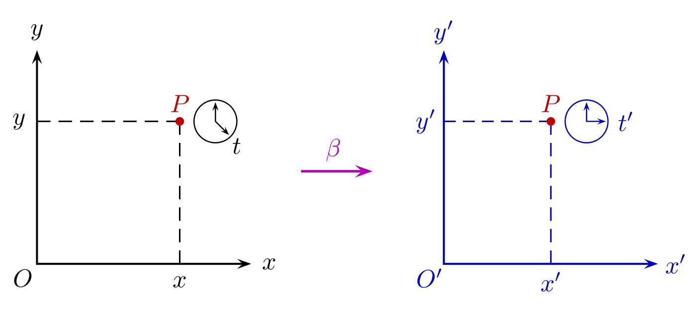
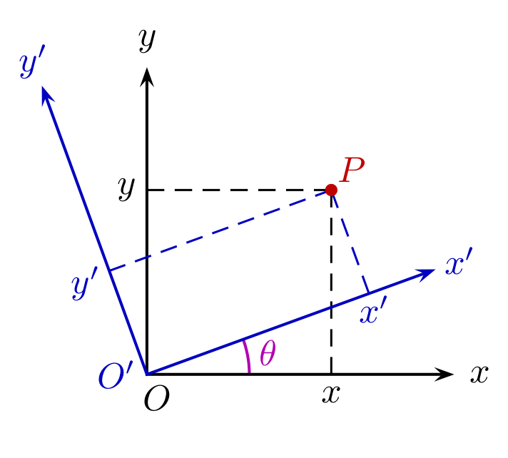
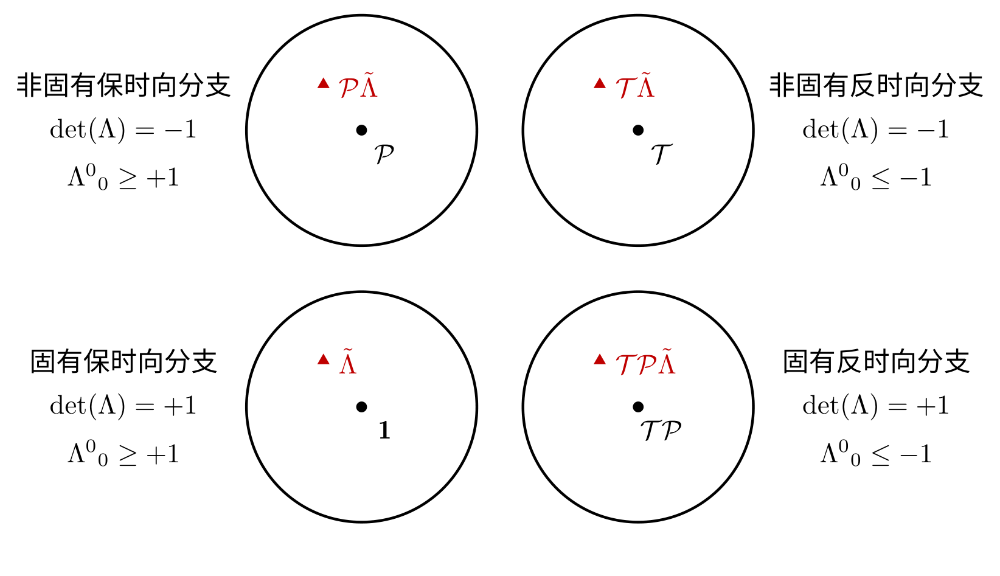
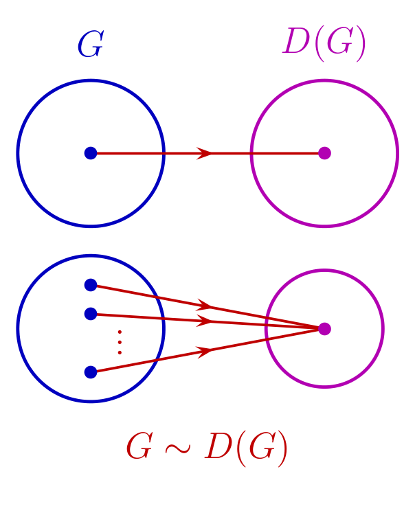
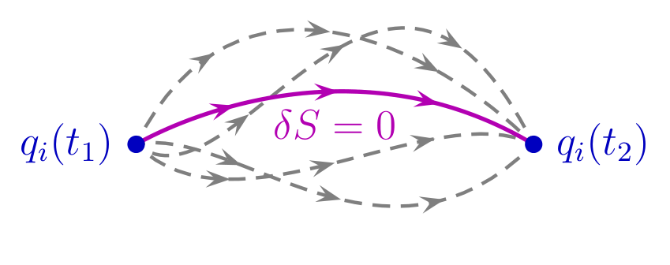
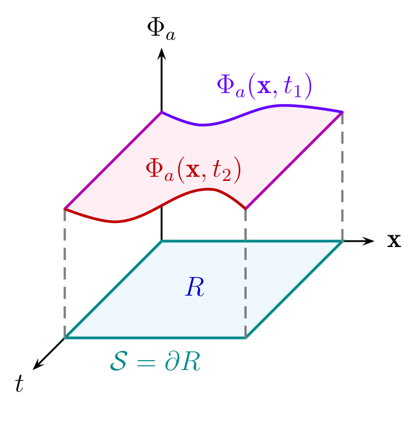
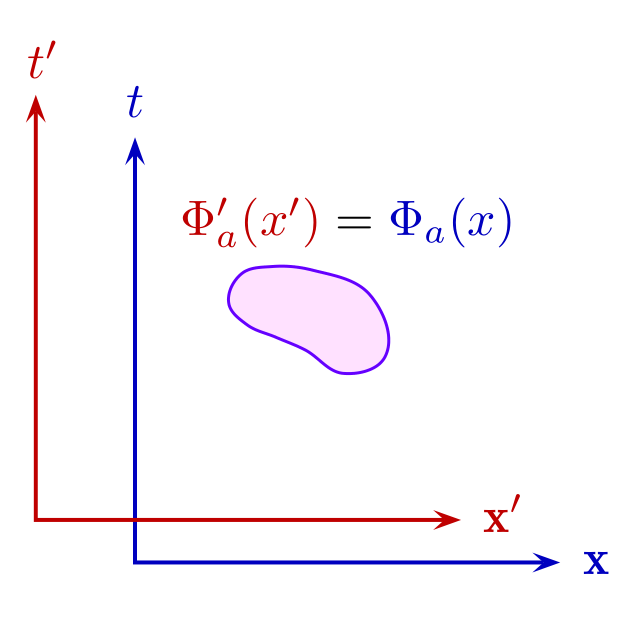
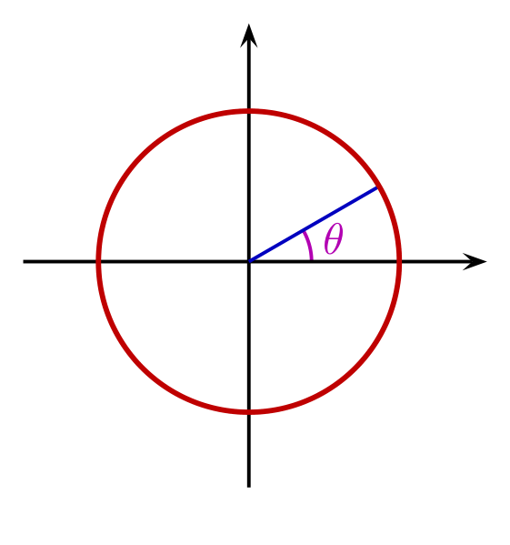

# 第 1 章 预备知识

量子场论 (quantum field theory) 与粒子物理 (particle physics) 密切相关。粒子物理研究物质的基本结构和基本相互作用，组成物质的基本单元是粒子 (particle)。自然界中存在 4 种基本相互作用，即引力相互作用 (gravitational interaction)、电磁相互作用 (electromagnetic interaction)、强相互作用 (strong interaction) 和弱相互作用 (weak interaction)，支配着基本粒子的运动和转化。

基本粒子指尚未发现内部结构的粒子。目前已发现 3 代基本费米子 (fermion)，每一代包含带电轻子 (lepton)、中微子 (neutrino，即中性轻子)、下型夸克 (quark)、上型夸克各一种。第 1 代基本费米子包括电子 ($e$)、电子型中微子 ($\nu_e$)、下夸克 ($d$) 和上夸克 ($u$)；第 2 代包括 $\mu$ 子 ($\mu$)、$\mu$ 子型中微子 ($\nu_\mu$)、奇夸克 ($s$) 和粲夸克 ($c$)；第 3 代包括 $\tau$ 子 ($\tau$)、$\tau$ 子型中微子 ($\nu_\tau$)、底夸克 ($b$) 和顶夸克 ($t$)。某代某种费米子与它在另一代中相对应的费米子具有相同的量子数，但质量不同。

夸克的种类也称为味道 (flavor)，6 种味道的夸克 $d$、$u$、$s$、$c$、$b$、$t$ 具有不同的质量。每一味夸克都具有 3 种颜色 (color)，同味异色的夸克具有相同质量，严格构成颜色三重态，与描述强相互作用的量子色动力学有关。除 3 代中微子以外，其它基本费米子都具有电荷 (electric charge)，参与电磁相互作用，相应的理论称为量子电动力学。所有基本费米子都参与弱相互作用，它与电磁相互作用统一由电弱规范理论描述，这个理论包含了量子电动力学。电弱规范理论和量子色动力学统称为标准模型 (standard model)。

在标准模型中，费米子的相互作用由一些基本玻色子 (boson) 传递。传递夸克间强相互作用的规范玻色子称为胶子 (gluon)，传递电磁相互作用的规范玻色子是光子 (photon)，传递弱相互作用的规范玻色子是 $W^\pm$ 和 $Z^0$ 玻色子。此外，还存在一种 Higgs 玻色子，它与电弱规范对称性的自发破缺及基本粒子的质量起源有关。

标准模型是在研究基本粒子如何参与电磁、强、弱相互作用的过程中建立起来的，它的理论基础就是量子场论。在粒子物理理论和实验发展的过程中，量子场论起着极为关键的作用。反过来，粒子物理研究也极大地促进了量子场论的发展。

## 1.1 量子场论的必要性

量子力学是描述微观世界的物理理论。然而，非相对论性量子力学的适用范围有限，不能正确地描述伴随着高速粒子产生和湮灭的相对论性系统。为了合理而自洽地描述这样的系统，需要用到量子场论，它结合了量子力学、相对性原理和场 (field) 的概念。

在量子力学的基础课程中，量子化的对象常常是由粒子组成的动力学系统。如果对相对论性的粒子作类似的量子化，会遇到一些困难。1926 年，Klein-Gordon 方程 [1, 2] 被提出来描述单个粒子的相对论性运动，它是第一个相对论性的波函数方程，形式为

$$
-\hbar^2\frac{\partial^2}{\partial t^2}\psi(\mathbf{x},t)=(-\hbar^2c^2\nabla^2+m^2c^4)\psi(\mathbf{x},t).
\tag{1.1}
$$

它给出的自由粒子能量是

$$
E=\pm\sqrt{|\mathbf{p}|^2c^2+m^2c^4},
\tag{1.2}
$$

其中 $\mathbf{p}$ 为粒子动量，$m$ 为粒子静止质量。可见，能量 $E$ 可以为正，取值范围为 $mc^2\leq E<\infty$；也可以为负，取值范围为 $-\infty<E\leq mc^2$。即使粒子的初始能量为正，也可以通过跃迁到负能态而改变能量的符号。能量可取负无穷大意味着稳定的基态不存在，这在物理上是不可接受的，称为负能量困难。另一方面，据此计算粒子在空间中的概率密度

$$
\rho=\frac{\mathrm{i}\hbar}{2mc^2}\left(\psi^*\frac{\partial\psi}{\partial t}-\frac{\partial\psi^*}{\partial t}\psi\right),
\tag{1.3}
$$

会发现 $\rho$ 不总是正的，有可能在一些空间区域中为负。这是一个非物理的结果，称为负概率困难。

Klein-Gordon 方程出现负概率困难的根源在于方程中含有波函数对时间的二阶导数。Paul Dirac 于 1928 年提出的 Dirac 方程 [3] 克服了这个问题，它只包含对时间的一阶导数，且具有 Lorentz 协变性。Dirac 方程描述自旋 (spin) 为 1/2 的粒子，一开始是用来描述电子 (electron) 的。Dirac 方程能够保证概率密度正定和概率守恒。但是，负能量困难仍然存在。

为了解决负能量困难，Dirac 提出真空 (vacuum) 是所有 $E<0$ 的态都被填满而所有 $E>0$ 的态都为空的状态 [4]。这样一来，Pauli 不相容原理会阻止一个 $E>0$ 的电子跃迁到 $E<0$ 的态，因而激发态电子的能量总是正的。如果负能海中缺失一个带有电荷 $-e$ 和能量 $-|E|$ 的电子，即产生一个空穴 (hole)，则空穴的行为等价于一个带有电荷 $+e$ 和能量 $+|E|$ 的“反粒子 (antiparticle)”，称为正电子 (positron)。正电子在 1932 年被 Carl Anderson 发现 [5]。

但是，Dirac 的空穴理论仍然面临一些困难，比如，为何没有观测到无穷多个负能电子具有的无穷大电荷密度所引起的电场？另一方面，Dirac 方程一开始作为描述单个粒子波函数的方程提出来的，但 Dirac 的解释却包含了无穷多个粒子。而且，像光子和 $\alpha$ 粒子这样具有整数自旋的玻色子，不满足 Pauli 不相容原理，空穴理论无法解决它们的负能量困难。此外，Dirac 方程只能描述自旋 1/2 的粒子，不能解决整数自旋粒子的负概率困难。

用相对论性的波函数方程描述单个粒子会遇到这么多困难，是否意味着处理这些问题的基础本身就不正确呢？确实是这样的。量子力学的一条基本原理是：观测量由物理 Hilbert 空间中的厄米算符 (Hermitian operator) 描写。然而，时间显然是一个观测量，却没有用一个厄米算符来描写它。在 Schrödinger 绘景 (picture) 中，描述系统的量子态时可以让态依赖于一个时间参数 $t$，这是时间的概念进入量子力学的方式，但并没有假定这个参数是某个厄米算符的本征值。另一方面，粒子的空间位置 $\mathbf{x}$ 则是位置算符 $\hat{\mathbf{x}}$ 的本征值。可见，在量子力学中，对时间和空间的处理方式是完全不同的。而在狭义相对论中，Lorentz 对称性将两者混合起来。因此，在结合量子力学与狭义相对论的过程中出现困难，也是正常的。

那么，如何在量子力学中平等地处理时间和空间呢？一种途径是将时间提升为一个厄米算符，但这样做在实际操作中非常困难。另一种途径是将空间位置降格为一个参数，不再由厄米算符描写。这样，我们可以在每个空间点 $\mathbf{x}$ 处定义一个算符 $\hat{\Phi}(\mathbf{x})$，所有这些算符的集合称为量子场 (quantum field)。在 Heisenberg 绘景中，量子场算符还依赖于时间 $t$，

$$
\hat{\Phi}(\mathbf{x},t)=\mathrm{e}^{\mathrm{i}\hat{H}t/\hbar}\hat{\Phi}(\mathbf{x})\mathrm{e}^{-\mathrm{i}\hat{H}t/\hbar}.
\tag{1.4}
$$

如此，量子化的对象变成是由依赖于时空坐标的场组成的动力学系统，这就是量子场论。这里的量子算符用 $\hat{\ }$ 符号标记，为了简化记号，后面将省略 $\hat{\ }$ 符号。

在量子场论中，前面提到的困难都可以得到解决。现在，Klein-Gordon 方程和 Dirac 方程这样的相对论性方程描述的是自由量子场的运动。真空是量子场的基态，包含粒子的态则是激发态，激发态可以包含任意多个粒子。量子场论平等地描述正粒子和反粒子，由正反粒子的产生算符和湮灭算符表达出来的哈密顿量是正定的，不再出现负能量困难。概率密度 $\rho$ 的空间积分 $\int\mathrm{d}^3x\,\rho$ 也可以用产生湮灭算符表达出来，虽然它不一定是正定的，但是它不再被解释为总概率，而是被解释为正粒子数与反粒子数之差，因而也不再出现负概率困难。

## 1.2 自然单位制

量子场论是结合量子力学和相对论的理论，因而时常出现约化 Planck 常数 $\hbar$ 和光速 $c$，这一点可以从上一节的几个公式中看出来。于是，为了简化表述，通常采用自然单位制，取

$$
\hbar=c=1.
\tag{1.5}
$$

从而，Klein-Gordon 方程 (1.1) 化为

$$
\left(\frac{\partial^2}{\partial t^2}-\nabla^2+m^2\right)\psi(\mathbf{x},t)=0.
\tag{1.6}
$$

根据 $1=c=2.998\times10^{10}\,\mathrm{cm/s}$，有

$$
1\,\mathrm{s}=2.998\times10^{10}\,\mathrm{cm}.
\tag{1.7}
$$

利用转换关系

$$
1=\hbar=6.582\times10^{-22}\,\mathrm{MeV}\cdot\mathrm{s},\quad 1=\hbar c=1.973\times10^{-11}\,\mathrm{MeV}\cdot\mathrm{cm},
\tag{1.8}
$$

可得

$$
1\,\mathrm{s}^{-1}=6.582\times10^{-22}\,\mathrm{MeV},\quad 1\,\mathrm{cm}^{-1}=1.973\times10^{-11}\,\mathrm{MeV},
\tag{1.9}
$$

故

$$
1\,\mathrm{GeV}^{-1}=6.582\times10^{-25}\,\mathrm{s}=1.973\times10^{-14}\,\mathrm{cm}.
\tag{1.10}
$$

可见，在自然单位制中，速度没有量纲 (dimension)；长度量纲与时间量纲相同，是能量量纲的倒数；能量、质量和动量具有相同的量纲。可以将能量单位电子伏特 (eV) 视作上述有量纲物理量的基本单位。

精细结构常数 (fine-structure constant)

$$
\alpha=\frac{e^2}{4\pi\varepsilon_0\hbar c}=\frac{1}{137.036}
\tag{1.11}
$$

是没有量纲的，它的数值在任何单位制下都应该相同。因此，自然单位制不可能将 $\hbar$、$c$、$\varepsilon_0$ 和 $e$ 这四个常数同时归一化。在量子场论中，通常再取真空介电常数

$$
\varepsilon_0=1,
\tag{1.12}
$$

同时可得真空磁导率 $\mu_0=(\varepsilon_0c^2)^{-1}=1$，这样做其实是采取了 Heaviside-Lorentz 单位制。从而，不同于 Gauss 单位制，真空 Maxwell 方程组中不会出现无理数 $4\pi$，

$$
\nabla\cdot\mathbf{E}=\rho,\quad \nabla\cdot\mathbf{B}=0,\quad \nabla\times\mathbf{E}=-\frac{\partial\mathbf{B}}{\partial t},\quad \nabla\times\mathbf{B}=\mathbf{J}+\frac{\partial\mathbf{E}}{\partial t}.
\tag{1.13}
$$

此处的单位制称为有理化的自然单位制。现在，精细结构常数可以简便地表达为 $\alpha=e^2/(4\pi)$，而单位电荷量 $e=\sqrt{4\pi\alpha}=0.3028$ 是没有量纲的；$4\pi$ 因子会出现在 Coulomb 定律中，点电荷 $Q$ 的 Coulomb 势表达成

$$
\Phi=\frac{Q}{4\pi r}.
\tag{1.14}
$$

## 1.3 Lorentz 变换和 Lorentz 群

描述高速运动的系统需要用到狭义相对论 [6]，它的基本原理如下。

(1) 光速不变原理：在任意惯性参考系中，光速的大小不变。

(2) 狭义相对性原理：在任意惯性参考系中，物理定律具有相同的形式。

任意两个惯性参考系的直角坐标由 Lorentz 变换 [7] 联系起来。

如图 1.1 所示，设惯性坐标系 $O'$ 沿着惯性坐标系 $O$ 的 $x$ 轴方向以速度 $\beta$ 匀速运动，事件 $P$ 在 $O$ 系中的坐标为 $(t,x,y,z)$，在 $O'$ 系中的坐标为 $(t',x',y',z')$，则 Lorentz 变换的形式是

$$
t'=\gamma(t-\beta x),\quad x'=\gamma(x-\beta t),\quad y'=y,\quad z'=z,
\tag{1.15}
$$

其中 Lorentz 因子 $\gamma\equiv(1-\beta^2)^{-1/2}$。这种 Lorentz 变换称为沿 $x$ 轴方向的增速 (boost) 变换。在此变换下，有

$$
\begin{aligned}
t'^2-x'^2-y'^2-z'^2&=\gamma^2(t-\beta x)^2-\gamma^2(x-\beta t)^2-y^2-z^2\\
&=\frac{1}{1-\beta^2}(t^2+\beta^2x^2-2\beta xt-x^2-\beta^2t^2+2\beta xt)-y^2-z^2=t^2-x^2-y^2-z^2.
\end{aligned}\tag{1.16}
$$

图 1.1: 惯性系 $O'$ 相对于惯性系 $O$ 沿 $x$ 轴方向以速度 $\beta$ 作匀速运动时，事件 $P$ 在两个惯性系中的坐标。

可见，$t^2-x^2-y^2-z^2$ 在 Lorentz 变换下不变，是一个 Lorentz 不变量 (invariant)。Lorentz 不变量在不同惯性系中具有相同的值，这是 Lorentz 变换对应的对称性，称为 Lorentz 对称性。

将时间坐标和空间坐标结合起来，构成四维 Minkowski 时空 [8]，标记为

$$
x^\mu=(x^0,x^1,x^2,x^3)=(t,x,y,z)=(x^0,\mathbf{x}),\quad\text{其中 }\mu=0,1,2,3.
\tag{1.17}
$$

上式中四种记法是等价的。$x^\mu$ 是一个逆变 (contravariant) 的 Lorentz 四维矢量 (vector)，“逆变”指它的指标 (index) $\mu$ 写在右上角。受到 (1.16) 式的启发，可以定义 Lorentz 不变的内积${}^{1}$

$$
x^2\equiv x\cdot x\equiv(x^0)^2-(x^1)^2-(x^2)^2-(x^3)^2=(x^0)^2-|\mathbf{x}|^2.
\tag{1.18}
$$

引入对称的 Minkowski 度规 (metric)

$$
g_{\mu\nu}=g_{\nu\mu}=\begin{pmatrix}+1&&&\\&-1&&\\&&-1&\\&&&-1\end{pmatrix},
\tag{1.19}
$$

最右边的表达式是度规的矩阵形式，将 $g_{\mu\nu}$ 中两个指标 $\mu$ 和 $\nu$ 分别当作行和列的编号，空白的矩阵元是零。也就是说，$g_{00}=+1$，$g_{11}=g_{22}=g_{33}=-1$，其它分量都是 0。从而，把内积 (1.18) 化为求和式，

$$
x^2=(x^0)^2-(x^1)^2-(x^2)^2-(x^3)^2=\sum_{\mu,\nu=0}^{3}g_{\mu\nu}x^\mu x^\nu\equiv g_{\mu\nu}x^\mu x^\nu.
\tag{1.20}
$$

第二步采用了 Einstein 求和约定：不写出求和符号，重复的指标即表示求和。除非特别指出，后面默认使用这个约定。在上式中，用同一个字母表示的指标分别在上标和下标重复出现并求和，这称为缩并 (contraction)，是 Lorentz 不变量的特点。

为了进一步简化记号，定义协变 (covariant) 的 Lorentz 四维矢量

$$
x_\mu=g_{\mu\nu}x^\nu=(x^0,-x^1,-x^2,-x^3)=(x^0,-\mathbf{x}).
\tag{1.21}
$$

${}^{1}$(1.18) 式在记号上有点混乱，第一个 $x^2$ 是内积的记号，而第二个 $x^2$ 代表第 2 个空间坐标，需注意区分。

“协变”指的是指标 $\mu$ 写在右下角。于是，内积 $x^2$ 的表达式 (1.20) 简化为

$$
x^2=x^\mu x_\mu.
\tag{1.22}
$$

(1.21) 式可以看作用度规 $g_{\mu\nu}$ 通过缩并将逆变矢量 $x^\nu$ 的指标降下来，变成协变矢量 $x_\mu$。从方阵的角度看，度规 $g_{\mu\nu}$ 的逆为

$$
g^{\mu\nu}=g^{\nu\mu}=\begin{pmatrix}+1&&&\\&-1&&\\&&-1&\\&&&-1\end{pmatrix},
\tag{1.23}
$$

满足

$$
g^{\mu\rho}g_{\rho\nu}=\delta^\mu{}_\nu,
\tag{1.24}
$$

其中 Kronecker $\delta$ 符号定义为

$$
\delta^a{}_b=\delta_a{}^b=\delta^{ab}=\delta_{ab}=\begin{cases}1,&a=b,\\0,&a\neq b.\end{cases}
\tag{1.25}
$$

Minkowski 度规 $g_{\mu\nu}$ 的逆 $g^{\mu\nu}$ 与自己具有相同的矩阵形式，但更一般的度规可能与它的逆不同。将 (1.21) 式 $x_\mu=g_{\mu\nu}x^\nu$ 两边都乘以 $g^{\sigma\mu}$，对 $\mu$ 缩并，得

$$
g^{\sigma\mu}x_\mu=g^{\sigma\mu}g_{\mu\nu}x^\nu=\delta^\sigma{}_\nu x^\nu=x^\sigma,
\tag{1.26}
$$

这相当于用 $g^{\sigma\mu}$ 通过缩并将协变矢量 $x_\mu$ 的指标升起来，变成逆变矢量 $x^\sigma$。可见，逆变矢量与协变矢量是一一对应的，是对同一个 Lorentz 矢量的两种等价描述。

利用 Kronecker 符号的定义 (1.25)、(1.24) 式和度规的对称性，推出

$$
g^{\mu\nu}=g^{\mu\rho}\delta^\nu{}_\rho=g^{\mu\rho}g^{\nu\sigma}g_{\sigma\rho}=g^{\mu\rho}g^{\nu\sigma}g_{\rho\sigma},
\tag{1.27}
$$

$$
g_{\mu\nu}=g_{\mu\rho}\delta^\rho{}_\nu=g_{\mu\rho}g^{\rho\sigma}g_{\sigma\nu}=g_{\mu\rho}g_{\nu\sigma}g^{\rho\sigma}.
\tag{1.28}
$$

这两条式子表明，度规也可以用来对度规自身的指标进行升降。

将 Lorentz 增速变换 (1.15) 表达成矩阵与列矢量的乘积形式

$$
\begin{pmatrix}x'^0\\x'^1\\x'^2\\x'^3\end{pmatrix}=\begin{pmatrix}\gamma&-\gamma\beta&&\\-\gamma\beta&\gamma&&\\&&1&\\&&&1\end{pmatrix}\begin{pmatrix}x^0\\x^1\\x^2\\x^3\end{pmatrix},
\tag{1.29}
$$

用四维矢量记号改写为

$$
x'^\mu=\Lambda^\mu{}_\nu x^\nu,
\tag{1.30}
$$

图 1.2: 惯性系 $O'$ 相对于惯性系 $O$ 绕 $z$ 轴转动 $\theta$ 角时，事件 $P$ 在两个惯性系中的坐标。

其中

$$
\Lambda^\mu{}_\nu=\begin{pmatrix}\gamma&-\gamma\beta&&\\-\gamma\beta&\gamma&&\\&&1&\\&&&1\end{pmatrix}.
\tag{1.31}
$$

注意，将 $\Lambda^\mu{}_\nu$ 视作矩阵时，偏左的指标 $\mu$ 表示行的编号，偏右的指标 $\nu$ 表示列的编号。$\Lambda^\mu{}_\nu$ 的特点是保持内积 $x^2=x^\mu x_\mu$ 不变，从而使 $x^\mu x_\mu$ 在不同惯性系中具有相同的值。我们将 $\Lambda^\mu{}_\nu$ 推广为所有保持 $x^\mu x_\mu$ 不变的线性变换，称为（齐次）Lorentz 变换。由于

$$
x'^2=g_{\mu\nu}x'^\mu x'^\nu=g_{\mu\nu}\Lambda^\mu{}_\alpha\Lambda^\nu{}_\beta x^\alpha x^\beta,\quad x^2=g_{\alpha\beta}x^\alpha x^\beta,
\tag{1.32}
$$

要得到 $x'^2=x^2$，Lorentz 变换 $\Lambda^\mu{}_\nu$ 必须满足保度规条件

$$
g_{\mu\nu}\Lambda^\mu{}_\alpha\Lambda^\nu{}_\beta=g_{\alpha\beta}.
\tag{1.33}
$$

空间旋转变换保持 $|\mathbf{x}|^2$ 不变，由 (1.18) 式可知，这种变换也属于 Lorentz 变换。如图 1.2 所示，惯性系 $O'$ 相对于惯性系 $O$ 绕 $z$ 轴转动 $\theta$ 角，事件 $P$ 在两个惯性系中的坐标满足

$$
t'=t,\quad x'=x\cos\theta+y\sin\theta,\quad y'=-x\sin\theta+y\cos\theta,\quad z'=z.
\tag{1.34}
$$

因而相应的 Lorentz 变换矩阵为

$$
[R_z(\theta)]^\mu{}_\nu=\begin{pmatrix}1&&&\\&\cos\theta&\sin\theta&\\&-\sin\theta&\cos\theta&\\&&&1\end{pmatrix}.
\tag{1.35}
$$

可以验证它满足保度规条件 (1.33)。

引入

$$
(\Lambda^{-1})^\mu{}_\rho\equiv g^{\mu\beta}g_{\rho\alpha}\Lambda^\alpha{}_\beta,
\tag{1.36}
$$

那么，由 (1.33) 和 (1.24) 式得

$$
(\Lambda^{-1})^\mu{}_\rho\Lambda^\rho{}_\nu=g^{\mu\beta}g_{\alpha\rho}\Lambda^\alpha{}_\beta\Lambda^\rho{}_\nu=g^{\mu\beta}g_{\beta\nu}=\delta^\mu{}_\nu.
\tag{1.37}
$$

$\delta^\mu{}_\nu$ 的矩阵形式是单位矩阵 $\mathbf{1}$，是一个特殊的 Lorentz 变换，使得 $x'^\mu=\delta^\mu{}_\nu x^\nu=x^\mu$，即 $x^\mu$ 在这个变换下不变。可见，$\delta^\mu{}_\nu$ 是恒等变换。(1.37) 式表明，对时空坐标矢量先作 $\Lambda$ 变换，再作 $\Lambda^{-1}$ 变换，得到的矢量还是原来的矢量。也就是说，由 (1.36) 式定义的 $\Lambda^{-1}$ 是 $\Lambda$ 的逆变换，因而也是一个 Lorentz 变换。在这些记号下，协变矢量 $x_\mu$ 的 Lorentz 变换可以表达为

$$
x'_\mu=g_{\mu\nu}x'^\nu=g_{\mu\nu}\Lambda^\nu{}_\rho x^\rho=g_{\mu\nu}\Lambda^\nu{}_\rho g^{\rho\sigma}x_\sigma=x_\sigma(\Lambda^{-1})^\sigma{}_\mu.
\tag{1.38}
$$

$\Lambda^{-1}$ 既然是一个 Lorentz 变换，必定满足保度规条件

$$
g_{\mu\nu}(\Lambda^{-1})^\mu{}_\alpha(\Lambda^{-1})^\nu{}_\beta=g_{\alpha\beta},
\tag{1.39}
$$

于是有

$$
\begin{aligned}
g^{\alpha\beta}&=g^{\alpha\rho}g^{\beta\sigma}g_{\rho\sigma}=g^{\alpha\rho}g^{\beta\sigma}g_{\mu\nu}(\Lambda^{-1})^\mu{}_\rho(\Lambda^{-1})^\nu{}_\sigma=g^{\alpha\rho}g^{\beta\sigma}g_{\mu\nu}g^{\mu\gamma}g_{\rho\delta}\Lambda^\delta{}_\gamma g^{\nu\phi}g_{\sigma\tau}\Lambda^\tau{}_\phi\\
&=\delta^\alpha{}_\delta\delta^\beta{}_\tau\delta^\gamma{}_\nu g^{\nu\phi}\Lambda^\delta{}_\gamma\Lambda^\tau{}_\phi=g^{\nu\phi}\Lambda^\alpha{}_\nu\Lambda^\beta{}_\phi.
\end{aligned}\tag{1.40}
$$

这给出了保度规条件 (1.33) 的等价形式

$$
g^{\mu\nu}\Lambda^\alpha{}_\mu\Lambda^\beta{}_\nu=g^{\alpha\beta}.
\tag{1.41}
$$

将 $\Lambda^\mu{}_\nu$ 视作矩阵 $\Lambda$，则其转置矩阵 $\Lambda^{\mathrm{T}}$ 的分量满足 $(\Lambda^{\mathrm{T}})_\nu{}^\mu=\Lambda^\mu{}_\nu$，由保度规条件 (1.33) 得

$$
g_{\alpha\beta}=g_{\mu\nu}\Lambda^\mu{}_\alpha\Lambda^\nu{}_\beta=(\Lambda^{\mathrm{T}})_\alpha{}^\mu g_{\mu\nu}\Lambda^\nu{}_\beta.
\tag{1.42}
$$

用 $\mathbf{g}$ 代表度规矩阵，将上式写成矩阵等式

$$
\Lambda^{\mathrm{T}}\mathbf{g}\Lambda=\mathbf{g}.
\tag{1.43}
$$

相应的行列式为 $\det(\mathbf{g})=\det(\Lambda^{\mathrm{T}})\det(\mathbf{g})\det(\Lambda)=\det(\mathbf{g})[\det(\Lambda)]^2$，因此 $[\det(\Lambda)]^2=1$，故

$$
\det(\Lambda)=\pm1.
\tag{1.44}
$$

Lorentz 坐标变换 $x'^\mu=\Lambda^\mu{}_\nu x^\nu$ 的 Jacobi 行列式是

$$
\mathcal{J}=\det\left[\frac{\partial(x'^0,x'^1,x'^2,x'^3)}{\partial(x^0,x^1,x^2,x^3)}\right]=\det\left(\frac{\partial x'^\mu}{\partial x^\nu}\right)=\det(\Lambda),
\tag{1.45}
$$

于是 Lorentz 变换将体积元 $\mathrm{d}^4x$ 变换为

$$
\mathrm{d}^4x'=|\mathcal{J}|\mathrm{d}^4x=|\det(\Lambda)|\mathrm{d}^4x=\mathrm{d}^4x.
\tag{1.46}
$$

可见，Minkowski 时空的体积元 $\mathrm{d}^4x$ 是 Lorentz 不变的。

可以用 $\det(\Lambda)$ 的值给 Lorentz 变换分类，$\det(\Lambda)=+1$ 的变换称为固有 (proper) Lorentz 变换，$\det(\Lambda)=-1$ 的则是非固有 (improper) Lorentz 变换。此外，由保度规条件 (1.33) 得

$$
1=g_{00}=g_{\mu\nu}\Lambda^\mu{}_0\Lambda^\nu{}_0=(\Lambda^0{}_0)^2-\sum_i(\Lambda^i{}_0)^2,
\tag{1.47}
$$

即

$$
(\Lambda^0{}_0)^2=1+\sum_i(\Lambda^i{}_0)^2\geq1,
\tag{1.48}
$$

故 $\Lambda^0{}_0\geq+1$ 或 $\Lambda^0{}_0\leq-1$。$\Lambda^0{}_0\geq+1$ 的 Lorentz 变换称为保时向 (orthochronous) Lorentz 变换，$\Lambda^0{}_0\leq-1$ 的称为反时向 (antichronous) Lorentz 变换。

在数学上，对称性由群论描述。对称变换的集合称为群 (group)，群元素具有乘法，两个群元素的乘积就是两次对称变换相继作用，满足以下四个条件。

(1) 群对乘积具有封闭性，即群 $G$ 中任意两个群元 $g_1$ 和 $g_2$ 的乘积仍属于此群，

$$
g_1g_2\in G,\quad \forall g_1,g_2\in G.
\tag{1.49}
$$

(2) 群乘法满足结合律，

$$
g_1(g_2g_3)=(g_1g_2)g_3,\quad \forall g_1,g_2,g_3\in G.
\tag{1.50}
$$

(3) 群 $G$ 中必有一个恒元 $e$，对应于恒等变换，它与任一群元 $g$ 的乘积仍为 $g$，

$$
eg=ge=g,\quad \forall g\in G.
\tag{1.51}
$$

(4) 任一群元 $g$ 都可以在群 $G$ 中找到一个逆元 $g^{-1}$，它对应于逆变换，两者之积为恒元，

$$
\forall g\in G,\quad \exists g^{-1}\in G,\quad\text{使得 }g^{-1}g=gg^{-1}=e.
\tag{1.52}
$$

在线性代数中，矩阵具有乘法，因而可逆方阵能够依照自身乘法关系构成群，即矩阵群。

群乘法讲求运算次序，$g_1g_2$ 不一定等于 $g_2g_1$，也就是说，交换律不一定成立。满足交换律的群称为 Abel 群，不满足的称为非 Abel 群。如果群 $G$ 的子集 $H$ 中的元素依照原来的乘法规则也满足群的四个条件，则称 $H$ 是 $G$ 的子群 (subgroup)，记作 $H<G$。

满足

$$
O^{\mathrm{T}}O=OO^{\mathrm{T}}=\mathbf{1}
\tag{1.53}
$$

的实方阵 $O$ 称为实正交矩阵 (real orthogonal matrix)。所有 $N$ 阶实正交矩阵构成正交群 $\mathrm{O}(N)$。对 (1.53) 式取行列式，得 $1=\det(O^{\mathrm{T}})\det(O)=[\det(O)]^2$。可见，实正交矩阵 $O$ 的行列式为

$$
\det(O)=\pm1.
\tag{1.54}
$$

由 $\det(O)=1$ 的 $N$ 阶实正交矩阵 $O$ 构成的群称为特殊正交群 $\mathrm{SO}(N)$。显然，$\mathrm{SO}(N)<\mathrm{O}(N)$。非 Abel 群 $\mathrm{SO}(3)$ 描述三维空间中的所有旋转变换，称为空间旋转群。Abel 群 $\mathrm{SO}(2)$ 描述二维平面上的所有旋转变换，或者说，描述绕某条固定轴的旋转变换，如 $R_z(\theta)$，因而 $\mathrm{SO}(2)<\mathrm{SO}(3)$。

满足

$$
U^\dagger U=UU^\dagger=\mathbf{1}
\tag{1.55}
$$

的复方阵 $U$ 称为幺正矩阵 (unitary matrix)。所有 $N$ 阶幺正矩阵构成幺正群 $\mathrm{U}(N)$。对 (1.55) 式取行列式，得 $1=\det(U^\dagger)\det(U)=[\det(U)]^\dagger\det(U)=|\det(U)|^2$。可见，幺正矩阵 $U$ 的行列式满足

$$
|\det(U)|=1.
\tag{1.56}
$$

由 $\det(U)=1$ 的 $N$ 阶幺正矩阵 $U$ 构成的群称为特殊幺正群 $\mathrm{SU}(N)$。显然，$\mathrm{SU}(N)<\mathrm{U}(N)$。

所有 Lorentz 变换构成 Lorentz 群，它是非 Abel 群。保度规条件 $\Lambda^{\mathrm{T}}\mathbf{g}\Lambda=\mathbf{g}$ 是正交条件 (1.53) 推广到 1 个时间维度和 3 个空间维度时的形式，于是将 Lorentz 群记为 $\mathrm{O}(1,3)$。$\mathrm{O}(3)$ 群对应于 $\mathrm{O}(1,3)$ 群的纯空间部分，因而 $\mathrm{O}(3)<\mathrm{O}(1,3)$。所有固有 Lorentz 变换构成固有 Lorentz 群，记作 $\mathrm{SO}(1,3)$，显然 $\mathrm{SO}(1,3)<\mathrm{O}(1,3)$。

Lorentz 变换可以用一组连续变化的参数（如 $\beta$、$\theta$ 等）来描述，因而是一种连续变换，所以 Lorentz 群是一个连续群，参数的变化区域称为群空间。群空间中的一个点就是一个群元。如果群空间中的任意两点可以通过一条曲线连接起来，那么群空间是连通的，称相应的群为简单连续群，否则称为混合连续群。

Lorentz 群是个混合连续群，整个群空间不是连通的，具有四个连通分支，如图 1.3 所示，分别是固有保时向分支 $[\det(\Lambda)=+1$ 且 $\Lambda^0{}_0\geq+1]$、固有反时向分支 $[\det(\Lambda)=+1$ 且 $\Lambda^0{}_0\leq-1]$、非固有保时向分支 $[\det(\Lambda)=-1$ 且 $\Lambda^0{}_0\geq+1]$ 和非固有反时向分支 $[\det(\Lambda)=-1$ 且 $\Lambda^0{}_0\leq-1]$，四个分支之间互不连通。恒元（即恒等变换）在固有保时向分支里，这个分支是 $\mathrm{SO}(1,3)$ 的子群，称为固有保时向 Lorentz 群，记作 $\mathrm{SO}^\uparrow(1,3)$，它包含物理上联系惯性参考系的所有 Lorentz 变换。Lorentz 不变量通常指的是在固有保时向 Lorentz 变换下不变的量。归纳起来，存在子群从属关系 $\mathrm{SO}(2)<\mathrm{SO}(3)<\mathrm{SO}^\uparrow(1,3)<\mathrm{SO}(1,3)<\mathrm{O}(1,3)$。

这里引入两个特殊的 Lorentz 变换。定义宇称 (parity) 变换为

$$
\mathcal{P}^\mu{}_\nu=(\mathcal{P}^{-1})^\mu{}_\nu=\begin{pmatrix}+1&&&\\&-1&&\\&&-1&\\&&&-1\end{pmatrix},
\tag{1.57}
$$

它是非固有保时向的，亦称为空间反射 (space inversion) 变换。它的作用是让所有空间分量反向。定义时间反演 (time reversal) 变换为

$$
\mathcal{T}^\mu{}_\nu=(\mathcal{T}^{-1})^\mu{}_\nu=\begin{pmatrix}-1&&&\\&+1&&\\&&+1&\\&&&+1\end{pmatrix},
\tag{1.58}
$$

它是非固有反时向的，它的作用是让时间分量反向。对于固有保时向 Lorentz 群中的任意元素 $\tilde{\Lambda}$，乘上宇称变换或（和）时间反演变换得到 $\mathcal{P}\tilde{\Lambda}$、$\mathcal{T}\tilde{\Lambda}$ 和 $\mathcal{T}\mathcal{P}\tilde{\Lambda}$，它们分别属于 Lorentz 群的另外三个分支。

图 1.3: Lorentz 群的四个连通分支示意图。$\mathbf{1}$、$\mathcal{P}$ 和 $\mathcal{T}$ 分别代表恒等变换、宇称变换和时间反演变换，$\tilde{\Lambda}$ 是固有保时向分支中的任意元素。

## 1.4 Lorentz 矢量

如果一些 $m$ 阶方阵的乘法关系与群 $G$ 中元素的乘法关系完全相同，就可以用这些矩阵来表示 $G$，这些矩阵构成了群 $G$ 的一个 $m$ 维线性表示 (linear representation) $D(G)$。$D(G)$ 中的一个矩阵至少应该对应于 $G$ 中的一个群元，可以对应于 $G$ 中的多个群元，数学上称 $G$ 与 $D(G)$ 同态 (homomorphism)，记作 $G\sim D(G)$，如图 1.4 所示。具体来说，对于群 $G$ 中任意群元 $g_1$ 和 $g_2$，表示 $D(G)$ 中相应的表示矩阵 $D(g_1)$ 和 $D(g_2)$ 满足同态关系

$$
D(g_2g_1)=D(g_2)D(g_1).
\tag{1.59}
$$

利用群的线性表示，可以将对称变换视作矩阵，将变换作用的态视作列矢量。

取群中所有元素的 1 维表示矩阵为 1，就构成了群的恒等表示，也称为平庸表示。如果群 $G$ 中的每个群元一一对应于表示 $D(G)$ 中的每个矩阵，则 $G$ 与 $D(G)$ 同构 (isomorphism)，记作 $G\cong D(G)$，此时称 $D(G)$ 是 $G$ 的忠实表示 (faithful representation)。如果 $D(G)$ 中所有矩阵都是幺正的，则称 $D(G)$ 是幺正表示。矩阵群本身就是自己的一个表示，称为自身表示，也称为基础表示。

如果群 $G$ 中任意群元 $g$ 在维度相同的两个线性表示 $D_1(G)$ 和 $D_2(G)$ 中的表示矩阵 $D_1(g)$ 和 $D_2(g)$ 存在同样的相似变换关系，即

$$
D_2(g)=S^{-1}D_1(g)S,\quad \forall g\in G,
\tag{1.60}
$$

则称这两个表示是等价的。等价表示是在表示空间中取不同的基底得到的，没有本质上的差别。如果表示 $D(G)$ 的每个表示矩阵 $D(g)$ 都可以通过同一个相似变换化为相同形式的阶梯矩阵，

$$
S^{-1}D(g)S=\begin{pmatrix}D_1(g)&M(g)\\&D_2(g)\end{pmatrix},\quad \forall g\in G,
\tag{1.61}
$$

图 1.4: 群 $G$ 与线性表示 $D(G)$ 同态示意图。上方的图表示一一对应，即同构；下方的图表示多一对应。

其中 $D_1(g)$ 和 $D_2(g)$ 是方阵，$M(g)$ 可以是零矩阵，则称 $D(G)$ 是可约表示，否则称 $D(G)$ 为不可约表示 (irreducible representation)。可以证明，集合 $\{D_1(g)\}$ 和 $\{D_2(g)\}$ 分别构成群 $G$ 的线性表示。可约表示能够通过不可约表示构造出来，因此研究群表示的关键在于找到所有的不等价不可约表示。

在上一节中，我们已经用矩阵的形式表示过 Lorentz 变换 $\Lambda^\mu{}_\nu$，可见 $\{\Lambda^\mu{}_\nu\}$ 自然而然地构成了 Lorentz 群的一个 4 维线性表示，即基础表示。它是一个不可约忠实表示，称为矢量表示，因此 Lorentz 矢量 $x^\mu$ 可以看作变换 $\Lambda^\mu{}_\nu$ 所作用的态。

一般地，Lorentz 矢量 $A^\mu$ 在定义上要求它在固有保时向 Lorentz 变换下满足

$$
A'^\mu=\Lambda^\mu{}_\nu A^\nu.
\tag{1.62}
$$

类似于 (1.38) 式，逆变矢量 $A^\mu$ 对应的协变矢量 $A_\mu=g_{\mu\nu}A^\nu$ 的固有保时向 Lorentz 变换为

$$
A'_\mu=A_\nu(\Lambda^{-1})^\nu{}_\mu.
\tag{1.63}
$$

任意两个 Lorentz 矢量 $A^\mu=(A^0,\mathbf{A})$ 和 $B^\mu=(B^0,\mathbf{B})$ 的内积定义为

$$
A\cdot B\equiv A^\mu B_\mu=g_{\mu\nu}A^\mu B^\nu=A^0B^0-\mathbf{A}\cdot\mathbf{B},
\tag{1.64}
$$

由 (1.37) 式可知，它是固有保时向 Lorentz 变换的不变量，

$$
A'\cdot B'=A'^\mu B'_\mu=\Lambda^\mu{}_\nu A^\nu B_\rho(\Lambda^{-1})^\rho{}_\mu=A^\nu B_\rho\delta^\rho{}_\nu=A^\nu B_\nu=A\cdot B.
\tag{1.65}
$$

像这样的不变量称为 Lorentz 标量 (scalar)。由于度规 $g_{\mu\nu}$ 的对角元有正有负，Lorentz 矢量 $A^\mu$ 的自我内积 $A^2=(A^0)^2-|\mathbf{A}|^2$ 的符号不是确定的，可以分为三类。

(1) 若 $A^2>0$，即 $|A^0|>|\mathbf{A}|$，则称 $A^\mu$ 为类时 (timelike) 矢量。

(2) 若 $A^2<0$，即 $|A^0|<|\mathbf{A}|$，则称 $A^\mu$ 为类空 (spacelike) 矢量。

(3) 若 $A^2=0$，即 $|A^0|=|\mathbf{A}|$，则称 $A^\mu$ 为类光 (lightlike) 矢量。

由于 $A^2$ 是 Lorentz 不变量，不能通过 Lorentz 变换改变 $A^\mu$ 的类型。

以上讨论的是广义的 Lorentz 矢量，可通过宇称变换性质进一步将它们分为两种矢量。第一种矢量的宇称变换为

$$
A'^\mu=\mathcal{P}^\mu{}_\nu A^\nu,
\tag{1.66}
$$

称为极矢量 (polar vector)，但经常直接简称为矢量，即狭义的矢量，其空间分量的宇称变换为 $\mathbf{A}'=-\mathbf{A}$。$x^\mu$ 就是一个极矢量。另一种矢量的宇称变换为

$$
A'^\mu=-\mathcal{P}^\mu{}_\nu A^\nu,
\tag{1.67}
$$

称为赝矢量，或者轴矢量 (axial vector)，其空间分量的宇称变换为 $\mathbf{A}'=\mathbf{A}$。在经典力学中，空间坐标 $\mathbf{x}$ 和动量 $\mathbf{p}$ 都是极矢量，而角动量 $\mathbf{L}=\mathbf{x}\times\mathbf{p}$ 是轴矢量。在空间反射变换下，$\mathbf{x}'=-\mathbf{x}$，$\mathbf{p}'=-\mathbf{p}$，$\mathbf{L}'=\mathbf{x}'\times\mathbf{p}'=\mathbf{x}\times\mathbf{p}=\mathbf{L}$，与以上定义一致。

在狭义相对论中，质点的能量 $E$、动量 $\mathbf{p}$ 和（静止）质量 $m$ 之间具有色散关系 (dispersion relation)

$$
E=\sqrt{|\mathbf{p}|^2+m^2}.
\tag{1.68}
$$

可以用 $E$ 和 $\mathbf{p}$ 组成一个 Lorentz 矢量

$$
p^\mu=(E,\mathbf{p}),
\tag{1.69}
$$

称为四维动量。它是极矢量，自我内积为

$$
p^2=p^\mu p_\mu=g_{\mu\nu}p^\mu p^\nu=E^2-|\mathbf{p}|^2=m^2.
\tag{1.70}
$$

这是合理的，因为质量 $m$ 在狭义相对论中是一个 Lorentz 不变量。$p^\mu$ 在 $m>0$ 时是类时矢量，在 $m=0$ 时是类光矢量。(1.70) 式称为质壳 (mass shell) 条件，对应于四维动量空间中由质量 $m$ 决定的三维双曲面 (质壳)。

将对时空坐标的偏导数记为

$$
\partial_\mu\equiv\frac{\partial}{\partial x^\mu}=\left(\frac{\partial}{\partial t},\nabla\right),\quad \partial^\mu\equiv\frac{\partial}{\partial x_\mu}=\left(\frac{\partial}{\partial t},-\nabla\right)=g^{\mu\nu}\partial_\nu,
\tag{1.71}
$$

则

$$
\partial^\mu x^\nu=g^{\mu\rho}\partial_\rho x^\nu=g^{\mu\rho}\frac{\partial x^\nu}{\partial x^\rho}=g^{\mu\rho}\delta^\nu{}_\rho=g^{\mu\nu}.
\tag{1.72}
$$

上式中的指标始终是平衡的，因而这里关于时空导数指标位置的写法是合理的。对时空坐标作 Lorentz 变换 $x'^\mu=\Lambda^\mu{}_\nu x^\nu$ 时，有 $x'_\mu=x_\rho(\Lambda^{-1})^\rho{}_\mu$，两边与 $\Lambda^\mu{}_\nu$ 缩并，得 $\Lambda^\mu{}_\nu x'_\mu=x_\rho(\Lambda^{-1})^\rho{}_\mu\Lambda^\mu{}_\nu=x_\rho\delta^\rho{}_\nu$，即 $x_\nu=\Lambda^\mu{}_\nu x'_\mu$，故

$$
\partial'^\mu=\frac{\partial}{\partial x'_\mu}=\frac{\partial x_\nu}{\partial x'_\mu}\frac{\partial}{\partial x_\nu}=\Lambda^\mu{}_\nu\partial^\nu.
\tag{1.73}
$$

这是时空导数 $\partial^\mu$ 的 Lorentz 变换形式，它与 Lorentz 矢量的变换形式相同，因而可以将 $\partial^\mu$ 看作一个 Lorentz 矢量。相应地，$\partial_\mu$ 的 Lorentz 变换是

$$
\partial'_\mu=(\Lambda^{-1})^\nu{}_\mu\partial_\nu.
\tag{1.74}
$$

定义 d'Alembert 算符

$$
\partial^2\equiv\partial^\mu\partial_\mu=\partial_0^2-\nabla^2,
\tag{1.75}
$$

由保度规条件 (1.33) 得

$$
\partial'^2=g_{\mu\nu}\partial'^\mu\partial'^\nu=g_{\mu\nu}\Lambda^\mu{}_\rho\Lambda^\nu{}_\sigma\partial^\rho\partial^\sigma=g_{\rho\sigma}\partial^\rho\partial^\sigma=\partial^2.
\tag{1.76}
$$

可见，$\partial^2$ 算符是 Lorentz 不变的。用它把 Klein-Gordon 方程 (1.6) 改写成紧凑的形式

$$
(\partial^2+m^2)\psi(x)=0,
\tag{1.77}
$$

其中 $x$ 表示四维时空坐标。$\partial^2+m^2$ 是 Lorentz 不变的，因此 Klein-Gordon 方程在不同惯性系中具有相同的形式，即具有 Lorentz 协变性 (covariance)。

## 1.5 Lorentz 张量

Lorentz 张量 (tensor) 是 Lorentz 矢量的推广。一个 $p+q$ 阶的 $(p,q)$ 型 Lorentz 张量 $T^{\mu_1\cdots\mu_p}{}_{\nu_1\cdots\nu_q}$ 具有 $p$ 个逆变指标和 $q$ 个协变指标，并满足如下固有保时向 Lorentz 变换规则：

$$
T'^{\mu_1\cdots\mu_p}{}_{\nu_1\cdots\nu_q}=\Lambda^{\mu_1}{}_{\rho_1}\cdots\Lambda^{\mu_p}{}_{\rho_p}T^{\rho_1\cdots\rho_p}{}_{\sigma_1\cdots\sigma_q}(\Lambda^{-1})^{\sigma_1}{}_{\nu_1}\cdots(\Lambda^{-1})^{\sigma_q}{}_{\nu_q}.
\tag{1.78}
$$

这里的逆变指标和协变指标统称为 Lorentz 指标。完全用 Lorentz 张量表达出来的方程具有 Lorentz 协变性，在不同惯性系中具有相同的形式。

Lorentz 标量是 0 阶 Lorentz 张量，不具有 Lorentz 指标；Lorentz 矢量是 1 阶 Lorentz 张量，具有 1 个 Lorentz 指标。Minkowski 度规 $g_{\mu\nu}$ 是一个 2 阶的 $(0,2)$ 型 Lorentz 张量，不过，它是常数，在任何惯性系中不变，Lorentz 变换规则就是保度规条件 (1.39)。用度规可以升降任意 Lorentz 张量的指标，从而改变张量的类型，不过，升降前后的两个 Lorentz 张量在物理意义上是等价的。比如，$T^{\mu\nu}{}_\rho=g_{\rho\sigma}T^{\mu\nu\sigma}$，用 $g_{\rho\sigma}$ 将 $(3,0)$ 型张量 $T^{\mu\nu\sigma}$ 降为 $(2,1)$ 型张量 $T^{\mu\nu}{}_\rho$。相应地，$T^{\mu\nu\rho}=g^{\rho\sigma}T^{\mu\nu}{}_\sigma$，用 $g^{\rho\sigma}$ 将 $(2,1)$ 型张量 $T^{\mu\nu}{}_\sigma$ 升为 $(3,0)$ 型张量 $T^{\mu\nu\rho}$。

对 $(p,q)$ 型 Lorentz 张量的一个逆变指标和一个协变指标进行缩并，会得到一个 $(p-1,q-1)$ 型 Lorentz 张量。例如，由 (1.37) 式得

$$
T'^{\mu\nu}{}_\mu=\Lambda^\mu{}_\alpha\Lambda^\nu{}_\beta T^{\alpha\beta}{}_\gamma(\Lambda^{-1})^\gamma{}_\mu=\Lambda^\nu{}_\beta T^{\alpha\beta}{}_\gamma\delta^\gamma{}_\alpha=\Lambda^\nu{}_\beta T^{\alpha\beta}{}_\alpha,
\tag{1.79}
$$

可见 $T^{\mu\nu}{}_\mu$ 是一个 Lorentz 矢量。可以通过缩并若干个 Lorentz 张量的所有指标来构造 Lorentz 不变量，这是因为在 Lorentz 变换下一对参加缩并的逆变指标和协变指标带来的 $\Lambda$ 因子和 $\Lambda^{-1}$ 因子总是相互抵消。比如，以下表达式都是 Lorentz 标量：

$$
T^\mu{}_\mu=g_{\mu\nu}T^{\mu\nu},\quad T^{\mu\nu}A_\mu B_\nu,\quad T^{\mu\nu}T_{\mu\nu},\quad g_{\mu\sigma}T^{\mu\nu}{}_\rho T^{\sigma\rho}{}_\nu.
\tag{1.80}
$$

类似于 Lorentz 矢量，按宇称变换性质将 Lorentz 张量分成两种。第一种张量的宇称变换为

$$
T'^{\mu_1\cdots\mu_p}{}_{\nu_1\cdots\nu_q}=\mathcal{P}^{\mu_1}{}_{\rho_1}\cdots\mathcal{P}^{\mu_p}{}_{\rho_p}T^{\rho_1\cdots\rho_p}{}_{\sigma_1\cdots\sigma_q}(\mathcal{P}^{-1})^{\sigma_1}{}_{\nu_1}\cdots(\mathcal{P}^{-1})^{\sigma_q}{}_{\nu_q},
\tag{1.81}
$$

是狭义的张量。另一种张量的宇称变换为

$$
T'^{\mu_1\cdots\mu_p}{}_{\nu_1\cdots\nu_q}=-\mathcal{P}^{\mu_1}{}_{\rho_1}\cdots\mathcal{P}^{\mu_p}{}_{\rho_p}T^{\rho_1\cdots\rho_p}{}_{\sigma_1\cdots\sigma_q}(\mathcal{P}^{-1})^{\sigma_1}{}_{\nu_1}\cdots(\mathcal{P}^{-1})^{\sigma_q}{}_{\nu_q},
\tag{1.82}
$$

称为赝张量 (pseudotensor)。因此，在宇称变换下，狭义的标量 $\phi$ 满足 $\phi'=\phi$，而赝标量 (pseudoscalar) $\varphi$ 满足 $\varphi'=-\varphi$。

引入四维 Levi-Civita 符号

$$
\varepsilon^{\mu\nu\rho\sigma}=\begin{cases}+1,&(\mu,\nu,\rho,\sigma)\text{ 是 }(0,1,2,3)\text{ 的偶置换},\\-1,&(\mu,\nu,\rho,\sigma)\text{ 是 }(0,1,2,3)\text{ 的奇置换},\\0,&\text{其它情况}.\end{cases}
\tag{1.83}
$$

这里的置换 (permutation) 指的是将指标重新排列。调换两个指标的位置称为对换，奇置换通过奇数次对换得到，偶置换通过偶数次对换得到。这样定义出来的 $\varepsilon^{\mu\nu\rho\sigma}$ 是全反对称的，即关于任意两个指标反对称，如 $\varepsilon^{\mu\nu\rho\sigma}=-\varepsilon^{\nu\mu\rho\sigma}=-\varepsilon^{\rho\nu\mu\sigma}=-\varepsilon^{\sigma\nu\rho\mu}$。它的协变形式为

$$
\varepsilon_{\mu\nu\rho\sigma}=g_{\mu\alpha}g_{\nu\beta}g_{\rho\gamma}g_{\sigma\delta}\varepsilon^{\alpha\beta\gamma\delta}.
\tag{1.84}
$$

$\varepsilon_{\mu\nu\rho\sigma}$ 也是全反对称的，如

$$
\varepsilon_{\nu\mu\rho\sigma}=g_{\nu\alpha}g_{\mu\beta}g_{\rho\gamma}g_{\sigma\delta}\varepsilon^{\alpha\beta\gamma\delta}=g_{\mu\beta}g_{\nu\alpha}g_{\rho\gamma}g_{\sigma\delta}(-\varepsilon^{\beta\alpha\gamma\delta})=-\varepsilon_{\mu\nu\rho\sigma}.
\tag{1.85}
$$

根据这些定义，

$$
\varepsilon^{0123}=+1,\quad \varepsilon_{0123}=-1,
\tag{1.86}
$$

而且

$$
\varepsilon_{\mu\nu\rho\sigma}=\begin{cases}-1,&(\mu,\nu,\rho,\sigma)\text{ 是 }(0,1,2,3)\text{ 的偶置换},\\+1,&(\mu,\nu,\rho,\sigma)\text{ 是 }(0,1,2,3)\text{ 的奇置换},\\0,&\text{其它情况}.\end{cases}
\tag{1.87}
$$

从而

$$
\varepsilon^{\mu\nu\rho\sigma}\varepsilon_{\mu\nu\rho\sigma}=4!\,\varepsilon^{0123}\varepsilon_{0123}=-4!.
\tag{1.88}
$$

利用 Levi-Civita 符号可以把 Lorentz 变换矩阵的行列式 $\det(\Lambda)$ 按照行列式定义写成

$$
\det(\Lambda)=\Lambda^0{}_\alpha\Lambda^1{}_\beta\Lambda^2{}_\gamma\Lambda^3{}_\delta\varepsilon^{\alpha\beta\gamma\delta}=-\frac{1}{4!}\varepsilon_{\mu\nu\rho\sigma}\Lambda^\mu{}_\alpha\Lambda^\nu{}_\beta\Lambda^\rho{}_\gamma\Lambda^\sigma{}_\delta\varepsilon^{\alpha\beta\gamma\delta}.
\tag{1.89}
$$

于是

$$
\varepsilon^{0123}=1=[\det(\Lambda)]^2=\det(\Lambda)\Lambda^0{}_\alpha\Lambda^1{}_\beta\Lambda^2{}_\gamma\Lambda^3{}_\delta\varepsilon^{\alpha\beta\gamma\delta}.
\tag{1.90}
$$

利用 $\varepsilon^{\mu\nu\rho\sigma}$ 的全反对称性质得到

$$
\begin{aligned}
\varepsilon^{1023}&=-\varepsilon^{0123}=-\det(\Lambda)\Lambda^0{}_\alpha\Lambda^1{}_\beta\Lambda^2{}_\gamma\Lambda^3{}_\delta\varepsilon^{\alpha\beta\gamma\delta}\\
&=-\det(\Lambda)\Lambda^1{}_\beta\Lambda^0{}_\alpha\Lambda^2{}_\gamma\Lambda^3{}_\delta\varepsilon^{\alpha\beta\gamma\delta}=\det(\Lambda)\Lambda^1{}_\beta\Lambda^0{}_\alpha\Lambda^2{}_\gamma\Lambda^3{}_\delta\varepsilon^{\beta\alpha\gamma\delta}.
\end{aligned}\tag{1.91}
$$

依此类推，可以证明

$$
\varepsilon^{\mu\nu\rho\sigma}=\det(\Lambda)\Lambda^\mu{}_\alpha\Lambda^\nu{}_\beta\Lambda^\rho{}_\gamma\Lambda^\sigma{}_\delta\varepsilon^{\alpha\beta\gamma\delta}.
\tag{1.92}
$$

对于固有保时向 Lorentz 变换，$\det(\Lambda)=+1$，则

$$
\varepsilon^{\mu\nu\rho\sigma}=\Lambda^\mu{}_\alpha\Lambda^\nu{}_\beta\Lambda^\rho{}_\gamma\Lambda^\sigma{}_\delta\varepsilon^{\alpha\beta\gamma\delta}.
\tag{1.93}
$$

对于宇称变换，$\det(\mathcal{P})=-1$，则

$$
\varepsilon^{\mu\nu\rho\sigma}=-\mathcal{P}^\mu{}_\alpha\mathcal{P}^\nu{}_\beta\mathcal{P}^\rho{}_\gamma\mathcal{P}^\sigma{}_\delta\varepsilon^{\alpha\beta\gamma\delta}.
\tag{1.94}
$$

可见，$\varepsilon^{\mu\nu\rho\sigma}$ 是一个 4 阶 Lorentz 赝张量。不过，它是常数，在任何惯性系中不变。

三维 Levi-Civita 符号定义为

$$
\varepsilon^{ijk}=\begin{cases}+1,&(i,j,k)\text{ 是 }(1,2,3)\text{ 的偶置换},\\-1,&(i,j,k)\text{ 是 }(1,2,3)\text{ 的奇置换},\\0,&\text{其它情况},\end{cases}
\tag{1.95}
$$

满足

$$
\varepsilon^{ijk}=\varepsilon^{0ijk},\quad \varepsilon^{123}=+1.
\tag{1.96}
$$

注意，我们通常用 $i,j,k$ 等拉丁字母代表三维空间指标，而用 $\mu,\nu,\rho$ 等希腊字母代表四维时空指标。$\varepsilon^{ijk}$ 关于三个空间指标是全反对称的，有 $\varepsilon^{i23}\varepsilon^{i23}=\varepsilon^{123}\varepsilon^{123}=1$ 和 $\varepsilon^{i23}\varepsilon^{i32}=\varepsilon^{123}\varepsilon^{132}=-1$，依此类推，归纳出求和式

$$
\varepsilon^{ijk}\varepsilon^{imn}=\delta^{jm}\delta^{kn}-\delta^{jn}\delta^{km}.
\tag{1.97}
$$

由 $\varepsilon^{ij3}\varepsilon^{ij3}=\varepsilon^{123}\varepsilon^{123}+\varepsilon^{213}\varepsilon^{213}=2$ 和 $\varepsilon^{ij3}\varepsilon^{ij1}=\varepsilon^{123}\varepsilon^{121}+\varepsilon^{213}\varepsilon^{211}=0$ 归纳出另一条求和式

$$
\varepsilon^{ijk}\varepsilon^{ijl}=2\delta^{kl}.
\tag{1.98}
$$

接下来讨论真空里的 Maxwell 方程组在 Lorentz 张量语言中的形式。在 Maxwell 方程组 (1.13) 中，$\rho$ 是电荷密度，$\mathbf{J}$ 是电流密度，它们组成一个 Lorentz 矢量 $J^\mu=(\rho,\mathbf{J})$，称为四维电流密度。从而，将电流连续性方程

$$
\frac{\partial\rho}{\partial t}+\nabla\cdot\mathbf{J}=0
\tag{1.99}
$$

写成 Lorentz 协变的形式

$$
\partial_\mu J^\mu=0.
\tag{1.100}
$$

此外，电场强度 $\mathbf{E}$ 和磁感应强度 $\mathbf{B}$ 可以用电势 $\Phi$ 和矢势 $\mathbf{A}$ 表达为

$$
\mathbf{E}=-\nabla\Phi-\frac{\partial\mathbf{A}}{\partial t},\quad \mathbf{B}=\nabla\times\mathbf{A}.
\tag{1.101}
$$

$\Phi$ 和 $\mathbf{A}$ 组成一个 Lorentz 矢量 $A^\mu=(\Phi,\mathbf{A})$，称为四维矢势，则 (1.101) 式的分量形式为

$$
E^i=-\partial_iA^0-\partial_0A^i,\quad B^i=\varepsilon^{ijk}\partial_jA^k,\quad i,j,k=1,2,3.
\tag{1.102}
$$

引入电磁场的场强张量 (field strength tensor)

$$
F^{\mu\nu}\equiv\partial^\mu A^\nu-\partial^\nu A^\mu=-F^{\nu\mu},
\tag{1.103}
$$

它是一个 2 阶反对称 Lorentz 张量。由于两个时空导数的次序可以交换，从上述定义推出

$$
\begin{aligned}
\partial^\rho F^{\mu\nu}&=\partial^\rho(\partial^\mu A^\nu-\partial^\nu A^\mu)=\partial^\mu\partial^\rho A^\nu-\partial^\mu\partial^\nu A^\rho+\partial^\nu\partial^\mu A^\rho-\partial^\nu\partial^\rho A^\mu\\
&=\partial^\mu F^{\rho\nu}+\partial^\nu F^{\mu\rho}=-\partial^\mu F^{\nu\rho}-\partial^\nu F^{\rho\mu},
\end{aligned}\tag{1.104}
$$

即 Bianchi 恒等式

$$
\partial^\rho F^{\mu\nu}+\partial^\mu F^{\nu\rho}+\partial^\nu F^{\rho\mu}=0.
\tag{1.105}
$$

$F^{\mu\nu}$ 的 $0i$ 分量为

$$
F^{0i}=\partial^0A^i-\partial^iA^0=\partial_0A^i+\partial_iA^0=-E^i,
\tag{1.106}
$$

可见，$F^{0i}$ 对应于电场强度。求和式 (1.97) 等价于 $\varepsilon^{jki}\varepsilon^{imn}=\delta^{jm}\delta^{kn}-\delta^{jn}\delta^{km}$，由此得到

$$
\varepsilon^{ijk}B^k=\varepsilon^{ijk}\varepsilon^{kmn}\partial_mA^n=(\delta^{im}\delta^{jn}-\delta^{in}\delta^{jm})\partial_mA^n=\partial_iA^j-\partial_jA^i,
\tag{1.107}
$$

从而

$$
F^{ij}=\partial^iA^j-\partial^jA^i=-\partial_iA^j+\partial_jA^i=-\varepsilon^{ijk}B^k,
\tag{1.108}
$$

故 $F^{\mu\nu}$ 的 $ij$ 分量对应于磁感应强度。把 $F^{\mu\nu}$ 写成矩阵形式是

$$
F^{\mu\nu}=\begin{pmatrix}0&-E^1&-E^2&-E^3\\E^1&0&-B^3&B^2\\E^2&B^3&0&-B^1\\E^3&-B^2&B^1&0\end{pmatrix}.
\tag{1.109}
$$

Gauss 定律对应的方程

$$
\nabla\cdot\mathbf{E}=\rho
\tag{1.110}
$$

等价于

$$
J^0=\rho=\partial_iE^i=-\partial_iF^{0i}=\partial_iF^{i0}=\partial_iF^{i0}+\partial_0F^{00}=\partial_\mu F^{\mu0},
\tag{1.111}
$$

而 Ampère 环路定律对应的 Ampère-Maxwell 方程

$$
\nabla\times\mathbf{B}=\mathbf{J}+\frac{\partial\mathbf{E}}{\partial t}
\tag{1.112}
$$

相当于

$$
J^i=\varepsilon^{ijk}\partial_jB^k-\partial_0E^i=-\partial_jF^{ij}+\partial_0F^{0i}=\partial_jF^{ji}+\partial_0F^{0i}=\partial_\mu F^{\mu i}.
\tag{1.113}
$$

归纳起来，有

$$
\partial_\mu F^{\mu\nu}=J^\nu.
\tag{1.114}
$$

这个方程完全是用 Lorentz 张量写出来的，具有 Lorentz 协变性，因而它在不同惯性系中具有相同的形式，满足狭义相对性原理。

求和式 (1.98) 等价于 $\varepsilon^{kij}\varepsilon^{ijl}=2\delta^{kl}$，故 $\varepsilon^{ijk}F^{jk}=-\varepsilon^{ijk}\varepsilon^{jkl}B^l=-2\delta^{il}B^l=-2B^i$，即

$$
B^i=-\frac{1}{2}\varepsilon^{ijk}F^{jk}.
\tag{1.115}
$$

Gauss 磁定律对应的方程

$$
\nabla\cdot\mathbf{B}=0
\tag{1.116}
$$

等价于

$$
\begin{aligned}
0&=\partial_iB^i=-\frac{1}{2}\varepsilon^{ijk}\partial_iF^{jk}=-\frac{1}{6}(\varepsilon^{ijk}\partial_iF^{jk}+\varepsilon^{jki}\partial_jF^{ki}+\varepsilon^{kij}\partial_kF^{ij})\\
&=-\frac{1}{6}\varepsilon^{ijk}(\partial_iF^{jk}+\partial_jF^{ki}+\partial_kF^{ij}).
\end{aligned}\tag{1.117}
$$

第三步通过更换指标字母写出三个相等的项，毕竟，对于参与缩并或求和的指标，更换指标字母不会影响结果。上式意味着

$$
\partial^iF^{jk}+\partial^jF^{ki}+\partial^kF^{ij}=0.
\tag{1.118}
$$

这是 Bianchi 恒等式 (1.105) 取纯空间分量的形式。将 Faraday 电磁感应定律对应的 Maxwell-Faraday 方程

$$
\nabla\times\mathbf{E}=-\frac{\partial\mathbf{B}}{\partial t}
\tag{1.119}
$$

写成分量的形式，得 $-\partial_0B^k=\varepsilon^{kmn}\partial_mE^n=-\varepsilon^{kmn}\partial_mF^{0n}=\varepsilon^{kmn}\partial_mF^{n0}$，从 (1.108) 式推出

$$
\partial_0F^{ij}=-\varepsilon^{ijk}\partial_0B^k=\varepsilon^{ijk}\varepsilon^{kmn}\partial_mF^{n0}=(\delta^{im}\delta^{jn}-\delta^{in}\delta^{jm})\partial_mF^{n0}=\partial_iF^{j0}-\partial_jF^{i0},
\tag{1.120}
$$

即

$$
\partial^0F^{ij}+\partial^iF^{j0}+\partial^jF^{0i}=0.
\tag{1.121}
$$

这也是 Bianchi 恒等式 (1.105) 取特定分量的形式。

利用四维 Levi-Civita 符号定义电磁场的对偶场强张量 (duel field strength tensor)

$$
\tilde{F}^{\mu\nu}\equiv\frac{1}{2}\varepsilon^{\mu\nu\rho\sigma}F_{\rho\sigma}=-\tilde{F}^{\nu\mu},
\tag{1.122}
$$

它是一个 2 阶反对称 Lorentz 赝张量。$\tilde{F}^{\mu\nu}$ 的 $0i$ 分量为

$$
\tilde{F}^{0i}=\frac{1}{2}\varepsilon^{0i\rho\sigma}F_{\rho\sigma}=\frac{1}{2}\varepsilon^{0ijk}F_{jk}=\frac{1}{2}\varepsilon^{ijk}g_{j\mu}g_{k\nu}F^{\mu\nu}=\frac{1}{2}\varepsilon^{ijk}g_{jm}g_{kn}F^{mn}=\frac{1}{2}\varepsilon^{ijk}F^{jk}
$$

$$
= -\frac{1}{2}\epsilon^{ijk}\epsilon^{jkl}B^l = -\frac{1}{2}2\delta^{il}B^l = -B^i, \tag{1.123}
$$

第五步利用了 $g_{jm}F^{mn} = -\delta^{jm}F^{mn} = -F^{jn}$，倒数第二步用到求和关系 (1.98)。可见，$\tilde F^{0i}$ 对应于磁感应强度。另一方面，

$$
\begin{aligned}
\tilde F^{ij} &= \frac{1}{2}\epsilon^{ij\rho\sigma}F_{\rho\sigma} = \frac{1}{2}(\epsilon^{ij0k}F_{0k} + \epsilon^{ijk0}F_{k0}) = \epsilon^{0ijk}F_{0k} = \epsilon^{ijk}g_{0\mu}g_{k\nu}F^{\mu\nu}\\
&= \epsilon^{ijk}g_{00}g_{kl}F^{0l} = -\epsilon^{ijk}F^{0k} = \epsilon^{ijk}E^k,
\end{aligned}\tag{1.124}
$$

说明 $\tilde F^{ij}$ 对应于电场强度。$\tilde F^{\mu\nu}$ 的矩阵形式是

$$
\tilde F^{\mu\nu} = \begin{pmatrix}
0 & -B^1 & -B^2 & -B^3\\
B^1 & 0 & E^3 & -E^2\\
B^2 & -E^3 & 0 & E^1\\
B^3 & E^2 & -E^1 & 0
\end{pmatrix}. \tag{1.125}
$$

由 $\tilde F^{\mu\nu}$ 的定义有

$$
\begin{aligned}
\partial_\mu\tilde F^{\mu\nu} &= \frac{1}{2}\epsilon^{\mu\nu\rho\sigma}\partial_\mu F_{\rho\sigma} = -\frac{1}{2}\epsilon^{\nu\mu\rho\sigma}\partial_\mu F_{\rho\sigma} = -\frac{1}{6}(\epsilon^{\nu\mu\rho\sigma}\partial_\mu F_{\rho\sigma} + \epsilon^{\nu\rho\sigma\mu}\partial_\rho F_{\sigma\mu} + \epsilon^{\nu\sigma\mu\rho}\partial_\sigma F_{\mu\rho})\\
&= -\frac{1}{6}\epsilon^{\nu\mu\rho\sigma}(\partial_\mu F_{\rho\sigma} + \partial_\rho F_{\sigma\mu} + \partial_\sigma F_{\mu\rho}),
\end{aligned}\tag{1.126}
$$

因此 Bianchi 恒等式 (1.105) 等价于

$$
\partial_\mu\tilde F^{\mu\nu} = 0. \tag{1.127}
$$

从这些讨论可以看到，用 Lorentz 张量语言表达 Maxwell 方程组是十分简单的，而且方程的 Lorentz 协变性非常明确。

## 1.6 作用量原理

### 1.6.1 经典力学中的作用量原理

在经典力学中，质点力学系统可以用拉格朗日量（Lagrangian）描述。对于具有 $n$ 个自由度的系统，可以定义 $n$ 个相互独立的广义坐标（generalized coordinate）$q_i$，它们的时间导数是广义速度（generalized velocity）$\dot q_i = \mathrm{d}q_i/\mathrm{d}t$。拉格朗日量是广义坐标和广义速度的函数 $L(q_i,\dot q_i)$。拉格朗日量的时间积分

$$
S = \int_{t_1}^{t_2}\mathrm{d}t\,L[q_i(t),\dot q_i(t)] \tag{1.128}
$$

称为作用量。

（最小）作用量原理指出，作用量的变分极值（$\delta S = 0$）对应于系统的经典运动轨迹。假设时间的变分 $\delta t = 0$，即不作时间坐标的变换，则

$$
\delta\dot q_i = \delta\frac{\mathrm{d}q_i}{\mathrm{d}t} = \frac{\mathrm{d}}{\mathrm{d}t}\delta q_i, \tag{1.129}
$$

图 1.5: $\delta S = 0$ 对应的经典运动轨迹。

即时间导数的变分等于变分的时间导数。从而得到

$$
\begin{aligned}
\delta S &= \int_{t_1}^{t_2}\mathrm{d}t\,\delta L[q_i(t),\dot q_i(t)] = \int_{t_1}^{t_2}\mathrm{d}t\left(\frac{\partial L}{\partial q_i}\delta q_i + \frac{\partial L}{\partial\dot q_i}\delta\dot q_i\right) = \int_{t_1}^{t_2}\mathrm{d}t\left(\frac{\partial L}{\partial q_i}\delta q_i + \frac{\partial L}{\partial\dot q_i}\frac{\mathrm{d}}{\mathrm{d}t}\delta q_i\right)\\
&= \int_{t_1}^{t_2}\mathrm{d}t\left[\frac{\partial L}{\partial q_i}\delta q_i + \frac{\mathrm{d}}{\mathrm{d}t}\left(\frac{\partial L}{\partial\dot q_i}\delta q_i\right) - \left(\frac{\mathrm{d}}{\mathrm{d}t}\frac{\partial L}{\partial\dot q_i}\right)\delta q_i\right]\\
&= \int_{t_1}^{t_2}\mathrm{d}t\left(\frac{\partial L}{\partial q_i} - \frac{\mathrm{d}}{\mathrm{d}t}\frac{\partial L}{\partial\dot q_i}\right)\delta q_i + \left.\frac{\partial L}{\partial\dot q_i}\delta q_i\right|_{t_1}^{t_2},
\end{aligned}\tag{1.130}
$$

其中第四、五步用了分部积分。再假设初始和结束时刻处广义坐标的变分为零，即 $\delta q_i(t_1) = \delta q_i(t_2) = 0$，则上式最后一行第二项为零。由于变分 $\delta q_i(t)$（$t_1 < t < t_2$）是任意的，$\delta S = 0$ 等价于

$$
\frac{\mathrm{d}}{\mathrm{d}t}\frac{\partial L}{\partial\dot q_i} - \frac{\partial L}{\partial q_i} = 0,\quad i = 1,\cdots,n. \tag{1.131}
$$

这是 Euler-Lagrange 方程，它给出质点系统的经典运动方程。如图 1.5 所示，满足 $\delta q_i(t_1) = \delta q_i(t_2) = 0$ 的运动轨迹有无数多条，而唯一的经典运动轨迹是 Euler-Lagrange 方程的解，对应着 $\delta S = 0$。

引入广义动量（generalized momentum）

$$
p_i \equiv \frac{\partial L}{\partial\dot q_i},\quad i = 1,\cdots,n. \tag{1.132}
$$

反解由上式表示的 $n$ 个方程，就可以用 $q_i$ 和 $p_i$ 将 $\dot q_i$ 表达出来，然后用 Legendre 变换定义哈密顿量（Hamiltonian）

$$
H(q_i,p_i) \equiv p_i\dot q_i - L, \tag{1.133}
$$

它是 $q_i$ 和 $p_i$ 的函数。用 $H$ 取代 $L$ 来表达作用量 $S$，则作用量的变分为

$$
\delta S = \int_{t_1}^{t_2}\mathrm{d}t\,\delta L = \int_{t_1}^{t_2}\mathrm{d}t\,\delta(p_i\dot q_i - H) = \int_{t_1}^{t_2}\mathrm{d}t\left(\dot q_i\delta p_i + p_i\delta\dot q_i - \frac{\partial H}{\partial q_i}\delta q_i - \frac{\partial H}{\partial p_i}\delta p_i\right). \tag{1.134}
$$

由

$$
p_i\delta\dot q_i = p_i\frac{\mathrm{d}}{\mathrm{d}t}\delta q_i = \frac{\mathrm{d}}{\mathrm{d}t}(p_i\delta q_i) - \dot p_i\delta q_i, \tag{1.135}
$$

得

$$
\delta S = \int_{t_1}^{t_2}\mathrm{d}t\left[\dot q_i\delta p_i + \frac{\mathrm{d}}{\mathrm{d}t}(p_i\delta q_i) - \dot p_i\delta q_i - \frac{\partial H}{\partial q_i}\delta q_i - \frac{\partial H}{\partial p_i}\delta p_i\right]
$$

图 1.6: 时空区域 $R$ 上的场 $\Phi_a(\mathbf{x},t)$。

$$
= \int_{t_1}^{t_2}\mathrm{d}t\left[\left(\dot q_i - \frac{\partial H}{\partial p_i}\right)\delta p_i - \left(\dot p_i + \frac{\partial H}{\partial q_i}\right)\delta q_i\right] + p_i\delta q_i\Big|_{t_1}^{t_2}. \tag{1.136}
$$

根据前面的假设 $\delta q_i(t_1) = \delta q_i(t_2) = 0$，上式最后一行第二项为零，于是 $\delta S = 0$ 给出

$$
\dot q_i = \frac{\partial H}{\partial p_i},\quad \dot p_i = -\frac{\partial H}{\partial q_i},\quad i = 1,\cdots,n. \tag{1.137}
$$

这是 Hamilton 正则运动方程，相当于用 $2n$ 个一阶方程代替原来的 $n$ 个二阶 Euler-Lagrange 方程 (1.131)。广义坐标 $q_i$ 和广义动量 $p_i$ 统称为正则变量。

### 1.6.2 经典场论中的作用量原理

场是时空坐标 $x^\mu$ 的函数。在经典场论中，场 $\Phi(\mathbf{x},t)$ 是系统的广义坐标，每一个空间点 $\mathbf{x}$ 都是一个自由度，因此场论相当于具有无穷多个连续自由度的质点力学。在局域（local）场论中，拉格朗日量 $L = \int \mathrm{d}^3x\,\mathcal{L}(x)$，其中 $\mathcal{L}(x)$ 称为拉格朗日量密度，下文将它简称为拉氏量。这里的“局域”指 $\mathcal{L}(x)$ 只依赖于一个时空点 $x^\mu$，没有再依赖于其它时空点。

设 $\mathcal{L}$ 是系统中 $n$ 个场 $\Phi_a(\mathbf{x},t)$（$a = 1,\cdots,n$）及其时空导数 $\partial_\mu\Phi_a$ 的函数，则作用量表达为

$$
S = \int \mathrm{d}t\,L = \int \mathrm{d}^4x\,\mathcal{L}(\Phi_a,\partial_\mu\Phi_a). \tag{1.138}
$$

(1.46) 式告诉我们，时空体积元 $\mathrm{d}^4x$ 是 Lorentz 不变的，如果拉氏量 $\mathcal{L}$ 也是 Lorentz 不变的，则作用量 $S$ 就是 Lorentz 不变的，从而由作用量原理得到的运动方程满足狭义相对性原理。因此，构建相对论性场论的关键在于使用 Lorentz 不变的拉氏量 $\mathcal{L}$，即要求 $\mathcal{L}$ 是一个 Lorentz 标量。

图 1.6 描绘了时空区域 $R$ 上的场 $\Phi_a(\mathbf{x},t)$，其中三维空间坐标 $\mathbf{x}$ 仅用一条坐标轴表示，$R$ 的边界面为 $S = \partial R$。类似于前面质点力学的处理方式，假设时空坐标的变分 $\delta x^\mu = 0$，即不作时空坐标的变换，则对场的时空导数的变分等于场变分的时空导数，

$$
\delta(\partial_\mu\Phi_a) = \partial_\mu(\delta\Phi_a). \tag{1.139}
$$

于是推出

$$
\begin{aligned}
\delta S &= \int \mathrm{d}^4x\,\delta\mathcal{L} = \int \mathrm{d}^4x\left[\frac{\partial\mathcal{L}}{\partial\Phi_a}\delta\Phi_a + \frac{\partial\mathcal{L}}{\partial(\partial_\mu\Phi_a)}\delta(\partial_\mu\Phi_a)\right] = \int \mathrm{d}^4x\left[\frac{\partial\mathcal{L}}{\partial\Phi_a}\delta\Phi_a + \frac{\partial\mathcal{L}}{\partial(\partial_\mu\Phi_a)}\partial_\mu(\delta\Phi_a)\right]\\
&= \int \mathrm{d}^4x\left\{\frac{\partial\mathcal{L}}{\partial\Phi_a}\delta\Phi_a + \partial_\mu\left[\frac{\partial\mathcal{L}}{\partial(\partial_\mu\Phi_a)}\delta\Phi_a\right] - \left[\partial_\mu\frac{\partial\mathcal{L}}{\partial(\partial_\mu\Phi_a)}\right]\delta\Phi_a\right\}\\
&= \int \mathrm{d}^4x\left[\frac{\partial\mathcal{L}}{\partial\Phi_a} - \partial_\mu\frac{\partial\mathcal{L}}{\partial(\partial_\mu\Phi_a)}\right]\delta\Phi_a + \int \mathrm{d}^4x\,\partial_\mu\left[\frac{\partial\mathcal{L}}{\partial(\partial_\mu\Phi_a)}\delta\Phi_a\right].
\end{aligned}\tag{1.140}
$$

上式最后一行第二项的被积函数是关于时空坐标的全散度（total divergence），利用广义 Stokes 定理将它转化为积分区域边界面 $S$ 上的积分：

$$
\int \mathrm{d}^4x\,\partial_\mu\left[\frac{\partial\mathcal{L}}{\partial(\partial_\mu\Phi_a)}\delta\Phi_a\right] = \int_S \mathrm{d}\sigma_\mu\frac{\partial\mathcal{L}}{\partial(\partial_\mu\Phi_a)}\delta\Phi_a, \tag{1.141}
$$

其中 $\mathrm{d}\sigma_\mu$ 是 $S$ 上的面元。进一步假设在边界面 $S$ 上 $\delta\Phi_a = 0$，则上式为零。我们通常讨论整个时空区域上的场，这里相当于假设 $\Phi_a$ 在无穷远时空边界上的变分为零，是很合理的。这样一来，由 $\delta S = 0$ 推出

$$
\partial_\mu\frac{\partial\mathcal{L}}{\partial(\partial_\mu\Phi_a)} - \frac{\partial\mathcal{L}}{\partial\Phi_a} = 0. \tag{1.142}
$$

这就是场的 Euler-Lagrange 方程，它给出场的经典运动方程。

引入场的共轭动量密度（conjugate momentum density）

$$
\pi_a(\mathbf{x},t) \equiv \frac{\partial\mathcal{L}}{\partial\dot\Phi_a}. \tag{1.143}
$$

这也称为正则共轭场。接着用 Legendre 变换将哈密顿量定义为

$$
H \equiv \int \mathrm{d}^3x\,\pi_a\dot\Phi_a - L \equiv \int \mathrm{d}^3x\,\mathcal{H}, \tag{1.144}
$$

其中哈密顿量密度是

$$
\mathcal{H}(\Phi_a,\pi_a,\nabla\Phi_a) = \pi_a\dot\Phi_a - \mathcal{L}. \tag{1.145}
$$

作用量变分为

$$
\begin{aligned}
\delta S &= \int \mathrm{d}^4x\,\delta\mathcal{L} = \int \mathrm{d}^4x\,\delta(\pi_a\dot\Phi_a - \mathcal{H})\\
&= \int \mathrm{d}^4x\left[\dot\Phi_a\delta\pi_a + \pi_a\delta\dot\Phi_a - \frac{\partial\mathcal{H}}{\partial\Phi_a}\delta\Phi_a - \frac{\partial\mathcal{H}}{\partial\pi_a}\delta\pi_a - \frac{\partial\mathcal{H}}{\partial(\nabla\Phi_a)}\cdot\delta(\nabla\Phi_a)\right].
\end{aligned}\tag{1.146}
$$

方括号中的第二项和最后一项分别化为

$$
\pi_a\delta\dot\Phi_a = \pi_a\frac{\mathrm{d}}{\mathrm{d}t}\delta\Phi_a = \frac{\mathrm{d}}{\mathrm{d}t}(\pi_a\delta\Phi_a) - \dot\pi_a\delta\Phi_a, \tag{1.147}
$$

$$
-\frac{\partial\mathcal{H}}{\partial(\nabla\Phi_a)}\cdot\delta(\nabla\Phi_a) = -\frac{\partial\mathcal{H}}{\partial(\nabla\Phi_a)}\cdot\nabla(\delta\Phi_a) = -\nabla\cdot\left[\frac{\partial\mathcal{H}}{\partial(\nabla\Phi_a)}\delta\Phi_a\right] + \left[\nabla\cdot\frac{\partial\mathcal{H}}{\partial(\nabla\Phi_a)}\right]\delta\Phi_a, \tag{1.148}
$$

代入原表达式，得

$$
\delta S = \int \mathrm{d}^4x\left\{\left(\dot\Phi_a - \frac{\partial\mathcal{H}}{\partial\pi_a}\right)\delta\pi_a - \left[\dot\pi_a + \frac{\partial\mathcal{H}}{\partial\Phi_a} - \nabla\cdot\frac{\partial\mathcal{H}}{\partial(\nabla\Phi_a)}\right]\delta\Phi_a\right\}
$$

$$
+ \int \mathrm{d}^4x\frac{\mathrm{d}}{\mathrm{d}t}(\pi_a\delta\Phi_a) - \int \mathrm{d}^4x\,\nabla\cdot\left[\frac{\partial\mathcal{H}}{\partial(\nabla\Phi_a)}\delta\Phi_a\right]. \tag{1.149}
$$

与前面一样，假设在时空区域边界面上 $\delta\Phi_a = 0$，则上式最后一行的两个全导数积分项均为零，于是，$\delta S = 0$ 给出场的正则运动方程

$$
\dot\Phi_a = \frac{\partial\mathcal{H}}{\partial\pi_a},\quad \dot\pi_a = -\frac{\partial\mathcal{H}}{\partial\Phi_a} + \nabla\cdot\frac{\partial\mathcal{H}}{\partial(\nabla\Phi_a)}. \tag{1.150}
$$

场 $\Phi_a$ 和它的共轭动量密度 $\pi_a$ 是系统的正则变量。

## 1.7 Noether 定理、对称性与守恒定律

若一种对称变换可以用一组连续变化的参数来描述，则它是一种连续变换，连续变换对应的对称性称为连续对称性。Lorentz 对称性就是一种连续对称性。Noether 定理 [9] 指出，

> 如果系统具有一种连续对称性，就必然存在一条对应的守恒定律。

Noether 定理首先是在经典物理中给出的，但实际上它适用于所有物理行为由作用量原理决定的系统。因此，可以将它推广到量子物理中。

### 1.7.1 场论中的 Noether 定理

下面在场论中证明 Noether 定理。在时空区域 $R$ 中的作用量为

$$
S = \int_R \mathrm{d}^4x\,\mathcal{L}(\Phi_a,\partial_\mu\Phi_a). \tag{1.151}
$$

考虑一个连续变换，使得

$$
\Phi_a(x) \to \Phi'_a(x'), \tag{1.152}
$$

其中已包含了坐标的变换

$$
x^\mu \to x'^\mu. \tag{1.153}
$$

它引起的拉氏量变换为

$$
\mathcal{L}(x) \to \mathcal{L}'(x'). \tag{1.154}
$$

记这个连续变换的无穷小变换形式为

$$
\Phi'_a(x') = \Phi_a(x) + \delta\Phi_a,\quad x'^\mu = x^\mu + \delta x^\mu,\quad \mathcal{L}'(x') = \mathcal{L}(x) + \delta\mathcal{L}, \tag{1.155}
$$

如果在此变换下

$$
\delta S = \int_{R'} \mathrm{d}^4x'\,\mathcal{L}'(x') - \int_R \mathrm{d}^4x\,\mathcal{L}(x) = 0, \tag{1.156}
$$

则系统具有相应的连续对称性。

体积元的变化为

$$
\mathrm{d}^4x' = |\mathcal{J}|\mathrm{d}^4x,\quad \mathcal{J} = \det\left(\frac{\partial x'^\mu}{\partial x^\nu}\right) \simeq \det\left[\delta^\mu_{\phantom{\mu}\nu} + \frac{\partial(\delta x^\mu)}{\partial x^\nu}\right], \tag{1.157}
$$

上式中约等号表示只展开到一阶小量，下同。方阵 $\mathbf{A}$ 满足

$$
\det[\exp(\mathbf{A})] = \exp[\mathrm{tr}(\mathbf{A})]. \tag{1.158}
$$

对于无穷小的 $\mathbf{A}$，把上式两边展开至一阶小量，得

$$
\det(\mathbf{1} + \mathbf{A}) \simeq 1 + \mathrm{tr}(\mathbf{A}). \tag{1.159}
$$

利用上式将 Jacobi 行列式 $\mathcal{J}$ 化为

$$
\mathcal{J} \simeq 1 + \mathrm{tr}\left[\frac{\partial(\delta x^\mu)}{\partial x^\nu}\right] = 1 + \partial_\mu(\delta x^\mu), \tag{1.160}
$$

从而，体积元的无穷小变换形式为

$$
\mathrm{d}^4x' \simeq [1 + \partial_\mu(\delta x^\mu)]\mathrm{d}^4x. \tag{1.161}
$$

作用量在此无穷小变换下的变分是

$$
\begin{aligned}
\delta S &= \int_{R'} \mathrm{d}^4x'\,\mathcal{L}'(x') - \int_R \mathrm{d}^4x\,\mathcal{L}(x) \simeq \int_R \mathrm{d}^4x\,[1 + \partial_\mu(\delta x^\mu)][\mathcal{L}(x) + \delta\mathcal{L}] - \int_R \mathrm{d}^4x\,\mathcal{L}(x)\\
&\simeq \int_R \mathrm{d}^4x\,[\delta\mathcal{L} + \mathcal{L}(x)\partial_\mu(\delta x^\mu)] = \int_R \mathrm{d}^4x\left[\frac{\partial\mathcal{L}}{\partial\Phi_a}\delta\Phi_a + \frac{\partial\mathcal{L}}{\partial(\partial_\mu\Phi_a)}\delta(\partial_\mu\Phi_a) + \mathcal{L}\partial_\mu(\delta x^\mu)\right].
\end{aligned}\tag{1.162}
$$

记 $x^\mu$ 固定时的变分算符为 $\bar\delta$，满足

$$
\bar\delta\Phi_a(x) = \Phi'_a(x) - \Phi_a(x). \tag{1.163}
$$

$\bar\delta$ 算符可以与时空导数交换，

$$
\bar\delta(\partial_\mu\Phi_a) = \partial_\mu(\bar\delta\Phi_a), \tag{1.164}
$$

$\delta$ 算符则不一定可以。$\delta\Phi_a$ 与 $\bar\delta\Phi_a$ 的关系为

$$
\begin{aligned}
\delta\Phi_a &= \Phi'_a(x') - \Phi_a(x) = \Phi'_a(x') - \Phi'_a(x) + \Phi'_a(x) - \Phi_a(x) = \Phi'_a(x') - \Phi'_a(x) + \bar\delta\Phi_a\\
&\simeq \bar\delta\Phi_a + (\partial_\mu\Phi'_a)\delta x^\mu \simeq \bar\delta\Phi_a + (\partial_\mu\Phi_a)\delta x^\mu,
\end{aligned}\tag{1.165}
$$

即

$$
\bar\delta\Phi_a = \delta\Phi_a - (\partial_\mu\Phi_a)\delta x^\mu. \tag{1.166}
$$

将 (1.165) 式中的 $\Phi_a$ 替换为 $\partial_\mu\Phi_a$，即得

$$
\delta(\partial_\mu\Phi_a) = \bar\delta(\partial_\mu\Phi_a) + \partial_\nu(\partial_\mu\Phi_a)\delta x^\nu = \partial_\mu(\bar\delta\Phi_a) + \partial_\nu(\partial_\mu\Phi_a)\delta x^\nu. \tag{1.167}
$$

将 (1.165) 和 (1.167) 式代入 (1.162) 式，得到

$$
\begin{aligned}
\delta S &= \int_R \mathrm{d}^4x\left\{\frac{\partial\mathcal{L}}{\partial\Phi_a}[\bar\delta\Phi_a + (\partial_\mu\Phi_a)\delta x^\mu] + \frac{\partial\mathcal{L}}{\partial(\partial_\mu\Phi_a)}[\partial_\mu(\bar\delta\Phi_a) + \partial_\nu(\partial_\mu\Phi_a)\delta x^\nu] + \mathcal{L}\partial_\mu(\delta x^\mu)\right\}\\
&= \int_R \mathrm{d}^4x\left\{\frac{\partial\mathcal{L}}{\partial\Phi_a}\bar\delta\Phi_a + \frac{\partial\mathcal{L}}{\partial\Phi_a}(\partial_\mu\Phi_a)\delta x^\mu + \partial_\mu\left[\frac{\partial\mathcal{L}}{\partial(\partial_\mu\Phi_a)}\bar\delta\Phi_a\right] - \left[\partial_\mu\frac{\partial\mathcal{L}}{\partial(\partial_\mu\Phi_a)}\right]\bar\delta\Phi_a\right.\\
&\quad \left. + \frac{\partial\mathcal{L}}{\partial(\partial_\nu\Phi_a)}\partial_\mu(\partial_\nu\Phi_a)\delta x^\mu + \mathcal{L}\partial_\mu(\delta x^\mu)\right\}\\
&= \int_R \mathrm{d}^4x\left\{\left[\frac{\partial\mathcal{L}}{\partial\Phi_a} - \partial_\mu\frac{\partial\mathcal{L}}{\partial(\partial_\mu\Phi_a)}\right]\bar\delta\Phi_a + \partial_\mu\left[\frac{\partial\mathcal{L}}{\partial(\partial_\mu\Phi_a)}\bar\delta\Phi_a\right]\right.\\
&\quad \left. + \left[\frac{\partial\mathcal{L}}{\partial\Phi_a}\frac{\partial\Phi_a}{\partial x^\mu}\delta x^\mu + \frac{\partial\mathcal{L}}{\partial(\partial_\nu\Phi_a)}\frac{\partial(\partial_\nu\Phi_a)}{\partial x^\mu}\delta x^\mu + \mathcal{L}\frac{\partial(\delta x^\mu)}{\partial x^\mu}\right]\right\}\\
&= \int_R \mathrm{d}^4x\left\{\left[\frac{\partial\mathcal{L}}{\partial\Phi_a} - \partial_\mu\frac{\partial\mathcal{L}}{\partial(\partial_\mu\Phi_a)}\right]\bar\delta\Phi_a + \partial_\mu\left[\frac{\partial\mathcal{L}}{\partial(\partial_\mu\Phi_a)}\bar\delta\Phi_a + \mathcal{L}\delta x^\mu\right]\right\}.
\end{aligned}\tag{1.168}
$$

第二步用到导数的乘积法则，最后一步用到求导关系式

$$
\frac{\partial}{\partial x^\mu}(\mathcal{L}\delta x^\mu) = \frac{\partial\mathcal{L}}{\partial\Phi_a}\frac{\partial\Phi_a}{\partial x^\mu}\delta x^\mu + \frac{\partial\mathcal{L}}{\partial(\partial_\nu\Phi_a)}\frac{\partial(\partial_\nu\Phi_a)}{\partial x^\mu}\delta x^\mu + \mathcal{L}\frac{\partial(\delta x^\mu)}{\partial x^\mu}. \tag{1.169}
$$

根据 Euler-Lagrange 方程 (1.142)，(1.168) 式最后一行花括号中第一项为零。由于积分区域 $R$ 可以是任意的，$\delta S = 0$ 等价于第二项为零，即

$$
\partial_\mu\left[\frac{\partial\mathcal{L}}{\partial(\partial_\mu\Phi_a)}\bar\delta\Phi_a + \mathcal{L}\delta x^\mu\right] = 0. \tag{1.170}
$$

定义 Noether 守恒流（conserved current）

$$
j^\mu \equiv \frac{\partial\mathcal{L}}{\partial(\partial_\mu\Phi_a)}\bar\delta\Phi_a + \mathcal{L}\delta x^\mu, \tag{1.171}
$$

则有守恒流方程

$$
\partial_\mu j^\mu = 0. \tag{1.172}
$$

方程 (1.172) 两边对整个三维空间积分，运用 Gauss 定理，得

$$
0 = \int \mathrm{d}^3x\,\partial_\mu j^\mu = \int \mathrm{d}^3x\,\partial_0 j^0 + \int \mathrm{d}^3x\,\partial_i j^i = \frac{\mathrm{d}}{\mathrm{d}t}\int \mathrm{d}^3x\,j^0 + \int_S \mathrm{d}\sigma_i\,j^i, \tag{1.173}
$$

其中 $i = 1,2,3$。对于整个三维空间而言，边界面 $S$ 位于无穷远处。通常假设场 $\Phi_a$ 在无穷远处消失，从而在无穷远处 $j^i \to 0$，所以上式第二项为零。定义守恒荷（conserved charge）

$$
Q \equiv \int \mathrm{d}^3x\,j^0, \tag{1.174}
$$

则由 (1.173) 式得

$$
\frac{\mathrm{d}Q}{\mathrm{d}t} = \frac{\mathrm{d}}{\mathrm{d}t}\int \mathrm{d}^3x\,j^0 = 0. \tag{1.175}
$$

可见，$Q$ 不随时间变化，是守恒的。

综上，在场论中，如果一个系统具有某种连续对称性，则存在相应的守恒流 (1.171)，它满足守恒流方程 (1.172)，而守恒荷 (1.174) 不随时间变化。下面举一些应用 Noether 定理的例子。

图 1.7: 时空平移变换示意图。

### 1.7.2 时空平移对称性

时空坐标的平移（translation）变换定义为

$$
x'^\mu = x^\mu + a^\mu, \tag{1.176}
$$

其中，$a^\mu$ 是平移变换参数，不依赖于 $x^\mu$，故 $\mathrm{d}x'^\mu = \mathrm{d}x^\mu$。可见，时空平移变换保持 Minkowski 时空的线元（line element）$\mathrm{d}s$ 的平方 $\mathrm{d}s^2 \equiv g_{\mu\nu}\mathrm{d}x^\mu\mathrm{d}x^\nu$ 不变，即

$$
g_{\mu\nu}\mathrm{d}x'^\mu\mathrm{d}x'^\nu = g_{\mu\nu}\mathrm{d}x^\mu\mathrm{d}x^\nu. \tag{1.177}
$$

所有时空平移变换构成时空平移群。

保持线元平方 $\mathrm{d}s^2$ 不变的变换称为 Poincaré 变换 [10]，也称为非齐次 Lorentz 变换。所有 Poincaré 变换组成的集合称为 Poincaré 群。线元不变意味着距离不变，因而 Poincaré 群是 Minkowski 时空的等距群（isometry group），记作 ISO(1,3)。Lorentz 群是 Poincaré 群的子群，任意 Poincaré 变换可表示成 Lorentz 变换和时空平移变换的组合，也就是说，时空坐标的 Poincaré 变换表达为

$$
x'^\mu = \Lambda^\mu_{\phantom{\mu}\nu}x^\nu + a^\mu. \tag{1.178}
$$

利用度规条件 (1.33)，容易验证这样的变换保持 $\mathrm{d}s^2$ 不变：

$$
\mathrm{d}s'^2 = g_{\mu\nu}\mathrm{d}x'^\mu\mathrm{d}x'^\nu = g_{\mu\nu}\Lambda^\mu_{\phantom{\mu}\rho}\Lambda^\nu_{\phantom{\nu}\sigma}\mathrm{d}x^\rho\mathrm{d}x^\sigma = g_{\rho\sigma}\mathrm{d}x^\rho\mathrm{d}x^\sigma = \mathrm{d}s^2. \tag{1.179}
$$

数学上称 Poincaré 群是 Lorentz 群与时空平移群的半直积群。

Minkowski 时空是均匀（homogeneous）的，处于其中的系统具有时空平移对称性。设 $\varepsilon^\mu$ 是无穷小平移变换参数，在无穷小时空平移变换

$$
x'^\mu = x^\mu + \varepsilon^\mu, \tag{1.180}
$$

的作用下，场 $\Phi_a(x)$ 的形状不会改变，如图 1.7 所示，有

$$
\Phi'_a(x') = \Phi'_a(x + \varepsilon) = \Phi_a(x), \tag{1.181}
$$

故 $\delta\Phi_a = \Phi'_a(x') - \Phi_a(x) = 0$。现在，$\delta x^\mu = \varepsilon^\mu$，由 (1.166) 式得

$$
\bar\delta\Phi_a = \delta\Phi_a - (\partial_\mu\Phi_a)\delta x^\mu = -\varepsilon^\rho\partial_\rho\Phi_a, \tag{1.182}
$$

代入到 Noether 守恒流表达式 (1.171)，有

$$
j^\mu = -\frac{\partial\mathcal{L}}{\partial(\partial_\mu\Phi_a)}\varepsilon^\rho\partial_\rho\Phi_a + \mathcal{L}\varepsilon^\mu = -\left[\frac{\partial\mathcal{L}}{\partial(\partial_\mu\Phi_a)}\partial_\rho\Phi_a - \delta^\mu_{\phantom{\mu}\rho}\mathcal{L}\right]\varepsilon^\rho. \tag{1.183}
$$

从而，$\partial_\mu j^\mu = 0$ 给出

$$
\partial_\mu\left[\frac{\partial\mathcal{L}}{\partial(\partial_\mu\Phi_a)}\partial_\rho\Phi_a - \delta^\mu_{\phantom{\mu}\rho}\mathcal{L}\right] = 0, \tag{1.184}
$$

各项乘以 $g^{\rho\nu}$，缩并，得

$$
\partial_\mu\left[\frac{\partial\mathcal{L}}{\partial(\partial_\mu\Phi_a)}\partial^\nu\Phi_a - g^{\mu\nu}\mathcal{L}\right] = 0. \tag{1.185}
$$

上式方括号部分是场的能动张量（energy-momentum tensor）

$$
T^{\mu\nu} \equiv \frac{\partial\mathcal{L}}{\partial(\partial_\mu\Phi_a)}\partial^\nu\Phi_a - g^{\mu\nu}\mathcal{L}, \tag{1.186}
$$

它满足

$$
\partial_\mu T^{\mu\nu} = 0. \tag{1.187}
$$

因此，对 $T^{0\nu}$（$\nu = 0,1,2,3$）作全空间积分，就得到 4 个守恒荷。只要保证 $\mathcal{L}$ 是 Lorentz 标量，那么 $T^{\mu\nu}$ 就是 2 阶 Lorentz 张量。

$T^{\mu\nu}$ 的 $00$ 分量为

$$
T^{00} = \frac{\partial\mathcal{L}}{\partial\dot\Phi_a}\dot\Phi_a - \mathcal{L} = \pi_a\dot\Phi_a - \mathcal{L} = \mathcal{H}, \tag{1.188}
$$

可见，$T^{00}$ 就是哈密顿量密度 $\mathcal{H}$，对应于时间平移变换 $x'^0 = x^0 + \varepsilon^0$。$T^{00}$ 的全空间积分

$$
H = \int \mathrm{d}^3x\,T^{00} = \int \mathrm{d}^3x\,\mathcal{H} \tag{1.189}
$$

是场的哈密顿量，或者说总能量。它是时间平移变换的守恒荷，满足 $\mathrm{d}H/\mathrm{d}t = 0$，因此时间平移对称性对应于能量守恒定律。

$T^{\mu\nu}$ 的 $0i$ 分量

$$
T^{0i} = \frac{\partial\mathcal{L}}{\partial\dot\Phi_a}\partial^i\Phi_a = \pi_a\partial^i\Phi_a \tag{1.190}
$$

是场的动量密度，对应于空间平移变换 $x'^i = x^i + \varepsilon^i$。$T^{0i}$ 的全空间积分

$$
P^i = \int \mathrm{d}^3x\,T^{0i} = \int \mathrm{d}^3x\,\pi_a\partial^i\Phi_a \tag{1.191}
$$

是场的总动量。根据 (1.71) 式，上式的三维矢量形式为

$$
\mathbf{P} = -\int \mathrm{d}^3x\,\pi_a\nabla\Phi_a. \tag{1.192}
$$

总动量是空间平移变换的守恒荷，满足 $\mathrm{d}\mathbf{P}/\mathrm{d}t = 0$，因此空间平移对称性对应于动量守恒定律。

### 1.7.3 Lorentz 对称性

如前所述，在相对论性场论中，我们要求拉氏量 $\mathcal{L}$ 是 Lorentz 不变量，因而作用量 $S$ 也是 Lorentz 不变的，系统具有 Lorentz 对称性。考虑无穷小固有保时向 Lorentz 变换

$$
\Lambda^\mu_{\phantom{\mu}\nu} = \delta^\mu_{\phantom{\mu}\nu} + \omega^\mu_{\phantom{\mu}\nu}, \tag{1.193}
$$

其中 $\omega^\mu_{\phantom{\mu}\nu}$ 是变换的无穷小参数。由度规条件 (1.33)，有

$$
\begin{aligned}
g_{\alpha\beta} &= g_{\mu\nu}\Lambda^\mu_{\phantom{\mu}\alpha}\Lambda^\nu_{\phantom{\nu}\beta} = g_{\mu\nu}(\delta^\mu_{\phantom{\mu}\alpha} + \omega^\mu_{\phantom{\mu}\alpha})(\delta^\nu_{\phantom{\nu}\beta} + \omega^\nu_{\phantom{\nu}\beta}) \simeq g_{\mu\nu}\delta^\mu_{\phantom{\mu}\alpha}\delta^\nu_{\phantom{\nu}\beta} + g_{\mu\nu}\delta^\mu_{\phantom{\mu}\alpha}\omega^\nu_{\phantom{\nu}\beta} + g_{\mu\nu}\omega^\mu_{\phantom{\mu}\alpha}\delta^\nu_{\phantom{\nu}\beta}\\
&= g_{\alpha\beta} + \omega_{\alpha\beta} + \omega_{\beta\alpha},
\end{aligned}\tag{1.194}
$$

可见，

$$
\omega_{\mu\nu} \equiv g_{\mu\rho}\omega^\rho_{\phantom{\rho}\nu} \tag{1.195}
$$

关于两个指标反对称：

$$
\omega_{\mu\nu} = -\omega_{\nu\mu}. \tag{1.196}
$$

因此，$\omega_{\mu\nu}$ 只有 6 个独立分量，分别对应于沿 3 个空间轴方向的增速变换和绕 3 个空间轴的旋转变换。

下面举两个例子说明 $\omega_{\mu\nu}$ 的具体形式。对于绕 $z$ 轴旋转 $\theta$ 角的变换 (1.35)，利用三角函数展开式 $\cos\theta = 1 + \mathcal{O}(\theta^2)$ 和 $\sin\theta = \theta + \mathcal{O}(\theta^3)$，得

$$
\omega^\mu_{\phantom{\mu}\nu} = \begin{pmatrix}
0 & & & \\
& 0 & \theta & \\
& -\theta & 0 & \\
& & & 0
\end{pmatrix},\quad \omega_{\mu\nu} = g_{\mu\rho}\omega^\rho_{\phantom{\rho}\nu} = \begin{pmatrix}
0 & & & \\
& 0 & -\theta & \\
& \theta & 0 & \\
& & & 0
\end{pmatrix}. \tag{1.197}
$$

对于沿 $x$ 轴增速变换 (1.31)，定义快度（rapidity）

$$
\xi \equiv \tanh^{-1}\beta, \tag{1.198}
$$

则 $\beta = \tanh\xi$。利用双曲函数公式 $\tanh\xi = \sinh\xi/\cosh\xi$ 和 $\cosh^2\xi - \sinh^2\xi = 1$ 推出

$$
\begin{aligned}
\gamma &= (1 - \beta^2)^{-1/2} = (1 - \tanh^2\xi)^{-1/2} = \left(\frac{\cosh^2\xi - \sinh^2\xi}{\cosh^2\xi}\right)^{-1/2} = \cosh\xi,\\
\beta\gamma &= \tanh\xi\cosh\xi = \sinh\xi,
\end{aligned}\tag{1.199}
$$

将 (1.31) 式改写成

$$
\Lambda^\mu_{\phantom{\mu}\nu} = \begin{pmatrix}
\cosh\xi & -\sinh\xi & & \\
-\sinh\xi & \cosh\xi & & \\
& & 1 & \\
& & & 1
\end{pmatrix}. \tag{1.200}
$$

根据双曲函数展开式 $\cosh\xi = 1 + \mathcal{O}(\xi^2)$ 和 $\sinh\xi = \xi + \mathcal{O}(\xi^3)$，有

$$
\omega^\mu_{\phantom{\mu}\nu} = \begin{pmatrix}
0 & -\xi & & \\
-\xi & 0 & & \\
& & 0 & \\
& & & 0
\end{pmatrix},\quad \omega_{\mu\nu} = g_{\mu\rho}\omega^\rho_{\phantom{\rho}\nu} = \begin{pmatrix}
0 & -\xi & & \\
\xi & 0 & & \\
& & 0 & \\
& & & 0
\end{pmatrix}. \tag{1.201}
$$

在无穷小 Lorentz 变换 (1.193) 的作用下，

$$
x'^\mu = \Lambda^\mu_{\phantom{\mu}\nu}x^\nu = (\delta^\mu_{\phantom{\mu}\nu} + \omega^\mu_{\phantom{\mu}\nu})x^\nu = x^\mu + \omega^\mu_{\phantom{\mu}\nu}x^\nu, \tag{1.202}
$$

对变换后的场 $\Phi'_a(x')$ 在 $x'^\mu = x^\mu$（即 $\omega_{\mu\nu} = 0$）附近作 Taylor 级数展开到 $\omega_{\mu\nu}$ 的第一阶，得

$$
\Phi'_a(x') = \Phi_a(x) + \omega_{\mu\nu}\left.\frac{\partial\Phi'_a(x')}{\partial\omega_{\mu\nu}}\right|_{\omega_{\mu\nu}=0} = \Phi_a(x) - \frac{\mathrm{i}}{2}\omega_{\mu\nu}(I^{\mu\nu})_{ab}\Phi_b(x) = \left[\delta_{ab} - \frac{\mathrm{i}}{2}\omega_{\mu\nu}(I^{\mu\nu})_{ab}\right]\Phi_b(x), \tag{1.203}
$$

其中

$$
(I^{\mu\nu})_{ab} = \frac{2\mathrm{i}}{\Phi_b(x)}\left.\frac{\partial\Phi'_a(x')}{\partial\omega_{\mu\nu}}\right|_{\omega_{\mu\nu}=0} \tag{1.204}
$$

是 $\Phi_a$ 所属 Lorentz 群线性表示的生成元（generator）。由于 $\omega_{\mu\nu}$ 是反对称的，$(I^{\mu\nu})_{ab}$ 关于 $\mu$ 和 $\nu$ 反对称，

$$
(I^{\mu\nu})_{ab} = -(I^{\nu\mu})_{ab}. \tag{1.205}
$$

现在 $\delta x^\mu = x'^\mu - x^\mu = \omega^\mu_{\phantom{\mu}\nu}x^\nu$，由 (1.166) 和 (1.155) 式得

$$
\bar\delta\Phi_a = \delta\Phi_a - (\partial_\mu\Phi_a)\delta x^\mu = \Phi'_a(x') - \Phi_a(x) - (\partial_\mu\Phi_a)\delta x^\mu = -\frac{\mathrm{i}}{2}\omega_{\nu\rho}(I^{\nu\rho})_{ab}\Phi_b - (\partial_\mu\Phi_a)\omega^\mu_{\phantom{\mu}\rho}x^\rho, \tag{1.206}
$$

故 Noether 流为

$$
\begin{aligned}
j^\mu &= \frac{\partial\mathcal{L}}{\partial(\partial_\mu\Phi_a)}\bar\delta\Phi_a + \mathcal{L}\delta x^\mu = -\frac{\mathrm{i}}{2}\omega_{\nu\rho}\frac{\partial\mathcal{L}}{\partial(\partial_\mu\Phi_a)}(I^{\nu\rho})_{ab}\Phi_b - \frac{\partial\mathcal{L}}{\partial(\partial_\mu\Phi_a)}(\partial_\nu\Phi_a)\omega^\nu_{\phantom{\nu}\rho}x^\rho + \mathcal{L}\omega^\mu_{\phantom{\mu}\rho}x^\rho\\
&= \frac{1}{2}\omega_{\nu\rho}\frac{\partial\mathcal{L}}{\partial(\partial_\mu\Phi_a)}(-\mathrm{i}I^{\nu\rho})_{ab}\Phi_b - \left[\frac{\partial\mathcal{L}}{\partial(\partial_\mu\Phi_a)}\partial_\nu\Phi_a - \delta^\mu_{\phantom{\mu}\nu}\mathcal{L}\right]\omega^\nu_{\phantom{\nu}\rho}x^\rho\\
&= \frac{1}{2}\omega_{\nu\rho}\frac{\partial\mathcal{L}}{\partial(\partial_\mu\Phi_a)}(-\mathrm{i}I^{\nu\rho})_{ab}\Phi_b - T^\mu_{\phantom{\mu}\nu}\omega^\nu_{\phantom{\nu}\rho}x^\rho,
\end{aligned}\tag{1.207}
$$

其中

$$
T^\mu_{\phantom{\mu}\nu} \equiv T^{\mu\rho}g_{\rho\nu} = \frac{\partial\mathcal{L}}{\partial(\partial_\mu\Phi_a)}\partial_\nu\Phi_a - \delta^\mu_{\phantom{\mu}\nu}\mathcal{L} \tag{1.208}
$$

是能动张量 (1.186) 的另一种写法。利用度规可以进行以下指标升降操作，

$$
T^\mu_{\phantom{\mu}\nu}\omega^\nu_{\phantom{\nu}\rho} = T^\mu_{\phantom{\mu}\nu}\delta^\nu_{\phantom{\nu}\sigma}\omega^\sigma_{\phantom{\sigma}\rho} = T^{\mu\nu}g_{\nu\alpha}\omega^\alpha_{\phantom{\alpha}\rho} = T^{\mu\alpha}\omega_{\alpha\rho} = T^{\mu\nu}\omega_{\nu\rho}, \tag{1.209}
$$

即参与缩并的 Lorentz 指标一升一降不会改变表达式的结果。再利用 $\omega_{\mu\nu}$ 的反对称性推出

$$
T^\mu_{\phantom{\mu}\nu}\omega^\nu_{\phantom{\nu}\rho}x^\rho = T^{\mu\nu}\omega_{\nu\rho}x^\rho = \frac{1}{2}(T^{\mu\nu}\omega_{\nu\rho}x^\rho - T^{\mu\nu}\omega_{\rho\nu}x^\rho) = \frac{1}{2}(T^{\mu\nu}\omega_{\nu\rho}x^\rho - T^{\mu\rho}\omega_{\nu\rho}x^\nu)
$$

$$
= \frac{1}{2}\omega_{\nu\rho}(T^{\mu\nu}x^\rho - T^{\mu\rho}x^\nu). \tag{1.210}
$$

于是，Noether 流 (1.207) 化为

$$
j^\mu = \frac{1}{2}\omega_{\nu\rho}\frac{\partial\mathcal{L}}{\partial(\partial_\mu\Phi_a)}(-\mathrm{i}I^{\nu\rho})_{ab}\Phi_b - \frac{1}{2}\omega_{\nu\rho}(T^{\mu\nu}x^\rho - T^{\mu\rho}x^\nu) = \frac{1}{2}\mathbb{J}^{\mu\nu\rho}\omega_{\nu\rho}, \tag{1.211}
$$

其中

$$
\mathbb{J}^{\mu\nu\rho} \equiv T^{\mu\rho}x^\nu - T^{\mu\nu}x^\rho + \frac{\partial\mathcal{L}}{\partial(\partial_\mu\Phi_a)}(-\mathrm{i}I^{\nu\rho})_{ab}\Phi_b. \tag{1.212}
$$

$\partial_\mu j^\mu = 0$ 给出

$$
\partial_\mu\mathbb{J}^{\mu\nu\rho} = 0, \tag{1.213}
$$

守恒荷为

$$
J^{\nu\rho} \equiv \int \mathrm{d}^3x\,\mathbb{J}^{0\nu\rho} = \int \mathrm{d}^3x\left[T^{0\rho}x^\nu - T^{0\nu}x^\rho + \frac{\partial\mathcal{L}}{\partial(\partial_0\Phi_a)}(-\mathrm{i}I^{\nu\rho})_{ab}\Phi_b\right]. \tag{1.214}
$$

易见 $J^{\nu\rho} = -J^{\rho\nu}$，因而一共有 6 个独立的守恒荷，满足 $\mathrm{d}J^{\nu\rho}/\mathrm{d}t = 0$。

为明确物理含义，将 $J^{\nu\rho}$ 分解成两项：

$$
J^{\nu\rho} = L^{\nu\rho} + S^{\nu\rho}. \tag{1.215}
$$

第一项为

$$
L^{\nu\rho} \equiv \int \mathrm{d}^3x\,(T^{0\rho}x^\nu - T^{0\nu}x^\rho), \tag{1.216}
$$

关于指标的反对称性意味着它的纯空间分量 $L^{jk}$ 中只有 3 个是独立的，利用三维 Levi-Civita 符号将 $L^{jk}$ 对偶成三维矢量 $L^i$，

$$
L^i \equiv \frac{1}{2}\varepsilon^{ijk}L^{jk} = (L^{23}, L^{31}, L^{12}). \tag{1.217}
$$

由此推出

$$
L^i = \frac{1}{2}\varepsilon^{ijk}\int \mathrm{d}^3x\,(T^{0k}x^j - T^{0j}x^k) = \int \mathrm{d}^3x\,\varepsilon^{ijk}x^jT^{0k} = \int \mathrm{d}^3x\,\varepsilon^{ijk}x^j\pi_a\partial^k\Phi_a, \tag{1.218}
$$

其中 $T^{0k} = \pi_a\partial^k\Phi_a$ 是动量密度 (1.190)。写成矢量形式，得

$$
\mathbf{L} = -\int \mathrm{d}^3x\,\mathbf{x}\times(\pi_a\nabla\Phi_a), \tag{1.219}
$$

这是场的轨道角动量。第二项为

$$
S^{\nu\rho} \equiv \int \mathrm{d}^3x\,\frac{\partial\mathcal{L}}{\partial(\partial_0\Phi_a)}(-\mathrm{i}I^{\nu\rho})_{ab}\Phi_b = \int \mathrm{d}^3x\,\pi_a(-\mathrm{i}I^{\nu\rho})_{ab}\Phi_b, \tag{1.220}
$$

同样，$S^{\nu\rho}$ 纯空间分量的对偶三维矢量为

$$
S^i \equiv \frac{1}{2}\varepsilon^{ijk}S^{jk} = (S^{23}, S^{31}, S^{12}) = \frac{1}{2}\varepsilon^{ijk}\int \mathrm{d}^3x\,\pi_a(-\mathrm{i}I^{jk})_{ab}\Phi_b, \tag{1.221}
$$

这是场的自旋角动量。$J^{\nu\rho}$ 纯空间分量的对偶三维矢量为

$$
J^i \equiv \frac{1}{2}\varepsilon^{ijk}J^{jk} = L^i + S^i, \tag{1.222}
$$

这是场的总角动量。固有保时向 Lorentz 群的纯空间部分就是空间旋转群 SO(3)，而空间旋转对称性对应于角动量守恒定律。

另一方面，$L^{\nu\rho}$ 的 $i0$ 分量为

$$
L^{i0} = \int \mathrm{d}^3x\,(T^{00}x^i - T^{0i}x^0) = \int \mathrm{d}^3x\,(x^i\mathcal{H} - x^0\pi_a\partial^i\Phi_a) = \int \mathrm{d}^3x\,x^i\mathcal{H} - tP^i. \tag{1.223}
$$

若 $\mathrm{d}S^{i0}/\mathrm{d}t = 0$，则 $\mathrm{d}J^{i0}/\mathrm{d}t = 0$ 意味着 $\mathrm{d}L^{i0}/\mathrm{d}t = 0$，再结合动量守恒 $\mathrm{d}P^i/\mathrm{d}t = 0$，得到

$$
\frac{\mathrm{d}L^{i0}}{\mathrm{d}t} = \frac{\mathrm{d}}{\mathrm{d}t}\int \mathrm{d}^3x\,x^i\mathcal{H} - P^i = 0, \tag{1.224}
$$

即

$$
P^i = Hv^i_{\mathrm{C}},\quad v^i_{\mathrm{C}} \equiv \frac{1}{H}\frac{\mathrm{d}}{\mathrm{d}t}\int \mathrm{d}^3x\,x^i\mathcal{H}. \tag{1.225}
$$

在低速极限下，总能量约等于总质量，$H \simeq M$，故总动量 $\mathbf{P} \simeq M\mathbf{v}_{\mathrm{C}}$，而 $\mathbf{v}_{\mathrm{C}}$ 是质心（即质量中心，center of mass）的运动速度。应用 Newton 第二定律，外力

$$
\mathbf{F} = \frac{\mathrm{d}\mathbf{P}}{\mathrm{d}t} = M\frac{\mathrm{d}\mathbf{v}_{\mathrm{C}}}{\mathrm{d}t}. \tag{1.226}
$$

这就是质心运动定理。因此，$L^{i0}$ 的守恒在经典力学中对应于质心运动守恒定律：当没有外力存在时，质心的加速度为零，质心保持静止或作匀速直线运动。

### 1.7.4 U(1) 整体对称性

考虑包含复场 $\phi(x)$ 及其复共轭场 $\phi^*(x)$ 的拉氏量

$$
\mathcal{L} = (\partial^\mu\phi^*)\partial_\mu\phi - m^2\phi^*\phi. \tag{1.227}
$$

对 $\phi$ 作 U(1) 整体变换

$$
\phi'(x) = \mathrm{e}^{\mathrm{i}q\theta}\phi(x), \tag{1.228}
$$

其中有理数 $q$ 是常数，连续变换参数 $\theta$ 是实数。整体（global）指 $\theta$ 不依赖于时空坐标 $x^\mu$。

$\mathrm{e}^{\mathrm{i}q\theta}$ 是一个模为 1 的相位因子（phase factor），可看作一个 1 维幺正矩阵 $U = \mathrm{e}^{\mathrm{i}q\theta}$，满足 (1.55) 式，故 $U$ 的集合构成 U(1) 群，它是与 SO(2) 同构的 Abel 群。SO(2) 群空间是一个圆周，如图 1.8 所示，SO(2) 旋转变换参数 $\theta$ 在 $[0,2\pi]$ 中的取值遍历圆周上的所有点，同时 $\theta$ 在 $[0,2\pi/q]$ 中的取值对应于 $U = \mathrm{e}^{\mathrm{i}q\theta}$ 的所有取值，满足 $U(0) = U(2\pi/q) = 1$。

相应地，$\phi^*$ 的 U(1) 整体变换为

$$
[\phi^*(x)]' = [\phi'(x)]^* = \mathrm{e}^{-\mathrm{i}q\theta}\phi^*(x). \tag{1.229}
$$

图 1.8: SO(2) 群空间示意图。

容易看出，由 (1.227) 式定义的 $\mathcal{L}$ 在这种变换下不变，即具有 U(1) 整体对称性，$q$ 称为相应的 U(1) 荷。与前面叙述的两种对称性不同，这里的对称性出现在由场构成的抽象空间中，与时间和空间相对独立（$\delta x^\mu = 0$），因而是一种内部对称性。

U(1) 整体变换的无穷小形式为

$$
\phi'(x) = \phi(x) + \mathrm{i}q\theta\phi(x),\quad [\phi^*(x)]' = \phi^*(x) - \mathrm{i}q\theta\phi^*(x), \tag{1.230}
$$

结合 $\delta x^\mu = 0$，有

$$
\bar\delta\phi = \delta\phi = \mathrm{i}q\theta\phi,\quad \bar\delta\phi^* = \delta\phi^* = -\mathrm{i}q\theta\phi^*. \tag{1.231}
$$

$\phi(x)$ 与 $\phi^*(x)$ 是线性独立的，代表两个相互独立的自由度，Noether 流 (1.171) 表达为

$$
\begin{aligned}
j^\mu &= \frac{\partial\mathcal{L}}{\partial(\partial_\mu\phi)}\bar\delta\phi + \frac{\partial\mathcal{L}}{\partial(\partial_\mu\phi^*)}\bar\delta\phi^* = \partial^\mu\phi^*(\mathrm{i}q\theta\phi) + \partial^\mu\phi(-\mathrm{i}q\theta\phi^*)\\
&= \mathrm{i}q\theta[(\partial^\mu\phi^*)\phi - (\partial^\mu\phi)\phi^*] = -q\theta\phi^*\mathrm{i}\overset{\leftrightarrow}{\partial^\mu}\phi,
\end{aligned}\tag{1.232}
$$

其中，$\overset{\leftrightarrow}{\partial^\mu}$ 符号通过下式定义，

$$
\phi^*\overset{\leftrightarrow}{\partial^\mu}\phi \equiv \phi^*\partial^\mu\phi - (\partial^\mu\phi^*)\phi. \tag{1.233}
$$

扔掉无穷小参数 $-\theta$，定义 U(1) 守恒流

$$
J^\mu \equiv q\phi^*\mathrm{i}\overset{\leftrightarrow}{\partial^\mu}\phi, \tag{1.234}
$$

则 Noether 定理给出 $\partial_\mu J^\mu = 0$，相应的守恒荷是

$$
Q = \int \mathrm{d}^3x\,J^0 = q\int \mathrm{d}^3x\,\phi^*\mathrm{i}\overset{\leftrightarrow}{\partial^0}\phi, \tag{1.235}
$$

满足 $\mathrm{d}Q/\mathrm{d}t = 0$。

在实际应用中，$q$ 是由 $\Phi$ 场描述的粒子所携带的某种荷，如电荷、重子数、轻子数、奇异数、粲数、底数、顶数等。因此，一种 U(1) 整体对称性对应于一条荷数守恒定律，比如，电磁 U(1) 整体对称性对应于电荷守恒定律。

## 习题

1.1 在自然单位制中，1 GeV$^{-2}$ 等于多少 cm$^2$，也等于多少 cm$^3$/s？

1.2 推出绕 $z$ 轴转动 $\theta$ 角的变换公式 (1.34)。验证相应的变换矩阵 (1.35) 满足度规条件 (1.43)。

1.3 设四维动量 $p^\mu$ 和 $k^\mu$ 满足 $p^2 = m_1^2$ 和 $k^2 = m_2^2$，其中 $m_1, m_2 > 0$，证明

$$
(p + k)^2 \ge (m_1 + m_2)^2,\quad (p - k)^2 \le (m_1 - m_2)^2. \tag{1.236}
$$

1.4 已知绕 $x$ 轴旋转变换 $R_x(\theta)$、绕 $y$ 轴旋转变换 $R_y(\theta)$、沿 $y$ 轴增速变换 $B_y(\xi)$ 和沿 $z$ 轴增速变换 $B_z(\xi)$ 的具体形式为

$$
R_x(\theta) = \begin{pmatrix}
1 & & & \\
& 1 & & \\
& & \cos\theta & \sin\theta\\
& & -\sin\theta & \cos\theta
\end{pmatrix},\quad R_y(\theta) = \begin{pmatrix}
1 & & & \\
& \cos\theta & & -\sin\theta\\
& & 1 & \\
& \sin\theta & & \cos\theta
\end{pmatrix}, \tag{1.237}
$$

$$
B_y(\xi) = \begin{pmatrix}
\cosh\xi & & -\sinh\xi & \\
& 1 & & \\
-\sinh\xi & & \cosh\xi & \\
& & & 1
\end{pmatrix},\quad B_z(\xi) = \begin{pmatrix}
\cosh\xi & & & -\sinh\xi\\
& 1 & & \\
& & 1 & \\
-\sinh\xi & & & \cosh\xi
\end{pmatrix}. \tag{1.238}
$$

(a) 分别推出这四个变换的无穷小变换参数 $\omega_{\mu\nu}$ 的矩阵形式。

(b) 证明 $R_y(\theta_1)R_y(\theta_2) = R_y(\theta_1 + \theta_2)$ 和 $B_y(\xi_1)B_y(\xi_2) = B_y(\xi_1 + \xi_2)$。

1.5 证明 $\varepsilon^{\mu\nu\rho\sigma}p_\mu p_\nu = 0$。

1.6 用 $\mathbf{E}$ 和 $\mathbf{B}$ 将 $F_{\mu\nu}F^{\mu\nu}$ 和 $F_{\mu\nu}\tilde F^{\mu\nu}$ 表示出来。

1.7 根据 Euler-Lagrange 方程 (1.142)，从下列拉氏量导出场 $\phi(x)$ 或 $A^\mu(x)$ 的经典运动方程。

(a) $\mathcal{L} = \frac{1}{2}(\partial^\mu\phi)\partial_\mu\phi - \frac{1}{2}m^2\phi^2 + \frac{\lambda}{3!}\phi^3$，其中 $m$ 和 $\lambda$ 是常数。

(b) $\mathcal{L} = -\frac{1}{2}(\partial^\nu A^\mu)\partial_\nu A_\mu + \frac{1}{2}m^2A^\mu A_\mu$，其中 $m$ 是常数。

(c) $\mathcal{L} = -\frac{a}{2}(\partial^\nu A^\mu)\partial_\nu A_\mu - \frac{b}{2}(\partial^\mu A^\nu)\partial_\nu A_\mu$，其中 $a$ 和 $b$ 是常数。

(d) 对于上一小题，取 $a = 1$ 且 $b = -1$，然后用 $F^{\mu\nu} = \partial^\mu A^\nu - \partial^\nu A^\mu$ 表达经典运动方程。
