# 第 3 章 量子矢量场

本章介绍矢量场 (vector field) 的正则量子化。从 Lorentz 群的线性表示来看，标量场对应于恒等表示，矢量场对应于矢量表示，而 Lorentz 群的其它表示则对应于其它类型的场。为了更加深刻地理解各种量子场的性质，有必要了解 Lorentz 群的表示理论。在量子理论中，粒子由 Hilbert 空间中的态矢描述，相对论性的粒子运动与 Poincaré 变换对态矢的作用有关。因此，我们先来研究量子 Poincaré 变换，相关讨论会涉及到量子 Lorentz 变换和 Lorentz 群的表示理论。

## 3.1 量子 Poincaré 变换

### 3.1.1 量子 Poincaré 变换的生成元算符

1.7.2 小节提到，时空坐标的 Poincaré 变换 $(\Lambda, a)$ 为

$$
x'^\mu = \Lambda^\mu{}_\nu x^\nu + a^\mu,
\tag{3.1}
$$

它是 Lorentz 变换 $\Lambda$ 和时空平移变换 $a$ 的组合。如果量子系统同时具有 Lorentz 对称性和时空平移对称性，那么相应的 Poincaré 变换 $(\Lambda, a)$ 在物理 Hilbert 空间中诱导出态矢 $|\Psi\rangle$ 的线性幺正变换

$$
|\Psi'\rangle = U(\Lambda, a)|\Psi\rangle,
\tag{3.2}
$$

其中 $\Lambda$ 为固有保时向 Lorentz 变换，而 $U(\Lambda, a)$ 是一个线性幺正算符，描述量子 Poincaré 变换，满足

$$
U^\dagger(\Lambda, a)U(\Lambda, a) = U(\Lambda, a)U^\dagger(\Lambda, a) = \mathbf{1}, \quad U^{-1}(\Lambda, a) = U^\dagger(\Lambda, a).
\tag{3.3}
$$

$U(\Lambda, a)$ 的幺正性保证态矢的内积在量子 Poincaré 变换下不变，

$$
\langle\Psi'|\Psi'\rangle = \langle\Psi|U^\dagger(\Lambda, a)U(\Lambda, a)|\Psi\rangle = \langle\Psi|\Psi\rangle.
\tag{3.4}
$$

$U(\mathbf{1}, 0) = \mathbf{1}$ 是恒等变换算符。$a^\mu = 0$ 对应于 Lorentz 变换，因此

$$
U(\Lambda) \equiv U(\Lambda, 0)
\tag{3.5}
$$

描述量子 Lorentz 变换，满足 $U^{-1}(\Lambda) = U^\dagger(\Lambda)$。$U(\mathbf{1}, a)$ 则描述量子时空平移变换。

对时空坐标先作 Poincaré 变换 $(\Lambda_1, a_1)$，得到 $x'^\mu = (\Lambda_1)^\mu{}_\nu x^\nu + a_1^\mu$，再作 Poincaré 变换 $(\Lambda_2, a_2)$，推出

$$
x''^\mu = (\Lambda_2)^\mu{}_\nu x'^\nu + a_2^\mu = (\Lambda_2)^\mu{}_\nu[(\Lambda_1)^\nu{}_\rho x^\rho + a_1^\nu] + a_2^\mu = (\Lambda_2\Lambda_1)^\mu{}_\nu x^\nu + (\Lambda_2)^\mu{}_\nu a_1^\nu + a_2^\mu.
\tag{3.6}
$$

这相当于作 Poincaré 变换 $(\Lambda_2\Lambda_1, \Lambda_2 a_1 + a_2)$，因而存在同态关系

$$
U(\Lambda_2, a_2)U(\Lambda_1, a_1) = U(\Lambda_2\Lambda_1, \Lambda_2 a_1 + a_2), \quad U(\Lambda_2)U(\Lambda_1) = U(\Lambda_2\Lambda_1).
\tag{3.7}
$$

因此，集合 $\{U(\Lambda, a)\}$ 和 $\{U(\Lambda)\}$ 分别构成 Poincaré 群和 Lorentz 群的无限维幺正线性表示。从而，由

$$
U^{-1}(\Lambda, a)U(\Lambda, a) = \mathbf{1} = U(\mathbf{1}, 0) = U(\Lambda^{-1}\Lambda, \Lambda^{-1}a - \Lambda^{-1}a) = U(\Lambda^{-1}, -\Lambda^{-1}a)U(\Lambda, a)
\tag{3.8}
$$

得到逆变换算符

$$
U^{-1}(\Lambda, a) = U(\Lambda^{-1}, -\Lambda^{-1}a), \quad U^{-1}(\Lambda) = U(\Lambda^{-1}).
\tag{3.9}
$$

无穷小 Lorentz 变换 (1.193) 的矩阵形式是 $\Lambda = \mathbf{1} + \omega$，无穷小时空平移变换表达为 $a^\mu = \varepsilon^\mu$，其中 $\omega$ 和 $\varepsilon^\mu$ 是无穷小量。从而，无穷小 Poincaré 变换 $(\mathbf{1} + \omega, \varepsilon)$ 诱导的无穷小幺正算符为

$$
\begin{aligned}
U(\mathbf{1} + \omega, \varepsilon) &= 1 + \omega_{\mu\nu}\left.\frac{\partial U(\Lambda, a)}{\partial \omega_{\mu\nu}}\right|_{\omega_{\mu\nu}=\varepsilon_\mu=0} + \varepsilon_\mu\left.\frac{\partial U(\Lambda, a)}{\partial \varepsilon_\mu}\right|_{\omega_{\mu\nu}=\varepsilon_\mu=0} \\
&= 1 - \frac{\mathrm{i}}{2}\omega_{\mu\nu}J^{\mu\nu} - \mathrm{i}\varepsilon_\mu P^\mu,
\end{aligned}
\tag{3.10}
$$

这是在 $(\omega_{\mu\nu}, \varepsilon_\mu) = (0, 0)$ 附近对 $U(\Lambda, a)$ 作 Taylor 级数，只展开到 $\omega_{\mu\nu}$ 和 $\varepsilon_\mu$ 的一阶项，而

$$
J^{\mu\nu} \equiv 2\mathrm{i}\left.\frac{\partial U(\Lambda)}{\partial \omega_{\mu\nu}}\right|_{\omega_{\mu\nu}=\varepsilon_\mu=0} \quad\text{和}\quad P^\mu \equiv \mathrm{i}\left.\frac{\partial U(\Lambda, a)}{\partial \varepsilon_\mu}\right|_{\omega_{\mu\nu}=\varepsilon_\mu=0}
\tag{3.11}
$$

分别是量子 Lorentz 变换和量子时空平移变换的生成元算符。根据 1.7.3 小节的讨论，实参数 $\omega_{\mu\nu}$ 是反对称的，因而 $J^{\mu\nu}$ 也是反对称的，

$$
J^{\mu\nu} = -J^{\nu\mu}.
\tag{3.12}
$$

于是，$J^{\mu\nu}$ 有 6 个独立分量，而 $P^\mu$ 有 4 个独立分量。由 $U(\mathbf{1} + \omega, \varepsilon)$ 的幺正性推出

$$
\begin{aligned}
\mathbf{1} &= U^\dagger(\mathbf{1} + \omega, \varepsilon)U(\mathbf{1} + \omega, \varepsilon) = \left[1 + \frac{\mathrm{i}}{2}\omega_{\mu\nu}(J^{\mu\nu})^\dagger + \mathrm{i}\varepsilon_\mu(P^\mu)^\dagger\right]\left[1 - \frac{\mathrm{i}}{2}\omega_{\mu\nu}J^{\mu\nu} - \mathrm{i}\varepsilon_\mu P^\mu\right] \\
&= \mathbf{1} + \frac{\mathrm{i}}{2}\omega_{\mu\nu}[(J^{\mu\nu})^\dagger - J^{\mu\nu}] + \mathrm{i}\varepsilon_\mu[(P^\mu)^\dagger - P^\mu],
\end{aligned}
\tag{3.13}
$$

最后一步忽略了 $\omega_{\mu\nu}$ 和 $\varepsilon_\mu$ 的二阶项。可见，$J^{\mu\nu}$ 和 $P^\mu$ 的所有分量都是厄米算符，

$$
(J^{\mu\nu})^\dagger = J^{\mu\nu}, \quad (P^\mu)^\dagger = P^\mu.
\tag{3.14}
$$

根据逆变换表达式 (3.9) 和同态关系 (3.7)，有

$$
\begin{aligned}
U^{-1}(\Lambda, a)U(\mathbf{1} + \omega, \varepsilon)U(\Lambda, a) &= U(\Lambda^{-1}, -\Lambda^{-1}a)U[(\mathbf{1} + \omega)\Lambda, (\mathbf{1} + \omega)a + \varepsilon] \\
&= U\{\Lambda^{-1}(\mathbf{1} + \omega)\Lambda, \Lambda^{-1}[(\mathbf{1} + \omega)a + \varepsilon] - \Lambda^{-1}a\} \\
&= U(\mathbf{1} + \Lambda^{-1}\omega\Lambda, \Lambda^{-1}\omega a + \Lambda^{-1}\varepsilon).
\end{aligned}
\tag{3.15}
$$

对上述左边和最后一步分别展开，得

$$
\begin{aligned}
U^{-1}(\Lambda, a)U(\mathbf{1} + \omega, \varepsilon)U(\Lambda, a) &= U^{-1}(\Lambda, a)\left(1 - \frac{\mathrm{i}}{2}\omega_{\mu\nu}J^{\mu\nu} - \mathrm{i}\varepsilon_\mu P^\mu\right)U(\Lambda, a) \\
&= 1 - \frac{\mathrm{i}}{2}\omega_{\mu\nu}U^{-1}(\Lambda, a)J^{\mu\nu}U(\Lambda, a) - \mathrm{i}\varepsilon_\mu U^{-1}(\Lambda, a)P^\mu U(\Lambda, a),
\end{aligned}
\tag{3.16}
$$

$$
U(\mathbf{1} + \Lambda^{-1}\omega\Lambda, \Lambda^{-1}\omega a + \Lambda^{-1}\varepsilon) = 1 - \frac{\mathrm{i}}{2}(\Lambda^{-1}\omega\Lambda)_{\mu\nu}J^{\mu\nu} - \mathrm{i}(\Lambda^{-1}\omega a + \Lambda^{-1}\varepsilon)_\mu P^\mu.
\tag{3.17}
$$

利用 $(\Lambda^{-1})^\alpha{}_\beta = g^{\alpha\sigma}g_{\beta\rho}\Lambda^\rho{}_\sigma$，有

$$
\begin{aligned}
(\Lambda^{-1}\omega\Lambda)_{\mu\nu}J^{\mu\nu} &= g_{\mu\alpha}(\Lambda^{-1}\omega\Lambda)^\alpha{}_\nu J^{\mu\nu} = g_{\mu\alpha}(\Lambda^{-1})^\alpha{}_\beta\omega^\beta{}_\gamma\Lambda^\gamma{}_\nu J^{\mu\nu} \\
&= g_{\mu\alpha}g^{\alpha\sigma}g_{\beta\rho}\Lambda^\rho{}_\sigma\omega^\beta{}_\gamma\Lambda^\gamma{}_\nu J^{\mu\nu} = \Lambda^\rho{}_\mu\omega_{\rho\gamma}\Lambda^\gamma{}_\nu J^{\mu\nu} = \omega_{\mu\nu}\Lambda^\mu{}_\rho\Lambda^\nu{}_\sigma J^{\rho\sigma},
\end{aligned}
\tag{3.18}
$$

$$
\begin{aligned}
(\Lambda^{-1}\omega a + \Lambda^{-1}\varepsilon)_\mu P^\mu &= g_{\mu\nu}(\Lambda^{-1})^\nu{}_\rho(\omega^\rho{}_\sigma a^\sigma + \varepsilon^\rho)P^\mu = g_{\mu\nu}g^{\nu\beta}g_{\rho\alpha}\Lambda^\alpha{}_\beta(\omega^\rho{}_\sigma a^\sigma + \varepsilon^\rho)P^\mu \\
&= \delta^\beta{}_\mu\Lambda^\alpha{}_\beta(\omega_{\alpha\sigma}a^\sigma + \varepsilon_\alpha)P^\mu = \omega_{\alpha\sigma}\Lambda^\alpha{}_\mu a^\sigma P^\mu + \varepsilon_\alpha\Lambda^\alpha{}_\mu P^\mu \\
&= \frac{1}{2}\omega_{\mu\nu}(\Lambda^\mu{}_\rho a^\nu P^\rho - \Lambda^\nu{}_\rho a^\mu P^\rho) + \varepsilon_\mu\Lambda^\mu{}_\nu P^\nu,
\end{aligned}
\tag{3.19}
$$

代入 (3.17) 式，得

$$
U(\mathbf{1} + \Lambda^{-1}\omega\Lambda, \Lambda^{-1}\omega a + \Lambda^{-1}\varepsilon) = 1 - \frac{\mathrm{i}}{2}\omega_{\mu\nu}(\Lambda^\mu{}_\rho\Lambda^\nu{}_\sigma J^{\rho\sigma} + \Lambda^\mu{}_\rho a^\nu P^\rho - \Lambda^\nu{}_\rho a^\mu P^\rho) - \mathrm{i}\varepsilon_\mu\Lambda^\mu{}_\nu P^\nu.
\tag{3.20}
$$

与 (3.16) 式比较，由 $\omega_{\mu\nu}$ 和 $\varepsilon_\mu$ 的任意性推出

$$
U^{-1}(\Lambda, a)J^{\mu\nu}U(\Lambda, a) = \Lambda^\mu{}_\rho\Lambda^\nu{}_\sigma J^{\rho\sigma} + \Lambda^\mu{}_\rho a^\nu P^\rho - \Lambda^\nu{}_\rho a^\mu P^\rho,
\tag{3.21}
$$

$$
U^{-1}(\Lambda, a)P^\mu U(\Lambda, a) = \Lambda^\mu{}_\nu P^\nu.
\tag{3.22}
$$

取 $a^\mu = 0$，得

$$
U^{-1}(\Lambda)J^{\mu\nu}U(\Lambda) = \Lambda^\mu{}_\rho\Lambda^\nu{}_\sigma J^{\rho\sigma},
\tag{3.23}
$$

$$
U^{-1}(\Lambda)P^\mu U(\Lambda) = \Lambda^\mu{}_\nu P^\nu.
\tag{3.24}
$$

因此，生成元算符 $J^{\mu\nu}$ 和 $P^\mu$ 在 $|\Psi'\rangle = U(\Lambda)|\Psi\rangle$ 中的期待值与其在 $|\Psi\rangle$ 中的期待值之间的关系为

$$
\langle\Psi'|J^{\mu\nu}|\Psi'\rangle = \langle\Psi|U^{-1}(\Lambda)J^{\mu\nu}U(\Lambda)|\Psi\rangle = \Lambda^\mu{}_\rho\Lambda^\nu{}_\sigma\langle\Psi|J^{\rho\sigma}|\Psi\rangle,
\tag{3.25}
$$

$$
\langle\Psi'|P^\mu|\Psi'\rangle = \langle\Psi|U^{-1}(\Lambda)P^\mu U(\Lambda)|\Psi\rangle = \Lambda^\mu{}_\nu\langle\Psi|P^\nu|\Psi\rangle.
\tag{3.26}
$$

可将 $U^{-1}(\Lambda)J^{\mu\nu}U(\Lambda)$ 和 $U^{-1}(\Lambda)P^\mu U(\Lambda)$ 分别看作由量子 Lorentz 变换 $U(\Lambda)$ 诱导出来的 $J^{\mu\nu}$ 和 $P^\mu$ 算符的 Lorentz 变换,

$$
J'^{\mu\nu} \equiv U^{-1}(\Lambda)J^{\mu\nu}U(\Lambda) = \Lambda^\mu{}_\rho\Lambda^\nu{}_\sigma J^{\rho\sigma}, \quad P'^\mu \equiv U^{-1}(\Lambda)P^\mu U(\Lambda) = \Lambda^\mu{}_\nu P^\nu.
\tag{3.27}
$$

这表明 $J^{\mu\nu}$ 是一个 2 阶 Lorentz 张量，而 $P^\mu$ 是一个 Lorentz 矢量。

### 3.1.2 Lorentz 代数和 Poincaré 代数

下面研究 (3.21) 式。考虑无穷小 Poincaré 变换 (3.10)，忽略二阶小量，(3.21) 式左边化为

$$
\begin{aligned}
U^{-1}(\mathbf{1} + \omega, \varepsilon)J^{\mu\nu}U(\mathbf{1} + \omega, \varepsilon) &= \left(1 + \frac{\mathrm{i}}{2}\omega_{\gamma\delta}J^{\gamma\delta} + \mathrm{i}\varepsilon_\gamma P^\gamma\right)J^{\mu\nu}\left(1 - \frac{\mathrm{i}}{2}\omega_{\alpha\beta}J^{\alpha\beta} - \mathrm{i}\varepsilon_\alpha P^\alpha\right) \\
&= J^{\mu\nu} - \frac{\mathrm{i}}{2}\omega_{\alpha\beta}J^{\mu\nu}J^{\alpha\beta} + \frac{\mathrm{i}}{2}\omega_{\gamma\delta}J^{\gamma\delta}J^{\mu\nu} - \mathrm{i}\varepsilon_\alpha J^{\mu\nu}P^\alpha + \mathrm{i}\varepsilon_\gamma P^\gamma J^{\mu\nu} \\
&= J^{\mu\nu} - \frac{\mathrm{i}}{2}\omega_{\rho\sigma}[J^{\mu\nu}, J^{\rho\sigma}] - \mathrm{i}\varepsilon_\rho[J^{\mu\nu}, P^\rho].
\end{aligned}
\tag{3.28}
$$

(3.21) 式右边第一项变成

$$
\begin{aligned}
(\mathbf{1} + \omega)^\mu{}_\rho(\mathbf{1} + \omega)^\nu{}_\sigma J^{\rho\sigma} &= (\delta^\mu{}_\rho + \omega^\mu{}_\rho)(\delta^\nu{}_\sigma + \omega^\nu{}_\sigma)J^{\rho\sigma} = \delta^\mu{}_\rho\delta^\nu{}_\sigma J^{\rho\sigma} + \delta^\mu{}_\rho\omega^\nu{}_\sigma J^{\rho\sigma} + \omega^\mu{}_\rho\delta^\nu{}_\sigma J^{\rho\sigma} \\
&= J^{\mu\nu} + \omega^\nu{}_\sigma J^{\mu\sigma} + \omega^\mu{}_\rho J^{\rho\nu} = J^{\mu\nu} + \omega_{\rho\sigma}g^{\nu\rho}J^{\mu\sigma} + \omega_{\sigma\rho}g^{\mu\sigma}J^{\rho\nu} \\
&= J^{\mu\nu} + \omega_{\rho\sigma}(g^{\nu\rho}J^{\mu\sigma} + g^{\mu\sigma}J^{\rho\nu}) \\
&= J^{\mu\nu} + \frac{1}{2}\omega_{\rho\sigma}(g^{\nu\rho}J^{\mu\sigma} + g^{\mu\sigma}J^{\rho\nu}) + \frac{1}{2}\omega_{\sigma\rho}(g^{\nu\sigma}J^{\mu\rho} + g^{\mu\rho}J^{\nu\sigma}) \\
&= J^{\mu\nu} + \frac{1}{2}\omega_{\rho\sigma}(g^{\nu\rho}J^{\mu\sigma} - g^{\nu\sigma}J^{\mu\rho} + g^{\mu\sigma}J^{\rho\nu} - g^{\mu\rho}J^{\sigma\nu}),
\end{aligned}
\tag{3.29}
$$

第五、七步用到 $J^{\mu\nu}$ 和 $\omega_{\mu\nu}$ 的反对称性。(3.21) 式右边第二、三项化为

$$
\begin{aligned}
(\mathbf{1} + \omega)^\mu{}_\rho\varepsilon^\nu P^\rho - (\mathbf{1} + \omega)^\nu{}_\rho\varepsilon^\mu P^\rho &= (\delta^\mu{}_\rho + \omega^\mu{}_\rho)\varepsilon^\nu P^\rho - (\delta^\nu{}_\rho + \omega^\nu{}_\rho)\varepsilon^\mu P^\rho = \varepsilon^\nu P^\mu - \varepsilon^\mu P^\nu \\
&= \varepsilon_\rho(g^{\nu\rho}P^\mu - g^{\mu\rho}P^\nu).
\end{aligned}
\tag{3.30}
$$

比较上面三式，由 $\omega_{\rho\sigma}$ 和 $\varepsilon_\rho$ 的任意性推出生成元算符 $J^{\mu\nu}$ 和 $J^{\rho\sigma}$ 的对易关系

$$
\begin{aligned}
[J^{\mu\nu}, J^{\rho\sigma}] &= \mathrm{i}(g^{\nu\rho}J^{\mu\sigma} - g^{\mu\rho}J^{\nu\sigma} - g^{\nu\sigma}J^{\mu\rho} + g^{\mu\sigma}J^{\nu\rho}) \\
&= \mathrm{i}[g^{\nu\rho}J^{\mu\sigma} - (\mu \leftrightarrow \nu)] - (\rho \leftrightarrow \sigma),
\end{aligned}
\tag{3.31}
$$

以及 $J^{\mu\nu}$ 和 $P^\rho$ 的对易关系

$$
[J^{\mu\nu}, P^\rho] = \mathrm{i}(g^{\nu\rho}P^\mu - g^{\mu\rho}P^\nu).
\tag{3.32}
$$

在 (3.31) 式第二行中，$(\mu \leftrightarrow \nu)$ 表示将前面的项 $g^{\nu\rho}J^{\mu\sigma}$ 的指标 $\mu$ 和 $\nu$ 对调，得到 $g^{\mu\rho}J^{\nu\sigma}$；同理，$(\rho \leftrightarrow \sigma)$ 表示将前面的项 $\mathrm{i}(g^{\nu\rho}J^{\mu\sigma} - g^{\mu\rho}J^{\nu\sigma})$ 的指标 $\rho$ 和 $\sigma$ 对调，得到 $\mathrm{i}(g^{\nu\sigma}J^{\mu\rho} - g^{\mu\sigma}J^{\nu\rho})$。注意，(3.31) 式右边既关于 $\mu$ 和 $\nu$ 反对称，也关于 $\rho$ 和 $\sigma$ 反对称，而且关于 $(\mu, \nu)$ 和 $(\rho, \sigma)$ 反对称，这样的反对称性与等式左边一致。以生成元 $J^{\mu\nu}$ 的 6 个独立分量作为基底张成线性空间，空间中的任意矢量是 $J^{\mu\nu}$ 的线性组合，用对易关系 (3.31) 定义矢量乘法，则任意矢量乘积仍是此空间中的矢量，即乘法运算是封闭的，称此线性空间为 Lorentz 代数。

Lie 群是一类特殊的连续群，$n$ 维 Lie 群的群空间由 $n$ 个独立的连续实参数 $\theta^a$ ($a = 1, 2, \cdots, n$) 描述，具有 $n$ 维微分流形的结构。O($N$) 和 SO($N$) 是 $N(N-1)/2$ 维 Lie 群，U($N$) 是 $N^2$ 维 Lie 群，SU($N$) 是 $N^2 - 1$ 维 Lie 群。对于 $n$ 维 Lie 群的一个 $m$ 维线性表示，在单位矩阵附近，无穷小变换对应的表示矩阵可展开为

$$
\mathbf{1} + \mathrm{i}\theta^a t^a + \mathcal{O}(\theta^a\theta^b),
\tag{3.33}
$$

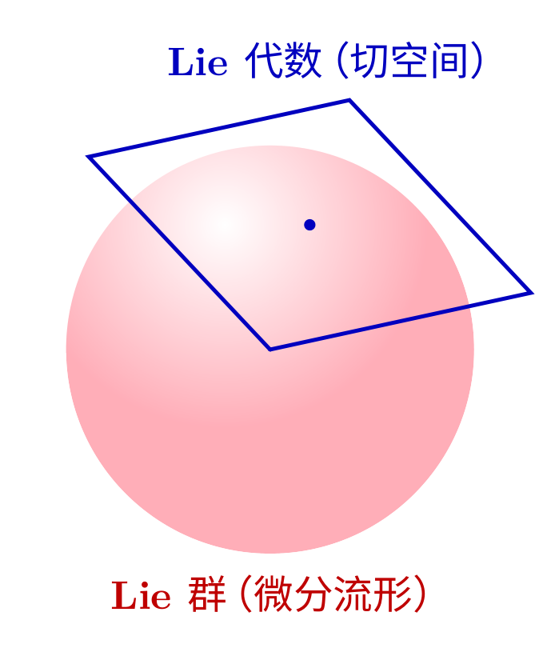

图 3.1: Lie 群和 Lie 代数的几何意义。

其中 $t^a$ 是 $n$ 个独立的 $m$ 阶生成元矩阵。这些生成元满足对易关系

$$
[t^a, t^b] = \mathrm{i}f^{abc}t^c, \quad a, b, c = 1, 2, \cdots, n,
\tag{3.34}
$$

其中实数 $f^{abc}$ 称为结构常数 (structure constant)，满足 $f^{abc} = -f^{bac}$。不同维的线性表示具有不同阶的生成元矩阵。不过，同一个 Lie 群所有线性表示的结构常数都是一样的，描述 Lie 群的局部性质。如果一个 Lie 群是 Abel 群，则结构常数都是零。生成元的对易子也称为 Lie 括号，是一种乘法运算。以生成元为基底张成的线性空间对 Lie 括号运算是封闭的，构成代数，称为 Lie 代数。Lie 代数刻画 Lie 群在恒元附近的局部结构，对应着微分流形在恒元处的切空间，如图 3.1 所示。

Lorentz 群是一个 6 维 Lie 群，它对应的 Lie 代数就是 Lorentz 代数。Lorentz 群任何线性表示的生成元都要满足 Lorentz 代数关系 (3.31)。反过来，通过构造满足 (3.31) 式的生成元矩阵，可以得到 Lorentz 群的线性表示。

我们可以把算符 $J^{\mu\nu}$ 的 6 个独立分量组合成 2 个三维矢量算符

$$
J^i \equiv \frac{1}{2}\varepsilon^{ijk}J^{jk}, \quad K^i \equiv J^{0i},
\tag{3.35}
$$

即

$$
\mathbf{J} = (J^{23}, J^{31}, J^{12}), \quad \mathbf{K} = (J^{01}, J^{02}, J^{03}).
\tag{3.36}
$$

纯空间部分的生成元 $J^i$ 与 $J^j$ 的对易关系为

$$
\begin{aligned}
[J^i, J^j] &= \frac{1}{4}\varepsilon^{ikl}\varepsilon^{jmn}[J^{kl}, J^{mn}] = \frac{\mathrm{i}}{4}\varepsilon^{ikl}\varepsilon^{jmn}\{[g^{lm}J^{kn} - (k \leftrightarrow l)] - (m \leftrightarrow n)\} \\
&= \frac{\mathrm{i}}{2}\varepsilon^{ikl}\varepsilon^{jmn}[g^{lm}J^{kn} - (k \leftrightarrow l)] = \mathrm{i}\varepsilon^{ikl}\varepsilon^{jmn}g^{lm}J^{kn} = -\mathrm{i}\varepsilon^{ikl}\varepsilon^{jln}J^{kn} \\
&= \mathrm{i}\varepsilon^{ikl}\varepsilon^{jnl}J^{kn} = \mathrm{i}(\delta^{ij}\delta^{kn} - \delta^{in}\delta^{kj})J^{kn} = -\mathrm{i}J^{ji} = \mathrm{i}J^{ij},
\end{aligned}
\tag{3.37}
$$

第三、四步用到三维 Levi-Civita 符号的反对称性，而倒数第三步用到 (1.97) 式。由 $J^{23} = J^1 = \varepsilon^{231}J^1$、$J^{31} = J^2 = \varepsilon^{312}J^2$ 和 $J^{12} = J^3 = \varepsilon^{123}J^3$ 归纳出

$$
J^{ij} = \varepsilon^{ijk}J^k,
\tag{3.38}
$$

从而得到

$$
[J^i, J^j] = \mathrm{i}\varepsilon^{ijk}J^k.
\tag{3.39}
$$

引入 2 个三维矢量

$$
\theta^i \equiv -\frac{1}{2}\varepsilon^{ijk}\omega_{jk}, \quad \xi^i \equiv -\omega_{0i},
\tag{3.40}
$$

即

$$
\boldsymbol{\theta} = (-\omega_{23}, -\omega_{31}, -\omega_{12}), \quad \boldsymbol{\xi} = (-\omega_{01}, -\omega_{02}, -\omega_{03}),
\tag{3.41}
$$

这里 $\theta^3 = -\omega_{12}$ 是 (1.197) 式中绕 $z$ 轴转动的角度 $\theta$，而 $\xi^1 = -\omega_{01}$ 是 (1.201) 式中沿 $x$ 轴增速的快度 $\xi$。从而，无穷小量子 Lorentz 变换化为

$$
\begin{aligned}
U(\mathbf{1} + \omega) &= 1 - \frac{\mathrm{i}}{2}\omega_{\mu\nu}J^{\mu\nu} = 1 - \mathrm{i}\omega_{23}J^{23} - \mathrm{i}\omega_{31}J^{31} - \mathrm{i}\omega_{12}J^{12} - \mathrm{i}\omega_{01}J^{01} - \mathrm{i}\omega_{02}J^{02} - \mathrm{i}\omega_{03}J^{03} \\
&= 1 + \mathrm{i}\boldsymbol{\theta}\cdot\mathbf{J} + \mathrm{i}\boldsymbol{\xi}\cdot\mathbf{K}.
\end{aligned}
\tag{3.42}
$$

对于绕 $z$ 轴的旋转变换 $R_z(\theta^3)$，$\theta^1 = \theta^2 = \xi^i = 0$，上式意味着 $U[R_z(\theta^3)] = 1 + \mathrm{i}\theta^3J^3 + \mathcal{O}[(\theta^3)^2]$，故

$$
\left.\frac{\mathrm{d}U[R_z(\theta^3)]}{\mathrm{d}\theta^3}\right|_{\theta^3=0} = \mathrm{i}J^3,
\tag{3.43}
$$

则由初始条件 $U[R_z(0)] = 1$ 求得相应的量子旋转变换

$$
U[R_z(\theta^3)] = \exp(\mathrm{i}\theta^3J^3).
\tag{3.44}
$$

1.7.3 小节提到，空间旋转对称性对应着角动量守恒定律，因而 $J^3$ 就是总角动量算符在 $z$ 轴上的分量。同理，$J^1$ 和 $J^2$ 分别是总角动量算符在 $x$ 轴和 $y$ 轴上的分量。也就是说，生成元算符 $\mathbf{J}$ 就是总角动量算符。空间旋转群 SO(3) 是 Lorentz 群在纯空间部分的子群，总角动量算符 $\mathbf{J}$ 是量子空间旋转变换的生成元算符，而 (3.39) 式是 3 维 Lie 群 SO(3) 的 Lie 代数关系，相应的结构常数是 Levi-Civita 符号 $\varepsilon^{ijk}$。

SO(3) 群与 3 维 Lie 群 SU(2) 有着紧密的联系。在 SU(2) 群的基础表示中，3 个生成元矩阵表达为

$$
\tau^i \equiv \frac{\sigma^i}{2},
\tag{3.45}
$$

其中 $\sigma^i$ 是 3 个 $2 \times 2$ 的 Pauli 矩阵，

$$
\sigma^1 \equiv \begin{pmatrix} & 1 \\ 1 & \end{pmatrix}, \quad \sigma^2 \equiv \begin{pmatrix} & -\mathrm{i} \\ \mathrm{i} & \end{pmatrix}, \quad \sigma^3 \equiv \begin{pmatrix} 1 & \\ & -1 \end{pmatrix}.
\tag{3.46}
$$

它们都是既厄米又幺正的，

$$
(\sigma^i)^{-1} = (\sigma^i)^\dagger = \sigma^i.
\tag{3.47}
$$

Pauli 矩阵的两两乘积为

$$
(\sigma^1)^2 = (\sigma^2)^2 = (\sigma^3)^2 = \mathbf{1},
$$

$$
\begin{aligned}
\sigma^1\sigma^2 &= \mathrm{i}\sigma^3, \quad \sigma^2\sigma^3 = \mathrm{i}\sigma^1, \quad \sigma^3\sigma^1 = \mathrm{i}\sigma^2, \\
\sigma^2\sigma^1 &= -\mathrm{i}\sigma^3, \quad \sigma^3\sigma^2 = -\mathrm{i}\sigma^1, \quad \sigma^1\sigma^3 = -\mathrm{i}\sigma^2.
\end{aligned}
\tag{3.48}
$$

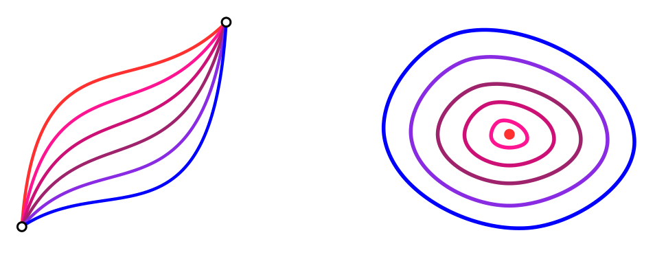

图 3.2: 曲线连续形变示意图。

归纳起来，有

$$
\sigma^i\sigma^j = \delta^{ij} + \mathrm{i}\varepsilon^{ijk}\sigma^k,
\tag{3.49}
$$

右边第一项省略了 $2 \times 2$ 单位矩阵 $\mathbf{1}$。从而推出

$$
[\sigma^i, \sigma^j] = \mathrm{i}\varepsilon^{ijk}\sigma^k - \mathrm{i}\varepsilon^{jik}\sigma^k = 2\mathrm{i}\varepsilon^{ijk}\sigma^k,
\tag{3.50}
$$

$$
\{\sigma^i, \sigma^j\} \equiv \sigma^i\sigma^j + \sigma^j\sigma^i = 2\delta^{ij} + \mathrm{i}\varepsilon^{ijk}\sigma^k + \mathrm{i}\varepsilon^{jik}\sigma^k = 2\delta^{ij}.
\tag{3.51}
$$

于是，SU(2) 生成元 $\tau^i$ 的对易关系为

$$
[\tau^i, \tau^j] = \frac{1}{4}[\sigma^i, \sigma^j] = \frac{\mathrm{i}}{2}\varepsilon^{ijk}\sigma^k = \mathrm{i}\varepsilon^{ijk}\tau^k.
\tag{3.52}
$$

与 (3.39) 式比较发现，SU(2) 群的 Lie 代数关系与 SO(3) 群完全一致，这意味着 SU(2) 群在恒元附近的局部性质与 SO(3) 群一样。

但是，SU(2) 群的整体拓扑性质与 SO(3) 群不一样。SU(2) 和 SO(3) 的群空间都是连通的，根据 1.3 节的说法，它们都是简单 Lie 群。更仔细地讲，SU(2) 的群空间是单连通的，连接群空间中两点的任意两条曲线可以连续地形变成彼此，等价地，群空间内任意一条闭合曲线可以连续地收缩为一点，如图 3.2 所示。SO(3) 的群空间是双连通的，即连通度为 2，连接群空间中两点的曲线分成 2 类，同一类曲线能够连续地变化成彼此，不同类曲线则不能；相应地，闭合曲线也分为 2 类，有一类能连续收缩成一点，另一类不能。

图 3.3 表示 SO(3) 的群空间，它是半径为 $\pi$ 的球体，每一点的两个角度坐标代表转动轴的方向，径向坐标代表绕轴转动的角度。绕某个轴转动 $\pi$ 角与绕方向相反的另一个轴转动 $\pi$ 角这两个旋转变换是一样的，这体现在图 3.4 中。

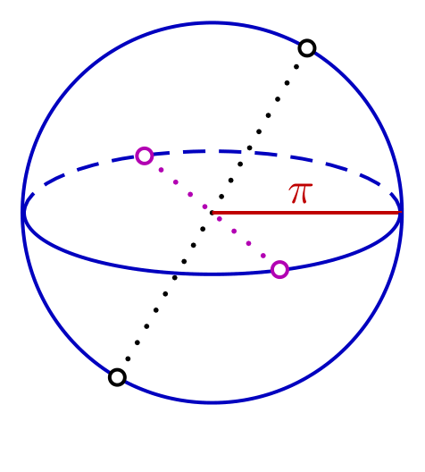

图 3.3: SO(3) 群空间示意图

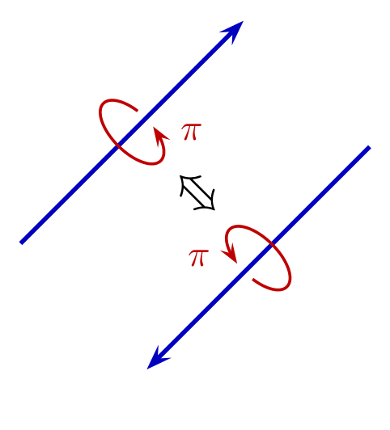

图 3.4: 一组对径点对应的等价旋转变换

因此，球面上直径两端的点对应于同一个群元，这样的点称为对径点。如图 3.5 中左图所示，如果一条闭合曲线上的点都不在球面上，那么曲线可以连续收缩成一点。如图 3.5 中右图所示，如果一条闭合曲线通过球面上的某个点跳跃到它的对径点以形成闭合路径，那么对曲线进行连续形变时，参与跳跃的两个对径点只能成对地在球面上移动，不能通过连续形变消除这种跳跃，于是曲线不能连续收缩成一点。

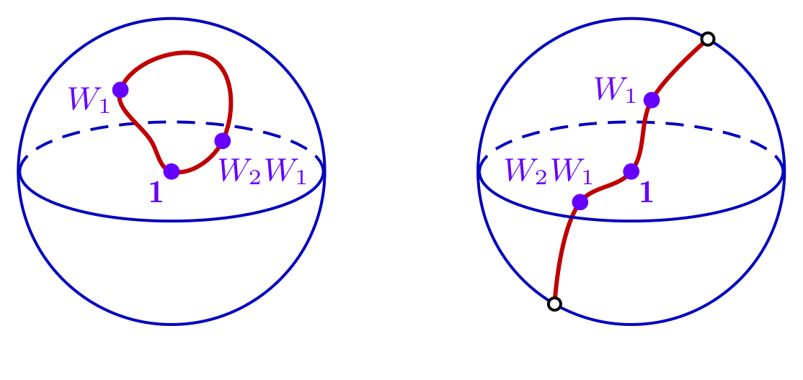

图 3.5: SO(3) 群空间中的两类闭合曲线，小空心圆代表两个对径点。左图中的闭合曲线可以连续收缩成一点。右图中的闭合曲线在对径点处发生跳跃，不能连续收缩成一点。

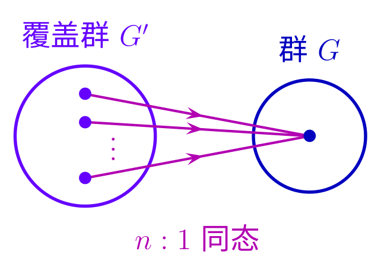

图 3.6: 覆盖群示意图

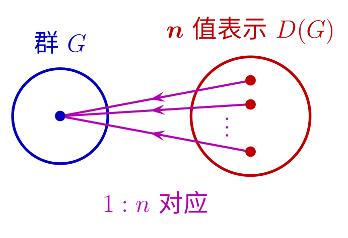

图 3.7: $n$ 值表示

另一方面，SU(2) 的群空间是半径为 $2\pi$ 的球体，球面上所有的点都对应于群元 $-1$。即使一条闭合曲线包含两个在球面上跳跃的点，在连续形变时这两个点可以在球面上自由移动，从而合成一个点，消除跳跃，因此任意闭合曲线能够连续收缩为一点，即连通度为 1。

数学上可以证明，如果简单 Lie 群 $G$ 的群空间是 $n$ 度连通的 ($n > 1$)，那么必然存在一个单连通的简单 Lie 群 $G'$ 与之同态，$G' \sim G$，同态对应关系为 $n : 1$，即 $G'$ 中的 $n$ 个元素对应于 $G$ 中的 1 个元素。此时称 $G'$ 为 $G$ 的覆盖群 (covering group)，如图 3.6 所示。$G'$ 的忠实表示是 $G$ 的 $n$ 值表示，$G'$ 与 $G$ 具有相同的 Lie 代数。1.4 小节提到，在群的线性表示中，群元与表示矩阵之间具有一对一或者多对一的对应关系。但是，在图 3.7 展示的 $n$ 值表示中，群元与表示矩阵之间具有 $1 : n$ 的对应关系，因此 $n$ 值表示不是线性表示。

SU(2) 群与 SO(3) 群具有一种 $2 : 1$ 的同态关系，SU(2) $\sim$ SO(3)，SU(2) 的两个群元同态地对应于 SO(3) 的一个群元，因此 SU(2) 是 SO(3) 的覆盖群，SU(2) 的忠实表示是 SO(3) 的双值表示。

另一方面，$\mathbf{K}$ 是增速算符。$\mathbf{J}$ 与 $\mathbf{K}$ 的对易关系为

$$
\begin{aligned}
[J^i, K^j] &= \frac{1}{2}\varepsilon^{ikl}[J^{kl}, J^{0j}] = \frac{\mathrm{i}}{2}\varepsilon^{ikl}\{[g^{l0}J^{kj} - (k \leftrightarrow l)] - (0 \leftrightarrow j)\} \\
&= \mathrm{i}\varepsilon^{ikl}[g^{l0}J^{kj} - (0 \leftrightarrow j)] = \mathrm{i}\varepsilon^{ikl}(g^{l0}J^{kj} - g^{lj}J^{k0}) = -\mathrm{i}\varepsilon^{ikl}g^{lj}J^{k0} \\
&= \mathrm{i}\varepsilon^{ikj}J^{k0} = \mathrm{i}\varepsilon^{ijk}J^{0k} = \mathrm{i}\varepsilon^{ijk}K^k,
\end{aligned}
\tag{3.53}
$$

而 $\mathbf{K}$ 自身的对易关系为

$$
[K^i, K^j] = [J^{0i}, J^{0j}] = \mathrm{i}(g^{i0}J^{0j} - g^{00}J^{ij} - g^{ij}J^{00} + g^{0j}J^{i0}) = -\mathrm{i}J^{ij} = -\mathrm{i}\varepsilon^{ijk}J^k.
\tag{3.54}
$$

归纳起来，有

$$
[J^i, J^j] = \mathrm{i}\varepsilon^{ijk}J^k, \quad [J^i, K^j] = \mathrm{i}\varepsilon^{ijk}K^k, \quad [K^i, K^j] = -\mathrm{i}\varepsilon^{ijk}J^k.
\tag{3.55}
$$

这是 Lorentz 代数关系 (3.31) 的另一种表达方式，具有 (3.34) 式的形式。可见，三个生成元 $J^i$ 自己就可以构成封闭的代数，而三个生成元 $K^i$ 不能。

下面研究 (3.22) 式。考虑无穷小 Poincaré 变换 (3.10)，忽略二阶小量，(3.22) 式左边化为

$$
\begin{aligned}
U^{-1}(\mathbf{1} + \omega, \varepsilon)P^\mu U(\mathbf{1} + \omega, \varepsilon) &= \left(1 + \frac{\mathrm{i}}{2}\omega_{\gamma\delta}J^{\gamma\delta} + \mathrm{i}\varepsilon_\gamma P^\gamma\right)P^\mu\left(1 - \frac{\mathrm{i}}{2}\omega_{\alpha\beta}J^{\alpha\beta} - \mathrm{i}\varepsilon_\alpha P^\alpha\right) \\
&= P^\mu - \frac{\mathrm{i}}{2}\omega_{\alpha\beta}P^\mu J^{\alpha\beta} + \frac{\mathrm{i}}{2}\omega_{\gamma\delta}J^{\gamma\delta}P^\mu - \mathrm{i}\varepsilon_\alpha P^\mu P^\alpha + \mathrm{i}\varepsilon_\gamma P^\gamma P^\mu \\
&= P^\mu - \frac{\mathrm{i}}{2}\omega_{\rho\sigma}[P^\mu, J^{\rho\sigma}] - \mathrm{i}\varepsilon_\nu[P^\mu, P^\nu],
\end{aligned}
\tag{3.56}
$$

(3.22) 式右边变成

$$
(\mathbf{1} + \omega)^\mu{}_\nu P^\nu = P^\mu + \omega^\mu{}_\nu P^\nu = P^\mu + \omega_{\rho\sigma}g^{\mu\rho}P^\sigma = P^\mu + \frac{1}{2}\omega_{\rho\sigma}(g^{\mu\rho}P^\sigma - g^{\mu\sigma}P^\rho).
\tag{3.57}
$$

两相比较，由 $\omega_{\mu\nu}$ 和 $\varepsilon_\mu$ 的任意性推出生成元算符的对易关系

$$
[P^\mu, J^{\rho\sigma}] = \mathrm{i}(g^{\mu\rho}P^\sigma - g^{\mu\sigma}P^\rho),
\tag{3.58}
$$

$$
[P^\mu, P^\nu] = 0.
\tag{3.59}
$$

这里第一个对易关系等价于 (3.32) 式。以生成元 $J^{\mu\nu}$ 和 $P^\mu$ 的 10 个独立分量作为基底张成线性空间，用对易关系 (3.31)、(3.58) 和 (3.59) 定义矢量乘法，就构成了 Poincaré 代数，这是 10 维 Poincaré 群的 Lie 代数。Lorentz 代数是 Poincaré 代数的子代数。

令 $H \equiv P^0$，则 $P^\mu = (H, \mathbf{P})$，进一步推出

$$
[P^i, J^j] = \frac{1}{2}\varepsilon^{jkl}[P^i, J^{kl}] = \frac{\mathrm{i}}{2}\varepsilon^{jkl}(g^{ik}P^l - g^{il}P^k) = \frac{\mathrm{i}}{2}(\varepsilon^{jil}P^l - \varepsilon^{jki}P^k) = -\mathrm{i}\varepsilon^{ijk}P^k,
\tag{3.60}
$$

$$
[P^i, K^j] = [P^i, J^{0j}] = \mathrm{i}(g^{i0}P^j - g^{ij}P^0) = \mathrm{i}\delta^{ij}H,
\tag{3.61}
$$

$$
[H, K^i] = [P^0, J^{0i}] = \mathrm{i}(g^{00}P^i - g^{0i}P^0) = \mathrm{i}P^i,
\tag{3.62}
$$

$$
[H, J^j] = \frac{1}{2}\varepsilon^{ijk}[P^0, J^{jk}] = \frac{\mathrm{i}}{2}\varepsilon^{ijk}(g^{0j}P^k - g^{0k}P^j) = 0.
\tag{3.63}
$$

整理一下，有

$$
[P^i, J^j] = -\mathrm{i}\varepsilon^{ijk}P^k, \quad [P^i, K^j] = \mathrm{i}\delta^{ij}H, \quad [H, K^i] = \mathrm{i}P^i,
\tag{3.64}
$$

$$
[H, J^j] = [H, P^i] = [P^i, P^j] = 0.
\tag{3.65}
$$

(3.55)、(3.64) 和 (3.65) 式是 Poincaré 代数关系的另一种表达方式。

当 $\omega_{\mu\nu} = 0$ 而 $a^\mu = (t_*, \mathbf{0})$ 时，(3.11) 式意味着

$$
\left.\frac{\mathrm{d}U(\mathbf{1}, a)}{\mathrm{d}t_*}\right|_{t_*=0} = -\mathrm{i}H.
\tag{3.66}
$$

若 $H$ 不依赖于 $t_*$，则由初始条件 $U(\mathbf{1}, 0) = 1$ 求得量子时间平移变换

$$
U(\mathbf{1}, a) = \exp(-\mathrm{i}Ht_*).
\tag{3.67}
$$

它将态矢从 $t$ 时刻平移到 $t' = t + t_*$ 时刻。1.7.2 小节提到，时间平移对称性对应着能量守恒定律，因而生成元算符 $H$ 就是哈密顿量算符。实际上，Schrödinger 绘景中态矢随时间演化的关系 (2.32) 里面的幺正变换 $\mathrm{e}^{-\mathrm{i}Ht}$ 就是一个量子时间平移变换。

若两个算符 $A$ 和 $B$ 相互对易，即 $[A, B] = 0$，则二项式定理成立：

$$
(A + B)^n = \sum_{j=0}^{n}\frac{n!}{j!(n-j)!}A^jB^{n-j}.
\tag{3.68}
$$

阶乘的定义可以推广到负整数：对于整数 $m < 0$，定义

$$
m! \to \infty, \quad \frac{1}{m!} \to 0.
\tag{3.69}
$$

从而，对于 $j > n$，有 $[(n-j)!]^{-1} \to 0$。这样一来，我们可以将 (3.68) 式右边的级数化成无穷级数，

$$
(A + B)^n = \sum_{j=0}^{\infty}\frac{n!}{j!(n-j)!}A^jB^{n-j}.
\tag{3.70}
$$

由此推出

$$
\mathrm{e}^{A+B} = \sum_{n=0}^{\infty}\frac{1}{n!}(A + B)^n = \sum_{n=0}^{\infty}\frac{1}{n!}\sum_{j=0}^{\infty}\frac{n!}{j!(n-j)!}A^jB^{n-j} = \sum_{j=0}^{\infty}\frac{A^j}{j!}\left[\sum_{n=0}^{\infty}\frac{B^{n-j}}{(n-j)!}\right],
\tag{3.71}
$$

即

$$
\mathrm{e}^{A+B} = \mathrm{e}^{A}\mathrm{e}^{B}
\tag{3.72}
$$

对 $[A, B] = 0$ 成立。值得注意的是，上式不仅对相互对易的算符成立，也对相互对易的同阶方阵成立。

当 $\omega_{\mu\nu} = 0$ 而 $a^\mu = (0, \mathbf{x}_*)$ 时，(3.11) 式表明

$$
\left.\frac{\partial U(\mathbf{1}, a)}{\partial x_*^i}\right|_{\mathbf{x}_*=0} = \mathrm{i}P^i,
\tag{3.73}
$$

由于 $[P^i, P^j] = 0$，求得量子空间平移变换

$$
U(\mathbf{1}, a) = \exp(\mathrm{i}P^1x_*^1)\exp(\mathrm{i}P^2x_*^2)\exp(\mathrm{i}P^3x_*^3) = \exp(\mathrm{i}\mathbf{P}\cdot\mathbf{x}_*).
\tag{3.74}
$$

第二步用到 (3.72) 式。它将态矢从 $\mathbf{x}$ 位置平移到 $\mathbf{x}' = \mathbf{x} + \mathbf{x}_*$ 位置，空间平移对称性对应着动量守恒定律，因此生成元算符 $\mathbf{P}$ 就是动量算符。从而，$P^\mu = (H, \mathbf{P})$ 是四维动量算符。在量子力学中，与哈密顿量对易的力学量是守恒量，于是 $[H, \mathbf{P}] = [H, \mathbf{J}] = 0$ 意味着动量和总角动量都是守恒量。

由于 $[H, \mathbf{P}] = 0$，一般的量子时空平移变换可表达为

$$
U(\mathbf{1}, a) = \exp(-\mathrm{i}Ht_*)\exp(\mathrm{i}\mathbf{P}\cdot\mathbf{x}_*) = \exp(-\mathrm{i}P^\mu a_\mu),
\tag{3.75}
$$

满足

$$
\left.\frac{\partial U(\mathbf{1}, a)}{\partial a_\mu}\right|_{a_\mu=0} = -\mathrm{i}P^\mu.
\tag{3.76}
$$

### 3.1.3 粒子

Poincaré 群描述 Minkowski 时空的对称性。粒子在 Minkowski 时空中运动，不同种类的粒子由质量、自旋和一些量子数加以区分。每个粒子具有一定的四维动量和自旋在某个空间方向上投影出来的量子数，对它作空间旋转或 Lorentz 增速变换时，四维动量会发生变化，而自旋投影的值有可能改变，变化方式由相应的 Lorentz 变换决定，但质量、自旋和其它量子数不会改变。当 $\Lambda = \mathbf{1}$ 时，(3.22) 式化为 $U^{-1}(\mathbf{1}, a)P^\mu U(\mathbf{1}, a) = P^\mu$，因此四维动量算符 $P^\mu$ 在量子时空平移变换下不变，从而内积 $P^2 = P^\mu P_\mu$ 也不变。另一方面，$P^2$ 还是 Lorentz 标量，于是它的本征值 $p^2$ 是 Poincaré 变换的不变量。对单个粒子而言，根据质壳关系 (1.70)，$p^2 = m^2$，则这个不变量是粒子质量 $m$ 的平方。

实际上，粒子态由 Poincaré 群的不可约幺正表示描述，1939 年 Eugene Wigner 完成了这些表示的分类工作 [13]。一个粒子可以用一组在量子 Poincaré 变换下相互转化的态矢 $\{|\Psi_\sigma(p^\mu)\rangle\}$ 来定义，其中四维动量 $p^\mu$ 是四维动量算符 $P^\mu$ 在态矢 $|\Psi_\sigma(p^\mu)\rangle$ 上的本征值，

$$
P^\mu|\Psi_\sigma(p^\mu)\rangle = p^\mu|\Psi_\sigma(p^\mu)\rangle,
\tag{3.77}
$$

而指标 $\sigma$ 表征所有其它自由度，通常取分立值。2.3.4 小节定义的标量场单粒子态 $|\mathbf{p}\rangle$ 就是这样的态矢。

在量子时空平移变换 (3.75) 的作用下，单粒子态 $|\Psi_\sigma(p^\mu)\rangle$ 变换为

$$
U(\mathbf{1}, a)|\Psi_\sigma(p^\mu)\rangle = \mathrm{e}^{-\mathrm{i}P^\mu a_\mu}|\Psi_\sigma(p^\mu)\rangle = \mathrm{e}^{-\mathrm{i}p^\mu a_\mu}|\Psi_\sigma(p^\mu)\rangle,
\tag{3.78}
$$

只出现相位上的改变。另一方面，用量子 Lorentz 变换 $U(\Lambda)$ 作用得到单粒子态 $U(\Lambda)|\Psi_\sigma(p^\mu)\rangle$，满足

$$
\begin{aligned}
P^\mu U(\Lambda)|\Psi_\sigma(p^\mu)\rangle &= U(\Lambda)U^{-1}(\Lambda)P^\mu U(\Lambda)|\Psi_\sigma(p^\mu)\rangle = \Lambda^\mu{}_\nu U(\Lambda)P^\nu|\Psi_\sigma(p^\mu)\rangle \\
&= \Lambda^\mu{}_\nu p^\nu U(\Lambda)|\Psi_\sigma(p^\mu)\rangle,
\end{aligned}
\tag{3.79}
$$

第二步用到 (3.24) 式。因此，$U(\Lambda)|\Psi_\sigma(p^\mu)\rangle$ 的四维动量本征值为 $\Lambda^\mu{}_\nu p^\nu$，这意味着它必定是态矢 $|\Psi_{\sigma'}(\Lambda^\mu{}_\nu p^\nu)\rangle$ 的线性组合，即

$$
U(\Lambda)|\Psi_\sigma(p^\mu)\rangle = \sum_{\sigma'}C_{\sigma'\sigma}(\Lambda, p)|\Psi_{\sigma'}(\Lambda^\mu{}_\nu p^\nu)\rangle.
\tag{3.80}
$$

通过下面的方法可以得到系数 $C_{\sigma'\sigma}(\Lambda, p)$ 的形式。

在固有保时向 Lorentz 变换下，$p^\mu$ 的内积 $p^2$ 不变，$p^0$ 的符号也不会改变。它们是所有惯性参考系的不变量。$p^2$ 的每个数值和 $p^0$ 的每种符号决定了一组四维动量 $\{p^\mu\}$，彼此之间由固有保时向 Lorentz 变换联系着，可以选取一个标准四维动量 $k^\mu \in \{p^\mu\}$，使得

$$
p^\mu = V^\mu{}_\nu(p)k^\nu,
\tag{3.81}
$$

其中 $V^\mu{}_\nu$ 是依赖于 $p^\mu$ 的固有保时向 Lorentz 变换。从而，标准四维动量 $k^\mu$ 代表了这组四维动量 $\{p^\mu\}$。可以将 $\{p^\mu\}$ 中任意元素 $p^\mu$ 对应的单粒子态 $|\Psi_\sigma(p^\mu)\rangle$ 定义为

$$
|\Psi_\sigma(p^\mu)\rangle \equiv N(p)U[V(p)]|\Psi_\sigma(k^\mu)\rangle,
\tag{3.82}
$$

其中 $N(p)$ 是依赖于 $p^\mu$ 的归一化因子。上式左右两边出现同一个指标 $\sigma$，实际上，这条式子规定了指标 $\sigma$ 与四维动量 $p^\mu$ 之间的关系。

对这个单粒子态作量子 Lorentz 变换 $U(\Lambda)$，得

$$
\begin{aligned}
U(\Lambda)|\Psi_\sigma(p^\mu)\rangle &= N(p)U[V(\Lambda p)]U^{-1}[V(\Lambda p)]U(\Lambda)U[V(p)]|\Psi_\sigma(k^\mu)\rangle \\
&= N(p)U[V(\Lambda p)]U[V^{-1}(\Lambda p)\Lambda V(p)]|\Psi_\sigma(k^\mu)\rangle \\
&= N(p)U[V(\Lambda p)]U(W)|\Psi_\sigma(k^\mu)\rangle,
\end{aligned}
\tag{3.83}
$$

其中，固有保时向 Lorentz 变换

$$
W^\mu{}_\nu = [V^{-1}(\Lambda p)\Lambda V(p)]^\mu{}_\nu
\tag{3.84}
$$

先将 $k^\mu$ 变换到 $p^\mu$，再变换到 $(\Lambda p)^\mu$，最后变换回 $k^\mu$：

$$
W^\mu{}_\nu k^\nu = [V^{-1}(\Lambda p)\Lambda V(p)]^\mu{}_\nu k^\nu = [V^{-1}(\Lambda p)\Lambda]^\mu{}_\nu p^\nu = [V^{-1}(\Lambda p)]^\mu{}_\nu(\Lambda p)^\nu = k^\mu,
\tag{3.85}
$$

即 $W^\mu{}_\nu$ 保持 $k^\mu$ 不变。所有保持 $k^\mu$ 不变的固有保时向 Lorentz 变换 $\{W^\mu{}_\nu\}$ 构成 Lorentz 群的一个子群，称为标准动量 $k^\mu$ 对应的小群 (little group)，类似于 (3.80) 式，有

$$
U(W)|\Psi_\sigma(k^\mu)\rangle = \sum_{\sigma'}D_{\sigma'\sigma}(W)|\Psi_{\sigma'}(k^\mu)\rangle,
\tag{3.86}
$$

其中 $D_{\sigma'\sigma}(W)$ 是线性组合系数。对于小群中任意两个变换 $(W_1)^\mu{}_\nu$ 和 $(W_2)^\mu{}_\nu$，由上式推出

$$
\begin{aligned}
\sum_{\sigma'}D_{\sigma'\sigma}(W_2W_1)|\Psi_{\sigma'}(k^\mu)\rangle &= U(W_2W_1)|\Psi_\sigma(k^\mu)\rangle = U(W_2)U(W_1)|\Psi_\sigma(k^\mu)\rangle \\
&= U(W_2)\sum_{\sigma''}D_{\sigma''\sigma}(W_1)|\Psi_{\sigma''}(k^\mu)\rangle = \sum_{\sigma'\sigma''}D_{\sigma'\sigma''}(W_2)D_{\sigma''\sigma}(W_1)|\Psi_{\sigma'}(k^\mu)\rangle,
\end{aligned}
\tag{3.87}
$$

从而得到同态关系

$$
D_{\sigma'\sigma}(W_2W_1) = \sum_{\sigma''}D_{\sigma'\sigma''}(W_2)D_{\sigma''\sigma}(W_1).
\tag{3.88}
$$

可见，矩阵集合 $\{D(W)\}$ 构成这个小群的一个线性表示。

将 (3.86) 式代入 (3.83) 式，利用 (3.84) 式，得

$$
\begin{aligned}
U(\Lambda)|\Psi_\sigma(p^\mu)\rangle &= N(p)U[V(\Lambda p)]\sum_{\sigma'}D_{\sigma'\sigma}(W)|\Psi_{\sigma'}(k^\mu)\rangle \\
&= N(p)\sum_{\sigma'}D_{\sigma'\sigma}[V^{-1}(\Lambda p)\Lambda V(p)]U[V(\Lambda p)]|\Psi_{\sigma'}(k^\mu)\rangle.
\end{aligned}
\tag{3.89}
$$

根据定义式 (3.82)，有 $|\Psi_{\sigma'}(\Lambda^\mu{}_\nu p^\nu)\rangle = N(\Lambda p)U[V(\Lambda p)]|\Psi_{\sigma'}(k^\mu)\rangle$，即

$$
U[V(\Lambda p)]|\Psi_{\sigma'}(k^\mu)\rangle = \frac{1}{N(\Lambda p)}|\Psi_{\sigma'}(\Lambda^\mu{}_\nu p^\nu)\rangle,
\tag{3.90}
$$

代入 (3.89) 式，得

$$
U(\Lambda)|\Psi_\sigma(p^\mu)\rangle = \frac{N(p)}{N(\Lambda p)}\sum_{\sigma'}D_{\sigma'\sigma}[V^{-1}(\Lambda p)\Lambda V(p)]|\Psi_{\sigma'}(\Lambda^\mu{}_\nu p^\nu)\rangle.
\tag{3.91}
$$

与 (3.80) 式比较，推出系数公式

$$
C_{\sigma'\sigma}(\Lambda, p) = \frac{N(p)}{N(\Lambda p)}D_{\sigma'\sigma}[V^{-1}(\Lambda p)\Lambda V(p)].
\tag{3.92}
$$

上述讨论表明，我们可以通过标准四维动量 $k^\mu$ 和相应的小群为单粒子态分类，物理上遇到以下三种情况$^{1}$。

(1) 质量非零的粒子：$p^2 = m^2$ 且 $p^0 > 0$，其中质量 $m > 0$

此时 $p^\mu$ 是类时的，取标准四维动量为 $k^\mu = (m, 0, 0, 0)$，沿任意方向的 Lorentz 增速变换会改变 $k^\mu$，任意空间旋转变换则保持 $k^\mu$ 不变，因此相应的小群是 SO(3)。

在量子力学中，归一化后的态矢仍然具有一定的任意性，态矢 $|\Psi\rangle$ 与相差一个相位因子的态矢 $\mathrm{e}^{\mathrm{i}\varphi}|\Psi\rangle$（$\varphi$ 为实数）描述相同的量子态。因此，一般地，量子 Lorentz 变换的同态关系 $U(\Lambda_2)U(\Lambda_1) = U(\Lambda_2\Lambda_1)$ 应修正为

$$
U(\Lambda_2)U(\Lambda_1) = \mathrm{e}^{\mathrm{i}\varphi(\Lambda_2, \Lambda_1)}U(\Lambda_2\Lambda_1).
\tag{3.93}
$$

若实相位 $\varphi(\Lambda_2, \Lambda_1)$ 不恒为零，则集合 $\{U(\Lambda)\}$ 不是 Lorentz 群的线性表示，而是投影表示 (projective representation)。

对于任意小群变换 $W_1, W_2 \in \mathrm{SO}(3)$，则有

$$
U(W_2)U(W_1) = \mathrm{e}^{\mathrm{i}\varphi(W_2, W_1)}U(W_2W_1).
\tag{3.94}
$$

左右两边分别作用到态矢 $|\Psi_\sigma(k^\mu)\rangle$ 上，利用 (3.86) 式，得

$$
\sum_{\sigma'\sigma''}D_{\sigma'\sigma''}(W_2)D_{\sigma''\sigma}(W_1)|\Psi_{\sigma'}(k^\mu)\rangle = \mathrm{e}^{\mathrm{i}\varphi(W_2, W_1)}\sum_{\sigma'}D_{\sigma'\sigma}(W_2W_1)|\Psi_{\sigma'}(k^\mu)\rangle,
\tag{3.95}
$$

$^{1}$ 更详细的论证见参考书 [13] 第 2 章。

故

$$
\sum_{\sigma''}D_{\sigma'\sigma''}(W_2)D_{\sigma''\sigma}(W_1) = \mathrm{e}^{\mathrm{i}\varphi(W_2, W_1)}D_{\sigma'\sigma}(W_2W_1).
\tag{3.96}
$$

若 $\varphi(W_2, W_1)$ 不恒为零，则矩阵集合 $\{D(W)\}$ 构成小群 SO(3) 的投影表示。

这里遇到的投影表示就是 3.1.2 小节提到的 $n$ 值表示，它的存在意味着群空间的连通度 $n > 1$，将这个群扩充为一个单连通的覆盖群，则相关的投影表示对应于覆盖群的线性表示。因此，应该用覆盖群的不等价不可约线性表示为粒子态分类。

在 Lie 群的群空间中，每个点对应一个群元，由于群的封闭性，两个群元的乘积一定对应于群空间中的某个点。从而，群空间中的一条曲线意味着一系列的群乘积，乘出来的群元连续地组合成这条曲线。考虑 SO(3) 群空间内一条闭合曲线，它从恒元出发，通过一系列群乘积相继经过 $W_1$ 和 $W_2W_1$ 两个点再回到恒元，相应的量子变换是 $U^{-1}(W_2W_1)U(W_2)U(W_1)$。如图 3.5 中左图所示，若这条曲线能连续地收缩成恒元这一点，则连续性意味着 $U^{-1}(W_2W_1)U(W_2)U(W_1)$ 是恒等变换 $\mathbf{1}$。如图 3.5 中右图所示，若这条曲线包含奇数次对径点跳跃，则不能连续收缩成恒元一点，而 $U^{-1}(W_2W_1)U(W_2)U(W_1)$ 不一定是恒等变换。不过，如图 3.8 所示，重复走这条闭合曲线的路径两次，则包含偶数次对径点跳跃，可通过连续形变消除这些跳跃，从而收缩成恒元一点，也就是说，

$$
[U^{-1}(W_2W_1)U(W_2)U(W_1)]^2 = \mathbf{1}.
\tag{3.97}
$$

由此得到 $U^{-1}(W_2W_1)U(W_2)U(W_1) = \pm 1$，即

$$
U(W_2)U(W_1) = \pm U(W_2W_1).
\tag{3.98}
$$

可见，SO(3) 群的相位因子 $\mathrm{e}^{\mathrm{i}\varphi(W_2, W_1)}$ 可取 $\pm 1$。相位因子即能取 $+1$ 又能取 $-1$ 的情况对应于双值表示。

SO(3) 群的覆盖群 SU(2) 是单连通的，群空间中任意经过恒元的闭合曲线都能收缩到恒元一点处，因此相位因子等于 1，不具有投影表示。群论知识告诉我们，SU(2) 群的不等价不可约线性表示都是幺正表示，记为

$$
D^{(s)}, \quad s = 0, \frac{1}{2}, 1, \frac{3}{2}, 2, \frac{5}{2}, \cdots
\tag{3.99}
$$

这里的 $s$ 就是自旋量子数，线性表示 $D^{(s)}$ 的维度为 $2s + 1$，表示矩阵元表达为 $D^{(s)}_{\sigma'\sigma}(W)$，其中 $\sigma', \sigma = -s, -s+1, \cdots, s-1, s$ 是自旋在某个方向上投影出来的本征值。因此，自旋为 $s$ 的有质量粒子具有 $2s + 1$ 种自旋极化态。根据 (3.91) 式，自旋为 $s$ 的有质量单粒子态 $|\Psi_{s,\sigma}(p^\mu)\rangle$ 的量子 Lorentz 变换为

$$
U(\Lambda)|\Psi_{s,\sigma}(p^\mu)\rangle = \frac{N(p)}{N(\Lambda p)}\sum_{\sigma'}D^{(s)}_{\sigma'\sigma}[V^{-1}(\Lambda p)\Lambda V(p)]|\Psi_{s,\sigma'}(\Lambda^\mu{}_\nu p^\nu)\rangle.
\tag{3.100}
$$

可见，量子 Lorentz 变换将 $\sigma$ 对应的极化态变换成不同 $\sigma'$ 对应的极化态的线性组合。

当 $s$ 为整数 ($0, 1, 2, \cdots$) 时，$D^{(s)}$ 是 SU(2) 群的非忠实线性表示，同时也是 SO(3) 群的线性表示，描述整数自旋的粒子。$D^{(0)}$ 是这两个群的恒等表示，描述零自旋粒子。$D^{(1)}$ 是 SO(3) 群的基础表示，描述自旋为 1 的粒子。

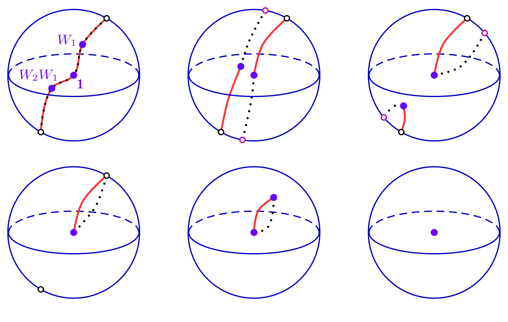

图 3.8: 对闭合曲线连续形变以消除偶数次对径点跳跃并收缩成恒元一点示意图。第一幅图沿同一闭合路径走了两遍。

当 $s$ 为半奇数 ($1/2, 3/2, 5/2, \cdots$) 时，$D^{(s)}$ 是 SU(2) 群的忠实线性表示，同时也是 SO(3) 群的双值表示，描述半奇数自旋的粒子。$D^{(1/2)}$ 是 SU(2) 群的基础表示，描述自旋为 $1/2$ 的粒子。可见，半奇数自旋是量子理论特有的。

与子群 SO(3) 一样，固有保时向 Lorentz 群 $\mathrm{SO}^\uparrow(1, 3)$ 也是双连通的，它的覆盖群是复数域 $\mathbb{C}$ 上的 2 阶特殊线性群 $\mathrm{SL}(2, \mathbb{C})$。在 Poincaré 群空间中，与恒元连通的部分对应于 $\mathrm{SO}^\uparrow(1, 3)$ 与时空平移群的半直积群，它是双连通的，相应的覆盖群是 $\mathrm{SL}(2, \mathbb{C})$ 与时空平移群的半直积群。在 3.1.1 和 3.1.2 小节的讨论中，我们没有在量子 Poincaré 变换的同态关系 (3.7) 中引入相位因子，这相当于在覆盖群的线性表示中进行讨论，因而导出的结果是合理的。

(2) 质量为零的粒子：$p^2 = 0$ 且 $p^0 > 0$

此时 $p^\mu$ 是类光的，取标准四维动量为 $k^\mu = (\kappa, 0, 0, \kappa)$，其中 $\kappa > 0$，相应三维动量 $\mathbf{k}$ 沿 $z$ 轴方向。相应小群中的任意变换 $W^\mu{}_\nu$ 满足 $W^\mu{}_\nu k^\nu = k^\mu$。

我们需要知道保持 $k^\mu$ 不变的小群是什么。为此，引入 $\tilde{k}^\mu = k^\mu/\kappa = (1, 0, 0, 1)$。由 $W^\mu{}_\nu\tilde{k}^\nu = W^\mu{}_\nu k^\nu/\kappa = k^\mu/\kappa = \tilde{k}^\mu$ 得知，$\tilde{k}^\mu$ 也在小群变换下不变，相应的协变矢量满足 $\tilde{k}_\mu = \tilde{k}_\nu(W^{-1})^\nu{}_\mu$。再引入类时 Lorentz 矢量 $\tilde{t}^\mu = (1, 0, 0, 0)$，小群变换 $W^\mu{}_\nu$ 对它作用的结果为 $t^\mu = W^\mu{}_\nu\tilde{t}^\nu$。从而推出

$$
t^\mu\tilde{k}_\mu = W^\mu{}_\nu\tilde{t}^\nu\tilde{k}_\rho(W^{-1})^\rho{}_\mu = \delta^\rho{}_\nu\tilde{t}^\nu\tilde{k}_\rho = \tilde{t}^\nu\tilde{k}_\nu = 1.
\tag{3.101}
$$

考虑到 $\tilde{k}^\mu = (1, 0, 0, 1)$，满足这样一个 $1 = t^\mu\tilde{k}_\mu = t^0 - t^3$ 条件的 $t^\mu$ 一般形式为

$$
t^\mu = (1 + \zeta, \alpha, \beta, \zeta).
\tag{3.102}
$$

另一方面，$t^\mu$ 的自我内积是

$$
t^\mu t_\mu = \delta^\nu{}_\mu t^\mu t_\nu = W^\rho{}_\mu t^\mu t_\nu(W^{-1})^\nu{}_\rho = \tilde{t}^\rho\tilde{t}_\rho = 1,
\tag{3.103}
$$

故 $t^\mu t_\mu = (1 + \zeta)^2 - \alpha^2 - \beta^2 - \zeta^2 = 1$，因而 $\zeta$ 与 $\alpha$、$\beta$ 的关系为

$$
\zeta = \frac{1}{2}(\alpha^2 + \beta^2), \quad \alpha, \beta \in (-\infty, +\infty),
\tag{3.104}
$$

实数 $\alpha$ 和 $\beta$ 的取值不受约束。

考虑固有保时向 Lorentz 变换

$$
S^\mu{}_\nu(\alpha, \beta) = \begin{pmatrix} 1 + \zeta & \alpha & \beta & -\zeta \\ \alpha & 1 & 0 & -\alpha \\ \beta & 0 & 1 & -\beta \\ \zeta & \alpha & \beta & 1 - \zeta \end{pmatrix},
\tag{3.105}
$$

可以验证它满足 $\mathbf{g} = S^{\mathrm{T}}\mathbf{g}S$ 和 $\det(S) = 1$。在 $S(\alpha, \beta)$ 的作用下，$\tilde{t}^\mu$ 的变换为

$$
S^\mu{}_\nu(\alpha, \beta)\tilde{t}^\nu = t^\mu = W^\mu{}_\nu\tilde{t}^\nu.
\tag{3.106}
$$

这意味着

$$
\tilde{t}^\rho = [S^{-1}(\alpha, \beta)]^\rho{}_\mu S^\mu{}_\nu(\alpha, \beta)\tilde{t}^\nu = [S^{-1}(\alpha, \beta)]^\rho{}_\mu W^\mu{}_\nu\tilde{t}^\nu,
\tag{3.107}
$$

也就是说，变换 $S^{-1}(\alpha, \beta)W$ 保持类时矢量 $\tilde{t}^\mu = (1, 0, 0, 0)$ 不变，所以它必定是一个空间旋转变换。容易验证 $S^\mu{}_\nu(\alpha, \beta)k^\nu = k^\mu$，即 $S(\alpha, \beta)$ 是一个小群变换，从而小群变换 $S^{-1}(\alpha, \beta)W$ 是保持 $k^\mu = (\kappa, 0, 0, \kappa)$ 不变的空间旋转变换，它必定是绕 $z$ 轴转动某个 $\theta$ 角的旋转变换 $R_z(\theta)$，满足

$$
S^{-1}(\alpha, \beta)W = R_z(\theta).
\tag{3.108}
$$

$R_z(\theta)$ 的具体形式见 (1.35) 式。于是，小群变换的最一般形式是

$$
W(\alpha, \beta, \theta) = S(\alpha, \beta)R_z(\theta).
\tag{3.109}
$$

通过计算可知，$S(\alpha, \beta)$ 和 $R_z(\theta)$ 分别满足

$$
S(\alpha_1, \beta_1)S(\alpha_2, \beta_2) = S(\alpha_1 + \alpha_2, \beta_1 + \beta_2),
\tag{3.110}
$$

$$
R_z(\theta_1)R_z(\theta_2) = R_z(\theta_1 + \theta_2).
\tag{3.111}
$$

从而 $S(\alpha_1, \beta_1)S(\alpha_2, \beta_2) = S(\alpha_2, \beta_2)S(\alpha_1, \beta_1)$，$R_z(\theta_1)R_z(\theta_2) = R_z(\theta_2)R_z(\theta_1)$，因此 $\{S(\alpha, \beta)\}$ 和 $\{R_z(\theta)\}$ 分别构成小群的两个 Abel 子群。进一步推出

$$
R_z^{-1}(\theta)S(\alpha, \beta)R_z(\theta) = S(\alpha\cos\theta - \beta\sin\theta, \alpha\sin\theta + \beta\cos\theta),
\tag{3.112}
$$

这意味着 $S(\alpha, \beta)$ 在任意小群元素的相似变换下变换到子群 $\{S(\alpha, \beta)\}$ 中的元素。在这种情况下，数学上称 $\{S(\alpha, \beta)\}$ 是小群的不变子群 (invariant subgroup)。由于 $\alpha$ 和 $\beta$ 的取值范围都是全体实数，全体坐标点 $(\alpha, \beta)$ 组成一个二维平面。(3.110) 式表明 $S(\alpha, \beta)$ 是这个平面上的平移变换，(3.111) 和 (3.112) 式表明 $R_z(\theta)$ 是这个平面上的旋转变换，这些变换都保持二维平面上的 Euclid 线元平方 $\mathrm{d}s^2 = \mathrm{d}\alpha^2 + \mathrm{d}\beta^2$ 不变，由它们构成的小群是二维 Euclid 空间的等距群 ISO(2)。

现在讨论小群 ISO(2) 的生成元算符。ISO(2) 变换 (3.109) 的无穷小形式是 $W^\mu{}_\nu(\alpha, \beta, \theta) = \delta^\mu{}_\nu + \omega^\mu{}_\nu$，其中无穷小参数为

$$
\omega^\mu{}_\nu = \begin{pmatrix} 0 & \alpha & \beta & 0 \\ \alpha & 0 & \theta & -\alpha \\ \beta & -\theta & 0 & -\beta \\ 0 & \alpha & \beta & 0 \end{pmatrix}.
\tag{3.113}
$$

容易验证 $\omega^\mu{}_\nu k^\nu = 0$，因而这样的无穷小变换保持 $k^\mu$ 不变。从而，反对称无穷小参数是

$$
\omega_{\mu\nu} = g_{\mu\rho}\omega^\rho{}_\nu = \begin{pmatrix} 0 & \alpha & \beta & 0 \\ -\alpha & 0 & -\theta & \alpha \\ -\beta & \theta & 0 & \beta \\ 0 & -\alpha & -\beta & 0 \end{pmatrix},
\tag{3.114}
$$

即

$$
\alpha = -\omega_{31} = \omega_{13} = \omega_{01} = -\omega_{10}, \quad \beta = \omega_{23} = -\omega_{32} = \omega_{02} = -\omega_{20}, \quad \theta = \omega_{21} = -\omega_{12}.
\tag{3.115}
$$

根据 (3.10) 式，相应的无穷小量子变换为

$$
\begin{aligned}
U(\mathbf{1} + \omega) &= 1 - \mathrm{i}(\omega_{31}J^{31} + \omega_{01}J^{01}) - \mathrm{i}(\omega_{23}J^{23} + \omega_{02}J^{02}) - \mathrm{i}\omega_{12}J^{12} \\
&= 1 + \mathrm{i}\alpha A + \mathrm{i}\beta B + \mathrm{i}\theta J^3,
\end{aligned}
\tag{3.116}
$$

其中 $J^3 = J^{12}$，而生成元算符 $A$ 和 $B$ 定义为

$$
A \equiv J^{31} - J^{01} = J^2 - K^1, \quad B \equiv -J^{23} - J^{02} = -J^1 - K^2.
\tag{3.117}
$$

由 Lorentz 代数关系 (3.55) 推出小群 ISO(2) 的生成元算符 $J^3$、$A$ 和 $B$ 的对易关系

$$
[J^3, A] = [J^3, J^2] - [J^3, K^1] = -\mathrm{i}J^1 - \mathrm{i}K^2 = \mathrm{i}B,
\tag{3.118}
$$

$$
[J^3, B] = -[J^3, J^1] - [J^3, K^2] = -\mathrm{i}J^2 + \mathrm{i}K^1 = -\mathrm{i}A,
\tag{3.119}
$$

$$
[A, B] = -[J^2, J^1] - [J^2, K^2] + [K^1, J^1] + [K^1, K^2] = \mathrm{i}J^3 - \mathrm{i}J^3 = 0.
\tag{3.120}
$$

这与 Poincaré 代数关系 (3.64) 和 (3.65) 中的对易关系

$$
[J^3, P^2] = \mathrm{i}P^1, \quad [J^3, P^1] = -\mathrm{i}P^2, \quad [P^2, P^1] = 0
\tag{3.121}
$$

相同，毕竟 $J^3$、$P^1$ 和 $P^2$ 生成了 $xy$ 平面的 ISO(2) 群。

$A$ 与 $B$ 是相互对易的厄米算符，能够具有共同的本征态 $|\Psi_{a,b}(k^\mu)\rangle$，本征值分别为 $a$ 和 $b$，满足

$$
A|\Psi_{a,b}(k^\mu)\rangle = a|\Psi_{a,b}(k^\mu)\rangle, \quad B|\Psi_{a,b}(k^\mu)\rangle = b|\Psi_{a,b}(k^\mu)\rangle.
\tag{3.122}
$$

根据 (3.112) 式，小群 ISO(2) 的量子变换满足同态关系

$$
U^{-1}[R_z(\theta)]U[S(\alpha, \beta)]U[R_z(\theta)] = U[S(\alpha\cos\theta - \beta\sin\theta, \alpha\sin\theta + \beta\cos\theta)].
\tag{3.123}
$$

将上式展开到无穷小参数 $\alpha$ 和 $\beta$ 的第一阶，得

$$
U^{-1}[R_z(\theta)](1 + \mathrm{i}\alpha A + \mathrm{i}\beta B)U[R_z(\theta)] = 1 + \mathrm{i}(\alpha\cos\theta - \beta\sin\theta)A + \mathrm{i}(\alpha\sin\theta + \beta\cos\theta)B,
\tag{3.124}
$$

由 $\alpha$ 和 $\beta$ 的任意性推出

$$
U^{-1}[R_z(\theta)]AU[R_z(\theta)] = A\cos\theta + B\sin\theta, \quad U^{-1}[R_z(\theta)]BU[R_z(\theta)] = -A\sin\theta + B\cos\theta,
\tag{3.125}
$$

即 $AU[R_z(\theta)] = U[R_z(\theta)](A\cos\theta + B\sin\theta)$，$BU[R_z(\theta)] = U[R_z(\theta)](-A\sin\theta + B\cos\theta)$。那么，态矢 $|\Psi_{a,b,\theta}(k^\mu)\rangle \equiv U[R_z(\theta)]|\Psi_{a,b}(k^\mu)\rangle$ 是 $A$ 和 $B$ 的共同本征态，

$$
\begin{aligned}
A|\Psi_{a,b,\theta}(k^\mu)\rangle &= AU[R_z(\theta)]|\Psi_{a,b}(k^\mu)\rangle = U[R_z(\theta)](A\cos\theta + B\sin\theta)|\Psi_{a,b}(k^\mu)\rangle \\
&= U[R_z(\theta)](a\cos\theta + b\sin\theta)|\Psi_{a,b}(k^\mu)\rangle = (a\cos\theta + b\sin\theta)|\Psi_{a,b,\theta}(k^\mu)\rangle,
\end{aligned}
\tag{3.126}
$$

$$
\begin{aligned}
B|\Psi_{a,b,\theta}(k^\mu)\rangle &= BU[R_z(\theta)]|\Psi_{a,b}(k^\mu)\rangle = U[R_z(\theta)](-A\sin\theta + B\cos\theta)|\Psi_{a,b}(k^\mu)\rangle \\
&= U[R_z(\theta)](-a\sin\theta + b\cos\theta)|\Psi_{a,b}(k^\mu)\rangle = (-a\sin\theta + b\cos\theta)|\Psi_{a,b,\theta}(k^\mu)\rangle.
\end{aligned}
\tag{3.127}
$$

由于转动角 $\theta$ 取连续值，这里的本征值 $a\cos\theta + b\sin\theta$ 和 $-a\sin\theta + b\cos\theta$ 也是连续的。因此，只要 $a$ 和 $b$ 不全为零，就有一系列连续的本征态 $|\Psi_{a,b,\theta}(k^\mu)\rangle$。但是，实验上没有观测到无质量粒子具有以转动角 $\theta$ 作为连续自由度的物理态。因此，自然界中的物理态是 $a = b = 0$ 的本征态，只由剩下的小群生成元算符 $J^3$ 的本征值 $\sigma$ 标记，记作 $|\Psi_\sigma(k^\mu)\rangle$，满足

$$
A|\Psi_\sigma(k^\mu)\rangle = 0, \quad B|\Psi_\sigma(k^\mu)\rangle = 0, \quad J^3|\Psi_\sigma(k^\mu)\rangle = \sigma|\Psi_\sigma(k^\mu)\rangle.
\tag{3.128}
$$

$J^3$ 是自旋角动量算符 $\mathbf{J}$ 沿 $z$ 轴方向的分量，标准四维动量 $k^\mu = (\kappa, 0, 0, \kappa)$ 对应的三维动量 $\mathbf{k}$ 也沿着 $z$ 轴方向，因此 $\sigma$ 就是自旋角动量在动量方向上的投影本征值，称为螺旋度 (helicity)。

无穷小量子变换 (3.116) 表明

$$
\left.\frac{\partial U[S(\alpha, \beta)]}{\partial \alpha}\right|_{\alpha=\beta=0} = \mathrm{i}A, \quad \left.\frac{\partial U[S(\alpha, \beta)]}{\partial \beta}\right|_{\alpha=\beta=0} = \mathrm{i}B, \quad \left.\frac{\mathrm{d}U[R_z(\theta)]}{\mathrm{d}\theta}\right|_{\theta=0} = \mathrm{i}J^3,
\tag{3.129}
$$

由此求得

$$
U[S(\alpha, \beta)] = \exp(\mathrm{i}\alpha A + \mathrm{i}\beta B), \quad U[R_z(\theta)] = \exp(\mathrm{i}\theta J^3).
\tag{3.130}
$$

一般小群变换 (3.109) 对应的量子变换为

$$
U[W(\alpha, \beta, \theta)] = U[S(\alpha, \beta)]U[R_z(\theta)] = \exp(\mathrm{i}\alpha A + \mathrm{i}\beta B)\exp(\mathrm{i}\theta J^3),
\tag{3.131}
$$

作用到单粒子物理态 $|\Psi_\sigma(k^\mu)\rangle$ 上，得

$$
U[W(\alpha, \beta, \theta)]|\Psi_\sigma(k^\mu)\rangle = \exp(\mathrm{i}\sigma\theta)|\Psi_\sigma(k^\mu)\rangle.
\tag{3.132}
$$

与 (3.86) 式比较，有

$$
D_{\sigma'\sigma}(W) = \exp(\mathrm{i}\sigma\theta)\delta_{\sigma'\sigma}.
\tag{3.133}
$$

另一方面，(3.84) 式化为

$$
V^{-1}(\Lambda p)\Lambda V(p) = W = S[\alpha(\Lambda, p), \beta(\Lambda, p)]R_z[\theta(\Lambda, p)],
\tag{3.134}
$$

这个关系决定了 $\theta$ 对 $\Lambda^\mu{}_\nu$ 和 $p^\mu$ 的依赖关系。根据 (3.91) 式，(3.82) 式定义的一般单粒子态 $|\Psi_\sigma(p^\mu)\rangle$ 的量子 Lorentz 变换为

$$
U(\Lambda)|\Psi_\sigma(p^\mu)\rangle = \frac{N(p)}{N(\Lambda p)}\exp[\mathrm{i}\sigma\theta(\Lambda, p)]|\Psi_\sigma(\Lambda^\mu{}_\nu p^\nu)\rangle.
\tag{3.135}
$$

这个式子表明 $|\Psi_\sigma(p^\mu)\rangle$ 与变换后的态 $U(\Lambda)|\Psi_\sigma(p^\mu)\rangle$ 具有相同的 $\sigma$，也就是说，量子 Lorentz 变换 $U(\Lambda)$ 不会混合具有不同螺旋度的无质量粒子态。这意味着，对无质量粒子来说，螺旋度 $\sigma$ 是固有保时向 Lorentz 变换的不变量，在所有惯性系中取值相同。因此，无质量粒子可根据螺旋度 $\sigma$ 的值分类。

前面提到，固有保时向 Lorentz 群 $\mathrm{SO}^\uparrow(1,3)$ 的群空间是双连通的，与 $\mathrm{SO}(3)$ 的情况类似，群空间内从恒元出发、经过 $\Lambda_1$ 和 $\Lambda_2\Lambda_1$ 再回到恒元的闭合曲线分为两类，一类能连续收缩成恒元一点，另一类不能。可以推出类似 (3.98) 式的关系

$$
U(\Lambda_2)U(\Lambda_1) = \pm U(\Lambda_2\Lambda_1).
\tag{3.136}
$$

对于这里讨论的无质量粒子，(3.135) 式表明，相位因子 $\pm 1$ 起源于绕 $z$ 轴转动角度 $\theta = 2\pi$ 形成闭合曲线时引起的 $\exp(2\mathrm{i}\pi\sigma)$ 因子，即

$$
\exp(2\mathrm{i}\pi\sigma) = \pm 1.
\tag{3.137}
$$

这个条件限制了无质量粒子螺旋度 $\sigma$ 的取值，要求

$$
\sigma = 0, \pm\frac{1}{2}, \pm 1, \pm\frac{3}{2}, \pm 2, \cdots
\tag{3.138}
$$

$\sigma$ 为整数对应于 $\mathrm{SO}^\uparrow(1,3)$ 的线性表示，$\sigma$ 为半奇数对应于 $\mathrm{SO}^\uparrow(1,3)$ 的双值表示。由于螺旋度是自旋角动量在动量方向上的投影，无质量粒子自旋量子数可取

$$
s = |\sigma| = 0, \frac{1}{2}, 1, \frac{3}{2}, 2, \cdots,
\tag{3.139}
$$

与有质量粒子的取值情况一样。

于是，自旋为 $s$ 的无质量粒子具有 2 种自旋极化态，对应于 2 种螺旋度 $\sigma = \pm s$。如果没有额外的条件，可以把 $s$ 相同而 $\sigma$ 不同的两种无质量粒子当作不同粒子对待。不过，额外的条件是存在的。宇称变换会改变 $\sigma$ 的符号，而电磁相互作用、强相互作用和引力相互作用都保持宇称守恒。如果无质量粒子不具有破坏宇称的相互作用，则螺旋度相反的两种粒子具有相同的相互作用行为，从而可以把它们当作同一种粒子的两种自由度。比如，作为电磁场的量子，光子是自旋为 1 的无质量粒子，具有 $-1$ 和 $+1$ 两种螺旋度，分别对应于真空电磁波的左旋圆极化和右旋圆极化。假想的引力子 (graviton) 是自旋为 2 的无质量粒子，具有 $-2$ 和 $+2$ 两种螺旋度。

在标准模型中，自旋为 $1/2$ 的中微子没有质量，参与破坏宇称的弱相互作用，因而可以把螺旋度相反的两种中微子当作两种粒子，螺旋度为 $-1/2$ 的左旋中微子是狭义的中微子，螺旋度为 $+1/2$ 的右旋中微子称为反中微子。

**(3) 真空**：$p^\mu = (0,0,0,0)$

此时取标准四维动量为 $k^\mu = (0,0,0,0)$，它在任意 Lorentz 变换下不变，相应的小群是固有保时向 Lorentz 群 $\mathrm{SO}^\uparrow(1,3)$。

## 3.2 Lorentz 群的矢量表示

Lorentz 变换的无穷小参数 $\omega^\alpha{}_\beta$ 可以转化为

$$
\begin{aligned}
\omega^\alpha{}_\beta &= g^{\alpha\mu}\omega_{\mu\beta} = \frac{1}{2}(g^{\alpha\mu}\omega_{\mu\beta} - g^{\alpha\mu}\omega_{\beta\mu}) = \frac{1}{2}(g^{\alpha\mu}\omega_{\mu\nu}\delta^\nu{}_\beta - g^{\alpha\mu}\omega_{\nu\mu}\delta^\nu{}_\beta) \\
&= \frac{1}{2}(g^{\alpha\mu}\omega_{\mu\nu}\delta^\nu{}_\beta - g^{\alpha\nu}\omega_{\mu\nu}\delta^\mu{}_\beta) = -\frac{\mathrm{i}}{2}\omega_{\mu\nu}\mathrm{i}(g^{\mu\alpha}\delta^\nu{}_\beta - g^{\nu\alpha}\delta^\mu{}_\beta) = -\frac{\mathrm{i}}{2}\omega_{\mu\nu}(\mathcal{J}^{\mu\nu})^\alpha{}_\beta,
\end{aligned}
\tag{3.140}
$$

其中 $(\mathcal{J}^{\mu\nu})^\alpha{}_\beta$ 定义为

$$
(\mathcal{J}^{\mu\nu})^\alpha{}_\beta \equiv \mathrm{i}(g^{\mu\alpha}\delta^\nu{}_\beta - g^{\nu\alpha}\delta^\mu{}_\beta).
\tag{3.141}
$$

容易看出，$\mathcal{J}^{\mu\nu}$ 是反对称的，

$$
\mathcal{J}^{\mu\nu} = -\mathcal{J}^{\nu\mu}.
\tag{3.142}
$$

它的另一种写法是

$$
(\mathcal{J}^{\mu\nu})_{\alpha\beta} = g_{\alpha\gamma}(\mathcal{J}^{\mu\nu})^\gamma{}_\beta = \mathrm{i}g_{\alpha\gamma}(g^{\mu\gamma}\delta^\nu{}_\beta - g^{\nu\gamma}\delta^\mu{}_\beta) = \mathrm{i}(\delta^\mu{}_\alpha\delta^\nu{}_\beta - \delta^\nu{}_\alpha\delta^\mu{}_\beta).
\tag{3.143}
$$

这样的话，可以把无穷小 Lorentz 变换写成

$$
(\Lambda_\omega)^\alpha{}_\beta = \delta^\alpha{}_\beta + \omega^\alpha{}_\beta = \delta^\alpha{}_\beta - \frac{\mathrm{i}}{2}\omega_{\mu\nu}(\mathcal{J}^{\mu\nu})^\alpha{}_\beta.
\tag{3.144}
$$

$\mathcal{J}^{\mu\nu}$ 与 $\mathcal{J}^{\rho\sigma}$ 的对易关系为

$$
\begin{aligned}
[\mathcal{J}^{\mu\nu}, \mathcal{J}^{\rho\sigma}]^\alpha{}_\beta &= (\mathcal{J}^{\mu\nu})^\alpha{}_\gamma(\mathcal{J}^{\rho\sigma})^\gamma{}_\beta - (\mathcal{J}^{\rho\sigma})^\alpha{}_\gamma(\mathcal{J}^{\mu\nu})^\gamma{}_\beta \\
&= \mathrm{i}^2(g^{\mu\alpha}\delta^\nu{}_\gamma - g^{\nu\alpha}\delta^\mu{}_\gamma)(g^{\rho\gamma}\delta^\sigma{}_\beta - g^{\sigma\gamma}\delta^\rho{}_\beta) - (\mu \leftrightarrow \rho, \nu \leftrightarrow \sigma) \\
&= -g^{\mu\alpha}\delta^\nu{}_\gamma g^{\rho\gamma}\delta^\sigma{}_\beta + g^{\mu\alpha}\delta^\nu{}_\gamma g^{\sigma\gamma}\delta^\rho{}_\beta + g^{\nu\alpha}\delta^\mu{}_\gamma g^{\rho\gamma}\delta^\sigma{}_\beta - g^{\nu\alpha}\delta^\mu{}_\gamma g^{\sigma\gamma}\delta^\rho{}_\beta - (\mu \leftrightarrow \rho, \nu \leftrightarrow \sigma) \\
&= -g^{\mu\alpha}g^{\rho\nu}\delta^\sigma{}_\beta + g^{\mu\alpha}g^{\sigma\nu}\delta^\rho{}_\beta + g^{\nu\alpha}g^{\rho\mu}\delta^\sigma{}_\beta - g^{\nu\alpha}g^{\sigma\mu}\delta^\rho{}_\beta - (\mu \leftrightarrow \rho, \nu \leftrightarrow \sigma) \\
&= -g^{\nu\rho}g^{\mu\alpha}\delta^\sigma{}_\beta + g^{\mu\rho}g^{\nu\alpha}\delta^\sigma{}_\beta + g^{\nu\sigma}g^{\mu\alpha}\delta^\rho{}_\beta - g^{\mu\sigma}g^{\nu\alpha}\delta^\rho{}_\beta \\
&\quad -[-g^{\sigma\mu}g^{\rho\alpha}\delta^\nu{}_\beta + g^{\rho\mu}g^{\sigma\alpha}\delta^\nu{}_\beta + g^{\sigma\nu}g^{\rho\alpha}\delta^\mu{}_\beta - g^{\rho\nu}g^{\sigma\alpha}\delta^\mu{}_\beta] \\
&= g^{\nu\rho}(g^{\sigma\alpha}\delta^\mu{}_\beta - g^{\mu\alpha}\delta^\sigma{}_\beta) + g^{\mu\rho}(g^{\nu\alpha}\delta^\sigma{}_\beta - g^{\sigma\alpha}\delta^\nu{}_\beta) + g^{\nu\sigma}(g^{\mu\alpha}\delta^\rho{}_\beta - g^{\rho\alpha}\delta^\mu{}_\beta) + g^{\mu\sigma}(g^{\rho\alpha}\delta^\nu{}_\beta - g^{\nu\alpha}\delta^\rho{}_\beta) \\
&= -\mathrm{i}g^{\nu\rho}(\mathcal{J}^{\sigma\mu})^\alpha{}_\beta - \mathrm{i}g^{\mu\rho}(\mathcal{J}^{\nu\sigma})^\alpha{}_\beta - \mathrm{i}g^{\nu\sigma}(\mathcal{J}^{\mu\rho})^\alpha{}_\beta - \mathrm{i}g^{\mu\sigma}(\mathcal{J}^{\rho\nu})^\alpha{}_\beta \\
&= \mathrm{i}[g^{\nu\rho}(\mathcal{J}^{\mu\sigma})^\alpha{}_\beta - g^{\mu\rho}(\mathcal{J}^{\nu\sigma})^\alpha{}_\beta - g^{\nu\sigma}(\mathcal{J}^{\mu\rho})^\alpha{}_\beta + g^{\mu\sigma}(\mathcal{J}^{\nu\rho})^\alpha{}_\beta],
\end{aligned}
\tag{3.145}
$$

即

$$
[\mathcal{J}^{\mu\nu}, \mathcal{J}^{\rho\sigma}] = \mathrm{i}(g^{\nu\rho}\mathcal{J}^{\mu\sigma} - g^{\mu\rho}\mathcal{J}^{\nu\sigma} - g^{\nu\sigma}\mathcal{J}^{\mu\rho} + g^{\mu\sigma}\mathcal{J}^{\nu\rho}).
\tag{3.146}
$$

可见，$\mathcal{J}^{\mu\nu}$ 满足 Lorentz 代数关系 (3.31)。回顾 1.4 节，$\Lambda^\alpha{}_\beta$ 属于 Lorentz 群的 4 维矢量表示，因而 $\mathcal{J}^{\mu\nu}$ 就是矢量表示的生成元矩阵，作用的对象是 Lorentz 矢量。

无穷小 Lorentz 变换 (3.144) 的矩阵记法为

$$
\Lambda_\omega = \mathbf{1} + \omega = \mathbf{1} - \frac{\mathrm{i}}{2}\omega_{\mu\nu}\mathcal{J}^{\mu\nu},
\tag{3.147}
$$

它可以看作矩阵级数

$$
\Lambda = \exp\left(-\frac{\mathrm{i}}{2}\omega_{\mu\nu}\mathcal{J}^{\mu\nu}\right) = \mathrm{e}^\omega \equiv \sum_{n=0}^{\infty}\frac{\omega^n}{n!}
\tag{3.148}
$$

只展开到 $\omega$ 一阶项的结果。矩阵 $\omega$ 与度规矩阵 $\mathbf{g}$ 满足

$$
(\mathbf{g}^{-1}\omega^{\mathrm{T}}\mathbf{g})^\alpha{}_\beta = g^{\alpha\gamma}(\omega^{\mathrm{T}})_\gamma{}^\delta g_{\delta\beta} = g^{\alpha\gamma}\omega^\delta{}_\gamma g_{\delta\beta} = g^{\alpha\gamma}\omega_{\gamma\beta} = -g^{\alpha\gamma}\omega_{\beta\gamma} = -\omega^\alpha{}_\beta,
\tag{3.149}
$$

即

$$
\mathbf{g}^{-1}\omega^{\mathrm{T}}\mathbf{g} = -\omega.
\tag{3.150}
$$

从而

$$
\mathbf{g}^{-1}\Lambda^{\mathrm{T}}\mathbf{g} = \mathbf{g}^{-1}\left[\sum_{n=0}^{\infty}\frac{(\omega^{\mathrm{T}})^n}{n!}\right]\mathbf{g} = \sum_{n=0}^{\infty}\frac{(\mathbf{g}^{-1}\omega^{\mathrm{T}}\mathbf{g})^n}{n!} = \exp(\mathbf{g}^{-1}\omega^{\mathrm{T}}\mathbf{g}) = \mathrm{e}^{-\omega}.
\tag{3.151}
$$

由于 $[-\omega, \omega] = 0$，根据 (3.151) 和 (3.72) 式，有

$$
\mathbf{g}^{-1}\Lambda^{\mathrm{T}}\mathbf{g}\Lambda = \mathrm{e}^{-\omega}\mathrm{e}^{\omega} = \mathrm{e}^{-\omega+\omega} = \mathrm{e}^0 = \mathbf{1}.
\tag{3.152}
$$

故 $\Lambda^{\mathrm{T}}\mathbf{g}\Lambda = \mathbf{g}$，即 $\Lambda$ 满足保度规条件 (1.43)。因此，由 (3.148) 式定义的 $\Lambda$ 确实是 Lorentz 变换。此时，变换参数 $\omega_{\mu\nu}$ 不是无穷小量，而具有有限的数值，所以

$$
\Lambda = \exp\left(-\frac{\mathrm{i}}{2}\omega_{\mu\nu}\mathcal{J}^{\mu\nu}\right)
\tag{3.153}
$$

是用 Lorentz 群矢量表示生成元 $\mathcal{J}^{\mu\nu}$ 表达出来的有限变换 (finite transformation)。由于变换参数 $\omega_{\mu\nu}$ 可以连续地变化到 $\omega_{\mu\nu} = 0$，用 (3.153) 式表达的 Lorentz 变换在群空间中与恒等变换相连通，因而它属于固有保时向 Lorentz 群。当 $\omega_{\mu\nu}$ 遍历群空间中所有参数取值时，Lorentz 变换 (3.153) 遍历所有的固有保时向 Lorentz 群元素。

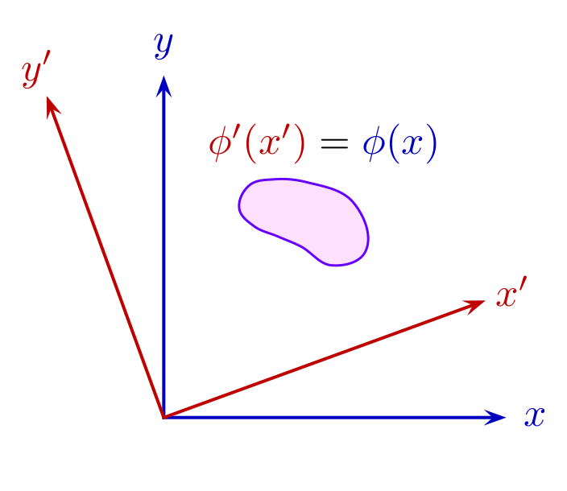

图 3.9: 在绕 $z$ 轴空间旋转变换下，标量场 $\phi(x)$ 的变换示意图。

## 3.3 量子场的 Lorentz 变换

### 3.3.1 量子标量场的 Lorentz 变换

经过正则量子化之后，标量场 $\phi(x)$ 是物理 Hilbert 空间中的算符，类似于 (3.27) 式，$\phi(x)$ 的固有保时向 Lorentz 变换关系 (2.75) 表示为

$$
\phi'(x') = U^{-1}(\Lambda)\phi(x')U(\Lambda) = \phi(x).
\tag{3.154}
$$

上式表明，变换后的标量场在变换后的时空点上的值等于变换前的标量场在变换前的时空点上的值。图 3.9 以空间旋转变换为例说明这种情况。由于 $x' = \Lambda x$ 等价于 $x = \Lambda^{-1}x'$，可以改变记号，将 (3.154) 式写作

$$
U^{-1}(\Lambda)\phi(x)U(\Lambda) = \phi(\Lambda^{-1}x).
\tag{3.155}
$$

相应地，$\phi(x)$ 在变换后的态 $|\Psi'\rangle$ 中的期待值为

$$
\langle\Psi'|\phi(x)|\Psi'\rangle = \langle\Psi|U^{-1}(\Lambda)\phi(x)U(\Lambda)|\Psi\rangle = \langle\Psi|\phi(\Lambda^{-1}x)|\Psi\rangle.
\tag{3.156}
$$

另一方面，由 (1.73) 式得 $\partial^\mu\phi(x)$ 的相应 Lorentz 变换形式为

$$
U^{-1}(\Lambda)\partial^\mu\phi(x')U(\Lambda) = \partial'^\mu\phi'(x') = \partial'^\mu\phi(x) = \Lambda^\mu{}_\nu\partial^\nu\phi(x).
\tag{3.157}
$$

于是，将实标量场量子化之后，拉氏量 (2.77) 的固有保时向 Lorentz 变换形式为

$$
\begin{aligned}
\mathcal{L}'(x') &= U^{-1}(\Lambda)\mathcal{L}(x')U(\Lambda) = \frac{1}{2}U^{-1}(\Lambda)[\partial'^\mu\phi(x')\partial'_\mu\phi(x') - m^2\phi^2(x')]U(\Lambda) \\
&= \frac{1}{2}\{g_{\mu\nu}U^{-1}(\Lambda)\partial'^\mu\phi(x')U(\Lambda)U^{-1}(\Lambda)\partial'^\nu\phi(x')U(\Lambda) - m^2[U^{-1}(\Lambda)\phi(x')U(\Lambda)]^2\} \\
&= \frac{1}{2}[g_{\mu\nu}\Lambda^\mu{}_\rho\partial^\rho\phi(x)\Lambda^\nu{}_\sigma\partial^\sigma\phi(x) - m^2\phi^2(x)] = \frac{1}{2}[g_{\rho\sigma}\partial^\rho\phi(x)\partial^\sigma\phi(x) - m^2\phi^2(x)] \\
&= \mathcal{L}(x),
\end{aligned}
\tag{3.158}
$$

倒数第二步用到保度规条件 (1.33)。从而，

$$
U^{-1}(\Lambda)\mathcal{L}(x)U(\Lambda) = \mathcal{L}(\Lambda^{-1}x).
\tag{3.159}
$$

可见，拉氏量 (2.77) 确实是一个 Lorentz 标量。

对于无穷小 Lorentz 变换 $\Lambda^\mu{}_\nu = \delta^\mu{}_\nu + \omega^\mu{}_\nu$，有

$$
\begin{aligned}
(\Lambda^{-1})^\mu{}_\nu &= g_{\nu\sigma}g^{\mu\beta}\Lambda^\sigma{}_\beta = g_{\nu\sigma}g^{\mu\beta}(\delta^\sigma{}_\beta + \omega^\sigma{}_\beta) = g_{\nu\beta}g^{\mu\beta} + g^{\mu\beta}\omega_{\nu\beta} = \delta^\mu{}_\nu - g^{\mu\beta}\omega_{\beta\nu} \\
&= \delta^\mu{}_\nu - \omega^\mu{}_\nu,
\end{aligned}
\tag{3.160}
$$

从而

$$
(\Lambda^{-1}x)^\mu = (\delta^\mu{}_\nu - \omega^\mu{}_\nu)x^\nu = x^\mu - \omega^\mu{}_\nu x^\nu.
\tag{3.161}
$$

在 $x$ 处将 (3.155) 式右边展开到 $\omega$ 的一阶项，得

$$
\begin{aligned}
\phi(\Lambda^{-1}x) &= \phi(x) - \omega^\mu{}_\nu x^\nu\partial_\mu\phi(x) = \phi(x) - \omega_{\mu\nu}x^\nu\partial^\mu\phi(x) = \phi(x) - \frac{1}{2}(\omega_{\mu\nu}x^\mu\partial^\nu + \omega_{\mu\nu}x^\nu\partial^\mu)\phi(x) \\
&= \phi(x) - \frac{\mathrm{i}}{2}\omega_{\mu\nu}\mathrm{i}(x^\mu\partial^\nu - x^\nu\partial^\mu)\phi(x) = \phi(x) - \frac{\mathrm{i}}{2}\omega_{\mu\nu}L^{\mu\nu}\phi(x),
\end{aligned}
\tag{3.162}
$$

其中微分算符 $L^{\mu\nu}$ 定义为

$$
L^{\mu\nu} \equiv \mathrm{i}(x^\mu\partial^\nu - x^\nu\partial^\mu).
\tag{3.163}
$$

根据 (3.10) 式，将 (3.155) 式左边展开到 $\omega$ 的一阶项，得

$$
\begin{aligned}
U^{-1}(\Lambda)\phi(x)U(\Lambda) &= \left(1 + \frac{\mathrm{i}}{2}\omega_{\gamma\delta}J^{\gamma\delta}\right)\phi(x)\left(1 - \frac{\mathrm{i}}{2}\omega_{\alpha\beta}J^{\alpha\beta}\right) \\
&= \phi(x) - \frac{\mathrm{i}}{2}\omega_{\alpha\beta}\phi(x)J^{\alpha\beta} + \frac{\mathrm{i}}{2}\omega_{\gamma\delta}J^{\gamma\delta}\phi(x) = \phi(x) - \frac{\mathrm{i}}{2}\omega_{\mu\nu}[\phi(x), J^{\mu\nu}].
\end{aligned}
\tag{3.164}
$$

两相比较，给出

$$
[\phi(x), J^{\mu\nu}] = L^{\mu\nu}\phi(x).
\tag{3.165}
$$

$L^{\mu\nu}$ 的纯空间分量 $L^{ij}$ 的对偶三维矢量算符为

$$
L^i \equiv \frac{1}{2}\varepsilon^{ijk}L^{jk} = \frac{\mathrm{i}}{2}\varepsilon^{ijk}(x^j\partial^k - x^k\partial^j) = \frac{\mathrm{i}}{2}(\varepsilon^{ijk}x^j\partial^k - \varepsilon^{ikj}x^j\partial^k) = \mathrm{i}\varepsilon^{ijk}x^j\partial^k,
\tag{3.166}
$$

写成三维矢量外积的形式是

$$
\mathbf{L} = -\mathrm{i}\mathbf{x} \times \nabla.
\tag{3.167}
$$

由于 $-\mathrm{i}\nabla = \hat{\mathbf{p}}$ 是动量微分算符 (2.88)，可以看出 $\mathbf{L}$ 是轨道角动量微分算符。根据 (3.35) 式，将 (3.165) 式的纯空间分量改写为

$$
[\phi(x), \mathbf{J}] = \mathbf{L}\phi(x).
\tag{3.168}
$$

上式表明，总角动量算符 $\mathbf{J}$ 生成了轨道角动量，但没有生成自旋角动量。这说明标量场没有自旋，因此标量玻色子的自旋为 0。

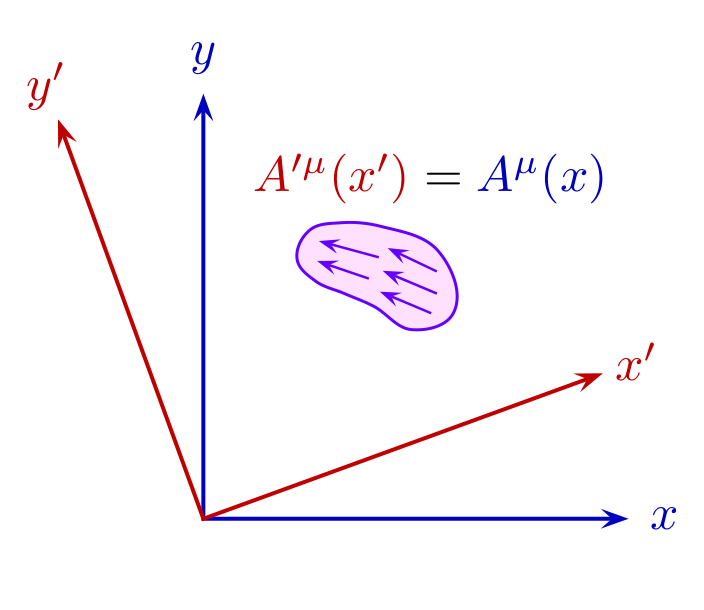

图 3.10: 在绕 $z$ 轴空间旋转变换下，矢量场 $A^\mu(x)$ 的变换示意图。

### 3.3.2 量子矢量场的 Lorentz 变换

$\partial^\mu\phi(x)$ 是通过对标量场 $\phi(x)$ 取时空导数得到的 Lorentz 矢量。自身就是 Lorentz 矢量的场 $A^\mu(x)$ 也应该具有像 (3.157) 式那样的固有保时向 Lorentz 变换形式，即

$$
A'^\mu(x') = U^{-1}(\Lambda)A^\mu(x')U(\Lambda) = \Lambda^\mu{}_\nu A^\nu(x),
\tag{3.169}
$$

或者写成

$$
U^{-1}(\Lambda)A^\mu(x)U(\Lambda) = \Lambda^\mu{}_\nu A^\nu(\Lambda^{-1}x).
\tag{3.170}
$$

这就是量子矢量场 $A^\mu(x)$ 的 Lorentz 变换形式。图 3.10 以空间旋转变换为例说明矢量场的变换情况。在 Lorentz 变换下，除了矢量场的分布区域变换到新参考系的相应区域之外，矢量场的分量也要以 Lorentz 矢量分量的身份发生变换。相应地，$A^\mu(x)$ 在 $|\Psi'\rangle$ 中的期待值为

$$
\langle\Psi'|A^\mu(x)|\Psi'\rangle = \langle\Psi|U^{-1}(\Lambda)A^\mu(x)U(\Lambda)|\Psi\rangle = \Lambda^\mu{}_\nu\langle\Psi|A^\nu(\Lambda^{-1}x)|\Psi\rangle.
\tag{3.171}
$$

根据 (3.147) 式，(3.169) 式的无穷小形式为

$$
A'^\mu(x') = \left[\delta^\mu{}_\nu - \frac{\mathrm{i}}{2}\omega_{\rho\sigma}(\mathcal{J}^{\rho\sigma})^\mu{}_\nu\right]A^\nu(x) = A^\mu(x) - \frac{\mathrm{i}}{2}\omega_{\rho\sigma}(\mathcal{J}^{\rho\sigma})^\mu{}_\nu A^\nu(x).
\tag{3.172}
$$

将上式与 (1.203) 式比较，可以发现 1.7.3 小节中的生成元 $I^{\mu\nu}$ 在矢量表示中对应于 $\mathcal{J}^{\mu\nu}$。

利用 (3.161) 式，在 $x$ 处将 $A^\nu(\Lambda^{-1}x)$ 展开到 $\omega$ 的一阶项，得

$$
\begin{aligned}
A^\nu(\Lambda^{-1}x) &= A^\nu(x) - \omega^\alpha{}_\beta x^\beta\partial_\alpha A^\nu(x) = A^\nu(x) - \omega_{\alpha\beta}x^\beta\partial^\alpha A^\nu(x) \\
&= A^\nu(x) + \frac{1}{2}\omega_{\alpha\beta}(x^\alpha\partial^\beta - x^\beta\partial^\alpha)A^\nu(x) = A^\nu(x) - \frac{\mathrm{i}}{2}\omega_{\alpha\beta}L^{\alpha\beta}A^\nu(x).
\end{aligned}
\tag{3.173}
$$

从而，(3.170) 式右边展开为

$$
\begin{aligned}
\Lambda^\mu{}_\nu A^\nu(\Lambda^{-1}x) &= \left[\delta^\mu{}_\nu - \frac{\mathrm{i}}{2}\omega_{\rho\sigma}(\mathcal{J}^{\rho\sigma})^\mu{}_\nu\right]\left[A^\nu(x) - \frac{\mathrm{i}}{2}\omega_{\alpha\beta}L^{\alpha\beta}A^\nu(x)\right] \\
&= A^\mu(x) - \frac{\mathrm{i}}{2}\omega_{\rho\sigma}[L^{\rho\sigma}A^\mu(x) + (\mathcal{J}^{\rho\sigma})^\mu{}_\nu A^\nu(x)].
\end{aligned}
\tag{3.174}
$$

另一方面，(3.170) 式左边的无穷小展开式是

$$
\begin{aligned}
U^{-1}(\Lambda)A^\mu(x)U(\Lambda) &= \left(1 + \frac{\mathrm{i}}{2}\omega_{\gamma\delta}J^{\gamma\delta}\right)A^\mu(x)\left(1 - \frac{\mathrm{i}}{2}\omega_{\alpha\beta}J^{\alpha\beta}\right) \\
&= A^\mu(x) - \frac{\mathrm{i}}{2}\omega_{\alpha\beta}A^\mu(x)J^{\alpha\beta} + \frac{\mathrm{i}}{2}\omega_{\gamma\delta}J^{\gamma\delta}A^\mu(x) = A^\mu(x) - \frac{\mathrm{i}}{2}\omega_{\rho\sigma}[A^\mu(x), J^{\rho\sigma}].
\end{aligned}
\tag{3.175}
$$

由此得到

$$
[A^\mu(x), J^{\rho\sigma}] = L^{\rho\sigma}A^\mu(x) + (\mathcal{J}^{\rho\sigma})^\mu{}_\nu A^\nu(x).
\tag{3.176}
$$

生成元矩阵 $\mathcal{J}^{\mu\nu}$ 纯空间分量的对偶三维矢量为

$$
\mathcal{J}^i \equiv \frac{1}{2}\varepsilon^{ijk}\mathcal{J}^{jk}, \quad \mathcal{J} = (\mathcal{J}^{23}, \mathcal{J}^{31}, \mathcal{J}^{12}),
\tag{3.177}
$$

满足 (3.39) 形式的对易关系 $[\mathcal{J}^i, \mathcal{J}^j] = \mathrm{i}\varepsilon^{ijk}\mathcal{J}^k$。再根据 (3.35) 和 (3.166) 式，将 (3.176) 式的纯空间分量改写为

$$
[A^\mu(x), \mathbf{J}] = \mathbf{L}A^\mu(x) + (\mathcal{J})^\mu{}_\nu A^\nu(x).
\tag{3.178}
$$

上式表明，总角动量算符 $\mathbf{J}$ 不仅生成了轨道角动量，还生成了由 $\mathcal{J}$ 描述的自旋角动量。$\mathcal{J}^i$ 的具体矩阵形式为

$$
(\mathcal{J}^1)^\mu{}_\nu = (\mathcal{J}^{23})^\mu{}_\nu = \mathrm{i}(g^{2\mu}\delta^3{}_\nu - g^{3\mu}\delta^2{}_\nu) = \begin{pmatrix} 0 & & & \\ & 0 & & \\ & & 0 & -\mathrm{i} \\ & & \mathrm{i} & 0 \end{pmatrix},
\tag{3.179}
$$

$$
(\mathcal{J}^2)^\mu{}_\nu = (\mathcal{J}^{31})^\mu{}_\nu = \mathrm{i}(g^{3\mu}\delta^1{}_\nu - g^{1\mu}\delta^3{}_\nu) = \begin{pmatrix} 0 & & & \\ & 0 & & \mathrm{i} \\ & & 0 & \\ & -\mathrm{i} & & 0 \end{pmatrix},
\tag{3.180}
$$

$$
(\mathcal{J}^3)^\mu{}_\nu = (\mathcal{J}^{12})^\mu{}_\nu = \mathrm{i}(g^{1\mu}\delta^2{}_\nu - g^{2\mu}\delta^1{}_\nu) = \begin{pmatrix} 0 & & & \\ & 0 & -\mathrm{i} & \\ & \mathrm{i} & 0 & \\ & & & 0 \end{pmatrix}.
\tag{3.181}
$$

只关注纯空间部分，有

$$
(\mathcal{J}^1\mathcal{J}^1)^i{}_j = \begin{pmatrix} 0 & & \\ & 1 & \\ & & 1 \end{pmatrix}, \quad (\mathcal{J}^2\mathcal{J}^2)^i{}_j = \begin{pmatrix} 1 & & \\ & 0 & \\ & & 1 \end{pmatrix}, \quad (\mathcal{J}^3\mathcal{J}^3)^i{}_j = \begin{pmatrix} 1 & & \\ & 1 & \\ & & 0 \end{pmatrix}.
\tag{3.182}
$$

因此

$$
(\mathcal{J}^2)^i{}_j = (\mathcal{J}^1\mathcal{J}^1 + \mathcal{J}^2\mathcal{J}^2 + \mathcal{J}^3\mathcal{J}^3)^i{}_j = \begin{pmatrix} 2 & & \\ & 2 & \\ & & 2 \end{pmatrix} = 2\delta^i{}_j.
\tag{3.183}
$$

根据 $\mathrm{SU}(2)$ 群表示理论，二阶 Casimir 算符 $\mathcal{J}^2$ 的本征值为 $s(s+1)$，即 $(\mathcal{J}^2)^i{}_j = s(s+1)\delta^i{}_j$，其中 $s$ 为自旋量子数。可见，矢量场 $A^\mu(x)$ 空间分量的自旋量子数为

$$
s = 1.
\tag{3.184}
$$

量子化之后，矢量场 $A^\mu(x)$ 描述自旋为 1 的粒子。实际上，$\mathcal{J}^1$、$\mathcal{J}^2$ 和 $\mathcal{J}^3$ 的纯空间部分是 $\mathrm{SO}(3)$ 群基础表示 $D^{(1)}$ 的生成元，而 $D^{(1)}$ 也是 $\mathrm{SU}(2)$ 群的伴随表示。

## 3.4 有质量矢量场的正则量子化

类似于电磁场，对任意矢量场 $A^\mu$ 定义反对称的场强张量

$$
F^{\mu\nu} = -F^{\nu\mu} \equiv \partial^\mu A^\nu - \partial^\nu A^\mu.
\tag{3.185}
$$

对于一个自由的有质量的实矢量场 $A^\mu$，Lorentz 不变的拉氏量写作

$$
\mathcal{L} = -\frac{1}{4}F_{\mu\nu}F^{\mu\nu} + \frac{1}{2}m^2 A_\mu A^\mu.
\tag{3.186}
$$

其中，第一项是动能项，第二项是质量项，而 $m > 0$ 是矢量场的质量。动能项可用 $A^\mu$ 表达成

$$
\begin{aligned}
-\frac{1}{4}F_{\mu\nu}F^{\mu\nu} &= -\frac{1}{4}(\partial_\mu A_\nu - \partial_\nu A_\mu)(\partial^\mu A^\nu - \partial^\nu A^\mu) \\
&= -\frac{1}{4}[(\partial_\mu A_\nu)\partial^\mu A^\nu - (\partial_\mu A_\nu)\partial^\nu A^\mu - (\partial_\nu A_\mu)\partial^\mu A^\nu + (\partial_\nu A_\mu)\partial^\nu A^\mu] \\
&= -\frac{1}{2}(\partial_\mu A_\nu)\partial^\mu A^\nu + \frac{1}{2}(\partial_\nu A_\mu)\partial^\mu A^\nu.
\end{aligned}
\tag{3.187}
$$

从而

$$
\frac{\partial\mathcal{L}}{\partial(\partial_\mu A_\nu)} = -\partial^\mu A^\nu + \partial^\nu A^\mu = -F^{\mu\nu}, \quad \frac{\partial\mathcal{L}}{\partial A_\nu} = m^2 A^\nu.
\tag{3.188}
$$

Euler-Lagrange 方程 (1.142) 给出

$$
0 = \partial_\mu\frac{\partial\mathcal{L}}{\partial(\partial_\mu A_\nu)} - \frac{\partial\mathcal{L}}{\partial A_\nu} = -\partial_\mu F^{\mu\nu} - m^2 A^\nu,
\tag{3.189}
$$

因此，$A^\mu$ 的经典运动方程是 Proca 方程 [14]

$$
\partial_\mu F^{\mu\nu} + m^2 A^\nu = 0.
\tag{3.190}
$$

由 $\partial_\nu\partial_\mu F^{\mu\nu} = -\partial_\nu\partial_\mu F^{\nu\mu} = -\partial_\mu\partial_\nu F^{\nu\mu} = -\partial_\nu\partial_\mu F^{\mu\nu}$ 可知，

$$
\partial_\nu\partial_\mu F^{\mu\nu} = 0.
\tag{3.191}
$$

从 Proca 方程 (3.190) 得到

$$
0 = \partial_\nu(\partial_\mu F^{\mu\nu} + m^2 A^\nu) = \partial_\nu\partial_\mu F^{\mu\nu} + m^2\partial_\nu A^\nu = m^2\partial_\nu A^\nu.
\tag{3.192}
$$

质量 $m \neq 0$ 意味着矢量场 $A^\mu$ 应当满足 Lorentz 条件

$$
\partial_\mu A^\mu = 0.
\tag{3.193}
$$

从而

$$
\partial_\mu F^{\mu\nu} = \partial_\mu(\partial^\mu A^\nu - \partial^\nu A^\mu) = \partial^2 A^\nu - \partial^\nu\partial_\mu A^\mu = \partial^2 A^\nu.
\tag{3.194}
$$

因此，Proca 方程 (3.190) 等价于符合 Lorenz 条件的 Klein-Gordon 方程

$$
(\partial^2 + m^2)A^\mu(x) = 0.
\tag{3.195}
$$

根据 (1.143) 式，$A^\mu$ 对应的共轭动量密度为

$$
\pi_\mu = \frac{\partial\mathcal{L}}{\partial(\partial^0 A^\mu)} = -\partial_0 A_\mu + \partial_\mu A_0 = -F_{0\mu},
\tag{3.196}
$$

时间分量和空间分量分别是

$$
\pi_0 = -F_{00} = 0, \quad \pi_i = -\partial_0 A_i + \partial_i A_0 = -F_{0i}.
\tag{3.197}
$$

由于 $\pi_0 = 0$，它不能作为与 $A^0$ 对应的正则共轭场，因而不能为 $A^0$ 构造正则对易关系。实际上，由于 Lorenz 条件 (3.193) 的存在，$A^\mu$ 只有 3 个独立分量，我们可以将 $A^0$ 视作依赖于 3 个空间分量 $A^i$ 的量。于是，正则量子化程序要求独立的正则变量满足等时对易关系

$$
[A^i(\mathbf{x}, t), \pi_j(\mathbf{y}, t)] = \mathrm{i}\delta^i{}_j\delta^{(3)}(\mathbf{x} - \mathbf{y}), \quad [A^i(\mathbf{x}, t), A^j(\mathbf{y}, t)] = [\pi_i(\mathbf{x}, t), \pi_j(\mathbf{y}, t)] = 0.
\tag{3.198}
$$

由 (3.197) 式有

$$
\pi^i = -\partial^0 A^i + \partial^i A^0 = -F^{0i} = F^{i0},
\tag{3.199}
$$

写成空间矢量的形式为

$$
\boldsymbol{\pi} = -\dot{\mathbf{A}} - \nabla A_0,
\tag{3.200}
$$

故

$$
\dot{\mathbf{A}} = -\boldsymbol{\pi} - \nabla A_0.
\tag{3.201}
$$

对 Proca 方程 (3.190) 取 $\nu = 0$，得 $\partial_\mu F^{\mu0} + m^2 A^0 = 0$，因此

$$
A^0 = -\frac{1}{m^2}\partial_\mu F^{\mu0} = -\frac{1}{m^2}\partial_i F^{i0} = -\frac{1}{m^2}\partial_i\pi^i = -\frac{1}{m^2}\nabla\cdot\boldsymbol{\pi}.
\tag{3.202}
$$

通过上式可将 $A^0$ 表达为 $\boldsymbol{\pi}$ 的函数。

### 3.4.1 极化矢量与平面波展开

$A^\mu(x)$ 既然满足 Klein-Gordon 方程，应该具有两个平面波解，即正能量解 $\exp(-\mathrm{i}p\cdot x)$ 和负能解 $\exp(\mathrm{i}p\cdot x)$。由于 $A^\mu(x)$ 带有一个 Lorentz 矢量指标，平面波展开式的系数也必须具有一个这样的指标。一般地，对于确定的动量 $\mathbf{p}$，矢量场的正能量解模式具有如下形式：

$$
\varphi^\mu(x, \mathbf{p}, \sigma) = e^\mu(\mathbf{p}, \sigma)\exp(-\mathrm{i}p\cdot x), \quad p^0 = E_{\mathbf{p}} = \sqrt{|\mathbf{p}|^2 + m^2}.
\tag{3.203}
$$

这里的系数 $e^\mu(\mathbf{p}, \sigma)$ 是 Lorentz 矢量，称为极化矢量 (polarization vector)，它依赖于动量 $\mathbf{p}$，而且具有另外一个指标 $\sigma$ 以描述矢量粒子的极化态。我们希望一组极化矢量能够构成 Lorentz 矢量空间的一组基底，从而用它们可以展开一个任意的 Lorentz 矢量。为了做到这一点，一组极化矢量应当是线性独立且正交完备的。Lorentz 矢量空间是一个 4 维线性空间，因而这样的极化矢量应当有 4 个，包括 1 个类时的极化矢量 $e^\mu(\mathbf{p}, 0)$ 与 3 个类空的极化矢量 $e^\mu(\mathbf{p}, 1)$、$e^\mu(\mathbf{p}, 2)$ 和 $e^\mu(\mathbf{p}, 3)$。

在没有额外约束的情况下，我们要求这 4 个极化矢量是实的，而且满足 Lorentz 矢量空间中的正交归一关系

$$
e_\mu(\mathbf{p}, \sigma)e^\mu(\mathbf{p}, \sigma') = g_{\sigma\sigma'}.
\tag{3.204}
$$

进一步，要求这组极化矢量满足完备性关系

$$
\sum_{\sigma=0}^{3}g_{\sigma\sigma}e_\mu(\mathbf{p}, \sigma)e_\nu(\mathbf{p}, \sigma) = g_{\mu\nu}.
\tag{3.205}
$$

从而，以极化矢量为基底可将任意 Lorentz 矢量 $V_\mu$ 展开成

$$
V_\mu = g_{\mu\nu}V^\nu = \sum_{\sigma=0}^{3}g_{\sigma\sigma}e_\mu(\mathbf{p}, \sigma)e_\nu(\mathbf{p}, \sigma)V^\nu = \sum_{\sigma=0}^{3}v_\sigma(\mathbf{p})e_\mu(\mathbf{p}, \sigma),
\tag{3.206}
$$

其中展开系数 $v_\sigma(\mathbf{p}) \equiv g_{\sigma\sigma}e_\nu(\mathbf{p}, \sigma)V^\nu$。也就是说，这组极化矢量是完备的。

正交归一关系 (3.204) 和完备性关系 (3.205) 都是 Lorentz 协变的。只要在某个惯性系中取定一组符合这两个关系的极化矢量，通过 Lorentz 变换就可以在其它惯性系中得到依然满足这两个关系的一组极化矢量。

现在，我们根据与动量 $p^\mu$ 的关系选择一组极化矢量。首先，选取 2 个只有空间分量的类空横向极化矢量

$$
e^\mu(\mathbf{p}, 1) = (0, \mathbf{e}(\mathbf{p}, 1)), \quad e^\mu(\mathbf{p}, 2) = (0, \mathbf{e}(\mathbf{p}, 2)).
\tag{3.207}
$$

此处

$$
\mathbf{e}(\mathbf{p}, 1) = \frac{1}{|\mathbf{p}||\mathbf{p}_{\mathrm{T}}|}(p^1p^3, p^2p^3, -|\mathbf{p}_{\mathrm{T}}|^2), \quad \mathbf{e}(\mathbf{p}, 2) = \frac{1}{|\mathbf{p}_{\mathrm{T}}|}(-p^2, p^1, 0),
\tag{3.208}
$$

其中

$$
|\mathbf{p}_{\mathrm{T}}| \equiv \sqrt{(p^1)^2 + (p^2)^2}.
\tag{3.209}
$$

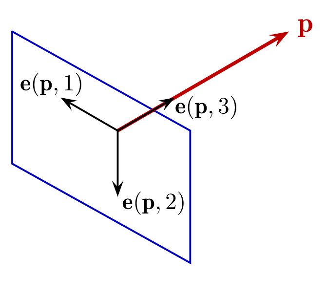

图 3.11: 极化矢量方向与动量方向示意图，$\mathbf{p}$ 垂直于 $\mathbf{e}(\mathbf{p}, 1)$ 和 $\mathbf{e}(\mathbf{p}, 2)$ 决定的平面。

“横向”指的是它们在三维空间中与 $\mathbf{p}$ 垂直，即

$$
\mathbf{p}\cdot\mathbf{e}(\mathbf{p}, 1) = \frac{1}{|\mathbf{p}||\mathbf{p}_{\mathrm{T}}|}[(p^1)^2p^3 + (p^2)^2p^3 - p^3|\mathbf{p}_{\mathrm{T}}|^2] = 0,
\tag{3.210}
$$

$$
\mathbf{p}\cdot\mathbf{e}(\mathbf{p}, 2) = \frac{1}{|\mathbf{p}_{\mathrm{T}}|}(-p^1p^2 + p^2p^1) = 0.
\tag{3.211}
$$

此外，存在如下关系：

$$
\begin{aligned}
\mathbf{e}(\mathbf{p}, 1)\cdot\mathbf{e}(\mathbf{p}, 1) &= \frac{1}{|\mathbf{p}|^2|\mathbf{p}_{\mathrm{T}}|^2}[(p^1)^2(p^3)^2 + (p^2)^2(p^3)^2 + |\mathbf{p}_{\mathrm{T}}|^4] \\
&= \frac{1}{|\mathbf{p}|^2|\mathbf{p}_{\mathrm{T}}|^2}|\mathbf{p}_{\mathrm{T}}|^2[(p^3)^2 + |\mathbf{p}_{\mathrm{T}}|^2] = 1,
\end{aligned}
\tag{3.212}
$$

$$
\mathbf{e}(\mathbf{p}, 2)\cdot\mathbf{e}(\mathbf{p}, 2) = \frac{1}{|\mathbf{p}_{\mathrm{T}}|^2}[(p^2)^2 + (p^1)^2] = 1,
\tag{3.213}
$$

$$
\mathbf{e}(\mathbf{p}, 1)\cdot\mathbf{e}(\mathbf{p}, 2) = \frac{1}{|\mathbf{p}||\mathbf{p}_{\mathrm{T}}|^2}(-p^1p^3p^2 + p^2p^3p^1) = 0.
\tag{3.214}
$$

也就是说，它们在三维空间中是正交归一的：

$$
\mathbf{e}(\mathbf{p}, i)\cdot\mathbf{e}(\mathbf{p}, j) = \delta_{ij}, \quad i, j = 1, 2.
\tag{3.215}
$$

因此，这两个横向极化矢量满足四维横向条件

$$
p_\mu e^\mu(\mathbf{p}, 1) = p_\mu e^\mu(\mathbf{p}, 2) = 0,
\tag{3.216}
$$

和正交归一关系

$$
e_\mu(\mathbf{p}, i)e^\mu(\mathbf{p}, j) = -\mathbf{e}(\mathbf{p}, i)\cdot\mathbf{e}(\mathbf{p}, j) = -\delta_{ij} = g_{ij}, \quad i, j = 1, 2.
\tag{3.217}
$$

图 3.11 示意性地画出 $\mathbf{p}$、$\mathbf{e}(\mathbf{p}, 1)$ 和 $\mathbf{e}(\mathbf{p}, 2)$，它们在三维空间中两两相互垂直。

接着，要求第 3 个类空极化矢量 $e^\mu(\mathbf{p}, 3)$ 是纵向的，即在三维空间中与 $\mathbf{p}$ 平行，如图 3.11 所示。这样还不能确定它的时间分量，为此进一步要求它满足四维横向条件 $p_\mu e^\mu(\mathbf{p}, 3) = 0$，而正交归一关系 (3.204) 将决定它的归一化。于是，纵向极化矢量的形式为

$$
e^\mu(\mathbf{p}, 3) = \left(\frac{|\mathbf{p}|}{m}, \frac{p^0\mathbf{p}}{m|\mathbf{p}|}\right).
\tag{3.218}
$$

容易验证，它确实满足四维横向条件

$$
p_\mu e^\mu(\mathbf{p}, 3) = p^0\frac{|\mathbf{p}|}{m} - \mathbf{p}\cdot\frac{p^0\mathbf{p}}{m|\mathbf{p}|} = \frac{p^0|\mathbf{p}|}{m} - \frac{p^0|\mathbf{p}|}{m} = 0,
\tag{3.219}
$$

和正交归一关系

$$
e_\mu(\mathbf{p}, 3)e^\mu(\mathbf{p}, 3) = \frac{|\mathbf{p}|}{m}\frac{|\mathbf{p}|}{m} - \frac{(p^0)^2}{m^2|\mathbf{p}|^2}\mathbf{p}\cdot\mathbf{p} = \frac{|\mathbf{p}|^2}{m^2} - \frac{(p^0)^2}{m^2} = -\frac{(p^0)^2 - |\mathbf{p}|^2}{m^2} = -1 = g_{33};
\tag{3.220}
$$

$$
e_\mu(\mathbf{p}, 3)e^\mu(\mathbf{p}, i) = -\frac{p^0}{m|\mathbf{p}|}\mathbf{p}\cdot\mathbf{e}(\mathbf{p}, i) = 0, \quad i = 1, 2.
\tag{3.221}
$$

最后，我们可以将类时极化矢量取为正比于 $p^\mu$ 的矢量

$$
e^\mu(\mathbf{p}, 0) = \frac{1}{m}p^\mu = \frac{1}{m}(p^0, \mathbf{p}).
\tag{3.222}
$$

它符合归一关系

$$
e_\mu(\mathbf{p}, 0)e^\mu(\mathbf{p}, 0) = \frac{p^2}{m^2} = 1 = g_{00},
\tag{3.223}
$$

而且与满足四维横向条件的 3 个类空极化矢量正交，

$$
e_\mu(\mathbf{p}, 0)e^\mu(\mathbf{p}, i) = \frac{1}{m}p_\mu e^\mu(\mathbf{p}, i) = 0, \quad i = 1, 2, 3.
\tag{3.224}
$$

不过，$e^\mu(\mathbf{p}, 0)$ 不满足四维横向条件，

$$
p_\mu e^\mu(\mathbf{p}, 0) = \frac{p^2}{m} = m \neq 0.
\tag{3.225}
$$

实际上，我们找不到满足四维横向条件的类时极化矢量。原因在于，总可以取一个特殊惯性系使 $p^\mu = (m, \mathbf{0})$，而类时极化矢量 $e^\mu(\mathbf{p}, 0)$ 的时间分量一定非零，故 $p_\mu e^\mu(\mathbf{p}, 0) = me^0(\mathbf{p}, 0) \neq 0$。由于四维横向条件是 Lorentz 不变的，在任意惯性系中均有 $p_\mu e^\mu(\mathbf{p}, 0) \neq 0$。

可以验证，由 (3.207)、(3.208)、(3.218) 和 (3.222) 式定义的这组极化矢量确实满足完备性关系 (3.205)：

$$
\begin{aligned}
&\sum_{\sigma=0}^{3}g_{\sigma\sigma}e_\mu(\mathbf{p}, \sigma)e_\nu(\mathbf{p}, \sigma) \\
&= e_\mu(\mathbf{p}, 0)e_\nu(\mathbf{p}, 0) - e_\mu(\mathbf{p}, 1)e_\nu(\mathbf{p}, 1) - e_\mu(\mathbf{p}, 2)e_\nu(\mathbf{p}, 2) - e_\mu(\mathbf{p}, 3)e_\nu(\mathbf{p}, 3) \\
&= \frac{1}{m^2}\begin{pmatrix} p^0p^0 & -p^0p^1 & -p^0p^2 & -p^0p^3 \\ -p^1p^0 & p^1p^1 & p^1p^2 & p^1p^3 \\ -p^2p^0 & p^2p^1 & p^2p^2 & p^2p^3 \\ -p^3p^0 & p^3p^1 & p^3p^2 & p^3p^3 \end{pmatrix} \\
&\quad - \frac{1}{|\mathbf{p}|^2|\mathbf{p}_{\mathrm{T}}|^2}\begin{pmatrix} 0 & 0 & 0 & 0 \\ 0 & p^1p^3p^1p^3 & p^1p^3p^2p^3 & -p^1p^3|\mathbf{p}_{\mathrm{T}}|^2 \\ 0 & p^2p^3p^1p^3 & p^2p^3p^2p^3 & -p^2p^3|\mathbf{p}_{\mathrm{T}}|^2 \\ 0 & -|\mathbf{p}_{\mathrm{T}}|^2p^1p^3 & -|\mathbf{p}_{\mathrm{T}}|^2p^2p^3 & |\mathbf{p}_{\mathrm{T}}|^4 \end{pmatrix} \\
&\quad - \frac{1}{|\mathbf{p}_{\mathrm{T}}|^2}\begin{pmatrix} 0 & 0 & 0 & 0 \\ 0 & p^2p^2 & -p^2p^1 & 0 \\ 0 & -p^1p^2 & p^1p^1 & 0 \\ 0 & 0 & 0 & 0 \end{pmatrix} \\
&\quad - \frac{1}{m^2}\begin{pmatrix} |\mathbf{p}|^2 & -p^0p^1 & -p^0p^2 & -p^0p^3 \\ -p^0p^1 & \frac{(p^0)^2}{|\mathbf{p}|^2}p^1p^1 & \frac{(p^0)^2}{|\mathbf{p}|^2}p^1p^2 & \frac{(p^0)^2}{|\mathbf{p}|^2}p^1p^3 \\ -p^0p^2 & \frac{(p^0)^2}{|\mathbf{p}|^2}p^2p^1 & \frac{(p^0)^2}{|\mathbf{p}|^2}p^2p^2 & \frac{(p^0)^2}{|\mathbf{p}|^2}p^2p^3 \\ -p^0p^3 & \frac{(p^0)^2}{|\mathbf{p}|^2}p^3p^1 & \frac{(p^0)^2}{|\mathbf{p}|^2}p^3p^2 & \frac{(p^0)^2}{|\mathbf{p}|^2}p^3p^3 \end{pmatrix} \\
&= \begin{pmatrix} 1 & 0 & 0 & 0 \\ 0 & \frac{(p^1)^2}{m^2}\left[1 - \frac{(p^0)^2}{|\mathbf{p}|^2}\right] - \frac{(p^1p^3)^2 + (p^2)^2|\mathbf{p}|^2}{|\mathbf{p}|^2|\mathbf{p}_{\mathrm{T}}|^2} & \frac{p^1p^2}{m^2}\left[1 - \frac{(p^0)^2}{|\mathbf{p}|^2}\right] - \frac{p^1p^2[(p^3)^2 - |\mathbf{p}|^2]}{|\mathbf{p}|^2|\mathbf{p}_{\mathrm{T}}|^2} & \frac{p^1p^3}{m^2}\left[1 - \frac{(p^0)^2}{|\mathbf{p}|^2}\right] + \frac{p^1p^3}{|\mathbf{p}|^2} \\ 0 & \frac{p^1p^2}{m^2}\left[1 - \frac{(p^0)^2}{|\mathbf{p}|^2}\right] - \frac{p^1p^2[(p^3)^2 - |\mathbf{p}|^2]}{|\mathbf{p}|^2|\mathbf{p}_{\mathrm{T}}|^2} & \frac{(p^2)^2}{m^2}\left[1 - \frac{(p^0)^2}{|\mathbf{p}|^2}\right] - \frac{(p^2p^3)^2 + (p^1)^2|\mathbf{p}|^2}{|\mathbf{p}|^2|\mathbf{p}_{\mathrm{T}}|^2} & \frac{p^2p^3}{m^2}\left[1 - \frac{(p^0)^2}{|\mathbf{p}|^2}\right] + \frac{p^2p^3}{|\mathbf{p}|^2} \\ 0 & \frac{p^1p^3}{m^2}\left[1 - \frac{(p^0)^2}{|\mathbf{p}|^2}\right] + \frac{p^1p^3}{|\mathbf{p}|^2} & \frac{p^2p^3}{m^2}\left[1 - \frac{(p^0)^2}{|\mathbf{p}|^2}\right] + \frac{p^2p^3}{|\mathbf{p}|^2} & \frac{(p^3)^2}{m^2}\left[1 - \frac{(p^0)^2}{|\mathbf{p}|^2}\right] - \frac{|\mathbf{p}_{\mathrm{T}}|^2}{|\mathbf{p}|^2} \end{pmatrix} \\
&= \begin{pmatrix} 1 & 0 & 0 & 0 \\ 0 & -\frac{(p^1)^2|\mathbf{p}_{\mathrm{T}}|^2 + (p^1)^2(|\mathbf{p}|^2 - |\mathbf{p}_{\mathrm{T}}|^2) + (p^2)^2|\mathbf{p}|^2}{|\mathbf{p}|^2|\mathbf{p}_{\mathrm{T}}|^2} & -\frac{p^1p^2}{|\mathbf{p}|^2} + \frac{p^1p^2}{|\mathbf{p}|^2} & -\frac{p^1p^3}{|\mathbf{p}|^2} + \frac{p^1p^3}{|\mathbf{p}|^2} \\ 0 & -\frac{p^1p^2}{|\mathbf{p}|^2} + \frac{p^1p^2}{|\mathbf{p}|^2} & -\frac{(p^2)^2|\mathbf{p}_{\mathrm{T}}|^2 + (p^2)^2(|\mathbf{p}|^2 - |\mathbf{p}_{\mathrm{T}}|^2) + (p^1)^2|\mathbf{p}|^2}{|\mathbf{p}|^2|\mathbf{p}_{\mathrm{T}}|^2} & -\frac{p^2p^3}{|\mathbf{p}|^2} + \frac{p^2p^3}{|\mathbf{p}|^2} \\ 0 & -\frac{p^1p^3}{|\mathbf{p}|^2} + \frac{p^1p^3}{|\mathbf{p}|^2} & -\frac{p^2p^3}{|\mathbf{p}|^2} + \frac{p^2p^3}{|\mathbf{p}|^2} & -\frac{(p^3)^2 + |\mathbf{p}_{\mathrm{T}}|^2}{|\mathbf{p}|^2} \end{pmatrix} \\
&= \begin{pmatrix} 1 & 0 & 0 & 0 \\ 0 & -1 & 0 & 0 \\ 0 & 0 & -1 & 0 \\ 0 & 0 & 0 & -1 \end{pmatrix} = g_{\mu\nu}.
\end{aligned}
\tag{3.226}
$$

当四维动量作 Lorentz 变换 $p^\mu \to \Lambda^\mu{}_\nu p^\nu$ 时，这组极化矢量作相应的 Lorentz 变换 $e^\mu(\mathbf{p}, \sigma) \to \Lambda^\mu{}_\nu e^\nu(\mathbf{p}, \sigma)$，从而保持正交归一关系 (3.204)、完备性关系 (3.205) 和四维横向条件 (3.216) 和 (3.219)。

由于有质量矢量场 $A^\mu$ 必须满足 Lorenz 条件 (3.193)，正能量解模式 (3.203) 应满足

$$
0 = \partial_\mu\varphi^\mu(x, \mathbf{p}, \sigma) = -\mathrm{i}p_\mu e^\mu(\mathbf{p}, \sigma)\exp(-\mathrm{i}p\cdot x),
\tag{3.227}
$$

即

$$
p_\mu e^\mu(\mathbf{p}, \sigma) = 0.
\tag{3.228}
$$

也就是说，描述有质量矢量场的极化矢量必须满足四维横向条件。因此，类时极化矢量 $e^\mu(\mathbf{p}, 0)$ 不能用于描述有质量矢量场 $A^\mu$。这说明 $A^\mu$ 只有 3 个物理的极化状态，由类空的极化矢量 $e^\mu(\mathbf{p}, 1)$、$e^\mu(\mathbf{p}, 2)$ 和 $e^\mu(\mathbf{p}, 3)$ 描述。根据完备性关系 (3.205)，这三个物理极化矢量满足

$$
-\sum_{\sigma=1}^{3}e_\mu(\mathbf{p}, \sigma)e_\nu(\mathbf{p}, \sigma) = \sum_{\sigma=1}^{3}g_{\sigma\sigma}e_\mu(\mathbf{p}, \sigma)e_\nu(\mathbf{p}, \sigma) = g_{\mu\nu} - g_{00}e_\mu(\mathbf{p}, 0)e_\nu(\mathbf{p}, 0) = g_{\mu\nu} - \frac{p_\mu p_\nu}{m^2},
\tag{3.229}
$$

即具有求和关系

$$
\sum_{\sigma=1}^{3}e_\mu(\mathbf{p}, \sigma)e_\nu(\mathbf{p}, \sigma) = -g_{\mu\nu} + \frac{p_\mu p_\nu}{m^2}.
\tag{3.230}
$$

通过线性组合定义另一套物理的极化矢量 $\varepsilon^\mu(\mathbf{p}, \lambda)$，其中 $\lambda = +, 0, -$：

$$
\varepsilon^\mu(\mathbf{p}, \pm) \equiv \frac{1}{\sqrt{2}}[\mp e^\mu(\mathbf{p}, 1) - \mathrm{i}e^\mu(\mathbf{p}, 2)],
\tag{3.231}
$$

$$
\varepsilon^\mu(\mathbf{p}, 0) \equiv e^\mu(\mathbf{p}, 3).
\tag{3.232}
$$

这样定义的 $\varepsilon^\mu(\mathbf{p}, \pm)$ 是复的，而 $\varepsilon^\mu(\mathbf{p}, 0)$ 是实的。它们都满足四维横向条件

$$
p_\mu\varepsilon^\mu(\mathbf{p}, \lambda) = 0, \quad \lambda = \pm, 0.
\tag{3.233}
$$

它们还满足

$$
\begin{aligned}
\varepsilon_\mu^*(\mathbf{p}, \pm)\varepsilon^\mu(\mathbf{p}, \pm) &= \frac{1}{2}[\mp e_\mu(\mathbf{p}, 1) + \mathrm{i}e_\mu(\mathbf{p}, 2)][\mp e^\mu(\mathbf{p}, 1) - \mathrm{i}e^\mu(\mathbf{p}, 2)] \\
&= \frac{1}{2}e_\mu(\mathbf{p}, 1)e^\mu(\mathbf{p}, 1) + \frac{1}{2}e_\mu(\mathbf{p}, 2)e^\mu(\mathbf{p}, 2) = \frac{1}{2}(g_{11} + g_{22}) = -1,
\end{aligned}
\tag{3.234}
$$

$$
\begin{aligned}
\varepsilon_\mu^*(\mathbf{p}, \pm)\varepsilon^\mu(\mathbf{p}, \mp) &= \frac{1}{2}[\mp e_\mu(\mathbf{p}, 1) + \mathrm{i}e_\mu(\mathbf{p}, 2)][\pm e^\mu(\mathbf{p}, 1) - \mathrm{i}e^\mu(\mathbf{p}, 2)] \\
&= -\frac{1}{2}e_\mu(\mathbf{p}, 1)e^\mu(\mathbf{p}, 1) + \frac{1}{2}e_\mu(\mathbf{p}, 2)e^\mu(\mathbf{p}, 2) = \frac{1}{2}(-g_{11} + g_{22}) = 0,
\end{aligned}
\tag{3.235}
$$

$$
\varepsilon_\mu^*(\mathbf{p}, 0)\varepsilon^\mu(\mathbf{p}, 0) = e_\mu(\mathbf{p}, 3)e^\mu(\mathbf{p}, 3) = -1,
\tag{3.236}
$$

$$
\varepsilon_\mu^*(\mathbf{p}, \pm)\varepsilon^\mu(\mathbf{p}, 0) = \frac{1}{2}[\mp e_\mu(\mathbf{p}, 1) + \mathrm{i}e_\mu(\mathbf{p}, 2)]e^\mu(\mathbf{p}, 3) = 0,
\tag{3.237}
$$

即具有正交归一关系

$$
\varepsilon_\mu^*(\mathbf{p}, \lambda)\varepsilon^\mu(\mathbf{p}, \lambda') = -\delta_{\lambda\lambda'}.
\tag{3.238}
$$

极化矢量求和关系则是

$$
\begin{aligned}
\sum_{\lambda=\pm,0}\varepsilon_\mu^*(\mathbf{p}, \lambda)\varepsilon_\nu(\mathbf{p}, \lambda) &= \frac{1}{2}[e_\mu(\mathbf{p}, 1) + \mathrm{i}e_\mu(\mathbf{p}, 2)][e_\nu(\mathbf{p}, 1) - \mathrm{i}e_\nu(\mathbf{p}, 2)] \\
&\quad + \frac{1}{2}[-e_\mu(\mathbf{p}, 1) + \mathrm{i}e_\mu(\mathbf{p}, 2)][-e_\nu(\mathbf{p}, 1) - \mathrm{i}e_\nu(\mathbf{p}, 2)] + e_\mu(\mathbf{p}, 3)e_\nu(\mathbf{p}, 3) \\
&= e_\mu(\mathbf{p}, 1)e_\nu(\mathbf{p}, 1) + e_\mu(\mathbf{p}, 2)e_\nu(\mathbf{p}, 2) + e_\mu(\mathbf{p}, 3)e_\nu(\mathbf{p}, 3) \\
&= \sum_{\sigma=1}^{3}e_\mu(\mathbf{p}, \sigma)e_\nu(\mathbf{p}, \sigma),
\end{aligned}
\tag{3.239}
$$

与 (3.230) 式左边相等，故

$$
\sum_{\lambda=\pm,0}\varepsilon_\mu^*(\mathbf{p}, \lambda)\varepsilon_\nu(\mathbf{p}, \lambda) = -g_{\mu\nu} + \frac{p_\mu p_\nu}{m^2}.
\tag{3.240}
$$

这个等式是 Lorentz 协变的，四维横向条件 (3.233) 体现为

$$
p^\nu\sum_{\lambda=\pm,0}\varepsilon_\mu^*(\mathbf{p}, \lambda)\varepsilon_\nu(\mathbf{p}, \lambda) = -p_\mu + \frac{p_\mu p^2}{m^2} = -p_\mu + p_\mu = 0.
\tag{3.241}
$$

实际上，横向实极化矢量 $e^\mu(\mathbf{p}, 1)$ 和 $e^\mu(\mathbf{p}, 2)$ 描述矢量场的线极化，振动方向被限制在由 $e^\mu(\mathbf{p}, 1)$ 或 $e^\mu(\mathbf{p}, 2)$ 与 $\mathbf{p}$ 决定的平面上。另一方面，横向复极化矢量 $\varepsilon^\mu(\mathbf{p}, +)$ 和 $\varepsilon^\mu(\mathbf{p}, -)$ 描述矢量场的圆极化，定义式 (3.231) 中线性组合系数之比 $\mp\mathrm{i} = \mathrm{e}^{\mp\mathrm{i}\pi/2}$ 意味着圆极化由两个相位差为 $\pm\pi/2$ 的线极化所合成。

3.1.3 小节提到，螺旋度是粒子的自旋角动量在动量方向上的投影。对于自旋为 1 的有质量粒子，螺旋度本征值的取值包括 $-1$、0 和 $+1$，对应于 3 种自旋极化态。动量 $\mathbf{p}$ 的方向由 $\hat{\mathbf{p}} \equiv \mathbf{p}/|\mathbf{p}|$ 表征，于是，在 Lorentz 群矢量表示中，螺旋度矩阵定义为

$$
\hat{\mathbf{p}}\cdot\mathcal{J} = \frac{1}{|\mathbf{p}|}\mathbf{p}\cdot\mathcal{J} = \frac{1}{|\mathbf{p}|}\begin{pmatrix} 0 & -\mathrm{i}p^3 & \mathrm{i}p^2 \\ \mathrm{i}p^3 & 0 & -\mathrm{i}p^1 \\ -\mathrm{i}p^2 & \mathrm{i}p^1 & 0 \end{pmatrix}.
\tag{3.242}
$$

这里已经使用了 $\mathcal{J}$ 的矩阵表达式 (3.179)、(3.180) 和 (3.181)。将 (3.208) 和 (3.218) 式代入 (3.231) 和 (3.232) 式，得到 $\varepsilon^\mu(\mathbf{p}, \lambda)$ 的列矢量形式为

$$
\begin{aligned}
\varepsilon^\mu(\mathbf{p}, 0) &= \frac{1}{m|\mathbf{p}|}\begin{pmatrix} |\mathbf{p}|^2 \\ p^0p^1 \\ p^0p^2 \\ p^0p^3 \end{pmatrix}, \quad \varepsilon^\mu(\mathbf{p}, +) = \frac{1}{\sqrt{2}|\mathbf{p}||\mathbf{p}_{\mathrm{T}}|}\begin{pmatrix} 0 \\ -p^1p^3 + \mathrm{i}p^2|\mathbf{p}| \\ -p^2p^3 - \mathrm{i}p^1|\mathbf{p}| \\ |\mathbf{p}_{\mathrm{T}}|^2 \end{pmatrix}, \\
\varepsilon^\mu(\mathbf{p}, -) &= \frac{1}{\sqrt{2}|\mathbf{p}||\mathbf{p}_{\mathrm{T}}|}\begin{pmatrix} 0 \\ p^1p^3 + \mathrm{i}p^2|\mathbf{p}| \\ p^2p^3 - \mathrm{i}p^1|\mathbf{p}| \\ -|\mathbf{p}_{\mathrm{T}}|^2 \end{pmatrix}.
\end{aligned}
\tag{3.243}
$$

从而推出

$$
(\hat{\mathbf{p}}\cdot\mathcal{J})^\mu{}_\nu\varepsilon^\nu(\mathbf{p}, 0) = \frac{1}{m|\mathbf{p}|^2}\begin{pmatrix} 0 \\ -\mathrm{i}p^3p^0p^2 + \mathrm{i}p^2p^0p^3 \\ \mathrm{i}p^3p^0p^1 - \mathrm{i}p^1p^0p^3 \\ -\mathrm{i}p^2p^0p^1 + \mathrm{i}p^1p^0p^2 \end{pmatrix} = \begin{pmatrix} 0 \\ 0 \\ 0 \\ 0 \end{pmatrix} = 0\,\varepsilon^\mu(\mathbf{p}, 0),
\tag{3.244}
$$

$$
\begin{aligned}
(\hat{\mathbf{p}}\cdot\mathcal{J})^\mu{}_\nu\varepsilon^\nu(\mathbf{p}, +) &= \frac{1}{\sqrt{2}|\mathbf{p}|^2|\mathbf{p}_{\mathrm{T}}|}\begin{pmatrix} 0 \\ \mathrm{i}p^2(p^3)^2 - p^1p^3|\mathbf{p}| + \mathrm{i}p^2|\mathbf{p}_{\mathrm{T}}|^2 \\ -\mathrm{i}p^1(p^3)^2 - p^2p^3|\mathbf{p}| - \mathrm{i}p^1|\mathbf{p}_{\mathrm{T}}|^2 \\ \mathrm{i}p^1p^2p^3 + (p^2)^2|\mathbf{p}| - \mathrm{i}p^1p^2p^3 + (p^1)^2|\mathbf{p}| \end{pmatrix} \\
&= \frac{1}{\sqrt{2}|\mathbf{p}|^2|\mathbf{p}_{\mathrm{T}}|}\begin{pmatrix} 0 \\ -p^1p^3|\mathbf{p}| + \mathrm{i}p^2|\mathbf{p}|^2 \\ -p^2p^3|\mathbf{p}| - \mathrm{i}p^1|\mathbf{p}|^2 \\ |\mathbf{p}_{\mathrm{T}}|^2|\mathbf{p}| \end{pmatrix} = +\varepsilon^\mu(\mathbf{p}, +),
\end{aligned}
\tag{3.245}
$$

$$
\begin{aligned}
(\hat{\mathbf{p}}\cdot\mathcal{J})^\mu{}_\nu\varepsilon^\nu(\mathbf{p}, -) &= \frac{1}{\sqrt{2}|\mathbf{p}|^2|\mathbf{p}_{\mathrm{T}}|}\begin{pmatrix} 0 \\ -\mathrm{i}p^2(p^3)^2 - p^1p^3|\mathbf{p}| - \mathrm{i}p^2|\mathbf{p}_{\mathrm{T}}|^2 \\ \mathrm{i}p^1(p^3)^2 - p^2p^3|\mathbf{p}| + \mathrm{i}p^1|\mathbf{p}_{\mathrm{T}}|^2 \\ -\mathrm{i}p^1p^2p^3 + (p^2)^2|\mathbf{p}| + \mathrm{i}p^1p^2p^3 + (p^1)^2|\mathbf{p}| \end{pmatrix} \\
&= \frac{1}{\sqrt{2}|\mathbf{p}|^2|\mathbf{p}_{\mathrm{T}}|}\begin{pmatrix} 0 \\ -p^1p^3|\mathbf{p}| - \mathrm{i}p^2|\mathbf{p}|^2 \\ -p^2p^3|\mathbf{p}| + \mathrm{i}p^1|\mathbf{p}|^2 \\ |\mathbf{p}_{\mathrm{T}}|^2|\mathbf{p}| \end{pmatrix} = -\varepsilon^\mu(\mathbf{p}, -).
\end{aligned}
\tag{3.246}
$$

归纳起来，有

$$
(\hat{\mathbf{p}}\cdot\mathcal{J})^\mu{}_\nu\varepsilon^\nu(\mathbf{p}, \lambda) = \lambda\varepsilon^\mu(\mathbf{p}, \lambda), \quad \lambda = \pm, 0.
\tag{3.247}
$$

上式说明极化矢量 $\varepsilon^\mu(\mathbf{p}, \lambda)$ 是螺旋度的本征态，本征值为 $\lambda$。因此，$\varepsilon^\mu(\mathbf{p}, \lambda)$ 描述动量为 $\mathbf{p}$、螺旋度为 $\lambda$ 的矢量粒子的极化态。螺旋度 $\lambda = \pm 1$ 对应于两种横向极化 (transverse polarization)，包括右旋极化 ($\lambda = +$) 和左旋极化 ($\lambda = -$)；$\lambda = 0$ 对应于纵向极化 (longitudinal polarization)。

有质量的实矢量场算符 $A^\mu(\mathbf{x}, t)$ 的平面波展开应当包含正能量解和负能解的所有动量模式的所有极化态，形式为

$$
A^\mu(\mathbf{x}, t) = \int\frac{\mathrm{d}^3p}{(2\pi)^3}\frac{1}{\sqrt{2E_{\mathbf{p}}}}\sum_{\lambda=\pm,0}\left[\varepsilon^\mu(\mathbf{p}, \lambda)a_{\mathbf{p},\lambda}\mathrm{e}^{-\mathrm{i}p\cdot x} + \varepsilon^{\mu*}(\mathbf{p}, \lambda)a^\dagger_{\mathbf{p},\lambda}\mathrm{e}^{\mathrm{i}p\cdot x}\right],
\tag{3.248}
$$

其中 $p^0 = E_{\mathbf{p}} = \sqrt{|\mathbf{p}|^2 + m^2}$，产生算符 $a^\dagger_{\mathbf{p},\lambda}$ 和湮灭算符 $a_{\mathbf{p},\lambda}$ 带着极化指标 $\lambda$。容易验证这个展开式满足自共轭条件

$$
[A^\mu(\mathbf{x}, t)]^\dagger = A^\mu(\mathbf{x}, t).
\tag{3.249}
$$

将平面波展开式 (3.248) 代入 (3.178) 式左边和右边，分别得到

$$
[A^\mu(x), \mathbf{J}] = \int\frac{\mathrm{d}^3p}{(2\pi)^3}\frac{1}{\sqrt{2E_{\mathbf{p}}}}\sum_{\lambda}\left\{\varepsilon^\mu(\mathbf{p}, \lambda)[a_{\mathbf{p},\lambda}, \mathbf{J}]\mathrm{e}^{-\mathrm{i}p\cdot x} + \varepsilon^{\mu*}(\mathbf{p}, \lambda)[a^\dagger_{\mathbf{p},\lambda}, \mathbf{J}]\mathrm{e}^{\mathrm{i}p\cdot x}\right\}
\tag{3.250}
$$

和

$$
\begin{aligned}
\mathbf{L}A^\mu(x) + (\mathcal{J})^\mu{}_\nu A^\nu(x) &= \int\frac{\mathrm{d}^3p}{(2\pi)^3}\frac{1}{\sqrt{2E_{\mathbf{p}}}}\sum_{\lambda}[-\mathrm{i}\delta^\mu{}_\nu\mathbf{x}\times\nabla + (\mathcal{J})^\mu{}_\nu] \\
&\quad \times \left\{\varepsilon^\nu(\mathbf{p}, \lambda)a_{\mathbf{p},\lambda}\mathrm{e}^{-\mathrm{i}p\cdot x} + \varepsilon^{\nu*}(\mathbf{p}, \lambda)a^\dagger_{\mathbf{p},\lambda}\mathrm{e}^{\mathrm{i}p\cdot x}\right\} \\
&= \int\frac{\mathrm{d}^3p}{(2\pi)^3}\frac{1}{\sqrt{2E_{\mathbf{p}}}}\sum_{\lambda}\left\{[\delta^\mu{}_\nu\mathbf{x}\times\mathbf{p} + (\mathcal{J})^\mu{}_\nu]\varepsilon^\nu(\mathbf{p}, \lambda)a_{\mathbf{p},\lambda}\mathrm{e}^{-\mathrm{i}p\cdot x} \right. \\
&\quad \left. + [-\delta^\mu{}_\nu\mathbf{x}\times\mathbf{p} + (\mathcal{J})^\mu{}_\nu]\varepsilon^{\nu*}(\mathbf{p}, \lambda)a^\dagger_{\mathbf{p},\lambda}\mathrm{e}^{\mathrm{i}p\cdot x}\right\}.
\end{aligned}
\tag{3.251}
$$

两相比较，有

$$
\varepsilon^\mu(\mathbf{p}, \lambda)[a_{\mathbf{p},\lambda}, \mathbf{J}] = [\delta^\mu{}_\nu\mathbf{x}\times\mathbf{p} + (\mathcal{J})^\mu{}_\nu]\varepsilon^\nu(\mathbf{p}, \lambda)a_{\mathbf{p},\lambda}.
\tag{3.252}
$$

两边与 $\hat{\mathbf{p}}$ 作内积，再利用 (3.247) 式，得

$$
\varepsilon^\mu(\mathbf{p}, \lambda)[a_{\mathbf{p},\lambda}, \hat{\mathbf{p}}\cdot\mathbf{J}] = (\hat{\mathbf{p}}\cdot\mathcal{J})^\mu{}_\nu\varepsilon^\nu(\mathbf{p}, \lambda)a_{\mathbf{p},\lambda} = \lambda\varepsilon^\mu(\mathbf{p}, \lambda)a_{\mathbf{p},\lambda},
\tag{3.253}
$$

从而推出

$$
[a_{\mathbf{p},\lambda}, \hat{\mathbf{p}}\cdot\mathbf{J}] = \lambda a_{\mathbf{p},\lambda}.
\tag{3.254}
$$

对上式取厄米共轭，得

$$
\lambda a^\dagger_{\mathbf{p},\lambda} = [a_{\mathbf{p},\lambda}, \hat{\mathbf{p}}\cdot\mathbf{J}]^\dagger = [\hat{\mathbf{p}}\cdot\mathbf{J}, a^\dagger_{\mathbf{p},\lambda}],
\tag{3.255}
$$

即

$$
(\hat{\mathbf{p}}\cdot\mathbf{J})a^\dagger_{\mathbf{p},\lambda} = a^\dagger_{\mathbf{p},\lambda}(\hat{\mathbf{p}}\cdot\mathbf{J}) + \lambda a^\dagger_{\mathbf{p},\lambda}.
\tag{3.256}
$$

真空态 $|0\rangle$ 定义为被任意 $a_{\mathbf{p},\lambda}$ 湮灭的态，满足

$$
a_{\mathbf{p},\lambda}|0\rangle = 0.
\tag{3.257}
$$

另一方面，真空态不具有角动量，满足

$$
\mathbf{J}|0\rangle = \mathbf{0}.
\tag{3.258}
$$

引入单粒子态

$$
|\mathbf{p}, \lambda\rangle \equiv \sqrt{2E_{\mathbf{p}}}\,a^\dagger_{\mathbf{p},\lambda}|0\rangle, \quad \lambda = \pm, 0,
\tag{3.259}
$$

则 (3.256) 式意味着

$$
(\hat{\mathbf{p}}\cdot\mathbf{J})|\mathbf{p}, \lambda\rangle = \sqrt{2E_{\mathbf{p}}}(\hat{\mathbf{p}}\cdot\mathbf{J})a^\dagger_{\mathbf{p},\lambda}|0\rangle = \sqrt{2E_{\mathbf{p}}}[a^\dagger_{\mathbf{p},\lambda}(\hat{\mathbf{p}}\cdot\mathbf{J}) + \lambda a^\dagger_{\mathbf{p},\lambda}]|0\rangle = \lambda\sqrt{2E_{\mathbf{p}}}a^\dagger_{\mathbf{p},\lambda}|0\rangle,
\tag{3.260}
$$

即

$$
(\hat{\mathbf{p}}\cdot\mathbf{J})|\mathbf{p}, \lambda\rangle = \lambda|\mathbf{p}, \lambda\rangle, \quad \lambda = \pm, 0.
\tag{3.261}
$$

自由的单粒子态没有轨道角动量，因而 $\hat{\mathbf{p}}\cdot\mathbf{J}$ 相当于螺旋度算符。可见，用产生算符 $a^\dagger_{\mathbf{p},\lambda}$ 定义的单粒子态 $|\mathbf{p}, \lambda\rangle$ 是螺旋度本征态，本征值为 $\lambda$。

根据 (3.197) 式，共轭动量密度为

$$
\begin{aligned}
\pi_i &= -\partial_0 A_i + \partial_i A_0 = \int\frac{\mathrm{d}^3p}{(2\pi)^3}\frac{1}{\sqrt{2E_{\mathbf{p}}}}\sum_{\lambda=\pm,0}\left\{[\mathrm{i}p_0\varepsilon_i(\mathbf{p}, \lambda) - \mathrm{i}p_i\varepsilon_0(\mathbf{p}, \lambda)]a_{\mathbf{p},\lambda}\mathrm{e}^{-\mathrm{i}p\cdot x} \right. \\
&\quad \left. + [-\mathrm{i}p_0\varepsilon_i^*(\mathbf{p}, \lambda) + \mathrm{i}p_i\varepsilon_0^*(\mathbf{p}, \lambda)]a^\dagger_{\mathbf{p},\lambda}\mathrm{e}^{\mathrm{i}p\cdot x}\right\},
\end{aligned}
\tag{3.262}
$$

引入

$$
\tilde{\varepsilon}_i(\mathbf{p}, \lambda) \equiv \varepsilon_i(\mathbf{p}, \lambda) - \frac{p_i}{p_0}\varepsilon_0(\mathbf{p}, \lambda),
\tag{3.263}
$$

则

$$
p_0\varepsilon_i(\mathbf{p}, \lambda) - p_i\varepsilon_0(\mathbf{p}, \lambda) = p_0\tilde{\varepsilon}_i(\mathbf{p}, \lambda),
\tag{3.264}
$$

从而，可以将共轭动量密度的平面波展开式写得更加紧凑：

$$
\pi_i(\mathbf{x}, t) = \int\frac{\mathrm{d}^3p}{(2\pi)^3}\frac{\mathrm{i}p_0}{\sqrt{2E_{\mathbf{p}}}}\sum_{\lambda=\pm,0}\left[\tilde{\varepsilon}_i(\mathbf{p}, \lambda)a_{\mathbf{p},\lambda}\mathrm{e}^{-\mathrm{i}p\cdot x} - \tilde{\varepsilon}_i^*(\mathbf{p}, \lambda)a^\dagger_{\mathbf{p},\lambda}\mathrm{e}^{\mathrm{i}p\cdot x}\right].
\tag{3.265}
$$

显然它也满足自共轭条件

$$
[\pi_i(\mathbf{x}, t)]^\dagger = \pi_i(\mathbf{x}, t).
\tag{3.266}
$$

根据平面波展开式 (3.248) 和 (3.265)，以及等时对易关系 (3.198)，推出产生湮灭算符的对易关系

$$
[a_{\mathbf{p},\lambda}, a^\dagger_{\mathbf{q},\lambda'}] = (2\pi)^3\delta_{\lambda\lambda'}\delta^{(3)}(\mathbf{p} - \mathbf{q}), \quad [a_{\mathbf{p},\lambda}, a_{\mathbf{q},\lambda'}] = [a^\dagger_{\mathbf{p},\lambda}, a^\dagger_{\mathbf{q},\lambda'}] = 0.
\tag{3.267}
$$

具体推导过程见 3.4.2 小节选读内容。上式表明，两个产生算符相互对易，因此，与标量场类似，有质量矢量场描述的粒子是一种玻色子，称为矢量玻色子 (vector boson)，自旋为 1。

根据 (1.145) 式，有质量矢量场的哈密顿量密度为

$$
\mathcal{H} = \pi_i\partial_0 A^i - \mathcal{L} = -\boldsymbol{\pi}\cdot\dot{\mathbf{A}} + \frac{1}{4}F_{\mu\nu}F^{\mu\nu} - \frac{1}{2}m^2 A_\mu A^\mu.
\tag{3.268}
$$

利用 (3.201) 和 (3.202) 式，有

$$
\begin{aligned}
-\boldsymbol{\pi}\cdot\dot{\mathbf{A}} &= \boldsymbol{\pi}\cdot(\boldsymbol{\pi} + \nabla A_0) = \boldsymbol{\pi}^2 + \nabla\cdot(A_0\boldsymbol{\pi}) - A_0(\nabla\cdot\boldsymbol{\pi}) \\
&= \boldsymbol{\pi}^2 + \nabla\cdot(A_0\boldsymbol{\pi}) + \frac{1}{m^2}(\nabla\cdot\boldsymbol{\pi})^2,
\end{aligned}
\tag{3.269}
$$

$$
-\frac{1}{2}m^2 A_\mu A^\mu = -\frac{1}{2}m^2[(A_0)^2 - \mathbf{A}^2] = -\frac{1}{2m^2}(\nabla\cdot\boldsymbol{\pi})^2 + \frac{1}{2}m^2\mathbf{A}^2.
\tag{3.270}
$$

另一方面，由 (3.197) 和 (3.199) 式得

$$
\frac{1}{2}F_{0i}F^{0i} = \frac{1}{2}\pi_i\pi^i = -\frac{1}{2}\boldsymbol{\pi}^2.
\tag{3.271}
$$

应用 (1.97) 式，推出

$$
F^{ij} = \partial^i A^j - \partial^j A^i = (\delta^{im}\delta^{jn} - \delta^{in}\delta^{jm})\partial^m A^n = \varepsilon^{ijk}\varepsilon^{kmn}\partial^m A^n = -\varepsilon^{ijk}\varepsilon^{kmn}\partial_m A^n,
\tag{3.272}
$$

从而，

$$
\begin{aligned}
\frac{1}{4}F_{ij}F^{ij} &= \frac{1}{4}F^{ij}F^{ij} = \frac{1}{4}\varepsilon^{ijk}\varepsilon^{kmn}(\partial_m A^n)\varepsilon^{ijl}\varepsilon^{lpq}\partial_p A^q = \frac{1}{2}\delta^{kl}\varepsilon^{kmn}(\partial_m A^n)\varepsilon^{lpq}\partial_p A^q \\
&= \frac{1}{2}\varepsilon^{kmn}(\partial_m A^n)\varepsilon^{kpq}\partial_p A^q = \frac{1}{2}(\nabla\times\mathbf{A})^2.
\end{aligned}
\tag{3.273}
$$

从而，

$$
\frac{1}{4}F_{\mu\nu}F^{\mu\nu} = \frac{1}{2}F_{0i}F^{0i} + \frac{1}{4}F_{ij}F^{ij} = -\frac{1}{2}\boldsymbol{\pi}^2 + \frac{1}{2}(\nabla\times\mathbf{A})^2.
\tag{3.274}
$$

于是，哈密顿量密度化为

$$
\begin{aligned}
\mathcal{H} &= \boldsymbol{\pi}^2 + \nabla\cdot(A_0\boldsymbol{\pi}) + \frac{1}{m^2}(\nabla\cdot\boldsymbol{\pi})^2 - \frac{1}{2}\boldsymbol{\pi}^2 + \frac{1}{2}(\nabla\times\mathbf{A})^2 - \frac{1}{2m^2}(\nabla\cdot\boldsymbol{\pi})^2 + \frac{1}{2}m^2\mathbf{A}^2 \\
&= \frac{1}{2}\boldsymbol{\pi}^2 + \nabla\cdot(A_0\boldsymbol{\pi}) + \frac{1}{2m^2}(\nabla\cdot\boldsymbol{\pi})^2 + \frac{1}{2}(\nabla\times\mathbf{A})^2 + \frac{1}{2}m^2\mathbf{A}^2.
\end{aligned}
\tag{3.275}
$$

上式最后一行第二项是一个全散度，对全空间积分时它没有贡献。

于是，哈密顿量算符为

$$
H = \int\mathrm{d}^3x\,\mathcal{H} = \frac{1}{2}\int\mathrm{d}^3x\left[\boldsymbol{\pi}^2 + \frac{1}{m^2}(\nabla\cdot\boldsymbol{\pi})^2 + (\nabla\times\mathbf{A})^2 + m^2\mathbf{A}^2\right].
\tag{3.276}
$$

经过进一步计算，推出

$$
H = \sum_{\lambda=\pm,0}\int\frac{\mathrm{d}^3p}{(2\pi)^3}E_{\mathbf{p}}a_{\mathbf{p},\lambda}^\dagger a_{\mathbf{p},\lambda} + (2\pi)^3\delta^{(3)}(\mathbf{0})\int\frac{\mathrm{d}^3p}{(2\pi)^3}\frac{3}{2}E_{\mathbf{p}},
\tag{3.277}
$$

其中第一项是所有动量模式所有极化态所有矢量玻色子贡献的能量之和，第二项是零点能。另一方面，总动量算符为

$$
\mathbf{P} = -\int\mathrm{d}^3x\,\pi_i\nabla A^i = \sum_{\lambda=\pm,0}\int\frac{\mathrm{d}^3p}{(2\pi)^3}\mathbf{p}\,a_{\mathbf{p},\lambda}^\dagger a_{\mathbf{p},\lambda}.
\tag{3.278}
$$

这表明总动量是所有动量模式所有极化态所有矢量玻色子贡献的动量之和。具体推导过程见 3.4.3 小节选读内容。

### 3.4.2 选读：推导产生湮灭算符的对易关系

本小节推导产生湮灭算符的对易关系 (3.267)。利用

$$
\begin{aligned}
\int\mathrm{d}^3x\,\mathrm{e}^{\mathrm{i}q\cdot x}A^\mu &= \int\frac{\mathrm{d}^3p}{(2\pi)^3}\frac{1}{\sqrt{2E_{\mathbf{p}}}}\int\mathrm{d}^3x\sum_{\lambda=\pm,0}\left[\varepsilon^\mu(\mathbf{p},\lambda)a_{\mathbf{p},\lambda}\mathrm{e}^{-\mathrm{i}(p-q)\cdot x} + \varepsilon^{\mu*}(\mathbf{p},\lambda)a_{\mathbf{p},\lambda}^\dagger\mathrm{e}^{\mathrm{i}(p+q)\cdot x}\right] \\
&= \int\frac{\mathrm{d}^3p}{\sqrt{2E_{\mathbf{p}}}}\sum_{\lambda=\pm,0}\left[\varepsilon^\mu(\mathbf{p},\lambda)a_{\mathbf{p},\lambda}\mathrm{e}^{-\mathrm{i}(p^0-q^0)t}\delta^{(3)}(\mathbf{p}-\mathbf{q}) + \varepsilon^{\mu*}(\mathbf{p},\lambda)a_{\mathbf{p},\lambda}^\dagger\mathrm{e}^{\mathrm{i}(p^0+q^0)t}\delta^{(3)}(\mathbf{p}+\mathbf{q})\right] \\
&= \frac{1}{\sqrt{2E_{\mathbf{q}}}}\sum_{\lambda=\pm,0}\left[\varepsilon^\mu(\mathbf{q},\lambda)a_{\mathbf{q},\lambda} + \varepsilon^{\mu*}(-\mathbf{q},\lambda)a_{-\mathbf{q},\lambda}^\dagger\mathrm{e}^{2\mathrm{i}q^0t}\right]
\end{aligned}
\tag{3.279}
$$

和

$$
\begin{aligned}
\int\mathrm{d}^3x\,\mathrm{e}^{\mathrm{i}q\cdot x}\partial_0A^\mu &= \int\frac{\mathrm{d}^3p}{(2\pi)^3}\frac{-\mathrm{i}p_0}{\sqrt{2E_{\mathbf{p}}}}\int\mathrm{d}^3x\sum_{\lambda=\pm,0}\left[\varepsilon^\mu(\mathbf{p},\lambda)a_{\mathbf{p},\lambda}\mathrm{e}^{-\mathrm{i}(p-q)\cdot x} - \varepsilon^{\mu*}(\mathbf{p},\lambda)a_{\mathbf{p},\lambda}^\dagger\mathrm{e}^{\mathrm{i}(p+q)\cdot x}\right] \\
&= \int\frac{\mathrm{d}^3p}{(2\pi)^3}\frac{-\mathrm{i}p_0}{\sqrt{2E_{\mathbf{p}}}}\sum_{\lambda=\pm,0}\left[\varepsilon^\mu(\mathbf{p},\lambda)a_{\mathbf{p},\lambda}\mathrm{e}^{-\mathrm{i}(p^0-q^0)t}\delta^{(3)}(\mathbf{p}-\mathbf{q}) - \varepsilon^{\mu*}(\mathbf{p},\lambda)a_{\mathbf{p},\lambda}^\dagger\mathrm{e}^{\mathrm{i}(p^0+q^0)t}\delta^{(3)}(\mathbf{p}+\mathbf{q})\right] \\
&= \frac{-\mathrm{i}q_0}{\sqrt{2E_{\mathbf{q}}}}\sum_{\lambda=\pm,0}\left[\varepsilon^\mu(\mathbf{q},\lambda)a_{\mathbf{q},\lambda} - \varepsilon^{\mu*}(-\mathbf{q},\lambda)a_{-\mathbf{q},\lambda}^\dagger\mathrm{e}^{2\mathrm{i}q^0t}\right],
\end{aligned}
\tag{3.280}
$$

以及正交归一关系 (3.238)，推出

$$
\begin{aligned}
\varepsilon_\mu^*(\mathbf{q},\lambda')\int\mathrm{d}^3x\,\mathrm{e}^{\mathrm{i}q\cdot x}(\partial_0A^\mu - \mathrm{i}q_0A^\mu) &= \varepsilon_\mu^*(\mathbf{q},\lambda')\frac{-\mathrm{i}q_0}{\sqrt{2E_{\mathbf{q}}}}\sum_{\lambda=\pm,0}\varepsilon^\mu(\mathbf{q},\lambda)a_{\mathbf{q},\lambda} \\
&= -\mathrm{i}\sqrt{2E_{\mathbf{q}}}\sum_{\lambda=\pm,0}(-\delta_{\lambda'\lambda})a_{\mathbf{q},\lambda} = \mathrm{i}\sqrt{2E_{\mathbf{q}}}a_{\mathbf{q},\lambda'}.
\end{aligned}
\tag{3.281}
$$

由 Lorentz 条件 (3.193) 得

$$
\partial_0A^0 = -\partial_iA^i,
\tag{3.282}
$$

根据 (3.197) 式，有

$$
\partial_0A^i = -\partial_0A_i = \pi_i - \partial_iA_0 = \pi_i - \partial_iA^0.
\tag{3.283}
$$

于是，湮灭算符 $a_{\mathbf{p},\lambda}$ 可表达为

$$
\begin{aligned}
a_{\mathbf{p},\lambda} &= \frac{-\mathrm{i}}{\sqrt{2E_{\mathbf{p}}}}\varepsilon_\mu^*(\mathbf{p},\lambda)\int\mathrm{d}^3x\,\mathrm{e}^{\mathrm{i}p\cdot x}(\partial_0A^\mu - \mathrm{i}p_0A^\mu) \\
&= \frac{-\mathrm{i}}{\sqrt{2E_{\mathbf{p}}}}\int\mathrm{d}^3x\,\mathrm{e}^{\mathrm{i}p\cdot x}[\varepsilon_0^*(\mathbf{p},\lambda)\partial_0A^0 + \varepsilon_i^*(\mathbf{p},\lambda)\partial_0A^i - \mathrm{i}p_0\varepsilon_\mu^*(\mathbf{p},\lambda)A^\mu] \\
&= \frac{-\mathrm{i}}{\sqrt{2E_{\mathbf{p}}}}\int\mathrm{d}^3x\,\mathrm{e}^{\mathrm{i}p\cdot x}[-\varepsilon_0^*(\mathbf{p},\lambda)\partial_iA^i + \varepsilon_i^*(\mathbf{p},\lambda)\pi_i - \varepsilon_i^*(\mathbf{p},\lambda)\partial_iA^0 - \mathrm{i}p_0\varepsilon_0^*(\mathbf{p},\lambda)A^0 - \mathrm{i}p_0\varepsilon_i^*(\mathbf{p},\lambda)A^i].
\end{aligned}
\tag{3.284}
$$

上式最后两行方括号中的第一项和第三项可以通过分部积分化为

$$
\begin{aligned}
\int\mathrm{d}^3x\,\mathrm{e}^{\mathrm{i}p\cdot x}[-\varepsilon_0^*(\mathbf{p},\lambda)\partial_iA^i - \varepsilon_i^*(\mathbf{p},\lambda)\partial_iA^0] &= \int\mathrm{d}^3x\,[\varepsilon_0^*(\mathbf{p},\lambda)(\partial_i\mathrm{e}^{\mathrm{i}p\cdot x})A^i + \varepsilon_i^*(\mathbf{p},\lambda)(\partial_i\mathrm{e}^{\mathrm{i}p\cdot x})A^0] \\
&= \int\mathrm{d}^3x\,[\mathrm{i}p_i\varepsilon_0^*(\mathbf{p},\lambda)\mathrm{e}^{\mathrm{i}p\cdot x}A^i + \mathrm{i}p_i\varepsilon_i^*(\mathbf{p},\lambda)\mathrm{e}^{\mathrm{i}p\cdot x}A^0] \\
&= \int\mathrm{d}^3x\,\mathrm{e}^{\mathrm{i}p\cdot x}[\mathrm{i}\varepsilon_0^*(\mathbf{p},\lambda)p_iA^i + \mathrm{i}p_i\varepsilon_i^*(\mathbf{p},\lambda)A^0],
\end{aligned}
\tag{3.285}
$$

从而

$$
\begin{aligned}
a_{\mathbf{p},\lambda} &= \frac{-\mathrm{i}}{\sqrt{2E_{\mathbf{p}}}}\int\mathrm{d}^3x\,\mathrm{e}^{\mathrm{i}p\cdot x}\left[\mathrm{i}\varepsilon_0^*(\mathbf{p},\lambda)p_iA^i + \varepsilon_i^*(\mathbf{p},\lambda)\pi_i + \mathrm{i}p_i\varepsilon_i^*(\mathbf{p},\lambda)A^0 - \mathrm{i}p_0\varepsilon_0^*(\mathbf{p},\lambda)A^0 - \mathrm{i}p_0\varepsilon_i^*(\mathbf{p},\lambda)A^i\right] \\
&= \frac{-\mathrm{i}}{\sqrt{2E_{\mathbf{p}}}}\int\mathrm{d}^3x\,\mathrm{e}^{\mathrm{i}p\cdot x}\{\varepsilon_i^*(\mathbf{p},\lambda)\pi_i - \mathrm{i}p^\mu\varepsilon_\mu^*(\mathbf{p},\lambda)A^0 - \mathrm{i}[p_0\varepsilon_i^*(\mathbf{p},\lambda) - p_i\varepsilon_0^*(\mathbf{p},\lambda)]A^i\}.
\end{aligned}
\tag{3.286}
$$

再利用四维横向条件 (3.233) 和 (3.264) 式，得到

$$
\begin{aligned}
a_{\mathbf{p},\lambda} &= \frac{-\mathrm{i}}{\sqrt{2E_{\mathbf{p}}}}\int\mathrm{d}^3x\,\mathrm{e}^{\mathrm{i}p\cdot x}\left[-\varepsilon^{i*}(\mathbf{p},\lambda)\pi_i(x) - \mathrm{i}p_0\tilde{\varepsilon}_i^*(\mathbf{p},\lambda)A^i(x)\right] \\
&= \frac{\mathrm{i}}{\sqrt{2E_{\mathbf{p}}}}\int\mathrm{d}^3x\,\mathrm{e}^{\mathrm{i}p\cdot x}\left[\varepsilon^{i*}(\mathbf{p},\lambda)\pi_i(x) + \mathrm{i}p_0\tilde{\varepsilon}_i^*(\mathbf{p},\lambda)A^i(x)\right].
\end{aligned}
\tag{3.287}
$$

取厄米共轭，得

$$
a_{\mathbf{p},\lambda}^\dagger = \frac{-\mathrm{i}}{\sqrt{2E_{\mathbf{p}}}}\int\mathrm{d}^3x\,\mathrm{e}^{-\mathrm{i}p\cdot x}\left[\varepsilon^{i}(\mathbf{p},\lambda)\pi_i(x) - \mathrm{i}p_0\tilde{\varepsilon}_i(\mathbf{p},\lambda)A^i(x)\right].
\tag{3.288}
$$

利用等时对易关系 (3.198)，可得湮灭算符与产生算符的对易关系为

$$
\begin{aligned}
&[a_{\mathbf{p},\lambda}, a_{\mathbf{q},\lambda'}^\dagger] \\
&= \frac{1}{\sqrt{4E_{\mathbf{p}}E_{\mathbf{q}}}}\int\mathrm{d}^3x\,\mathrm{d}^3y\,\mathrm{e}^{\mathrm{i}(p\cdot x - q\cdot y)}\left[\varepsilon^{i*}(\mathbf{p},\lambda)\pi_i(\mathbf{x},t) + \mathrm{i}p_0\tilde{\varepsilon}_i^*(\mathbf{p},\lambda)A^i(\mathbf{x},t),\right. \\
&\qquad\qquad\qquad\qquad\qquad\qquad\qquad\left.\varepsilon^{j*}(\mathbf{q},\lambda')\pi_j(\mathbf{y},t) - \mathrm{i}q_0\tilde{\varepsilon}_j(\mathbf{q},\lambda')A^j(\mathbf{y},t)\right] \\
&= \frac{1}{\sqrt{4E_{\mathbf{p}}E_{\mathbf{q}}}}\int\mathrm{d}^3x\,\mathrm{d}^3y\,\mathrm{e}^{\mathrm{i}(p\cdot x - q\cdot y)}\left\{-\mathrm{i}q_0\varepsilon^{i*}(\mathbf{p},\lambda)\tilde{\varepsilon}_j(\mathbf{q},\lambda')[\pi_i(\mathbf{x},t), A^j(\mathbf{y},t)]\right. \\
&\qquad\qquad\qquad\qquad\qquad\qquad\qquad\left. + \mathrm{i}p_0\tilde{\varepsilon}_i^*(\mathbf{p},\lambda)\varepsilon^{j*}(\mathbf{q},\lambda')[A^i(\mathbf{x},t), \pi_j(\mathbf{y},t)]\right\} \\
&= \frac{1}{\sqrt{4E_{\mathbf{p}}E_{\mathbf{q}}}}\int\mathrm{d}^3x\,\mathrm{d}^3y\,\mathrm{e}^{\mathrm{i}(p\cdot x - q\cdot y)}\delta^{(3)}(\mathbf{x}-\mathbf{y})[-q_0\varepsilon^{i*}(\mathbf{p},\lambda)\tilde{\varepsilon}_j(\mathbf{q},\lambda')\delta^j{}_i - p_0\tilde{\varepsilon}_i^*(\mathbf{p},\lambda)\varepsilon^{j*}(\mathbf{q},\lambda')\delta^i{}_j] \\
&= \frac{1}{\sqrt{4E_{\mathbf{p}}E_{\mathbf{q}}}}\int\mathrm{d}^3x\,\mathrm{e}^{\mathrm{i}(p^0-q^0)t}\mathrm{e}^{-\mathrm{i}(\mathbf{p}-\mathbf{q})\cdot\mathbf{x}}[-E_{\mathbf{q}}\varepsilon^{i*}(\mathbf{p},\lambda)\tilde{\varepsilon}_i(\mathbf{q},\lambda') - E_{\mathbf{p}}\tilde{\varepsilon}_i^*(\mathbf{p},\lambda)\varepsilon^{i*}(\mathbf{q},\lambda')] \\
&= -\frac{1}{2}(2\pi)^3\delta^{(3)}(\mathbf{p}-\mathbf{q})[\varepsilon^{i*}(\mathbf{p},\lambda)\tilde{\varepsilon}_i(\mathbf{p},\lambda') + \tilde{\varepsilon}_i^*(\mathbf{p},\lambda)\varepsilon^{i*}(\mathbf{p},\lambda')].
\end{aligned}
\tag{3.289}
$$

根据定义式 (3.263)、四维横向条件 (3.233) 和正交归一关系 (3.238)，有

$$
\begin{aligned}
\varepsilon^{i*}(\mathbf{p},\lambda)\tilde{\varepsilon}_i(\mathbf{p},\lambda') &= \varepsilon^{i*}(\mathbf{p},\lambda)\varepsilon_i(\mathbf{p},\lambda') - \frac{1}{p_0}p_i\varepsilon^{i*}(\mathbf{p},\lambda)\varepsilon_0(\mathbf{p},\lambda') \\
&= \varepsilon^{i*}(\mathbf{p},\lambda)\varepsilon_i(\mathbf{p},\lambda') + \frac{1}{p_0}p_0\varepsilon^{0*}(\mathbf{p},\lambda)\varepsilon_0(\mathbf{p},\lambda') \\
&= \varepsilon^{\mu*}(\mathbf{p},\lambda)\varepsilon_\mu(\mathbf{p},\lambda') = -\delta_{\lambda\lambda'},
\end{aligned}
\tag{3.290}
$$

取复共轭，得

$$
\tilde{\varepsilon}_i^*(\mathbf{p},\lambda)\varepsilon^i(\mathbf{p},\lambda') = -\delta_{\lambda\lambda'}.
\tag{3.291}
$$

于是

$$
[a_{\mathbf{p},\lambda}, a_{\mathbf{q},\lambda'}^\dagger] = -\frac{1}{2}(2\pi)^3\delta^{(3)}(\mathbf{p}-\mathbf{q})(-\delta_{\lambda\lambda'} - \delta_{\lambda\lambda'}) = (2\pi)^3\delta_{\lambda\lambda'}\delta^{(3)}(\mathbf{p}-\mathbf{q}).
\tag{3.292}
$$

另一方面，

$$
\begin{aligned}
&[a_{\mathbf{p},\lambda}, a_{\mathbf{q},\lambda'}] \\
&= \frac{-1}{\sqrt{4E_{\mathbf{p}}E_{\mathbf{q}}}}\int\mathrm{d}^3x\,\mathrm{d}^3y\,\mathrm{e}^{\mathrm{i}(p\cdot x+q\cdot y)}\left[\varepsilon^{i*}(\mathbf{p},\lambda)\pi_i(\mathbf{x},t) + \mathrm{i}p_0\tilde{\varepsilon}_i^*(\mathbf{p},\lambda)A^i(\mathbf{x},t),\right. \\
&\qquad\qquad\qquad\qquad\qquad\qquad\qquad\left.\varepsilon^{j*}(\mathbf{q},\lambda')\pi_j(\mathbf{y},t) + \mathrm{i}q_0\tilde{\varepsilon}_j^*(\mathbf{q},\lambda')A^j(\mathbf{y},t)\right] \\
&= \frac{-1}{\sqrt{4E_{\mathbf{p}}E_{\mathbf{q}}}}\int\mathrm{d}^3x\,\mathrm{d}^3y\,\mathrm{e}^{\mathrm{i}(p\cdot x+q\cdot y)}\left\{\mathrm{i}q_0\varepsilon^{i*}(\mathbf{p},\lambda)\tilde{\varepsilon}_j^*(\mathbf{q},\lambda')[\pi_i(\mathbf{x},t), A^j(\mathbf{y},t)]\right. \\
&\qquad\qquad\qquad\qquad\qquad\qquad\qquad\left. + \mathrm{i}p_0\tilde{\varepsilon}_i^*(\mathbf{p},\lambda)\varepsilon^{j*}(\mathbf{q},\lambda')[A^i(\mathbf{x},t), \pi_j(\mathbf{y},t)]\right\} \\
&= \frac{-1}{\sqrt{4E_{\mathbf{p}}E_{\mathbf{q}}}}\int\mathrm{d}^3x\,\mathrm{d}^3y\,\mathrm{e}^{\mathrm{i}(p\cdot x+q\cdot y)}\delta^{(3)}(\mathbf{x}-\mathbf{y})[q_0\varepsilon^{i*}(\mathbf{p},\lambda)\tilde{\varepsilon}_j^*(\mathbf{q},\lambda')\delta^j{}_i - p_0\tilde{\varepsilon}_i^*(\mathbf{p},\lambda)\varepsilon^{j*}(\mathbf{q},\lambda')\delta^i{}_j] \\
&= \frac{-1}{\sqrt{4E_{\mathbf{p}}E_{\mathbf{q}}}}\int\mathrm{d}^3x\,\mathrm{e}^{\mathrm{i}(p^0+q^0)t}\mathrm{e}^{\mathrm{i}(\mathbf{p}+\mathbf{q})\cdot\mathbf{x}}[E_{\mathbf{q}}\varepsilon^{i*}(\mathbf{p},\lambda)\tilde{\varepsilon}_i^*(\mathbf{q},\lambda') - E_{\mathbf{p}}\tilde{\varepsilon}_i^*(\mathbf{p},\lambda)\varepsilon^{i*}(\mathbf{q},\lambda')] \\
&= -\frac{1}{2}(2\pi)^3\delta^{(3)}(\mathbf{p}+\mathbf{q})\mathrm{e}^{2\mathrm{i}E_{\mathbf{p}}t}[\varepsilon^{i*}(\mathbf{p},\lambda)\tilde{\varepsilon}_i^*(-\mathbf{p},\lambda') - \tilde{\varepsilon}_i^*(\mathbf{p},\lambda)\varepsilon^{i*}(-\mathbf{p},\lambda')].
\end{aligned}
\tag{3.293}
$$

对四维横向条件 (3.233) 取复共轭，得

$$
p_\mu\varepsilon^{\mu*}(\mathbf{p},\lambda) = p_0\varepsilon^{0*}(\mathbf{p},\lambda) + p_i\varepsilon^{i*}(\mathbf{p},\lambda) = 0.
\tag{3.294}
$$

将上式中的 $\mathbf{p}$ 替换成 $-\mathbf{p}$，得

$$
p_0\varepsilon^{0*}(-\mathbf{p},\lambda) - p_i\varepsilon^{i*}(-\mathbf{p},\lambda) = 0.
\tag{3.295}
$$

因此，

$$
p_i\varepsilon^{i*}(\mathbf{p},\lambda) = -p_0\varepsilon^{0*}(\mathbf{p},\lambda), \quad -p_i\varepsilon^{i*}(-\mathbf{p},\lambda) = -p_0\varepsilon^{0*}(-\mathbf{p},\lambda),
\tag{3.296}
$$

或者写成

$$
\mathbf{p}\cdot\boldsymbol\varepsilon^*(\mathbf{p},\lambda) = p_0\varepsilon^{0*}(\mathbf{p},\lambda), \quad -\mathbf{p}\cdot\boldsymbol\varepsilon^*(-\mathbf{p},\lambda) = p_0\varepsilon^{0*}(-\mathbf{p},\lambda).
\tag{3.297}
$$

从而，

$$
\begin{aligned}
\varepsilon^{i*}(\mathbf{p},\lambda)\tilde{\varepsilon}_i^*(-\mathbf{p},\lambda') &= \varepsilon^{i*}(\mathbf{p},\lambda)\left[\varepsilon_i^*(-\mathbf{p},\lambda) + \frac{p_i}{p_0}\varepsilon_0^*(-\mathbf{p},\lambda)\right] \\
&= \varepsilon^{i*}(\mathbf{p},\lambda)\varepsilon_i^*(-\mathbf{p},\lambda') + \frac{1}{p_0}p_i\varepsilon^{i*}(\mathbf{p},\lambda)\varepsilon_0^*(-\mathbf{p},\lambda') \\
&= \varepsilon^{i*}(\mathbf{p},\lambda)\varepsilon_i^*(-\mathbf{p},\lambda') - \frac{1}{p_0}p_0\varepsilon^{0*}(\mathbf{p},\lambda)\varepsilon_0^*(-\mathbf{p},\lambda') \\
&= \varepsilon^{i*}(\mathbf{p},\lambda)\varepsilon_i^*(-\mathbf{p},\lambda') - \varepsilon^{0*}(\mathbf{p},\lambda)\varepsilon_0^*(-\mathbf{p},\lambda'),
\end{aligned}
\tag{3.298}
$$

$$
\begin{aligned}
\tilde{\varepsilon}_i^*(\mathbf{p},\lambda)\varepsilon^{i*}(-\mathbf{p},\lambda') &= \left[\varepsilon_i^*(\mathbf{p},\lambda) - \frac{p_i}{p_0}\varepsilon_0^*(\mathbf{p},\lambda)\right]\varepsilon^{i*}(-\mathbf{p},\lambda') \\
&= \varepsilon_i^*(\mathbf{p},\lambda)\varepsilon^{i*}(-\mathbf{p},\lambda') - \frac{1}{p_0}\varepsilon_0^*(\mathbf{p},\lambda)p_i\varepsilon^{i*}(-\mathbf{p},\lambda') \\
&= \varepsilon_i^*(\mathbf{p},\lambda)\varepsilon^{i*}(-\mathbf{p},\lambda') - \frac{1}{p_0}\varepsilon_0^*(\mathbf{p},\lambda)p_0\varepsilon^{0*}(-\mathbf{p},\lambda') \\
&= \varepsilon_i^*(\mathbf{p},\lambda)\varepsilon^{i*}(-\mathbf{p},\lambda') - \varepsilon_0^*(\mathbf{p},\lambda)\varepsilon^{0*}(-\mathbf{p},\lambda').
\end{aligned}
\tag{3.299}
$$

可见，$\varepsilon^{i*}(\mathbf{p},\lambda)\tilde{\varepsilon}_i^*(-\mathbf{p},\lambda') - \tilde{\varepsilon}_i^*(\mathbf{p},\lambda)\varepsilon^{i*}(-\mathbf{p},\lambda') = 0$，故

$$
[a_{\mathbf{p},\lambda}, a_{\mathbf{q},\lambda'}] = 0.
\tag{3.300}
$$

### 3.4.3 选读：推导哈密顿量和总动量

下面逐项计算哈密顿量 (3.276)。

哈密顿量的第一项是

$$
\begin{aligned}
&\frac{1}{2}\int\mathrm{d}^3x\,\boldsymbol\pi^2 \\
&= \frac{1}{2}\sum_{\lambda\lambda'}\int\frac{\mathrm{d}^3x\,\mathrm{d}^3p\,\mathrm{d}^3q}{(2\pi)^6\sqrt{4E_{\mathbf{p}}E_{\mathbf{q}}}}(\mathrm{i}p_0)(\mathrm{i}q_0)\left[\tilde{\boldsymbol\varepsilon}(\mathbf{p},\lambda)a_{\mathbf{p},\lambda}\mathrm{e}^{-\mathrm{i}p\cdot x} - \tilde{\boldsymbol\varepsilon}^*(\mathbf{p},\lambda)a_{\mathbf{p},\lambda}^\dagger\mathrm{e}^{\mathrm{i}p\cdot x}\right] \\
&\qquad\qquad\qquad\qquad\qquad\qquad\cdot\left[\tilde{\boldsymbol\varepsilon}(\mathbf{q},\lambda')a_{\mathbf{q},\lambda'}\mathrm{e}^{-\mathrm{i}q\cdot x} - \tilde{\boldsymbol\varepsilon}^*(\mathbf{q},\lambda')a_{\mathbf{q},\lambda'}^\dagger\mathrm{e}^{\mathrm{i}q\cdot x}\right] \\
&= -\frac{1}{2}\sum_{\lambda\lambda'}\int\frac{\mathrm{d}^3x\,\mathrm{d}^3p\,\mathrm{d}^3q}{(2\pi)^6\sqrt{4E_{\mathbf{p}}E_{\mathbf{q}}}}p_0q_0\left[-\tilde{\boldsymbol\varepsilon}(\mathbf{p},\lambda)\cdot\tilde{\boldsymbol\varepsilon}^*(\mathbf{q},\lambda')a_{\mathbf{p},\lambda}a_{\mathbf{q},\lambda'}^\dagger\mathrm{e}^{-\mathrm{i}(p-q)\cdot x}\right. \\
&\qquad\qquad -\tilde{\boldsymbol\varepsilon}^*(\mathbf{p},\lambda)\cdot\tilde{\boldsymbol\varepsilon}(\mathbf{q},\lambda')a_{\mathbf{p},\lambda}^\dagger a_{\mathbf{q},\lambda'}\mathrm{e}^{\mathrm{i}(p-q)\cdot x} + \tilde{\boldsymbol\varepsilon}(\mathbf{p},\lambda)\cdot\tilde{\boldsymbol\varepsilon}(\mathbf{q},\lambda')a_{\mathbf{p},\lambda}a_{\mathbf{q},\lambda'}\mathrm{e}^{-\mathrm{i}(p+q)\cdot x} \\
&\qquad\qquad\qquad\qquad\left. + \tilde{\boldsymbol\varepsilon}^*(\mathbf{p},\lambda)\cdot\tilde{\boldsymbol\varepsilon}^*(\mathbf{q},\lambda')a_{\mathbf{p},\lambda}^\dagger a_{\mathbf{q},\lambda'}^\dagger\mathrm{e}^{\mathrm{i}(p+q)\cdot x}\right] \\
&= -\frac{1}{2}\sum_{\lambda\lambda'}\int\frac{\mathrm{d}^3p\,\mathrm{d}^3q}{(2\pi)^3\sqrt{4E_{\mathbf{p}}E_{\mathbf{q}}}}p_0q_0\left\{-\delta^{(3)}(\mathbf{p}-\mathbf{q})\left[\tilde{\boldsymbol\varepsilon}(\mathbf{p},\lambda)\cdot\tilde{\boldsymbol\varepsilon}^*(\mathbf{q},\lambda')a_{\mathbf{p},\lambda}a_{\mathbf{q},\lambda'}^\dagger\mathrm{e}^{-\mathrm{i}(p_0-q_0)t}\right.\right. \\
&\qquad\qquad\qquad\qquad\qquad\qquad\qquad\qquad\left. + \tilde{\boldsymbol\varepsilon}^*(\mathbf{p},\lambda)\cdot\tilde{\boldsymbol\varepsilon}(\mathbf{q},\lambda')a_{\mathbf{p},\lambda}^\dagger a_{\mathbf{q},\lambda'}\mathrm{e}^{\mathrm{i}(p_0-q_0)t}\right] \\
&\qquad\qquad\qquad\qquad + \delta^{(3)}(\mathbf{p}+\mathbf{q})\left[\tilde{\boldsymbol\varepsilon}(\mathbf{p},\lambda)\cdot\tilde{\boldsymbol\varepsilon}(\mathbf{q},\lambda')a_{\mathbf{p},\lambda}a_{\mathbf{q},\lambda'}\mathrm{e}^{-\mathrm{i}(p_0+q_0)t}\right. \\
&\qquad\qquad\qquad\qquad\qquad\qquad\qquad\qquad\left.\left. + \tilde{\boldsymbol\varepsilon}^*(\mathbf{p},\lambda)\cdot\tilde{\boldsymbol\varepsilon}^*(\mathbf{q},\lambda')a_{\mathbf{p},\lambda}^\dagger a_{\mathbf{q},\lambda'}^\dagger\mathrm{e}^{\mathrm{i}(p_0+q_0)t}\right]\right\} \\
&= \sum_{\lambda\lambda'}\int\frac{\mathrm{d}^3p}{(2\pi)^3}\frac{1}{4E_{\mathbf{p}}}E_{\mathbf{p}}^2\left[\tilde{\boldsymbol\varepsilon}(\mathbf{p},\lambda)\cdot\tilde{\boldsymbol\varepsilon}^*(\mathbf{p},\lambda')a_{\mathbf{p},\lambda}a_{\mathbf{p},\lambda'}^\dagger + \tilde{\boldsymbol\varepsilon}^*(\mathbf{p},\lambda)\cdot\tilde{\boldsymbol\varepsilon}(\mathbf{p},\lambda')a_{\mathbf{p},\lambda}^\dagger a_{\mathbf{p},\lambda'}\right. \\
&\qquad\qquad\left. - \tilde{\boldsymbol\varepsilon}(\mathbf{p},\lambda)\cdot\tilde{\boldsymbol\varepsilon}(-\mathbf{p},\lambda')a_{\mathbf{p},\lambda}a_{-\mathbf{p},\lambda'}\mathrm{e}^{-2\mathrm{i}E_{\mathbf{p}}t} - \tilde{\boldsymbol\varepsilon}^*(\mathbf{p},\lambda)\cdot\tilde{\boldsymbol\varepsilon}^*(-\mathbf{p},\lambda')a_{\mathbf{p},\lambda}^\dagger a_{-\mathbf{p},\lambda'}^\dagger\mathrm{e}^{2\mathrm{i}E_{\mathbf{p}}t}\right].
\end{aligned}
\tag{3.301}
$$

第二项是

$$
\begin{aligned}
&\frac{1}{2}\int\mathrm{d}^3x\,\frac{1}{m^2}(\nabla\cdot\boldsymbol\pi)^2 \\
&= \frac{1}{2}\sum_{\lambda\lambda'}\int\frac{\mathrm{d}^3x\,\mathrm{d}^3p\,\mathrm{d}^3q}{(2\pi)^6\sqrt{4E_{\mathbf{p}}E_{\mathbf{q}}}}\frac{(\mathrm{i}p_0)(\mathrm{i}q_0)}{m^2}\left[\mathrm{i}\mathbf{p}\cdot\tilde{\boldsymbol\varepsilon}(\mathbf{p},\lambda)a_{\mathbf{p},\lambda}\mathrm{e}^{-\mathrm{i}p\cdot x} + \mathrm{i}\mathbf{p}\cdot\tilde{\boldsymbol\varepsilon}^*(\mathbf{p},\lambda)a_{\mathbf{p},\lambda}^\dagger\mathrm{e}^{\mathrm{i}p\cdot x}\right] \\
&\qquad\qquad\qquad\qquad\qquad\qquad\times\left[\mathrm{i}\mathbf{q}\cdot\tilde{\boldsymbol\varepsilon}(\mathbf{q},\lambda')a_{\mathbf{q},\lambda'}\mathrm{e}^{-\mathrm{i}q\cdot x} + \mathrm{i}\mathbf{q}\cdot\tilde{\boldsymbol\varepsilon}^*(\mathbf{q},\lambda')a_{\mathbf{q},\lambda'}^\dagger\mathrm{e}^{\mathrm{i}q\cdot x}\right] \\
&= -\frac{1}{2}\sum_{\lambda\lambda'}\int\frac{\mathrm{d}^3x\,\mathrm{d}^3p\,\mathrm{d}^3q}{(2\pi)^6\sqrt{4E_{\mathbf{p}}E_{\mathbf{q}}}}\frac{p_0q_0}{m^2}\left\{-[\mathbf{p}\cdot\tilde{\boldsymbol\varepsilon}(\mathbf{p},\lambda)][\mathbf{q}\cdot\tilde{\boldsymbol\varepsilon}^*(\mathbf{q},\lambda')]a_{\mathbf{p},\lambda}a_{\mathbf{q},\lambda'}^\dagger\mathrm{e}^{-\mathrm{i}(p-q)\cdot x}\right. \\
&\qquad\qquad -[\mathbf{p}\cdot\tilde{\boldsymbol\varepsilon}^*(\mathbf{p},\lambda)][\mathbf{q}\cdot\tilde{\boldsymbol\varepsilon}(\mathbf{q},\lambda')]a_{\mathbf{p},\lambda}^\dagger a_{\mathbf{q},\lambda'}\mathrm{e}^{\mathrm{i}(p-q)\cdot x} - [\mathbf{p}\cdot\tilde{\boldsymbol\varepsilon}(\mathbf{p},\lambda)][\mathbf{q}\cdot\tilde{\boldsymbol\varepsilon}(\mathbf{q},\lambda')]a_{\mathbf{p},\lambda}a_{\mathbf{q},\lambda'}\mathrm{e}^{-\mathrm{i}(p+q)\cdot x} \\
&\qquad\qquad\left. -[\mathbf{p}\cdot\tilde{\boldsymbol\varepsilon}^*(\mathbf{p},\lambda)][\mathbf{q}\cdot\tilde{\boldsymbol\varepsilon}^*(\mathbf{q},\lambda')]a_{\mathbf{p},\lambda}^\dagger a_{\mathbf{q},\lambda'}^\dagger\mathrm{e}^{\mathrm{i}(p+q)\cdot x}\right\} \\
&= \frac{1}{2}\sum_{\lambda\lambda'}\int\frac{\mathrm{d}^3p\,\mathrm{d}^3q}{(2\pi)^3\sqrt{4E_{\mathbf{p}}E_{\mathbf{q}}}}\frac{p_0q_0}{m^2}\left\{\delta^{(3)}(\mathbf{p}-\mathbf{q})\left([\mathbf{p}\cdot\tilde{\boldsymbol\varepsilon}(\mathbf{p},\lambda)][\mathbf{q}\cdot\tilde{\boldsymbol\varepsilon}^*(\mathbf{q},\lambda')]a_{\mathbf{p},\lambda}a_{\mathbf{q},\lambda'}^\dagger\mathrm{e}^{-\mathrm{i}(p_0-q_0)t}\right.\right. \\
&\qquad\qquad\qquad\qquad\qquad\qquad\left. + [\mathbf{p}\cdot\tilde{\boldsymbol\varepsilon}^*(\mathbf{p},\lambda)][\mathbf{q}\cdot\tilde{\boldsymbol\varepsilon}(\mathbf{q},\lambda')]a_{\mathbf{p},\lambda}^\dagger a_{\mathbf{q},\lambda'}\mathrm{e}^{\mathrm{i}(p_0-q_0)t}\right) \\
&\qquad\qquad\qquad\qquad + \delta^{(3)}(\mathbf{p}+\mathbf{q})\left([\mathbf{p}\cdot\tilde{\boldsymbol\varepsilon}(\mathbf{p},\lambda)][\mathbf{q}\cdot\tilde{\boldsymbol\varepsilon}(\mathbf{q},\lambda')]a_{\mathbf{p},\lambda}a_{\mathbf{q},\lambda'}\mathrm{e}^{-\mathrm{i}(p_0+q_0)t}\right. \\
&\qquad\qquad\qquad\qquad\qquad\qquad\left.\left. + [\mathbf{p}\cdot\tilde{\boldsymbol\varepsilon}^*(\mathbf{p},\lambda)][\mathbf{q}\cdot\tilde{\boldsymbol\varepsilon}^*(\mathbf{q},\lambda')]a_{\mathbf{p},\lambda}^\dagger a_{\mathbf{q},\lambda'}^\dagger\mathrm{e}^{\mathrm{i}(p_0+q_0)t}\right)\right\} \\
&= \sum_{\lambda\lambda'}\int\frac{\mathrm{d}^3p}{(2\pi)^3}\frac{1}{4E_{\mathbf{p}}}\frac{E_{\mathbf{p}}^2}{m^2}\left\{[\mathbf{p}\cdot\tilde{\boldsymbol\varepsilon}(\mathbf{p},\lambda)][\mathbf{p}\cdot\tilde{\boldsymbol\varepsilon}^*(\mathbf{p},\lambda')]a_{\mathbf{p},\lambda}a_{\mathbf{p},\lambda'}^\dagger\right. \\
&\qquad\qquad + [\mathbf{p}\cdot\tilde{\boldsymbol\varepsilon}^*(\mathbf{p},\lambda)][\mathbf{p}\cdot\tilde{\boldsymbol\varepsilon}(\mathbf{p},\lambda')]a_{\mathbf{p},\lambda}^\dagger a_{\mathbf{p},\lambda'} - [\mathbf{p}\cdot\tilde{\boldsymbol\varepsilon}(\mathbf{p},\lambda)][\mathbf{p}\cdot\tilde{\boldsymbol\varepsilon}(-\mathbf{p},\lambda')]a_{\mathbf{p},\lambda}a_{-\mathbf{p},\lambda'}\mathrm{e}^{-2\mathrm{i}E_{\mathbf{p}}t} \\
&\qquad\qquad\left. - [\mathbf{p}\cdot\tilde{\boldsymbol\varepsilon}^*(\mathbf{p},\lambda)][\mathbf{p}\cdot\tilde{\boldsymbol\varepsilon}^*(-\mathbf{p},\lambda')]a_{\mathbf{p},\lambda}^\dagger a_{-\mathbf{p},\lambda'}^\dagger\mathrm{e}^{2\mathrm{i}E_{\mathbf{p}}t}\right\}.
\end{aligned}
\tag{3.302}
$$

第三项是

$$
\begin{aligned}
&\frac{1}{2}\int\mathrm{d}^3x\,(\nabla\times\mathbf{A})^2 \\
&= \frac{1}{2}\sum_{\lambda\lambda'}\int\frac{\mathrm{d}^3x\,\mathrm{d}^3p\,\mathrm{d}^3q}{(2\pi)^6\sqrt{4E_{\mathbf{p}}E_{\mathbf{q}}}}\left[\mathrm{i}\mathbf{p}\times\boldsymbol\varepsilon(\mathbf{p},\lambda)a_{\mathbf{p},\lambda}\mathrm{e}^{-\mathrm{i}p\cdot x} - \mathrm{i}\mathbf{p}\times\boldsymbol\varepsilon^*(\mathbf{p},\lambda)a_{\mathbf{p},\lambda}^\dagger\mathrm{e}^{\mathrm{i}p\cdot x}\right] \\
&\qquad\qquad\qquad\qquad\qquad\qquad\cdot\left[\mathrm{i}\mathbf{q}\times\boldsymbol\varepsilon(\mathbf{q},\lambda')a_{\mathbf{q},\lambda'}\mathrm{e}^{-\mathrm{i}q\cdot x} - \mathrm{i}\mathbf{q}\times\boldsymbol\varepsilon^*(\mathbf{q},\lambda')a_{\mathbf{q},\lambda'}^\dagger\mathrm{e}^{\mathrm{i}q\cdot x}\right] \\
&= \frac{1}{2}\sum_{\lambda\lambda'}\int\frac{\mathrm{d}^3x\,\mathrm{d}^3p\,\mathrm{d}^3q}{(2\pi)^6\sqrt{4E_{\mathbf{p}}E_{\mathbf{q}}}}\left\{[\mathbf{p}\times\boldsymbol\varepsilon(\mathbf{p},\lambda)]\cdot[\mathbf{q}\times\boldsymbol\varepsilon^*(\mathbf{q},\lambda')]a_{\mathbf{p},\lambda}a_{\mathbf{q},\lambda'}^\dagger\mathrm{e}^{-\mathrm{i}(p-q)\cdot x}\right. \\
&\qquad + [\mathbf{p}\times\boldsymbol\varepsilon^*(\mathbf{p},\lambda)]\cdot[\mathbf{q}\times\boldsymbol\varepsilon(\mathbf{q},\lambda')]a_{\mathbf{p},\lambda}^\dagger a_{\mathbf{q},\lambda'}\mathrm{e}^{\mathrm{i}(p-q)\cdot x} - [\mathbf{p}\times\boldsymbol\varepsilon(\mathbf{p},\lambda)]\cdot[\mathbf{q}\times\boldsymbol\varepsilon(\mathbf{q},\lambda')]a_{\mathbf{p},\lambda}a_{\mathbf{q},\lambda'}\mathrm{e}^{-\mathrm{i}(p+q)\cdot x} \\
&\qquad\left. - [\mathbf{p}\times\boldsymbol\varepsilon^*(\mathbf{p},\lambda)]\cdot[\mathbf{q}\times\boldsymbol\varepsilon^*(\mathbf{q},\lambda')]a_{\mathbf{p},\lambda}^\dagger a_{\mathbf{q},\lambda'}^\dagger\mathrm{e}^{\mathrm{i}(p+q)\cdot x}\right\} \\
&= \frac{1}{2}\sum_{\lambda\lambda'}\int\frac{\mathrm{d}^3p\,\mathrm{d}^3q}{(2\pi)^3\sqrt{4E_{\mathbf{p}}E_{\mathbf{q}}}}\left\{\delta^{(3)}(\mathbf{p}-\mathbf{q})\left([\mathbf{p}\times\boldsymbol\varepsilon(\mathbf{p},\lambda)]\cdot[\mathbf{q}\times\boldsymbol\varepsilon^*(\mathbf{q},\lambda')]a_{\mathbf{p},\lambda}a_{\mathbf{q},\lambda'}^\dagger\mathrm{e}^{-\mathrm{i}(p_0-q_0)t}\right.\right. \\
&\qquad\qquad\qquad\qquad\qquad\qquad\left. + [\mathbf{p}\times\boldsymbol\varepsilon^*(\mathbf{p},\lambda)]\cdot[\mathbf{q}\times\boldsymbol\varepsilon(\mathbf{q},\lambda')]a_{\mathbf{p},\lambda}^\dagger a_{\mathbf{q},\lambda'}\mathrm{e}^{\mathrm{i}(p_0-q_0)t}\right) \\
&\qquad\qquad - \delta^{(3)}(\mathbf{p}+\mathbf{q})\left([\mathbf{p}\times\boldsymbol\varepsilon(\mathbf{p},\lambda)]\cdot[\mathbf{q}\times\boldsymbol\varepsilon(\mathbf{q},\lambda')]a_{\mathbf{p},\lambda}a_{\mathbf{q},\lambda'}\mathrm{e}^{-\mathrm{i}(p_0+q_0)t}\right. \\
&\qquad\qquad\qquad\qquad\qquad\qquad\left.\left. + [\mathbf{p}\times\boldsymbol\varepsilon^*(\mathbf{p},\lambda)]\cdot[\mathbf{q}\times\boldsymbol\varepsilon^*(\mathbf{q},\lambda')]a_{\mathbf{p},\lambda}^\dagger a_{\mathbf{q},\lambda'}^\dagger\mathrm{e}^{\mathrm{i}(p_0+q_0)t}\right)\right\} \\
&= \sum_{\lambda\lambda'}\int\frac{\mathrm{d}^3p}{(2\pi)^3}\frac{1}{4E_{\mathbf{p}}}\left\{[\mathbf{p}\times\boldsymbol\varepsilon(\mathbf{p},\lambda)]\cdot[\mathbf{p}\times\boldsymbol\varepsilon^*(\mathbf{p},\lambda')]a_{\mathbf{p},\lambda}a_{\mathbf{p},\lambda'}^\dagger\right. \\
&\qquad + [\mathbf{p}\times\boldsymbol\varepsilon^*(\mathbf{p},\lambda)]\cdot[\mathbf{p}\times\boldsymbol\varepsilon(\mathbf{p},\lambda')]a_{\mathbf{p},\lambda}^\dagger a_{\mathbf{p},\lambda'} + [\mathbf{p}\times\boldsymbol\varepsilon(\mathbf{p},\lambda)]\cdot[\mathbf{p}\times\boldsymbol\varepsilon(-\mathbf{p},\lambda')]a_{\mathbf{p},\lambda}a_{-\mathbf{p},\lambda'}\mathrm{e}^{-2\mathrm{i}E_{\mathbf{p}}t} \\
&\qquad\left. + [\mathbf{p}\times\boldsymbol\varepsilon^*(\mathbf{p},\lambda)]\cdot[\mathbf{p}\times\boldsymbol\varepsilon^*(-\mathbf{p},\lambda')]a_{\mathbf{p},\lambda}^\dagger a_{-\mathbf{p},\lambda'}^\dagger\mathrm{e}^{2\mathrm{i}E_{\mathbf{p}}t}\right\}.
\end{aligned}
\tag{3.303}
$$

第四项是

$$
\begin{aligned}
&\frac{1}{2}\int\mathrm{d}^3x\,m^2\mathbf{A}^2 \\
&= \frac{1}{2}\sum_{\lambda\lambda'}\int\frac{\mathrm{d}^3x\,\mathrm{d}^3p\,\mathrm{d}^3q}{(2\pi)^6\sqrt{4E_{\mathbf{p}}E_{\mathbf{q}}}}m^2\left[\boldsymbol\varepsilon(\mathbf{p},\lambda)a_{\mathbf{p},\lambda}\mathrm{e}^{-\mathrm{i}p\cdot x} + \boldsymbol\varepsilon^*(\mathbf{p},\lambda)a_{\mathbf{p},\lambda}^\dagger\mathrm{e}^{\mathrm{i}p\cdot x}\right] \\
&\qquad\qquad\qquad\qquad\qquad\qquad\cdot\left[\boldsymbol\varepsilon(\mathbf{q},\lambda')a_{\mathbf{q},\lambda'}\mathrm{e}^{-\mathrm{i}q\cdot x} + \boldsymbol\varepsilon^*(\mathbf{q},\lambda')a_{\mathbf{q},\lambda'}^\dagger\mathrm{e}^{\mathrm{i}q\cdot x}\right] \\
&= \frac{1}{2}\sum_{\lambda\lambda'}\int\frac{\mathrm{d}^3x\,\mathrm{d}^3p\,\mathrm{d}^3q}{(2\pi)^6\sqrt{4E_{\mathbf{p}}E_{\mathbf{q}}}}m^2\left[\boldsymbol\varepsilon(\mathbf{p},\lambda)\cdot\boldsymbol\varepsilon^*(\mathbf{q},\lambda')a_{\mathbf{p},\lambda}a_{\mathbf{q},\lambda'}^\dagger\mathrm{e}^{-\mathrm{i}(p-q)\cdot x}\right. \\
&\qquad + \boldsymbol\varepsilon^*(\mathbf{p},\lambda)\cdot\boldsymbol\varepsilon(\mathbf{q},\lambda')a_{\mathbf{p},\lambda}^\dagger a_{\mathbf{q},\lambda'}\mathrm{e}^{\mathrm{i}(p-q)\cdot x} + \boldsymbol\varepsilon(\mathbf{p},\lambda)\cdot\boldsymbol\varepsilon(\mathbf{q},\lambda')a_{\mathbf{p},\lambda}a_{\mathbf{q},\lambda'}\mathrm{e}^{-\mathrm{i}(p+q)\cdot x} \\
&\qquad\left. + \boldsymbol\varepsilon^*(\mathbf{p},\lambda)\cdot\boldsymbol\varepsilon^*(\mathbf{q},\lambda')a_{\mathbf{p},\lambda}^\dagger a_{\mathbf{q},\lambda'}^\dagger\mathrm{e}^{\mathrm{i}(p+q)\cdot x}\right] \\
&= \frac{1}{2}\sum_{\lambda\lambda'}\int\frac{\mathrm{d}^3p\,\mathrm{d}^3q}{(2\pi)^3\sqrt{4E_{\mathbf{p}}E_{\mathbf{q}}}}m^2\left\{\delta^{(3)}(\mathbf{p}-\mathbf{q})\left[\boldsymbol\varepsilon(\mathbf{p},\lambda)\cdot\boldsymbol\varepsilon^*(\mathbf{q},\lambda')a_{\mathbf{p},\lambda}a_{\mathbf{q},\lambda'}^\dagger\mathrm{e}^{-\mathrm{i}(p_0-q_0)t}\right.\right. \\
&\qquad\qquad\qquad\qquad\qquad\qquad\left. + \boldsymbol\varepsilon^*(\mathbf{p},\lambda)\cdot\boldsymbol\varepsilon(\mathbf{q},\lambda')a_{\mathbf{p},\lambda}^\dagger a_{\mathbf{q},\lambda'}\mathrm{e}^{\mathrm{i}(p_0-q_0)t}\right] \\
&\qquad\qquad + \delta^{(3)}(\mathbf{p}+\mathbf{q})\left[\boldsymbol\varepsilon(\mathbf{p},\lambda)\cdot\boldsymbol\varepsilon(\mathbf{q},\lambda')a_{\mathbf{p},\lambda}a_{\mathbf{q},\lambda'}\mathrm{e}^{-\mathrm{i}(p_0+q_0)t}\right. \\
&\qquad\qquad\qquad\qquad\qquad\qquad\left.\left. + \boldsymbol\varepsilon^*(\mathbf{p},\lambda)\cdot\boldsymbol\varepsilon^*(\mathbf{q},\lambda')a_{\mathbf{p},\lambda}^\dagger a_{\mathbf{q},\lambda'}^\dagger\mathrm{e}^{\mathrm{i}(p_0+q_0)t}\right]\right\} \\
&= \sum_{\lambda\lambda'}\int\frac{\mathrm{d}^3p}{(2\pi)^3}\frac{1}{4E_{\mathbf{p}}}m^2\left[\boldsymbol\varepsilon(\mathbf{p},\lambda)\cdot\boldsymbol\varepsilon^*(\mathbf{p},\lambda')a_{\mathbf{p},\lambda}a_{\mathbf{p},\lambda'}^\dagger + \boldsymbol\varepsilon^*(\mathbf{p},\lambda)\cdot\boldsymbol\varepsilon(\mathbf{p},\lambda')a_{\mathbf{p},\lambda}^\dagger a_{\mathbf{p},\lambda'}\right. \\
&\qquad\left. + \boldsymbol\varepsilon(\mathbf{p},\lambda)\cdot\boldsymbol\varepsilon(-\mathbf{p},\lambda')a_{\mathbf{p},\lambda}a_{-\mathbf{p},\lambda'}\mathrm{e}^{-2\mathrm{i}E_{\mathbf{p}}t} + \boldsymbol\varepsilon^*(\mathbf{p},\lambda)\cdot\boldsymbol\varepsilon^*(-\mathbf{p},\lambda')a_{\mathbf{p},\lambda}^\dagger a_{-\mathbf{p},\lambda'}^\dagger\mathrm{e}^{2\mathrm{i}E_{\mathbf{p}}t}\right].
\end{aligned}
\tag{3.304}
$$

综合起来，哈密顿量化为

$$
\begin{aligned}
H &= \sum_{\lambda\lambda'}\int\frac{\mathrm{d}^3p}{(2\pi)^3}\frac{1}{4E_{\mathbf{p}}}\left[f_1(\mathbf{p},\lambda,\lambda')a_{\mathbf{p},\lambda}a_{\mathbf{p},\lambda'}^\dagger + f_1^*(\mathbf{p},\lambda,\lambda')a_{\mathbf{p},\lambda}^\dagger a_{\mathbf{p},\lambda'}\right. \\
&\qquad\left. + f_2(\mathbf{p},\lambda,\lambda')a_{\mathbf{p},\lambda}a_{-\mathbf{p},\lambda'}\mathrm{e}^{-2\mathrm{i}E_{\mathbf{p}}t} + f_2^*(\mathbf{p},\lambda,\lambda')a_{\mathbf{p},\lambda}^\dagger a_{-\mathbf{p},\lambda'}^\dagger\mathrm{e}^{2\mathrm{i}E_{\mathbf{p}}t}\right],
\end{aligned}
\tag{3.305}
$$

其中，

$$
\begin{aligned}
f_1(\mathbf{p},\lambda,\lambda') &\equiv E_{\mathbf{p}}^2\tilde{\boldsymbol\varepsilon}(\mathbf{p},\lambda)\cdot\tilde{\boldsymbol\varepsilon}^*(\mathbf{p},\lambda') + \frac{E_{\mathbf{p}}^2}{m^2}[\mathbf{p}\cdot\tilde{\boldsymbol\varepsilon}(\mathbf{p},\lambda)][\mathbf{p}\cdot\tilde{\boldsymbol\varepsilon}^*(\mathbf{p},\lambda')] \\
&\qquad + [\mathbf{p}\times\boldsymbol\varepsilon(\mathbf{p},\lambda)]\cdot[\mathbf{p}\times\boldsymbol\varepsilon^*(\mathbf{p},\lambda')] + m^2\boldsymbol\varepsilon(\mathbf{p},\lambda)\cdot\boldsymbol\varepsilon^*(\mathbf{p},\lambda'),
\end{aligned}
\tag{3.306}
$$

$$
\begin{aligned}
f_2(\mathbf{p},\lambda,\lambda') &\equiv -E_{\mathbf{p}}^2\tilde{\boldsymbol\varepsilon}(\mathbf{p},\lambda)\cdot\tilde{\boldsymbol\varepsilon}(-\mathbf{p},\lambda') - \frac{E_{\mathbf{p}}^2}{m^2}[\mathbf{p}\cdot\tilde{\boldsymbol\varepsilon}(\mathbf{p},\lambda)][\mathbf{p}\cdot\tilde{\boldsymbol\varepsilon}(-\mathbf{p},\lambda')] \\
&\qquad + [\mathbf{p}\times\boldsymbol\varepsilon(\mathbf{p},\lambda)]\cdot[\mathbf{p}\times\boldsymbol\varepsilon(-\mathbf{p},\lambda')] + m^2\boldsymbol\varepsilon(\mathbf{p},\lambda)\cdot\boldsymbol\varepsilon(-\mathbf{p},\lambda').
\end{aligned}
\tag{3.307}
$$

现在，我们计算 $f_1(\mathbf{p},\lambda,\lambda')$。由 (3.263)、(3.297) 和 (3.238) 式，可得

$$
\begin{aligned}
\tilde{\boldsymbol\varepsilon}(\mathbf{p},\lambda)\cdot\tilde{\boldsymbol\varepsilon}^*(\mathbf{p},\lambda') &= \left[\boldsymbol\varepsilon(\mathbf{p},\lambda) - \frac{\mathbf{p}}{p_0}\varepsilon_0(\mathbf{p},\lambda)\right]\cdot\left[\boldsymbol\varepsilon^*(\mathbf{p},\lambda') - \frac{\mathbf{p}}{p_0}\varepsilon_0^*(\mathbf{p},\lambda')\right] \\
&= \boldsymbol\varepsilon(\mathbf{p},\lambda)\cdot\boldsymbol\varepsilon^*(\mathbf{p},\lambda') - \frac{\varepsilon_0(\mathbf{p},\lambda)}{p_0}\mathbf{p}\cdot\boldsymbol\varepsilon^*(\mathbf{p},\lambda') - \frac{\varepsilon_0^*(\mathbf{p},\lambda')}{p_0}\mathbf{p}\cdot\boldsymbol\varepsilon(\mathbf{p},\lambda) + \frac{|\mathbf{p}|^2}{p_0^2}\varepsilon_0(\mathbf{p},\lambda)\varepsilon_0^*(\mathbf{p},\lambda') \\
&= \boldsymbol\varepsilon(\mathbf{p},\lambda)\cdot\boldsymbol\varepsilon^*(\mathbf{p},\lambda') - \frac{\varepsilon_0(\mathbf{p},\lambda)}{p_0}p_0\varepsilon^{0*}(\mathbf{p},\lambda') - \frac{\varepsilon_0^*(\mathbf{p},\lambda')}{p_0}p_0\varepsilon^0(\mathbf{p},\lambda) + \frac{|\mathbf{p}|^2}{p_0^2}\varepsilon_0(\mathbf{p},\lambda)\varepsilon_0^*(\mathbf{p},\lambda') \\
&= -\varepsilon_\mu(\mathbf{p},\lambda)\varepsilon^{\mu*}(\mathbf{p},\lambda') + \left(\frac{|\mathbf{p}|^2}{p_0^2} - 1\right)\varepsilon_0(\mathbf{p},\lambda)\varepsilon_0^*(\mathbf{p},\lambda') = \delta_{\lambda\lambda'} - \frac{m^2}{E_{\mathbf{p}}^2}\varepsilon_0(\mathbf{p},\lambda)\varepsilon_0^*(\mathbf{p},\lambda').
\end{aligned}
\tag{3.308}
$$

另一方面，

$$
\begin{aligned}
&[\mathbf{p}\cdot\tilde{\boldsymbol\varepsilon}(\mathbf{p},\lambda)][\mathbf{p}\cdot\tilde{\boldsymbol\varepsilon}^*(\mathbf{p},\lambda')] \\
&= \left[\mathbf{p}\cdot\boldsymbol\varepsilon(\mathbf{p},\lambda) - \frac{|\mathbf{p}|^2}{p_0}\varepsilon_0(\mathbf{p},\lambda)\right]\left[\mathbf{p}\cdot\boldsymbol\varepsilon^*(\mathbf{p},\lambda') - \frac{|\mathbf{p}|^2}{p_0}\varepsilon_0^*(\mathbf{p},\lambda')\right] \\
&= [\mathbf{p}\cdot\boldsymbol\varepsilon(\mathbf{p},\lambda)][\mathbf{p}\cdot\boldsymbol\varepsilon^*(\mathbf{p},\lambda')] - \frac{|\mathbf{p}|^2}{p_0}[\mathbf{p}\cdot\boldsymbol\varepsilon(\mathbf{p},\lambda)]\varepsilon_0^*(\mathbf{p},\lambda') \\
&\qquad - \frac{|\mathbf{p}|^2}{p_0}\varepsilon_0(\mathbf{p},\lambda)[\mathbf{p}\cdot\boldsymbol\varepsilon^*(\mathbf{p},\lambda')] + \frac{|\mathbf{p}|^4}{p_0^2}\varepsilon_0(\mathbf{p},\lambda)\varepsilon_0^*(\mathbf{p},\lambda') \\
&= p_0\varepsilon^0(\mathbf{p},\lambda)p_0\varepsilon^{0*}(\mathbf{p},\lambda') - \frac{|\mathbf{p}|^2}{p_0}p_0\varepsilon^0(\mathbf{p},\lambda)\varepsilon_0^*(\mathbf{p},\lambda') \\
&\qquad - \frac{|\mathbf{p}|^2}{p_0}\varepsilon_0(\mathbf{p},\lambda)p_0\varepsilon^{0*}(\mathbf{p},\lambda') + \frac{|\mathbf{p}|^4}{p_0^2}\varepsilon_0(\mathbf{p},\lambda)\varepsilon_0^*(\mathbf{p},\lambda') \\
&= \left(p_0^2 - 2|\mathbf{p}|^2 + \frac{|\mathbf{p}|^4}{p_0^2}\right)\varepsilon_0(\mathbf{p},\lambda)\varepsilon_0^*(\mathbf{p},\lambda') = \left[p_0^2 - |\mathbf{p}|^2 + \frac{|\mathbf{p}|^2}{p_0^2}(|\mathbf{p}|^2 - p_0^2)\right]\varepsilon_0(\mathbf{p},\lambda)\varepsilon_0^*(\mathbf{p},\lambda') \\
&= \left(m^2 - m^2\frac{|\mathbf{p}|^2}{p_0^2}\right)\varepsilon_0(\mathbf{p},\lambda)\varepsilon_0^*(\mathbf{p},\lambda') = \frac{m^4}{E_{\mathbf{p}}^2}\varepsilon_0(\mathbf{p},\lambda)\varepsilon_0^*(\mathbf{p},\lambda').
\end{aligned}
\tag{3.309}
$$

对于任意三维矢量 $\mathbf{a}$ 和 $\mathbf{b}$，利用 (1.97) 式，有

$$
\begin{aligned}
(\mathbf{p}\times\mathbf{a})\cdot(\mathbf{p}\times\mathbf{b}) &= \varepsilon^{ijk}p^ia^k\varepsilon^{imn}p^mb^n = (\delta^{jm}\delta^{kn} - \delta^{jn}\delta^{km})p^ia^kp^mb^n \\
&= p^ja^kp^jb^k - p^ja^kp^kb^j = |\mathbf{p}|^2\mathbf{a}\cdot\mathbf{b} - (\mathbf{p}\cdot\mathbf{a})(\mathbf{p}\cdot\mathbf{b}),
\end{aligned}
\tag{3.310}
$$

从而得到

$$
\begin{aligned}
[\mathbf{p}\times\boldsymbol\varepsilon(\mathbf{p},\lambda)]\cdot[\mathbf{p}\times\boldsymbol\varepsilon^*(\mathbf{p},\lambda')] &= |\mathbf{p}|^2\boldsymbol\varepsilon(\mathbf{p},\lambda)\cdot\boldsymbol\varepsilon^*(\mathbf{p},\lambda') - [\mathbf{p}\cdot\boldsymbol\varepsilon(\mathbf{p},\lambda)][\mathbf{p}\cdot\boldsymbol\varepsilon^*(\mathbf{p},\lambda')] \\
&= |\mathbf{p}|^2\boldsymbol\varepsilon(\mathbf{p},\lambda)\cdot\boldsymbol\varepsilon^*(\mathbf{p},\lambda') - p_0\varepsilon^0(\mathbf{p},\lambda)p_0\varepsilon^{0*}(\mathbf{p},\lambda') \\
&= |\mathbf{p}|^2\boldsymbol\varepsilon(\mathbf{p},\lambda)\cdot\boldsymbol\varepsilon^*(\mathbf{p},\lambda') - E_{\mathbf{p}}^2\varepsilon^0(\mathbf{p},\lambda)\varepsilon^{0*}(\mathbf{p},\lambda').
\end{aligned}
\tag{3.311}
$$

于是，(3.306) 式化为

$$
\begin{aligned}
f_1(\mathbf{p},\lambda,\lambda') &= E_{\mathbf{p}}^2\delta_{\lambda\lambda'} - m^2\varepsilon_0(\mathbf{p},\lambda)\varepsilon_0^*(\mathbf{p},\lambda') + m^2\varepsilon_0(\mathbf{p},\lambda)\varepsilon_0^*(\mathbf{p},\lambda') \\
&\qquad + |\mathbf{p}|^2\boldsymbol\varepsilon(\mathbf{p},\lambda)\cdot\boldsymbol\varepsilon^*(\mathbf{p},\lambda') - E_{\mathbf{p}}^2\varepsilon^0(\mathbf{p},\lambda)\varepsilon^{0*}(\mathbf{p},\lambda') + m^2\boldsymbol\varepsilon(\mathbf{p},\lambda)\cdot\boldsymbol\varepsilon^*(\mathbf{p},\lambda') \\
&= E_{\mathbf{p}}^2\delta_{\lambda\lambda'} + E_{\mathbf{p}}^2\boldsymbol\varepsilon(\mathbf{p},\lambda)\cdot\boldsymbol\varepsilon^*(\mathbf{p},\lambda') - E_{\mathbf{p}}^2\varepsilon^0(\mathbf{p},\lambda)\varepsilon^{0*}(\mathbf{p},\lambda') \\
&= E_{\mathbf{p}}^2\delta_{\lambda\lambda'} - E_{\mathbf{p}}^2\varepsilon_\mu(\mathbf{p},\lambda)\varepsilon^{\mu*}(\mathbf{p},\lambda') = 2E_{\mathbf{p}}^2\delta_{\lambda\lambda'}.
\end{aligned}
\tag{3.312}
$$

因此，

$$
f_1(\mathbf{p},\lambda,\lambda') = f_1^*(\mathbf{p},\lambda,\lambda') = 2E_{\mathbf{p}}^2\delta_{\lambda\lambda'}.
\tag{3.313}
$$

接着，我们计算 $f_2(\mathbf{p},\lambda,\lambda')$。由 (3.263) 和 (3.297) 式得

$$
\begin{aligned}
\tilde{\boldsymbol\varepsilon}(\mathbf{p},\lambda)\cdot\tilde{\boldsymbol\varepsilon}(-\mathbf{p},\lambda') &= \left[\boldsymbol\varepsilon(\mathbf{p},\lambda) - \frac{\mathbf{p}}{p_0}\varepsilon_0(\mathbf{p},\lambda)\right]\cdot\left[\boldsymbol\varepsilon(-\mathbf{p},\lambda') + \frac{\mathbf{p}}{p_0}\varepsilon_0(-\mathbf{p},\lambda')\right] \\
&= \boldsymbol\varepsilon(\mathbf{p},\lambda)\cdot\boldsymbol\varepsilon(-\mathbf{p},\lambda') - \frac{\varepsilon_0(\mathbf{p},\lambda)}{p_0}\mathbf{p}\cdot\boldsymbol\varepsilon(-\mathbf{p},\lambda') + \frac{\varepsilon_0(-\mathbf{p},\lambda')}{p_0}\mathbf{p}\cdot\boldsymbol\varepsilon(\mathbf{p},\lambda) - \frac{|\mathbf{p}|^2}{p_0^2}\varepsilon_0(\mathbf{p},\lambda)\varepsilon_0(-\mathbf{p},\lambda') \\
&= \boldsymbol\varepsilon(\mathbf{p},\lambda)\cdot\boldsymbol\varepsilon(-\mathbf{p},\lambda') + \frac{\varepsilon_0(\mathbf{p},\lambda)}{p_0}p_0\varepsilon^0(-\mathbf{p},\lambda') + \frac{\varepsilon_0(-\mathbf{p},\lambda')}{p_0}p_0\varepsilon^0(\mathbf{p},\lambda) - \frac{|\mathbf{p}|^2}{p_0^2}\varepsilon_0(\mathbf{p},\lambda)\varepsilon_0(-\mathbf{p},\lambda') \\
&= \boldsymbol\varepsilon(\mathbf{p},\lambda)\cdot\boldsymbol\varepsilon(-\mathbf{p},\lambda') + \frac{1}{E_{\mathbf{p}}^2}(2E_{\mathbf{p}}^2 - |\mathbf{p}|^2)\varepsilon_0(\mathbf{p},\lambda)\varepsilon_0(-\mathbf{p},\lambda').
\end{aligned}
\tag{3.314}
$$

另一方面，

$$
\begin{aligned}
&[\mathbf{p}\cdot\tilde{\boldsymbol\varepsilon}(\mathbf{p},\lambda)][\mathbf{p}\cdot\tilde{\boldsymbol\varepsilon}(-\mathbf{p},\lambda')] \\
&= \left[\mathbf{p}\cdot\boldsymbol\varepsilon(\mathbf{p},\lambda) - \frac{|\mathbf{p}|^2}{p_0}\varepsilon_0(\mathbf{p},\lambda)\right]\left[\mathbf{p}\cdot\boldsymbol\varepsilon(-\mathbf{p},\lambda') + \frac{|\mathbf{p}|^2}{p_0}\varepsilon_0(-\mathbf{p},\lambda')\right] \\
&= [\mathbf{p}\cdot\boldsymbol\varepsilon(\mathbf{p},\lambda)][\mathbf{p}\cdot\boldsymbol\varepsilon(-\mathbf{p},\lambda')] + \frac{|\mathbf{p}|^2}{p_0}[\mathbf{p}\cdot\boldsymbol\varepsilon(\mathbf{p},\lambda)]\varepsilon_0(-\mathbf{p},\lambda') \\
&\qquad - \frac{|\mathbf{p}|^2}{p_0}\varepsilon_0(\mathbf{p},\lambda)[\mathbf{p}\cdot\boldsymbol\varepsilon(-\mathbf{p},\lambda')] - \frac{|\mathbf{p}|^4}{p_0^2}\varepsilon_0(\mathbf{p},\lambda)\varepsilon_0(-\mathbf{p},\lambda') \\
&= -p_0\varepsilon^0(\mathbf{p},\lambda)p_0\varepsilon^0(-\mathbf{p},\lambda') + \frac{|\mathbf{p}|^2}{p_0}p_0\varepsilon^0(\mathbf{p},\lambda)\varepsilon_0(-\mathbf{p},\lambda') \\
&\qquad + \frac{|\mathbf{p}|^2}{p_0}\varepsilon_0(\mathbf{p},\lambda)p_0\varepsilon^0(-\mathbf{p},\lambda') - \frac{|\mathbf{p}|^4}{p_0^2}\varepsilon_0(\mathbf{p},\lambda)\varepsilon_0(-\mathbf{p},\lambda') \\
&= \left(-p_0^2 + 2|\mathbf{p}|^2 - \frac{|\mathbf{p}|^4}{p_0^2}\right)\varepsilon_0(\mathbf{p},\lambda)\varepsilon_0(-\mathbf{p},\lambda') = -\frac{1}{E_{\mathbf{p}}^2}(E_{\mathbf{p}}^2 - |\mathbf{p}|^2)^2\varepsilon_0(\mathbf{p},\lambda)\varepsilon_0(-\mathbf{p},\lambda') \\
&= -\frac{m^4}{E_{\mathbf{p}}^2}\varepsilon_0(\mathbf{p},\lambda)\varepsilon_0(-\mathbf{p},\lambda'),
\end{aligned}
\tag{3.315}
$$

而

$$
\begin{aligned}
[\mathbf{p}\times\boldsymbol\varepsilon(\mathbf{p},\lambda)]\cdot[\mathbf{p}\times\boldsymbol\varepsilon(-\mathbf{p},\lambda')] &= |\mathbf{p}|^2\boldsymbol\varepsilon(\mathbf{p},\lambda)\cdot\boldsymbol\varepsilon(-\mathbf{p},\lambda') - [\mathbf{p}\cdot\boldsymbol\varepsilon(\mathbf{p},\lambda)][\mathbf{p}\cdot\boldsymbol\varepsilon(-\mathbf{p},\lambda')] \\
&= |\mathbf{p}|^2\boldsymbol\varepsilon(\mathbf{p},\lambda)\cdot\boldsymbol\varepsilon(-\mathbf{p},\lambda') + p_0\varepsilon^0(\mathbf{p},\lambda)p_0\varepsilon^0(-\mathbf{p},\lambda') \\
&= |\mathbf{p}|^2\boldsymbol\varepsilon(\mathbf{p},\lambda)\cdot\boldsymbol\varepsilon(-\mathbf{p},\lambda') + E_{\mathbf{p}}^2\varepsilon^0(\mathbf{p},\lambda)\varepsilon^0(-\mathbf{p},\lambda').
\end{aligned}
\tag{3.316}
$$

于是，(3.307) 式化为

$$
\begin{aligned}
f_2(\mathbf{p},\lambda,\lambda') &= -E_{\mathbf{p}}^2\boldsymbol\varepsilon(\mathbf{p},\lambda)\cdot\boldsymbol\varepsilon(-\mathbf{p},\lambda') - (2E_{\mathbf{p}}^2 - |\mathbf{p}|^2)\varepsilon_0(\mathbf{p},\lambda)\varepsilon_0(-\mathbf{p},\lambda') + m^2\varepsilon_0(\mathbf{p},\lambda)\varepsilon_0(-\mathbf{p},\lambda') \\
&\qquad + |\mathbf{p}|^2\boldsymbol\varepsilon(\mathbf{p},\lambda)\cdot\boldsymbol\varepsilon(-\mathbf{p},\lambda') + E_{\mathbf{p}}^2\varepsilon^0(\mathbf{p},\lambda)\varepsilon^0(-\mathbf{p},\lambda') + m^2\boldsymbol\varepsilon(\mathbf{p},\lambda)\cdot\boldsymbol\varepsilon(-\mathbf{p},\lambda') \\
&= (-2E_{\mathbf{p}}^2 + |\mathbf{p}|^2 + m^2 + E_{\mathbf{p}}^2)\varepsilon_0(\mathbf{p},\lambda)\varepsilon_0(-\mathbf{p},\lambda') = 0.
\end{aligned}
\tag{3.317}
$$

因此，

$$
f_2(\mathbf{p},\lambda,\lambda') = f_2^*(\mathbf{p},\lambda,\lambda') = 0.
\tag{3.318}
$$

将 (3.313) 和 (3.318) 式代入 (3.305) 式，再利用产生湮灭算符的对易关系 (3.267)，推出有质量矢量场的哈密顿量算符为

$$
\begin{aligned}
H &= \sum_{\lambda\lambda'}\int\frac{\mathrm{d}^3p}{(2\pi)^3}\frac{1}{4E_{\mathbf{p}}}2E_{\mathbf{p}}^2\delta_{\lambda\lambda'}(a_{\mathbf{p},\lambda}a_{\mathbf{p},\lambda'}^\dagger + a_{\mathbf{p},\lambda}^\dagger a_{\mathbf{p},\lambda'}) = \sum_{\lambda}\int\frac{\mathrm{d}^3p}{(2\pi)^3}\frac{E_{\mathbf{p}}}{2}(a_{\mathbf{p},\lambda}a_{\mathbf{p},\lambda}^\dagger + a_{\mathbf{p},\lambda}^\dagger a_{\mathbf{p},\lambda}) \\
&= \sum_{\lambda=\pm,0}\int\frac{\mathrm{d}^3p}{(2\pi)^3}E_{\mathbf{p}}a_{\mathbf{p},\lambda}^\dagger a_{\mathbf{p},\lambda} + (2\pi)^3\delta^{(3)}(\mathbf{0})\int\frac{\mathrm{d}^3p}{(2\pi)^3}\frac{3}{2}E_{\mathbf{p}}.
\end{aligned}
\tag{3.319}
$$

这就是 (3.277) 式。

根据 (1.192) 式，有质量矢量场的总动量算符为

$$
\begin{aligned}
\mathbf{P} &= -\int\mathrm{d}^3x\,\pi_i\nabla A^i \\
&= -\sum_{\lambda\lambda'}\int\frac{\mathrm{d}^3x\,\mathrm{d}^3p\,\mathrm{d}^3q}{(2\pi)^6\sqrt{4E_{\mathbf{p}}E_{\mathbf{q}}}}(\mathrm{i}p_0)\left[\tilde{\varepsilon}_i(\mathbf{p},\lambda)a_{\mathbf{p},\lambda}\mathrm{e}^{-\mathrm{i}p\cdot x} - \tilde{\varepsilon}_i^*(\mathbf{p},\lambda)a_{\mathbf{p},\lambda}^\dagger\mathrm{e}^{\mathrm{i}p\cdot x}\right] \\
&\qquad\qquad\qquad\times(\mathrm{i}\mathbf{q})\left[\varepsilon^i(\mathbf{q},\lambda')a_{\mathbf{q},\lambda'}\mathrm{e}^{-\mathrm{i}q\cdot x} - \varepsilon^{i*}(\mathbf{q},\lambda')a_{\mathbf{q},\lambda'}^\dagger\mathrm{e}^{\mathrm{i}q\cdot x}\right] \\
&= \sum_{\lambda\lambda'}\int\frac{\mathrm{d}^3x\,\mathrm{d}^3p\,\mathrm{d}^3q}{(2\pi)^6\sqrt{4E_{\mathbf{p}}E_{\mathbf{q}}}}p_0\mathbf{q}\left[-\tilde{\varepsilon}_i(\mathbf{p},\lambda)\varepsilon^{i*}(\mathbf{q},\lambda')a_{\mathbf{p},\lambda}a_{\mathbf{q},\lambda'}^\dagger\mathrm{e}^{-\mathrm{i}(p-q)\cdot x}\right. \\
&\qquad - \tilde{\varepsilon}_i^*(\mathbf{p},\lambda)\varepsilon^i(\mathbf{q},\lambda')a_{\mathbf{p},\lambda}^\dagger a_{\mathbf{q},\lambda'}\mathrm{e}^{\mathrm{i}(p-q)\cdot x} + \tilde{\varepsilon}_i(\mathbf{p},\lambda)\varepsilon^i(\mathbf{q},\lambda')a_{\mathbf{p},\lambda}a_{\mathbf{q},\lambda'}\mathrm{e}^{-\mathrm{i}(p+q)\cdot x} \\
&\qquad\left. + \tilde{\varepsilon}_i^*(\mathbf{p},\lambda)\varepsilon^{i*}(\mathbf{q},\lambda')a_{\mathbf{p},\lambda}^\dagger a_{\mathbf{q},\lambda'}^\dagger\mathrm{e}^{\mathrm{i}(p+q)\cdot x}\right] \\
&= \sum_{\lambda\lambda'}\int\frac{\mathrm{d}^3p\,\mathrm{d}^3q}{(2\pi)^3\sqrt{4E_{\mathbf{p}}E_{\mathbf{q}}}}p_0\mathbf{q}\left\{-\delta^{(3)}(\mathbf{p}-\mathbf{q})\left[\tilde{\varepsilon}_i(\mathbf{p},\lambda)\varepsilon^{i*}(\mathbf{q},\lambda')a_{\mathbf{p},\lambda}a_{\mathbf{q},\lambda'}^\dagger\mathrm{e}^{-\mathrm{i}(p_0-q_0)t}\right.\right. \\
&\qquad\qquad\qquad\qquad\qquad\qquad\left. + \tilde{\varepsilon}_i^*(\mathbf{p},\lambda)\varepsilon^i(\mathbf{q},\lambda')a_{\mathbf{p},\lambda}^\dagger a_{\mathbf{q},\lambda'}\mathrm{e}^{\mathrm{i}(p_0-q_0)t}\right] \\
&\qquad\qquad + \delta^{(3)}(\mathbf{p}+\mathbf{q})\left[\tilde{\varepsilon}_i(\mathbf{p},\lambda)\varepsilon^i(\mathbf{q},\lambda')a_{\mathbf{p},\lambda}a_{\mathbf{q},\lambda'}\mathrm{e}^{-\mathrm{i}(p_0+q_0)t}\right. \\
&\qquad\qquad\qquad\qquad\qquad\left.\left. + \tilde{\varepsilon}_i^*(\mathbf{p},\lambda)\varepsilon^{i*}(\mathbf{q},\lambda')a_{\mathbf{p},\lambda}^\dagger a_{\mathbf{q},\lambda'}^\dagger\mathrm{e}^{\mathrm{i}(p_0+q_0)t}\right]\right\} \\
&= -\sum_{\lambda\lambda'}\int\frac{\mathrm{d}^3p}{(2\pi)^3}\frac{\mathbf{p}}{2}\left[\tilde{\varepsilon}_i(\mathbf{p},\lambda)\varepsilon^{i*}(\mathbf{p},\lambda')a_{\mathbf{p},\lambda}a_{\mathbf{p},\lambda'}^\dagger + \tilde{\varepsilon}_i^*(\mathbf{p},\lambda)\varepsilon^i(\mathbf{p},\lambda')a_{\mathbf{p},\lambda}^\dagger a_{\mathbf{p},\lambda'}\right. \\
&\qquad\left. + \tilde{\varepsilon}_i(\mathbf{p},\lambda)\varepsilon^i(-\mathbf{p},\lambda')a_{\mathbf{p},\lambda}a_{-\mathbf{p},\lambda'}\mathrm{e}^{-2\mathrm{i}E_{\mathbf{p}}t} + \tilde{\varepsilon}_i^*(\mathbf{p},\lambda)\varepsilon^{i*}(-\mathbf{p},\lambda')a_{\mathbf{p},\lambda}^\dagger a_{-\mathbf{p},\lambda'}^\dagger\mathrm{e}^{2\mathrm{i}E_{\mathbf{p}}t}\right].
\end{aligned}
\tag{3.320}
$$

由 (3.263) 和 (3.296) 式推出

$$
\begin{aligned}
\tilde{\varepsilon}_i(\mathbf{p},\lambda)\varepsilon^i(-\mathbf{p},\lambda') &= \varepsilon_i(\mathbf{p},\lambda)\varepsilon^i(-\mathbf{p},\lambda') - \frac{\varepsilon_0(\mathbf{p},\lambda)}{p_0}p_i\varepsilon^i(-\mathbf{p},\lambda') \\
&= \varepsilon_i(\mathbf{p},\lambda)\varepsilon^i(-\mathbf{p},\lambda') - \frac{\varepsilon_0(\mathbf{p},\lambda)}{p_0}p_0\varepsilon^0(-\mathbf{p},\lambda') \\
&= \varepsilon_i(\mathbf{p},\lambda)\varepsilon^i(-\mathbf{p},\lambda') - \varepsilon_0(\mathbf{p},\lambda)\varepsilon^0(-\mathbf{p},\lambda'),
\end{aligned}
\tag{3.321}
$$

从而，

$$
\begin{aligned}
&-\sum_{\lambda\lambda'}\int\frac{\mathrm{d}^3p}{(2\pi)^3}\frac{\mathbf{p}}{2}\left[\tilde{\varepsilon}_i(\mathbf{p},\lambda)\varepsilon^i(-\mathbf{p},\lambda')a_{\mathbf{p},\lambda}a_{-\mathbf{p},\lambda'}\mathrm{e}^{-2\mathrm{i}E_{\mathbf{p}}t} + \tilde{\varepsilon}_i^*(\mathbf{p},\lambda)\varepsilon^{i*}(-\mathbf{p},\lambda')a_{\mathbf{p},\lambda}^\dagger a_{-\mathbf{p},\lambda'}^\dagger\mathrm{e}^{2\mathrm{i}E_{\mathbf{p}}t}\right] \\
&= \sum_{\lambda\lambda'}\int\frac{\mathrm{d}^3p}{(2\pi)^3}\frac{\mathbf{p}}{2}\left\{[\varepsilon_i(\mathbf{p},\lambda)\varepsilon^i(-\mathbf{p},\lambda') - \varepsilon_0(\mathbf{p},\lambda)\varepsilon^0(-\mathbf{p},\lambda')]a_{\mathbf{p},\lambda}a_{-\mathbf{p},\lambda'}\mathrm{e}^{-2\mathrm{i}E_{\mathbf{p}}t}\right. \\
&\qquad\qquad\left. + [\varepsilon_i^*(\mathbf{p},\lambda)\varepsilon^{i*}(-\mathbf{p},\lambda') - \varepsilon_0^*(\mathbf{p},\lambda)\varepsilon^{0*}(-\mathbf{p},\lambda')]a_{\mathbf{p},\lambda}^\dagger a_{-\mathbf{p},\lambda'}^\dagger\mathrm{e}^{2\mathrm{i}E_{\mathbf{p}}t}\right\} \\
&= \sum_{\lambda\lambda'}\int\frac{\mathrm{d}^3p}{(2\pi)^3}\frac{-\mathbf{p}}{2}\left\{[\varepsilon_i(-\mathbf{p},\lambda')\varepsilon^i(\mathbf{p},\lambda) - \varepsilon_0(-\mathbf{p},\lambda')\varepsilon^0(\mathbf{p},\lambda)]a_{-\mathbf{p},\lambda'}a_{\mathbf{p},\lambda}\mathrm{e}^{-2\mathrm{i}E_{\mathbf{p}}t}\right. \\
&\qquad\qquad\left. + [\varepsilon_i^*(-\mathbf{p},\lambda')\varepsilon^{i*}(\mathbf{p},\lambda) - \varepsilon_0^*(-\mathbf{p},\lambda')\varepsilon^{0*}(\mathbf{p},\lambda)]a_{-\mathbf{p},\lambda'}^\dagger a_{\mathbf{p},\lambda}^\dagger\mathrm{e}^{2\mathrm{i}E_{\mathbf{p}}t}\right\} \\
&= -\sum_{\lambda\lambda'}\int\frac{\mathrm{d}^3p}{(2\pi)^3}\frac{\mathbf{p}}{2}\left\{[\varepsilon_i(-\mathbf{p},\lambda')\varepsilon^i(\mathbf{p},\lambda) - \varepsilon_0(-\mathbf{p},\lambda')\varepsilon^0(\mathbf{p},\lambda)]a_{\mathbf{p},\lambda}a_{-\mathbf{p},\lambda'}\mathrm{e}^{-2\mathrm{i}E_{\mathbf{p}}t}\right. \\
&\qquad\qquad\left. + [\varepsilon_i^*(-\mathbf{p},\lambda')\varepsilon^{i*}(\mathbf{p},\lambda) - \varepsilon_0^*(-\mathbf{p},\lambda')\varepsilon^{0*}(\mathbf{p},\lambda)]a_{\mathbf{p},\lambda}^\dagger a_{-\mathbf{p},\lambda'}^\dagger\mathrm{e}^{2\mathrm{i}E_{\mathbf{p}}t}\right\}.
\end{aligned}
\tag{3.322}
$$

上式第二步进行了 $\mathbf{p}\to-\mathbf{p}$ 的替换和 $\lambda\leftrightarrow\lambda'$ 的互换，由于要对整个三维动量空间积分且对 $\lambda$ 和 $\lambda'$ 进行求和，这两种操作都不会改变结果。第三步用到产生湮灭算符的对易关系 (3.267)。留意到第一步与第三步的结果互为相反数，可知上式为为零。因此，(3.320) 式最后两行方括号中最后两项没有贡献。再利用 (3.291) 式，推出

$$
\begin{aligned}
\mathbf{P} &= -\sum_{\lambda\lambda'}\int\frac{\mathrm{d}^3p}{(2\pi)^3}\frac{\mathbf{p}}{2}(-\delta_{\lambda\lambda'}a_{\mathbf{p},\lambda}a_{\mathbf{p},\lambda'}^\dagger - \delta_{\lambda\lambda'}a_{\mathbf{p},\lambda}^\dagger a_{\mathbf{p},\lambda'}) = \sum_{\lambda}\int\frac{\mathrm{d}^3p}{(2\pi)^3}\frac{\mathbf{p}}{2}(a_{\mathbf{p},\lambda}a_{\mathbf{p},\lambda}^\dagger + a_{\mathbf{p},\lambda}^\dagger a_{\mathbf{p},\lambda}) \\
&= \sum_{\lambda=\pm,0}\int\frac{\mathrm{d}^3p}{(2\pi)^3}\mathbf{p}\,a_{\mathbf{p},\lambda}^\dagger a_{\mathbf{p},\lambda} + \frac{3}{2}\delta^{(3)}(\mathbf{0})\int\mathrm{d}^3p\,\mathbf{p} = \sum_{\lambda=\pm,0}\int\frac{\mathrm{d}^3p}{(2\pi)^3}\mathbf{p}\,a_{\mathbf{p},\lambda}^\dagger a_{\mathbf{p},\lambda}.
\end{aligned}
\tag{3.323}
$$

这就是 (3.278) 式。

## 3.5 无质量矢量场的正则量子化

### 3.5.1 无质量情况下的极化矢量

当质量 $m = 0$ 时，由 (3.207) 和 (3.208) 式定义的两个横向线极化矢量 $e^\mu(\mathbf{p},1)$ 和 $e^\mu(\mathbf{p},2)$ 的形式不变，但 (3.218) 式显然不是纵向极化矢量 $e^\mu(\mathbf{p},3)$ 的良好定义。此时，如果要求 $e^\mu(\mathbf{p},3)$ 的空间分量正比于 $\mathbf{p}$，则 $e^\mu(\mathbf{p},3)$ 一定不能符合四维横向条件；另一方面，类时极化矢量 $e^\mu(\mathbf{p},0)$ 也不可能是四维横向的；相关论证过程作为习题 3.8 练习。因此，四维横向的独立极化矢量只有 $e^\mu(\mathbf{p},1)$ 和 $e^\mu(\mathbf{p},2)$ 这两个。此外，由于无质量情况下 $p^2 = 0$，也不能像 (3.222) 式那样将 $e^\mu(\mathbf{p},0)$ 取为正比于 $p^\mu$ 的矢量，否则将出现 $e_\mu(\mathbf{p},0)e^\mu(\mathbf{p},0) = 0$ 而不能得到正确的归一化。于是，我们需要重新定义 $e^\mu(\mathbf{p},3)$ 和 $e^\mu(\mathbf{p},0)$。

在用 (3.207) 和 (3.208) 式定义 $e^\mu(\mathbf{p},1)$ 和 $e^\mu(\mathbf{p},2)$ 时，我们已经选取了一个特定的惯性参考系。在这个参考系中，可以定义一个类时单位矢量

$$
n^\mu = (1, 0, 0, 0),
\tag{3.324}
$$

它的 Lorentz 不变内积是

$$
n^2 = 1.
\tag{3.325}
$$

然后，将类时极化矢量 $e^\mu(\mathbf{p},0)$ 在此参考系中的形式就取为 $n^\mu$，即

$$
e^\mu(\mathbf{p},0) = n^\mu.
\tag{3.326}
$$

$e^\mu(\mathbf{p},0)$ 在其它惯性参考系中的形式可通过 Lorentz 变换得到。另一方面，用 $p^\mu$ 和 $n^\mu$ 将纵向极化矢量 $e^\mu(\mathbf{p},3)$ 定义为

$$
e^\mu(\mathbf{p},3) = \frac{p^\mu - (p\cdot n)n^\mu}{p\cdot n}.
\tag{3.327}
$$

无质量粒子的质壳条件 $p^2 = (p^0)^2 - |\mathbf{p}|^2 = 0$ 意味着

$$
p^0 = |\mathbf{p}| > 0,
\tag{3.328}
$$

从而 $e^\mu(\mathbf{p},3)$ 在我们选取的参考系中化为

$$
e^\mu(\mathbf{p},3) = \frac{p^\mu - p^0n^\mu}{p^0} = \left(0, \frac{\mathbf{p}}{|\mathbf{p}|}\right),
\tag{3.329}
$$

空间分量与 $\mathbf{p}$ 平行。

这样定义的 $e^\mu(\mathbf{p},0)$ 和 $e^\mu(\mathbf{p},3)$ 满足正交归一关系 (3.204)：

$$
e_\mu(\mathbf{p},0)e^\mu(\mathbf{p},0) = n^2 = 1, \quad e_\mu(\mathbf{p},3)e^\mu(\mathbf{p},3) = -\frac{\mathbf{p}\cdot\mathbf{p}}{|\mathbf{p}|^2} = -1,
\tag{3.330}
$$

$$
e_\mu(\mathbf{p},0)e^\mu(\mathbf{p},1) = e_\mu(\mathbf{p},0)e^\mu(\mathbf{p},2) = e_\mu(\mathbf{p},0)e^\mu(\mathbf{p},3) = 0,
\tag{3.331}
$$

$$
e_\mu(\mathbf{p},3)e^\mu(\mathbf{p},i) = -\frac{1}{|\mathbf{p}|}\mathbf{p}\cdot\mathbf{e}(\mathbf{p},i) = 0, \quad i = 1, 2.
\tag{3.332}
$$

此外，可以验证，由 (3.207)、(3.208)、(3.326) 和 (3.327) 式定义的这组极化矢量确实满足完备性关系 (3.205)：

$$
\begin{aligned}
&\sum_{\sigma=0}^{3}g_{\sigma\sigma}e_\mu(\mathbf{p},\sigma)e_\nu(\mathbf{p},\sigma) \\
&= e_\mu(\mathbf{p},0)e_\nu(\mathbf{p},0) - e_\mu(\mathbf{p},1)e_\nu(\mathbf{p},1) - e_\mu(\mathbf{p},2)e_\nu(\mathbf{p},2) - e_\mu(\mathbf{p},3)e_\nu(\mathbf{p},3) \\
&= \begin{pmatrix} 1 & 0 & 0 & 0 \\ 0 & 0 & 0 & 0 \\ 0 & 0 & 0 & 0 \\ 0 & 0 & 0 & 0 \end{pmatrix} - \frac{1}{|\mathbf{p}|^2|\mathbf{p}_{\mathrm{T}}|^2}\begin{pmatrix} 0 & 0 & 0 & 0 \\ 0 & p^1p^3p^1p^3 & p^1p^3p^2p^3 & -p^1p^3|\mathbf{p}_{\mathrm{T}}|^2 \\ 0 & p^2p^3p^1p^3 & p^2p^3p^2p^3 & -p^2p^3|\mathbf{p}_{\mathrm{T}}|^2 \\ 0 & -|\mathbf{p}_{\mathrm{T}}|^2p^1p^3 & -|\mathbf{p}_{\mathrm{T}}|^2p^2p^3 & |\mathbf{p}_{\mathrm{T}}|^4 \end{pmatrix} \\
&\qquad - \frac{1}{|\mathbf{p}_{\mathrm{T}}|^2}\begin{pmatrix} 0 & 0 & 0 & 0 \\ 0 & p^2p^2 & -p^2p^1 & 0 \\ 0 & -p^1p^2 & p^1p^1 & 0 \\ 0 & 0 & 0 & 0 \end{pmatrix} - \frac{1}{|\mathbf{p}|^2}\begin{pmatrix} 0 & 0 & 0 & 0 \\ 0 & p^1p^1 & p^1p^2 & p^1p^3 \\ 0 & p^2p^1 & p^2p^2 & p^2p^3 \\ 0 & p^3p^1 & p^3p^2 & p^3p^3 \end{pmatrix} \\
&= \begin{pmatrix} 1 & 0 & 0 & 0 \\ 0 & -\frac{(p^1)^2(p^3)^2 + (p^2)^2|\mathbf{p}|^2 + (p^1)^2|\mathbf{p}_{\mathrm{T}}|^2}{|\mathbf{p}|^2|\mathbf{p}_{\mathrm{T}}|^2} & -\frac{p^1p^2[(p^3)^2 - |\mathbf{p}|^2] + p^1p^2|\mathbf{p}_{\mathrm{T}}|^2}{|\mathbf{p}|^2|\mathbf{p}_{\mathrm{T}}|^2} & \frac{p^1p^3}{|\mathbf{p}|^2} - \frac{p^1p^3}{|\mathbf{p}|^2} \\ 0 & -\frac{p^1p^2[(p^3)^2 - |\mathbf{p}|^2] + p^1p^2|\mathbf{p}_{\mathrm{T}}|^2}{|\mathbf{p}|^2|\mathbf{p}_{\mathrm{T}}|^2} & -\frac{(p^2)^2(p^3)^2 + (p^1)^2|\mathbf{p}|^2 + (p^2)^2|\mathbf{p}_{\mathrm{T}}|^2}{|\mathbf{p}|^2|\mathbf{p}_{\mathrm{T}}|^2} & \frac{p^2p^3}{|\mathbf{p}|^2} - \frac{p^2p^3}{|\mathbf{p}|^2} \\ 0 & \frac{p^1p^3}{|\mathbf{p}|^2} - \frac{p^1p^3}{|\mathbf{p}|^2} & \frac{p^2p^3}{|\mathbf{p}|^2} - \frac{p^2p^3}{|\mathbf{p}|^2} & -\frac{|\mathbf{p}_{\mathrm{T}}|^2 + (p^3)^2}{|\mathbf{p}|^2} \end{pmatrix} \\
&= \begin{pmatrix} 1 & 0 & 0 & 0 \\ 0 & -1 & 0 & 0 \\ 0 & 0 & -1 & 0 \\ 0 & 0 & 0 & -1 \end{pmatrix} = g_{\mu\nu}.
\end{aligned}
\tag{3.333}
$$

不过，$e^\mu(\mathbf{p},0)$ 和 $e^\mu(\mathbf{p},3)$ 都不满足四维横向条件：

$$
p_\mu e^\mu(\mathbf{p},0) = p\cdot n = p^0 = |\mathbf{p}| > 0, \quad p_\mu e^\mu(\mathbf{p},3) = -\frac{\mathbf{p}\cdot\mathbf{p}}{|\mathbf{p}|} = -|\mathbf{p}| = -p\cdot n < 0.
\tag{3.334}
$$

横向线极化矢量 $e^\mu(\mathbf{p},1)$ 和 $e^\mu(\mathbf{p},2)$ 具有求和关系

$$
\begin{aligned}
-\sum_{\sigma=1}^{2}e_\mu(\mathbf{p},\sigma)e_\nu(\mathbf{p},\sigma) &= \sum_{\sigma=1}^{2}g_{\sigma\sigma}e_\mu(\mathbf{p},\sigma)e_\nu(\mathbf{p},\sigma) = g_{\mu\nu} - g_{00}e_\mu(\mathbf{p},0)e_\nu(\mathbf{p},0) - g_{33}e_\mu(\mathbf{p},3)e_\nu(\mathbf{p},3) \\
&= g_{\mu\nu} - n_\mu n_\nu + \frac{p_\mu - (p\cdot n)n_\mu}{p\cdot n}\frac{p_\nu - (p\cdot n)n_\nu}{p\cdot n} \\
&= g_{\mu\nu} - n_\mu n_\nu + \frac{p_\mu p_\nu - (p\cdot n)p_\mu n_\nu - (p\cdot n)p_\nu n_\mu + (p\cdot n)^2n_\mu n_\nu}{(p\cdot n)^2} \\
&= g_{\mu\nu} + \frac{p_\mu p_\nu}{(p\cdot n)^2} - \frac{p_\mu n_\nu + p_\nu n_\mu}{p\cdot n}.
\end{aligned}
\tag{3.335}
$$

即

$$
\sum_{\sigma=1}^{2}e_\mu(\mathbf{p},\sigma)e_\nu(\mathbf{p},\sigma) = -g_{\mu\nu} - \frac{p_\mu p_\nu}{(p\cdot n)^2} + \frac{p_\mu n_\nu + p_\nu n_\mu}{p\cdot n}.
\tag{3.336}
$$

根据 (3.239) 式中的部分求和关系，横向圆极化矢量 $\varepsilon^\mu(\mathbf{p},\pm)$ 满足

$$
\sum_{\lambda=\pm}\varepsilon_\mu^*(\mathbf{p},\lambda)\varepsilon_\nu(\mathbf{p},\lambda) = \sum_{\sigma=1}^{2}e_\mu(\mathbf{p},\sigma)e_\nu(\mathbf{p},\sigma),
\tag{3.337}
$$

因而具有极化求和关系

$$
\sum_{\lambda=\pm}\varepsilon_\mu^*(\mathbf{p},\lambda)\varepsilon_\nu(\mathbf{p},\lambda) = -g_{\mu\nu} - \frac{p_\mu p_\nu}{(p\cdot n)^2} + \frac{p_\mu n_\nu + p_\nu n_\mu}{p\cdot n}.
\tag{3.338}
$$

四维横向条件 $p_\mu\varepsilon^\mu(\mathbf{p},\pm) = 0$ 在上式中体现为

$$
p^\nu\sum_{\lambda=\pm}\varepsilon_\mu^*(\mathbf{p},\lambda)\varepsilon_\nu(\mathbf{p},\lambda) = -p_\mu - \frac{p_\mu p^2}{(p\cdot n)^2} + \frac{p_\mu(p\cdot n) + p^2n_\mu}{p\cdot n} = -p_\mu + p_\mu = 0.
\tag{3.339}
$$

### 3.5.2 无质量矢量场与规范对称性

在自由有质量矢量场的拉氏量 (3.186) 中，令参数 $m = 0$，就得到自由无质量实矢量场 $A^\mu(x)$ 的拉氏量

$$
\mathcal{L} = -\frac{1}{4}F_{\mu\nu}F^{\mu\nu},
\tag{3.340}
$$

其中 $F^{\mu\nu} \equiv \partial^\mu A^\nu - \partial^\nu A^\mu$。同样，令 Proca 方程 (3.190) 中 $m = 0$，即得自由无质量矢量场的经典运动方程

$$
\partial_\mu F^{\mu\nu} = 0.
\tag{3.341}
$$

根据 1.5 节的讨论，这个方程就是无源的 Maxwell 方程。电磁场是一种无质量矢量场。作为电磁场的量子，光子 (photon) 是一种自旋为 1 的无质量矢量玻色子。

考虑对 $A^\mu(x)$ 作规范变换 (gauge transformation)

$$
A'^\mu(x) = A^\mu(x) + \partial^\mu\chi(x),
\tag{3.342}
$$

其中，作为变换参数的 $\chi(x)$ 是一个任意的 Lorentz 标量函数，依赖于时空坐标，因而这样的变换是局域 (local) 变换。在此规范变换下，场强张量不变，

$$
\begin{aligned}
F'^{\mu\nu}(x) &= \partial^\mu[A^\nu(x) + \partial^\nu\chi(x)] - \partial^\nu[A^\mu(x) + \partial^\mu\chi(x)] \\
&= \partial^\mu A^\nu(x) - \partial^\nu A^\mu(x) + \partial^\mu\partial^\nu\chi(x) - \partial^\nu\partial^\mu\chi(x) \\
&= \partial^\mu A^\nu(x) - \partial^\nu A^\mu(x) = F^{\mu\nu}(x).
\end{aligned}
\tag{3.343}
$$

因而拉氏量 (3.340) 和无源 Maxwell 方程 (3.341) 都不会改变，这称为规范对称性 (gauge symmetry)。

拉氏量 (3.186) 中的质量项 $m^2A_\mu A^\mu/2$ 在规范变换下发生改变，因而自由的有质量矢量场不具有规范对称性。

规范对称性在经典电动力学中为人熟知，它表明四维矢势 $A^\mu(x)$ 不能被唯一地确定，因而不是直接观测量。电动力学中的直接观测量都不依赖于 $\chi(x)$，也就是说，不依赖于规范的选取。规范对称性的存在对研究无质量矢量场带来了不便。为了便于计算，常常将规范固定下来，使得计算过程依赖于选取的规范，不过，最后得出的可观测量必须是规范不变 (gauge invariant) 的。

这里列出一些常见的规范条件。

$$
\text{Lorenz 规范：} \quad \partial_\mu A^\mu = 0;
\tag{3.344}
$$

$$
\text{Coulomb 规范：} \quad \nabla\cdot\mathbf{A} = 0;
\tag{3.345}
$$

$$
\text{瞬时规范：} \quad A^0 = 0;
\tag{3.346}
$$

$$
\text{轴向规范：} \quad A^3 = 0.
\tag{3.347}
$$

在这些条件中，只有 Lorenz 规范 [15] 是明显 Lorentz 协变的。注意，虽然 Lorenz 规范条件 $\partial_\mu A^\mu = 0$ 看起来与有质量矢量场的 Lorenz 条件 (3.193) 相同，但是，在研究有质量矢量场时它是从运动方程推导出来的必须满足的条件，而在研究无质量矢量场时它只是一种人为选择。

对于任意的 $A^\mu(x)$，令规范变换函数 $\chi(x)$ 满足方程

$$
\partial^2\chi(x) = -\partial_\mu A^\mu(x),
\tag{3.348}
$$

那么，作规范变换之后的场 $A'^\mu(x)$ 就会满足 Lorenz 规范条件，

$$
\partial_\mu A'^\mu(x) = \partial_\mu A^\mu(x) + \partial^2\chi(x) = \partial_\mu A^\mu(x) - \partial_\mu A^\mu(x) = 0.
\tag{3.349}
$$

但是，经过这种变换之后，矢量场仍然没有被唯一地确定：对于满足 Lorenz 规范条件的矢量场 $A^\mu(x)$，取满足齐次波动方程

$$
\partial^2\tilde{\chi}(x) = 0
\tag{3.350}
$$

的任意规范变换函数 $\tilde{\chi}(x)$ 再作一次规范变换，都能得到满足 Lorenz 规范条件的另一个矢量场 $\tilde{A}'^\mu(x) = A^\mu(x) + \partial^\mu\tilde{\chi}(x)$。可见，存在无穷多个规范等价的矢量场，它们描述相同的物理，全都满足 Lorenz 规范条件 (3.344)。

矢量场 $A^\mu(x)$ 有 4 个分量，因而在没有任何约束的情况下可以具有 4 个独立的自由度。要求 Lorenz 规范条件成立将减少 1 个独立自由度。但是，上述规范等价性表明，$A^\mu(x)$ 并没有 3 个独立的自由度，否则它在强加 Lorenz 规范条件之后就必须唯一地确定下来。实际上，无质量矢量场 $A^\mu(x)$ 只具有 2 个独立的自由度，也就是说，有 2 个虚假 (spurious) 的自由度。3.1.3 小节讨论表明，自旋为 1 的无质量粒子具有 2 种独立的自旋极化态，以螺旋度 $\lambda$ 来表征的话，就是 $\lambda = +1$ (右旋极化) 和 $\lambda = -1$ (左旋极化) 的态，分别对应于横向圆极化矢量 $\varepsilon^\mu(\mathbf{p},+)$ 和 $\varepsilon^\mu(\mathbf{p},-)$。等价地，也可以用横向线极化矢量 $e^\mu(\mathbf{p},1)$ 和 $e^\mu(\mathbf{p},2)$ 代表这两种极化态。这样的独立极化态数目与无质量矢量场的独立自由度一致。

在上一节讨论有质量矢量场 $A^\mu(x)$ 的正则量子化时，由于场的时间分量 $A^0(x)$ 不拥有非零的共轭动量密度，因而没有将它作为独立的正则运动变量。但这种情况并没有使正则量子化出现困难，因为 Proca 方程要求 $A^0(x)$ 不是独立变量，而是由 (3.202) 式决定的，

$$
A^0 = -\frac{1}{m^2}\nabla\cdot\boldsymbol\pi.
\tag{3.351}
$$

于是，以场的空间分量 $A^i(x)$ 作为 3 个独立正则变量进行量子化是足够的，自由度恰好与有质量矢量玻色子的 3 种物理极化态 (螺旋度 $\lambda = +1, 0, -1$) 相符。

当 $m = 0$ 时，(3.351) 式显然不能成立。因此，对于无质量矢量场，最好把 $A^0(x)$ 也当作独立的正则变量。为了使 $A^0(x)$ 拥有非零的共轭动量密度，可以在拉氏量中增加一个不会影响最终物理结果的项，得到

$$
\mathcal{L}_1 = -\frac{1}{4}F_{\mu\nu}F^{\mu\nu} - \frac{1}{2\xi}(\partial_\mu A^\mu)^2,
\tag{3.352}
$$

其中 $\xi$ 是一个可以自由选取的实参数。可以看出，在 $A^\mu(x)$ 满足 Lorenz 规范条件 $\partial_\mu A^\mu = 0$ 的情况下，由 (3.352) 式定义的 $\mathcal{L}_1$ 等价于由 (3.340) 式定义的 $\mathcal{L}$。新增的项 $-(2\xi)^{-1}(\partial_\mu A^\mu)^2$ 破坏了规范对称性，相当于把规范固定下来，因而称为规范固定项 (gauge-fixing term)。

如果将 $\xi$ 看成一个不会传播的常数场，则由

$$
\frac{\partial\mathcal{L}_1}{\partial(\partial_\mu\xi)} = 0, \quad \frac{\partial\mathcal{L}_1}{\partial\xi} = \frac{1}{2\xi^2}(\partial_\mu A^\mu)^2,
\tag{3.353}
$$

和 Euler-Lagrange 方程 (1.142) 可知，关于 $\xi$ 的经典运动方程为

$$
-\frac{1}{2\xi^2}(\partial_\mu A^\mu)^2 = 0.
\tag{3.354}
$$

这等价于 Lorenz 规范条件 $\partial_\mu A^\mu = 0$。可见，引入 $\xi$ 这样一个辅助场 (auxiliary field) 可以强制 Lorenz 规范作为约束条件在经典层面上成立。这种方法相当于高等数学中的拉格朗日乘数法，它把具有 $n$ 个变量与 $k$ 个约束条件的最优化问题转换为具有 $n + k$ 个变量的极值方程组问题。

将 $\mathcal{L}_1$ 展开为

$$
\mathcal{L}_1 = -\frac{1}{2}(\partial_\mu A_\nu)\partial^\mu A^\nu + \frac{1}{2}(\partial_\nu A_\mu)\partial^\mu A^\nu - \frac{1}{2\xi}(\partial_\mu A^\mu)^2,
\tag{3.355}
$$

根据 (1.143) 式，$A^\mu$ 对应的共轭动量密度是

$$
\pi_\mu = \frac{\partial\mathcal{L}_1}{\partial(\partial^0A^\mu)} = -\partial_0A_\mu + \partial_\mu A_0 - \frac{1}{\xi}(\partial_\nu A^\nu)\frac{\partial(\partial_\rho A^\rho)}{\partial(\partial_0A^\mu)} = -F_{0\mu} - \frac{1}{\xi}g_{0\mu}\partial_\nu A^\nu,
\tag{3.356}
$$

即

$$
\pi_i = -F_{0i} = -\partial_0A_i + \partial_iA_0, \quad \pi_0 = -\frac{1}{\xi}\partial_\mu A^\mu.
\tag{3.357}
$$

现在，$A^0$ 具有相应的共轭动量密度 $\pi_0$。

正则量子化程序要求算符 $A^\mu$ 和 $\pi_\mu$ 满足等时对易关系

$$
[A^\mu(\mathbf{x},t), \pi_\nu(\mathbf{y},t)] = \mathrm{i}\delta^\mu{}_\nu\delta^{(3)}(\mathbf{x}-\mathbf{y}), \quad [A^\mu(\mathbf{x},t), A^\nu(\mathbf{y},t)] = [\pi_\mu(\mathbf{x},t), \pi_\nu(\mathbf{y},t)] = 0.
\tag{3.358}
$$

但是，这样的等时对易关系与 Lorenz 规范条件相互矛盾。计算 $A^0$ 与 $\partial_\mu A^\mu$ 的对易子，利用 (3.357) 式，可得

$$
[A^0(\mathbf{x},t), \partial_\mu A^\mu(\mathbf{y},t)] = -\xi[A^0(\mathbf{x},t), \pi_0(\mathbf{y},t)] = -\mathrm{i}\xi\delta^{(3)}(\mathbf{x}-\mathbf{y}).
\tag{3.359}
$$

上式在 $\mathbf{x} = \mathbf{y}$ 处非零，因而必有 $\partial_\mu A^\mu \neq 0$。所以，$A^\mu$ 作为场算符在满足等时对易关系的同时不能满足 Lorenz 规范条件 $\partial_\mu A^\mu = 0$。这说明 Lorenz 规范条件虽然适用于经典场 $A^\mu(x)$，但对于量子场 $A^\mu(x)$ 来说限制太强了，下面会考虑弱化的 Lorenz 规范条件。

由于 $\partial_\mu A^\mu = g^{\mu\nu}\partial_\mu A_\nu$，有

$$
\frac{\partial\mathcal{L}_1}{\partial(\partial_\mu A_\nu)} = -\partial^\mu A^\nu + \partial^\nu A^\mu - \frac{1}{\xi}g^{\mu\nu}(\partial_\rho A^\rho), \quad \frac{\partial\mathcal{L}_1}{\partial A_\nu} = 0.
\tag{3.360}
$$

于是，从 $\mathcal{L}_1$ 导出关于 $A^\mu$ 的 Euler-Lagrange 方程

$$
\begin{aligned}
0 &= \partial_\mu\frac{\partial\mathcal{L}_1}{\partial(\partial_\mu A_\nu)} - \frac{\partial\mathcal{L}_1}{\partial A_\nu} = -\partial^2A^\nu + \partial^\nu\partial_\mu A^\mu - \frac{1}{\xi}g^{\mu\nu}\partial_\mu(\partial_\rho A^\rho) \\
&= -\partial^2A^\nu + \left(1 - \frac{1}{\xi}\right)\partial^\nu(\partial_\rho A^\rho),
\end{aligned}
\tag{3.361}
$$

即 $A^\mu$ 的经典运动方程是

$$
\partial^2A^\mu - \left(1 - \frac{1}{\xi}\right)\partial^\mu(\partial_\nu A^\nu) = 0.
\tag{3.362}
$$

若取 $\xi = 1$，则上式化为 d'Alembert 方程

$$
\partial^2A^\mu(x) = 0,
\tag{3.363}
$$

这可以看作无质量情况下的 Klein-Gordon 方程。因此，把规范固定参数取为

$$
\xi = 1
\tag{3.364}
$$

会简化计算，这种取法称为 Feynman 规范，本节后续计算采用这个规范。在 Feynman 规范下，拉氏量化为

$$
\begin{aligned}
\mathcal{L}_1 &= -\frac{1}{2}(\partial_\mu A_\nu)\partial^\mu A^\nu + \frac{1}{2}(\partial_\nu A_\mu)\partial^\mu A^\nu - \frac{1}{2}\partial^\mu A_\mu(\partial_\nu A^\nu) \\
&= -\frac{1}{2}(\partial_\mu A_\nu)\partial^\mu A^\nu + \frac{1}{2}\partial_\nu(A_\mu\partial^\mu A^\nu) - \frac{1}{2}A_\mu\partial_\nu\partial^\mu A^\nu - \frac{1}{2}\partial^\mu(A_\mu\partial_\nu A^\nu) + \frac{1}{2}A_\mu\partial^\mu\partial_\nu A^\nu \\
&= -\frac{1}{2}(\partial_\mu A_\nu)\partial^\mu A^\nu + \frac{1}{2}\partial_\mu(A_\nu\partial^\nu A^\mu - A^\mu\partial_\nu A^\nu).
\end{aligned}
\tag{3.365}
$$

上式最后一行第二项是一个全散度，它不会影响作用量和运动方程，可以舍弃。因此，还能采用更加简化的拉氏量

$$
\mathcal{L}_2 = -\frac{1}{2}(\partial_\mu A_\nu)\partial^\mu A^\nu.
\tag{3.366}
$$

由它推出的经典运动方程也是 d'Alembert 方程 (3.363)。此时共轭动量密度为

$$
\pi_\mu = \frac{\partial\mathcal{L}_2}{\partial(\partial^0A^\mu)} = -\partial_0A_\mu.
\tag{3.367}
$$

对于 d'Alembert 方程 (3.363)，平面波正能解和负能解分别正比于 $\exp(-\mathrm{i}p\cdot x)$ 和 $\exp(\mathrm{i}p\cdot x)$，其中

$$
p^0 = E_{\mathbf{p}} = |\mathbf{p}|.
\tag{3.368}
$$

使用上一小节讨论的实极化矢量组 $e^\mu(\mathbf{p},\sigma)$，对无质量实矢量场 $A^\mu(\mathbf{x},t)$ 作平面波展开，得

$$
A^\mu(\mathbf{x},t) = \int\frac{\mathrm{d}^3p}{(2\pi)^3}\frac{1}{\sqrt{2E_{\mathbf{p}}}}\sum_{\sigma=0}^{3}e^\mu(\mathbf{p},\sigma)\left(b_{\mathbf{p},\sigma}\mathrm{e}^{-\mathrm{i}p\cdot x} + b_{\mathbf{p},\sigma}^\dagger\mathrm{e}^{\mathrm{i}p\cdot x}\right).
\tag{3.369}
$$

容易验证，这个展开式满足自共轭条件

$$
[A^\mu(\mathbf{x},t)]^\dagger = A^\mu(\mathbf{x},t).
\tag{3.370}
$$

相应的共轭动量密度展开式为

$$
\pi_\mu(\mathbf{x},t) = -\partial_0A_\mu = \int\frac{\mathrm{d}^3p}{(2\pi)^3}\frac{\mathrm{i}p_0}{\sqrt{2E_{\mathbf{p}}}}\sum_{\sigma=0}^{3}e_\mu(\mathbf{p},\sigma)\left(b_{\mathbf{p},\sigma}\mathrm{e}^{-\mathrm{i}p\cdot x} - b_{\mathbf{p},\sigma}^\dagger\mathrm{e}^{\mathrm{i}p\cdot x}\right),
\tag{3.371}
$$

它也满足自共轭条件

$$
[\pi_\mu(\mathbf{x},t)]^\dagger = \pi_\mu(\mathbf{x},t).
\tag{3.372}
$$

根据平面波展开式 (3.369) 和 (3.371)，以及等时对易关系 (3.358)，推出产生湮灭算符的对易关系

$$
[b_{\mathbf{p},\sigma}, b_{\mathbf{q},\sigma'}^\dagger] = -(2\pi)^3g_{\sigma\sigma'}\delta^{(3)}(\mathbf{p}-\mathbf{q}), \quad [b_{\mathbf{p},\sigma}, b_{\mathbf{q},\sigma'}] = [b_{\mathbf{p},\sigma}^\dagger, b_{\mathbf{q},\sigma'}^\dagger] = 0.
\tag{3.373}
$$

具体推导过程见 3.5.3 小节选读内容。

### 3.5.3 选读：推导产生湮灭算符的对易关系

本小节推导产生湮灭算符的对易关系 (3.373)。

利用

$$
\begin{aligned}
\int\mathrm{d}^3x\,\mathrm{e}^{\mathrm{i}q\cdot x}A^\mu &= \int\frac{\mathrm{d}^3p}{(2\pi)^3}\frac{1}{\sqrt{2E_{\mathbf{p}}}}\int\mathrm{d}^3x\sum_{\sigma=0}^{3}e^\mu(\mathbf{p},\sigma)\left[b_{\mathbf{p},\sigma}\mathrm{e}^{-\mathrm{i}(p-q)\cdot x} + b_{\mathbf{p},\sigma}^\dagger\mathrm{e}^{\mathrm{i}(p+q)\cdot x}\right] \\
&= \int\frac{\mathrm{d}^3p}{\sqrt{2E_{\mathbf{p}}}}\sum_{\sigma=0}^{3}e^\mu(\mathbf{p},\sigma)\left[b_{\mathbf{p},\sigma}\mathrm{e}^{-\mathrm{i}(p^0-q^0)t}\delta^{(3)}(\mathbf{p}-\mathbf{q}) + b_{\mathbf{p},\sigma}^\dagger\mathrm{e}^{\mathrm{i}(p^0+q^0)t}\delta^{(3)}(\mathbf{p}+\mathbf{q})\right] \\
&= \frac{1}{\sqrt{2E_{\mathbf{q}}}}\sum_{\sigma=0}^{3}\left[e^\mu(\mathbf{q},\sigma)b_{\mathbf{q},\sigma} + e^\mu(-\mathbf{q},\sigma)b_{-\mathbf{q},\sigma}^\dagger\mathrm{e}^{2\mathrm{i}q_0t}\right]
\end{aligned}
\tag{3.374}
$$

和

$$
\begin{aligned}
&\int\mathrm{d}^3x\,\mathrm{e}^{\mathrm{i}q\cdot x}\partial_0A^\mu \\
&= \int\frac{\mathrm{d}^3p}{(2\pi)^3}\frac{-\mathrm{i}p_0}{\sqrt{2E_{\mathbf{p}}}}\int\mathrm{d}^3x\sum_{\sigma=0}^{3}e^\mu(\mathbf{p},\sigma)\left[b_{\mathbf{p},\sigma}\mathrm{e}^{-\mathrm{i}(p-q)\cdot x} - b_{\mathbf{p},\sigma}^\dagger\mathrm{e}^{\mathrm{i}(p+q)\cdot x}\right] \\
&= \int\frac{\mathrm{d}^3p}{(2\pi)^3}\frac{-\mathrm{i}p_0}{\sqrt{2E_{\mathbf{p}}}}\sum_{\sigma=0}^{3}e^\mu(\mathbf{p},\sigma)\left[b_{\mathbf{p},\sigma}\mathrm{e}^{-\mathrm{i}(p^0-q^0)t}\delta^{(3)}(\mathbf{p}-\mathbf{q}) - b_{\mathbf{p},\sigma}^\dagger\mathrm{e}^{\mathrm{i}(p^0+q^0)t}\delta^{(3)}(\mathbf{p}+\mathbf{q})\right] \\
&= \frac{-\mathrm{i}q_0}{\sqrt{2E_{\mathbf{q}}}}\sum_{\sigma=0}^{3}\left[e^\mu(\mathbf{q},\sigma)b_{\mathbf{q},\sigma} - e^\mu(-\mathbf{q},\sigma)b_{-\mathbf{q},\sigma}^\dagger\mathrm{e}^{2\mathrm{i}q_0t}\right],
\end{aligned}
\tag{3.375}
$$

以及正交归一关系 (3.204)，可得

$$
\begin{aligned}
e_\mu(\mathbf{q},\sigma')\int\mathrm{d}^3x\,\mathrm{e}^{\mathrm{i}q\cdot x}(\partial_0A^\mu - \mathrm{i}q_0A^\mu) &= e_\mu(\mathbf{q},\sigma')\frac{-\mathrm{i}q_0}{\sqrt{2E_{\mathbf{q}}}}\sum_{\sigma=0}^{3}e^\mu(\mathbf{q},\sigma)b_{\mathbf{q},\sigma} \\
&= -\mathrm{i}\sqrt{2E_{\mathbf{q}}}\sum_{\sigma=0}^{3}g_{\sigma'\sigma}b_{\mathbf{q},\sigma} = -\mathrm{i}\sqrt{2E_{\mathbf{q}}}g_{\sigma'\sigma'}b_{\mathbf{q},\sigma'}.
\end{aligned}
\tag{3.376}
$$

注意，虽然上式出现了重复的指标 $\sigma'$，但此处不需要对 $\sigma'$ 求和。于是，

$$
b_{\mathbf{p},\sigma} = \frac{\mathrm{i}}{\sqrt{2E_{\mathbf{p}}}}g_{\sigma\sigma}e_\mu(\mathbf{p},\sigma)\int\mathrm{d}^3x\,\mathrm{e}^{\mathrm{i}p\cdot x}(\partial_0A^\mu - \mathrm{i}p_0A^\mu).
\tag{3.377}
$$

对上式取厄米共轭，得

$$
b_{\mathbf{p},\sigma}^\dagger = \frac{-\mathrm{i}}{\sqrt{2E_{\mathbf{p}}}}g_{\sigma\sigma}e_\mu(\mathbf{p},\sigma)\int\mathrm{d}^3x\,\mathrm{e}^{-\mathrm{i}p\cdot x}(\partial_0A^\mu + \mathrm{i}p_0A^\mu).
\tag{3.378}
$$

根据等时对易关系 (3.358)，湮灭算符与产生算符的对易关系为

$$
\begin{aligned}
&[b_{\mathbf{p},\sigma}, b_{\mathbf{q},\sigma'}^\dagger] \\
&= \frac{g_{\sigma\sigma}g_{\sigma'\sigma'}}{\sqrt{4E_{\mathbf{p}}E_{\mathbf{q}}}}e_\mu(\mathbf{p},\sigma)e_\nu(\mathbf{q},\sigma')\int\mathrm{d}^3x\,\mathrm{d}^3y\,\mathrm{e}^{\mathrm{i}(p\cdot x - q\cdot y)} \\
&\qquad\qquad \times [\partial_0A^\mu(\mathbf{x},t) - \mathrm{i}p_0A^\mu(\mathbf{x},t), \partial_0A^\nu(\mathbf{y},t) + \mathrm{i}q_0A^\nu(\mathbf{y},t)] \\
&= \frac{g_{\sigma\sigma}g_{\sigma'\sigma'}}{\sqrt{4E_{\mathbf{p}}E_{\mathbf{q}}}}e_\mu(\mathbf{p},\sigma)e_\nu(\mathbf{q},\sigma')\int\mathrm{d}^3x\,\mathrm{d}^3y\,\mathrm{e}^{\mathrm{i}(p\cdot x - q\cdot y)} \\
&\qquad\qquad \times [-\pi^\mu(\mathbf{x},t) - \mathrm{i}p_0A^\mu(\mathbf{x},t), -\pi^\nu(\mathbf{y},t) + \mathrm{i}q_0A^\nu(\mathbf{y},t)] \\
&= \frac{g_{\sigma\sigma}g_{\sigma'\sigma'}}{\sqrt{4E_{\mathbf{p}}E_{\mathbf{q}}}}e_\mu(\mathbf{p},\sigma)e_\nu(\mathbf{q},\sigma')\int\mathrm{d}^3x\,\mathrm{d}^3y\,\mathrm{e}^{\mathrm{i}(p\cdot x - q\cdot y)} \\
&\qquad\qquad \times\{-\mathrm{i}q_0[\pi^\mu(\mathbf{x},t), A^\nu(\mathbf{y},t)] + \mathrm{i}p_0[A^\mu(\mathbf{x},t), \pi^\nu(\mathbf{y},t)]\} \\
&= \frac{g_{\sigma\sigma}g_{\sigma'\sigma'}}{\sqrt{4E_{\mathbf{p}}E_{\mathbf{q}}}}e_\mu(\mathbf{p},\sigma)e_\nu(\mathbf{q},\sigma')\int\mathrm{d}^3x\,\mathrm{d}^3y\,\mathrm{e}^{\mathrm{i}(p\cdot x - q\cdot y)}[-(p_0 + q_0)g^{\mu\nu}\delta^{(3)}(\mathbf{x}-\mathbf{y})] \\
&= -\frac{E_{\mathbf{p}} + E_{\mathbf{q}}}{\sqrt{4E_{\mathbf{p}}E_{\mathbf{q}}}}g_{\sigma\sigma}g_{\sigma'\sigma'}e_\mu(\mathbf{p},\sigma)e^\mu(\mathbf{q},\sigma')\mathrm{e}^{\mathrm{i}(E_{\mathbf{p}}-E_{\mathbf{q}})t}\int\mathrm{d}^3x\,\mathrm{e}^{-\mathrm{i}(\mathbf{p}-\mathbf{q})\cdot\mathbf{x}} \\
&= -\frac{E_{\mathbf{p}} + E_{\mathbf{q}}}{\sqrt{4E_{\mathbf{p}}E_{\mathbf{q}}}}g_{\sigma\sigma}g_{\sigma'\sigma'}e_\mu(\mathbf{p},\sigma)e^\mu(\mathbf{q},\sigma')\mathrm{e}^{\mathrm{i}(E_{\mathbf{p}}-E_{\mathbf{q}})t}(2\pi)^3\delta^{(3)}(\mathbf{p}-\mathbf{q})
\end{aligned}
$$

$$
\begin{aligned}
&= -(2\pi)^3 g_{\sigma\sigma}g_{\sigma'\sigma'}\varepsilon_\mu(\mathbf{p},\sigma)\varepsilon^\mu(\mathbf{p},\sigma')\delta^{(3)}(\mathbf{p}-\mathbf{q})\\
&= -(2\pi)^3 g_{\sigma\sigma}g_{\sigma'\sigma'}g_{\sigma\sigma'}\delta^{(3)}(\mathbf{p}-\mathbf{q}) = -(2\pi)^3 g_{\sigma\sigma'}\delta^{(3)}(\mathbf{p}-\mathbf{q}).
\end{aligned}\tag{3.379}
$$

倒数第二步用到正交归一关系 (3.204)。另一方面，两个湮灭算符之间的对易关系为

$$
\begin{aligned}
[b_{\mathbf{p},\sigma},b_{\mathbf{q},\sigma'}] &= \frac{-g_{\sigma\sigma}g_{\sigma'\sigma'}}{\sqrt{4E_{\mathbf{p}}E_{\mathbf{q}}}}\varepsilon_\mu(\mathbf{p},\sigma)\varepsilon_\nu(\mathbf{q},\sigma')\int\mathrm{d}^3x\,\mathrm{d}^3y\,\mathrm{e}^{\mathrm{i}(p\cdot x+q\cdot y)}\\
&\quad\times[\partial_0A^\mu(\mathbf{x},t)-\mathrm{i}p_0A^\mu(\mathbf{x},t),\ \partial_0A^\nu(\mathbf{y},t)-\mathrm{i}q_0A^\nu(\mathbf{y},t)]\\
&= \frac{-g_{\sigma\sigma}g_{\sigma'\sigma'}}{\sqrt{4E_{\mathbf{p}}E_{\mathbf{q}}}}\varepsilon_\mu(\mathbf{p},\sigma)\varepsilon_\nu(\mathbf{q},\sigma')\int\mathrm{d}^3x\,\mathrm{d}^3y\,\mathrm{e}^{\mathrm{i}(p\cdot x+q\cdot y)}\\
&\quad\times[-\pi^\mu(\mathbf{x},t)-\mathrm{i}p_0A^\mu(\mathbf{x},t),\ -\pi^\nu(\mathbf{y},t)-\mathrm{i}q_0A^\nu(\mathbf{y},t)]\\
&= \frac{-g_{\sigma\sigma}g_{\sigma'\sigma'}}{\sqrt{4E_{\mathbf{p}}E_{\mathbf{q}}}}\varepsilon_\mu(\mathbf{p},\sigma)\varepsilon_\nu(\mathbf{q},\sigma')\int\mathrm{d}^3x\,\mathrm{d}^3y\,\mathrm{e}^{\mathrm{i}(p\cdot x+q\cdot y)}\\
&\quad\times\{\mathrm{i}q_0[\pi^\mu(\mathbf{x},t),A^\nu(\mathbf{y},t)]+\mathrm{i}p_0[A^\mu(\mathbf{x},t),\pi^\nu(\mathbf{y},t)]\}\\
&= \frac{-g_{\sigma\sigma}g_{\sigma'\sigma'}}{\sqrt{4E_{\mathbf{p}}E_{\mathbf{q}}}}\varepsilon_\mu(\mathbf{p},\sigma)\varepsilon_\nu(\mathbf{q},\sigma')\int\mathrm{d}^3x\,\mathrm{d}^3y\,\mathrm{e}^{\mathrm{i}(p\cdot x+q\cdot y)}\big[(q_0-p_0)g^{\mu\nu}\delta^{(3)}(\mathbf{x}-\mathbf{y})\big]\\
&= \frac{E_{\mathbf{p}}-E_{\mathbf{q}}}{\sqrt{4E_{\mathbf{p}}E_{\mathbf{q}}}}g_{\sigma\sigma}g_{\sigma'\sigma'}\varepsilon_\mu(\mathbf{p},\sigma)\varepsilon^\mu(\mathbf{q},\sigma')\mathrm{e}^{\mathrm{i}(E_{\mathbf{p}}+E_{\mathbf{q}})t}\int\mathrm{d}^3x\,\mathrm{e}^{-\mathrm{i}(\mathbf{p}+\mathbf{q})\cdot\mathbf{x}}\\
&= \frac{E_{\mathbf{p}}-E_{\mathbf{q}}}{\sqrt{4E_{\mathbf{p}}E_{\mathbf{q}}}}g_{\sigma\sigma}g_{\sigma'\sigma'}\varepsilon_\mu(\mathbf{p},\sigma)\varepsilon^\mu(\mathbf{q},\sigma')\mathrm{e}^{\mathrm{i}(E_{\mathbf{p}}+E_{\mathbf{q}})t}(2\pi)^3\delta^{(3)}(\mathbf{p}+\mathbf{q}) = 0.
\end{aligned}\tag{3.380}
$$

### 3.5.4 物理极化态

根据 (1.145)、(3.367) 和 (3.366) 式，无质量矢量场的哈密顿量密度是

$$
\begin{aligned}
\mathcal{H} &= \pi_\mu\partial^0A^\mu-\mathcal{L}_2 = -(\partial_0A_\mu)\partial^0A^\mu+\frac{1}{2}(\partial_\mu A_\nu)\partial^\mu A^\nu\\
&= -\frac{1}{2}(\partial_0A_\mu)\partial^0A^\mu+\frac{1}{2}(\partial_iA_\mu)\partial^iA^\mu = -\frac{1}{2}\big[\pi_\mu\pi^\mu+(\nabla A_\mu)\cdot(\nabla A^\mu)\big].
\end{aligned}\tag{3.381}
$$

于是，哈密顿量表达为

$$
\begin{aligned}
H &= \int\mathrm{d}^3x\,\mathcal{H} = -\frac{1}{2}\int\mathrm{d}^3x\,\big[\pi_\mu\pi^\mu+(\nabla A_\mu)\cdot(\nabla A^\mu)\big]\\
&= -\frac{1}{2}\sum_{\sigma\sigma'}\int\frac{\mathrm{d}^3x\,\mathrm{d}^3p\,\mathrm{d}^3q}{(2\pi)^6\sqrt{4E_{\mathbf{p}}E_{\mathbf{q}}}}\varepsilon_\mu(\mathbf{p},\sigma)\varepsilon^\mu(\mathbf{q},\sigma')\\
&\quad\times\big[(\mathrm{i}p_0)(\mathrm{i}q_0)\big(b_{\mathbf{p},\sigma}\mathrm{e}^{-\mathrm{i}p\cdot x}-b^\dagger_{\mathbf{p},\sigma}\mathrm{e}^{\mathrm{i}p\cdot x}\big)\big(b_{\mathbf{q},\sigma'}\mathrm{e}^{-\mathrm{i}q\cdot x}-b^\dagger_{\mathbf{q},\sigma'}\mathrm{e}^{\mathrm{i}q\cdot x}\big)\\
&\qquad+(\mathrm{i}\mathbf{p})\cdot(\mathrm{i}\mathbf{q})\big(b_{\mathbf{p},\sigma}\mathrm{e}^{-\mathrm{i}p\cdot x}-b^\dagger_{\mathbf{p},\sigma}\mathrm{e}^{\mathrm{i}p\cdot x}\big)\big(b_{\mathbf{q},\sigma'}\mathrm{e}^{-\mathrm{i}q\cdot x}-b^\dagger_{\mathbf{q},\sigma'}\mathrm{e}^{\mathrm{i}q\cdot x}\big)\big]\\
&= -\frac{1}{2}\sum_{\sigma\sigma'}\int\frac{\mathrm{d}^3x\,\mathrm{d}^3p\,\mathrm{d}^3q}{(2\pi)^6\sqrt{4E_{\mathbf{p}}E_{\mathbf{q}}}}\varepsilon_\mu(\mathbf{p},\sigma)\varepsilon^\mu(\mathbf{q},\sigma')\big[(p_0q_0+\mathbf{p}\cdot\mathbf{q})b_{\mathbf{p},\sigma}b^\dagger_{\mathbf{q},\sigma'}\mathrm{e}^{-\mathrm{i}(p-q)\cdot x}\\
&\qquad+(p_0q_0+\mathbf{p}\cdot\mathbf{q})b^\dagger_{\mathbf{p},\sigma}b_{\mathbf{q},\sigma'}\mathrm{e}^{\mathrm{i}(p-q)\cdot x}+(p_0q_0-\mathbf{p}\cdot\mathbf{q})b_{\mathbf{p},\sigma}b_{\mathbf{q},\sigma'}\mathrm{e}^{-\mathrm{i}(p+q)\cdot x}\\
&\qquad+(-p_0q_0-\mathbf{p}\cdot\mathbf{q})b^\dagger_{\mathbf{p},\sigma}b^\dagger_{\mathbf{q},\sigma'}\mathrm{e}^{\mathrm{i}(p+q)\cdot x}\big]\\
&= -\frac{1}{2}\sum_{\sigma\sigma'}\int\frac{\mathrm{d}^3p\,\mathrm{d}^3q}{(2\pi)^3\sqrt{4E_{\mathbf{p}}E_{\mathbf{q}}}}\varepsilon_\mu(\mathbf{p},\sigma)\varepsilon^\mu(\mathbf{q},\sigma')(p_0q_0+\mathbf{p}\cdot\mathbf{q})\\
&\quad\times\Big\{\delta^{(3)}(\mathbf{p}-\mathbf{q})\Big[b_{\mathbf{p},\sigma}b^\dagger_{\mathbf{q},\sigma'}\mathrm{e}^{-\mathrm{i}(p_0-q_0)t}+b^\dagger_{\mathbf{p},\sigma}b_{\mathbf{q},\sigma'}\mathrm{e}^{\mathrm{i}(p_0-q_0)t}\Big]\\
&\qquad-\delta^{(3)}(\mathbf{p}+\mathbf{q})\Big[b_{\mathbf{p},\sigma}b_{\mathbf{q},\sigma'}\mathrm{e}^{-\mathrm{i}(p_0+q_0)t}+b^\dagger_{\mathbf{p},\sigma}b^\dagger_{\mathbf{q},\sigma'}\mathrm{e}^{\mathrm{i}(p_0+q_0)t}\Big]\Big\}\\
&= -\frac{1}{2}\sum_{\sigma\sigma'}\int\frac{\mathrm{d}^3p}{(2\pi)^32E_{\mathbf{p}}}\Big[\varepsilon_\mu(\mathbf{p},\sigma)\varepsilon^\mu(\mathbf{p},\sigma')(E_{\mathbf{p}}^2+|\mathbf{p}|^2)(b_{\mathbf{p},\sigma}b^\dagger_{\mathbf{p},\sigma'}+b^\dagger_{\mathbf{p},\sigma}b_{\mathbf{p},\sigma'})\\
&\qquad-\varepsilon_\mu(\mathbf{p},\sigma)\varepsilon^\mu(\mathbf{p},\sigma')(E_{\mathbf{p}}^2-|\mathbf{p}|^2)\big(b_{\mathbf{p},\sigma}b_{-\mathbf{p},\sigma'}\mathrm{e}^{-2\mathrm{i}E_{\mathbf{p}}t}+b^\dagger_{\mathbf{p},\sigma}b^\dagger_{-\mathbf{p},\sigma'}\mathrm{e}^{2\mathrm{i}E_{\mathbf{p}}t}\big)\Big]\\
&= -\frac{1}{2}\sum_{\sigma\sigma'}\int\frac{\mathrm{d}^3p}{(2\pi)^3}E_{\mathbf{p}}\varepsilon_\mu(\mathbf{p},\sigma)\varepsilon^\mu(\mathbf{p},\sigma')(b_{\mathbf{p},\sigma}b^\dagger_{\mathbf{p},\sigma'}+b^\dagger_{\mathbf{p},\sigma}b_{\mathbf{p},\sigma'})\\
&= -\sum_{\sigma\sigma'}\int\frac{\mathrm{d}^3p}{(2\pi)^3}\frac{E_{\mathbf{p}}}{2}g_{\sigma\sigma'}(b_{\mathbf{p},\sigma}b^\dagger_{\mathbf{p},\sigma'}+b^\dagger_{\mathbf{p},\sigma}b_{\mathbf{p},\sigma'}) = \int\frac{\mathrm{d}^3p}{(2\pi)^3}\frac{E_{\mathbf{p}}}{2}\sum_{\sigma=0}^3(-g_{\sigma\sigma})(b_{\mathbf{p},\sigma}b^\dagger_{\mathbf{p},\sigma}+b^\dagger_{\mathbf{p},\sigma}b_{\mathbf{p},\sigma})\\
&= \int\frac{\mathrm{d}^3p}{(2\pi)^3}E_{\mathbf{p}}\sum_{\sigma=0}^3(-g_{\sigma\sigma}b^\dagger_{\mathbf{p},\sigma}b_{\mathbf{p},\sigma})+(2\pi)^3\delta^{(3)}(\mathbf{0})\int\frac{\mathrm{d}^3p}{(2\pi)^3}\frac{E_{\mathbf{p}}}{2}\sum_{\sigma=0}^3(-g_{\sigma\sigma})^2\\
&= \int\frac{\mathrm{d}^3p}{(2\pi)^3}E_{\mathbf{p}}\Big(-b^\dagger_{\mathbf{p},0}b_{\mathbf{p},0}+\sum_{\sigma=1}^3 b^\dagger_{\mathbf{p},\sigma}b_{\mathbf{p},\sigma}\Big)+(2\pi)^3\delta^{(3)}(\mathbf{0})\int\frac{\mathrm{d}^3p}{(2\pi)^3}2E_{\mathbf{p}}.
\end{aligned}\tag{3.382}
$$

上式最后一行第二项是零点能。第一项中类时极化态的贡献为负，与类空极化态的贡献不一样。造成这种情况的原因是 Minkowski 度规 $g_{\sigma\sigma'}$ 是一个不定度规，时间对角元 $g_{00}$ 与空间对角元 $g_{ii}$ 具有相反的符号。

仿照 2.3.4 小节的讨论，将真空态 $|0\rangle$ 定义为被任意 $b_{\mathbf{p},\sigma}$ 湮灭的态，满足

$$
b_{\mathbf{p},\sigma}|0\rangle = 0,\quad \langle 0|0\rangle = 1,\quad H|0\rangle = E_{\mathrm{vac}}|0\rangle,\quad E_{\mathrm{vac}} = 2\delta^{(3)}(\mathbf{0})\int\mathrm{d}^3p\,E_{\mathbf{p}} > 0. \tag{3.383}
$$

动量为 $\mathbf{p}$、极化态为 $\sigma$ 的单粒子态定义为

$$
|\mathbf{p},\sigma\rangle \equiv \sqrt{2E_{\mathbf{p}}}\,b^\dagger_{\mathbf{p},\sigma}|0\rangle, \tag{3.384}
$$

它描述一个无质量矢量玻色子。从而，由

$$
\begin{aligned}
[H,b^\dagger_{\mathbf{p},\sigma}] &= \int\frac{\mathrm{d}^3q}{(2\pi)^3}E_{\mathbf{q}}\sum_{\sigma'=0}^3(-g_{\sigma'\sigma'})[b^\dagger_{\mathbf{q},\sigma'}b_{\mathbf{q},\sigma'},b^\dagger_{\mathbf{p},\sigma}] = \int\frac{\mathrm{d}^3q}{(2\pi)^3}E_{\mathbf{q}}\sum_{\sigma'=0}^3(-g_{\sigma'\sigma'})b^\dagger_{\mathbf{q},\sigma'}[b_{\mathbf{q},\sigma'},b^\dagger_{\mathbf{p},\sigma}]\\
&= \int\frac{\mathrm{d}^3q}{(2\pi)^3}E_{\mathbf{q}}\sum_{\sigma'=0}^3(-g_{\sigma'\sigma'})b^\dagger_{\mathbf{q},\sigma'}(2\pi)^3(-g_{\sigma'\sigma})\delta^{(3)}(\mathbf{q}-\mathbf{p})\\
&= E_{\mathbf{p}}\sum_{\sigma'=0}^3 g_{\sigma'\sigma'}g_{\sigma'\sigma}b^\dagger_{\mathbf{p},\sigma'} = E_{\mathbf{p}}b^\dagger_{\mathbf{p},\sigma}
\end{aligned}\tag{3.385}
$$

得

$$
\begin{aligned}
H|\mathbf{p},\sigma\rangle &= \sqrt{2E_{\mathbf{p}}}\,Hb^\dagger_{\mathbf{p},\sigma}|0\rangle = \sqrt{2E_{\mathbf{p}}}\,(b^\dagger_{\mathbf{p},\sigma}H+E_{\mathbf{p}}b^\dagger_{\mathbf{p},\sigma})|0\rangle\\
&= \sqrt{2E_{\mathbf{p}}}\,(E_{\mathrm{vac}}+E_{\mathbf{p}})b^\dagger_{\mathbf{p},\sigma}|0\rangle = (E_{\mathrm{vac}}+E_{\mathbf{p}})|\mathbf{p},\sigma\rangle.
\end{aligned}\tag{3.386}
$$

这看起来是一个正常的结果，说明单粒子态 $|\mathbf{p},\sigma\rangle$ 比真空多了一份能量 $E_{\mathbf{p}}$。

利用产生湮灭算符的对易关系 (3.373) 计算单粒子态的内积，得

$$
\begin{aligned}
\langle\mathbf{q},\sigma'|\mathbf{p},\sigma\rangle &= \sqrt{4E_{\mathbf{q}}E_{\mathbf{p}}}\,\langle 0|b_{\mathbf{q},\sigma'}b^\dagger_{\mathbf{p},\sigma}|0\rangle = \sqrt{4E_{\mathbf{q}}E_{\mathbf{p}}}\,\langle 0|\big[b^\dagger_{\mathbf{p},\sigma}b_{\mathbf{q},\sigma'}-(2\pi)^3g_{\sigma\sigma'}\delta^{(3)}(\mathbf{p}-\mathbf{q})\big]|0\rangle\\
&= -2E_{\mathbf{p}}(2\pi)^3g_{\sigma\sigma'}\delta^{(3)}(\mathbf{p}-\mathbf{q}).
\end{aligned}\tag{3.387}
$$

于是，

$$
\langle\mathbf{p},0|\mathbf{p},0\rangle = -2E_{\mathbf{p}}(2\pi)^3\delta^{(3)}(\mathbf{0}),\quad \langle\mathbf{p},i|\mathbf{p},i\rangle = 2E_{\mathbf{p}}(2\pi)^3\delta^{(3)}(\mathbf{0}),\quad i = 1,2,3. \tag{3.388}
$$

上式表明，单粒子态 $|\mathbf{p},0\rangle$ 的自我内积是负的，这不符合 Hilbert 空间中态矢的要求。而且，相应的能量期待值也是负的：

$$
\langle\mathbf{p},0|H|\mathbf{p},0\rangle = (E_{\mathrm{vac}}+E_{\mathbf{p}})\langle\mathbf{p},0|\mathbf{p},0\rangle = -2E_{\mathbf{p}}(E_{\mathrm{vac}}+E_{\mathbf{p}})(2\pi)^3\delta^{(3)}(\mathbf{0}) < 0. \tag{3.389}
$$

这个负能量结果在物理上看起来是不可接受的，它的根源在于不定度规。

不过，如前所述，无质量矢量场只有 2 种独立的极化态，对应于 2 种横向极化矢量 $\varepsilon^\mu(\mathbf{p},1)$ 和 $\varepsilon^\mu(\mathbf{p},2)$，纵向极化和类时极化都应该是非物理的。选取一定的规范条件，应该可以除去非物理的极化态。由于 Lorenz 规范条件 $\partial_\mu A^\mu = 0$ 与正则量子化程序不相容，我们不能直接使用这个条件，而需要将它转换到 Hilbert 空间中的态矢的期待值上，要求任何物理上允许的态矢 $|\Psi\rangle$ 必须满足

$$
\langle\Psi|\partial_\mu A^\mu(x)|\Psi\rangle = 0. \tag{3.390}
$$

上式称为弱 Lorenz 规范条件。

将 $A^\mu(x)$ 的平面波展开式 (3.369) 分解成正能解和负能解两个部分，

$$
A^\mu(x) = A^{\mu(+)}(x)+A^{\mu(-)}(x). \tag{3.391}
$$

正能解部分为

$$
A^{\mu(+)}(\mathbf{x},t) \equiv \int\frac{\mathrm{d}^3p}{(2\pi)^3}\frac{1}{\sqrt{2E_{\mathbf{p}}}}\sum_{\sigma=0}^3\varepsilon^\mu(\mathbf{p},\sigma)b_{\mathbf{p},\sigma}\mathrm{e}^{-\mathrm{i}p\cdot x}, \tag{3.392}
$$

其厄米共轭是负能解部分

$$
A^{\mu(-)}(\mathbf{x},t) \equiv \int\frac{\mathrm{d}^3p}{(2\pi)^3}\frac{1}{\sqrt{2E_{\mathbf{p}}}}\sum_{\sigma=0}^3\varepsilon^\mu(\mathbf{p},\sigma)b^\dagger_{\mathbf{p},\sigma}\mathrm{e}^{\mathrm{i}p\cdot x} = [A^{\mu(+)}(\mathbf{x},t)]^\dagger. \tag{3.393}
$$

如果要求任何物理上允许的态矢 $|\Psi\rangle$ 必须满足 Gupta-Bleuler 条件 [16, 17]

$$
\partial_\mu A^{\mu(+)}(x)|\Psi\rangle = 0, \tag{3.394}
$$

则伴随有

$$
\langle\Psi|\partial_\mu A^{\mu(-)}(x) = \langle\Psi|[\partial_\mu A^{\mu(+)}(x)]^\dagger = 0, \tag{3.395}
$$

从而弱 Lorenz 规范条件 (3.390) 得到满足：

$$
\langle\Psi|\partial_\mu A^\mu(x)|\Psi\rangle = \langle\Psi|\partial_\mu A^{\mu(+)}(x)|\Psi\rangle+\langle\Psi|\partial_\mu A^{\mu(-)}(x)|\Psi\rangle = 0. \tag{3.396}
$$

可见，Gupta-Bleuler 条件比弱 Lorenz 规范条件稍强一些。下面用 Gupta-Bleuler 条件来讨论。

利用 (3.216) 和 (3.334) 式推出

$$
\partial_\mu A^{\mu(+)}(x) = \int\frac{\mathrm{d}^3p}{(2\pi)^3}\frac{-\mathrm{i}\mathrm{e}^{-\mathrm{i}p\cdot x}}{\sqrt{2E_{\mathbf{p}}}}\Big[p_\mu\sum_{\sigma=0}^3\varepsilon^\mu(\mathbf{p},\sigma)b_{\mathbf{p},\sigma}\Big] = \int\frac{\mathrm{d}^3p}{(2\pi)^3}\frac{-\mathrm{i}\mathrm{e}^{-\mathrm{i}p\cdot x}}{\sqrt{2E_{\mathbf{p}}}}(p\cdot n)(b_{\mathbf{p},0}-b_{\mathbf{p},3}). \tag{3.397}
$$

由于 $p\cdot n = p^0 = E_{\mathbf{p}}$，Gupta-Bleuler 条件 (3.394) 意味着 $(b_{\mathbf{p},0}-b_{\mathbf{p},3})|\Psi\rangle = 0$ 对任意非零动量 $\mathbf{p}$ 成立，即

$$
b_{\mathbf{p},0}|\Psi\rangle = b_{\mathbf{p},3}|\Psi\rangle,\quad \langle\Psi|b^\dagger_{\mathbf{p},0} = \langle\Psi|b^\dagger_{\mathbf{p},3}. \tag{3.398}
$$

于是

$$
\langle\Psi|b^\dagger_{\mathbf{p},0}b_{\mathbf{p},0}|\Psi\rangle = \langle\Psi|b^\dagger_{\mathbf{p},3}b_{\mathbf{p},3}|\Psi\rangle. \tag{3.399}
$$

这样一来，根据 (3.382) 式计算，$|\Psi\rangle$ 的能量期待值为

$$
\begin{aligned}
\langle\Psi|H|\Psi\rangle &= \int\frac{\mathrm{d}^3p}{(2\pi)^3}E_{\mathbf{p}}\langle\Psi|\Big(-b^\dagger_{\mathbf{p},0}b_{\mathbf{p},0}+\sum_{\sigma=1}^3 b^\dagger_{\mathbf{p},\sigma}b_{\mathbf{p},\sigma}\Big)|\Psi\rangle+E_{\mathrm{vac}}\langle\Psi|\Psi\rangle\\
&= \int\frac{\mathrm{d}^3p}{(2\pi)^3}E_{\mathbf{p}}\sum_{\sigma=1}^2\langle\Psi|b^\dagger_{\mathbf{p},\sigma}b_{\mathbf{p},\sigma}|\Psi\rangle+E_{\mathrm{vac}}\langle\Psi|\Psi\rangle.
\end{aligned}\tag{3.400}
$$

也就是说，非物理的类时极化与纵向极化对能量的贡献总是相互抵消的，除了零点能，只有两种物理的横向极化才对能量有净贡献 (net contribution)。可见，要求 Gupta-Bleuler 条件成立会除去非物理极化态。

对于 $\sigma=0,3$ 的单粒子态 $|\mathbf{p},\sigma\rangle$，由 (3.397) 式得

$$
\begin{aligned}
\partial_\mu A^{\mu(+)}(x)|\mathbf{p},0\rangle &= \int\frac{\mathrm{d}^3q}{(2\pi)^3}\frac{-\mathrm{i}\mathrm{e}^{-\mathrm{i}q\cdot x}}{\sqrt{2E_{\mathbf{q}}}}(q\cdot n)(b_{\mathbf{q},0}-b_{\mathbf{q},3})\sqrt{2E_{\mathbf{p}}}\,b^\dagger_{\mathbf{p},0}|0\rangle\\
&= -\mathrm{i}\int\frac{\mathrm{d}^3q}{(2\pi)^3}\frac{\sqrt{E_{\mathbf{p}}}}{\sqrt{E_{\mathbf{q}}}}\mathrm{e}^{-\mathrm{i}q\cdot x}(q\cdot n)[b_{\mathbf{q},0},b^\dagger_{\mathbf{p},0}]|0\rangle\\
&= \mathrm{i}g_{00}\int\mathrm{d}^3q\,\frac{\sqrt{E_{\mathbf{p}}}}{\sqrt{E_{\mathbf{q}}}}\mathrm{e}^{-\mathrm{i}q\cdot x}(q\cdot n)\delta^{(3)}(\mathbf{q}-\mathbf{p})|0\rangle\\
&= \mathrm{i}\mathrm{e}^{-\mathrm{i}p\cdot x}(p\cdot n)|0\rangle = \mathrm{i}\mathrm{e}^{-\mathrm{i}p\cdot x}E_{\mathbf{p}}|0\rangle,
\end{aligned}\tag{3.401}
$$

$$
\begin{aligned}
\partial_\mu A^{\mu(+)}(x)|\mathbf{p},3\rangle &= \int\frac{\mathrm{d}^3q}{(2\pi)^3}\frac{-\mathrm{i}\mathrm{e}^{-\mathrm{i}q\cdot x}}{\sqrt{2E_{\mathbf{q}}}}(q\cdot n)(b_{\mathbf{q},0}-b_{\mathbf{q},3})\sqrt{2E_{\mathbf{p}}}\,b^\dagger_{\mathbf{p},3}|0\rangle\\
&= \mathrm{i}\int\frac{\mathrm{d}^3q}{(2\pi)^3}\frac{\sqrt{E_{\mathbf{p}}}}{\sqrt{E_{\mathbf{q}}}}\mathrm{e}^{-\mathrm{i}q\cdot x}(q\cdot n)[b_{\mathbf{q},3},b^\dagger_{\mathbf{p},3}]|0\rangle\\
&= -\mathrm{i}g_{33}\int\mathrm{d}^3q\,\frac{\sqrt{E_{\mathbf{p}}}}{\sqrt{E_{\mathbf{q}}}}\mathrm{e}^{-\mathrm{i}q\cdot x}(q\cdot n)\delta^{(3)}(\mathbf{q}-\mathbf{p})|0\rangle\\
&= \mathrm{i}\mathrm{e}^{-\mathrm{i}p\cdot x}(p\cdot n)|0\rangle = \mathrm{i}\mathrm{e}^{-\mathrm{i}p\cdot x}E_{\mathbf{p}}|0\rangle.
\end{aligned}\tag{3.402}
$$

当 $\mathbf{p}\neq 0$ 时，单粒子态 $|\mathbf{p},0\rangle$ 和 $|\mathbf{p},3\rangle$ 不符合 Gupta-Bleuler 条件 (3.394)，确实是非物理的态矢。对于 $\sigma=1,2$ 的单粒子态 $|\mathbf{p},\sigma\rangle$，由 $[b_{\mathbf{q},0},b^\dagger_{\mathbf{p},\sigma}] = [b_{\mathbf{q},3},b^\dagger_{\mathbf{p},\sigma}] = 0$ 得

$$
\partial_\mu A^{\mu(+)}(x)|\mathbf{p},\sigma\rangle = \int\frac{\mathrm{d}^3q}{(2\pi)^3}\frac{-\mathrm{i}\mathrm{e}^{-\mathrm{i}q\cdot x}}{\sqrt{2E_{\mathbf{q}}}}(q\cdot n)(b_{\mathbf{q},0}-b_{\mathbf{q},3})\sqrt{2E_{\mathbf{p}}}\,b^\dagger_{\mathbf{p},\sigma}|0\rangle = 0. \tag{3.403}
$$

可见，横向极化对应的单粒子态 $|\mathbf{p},1\rangle$ 和 $|\mathbf{p},2\rangle$ 确实是物理的，满足 Gupta-Bleuler 条件 (3.394)。

另一方面，由 (1.192) 式得无质量矢量场的总动量算符为

$$
\begin{aligned}
\mathbf{P} &= -\int\mathrm{d}^3x\,\pi_\mu\nabla A^\mu\\
&= -\sum_{\sigma\sigma'}\int\frac{\mathrm{d}^3x\,\mathrm{d}^3p\,\mathrm{d}^3q}{(2\pi)^6\sqrt{4E_{\mathbf{p}}E_{\mathbf{q}}}}\varepsilon_\mu(\mathbf{p},\sigma)\varepsilon^\mu(\mathbf{q},\sigma')\\
&\quad\times(\mathrm{i}p_0)\big(b_{\mathbf{p},\sigma}\mathrm{e}^{-\mathrm{i}p\cdot x}-b^\dagger_{\mathbf{p},\sigma}\mathrm{e}^{\mathrm{i}p\cdot x}\big)(\mathrm{i}\mathbf{q})\big(b_{\mathbf{q},\sigma'}\mathrm{e}^{-\mathrm{i}q\cdot x}-b^\dagger_{\mathbf{q},\sigma'}\mathrm{e}^{\mathrm{i}q\cdot x}\big)\\
&= \sum_{\sigma\sigma'}\int\frac{\mathrm{d}^3x\,\mathrm{d}^3p\,\mathrm{d}^3q\,p_0\mathbf{q}}{(2\pi)^6\sqrt{4E_{\mathbf{p}}E_{\mathbf{q}}}}\varepsilon_\mu(\mathbf{p},\sigma)\varepsilon^\mu(\mathbf{q},\sigma')\\
&\quad\times\big[-b_{\mathbf{p},\sigma}b^\dagger_{\mathbf{q},\sigma'}\mathrm{e}^{-\mathrm{i}(p-q)\cdot x}-b^\dagger_{\mathbf{p},\sigma}b_{\mathbf{q},\sigma'}\mathrm{e}^{\mathrm{i}(p-q)\cdot x}+b_{\mathbf{p},\sigma}b_{\mathbf{q},\sigma'}\mathrm{e}^{-\mathrm{i}(p+q)\cdot x}+b^\dagger_{\mathbf{p},\sigma}b^\dagger_{\mathbf{q},\sigma'}\mathrm{e}^{\mathrm{i}(p+q)\cdot x}\big]\\
&= \sum_{\sigma\sigma'}\int\frac{\mathrm{d}^3p\,\mathrm{d}^3q\,p_0\mathbf{q}}{(2\pi)^3\sqrt{4E_{\mathbf{p}}E_{\mathbf{q}}}}\varepsilon_\mu(\mathbf{p},\sigma)\varepsilon^\mu(\mathbf{q},\sigma')\\
&\quad\times\Big\{-\delta^{(3)}(\mathbf{p}-\mathbf{q})\Big[b_{\mathbf{p},\sigma}b^\dagger_{\mathbf{q},\sigma'}\mathrm{e}^{-\mathrm{i}(p_0-q_0)t}+b^\dagger_{\mathbf{p},\sigma}b_{\mathbf{q},\sigma'}\mathrm{e}^{\mathrm{i}(p_0-q_0)t}\Big]\\
&\qquad+\delta^{(3)}(\mathbf{p}+\mathbf{q})\Big[b_{\mathbf{p},\sigma}b_{\mathbf{q},\sigma'}\mathrm{e}^{-\mathrm{i}(p_0+q_0)t}+b^\dagger_{\mathbf{p},\sigma}b^\dagger_{\mathbf{q},\sigma'}\mathrm{e}^{\mathrm{i}(p_0+q_0)t}\Big]\Big\}\\
&= \sum_{\sigma\sigma'}\int\frac{\mathrm{d}^3p}{(2\pi)^3}\frac{\mathbf{p}}{2}\Big[-\varepsilon_\mu(\mathbf{p},\sigma)\varepsilon^\mu(\mathbf{p},\sigma')(b_{\mathbf{p},\sigma}b^\dagger_{\mathbf{p},\sigma'}+b^\dagger_{\mathbf{p},\sigma}b_{\mathbf{p},\sigma'})\\
&\qquad-\varepsilon_\mu(\mathbf{p},\sigma)\varepsilon^\mu(-\mathbf{p},\sigma')\big(b_{\mathbf{p},\sigma}b_{-\mathbf{p},\sigma'}\mathrm{e}^{-2\mathrm{i}E_{\mathbf{p}}t}+b^\dagger_{\mathbf{p},\sigma}b^\dagger_{-\mathbf{p},\sigma'}\mathrm{e}^{2\mathrm{i}E_{\mathbf{p}}t}\big)\Big].
\end{aligned}\tag{3.404}
$$

对上式最后两行方括号内第二项的积分及求和作 $\mathbf{p}\to-\mathbf{p}$ 的替换和 $\sigma\leftrightarrow\sigma'$ 的互换，可得

$$
\begin{aligned}
&-\sum_{\sigma\sigma'}\int\frac{\mathrm{d}^3p}{(2\pi)^3}\frac{\mathbf{p}}{2}\varepsilon_\mu(\mathbf{p},\sigma)\varepsilon^\mu(-\mathbf{p},\sigma')\big(b_{\mathbf{p},\sigma}b_{-\mathbf{p},\sigma'}\mathrm{e}^{-2\mathrm{i}E_{\mathbf{p}}t}+b^\dagger_{\mathbf{p},\sigma}b^\dagger_{-\mathbf{p},\sigma'}\mathrm{e}^{2\mathrm{i}E_{\mathbf{p}}t}\big)\\
&= -\sum_{\sigma\sigma'}\int\frac{\mathrm{d}^3p}{(2\pi)^3}\frac{-\mathbf{p}}{2}\varepsilon_\mu(-\mathbf{p},\sigma')\varepsilon^\mu(\mathbf{p},\sigma)\big(b_{-\mathbf{p},\sigma'}b_{\mathbf{p},\sigma}\mathrm{e}^{-2\mathrm{i}E_{\mathbf{p}}t}+b^\dagger_{-\mathbf{p},\sigma'}b^\dagger_{\mathbf{p},\sigma}\mathrm{e}^{2\mathrm{i}E_{\mathbf{p}}t}\big)\\
&= \sum_{\sigma\sigma'}\int\frac{\mathrm{d}^3p}{(2\pi)^3}\frac{\mathbf{p}}{2}\varepsilon_\mu(-\mathbf{p},\sigma')\varepsilon^\mu(\mathbf{p},\sigma)\big(b_{\mathbf{p},\sigma}b_{-\mathbf{p},\sigma'}\mathrm{e}^{-2\mathrm{i}E_{\mathbf{p}}t}+b^\dagger_{\mathbf{p},\sigma}b^\dagger_{-\mathbf{p},\sigma'}\mathrm{e}^{2\mathrm{i}E_{\mathbf{p}}t}\big).
\end{aligned}\tag{3.405}
$$

可以看出，上式为零。于是，总动量化为

$$
\begin{aligned}
\mathbf{P} &= -\sum_{\sigma\sigma'}\int\frac{\mathrm{d}^3p}{(2\pi)^3}\frac{\mathbf{p}}{2}\varepsilon_\mu(\mathbf{p},\sigma)\varepsilon^\mu(\mathbf{p},\sigma')(b_{\mathbf{p},\sigma}b^\dagger_{\mathbf{p},\sigma'}+b^\dagger_{\mathbf{p},\sigma}b_{\mathbf{p},\sigma'})\\
&= -\sum_{\sigma\sigma'}\int\frac{\mathrm{d}^3p}{(2\pi)^3}\frac{\mathbf{p}}{2}g_{\sigma\sigma'}(b_{\mathbf{p},\sigma}b^\dagger_{\mathbf{p},\sigma'}+b^\dagger_{\mathbf{p},\sigma}b_{\mathbf{p},\sigma'}) = \int\frac{\mathrm{d}^3p}{(2\pi)^3}\frac{\mathbf{p}}{2}\sum_{\sigma=0}^3(-g_{\sigma\sigma})(b_{\mathbf{p},\sigma}b^\dagger_{\mathbf{p},\sigma}+b^\dagger_{\mathbf{p},\sigma}b_{\mathbf{p},\sigma})\\
&= \int\frac{\mathrm{d}^3p}{(2\pi)^3}\mathbf{p}\sum_{\sigma=0}^3(-g_{\sigma\sigma}b^\dagger_{\mathbf{p},\sigma}b_{\mathbf{p},\sigma})+\delta^{(3)}(\mathbf{0})\int\mathrm{d}^3p\,\frac{\mathbf{p}}{2}\sum_{\sigma=0}^3(-g_{\sigma\sigma})^2\\
&= \int\frac{\mathrm{d}^3p}{(2\pi)^3}\mathbf{p}\Big(-b^\dagger_{\mathbf{p},0}b_{\mathbf{p},0}+\sum_{\sigma=1}^3 b^\dagger_{\mathbf{p},\sigma}b_{\mathbf{p},\sigma}\Big).
\end{aligned}\tag{3.406}
$$

根据 (3.399) 式，物理态 $|\Psi\rangle$ 的动量期待值为

$$
\langle\Psi|\mathbf{P}|\Psi\rangle = \int\frac{\mathrm{d}^3p}{(2\pi)^3}\mathbf{p}\langle\Psi|\Big(-b^\dagger_{\mathbf{p},0}b_{\mathbf{p},0}+\sum_{\sigma=1}^3 b^\dagger_{\mathbf{p},\sigma}b_{\mathbf{p},\sigma}\Big)|\Psi\rangle = \int\frac{\mathrm{d}^3p}{(2\pi)^3}\mathbf{p}\sum_{\sigma=1}^2\langle\Psi|b^\dagger_{\mathbf{p},\sigma}b_{\mathbf{p},\sigma}|\Psi\rangle. \tag{3.407}
$$

同样，只有两种物理的横向极化才对动量有净贡献。

通过线性组合，可以用湮灭算符 $b_{\mathbf{p},1}$ 和 $b_{\mathbf{p},2}$ 定义另一组等价的湮灭算符

$$
a_{\mathbf{p},\pm} \equiv \frac{1}{\sqrt{2}}(\mp b_{\mathbf{p},1}+\mathrm{i}b_{\mathbf{p},2}), \tag{3.408}
$$

相应的产生算符可以通过取厄米共轭得到。反过来，有

$$
b_{\mathbf{p},1} = -\frac{1}{\sqrt{2}}(a_{\mathbf{p},+}-a_{\mathbf{p},-}),\quad b_{\mathbf{p},2} = -\frac{\mathrm{i}}{\sqrt{2}}(a_{\mathbf{p},+}+a_{\mathbf{p},-}). \tag{3.409}
$$

利用对易关系 (3.373)，推出

$$
\begin{aligned}
[a_{\mathbf{p},\pm},a^\dagger_{\mathbf{q},\pm}] &= \frac{1}{2}[\mp b_{\mathbf{p},1}+\mathrm{i}b_{\mathbf{p},2},\ \mp b^\dagger_{\mathbf{q},1}-\mathrm{i}b^\dagger_{\mathbf{q},2}] = \frac{1}{2}[b_{\mathbf{p},1},b^\dagger_{\mathbf{q},1}]+\frac{1}{2}[b_{\mathbf{p},2},b^\dagger_{\mathbf{q},2}] = (2\pi)^3\delta^{(3)}(\mathbf{p}-\mathbf{q}),\\
[a_{\mathbf{p},\pm},a^\dagger_{\mathbf{q},\mp}] &= \frac{1}{2}[\mp b_{\mathbf{p},1}+\mathrm{i}b_{\mathbf{p},2},\ \pm b^\dagger_{\mathbf{q},1}-\mathrm{i}b^\dagger_{\mathbf{q},2}] = -\frac{1}{2}[b_{\mathbf{p},1},b^\dagger_{\mathbf{q},1}]+\frac{1}{2}[b_{\mathbf{p},2},b^\dagger_{\mathbf{q},2}] = 0,\\
[a_{\mathbf{p},\pm},a_{\mathbf{q},\pm}] &= \frac{1}{2}[\mp b_{\mathbf{p},1}+\mathrm{i}b_{\mathbf{p},2},\ \mp b_{\mathbf{q},1}+\mathrm{i}b_{\mathbf{q},2}] = 0,\\
[a_{\mathbf{p},\pm},a_{\mathbf{q},\mp}] &= \frac{1}{2}[\mp b_{\mathbf{p},1}+\mathrm{i}b_{\mathbf{p},2},\ \pm b_{\mathbf{q},1}+\mathrm{i}b_{\mathbf{q},2}] = 0,
\end{aligned}\tag{3.410}
$$

而且，对 $\sigma=0,3$ 有

$$
[a_{\mathbf{p},\pm},b^\dagger_{\mathbf{q},\sigma}] = \frac{1}{2}[\mp b_{\mathbf{p},1}+\mathrm{i}b_{\mathbf{p},2},\ b^\dagger_{\mathbf{q},\sigma}] = 0,\quad [a_{\mathbf{p},\pm},b_{\mathbf{q},\sigma}] = \frac{1}{2}[\mp b_{\mathbf{p},1}+\mathrm{i}b_{\mathbf{p},2},\ b_{\mathbf{q},\sigma}] = 0. \tag{3.411}
$$

于是，这组产生湮灭算符的对易关系整理为

$$
\begin{aligned}
&[a_{\mathbf{p},\lambda},a^\dagger_{\mathbf{q},\lambda'}] = (2\pi)^3\delta_{\lambda\lambda'}\delta^{(3)}(\mathbf{p}-\mathbf{q}),\quad [a_{\mathbf{p},\lambda},a_{\mathbf{q},\lambda'}] = [a^\dagger_{\mathbf{p},\lambda},a^\dagger_{\mathbf{q},\lambda'}] = 0,\quad \lambda,\lambda' = \pm;\\
&[a_{\mathbf{p},\lambda},b^\dagger_{\mathbf{q},\sigma}] = [b_{\mathbf{p},\sigma},a^\dagger_{\mathbf{q},\lambda}] = [a_{\mathbf{p},\lambda},b_{\mathbf{q},\sigma}] = [a^\dagger_{\mathbf{p},\lambda},b^\dagger_{\mathbf{q},\sigma}] = 0,\quad \lambda = \pm,\ \sigma = 0,3.
\end{aligned}\tag{3.412}
$$

根据 (3.231) 式，用横向圆极化矢量 $\varepsilon^\mu(\mathbf{p},\pm)$ 表示横向线极化矢量 $\varepsilon^\mu(\mathbf{p},1)$ 和 $\varepsilon^\mu(\mathbf{p},2)$，有

$$
\varepsilon^\mu(\mathbf{p},1) = -\frac{1}{\sqrt{2}}\big[\varepsilon^\mu(\mathbf{p},+)-\varepsilon^\mu(\mathbf{p},-)\big],\quad \varepsilon^\mu(\mathbf{p},2) = \frac{\mathrm{i}}{\sqrt{2}}\big[\varepsilon^\mu(\mathbf{p},+)+\varepsilon^\mu(\mathbf{p},-)\big]. \tag{3.413}
$$

从而，有

$$
\begin{aligned}
\sum_{\sigma=1}^2\varepsilon^\mu(\mathbf{p},\sigma)b_{\mathbf{p},\sigma} &= \frac{1}{2}\big[\varepsilon^\mu(\mathbf{p},+)-\varepsilon^\mu(\mathbf{p},-)\big](a_{\mathbf{p},+}-a_{\mathbf{p},-})+\frac{1}{2}\big[\varepsilon^\mu(\mathbf{p},+)+\varepsilon^\mu(\mathbf{p},-)\big](a_{\mathbf{p},+}+a_{\mathbf{p},-})\\
&= \varepsilon^\mu(\mathbf{p},+)a_{\mathbf{p},+}+\varepsilon^\mu(\mathbf{p},-)a_{\mathbf{p},-} = \sum_{\lambda=\pm}\varepsilon^\mu(\mathbf{p},\lambda)a_{\mathbf{p},\lambda},
\end{aligned}\tag{3.414}
$$

取厄米共轭，得

$$
\sum_{\sigma=1}^2\varepsilon^\mu(\mathbf{p},\sigma)b^\dagger_{\mathbf{p},\sigma} = \sum_{\lambda=\pm}\varepsilon^{\mu*}(\mathbf{p},\lambda)a^\dagger_{\mathbf{p},\lambda}. \tag{3.415}
$$

于是，可将 $A^\mu(x)$ 的平面波展开式 (3.369) 改写成

$$
\begin{aligned}
A^\mu(\mathbf{x},t) &= \int\frac{\mathrm{d}^3p}{(2\pi)^3}\frac{1}{\sqrt{2E_{\mathbf{p}}}}\sum_{\sigma=0,3}\varepsilon^\mu(\mathbf{p},\sigma)\big(b_{\mathbf{p},\sigma}\mathrm{e}^{-\mathrm{i}p\cdot x}+b^\dagger_{\mathbf{p},\sigma}\mathrm{e}^{\mathrm{i}p\cdot x}\big)\\
&\quad+\int\frac{\mathrm{d}^3p}{(2\pi)^3}\frac{1}{\sqrt{2E_{\mathbf{p}}}}\sum_{\lambda=\pm}\Big[\varepsilon^\mu(\mathbf{p},\lambda)a_{\mathbf{p},\lambda}\mathrm{e}^{-\mathrm{i}p\cdot x}+\varepsilon^{\mu*}(\mathbf{p},\lambda)a^\dagger_{\mathbf{p},\lambda}\mathrm{e}^{\mathrm{i}p\cdot x}\Big],
\end{aligned}\tag{3.416}
$$

第一行对应于非物理极化态，第二行对应于两种物理的圆极化态。

引入物理的单粒子态

$$
|\mathbf{p},\lambda\rangle \equiv \sqrt{2E_{\mathbf{p}}}\,a^\dagger_{\mathbf{p},\lambda}|0\rangle,\quad \lambda = \pm, \tag{3.417}
$$

类似于 (3.261) 式，可以推出

$$
(\hat{\mathbf{p}}\cdot\mathbf{J})|\mathbf{p},\lambda\rangle = \lambda|\mathbf{p},\lambda\rangle,\quad \lambda = \pm, \tag{3.418}
$$

即 $|\mathbf{p},\lambda\rangle$ 是本征值为 $\lambda$ 的螺旋度本征态。因此 (3.408) 式定义的湮灭算符 $a_{\mathbf{p},\pm}$ 正是螺旋度 $\lambda=\pm$ 所对应的湮灭算符。

此外，由 (3.409) 式得

$$
\begin{aligned}
\sum_{\sigma=1}^2 b^\dagger_{\mathbf{p},\sigma}b_{\mathbf{p},\sigma} &= b^\dagger_{\mathbf{p},1}b_{\mathbf{p},1}+b^\dagger_{\mathbf{p},2}b_{\mathbf{p},2} = \frac{1}{2}(a^\dagger_{\mathbf{p},+}-a^\dagger_{\mathbf{p},-})(a_{\mathbf{p},+}-a_{\mathbf{p},-})+\frac{1}{2}(a^\dagger_{\mathbf{p},+}+a^\dagger_{\mathbf{p},-})(a_{\mathbf{p},+}+a_{\mathbf{p},-})\\
&= a^\dagger_{\mathbf{p},+}a_{\mathbf{p},+}+a^\dagger_{\mathbf{p},-}a_{\mathbf{p},-} = \sum_{\lambda=\pm}a^\dagger_{\mathbf{p},\lambda}a_{\mathbf{p},\lambda},
\end{aligned}\tag{3.419}
$$

因而物理态 $|\Psi\rangle$ 的能量期待值 (3.400) 和动量期待值 (3.407) 也能表示为

$$
\langle\Psi|H|\Psi\rangle = \int\frac{\mathrm{d}^3p}{(2\pi)^3}E_{\mathbf{p}}\sum_{\lambda=\pm}\langle\Psi|a^\dagger_{\mathbf{p},\lambda}a_{\mathbf{p},\lambda}|\Psi\rangle+E_{\mathrm{vac}}\langle\Psi|\Psi\rangle, \tag{3.420}
$$

$$
\langle\Psi|\mathbf{P}|\Psi\rangle = \int\frac{\mathrm{d}^3p}{(2\pi)^3}\mathbf{p}\sum_{\lambda=\pm}\langle\Psi|a^\dagger_{\mathbf{p},\lambda}a_{\mathbf{p},\lambda}|\Psi\rangle. \tag{3.421}
$$

## 习题

3.1 将 Lorentz 群的空间旋转生成元 $J^i$ 和增速生成元 $K^i$ 线性组合成

$$
J^i_+ \equiv \frac{1}{2}(J^i+\mathrm{i}K^i),\quad J^i_- \equiv \frac{1}{2}(J^i-\mathrm{i}K^i). \tag{3.422}
$$

通过对易关系 (3.55) 证明

$$
[J^i_+,J^j_+] = \mathrm{i}\epsilon^{ijk}J^k_+,\quad [J^i_-,J^j_-] = \mathrm{i}\epsilon^{ijk}J^k_-,\quad [J^i_+,J^j_-] = 0. \tag{3.423}
$$

因此，$J^i_+$ 和 $J^i_-$ 是两套彼此独立的 SU(2) 群生成元，而 Lorentz 代数是两个 SU(2) 代数的直和。

3.2 根据对易关系 (3.64) 和 (3.65)，证明算符 $\mathbf{J}\cdot\mathbf{P}\equiv J^iP^i$ 满足

$$
[H,\mathbf{J}\cdot\mathbf{P}] = 0,\quad [P^i,\mathbf{J}\cdot\mathbf{P}] = 0. \tag{3.424}
$$

3.3 考虑 (3.105) 式表达的 Lorentz 变换 $S(\alpha,\beta)$ 和 (1.35) 式表达的旋转变换 $R_z(\theta)$。

(a) 验证 $\mathbf{g} = S^{\mathrm{T}}\mathbf{g}S$ 和 $\det(S) = 1$。

(b) 推出 (3.110) 式。

(c) 推出 (3.112) 式。

3.4 定义 Lorentz 矢量表示的增速生成元

$$
\mathcal{K}^i \equiv \mathcal{J}^{0i}. \tag{3.425}
$$

(a) 根据 (3.141) 式，写出 $\big(K^1\big)^\mu{}_\nu$、$\big(K^2\big)^\mu{}_\nu$ 和 $\big(K^3\big)^\mu{}_\nu$ 的矩阵表达式。

(b) 根据 $\mathcal{J}^i$ 的定义 (3.177) 以及 $\theta^i$ 和 $\xi^i$ 的定义 (3.40)，证明有限 Lorentz 变换 (3.153) 可以表示为

$$
\Lambda = \exp(\mathrm{i}\theta^i\mathcal{J}^i+\mathrm{i}\xi^i\mathcal{K}^i). \tag{3.426}
$$

3.5 比较 (3.250) 和 (3.251) 式中负能解的系数，得到

$$
\varepsilon^{\mu*}(\mathbf{p},\lambda)[a^\dagger_{\mathbf{p},\lambda},\mathbf{J}] = \big[-\delta^\mu{}_\nu\,\mathbf{x}\times\mathbf{p}+(\mathcal{J})^\mu{}_\nu\big]\varepsilon^{\nu*}(\mathbf{p},\lambda)a^\dagger_{\mathbf{p},\lambda}, \tag{3.427}
$$

以此推出 $[\hat{\mathbf{p}}\cdot\mathbf{J},a^\dagger_{\mathbf{p},\lambda}] = \lambda a^\dagger_{\mathbf{p},\lambda}$。

3.6 验证有质量矢量场 $A^\mu(\mathbf{x},t)$ 和 $\pi_i(\mathbf{x},t)$ 的平面波展开式 (3.248) 和 (3.265) 满足 (3.202) 式 $A^0 = -\nabla\cdot\boldsymbol{\pi}/m^2$。

3.7 设有质量复矢量场 $A^\mu(x)$ 对应的拉氏量为

$$
\mathcal{L} = -\frac{1}{2}F^\dagger_{\mu\nu}F^{\mu\nu}+m^2A^\dagger_\mu A^\mu, \tag{3.428}
$$

其中 $F^{\mu\nu}\equiv\partial^\mu A^\nu-\partial^\nu A^\mu$。

(a) 将 $A^\mu(x)$ 分解成两个实矢量场 $B^\mu(x)$ 和 $C^\mu(x)$ 的线性组合，

$$
A^\mu = \frac{1}{\sqrt{2}}(B^\mu+\mathrm{i}C^\mu), \tag{3.429}
$$

证明拉氏量可化为

$$
\mathcal{L} = -\frac{1}{4}B_{\mu\nu}B^{\mu\nu}+\frac{1}{2}m^2B_\mu B^\mu-\frac{1}{4}C_{\mu\nu}C^{\mu\nu}+\frac{1}{2}m^2C_\mu C^\mu, \tag{3.430}
$$

其中 $B^{\mu\nu}\equiv\partial^\mu B^\nu-\partial^\nu B^\mu$，而 $C^{\mu\nu}\equiv\partial^\mu C^\nu-\partial^\nu C^\mu$。因此，复矢量场的拉氏量相当于两个质量相同的实矢量场的拉氏量。

(b) 证明 $A^\mu(x)$ 的平面波展开式为

$$
A^\mu(x) = \int\frac{\mathrm{d}^3p}{(2\pi)^3}\frac{1}{\sqrt{2E_{\mathbf{p}}}}\sum_{\lambda=\pm,0}\Big[\varepsilon^\mu(\mathbf{p},\lambda)a_{\mathbf{p},\lambda}\mathrm{e}^{-\mathrm{i}p\cdot x}+\varepsilon^{\mu*}(\mathbf{p},\lambda)b^\dagger_{\mathbf{p},\lambda}\mathrm{e}^{\mathrm{i}p\cdot x}\Big], \tag{3.431}
$$

且产生湮灭算符满足对易关系

$$
\begin{aligned}
&[a_{\mathbf{p},\lambda},a^\dagger_{\mathbf{q},\lambda'}] = (2\pi)^3\delta_{\lambda\lambda'}\delta^{(3)}(\mathbf{p}-\mathbf{q}),\quad [a_{\mathbf{p},\lambda},a_{\mathbf{q},\lambda'}] = [a^\dagger_{\mathbf{p},\lambda},a^\dagger_{\mathbf{q},\lambda'}] = 0,\\
&[b_{\mathbf{p},\lambda},b^\dagger_{\mathbf{q},\lambda'}] = (2\pi)^3\delta_{\lambda\lambda'}\delta^{(3)}(\mathbf{p}-\mathbf{q}),\quad [b_{\mathbf{p},\lambda},b_{\mathbf{q},\lambda'}] = [b^\dagger_{\mathbf{p},\lambda},b^\dagger_{\mathbf{q},\lambda'}] = 0,\\
&[a_{\mathbf{p},\lambda},b^\dagger_{\mathbf{q},\lambda'}] = [b_{\mathbf{p},\lambda},a^\dagger_{\mathbf{q},\lambda'}] = [a_{\mathbf{p},\lambda},b_{\mathbf{q},\lambda'}] = [a^\dagger_{\mathbf{p},\lambda},b^\dagger_{\mathbf{q},\lambda'}] = 0.
\end{aligned}\tag{3.432}
$$

3.8 考虑无质量情况下的极化矢量。

(a) 设类空的纵向极化矢量 $\varepsilon^\mu(\mathbf{p},3)$ 的空间分量正比于 $\mathbf{p}$，论证 $\varepsilon^\mu(\mathbf{p},3)$ 不能满足四维横向条件 $p_\mu\varepsilon^\mu(\mathbf{p},3) = 0$。

(b) 论证类时极化矢量 $\varepsilon^\mu(\mathbf{p},0)$ 不能满足四维横向条件 $p_\mu\varepsilon^\mu(\mathbf{p},0) = 0$。
