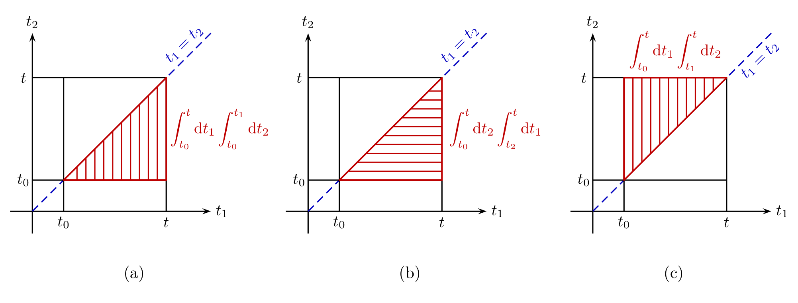
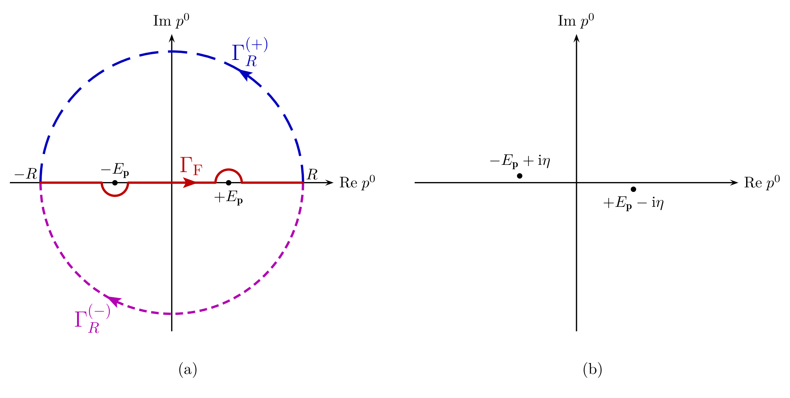
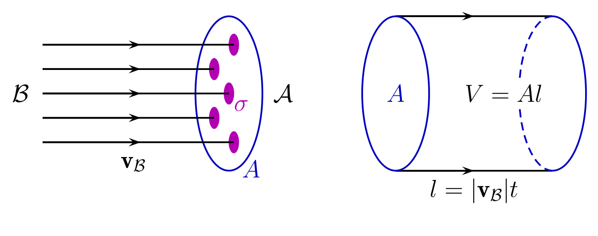
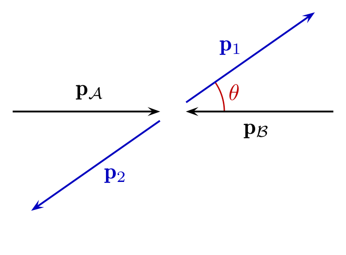
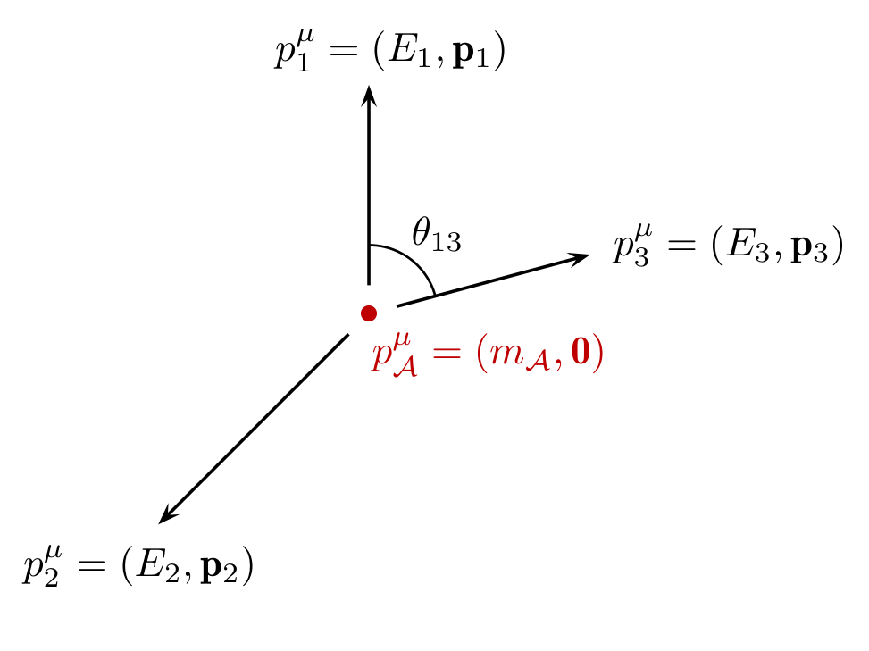
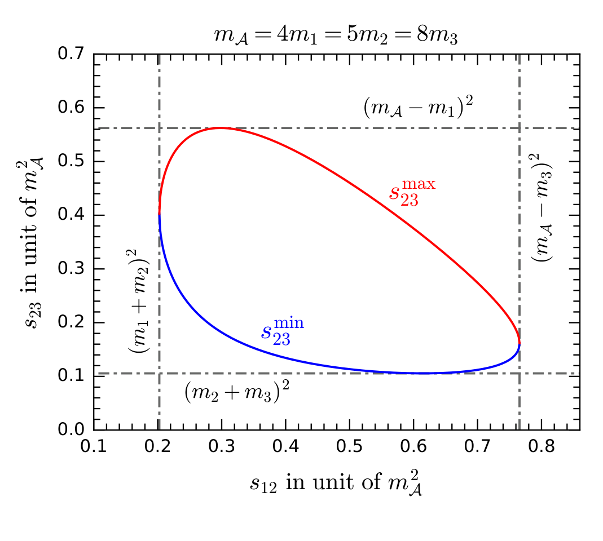
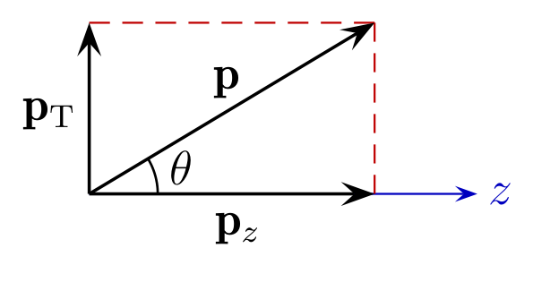

# 第 5 章 量子场的相互作用

第 2、3、4 章分别讨论了标量场、矢量场、旋量场的正则量子化。不过，这些讨论只涉及自由量子场的拉氏量，没有考虑到量子场的相互作用。像 (2.77)、(3.186) 和 (4.103) 式这样的自由场拉氏量包含着动能项和质量项，它们都是二次型，即每一项均包含 2 个场算符。如果我们更进一步，考虑拉氏量包含多于 2 个场算符的项，则这些项将描述场的相互作用（interaction）。在局域场论中，拉氏量 $\mathcal{L}(x)$ 中的相互作用项只能包含同一个时空点处的几个场，例如 $[\phi(x)]^3$；不能包含处于不同时空点上的场，例如 $[\phi(x)]^2\phi(y)$。这样可以保持理论的因果性（causality）。

相互作用项可以只包含同一个场，从而描述场的自相互作用（self-interaction）。例如，用实标量场 $\phi(x)$ 构造拉氏量

$$
\mathcal{L}_{\phi^4} = \frac{1}{2}(\partial^\mu\phi)\partial_\mu\phi - \frac{1}{2}m^2\phi^2 - \frac{\lambda}{4!}\phi^4.
\tag{5.1}
$$

前两项与 (2.77) 式相同，第三项描述四个实标量场的自相互作用，其中，$\lambda$ 是一个实耦合常数（coupling constant），它的大小决定耦合的强度。$\mathcal{L}_{\phi^4}$ 描述实标量场的 $\phi^4$ 理论。

在自然单位制中，时空坐标 $x^\mu$ 的量纲是能量量纲的倒数，即 $[x^\mu] = [E]^{-1}$，故时空导数的量纲是 $[\partial_\mu] = [E]$，时空体积元的量纲则是 $[\mathrm{d}^4x] = [E]^{-4}$。由于作用量 $S = \int\mathrm{d}^4x\,\mathcal{L}$ 没有量纲，拉氏量的量纲是

$$
[\mathcal{L}] = [E]^4.
\tag{5.2}
$$

于是，从拉氏量 (5.1) 的第一项可以看出，标量场的量纲是

$$
[\phi] = [E].
\tag{5.3}
$$

从而，$[\phi^4] = [E]^4$，故 $[\lambda] = 1$，即耦合常数 $\lambda$ 是无量纲的。类似地，分析拉氏量 (3.186)，容易发现矢量场 $A^\mu$ 的量纲是

$$
[A^\mu] = [E].
\tag{5.4}
$$

相互作用项也可以涉及不同的场。例如，用实标量场 $\phi(x)$ 和 Dirac 旋量场 $\psi(x)$ 构造拉氏量

$$
\mathcal{L}_{\text{Yukawa}} = \mathcal{L}_S + \mathcal{L}_D + \mathcal{L}_Y,
\tag{5.5}
$$

其中，

$$
\mathcal{L}_S = \frac{1}{2}(\partial^\mu\phi)\partial_\mu\phi - \frac{1}{2}m_\phi^2\phi^2
\tag{5.6}
$$

包含 $\phi$ 的动能项和质量项，

$$
\mathcal{L}_D = \mathrm{i}\bar{\psi}\gamma^\mu\partial_\mu\psi - m_\psi\bar{\psi}\psi
\tag{5.7}
$$

包含 $\psi$ 的动能项和质量项，而相互作用项

$$
\mathcal{L}_Y = -\kappa\,\phi\bar{\psi}\psi
\tag{5.8}
$$

描述标量场 $\phi$ 与旋量场 $\psi$ 之间的 Yukawa 相互作用，这里 $\kappa$ 是实耦合常数。由拉氏量 (5.7) 的第一项可以看出，旋量场的量纲是

$$
[\psi] = [\bar{\psi}] = [E]^{3/2}.
\tag{5.9}
$$

因此，$[\phi\bar{\psi}\psi] = [E]^4$，于是 Yukawa 耦合常数 $\kappa$ 没有量纲。这类相互作用最先由汤川秀树（Hideki Yukawa）于 1935 年提出 [24]，当时引入 $\pi$ 介子（对应于 $\phi$）来传递核子（对应于 $\psi$）之间的强相互作用。$\mathcal{L}_{\text{Yukawa}}$ 描述 Yukawa 理论。

存在相互作用时，场的经典运动方程是非线性的。例如，由 Euler-Lagrange 方程 (1.142) 推出 $\phi^4$ 理论的运动方程为

$$
(\partial^2 + m^2)\phi = -\frac{\lambda}{3!}\phi^3.
\tag{5.10}
$$

如果像 Yukawa 理论那样，相互作用项包含不同类型的场，则会得到多个相互耦合的运动方程。这样的运动方程在经典场论中尚不容易求解，在量子场论中就更困难了。所幸的是，当耦合常数（如 $\lambda$、$\kappa$）比较小时，在微扰论（perturbation theory）中利用微扰级数展开可以得到比较可靠的近似结果。本章和下一章介绍用微扰论处理量子场相互作用的思路。

如果拉氏量中的相互作用项 $\mathcal{L}_1$ 不包含场 $\Phi_a(x)$ 的时空导数 $\partial_\mu\Phi_a$，则 $\partial\mathcal{L}/\partial\dot{\Phi}_a = 0$。上面两个例子都属于这种情况。按照定义式 (1.143)，此时场的共轭动量密度 $\pi_a(x) = \partial\mathcal{L}/\partial\dot{\Phi}_a$ 不会受到 $\mathcal{L}_1(\Phi_a)$ 的影响，因而与没有相互作用时的量相同。将哈密顿量密度 $\mathcal{H}$ 分解成自由运动部分 $\mathcal{H}_0$（与没有相互作用时的哈密顿量密度相同）和相互作用部分 $\mathcal{H}_1$，

$$
\mathcal{H} = \mathcal{H}_0 + \mathcal{H}_1,
\tag{5.11}
$$

则根据定义式 (1.145) 有

$$
\mathcal{H}_1(\Phi_a) = -\mathcal{L}_1(\Phi_a).
\tag{5.12}
$$

从而，哈密顿量中描述相互作用的项是

$$
H_1 = \int\mathrm{d}^3x\,\mathcal{H}_1(\Phi_a) = -\int\mathrm{d}^3x\,\mathcal{L}_1(\Phi_a).
\tag{5.13}
$$

如果 $\mathcal{L}_1$ 包含场的时空导数 $\partial_\mu\Phi_a$，则共轭动量密度 $\pi_a(x) = \partial\mathcal{L}/\partial\dot{\Phi}_a$ 与没有相互作用的情况不同，$\mathcal{H}_1$ 的形式会复杂一些。

## 5.1 相互作用绘景

在 2.2 节中，我们已经介绍过在哈密顿量 $H$ 不含时的情况下 Schrödinger 绘景与 Heisenberg 绘景之间的关系。由于 Heisenberg 绘景能够明确地处理场算符的时间依赖性，前面章节中自由场的正则量子化程序都是在这个绘景中进行的。实际上，在 Schrödinger 绘景中也可以等价地讨论正则量子化。

接下来以实标量场为例进行表述。自由实标量场 $\phi(x)$ 的哈密顿量可以用产生湮灭算符表达成 (2.123) 式的形式：

$$
H = \int\frac{\mathrm{d}^3p}{(2\pi)^3}E_{\mathbf{p}}a_{\mathbf{p}}^\dagger a_{\mathbf{p}}.
\tag{5.14}
$$

它是不含时的。这里我们省略了零点能，因为零点能是一个 $c$ 数，只决定总能量的零点，不会影响下面的讨论。湮灭算符 $a_{\mathbf{p}}$ 和产生算符 $a_{\mathbf{p}}^\dagger$ 不依赖于时间 $t$，它们实际上是 Schrödinger 绘景中的算符。根据 (2.127) 式，$[a_{\mathbf{p}},H] = E_{\mathbf{p}}a_{\mathbf{p}}$，则

$$
\begin{aligned}
[a_{\mathbf{p}},(-\mathrm{i}Ht)^{(1)}] &= [a_{\mathbf{p}},-\mathrm{i}Ht] = -\mathrm{i}t[a_{\mathbf{p}},H] = -\mathrm{i}E_{\mathbf{p}}ta_{\mathbf{p}}, \\
[a_{\mathbf{p}},(-\mathrm{i}Ht)^{(2)}] &= [[a_{\mathbf{p}},(-\mathrm{i}Ht)^{(1)}],-\mathrm{i}Ht] = -\mathrm{i}E_{\mathbf{p}}t[a_{\mathbf{p}},-\mathrm{i}Ht] = (-\mathrm{i}E_{\mathbf{p}}t)^2a_{\mathbf{p}}, \\
&\cdots \\
[a_{\mathbf{p}},(-\mathrm{i}Ht)^{(n)}] &= (-\mathrm{i}E_{\mathbf{p}}t)^na_{\mathbf{p}}.
\end{aligned}
\tag{5.15}
$$

从而，由 (2.37) 和 (4.23) 式推出 Heisenberg 绘景中的湮灭算符为

$$
a_{\mathbf{p}}^{\mathrm{H}}(t) = \mathrm{e}^{\mathrm{i}Ht}a_{\mathbf{p}}\mathrm{e}^{-\mathrm{i}Ht} = \sum_{n=0}^{\infty}\frac{1}{n!}[a_{\mathbf{p}},(-\mathrm{i}Ht)^{(n)}] = \sum_{n=0}^{\infty}\frac{1}{n!}(-\mathrm{i}E_{\mathbf{p}}t)^na_{\mathbf{p}} = \mathrm{e}^{-\mathrm{i}E_{\mathbf{p}}t}a_{\mathbf{p}}.
\tag{5.16}
$$

对上式取厄米共轭，得到相应的产生算符为

$$
a_{\mathbf{p}}^{\mathrm{H}\dagger}(t) = \mathrm{e}^{\mathrm{i}Ht}a_{\mathbf{p}}^\dagger\mathrm{e}^{-\mathrm{i}Ht} = \mathrm{e}^{\mathrm{i}E_{\mathbf{p}}t}a_{\mathbf{p}}^\dagger.
\tag{5.17}
$$

利用这两条关系，将自由实标量场的平面波展开式 (2.101) 表示成

$$
\phi^{\mathrm{H}}(\mathbf{x},t) = \int\frac{\mathrm{d}^3p}{(2\pi)^3}\frac{1}{\sqrt{2E_{\mathbf{p}}}}\left(a_{\mathbf{p}}\mathrm{e}^{-\mathrm{i}p\cdot x} + a_{\mathbf{p}}^\dagger\mathrm{e}^{\mathrm{i}p\cdot x}\right) = \int\frac{\mathrm{d}^3p}{(2\pi)^3}\frac{1}{\sqrt{2E_{\mathbf{p}}}}\left[a_{\mathbf{p}}^{\mathrm{H}}(t)\mathrm{e}^{\mathrm{i}\mathbf{p}\cdot\mathbf{x}} + a_{\mathbf{p}}^{\mathrm{H}\dagger}(t)\mathrm{e}^{-\mathrm{i}\mathbf{p}\cdot\mathbf{x}}\right].
\tag{5.18}
$$

在最右边的表达式中，场算符的时间依赖性只包含在 Heisenberg 绘景中的产生湮灭算符里面。反过来，在 Schrödinger 绘景中，自由实标量场的平面波展开式为

$$
\begin{aligned}
\phi^{\mathrm{S}}(\mathbf{x}) &= \mathrm{e}^{-\mathrm{i}Ht}\phi^{\mathrm{H}}(\mathbf{x},t)\mathrm{e}^{\mathrm{i}Ht} = \int\frac{\mathrm{d}^3p}{(2\pi)^3}\frac{1}{\sqrt{2E_{\mathbf{p}}}}\left[\mathrm{e}^{-\mathrm{i}Ht}a_{\mathbf{p}}^{\mathrm{H}}(t)\mathrm{e}^{\mathrm{i}Ht}\mathrm{e}^{\mathrm{i}\mathbf{p}\cdot\mathbf{x}} + \mathrm{e}^{-\mathrm{i}Ht}a_{\mathbf{p}}^{\mathrm{H}\dagger}(t)\mathrm{e}^{\mathrm{i}Ht}\mathrm{e}^{-\mathrm{i}\mathbf{p}\cdot\mathbf{x}}\right] \\
&= \int\frac{\mathrm{d}^3p}{(2\pi)^3}\frac{1}{\sqrt{2E_{\mathbf{p}}}}\left(a_{\mathbf{p}}\mathrm{e}^{\mathrm{i}\mathbf{p}\cdot\mathbf{x}} + a_{\mathbf{p}}^\dagger\mathrm{e}^{-\mathrm{i}\mathbf{p}\cdot\mathbf{x}}\right).
\end{aligned}
\tag{5.19}
$$

可见，场算符在 Schrödinger 绘景中确实不依赖于时间。同样，将共轭动量密度的展开式 (2.103) 变换到 Schrödinger 绘景中，则共轭动量密度也不依赖于时间：

$$
\begin{aligned}
\pi^{\mathrm{S}}(\mathbf{x}) &= \mathrm{e}^{-\mathrm{i}Ht}\pi^{\mathrm{H}}(\mathbf{x},t)\mathrm{e}^{\mathrm{i}Ht} = \int\frac{\mathrm{d}^3p}{(2\pi)^3}\frac{-\mathrm{i}p_0}{\sqrt{2E_{\mathbf{p}}}}\,\mathrm{e}^{-\mathrm{i}Ht}\left[a_{\mathbf{p}}^{\mathrm{H}}(t)\mathrm{e}^{\mathrm{i}\mathbf{p}\cdot\mathbf{x}} - a_{\mathbf{p}}^{\mathrm{H}\dagger}(t)\mathrm{e}^{-\mathrm{i}\mathbf{p}\cdot\mathbf{x}}\right]\mathrm{e}^{\mathrm{i}Ht} \\
&= \int\frac{\mathrm{d}^3p}{(2\pi)^3}\frac{-\mathrm{i}p_0}{\sqrt{2E_{\mathbf{p}}}}\left(a_{\mathbf{p}}\mathrm{e}^{\mathrm{i}\mathbf{p}\cdot\mathbf{x}} - a_{\mathbf{p}}^\dagger\mathrm{e}^{-\mathrm{i}\mathbf{p}\cdot\mathbf{x}}\right).
\end{aligned}
\tag{5.20}
$$

我们在 2.2 节中提到，正则对易关系的形式与绘景无关。这一点很容易验证，比如，实标量场的等时对易关系 (2.85) 在 Schrödinger 绘景中化为

$$
[\phi^{\mathrm{S}}(\mathbf{x}),\pi^{\mathrm{S}}(\mathbf{y})] = \mathrm{i}\delta^{(3)}(\mathbf{x}-\mathbf{y}),\quad [\phi^{\mathrm{S}}(\mathbf{x}),\phi^{\mathrm{S}}(\mathbf{y})] = [\pi^{\mathrm{S}}(\mathbf{x}),\pi^{\mathrm{S}}(\mathbf{y})] = 0.
\tag{5.21}
$$

如果从这些正则对易关系和展开式 (5.19)、(5.20) 出发，可以推出产生湮灭算符的对易关系，结果必定与在 Heisenberg 绘景中导出的 (2.120) 式相同。于是，可以进一步导出哈密顿量的表达式 (5.14)。这说明在 Schrödinger 绘景中进行计算也会得到自洽结果。

存在相互作用时，在 Schrödinger 绘景中将系统的哈密顿量 $H$ 分解为两个部分，

$$
H^{\mathrm{S}}(t) = H_0^{\mathrm{S}} + H_1^{\mathrm{S}}(t).
\tag{5.22}
$$

其中，主要部分 $H_0^{\mathrm{S}}$ 是不含时的自由（没有相互作用）的哈密顿量；微扰部分 $H_1^{\mathrm{S}}(t)$ 描述相互作用，只给出较小的影响。$H_1^{\mathrm{S}}$ 可能含时，也可能不含时，这里讨论一般情况。此时可以建立相互作用绘景（interaction picture），它也称为 Dirac 绘景。建立方式是把主要部分 $H_0^{\mathrm{S}}$ 的影响塞进态矢里面，将态矢定义为

$$
|\Psi(t)\rangle^{\mathrm{I}} = \mathrm{e}^{\mathrm{i}H_0^{\mathrm{S}}t}|\Psi(t)\rangle^{\mathrm{S}},
\tag{5.23}
$$

算符定义为

$$
O^{\mathrm{I}}(t) = \mathrm{e}^{\mathrm{i}H_0^{\mathrm{S}}t}O^{\mathrm{S}}\mathrm{e}^{-\mathrm{i}H_0^{\mathrm{S}}t}.
\tag{5.24}
$$

这样一来，相互作用绘景中哈密顿量的自由部分与 Schrödinger 绘景相同，

$$
H_0^{\mathrm{I}} = \mathrm{e}^{\mathrm{i}H_0^{\mathrm{S}}t}H_0^{\mathrm{S}}\mathrm{e}^{-\mathrm{i}H_0^{\mathrm{S}}t} = H_0^{\mathrm{S}};
\tag{5.25}
$$

但总哈密顿量不同，

$$
H^{\mathrm{I}} = \mathrm{e}^{\mathrm{i}H_0^{\mathrm{S}}t}H^{\mathrm{S}}\mathrm{e}^{-\mathrm{i}H_0^{\mathrm{S}}t};
\tag{5.26}
$$

微扰部分则满足

$$
H_1^{\mathrm{I}} = \mathrm{e}^{\mathrm{i}H_0^{\mathrm{S}}t}H_1^{\mathrm{S}}\mathrm{e}^{-\mathrm{i}H_0^{\mathrm{S}}t} = \mathrm{e}^{\mathrm{i}H_0^{\mathrm{S}}t}(H^{\mathrm{S}} - H_0^{\mathrm{S}})\mathrm{e}^{-\mathrm{i}H_0^{\mathrm{S}}t} = H^{\mathrm{I}} - H_0^{\mathrm{S}} = H^{\mathrm{I}} - H_0^{\mathrm{I}}.
\tag{5.27}
$$

此时，Heisenberg 绘景与 Schrödinger 绘景的一般变换关系可表示为

$$
|\Psi\rangle^{\mathrm{H}} = W^\dagger(t)|\Psi(t)\rangle^{\mathrm{S}},\quad O^{\mathrm{H}}(t) = W^\dagger(t)O^{\mathrm{S}}W(t),
\tag{5.28}
$$

其中含时幺正变换算符 $W(t)$ 满足

$$
\mathrm{i}\partial_0W(t) = H^{\mathrm{S}}(t)W(t),\quad W(0) = 1.
\tag{5.29}
$$

对于总哈密顿量 $H^{\mathrm{S}}$ 不含时的情况，有 $W(t) = \exp(-\mathrm{i}H^{\mathrm{S}}t)$，与 2.2 节一致。现在，Heisenberg 绘景的哈密顿量 $H^{\mathrm{H}}(t)$ 与 $H^{\mathrm{S}}(t)$ 的关系为

$$
H^{\mathrm{H}}(t) \equiv W^\dagger(t)H^{\mathrm{S}}(t)W(t),\quad H^{\mathrm{S}}(t) = W(t)H^{\mathrm{H}}(t)W^\dagger(t),
\tag{5.30}
$$

故

$$
\mathrm{i}\partial_0W(t) = H^{\mathrm{S}}(t)W(t) = W(t)H^{\mathrm{H}}(t)W^\dagger(t)W(t) = W(t)H^{\mathrm{H}}(t).
\tag{5.31}
$$

取厄米共轭，得 $-\mathrm{i}\partial_0W^\dagger(t) = H^{\mathrm{H}}(t)W^\dagger(t)$，从而推出

$$
\begin{aligned}
\mathrm{i}\partial_0O^{\mathrm{H}}(t) &= [\mathrm{i}\partial_0W^\dagger(t)]O^{\mathrm{S}}W(t) + W^\dagger(t)O^{\mathrm{S}}[\mathrm{i}\partial_0W(t)] \\
&= -H^{\mathrm{H}}(t)W^\dagger(t)O^{\mathrm{S}}W(t) + W^\dagger(t)O^{\mathrm{S}}W(t)H^{\mathrm{H}}(t) = [W^\dagger(t)O^{\mathrm{S}}W(t),H^{\mathrm{H}}(t)],
\end{aligned}
\tag{5.32}
$$

即 Heisenberg 运动方程

$$
\mathrm{i}\frac{\partial}{\partial t}O^{\mathrm{H}}(t) = [O^{\mathrm{H}}(t),H^{\mathrm{H}}(t)].
\tag{5.33}
$$

这是要求 $W(t)$ 满足条件 (5.29) 的理由。

以 Schrödinger 绘景为中介，得到相互作用绘景与 Heisenberg 绘景之间的关系

$$
|\Psi(t)\rangle^{\mathrm{I}} = \mathrm{e}^{\mathrm{i}H_0^{\mathrm{S}}t}W(t)|\Psi\rangle^{\mathrm{H}},\quad O^{\mathrm{I}}(t) = \mathrm{e}^{\mathrm{i}H_0^{\mathrm{S}}t}W(t)O^{\mathrm{H}}(t)W^\dagger(t)\mathrm{e}^{-\mathrm{i}H_0^{\mathrm{S}}t}.
\tag{5.34}
$$

引入幺正变换算符

$$
V(t) \equiv \mathrm{e}^{\mathrm{i}H_0^{\mathrm{S}}t}W(t),
\tag{5.35}
$$

将以上关系简化为

$$
|\Psi(t)\rangle^{\mathrm{I}} = V(t)|\Psi\rangle^{\mathrm{H}},\quad O^{\mathrm{I}}(t) = V(t)O^{\mathrm{H}}(t)V^\dagger(t).
\tag{5.36}
$$

由 $W(0) = 1$ 得 $V(0) = 1$。于是，相互作用绘景中等时对易关系的形式不变，如

$$
\begin{aligned}
[\phi^{\mathrm{I}}(\mathbf{x},t),\pi^{\mathrm{I}}(\mathbf{y},t)] &= [V(t)\phi^{\mathrm{H}}(\mathbf{x},t)V^\dagger(t),V(t)\pi^{\mathrm{H}}(\mathbf{y},t)V^\dagger(t)] = V(t)[\phi^{\mathrm{H}}(\mathbf{x},t),\pi^{\mathrm{H}}(\mathbf{y},t)]V^\dagger(t) \\
&= V(t)\mathrm{i}\delta^{(3)}(\mathbf{x}-\mathbf{y})V^\dagger(t) = \mathrm{i}\delta^{(3)}(\mathbf{x}-\mathbf{y}).
\end{aligned}
\tag{5.37}
$$

当 $t = 0$ 时，三种绘景是一致的，

$$
|\Psi(0)\rangle^{\mathrm{I}} = |\Psi(0)\rangle^{\mathrm{S}} = |\Psi\rangle^{\mathrm{H}},\quad O^{\mathrm{I}}(0) = O^{\mathrm{S}} = O^{\mathrm{H}}(0).
\tag{5.38}
$$

在任意 $t$ 时刻，均有

$$
{}^{\mathrm{I}}\langle\Psi(t)|O^{\mathrm{I}}(t)|\Psi(t)\rangle^{\mathrm{I}} = {}^{\mathrm{S}}\langle\Psi(t)|O^{\mathrm{S}}|\Psi(t)\rangle^{\mathrm{S}} = {}^{\mathrm{H}}\langle\Psi|O^{\mathrm{H}}(t)|\Psi\rangle^{\mathrm{H}},
\tag{5.39}
$$

因而三种绘景描述相同的物理。如果没有相互作用，$H^{\mathrm{S}} = H_0^{\mathrm{S}}$，则相互作用绘景与 Heisenberg 绘景相同。

以上讨论以 $t = 0$ 作为绘景变换的参考时刻。如果想将参考时刻改为 $t = t_0$，只需要作替换 $t \to t - t_0$。

在 Schrödinger 绘景中，Schrödinger 方程是

$$
\mathrm{i}\frac{\partial}{\partial t}|\Psi(t)\rangle^{\mathrm{S}} = H^{\mathrm{S}}|\Psi(t)\rangle^{\mathrm{S}}.
\tag{5.40}
$$

由此推出

$$
\begin{aligned}
\mathrm{i}\partial_0|\Psi(t)\rangle^{\mathrm{I}} &= \left(\mathrm{i}\partial_0\mathrm{e}^{\mathrm{i}H_0^{\mathrm{S}}t}\right)|\Psi(t)\rangle^{\mathrm{S}} + \mathrm{e}^{\mathrm{i}H_0^{\mathrm{S}}t}\mathrm{i}\partial_0|\Psi(t)\rangle^{\mathrm{S}} = \left(-H_0^{\mathrm{S}}\mathrm{e}^{\mathrm{i}H_0^{\mathrm{S}}t} + \mathrm{e}^{\mathrm{i}H_0^{\mathrm{S}}t}H^{\mathrm{S}}\right)|\Psi(t)\rangle^{\mathrm{S}} \\
&= \left(-H_0^{\mathrm{S}} + \mathrm{e}^{\mathrm{i}H_0^{\mathrm{S}}t}H^{\mathrm{S}}\mathrm{e}^{-\mathrm{i}H_0^{\mathrm{S}}t}\right)\mathrm{e}^{\mathrm{i}H_0^{\mathrm{S}}t}|\Psi(t)\rangle^{\mathrm{S}} = \left(-H_0^{\mathrm{I}} + H^{\mathrm{I}}\right)\mathrm{e}^{\mathrm{i}H_0^{\mathrm{S}}t}|\Psi(t)\rangle^{\mathrm{S}},
\end{aligned}
\tag{5.41}
$$

即

$$
\mathrm{i}\frac{\partial}{\partial t}|\Psi(t)\rangle^{\mathrm{I}} = H_1^{\mathrm{I}}|\Psi(t)\rangle^{\mathrm{I}}.
\tag{5.42}
$$

这是态矢 $|\Psi(t)\rangle^{\mathrm{I}}$ 的演化方程。可见，在相互作用绘景中，态矢的演化只由相互作用哈密顿量 $H_1^{\mathrm{I}}$ 决定。另一方面，有

$$
\begin{aligned}
\mathrm{i}\partial_0O^{\mathrm{I}}(t) &= (\mathrm{i}\partial_0\mathrm{e}^{\mathrm{i}H_0^{\mathrm{S}}t})O^{\mathrm{S}}\mathrm{e}^{-\mathrm{i}H_0^{\mathrm{S}}t} + \mathrm{e}^{\mathrm{i}H_0^{\mathrm{S}}t}O^{\mathrm{S}}(\mathrm{i}\partial_0\mathrm{e}^{-\mathrm{i}H_0^{\mathrm{S}}t}) \\
&= -H_0^{\mathrm{S}}\mathrm{e}^{\mathrm{i}H_0^{\mathrm{S}}t}O^{\mathrm{S}}\mathrm{e}^{-\mathrm{i}H_0^{\mathrm{S}}t} + \mathrm{e}^{\mathrm{i}H_0^{\mathrm{S}}t}O^{\mathrm{S}}\mathrm{e}^{-\mathrm{i}H_0^{\mathrm{S}}t}H_0^{\mathrm{S}} = [\mathrm{e}^{\mathrm{i}H_0^{\mathrm{S}}t}O^{\mathrm{S}}\mathrm{e}^{-\mathrm{i}H_0^{\mathrm{S}}t},H_0^{\mathrm{S}}],
\end{aligned}
\tag{5.43}
$$

即

$$
\mathrm{i}\frac{\partial}{\partial t}O^{\mathrm{I}}(t) = [O^{\mathrm{I}}(t),H_0^{\mathrm{S}}].
\tag{5.44}
$$

这个方程表明相互作用绘景中算符的演化只由自由哈密顿量 $H_0^{\mathrm{S}} = H_0^{\mathrm{I}}$ 决定。

综上，在相互作用绘景中，态矢的演化规律与 Schrödinger 绘景中的运动方程 (5.40) 相同，但必须将那里的总哈密顿量 $H^{\mathrm{S}}$ 换成相互作用哈密顿量 $H_1^{\mathrm{I}}$，这部分演化属于动力学（dynamics）演化；算符的演化规律与 Heisenberg 绘景中的运动方程 (5.33) 相同，但必须将那里的总哈密顿量 $H^{\mathrm{H}}$ 换成自由哈密顿量 $H_0^{\mathrm{I}}$，这部分演化属于运动学（kinematics）演化。

在 Heisenberg 绘景中，对未加微扰的系统求出各个算符间的关系之后，加入微扰有可能改变这些关系。不过，加入微扰之后各个算符在相互作用绘景中的许多关系仍然与加入微扰之前它们在 Heisenberg 绘景中的关系相同，可以直接套用原来的公式，这就是相互作用绘景的好处。于是，在相互作用绘景中，具有相互作用的场算符的平面波展开式将与没有相互作用的场算符在 Heisenberg 绘景中的展开式相同。因此，在存在相互作用的情况下，我们仍然可以沿用第 2、3、4 章中导出的自由量子场平面波展开式，其中的产生湮灭算符满足原来的对易或反对易关系，这一点对接下来的讨论至关重要。

### 5.1.1 例 1：实标量场

下面以实标量场的 $\phi^4$ 理论为例讨论相互作用绘景。根据拉氏量 (5.1) 和 (1.143) 式，共轭动量密度为

$$
\pi^{\mathrm{H}} = \frac{\partial\mathcal{L}_{\phi^4}^{\mathrm{H}}}{\partial(\partial_0\phi^{\mathrm{H}})} = \partial_0\phi^{\mathrm{H}},
\tag{5.45}
$$

与自由场形式相同。这里我们将 Heisenberg 绘景的标记 H 明确写出来。依照 (1.145) 式，哈密顿量密度为

$$
\mathcal{H}^{\mathrm{H}} = \pi^{\mathrm{H}}\partial_0\phi^{\mathrm{H}} - \mathcal{L}_{\phi^4}^{\mathrm{H}} = \frac{1}{2}\left[(\pi^{\mathrm{H}})^2 + (\nabla\phi^{\mathrm{H}})^2 + m^2(\phi^{\mathrm{H}})^2\right] + \frac{\lambda}{4!}(\phi^{\mathrm{H}})^4,
\tag{5.46}
$$

最后一项是相互作用项。将哈密顿量分解为

$$
H^{\mathrm{H}} = \int\mathrm{d}^3x\,\mathcal{H}^{\mathrm{H}} = H_0^{\mathrm{H}} + H_1^{\mathrm{H}},
\tag{5.47}
$$

其中，

$$
H_0^{\mathrm{H}} = \frac{1}{2}\int\mathrm{d}^3x\left[(\pi^{\mathrm{H}})^2 + (\nabla\phi^{\mathrm{H}})^2 + m^2(\phi^{\mathrm{H}})^2\right]
\tag{5.48}
$$

与自由哈密顿量 (2.122) 第一行的形式相同，而

$$
H_1^{\mathrm{H}} = \frac{\lambda}{4!}\int\mathrm{d}^3x\,(\phi^{\mathrm{H}})^4
\tag{5.49}
$$

描述相互作用。

假设 $t = 0$ 时，实标量场 $\phi(x)$ 的平面波展开式与自由场展开式 (5.19) 和 (5.20) 一样，

$$
\phi^{\mathrm{I}}(\mathbf{x},0) = \phi^{\mathrm{H}}(\mathbf{x},0) = \phi^{\mathrm{S}}(\mathbf{x}) = \int\frac{\mathrm{d}^3p}{(2\pi)^3}\frac{1}{\sqrt{2E_{\mathbf{p}}}}\left(a_{\mathbf{p}}\mathrm{e}^{\mathrm{i}\mathbf{p}\cdot\mathbf{x}} + a_{\mathbf{p}}^\dagger\mathrm{e}^{-\mathrm{i}\mathbf{p}\cdot\mathbf{x}}\right),
\tag{5.50}
$$

$$
\pi^{\mathrm{I}}(\mathbf{x},0) = \pi^{\mathrm{H}}(\mathbf{x},0) = \pi^{\mathrm{S}}(\mathbf{x}) = \int\frac{\mathrm{d}^3p}{(2\pi)^3}\frac{-\mathrm{i}p_0}{\sqrt{2E_{\mathbf{p}}}}\left(a_{\mathbf{p}}\mathrm{e}^{\mathrm{i}\mathbf{p}\cdot\mathbf{x}} - a_{\mathbf{p}}^\dagger\mathrm{e}^{-\mathrm{i}\mathbf{p}\cdot\mathbf{x}}\right),
\tag{5.51}
$$

其中，产生湮灭算符 $a_{\mathbf{p}}^\dagger$ 和 $a_{\mathbf{p}}$ 满足对易关系 (2.120)。在 $t = 0$ 时刻，由绘景变换关系 (5.28) 得到 $H_0^{\mathrm{H}}(0) = H_0^{\mathrm{S}}$。将以上 $\phi^{\mathrm{H}}(\mathbf{x},0)$ 和 $\pi^{\mathrm{H}}(\mathbf{x},0)$ 的平面波展开式代入 (5.48) 式，仿照 2.3.3 小节的推导过程，略去零点能，得到

$$
H_0^{\mathrm{S}} = H_0^{\mathrm{H}}(0) = \int\frac{\mathrm{d}^3p}{(2\pi)^3}E_{\mathbf{p}}a_{\mathbf{p}}^\dagger a_{\mathbf{p}},
\tag{5.52}
$$

即哈密顿量的自由部分 $H_0^{\mathrm{S}}$ 与 (5.14) 式的形式相同。类似于 (5.15) 式，我们有

$$
[a_{\mathbf{p}},(-\mathrm{i}H_0^{\mathrm{S}}t)^{(n)}] = (-\mathrm{i}E_{\mathbf{p}}t)^na_{\mathbf{p}}.
\tag{5.53}
$$

从而由 (4.23) 式得到

$$
a_{\mathbf{p}}^{\mathrm{I}}(t) = \mathrm{e}^{\mathrm{i}H_0^{\mathrm{S}}t}a_{\mathbf{p}}\mathrm{e}^{-\mathrm{i}H_0^{\mathrm{S}}t} = \mathrm{e}^{-\mathrm{i}E_{\mathbf{p}}t}a_{\mathbf{p}},\quad a_{\mathbf{p}}^{\mathrm{I}\dagger}(t) = \mathrm{e}^{\mathrm{i}H_0^{\mathrm{S}}t}a_{\mathbf{p}}^\dagger\mathrm{e}^{-\mathrm{i}H_0^{\mathrm{S}}t} = \mathrm{e}^{\mathrm{i}E_{\mathbf{p}}t}a_{\mathbf{p}}^\dagger.
\tag{5.54}
$$

于是，相互作用绘景中任意 $t$ 时刻的场算符展开式为

$$
\begin{aligned}
\phi^{\mathrm{I}}(\mathbf{x},t) &= \mathrm{e}^{\mathrm{i}H_0^{\mathrm{S}}t}\phi^{\mathrm{S}}(\mathbf{x})\mathrm{e}^{-\mathrm{i}H_0^{\mathrm{S}}t} = \int\frac{\mathrm{d}^3p}{(2\pi)^3}\frac{1}{\sqrt{2E_{\mathbf{p}}}}\left[a_{\mathbf{p}}^{\mathrm{I}}(t)\mathrm{e}^{\mathrm{i}\mathbf{p}\cdot\mathbf{x}} + a_{\mathbf{p}}^{\mathrm{I}\dagger}(t)\mathrm{e}^{-\mathrm{i}\mathbf{p}\cdot\mathbf{x}}\right] \\
&= \int\frac{\mathrm{d}^3p}{(2\pi)^3}\frac{1}{\sqrt{2E_{\mathbf{p}}}}\left(a_{\mathbf{p}}\mathrm{e}^{-\mathrm{i}E_{\mathbf{p}}t}\mathrm{e}^{\mathrm{i}\mathbf{p}\cdot\mathbf{x}} + a_{\mathbf{p}}^\dagger\mathrm{e}^{\mathrm{i}E_{\mathbf{p}}t}\mathrm{e}^{-\mathrm{i}\mathbf{p}\cdot\mathbf{x}}\right) \\
&= \int\frac{\mathrm{d}^3p}{(2\pi)^3}\frac{1}{\sqrt{2E_{\mathbf{p}}}}\left(a_{\mathbf{p}}\mathrm{e}^{-\mathrm{i}p\cdot x} + a_{\mathbf{p}}^\dagger\mathrm{e}^{\mathrm{i}p\cdot x}\right),
\end{aligned}
\tag{5.55}
$$

共轭动量密度的展开式为

$$
\pi^{\mathrm{I}}(\mathbf{x},t) = \mathrm{e}^{\mathrm{i}H_0^{\mathrm{S}}t}\pi^{\mathrm{S}}(\mathbf{x})\mathrm{e}^{-\mathrm{i}H_0^{\mathrm{S}}t} = \int\frac{\mathrm{d}^3p}{(2\pi)^3}\frac{-\mathrm{i}p_0}{\sqrt{2E_{\mathbf{p}}}}\left(a_{\mathbf{p}}\mathrm{e}^{-\mathrm{i}p\cdot x} - a_{\mathbf{p}}^\dagger\mathrm{e}^{\mathrm{i}p\cdot x}\right).
\tag{5.56}
$$

正如所期望的，这两个式子与自由实标量场在 Heisenberg 绘景中的展开式 (2.101) 和 (2.103) 一致。

因此，根据产生湮灭算符的对易关系 (2.120)，可以证明 $\phi^{\mathrm{I}}(x)$ 和 $\pi^{\mathrm{I}}(x)$ 满足与 (2.85) 形式相同的等时对易关系[^1]

$$
[\phi^{\mathrm{I}}(\mathbf{x},t),\pi^{\mathrm{I}}(\mathbf{y},t)] = \mathrm{i}\delta^{(3)}(\mathbf{x}-\mathbf{y}),\quad [\phi^{\mathrm{I}}(\mathbf{x},t),\phi^{\mathrm{I}}(\mathbf{y},t)] = [\pi^{\mathrm{I}}(\mathbf{x},t),\pi^{\mathrm{I}}(\mathbf{y},t)] = 0.
\tag{5.57}
$$

[^1]: 参考习题 2.2。

此外，能够验证场算符展开式符合运动学演化方程 (5.44)：类似于 (2.126) 和 (2.127) 式，推出

$$
[a_{\mathbf{p}},H_0^{\mathrm{S}}] = E_{\mathbf{p}}a_{\mathbf{p}},\quad [a_{\mathbf{p}}^\dagger,H_0^{\mathrm{S}}] = -E_{\mathbf{p}}a_{\mathbf{p}}^\dagger,
\tag{5.58}
$$

从而

$$
\begin{aligned}
\mathrm{i}\frac{\partial}{\partial t}\phi^{\mathrm{I}}(\mathbf{x},t) &= \int\frac{\mathrm{d}^3p}{(2\pi)^3}\frac{1}{\sqrt{2E_{\mathbf{p}}}}\left(E_{\mathbf{p}}a_{\mathbf{p}}\mathrm{e}^{-\mathrm{i}p\cdot x} - E_{\mathbf{p}}a_{\mathbf{p}}^\dagger\mathrm{e}^{\mathrm{i}p\cdot x}\right) \\
&= \int\frac{\mathrm{d}^3p}{(2\pi)^3}\frac{1}{\sqrt{2E_{\mathbf{p}}}}\left([a_{\mathbf{p}},H_0^{\mathrm{S}}]\mathrm{e}^{-\mathrm{i}p\cdot x} + [a_{\mathbf{p}}^\dagger,H_0^{\mathrm{S}}]\mathrm{e}^{\mathrm{i}p\cdot x}\right) = [\phi^{\mathrm{I}}(\mathbf{x},t),H_0^{\mathrm{S}}].
\end{aligned}
\tag{5.59}
$$

### 5.1.2 例 2：有质量矢量场

不难将上述讨论推广到复标量场、无质量矢量场和 Dirac 旋量场。但是，推广到有质量矢量场 $A^\mu(x)$ 却会得到不同寻常的结果，原因在于 $A^0(x)$ 不是一个独立的场分量，不具备相应的共轭动量密度和正则对易关系，因而在绘景变换中具有特殊的性质。

假设参与相互作用的有质量矢量场具有拉氏量

$$
\mathcal{L}^{\mathrm{H}} = \mathcal{L}_0^{\mathrm{H}} + \mathcal{L}_1^{\mathrm{H}},
\tag{5.60}
$$

其中自由项为

$$
\mathcal{L}_0^{\mathrm{H}} = -\frac{1}{4}F_{\mu\nu}^{\mathrm{H}}F^{\mathrm{H},\mu\nu} + \frac{1}{2}m^2A_\mu^{\mathrm{H}}A^{\mathrm{H},\mu},
\tag{5.61}
$$

相互作用项为

$$
\mathcal{L}_1^{\mathrm{H}} = gJ_\mu^{\mathrm{H}}A^{\mathrm{H},\mu}.
\tag{5.62}
$$

此处，$g$ 是一个无量纲耦合常数，$J_\mu^{\mathrm{H}}(x)$ 是由其它场组成的流，如 $\bar{\psi}^{\mathrm{H}}(x)\gamma_\mu\psi^{\mathrm{H}}(x)$。根据 (1.142) 式及

$$
\frac{\partial\mathcal{L}^{\mathrm{H}}}{\partial(\partial_\mu A_\nu^{\mathrm{H}})} = -F^{\mathrm{H},\mu\nu},\quad \frac{\partial\mathcal{L}^{\mathrm{H}}}{\partial A_\nu^{\mathrm{H}}} = m^2A^{\mathrm{H},\nu} + gJ^{\mathrm{H},\nu},
\tag{5.63}
$$

Euler-Lagrange 方程给出

$$
\partial_\mu F^{\mathrm{H},\mu\nu} + m^2A^{\mathrm{H},\nu} = -gJ^{\mathrm{H},\nu}.
\tag{5.64}
$$

由于 $J_\mu^{\mathrm{H}}(x)$ 不包含 $A^{\mathrm{H},\mu}$ 的时间导数，共轭动量密度与自由场形式相同：

$$
\pi_i^{\mathrm{H}} = \frac{\partial\mathcal{L}}{\partial(\partial^0A^{\mathrm{H},i})} = -F_{0i}^{\mathrm{H}},\quad \pi^{\mathrm{H},i} = F^{\mathrm{H},i0} = -\partial^0A^{\mathrm{H},i} + \partial^iA^{\mathrm{H},0}.
\tag{5.65}
$$

写成空间矢量的形式，得

$$
\boldsymbol{\pi}^{\mathrm{H}} = -\dot{\mathbf{A}}^{\mathrm{H}} - \nabla A^{\mathrm{H},0},\quad \dot{\mathbf{A}}^{\mathrm{H}} = -\boldsymbol{\pi}^{\mathrm{H}} - \nabla A^{\mathrm{H},0}.
\tag{5.66}
$$

当 $\nu = 0$ 时，运动方程变成

$$
\partial_iF^{\mathrm{H},i0} + m^2A^{\mathrm{H},0} = -gJ^{\mathrm{H},0},
\tag{5.67}
$$

故

$$
A^{\mathrm{H},0} = -\frac{1}{m^2}\left(\partial_iF^{\mathrm{H},i0} + gJ^{\mathrm{H},0}\right) = -\frac{1}{m^2}\left(\nabla\cdot\boldsymbol{\pi}^{\mathrm{H}} + gJ^{\mathrm{H},0}\right).
\tag{5.68}
$$

与自由情况 (3.202) 不同，此处 $A^{\mathrm{H},0}$ 还依赖于 $J^{\mathrm{H},0}$。

根据 (3.274) 式和 (3.270) 式第一步结果，哈密顿量密度是

$$
\begin{aligned}
\mathcal{H}^{\mathrm{H}} &= \pi_i^{\mathrm{H}}\partial_0A^{\mathrm{H},i} - \mathcal{L}^{\mathrm{H}} = -\boldsymbol{\pi}^{\mathrm{H}}\cdot\dot{\mathbf{A}}^{\mathrm{H}} - \mathcal{L}^{\mathrm{H}} \\
&= -\boldsymbol{\pi}^{\mathrm{H}}\cdot\dot{\mathbf{A}}^{\mathrm{H}} - \frac{1}{2}(\boldsymbol{\pi}^{\mathrm{H}})^2 + \frac{1}{2}(\nabla\times\mathbf{A}^{\mathrm{H}})^2 - \frac{1}{2}m^2[(A^{\mathrm{H},0})^2 - (\mathbf{A}^{\mathrm{H}})^2] - gJ^{\mathrm{H},0}A^{\mathrm{H},0} + g\mathbf{J}^{\mathrm{H}}\cdot\mathbf{A}^{\mathrm{H}}.
\end{aligned}
\tag{5.69}
$$

我们需要知道它比自由哈密顿量密度 (3.275) 多了什么。利用 (5.66) 和 (5.68) 式，将 (5.69) 式第一项化为

$$
\begin{aligned}
-\boldsymbol{\pi}^{\mathrm{H}}\cdot\dot{\mathbf{A}}^{\mathrm{H}} &= \boldsymbol{\pi}^{\mathrm{H}}\cdot(\boldsymbol{\pi}^{\mathrm{H}} + \nabla A^{\mathrm{H},0}) = (\boldsymbol{\pi}^{\mathrm{H}})^2 + \nabla\cdot(A^{\mathrm{H},0}\boldsymbol{\pi}^{\mathrm{H}}) - A^{\mathrm{H},0}\nabla\cdot\boldsymbol{\pi}^{\mathrm{H}} \\
&= (\boldsymbol{\pi}^{\mathrm{H}})^2 + \nabla\cdot(A^{\mathrm{H},0}\boldsymbol{\pi}^{\mathrm{H}}) + \frac{1}{m^2}(\nabla\cdot\boldsymbol{\pi}^{\mathrm{H}})^2 + \frac{g}{m^2}J^{\mathrm{H},0}\nabla\cdot\boldsymbol{\pi}^{\mathrm{H}}.
\end{aligned}
\tag{5.70}
$$

最后一行第二项是全散度，不会影响哈密顿量。(5.69) 式第四项中包括

$$
\begin{aligned}
-\frac{1}{2}m^2(A^{\mathrm{H},0})^2 &= -\frac{m^2}{2}\frac{1}{m^4}(\nabla\cdot\boldsymbol{\pi}^{\mathrm{H}} + gJ^{\mathrm{H},0})^2 \\
&= -\frac{1}{2m^2}(\nabla\cdot\boldsymbol{\pi}^{\mathrm{H}})^2 - \frac{g^2}{2m^2}(J^{\mathrm{H},0})^2 - \frac{g}{m^2}J^{\mathrm{H},0}\nabla\cdot\boldsymbol{\pi}^{\mathrm{H}},
\end{aligned}
\tag{5.71}
$$

而第五项为

$$
-gJ^{\mathrm{H},0}A^{\mathrm{H},0} = \frac{g}{m^2}J^{\mathrm{H},0}(\nabla\cdot\boldsymbol{\pi}^{\mathrm{H}} + gJ^{\mathrm{H},0}) = \frac{g}{m^2}J^{\mathrm{H},0}\nabla\cdot\boldsymbol{\pi}^{\mathrm{H}} + \frac{g^2}{m^2}(J^{\mathrm{H},0})^2.
\tag{5.72}
$$

这里包含 $J^\mu$ 的项都是自由场不具备的，应该归为相互作用项。于是，我们将哈密顿量分解为

$$
H^{\mathrm{H}} = \int\mathrm{d}^3x\,\mathcal{H}^{\mathrm{H}} = H_0^{\mathrm{H}} + H_1^{\mathrm{H}},
\tag{5.73}
$$

其中，

$$
H_0^{\mathrm{H}} = \frac{1}{2}\int\mathrm{d}^3x\left[(\boldsymbol{\pi}^{\mathrm{H}})^2 + \frac{1}{m^2}(\nabla\cdot\boldsymbol{\pi}^{\mathrm{H}})^2 + (\nabla\times\mathbf{A}^{\mathrm{H}})^2 + m^2(\mathbf{A}^{\mathrm{H}})^2\right]
\tag{5.74}
$$

与自由哈密顿量 (3.276) 形式相同，而

$$
H_1^{\mathrm{H}} = \int\mathrm{d}^3x\left[g\mathbf{J}^{\mathrm{H}}\cdot\mathbf{A}^{\mathrm{H}} + \frac{g}{m^2}J^{\mathrm{H},0}\nabla\cdot\boldsymbol{\pi}^{\mathrm{H}} + \frac{g^2}{2m^2}(J^{\mathrm{H},0})^2\right]
\tag{5.75}
$$

描述相互作用。

根据等时对易关系 (3.198)，有

$$
\begin{aligned}
[A^{\mathrm{H},i}(x),(\pi^{\mathrm{H}}(\mathbf{y}))^2] &= [A^{\mathrm{H},i}(x),\pi_j^{\mathrm{H}}(y)]\pi_j^{\mathrm{H}}(y) + \pi_j^{\mathrm{H}}(y)[A^{\mathrm{H},i}(x),\pi_j^{\mathrm{H}}(y)] \\
&= 2\mathrm{i}\delta^{ij}\delta^{(3)}(\mathbf{x}-\mathbf{y})\pi_j^{\mathrm{H}}(y) = -2\mathrm{i}\delta^{(3)}(\mathbf{x}-\mathbf{y})\pi^{\mathrm{H},i}(y),
\end{aligned}
\tag{5.76}
$$

写成空间矢量的形式是

$$
[\mathbf{A}^{\mathrm{H}}(x),(\boldsymbol{\pi}^{\mathrm{H}}(\mathbf{y}))^2] = -2\mathrm{i}\delta^{(3)}(\mathbf{x}-\mathbf{y})\boldsymbol{\pi}^{\mathrm{H}}(y).
\tag{5.77}
$$

另一方面，用 $\nabla_y$ 表示对空间矢量 $\mathbf{y}$ 的梯度算符，得到

$$
[A^{\mathrm{H},i}(x),\nabla_y\cdot\boldsymbol{\pi}^{\mathrm{H}}(y)] = -\frac{\partial}{\partial y^j}[A^{\mathrm{H},i}(x),\pi_j^{\mathrm{H}}(y)] = -\mathrm{i}\delta^{ij}\frac{\partial}{\partial y^j}\delta^{(3)}(\mathbf{x}-\mathbf{y}) = -\mathrm{i}\frac{\partial}{\partial y^i}\delta^{(3)}(\mathbf{x}-\mathbf{y}),
\tag{5.78}
$$

即

$$
[\mathbf{A}^{\mathrm{H}}(x),\nabla_y\cdot\boldsymbol{\pi}^{\mathrm{H}}(y)] = -\mathrm{i}\nabla_y\delta^{(3)}(\mathbf{x}-\mathbf{y}),
\tag{5.79}
$$

从而导出

$$
\begin{aligned}
[\mathbf{A}^{\mathrm{H}}(x),H_0^{\mathrm{H}}] &= \frac{1}{2}\int\mathrm{d}^3y\left\{[\mathbf{A}^{\mathrm{H}}(x),(\boldsymbol{\pi}^{\mathrm{H}}(y))^2] + \frac{1}{m^2}[\mathbf{A}^{\mathrm{H}}(x),(\nabla_y\cdot\boldsymbol{\pi}^{\mathrm{H}}(y))^2]\right\} \\
&= \int\mathrm{d}^3y\left\{-\mathrm{i}\delta^{(3)}(\mathbf{x}-\mathbf{y})\boldsymbol{\pi}^{\mathrm{H}}(y) - \frac{\mathrm{i}}{m^2}[\nabla_y\cdot\boldsymbol{\pi}^{\mathrm{H}}(y)]\nabla_y\delta^{(3)}(\mathbf{x}-\mathbf{y})\right\} \\
&= -\mathrm{i}\boldsymbol{\pi}^{\mathrm{H}}(x) + \frac{\mathrm{i}}{m^2}\int\mathrm{d}^3y\,\delta^{(3)}(\mathbf{x}-\mathbf{y})\nabla_y[\nabla_y\cdot\boldsymbol{\pi}^{\mathrm{H}}(y)] \\
&= -\mathrm{i}\boldsymbol{\pi}^{\mathrm{H}}(x) + \frac{\mathrm{i}}{m^2}\nabla_x[\nabla_x\cdot\boldsymbol{\pi}^{\mathrm{H}}(x)].
\end{aligned}
\tag{5.80}
$$

第三步用了分部积分。

接下来转换到相互作用绘景，

$$
\mathbf{A}^{\mathrm{I}} = V(t)\mathbf{A}^{\mathrm{H}}V^\dagger(t),\quad \boldsymbol{\pi}^{\mathrm{I}} = V(t)\boldsymbol{\pi}^{\mathrm{H}}V^\dagger(t),
\tag{5.81}
$$

则

$$
H_0^{\mathrm{S}} = H_0^{\mathrm{I}} = V(t)H_0^{\mathrm{H}}V^\dagger(t) = \frac{1}{2}\int\mathrm{d}^3x\left[(\boldsymbol{\pi}^{\mathrm{I}})^2 + \frac{1}{m^2}(\nabla\cdot\boldsymbol{\pi}^{\mathrm{I}})^2 + (\nabla\times\mathbf{A}^{\mathrm{I}})^2 + m^2(\mathbf{A}^{\mathrm{I}})^2\right].
\tag{5.82}
$$

将算符演化方程 (5.44) 应用到 $\mathbf{A}^{\mathrm{I}}$ 上，利用 (5.80) 式，推出

$$
\begin{aligned}
\mathrm{i}\dot{\mathbf{A}}^{\mathrm{I}} &= [\mathbf{A}^{\mathrm{I}},H_0^{\mathrm{S}}] = V(t)[\mathbf{A}^{\mathrm{H}},H_0^{\mathrm{H}}]V^\dagger(t) \\
&= V(t)\left[-\mathrm{i}\boldsymbol{\pi}^{\mathrm{H}} + \frac{\mathrm{i}}{m^2}\nabla(\nabla\cdot\boldsymbol{\pi}^{\mathrm{H}})\right]V^\dagger(t) = -\mathrm{i}\boldsymbol{\pi}^{\mathrm{I}} + \frac{\mathrm{i}}{m^2}\nabla(\nabla\cdot\boldsymbol{\pi}^{\mathrm{I}}),
\end{aligned}
\tag{5.83}
$$

即

$$
\boldsymbol{\pi}^{\mathrm{I}} = -\dot{\mathbf{A}}^{\mathrm{I}} + \frac{1}{m^2}\nabla(\nabla\cdot\boldsymbol{\pi}^{\mathrm{I}}).
\tag{5.84}
$$

与 (3.200) 式和 (3.202) 式比较，可以看出，这个等式与自由场情况具有相同形式。

现在，假设 $t = 0$ 时 $A^\mu(x)$ 和 $\pi_i(x)$ 的平面波展开式与 $t = 0$ 时的自由场展开式 (3.248) 和 (3.265) 相同，

$$
\begin{aligned}
A^{\mathrm{I},\mu}(\mathbf{x},0) &= A^{\mathrm{H},\mu}(\mathbf{x},0) = A^{\mathrm{S},\mu}(\mathbf{x}) \\
&= \int\frac{\mathrm{d}^3p}{(2\pi)^3}\frac{1}{\sqrt{2E_{\mathbf{p}}}}\sum_{\lambda=\pm,0}\left[\varepsilon^\mu(\mathbf{p},\lambda)a_{\mathbf{p},\lambda}\mathrm{e}^{\mathrm{i}\mathbf{p}\cdot\mathbf{x}} + \varepsilon^{\mu*}(\mathbf{p},\lambda)a_{\mathbf{p},\lambda}^\dagger\mathrm{e}^{-\mathrm{i}\mathbf{p}\cdot\mathbf{x}}\right],
\end{aligned}
\tag{5.85}
$$

$$
\begin{aligned}
\pi_i^{\mathrm{I}}(\mathbf{x},0) &= \pi_i^{\mathrm{H}}(\mathbf{x},0) = \pi_i^{\mathrm{S}}(\mathbf{x}) \\
&= \int\frac{\mathrm{d}^3p}{(2\pi)^3}\frac{\mathrm{i}p_0}{\sqrt{2E_{\mathbf{p}}}}\sum_{\lambda=\pm,0}\left[\tilde{\varepsilon}_i(\mathbf{p},\lambda)a_{\mathbf{p},\lambda}\mathrm{e}^{\mathrm{i}\mathbf{p}\cdot\mathbf{x}} - \tilde{\varepsilon}_i^*(\mathbf{p},\lambda)a_{\mathbf{p},\lambda}^\dagger\mathrm{e}^{-\mathrm{i}\mathbf{p}\cdot\mathbf{x}}\right],
\end{aligned}
\tag{5.86}
$$

其中，产生湮灭算符 $a_{\mathbf{p},\lambda}^\dagger$ 和 $a_{\mathbf{p},\lambda}$ 满足对易关系 (3.267)。在 $t = 0$ 时刻，将以上 $A^{\mathrm{H},\mu}(\mathbf{x},0)$ 和 $\pi_i^{\mathrm{H}}(\mathbf{x},0)$ 的平面波展开式代入 (5.74) 式，仿照 3.4.3 小节的推导过程，略去零点能，得到

$$
H_0^{\mathrm{S}} = H_0^{\mathrm{H}}(0) = \sum_{\lambda=\pm,0}\int\frac{\mathrm{d}^3p}{(2\pi)^3}E_{\mathbf{p}}a_{\mathbf{p},\lambda}^\dagger a_{\mathbf{p},\lambda},
\tag{5.87}
$$

即哈密顿量的自由部分 $H_0^{\mathrm{S}}$ 具有 (3.277) 式的形式。从而

$$
[H_0^{\mathrm{S}},a_{\mathbf{p},\lambda}^\dagger] = \sum_{\lambda'}\int\frac{\mathrm{d}^3q}{(2\pi)^3}E_{\mathbf{q}}[a_{\mathbf{q},\lambda'}^\dagger a_{\mathbf{q},\lambda'},a_{\mathbf{p},\lambda}^\dagger] = \sum_{\lambda'}\int\mathrm{d}^3q\,E_{\mathbf{q}}a_{\mathbf{q},\lambda'}^\dagger\delta_{\lambda\lambda'}\delta^{(3)}(\mathbf{q}-\mathbf{p}) = E_{\mathbf{p}}a_{\mathbf{p},\lambda}^\dagger,
\tag{5.88}
$$

$$
[H_0^{\mathrm{S}},a_{\mathbf{p},\lambda}] = \sum_{\lambda'}\int\frac{\mathrm{d}^3q}{(2\pi)^3}E_{\mathbf{q}}[a_{\mathbf{q},\lambda'}^\dagger a_{\mathbf{q},\lambda'},a_{\mathbf{p},\lambda}] = -\sum_{\lambda'}\int\mathrm{d}^3q\,E_{\mathbf{q}}a_{\mathbf{q},\lambda'}\delta_{\lambda\lambda'}\delta^{(3)}(\mathbf{q}-\mathbf{p}) = -E_{\mathbf{p}}a_{\mathbf{p},\lambda}.
\tag{5.89}
$$

于是，我们能够得到与 (5.15) 形式相同的式子

$$
[a_{\mathbf{p},\lambda},(-\mathrm{i}H_0^{\mathrm{S}}t)^{(n)}] = (-\mathrm{i}E_{\mathbf{p}}t)^na_{\mathbf{p},\lambda},
\tag{5.90}
$$

再根据 (4.23) 式导出

$$
a_{\mathbf{p},\lambda}^{\mathrm{I}}(t) = \mathrm{e}^{\mathrm{i}H_0^{\mathrm{S}}t}a_{\mathbf{p},\lambda}\mathrm{e}^{-\mathrm{i}H_0^{\mathrm{S}}t} = \mathrm{e}^{-\mathrm{i}E_{\mathbf{p}}t}a_{\mathbf{p},\lambda},\quad a_{\mathbf{p},\lambda}^{\mathrm{I}\dagger}(t) = \mathrm{e}^{\mathrm{i}H_0^{\mathrm{S}}t}a_{\mathbf{p},\lambda}^\dagger\mathrm{e}^{-\mathrm{i}H_0^{\mathrm{S}}t} = \mathrm{e}^{\mathrm{i}E_{\mathbf{p}}t}a_{\mathbf{p},\lambda}^\dagger.
\tag{5.91}
$$

更进一步，推出

$$
A^{\mathrm{I},\mu}(\mathbf{x},t) = \mathrm{e}^{\mathrm{i}H_0^{\mathrm{S}}t}A^{\mathrm{S},\mu}(\mathbf{x})\mathrm{e}^{-\mathrm{i}H_0^{\mathrm{S}}t} = \int\frac{\mathrm{d}^3p}{(2\pi)^3}\frac{1}{\sqrt{2E_{\mathbf{p}}}}\sum_{\lambda=\pm,0}\left[\varepsilon^\mu(\mathbf{p},\lambda)a_{\mathbf{p},\lambda}\mathrm{e}^{-\mathrm{i}p\cdot x} + \varepsilon^{\mu*}(\mathbf{p},\lambda)a_{\mathbf{p},\lambda}^\dagger\mathrm{e}^{\mathrm{i}p\cdot x}\right],
\tag{5.92}
$$

$$
\pi_i^{\mathrm{I}}(\mathbf{x},t) = \mathrm{e}^{\mathrm{i}H_0^{\mathrm{S}}t}\pi_i^{\mathrm{S}}(\mathbf{x})\mathrm{e}^{-\mathrm{i}H_0^{\mathrm{S}}t} = \int\frac{\mathrm{d}^3p}{(2\pi)^3}\frac{\mathrm{i}p_0}{\sqrt{2E_{\mathbf{p}}}}\sum_{\lambda=\pm,0}\left[\tilde{\varepsilon}_i(\mathbf{p},\lambda)a_{\mathbf{p},\lambda}\mathrm{e}^{-\mathrm{i}p\cdot x} - \tilde{\varepsilon}_i^*(\mathbf{p},\lambda)a_{\mathbf{p},\lambda}^\dagger\mathrm{e}^{\mathrm{i}p\cdot x}\right].
\tag{5.93}
$$

也就是说，对于任意 $t$ 时刻，$A^{\mathrm{I},\mu}(x)$ 和 $\pi_i^{\mathrm{I}}(x)$ 的展开式与 Heisenberg 绘景中的自由场展开式 (3.248) 和 (3.265) 一致。这是我们期望的结果。

因此，$\pi_i^{\mathrm{I}}(x)$ 和 $A^{\mathrm{I},\mu}(x)$ 的关系也与自由场的 (3.197) 式一样，

$$
\pi_i^{\mathrm{I}} = -\partial_0A_i^{\mathrm{I}} + \partial_iA_0^{\mathrm{I}},
\tag{5.94}
$$

即

$$
\boldsymbol{\pi}^{\mathrm{I}} = -\dot{\mathbf{A}}^{\mathrm{I}} - \nabla A^{\mathrm{I},0}.
\tag{5.95}
$$

与 (5.84) 式比较，得到

$$
A^{\mathrm{I},0} = -\frac{1}{m^2}\nabla\cdot\boldsymbol{\pi}^{\mathrm{I}}.
\tag{5.96}
$$

这个式子不同于 Heisenberg 绘景中的关系式 (5.68)，反而与自由场的关系式 (3.202) 一致。实际上，由于 $A^{\mathrm{H},0}$ 不是独立的场分量，我们在 Heisenberg 绘景中可以利用 Euler-Lagrange 方程导出关系式 (5.68) 来确定它，但我们无法保证这个关系式在相互作用绘景中成立，因而不能直接通过相似变换定义 $A^{\mathrm{H},0}$ 在相互作用绘景中对应的量。

根据 (5.96) 式，相互作用哈密顿量 (5.75) 在相互作用绘景中将变成

$$
\begin{aligned}
H_1^{\mathrm{I}} &= V(t)H_1^{\mathrm{H}}V^\dagger(t) = \int\mathrm{d}^3x\left[g\mathbf{J}^{\mathrm{I}}\cdot\mathbf{A}^{\mathrm{I}} + \frac{g}{m^2}J^{\mathrm{I},0}\nabla\cdot\boldsymbol{\pi}^{\mathrm{I}} + \frac{g^2}{2m^2}(J^{\mathrm{I},0})^2\right] \\
&= \int\mathrm{d}^3x\left[g\mathbf{J}^{\mathrm{I}}\cdot\mathbf{A}^{\mathrm{I}} - gJ^{\mathrm{I},0}A^{\mathrm{I},0} + \frac{g^2}{2m^2}(J^{\mathrm{I},0})^2\right] = \int\mathrm{d}^3x\left[-gJ_\mu^{\mathrm{I}}A^{\mathrm{I},\mu} + \frac{g^2}{2m^2}(J^{\mathrm{I},0})^2\right] \\
&= \int\mathrm{d}^3x\left[-\mathcal{L}_1^{\mathrm{I}} + \frac{g^2}{2m^2}(J^{\mathrm{I},0})^2\right].
\end{aligned}
\tag{5.97}
$$

最后一行方括号中第一项 $-\mathcal{L}_1^{\mathrm{I}} = -J_\mu^{\mathrm{I}}A^{\mathrm{I},\mu}$ 是我们期望得到的，具有 Lorentz 不变性。但第二项异乎寻常，不具有 Lorentz 不变性，我们将这个非协变项记为

$$
\mathcal{H}_{J^0}^{\mathrm{I}} = \frac{g^2}{2m^2}(J^{\mathrm{I},0})^2.
\tag{5.98}
$$

在这里，$\mathcal{H}_{J^0}^{\mathrm{I}}$ 看起来会破坏理论的 Lorentz 协变性，不过，在后续微扰论分析中，我们将看到它的贡献恰好抵消了有质量矢量场传播子中的非协变项（见 5.4.3 小节和 6.4 节）。最终，理论仍然是 Lorentz 协变的。

## 5.2 时间演化算符和 S 矩阵

如前所述，在相互作用绘景中，态矢 $|\Psi(t)\rangle^{\mathrm{I}}$ 承载着动力学演化，它的演化方程 (5.42) 是微扰论处理量子场相互作用的一个出发点。引入时间演化算符（time-evolution operator）$U(t,t_0)$，用于联系 $t_0$ 和 $t$ 两个时刻的态矢，

$$
|\Psi(t)\rangle^{\mathrm{I}} = U(t,t_0)|\Psi(t_0)\rangle^{\mathrm{I}}.
\tag{5.99}
$$

由 (5.36) 式有

$$
|\Psi(t)\rangle^{\mathrm{I}} = V(t)|\Psi\rangle^{\mathrm{H}} = V(t)V^\dagger(t_0)|\Psi(t_0)\rangle^{\mathrm{I}}.
\tag{5.100}
$$

因而可以将时间演化算符表示为

$$
U(t,t_0) = V(t)V^\dagger(t_0).
\tag{5.101}
$$

容易看出，时间演化算符满足

$$
U(t_0,t_0) = 1.
\tag{5.102}
$$

两个时间演化算符相继作用对应的乘法规则为

$$
U(t_2,t_1)U(t_1,t_0) = V(t_2)V^\dagger(t_1)V(t_1)V^\dagger(t_0) = V(t_2)V^\dagger(t_0) = U(t_2,t_0).
\tag{5.103}
$$

上式取 $t_2 = t_0$，即得

$$
U(t_0,t_1)U(t_1,t_0) = U(t_0,t_0) = 1,
\tag{5.104}
$$

故时间演化算符的逆算符为

$$
U^{-1}(t,t_0) = U(t_0,t).
\tag{5.105}
$$

再由 $V(t)$ 的幺正性推出

$$
U^\dagger(t,t_0) = V(t_0)V^\dagger(t) = U(t_0,t) = U^{-1}(t,t_0),
\tag{5.106}
$$

这表明时间演化算符是幺正算符。由于 $V(0) = 1$，取 $t_0 = 0$，有

$$
U(t,0) = V(t),\quad U^{-1}(t,0) = V^\dagger(t),
\tag{5.107}
$$

因而 $U(t,0)$ 就是联系 Heisenberg 绘景和相互作用绘景的幺正变换算符，(5.36) 式化为

$$
|\Psi(t)\rangle^{\mathrm{I}} = U(t,0)|\Psi\rangle^{\mathrm{H}},\quad O^{\mathrm{I}}(t) = U(t,0)O^{\mathrm{H}}(t)U^{-1}(t,0).
\tag{5.108}
$$

从态矢的演化方程 (5.42) 推出

$$
\mathrm{i}\frac{\partial}{\partial t}U(t,t_0)|\Psi(t_0)\rangle^{\mathrm{I}} = \mathrm{i}\frac{\partial}{\partial t}|\Psi(t)\rangle^{\mathrm{I}} = H_1^{\mathrm{I}}(t)|\Psi(t)\rangle^{\mathrm{I}} = H_1^{\mathrm{I}}(t)U(t,t_0)|\Psi(t_0)\rangle^{\mathrm{I}},
\tag{5.109}
$$

即

$$
\mathrm{i}\frac{\partial}{\partial t}U(t,t_0) = H_1^{\mathrm{I}}(t)U(t,t_0).
\tag{5.110}
$$

这是时间演化算符需要满足的微分方程，结合边值条件 (5.102)，将方程的解表达为

$$
U(t,t_0) = 1 + (-\mathrm{i})\int_{t_0}^{t}\mathrm{d}t_1\,H_1^{\mathrm{I}}(t_1)U(t_1,t_0).
\tag{5.111}
$$

上式左右两边均包含时间演化算符，重复迭代，得到级数

$$
\begin{aligned}
U(t,t_0) &= 1 + (-\mathrm{i})\int_{t_0}^{t}\mathrm{d}t_1\,H_1^{\mathrm{I}}(t_1) + (-\mathrm{i})^2\int_{t_0}^{t}\mathrm{d}t_1\int_{t_0}^{t_1}\mathrm{d}t_2\,H_1^{\mathrm{I}}(t_1)H_1^{\mathrm{I}}(t_2) \\
&\quad + \cdots + \left[(-\mathrm{i})^n\int_{t_0}^{t}\mathrm{d}t_1\cdots\int_{t_0}^{t_{n-1}}\mathrm{d}t_n\,H_1^{\mathrm{I}}(t_1)\cdots H_1^{\mathrm{I}}(t_n)\right] + \cdots
\end{aligned}
\tag{5.112}
$$

这个级数用起来不够方便，需要进一步化简。

从现在开始，我们将省略表示相互作用绘景的上标 I，因为本章余下内容均在相互作用绘景中讨论。

在级数 (5.112) 中，作为积分上限的时刻是降序排列的，即 $t \ge t_1 \ge t_2 \ge \cdots \ge t_n \ge \cdots \ge t_0$。由于积分上限相互依赖，这样的多重积分很难处理。为了将级数中每个积分的上限都扩展到 $t$ 时刻，引入时序乘积（time-ordered product）的概念。时序乘积使若干个含时算符的乘积强行按照它们相应的时刻从左到右降序排列。以 $n$ 个 $H_1(t)$ 算符为例，用 $\mathrm{T}$ 表示这种时间排序，有

$$
\mathrm{T}[H_1(t_1)H_1(t_2)\cdots H_1(t_n)] = H_1(t_{i_1})H_1(t_{i_2})\cdots H_1(t_{i_n}),\quad t_{i_1}\ge t_{i_2}\ge\cdots\ge t_{i_n}.
\tag{5.113}
$$

这里 $t_{i_1},t_{i_2},\cdots,t_{i_n}$ 是由 $t_1,t_2,\cdots,t_n$ 按照数值降序排列得到的。又如，两个标量场算符 $\phi(x)$ 和 $\phi(y)$ 的时序乘积可以用阶跃函数 (2.148) 表示为

$$
\mathrm{T}[\phi(x)\phi(y)] = \phi(x)\phi(y)\theta(x^0-y^0) + \phi(y)\phi(x)\theta(y^0-x^0) = \begin{cases}\phi(x)\phi(y), & x^0\ge y^0,\\ \phi(y)\phi(x), & x^0<y^0.\end{cases}
\tag{5.114}
$$

如果一个算符包含一个费米子产生或湮灭算符，可称它为费米子算符。旋量场算符 $\psi(x)$ 和它的 Dirac 共轭 $\bar{\psi}(x)$ 都是费米子算符。对费米子算符作时序乘积时，需要顾及它们的反对易性质，因此，如果时间排序交换了两个相邻的费米子算符，则应该额外添加一个负号。比如，两个旋量场算符 $\psi_a(x)$ 和 $\bar{\psi}_b(y)$ 的时序乘积是

$$
\mathrm{T}[\psi_a(x)\bar{\psi}_b(y)] = \psi_a(x)\bar{\psi}_b(y)\theta(x^0-y^0) - \bar{\psi}_b(y)\psi_a(x)\theta(y^0-x^0) = \begin{cases}\psi_a(x)\bar{\psi}_b(y), & x^0\ge y^0,\\ -\bar{\psi}_b(y)\psi_a(x), & x^0<y^0.\end{cases}
\tag{5.115}
$$

在狭义相对论中，$(x-y)^2$ 描述两个时空点 $x$ 和 $y$ 之间的时空间隔。若 $(x-y)^2 < 0$，则称 $x$ 和 $y$ 具有类空间隔；类似地，$(x-y)^2 > 0$ 和 $(x-y)^2 = 0$ 分别对应于类时间隔和类光间隔。如果 $x$ 和 $y$ 具有类时或类光间隔，那么，在任意惯性参考系中，$x^0$ 和 $y^0$ 的大小关系是确定的，即不能通过 Lorentz 变换改变时序。假如两个事件具有因果联系，则它们发生的两个时空点必定具有类时或类光间隔，从而两个事件发生的先后次序是确定的。反过来，如果 $x$ 和 $y$ 具有类空间隔，则 $x^0$ 和 $y^0$ 的大小关系是不确定的，选取适当的惯性参考系，就可以得到 $x^0 > y^0$、$x^0 = y^0$ 和 $x^0 < y^0$ 三种情况。因此，如果两个事件发生的时空点具有类空间隔，它们发生的先后次序是不确定的，必定没有因果联系，否则将破坏因果性。

Lorentz 对称性对时序乘积的定义提出一定的要求。两个实标量场算符的对易子 $[\phi(x),\phi(y)]$ 称为 Pauli-Jordan 传播函数 $D_{\mathrm{PJ}}(x-y)$ [25]，根据平面波展开式 (5.55)，它满足

$$
\begin{aligned}
D_{\mathrm{PJ}}(x-y) &\equiv [\phi(x),\phi(y)] = \int\frac{\mathrm{d}^3p\,\mathrm{d}^3q}{(2\pi)^6\sqrt{4E_{\mathbf{p}}E_{\mathbf{q}}}}\left[a_{\mathbf{p}}\mathrm{e}^{-\mathrm{i}p\cdot x} + a_{\mathbf{p}}^\dagger\mathrm{e}^{\mathrm{i}p\cdot x},a_{\mathbf{q}}\mathrm{e}^{-\mathrm{i}q\cdot y} + a_{\mathbf{q}}^\dagger\mathrm{e}^{\mathrm{i}q\cdot y}\right] \\
&= \int\frac{\mathrm{d}^3p\,\mathrm{d}^3q}{(2\pi)^6\sqrt{4E_{\mathbf{p}}E_{\mathbf{q}}}}\left\{[a_{\mathbf{p}},a_{\mathbf{q}}^\dagger]\mathrm{e}^{-\mathrm{i}(p\cdot x-q\cdot y)} + [a_{\mathbf{p}}^\dagger,a_{\mathbf{q}}]\mathrm{e}^{\mathrm{i}(p\cdot x-q\cdot y)}\right\} \\
&= \int\frac{\mathrm{d}^3p\,\mathrm{d}^3q}{(2\pi)^6\sqrt{4E_{\mathbf{p}}E_{\mathbf{q}}}}(2\pi)^3\delta^{(3)}(\mathbf{p}-\mathbf{q})\left[\mathrm{e}^{-\mathrm{i}(p\cdot x-q\cdot y)} - \mathrm{e}^{\mathrm{i}(p\cdot x-q\cdot y)}\right] \\
&= \int\frac{\mathrm{d}^3p}{(2\pi)^3}\frac{1}{2E_{\mathbf{p}}}\left[\mathrm{e}^{-\mathrm{i}p\cdot(x-y)} - \mathrm{e}^{\mathrm{i}p\cdot(x-y)}\right] = -\mathrm{i}\int\frac{\mathrm{d}^3p}{(2\pi)^3E_{\mathbf{p}}}\sin[p\cdot(x-y)].
\end{aligned}
\tag{5.116}
$$

第三、四步用到产生湮灭算符的对易关系 (2.120)。最后一步用到正弦函数与指数函数的关系

$$
\sin z = \frac{\mathrm{e}^{\mathrm{i}z} - \mathrm{e}^{-\mathrm{i}z}}{2\mathrm{i}} = \frac{\mathrm{i}}{2}\left(\mathrm{e}^{-\mathrm{i}z} - \mathrm{e}^{\mathrm{i}z}\right).
\tag{5.117}
$$

当 $x^0-y^0 = 0$ 时，$\sin[p\cdot(x-y)] = \sin[\mathbf{p}\cdot(\mathbf{x}-\mathbf{y})]$，则 (5.116) 式最后一步中的被积函数是 $\mathbf{p}$ 的奇函数，故对 $\mathbf{p}$ 积分的结果为零，即 $D_{\mathrm{PJ}}(x-y) = 0$。另一方面，由于体积元 (2.151) 是 Lorentz 不变的，(5.116) 式倒数第二步的结果告诉我们，$D_{\mathrm{PJ}}(x-y)$ 是 Lorentz 不变量。如前所述，如果 $x$ 和 $y$ 具有类空间隔，就一定可以通过 Lorentz 变换使得 $x^0-y^0 = 0$；于是，$D_{\mathrm{PJ}}(x-y) = 0$ 对所有类空间隔成立，即

$$
[\phi(x),\phi(y)] = D_{\mathrm{PJ}}(x-y) = 0,\quad (x-y)^2 < 0.
\tag{5.118}
$$

也就是说，当 $(x-y)^2 < 0$ 时，虽然两个实标量场算符 $\phi(x)$ 与 $\phi(y)$ 可能在不同惯性参考系中具有不同的时序，但一定满足 $\phi(x)\phi(y) = \phi(y)\phi(x)$。因此，用 (5.114) 式定义的时序乘积在所有惯性系中相同，不会违背 Lorentz 对称性。

对于 Dirac 旋量场，平面波展开式具有 (4.217) 和 (4.219) 的形式，故

$$
\begin{aligned}
\{\psi_a(x),\bar{\psi}_b(y)\} &= \int\frac{\mathrm{d}^3p\,\mathrm{d}^3q}{(2\pi)^6\sqrt{4E_{\mathbf{p}}E_{\mathbf{q}}}}\sum_{\lambda\lambda'}\Big\{u_a(\mathbf{p},\lambda)a_{\mathbf{p},\lambda}\mathrm{e}^{-\mathrm{i}p\cdot x} + v_a(\mathbf{p},\lambda)b_{\mathbf{p},\lambda}^\dagger\mathrm{e}^{\mathrm{i}p\cdot x}, \\
&\qquad\qquad \bar{u}_b(\mathbf{q},\lambda')a_{\mathbf{q},\lambda'}^\dagger\mathrm{e}^{\mathrm{i}q\cdot y} + \bar{v}_b(\mathbf{q},\lambda')b_{\mathbf{q},\lambda'}\mathrm{e}^{-\mathrm{i}q\cdot y}\Big\} \\
&= \int\frac{\mathrm{d}^3p\,\mathrm{d}^3q}{(2\pi)^6\sqrt{4E_{\mathbf{p}}E_{\mathbf{q}}}}\sum_{\lambda\lambda'}\Big[u_a(\mathbf{p},\lambda)\bar{u}_b(\mathbf{q},\lambda')\{a_{\mathbf{p},\lambda},a_{\mathbf{q},\lambda'}^\dagger\}\mathrm{e}^{-\mathrm{i}(p\cdot x-q\cdot y)} \\
&\qquad\qquad + v_a(\mathbf{p},\lambda)\bar{v}_b(\mathbf{q},\lambda')\{b_{\mathbf{p},\lambda}^\dagger,b_{\mathbf{q},\lambda'}\}\mathrm{e}^{\mathrm{i}(p\cdot x-q\cdot y)}\Big] \\
&= \int\frac{\mathrm{d}^3p\,\mathrm{d}^3q}{(2\pi)^6\sqrt{4E_{\mathbf{p}}E_{\mathbf{q}}}}\sum_{\lambda\lambda'}(2\pi)^3\delta_{\lambda\lambda'}\delta^{(3)}(\mathbf{p}-\mathbf{q}) \\
&\qquad\qquad \times\left[u_a(\mathbf{p},\lambda)\bar{u}_b(\mathbf{q},\lambda')\mathrm{e}^{-\mathrm{i}(p\cdot x-q\cdot y)} + v_a(\mathbf{p},\lambda)\bar{v}_b(\mathbf{q},\lambda')\mathrm{e}^{\mathrm{i}(p\cdot x-q\cdot y)}\right] \\
&= \int\frac{\mathrm{d}^3p}{(2\pi)^3}\frac{1}{2E_{\mathbf{p}}}\sum_{\lambda}\left[u_a(\mathbf{p},\lambda)\bar{u}_b(\mathbf{p},\lambda)\mathrm{e}^{-\mathrm{i}p\cdot(x-y)} + v_a(\mathbf{p},\lambda)\bar{v}_b(\mathbf{p},\lambda)\mathrm{e}^{\mathrm{i}p\cdot(x-y)}\right] \\
&= \int\frac{\mathrm{d}^3p}{(2\pi)^3}\frac{1}{2E_{\mathbf{p}}}\left[(\not{p} + m)_{ab}\mathrm{e}^{-\mathrm{i}p\cdot(x-y)} - (-\not{p} + m)_{ab}\mathrm{e}^{\mathrm{i}p\cdot(x-y)}\right] \\
&= (\mathrm{i}\gamma_\mu\partial_x^\mu + m)_{ab}\int\frac{\mathrm{d}^3p}{(2\pi)^3}\frac{1}{2E_{\mathbf{p}}}\left[\mathrm{e}^{-\mathrm{i}p\cdot(x-y)} - \mathrm{e}^{\mathrm{i}p\cdot(x-y)}\right] \\
&= (\mathrm{i}\gamma_\mu\partial_x^\mu + m)_{ab}D_{\mathrm{PJ}}(x-y),
\end{aligned}
\tag{5.119}
$$

其中 $\partial_x^\mu \equiv \partial/\partial x_\mu$。第二、三步用到产生湮灭算符的反对易关系 (4.247)，第五步用到自旋求和关系 (4.216)，最后一步用到 (5.116) 式。于是，由 (5.118) 式得

$$
\{\psi_a(x),\bar{\psi}_b(y)\} = 0,\quad (x-y)^2 < 0.
\tag{5.120}
$$

也就是说，当 $(x-y)^2 < 0$ 时，旋量场算符 $\psi_a(x)$ 和 $\bar{\psi}_b(y)$ 满足 $\psi_a(x)\bar{\psi}_b(y) = -\bar{\psi}_b(y)\psi_a(x)$，从而用 (5.115) 式定义的时序乘积在所有惯性系中相同。可见，当时间排序交换了两个相邻的费米子算符时，我们必须额外加上一个负号才不会违背 Lorentz 对称性。

现在考虑级数 (5.112) 的第 3 项，它包含一个关于 $t_1$ 和 $t_2$ 的二重积分，积分区域如图 5.1(a) 所示，先对 $t_2$ 积分，再对 $t_1$ 积分。这个二重积分可以重新表达为

$$
\int_{t_0}^{t}\mathrm{d}t_1\int_{t_0}^{t_1}\mathrm{d}t_2\,H_1(t_1)H_1(t_2) = \int_{t_0}^{t}\mathrm{d}t_2\int_{t_2}^{t}\mathrm{d}t_1\,H_1(t_1)H_1(t_2) = \int_{t_0}^{t}\mathrm{d}t_1\int_{t_1}^{t}\mathrm{d}t_2\,H_1(t_2)H_1(t_1).
\tag{5.121}
$$

在第一步中，我们等价地改成先对 $t_1$ 积分，再对 $t_2$ 积分，积分区域不变，如图 5.1(b) 所示。第二步交换了积分变量 $t_1$ 和 $t_2$，对应的积分区域如图 5.1(c) 所示。由此推出

$$
\begin{aligned}
2!\int_{t_0}^{t}\mathrm{d}t_1\int_{t_0}^{t_1}\mathrm{d}t_2\,H_1(t_1)H_1(t_2) &= \int_{t_0}^{t}\mathrm{d}t_1\int_{t_0}^{t_1}\mathrm{d}t_2\,H_1(t_1)H_1(t_2) + \int_{t_0}^{t}\mathrm{d}t_1\int_{t_1}^{t}\mathrm{d}t_2\,H_1(t_2)H_1(t_1) \\
&= \int_{t_0}^{t}\mathrm{d}t_1\int_{t_0}^{t}\mathrm{d}t_2\,\mathrm{T}[H_1(t_1)H_1(t_2)].
\end{aligned}
\tag{5.122}
$$

这里利用时序乘积将 $t_1$ 和 $t_2$ 的积分范围都扩展到整个 $[t_0,t]$ 区间，因为图 5.1(a) 中的积分区域与图 5.1(c) 中的积分区域恰好拼成一个正方形。在上式第一步第一项中，$t_1$ 是 $t_2$ 的积分上限，显然有 $t_1 \ge t_2$，因而 $H_1(t_1)H_1(t_2) = \mathrm{T}[H_1(t_1)H_1(t_2)]$；在第二项中，$t_1$ 是 $t_2$ 的积分下限，故 $t_2 \ge t_1$，此时 $H_1(t_2)H_1(t_1) = \mathrm{T}[H_1(t_1)H_1(t_2)]$；两项相加，就得到第二步的结果。

将上述讨论推广到级数 (5.112) 中的第 $n+1$ 项，得

$$
n!\int_{t_0}^{t}\mathrm{d}t_1\cdots\int_{t_0}^{t_{n-1}}\mathrm{d}t_n\,H_1(t_1)\cdots H_1(t_n) = \int_{t_0}^{t}\mathrm{d}t_1\cdots\int_{t_0}^{t}\mathrm{d}t_n\,\mathrm{T}[H_1(t_1)\cdots H_1(t_n)].
\tag{5.123}
$$

上式出现 $n!$ 是因为此时对 $n$ 个时间积分变量有 $n!$ 种排列方式。于是，级数 (5.112) 可以用时序乘积表达为

$$
\begin{aligned}
U(t,t_0) &= \sum_{n=0}^{\infty}\frac{(-\mathrm{i})^n}{n!}\int_{t_0}^{t}\mathrm{d}t_1\cdots\int_{t_0}^{t}\mathrm{d}t_n\,\mathrm{T}[H_1(t_1)\cdots H_1(t_n)] \\
&\equiv \mathrm{T}\exp\left[-\mathrm{i}\int_{t_0}^{t}\mathrm{d}t'\,H_1(t')\right].
\end{aligned}
\tag{5.124}
$$

这个级数称为 Dyson 级数 [26, 27]。它具有指数函数的级数展开形式，因而这里进一步用指数记号来表示。

图 5.1: $t_1-t_2$ 平面上的积分区域，三角形中的线段指示内层积分的方向和范围。

像 (5.13) 式一样，在局域场论中 $H_1(t)$ 是相应哈密顿量密度 $\mathcal{H}_1(x)$ 的空间积分

$$
H_1(t) = \int\mathrm{d}^3x\,\mathcal{H}_1(x).
\tag{5.125}
$$

因此，时间演化算符满足

$$
U(t,t_0) = \mathrm{T}\exp\left[-\mathrm{i}\int_{t_0}^{t}\mathrm{d}t'\int\mathrm{d}^3x'\,\mathcal{H}_1(x')\right].
\tag{5.126}
$$

$\mathbf{S}$ 矩阵，也称为散射矩阵（scattering matrix），是量子散射理论的核心概念，它描述系统从初态跃迁到末态的概率振幅。在相互作用绘景中，$\mathbf{S}$ 矩阵可以用时间演化算符来构造。

假设系统的初态 $|i\rangle$ 和末态 $|f\rangle$ 均处于自由状态，而相互作用只发生在有限的时间间隔里，那么相对地，初始时刻处于遥远过去，终末时刻处于遥远未来。这样的初末态称为渐近态（asymptotic state）。若将 $t$ 时刻处描述系统的态矢记为 $|\Psi(t)\rangle$，它从遥远过去（$t_0\to-\infty$）的初态 $|i\rangle$ 演化而来，用时间演化算符 $U(t,t_0)$ 表达为

$$
|\Psi(t)\rangle = \lim_{t_0\to-\infty}U(t,t_0)|i\rangle.
\tag{5.127}
$$

此过程相应的 $S$ 矩阵元 $S_{fi}$ 定义为态矢 $|\Psi(t)\rangle$ 演化到遥远未来（$t\to+\infty$）处与末态 $|f\rangle$ 的内积，即

$$
S_{fi} = \lim_{t\to+\infty}\langle f|\Psi(t)\rangle = \lim_{t\to+\infty}\lim_{t_0\to-\infty}\langle f|U(t,t_0)|i\rangle.
\tag{5.128}
$$

引入 $S$ 算符，它在初态与末态之间的期待值就是 $S$ 矩阵元 $S_{fi}$，即

$$
S_{fi} = \langle f|S|i\rangle,
\tag{5.129}
$$

那么

$$
S = U(+\infty,-\infty).
\tag{5.130}
$$

从而将 $S$ 算符表达为相互作用哈密顿量 $H_1(t)$ 的积分级数，

$$
\begin{aligned}
S &= \mathrm{T}\exp\left[-\mathrm{i}\int_{-\infty}^{+\infty}\mathrm{d}t'\,H_1(t')\right] \\
&= \sum_{n=0}^{\infty}\frac{(-\mathrm{i})^n}{n!}\int_{-\infty}^{+\infty}\mathrm{d}t_1\cdots\int_{-\infty}^{+\infty}\mathrm{d}t_n\,\mathrm{T}[H_1(t_1)\cdots H_1(t_n)] \\
&= \sum_{n=0}^{\infty}\frac{(-\mathrm{i})^n}{n!}\int\mathrm{d}^4x_1\cdots\mathrm{d}^4x_n\,\mathrm{T}[\mathcal{H}_1(x_1)\cdots\mathcal{H}_1(x_n)].
\end{aligned}
\tag{5.131}
$$

由时间演化算符的幺正性可知，$S$ 算符也是幺正的，

$$
S^\dagger S = 1.
\tag{5.132}
$$

## 5.3 Wick 定理

### 5.3.1 正规乘积和 Wick 定理

在 5.2 节中，借助时序乘积，我们把 $S$ 算符写成紧凑的级数形式 (5.131)。不过，如何适当地处理级数每一项中的时序乘积 $\mathrm{T}[\mathcal{H}_1(x_1)\cdots\mathcal{H}_1(x_n)]$ 呢？在量子场论中，相互作用哈密顿量密度 $\mathcal{H}_1(x)$ 是由若干个场算符构成的，因而我们需要处理的是多个场算符的时序乘积。这看来不是一个简单的问题，幸好接下来将要介绍的 Wick 定理提供了一种简便的处理方法。

在相互作用绘景中，实标量场 $\phi(x)$ 的平面波展开式 (5.55) 可以分解成两个部分：

$$
\phi(x) = \phi^{(+)}(x) + \phi^{(-)}(x).
\tag{5.133}
$$

其中，正能量解部分为

$$
\phi^{(+)}(x) \equiv \int\frac{\mathrm{d}^3p}{(2\pi)^3}\frac{1}{\sqrt{2E_{\mathbf{p}}}}a_{\mathbf{p}}\mathrm{e}^{-\mathrm{i}p\cdot x},
\tag{5.134}
$$

包含 $\mathrm{e}^{-\mathrm{i}p\cdot x}$ 因子；负能量解部分为

$$
\phi^{(-)}(x) \equiv \int\frac{\mathrm{d}^3p}{(2\pi)^3}\frac{1}{\sqrt{2E_{\mathbf{p}}}}a_{\mathbf{p}}^\dagger\mathrm{e}^{\mathrm{i}p\cdot x},
\tag{5.135}
$$

包含 $\mathrm{e}^{\mathrm{i}p\cdot x}$ 因子。根据 (5.92) 式，我们同样可以把有质量矢量场 $A^\mu(x)$ 分为正能量解和负能量解两部分：

$$
A^\mu(x) = A^{\mu(+)}(x) + A^{\mu(-)}(x),
\tag{5.136}
$$

其中，

$$
A^{\mu(+)}(x) \equiv \int\frac{\mathrm{d}^3p}{(2\pi)^3}\frac{1}{\sqrt{2E_{\mathbf{p}}}}\sum_{\lambda=\pm,0}\varepsilon^\mu(\mathbf{p},\lambda)a_{\mathbf{p},\lambda}\mathrm{e}^{-\mathrm{i}p\cdot x},
\tag{5.137}
$$

$$
A^{\mu(-)}(x) \equiv \int\frac{\mathrm{d}^3p}{(2\pi)^3}\frac{1}{\sqrt{2E_{\mathbf{p}}}}\sum_{\lambda=\pm,0}\varepsilon^{\mu*}(\mathbf{p},\lambda)a_{\mathbf{p},\lambda}^\dagger\mathrm{e}^{\mathrm{i}p\cdot x}.
\tag{5.138}
$$

前面提到，Dirac 旋量场 $\psi_a(x)$ 在相互作用绘景中的平面波展开式也具有 Heisenberg 绘景中自由场展开式 (4.217) 的形式，即

$$
\psi_a(x) = \psi_a^{(+)}(x) + \psi_a^{(-)}(x),
\tag{5.139}
$$

其中，

$$
\psi_a^{(+)}(x) \equiv \int\frac{\mathrm{d}^3p}{(2\pi)^3}\frac{1}{\sqrt{2E_{\mathbf{p}}}}\sum_{\lambda=\pm}u_a(\mathbf{p},\lambda)a_{\mathbf{p},\lambda}\mathrm{e}^{-\mathrm{i}p\cdot x},
\tag{5.140}
$$

$$
\psi_a^{(-)}(x) \equiv \int\frac{\mathrm{d}^3p}{(2\pi)^3}\frac{1}{\sqrt{2E_{\mathbf{p}}}}\sum_{\lambda=\pm}v_a(\mathbf{p},\lambda)b_{\mathbf{p},\lambda}^\dagger\mathrm{e}^{\mathrm{i}p\cdot x}.
\tag{5.141}
$$

可以看到，各类量子场的正能量解部分只包含湮灭算符，而负能量解部分只包含产生算符。

引入正规乘积 (normal product) 的概念，以 $\mathrm{N}$ 为记号，它的作用是将乘积中的所有湮灭算符移动到所有产生算符的右边，形成正规排序 (normal order)。正规排序对于多个产生 (或湮灭) 算符之间谁先谁后没有规定，每一种排列都是等价的。不过，考虑到费米子算符的反对易性，移动算符的过程中如果涉及奇数次费米子算符之间的交换，就应该额外添加一个负号，这个规定与费米子产生湮灭算符的反对易性相匹配。例如，对于标量场的产生湮灭算符，有

$$
\mathrm{N}(a_{\mathbf{p}}a_{\mathbf{q}}^\dagger a_{\mathbf{k}}a_{\mathbf{l}}^\dagger) = a_{\mathbf{q}}^\dagger a_{\mathbf{l}}^\dagger a_{\mathbf{p}}a_{\mathbf{k}} = a_{\mathbf{l}}^\dagger a_{\mathbf{q}}^\dagger a_{\mathbf{p}}a_{\mathbf{k}} = a_{\mathbf{l}}^\dagger a_{\mathbf{q}}^\dagger a_{\mathbf{k}}a_{\mathbf{p}},
\tag{5.142}
$$

第二步写出两个产生算符的另一种次序，第三步写出两个湮灭算符的另一种次序，而对易关系 $[a_{\mathbf{q}}^\dagger, a_{\mathbf{l}}^\dagger] = [a_{\mathbf{p}}, a_{\mathbf{k}}] = 0$ 保证这些表达式是等价的。对于旋量场的产生湮灭算符，有

$$
\mathrm{N}(b_{\mathbf{p},\lambda_1}a_{\mathbf{q},\lambda_2}^\dagger a_{\mathbf{k},\lambda_3}b_{\mathbf{l},\lambda_4}^\dagger) = -a_{\mathbf{q},\lambda_2}^\dagger b_{\mathbf{l},\lambda_4}^\dagger b_{\mathbf{p},\lambda_1}a_{\mathbf{k},\lambda_3} = b_{\mathbf{l},\lambda_4}^\dagger a_{\mathbf{q},\lambda_2}^\dagger b_{\mathbf{p},\lambda_1}a_{\mathbf{k},\lambda_3} = -b_{\mathbf{l},\lambda_4}^\dagger a_{\mathbf{q},\lambda_2}^\dagger a_{\mathbf{k},\lambda_3}b_{\mathbf{p},\lambda_1}.
\tag{5.143}
$$

第二步写出两个产生算符的另一种次序，与第一步相差一个负号；第三步写出两个湮灭算符的另一种次序，与第二步相差一个负号；反对易关系 $\{a_{\mathbf{q},\lambda_2}^\dagger, b_{\mathbf{l},\lambda_4}^\dagger\} = \{b_{\mathbf{p},\lambda_1}, a_{\mathbf{k},\lambda_3}\} = 0$ 保证这些表达式是等价的。

场算符的正能解部分包含湮灭算符，负能解部分包含产生算符，因而正能解在正规排序中处于负能解右边。于是，两个标量场算符的正规乘积为

$$
\mathrm{N}[\phi(x)\phi(y)] = \phi^{(-)}(x)\phi^{(-)}(y) + \phi^{(-)}(x)\phi^{(+)}(y) + \phi^{(+)}(x)\phi^{(+)}(y) + \phi^{(-)}(y)\phi^{(+)}(x),
\tag{5.144}
$$

最后一项中 $\phi^{(+)}(x)$ 被正规排序移动到 $\phi^{(-)}(y)$ 的右边。而两个旋量场算符的正规乘积为

$$
\mathrm{N}[\psi_a(x)\psi_b(y)] = \psi_a^{(-)}(x)\psi_b^{(-)}(y) + \psi_a^{(-)}(x)\psi_b^{(+)}(y) + \psi_a^{(+)}(x)\psi_b^{(+)}(y) - \psi_b^{(-)}(y)\psi_a^{(+)}(x),
\tag{5.145}
$$

最后一项中 $\psi_a^{(+)}(x)$ 被正规排序移动到 $\psi_b^{(-)}(y)$ 的右边，并出现一个负号。湮灭算符对真空态 $|0\rangle$ 的作用为零，如 $a_{\mathbf{p}}|0\rangle = 0$，相应地，$\langle 0|a_{\mathbf{p}}^\dagger = 0$，因此，对一组产生湮灭算符的任意乘积取正规排序之后，真空期待值为零：

$$
\langle 0|\mathrm{N}(\text{产生湮灭算符的乘积})|0\rangle = 0.
\tag{5.146}
$$

用统一的记号 $\Phi_a(x)$ 代表一般的场算符，它可以是标量场 $\phi(x)$ 或 $\phi^\dagger(x)$，也可以是矢量场 $A^\mu(x)$ 的一个分量，还可以是旋量场 $\psi_a(x)$ 或 $\bar\psi_a(x)$ 的一个分量。比如，$\Phi_a(x)\Phi_b(x)\Phi_c(x)$ 可以表示 $\phi(x)\phi(x)\phi(x)$，也可以表示 $A_\mu(x)\bar\psi_a(x)\psi_b(x)$。后者不是 Lorentz 不变的，但可以利用 Dirac 矩阵线性地组合出 Lorentz 不变量 $A_\mu(x)\bar\psi_a(x)(\gamma^\mu)_{ab}\psi_b(x) = A_\mu(x)\bar\psi(x)\gamma^\mu\psi(x)$。将 $\Phi_a(x)$ 分解为正能解部分 $\Phi_a^{(+)}(x)$ 和负能解部分 $\Phi_a^{(-)}(x)$，

$$
\Phi_a(x) = \Phi_a^{(+)}(x) + \Phi_a^{(-)}(x),
\tag{5.147}
$$

则

$$
\Phi_a(x)\Phi_b(y) = \Phi_a^{(-)}(x)\Phi_b^{(-)}(y) + \Phi_a^{(-)}(x)\Phi_b^{(+)}(y) + \Phi_a^{(+)}(x)\Phi_b^{(+)}(y) + \Phi_a^{(+)}(x)\Phi_b^{(-)}(y).
\tag{5.148}
$$

由于正能解包含湮灭算符，负能解包含产生算符，有

$$
\Phi_a^{(+)}(x)|0\rangle = 0, \quad \langle 0|\Phi_a^{(-)}(x) = 0,
\tag{5.149}
$$

从而推出

$$
\langle 0|\Phi_a(x)\Phi_b(y)|0\rangle = \langle 0|\Phi_a^{(+)}(x)\Phi_b^{(-)}(y)|0\rangle.
\tag{5.150}
$$

现在，将 $\Phi_a(x)$ 与 $\Phi_b(y)$ 的正规乘积分解为

$$
\mathrm{N}[\Phi_a(x)\Phi_b(y)] = \Phi_a^{(-)}(x)\Phi_b^{(-)}(y) + \Phi_a^{(-)}(x)\Phi_b^{(+)}(y) + \Phi_a^{(+)}(x)\Phi_b^{(+)}(y) + \epsilon_{ab}\Phi_b^{(-)}(y)\Phi_a^{(+)}(x),
\tag{5.151}
$$

其中，因子 $\epsilon_{ab} = \pm1$ 考虑了费米子算符的反对易性。若 $\Phi_a(x)$ 和 $\Phi_b(y)$ 都是费米子算符，则 $\epsilon_{ab} = -1$；其余情况 $\epsilon_{ab} = +1$。利用 $\epsilon_{ab}$ 记号，依照两个产生 (湮灭) 算符的对易性或反对易性交换 (5.151) 式右边第一项 (第三项) 的两个场算符，得到

$$
\begin{aligned}
\mathrm{N}[\Phi_a(x)\Phi_b(y)] &= \epsilon_{ab}\Phi_b^{(-)}(y)\Phi_a^{(-)}(x) + \Phi_a^{(-)}(x)\Phi_b^{(+)}(y) + \epsilon_{ab}\Phi_b^{(+)}(y)\Phi_a^{(+)}(x) + \epsilon_{ab}\Phi_b^{(-)}(y)\Phi_a^{(+)}(x)\\
&= \epsilon_{ab}\big[\Phi_b^{(-)}(y)\Phi_a^{(-)}(x) + \epsilon_{ab}\Phi_a^{(-)}(x)\Phi_b^{(+)}(y) + \Phi_b^{(+)}(y)\Phi_a^{(+)}(x) + \Phi_b^{(-)}(y)\Phi_a^{(+)}(x)\big],
\end{aligned}
\tag{5.152}
$$

即

$$
\mathrm{N}[\Phi_a(x)\Phi_b(y)] = \epsilon_{ab}\mathrm{N}[\Phi_b(y)\Phi_a(x)].
\tag{5.153}
$$

也就是说，两个场算符的位置交换后，正规乘积只相差一个由费米子算符反对易性导致的符号。另一方面，将 $\Phi_a(x)$ 与 $\Phi_b(y)$ 的时序乘积化为

$$
\begin{aligned}
\mathrm{T}[\Phi_a(x)\Phi_b(y)] &= \Phi_a(x)\Phi_b(y)\theta(x^0 - y^0) + \epsilon_{ab}\Phi_b(y)\Phi_a(x)\theta(y^0 - x^0)\\
&= \epsilon_{ab}\big[\epsilon_{ab}\Phi_a(x)\Phi_b(y)\theta(x^0 - y^0) + \Phi_b(y)\Phi_a(x)\theta(y^0 - x^0)\big],
\end{aligned}
\tag{5.154}
$$

因此，两个场算符的位置交换后，时序乘积也只相差一个由费米子算符的反对易性导致的符号，

$$
\mathrm{T}[\Phi_a(x)\Phi_b(y)] = \epsilon_{ab}\mathrm{T}[\Phi_b(y)\Phi_a(x)].
\tag{5.155}
$$

当 $x^0 \ge y^0$ 时，$\Phi_a(x)$ 与 $\Phi_b(y)$ 的时序乘积为

$$
\begin{aligned}
\mathrm{T}[\Phi_a(x)\Phi_b(y)] &= \Phi_a(x)\Phi_b(y)\\
&= \Phi_a^{(-)}(x)\Phi_b^{(-)}(y) + \Phi_a^{(-)}(x)\Phi_b^{(+)}(y) + \Phi_a^{(+)}(x)\Phi_b^{(+)}(y) + \Phi_a^{(+)}(x)\Phi_b^{(-)}(y).
\end{aligned}
\tag{5.156}
$$

把最后一项改写成

$$
\begin{aligned}
\Phi_a^{(+)}(x)\Phi_b^{(-)}(y) &= \epsilon_{ab}\Phi_b^{(-)}(y)\Phi_a^{(+)}(x) + \Phi_a^{(+)}(x)\Phi_b^{(-)}(y) - \epsilon_{ab}\Phi_b^{(-)}(y)\Phi_a^{(+)}(x)\\
&= \epsilon_{ab}\Phi_b^{(-)}(y)\Phi_a^{(+)}(x) + [\Phi_a^{(+)}(x), \Phi_b^{(-)}(y)]_\mp.
\end{aligned}
\tag{5.157}
$$

这里 $[\cdot, \cdot]_- = [\cdot, \cdot]$ 代表对易子，$[\cdot, \cdot]_+ = \{\cdot, \cdot\}$ 代表反对易子。$\mp$ 号仅当 $\Phi_a(x)$ 和 $\Phi_b(y)$ 都是费米子算符时取正号，其余情况取负号。于是，由 (5.151) 式推出

$$
\mathrm{T}[\Phi_a(x)\Phi_b(y)] = \mathrm{N}[\Phi_a(x)\Phi_b(y)] + [\Phi_a^{(+)}(x), \Phi_b^{(-)}(y)]_\mp.
\tag{5.158}
$$

注意，$[\Phi_a^{(+)}(x), \Phi_b^{(-)}(y)]_\mp$ 必定是一个 $c$ 数，因为 $\Phi_a^{(+)}(x)$ 中湮灭算符与 $\Phi_b^{(-)}(y)$ 中产生算符的对易子或反对易子并不是算符，而是 $c$ 数。从而，根据 (5.149) 和 (5.150) 式得到

$$
\begin{aligned}
[\Phi_a^{(+)}(x), \Phi_b^{(-)}(y)]_\mp &= \langle 0|[\Phi_a^{(+)}(x), \Phi_b^{(-)}(y)]_\mp|0\rangle = \langle 0|\Phi_a^{(+)}(x)\Phi_b^{(-)}(y)|0\rangle = \langle 0|\Phi_a(x)\Phi_b(y)|0\rangle\\
&= \langle 0|\mathrm{T}[\Phi_a(x)\Phi_b(y)]|0\rangle.
\end{aligned}
\tag{5.159}
$$

当 $x^0 \le y^0$ 时，$\Phi_a(x)$ 与 $\Phi_b(y)$ 的时序乘积变成

$$
\begin{aligned}
\mathrm{T}[\Phi_a(x)\Phi_b(y)] &= \epsilon_{ab}\Phi_b(y)\Phi_a(x)\\
&= \epsilon_{ab}\big[\Phi_b^{(-)}(y)\Phi_a^{(-)}(x) + \Phi_b^{(-)}(y)\Phi_a^{(+)}(x) + \Phi_b^{(+)}(y)\Phi_a^{(+)}(x) + \Phi_b^{(+)}(y)\Phi_a^{(-)}(x)\big]\\
&= \epsilon_{ab}\big\{\Phi_b^{(-)}(y)\Phi_a^{(-)}(x) + \Phi_b^{(-)}(y)\Phi_a^{(+)}(x) + \Phi_b^{(+)}(y)\Phi_a^{(+)}(x) + \epsilon_{ab}\Phi_a^{(-)}(x)\Phi_b^{(+)}(y) + [\Phi_b^{(+)}(y), \Phi_a^{(-)}(x)]_\mp\big\}\\
&= \epsilon_{ab}\mathrm{N}[\Phi_b(y)\Phi_a(x)] + \epsilon_{ab}[\Phi_b^{(+)}(y), \Phi_a^{(-)}(x)]_\mp\\
&= \mathrm{N}[\Phi_a(x)\Phi_b(y)] + \epsilon_{ab}[\Phi_b^{(+)}(y), \Phi_a^{(-)}(x)]_\mp.
\end{aligned}
\tag{5.160}
$$

最后一步用到 (5.153) 式。根据 (5.155) 式，有

$$
\begin{aligned}
\epsilon_{ab}[\Phi_b^{(+)}(y), \Phi_a^{(-)}(x)]_\mp &= \epsilon_{ab}\langle 0|[\Phi_b^{(+)}(y), \Phi_a^{(-)}(x)]_\mp|0\rangle = \epsilon_{ab}\langle 0|\Phi_b^{(+)}(y)\Phi_a^{(-)}(x)|0\rangle\\
&= \epsilon_{ab}\langle 0|\Phi_b(y)\Phi_a(x)|0\rangle = \epsilon_{ab}\langle 0|\mathrm{T}[\Phi_b(y)\Phi_a(x)]|0\rangle = \langle 0|\mathrm{T}[\Phi_a(x)\Phi_b(y)]|0\rangle.
\end{aligned}
\tag{5.161}
$$

综合这两种情况，无论 $x^0$ 和 $y^0$ 孰大孰小，$\Phi_a(x)$ 与 $\Phi_b(y)$ 的时序乘积都可以统一地表达为

$$
\mathrm{T}[\Phi_a(x)\Phi_b(y)] = \mathrm{N}[\Phi_a(x)\Phi_b(y)] + \langle 0|\mathrm{T}[\Phi_a(x)\Phi_b(y)]|0\rangle.
\tag{5.162}
$$

引入场算符的缩并 (contraction) 概念，将两个场算符 $\Phi_a(x)$ 与 $\Phi_b(y)$ 的缩并定义为

$$
\overline{\Phi_a(x)\Phi_b(y)} \equiv \langle 0|\mathrm{T}[\Phi_a(x)\Phi_b(y)]|0\rangle = \begin{cases}
[\Phi_a^{(+)}(x), \Phi_b^{(-)}(y)]_\mp, & x^0 \ge y^0,\\
\epsilon_{ab}[\Phi_b^{(+)}(y), \Phi_a^{(-)}(x)]_\mp, & x^0 < y^0.
\end{cases}
\tag{5.163}
$$

上式仅当 $\Phi_a^{(+)}(x)$ 中的湮灭算符与 $\Phi_b^{(-)}(y)$ 中的产生算符属于同一套产生湮灭算符时可得非零结果，因而不同类型的场算符 (如标量场与旋量场) 的缩并为零。两个场算符的缩并是一个 $c$ 数，不会受到正规排序 $\mathrm{N}$ 的影响。在正规乘积中出现缩并记号时，参与缩并的一对场算符可以不相邻。为了使它们相邻，需要适当地交换场算符，交换时应计入费米子算符的反对易性引起的符号差异，我们约定这样得到的式子与原先的式子相等。例如，

$$
\mathrm{N}(\Phi_a\overline{\Phi_b\Phi_c\Phi_d}\overline{\Phi_c\Phi_d\Phi_e\Phi_f}) = \epsilon_{cd}\epsilon_{ef}\mathrm{N}(\Phi_a\overline{\Phi_b\Phi_d}\overline{\Phi_c\Phi_f}\Phi_e) = \epsilon_{cd}\epsilon_{ef}\overline{\Phi_b\Phi_d}\overline{\Phi_c\Phi_f}\mathrm{N}(\Phi_a\Phi_e).
\tag{5.164}
$$

于是，(5.162) 式可改写为

$$
\mathrm{T}[\Phi_a(x)\Phi_b(y)] = \mathrm{N}[\Phi_a(x)\Phi_b(y) + \overline{\Phi_a(x)\Phi_b(y)}].
\tag{5.165}
$$

上式表明，两个场算符的时序乘积等于它们的正规乘积加上它们的缩并。

这个结论可以推广成 Wick 定理 [28]：

一组场算符的时序乘积可以分解为它们的正规乘积及所有可能缩并的正规乘积之和，也就是说，

$$
\mathrm{T}[\Phi_{a_1}(x_1)\Phi_{a_2}(x_2)\cdots\Phi_{a_n}(x_n)] = \mathrm{N}\big[\Phi_{a_1}(x_1)\Phi_{a_2}(x_2)\cdots\Phi_{a_n}(x_n) + (\Phi_{a_1}\Phi_{a_2}\cdots\Phi_{a_n}\text{的所有可能缩并})\big].
\tag{5.166}
$$

例如，对于四个场算符的情况，有

$$
\begin{aligned}
\mathrm{T}(\Phi_a\Phi_b\Phi_c\Phi_d) = \mathrm{N}\big(&\Phi_a\Phi_b\Phi_c\Phi_d + \overline{\Phi_a\Phi_b}\Phi_c\Phi_d + \overline{\Phi_a\Phi_c}\Phi_b\Phi_d + \overline{\Phi_a\Phi_d}\Phi_b\Phi_c\\
&+ \Phi_a\overline{\Phi_b\Phi_c}\Phi_d + \Phi_a\overline{\Phi_b\Phi_d}\Phi_c + \Phi_a\Phi_b\overline{\Phi_c\Phi_d}\\
&+ \overline{\Phi_a\Phi_b}\,\overline{\Phi_c\Phi_d} + \overline{\Phi_a\Phi_c}\,\overline{\Phi_b\Phi_d} + \overline{\Phi_a\Phi_d}\,\overline{\Phi_b\Phi_c}\big).
\end{aligned}
\tag{5.167}
$$

根据正规乘积的性质 (5.146)，上式的真空期待值为

$$
\begin{aligned}
\langle 0|\mathrm{T}(\Phi_a\Phi_b\Phi_c\Phi_d)|0\rangle &= \mathrm{N}\big(\overline{\Phi_a\Phi_b}\,\overline{\Phi_c\Phi_d} + \overline{\Phi_a\Phi_c}\,\overline{\Phi_b\Phi_d} + \overline{\Phi_a\Phi_d}\,\overline{\Phi_b\Phi_c}\big)\\
&= \overline{\Phi_a\Phi_b}\,\overline{\Phi_c\Phi_d} + \epsilon_{bc}\overline{\Phi_a\Phi_c}\,\overline{\Phi_b\Phi_d} + \epsilon_{cd}\epsilon_{bd}\overline{\Phi_a\Phi_d}\,\overline{\Phi_b\Phi_c}\\
&= \langle 0|\mathrm{T}(\Phi_a\Phi_b)|0\rangle\langle 0|\mathrm{T}(\Phi_c\Phi_d)|0\rangle + \epsilon_{bc}\langle 0|\mathrm{T}(\Phi_a\Phi_c)|0\rangle\langle 0|\mathrm{T}(\Phi_b\Phi_d)|0\rangle\\
&\quad + \epsilon_{cd}\epsilon_{bd}\langle 0|\mathrm{T}(\Phi_a\Phi_d)|0\rangle\langle 0|\mathrm{T}(\Phi_b\Phi_c)|0\rangle.
\end{aligned}
\tag{5.168}
$$

### 5.3.2 选读：Wick 定理的证明

为了证明 Wick 定理，我们先证明以下引理。

**引理** 如果场算符 $\Phi_b(x_b)$ 的时间坐标比 $n$ 个场算符 $\Phi_{a_1}(x_1), \cdots, \Phi_{a_n}(x_n)$ 的时间坐标都小，即 $x_b^0 \le x_1^0, \cdots, x_n^0$，那么，以下等式成立：

$$
\begin{aligned}
\mathrm{N}[\Phi_{a_1}(x_1)\cdots\Phi_{a_n}(x_n)]\Phi_b(x_b) = \mathrm{N}\big[&\Phi_{a_1}(x_1)\cdots\Phi_{a_n}(x_n)\Phi_b(x_b) + \overline{\Phi_{a_1}(x_1)\cdots\Phi_{a_n}(x_n)\Phi_b(x_b)}\\
&+ \Phi_{a_1}(x_1)\overline{\Phi_{a_2}(x_2)\cdots\Phi_{a_n}(x_n)\Phi_b(x_b)} + \cdots + \Phi_{a_1}(x_1)\cdots\overline{\Phi_{a_n}(x_n)\Phi_b(x_b)}\big].
\end{aligned}
\tag{5.169}
$$

如果 $\Phi_{a_1}, \cdots, \Phi_{a_n}$ 中有些算符已经先彼此缩并了，也存在与 (5.169) 形式相同的等式，如

$$
\begin{aligned}
\mathrm{N}(\Phi_{a_1}\overline{\Phi_{a_2}\Phi_{a_3}}\Phi_{a_4}\Phi_{a_5}\cdots\Phi_{a_n})\Phi_b = \mathrm{N}\big(&\Phi_{a_1}\overline{\Phi_{a_2}\Phi_{a_3}}\Phi_{a_4}\Phi_{a_5}\cdots\Phi_{a_n}\Phi_b\\
&+ \Phi_{a_1}\overline{\Phi_{a_2}\Phi_{a_3}\Phi_{a_4}\Phi_{a_5}\cdots\Phi_{a_n}\Phi_b} + \Phi_{a_1}\Phi_{a_2}\Phi_{a_3}\overline{\Phi_{a_4}\Phi_{a_5}\cdots\Phi_{a_n}\Phi_b}\\
&+ \Phi_{a_1}\Phi_{a_2}\Phi_{a_3}\Phi_{a_4}\Phi_{a_5}\cdots\overline{\Phi_{a_n}\Phi_b}\big).
\end{aligned}
\tag{5.170}
$$

**证明** 我们分四步来证明。

(1) 将 $\Phi_b$ 分解为正能解部分和负能解部分，$\Phi_b = \Phi_b^{(+)} + \Phi_b^{(-)}$，则可以证明正能解部分 $\Phi_b^{(+)}$ 满足

$$
\begin{aligned}
\mathrm{N}(\Phi_{a_1}\cdots\Phi_{a_n})\Phi_b^{(+)} = \mathrm{N}\big(&\Phi_{a_1}\cdots\Phi_{a_n}\Phi_b^{(+)} + \overline{\Phi_{a_1}\cdots\Phi_{a_n}\Phi_b^{(+)}} + \Phi_{a_1}\overline{\Phi_{a_2}\cdots\Phi_{a_n}\Phi_b^{(+)}}\\
&+ \cdots + \Phi_{a_1}\cdots\overline{\Phi_{a_n}\Phi_b^{(+)}}\big).
\end{aligned}
\tag{5.171}
$$

由于 $x_b^0 \le x_1^0, \cdots, x_n^0$，$\Phi_{a_i}(x_i)$ ($i = 1, \cdots, n$) 与 $\Phi_b^{(+)}$ 的缩并为零：

$$
\overline{\Phi_{a_i}(x_i)\Phi_b^{(+)}(x_b)} = \langle 0|\mathrm{T}[\Phi_{a_i}(x_i)\Phi_b^{(+)}(x_b)]|0\rangle = \langle 0|\Phi_{a_i}(x_i)\Phi_b^{(+)}(x_b)|0\rangle = 0.
\tag{5.172}
$$

因此，(5.171) 式右边除第一项外的其它项均为零。另一方面，(5.171) 式左边和右边第一项已经是正规排序了，故 (5.171) 式成立。现在，只需要证明负能解部分 $\Phi_b^{(-)}$ 满足

$$
\begin{aligned}
\mathrm{N}(\Phi_{a_1}\cdots\Phi_{a_n})\Phi_b^{(-)} = \mathrm{N}\big(&\Phi_{a_1}\cdots\Phi_{a_n}\Phi_b^{(-)} + \overline{\Phi_{a_1}\cdots\Phi_{a_n}\Phi_b^{(-)}} + \Phi_{a_1}\overline{\Phi_{a_2}\cdots\Phi_{a_n}\Phi_b^{(-)}}\\
&+ \cdots + \Phi_{a_1}\cdots\overline{\Phi_{a_n}\Phi_b^{(-)}}\big).
\end{aligned}
\tag{5.173}
$$

将 $\Phi_{a_1}, \cdots, \Phi_{a_n}$ 都分解为正能解部分和负能解部分，则 $\mathrm{N}(\Phi_{a_1}\cdots\Phi_{a_n})$ 将包含 $2^n$ 项，每一项是 $j$ 个负能解部分 ($j = 0, \cdots, n$) 与 $n - j$ 个正能解部分之积

$$
\Phi_{a_1}^{(-)}\cdots\Phi_{a_j}^{(-)}\Phi_{a_{j+1}}^{(+)}\cdots\Phi_{a_n}^{(+)},
\tag{5.174}
$$

负能解部分都处于正能解部分的左边。

(2) 可以证明，通项 (5.174) 中右边正能解部分之积 $\Phi_{a_{j+1}}^{(+)}\cdots\Phi_{a_n}^{(+)}$ 满足

$$
\begin{aligned}
\mathrm{N}(\Phi_{a_{j+1}}^{(+)}\cdots\Phi_{a_n}^{(+)})\Phi_b^{(-)} = \mathrm{N}\big(&\Phi_{a_{j+1}}^{(+)}\cdots\Phi_{a_n}^{(+)}\Phi_b^{(-)} + \overline{\Phi_{a_{j+1}}^{(+)}\cdots\Phi_{a_n}^{(+)}\Phi_b^{(-)}} + \Phi_{a_{j+1}}^{(+)}\overline{\Phi_{a_{j+2}}^{(+)}\cdots\Phi_{a_n}^{(+)}\Phi_b^{(-)}}\\
&+ \cdots + \Phi_{a_{j+1}}^{(+)}\cdots\overline{\Phi_{a_n}^{(+)}\Phi_b^{(-)}}\big).
\end{aligned}
\tag{5.175}
$$

下面用数学归纳法证明 (5.175) 式。

对于 $\mathrm{N}(\Phi_{a_n}^{(+)})\Phi_b^{(-)}$，存在与 (5.175) 形式相同的等式，这是因为由 (5.165) 式可以得到

$$
\mathrm{N}(\Phi_{a_n}^{(+)})\Phi_b^{(-)} = \Phi_{a_n}^{(+)}\Phi_b^{(-)} = \mathrm{T}(\Phi_{a_n}^{(+)}\Phi_b^{(-)}) = \mathrm{N}\big(\Phi_{a_n}^{(+)}\Phi_b^{(-)} + \overline{\Phi_{a_n}^{(+)}\Phi_b^{(-)}}\big).
\tag{5.176}
$$

这样的话，需要证明的是可以从上式递推地导出 (5.175) 式。

假设 $\mathrm{N}(\Phi_{a_k}^{(+)}\cdots\Phi_{a_n}^{(+)})\Phi_b^{(-)}$ ($j + 2 \le k \le n$) 满足与 (5.175) 形式相同的等式

$$
\begin{aligned}
\mathrm{N}(\Phi_{a_k}^{(+)}\cdots\Phi_{a_n}^{(+)})\Phi_b^{(-)} = \mathrm{N}\big(&\Phi_{a_k}^{(+)}\cdots\Phi_{a_n}^{(+)}\Phi_b^{(-)} + \overline{\Phi_{a_k}^{(+)}\cdots\Phi_{a_n}^{(+)}\Phi_b^{(-)}} + \Phi_{a_k}^{(+)}\overline{\Phi_{a_{k+1}}^{(+)}\cdots\Phi_{a_n}^{(+)}\Phi_b^{(-)}}\\
&+ \cdots + \Phi_{a_k}^{(+)}\cdots\overline{\Phi_{a_n}^{(+)}\Phi_b^{(-)}}\big),
\end{aligned}
\tag{5.177}
$$

那么，可以得到

$$
\begin{aligned}
\mathrm{N}(\Phi_{a_{k-1}}^{(+)}\Phi_{a_k}^{(+)}\cdots\Phi_{a_n}^{(+)})\Phi_b^{(-)} &= \Phi_{a_{k-1}}^{(+)}\mathrm{N}(\Phi_{a_k}^{(+)}\cdots\Phi_{a_n}^{(+)})\Phi_b^{(-)}\\
&= \Phi_{a_{k-1}}^{(+)}\mathrm{N}\big(\Phi_{a_k}^{(+)}\cdots\Phi_{a_n}^{(+)}\Phi_b^{(-)}\big) + \mathrm{N}\big(\overline{\Phi_{a_{k-1}}^{(+)}\Phi_{a_k}^{(+)}\cdots\Phi_{a_n}^{(+)}\Phi_b^{(-)}}\big) + \Phi_{a_{k-1}}^{(+)}\Phi_{a_k}^{(+)}\overline{\Phi_{a_{k+1}}^{(+)}\cdots\Phi_{a_n}^{(+)}\Phi_b^{(-)}}\\
&\quad + \cdots + \Phi_{a_{k-1}}^{(+)}\Phi_{a_k}^{(+)}\cdots\overline{\Phi_{a_n}^{(+)}\Phi_b^{(-)}}\big).
\end{aligned}
\tag{5.178}
$$

进一步，我们整理上式第二步的第一项，

$$
\Phi_{a_{k-1}}^{(+)}\mathrm{N}(\Phi_{a_k}^{(+)}\cdots\Phi_{a_n}^{(+)}\Phi_b^{(-)})
$$

$$
\begin{aligned}
&= \Phi_{a_{k-1}}^{(+)}\epsilon_1\mathrm{N}(\Phi_b^{(-)}\Phi_{a_k}^{(+)}\cdots\Phi_{a_n}^{(+)}) = \epsilon_1\Phi_{a_{k-1}}^{(+)}\Phi_b^{(-)}\Phi_{a_k}^{(+)}\cdots\Phi_{a_n}^{(+)}\\
&= \epsilon_1\mathrm{T}(\Phi_{a_{k-1}}^{(+)}\Phi_b^{(-)})\Phi_{a_k}^{(+)}\cdots\Phi_{a_n}^{(+)} = \epsilon_1\mathrm{N}\big(\Phi_{a_{k-1}}^{(+)}\Phi_b^{(-)} + \overline{\Phi_{a_{k-1}}^{(+)}\Phi_b^{(-)}}\big)\Phi_{a_k}^{(+)}\cdots\Phi_{a_n}^{(+)}\\
&= \epsilon_1\mathrm{N}(\Phi_{a_{k-1}}^{(+)}\Phi_b^{(-)})\Phi_{a_k}^{(+)}\cdots\Phi_{a_n}^{(+)} + \epsilon_1\overline{\Phi_{a_{k-1}}^{(+)}\Phi_b^{(-)}}\Phi_{a_k}^{(+)}\cdots\Phi_{a_n}^{(+)}\\
&= \epsilon_1\epsilon_{a_{k-1}b}\mathrm{N}(\Phi_b^{(-)}\Phi_{a_{k-1}}^{(+)})\Phi_{a_k}^{(+)}\cdots\Phi_{a_n}^{(+)} + \epsilon_1\mathrm{N}\big(\overline{\Phi_{a_{k-1}}^{(+)}\Phi_b^{(-)}}\Phi_{a_k}^{(+)}\cdots\Phi_{a_n}^{(+)}\big)\\
&= \epsilon_1\epsilon_{a_{k-1}b}\mathrm{N}(\Phi_b^{(-)}\Phi_{a_{k-1}}^{(+)}\Phi_{a_k}^{(+)}\cdots\Phi_{a_n}^{(+)}) + \mathrm{N}\big(\overline{\Phi_{a_{k-1}}^{(+)}\Phi_b^{(-)}}\Phi_{a_k}^{(+)}\cdots\Phi_{a_n}^{(+)}\big)\\
&= \mathrm{N}(\Phi_{a_{k-1}}^{(+)}\Phi_{a_k}^{(+)}\cdots\Phi_{a_n}^{(+)}\Phi_b^{(-)}) + \mathrm{N}\big(\overline{\Phi_{a_{k-1}}^{(+)}\Phi_{a_k}^{(+)}\cdots\Phi_{a_n}^{(+)}\Phi_b^{(-)}}\big).
\end{aligned}
\tag{5.179}
$$

第一步多次利用 (5.153) 式，将 $\Phi_b^{(-)}$ 从正规乘积中的最右边移动到最左边，因而出现因子

$$
\epsilon_1 = \epsilon_{a_nb}\epsilon_{a_{n-1}b}\cdots\epsilon_{a_{k+1}b}\epsilon_{a_kb}.
\tag{5.180}
$$

第三步利用到 $x_b^0 \le x_{k-1}^0$ 的条件。第四步使用了 (5.165) 式。第六至八步再多次利用 (5.153) 式。将 (5.179) 式代入 (5.178) 式，立即得到

$$
\begin{aligned}
\mathrm{N}(\Phi_{a_{k-1}}^{(+)}\Phi_{a_k}^{(+)}\cdots\Phi_{a_n}^{(+)})\Phi_b^{(-)} = \mathrm{N}\big(&\Phi_{a_{k-1}}^{(+)}\Phi_{a_k}^{(+)}\cdots\Phi_{a_n}^{(+)}\Phi_b^{(-)} + \overline{\Phi_{a_{k-1}}^{(+)}\Phi_{a_k}^{(+)}\cdots\Phi_{a_n}^{(+)}\Phi_b^{(-)}}\\
&+ \Phi_{a_{k-1}}^{(+)}\overline{\Phi_{a_k}^{(+)}\cdots\Phi_{a_n}^{(+)}\Phi_b^{(-)}} + \cdots + \Phi_{a_{k-1}}^{(+)}\Phi_{a_k}^{(+)}\cdots\overline{\Phi_{a_n}^{(+)}\Phi_b^{(-)}}\big).
\end{aligned}
\tag{5.181}
$$

因此，$\mathrm{N}(\Phi_{a_{k-1}}^{(+)}\Phi_{a_k}^{(+)}\cdots\Phi_{a_n}^{(+)})\Phi_b^{(-)}$ 也满足与 (5.175) 形式相同的等式。结合 (5.176) 式，可知 (5.175) 式成立。

(3) 根据 (5.175) 式，通项 (5.174) 满足

$$
\begin{aligned}
\mathrm{N}(\Phi_{a_1}^{(-)}\cdots\Phi_{a_j}^{(-)}\Phi_{a_{j+1}}^{(+)}\cdots\Phi_{a_n}^{(+)})\Phi_b^{(-)} &= \Phi_{a_1}^{(-)}\cdots\Phi_{a_j}^{(-)}\mathrm{N}(\Phi_{a_{j+1}}^{(+)}\cdots\Phi_{a_n}^{(+)})\Phi_b^{(-)}\\
&= \Phi_{a_1}^{(-)}\cdots\Phi_{a_j}^{(-)}\mathrm{N}\big(\Phi_{a_{j+1}}^{(+)}\cdots\Phi_{a_n}^{(+)}\Phi_b^{(-)} + \overline{\Phi_{a_{j+1}}^{(+)}\cdots\Phi_{a_n}^{(+)}\Phi_b^{(-)}}\\
&\quad + \Phi_{a_{j+1}}^{(+)}\overline{\Phi_{a_{j+2}}^{(+)}\cdots\Phi_{a_n}^{(+)}\Phi_b^{(-)}} + \cdots + \Phi_{a_{j+1}}^{(+)}\cdots\overline{\Phi_{a_n}^{(+)}\Phi_b^{(-)}}\big)\\
&= \mathrm{N}\big(\Phi_{a_1}^{(-)}\cdots\Phi_{a_j}^{(-)}\Phi_{a_{j+1}}^{(+)}\cdots\Phi_{a_n}^{(+)}\Phi_b^{(-)} + \Phi_{a_1}^{(-)}\cdots\Phi_{a_j}^{(-)}\overline{\Phi_{a_{j+1}}^{(+)}\cdots\Phi_{a_n}^{(+)}\Phi_b^{(-)}}\\
&\quad + \Phi_{a_1}^{(-)}\cdots\Phi_{a_j}^{(-)}\Phi_{a_{j+1}}^{(+)}\overline{\Phi_{a_{j+2}}^{(+)}\cdots\Phi_{a_n}^{(+)}\Phi_b^{(-)}} + \cdots + \Phi_{a_1}^{(-)}\cdots\Phi_{a_j}^{(-)}\Phi_{a_{j+1}}^{(+)}\cdots\overline{\Phi_{a_n}^{(+)}\Phi_b^{(-)}}\big).
\end{aligned}
\tag{5.182}
$$

由

$$
\overline{\Phi_{a_i}^{(-)}(x_i)\Phi_b^{(-)}(x_b)} = \langle 0|\mathrm{T}[\Phi_{a_i}^{(-)}(x_i)\Phi_b^{(-)}(x_b)]|0\rangle = 0,
\tag{5.183}
$$

可得

$$
\begin{aligned}
\mathrm{N}\big(&\overline{\Phi_{a_1}^{(-)}\cdots\Phi_{a_j}^{(-)}\Phi_{a_{j+1}}^{(+)}\cdots\Phi_{a_n}^{(+)}\Phi_b^{(-)}} + \Phi_{a_1}^{(-)}\overline{\Phi_{a_2}^{(-)}\cdots\Phi_{a_j}^{(-)}\Phi_{a_{j+1}}^{(+)}\cdots\Phi_{a_n}^{(+)}\Phi_b^{(-)}}\\
&+ \cdots + \Phi_{a_1}^{(-)}\cdots\Phi_{a_j}^{(-)}\Phi_{a_{j+1}}^{(+)}\cdots\overline{\Phi_{a_n}^{(+)}\Phi_b^{(-)}}\big) = 0.
\end{aligned}
\tag{5.184}
$$

因此，将上式左边添加到 (5.182) 式右边，等式仍然成立：

$$
\mathrm{N}(\Phi_{a_1}^{(-)}\cdots\Phi_{a_j}^{(-)}\Phi_{a_{j+1}}^{(+)}\cdots\Phi_{a_n}^{(+)})\Phi_b^{(-)}
$$

$$
\begin{aligned}
= \mathrm{N}\big(&\Phi_{a_1}^{(-)}\cdots\Phi_{a_j}^{(-)}\Phi_{a_{j+1}}^{(+)}\cdots\Phi_{a_n}^{(+)}\Phi_b^{(-)} + \overline{\Phi_{a_1}^{(-)}\cdots\Phi_{a_j}^{(-)}\Phi_{a_{j+1}}^{(+)}\cdots\Phi_{a_n}^{(+)}\Phi_b^{(-)}}\\
&+ \Phi_{a_1}^{(-)}\overline{\Phi_{a_2}^{(-)}\cdots\Phi_{a_j}^{(-)}\Phi_{a_{j+1}}^{(+)}\cdots\Phi_{a_n}^{(+)}\Phi_b^{(-)}} + \cdots + \Phi_{a_1}^{(-)}\cdots\Phi_{a_j}^{(-)}\overline{\Phi_{a_{j+1}}^{(+)}\cdots\Phi_{a_n}^{(+)}\Phi_b^{(-)}}\\
&+ \Phi_{a_1}^{(-)}\cdots\Phi_{a_j}^{(-)}\Phi_{a_{j+1}}^{(+)}\overline{\Phi_{a_{j+2}}^{(+)}\cdots\Phi_{a_n}^{(+)}\Phi_b^{(-)}} + \cdots + \Phi_{a_1}^{(-)}\cdots\Phi_{a_j}^{(-)}\Phi_{a_{j+1}}^{(+)}\cdots\overline{\Phi_{a_n}^{(+)}\Phi_b^{(-)}}\big).
\end{aligned}
\tag{5.185}
$$

也就是说，$\mathrm{N}(\Phi_{a_1}\cdots\Phi_{a_n})$ 分解后每一项都满足与 (5.173) 形式相同的等式，故 (5.173) 式成立。结合第 (1) 步结论，(5.169) 式成立。

(4) 如果 $\Phi_{a_1}, \cdots, \Phi_{a_n}$ 中有些算符已经先彼此缩并了，可以按照第 (1)、(2)、(3) 步的方法进行类似的证明。因此，像 (5.170) 这样的等式也成立。引理证毕。

现在，我们利用这个引理来证明 Wick 定理。

**证明** 用数学归纳法证明。

当 $n = 2$ 时，(5.166) 式变成

$$
\mathrm{T}[\Phi_{a_1}(x)\Phi_{a_2}(y)] = \mathrm{N}\big[\Phi_{a_1}(x)\Phi_{a_2}(y) + \overline{\Phi_{a_1}(x)\Phi_{a_2}(y)}\big].
\tag{5.186}
$$

这是成立的，因为它的形式与 (5.165) 式相同。

假设当 $n = k$ 时，(5.166) 式成立，即

$$
\mathrm{T}[\Phi_{a_1}(x_1)\cdots\Phi_{a_k}(x_k)] = \mathrm{N}\big[\Phi_{a_1}(x_1)\cdots\Phi_{a_k}(x_k) + (\Phi_{a_1}\cdots\Phi_{a_k}\text{的所有可能缩并})\big].
\tag{5.187}
$$

如果 $x_{k+1}^0 \le x_1^0, \cdots, x_k^0$，我们就可以得到

$$
\begin{aligned}
\mathrm{T}[\Phi_{a_1}(x_1)\cdots\Phi_{a_k}(x_k)\Phi_{a_{k+1}}(x_{k+1})] &= \mathrm{T}[\Phi_{a_1}(x_1)\cdots\Phi_{a_k}(x_k)]\Phi_{a_{k+1}}(x_{k+1})\\
&= \mathrm{N}(\Phi_{a_1}\cdots\Phi_{a_k})\Phi_{a_{k+1}} + \mathrm{N}(\Phi_{a_1}\cdots\Phi_{a_k}\text{的所有可能缩并})\Phi_{a_{k+1}}.
\end{aligned}
\tag{5.188}
$$

根据上述引理中的 (5.169) 式，(5.188) 式第二行第一项为

$$
\begin{aligned}
\mathrm{N}(\Phi_{a_1}\cdots\Phi_{a_k})\Phi_{a_{k+1}} = \mathrm{N}\big(&\Phi_{a_1}\cdots\Phi_{a_k}\Phi_{a_{k+1}} + \overline{\Phi_{a_1}\cdots\Phi_{a_k}\Phi_{a_{k+1}}} + \Phi_{a_1}\overline{\Phi_{a_2}\cdots\Phi_{a_k}\Phi_{a_{k+1}}}\\
&+ \cdots + \Phi_{a_1}\cdots\overline{\Phi_{a_k}\Phi_{a_{k+1}}}\big),
\end{aligned}
\tag{5.189}
$$

上式右边的缩并项穷尽了只有一次缩并时与 $\Phi_{a_{k+1}}$ 有关的缩并。另一方面，上述引理中有些算符已经先彼此缩并的情况可以应用到 (5.188) 式第二行的其它项上，得到的项都包含缩并，在这些项里面，只包含一次缩并的项中的缩并必定与 $\Phi_{a_{k+1}}$ 无关，余下的项则穷尽了 $\Phi_{a_1}\cdots\Phi_{a_{k+1}}$ 的包含一次以上缩并的所有情况。因此，(5.188) 式已经包含了 $\Phi_{a_1}\cdots\Phi_{a_{k+1}}$ 的所有可能缩并，故

$$
\mathrm{T}[\Phi_{a_1}(x_1)\cdots\Phi_{a_{k+1}}(x_{k+1})] = \mathrm{N}\big[\Phi_{a_1}(x_1)\cdots\Phi_{a_{k+1}}(x_{k+1}) + (\Phi_{a_1}\cdots\Phi_{a_{k+1}}\text{的所有可能缩并})\big].
\tag{5.190}
$$

因此，对于 $x_{k+1}^0 \le x_1^0, \cdots, x_k^0$ 的情形，当 $n = k + 1$ 时 (5.166) 式也成立。结合 (5.186) 式，我们就证明了 (5.166) 式对 $x_1^0 \ge x_2^0 \ge \cdots \ge x_n^0$ 成立。

当 $x_1^0 \ge x_2^0 \ge \cdots \ge x_n^0$ 这个条件不成立时，我们可以交换 $\Phi_{a_1}(x_1)\Phi_{a_2}(x_2)\cdots\Phi_{a_n}(x_n)$ 中各个算符的位置，得到符合时序的乘积

$$
\Phi'_{a_1}(x'_1)\Phi'_{a_2}(x'_2)\cdots\Phi'_{a_n}(x'_n),
$$

其中时间坐标已经按降序排列，$x_1^{\prime0} \ge x_2^{\prime0} \ge \cdots \ge x_n^{\prime0}$。从而，等式

$$
\mathrm{T}[\Phi'_{a_1}(x'_1)\cdots\Phi'_{a_n}(x'_n)] = \mathrm{N}\big[\Phi'_{a_1}(x'_1)\cdots\Phi'_{a_n}(x'_n) + (\Phi'_{a_1}\cdots\Phi'_{a_n}\text{的所有可能缩并})\big]
\tag{5.191}
$$

成立。(5.155) 和 (5.153) 式表明，时序乘积与正规乘积关于算符交换的性质是相同的。因此，如果我们分别在时序乘积和正规乘积中通过交换算符将 $\Phi'_{a_1}(x'_1)\Phi'_{a_2}(x'_2)\cdots\Phi'_{a_n}(x'_n)$ 调回原来的形式 $\Phi_{a_1}(x_1)\Phi_{a_2}(x_2)\cdots\Phi_{a_n}(x_n)$，将出现一个共同的因子 $\epsilon_2 = \pm1$，它由费米子算符的反对易性所致。也就是说，我们得到了

$$
\mathrm{T}[\Phi'_{a_1}(x'_1)\cdots\Phi'_{a_n}(x'_n)] = \epsilon_2\mathrm{T}[\Phi_{a_1}(x_1)\cdots\Phi_{a_n}(x_n)],
\tag{5.192}
$$

和

$$
\begin{aligned}
&\mathrm{N}\big[\Phi'_{a_1}(x'_1)\cdots\Phi'_{a_n}(x'_n) + (\Phi'_{a_1}\cdots\Phi'_{a_n}\text{的所有可能缩并})\big]\\
&\quad = \epsilon_2\mathrm{N}\big[\Phi_{a_1}(x_1)\cdots\Phi_{a_n}(x_n) + (\Phi_{a_1}\cdots\Phi_{a_n}\text{的所有可能缩并})\big].
\end{aligned}
\tag{5.193}
$$

将它们分别代入 (5.191) 式的左右两边，消去 $\epsilon_2$，我们就证明了 (5.166) 式对 $x_1^0, x_2^0, \cdots, x_n^0$ 的任意次序成立。证毕。

## 5.4 Feynman 传播子

在应用 Wick 定理时，两个场算符的缩并是一种基本要素。在上一节中我们已经指出，仅当参与缩并的场算符中含有同一套产生湮灭算符时，缩并的结果才不为零。Feynman 传播子 (propagator) [29] 就是这样的非零缩并，在本节中，我们将导出它们的显式结果。

### 5.4.1 实标量场的 Feynman 传播子

实标量场 $\phi(x)$ 的 Feynman 传播子 $D_{\mathrm{F}}(x - y)$ 定义为

$$
D_{\mathrm{F}}(x - y) \equiv \overline{\phi(x)\phi(y)} = \langle 0|\mathrm{T}[\phi(x)\phi(y)]|0\rangle.
\tag{5.194}
$$

根据展开式 (5.134) 和 (5.135)，当 $x^0 > y^0$ 时，有

$$
\begin{aligned}
\langle 0|\mathrm{T}[\phi(x)\phi(y)]|0\rangle &= \langle 0|\phi(x)\phi(y)|0\rangle = \langle 0|\phi^{(+)}(x)\phi^{(-)}(y)|0\rangle\\
&= \int\frac{\mathrm{d}^3p\,\mathrm{d}^3q}{(2\pi)^6\sqrt{4E_{\mathbf{p}}E_{\mathbf{q}}}}\langle 0|a_{\mathbf{p}}\mathrm{e}^{-\mathrm{i}p\cdot x}a_{\mathbf{q}}^\dagger\mathrm{e}^{\mathrm{i}q\cdot y}|0\rangle = \int\frac{\mathrm{d}^3p\,\mathrm{d}^3q\,\mathrm{e}^{-\mathrm{i}(p\cdot x - q\cdot y)}}{(2\pi)^6\sqrt{4E_{\mathbf{p}}E_{\mathbf{q}}}}\langle 0|a_{\mathbf{p}}a_{\mathbf{q}}^\dagger|0\rangle\\
&= \int\frac{\mathrm{d}^3p\,\mathrm{d}^3q\,\mathrm{e}^{-\mathrm{i}(p\cdot x - q\cdot y)}}{(2\pi)^3\sqrt{4E_{\mathbf{p}}E_{\mathbf{q}}}}\delta^{(3)}(\mathbf{p} - \mathbf{q}) = \int\frac{\mathrm{d}^3p}{(2\pi)^3}\frac{\mathrm{e}^{-\mathrm{i}p\cdot(x - y)}}{2E_{\mathbf{p}}}\\
&= \int\frac{\mathrm{d}^3p}{(2\pi)^3}\mathrm{e}^{\mathrm{i}\mathbf{p}\cdot(\mathbf{x} - \mathbf{y})}\frac{\mathrm{e}^{-\mathrm{i}E_{\mathbf{p}}(x^0 - y^0)}}{2E_{\mathbf{p}}}.
\end{aligned}
\tag{5.195}
$$

第四步用到产生湮灭算符的对易关系 (2.120)。借助复变函数的知识，可以将上式最后一行中的因子 $\mathrm{e}^{-\mathrm{i}E_{\mathbf{p}}(x^0 - y^0)}/(2E_{\mathbf{p}})$ 化为一维积分。

将 $p^0$ 视作复变量，在 $p^0$ 的复平面上考虑函数

$$
\frac{\mathrm{e}^{-\mathrm{i}p^0(x^0 - y^0)}}{(p^0 - E_{\mathbf{p}})(p^0 + E_{\mathbf{p}})}
\tag{5.196}
$$

的曲线积分。这个函数具有两个一阶极点，$p^0 = \pm E_{\mathbf{p}}$，均位于实轴上。图 5.2(a) 中画出了 $p^0$ 复平面上的几条积分路径。路径 $\Gamma_{\mathrm{F}}$ 在两个极点处分别通过一个半径无穷小的半圆绕过极点，当 $R \to \infty$ 时，$\Gamma_{\mathrm{F}}$ 将从 $p^0 = -\infty$ 一直延伸到 $p^0 = +\infty$。将 $\Gamma_{\mathrm{F}}$ 与下半平面上的半圆弧 $\Gamma_R^{(-)}$ 组成一条围线 $C_{\mathrm{F}}^{(-)} = \Gamma_{\mathrm{F}} + \Gamma_R^{(-)}$，方向为顺时针方向，即反方向。由于 $x^0 - y^0 > 0$，$\mathrm{e}^{-\mathrm{i}p^0(x^0 - y^0)}$ 中的因子 $\mathrm{e}^{\mathrm{Im}(p^0)(x^0 - y^0)}$ 在下半平面 ($\mathrm{Im}\,p^0 < 0$) 随着 $R$ 增大而指数衰减，根据复分析的 Jordan 引理，有

$$
\lim_{R\to\infty}\int_{\Gamma_R^{(-)}}\mathrm{d}p^0\,\frac{\mathrm{e}^{-\mathrm{i}p^0(x^0 - y^0)}}{(p^0 - E_{\mathbf{p}})(p^0 + E_{\mathbf{p}})} = 0.
\tag{5.197}
$$

当 $R \to \infty$ 时，通过留数定理计算相应的积分主值，得

$$
\begin{aligned}
\int_{\Gamma_{\mathrm{F}}}\mathrm{d}p^0\,\frac{\mathrm{e}^{-\mathrm{i}p^0(x^0 - y^0)}}{(p^0 - E_{\mathbf{p}})(p^0 + E_{\mathbf{p}})} &= \int_{C_{\mathrm{F}}^{(-)}}\mathrm{d}p^0\,\frac{\mathrm{e}^{-\mathrm{i}p^0(x^0 - y^0)}}{(p^0 - E_{\mathbf{p}})(p^0 + E_{\mathbf{p}})}\\
&= -2\pi\mathrm{i}\operatorname{Res}_{p^0 = E_{\mathbf{p}}}\frac{\mathrm{e}^{-\mathrm{i}p^0(x^0 - y^0)}}{(p^0 - E_{\mathbf{p}})(p^0 + E_{\mathbf{p}})} = -2\pi\mathrm{i}\frac{\mathrm{e}^{-\mathrm{i}E_{\mathbf{p}}(x^0 - y^0)}}{2E_{\mathbf{p}}}.
\end{aligned}
\tag{5.198}
$$

 Feynman 传播子的极点和积分路径。

利用

$$
(p^0 - E_{\mathbf{p}})(p^0 + E_{\mathbf{p}}) = (p^0)^2 - E_{\mathbf{p}}^2 = (p^0)^2 - |\mathbf{p}|^2 - m^2 = p^2 - m^2,
\tag{5.199}
$$

我们进一步得到

$$
\frac{\mathrm{e}^{-\mathrm{i}E_{\mathbf{p}}(x^0 - y^0)}}{2E_{\mathbf{p}}} = -\frac{1}{2\pi\mathrm{i}}\int_{\Gamma_{\mathrm{F}}}\mathrm{d}p^0\,\frac{\mathrm{e}^{-\mathrm{i}p^0(x^0 - y^0)}}{(p^0 - E_{\mathbf{p}})(p^0 + E_{\mathbf{p}})} = \int_{\Gamma_{\mathrm{F}}}\frac{\mathrm{d}p^0}{2\pi}\,\frac{\mathrm{i}\,\mathrm{e}^{-\mathrm{i}p^0(x^0 - y^0)}}{p^2 - m^2}.
\tag{5.200}
$$

如图 5.2(b) 所示，如果我们将左边极点沿正虚轴方向移动一个无穷小量 $\eta > 0$，右边极点沿负虚轴方向同样移动无穷小量 $\eta$，则沿实轴积分将等价于原来沿 $\Gamma_{\mathrm{F}}$ 积分。此时，极点位置为 $p^0 = \pm(E_{\mathbf{p}} - \mathrm{i}\eta)$，被积函数中的分母 $p^2 - m^2$ 应改成

$$
\begin{aligned}
[p^0 - (E_{\mathbf{p}} - \mathrm{i}\eta)][p^0 + (E_{\mathbf{p}} - \mathrm{i}\eta)] &= (p^0)^2 - (E_{\mathbf{p}} - \mathrm{i}\eta)^2 = (p^0)^2 - E_{\mathbf{p}}^2 + 2\mathrm{i}\eta E_{\mathbf{p}} + \eta^2\\
&\simeq p^2 - m^2 + \mathrm{i}\epsilon.
\end{aligned}
\tag{5.201}
$$

最后一步忽略了 $\eta$ 的二阶小量，而 $\epsilon = 2\eta E_{\mathbf{p}} > 0$ 也是一个无穷小量。于是得到

$$
\frac{\mathrm{e}^{-\mathrm{i}E_{\mathbf{p}}(x^0 - y^0)}}{2E_{\mathbf{p}}} = \int\frac{\mathrm{d}p^0}{2\pi}\,\frac{\mathrm{i}\,\mathrm{e}^{-\mathrm{i}p^0(x^0 - y^0)}}{[p^0 - (E_{\mathbf{p}} - \mathrm{i}\eta)][p^0 + (E_{\mathbf{p}} - \mathrm{i}\eta)]} = \int\frac{\mathrm{d}p^0}{2\pi}\,\frac{\mathrm{i}\,\mathrm{e}^{-\mathrm{i}p^0(x^0 - y^0)}}{p^2 - m^2 + \mathrm{i}\epsilon}.
\tag{5.202}
$$

将上式代入到 (5.195) 式，立即推出

$$
\langle 0|\mathrm{T}[\phi(x)\phi(y)]|0\rangle = \int\frac{\mathrm{d}^3p}{(2\pi)^3}\int\frac{\mathrm{d}p^0}{2\pi}\,\frac{\mathrm{i}\,\mathrm{e}^{\mathrm{i}\mathbf{p}\cdot(\mathbf{x} - \mathbf{y})}\mathrm{e}^{-\mathrm{i}p^0(x^0 - y^0)}}{p^2 - m^2 + \mathrm{i}\epsilon} = \int\frac{\mathrm{d}^4p}{(2\pi)^4}\,\frac{\mathrm{i}\,\mathrm{e}^{-\mathrm{i}p\cdot(x - y)}}{p^2 - m^2 + \mathrm{i}\epsilon}.
\tag{5.203}
$$

当 $x^0 < y^0$ 时，时间排序将改变 $\phi(x)$ 和 $\phi(y)$ 的次序，有

$$
\begin{aligned}
\langle 0|\mathrm{T}[\phi(x)\phi(y)]|0\rangle &= \langle 0|\phi(y)\phi(x)|0\rangle = \int\frac{\mathrm{d}^3p\,\mathrm{e}^{-\mathrm{i}p\cdot(y - x)}}{(2\pi)^3\,2E_{\mathbf{p}}} = \int\frac{\mathrm{d}^3p\,\mathrm{e}^{\mathrm{i}p\cdot(x - y)}}{(2\pi)^3\,2E_{\mathbf{p}}}\\
&= \int\frac{\mathrm{d}^3p}{(2\pi)^3}\mathrm{e}^{-\mathrm{i}\mathbf{p}\cdot(\mathbf{x} - \mathbf{y})}\frac{\mathrm{e}^{\mathrm{i}E_{\mathbf{p}}(x^0 - y^0)}}{2E_{\mathbf{p}}} = \int\frac{\mathrm{d}^3p}{(2\pi)^3}\mathrm{e}^{\mathrm{i}\mathbf{p}\cdot(\mathbf{x} - \mathbf{y})}\frac{\mathrm{e}^{\mathrm{i}E_{\mathbf{p}}(x^0 - y^0)}}{2E_{\mathbf{p}}}.
\end{aligned}
\tag{5.204}
$$

最后一步把积分变量 $\mathbf{p}$ 替换成 $-\mathbf{p}$。将 $\Gamma_{\mathrm{F}}$ 与上半平面上的半圆弧 $\Gamma_R^{(+)}$ 组成一条围线 $C_{\mathrm{F}}^{(+)} = \Gamma_{\mathrm{F}} + \Gamma_R^{(+)}$，方向为逆时针方向，即正方向。由于 $x^0 - y^0 < 0$，$\mathrm{e}^{-\mathrm{i}p^0(x^0 - y^0)}$ 中的因子 $\mathrm{e}^{\mathrm{Im}(p^0)(x^0 - y^0)}$ 在上半平面 ($\mathrm{Im}\,p^0 > 0$) 随着 $R$ 增大而指数衰减，由 Jordan 引理得

$$
\lim_{R\to\infty}\int_{\Gamma_R^{(+)}}\mathrm{d}p^0\,\frac{\mathrm{e}^{-\mathrm{i}p^0(x^0 - y^0)}}{(p^0 - E_{\mathbf{p}})(p^0 + E_{\mathbf{p}})} = 0.
\tag{5.205}
$$

从而在 $R \to \infty$ 时推出

$$
\begin{aligned}
\int_{\Gamma_{\mathrm{F}}}\mathrm{d}p^0\,\frac{\mathrm{e}^{-\mathrm{i}p^0(x^0 - y^0)}}{(p^0 - E_{\mathbf{p}})(p^0 + E_{\mathbf{p}})} &= \int_{C_{\mathrm{F}}^{(+)}}\mathrm{d}p^0\,\frac{\mathrm{e}^{-\mathrm{i}p^0(x^0 - y^0)}}{(p^0 - E_{\mathbf{p}})(p^0 + E_{\mathbf{p}})}\\
&= 2\pi\mathrm{i}\operatorname{Res}_{p^0 = -E_{\mathbf{p}}}\frac{\mathrm{e}^{-\mathrm{i}p^0(x^0 - y^0)}}{(p^0 - E_{\mathbf{p}})(p^0 + E_{\mathbf{p}})} = -2\pi\mathrm{i}\frac{\mathrm{e}^{\mathrm{i}E_{\mathbf{p}}(x^0 - y^0)}}{2E_{\mathbf{p}}}.
\end{aligned}
\tag{5.206}
$$

故

$$
\frac{\mathrm{e}^{\mathrm{i}E_{\mathbf{p}}(x^0 - y^0)}}{2E_{\mathbf{p}}} = -\frac{1}{2\pi\mathrm{i}}\int_{\Gamma_{\mathrm{F}}}\mathrm{d}p^0\,\frac{\mathrm{e}^{-\mathrm{i}p^0(x^0 - y^0)}}{p^2 - m^2} = \int\frac{\mathrm{d}p^0}{2\pi}\,\frac{\mathrm{i}\,\mathrm{e}^{-\mathrm{i}p^0(x^0 - y^0)}}{p^2 - m^2 + \mathrm{i}\epsilon},
\tag{5.207}
$$

代入到 (5.204) 式，即得

$$
\langle 0|\mathrm{T}[\phi(x)\phi(y)]|0\rangle = \int\frac{\mathrm{d}^3p}{(2\pi)^3}\int\frac{\mathrm{d}p^0}{2\pi}\,\frac{\mathrm{i}\,\mathrm{e}^{\mathrm{i}\mathbf{p}\cdot(\mathbf{x} - \mathbf{y})}\mathrm{e}^{-\mathrm{i}p^0(x^0 - y^0)}}{p^2 - m^2 + \mathrm{i}\epsilon} = \int\frac{\mathrm{d}^4p}{(2\pi)^4}\,\frac{\mathrm{i}\,\mathrm{e}^{-\mathrm{i}p\cdot(x - y)}}{p^2 - m^2 + \mathrm{i}\epsilon}.
\tag{5.208}
$$

(5.208) 式和 (5.203) 式是一样的。因此，无论 $x^0$ 和 $y^0$ 孰大孰小，实标量场的 Feynman 传播子都可以表达为

$$
D_{\mathrm{F}}(x - y) = \langle 0|\mathrm{T}[\phi(x)\phi(y)]|0\rangle = \int\frac{\mathrm{d}^4p}{(2\pi)^4}\,\frac{\mathrm{i}}{p^2 - m^2 + \mathrm{i}\epsilon}\,\mathrm{e}^{-\mathrm{i}p\cdot(x - y)}.
\tag{5.209}
$$

它是 Lorentz 不变的，而且是偶函数，

$$
D_{\mathrm{F}}(y - x) = \int\frac{\mathrm{d}^4p}{(2\pi)^4}\,\frac{\mathrm{i}\,\mathrm{e}^{\mathrm{i}p\cdot(x - y)}}{p^2 - m^2 + \mathrm{i}\epsilon} = \int\frac{\mathrm{d}^4p}{(2\pi)^4}\,\frac{\mathrm{i}\,\mathrm{e}^{-\mathrm{i}p\cdot(x - y)}}{p^2 - m^2 + \mathrm{i}\epsilon} = D_{\mathrm{F}}(x - y),
\tag{5.210}
$$

第二步作了变量替换 $p^\mu \to -p^\mu$。可见

$$
\overline{\phi(y)\phi(x)} = \overline{\phi(x)\phi(y)}.
\tag{5.211}
$$

### 5.4.2 复标量场的 Feynman 传播子

在相互作用绘景中，复标量场 $\phi(x)$ 的平面波展开式仍然具有 (2.177) 的形式。将 $\phi(x)$ 和 $\phi^\dagger(x)$ 分解为正能解和负能解部分，得

$$
\phi(x) = \phi^{(+)}(x) + \phi^{(-)}(x), \quad \phi^\dagger(x) = \phi^{\dagger(+)}(x) + \phi^{\dagger(-)}(x),
\tag{5.212}
$$

其中，

$$
\phi^{(+)}(x) \equiv \int\frac{\mathrm{d}^3p}{(2\pi)^3}\frac{1}{\sqrt{2E_{\mathbf{p}}}}a_{\mathbf{p}}\mathrm{e}^{-\mathrm{i}p\cdot x}, \quad \phi^{(-)}(x) \equiv \int\frac{\mathrm{d}^3p}{(2\pi)^3}\frac{1}{\sqrt{2E_{\mathbf{p}}}}b_{\mathbf{p}}^\dagger\mathrm{e}^{\mathrm{i}p\cdot x},
\tag{5.213}
$$

$$
\phi^{\dagger(+)}(x) \equiv \int\frac{\mathrm{d}^3p}{(2\pi)^3}\frac{1}{\sqrt{2E_{\mathbf{p}}}}b_{\mathbf{p}}\mathrm{e}^{-\mathrm{i}p\cdot x}, \quad \phi^{\dagger(-)}(x) \equiv \int\frac{\mathrm{d}^3p}{(2\pi)^3}\frac{1}{\sqrt{2E_{\mathbf{p}}}}a_{\mathbf{p}}^\dagger\mathrm{e}^{\mathrm{i}p\cdot x}.
\tag{5.214}
$$

$(a_{\mathbf{p}}, a_{\mathbf{p}}^\dagger)$ 和 $(b_{\mathbf{p}}, b_{\mathbf{p}}^\dagger)$ 是两套相互独立的产生湮灭算符，根据场算符缩并的定义 (5.163)，有

$$
\overline{\phi(x)\phi(y)} = \langle 0|\mathrm{T}[\phi(x)\phi(y)]|0\rangle = 0, \quad \overline{\phi^\dagger(x)\phi^\dagger(y)} = \langle 0|\mathrm{T}[\phi^\dagger(x)\phi^\dagger(y)]|0\rangle = 0.
\tag{5.215}
$$

复标量场的 Feynman 传播子是非平庸的缩并，定义为

$$
D_{\mathrm{F}}(x - y) \equiv \overline{\phi(x)\phi^\dagger(y)} = \langle 0|\mathrm{T}[\phi(x)\phi^\dagger(y)]|0\rangle.
\tag{5.216}
$$

类似于上一小节的计算，利用产生湮灭算符的对易关系 (2.183)，得到

$$
\langle 0|\phi(x)\phi^\dagger(y)|0\rangle = \langle 0|\phi^{(+)}(x)\phi^{\dagger(-)}(y)|0\rangle
$$

$$
\begin{aligned}
&= \int\frac{\mathrm{d}^3p\,\mathrm{d}^3q}{(2\pi)^6\sqrt{4E_{\mathbf{p}}E_{\mathbf{q}}}}\langle 0|a_{\mathbf{p}}\mathrm{e}^{-\mathrm{i}p\cdot x}a_{\mathbf{q}}^\dagger\mathrm{e}^{\mathrm{i}q\cdot y}|0\rangle = \int\frac{\mathrm{d}^3p}{(2\pi)^3}\frac{\mathrm{e}^{-\mathrm{i}p\cdot(x - y)}}{2E_{\mathbf{p}}},
\end{aligned}
\tag{5.217}
$$

以及

$$
\begin{aligned}
\langle 0|\phi^\dagger(y)\phi(x)|0\rangle &= \langle 0|\phi^{\dagger(+)}(y)\phi^{(-)}(x)|0\rangle = \int\frac{\mathrm{d}^3p\,\mathrm{d}^3q}{(2\pi)^6\sqrt{4E_{\mathbf{p}}E_{\mathbf{q}}}}\langle 0|b_{\mathbf{p}}\mathrm{e}^{-\mathrm{i}p\cdot y}b_{\mathbf{q}}^\dagger\mathrm{e}^{\mathrm{i}q\cdot x}|0\rangle\\
&= \int\frac{\mathrm{d}^3p\,\mathrm{d}^3q\,\mathrm{e}^{-\mathrm{i}(p\cdot y - q\cdot x)}}{(2\pi)^6\sqrt{4E_{\mathbf{p}}E_{\mathbf{q}}}}\langle 0|b_{\mathbf{p}}b_{\mathbf{q}}^\dagger|0\rangle = \int\frac{\mathrm{d}^3p\,\mathrm{d}^3q\,\mathrm{e}^{-\mathrm{i}(p\cdot y - q\cdot x)}}{(2\pi)^3\sqrt{4E_{\mathbf{p}}E_{\mathbf{q}}}}\delta^{(3)}(\mathbf{p} - \mathbf{q})\\
&= \int\frac{\mathrm{d}^3p}{(2\pi)^3}\frac{\mathrm{e}^{\mathrm{i}p\cdot(x - y)}}{2E_{\mathbf{p}}}.
\end{aligned}
\tag{5.218}
$$

归纳 $x^0 > y^0$ 时的 (5.202) 式和 $x^0 < y^0$ 时的 (5.207) 式，得

$$
\theta(x^0 - y^0)\frac{\mathrm{e}^{-\mathrm{i}E_{\mathbf{p}}(x^0 - y^0)}}{2E_{\mathbf{p}}} + \theta(y^0 - x^0)\frac{\mathrm{e}^{\mathrm{i}E_{\mathbf{p}}(x^0 - y^0)}}{2E_{\mathbf{p}}} = \int\frac{\mathrm{d}p^0}{2\pi}\,\frac{\mathrm{i}\,\mathrm{e}^{-\mathrm{i}p^0(x^0 - y^0)}}{p^2 - m^2 + \mathrm{i}\epsilon},
\tag{5.219}
$$

其中 $\epsilon > 0$ 是一个无穷小量。从而推出

$$
\begin{aligned}
&\int\frac{\mathrm{d}^3p}{(2\pi)^3}\frac{1}{2E_{\mathbf{p}}}\big[\theta(x^0 - y^0)\mathrm{e}^{-\mathrm{i}p\cdot(x - y)} + \theta(y^0 - x^0)\mathrm{e}^{\mathrm{i}p\cdot(x - y)}\big]\\
&= \int\frac{\mathrm{d}^3p}{(2\pi)^3}\mathrm{e}^{\mathrm{i}\mathbf{p}\cdot(\mathbf{x} - \mathbf{y})}\left[\theta(x^0 - y^0)\frac{\mathrm{e}^{-\mathrm{i}E_{\mathbf{p}}(x^0 - y^0)}}{2E_{\mathbf{p}}} + \theta(y^0 - x^0)\frac{\mathrm{e}^{\mathrm{i}E_{\mathbf{p}}(x^0 - y^0)}}{2E_{\mathbf{p}}}\right]\\
&= \int\frac{\mathrm{d}^3p}{(2\pi)^3}\mathrm{e}^{\mathrm{i}\mathbf{p}\cdot(\mathbf{x} - \mathbf{y})}\int\frac{\mathrm{d}p^0}{2\pi}\,\frac{\mathrm{i}\,\mathrm{e}^{-\mathrm{i}p^0(x^0 - y^0)}}{p^2 - m^2 + \mathrm{i}\epsilon},
\end{aligned}
\tag{5.220}
$$

第一步将方括号中第二项的积分变量 $\mathbf{p}$ 替换成 $-\mathbf{p}$，从而把 $\mathrm{e}^{\mathrm{i}p\cdot(x - y)}$ 中的 $\mathrm{e}^{-\mathrm{i}\mathbf{p}\cdot(\mathbf{x} - \mathbf{y})}$ 因子变成 $\mathrm{e}^{\mathrm{i}\mathbf{p}\cdot(\mathbf{x} - \mathbf{y})}$ 因子。将三维动量积分和 $p^0$ 积分合成四维动量积分，得

$$
\int\frac{\mathrm{d}^3p}{(2\pi)^3}\frac{1}{2E_{\mathbf{p}}}\big[\theta(x^0 - y^0)\mathrm{e}^{-\mathrm{i}p\cdot(x - y)} + \theta(y^0 - x^0)\mathrm{e}^{\mathrm{i}p\cdot(x - y)}\big] = \int\frac{\mathrm{d}^4p}{(2\pi)^4}\frac{\mathrm{i}\,\mathrm{e}^{-\mathrm{i}p\cdot(x - y)}}{p^2 - m^2 + \mathrm{i}\epsilon}.
\tag{5.221}
$$

于是，复标量场的 Feynman 传播子表达为

$$
\begin{aligned}
D_{\mathrm{F}}(x - y) &= \langle 0|\mathrm{T}[\phi(x)\phi^\dagger(y)]|0\rangle\\
&= \theta(x^0 - y^0)\langle 0|\phi(x)\phi^\dagger(y)|0\rangle + \theta(y^0 - x^0)\langle 0|\phi^\dagger(y)\phi(x)|0\rangle\\
&= \int\frac{\mathrm{d}^3p}{(2\pi)^3}\frac{1}{2E_{\mathbf{p}}}\big[\theta(x^0 - y^0)\mathrm{e}^{-\mathrm{i}p\cdot(x - y)} + \theta(y^0 - x^0)\mathrm{e}^{\mathrm{i}p\cdot(x - y)}\big]\\
&= \int\frac{\mathrm{d}^4p}{(2\pi)^4}\frac{\mathrm{i}}{p^2 - m^2 + \mathrm{i}\epsilon}\mathrm{e}^{-\mathrm{i}p\cdot(x - y)}.
\end{aligned}
\tag{5.222}
$$

可以看出，复标量场与实标量场具有相同形式的 Feynman 传播子。此外，由 (5.155) 式和 $D_{\mathrm{F}}(x - y)$ 的偶函数性质得

$$
\overline{\phi^\dagger(x)\phi(y)} = \langle 0|\mathrm{T}[\phi^\dagger(x)\phi(y)]|0\rangle = \langle 0|\mathrm{T}[\phi(y)\phi^\dagger(x)]|0\rangle = D_{\mathrm{F}}(y - x) = D_{\mathrm{F}}(x - y).
\tag{5.223}
$$

也就是说，$\overline{\phi^\dagger(x)\phi(y)}$ 与 $\overline{\phi(x)\phi^\dagger(y)}$ 相等。

### 5.4.3 有质量矢量场的 Feynman 传播子

有质量实矢量场 $A^\mu(x)$ 的 Feynman 传播子 $\Delta_{\mathrm{F}}^{\mu\nu}(x - y)$ 定义为

$$
\Delta_{\mathrm{F}}^{\mu\nu}(x - y) \equiv \overline{A^\mu(x)A^\nu(y)} = \langle 0|\mathrm{T}[A^\mu(x)A^\nu(y)]|0\rangle.
\tag{5.224}
$$

根据展开式 (5.137) 和 (5.138)、产生湮灭算符的对易关系 (3.267)、及极化矢量求和关系 (3.240)，有

$$
\begin{aligned}
\langle 0|A^\mu(x)A^\nu(y)|0\rangle &= \langle 0|A^{\mu(+)}(x)A^{\nu(-)}(y)|0\rangle\\
&= \int\frac{\mathrm{d}^3p\,\mathrm{d}^3q}{(2\pi)^6\sqrt{4E_{\mathbf{p}}E_{\mathbf{q}}}}\sum_{\lambda\lambda'}\langle 0|\varepsilon^\mu(\mathbf{p},\lambda)a_{\mathbf{p},\lambda}\mathrm{e}^{-\mathrm{i}p\cdot x}\varepsilon^{\nu*}(\mathbf{q},\lambda')a_{\mathbf{q},\lambda'}^\dagger\mathrm{e}^{\mathrm{i}q\cdot y}|0\rangle\\
&= \int\frac{\mathrm{d}^3p\,\mathrm{d}^3q\,\mathrm{e}^{-\mathrm{i}(p\cdot x - q\cdot y)}}{(2\pi)^6\sqrt{4E_{\mathbf{p}}E_{\mathbf{q}}}}\sum_{\lambda\lambda'}\varepsilon^\mu(\mathbf{p},\lambda)\varepsilon^{\nu*}(\mathbf{q},\lambda')\langle 0|a_{\mathbf{p},\lambda}a_{\mathbf{q},\lambda'}^\dagger|0\rangle\\
&= \int\frac{\mathrm{d}^3p\,\mathrm{d}^3q\,\mathrm{e}^{-\mathrm{i}(p\cdot x - q\cdot y)}}{(2\pi)^3\sqrt{4E_{\mathbf{p}}E_{\mathbf{q}}}}\sum_{\lambda\lambda'}\varepsilon^\mu(\mathbf{p},\lambda)\varepsilon^{\nu*}(\mathbf{q},\lambda')\delta_{\lambda\lambda'}\delta^{(3)}(\mathbf{p} - \mathbf{q})\\
&= \int\frac{\mathrm{d}^3p\,\mathrm{e}^{-\mathrm{i}p\cdot(x - y)}}{(2\pi)^3 2E_{\mathbf{p}}}\sum_{\lambda}\varepsilon^\mu(\mathbf{p},\lambda)\varepsilon^{\nu*}(\mathbf{p},\lambda) = \int\frac{\mathrm{d}^3p}{(2\pi)^3}\left(-g^{\mu\nu} + \frac{p^\mu p^\nu}{m^2}\right)\frac{\mathrm{e}^{-\mathrm{i}p\cdot(x - y)}}{2E_{\mathbf{p}}},
\end{aligned}
\tag{5.225}
$$

以及

$$
\langle 0|A^\nu(y)A^\mu(x)|0\rangle = \int\frac{\mathrm{d}^3p}{(2\pi)^3}\left(-g^{\nu\mu} + \frac{p^\nu p^\mu}{m^2}\right)\frac{\mathrm{e}^{-\mathrm{i}p\cdot(y - x)}}{2E_{\mathbf{p}}} = \int\frac{\mathrm{d}^3p}{(2\pi)^3}\left(-g^{\mu\nu} + \frac{p^\mu p^\nu}{m^2}\right)\frac{\mathrm{e}^{\mathrm{i}p\cdot(x - y)}}{2E_{\mathbf{p}}}.
\tag{5.226}
$$

从而，

$$
\begin{aligned}
\Delta_{\mathrm{F}}^{\mu\nu}(x - y) &= \langle 0|\mathrm{T}[A^\mu(x)A^\nu(y)]|0\rangle\\
&= \theta(x^0 - y^0)\langle 0|A^\mu(x)A^\nu(y)|0\rangle + \theta(y^0 - x^0)\langle 0|A^\nu(y)A^\mu(x)|0\rangle\\
&= \int\frac{\mathrm{d}^3p}{(2\pi)^3}\left(-g^{\mu\nu} + \frac{p^\mu p^\nu}{m^2}\right)\frac{1}{2E_{\mathbf{p}}}\big[\theta(x^0 - y^0)\mathrm{e}^{-\mathrm{i}p\cdot(x - y)} + \theta(y^0 - x^0)\mathrm{e}^{\mathrm{i}p\cdot(x - y)}\big].
\end{aligned}
\tag{5.227}
$$

最后一行圆括号中的项 $p^\mu p^\nu/m^2$ 与 $p^0$ 有关，因此不能直接应用 (5.219) 式合成四维动量积分。

为了得到简洁的表达式，我们需要将 $p^\mu p^\nu/m^2$ 转换为求导运算。记 $\partial_x^\mu \equiv \partial/\partial x_\mu$，利用阶跃函数与 $\delta$ 函数的关系

$$
\theta'(x) = \delta(x),
\tag{5.228}
$$

推出

$$
\begin{aligned}
&\partial_x^\mu\partial_x^\nu\big[\theta(x^0 - y^0)\mathrm{e}^{-\mathrm{i}p\cdot(x - y)} + \theta(y^0 - x^0)\mathrm{e}^{\mathrm{i}p\cdot(x - y)}\big]\\
&= \partial_x^\mu\big[-\mathrm{i}p^\nu\theta(x^0 - y^0)\mathrm{e}^{-\mathrm{i}p\cdot(x - y)} + g^{\nu0}\delta(x^0 - y^0)\mathrm{e}^{-\mathrm{i}p\cdot(x - y)} + \mathrm{i}p^\nu\theta(y^0 - x^0)\mathrm{e}^{\mathrm{i}p\cdot(x - y)}\\
&\quad - g^{\nu0}\delta(y^0 - x^0)\mathrm{e}^{\mathrm{i}p\cdot(x - y)}\big]\\
&= -p^\mu p^\nu\theta(x^0 - y^0)\mathrm{e}^{-\mathrm{i}p\cdot(x - y)} - \mathrm{i}g^{\mu0}p^\nu\delta(x^0 - y^0)\mathrm{e}^{-\mathrm{i}p\cdot(x - y)} - \mathrm{i}p^\mu g^{\nu0}\delta(x^0 - y^0)\mathrm{e}^{-\mathrm{i}p\cdot(x - y)}\\
&\quad + g^{\mu0}g^{\nu0}\partial_x^0\delta(x^0 - y^0)\mathrm{e}^{-\mathrm{i}p\cdot(x - y)} - p^\mu p^\nu\theta(y^0 - x^0)\mathrm{e}^{\mathrm{i}p\cdot(x - y)} - \mathrm{i}g^{\mu0}p^\nu\delta(y^0 - x^0)\mathrm{e}^{\mathrm{i}p\cdot(x - y)}\\
&\quad - \mathrm{i}p^\mu g^{\nu0}\delta(y^0 - x^0)\mathrm{e}^{\mathrm{i}p\cdot(x - y)} + g^{\mu0}g^{\nu0}\partial_x^0\delta(y^0 - x^0)\mathrm{e}^{\mathrm{i}p\cdot(x - y)}\\
&= -p^\mu p^\nu\big[\theta(x^0 - y^0)\mathrm{e}^{-\mathrm{i}p\cdot(x - y)} + \theta(y^0 - x^0)\mathrm{e}^{\mathrm{i}p\cdot(x - y)}\big]\\
&\quad - \mathrm{i}(g^{\mu0}p^\nu + g^{\nu0}p^\mu)\delta(x^0 - y^0)\big[\mathrm{e}^{-\mathrm{i}p\cdot(x - y)} + \mathrm{e}^{\mathrm{i}p\cdot(x - y)}\big]\\
&\quad + g^{\mu0}g^{\nu0}\partial_x^0\delta(x^0 - y^0)\big[\mathrm{e}^{-\mathrm{i}p\cdot(x - y)} - \mathrm{e}^{\mathrm{i}p\cdot(x - y)}\big],
\end{aligned}
\tag{5.229}
$$

故

$$
\begin{aligned}
&\frac{p^\mu p^\nu}{m^2}\big[\theta(x^0 - y^0)\mathrm{e}^{-\mathrm{i}p\cdot(x - y)} + \theta(y^0 - x^0)\mathrm{e}^{\mathrm{i}p\cdot(x - y)}\big]\\
&= -\frac{\partial_x^\mu\partial_x^\nu}{m^2}\big[\theta(x^0 - y^0)\mathrm{e}^{-\mathrm{i}p\cdot(x - y)} + \theta(y^0 - x^0)\mathrm{e}^{\mathrm{i}p\cdot(x - y)}\big]\\
&\quad - \frac{\mathrm{i}}{m^2}(g^{\mu0}p^\nu + g^{\nu0}p^\mu)\delta(x^0 - y^0)\big[\mathrm{e}^{-\mathrm{i}p\cdot(x - y)} + \mathrm{e}^{\mathrm{i}p\cdot(x - y)}\big]\\
&\quad + \frac{g^{\mu0}g^{\nu0}}{m^2}\partial_x^0\delta(x^0 - y^0)\big[\mathrm{e}^{-\mathrm{i}p\cdot(x - y)} - \mathrm{e}^{\mathrm{i}p\cdot(x - y)}\big].
\end{aligned}
\tag{5.230}
$$

由此将 $\Delta_{\mathrm{F}}^{\mu\nu}(x - y)$ 分解成三个部分，

$$
\Delta_{\mathrm{F}}^{\mu\nu}(x - y) = f_1^{\mu\nu}(x,y) + f_2^{\mu\nu}(x,y) + f_3^{\mu\nu}(x,y),
\tag{5.231}
$$

它们分别是

$$
f_1^{\mu\nu}(x,y) \equiv -\left(g^{\mu\nu} + \frac{\partial_x^\mu\partial_x^\nu}{m^2}\right)\int\frac{\mathrm{d}^3p}{(2\pi)^3}\frac{1}{2E_{\mathbf{p}}}\big[\theta(x^0 - y^0)\mathrm{e}^{-\mathrm{i}p\cdot(x - y)} + \theta(y^0 - x^0)\mathrm{e}^{\mathrm{i}p\cdot(x - y)}\big],
\tag{5.232}
$$

$$
f_2^{\mu\nu}(x,y) \equiv -\frac{\mathrm{i}}{m^2}\int\frac{\mathrm{d}^3p}{(2\pi)^3}\frac{1}{2E_{\mathbf{p}}}(g^{\mu0}p^\nu + g^{\nu0}p^\mu)\delta(x^0 - y^0)\big[\mathrm{e}^{-\mathrm{i}p\cdot(x - y)} + \mathrm{e}^{\mathrm{i}p\cdot(x - y)}\big],
\tag{5.233}
$$

$$
f_3^{\mu\nu}(x,y) \equiv \frac{g^{\mu0}g^{\nu0}}{m^2}\int\frac{\mathrm{d}^3p}{(2\pi)^3}\frac{1}{2E_{\mathbf{p}}}\partial_x^0\delta(x^0 - y^0)\big[\mathrm{e}^{-\mathrm{i}p\cdot(x - y)} - \mathrm{e}^{\mathrm{i}p\cdot(x - y)}\big].
\tag{5.234}
$$

根据 (5.221) 式，$f_1^{\mu\nu}(x,y)$ 化为

$$
f_1^{\mu\nu}(x,y) = -\left(g^{\mu\nu} + \frac{\partial_x^\mu\partial_x^\nu}{m^2}\right)\int\frac{\mathrm{d}^4p}{(2\pi)^4}\frac{\mathrm{i}\,\mathrm{e}^{-\mathrm{i}p\cdot(x - y)}}{p^2 - m^2 + \mathrm{i}\epsilon} = \int\frac{\mathrm{d}^4p}{(2\pi)^4}\frac{-\mathrm{i}(g^{\mu\nu} - p^\mu p^\nu/m^2)}{p^2 - m^2 + \mathrm{i}\epsilon}\mathrm{e}^{-\mathrm{i}p\cdot(x - y)}.
\tag{5.235}
$$

$\delta(x^0 - y^0)$ 只在 $x^0 - y^0 = 0$ 处非零，该处有 $\mathrm{e}^{-\mathrm{i}E_{\mathbf{p}}(x^0 - y^0)} = \mathrm{e}^{\mathrm{i}E_{\mathbf{p}}(x^0 - y^0)} = 1$，故

$$
f_2^{i0}(x,y) = f_2^{0i}(x,y) = -\frac{\mathrm{i}}{m^2}\int\frac{\mathrm{d}^3p}{(2\pi)^3}\frac{p^i}{2E_{\mathbf{p}}}\delta(x^0 - y^0)\big[\mathrm{e}^{-\mathrm{i}p\cdot(x - y)} + \mathrm{e}^{\mathrm{i}p\cdot(x - y)}\big] = 0.
\tag{5.236}
$$

上式中被积函数是关于 $\mathbf{p}$ 的奇函数，因而对整个三维动量空间积分为零。此外，利用 Fourier 变换公式

$$
\int\frac{\mathrm{d}^3p}{(2\pi)^3}\mathrm{e}^{\mathrm{i}\mathbf{p}\cdot\mathbf{x}} = \int\frac{\mathrm{d}^3p}{(2\pi)^3}\mathrm{e}^{-\mathrm{i}\mathbf{p}\cdot\mathbf{x}} = \delta^{(3)}(\mathbf{x}),
\tag{5.237}
$$

导出

$$
\begin{aligned}
f_2^{00}(x,y) &= -\frac{\mathrm{i}}{m^2}\int\frac{\mathrm{d}^3p}{(2\pi)^3}\frac{2p^0}{2E_{\mathbf{p}}}\delta(x^0 - y^0)\big[\mathrm{e}^{\mathrm{i}\mathbf{p}\cdot(\mathbf{x} - \mathbf{y})} + \mathrm{e}^{-\mathrm{i}\mathbf{p}\cdot(\mathbf{x} - \mathbf{y})}\big]\\
&= -\frac{2\mathrm{i}}{m^2}\delta(x^0 - y^0)\delta^{(3)}(\mathbf{x} - \mathbf{y}) = -\frac{2\mathrm{i}}{m^2}\delta^{(4)}(x - y).
\end{aligned}
\tag{5.238}
$$

归纳起来，得到

$$
f_2^{\mu\nu}(x,y) = -\frac{2\mathrm{i}}{m^2}g^{\mu0}g^{\nu0}\delta^{(4)}(x - y).
\tag{5.239}
$$

另一方面，根据 $\delta$ 函数的导数的定义，有

$$
\int\mathrm{d}x\,f(x)\delta'(x - a) = -f'(a) = -\int\mathrm{d}x\,f'(x)\delta(x - a),
\tag{5.240}
$$

因而对 (5.234) 式中的被积函数可作替换

$$
\partial_x^0\delta(x^0 - y^0)\big[\mathrm{e}^{-\mathrm{i}p\cdot(x - y)} - \mathrm{e}^{\mathrm{i}p\cdot(x - y)}\big] \to -\delta(x^0 - y^0)\partial_x^0\big[\mathrm{e}^{-\mathrm{i}p\cdot(x - y)} - \mathrm{e}^{\mathrm{i}p\cdot(x - y)}\big],
\tag{5.241}
$$

故

$$
\begin{aligned}
f_3^{\mu\nu}(x,y) &= -\frac{g^{\mu0}g^{\nu0}}{m^2}\int\frac{\mathrm{d}^3p}{(2\pi)^3}\frac{1}{2E_{\mathbf{p}}}\delta(x^0 - y^0)\partial_x^0\big[\mathrm{e}^{-\mathrm{i}p\cdot(x - y)} - \mathrm{e}^{\mathrm{i}p\cdot(x - y)}\big]\\
&= -\frac{g^{\mu0}g^{\nu0}}{m^2}\int\frac{\mathrm{d}^3p}{(2\pi)^3}\frac{1}{2E_{\mathbf{p}}}\delta(x^0 - y^0)\big[-\mathrm{i}p^0\mathrm{e}^{-\mathrm{i}p\cdot(x - y)} - \mathrm{i}p^0\mathrm{e}^{\mathrm{i}p\cdot(x - y)}\big]\\
&= \frac{\mathrm{i}}{2m^2}g^{\mu0}g^{\nu0}\int\frac{\mathrm{d}^3p}{(2\pi)^3}\delta(x^0 - y^0)\big[\mathrm{e}^{\mathrm{i}\mathbf{p}\cdot(\mathbf{x} - \mathbf{y})} + \mathrm{e}^{-\mathrm{i}\mathbf{p}\cdot(\mathbf{x} - \mathbf{y})}\big] = \frac{\mathrm{i}}{m^2}g^{\mu0}g^{\nu0}\delta^{(4)}(x - y).
\end{aligned}
\tag{5.242}
$$

综合起来，有质量矢量场 Feynman 传播子的表达式为

$$
\Delta_{\mathrm{F}}^{\mu\nu}(x - y) = \int\frac{\mathrm{d}^4p}{(2\pi)^4}\frac{-\mathrm{i}(g^{\mu\nu} - p^\mu p^\nu/m^2)}{p^2 - m^2 + \mathrm{i}\epsilon}\mathrm{e}^{-\mathrm{i}p\cdot(x - y)} - \frac{\mathrm{i}}{m^2}g^{\mu0}g^{\nu0}\delta^{(4)}(x - y).
\tag{5.243}
$$

第一项是 Lorentz 协变的，但第二项是非协变的。幸好，这个非协变项在微扰论中的贡献被相互作用哈密顿量密度中非协变项 (5.98) 的贡献精确抵消 (见 6.4 节)，从而理论是 Lorentz 协变的。因此，在实际计算中可以只保留协变项：

$$
\Delta_{\mathrm{F}}^{\mu\nu}(x - y) \to \int\frac{\mathrm{d}^4p}{(2\pi)^4}\frac{-\mathrm{i}(g^{\mu\nu} - p^\mu p^\nu/m^2)}{p^2 - m^2 + \mathrm{i}\epsilon}\mathrm{e}^{-\mathrm{i}p\cdot(x - y)}.
\tag{5.244}
$$

### 5.4.4 无质量矢量场的 Feynman 传播子

无质量实矢量场的 Feynman 传播子依赖于规范的选择，这里我们取 Feynman 规范 ($\xi = 1$)。在相互作用绘景中，无质量矢量场 $A^\mu(x)$ 的平面波展开式仍然具有 (3.369) 的形式，正能解和负能解部分由 (3.392) 和 (3.393) 式给出：

$$
A^{\mu(+)}(x) = \int\frac{\mathrm{d}^3p}{(2\pi)^3}\frac{1}{\sqrt{2E_{\mathbf{p}}}}\sum_{\sigma=0}^{3}\varepsilon^\mu(\mathbf{p},\sigma)b_{\mathbf{p},\sigma}\mathrm{e}^{-\mathrm{i}p\cdot x},
\tag{5.245}
$$

$$
A^{\mu(-)}(x) = \int\frac{\mathrm{d}^3p}{(2\pi)^3}\frac{1}{\sqrt{2E_{\mathbf{p}}}}\sum_{\sigma=0}^{3}\varepsilon^\mu(\mathbf{p},\sigma)b_{\mathbf{p},\sigma}^\dagger\mathrm{e}^{\mathrm{i}p\cdot x}.
\tag{5.246}
$$

相应的 Feynman 传播子定义为

$$
\Delta_{\mathrm{F}}^{\mu\nu}(x - y) \equiv \overline{A^\mu(x)A^\nu(y)} = \langle 0|\mathrm{T}[A^\mu(x)A^\nu(y)]|0\rangle.
\tag{5.247}
$$

根据产生湮灭算符的对易关系 (3.373) 和极化矢量的完备性关系 (3.205)，得到

$$
\begin{aligned}
\langle 0|A^\mu(x)A^\nu(y)|0\rangle &= \langle 0|A^{\mu(+)}(x)A^{\nu(-)}(y)|0\rangle\\
&= \int\frac{\mathrm{d}^3p\,\mathrm{d}^3q}{(2\pi)^6\sqrt{4E_{\mathbf{p}}E_{\mathbf{q}}}}\sum_{\sigma\sigma'}\langle 0|\varepsilon^\mu(\mathbf{p},\sigma)b_{\mathbf{p},\sigma}\mathrm{e}^{-\mathrm{i}p\cdot x}\varepsilon^\nu(\mathbf{q},\sigma')b_{\mathbf{q},\sigma'}^\dagger\mathrm{e}^{\mathrm{i}q\cdot y}|0\rangle\\
&= \int\frac{\mathrm{d}^3p\,\mathrm{d}^3q\,\mathrm{e}^{-\mathrm{i}(p\cdot x - q\cdot y)}}{(2\pi)^6\sqrt{4E_{\mathbf{p}}E_{\mathbf{q}}}}\sum_{\sigma\sigma'}\varepsilon^\mu(\mathbf{p},\sigma)\varepsilon^\nu(\mathbf{q},\sigma')\langle 0|b_{\mathbf{p},\sigma}b_{\mathbf{q},\sigma'}^\dagger|0\rangle\\
&= -\int\frac{\mathrm{d}^3p\,\mathrm{d}^3q\,\mathrm{e}^{-\mathrm{i}(p\cdot x - q\cdot y)}}{(2\pi)^3\sqrt{4E_{\mathbf{p}}E_{\mathbf{q}}}}\sum_{\sigma\sigma'}\varepsilon^\mu(\mathbf{p},\sigma)\varepsilon^\nu(\mathbf{q},\sigma')g_{\sigma\sigma'}\delta^{(3)}(\mathbf{p} - \mathbf{q})\\
&= -\int\frac{\mathrm{d}^3p\,\mathrm{e}^{-\mathrm{i}p\cdot(x - y)}}{(2\pi)^3 2E_{\mathbf{p}}}\sum_{\sigma}g_{\sigma\sigma}\varepsilon^\mu(\mathbf{p},\sigma)\varepsilon^\nu(\mathbf{p},\sigma) = -g^{\mu\nu}\int\frac{\mathrm{d}^3p}{(2\pi)^3}\frac{\mathrm{e}^{-\mathrm{i}p\cdot(x - y)}}{2E_{\mathbf{p}}},
\end{aligned}
\tag{5.248}
$$

以及

$$
\langle 0|A^\nu(y)A^\mu(x)|0\rangle = -g^{\nu\mu}\int\frac{\mathrm{d}^3p}{(2\pi)^3}\frac{\mathrm{e}^{-\mathrm{i}p\cdot(y - x)}}{2E_{\mathbf{p}}} = -g^{\mu\nu}\int\frac{\mathrm{d}^3p}{(2\pi)^3}\frac{\mathrm{e}^{\mathrm{i}p\cdot(x - y)}}{2E_{\mathbf{p}}}.
\tag{5.249}
$$

当质量 $m = 0$ 时，(5.221) 式化为

$$
\int\frac{\mathrm{d}^3p}{(2\pi)^3}\frac{1}{2E_{\mathbf{p}}}\big[\theta(x^0 - y^0)\mathrm{e}^{-\mathrm{i}p\cdot(x - y)} + \theta(y^0 - x^0)\mathrm{e}^{\mathrm{i}p\cdot(x - y)}\big] = \int\frac{\mathrm{d}^4p}{(2\pi)^4}\frac{\mathrm{i}\,\mathrm{e}^{-\mathrm{i}p\cdot(x - y)}}{p^2 + \mathrm{i}\epsilon}.
\tag{5.250}
$$

于是，Feynman 规范下无质量矢量场的 Feynman 传播子可以表达为

$$
\begin{aligned}
\Delta_{\mathrm{F}}^{\mu\nu}(x - y) &= \langle 0|\mathrm{T}[A^\mu(x)A^\nu(y)]|0\rangle\\
&= \theta(x^0 - y^0)\langle 0|A^\mu(x)A^\nu(y)|0\rangle + \theta(y^0 - x^0)\langle 0|A^\nu(y)A^\mu(x)|0\rangle\\
&= -g^{\mu\nu}\int\frac{\mathrm{d}^3p}{(2\pi)^3}\frac{1}{2E_{\mathbf{p}}}\big[\theta(x^0 - y^0)\mathrm{e}^{-\mathrm{i}p\cdot(x - y)} + \theta(y^0 - x^0)\mathrm{e}^{\mathrm{i}p\cdot(x - y)}\big]\\
&= \int\frac{\mathrm{d}^4p}{(2\pi)^4}\frac{-\mathrm{i}g^{\mu\nu}}{p^2 + \mathrm{i}\epsilon}\mathrm{e}^{-\mathrm{i}p\cdot(x - y)}.
\end{aligned}
\tag{5.251}
$$

### 5.4.5 Dirac 旋量场的 Feynman 传播子

Dirac 旋量场 $\psi_a(x)$ 的 Feynman 传播子 $S_{\mathrm{F},ab}(x - y)$ 定义为

$$
S_{\mathrm{F},ab}(x - y) \equiv \overline{\psi_a(x)\bar\psi_b(y)} = \langle 0|\mathrm{T}[\psi_a(x)\bar\psi_b(y)]|0\rangle.
\tag{5.252}
$$

在相互作用绘景中，$\bar\psi_a(x)$ 的平面波展开式仍然具有 (4.221) 的形式，将它分解为正能解和负能解两个部分，有

$$
\bar\psi_a(x) = \bar\psi_a^{(+)}(x) + \bar\psi_a^{(-)}(x),
\tag{5.253}
$$

其中，

$$
\bar\psi_a^{(+)}(x) \equiv \int\frac{\mathrm{d}^3p}{(2\pi)^3}\frac{1}{\sqrt{2E_{\mathbf{p}}}}\sum_{\lambda=\pm}\bar{u}_a(\mathbf{p},\lambda)b_{\mathbf{p},\lambda}\mathrm{e}^{-\mathrm{i}p\cdot x},
\tag{5.254}
$$

$$
\bar\psi_a^{(-)}(x) \equiv \int\frac{\mathrm{d}^3p}{(2\pi)^3}\frac{1}{\sqrt{2E_{\mathbf{p}}}}\sum_{\lambda=\pm}\bar{v}_a(\mathbf{p},\lambda)a_{\mathbf{p},\lambda}^\dagger\mathrm{e}^{\mathrm{i}p\cdot x}.
\tag{5.255}
$$

再利用 $\psi_a^{(\pm)}(x)$ 的展开式 (5.140) 和 (5.141)、产生湮灭算符的反对易关系 (4.247)、自旋求和关系 (4.216)，得

$$
\begin{aligned}
\langle 0|\psi_a(x)\bar\psi_b(y)|0\rangle &= \langle 0|\psi_a^{(+)}(x)\bar\psi_b^{(-)}(y)|0\rangle\\
&= \int\frac{\mathrm{d}^3p\,\mathrm{d}^3q}{(2\pi)^6\sqrt{4E_{\mathbf{p}}E_{\mathbf{q}}}}\sum_{\lambda\lambda'}\langle 0|u_a(\mathbf{p},\lambda)a_{\mathbf{p},\lambda}\mathrm{e}^{-\mathrm{i}p\cdot x}\bar{u}_b(\mathbf{q},\lambda')a_{\mathbf{q},\lambda'}^\dagger\mathrm{e}^{\mathrm{i}q\cdot y}|0\rangle\\
&= \int\frac{\mathrm{d}^3p\,\mathrm{d}^3q\,\mathrm{e}^{-\mathrm{i}(p\cdot x - q\cdot y)}}{(2\pi)^6\sqrt{4E_{\mathbf{p}}E_{\mathbf{q}}}}\sum_{\lambda\lambda'}u_a(\mathbf{p},\lambda)\bar{u}_b(\mathbf{q},\lambda')\langle 0|a_{\mathbf{p},\lambda}a_{\mathbf{q},\lambda'}^\dagger|0\rangle\\
&= \int\frac{\mathrm{d}^3p\,\mathrm{d}^3q\,\mathrm{e}^{-\mathrm{i}(p\cdot x - q\cdot y)}}{(2\pi)^3\sqrt{4E_{\mathbf{p}}E_{\mathbf{q}}}}\sum_{\lambda\lambda'}u_a(\mathbf{p},\lambda)\bar{u}_b(\mathbf{q},\lambda')\delta_{\lambda\lambda'}\delta^{(3)}(\mathbf{p} - \mathbf{q})\\
&= \int\frac{\mathrm{d}^3p\,\mathrm{e}^{-\mathrm{i}p\cdot(x - y)}}{(2\pi)^3 2E_{\mathbf{p}}}\sum_{\lambda}u_a(\mathbf{p},\lambda)\bar{u}_b(\mathbf{p},\lambda) = \int\frac{\mathrm{d}^3p}{(2\pi)^3}(\gamma_\mu p^\mu + m)_{ab}\frac{\mathrm{e}^{-\mathrm{i}p\cdot(x - y)}}{2E_{\mathbf{p}}},
\end{aligned}
\tag{5.256}
$$

以及

$$
\begin{aligned}
\langle 0|\bar\psi_b(y)\psi_a(x)|0\rangle &= \langle 0|\bar\psi_b^{(+)}(y)\psi_a^{(-)}(x)|0\rangle\\
&= \int\frac{\mathrm{d}^3p\,\mathrm{d}^3q}{(2\pi)^6\sqrt{4E_{\mathbf{p}}E_{\mathbf{q}}}}\sum_{\lambda\lambda'}\langle 0|\bar{v}_b(\mathbf{p},\lambda)b_{\mathbf{p},\lambda}\mathrm{e}^{-\mathrm{i}p\cdot y}v_a(\mathbf{q},\lambda')b_{\mathbf{q},\lambda'}^\dagger\mathrm{e}^{\mathrm{i}q\cdot x}|0\rangle\\
&= \int\frac{\mathrm{d}^3p\,\mathrm{d}^3q\,\mathrm{e}^{-\mathrm{i}(p\cdot y - q\cdot x)}}{(2\pi)^6\sqrt{4E_{\mathbf{p}}E_{\mathbf{q}}}}\sum_{\lambda\lambda'}v_a(\mathbf{q},\lambda')\bar{v}_b(\mathbf{p},\lambda)\langle 0|b_{\mathbf{p},\lambda}b_{\mathbf{q},\lambda'}^\dagger|0\rangle\\
&= \int\frac{\mathrm{d}^3p\,\mathrm{d}^3q\,\mathrm{e}^{-\mathrm{i}(p\cdot y - q\cdot x)}}{(2\pi)^3\sqrt{4E_{\mathbf{p}}E_{\mathbf{q}}}}\sum_{\lambda\lambda'}v_a(\mathbf{q},\lambda')\bar{v}_b(\mathbf{p},\lambda)\delta_{\lambda\lambda'}\delta^{(3)}(\mathbf{p} - \mathbf{q})\\
&= \int\frac{\mathrm{d}^3p\,\mathrm{e}^{-\mathrm{i}p\cdot(y - x)}}{(2\pi)^3 2E_{\mathbf{p}}}\sum_{\lambda}v_a(\mathbf{p},\lambda)\bar{v}_b(\mathbf{p},\lambda) = \int\frac{\mathrm{d}^3p}{(2\pi)^3}(\gamma^\mu p_\mu - m)_{ab}\frac{\mathrm{e}^{\mathrm{i}p\cdot(x - y)}}{2E_{\mathbf{p}}}.
\end{aligned}
\tag{5.257}
$$

从而将 Feynman 传播子化为

$$
\begin{aligned}
S_{\mathrm{F},ab}(x - y) &= \langle 0|\mathrm{T}[\psi_a(x)\bar\psi_b(y)]|0\rangle\\
&= \theta(x^0 - y^0)\langle 0|\psi_a(x)\bar\psi_b(y)|0\rangle - \theta(y^0 - x^0)\langle 0|\bar\psi_b(y)\psi_a(x)|0\rangle\\
&= \int\frac{\mathrm{d}^3p}{(2\pi)^3}\left[\theta(x^0 - y^0)(\gamma_\mu p^\mu + m)_{ab}\frac{\mathrm{e}^{-\mathrm{i}p\cdot(x - y)}}{2E_{\mathbf{p}}} - \theta(y^0 - x^0)(\gamma^\mu p_\mu - m)_{ab}\frac{\mathrm{e}^{\mathrm{i}p\cdot(x - y)}}{2E_{\mathbf{p}}}\right]\\
&= (\gamma_0)_{ab}\int\frac{\mathrm{d}^3p}{(2\pi)^3}\frac{1}{2E_{\mathbf{p}}}\big[E_{\mathbf{p}}\theta(x^0 - y^0)\mathrm{e}^{-\mathrm{i}p\cdot(x - y)} - E_{\mathbf{p}}\theta(y^0 - x^0)\mathrm{e}^{\mathrm{i}p\cdot(x - y)}\big]\\
&\quad + (\gamma_i)_{ab}\int\frac{\mathrm{d}^3p}{(2\pi)^3}\frac{1}{2E_{\mathbf{p}}}\big[p^i\theta(x^0 - y^0)\mathrm{e}^{-\mathrm{i}p\cdot(x - y)} - p^i\theta(y^0 - x^0)\mathrm{e}^{\mathrm{i}p\cdot(x - y)}\big]\\
&\quad + m\delta_{ab}\int\frac{\mathrm{d}^3p}{(2\pi)^3}\frac{1}{2E_{\mathbf{p}}}\big[\theta(x^0 - y^0)\mathrm{e}^{-\mathrm{i}p\cdot(x - y)} + \theta(y^0 - x^0)\mathrm{e}^{\mathrm{i}p\cdot(x - y)}\big].
\end{aligned}
\tag{5.258}
$$

对于任意解析函数 $f(p^0)$，可将 (5.219) 式推广为

$$
\theta(x^0 - y^0)\frac{f(E_{\mathbf{p}})\mathrm{e}^{-\mathrm{i}E_{\mathbf{p}}(x^0 - y^0)}}{2E_{\mathbf{p}}} + \theta(y^0 - x^0)\frac{f(-E_{\mathbf{p}})\mathrm{e}^{\mathrm{i}E_{\mathbf{p}}(x^0 - y^0)}}{2E_{\mathbf{p}}} = \int\frac{\mathrm{d}p^0}{2\pi}\,\frac{\mathrm{i}f(p^0)\mathrm{e}^{-\mathrm{i}p^0(x^0 - y^0)}}{p^2 - m^2 + \mathrm{i}\epsilon},
\tag{5.259}
$$

这是因为左边第一项对应于 $p^0 = E_{\mathbf{p}}$ 处的留数，第二项对应于 $p^0 = -E_{\mathbf{p}}$ 处的留数。类似于 (5.221) 式，推出

$$
\int\frac{\mathrm{d}^3p}{(2\pi)^3}\frac{1}{2E_{\mathbf{p}}}\big[f(E_{\mathbf{p}})\theta(x^0 - y^0)\mathrm{e}^{-\mathrm{i}p\cdot(x - y)} + f(-E_{\mathbf{p}})\theta(y^0 - x^0)\mathrm{e}^{\mathrm{i}p\cdot(x - y)}\big] = \int\frac{\mathrm{d}^4p}{(2\pi)^4}\frac{\mathrm{i}f(p^0)\mathrm{e}^{-\mathrm{i}p\cdot(x - y)}}{p^2 - m^2 + \mathrm{i}\epsilon}.
\tag{5.260}
$$

取 $f(p^0) = p^0$，把 (5.258) 式第一项变成

$$
(\gamma_0)_{ab}\int\frac{\mathrm{d}^3p}{(2\pi)^3}\frac{1}{2E_{\mathbf{p}}}\big[E_{\mathbf{p}}\theta(x^0 - y^0)\mathrm{e}^{-\mathrm{i}p\cdot(x - y)} - E_{\mathbf{p}}\theta(y^0 - x^0)\mathrm{e}^{\mathrm{i}p\cdot(x - y)}\big] = \int\frac{\mathrm{d}^4p}{(2\pi)^4}\frac{\mathrm{i}(\gamma_0 p^0)_{ab}\mathrm{e}^{-\mathrm{i}p\cdot(x - y)}}{p^2 - m^2 + \mathrm{i}\epsilon}.
\tag{5.261}
$$

利用 (5.221) 式将 (5.258) 式后两项化成

$$
\begin{aligned}
&(\gamma_i)_{ab}\int\frac{\mathrm{d}^3p}{(2\pi)^3}\frac{1}{2E_{\mathbf{p}}}\big[p^i\theta(x^0 - y^0)\mathrm{e}^{-\mathrm{i}p\cdot(x - y)} - p^i\theta(y^0 - x^0)\mathrm{e}^{\mathrm{i}p\cdot(x - y)}\big]\\
&\quad + m\delta_{ab}\int\frac{\mathrm{d}^3p}{(2\pi)^3}\frac{1}{2E_{\mathbf{p}}}\big[\theta(x^0 - y^0)\mathrm{e}^{-\mathrm{i}p\cdot(x - y)} + \theta(y^0 - x^0)\mathrm{e}^{\mathrm{i}p\cdot(x - y)}\big]\\
&= \big[\mathrm{i}(\gamma_i)_{ab}\partial_x^i + m\delta_{ab}\big]\int\frac{\mathrm{d}^3p}{(2\pi)^3}\frac{1}{2E_{\mathbf{p}}}\big[\theta(x^0 - y^0)\mathrm{e}^{-\mathrm{i}p\cdot(x - y)} + \theta(y^0 - x^0)\mathrm{e}^{\mathrm{i}p\cdot(x - y)}\big]\\
&= \big[\mathrm{i}(\gamma_i)_{ab}\partial_x^i + m\delta_{ab}\big]\int\frac{\mathrm{d}^4p}{(2\pi)^4}\frac{\mathrm{i}\,\mathrm{e}^{-\mathrm{i}p\cdot(x - y)}}{p^2 - m^2 + \mathrm{i}\epsilon} = \int\frac{\mathrm{d}^4p}{(2\pi)^4}\frac{\mathrm{i}(\gamma_i p^i + m)_{ab}}{p^2 - m^2 + \mathrm{i}\epsilon}\mathrm{e}^{-\mathrm{i}p\cdot(x - y)}.
\end{aligned}
\tag{5.262}
$$

把这三项加起来，得到 Dirac 旋量场的 Feynman 传播子

$$
S_{\mathrm{F},ab}(x - y) = \int\frac{\mathrm{d}^4p}{(2\pi)^4}\frac{\mathrm{i}(\gamma_0 p^0 + \gamma_i p^i + m)_{ab}}{p^2 - m^2 + \mathrm{i}\epsilon}\mathrm{e}^{-\mathrm{i}p\cdot(x - y)} = \int\frac{\mathrm{d}^4p}{(2\pi)^4}\frac{\mathrm{i}(\not{p} + m)_{ab}}{p^2 - m^2 + \mathrm{i}\epsilon}\mathrm{e}^{-\mathrm{i}p\cdot(x - y)}.
\tag{5.263}
$$

写成旋量空间矩阵的形式是

$$
S_{\mathrm{F}}(x - y) = \int\frac{\mathrm{d}^4p}{(2\pi)^4}\frac{\mathrm{i}(\not{p} + m)}{p^2 - m^2 + \mathrm{i}\epsilon}\mathrm{e}^{-\mathrm{i}p\cdot(x - y)}.
\tag{5.264}
$$

根据 Dirac 矩阵的反对易关系 (4.1)，有

$$
\not{p}\not{p} = p_\mu p_\nu\gamma^\mu\gamma^\nu = \frac{1}{2}p_\mu p_\nu(\gamma^\mu\gamma^\nu + \gamma^\nu\gamma^\mu) = p_\mu p_\nu g^{\mu\nu} = p^2,
\tag{5.265}
$$

从而得到

$$
(\not{p} + m)(\not{p} - m) = \not{p}\not{p} - m^2 = p^2 - m^2,
\tag{5.266}
$$

故

$$
(\not{p} + m)(\not{p} - m + \mathrm{i}\epsilon) = p^2 - m^2 + \mathrm{i}\epsilon(\not{p} + m).
\tag{5.267}
$$

$\mathrm{i}\epsilon(\not{p}+m)$ 是一个无穷小量，因而上式右边与 $p^2-m^2+\mathrm{i}\epsilon$ 等价，因此 (5.264) 式也可以表示成

$$
S_{\mathrm{F}}(x-y)=\int\frac{\mathrm{d}^4p}{(2\pi)^4}\frac{\mathrm{i}(\not{p}+m)}{(\not{p}+m)(\not{p}-m+\mathrm{i}\epsilon)}\mathrm{e}^{-\mathrm{i}p\cdot(x-y)}=\int\frac{\mathrm{d}^4p}{(2\pi)^4}\frac{\mathrm{i}}{\not{p}-m+\mathrm{i}\epsilon}\mathrm{e}^{-\mathrm{i}p\cdot(x-y)}.
\tag{5.268}
$$

上式最右边在表达方式上更为简洁，但在矩阵的意义上不好理解，应将它转化回到 (5.264) 式来理解。

## 5.5 散射截面和衰变宽度

在没有相互作用的理论中，$S$ 算符就是单位算符 1，因而 $S$ 矩阵为 $S_{fi}=\langle f|i\rangle$。对于存在相互作用的理论，5.2 节的讨论表明，$S$ 算符可以展开为级数 (5.131)。这个级数的 $n=0$ 项也是单位算符，因此可以将 $S$ 算符分解为

$$
S=1+\mathrm{i}T,
\tag{5.269}
$$

其中 $\mathrm{i}T$ 包含所有 $n\ge1$ 的项。从而，$S$ 矩阵分解为

$$
S_{fi}=\langle f|i\rangle+\langle f|\mathrm{i}T|i\rangle.
\tag{5.270}
$$

右边第一项意味着，即使理论中存在相互作用，初态也有一定概率自由地演化，也就是说，初态中的粒子仍然有一定概率不发生任何相互作用。由此可见，$S$ 矩阵中真正描述相互作用的项是 $\langle f|\mathrm{i}T|i\rangle$。由于能动量守恒定律，初态 $|i\rangle$ 中所有粒子的四维动量之和 $p_i^\mu$ 必定等于末态 $|f\rangle$ 中所有粒子的四维动量之和 $p_f^\mu$，这意味着散射矩阵元 $\langle f|\mathrm{i}T|i\rangle$ 的形式为

$$
\langle f|\mathrm{i}T|i\rangle=(2\pi)^4\delta^{(4)}(p_i-p_f)\mathrm{i}\mathcal{M}.
\tag{5.271}
$$

这里四维 $\delta$ 函数体现了能动量守恒定律。$\mathcal{M}$ 是 Lorentz 不变的，称为不变矩阵元（invariant matrix element），或者不变散射振幅（invariant scattering amplitude），它是初末态动量的函数。

### 5.5.1 跃迁概率

在发生相互作用时，$i\to f$ 的跃迁概率可以表示成

$$
P_{fi}=\frac{|\langle f|\mathrm{i}T|i\rangle|^2}{\langle i|i\rangle\langle f|f\rangle},
\tag{5.272}
$$

其中，$\langle i|i\rangle$ 和 $\langle f|f\rangle$ 分别是初态 $|i\rangle$ 和末态 $|f\rangle$ 的自我内积。根据 $\delta$ 函数的性质 (2.56)，上式右边的分子为

$$
|\langle f|\mathrm{i}T|i\rangle|^2=[(2\pi)^4\delta^{(4)}(p_i-p_f)]^2|\mathcal{M}|^2=(2\pi)^4\delta^{(4)}(0)\cdot(2\pi)^4\delta^{(4)}(p_i-p_f)|\mathcal{M}|^2.
\tag{5.273}
$$

由 (2.58) 和 (2.67) 式，有

$$
\int\mathrm{d}^4x\,\mathrm{e}^{\pm\mathrm{i}p\cdot x}=\int\mathrm{d}x^0\mathrm{e}^{\pm\mathrm{i}p^0x^0}\int\mathrm{d}^3x\,\mathrm{e}^{\mp\mathrm{i}\mathbf{p}\cdot\mathbf{x}}=2\pi\delta(p^0)\cdot(2\pi)^3\delta^{(3)}(\mathbf{p}),
\tag{5.274}
$$

可见，四维 $\delta$ 函数满足 Fourier 变换公式

$$
\int\mathrm{d}^4x\,\mathrm{e}^{\pm\mathrm{i}p\cdot x}=(2\pi)^4\delta^{(4)}(p).
\tag{5.275}
$$

对于时空坐标的函数 $f(x)$，我们将 Fourier 变换约定为

$$
\tilde{f}(p)=\int\mathrm{d}^4x\,\mathrm{e}^{\mathrm{i}p\cdot x}f(x),
\tag{5.276}
$$

而逆变换为

$$
f(x)=\int\frac{\mathrm{d}^4p}{(2\pi)^4}\mathrm{e}^{-\mathrm{i}p\cdot x}\tilde{f}(p).
\tag{5.277}
$$

现在有

$$
(2\pi)^4\delta^{(4)}(0)=\int\mathrm{d}^4x=\tilde{V}\tilde{T}.
\tag{5.278}
$$

其中，$\tilde{V}$ 是空间积分区域的体积，$\tilde{T}$ 是时间积分范围的长度，对于全空间全时间积分，它们趋于无穷大。于是，(5.273) 式化为

$$
|\langle f|\mathrm{i}T|i\rangle|^2=\tilde{V}\tilde{T}(2\pi)^4\delta^{(4)}(p_i-p_f)|\mathcal{M}|^2.
\tag{5.279}
$$

现在，讨论 2 体初态到 $n$ 体末态的跃迁过程，即初态包含 2 个粒子 $A$ 和 $B$，它们通过相互作用发生散射，从而产生包含 $n$ 个粒子的末态。设初态中两个粒子的动量分别为 $\mathbf{p}_A$ 和 $\mathbf{p}_B$，则 $|i\rangle$ 可以用相应的产生算符表达为

$$
|i\rangle=\sqrt{4E_AE_B}\,a_{\mathbf{p}_A}^\dagger a_{\mathbf{p}_B}^\dagger|0\rangle,\quad E_{A,B}=p_{A,B}^0=\sqrt{|\mathbf{p}_{A,B}|^2+m_{A,B}^2}.
\tag{5.280}
$$

此处我们省略了产生算符的螺旋度指标（或者说，自旋指标）。$|0\rangle$ 是真空态，理论中任意湮灭算符作用到它身上都将得到零。类似地，末态 $|f\rangle$ 可以写成

$$
|f\rangle=\left(\prod_{j=1}^{n}\sqrt{2E_j}\,a_{\mathbf{p}_j}^\dagger\right)|0\rangle,\quad E_j=p_j^0=\sqrt{|\mathbf{p}_j|^2+m_j^2}.
\tag{5.281}
$$

其中，$\mathbf{p}_j$ ($j=1,\cdots,n$) 是 $n$ 个末态粒子的动量。此时，初态和末态的四维总动量分别是

$$
p_i^\mu=p_A^\mu+p_B^\mu,\quad p_f^\mu=\sum_{j=1}^{n}p_j^\mu.
\tag{5.282}
$$

当 $A$ 和 $B$ 粒子由两个不同的量子场描述时，可以把初态 $|i\rangle$ 改写为单粒子态的直积，

$$
|i\rangle=\sqrt{2E_A}\,a_{\mathbf{p}_A}^\dagger|0\rangle_A\otimes\sqrt{2E_B}\,a_{\mathbf{p}_B}^\dagger|0\rangle_B=|\mathbf{p}_A\rangle_A\otimes|\mathbf{p}_B\rangle_B.
\tag{5.283}
$$

这里 $|0\rangle_A$ 和 $|0\rangle_B$ 分别是描述 $A$ 和 $B$ 的两个量子场所对应的真空态。如同 (2.147) 式，单粒子态 $|\mathbf{p}_A\rangle_A$ 和 $|\mathbf{p}_B\rangle_B$ 的自我内积分别是

$$
\langle\mathbf{p}_A|\mathbf{p}_A\rangle_A=2E_A(2\pi)^3\delta^{(3)}(\mathbf{0})=2E_A\tilde{V},\quad \langle\mathbf{p}_B|\mathbf{p}_B\rangle_B=2E_B(2\pi)^3\delta^{(3)}(\mathbf{0})=2E_B\tilde{V}.
\tag{5.284}
$$

此处用到 (2.125) 式。于是，我们得到

$$
\langle i|i\rangle=\langle\mathbf{p}_A|\mathbf{p}_A\rangle_A\langle\mathbf{p}_B|\mathbf{p}_B\rangle_B=4E_AE_B\tilde{V}^2.
\tag{5.285}
$$

当 $A$ 和 $B$ 粒子是由同一个量子场描述的全同粒子时，若 $\mathbf{p}_A\neq\mathbf{p}_B$，则根据 (2.161) 或 (4.293) 式也能推出这个结果。如果末态不包含全同粒子，同理可得

$$
\langle f|f\rangle=\prod_{j=1}^{n}(2E_j\tilde{V}).
\tag{5.286}
$$

从而将跃迁概率化为

$$
P_{fi}=\frac{|\langle f|\mathrm{i}T|i\rangle|^2}{\langle i|i\rangle\langle f|f\rangle}=\frac{\tilde{V}\tilde{T}(2\pi)^4\delta^{(4)}(p_i-p_f)|\mathcal{M}|^2}{4E_AE_B\tilde{V}^2\prod_{j=1}^{n}(2E_j\tilde{V})}=\frac{\tilde{T}(2\pi)^4\delta^{(4)}(p_i-p_f)|\mathcal{M}|^2}{4E_AE_B\tilde{V}\prod_{j=1}^{n}(2E_j\tilde{V})}.
\tag{5.287}
$$

系统从遥远过去的初态 $|i\rangle$ 演化到遥远未来的末态 $|f\rangle$ 所经历的时间为 $\tilde{T}$，对于一组特定的末态动量 $\{p_j\}$，单位时间内的跃迁概率为

$$
R_{\{p_j\}}=\frac{P_{fi}}{\tilde{T}}=\left[4E_AE_B\tilde{V}\prod_{j=1}^{n}(2E_j\tilde{V})\right]^{-1}(2\pi)^4\delta^{(4)}\left(p_A+p_B-\sum_{j=1}^{n}p_j\right)|\mathcal{M}|^2.
\tag{5.288}
$$

此处四维 $\delta$ 函数可以分解为

$$
\delta^{(4)}\left(p_A+p_B-\sum_{j=1}^{n}p_j\right)=\delta^{(3)}\left(\mathbf{p}_A+\mathbf{p}_B-\sum_{j=1}^{n}\mathbf{p}_j\right)\delta\left(E_A+E_B-\sum_{j=1}^{n}E_j\right).
\tag{5.289}
$$

在这样的 $2\to n$ 散射过程中，末态中 $n$ 个粒子的动量可以取任意满足运动学要求的值，而能动量守恒定律对应的运动学条件

$$
p_A^\mu+p_B^\mu-\sum_{j=1}^{n}p_j^\mu=0
\tag{5.290}
$$

已经体现在 (5.288) 式的四维 $\delta$ 函数中。为了计算总的跃迁率，我们需要将 $\{p_j\}$ 的所有可能取值包含起来，也就是说，需要对末态的动量相空间积分。

接下来，我们讨论如何包含末态粒子所有可能的动量取值。考察一维情况，先假定粒子局限在 $x\in[-L/2,L/2]$ 范围内运动，最后让 $L\to\infty$。为了确保动量算符 $\hat{p}_x=-\mathrm{i}\partial/\partial x$ 在区间 $[-L/2,L/2]$ 上是厄米算符，必须要求描述粒子的波函数 $\varphi(x)$ 满足周期性边界条件[^2]

$$
\varphi\left(-\frac{L}{2}\right)=\varphi\left(\frac{L}{2}\right).
\tag{5.291}
$$

作为动量本征态的波函数是平面波解 $\varphi_p(x)\propto\exp(\mathrm{i}px)$，结合周期性边界条件，有

$$
\exp\left(-\frac{\mathrm{i}}{2}pL\right)=\exp\left(\frac{\mathrm{i}}{2}pL\right),
\tag{5.292}
$$

故 $\exp(\mathrm{i}pL)=1$，这意味着 $pL=2k\pi$ ($k=0,\pm1,\pm2,\cdots$)。因此，动量本征值是

$$
p_k=\frac{2\pi}{L}k,\quad k\in\mathbb{Z}.
\tag{5.293}
$$

当 $L\to\infty$ 时，相邻动量本征值之差变成动量的微分，

$$
\Delta p_k=p_{k+1}-p_k=\frac{2\pi}{L}\to\mathrm{d}p.
\tag{5.294}
$$

从而得到

$$
\sum_{k=-\infty}^{+\infty}\Delta p_k=\frac{2\pi}{L}\sum_{k=-\infty}^{+\infty}\to\int_{-\infty}^{+\infty}\mathrm{d}p,
\tag{5.295}
$$

即

$$
\sum_{k=-\infty}^{+\infty}\to\frac{L}{2\pi}\int_{-\infty}^{+\infty}\mathrm{d}p.
\tag{5.296}
$$

推广到三维情况，先假定粒子局限在体积为 $\tilde{V}=L^3$ 的立方体中运动，周期性边界条件相当于将立方体表面上任意一点视作与位于相对的面的对应点等同。满足此条件的动量本征值为

$$
\mathbf{p}=\frac{2\pi}{L}(k_1,k_2,k_3),\quad k_1,k_2,k_3\in\mathbb{Z}.
\tag{5.297}
$$

当 $L\to\infty$ 时，我们得到

$$
\sum_{k_1k_2k_3}\to\frac{L^3}{(2\pi)^3}\int\mathrm{d}^3p=\frac{\tilde{V}}{(2\pi)^3}\int\mathrm{d}^3p.
\tag{5.298}
$$

上式最左边代表对所有动量取值求和，当动量可取连续数值时，这种求和就化作最右边的动量相空间积分。将 $n$ 个末态粒子的所有动量取值都考虑进来，要对 (5.288) 式积分，从而得到单位时间内 $2\to n$ 散射过程的跃迁概率为

$$
\begin{aligned}
R &= \left(\prod_{j=1}^{n}\frac{\tilde{V}}{(2\pi)^3}\int\mathrm{d}^3p_j\right)R_{p_j}\\
&= \frac{1}{4E_AE_B\tilde{V}}\left(\prod_{j=1}^{n}\int\frac{\mathrm{d}^3p_j}{(2\pi)^32E_j}\right)(2\pi)^4\delta^{(4)}\left(p_A+p_B-\sum_{j=1}^{n}p_j\right)|\mathcal{M}|^2.
\end{aligned}
\tag{5.299}
$$

根据 2.3.4 小节的讨论，我们知道体积元 (2.151) 是 Lorentz 不变的，因而上式中相空间体积元

$$
\frac{\mathrm{d}^3p_j}{(2\pi)^32E_j}
\tag{5.300}
$$

也是 Lorentz 不变的。

以上讨论只对末态不包含全同粒子的情况成立。假如末态包含全同粒子，在做完上述末态相空间积分之后，还要除以相应的末态对称性因子 $\mathcal{S}$，从而避免量子态的重复计算。如果末态中第 $k$ 种粒子包含 $n_k$ 个全同粒子，则

$$
\mathcal{S}=\prod_{k}n_k!,
\tag{5.301}
$$

而跃迁概率变成

$$
R=\frac{1}{\mathcal{S}}\frac{1}{4E_AE_B\tilde{V}}\left(\prod_{j=1}^{n}\int\frac{\mathrm{d}^3p_j}{(2\pi)^32E_j}\right)(2\pi)^4\delta^{(4)}\left(p_A+p_B-\sum_{j=1}^{n}p_j\right)|\mathcal{M}|^2.
\tag{5.302}
$$

图 5.3: 束流打靶示意图。

### 5.5.2 散射截面

现在，我们讨论束流打靶实验。如图 5.3 所示，靶（target）由 $A$ 粒子组成，束流（beam）由 $B$ 粒子组成。设束流中每个 $B$ 粒子的运动速度相同，记为 $\mathbf{v}_B$，按照狭义相对论，有 $\mathbf{v}_B\equiv\mathbf{p}_B/E_B$。记束流的横截面积为 $A$，则 $t$ 时间内束流的一个横截面经过的体积为 $V=A|\mathbf{v}_B|t$。再设束流中 $B$ 粒子的数密度为 $n_B$，从而，体积 $V$ 中的粒子数为 $N_B=n_BV=n_BA|\mathbf{v}_B|t$。在单位时间内穿过单位面积的 $B$ 粒子数称为流密度，记作 $j_B$，通过下式计算，

$$
j_B=\frac{N_B}{At}=\frac{n_BA|\mathbf{v}_B|t}{At}=n_B|\mathbf{v}_B|.
\tag{5.303}
$$

考虑流密度为 $j_B$ 的束流打到由 $N_A$ 个 $A$ 粒子组成的靶上，则 $t$ 时间内散射发生的次数可以表示为

$$
N=N_Aj_B\sigma t.
\tag{5.304}
$$

这里引入了物理量 $\sigma$，由量纲分析知道它具有面积量纲，称为散射截面（scattering cross section），简称为截面（cross section）。散射截面相当于发生散射的有效面积，表征散射过程的强度，由 $A$ 粒子与 $B$ 粒子的相互作用性质决定。截面的常用单位是靶（barn），记作 $\mathrm{b}$，

$$
1\ \mathrm{b}=10^{-28}\ \mathrm{m}^2=2.568\times10^3\ \mathrm{GeV}^{-2}.
\tag{5.305}
$$

于是，单位时间单位体积内散射发生的次数为

$$
\mathcal{R}=\frac{N}{Vt}=\frac{N_Aj_B\sigma}{V}=\frac{N_An_B|\mathbf{v}_B|\sigma}{V}=n_An_B\sigma|\mathbf{v}_B|,
\tag{5.306}
$$

其中 $n_A=N_A/V$ 相当于 $A$ 粒子在体积 $V$ 中的数密度。

如果只考虑一个 $B$ 粒子打到一个 $A$ 粒子上，那么，可以看作在体积 $\tilde{V}$ 中仅有这两个粒子，因而 $n_A=n_B=1/\tilde{V}$，此时 $\mathcal{R}$ 可以用单位时间内的跃迁概率 $R$ 表示为 $\mathcal{R}=R/\tilde{V}$。于是，根据 (5.302) 式得到

$$
\begin{aligned}
\sigma &= \frac{\mathcal{R}}{n_An_B|\mathbf{v}_B|}=\frac{R}{\tilde{V}}\frac{\tilde{V}^2}{|\mathbf{v}_B|}=\frac{R\tilde{V}}{|\mathbf{v}_B|}\\
&= \frac{1}{\mathcal{S}}\frac{1}{4E_AE_B|\mathbf{v}_B|}\left(\prod_{j=1}^{n}\int\frac{\mathrm{d}^3p_j}{(2\pi)^32E_j}\right)(2\pi)^4\delta^{(4)}\left(p_A+p_B-\sum_{j=1}^{n}p_j\right)|\mathcal{M}|^2.
\end{aligned}
\tag{5.307}
$$

上式对 $A$ 粒子静止的参考系成立。我们需要把它推广到任意惯性系，从而可以处理 $A$ 粒子和 $B$ 粒子处于任意运动状态的情况。为此应将散射截面 $\sigma$ 定义为 Lorentz 不变量。(5.307) 式最后一行中，除了第二个因子 $(4E_AE_B|\mathbf{v}_B|)^{-1}$ 之外，其余部分是 Lorentz 不变的。在 $A$ 粒子静止的参考系中，$|\mathbf{v}_B|$ 就是 $B$ 粒子与 $A$ 粒子之间的相对速度。一般地，相对速度定义为

$$
v_{\mathrm{rel}}\equiv|\mathbf{v}_A-\mathbf{v}_B|,
\tag{5.308}
$$

其中 $\mathbf{v}_A\equiv\mathbf{p}_A/E_A$ 是 $A$ 粒子的运动速度。不过，$E_AE_Bv_{\mathrm{rel}}$ 并不是 Lorentz 不变量。我们要做的是将相对速度替换成另一个物理量 Møller 速度，定义是

$$
v_{\mathrm{Mol}}\equiv\frac{1}{E_AE_B}\sqrt{(p_A\cdot p_B)^2-m_A^2m_B^2}.
\tag{5.309}
$$

容易看出入射流因子 $E_AE_Bv_{\mathrm{Mol}}$ 是 Lorentz 不变量。现在，我们将散射截面定义为

$$
\sigma=\frac{1}{\mathcal{S}}\frac{1}{4E_AE_Bv_{\mathrm{Mol}}}\left(\prod_{j=1}^{n}\int\frac{\mathrm{d}^3p_j}{(2\pi)^32E_j}\right)(2\pi)^4\delta^{(4)}\left(p_A+p_B-\sum_{j=1}^{n}p_j\right)|\mathcal{M}|^2.
\tag{5.310}
$$

它是 Lorentz 不变的，而且 $\mathcal{R}=n_An_B\sigma v_{\mathrm{Mol}}$ 也是 Lorentz 不变的。当 $A$ 粒子静止时，$E_A=m_A$，$\mathbf{p}_A=\mathbf{0}$，故

$$
v_{\mathrm{Mol}}=\frac{1}{m_AE_B}\sqrt{m_A^2E_B^2-m_A^2m_B^2}=\frac{\sqrt{E_B^2-m_B^2}}{E_B}=\frac{|\mathbf{p}_B|}{E_B}=|\mathbf{v}_B|,
\tag{5.311}
$$

此时截面定义式 (5.310) 可以恢复到 (5.307) 式。

在 (5.310) 式右边，不变振幅模方 $|\mathcal{M}|^2$ 是动力学因素，而其它部分都属于运动学因素。在运动学因素中，对末态动量的积分具有如下形式，

$$
\int\mathrm{d}\Pi_n=\left(\prod_{j=1}^{n}\int\frac{\mathrm{d}^3p_j}{(2\pi)^32E_j}\right)(2\pi)^4\delta^{(4)}\left(p_A+p_B-\sum_{j=1}^{n}p_j\right).
\tag{5.312}
$$

这个积分称为 $n$ 体不变相空间。用这个记号把 (5.310) 式写得简洁一些，

$$
\sigma=\frac{1}{\mathcal{S}}\frac{1}{4E_AE_Bv_{\mathrm{Mol}}}\int\mathrm{d}\Pi_n\,|\mathcal{M}|^2.
\tag{5.313}
$$

如果 (5.310) 式右边不作积分，则对应于微分散射截面

$$
\mathrm{d}\sigma=\frac{1}{4E_AE_Bv_{\mathrm{Mol}}}\left(\prod_{j=1}^{n}\frac{\mathrm{d}^3p_j}{(2\pi)^32E_j}\right)(2\pi)^4\delta^{(4)}\left(p_A+p_B-\sum_{j=1}^{n}p_j\right)|\mathcal{M}|^2.
\tag{5.314}
$$

注意，计算微分截面时不需要考虑末态对称性因子 $\mathcal{S}$，因而截面与微分截面之间的关系为

$$
\sigma=\frac{1}{\mathcal{S}}\int\mathrm{d}\sigma.
\tag{5.315}
$$

如果末态不包含全同粒子，则 $\mathcal{S}=1$。

下面进一步考察 Møller 速度 $v_{\mathrm{Mol}}$ 的性质。设 $A$ 与 $B$ 粒子运动方向之间的夹角为 $\alpha$，则

$$
\mathbf{v}_A\cdot\mathbf{v}_B=|\mathbf{v}_A||\mathbf{v}_B|\cos\alpha,\quad |\mathbf{v}_A\times\mathbf{v}_B|=|\mathbf{v}_A||\mathbf{v}_B|\sin\alpha,
\tag{5.316}
$$

故

$$
(\mathbf{v}_A\cdot\mathbf{v}_B)^2=|\mathbf{v}_A|^2|\mathbf{v}_B|^2\cos^2\alpha=|\mathbf{v}_A|^2|\mathbf{v}_B|^2(1-\sin^2\alpha)=|\mathbf{v}_A|^2|\mathbf{v}_B|^2-|\mathbf{v}_A\times\mathbf{v}_B|^2.
\tag{5.317}
$$

从而推出

$$
\begin{aligned}
(1-\mathbf{v}_A\cdot\mathbf{v}_B)^2 &= 1-2\mathbf{v}_A\cdot\mathbf{v}_B+(\mathbf{v}_A\cdot\mathbf{v}_B)^2=1-2\mathbf{v}_A\cdot\mathbf{v}_B+|\mathbf{v}_A|^2|\mathbf{v}_B|^2-|\mathbf{v}_A\times\mathbf{v}_B|^2\\
&= 1+|\mathbf{v}_A-\mathbf{v}_B|^2-|\mathbf{v}_A|^2-|\mathbf{v}_B|^2+|\mathbf{v}_A|^2|\mathbf{v}_B|^2-|\mathbf{v}_A\times\mathbf{v}_B|^2\\
&= |\mathbf{v}_A-\mathbf{v}_B|^2-|\mathbf{v}_A\times\mathbf{v}_B|^2+(1-|\mathbf{v}_A|^2)(1-|\mathbf{v}_B|^2).
\end{aligned}
\tag{5.318}
$$

将 $A$ 和 $B$ 的四维动量分解为时间分量和空间分量，

$$
p_A^\mu=(E_A,\mathbf{p}_A)=E_A(1,\mathbf{v}_A),\quad p_B^\mu=(E_B,\mathbf{p}_B)=E_B(1,\mathbf{v}_B).
\tag{5.319}
$$

这两个四维动量的内积为

$$
p_A\cdot p_B=E_AE_B-\mathbf{p}_A\cdot\mathbf{p}_B=E_AE_B(1-\mathbf{v}_A\cdot\mathbf{v}_B).
\tag{5.320}
$$

于是导出

$$
\begin{aligned}
(p_A\cdot p_B)^2-m_A^2m_B^2 &= E_A^2E_B^2(1-\mathbf{v}_A\cdot\mathbf{v}_B)^2-m_A^2m_B^2\\
&= E_A^2E_B^2(|\mathbf{v}_A-\mathbf{v}_B|^2-|\mathbf{v}_A\times\mathbf{v}_B|^2)+E_A^2E_B^2(1-|\mathbf{v}_A|^2)(1-|\mathbf{v}_B|^2)-m_A^2m_B^2\\
&= E_A^2E_B^2(|\mathbf{v}_A-\mathbf{v}_B|^2-|\mathbf{v}_A\times\mathbf{v}_B|^2)+(E_A^2-|\mathbf{p}_A|^2)(E_B^2-|\mathbf{p}_B|^2)-m_A^2m_B^2\\
&= E_A^2E_B^2(|\mathbf{v}_A-\mathbf{v}_B|^2-|\mathbf{v}_A\times\mathbf{v}_B|^2)+m_A^2m_B^2-m_A^2m_B^2\\
&= E_A^2E_B^2(|\mathbf{v}_A-\mathbf{v}_B|^2-|\mathbf{v}_A\times\mathbf{v}_B|^2).
\end{aligned}
\tag{5.321}
$$

因此，由 Møller 速度的定义 (5.309) 得

$$
\begin{aligned}
v_{\mathrm{Mol}} &= \frac{1}{E_AE_B}\sqrt{(p_A\cdot p_B)^2-m_A^2m_B^2}=\frac{1}{E_AE_B}\sqrt{E_A^2E_B^2(|\mathbf{v}_A-\mathbf{v}_B|^2-|\mathbf{v}_A\times\mathbf{v}_B|^2)}\\
&= \sqrt{|\mathbf{v}_A-\mathbf{v}_B|^2-|\mathbf{v}_A\times\mathbf{v}_B|^2}.
\end{aligned}
\tag{5.322}
$$

如果 $\mathbf{v}_A\times\mathbf{v}_B=\mathbf{0}$，则

$$
v_{\mathrm{Mol}}=|\mathbf{v}_A-\mathbf{v}_B|=v_{\mathrm{rel}},
\tag{5.323}
$$

即 Møller 速度与相对速度相同，入射流因子化为 $E_AE_Bv_{\mathrm{rel}}$。满足这个条件的一种情况是 $\mathbf{v}_A$ 或 $\mathbf{v}_B$ 为零，即 $A$ 粒子或 $B$ 粒子静止。另一种情况是 $A$ 粒子与 $B$ 粒子的运动方向相同或相反，后者在对撞机（collider）实验中经常遇到。因为在束流迎头对撞时，两股束流中的粒子具有相反的运动方向。当 $v_{\mathrm{Mol}}=v_{\mathrm{rel}}$ 时，散射截面 (5.310) 化为

$$
\sigma=\frac{1}{\mathcal{S}}\frac{1}{4E_AE_B|\mathbf{v}_A-\mathbf{v}_B|}\left(\prod_{j=1}^{n}\int\frac{\mathrm{d}^3p_j}{(2\pi)^32E_j}\right)(2\pi)^4\delta^{(4)}\left(p_A+p_B-\sum_{j=1}^{n}p_j\right)|\mathcal{M}|^2.
\tag{5.324}
$$

即

$$
\sigma=\frac{1}{\mathcal{S}}\frac{1}{4E_AE_B|\mathbf{v}_A-\mathbf{v}_B|}\int\mathrm{d}\Pi_n\,|\mathcal{M}|^2.
\tag{5.325}
$$

注意，在非相对论极限下，$v_{\mathrm{rel}}=|\mathbf{v}_A-\mathbf{v}_B|$ 确实是 $A$ 与 $B$ 的相对速度。但是，对于极端相对论极限下的束流对撞，$|\mathbf{v}_A|=|\mathbf{v}_B|=1$ 且 $\mathbf{v}_B=-\mathbf{v}_A$，故 $v_{\mathrm{rel}}=|\mathbf{v}_A-\mathbf{v}_B|=2$，它是真空光速的 2 倍，显然不是真正意义的相对速度。

对粒子能动量的实验测量是在实验室参考系中进行的。不过，对于多个粒子组成的系统，在质量中心参考系（简称质心系，center-of-mass system）中描述粒子运动状态通常要比实验室系容易得多。质心系定义为使系统总动量为零的参考系，满足

$$
\mathbf{p}_A+\mathbf{p}_B=\sum_{j=1}^{n}\mathbf{p}_j=\mathbf{0}.
\tag{5.326}
$$

质心系中系统的总能量称为质心能（center-of-mass energy）$E_{\mathrm{CM}}$，满足

$$
E_{\mathrm{CM}}=E_A+E_B=\sum_{j=1}^{n}E_j.
\tag{5.327}
$$

由 $(p_A+p_B)^2=(E_A+E_B)^2-(\mathbf{p}_A+\mathbf{p}_B)^2=(E_A+E_B)^2=E_{\mathrm{CM}}^2$ 可知，$E_{\mathrm{CM}}$ 是 Lorentz 不变量。

根据狭义相对性原理，物理定律在一切惯性参考系中具有相同的形式。如果某个过程能够在质心系中发生，则在其它惯性系中也能发生。因此，利用质心系可以简便地分析发生某个过程需要满足的运动学条件。在质心系中，当末态粒子动量 $\mathbf{p}_j$ 都为零时，质心能最低，为 $\sum_jm_j$。所以，发生 $2\to n$ 散射过程的运动学条件是

$$
E_{\mathrm{CM}}>\sum_{j=1}^{n}m_j,
\tag{5.328}
$$

即质心能应当大于末态粒子质量之和。若 $E_{\mathrm{CM}}=\sum_jm_j$，则末态相空间体积为零，散射过程不能发生。可以认为，质心能 $E_{\mathrm{CM}}$ 是激发粒子系统内部相互作用的有效能量。

### 5.5.3 两体散射运动学

接下来讨论 $2\to2$ 散射，即 $n=2$ 的情况，此时末态包含 2 个粒子。在质心系中，有

$$
\mathbf{p}_A+\mathbf{p}_B=\mathbf{p}_1+\mathbf{p}_2=\mathbf{0},
\tag{5.329}
$$

因而

$$
|\mathbf{p}_A|=|\mathbf{p}_B|,\quad |\mathbf{p}_1|=|\mathbf{p}_2|.
\tag{5.330}
$$

可见，初态中 $\mathbf{p}_A$ 与 $\mathbf{p}_B$ 大小相等，方向相反，故 $v_{\mathrm{Mol}}=v_{\mathrm{rel}}$；末态中 $\mathbf{p}_1$ 与 $\mathbf{p}_2$ 也是大小相等，方向相反。这些动量在质心系中的关系如图 5.4 所示，其中 $\theta$ 是 $\mathbf{p}_1$ 与 $\mathbf{p}_A$ 之间的夹角，称为散射角（scattering angle）。质心能满足

$$
E_{\mathrm{CM}}=E_A+E_B=E_1+E_2.
\tag{5.331}
$$

图 5.4: 质心系中 $2\to2$ 散射过程的动量示意图。

发生这个过程的运动学条件是

$$
E_{\mathrm{CM}}>m_1+m_2.
\tag{5.332}
$$

根据 (5.324) 和 (5.312) 式，$2\to2$ 散射截面可以写成

$$
\sigma=\frac{1}{\mathcal{S}}\frac{1}{4E_AE_B|\mathbf{v}_A-\mathbf{v}_B|}\int\mathrm{d}\Pi_2\,|\mathcal{M}|^2.
\tag{5.333}
$$

计算 2 体不变相空间中的积分，得到

$$
\begin{aligned}
\int\mathrm{d}\Pi_2 &= \int\frac{\mathrm{d}^3p_1}{(2\pi)^32E_1}\frac{\mathrm{d}^3p_2}{(2\pi)^32E_2}(2\pi)^4\delta^{(4)}(p_A+p_B-p_1-p_2)\\
&= \int\frac{\mathrm{d}^3p_1}{(2\pi)^24E_1E_2}\delta(E_{\mathrm{CM}}-E_1-E_2)\\
&= \int\mathrm{d}\Omega\,\mathrm{d}|\mathbf{p}_1|\,\frac{|\mathbf{p}_1|^2}{16\pi^2E_1E_2}\delta\left(E_{\mathrm{CM}}-\sqrt{|\mathbf{p}_1|^2+m_1^2}-\sqrt{|\mathbf{p}_1|^2+m_2^2}\right).
\end{aligned}
\tag{5.334}
$$

第二步结合三维 $\delta$ 函数 $\delta^{(3)}(\mathbf{p}_A+\mathbf{p}_B-\mathbf{p}_1-\mathbf{p}_2)$ 作出 $\mathbf{p}_2$ 的三维积分。这样积分看起来没有效果，但实际上是要求 $\mathbf{p}_2$ 满足动量守恒条件 $\mathbf{p}_A+\mathbf{p}_B-\mathbf{p}_1-\mathbf{p}_2=\mathbf{0}$，因此后续计算中出现的 $\mathbf{p}_2$ 应该满足这个条件，在质心系中则体现为 $\mathbf{p}_2=-\mathbf{p}_1$，故 $E_2=\sqrt{|\mathbf{p}_2|^2+m_2^2}=\sqrt{|\mathbf{p}_1|^2+m_2^2}$。第三步建立球坐标系，以 $\mathbf{p}_A$ 方向为极轴方向，以散射角 $\theta$ 为极角（polar angle），将 $\mathbf{p}_1$ 投影在垂直于 $\mathbf{p}_A$ 的平面上以定义方位角（azimuthal angle）$\phi$，从而将 $\mathbf{p}_1$ 动量空间的体积元分解为 $\mathrm{d}^3p_1=|\mathbf{p}_1|^2\mathrm{d}|\mathbf{p}_1|\mathrm{d}\Omega$，其中立体角的微分

$$
\mathrm{d}\Omega=\sin\theta\,\mathrm{d}\theta\,\mathrm{d}\phi.
\tag{5.335}
$$

$\theta$ 的取值范围为 $[0,\pi]$，$\phi$ 的取值范围为 $[0,2\pi)$。现在，$\delta$ 函数的宗量是关于 $|\mathbf{p}_1|$ 的函数，利用 (2.61) 式，可得作出 $|\mathbf{p}_1|$ 的积分，得到

$$
\begin{aligned}
\int\mathrm{d}\Pi_2 &= \int\mathrm{d}\Omega\,\frac{|\mathbf{p}_1|^2}{16\pi^2E_1E_2}\left|\frac{\mathrm{d}}{\mathrm{d}|\mathbf{p}_1|}\left(E_{\mathrm{CM}}-\sqrt{|\mathbf{p}_1|^2+m_1^2}-\sqrt{|\mathbf{p}_1|^2+m_2^2}\right)\right|^{-1}\\
&= \int\mathrm{d}\Omega\,\frac{|\mathbf{p}_1|^2}{16\pi^2E_1E_2}\left(\frac{2|\mathbf{p}_1|}{2\sqrt{|\mathbf{p}_1|^2+m_1^2}}+\frac{2|\mathbf{p}_1|}{2\sqrt{|\mathbf{p}_1|^2+m_2^2}}\right)^{-1}\\
&= \int\mathrm{d}\Omega\,\frac{|\mathbf{p}_1|^2}{16\pi^2E_1E_2}\left[|\mathbf{p}_1|\left(\frac{1}{E_1}+\frac{1}{E_2}\right)\right]^{-1}=\int\mathrm{d}\Omega\,\frac{|\mathbf{p}_1|^2}{16\pi^2E_1E_2}\frac{E_1E_2}{|\mathbf{p}_1|(E_1+E_2)}\\
&= \int\mathrm{d}\Omega\,\frac{|\mathbf{p}_1|}{16\pi^2E_{\mathrm{CM}}}.
\end{aligned}
\tag{5.336}
$$

将上式代入散射截面表达式 (5.333)，得

$$
\sigma=\frac{1}{\mathcal{S}}\frac{1}{4E_AE_B|\mathbf{v}_A-\mathbf{v}_B|}\int\mathrm{d}\Omega\,\frac{|\mathbf{p}_1|}{16\pi^2E_{\mathrm{CM}}}|\mathcal{M}|^2.
\tag{5.337}
$$

于是，质心系中关于立体角的微分散射截面是

$$
\left(\frac{\mathrm{d}\sigma}{\mathrm{d}\Omega}\right)_{\mathrm{CM}}=\frac{1}{64\pi^2}\frac{1}{E_AE_B|\mathbf{v}_A-\mathbf{v}_B|}\frac{|\mathbf{p}_1|}{E_{\mathrm{CM}}}|\mathcal{M}|^2.
\tag{5.338}
$$

利用末态粒子在质心系中的动量关系 $|\mathbf{p}_1|=|\mathbf{p}_2|$，得

$$
E_{\mathrm{CM}}=E_1+E_2=E_1+\sqrt{|\mathbf{p}_1|^2+m_2^2}=E_1+\sqrt{E_1^2-m_1^2+m_2^2},
\tag{5.339}
$$

故

$$
E_1^2-m_1^2+m_2^2=(E_{\mathrm{CM}}-E_1)^2=E_{\mathrm{CM}}^2-2E_{\mathrm{CM}}E_1+E_1^2,
\tag{5.340}
$$

即

$$
2E_{\mathrm{CM}}E_1=E_{\mathrm{CM}}^2+m_1^2-m_2^2,
\tag{5.341}
$$

从而 $E_1$ 表示为

$$
E_1=\frac{1}{2E_{\mathrm{CM}}}\left(E_{\mathrm{CM}}^2+m_1^2-m_2^2\right).
\tag{5.342}
$$

同理，$E_2$ 表示为

$$
E_2=\frac{1}{2E_{\mathrm{CM}}}\left(E_{\mathrm{CM}}^2+m_2^2-m_1^2\right).
\tag{5.343}
$$

根据质壳条件，有

$$
\begin{aligned}
|\mathbf{p}_1|^2 &= E_1^2-m_1^2=\frac{1}{4E_{\mathrm{CM}}^2}\left(E_{\mathrm{CM}}^2+m_1^2-m_2^2\right)^2-m_1^2\\
&= \frac{1}{4E_{\mathrm{CM}}^2}\left[E_{\mathrm{CM}}^4+m_1^4+m_2^4+2E_{\mathrm{CM}}^2m_1^2-2E_{\mathrm{CM}}^2m_2^2-2m_1^2m_2^2-4E_{\mathrm{CM}}^2m_1^2\right]\\
&= \frac{1}{4E_{\mathrm{CM}}^2}\left(E_{\mathrm{CM}}^4+m_1^4+m_2^4-2E_{\mathrm{CM}}^2m_1^2-2E_{\mathrm{CM}}^2m_2^2-4m_1^2m_2^2\right)\\
&= \frac{1}{4E_{\mathrm{CM}}^2}\lambda(E_{\mathrm{CM}}^2,m_1^2,m_2^2).
\end{aligned}
\tag{5.344}
$$

其中，$\lambda$ 函数定义为

$$
\lambda(x,y,z)\equiv x^2+y^2+z^2-2xy-2xz-2yz,
\tag{5.345}
$$

它关于 $x,y,z$ 对称。可见，末态粒子的动量满足

$$
|\mathbf{p}_1|=|\mathbf{p}_2|=\frac{1}{2E_{\mathrm{CM}}}\lambda^{1/2}(E_{\mathrm{CM}}^2,m_1^2,m_2^2)=\frac{E_{\mathrm{CM}}}{2}\lambda^{1/2}\left(1,\frac{m_1^2}{E_{\mathrm{CM}}^2},\frac{m_2^2}{E_{\mathrm{CM}}^2}\right).
\tag{5.346}
$$

于是，(5.338) 式可以改写成

$$
\left(\frac{\mathrm{d}\sigma}{\mathrm{d}\Omega}\right)_{\mathrm{CM}}=\frac{1}{128\pi^2E_AE_B|\mathbf{v}_A-\mathbf{v}_B|}\lambda^{1/2}\left(1,\frac{m_1^2}{E_{\mathrm{CM}}^2},\frac{m_2^2}{E_{\mathrm{CM}}^2}\right)|\mathcal{M}|^2.
\tag{5.347}
$$

将类似分析应用到初态上，同理得质心系中初态粒子能量为

$$
E_A=\frac{1}{2E_{\mathrm{CM}}}\left(E_{\mathrm{CM}}^2+m_A^2-m_B^2\right),\quad E_B=\frac{1}{2E_{\mathrm{CM}}}\left(E_{\mathrm{CM}}^2+m_B^2-m_A^2\right),
\tag{5.348}
$$

动量大小为

$$
|\mathbf{p}_A|=|\mathbf{p}_B|=\frac{E_{\mathrm{CM}}}{2}\lambda^{1/2}\left(1,\frac{m_A^2}{E_{\mathrm{CM}}^2},\frac{m_B^2}{E_{\mathrm{CM}}^2}\right).
\tag{5.349}
$$

下面讨论一些特殊情况。

（1）如果散射过程关于对撞轴（$\mathbf{p}_A$ 对应的直线）对称，则不变振幅 $\mathcal{M}$ 与 $\phi$ 无关，只是 $\theta$ 的函数，从而

$$
\int\mathrm{d}\Omega\,|\mathcal{M}(\theta)|^2=\int_0^{2\pi}\mathrm{d}\phi\int_0^{\pi}\mathrm{d}\theta\,\sin\theta\,|\mathcal{M}(\theta)|^2=2\pi\int_0^{\pi}\mathrm{d}\theta\,\sin\theta\,|\mathcal{M}(\theta)|^2.
\tag{5.350}
$$

此时散射截面为

$$
\sigma=\frac{1}{\mathcal{S}}\int\mathrm{d}\Omega\left(\frac{\mathrm{d}\sigma}{\mathrm{d}\Omega}\right)_{\mathrm{CM}}=\frac{1}{\mathcal{S}}\frac{1}{64\pi E_AE_B|\mathbf{v}_A-\mathbf{v}_B|}\lambda^{1/2}\left(1,\frac{m_1^2}{E_{\mathrm{CM}}^2},\frac{m_2^2}{E_{\mathrm{CM}}^2}\right)\int_0^{\pi}\mathrm{d}\theta\,\sin\theta\,|\mathcal{M}(\theta)|^2.
\tag{5.351}
$$

（2）如果初态 2 个粒子的质量相同，$m_A=m_B=m_i$，末态 2 个粒子的质量也相同，$m_1=m_2=m_f$，则 (5.342)、(5.343) 和 (5.348) 式意味着

$$
E_A=E_B=E_1=E_2=\frac{E_{\mathrm{CM}}}{2},
\tag{5.352}
$$

即初态两个粒子平分质心能，末态两个粒子也平分质心能。此时，如果末态 2 个粒子是全同的，那么末态对称性因子 $\mathcal{S}=2$，否则 $\mathcal{S}=1$。另一方面，由

$$
\lambda(x,y,y)=x^2+2y^2-4xy-2y^2=x(x-4y)
\tag{5.353}
$$

得

$$
\lambda^{1/2}\left(1,\frac{m^2}{E_{\mathrm{CM}}^2},\frac{m^2}{E_{\mathrm{CM}}^2}\right)=\sqrt{1-\frac{4m^2}{E_{\mathrm{CM}}^2}},
\tag{5.354}
$$

故初末态动量大小为

$$
|\mathbf{p}_A|=|\mathbf{p}_B|=\frac{E_{\mathrm{CM}}\beta_i}{2},\quad |\mathbf{p}_1|=|\mathbf{p}_2|=\frac{E_{\mathrm{CM}}\beta_f}{2},
\tag{5.355}
$$

其中

$$
\beta_i\equiv\sqrt{1-\frac{4m_i^2}{E_{\mathrm{CM}}^2}}=\frac{|\mathbf{p}_A|}{E_A}=\frac{|\mathbf{p}_B|}{E_B},\quad \beta_f\equiv\sqrt{1-\frac{4m_f^2}{E_{\mathrm{CM}}^2}}=\frac{|\mathbf{p}_1|}{E_1}=\frac{|\mathbf{p}_2|}{E_2}.
\tag{5.356}
$$

根据狭义相对论中运动速度的定义，$\beta_i$ 是任一初态粒子在质心系中的运动速率，而 $\beta_f$ 是任一末态粒子的运动速率。从而，由 $\mathbf{p}_B=-\mathbf{p}_A$ 得

$$
|\mathbf{v}_A-\mathbf{v}_B|=\left|\frac{\mathbf{p}_A}{E_A}-\frac{\mathbf{p}_B}{E_B}\right|=\frac{2|\mathbf{p}_A|}{E_A}=2\beta_i,
\tag{5.357}
$$

入射流因子变成

$$
E_AE_B|\mathbf{v}_A-\mathbf{v}_B|=\frac{E_{\mathrm{CM}}^2\beta_i}{2}.
\tag{5.358}
$$

于是，(5.347) 式化为

$$
\left(\frac{\mathrm{d}\sigma}{\mathrm{d}\Omega}\right)_{\mathrm{CM}}=\frac{\beta_f|\mathcal{M}|^2}{64\pi^2E_{\mathrm{CM}}^2\beta_i}.
\tag{5.359}
$$

（3）如果初末态 4 个粒子的质量相同，$m_A=m_B=m_1=m_2$，则 $\beta_i=\beta_f$，有

$$
\left(\frac{\mathrm{d}\sigma}{\mathrm{d}\Omega}\right)_{\mathrm{CM}}=\frac{|\mathcal{M}|^2}{64\pi^2E_{\mathrm{CM}}^2}.
\tag{5.360}
$$

### 5.5.4 衰变宽度

即使没有与其它粒子散射，一个粒子也不一定是稳定的。不稳定粒子 $A$ 自身可以通过相互作用衰变（decay）成其它粒子。假设 $t$ 时刻有 $N(t)$ 个静止的 $A$ 粒子，每个 $A$ 粒子在单位时间内发生衰变的概率是 $\Gamma$，那么 $t+\mathrm{d}t$ 时刻衰变引起的 $A$ 粒子数量变化为 $\mathrm{d}N=-\Gamma N\mathrm{d}t$。以此求得

$$
N(t)=N(0)\exp(-\Gamma t),
\tag{5.361}
$$

即 $A$ 粒子数量随时间按指数规律下降。

于是，一个静止的 $A$ 粒子在衰变之前存活的时间 $t$ 服从指数分布，概率密度为

$$
P(t)=\Gamma\exp(-\Gamma t)=\frac{1}{\tau}\exp\left(-\frac{t}{\tau}\right),
\tag{5.362}
$$

其中

$$
\tau\equiv\frac{1}{\Gamma}
\tag{5.363}
$$

称为粒子的寿命（lifetime）。由 $t$ 的期待值

$$
\langle t\rangle=\frac{1}{\tau}\int_0^{\infty}t\mathrm{e}^{-t/\tau}\mathrm{d}t=-\int_0^{\infty}t\,\mathrm{d}\mathrm{e}^{-t/\tau}=-\left.t\mathrm{e}^{-t/\tau}\right|_0^{\infty}+\int_0^{\infty}\mathrm{e}^{-t/\tau}\mathrm{d}t=-\left.\tau\mathrm{e}^{-t/\tau}\right|_0^{\infty}=\tau
\tag{5.364}
$$

可知，寿命是粒子存活的平均时间。在自然单位制中，$\Gamma$ 具有质量的量纲，称为衰变宽度（decay width），简称宽度。

$A$ 粒子可能有多种衰变过程。在一次衰变中，某个衰变过程 $i\to f$ 发生的概率称为此过程的分支比（branching ratio），记作 $B_f$。衰变过程 $i\to f$ 的分宽度（partial decay width）定义为

$$
\Gamma_f=\Gamma B_f,
\tag{5.365}
$$

它是 $A$ 粒子静止系中衰变过程 $i\to f$ 在单位时间内发生的概率。所有衰变过程的分支比之和应该是归一的，故

$$
\sum_fB_f=\frac{1}{\Gamma}\sum_f\Gamma_f=1,\quad \Gamma=\sum_f\Gamma_f.
\tag{5.366}
$$

总宽度 $\Gamma$ 是所有分宽度之和。

我们可以通过跃迁概率计算衰变过程 $i\to f$ 的分宽度。现在，初态 $|i\rangle$ 只包含 1 个粒子 $A$，末态 $|f\rangle$ 则包含 $n\ge2$ 个粒子。因此，$|i\rangle$ 的自我内积为

$$
\langle i|i\rangle=2E_A\tilde{V},
\tag{5.367}
$$

类似于 (5.287) 式，跃迁概率是

$$
P_{fi}=\frac{|\langle f|\mathrm{i}T|i\rangle|^2}{\langle i|i\rangle\langle f|f\rangle}=\frac{\tilde{V}\tilde{T}(2\pi)^4\delta^{(4)}(p_A-p_f)|\mathcal{M}|^2}{2E_A\tilde{V}\prod_{j=1}^{n}(2E_j\tilde{V})}=\frac{\tilde{T}(2\pi)^4\delta^{(4)}(p_A-p_f)|\mathcal{M}|^2}{2E_A\prod_{j=1}^{n}(2E_j\tilde{V})}.
\tag{5.368}
$$

对于一组特定的末态动量 $\{p_j\}$，单位时间内的跃迁概率为

$$
R_{\{p_j\}}=\frac{P_{fi}}{\tilde{T}}=\left[2E_A\prod_{j=1}^{n}(2E_j\tilde{V})\right]^{-1}(2\pi)^4\delta^{(4)}\left(p_A-\sum_{j=1}^{n}p_j\right)|\mathcal{M}|^2.
\tag{5.369}
$$

将末态动量的所有取值考虑进来，可得单位时间内衰变过程 $i\to f$ 的发生概率为

$$
R_f=\frac{1}{\mathcal{S}}\left(\prod_{j=1}^{n}\frac{\tilde{V}}{(2\pi)^3}\int\mathrm{d}^3p_j\right)R_{\{p_j\}}=\frac{1}{\mathcal{S}}\frac{1}{2E_A}\left(\prod_{j=1}^{n}\int\frac{\mathrm{d}^3p_j}{(2\pi)^32E_j}\right)(2\pi)^4\delta^{(4)}\left(p_A-\sum_{j=1}^{n}p_j\right)|\mathcal{M}|^2,
\tag{5.370}
$$

其中 $\mathcal{S}$ 是末态对称性因子。在 $A$ 粒子静止系中，$E_A=m_A$，而 $R_f$ 的值就是分宽度 $\Gamma_f$，故

$$
\Gamma_f=\frac{1}{\mathcal{S}}\frac{1}{2m_A}\left(\prod_{j=1}^{n}\int\frac{\mathrm{d}^3p_j}{(2\pi)^32E_j}\right)(2\pi)^4\delta^{(4)}\left(p_A-\sum_{j=1}^{n}p_j\right)|\mathcal{M}|^2.
\tag{5.371}
$$

若 $A$ 粒子是标量粒子，自旋为 0，则 $A$ 粒子静止系没有特殊的方向，于是，任何一个末态粒子在动量方向上呈球对称分布。若 $A$ 粒子具有非零自旋，则自旋方向是 $A$ 粒子静止系的特殊方向，于是，末态粒子在动量方向上呈轴对称分布，以 $A$ 粒子自旋方向为轴；在实际情况下，初态中 $A$ 粒子自旋的取向往往是不确定的，但它取不同方向的概率相同，那么，我们可以对 $A$ 粒子的自旋方向取平均，从而末态粒子在动量方向上也是球对称分布。

由于 $A$ 粒子的静止系就是末态粒子的质心系，有 $E_{\mathrm{CM}}=m_A$。因此，类似于 (5.328) 式，发生衰变的运动学条件是

$$
m_A>\sum_{j=1}^{n}m_j,
\tag{5.372}
$$

即 $A$ 粒子只能向质量之和小于 $m_A$ 的其它粒子衰变。

### 5.5.5 衰变运动学

下面分别讨论两体和三体衰变的运动学。

（1）对于两体衰变，$n=2$。在 $A$ 粒子的静止系中，由于 $E_{\mathrm{CM}}=m_A$，(5.342) 和 (5.343) 式化为

$$
E_1=\frac{1}{2m_A}\left(m_A^2+m_1^2-m_2^2\right),\quad E_2=\frac{1}{2m_A}\left(m_A^2+m_2^2-m_1^2\right).
\tag{5.373}
$$

而 (5.346) 式化为

$$
|\mathbf{p}_1|=|\mathbf{p}_2|=\frac{m_A}{2}\lambda^{1/2}\left(1,\frac{m_1^2}{m_A^2},\frac{m_2^2}{m_A^2}\right).
\tag{5.374}
$$

2 体不变相空间 (5.336) 变成

$$
\int\mathrm{d}\Pi_2=\int\mathrm{d}\Omega\,\frac{|\mathbf{p}_1|}{16\pi^2m_A}.
\tag{5.375}
$$

此处 $\mathrm{d}\Omega=\sin\theta\,\mathrm{d}\theta\,\mathrm{d}\phi$，而 $\theta$ 和 $\phi$ 分别是 $\mathbf{p}_1$ 在球坐标系中的极角和方位角。于是，衰变过程 $i\to f$ 的分宽度表达为

$$
\begin{aligned}
\Gamma_f &= \frac{1}{\mathcal{S}}\frac{1}{2m_A}\int\mathrm{d}\Pi_2\,|\mathcal{M}|^2=\frac{1}{\mathcal{S}}\frac{|\mathbf{p}_1|}{32\pi^2m_A^2}\int\mathrm{d}\Omega\,|\mathcal{M}|^2\\
&= \frac{1}{\mathcal{S}}\frac{1}{64\pi^2m_A}\lambda^{1/2}\left(1,\frac{m_1^2}{m_A^2},\frac{m_2^2}{m_A^2}\right)\int\mathrm{d}\Omega\,|\mathcal{M}|^2.
\end{aligned}
\tag{5.376}
$$

如果 $m_1\neq m_2$，则两个末态粒子必定不是全同粒子，而 $\mathcal{S}=1$。

如果 $A$ 粒子的自旋为 0，或者对它的自旋方向取平均，按照前述讨论，末态粒子在动量方向上呈球对称分布。此时，不变振幅模方 $|\mathcal{M}|^2$ 与 $\theta$、$\phi$ 无关，对立体角积分只给出一个 $4\pi$ 因子，故分宽度为

$$
\Gamma_f=\frac{1}{\mathcal{S}}\frac{|\mathbf{p}_1|}{8\pi m_A^2}|\mathcal{M}|^2=\frac{1}{\mathcal{S}}\frac{|\mathcal{M}|^2}{16\pi m_A}\lambda^{1/2}\left(1,\frac{m_1^2}{m_A^2},\frac{m_2^2}{m_A^2}\right).
\tag{5.377}
$$

进一步，如果末态 2 个粒子质量相同，$m_1=m_2=m$，则由 (5.354) 式得

$$
\lambda^{1/2}\left(1,\frac{m_1^2}{m_A^2},\frac{m_2^2}{m_A^2}\right)=\lambda^{1/2}\left(1,\frac{m^2}{m_A^2},\frac{m^2}{m_A^2}\right)=\sqrt{1-\frac{4m^2}{m_A^2}}.
\tag{5.378}
$$

从而，分宽度化为

$$
\Gamma_f=\frac{1}{\mathcal{S}}\frac{|\mathcal{M}|^2}{16\pi m_A}\sqrt{1-\frac{4m^2}{m_A^2}}.
\tag{5.379}
$$

如果两个末态粒子是全同粒子，则 $\mathcal{S}=2$。

（2）对于三体衰变，$n=3$，衰变过程 $i\to f$ 的分宽度表示成

$$
\Gamma_f=\frac{1}{\mathcal{S}}\frac{1}{2m_A}\int\mathrm{d}\Pi_3\,|\mathcal{M}|^2,
\tag{5.380}
$$

其中，3 体不变相空间为

$$
\int\mathrm{d}\Pi_3=\int\frac{\mathrm{d}^3p_1}{(2\pi)^32E_1}\frac{\mathrm{d}^3p_2}{(2\pi)^32E_2}\frac{\mathrm{d}^3p_3}{(2\pi)^32E_3}(2\pi)^4\delta^{(4)}(p_A-p_1-p_2-p_3).
\tag{5.381}
$$

图 5.5: $A$ 粒子静止系中三体衰变过程的动量示意图。

这里，我们只在 $A$ 粒子的静止系中讨论它没有自旋或者对它的自旋方向取平均的情况，如前所述，此时末态粒子在动量方向上呈球对称分布，不变振幅模方 $|\mathcal{M}|^2$ 与末态粒子的运动方向无关。根据动量守恒定律，$\mathbf{0}=\mathbf{p}_A=\mathbf{p}_1+\mathbf{p}_2+\mathbf{p}_3$，即末态 3 个粒子的三维动量之和为零，因而这 3 个三维动量矢量处在同一个平面内，如图 5.5 所示。对于确定的 $\mathbf{p}_1$ 和 $\mathbf{p}_3$，第 2 个粒子的三维动量 $\mathbf{p}_2=-\mathbf{p}_1-\mathbf{p}_3$ 由动量守恒定律决定。对 $\mathbf{p}_2$ 积分，可消去代表动量守恒定律的 $\delta^{(3)}(\mathbf{p}_A-\mathbf{p}_1-\mathbf{p}_2-\mathbf{p}_3)$，得到

$$
\begin{aligned}
\int\mathrm{d}\Pi_3 &= \frac{1}{8(2\pi)^5}\int\frac{\mathrm{d}^3p_1\mathrm{d}^3p_3}{E_1E_2E_3}\delta(m_A-E_1-E_2-E_3)\\
&= \frac{1}{8(2\pi)^5}\int\mathrm{d}\Omega_1\mathrm{d}|\mathbf{p}_1|\mathrm{d}\Omega_3\mathrm{d}|\mathbf{p}_3|\frac{|\mathbf{p}_1|^2|\mathbf{p}_3|^2}{E_1E_2E_3}\delta(m_A-E_1-E_2-E_3).
\end{aligned}
\tag{5.382}
$$

其中，$\Omega_1$ 和 $\Omega_3$ 分别是 $\mathbf{p}_1$ 和 $\mathbf{p}_3$ 对应的立体角。

对粒子 1 的质壳条件 $|\mathbf{p}_1|^2+m_1^2=E_1^2$ 两边求微分，得 $2|\mathbf{p}_1|\mathrm{d}|\mathbf{p}_1|=2E_1\mathrm{d}E_1$，对粒子 3 也可以得到类似的式子，故

$$
|\mathbf{p}_1|\mathrm{d}|\mathbf{p}_1|=E_1\mathrm{d}E_1,\quad |\mathbf{p}_3|\mathrm{d}|\mathbf{p}_3|=E_3\mathrm{d}E_3.
\tag{5.383}
$$

从而，

$$
\begin{aligned}
\int\mathrm{d}\Pi_3 &= \frac{1}{8(2\pi)^5}\int\mathrm{d}\Omega_1\mathrm{d}\Omega_3\mathrm{d}E_1\mathrm{d}E_3\frac{|\mathbf{p}_1||\mathbf{p}_3|}{E_2}\delta(m_A-E_1-E_2-E_3)\\
&= \frac{1}{4(2\pi)^4}\int\mathrm{d}\Omega_3\mathrm{d}E_1\mathrm{d}E_3\frac{|\mathbf{p}_1||\mathbf{p}_3|}{E_2}\delta(m_A-E_1-E_2-E_3).
\end{aligned}
\tag{5.384}
$$

第二步对 $\Omega_1$ 作了积分，由于粒子 1 在动量方向上呈球对称分布，此积分只给出一个 $4\pi$ 因子。

将 $\mathbf{p}_1$ 与 $\mathbf{p}_3$ 方向之间的夹角记为 $\theta_{13}$，则粒子 3 的立体角微分表示为

$$
\mathrm{d}\Omega_3=\sin\theta_{13}\,\mathrm{d}\theta_{13}\,\mathrm{d}\phi_3=\mathrm{d}\cos\theta_{13}\,\mathrm{d}\phi_3,
\tag{5.385}
$$

其中 $\phi_3$ 是粒子 3 的方位角。这样的话，对 $\Omega_3$ 积分不是平庸的，这是因为 $E_2$ 依赖于 $\cos\theta_{13}$，

$$
E_2=\sqrt{m_2^2+|\mathbf{p}_2|^2}=\sqrt{m_2^2+|\mathbf{p}_1+\mathbf{p}_3|^2}=\sqrt{m_2^2+|\mathbf{p}_1|^2+|\mathbf{p}_3|^2+2|\mathbf{p}_1||\mathbf{p}_3|\cos\theta_{13}},
\tag{5.386}
$$

导致 $\delta(m_A-E_1-E_2-E_3)$ 也依赖于 $\cos\theta_{13}$。由

$$
\frac{\partial E_2}{\partial\cos\theta_{13}}=\frac{2|\mathbf{p}_1||\mathbf{p}_3|}{2\sqrt{m_2^2+|\mathbf{p}_1|^2+|\mathbf{p}_3|^2+2|\mathbf{p}_1||\mathbf{p}_3|\cos\theta_{13}}}=\frac{|\mathbf{p}_1||\mathbf{p}_3|}{E_2}
\tag{5.387}
$$

有

$$
\left|\frac{\partial(m_A-E_1-E_2-E_3)}{\partial\cos\theta_{13}}\right|=\frac{|\mathbf{p}_1||\mathbf{p}_3|}{E_2}.
\tag{5.388}
$$

再利用 (2.61) 式，作出关于 $\Omega_3$ 的积分，得

$$
\begin{aligned}
\int\mathrm{d}\Pi_3 &= \frac{1}{4(2\pi)^4}\int_0^{2\pi}\mathrm{d}\phi_3\int_{-1}^{1}\mathrm{d}\cos\theta_{13}\int\mathrm{d}E_1\mathrm{d}E_3\frac{|\mathbf{p}_1||\mathbf{p}_3|}{E_2}\delta(m_A-E_1-E_2-E_3)\\
&= \frac{1}{4(2\pi)^4}\int_0^{2\pi}\mathrm{d}\phi_3\int\mathrm{d}E_1\mathrm{d}E_3\frac{|\mathbf{p}_1||\mathbf{p}_3|}{E_2}\left|\frac{\partial(m_A-E_1-E_2-E_3)}{\partial\cos\theta_{13}}\right|^{-1}\\
&= \frac{1}{4(2\pi)^3}\int\mathrm{d}E_1\mathrm{d}E_3.
\end{aligned}
\tag{5.389}
$$

从而，分宽度 (5.380) 化为

$$
\Gamma_f=\frac{1}{\mathcal{S}}\frac{1}{(2\pi)^3}\frac{1}{8m_A}\int_{E_1^{\min}}^{E_1^{\max}}\mathrm{d}E_1\int_{E_3^{\min}}^{E_3^{\max}}\mathrm{d}E_3\,|\mathcal{M}(E_1,E_3)|^2.
\tag{5.390}
$$

注意，使用上式计算时需要把不变振幅 $\mathcal{M}$ 表达为 $E_1$ 和 $E_3$ 的函数，而且要仔细考虑 $E_1$ 和 $E_3$ 的积分上下限。

在实践中，把 $E_1$ 和 $E_3$ 当作积分变量并不方便，我们可以将它们替换成更加便利的变量。引入两个 Lorentz 不变量

$$
s_{12}\equiv(p_1+p_2)^2=(p_A-p_3)^2=m_A^2+m_3^2-2m_AE_3,
\tag{5.391}
$$

$$
s_{23}\equiv(p_2+p_3)^2=(p_A-p_1)^2=m_A^2+m_1^2-2m_AE_1,
\tag{5.392}
$$

它们在不同参考系中分别具有相同的值。我们可以把粒子 1 和 2 组成的系统看成一个等效粒子，四维动量为 $p_{12}^\mu=p_1^\mu+p_2^\mu$。由于 $p_{12}^2=(p_1+p_2)^2=s_{12}$，$\sqrt{s_{12}}$ 相当于这个等效粒子的质量，称为粒子 1 和 2 的不变质量（invariant mass），它也是粒子 1 和 2 的质心能。类似地，$\sqrt{s_{23}}$ 是粒子 2 和 3 的不变质量。$s_{12}$ 和 $s_{23}$ 的微分分别正比于 $E_3$ 和 $E_1$ 的微分，

$$
\mathrm{d}s_{12}=-2m_A\mathrm{d}E_3,\quad \mathrm{d}s_{23}=-2m_A\mathrm{d}E_1.
\tag{5.393}
$$

于是将分宽度的积分式 (5.390) 改写为

$$
\Gamma_f=\frac{1}{\mathcal{S}}\frac{1}{256\pi^3m_A^3}\int_{s_{12}^{\min}}^{s_{12}^{\max}}\mathrm{d}s_{12}\int_{s_{23}^{\min}}^{s_{23}^{\max}}\mathrm{d}s_{23}\,|\mathcal{M}(s_{12},s_{23})|^2.
\tag{5.394}
$$

使用上式计算时，需要把不变振幅 $\mathcal{M}$ 表达为 $s_{12}$ 和 $s_{23}$ 的函数。接下来，我们讨论 $s_{12}$ 和 $s_{23}$ 的积分上下限。这里把对 $s_{23}$ 的积分放在内层，积分上下限会依赖于 $s_{12}$。

在粒子 1 和 2 的质心系中，$\tilde{\mathbf{p}}_1+\tilde{\mathbf{p}}_2=\mathbf{0}$，质心能 $\tilde{E}_{\mathrm{CM}}=\sqrt{s_{12}}$。这里我们用波浪线标记此参考系中的物理量。根据 (5.343) 式，粒子 2 的能量为

$$
\tilde{E}_2=\frac{1}{2\sqrt{s_{12}}}\left(s_{12}-m_1^2+m_2^2\right).
\tag{5.395}
$$

动量守恒定律给出 $\tilde{\mathbf{p}}_3=\tilde{\mathbf{p}}_A-\tilde{\mathbf{p}}_1-\tilde{\mathbf{p}}_2=\tilde{\mathbf{p}}_A$，由 $s_{12}$ 的 Lorentz 不变性有

$$
\begin{aligned}
s_{12} &= (p_1+p_2)^2=(\tilde{p}_1+\tilde{p}_2)^2=(\tilde{p}_A-\tilde{p}_3)^2=\tilde{p}_A^2+\tilde{p}_3^2-2\tilde{p}_A\cdot\tilde{p}_3\\
&= m_A^2+m_3^2-2\tilde{E}_A\tilde{E}_3+2\tilde{\mathbf{p}}_A\cdot\tilde{\mathbf{p}}_3=m_A^2+m_3^2-2\sqrt{|\tilde{\mathbf{p}}_3|^2+m_A^2}\,\tilde{E}_3+2|\tilde{\mathbf{p}}_3|^2\\
&= m_A^2+m_3^2-2\sqrt{\tilde{E}_3^2-m_3^2+m_A^2}\,\tilde{E}_3+2\tilde{E}_3^2-2m_3^2\\
&= m_A^2-2\sqrt{\tilde{E}_3^2-m_3^2+m_A^2}\,\tilde{E}_3+2\tilde{E}_3^2-m_3^2.
\end{aligned}
\tag{5.396}
$$

整理得 $2\sqrt{\tilde{E}_3^2-m_3^2+m_A^2}\,\tilde{E}_3=m_A^2-s_{12}+2\tilde{E}_3^2-m_3^2$，两边平方，推出

$$
\begin{aligned}
4(\tilde{E}_3^2-m_3^2+m_A^2)\tilde{E}_3^2 &= \left(m_A^2-s_{12}+2\tilde{E}_3^2-m_3^2\right)^2\\
&= \left(m_A^2-s_{12}-m_3^2\right)^2+4\tilde{E}_3^4+4\left(m_A^2-s_{12}-m_3^2\right)\tilde{E}_3^2.
\end{aligned}
\tag{5.397}
$$

再整理，得 $4s_{12}\tilde{E}_3^2=\left(m_A^2-s_{12}-m_3^2\right)^2$，故粒子 3 的能量为

$$
\tilde{E}_3=\frac{1}{2\sqrt{s_{12}}}\left(m_A^2-s_{12}-m_3^2\right).
\tag{5.398}
$$

(5.395) 和 (5.398) 式右边是 Lorentz 不变的，而且，对于确定的 $s_{12}$，$\tilde{E}_2$ 和 $\tilde{E}_3$ 是确定的。

另一方面，由 $s_{23}$ 的 Lorentz 不变性有

$$
s_{23}=(p_2+p_3)^2=(\tilde{p}_2+\tilde{p}_3)^2=(\tilde{E}_2+\tilde{E}_3)^2-|\tilde{\mathbf{p}}_2+\tilde{\mathbf{p}}_3|^2,
\tag{5.399}
$$

这里，

$$
|\tilde{\mathbf{p}}_2+\tilde{\mathbf{p}}_3|^2=|\tilde{\mathbf{p}}_2|^2+|\tilde{\mathbf{p}}_3|^2+2|\tilde{\mathbf{p}}_2||\tilde{\mathbf{p}}_3|\cos\tilde{\theta}_{23},
\tag{5.400}
$$

其中 $\tilde{\theta}_{23}$ 是 $\tilde{\mathbf{p}}_2$ 与 $\tilde{\mathbf{p}}_3$ 方向之间的夹角。当 $\cos\tilde{\theta}_{23}=1$ 时，$|\tilde{\mathbf{p}}_2+\tilde{\mathbf{p}}_3|^2=|\tilde{\mathbf{p}}_2|^2+|\tilde{\mathbf{p}}_3|^2+2|\tilde{\mathbf{p}}_2||\tilde{\mathbf{p}}_3|=(|\tilde{\mathbf{p}}_2|+|\tilde{\mathbf{p}}_3|)^2$，而 $s_{23}$ 取得最小值

$$
s_{23}^{\min}=(\tilde{E}_2+\tilde{E}_3)^2-(|\tilde{\mathbf{p}}_2|+|\tilde{\mathbf{p}}_3|)^2=(\tilde{E}_2+\tilde{E}_3)^2-\left(\sqrt{\tilde{E}_2^2-m_2^2}+\sqrt{\tilde{E}_3^2-m_3^2}\right)^2.
\tag{5.401}
$$

当 $\cos\tilde{\theta}_{23}=-1$ 时，$|\tilde{\mathbf{p}}_2+\tilde{\mathbf{p}}_3|^2=|\tilde{\mathbf{p}}_2|^2+|\tilde{\mathbf{p}}_3|^2-2|\tilde{\mathbf{p}}_2||\tilde{\mathbf{p}}_3|=(|\tilde{\mathbf{p}}_2|-|\tilde{\mathbf{p}}_3|)^2$，而 $s_{23}$ 取得最大值

$$
s_{23}^{\max}=(\tilde{E}_2+\tilde{E}_3)^2-(|\tilde{\mathbf{p}}_2|-|\tilde{\mathbf{p}}_3|)^2=(\tilde{E}_2+\tilde{E}_3)^2-\left(\sqrt{\tilde{E}_2^2-m_2^2}-\sqrt{\tilde{E}_3^2-m_3^2}\right)^2.
\tag{5.402}
$$

对于确定的 $s_{12}$，(5.401) 和 (5.402) 式分别给出 $s_{23}$ 的积分下限和上限。注意，它们是 Lorentz 不变的。

在粒子 1 和 2 的质心系中，

$$
s_{12}=(\tilde{p}_1+\tilde{p}_2)^2=(\tilde{E}_1+\tilde{E}_2)^2-|\tilde{\mathbf{p}}_1+\tilde{\mathbf{p}}_2|^2=(\tilde{E}_1+\tilde{E}_2)^2.
\tag{5.403}
$$

图 5.6: 当 $m_A=4m_1=5m_2=8m_3$ 时，三体衰变运动学的积分区域。

可见，当 $\tilde{E}_1=m_1$ 且 $\tilde{E}_2=m_2$ 时，$s_{12}$ 取得最小值

$$
s_{12}^{\min}=(m_1+m_2)^2.
\tag{5.404}
$$

在 $A$ 粒子的静止系中，根据 (5.391) 式，当 $E_3=m_3$ 时，$s_{12}$ 取得最大值

$$
s_{12}^{\max}=m_A^2+m_3^2-2m_Am_3=(m_A-m_3)^2.
\tag{5.405}
$$

注意 $s_{12}$ 的积分下限 (5.404) 和积分上限 (5.405) 也是 Lorentz 不变的。

图 5.6 画出三体衰变运动学的积分区域，设 $m_A=4m_1=5m_2=8m_3$。

## 习题

5.1 根据有质量实矢量场的平面波展开式 (3.248)，证明

$$
[A^\mu(x),A^\nu(y)]=0,\quad (x-y)^2<0.
\tag{5.406}
$$

5.2 对于 Dirac 旋量场 $\psi(x)$ 和实矢量场 $A^\mu(x)$，根据 Wick 定理写出

$$
\mathrm{T}[A^\mu(x)\bar{\psi}(x)\gamma_\mu\psi(x)A^\nu(y)\bar{\psi}(y)\gamma_\nu\psi(y)]
\tag{5.407}
$$

的正规乘积表达式，只需包含非零缩并。

5.3 一个粒子的质量为 $m$，四维动量为 $p^\mu=(E,p_x,p_y,p_z)$。将 $z$ 轴方向视作纵向，则快度

$$
\xi=\tanh^{-1}\frac{p_z}{E}
\tag{5.408}
$$

图 5.7: 纵向和横向动量示意图。

对应于沿纵向的 Lorentz 增速变换。定义赝快度（pseudorapidity）

$$
\eta\equiv-\ln\tan\frac{\theta}{2},
\tag{5.409}
$$

其中 $\theta$ 是动量 $\mathbf{p}$ 与 $z$ 轴之间的夹角，如图 5.7 所示。横向动量表达为 $\mathbf{p}_{\mathrm{T}}=(p_x,p_y,0)$，定义横向能量

$$
E_{\mathrm{T}}\equiv\sqrt{m^2+|\mathbf{p}_{\mathrm{T}}|^2}=\sqrt{m^2+p_x^2+p_y^2}.
\tag{5.410}
$$

(a) 证明 $\eta=\xi$ 对 $m=0$ 成立。

(b) 证明

$$
E=E_{\mathrm{T}}\cosh\xi,\quad p_z=E_{\mathrm{T}}\sinh\xi,
\tag{5.411}
$$

(c) 证明

$$
\xi=\ln\frac{E+p_z}{E_{\mathrm{T}}},
\tag{5.412}
$$

且

$$
\xi=\frac{1}{2}\ln\frac{E+p_z}{E-p_z}.
\tag{5.413}
$$

(d) 假设这个粒子衰变为粒子 1 和粒子 2，证明

$$
m=\sqrt{m_1^2+m_2^2+2\left[E_{1\mathrm{T}}E_{2\mathrm{T}}\cosh(\xi_1-\xi_2)-\mathbf{p}_{1\mathrm{T}}\cdot\mathbf{p}_{2\mathrm{T}}\right]},
\tag{5.414}
$$

其中 $m_i$、$E_{i\mathrm{T}}$、$\mathbf{p}_{i\mathrm{T}}$ 和 $\xi_i$ 分别是粒子 $i$ 的质量、横向能量、横向动量和快度。

5.4 对于拉氏量 (3.428) 描述的有质量复矢量场 $A^\mu(x)$，推出 Feynman 传播子

$$
\overline{A^\mu(x)A^{\nu\dagger}(y)}=\langle0|\mathrm{T}[A^\mu(x)A^{\nu\dagger}(y)]|0\rangle
\tag{5.415}
$$

的表达式

$$
\overline{A^\mu(x)A^{\nu\dagger}(y)}=\int\frac{\mathrm{d}^4p}{(2\pi)^4}\frac{-\mathrm{i}(g^{\mu\nu}-p^\mu p^\nu/m^2)}{p^2-m^2+\mathrm{i}\epsilon}\mathrm{e}^{-\mathrm{i}p\cdot(x-y)}-\frac{\mathrm{i}}{m^2}g^{\mu0}g^{\nu0}\delta^{(4)}(x-y).
\tag{5.416}
$$

[^2]: 参考曾谨言《量子力学》卷 I（第四版）§4.4.3。
