# 第 6 章 Feynman 图

上一章告诉我们，为了预言散射截面和衰变宽度这样的实验观测量，需要从理论上计算不变振幅 $\mathrm{i}\mathcal{M}$。因此，根据 (5.271) 式，我们需要计算 $S$ 矩阵的相互作用部分 $\langle f|\mathrm{i}T|i\rangle$。对于 $S$ 矩阵所涉及的场算符的时序乘积，Wick 定理提供了处理方法。在本章中我们将看到，对微扰论某一阶应用 Wick 定理，能够得到散射振幅的表达式，而且相应的相互作用过程可以用 Feynman 图 (diagram) 表示出来。Feynman 图上的元素具有对应的表达式，这种对应就是 Feynman 规则 (rule)。

将一个相互作用理论的 Feynman 图元素和 Feynman 规则归纳出来之后，我们就可以绕开应用 Wick 定理时出现的繁琐计算，直接画出特定相互作用过程的 Feynman 图，并依照 Feynman 规则写出散射振幅表达式，大大地简化计算过程。

## 6.1 Yukawa 理论

接下来，我们以实标量场 $\phi(x)$ 和 Dirac 旋量场 $\psi(x)$ 的 Yukawa 理论为例进行讨论，相应的拉氏量是 (5.5) 式。在这个理论中，根据 (5.12) 式，相互作用拉氏量 (5.8) 的相反数就是相互作用哈密顿量密度，

$$
\mathcal{H}_1(x) = -\mathcal{L}_{\mathrm{Y}}(x) = \kappa\,\phi(x)\bar{\psi}(x)\psi(x).
\tag{6.1}
$$

由 (5.131) 和 (5.269) 式，有

$$
S = 1 + \mathrm{i}T = \sum_{n=0}^{\infty}\frac{(-\mathrm{i})^n}{n!}\int\mathrm{d}^4x_1\cdots\mathrm{d}^4x_n\,\mathrm{T}[\mathcal{H}_1(x_1)\cdots\mathcal{H}_1(x_n)].
\tag{6.2}
$$

可见，$S$ 算符的相互作用部分

$$
\mathrm{i}T = \sum_{n=1}^{\infty}\mathrm{i}T^{(n)},
\tag{6.3}
$$

其中

$$
\mathrm{i}T^{(n)} \equiv \frac{(-\mathrm{i})^n}{n!}\int\mathrm{d}^4x_1\cdots\mathrm{d}^4x_n\,\mathrm{T}[\mathcal{H}_1(x_1)\cdots\mathcal{H}_1(x_n)].
\tag{6.4}
$$

这是 $\mathrm{i}T$ 在微扰论中的级数展开式，$n$ 是展开式的阶 (order)。将 (6.1) 式代入 (6.4) 式，即得 Yukawa 理论中通项 $\mathrm{i}T^{(n)}$ 的表达式

$$
\mathrm{i}T^{(n)} = \frac{(-\mathrm{i}\kappa)^n}{n!}\int\mathrm{d}^4x_1\cdots\mathrm{d}^4x_n\,\mathrm{T}[\phi(x_1)\bar{\psi}(x_1)\psi(x_1)\cdots\phi(x_n)\bar{\psi}(x_n)\psi(x_n)].
\tag{6.5}
$$

在第 $n$ 阶，$\mathrm{i}T^{(n)}$ 包含一个 $(-\mathrm{i}\kappa)^n$ 因子。当耦合常数 $\kappa$ 比较小时，计算贡献到相互作用过程的最低阶就能够得到比较精确的结果。

在 $\mathrm{i}T$ 展开式的第 1 阶，即 $\kappa^1$ 阶，根据 Wick 定理 (5.166)，有

$$
\mathrm{i}T^{(1)} = -\mathrm{i}\kappa\int\mathrm{d}^4x\,\mathrm{T}[\phi(x)\bar{\psi}(x)\psi(x)] = -\mathrm{i}\kappa\int\mathrm{d}^4x\,\mathrm{N}[\phi(x)\bar{\psi}(x)\psi(x) + \phi(x)\overline{\bar{\psi}(x)\psi(x)}].
\tag{6.6}
$$

此处，非平庸的场缩并只有一项，这是因为实标量场 $\phi(x)$ 和 Dirac 旋量场 $\psi(x)$ 具有不同的产生湮灭算符，故

$$
\overline{\phi(x)\bar{\psi}(x)} = \overline{\phi(x)\psi(x)} = 0.
\tag{6.7}
$$

(5.146) 式表明，对产生湮灭算符的乘积取正规排序之后，真空期待值为零。因此，为了得到非零的散射矩阵元 $\langle f|\mathrm{i}T|i\rangle$，初态 $|i\rangle$ 和末态 $|f\rangle$ 应当包含适当类型和数量的产生湮灭算符，使它们刚好能够与场算符一一发生缩并。

引入三种具有确定动量和螺旋度的单粒子态，

$$
\text{旋量场 } \psi \text{ 的正费米子态 } |\mathbf{p}^+,\lambda\rangle = \sqrt{2E_{\mathbf{p}}}\,a_{\mathbf{p},\lambda}^\dagger|0\rangle,
\tag{6.8}
$$

$$
\text{旋量场 } \psi \text{ 的反费米子态 } |\mathbf{p}^-,\lambda\rangle = \sqrt{2E_{\mathbf{p}}}\,b_{\mathbf{p},\lambda}^\dagger|0\rangle,
\tag{6.9}
$$

$$
\text{标量场 } \phi \text{ 的玻色子态 } |\mathbf{p}\rangle = \sqrt{2E_{\mathbf{p}}}\,c_{\mathbf{p}}^\dagger|0\rangle.
\tag{6.10}
$$

为避免混淆，此处将 $\phi(x)$ 的产生算符改记为 $c_{\mathbf{p}}^\dagger$。对于正反粒子不同的情况，我们在动量的右上角用正号代表正粒子态，负号代表反粒子态。这些态可以单独作为初态，相应的共轭态可以单独作为末态。对真空态作用多个产生算符，就得到包含多个粒子的初态。比如，

$$
|\mathbf{p}^+,\lambda;\mathbf{q}^-,\lambda';\mathbf{k}\rangle = \sqrt{8E_{\mathbf{p}}E_{\mathbf{q}}E_{\mathbf{k}}}\,a_{\mathbf{p},\lambda}^\dagger b_{\mathbf{q},\lambda'}^\dagger c_{\mathbf{k}}^\dagger|0\rangle
\tag{6.11}
$$

描述的初态包含 1 个动量为 $\mathbf{p}$、螺旋度为 $\lambda$ 的 Dirac 正费米子 $\psi$，1 个动量为 $\mathbf{q}$、螺旋度为 $\lambda'$ 的 Dirac 反费米子 $\bar{\psi}$，以及 1 个动量为 $\mathbf{k}$ 的实标量玻色子 $\phi$。这里，我们用 $\psi$、$\bar{\psi}$ 和 $\phi$ 分别作为正费米子、反费米子和实标量玻色子的名称，符号与场的符号相同，但意义不同。另一方面，

$$
\langle \mathbf{p}^+,\lambda;\mathbf{q}^-,\lambda';\mathbf{k}| = \sqrt{8E_{\mathbf{p}}E_{\mathbf{q}}E_{\mathbf{k}}}\,\langle 0|a_{\mathbf{p},\lambda}b_{\mathbf{q},\lambda'}c_{\mathbf{k}}
\tag{6.12}
$$

描述相应的末态。注意，在上面两个式子中，特意让态矢符号中的动量排列次序与相应产生湮灭算符的排列次序相同，使得下文在表示场算符与初末态缩并方面比较方便。这种约定使末态记法与前面 2.3.4 和 4.5.4 两个小节中关于双粒子态的记法有所不同，对双费米子态实际上相差一个负号，但不会引起物理本质上的差异。

现在，利用 Dirac 旋量场和实标量场的正负能解展开式 (5.140)、(5.141)、(5.254)、(5.255)、(5.134) 和 (5.135)，我们讨论场算符与初末态的非零缩并。在正规乘积中，场算符的正能解部分位于右边，靠近初态，我们将 $\psi(x)$ 与正费米子初态的缩并定义为

$$
\begin{aligned}
\overline{\psi_a(x)|\mathbf{p}^+,\lambda\rangle}
&\equiv \psi_a^{(+)}(x)|\mathbf{p}^+,\lambda\rangle\\
&= \int\frac{\mathrm{d}^3q}{(2\pi)^3}\frac{1}{\sqrt{2E_{\mathbf{q}}}}\sum_{\lambda'=\pm}u_a(\mathbf{q},\lambda')a_{\mathbf{q},\lambda'}\mathrm{e}^{-\mathrm{i}q\cdot x}\sqrt{2E_{\mathbf{p}}}\,a_{\mathbf{p},\lambda}^\dagger|0\rangle\\
&= \int\frac{\mathrm{d}^3q}{(2\pi)^3}\sqrt{\frac{E_{\mathbf{p}}}{E_{\mathbf{q}}}}\sum_{\lambda'=\pm}u_a(\mathbf{q},\lambda')\mathrm{e}^{-\mathrm{i}q\cdot x}\{a_{\mathbf{q},\lambda'},a_{\mathbf{p},\lambda}^\dagger\}|0\rangle\\
&= \int\mathrm{d}^3q\,\sqrt{\frac{E_{\mathbf{p}}}{E_{\mathbf{q}}}}\sum_{\lambda'=\pm}u_a(\mathbf{q},\lambda')\mathrm{e}^{-\mathrm{i}q\cdot x}\delta_{\lambda'\lambda}\delta^{(3)}(\mathbf{q}-\mathbf{p})|0\rangle = u_a(\mathbf{p},\lambda)\mathrm{e}^{-\mathrm{i}p\cdot x}|0\rangle.
\end{aligned}
\tag{6.13}
$$

第四步用到产生湮灭算符的反对易关系 (4.247)。类似地，$\bar{\psi}(x)$ 与反费米子初态的缩并定义为

$$
\begin{aligned}
\overline{\bar{\psi}_a(x)|\mathbf{p}^-,\lambda\rangle}
&\equiv \bar{\psi}_a^{(+)}(x)|\mathbf{p}^-,\lambda\rangle = \int\frac{\mathrm{d}^3q}{(2\pi)^3}\frac{1}{\sqrt{2E_{\mathbf{q}}}}\sum_{\lambda'=\pm}\bar{v}_a(\mathbf{q},\lambda')b_{\mathbf{q},\lambda'}\mathrm{e}^{-\mathrm{i}q\cdot x}\sqrt{2E_{\mathbf{p}}}\,b_{\mathbf{p},\lambda}^\dagger|0\rangle\\
&= \bar{v}_a(\mathbf{p},\lambda)\mathrm{e}^{-\mathrm{i}p\cdot x}|0\rangle.
\end{aligned}
\tag{6.14}
$$

此外，$\phi(x)$ 与实标量玻色子初态的缩并定义为

$$
\begin{aligned}
\overline{\phi(x)|\mathbf{p}\rangle}
&\equiv \phi^{(+)}(x)|\mathbf{p}\rangle = \int\frac{\mathrm{d}^3q}{(2\pi)^3}\frac{1}{\sqrt{2E_{\mathbf{q}}}}c_{\mathbf{q}}\mathrm{e}^{-\mathrm{i}q\cdot x}\sqrt{2E_{\mathbf{p}}}\,c_{\mathbf{p}}^\dagger|0\rangle\\
&= \int\frac{\mathrm{d}^3q}{(2\pi)^3}\sqrt{\frac{E_{\mathbf{p}}}{E_{\mathbf{q}}}}\mathrm{e}^{-\mathrm{i}q\cdot x}[c_{\mathbf{q}},c_{\mathbf{p}}^\dagger]|0\rangle = \int\mathrm{d}^3q\,\sqrt{\frac{E_{\mathbf{p}}}{E_{\mathbf{q}}}}\mathrm{e}^{-\mathrm{i}q\cdot x}\delta^{(3)}(\mathbf{q}-\mathbf{p})|0\rangle = \mathrm{e}^{-\mathrm{i}p\cdot x}|0\rangle.
\end{aligned}
\tag{6.15}
$$

第四步用到产生湮灭算符的对易关系 (2.120)。这三种缩并均包含一个来自正能解的 $\mathrm{e}^{-\mathrm{i}p\cdot x}$ 因子。

另一方面，正规乘积中场算符的负能解部分位于左边，靠近末态，我们将 $\bar{\psi}(x)$ 与正费米子末态的缩并定义为

$$
\begin{aligned}
\langle \mathbf{p}^+,\lambda|\overline{\bar{\psi}_a(x)}
&\equiv \langle \mathbf{p}^+,\lambda|\bar{\psi}_a^{(-)}(x) = \int\frac{\mathrm{d}^3q}{(2\pi)^3}\langle 0|\sqrt{2E_{\mathbf{p}}}\,a_{\mathbf{p},\lambda}\frac{1}{\sqrt{2E_{\mathbf{q}}}}\sum_{\lambda'=\pm}\bar{u}_a(\mathbf{q},\lambda')a_{\mathbf{q},\lambda'}^\dagger\mathrm{e}^{\mathrm{i}q\cdot x}\\
&= \int\frac{\mathrm{d}^3q}{(2\pi)^3}\sqrt{\frac{E_{\mathbf{p}}}{E_{\mathbf{q}}}}\sum_{\lambda'=\pm}\bar{u}_a(\mathbf{q},\lambda')\langle 0|\{a_{\mathbf{p},\lambda},a_{\mathbf{q},\lambda'}^\dagger\}\mathrm{e}^{\mathrm{i}q\cdot x} = \langle 0|\bar{u}_a(\mathbf{p},\lambda)\mathrm{e}^{\mathrm{i}p\cdot x}.
\end{aligned}
\tag{6.16}
$$

$\psi(x)$ 与反费米子末态的缩并定义为

$$
\begin{aligned}
\langle \mathbf{p}^-,\lambda|\overline{\psi_a(x)}
&\equiv \langle \mathbf{p}^-,\lambda|\psi_a^{(-)}(x) = \int\frac{\mathrm{d}^3q}{(2\pi)^3}\langle 0|\sqrt{2E_{\mathbf{p}}}\,b_{\mathbf{p},\lambda}\frac{1}{\sqrt{2E_{\mathbf{q}}}}\sum_{\lambda'=\pm}v_a(\mathbf{q},\lambda')b_{\mathbf{q},\lambda'}^\dagger\mathrm{e}^{\mathrm{i}q\cdot x}\\
&= \langle 0|v_a(\mathbf{p},\lambda)\mathrm{e}^{\mathrm{i}p\cdot x}.
\end{aligned}
\tag{6.17}
$$

$\phi(x)$ 与实标量玻色子末态的缩并定义为

$$
\begin{aligned}
\langle \mathbf{p}|\overline{\phi(x)}
&\equiv \langle \mathbf{p}|\phi^{(-)}(x) = \int\frac{\mathrm{d}^3q}{(2\pi)^3}\langle 0|\sqrt{2E_{\mathbf{p}}}\,c_{\mathbf{p}}\frac{1}{\sqrt{2E_{\mathbf{q}}}}c_{\mathbf{q}}^\dagger\mathrm{e}^{\mathrm{i}q\cdot x}\\
&= \int\frac{\mathrm{d}^3q}{(2\pi)^3}\sqrt{\frac{E_{\mathbf{p}}}{E_{\mathbf{q}}}}\mathrm{e}^{\mathrm{i}q\cdot x}\langle 0|[c_{\mathbf{p}},c_{\mathbf{q}}^\dagger] = \int\mathrm{d}^3q\,\sqrt{\frac{E_{\mathbf{p}}}{E_{\mathbf{q}}}}\mathrm{e}^{\mathrm{i}q\cdot x}\langle 0|\delta^{(3)}(\mathbf{q}-\mathbf{p}) = \langle 0|\mathrm{e}^{\mathrm{i}p\cdot x}.
\end{aligned}
\tag{6.18}
$$

这三种缩并均包含一个来自负能解的 $\mathrm{e}^{\mathrm{i}p\cdot x}$ 因子。

### 6.1.1 κ¹ 阶 Feynman 图

根据 (6.6) 式，可以将 $\mathrm{i}T^{(1)}$ 分为两项，$\mathrm{i}T^{(1)} = \mathrm{i}T_1^{(1)} + \mathrm{i}T_2^{(1)}$，这两项分别是

$$
\mathrm{i}T_1^{(1)} \equiv -\mathrm{i}\kappa\int\mathrm{d}^4x\,\mathrm{N}[\phi(x)\bar{\psi}(x)\psi(x)],
\tag{6.19}
$$

$$
\mathrm{i}T_2^{(1)} \equiv -\mathrm{i}\kappa\int\mathrm{d}^4x\,\mathrm{N}[\phi(x)\overline{\bar{\psi}(x)\psi(x)}].
\tag{6.20}
$$

我们先来讨论 $\mathrm{i}T_1^{(1)}$。要得到非平庸的散射矩阵元 $\langle f|\mathrm{i}T_1^{(1)}|i\rangle$，初态和末态中需要包含 3 个粒子，可列出 8 种情况。

第 1 种情况中，考虑初态包含 1 对正反费米子和 1 个实标量玻色子，$|i\rangle = |\mathbf{p}^+,\lambda;\mathbf{q}^-,\lambda';\mathbf{k}\rangle$，末态是真空态，$\langle f| = \langle 0|$，相应的散射矩阵元为

$$
\begin{aligned}
\langle 0|\mathrm{i}T_1^{(1)}|\mathbf{p}^+,\lambda;\mathbf{q}^-,\lambda';\mathbf{k}\rangle
&= -\mathrm{i}\kappa\int\mathrm{d}^4x\,\langle 0|\mathrm{N}[\phi(x)\bar{\psi}(x)\psi(x)]|\mathbf{p}^+,\lambda;\mathbf{q}^-,\lambda';\mathbf{k}\rangle\\
&= -\mathrm{i}\kappa\int\mathrm{d}^4x\,\langle 0|\phi^{(+)}(x)\bar{\psi}_a^{(+)}(x)\psi_a^{(+)}(x)|\mathbf{p}^+,\lambda;\mathbf{q}^-,\lambda';\mathbf{k}\rangle\\
&= -\mathrm{i}\kappa\int\mathrm{d}^4x\,\langle 0|\mathrm{N}[\phi(x)\bar{\psi}_a(x)\psi_a(x)]|\mathbf{p}^+,\lambda;\mathbf{q}^-,\lambda';\mathbf{k}\rangle\\
&= -\mathrm{i}\kappa\int\mathrm{d}^4x\,\langle 0|\mathrm{e}^{-\mathrm{i}k\cdot x}\bar{v}_a(\mathbf{q},\lambda')\mathrm{e}^{-\mathrm{i}q\cdot x}u_a(\mathbf{p},\lambda)\mathrm{e}^{-\mathrm{i}p\cdot x}|0\rangle\\
&= -\mathrm{i}\kappa\int\mathrm{d}^4x\,\bar{v}(\mathbf{q},\lambda')u(\mathbf{p},\lambda)\mathrm{e}^{-\mathrm{i}(p+q+k)\cdot x}\langle 0|0\rangle\\
&= -\mathrm{i}\kappa\,\bar{v}(\mathbf{q},\lambda')u(\mathbf{p},\lambda)\,(2\pi)^4\delta^{(4)}(p+q+k).
\end{aligned}
\tag{6.21}
$$

第二步将场算符分解为正能解和负能解部分，本来应该有 8 项，但只有 1 项贡献非零。第三步用到场算符与初态缩并的定义。最后一步用到 $\langle 0|0\rangle = 1$ 以及 Fourier 变换公式 (5.275)，对 $x$ 积分，得出一个体现初末态能动量守恒的四维 $\delta$ 函数。此处，对时空坐标积分意味着将所有时空点的贡献叠加起来。这个结果符合 (5.271) 式的形式，可见，相应的不变振幅为

$$
\mathrm{i}\mathcal{M} = -\mathrm{i}\kappa\,\bar{v}(\mathbf{q},\lambda')u(\mathbf{p},\lambda).
\tag{6.22}
$$

图 6.1(a) 用图形表示这个过程，时间方向自左向右。这种图形化表示称为 Feynman 图。在 Feynman 图中，我们用虚线表示实标量玻色子的运动，带箭头的实线表示 Dirac 费米子的运动。图上用箭头标明三个粒子的四维动量 $p^\mu$、$q^\mu$ 和 $k^\mu$ 的方向；这只是示意性的，不用精确对应于三维空间中三维动量的实际方向；此外，可以认为这些四维动量的相反数 $-p^\mu$、$-q^\mu$ 和 $-k^\mu$ 的方向与图上方向相反。

费米子线上的箭头代表费米子线的方向，可以认为这是某种 U(1) 荷 (比如电荷) 流动的方向，或者说费米子数 (fermion number) 流动的方向。一条连续费米子线只有一个方向，它与正费米子的运动方向相同，而与反费米子的运动方向相反。因此，正费米子的动量方向与费米子线上的箭头方向相同，反费米子则相反。实标量场 $\phi(x)$ 描述的玻色子是自身的反粒子，不具有任何 U(1) 荷，因而不需要在线上标注箭头，即纯中性粒子的线上没有箭头。反过来，凡是正反粒子不一样的情况，都应当在粒子线上标注箭头。三条粒子线相交代表相互作用的发生，称为顶点 (vertex)。从顶点到初末态粒子的连线称为外线 (external line)，也称为外腿 (external leg)。图 6.1(a) 包含 1 个顶点和 3 条外线。

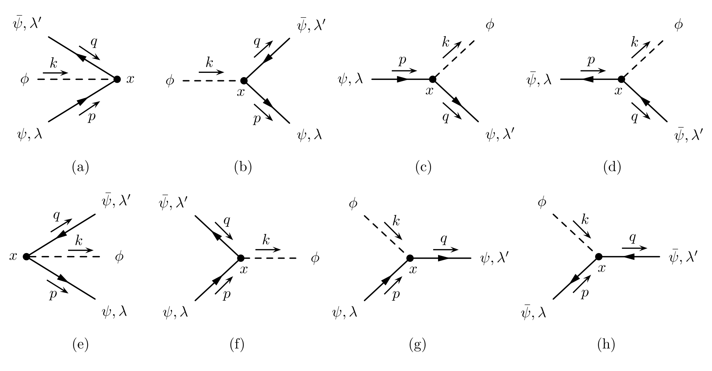

图 6.1: $\mathrm{i}T_1^{(1)}$ 贡献的 8 种三外线 Feynman 图。时间方向自左向右。

可以看到，Feynman 图清晰地体现了运动情况和相互作用过程。此外，还可以让 Feynman 图的每个部分对应于一个代数表达式，将这些表达式拼接起来，就得到散射矩阵元 $\langle f|\mathrm{i}T|i\rangle$ 的表达式。这样的对应过程形成一套 Feynman 规则。以图 6.1(a) 为例，根据 (6.21) 式，三条外线分别对应于场算符 $\phi(x)$、$\bar{\psi}(x)$、$\psi(x)$ 与初态的缩并，从而可以归纳出如下位置空间中的入射外线 Feynman 规则，

$$
\langle 0|\overline{\psi(x)}|\mathbf{p}^+,\lambda\rangle = \langle 0|\psi^{(+)}(x)|\mathbf{p}^+,\lambda\rangle = u(\mathbf{p},\lambda)\mathrm{e}^{-\mathrm{i}p\cdot x},
\tag{6.23}
$$

$$
\langle 0|\overline{\bar{\psi}(x)}|\mathbf{p}^-,\lambda\rangle = \langle 0|\bar{\psi}^{(+)}(x)|\mathbf{p}^-,\lambda\rangle = \bar{v}(\mathbf{p},\lambda)\mathrm{e}^{-\mathrm{i}p\cdot x},
\tag{6.24}
$$

$$
\langle 0|\overline{\phi(x)}|\mathbf{p}\rangle = \langle 0|\phi^{(+)}(x)|\mathbf{p}\rangle = \mathrm{e}^{-\mathrm{i}p\cdot x}.
\tag{6.25}
$$

由于正费米子动量方向与线上方向相同，我们省略了标明动量方向的箭头；反费米子动量方向与线上方向相反，因而将两个箭头都标示出来。也就是说，如果没有标明动量的方向，则它与粒子线上的方向相同。另一方面，位置空间中 Yukawa 相互作用的顶点 Feynman 规则为

$$
\text{[顶点图]}\quad = -\mathrm{i}\kappa\int\mathrm{d}^4x.
\tag{6.26}
$$

现在，我们可以绕过 Wick 定理，直接从图 6.1(a) 出发，根据 Feynman 规则写出散射矩阵元：

$$
\langle 0|\mathrm{i}T_1^{(1)}|\mathbf{p}^+,\lambda;\mathbf{q}^-,\lambda';\mathbf{k}\rangle = -\mathrm{i}\kappa\int\mathrm{d}^4x\,\bar{v}(\mathbf{q},\lambda')u(\mathbf{p},\lambda)\mathrm{e}^{-\mathrm{i}(p+q+k)\cdot x}
\tag{6.27}
$$

在写下费米子的贡献时，应当注意次序，要逆着费米子线上的方向逐项写出来，这样得到的是数 $\bar{v}(\mathbf{q},\lambda')u(\mathbf{p},\lambda)$，而不是矩阵 $u(\mathbf{p},\lambda)\bar{v}(\mathbf{q},\lambda')$。

第 2 种情况中，考虑初态是真空态，$|i\rangle = |0\rangle$，末态包含 1 对正反费米子和 1 个实标量玻色子，$\langle f| = \langle \mathbf{p}^+,\lambda;\mathbf{q}^-,\lambda';\mathbf{k}|$，相应的散射矩阵元为

$$
\begin{aligned}
\langle \mathbf{p}^+,\lambda;\mathbf{q}^-,\lambda';\mathbf{k}|\mathrm{i}T_1^{(1)}|0\rangle
&= -\mathrm{i}\kappa\int\mathrm{d}^4x\,\langle \mathbf{p}^+,\lambda;\mathbf{q}^-,\lambda';\mathbf{k}|\mathrm{N}[\phi(x)\bar{\psi}(x)\psi(x)]|0\rangle\\
&= +\mathrm{i}\kappa\int\mathrm{d}^4x\,\langle \mathbf{p}^+,\lambda;\mathbf{q}^-,\lambda';\mathbf{k}|\phi^{(-)}(x)\psi_a^{(-)}(x)\bar{\psi}_a^{(-)}(x)|0\rangle\\
&= +\mathrm{i}\kappa\int\mathrm{d}^4x\,\langle \mathbf{p}^+,\lambda;\mathbf{q}^-,\lambda';\mathbf{k}|\mathrm{N}[\phi(x)\psi_a(x)\bar{\psi}_a(x)]|0\rangle\\
&= +\mathrm{i}\kappa\int\mathrm{d}^4x\,\langle 0|\mathrm{e}^{\mathrm{i}k\cdot x}v_a(\mathbf{q},\lambda')\mathrm{e}^{\mathrm{i}q\cdot x}\bar{u}_a(\mathbf{p},\lambda)\mathrm{e}^{\mathrm{i}p\cdot x}|0\rangle\\
&= +\mathrm{i}\kappa\int\mathrm{d}^4x\,\bar{u}(\mathbf{p},\lambda)v(\mathbf{q},\lambda')\mathrm{e}^{\mathrm{i}(p+q+k)\cdot x}\\
&= +\mathrm{i}\kappa\,\bar{u}(\mathbf{p},\lambda)v(\mathbf{q},\lambda')\,(2\pi)^4\delta^{(4)}(p+q+k)\\
&= -\mathrm{i}\kappa\int\mathrm{d}^4x\,\langle \mathbf{p}^+,\lambda;\mathbf{q}^-,\lambda';\mathbf{k}|\mathrm{N}[\phi(x)\bar{\psi}(x)\psi(x)]|0\rangle,
\end{aligned}
\tag{6.28}
$$

Feynman 图如图 6.1(e) 所示。由此可以归纳出如下位置空间中的出射外线 Feynman 规则，

$$
\langle \mathbf{p}^+,\lambda|\overline{\bar{\psi}(x)}|0\rangle = \langle \mathbf{p}^+,\lambda|\bar{\psi}^{(-)}(x)|0\rangle = \bar{u}(\mathbf{p},\lambda)\mathrm{e}^{\mathrm{i}p\cdot x},
\tag{6.29}
$$

$$
\langle \mathbf{p}^-,\lambda|\overline{\psi(x)}|0\rangle = \langle \mathbf{p}^-,\lambda|\psi^{(-)}(x)|0\rangle = v(\mathbf{p},\lambda)\mathrm{e}^{\mathrm{i}p\cdot x},
\tag{6.30}
$$

$$
\langle \mathbf{p}|\overline{\phi(x)}|0\rangle = \langle \mathbf{p}|\phi^{(-)}(x)|0\rangle = \mathrm{e}^{\mathrm{i}p\cdot x}.
\tag{6.31}
$$

初末态粒子满足质壳条件 (1.70)，而且能量为正，称为在壳 (on-shell) 粒子。入射外线联系着初态粒子，出射外线联系着末态粒子，因而外线上的动量是在壳的。

在 (6.28) 式的第二步中，我们交换了两个费米子场算符的位置，因而带来一个额外的负号，使最前面的符号从负号变为正号，这样的符号一直保留到倒数第二步的表达式中。不过，不应该认为这改变了顶点 Feynman 规则。应该认为顶点规则 (6.26) 仍然适用，只是在应用时需要考虑交换两个费米子场算符带来的额外负号。散射矩阵元是概率振幅，计算观测量时使用的是它的模方，因而额外的负号对观测量没有影响。然而，在下文中我们会看到，如果一个过程存在多个概率振幅，则振幅之间的相对符号会影响观测量。

在最后一步里面，我们调换第三步中两个费米子场算符的次序，回到相互作用拉氏量中的次序，从而将最前面的符号改回来，但代表场算符缩并的线会纠缠起来。经过这样的处理，我们可以看出第一步与最后一步之间的联系：计算散射矩阵元时，正规乘积的期待值等于将场算符与初末态缩并之后的结果，而且，当场算符次序保持相互作用拉氏量中的次序时，不会出现额外的负号。这就是散射矩阵元的缩并规律。熟悉这个规律之后，我们可以在第一步结果上添加缩并线，直接写出最后一步，再调换场算符将纠缠的缩并线解开，得到第三步，从而跳过用正负能解表达的第二步。这个规律是普遍的，后面的计算会不断地验证它，并且，我们将利用它确定多个振幅之间的相对符号。

剩下的 6 种情况对应于 Feynman 图 6.1(b)、6.1(c)、6.1(d)、6.1(f)、6.1(g)、6.1(h)，相应的散射矩阵元如下。

$$
\begin{aligned}
\text{图 6.1(b):}\quad \langle \mathbf{p}^+,\lambda;\mathbf{q}^-,\lambda'|\mathrm{i}T_1^{(1)}|\mathbf{k}\rangle
&= -\mathrm{i}\kappa\int\mathrm{d}^4x\,\langle \mathbf{p}^+,\lambda;\mathbf{q}^-,\lambda'|\mathrm{N}[\phi(x)\bar{\psi}(x)\psi(x)]|\mathbf{k}\rangle\\
&= +\mathrm{i}\kappa\int\mathrm{d}^4x\,\langle \mathbf{p}^+,\lambda;\mathbf{q}^-,\lambda'|\psi_a^{(-)}(x)\bar{\psi}_a^{(-)}(x)\phi^{(+)}(x)|\mathbf{k}\rangle\\
&= +\mathrm{i}\kappa\int\mathrm{d}^4x\,\langle \mathbf{p}^+,\lambda;\mathbf{q}^-,\lambda'|\mathrm{N}[\psi_a(x)\bar{\psi}_a(x)\phi(x)]|\mathbf{k}\rangle\\
&= +\mathrm{i}\kappa\int\mathrm{d}^4x\,v_a(\mathbf{q},\lambda')\bar{u}_a(\mathbf{p},\lambda)\mathrm{e}^{-\mathrm{i}(k-p-q)\cdot x} = +\mathrm{i}\kappa\int\mathrm{d}^4x\,\bar{u}(\mathbf{p},\lambda)v(\mathbf{q},\lambda')\mathrm{e}^{-\mathrm{i}(k-p-q)\cdot x}\\
&= +\mathrm{i}\kappa\,\bar{u}(\mathbf{p},\lambda)v(\mathbf{q},\lambda')\,(2\pi)^4\delta^{(4)}(k-p-q)\\
&= -\mathrm{i}\kappa\int\mathrm{d}^4x\,\langle \mathbf{p}^+,\lambda;\mathbf{q}^-,\lambda'|\mathrm{N}[\phi(x)\bar{\psi}(x)\psi(x)]|\mathbf{k}\rangle.
\end{aligned}
\tag{6.32}
$$

$$
\begin{aligned}
\text{图 6.1(c):}\quad \langle \mathbf{q}^+,\lambda';\mathbf{k}|\mathrm{i}T_1^{(1)}|\mathbf{p}^+,\lambda\rangle
&= -\mathrm{i}\kappa\int\mathrm{d}^4x\,\langle \mathbf{q}^+,\lambda';\mathbf{k}|\mathrm{N}[\phi(x)\bar{\psi}(x)\psi(x)]|\mathbf{p}^+,\lambda\rangle\\
&= -\mathrm{i}\kappa\int\mathrm{d}^4x\,\langle \mathbf{q}^+,\lambda';\mathbf{k}|\phi^{(-)}(x)\bar{\psi}^{(-)}(x)\psi^{(+)}(x)|\mathbf{p}^+,\lambda\rangle\\
&= -\mathrm{i}\kappa\int\mathrm{d}^4x\,\langle \mathbf{q}^+,\lambda';\mathbf{k}|\mathrm{N}[\phi(x)\bar{\psi}(x)\psi(x)]|\mathbf{p}^+,\lambda\rangle\\
&= -\mathrm{i}\kappa\int\mathrm{d}^4x\,\bar{u}(\mathbf{q},\lambda')u(\mathbf{p},\lambda)\mathrm{e}^{-\mathrm{i}(p-q-k)\cdot x}\\
&= -\mathrm{i}\kappa\,\bar{u}(\mathbf{q},\lambda')u(\mathbf{p},\lambda)\,(2\pi)^4\delta^{(4)}(p-q-k).
\end{aligned}
\tag{6.33}
$$

$$
\begin{aligned}
\text{图 6.1(d):}\quad \langle \mathbf{q}^-,\lambda';\mathbf{k}|\mathrm{i}T_1^{(1)}|\mathbf{p}^-,\lambda\rangle
&= -\mathrm{i}\kappa\int\mathrm{d}^4x\,\langle \mathbf{q}^-,\lambda';\mathbf{k}|\mathrm{N}[\phi(x)\bar{\psi}_a(x)\psi_a(x)]|\mathbf{p}^-,\lambda\rangle\\
&= +\mathrm{i}\kappa\int\mathrm{d}^4x\,\langle \mathbf{q}^-,\lambda';\mathbf{k}|\phi^{(-)}(x)\psi_a^{(-)}(x)\bar{\psi}_a^{(+)}(x)|\mathbf{p}^-,\lambda\rangle\\
&= +\mathrm{i}\kappa\int\mathrm{d}^4x\,\langle \mathbf{q}^-,\lambda';\mathbf{k}|\mathrm{N}[\phi(x)\psi_a(x)\bar{\psi}_a(x)]|\mathbf{p}^-,\lambda\rangle\\
&= +\mathrm{i}\kappa\int\mathrm{d}^4x\,v_a(\mathbf{q},\lambda')\bar{v}_a(\mathbf{p},\lambda)\mathrm{e}^{-\mathrm{i}(p-q-k)\cdot x} = +\mathrm{i}\kappa\int\mathrm{d}^4x\,\bar{v}(\mathbf{p},\lambda)v(\mathbf{q},\lambda')\mathrm{e}^{-\mathrm{i}(p-q-k)\cdot x}\\
&= +\mathrm{i}\kappa\,\bar{v}(\mathbf{p},\lambda)v(\mathbf{q},\lambda')\,(2\pi)^4\delta^{(4)}(p-q-k)\\
&= -\mathrm{i}\kappa\int\mathrm{d}^4x\,\langle \mathbf{q}^-,\lambda';\mathbf{k}|\mathrm{N}[\phi(x)\bar{\psi}(x)\psi(x)]|\mathbf{p}^-,\lambda\rangle.
\end{aligned}
\tag{6.34}
$$

$$
\begin{aligned}
\text{图 6.1(f):}\quad \langle \mathbf{k}|\mathrm{i}T_1^{(1)}|\mathbf{p}^+,\lambda;\mathbf{q}^-,\lambda'\rangle
&= -\mathrm{i}\kappa\int\mathrm{d}^4x\,\langle \mathbf{k}|\mathrm{N}[\phi(x)\bar{\psi}(x)\psi(x)]|\mathbf{p}^+,\lambda;\mathbf{q}^-,\lambda'\rangle\\
&= -\mathrm{i}\kappa\int\mathrm{d}^4x\,\langle \mathbf{k}|\phi^{(-)}(x)\bar{\psi}^{(+)}(x)\psi^{(+)}(x)|\mathbf{p}^+,\lambda;\mathbf{q}^-,\lambda'\rangle\\
&= -\mathrm{i}\kappa\int\mathrm{d}^4x\,\langle \mathbf{k}|\mathrm{N}[\phi(x)\bar{\psi}(x)\psi(x)]|\mathbf{p}^+,\lambda;\mathbf{q}^-,\lambda'\rangle\\
&= -\mathrm{i}\kappa\int\mathrm{d}^4x\,\bar{v}(\mathbf{q},\lambda')u(\mathbf{p},\lambda)\mathrm{e}^{-\mathrm{i}(p+q-k)\cdot x}\\
&= -\mathrm{i}\kappa\,\bar{v}(\mathbf{q},\lambda')u(\mathbf{p},\lambda)\,(2\pi)^4\delta^{(4)}(p+q-k).
\end{aligned}
\tag{6.35}
$$

$$
\begin{aligned}
\text{图 6.1(g):}\quad \langle \mathbf{q}^+,\lambda'|\mathrm{i}T_1^{(1)}|\mathbf{p}^+,\lambda;\mathbf{k}\rangle
&= -\mathrm{i}\kappa\int\mathrm{d}^4x\,\langle \mathbf{q}^+,\lambda'|\mathrm{N}[\phi(x)\bar{\psi}(x)\psi(x)]|\mathbf{p}^+,\lambda;\mathbf{k}\rangle\\
&= -\mathrm{i}\kappa\int\mathrm{d}^4x\,\langle \mathbf{q}^+,\lambda'|\bar{\psi}_a^{(-)}(x)\phi^{(+)}(x)\psi_a^{(+)}(x)|\mathbf{p}^+,\lambda;\mathbf{k}\rangle\\
&= -\mathrm{i}\kappa\int\mathrm{d}^4x\,\langle \mathbf{q}^+,\lambda'|\mathrm{N}[\bar{\psi}_a(x)\phi(x)\psi_a(x)]|\mathbf{p}^+,\lambda;\mathbf{k}\rangle\\
&= -\mathrm{i}\kappa\int\mathrm{d}^4x\,\bar{u}(\mathbf{q},\lambda')u(\mathbf{p},\lambda)\mathrm{e}^{-\mathrm{i}(p+k-q)\cdot x}\\
&= -\mathrm{i}\kappa\,\bar{u}(\mathbf{q},\lambda')u(\mathbf{p},\lambda)\,(2\pi)^4\delta^{(4)}(p+k-q)\\
&= -\mathrm{i}\kappa\int\mathrm{d}^4x\,\langle \mathbf{q}^+,\lambda'|\mathrm{N}[\phi(x)\bar{\psi}(x)\psi(x)]|\mathbf{p}^+,\lambda;\mathbf{k}\rangle.
\end{aligned}
\tag{6.36}
$$

$$
\begin{aligned}
\text{图 6.1(h):}\quad \langle \mathbf{q}^-,\lambda'|\mathrm{i}T_1^{(1)}|\mathbf{p}^-,\lambda;\mathbf{k}\rangle
&= -\mathrm{i}\kappa\int\mathrm{d}^4x\,\langle \mathbf{q}^-,\lambda'|\mathrm{N}[\phi(x)\bar{\psi}(x)\psi(x)]|\mathbf{p}^-,\lambda;\mathbf{k}\rangle\\
&= +\mathrm{i}\kappa\int\mathrm{d}^4x\,\langle \mathbf{q}^-,\lambda'|\psi_a^{(-)}(x)\phi(x)\bar{\psi}_a^{(+)}(x)|\mathbf{p}^-,\lambda;\mathbf{k}\rangle\\
&= +\mathrm{i}\kappa\int\mathrm{d}^4x\,\langle \mathbf{q}^-,\lambda'|\mathrm{N}[\psi_a(x)\phi(x)\bar{\psi}_a(x)]|\mathbf{p}^-,\lambda;\mathbf{k}\rangle\\
&= +\mathrm{i}\kappa\int\mathrm{d}^4x\,v_a(\mathbf{q},\lambda')\bar{v}_a(\mathbf{p},\lambda)\mathrm{e}^{-\mathrm{i}(p+k-q)\cdot x} = +\mathrm{i}\kappa\int\mathrm{d}^4x\,\bar{v}(\mathbf{p},\lambda)v(\mathbf{q},\lambda')\mathrm{e}^{-\mathrm{i}(p+k-q)\cdot x}\\
&= +\mathrm{i}\kappa\,\bar{v}(\mathbf{p},\lambda)v(\mathbf{q},\lambda')\,(2\pi)^4\delta^{(4)}(p+k-q)\\
&= -\mathrm{i}\kappa\int\mathrm{d}^4x\,\langle \mathbf{q}^-,\lambda'|\mathrm{N}[\phi(x)\bar{\psi}(x)\psi(x)]|\mathbf{p}^-,\lambda;\mathbf{k}\rangle.
\end{aligned}
\tag{6.37}
$$

可以验证，对于这 6 种情况，我们也能够从 Feynman 图出发，根据 Feynman 规则把散射矩阵元写出来。注意，顶点规则只有一种形式，即 (6.26) 式；不需要为顶点规则指定时间方向，它适用于各种不同的时间方向和动量方向。

接下来，我们讨论 $\mathrm{i}T_2^{(1)}$，即 (6.20) 式。它包含两个场算符之间的缩并，也就是 5.4 节讨论的 Feynman 传播子。为了使用 Feynman 图，我们需要为 Feynman 传播子设置 Feynman 规则。在位置空间中，Dirac 旋量场和实标量场 Feynman 传播子的 Feynman 规则分别为

$$
\overline{\psi(y)\bar{\psi}(x)} = S_F(y-x) = \int\frac{\mathrm{d}^4p}{(2\pi)^4}\frac{\mathrm{i}(\not{p}+m_\psi)}{p^2-m_\psi^2+\mathrm{i}\epsilon}\mathrm{e}^{-\mathrm{i}p\cdot(y-x)},
\tag{6.38}
$$

$$
\overline{\phi(y)\phi(x)} = D_F(y-x) = \int\frac{\mathrm{d}^4p}{(2\pi)^4}\frac{\mathrm{i}}{p^2-m_\phi^2+\mathrm{i}\epsilon}\mathrm{e}^{-\mathrm{i}p\cdot(y-x)}.
\tag{6.39}
$$

这里用到 Feynman 传播子表达式 (5.264) 和 (5.209)，而 $m_\psi$ 和 $m_\phi$ 分别是 $\psi$ 粒子和 $\phi$ 粒子的质量。在位置空间中，Feynman 传播子是粒子从 $x$ 处顶点传播到 $y$ 处顶点的振幅，我们用一条连接两个顶点的粒子线表示，这样的线称为内线 (internal line)。如前，Dirac 费米子的 Feynman 传播子用带箭头的实线表示，动量方向与箭头方向一致；标量玻色子的 Feynman 传播子用虚线表示，动量方向另外标明。在内线规则的表达式中，需要对动量 $p^\mu$ 的所有取值积分，因此，内线动量可以是在壳的，但更一般的情况是离壳 (off-shell) 的，即不满足质壳条件 (1.70)，而且 $p^0$ 也不一定为正。用内线表示的粒子称为虚粒子 (virtual particle)，描述场的传播行为。虚粒子可以是在壳粒子，也可以是离壳粒子。反过来，用外线表示的粒子称为实粒子 (real particle)，它一定是在壳粒子。

$\mathrm{i}T_2^{(1)}$ 剩下一个标量场 $\phi(x)$ 未参与缩并，我们可以让它与初态或末态缩并。考虑初态包含 1 个实标量玻色子，$|i\rangle = |\mathbf{k}\rangle$，末态是真空态，$\langle f| = \langle 0|$，相应的散射矩阵元为

$$
\begin{aligned}
\langle 0|\mathrm{i}T_2^{(1)}|\mathbf{k}\rangle
&= -\mathrm{i}\kappa\int\mathrm{d}^4x\,\langle 0|\mathrm{N}[\phi(x)\bar{\psi}(x)\psi(x)]|\mathbf{k}\rangle = -\mathrm{i}\kappa\int\mathrm{d}^4x\,\langle 0|\bar{\psi}_a(x)\psi_a(x)\phi^{(+)}(x)|\mathbf{k}\rangle\\
&= -\mathrm{i}\kappa\int\mathrm{d}^4x\,\langle 0|\mathrm{N}[\overline{\bar{\psi}_a(x)\psi_a(x)}\phi(x)]|\mathbf{k}\rangle = +\mathrm{i}\kappa\int\mathrm{d}^4x\,\langle 0|\mathrm{N}[\overline{\psi_a(x)\bar{\psi}_a(x)}\phi(x)]|\mathbf{k}\rangle\\
&= +\mathrm{i}\kappa\int\mathrm{d}^4x\,S_{F,aa}(x-x)\mathrm{e}^{-\mathrm{i}k\cdot x} = +\mathrm{i}\kappa\int\mathrm{d}^4x\,\mathrm{e}^{-\mathrm{i}k\cdot x}\mathrm{tr}[S_F(0)]\\
&= +\mathrm{i}\kappa\,(2\pi)^4\delta^{(4)}(k)\int\frac{\mathrm{d}^4p}{(2\pi)^4}\frac{\mathrm{i}\,\mathrm{tr}(\not{p}+m_\psi)}{p^2-m_\psi^2+\mathrm{i}\epsilon}\\
&= -\mathrm{i}\kappa\int\mathrm{d}^4x\,\langle 0|\mathrm{N}[\phi(x)\bar{\psi}(x)\psi(x)]|\mathbf{k}\rangle.
\end{aligned}
\tag{6.40}
$$

第四步交换了正规乘积中两个费米子场算符的次序，因而带来一个额外的负号。第六步用到矩阵的迹的定义 $\mathrm{tr}[S_F(0)] = S_{F,aa}(0)$。

相应 Feynman 图如图 6.2(a) 所示。$\mathrm{i}T_2^{(1)}$ 中参与缩并的费米子场算符 $\psi(x)$ 和 $\bar{\psi}(x)$ 具有相同的时空坐标 $x$，因而 Feynman 传播子从 $x$ 处的顶点出发，传播回到 $x$ 处的顶点，形成一个封闭的圈。这种包含圈结构的 Feynman 图称为圈图 (loop diagram)。相反，不包含圈结构的 Feynman 图称为树图 (tree diagram)，例如，图 6.1 中的 8 种 Feynman 图都是树图。

从上述计算过程可以看到，一个封闭的费米子圈贡献一个额外的负号，而且需要对 Dirac 矩阵 (或其乘积) 求迹。此外，圈图里出现对一个四维动量 $p^\mu$ 的积分 $\int\mathrm{d}^4p/(2\pi)^4$；这个 $p^\mu$ 的值不能通过初末态的四维动量确定，因而是一个未定的四维动量，称为圈动量 (loop momentum)，在积分时考虑了它的所有取值。这是两个普遍结论，下文还有更多例子。

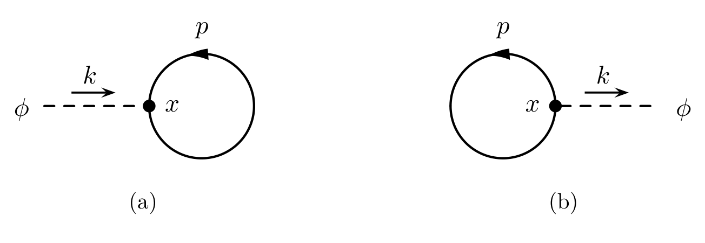

图 6.2: $\mathrm{i}T_2^{(1)}$ 贡献的 2 种蝌蚪图。时间方向自左向右。

在另一种情况中，考虑初态是真空态，$|i\rangle = |0\rangle$，末态包含 1 个标量玻色子，$\langle f| = \langle \mathbf{k}|$，相应的散射矩阵元为

$$
\begin{aligned}
\langle \mathbf{k}|\mathrm{i}T_2^{(1)}|0\rangle
&= -\mathrm{i}\kappa\int\mathrm{d}^4x\,\langle \mathbf{k}|\mathrm{N}[\phi(x)\bar{\psi}(x)\psi(x)]|0\rangle = -\mathrm{i}\kappa\int\mathrm{d}^4x\,\langle \mathbf{k}|\phi^{(-)}(x)\overline{\bar{\psi}_a(x)\psi_a(x)}|0\rangle\\
&= -\mathrm{i}\kappa\int\mathrm{d}^4x\,\langle \mathbf{k}|\mathrm{N}[\phi(x)\bar{\psi}_a(x)\psi_a(x)]|0\rangle = +\mathrm{i}\kappa\int\mathrm{d}^4x\,\langle \mathbf{k}|\mathrm{N}[\phi(x)\overline{\psi_a(x)\bar{\psi}_a(x)}]|0\rangle\\
&= +\mathrm{i}\kappa\int\mathrm{d}^4x\,\mathrm{e}^{\mathrm{i}k\cdot x}S_{F,aa}(x-x) = +\mathrm{i}\kappa\int\mathrm{d}^4x\,\mathrm{e}^{\mathrm{i}k\cdot x}\mathrm{tr}[S_F(0)]\\
&= +\mathrm{i}\kappa\,(2\pi)^4\delta^{(4)}(k)\int\frac{\mathrm{d}^4p}{(2\pi)^4}\frac{\mathrm{i}\,\mathrm{tr}(\not{p}+m_\psi)}{p^2-m_\psi^2+\mathrm{i}\epsilon}\\
&= -\mathrm{i}\kappa\int\mathrm{d}^4x\,\langle \mathbf{k}|\mathrm{N}[\phi(x)\bar{\psi}(x)\psi(x)]|0\rangle.
\end{aligned}
\tag{6.41}
$$

图 6.2(b) 是相应的 Feynman 图。像图 6.2(a) 和 6.2(b) 这样包含一条外线的圈图称为蝌蚪图 (tadpole diagram)。

图 6.1 和 6.2 中列举的 10 个 Feynman 图对应于 10 个动力学允许的过程。但是，其中大多数过程在运动学上并不允许，因为初态和末态不能同时满足能量和动量守恒定律。当 $m_\phi > 2m_\psi$ 时，有 2 个过程是例外的，运动学允许它们发生：Feynman 图 6.1(b) 对应于一个 $\phi$ 粒子衰变成一对正反 $\psi$ 粒子的过程 $\phi\to\psi\bar{\psi}$，Feynman 图 6.1(f) 对应于一对正反 $\psi$ 粒子融合 (fusion) 成一个 $\phi$ 粒子的过程 $\psi\bar{\psi}\to\phi$。

接着，我们计算 $\phi\to\psi\bar{\psi}$ 过程对应的衰变宽度。根据 (5.271) 式，将 (6.32) 式中的 $\delta$ 函数因子 $(2\pi)^4\delta^{(4)}(k-p-q)$ 扔掉，就得到 $\phi\to\psi\bar{\psi}$ 衰变过程的不变振幅

$$
\mathrm{i}\mathcal{M} = \mathrm{i}\kappa\,\bar{u}(\mathbf{p},\lambda)v(\mathbf{q},\lambda').
\tag{6.42}
$$

这是 $\mathrm{i}T$ 展开式第 1 阶的结果，它是贡献到这个过程的最低阶，即领头阶 (leading order)。当 Yukawa 耦合常数 $\kappa$ 比较小时，领头阶的贡献远大于更高阶的贡献。对上式取复共轭 (等同于厄米共轭)，得

$$
(\mathrm{i}\mathcal{M})^* = [\mathrm{i}\kappa u^\dagger(\mathbf{p},\lambda)\gamma^0v(\mathbf{q},\lambda')]^\dagger = -\mathrm{i}\kappa v^\dagger(\mathbf{q},\lambda')\gamma^0u(\mathbf{p},\lambda) = -\mathrm{i}\kappa\bar{v}(\mathbf{q},\lambda')u(\mathbf{p},\lambda).
\tag{6.43}
$$

进而，不变振幅的模方是

$$
\begin{aligned}
|\mathcal{M}|^2 &= \kappa^2\bar{u}(\mathbf{p},\lambda)v(\mathbf{q},\lambda')\bar{v}(\mathbf{q},\lambda')u(\mathbf{p},\lambda) = \kappa^2\bar{u}_a(\mathbf{p},\lambda)v_a(\mathbf{q},\lambda')\bar{v}_b(\mathbf{q},\lambda')u_b(\mathbf{p},\lambda)\\
&= \kappa^2u_b(\mathbf{p},\lambda)\bar{u}_a(\mathbf{p},\lambda)v_a(\mathbf{q},\lambda')\bar{v}_b(\mathbf{q},\lambda') = \kappa^2\,\mathrm{tr}[u(\mathbf{p},\lambda)\bar{u}(\mathbf{p},\lambda)v(\mathbf{q},\lambda')\bar{v}(\mathbf{q},\lambda')].
\end{aligned}
\tag{6.44}
$$

在第一步的结果中，旋量空间中的行矢量 $\bar{u}(\mathbf{p},\lambda)$ 与列矢量 $v(\mathbf{q},\lambda')$ 相乘得到一个数，再乘以行矢量 $\bar{v}(\mathbf{q},\lambda')$ 与列矢量 $u(\mathbf{p},\lambda)$ 相乘得到的数。第二步将行矢量和列矢量的旋量指标明显地写出来，可以看成是对它们的分量进行求和，求和指标是 $a$ 和 $b$。第三步将最右边的 $u_b(\mathbf{p},\lambda)$ 移动到左边，从而，$u_b(\mathbf{p},\lambda)\bar{u}_a(\mathbf{p},\lambda)$ 和 $v_a(\mathbf{q},\lambda')\bar{v}_b(\mathbf{q},\lambda')$ 可以分别看作矩阵 $u(\mathbf{p},\lambda)\bar{u}(\mathbf{p},\lambda)$ 和 $v(\mathbf{q},\lambda')\bar{v}(\mathbf{q},\lambda')$ 的 $ba$ 分量和 $ab$ 分量，因此，对 $a$ 求和表示两个矩阵相乘，对 $b$ 求和表示矩阵乘积的迹。

在计算 $\phi$ 的衰变宽度时，应当包含所有可能的末态，除了包含所有可能的动量取值之外，还要计及所有可能的螺旋态。因此，需要使用对末态粒子螺旋度求和的非极化不变振幅模方

$$
\begin{aligned}
\overline{|\mathcal{M}|^2} &\equiv \sum_{\lambda\lambda'}|\mathcal{M}|^2 = \kappa^2\sum_{\lambda\lambda'}\mathrm{tr}[u(\mathbf{p},\lambda)\bar{u}(\mathbf{p},\lambda)v(\mathbf{q},\lambda')\bar{v}(\mathbf{q},\lambda')]\\
&= \kappa^2\sum_{\lambda'}\mathrm{tr}[(\not{p}+m_\psi)v(\mathbf{q},\lambda')\bar{v}(\mathbf{q},\lambda')] = \kappa^2\,\mathrm{tr}[(\not{p}+m_\psi)(\not{q}-m_\psi)].
\end{aligned}
\tag{6.45}
$$

第三、四步用到自旋求和关系 (4.216)。这种把非极化振幅模方中的旋量计算转化为求迹运算的方法称为 Casimir 技巧 (Casimir's trick)。

现在，我们需要对 Dirac 矩阵及其乘积求迹。对于 Dirac 矩阵的迹，有

$$
\mathrm{tr}(\gamma^\mu) = \mathrm{tr}(\gamma^\mu\gamma^5\gamma^5) = -\mathrm{tr}(\gamma^5\gamma^\mu\gamma^5) = -\mathrm{tr}(\gamma^5\gamma^5\gamma^\mu) = -\mathrm{tr}(\gamma^\mu).
\tag{6.46}
$$

第一步用到 (4.38) 式，第二步用到 (4.41) 式，第三步用到矩阵乘积的性质

$$
\mathrm{tr}(AB) = \mathrm{tr}(BA),
\tag{6.47}
$$

第四步再用一次 (4.38) 式。可见，

$$
\mathrm{tr}(\gamma^\mu) = 0,
\tag{6.48}
$$

故

$$
\mathrm{tr}(\not{p}) = \mathrm{tr}(p_\mu\gamma^\mu) = p_\mu\mathrm{tr}(\gamma^\mu) = 0.
\tag{6.49}
$$

根据 (4.2) 式，两个 Dirac 矩阵乘积的迹满足

$$
\mathrm{tr}(\gamma^\mu\gamma^\nu) = \mathrm{tr}(2g^{\mu\nu}-\gamma^\nu\gamma^\mu) = 2g^{\mu\nu}\mathrm{tr}(\mathbf{1})-\mathrm{tr}(\gamma^\nu\gamma^\mu) = 8g^{\mu\nu}-\mathrm{tr}(\gamma^\mu\gamma^\nu),
\tag{6.50}
$$

从而

$$
\mathrm{tr}(\gamma^\mu\gamma^\nu) = 4g^{\mu\nu},
\tag{6.51}
$$

于是得到

$$
\mathrm{tr}(\not{p}\not{q}) = p_\mu q_\nu\mathrm{tr}(\gamma^\mu\gamma^\nu) = 4p_\mu q_\nu g^{\mu\nu} = 4\,p\cdot q.
\tag{6.52}
$$

利用这些公式，可将 (6.45) 式化为

$$
\overline{|\mathcal{M}|^2} = \kappa^2\mathrm{tr}[(\not{p}\not{q}-m_\psi\not{p}+m_\psi\not{q}-m_\psi^2)] = \kappa^2[\mathrm{tr}(\not{p}\not{q})-m_\psi^2\mathrm{tr}(\mathbf{1})] = 4\kappa^2(p\cdot q-m_\psi^2).
\tag{6.53}
$$

根据质壳条件 $k^2 = m_\phi^2$、$p^2 = q^2 = m_\psi^2$ 和能动量守恒关系 $k^\mu = p^\mu+q^\mu$，有

$$
m_\phi^2 = k^2 = (p+q)^2 = p^2+q^2+2p\cdot q = 2(m_\psi^2+p\cdot q),
\tag{6.54}
$$

故

$$
p\cdot q = \frac{m_\phi^2}{2}-m_\psi^2,\quad p\cdot q-m_\psi^2 = \frac{1}{2}(m_\phi^2-4m_\psi^2) = \frac{m_\phi^2}{2}\left(1-\frac{4m_\psi^2}{m_\phi^2}\right).
\tag{6.55}
$$

$\psi$ 与 $\bar{\psi}$ 是不全同的正反粒子，末态对称性因子 $\mathcal{S} = 1$，由 (5.379) 式得到 $\phi\to\psi\bar{\psi}$ 过程的领头阶衰变宽度

$$
\begin{aligned}
\Gamma(\phi\to\psi\bar{\psi}) &= \frac{\overline{|\mathcal{M}|^2}}{16\pi m_\phi}\sqrt{1-\frac{4m_\psi^2}{m_\phi^2}} = \frac{\kappa^2}{4\pi m_\phi}\sqrt{1-\frac{4m_\psi^2}{m_\phi^2}}\,(p\cdot q-m_\psi^2)\\
&= \frac{\kappa^2m_\phi}{8\pi}\left(1-\frac{4m_\psi^2}{m_\phi^2}\right)^{3/2}.
\end{aligned}
\tag{6.56}
$$

如果 $m_\phi = 2m_\psi$，则 $\Gamma(\phi\to\psi\bar{\psi}) = 0$，$\phi\to\psi\bar{\psi}$ 衰变过程不能发生。

### 6.1.2 κ² 阶 Feynman 图

在 $\mathrm{i}T$ 展开式的第 2 阶，即 $\kappa^2$ 阶，由 (6.5) 式得

$$
\mathrm{i}T^{(2)} = \frac{(-\mathrm{i}\kappa)^2}{2!}\int\mathrm{d}^4x\,\mathrm{d}^4y\,\mathrm{T}[\phi(x)\bar{\psi}(x)\psi(x)\phi(y)\bar{\psi}(y)\psi(y)] = \sum_{j=1}^{14}\mathrm{i}T_j^{(2)},
\tag{6.57}
$$

根据 Wick 定理，共有 14 个非平庸的项 $\mathrm{i}T_j^{(2)}$。首先，有 1 项不包含缩并，

$$
\mathrm{i}T_1^{(2)} = \frac{(-\mathrm{i}\kappa)^2}{2!}\int\mathrm{d}^4x\,\mathrm{d}^4y\,\mathrm{N}[\phi(x)\bar{\psi}(x)\psi(x)\phi(y)\bar{\psi}(y)\psi(y)].
\tag{6.58}
$$

其次，有 5 项包含 1 次缩并，

$$
\mathrm{i}T_2^{(2)} = \frac{(-\mathrm{i}\kappa)^2}{2!}\int\mathrm{d}^4x\,\mathrm{d}^4y\,\mathrm{N}[\overline{\phi(x)\bar{\psi}(x)\psi(x)\phi(y)}\bar{\psi}(y)\psi(y)],
\tag{6.59}
$$

$$
\mathrm{i}T_3^{(2)} = \frac{(-\mathrm{i}\kappa)^2}{2!}\int\mathrm{d}^4x\,\mathrm{d}^4y\,\mathrm{N}[\phi(x)\bar{\psi}(x)\overline{\psi(x)\phi(y)\bar{\psi}(y)}\psi(y)],
\tag{6.60}
$$

$$
\mathrm{i}T_4^{(2)} = \frac{(-\mathrm{i}\kappa)^2}{2!}\int\mathrm{d}^4x\,\mathrm{d}^4y\,\mathrm{N}[\phi(x)\overline{\bar{\psi}(x)\psi(x)\phi(y)\bar{\psi}(y)\psi(y)}],
\tag{6.61}
$$

$$
\mathrm{i}T_5^{(2)} = \frac{(-\mathrm{i}\kappa)^2}{2!}\int\mathrm{d}^4x\,\mathrm{d}^4y\,\mathrm{N}[\phi(x)\overline{\bar{\psi}(x)\psi(x)}\phi(y)\bar{\psi}(y)\psi(y)],
\tag{6.62}
$$

$$
\mathrm{i}T_6^{(2)} = \frac{(-\mathrm{i}\kappa)^2}{2!}\int\mathrm{d}^4x\,\mathrm{d}^4y\,\mathrm{N}[\phi(x)\bar{\psi}(x)\psi(x)\phi(y)\overline{\bar{\psi}(y)\psi(y)}].
\tag{6.63}
$$

再次，有 6 项包含 2 次缩并，

$$
\mathrm{i}T_7^{(2)} = \frac{(-\mathrm{i}\kappa)^2}{2!}\int\mathrm{d}^4x\,\mathrm{d}^4y\,\mathrm{N}[\phi(x)\bar{\psi}(x)\psi(x)\phi(y)\bar{\psi}(y)\psi(y)],
\tag{6.64}
$$

$$
\mathrm{i}T_8^{(2)} = \frac{(-\mathrm{i}\kappa)^2}{2!}\int\mathrm{d}^4x\,\mathrm{d}^4y\,\mathrm{N}[\phi(x)\bar{\psi}(x)\psi(x)\phi(y)\bar{\psi}(y)\psi(y)],
\tag{6.65}
$$

$$
\mathrm{i}T_9^{(2)} = \frac{(-\mathrm{i}\kappa)^2}{2!}\int\mathrm{d}^4x\,\mathrm{d}^4y\,\mathrm{N}[\phi(x)\bar{\psi}(x)\psi(x)\phi(y)\bar{\psi}(y)\psi(y)],
\tag{6.66}
$$

$$
\mathrm{i}T_{10}^{(2)} = \frac{(-\mathrm{i}\kappa)^2}{2!}\int\mathrm{d}^4x\,\mathrm{d}^4y\,\mathrm{N}[\phi(x)\bar{\psi}(x)\psi(x)\phi(y)\bar{\psi}(y)\psi(y)],
\tag{6.67}
$$

$$
\mathrm{i}T_{11}^{(2)} = \frac{(-\mathrm{i}\kappa)^2}{2!}\int\mathrm{d}^4x\,\mathrm{d}^4y\,\mathrm{N}[\phi(x)\bar{\psi}(x)\psi(x)\phi(y)\bar{\psi}(y)\psi(y)],
\tag{6.68}
$$

$$
\mathrm{i}T_{12}^{(2)} = \frac{(-\mathrm{i}\kappa)^2}{2!}\int\mathrm{d}^4x\,\mathrm{d}^4y\,\mathrm{N}[\phi(x)\bar{\psi}(x)\psi(x)\phi(y)\bar{\psi}(y)\psi(y)],
\tag{6.69}
$$

最后，有 2 项包含 3 次缩并，

$$
\mathrm{i}T_{13}^{(2)} = \frac{(-\mathrm{i}\kappa)^2}{2!}\int\mathrm{d}^4x\,\mathrm{d}^4y\,\mathrm{N}[\phi(x)\bar{\psi}(x)\psi(x)\phi(y)\bar{\psi}(y)\psi(y)],
\tag{6.70}
$$

$$
\mathrm{i}T_{14}^{(2)} = \frac{(-\mathrm{i}\kappa)^2}{2!}\int\mathrm{d}^4x\,\mathrm{d}^4y\,\mathrm{N}[\phi(x)\bar{\psi}(x)\psi(x)\phi(y)\bar{\psi}(y)\psi(y)].
\tag{6.71}
$$

下面讨论几个相关过程。

(1) 首先，考虑 $\psi\bar{\psi}\to\psi\bar{\psi}$ 散射过程，初态记为 $|i\rangle = |\mathbf{p}_1^+,\lambda_1;\mathbf{p}_2^-,\lambda_2\rangle$，末态记为 $\langle f| = \langle \mathbf{q}_1^+,\lambda_1';\mathbf{q}_2^-,\lambda_2'|$。根据 (6.59) 式，$\mathrm{i}T_2^{(2)}$ 对这个过程贡献的散射矩阵元是

$$
\begin{aligned}
\langle \mathbf{q}_1^+,\lambda_1';\mathbf{q}_2^-,\lambda_2'|\mathrm{i}T_2^{(2)}|\mathbf{p}_1^+,\lambda_1;\mathbf{p}_2^-,\lambda_2\rangle
&= \frac{(-\mathrm{i}\kappa)^2}{2!}\int\mathrm{d}^4x\,\mathrm{d}^4y\,\langle \mathbf{q}_1^+,\lambda_1';\mathbf{q}_2^-,\lambda_2'|\mathrm{N}[\phi(x)\bar{\psi}(x)\psi(x)\phi(y)\bar{\psi}(y)\psi(y)]|\mathbf{p}_1^+,\lambda_1;\mathbf{p}_2^-,\lambda_2\rangle\\
&= \frac{(-\mathrm{i}\kappa)^2}{2!}\int\mathrm{d}^4x\,\mathrm{d}^4y\,\langle \mathbf{q}_1^+,\lambda_1';\mathbf{q}_2^-,\lambda_2'|\mathrm{N}[-\psi_a^{(-)}(x)\bar{\psi}_a^{(-)}(x)\phi(x)\phi(y)\bar{\psi}_b^{(+)}(y)\psi_b^{(+)}(y)\\
&\qquad -\psi_b^{(-)}(y)\bar{\psi}_b^{(-)}(y)\phi(x)\phi(y)\bar{\psi}_a^{(+)}(x)\psi_a^{(+)}(x) + \psi_a^{(-)}(x)\bar{\psi}_b^{(-)}(y)\phi(x)\phi(y)\bar{\psi}_a^{(+)}(x)\psi_b^{(+)}(y)\\
&\qquad +\psi_b^{(-)}(y)\bar{\psi}_a^{(-)}(x)\phi(x)\phi(y)\bar{\psi}_b^{(+)}(y)\psi_a^{(+)}(x)]|\mathbf{p}_1^+,\lambda_1;\mathbf{p}_2^-,\lambda_2\rangle\\
&= -(-\mathrm{i}\kappa)^2\int\mathrm{d}^4x\,\mathrm{d}^4y\,\langle \mathbf{q}_1^+,\lambda_1';\mathbf{q}_2^-,\lambda_2'|\mathrm{N}[\psi_a^{(-)}(x)\bar{\psi}_a^{(-)}(x)\phi(x)\phi(y)\bar{\psi}_b^{(+)}(y)\psi_b^{(+)}(y)\\
&\qquad -\psi_a^{(-)}(x)\bar{\psi}_b^{(-)}(y)\phi(x)\phi(y)\bar{\psi}_a^{(+)}(x)\psi_b^{(+)}(y)]|\mathbf{p}_1^+,\lambda_1;\mathbf{p}_2^-,\lambda_2\rangle\\
&= -(-\mathrm{i}\kappa)^2\int\mathrm{d}^4x\,\mathrm{d}^4y\\
&\qquad\times\Big\{\langle \mathbf{q}_1^+,\lambda_1';\mathbf{q}_2^-,\lambda_2'|\mathrm{N}[\psi_a(x)\bar{\psi}_a(x)\phi(x)\phi(y)\psi_b(y)\bar{\psi}_b(y)]|\mathbf{p}_1^+,\lambda_1;\mathbf{p}_2^-,\lambda_2\rangle\\
&\qquad\qquad -\langle \mathbf{q}_1^+,\lambda_1';\mathbf{q}_2^-,\lambda_2'|\mathrm{N}[\psi_a(x)\bar{\psi}_b(y)\phi(x)\phi(y)\bar{\psi}_a(x)\psi_b(y)]|\mathbf{p}_1^+,\lambda_1;\mathbf{p}_2^-,\lambda_2\rangle\Big\}\\
&= (-\mathrm{i}\kappa)^2\int\mathrm{d}^4x\,\mathrm{d}^4y\,\Big\{\langle \mathbf{q}_1^+,\lambda_1';\mathbf{q}_2^-,\lambda_2'|\mathrm{N}[\phi(x)\bar{\psi}(x)\psi(x)\phi(y)\bar{\psi}(y)\psi(y)]|\mathbf{p}_1^+,\lambda_1;\mathbf{p}_2^-,\lambda_2\rangle\\
&\qquad +\langle \mathbf{q}_1^+,\lambda_1';\mathbf{q}_2^-,\lambda_2'|\mathrm{N}[\phi(x)\bar{\psi}(x)\psi(x)\phi(y)\bar{\psi}(y)\psi(y)]|\mathbf{p}_1^+,\lambda_1;\mathbf{p}_2^-,\lambda_2\rangle\Big\}.
\end{aligned}
\tag{6.72}
$$

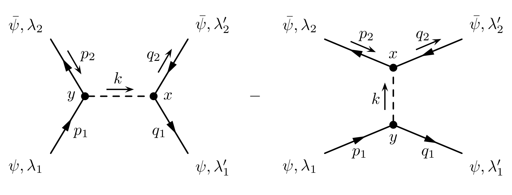

图 6.3: $\mathrm{i}T_2^{(2)}$ 贡献的 $\psi\bar{\psi}\to\psi\bar{\psi}$ 散射过程 Feynman 图，包含两个子图，相对符号为负。时间方向自左向右。

第二步将场算符分解为正负能解，得到 4 个非零项。根据 (5.211) 式，$\phi(y)\phi(x) = \phi(x)\phi(y)$，可以看出，对第 2 项交换时空坐标 $x$ 和 $y$ 得到的结果与第 1 项相同，因而可以只保留一项，再乘上一个 $2!$ 因子，它刚好与最前面的 $1/2!$ 因子抵消。类似地，第 3 项与第 4 项也具有这种交换 $x$ 和 $y$ 的对称性。在第三步中，我们只保留第 1 项和第 3 项，消去前面的 $1/2!$ 因子，并提取一个整体负号出来。这个规律是普遍的：(6.4) 式里面 $\mathrm{i}T^{(n)}$ 中的 $1/n!$ 因子总是恰好与时空坐标的交换对称性引起的 $n!$ 因子抵消。第四步写成场算符与初末态缩并的形式，花括号中两项相差一个负号，即相对符号为负。第五步将场算符调回 (6.59) 式中的次序，不再出现额外的负号，验证了前述散射矩阵元的缩并规律。

相应的 Feynman 图如图 6.3 所示，包含 2 个子图，分别具有 2 个顶点、4 条外线和 1 条内线。相应地，这个过程的总不变振幅 $\mathrm{i}\mathcal{M}$ 是 2 个不变振幅的叠加，两者之间的相对符号为负，根据 (5.310) 式计算散射截面时，用到的是总不变振幅的模方 $|\mathcal{M}|^2$，这样的相对符号决定其中干涉项的符号，因此，对于正确地计算散射截面至关重要。

由 (6.72) 式倒数第二步的结果得

$$
\begin{aligned}
\langle \mathbf{q}_1^+,\lambda_1';\mathbf{q}_2^-,\lambda_2'|\mathrm{i}T_2^{(2)}|\mathbf{p}_1^+,\lambda_1;\mathbf{p}_2^-,\lambda_2\rangle
&= -(-\mathrm{i}\kappa)^2\int\mathrm{d}^4x\,\mathrm{d}^4y\\
&\quad\times\Big[v_a(\mathbf{q}_2,\lambda_2')\mathrm{e}^{\mathrm{i}q_2\cdot x}\bar{u}_a(\mathbf{q}_1,\lambda_1')\mathrm{e}^{\mathrm{i}q_1\cdot x}\int\frac{\mathrm{d}^4k}{(2\pi)^4}\frac{\mathrm{i}\mathrm{e}^{-\mathrm{i}k\cdot(x-y)}}{k^2-m_\phi^2+\mathrm{i}\epsilon}\bar{v}_b(\mathbf{p}_2,\lambda_2)\mathrm{e}^{-\mathrm{i}p_2\cdot y}u_b(\mathbf{p}_1,\lambda_1)\mathrm{e}^{-\mathrm{i}p_1\cdot y}\\
&\qquad -v_a(\mathbf{q}_2,\lambda_2')\mathrm{e}^{\mathrm{i}q_2\cdot x}\bar{u}_b(\mathbf{q}_1,\lambda_1')\mathrm{e}^{\mathrm{i}q_1\cdot y}\int\frac{\mathrm{d}^4k}{(2\pi)^4}\frac{\mathrm{i}\mathrm{e}^{-\mathrm{i}k\cdot(x-y)}}{k^2-m_\phi^2+\mathrm{i}\epsilon}\bar{v}_a(\mathbf{p}_2,\lambda_2)\mathrm{e}^{-\mathrm{i}p_2\cdot x}u_b(\mathbf{p}_1,\lambda_1)\mathrm{e}^{-\mathrm{i}p_1\cdot y}\Big]\\
&= -(-\mathrm{i}\kappa)^2\int\frac{\mathrm{d}^4k}{(2\pi)^4}\Big[\bar{u}(\mathbf{q}_1,\lambda_1')v(\mathbf{q}_2,\lambda_2')\frac{\mathrm{i}}{k^2-m_\phi^2+\mathrm{i}\epsilon}\bar{v}(\mathbf{p}_2,\lambda_2)u(\mathbf{p}_1,\lambda_1)\\
&\qquad\times(2\pi)^4\delta^{(4)}(k-q_1-q_2)(2\pi)^4\delta^{(4)}(p_1+p_2-k)\\
&\qquad -\bar{v}(\mathbf{p}_2,\lambda_2)v(\mathbf{q}_2,\lambda_2')\frac{\mathrm{i}}{k^2-m_\phi^2+\mathrm{i}\epsilon}\bar{u}(\mathbf{q}_1,\lambda_1')u(\mathbf{p}_1,\lambda_1)\\
&\qquad\times(2\pi)^4\delta^{(4)}(k+p_2-q_2)(2\pi)^4\delta^{(4)}(p_1-q_1-k)\Big]\\
&= -(-\mathrm{i}\kappa)^2\Big[\bar{u}(\mathbf{q}_1,\lambda_1')v(\mathbf{q}_2,\lambda_2')\frac{\mathrm{i}}{(p_1+p_2)^2-m_\phi^2+\mathrm{i}\epsilon}\bar{v}(\mathbf{p}_2,\lambda_2)u(\mathbf{p}_1,\lambda_1)\\
&\qquad -\bar{v}(\mathbf{p}_2,\lambda_2)v(\mathbf{q}_2,\lambda_2')\frac{\mathrm{i}}{(p_1-q_1)^2-m_\phi^2+\mathrm{i}\epsilon}\bar{u}(\mathbf{q}_1,\lambda_1')u(\mathbf{p}_1,\lambda_1)\Big]\\
&\quad\times(2\pi)^4\delta^{(4)}(p_1+p_2-q_1-q_2).
\end{aligned}
\tag{6.73}
$$

第二步对 $x$ 和 $y$ 分别积分，使方括号中每一项都具有 2 个四维 $\delta$ 函数，它们分别代表 2 个顶点处的能动量守恒关系；第一项的关系为 $k^\mu = q_1^\mu+q_2^\mu$ 和 $k^\mu = p_1^\mu+p_2^\mu$，第二项的关系为 $k^\mu = q_2^\mu-p_2^\mu$ 和 $k^\mu = p_1^\mu-q_1^\mu$。可见，与同一顶点相连的内外线的四维动量应满足能动量守恒定律。第三步对 $k$ 积分，消去 1 个四维 $\delta$ 函数，剩下的 1 个四维 $\delta$ 函数 $\delta^{(4)}(p_1+p_2-q_1-q_2)$ 代表初末态 4 个粒子满足的能动量守恒定律。这符合 (5.271) 式的形式，相应的不变振幅为

$$
\mathrm{i}\mathcal{M} = -(-\mathrm{i}\kappa)^2\Big[\bar{u}(\mathbf{q}_1,\lambda_1')v(\mathbf{q}_2,\lambda_2')\frac{\mathrm{i}}{(p_1+p_2)^2-m_\phi^2+\mathrm{i}\epsilon}\bar{v}(\mathbf{p}_2,\lambda_2)u(\mathbf{p}_1,\lambda_1)
-\bar{v}(\mathbf{p}_2,\lambda_2)v(\mathbf{q}_2,\lambda_2')\frac{\mathrm{i}}{(p_1-q_1)^2-m_\phi^2+\mathrm{i}\epsilon}\bar{u}(\mathbf{q}_1,\lambda_1')u(\mathbf{p}_1,\lambda_1)\Big].
\tag{6.74}
$$

这个表达式不包含积分，内线动量由外线动量完全确定，这是树图的特征。

(2) $\mathrm{i}T_2^{(2)}$ 也可以贡献到 $\psi\psi\to\psi\psi$ 散射过程，记初态为 $|i\rangle = |\mathbf{p}_1^+,\lambda_1;\mathbf{p}_2^+,\lambda_2\rangle$，末态为 $\langle f| = \langle \mathbf{q}_1^+,\lambda_1';\mathbf{q}_2^+,\lambda_2'|$，由 (6.59) 式得散射矩阵元为

$$
\begin{aligned}
\langle \mathbf{q}_1^+,\lambda_1';\mathbf{q}_2^+,\lambda_2'|\mathrm{i}T_2^{(2)}|\mathbf{p}_1^+,\lambda_1;\mathbf{p}_2^+,\lambda_2\rangle
&= \frac{(-\mathrm{i}\kappa)^2}{2!}\int\mathrm{d}^4x\,\mathrm{d}^4y\,\langle \mathbf{q}_1^+,\lambda_1';\mathbf{q}_2^+,\lambda_2'|\mathrm{N}[\phi(x)\bar{\psi}(x)\psi(x)\phi(y)\bar{\psi}(y)\psi(y)]|\mathbf{p}_1^+,\lambda_1;\mathbf{p}_2^+,\lambda_2\rangle\\
&= -\frac{(-\mathrm{i}\kappa)^2}{2!}\int\mathrm{d}^4x\,\mathrm{d}^4y\,\langle \mathbf{q}_1^+,\lambda_1';\mathbf{q}_2^+,\lambda_2'|\mathrm{N}[\bar{\psi}_a^{(-)}(x)\bar{\psi}_b^{(-)}(y)\\
&\qquad\times\phi(x)\phi(y)\psi_a^{(+)}(x)\psi_b^{(+)}(y)]|\mathbf{p}_1^+,\lambda_1;\mathbf{p}_2^+,\lambda_2\rangle.
\end{aligned}
\tag{6.75}
$$

上式最后一行出现了两个正能解旋量场算符对全同费米子初态的作用，作用结果为

$$
\begin{aligned}
\psi_a^{(+)}(x)\psi_b^{(+)}(y)|\mathbf{p}_1^+,\lambda_1;\mathbf{p}_2^+,\lambda_2\rangle
&= \int\frac{\mathrm{d}^3k_1\,\mathrm{d}^3k_2}{(2\pi)^6\sqrt{4E_{\mathbf{k}_1}E_{\mathbf{k}_2}}}\sum_{\sigma_1\sigma_2}u_a(\mathbf{k}_1,\sigma_1)\mathrm{e}^{-\mathrm{i}k_1\cdot x}u_b(\mathbf{k}_2,\sigma_2)\mathrm{e}^{-\mathrm{i}k_2\cdot y}\sqrt{4E_{\mathbf{p}_1}E_{\mathbf{p}_2}}\,a_{\mathbf{k}_1,\sigma_1}a_{\mathbf{k}_2,\sigma_2}a_{\mathbf{p}_1,\lambda_1}^\dagger a_{\mathbf{p}_2,\lambda_2}^\dagger|0\rangle\\
&= \int\frac{\mathrm{d}^3k_1\,\mathrm{d}^3k_2}{(2\pi)^6}\sqrt{\frac{E_{\mathbf{p}_1}E_{\mathbf{p}_2}}{E_{\mathbf{k}_1}E_{\mathbf{k}_2}}}\mathrm{e}^{-\mathrm{i}(k_1\cdot x+k_2\cdot y)}\sum_{\sigma_1\sigma_2}u_a(\mathbf{k}_1,\sigma_1)u_b(\mathbf{k}_2,\sigma_2)\\
&\qquad\times a_{\mathbf{k}_1,\sigma_1}[(2\pi)^3\delta_{\sigma_2\lambda_1}\delta^{(3)}(\mathbf{k}_2-\mathbf{p}_1)-a_{\mathbf{p}_1,\lambda_1}^\dagger a_{\mathbf{k}_2,\sigma_2}]a_{\mathbf{p}_2,\lambda_2}^\dagger|0\rangle\\
&= \int\frac{\mathrm{d}^3k_1\,\mathrm{d}^3k_2}{(2\pi)^6}\sqrt{\frac{E_{\mathbf{p}_1}E_{\mathbf{p}_2}}{E_{\mathbf{k}_1}E_{\mathbf{k}_2}}}\mathrm{e}^{-\mathrm{i}(k_1\cdot x+k_2\cdot y)}\sum_{\sigma_1\sigma_2}u_a(\mathbf{k}_1,\sigma_1)u_b(\mathbf{k}_2,\sigma_2)\\
&\qquad\times(2\pi)^6[\delta_{\sigma_2\lambda_1}\delta^{(3)}(\mathbf{k}_2-\mathbf{p}_1)\delta_{\sigma_1\lambda_2}\delta^{(3)}(\mathbf{k}_1-\mathbf{p}_2)-\delta_{\sigma_1\lambda_1}\delta^{(3)}(\mathbf{k}_1-\mathbf{p}_1)\delta_{\sigma_2\lambda_2}\delta^{(3)}(\mathbf{k}_2-\mathbf{p}_2)]|0\rangle\\
&= [u_a(\mathbf{p}_2,\lambda_2)u_b(\mathbf{p}_1,\lambda_1)\mathrm{e}^{-\mathrm{i}(p_2\cdot x+p_1\cdot y)}-u_a(\mathbf{p}_1,\lambda_1)u_b(\mathbf{p}_2,\lambda_2)\mathrm{e}^{-\mathrm{i}(p_1\cdot x+p_2\cdot y)}]|0\rangle\\
&= \mathrm{N}[\overline{\psi_a(x)\psi_b(y)}]|\mathbf{p}_1^+,\lambda_1;\mathbf{p}_2^+,\lambda_2\rangle-\mathrm{N}[\overline{\psi_b(y)\psi_a(x)}]|\mathbf{p}_1^+,\lambda_1;\mathbf{p}_2^+,\lambda_2\rangle\\
&= \mathrm{N}[\overline{\psi_a(x)\psi_b(y)}]|\mathbf{p}_1^+,\lambda_1;\mathbf{p}_2^+,\lambda_2\rangle+\mathrm{N}[\underline{\psi_a(x)\psi_b(y)}]|\mathbf{p}_1^+,\lambda_1;\mathbf{p}_2^+,\lambda_2\rangle.
\end{aligned}
\tag{6.76}
$$

可见，这种作用对应于场算符与初态的两种可能缩并。倒数第二、三步中第二项前面的负号体现了交换全同费米子的反对称性；交换两个场算符恢复原来的次序之后，这个负号没有出现在最后一步中，此时表示缩并的线纠缠起来。

(6.75) 式倒数第二行出现了两个负能解旋量场算符对全同费米子末态的作用，作用结果为

$$
\begin{aligned}
\langle \mathbf{q}_1^+,\lambda_1';\mathbf{q}_2^+,\lambda_2'|\bar{\psi}_a^{(-)}(x)\bar{\psi}_b^{(-)}(y)
&= \int\frac{\mathrm{d}^3k_1\,\mathrm{d}^3k_2}{(2\pi)^6\sqrt{4E_{\mathbf{k}_1}E_{\mathbf{k}_2}}}\sum_{\sigma_1\sigma_2}\bar{u}_a(\mathbf{k}_1,\sigma_1)\mathrm{e}^{\mathrm{i}k_1\cdot x}\bar{u}_b(\mathbf{k}_2,\sigma_2)\mathrm{e}^{\mathrm{i}k_2\cdot y}\sqrt{4E_{\mathbf{q}_1}E_{\mathbf{q}_2}}\langle 0|a_{\mathbf{q}_1,\lambda_1'}a_{\mathbf{q}_2,\lambda_2'}a_{\mathbf{k}_1,\sigma_1}^\dagger a_{\mathbf{k}_2,\sigma_2}^\dagger\\
&= \int\frac{\mathrm{d}^3k_1\,\mathrm{d}^3k_2}{(2\pi)^6}\sqrt{\frac{E_{\mathbf{q}_1}E_{\mathbf{q}_2}}{E_{\mathbf{k}_1}E_{\mathbf{k}_2}}}\mathrm{e}^{\mathrm{i}(k_1\cdot x+k_2\cdot y)}\sum_{\sigma_1\sigma_2}\bar{u}_a(\mathbf{k}_1,\sigma_1)\bar{u}_b(\mathbf{k}_2,\sigma_2)\\
&\qquad\times\langle 0|a_{\mathbf{q}_1,\lambda_1'}[(2\pi)^3\delta_{\lambda_2'\sigma_1}\delta^{(3)}(\mathbf{q}_2-\mathbf{k}_1)-a_{\mathbf{k}_1,\sigma_1}^\dagger a_{\mathbf{q}_2,\lambda_2'}]a_{\mathbf{k}_2,\sigma_2}^\dagger\\
&= \int\frac{\mathrm{d}^3k_1\,\mathrm{d}^3k_2}{(2\pi)^6}\sqrt{\frac{E_{\mathbf{q}_1}E_{\mathbf{q}_2}}{E_{\mathbf{k}_1}E_{\mathbf{k}_2}}}\mathrm{e}^{\mathrm{i}(k_1\cdot x+k_2\cdot y)}\sum_{\sigma_1\sigma_2}\bar{u}_a(\mathbf{k}_1,\sigma_1)\bar{u}_b(\mathbf{k}_2,\sigma_2)\\
&\qquad\times\langle 0|(2\pi)^6[\delta_{\lambda_2'\sigma_1}\delta^{(3)}(\mathbf{q}_2-\mathbf{k}_1)\delta_{\lambda_1'\sigma_2}\delta^{(3)}(\mathbf{q}_1-\mathbf{k}_2)-\delta_{\lambda_1'\sigma_1}\delta^{(3)}(\mathbf{q}_1-\mathbf{k}_1)\delta_{\lambda_2'\sigma_2}\delta^{(3)}(\mathbf{q}_2-\mathbf{k}_2)]\\
&= \langle 0|[\bar{u}_a(\mathbf{q}_2,\lambda_2')\bar{u}_b(\mathbf{q}_1,\lambda_1')\mathrm{e}^{\mathrm{i}(q_2\cdot x+q_1\cdot y)}-\bar{u}_a(\mathbf{q}_1,\lambda_1')\bar{u}_b(\mathbf{q}_2,\lambda_2')\mathrm{e}^{\mathrm{i}(q_1\cdot x+q_2\cdot y)}]\\
&= \langle \mathbf{q}_1^+,\lambda_1';\mathbf{q}_2^+,\lambda_2'|\mathrm{N}[\overline{\bar{\psi}_a(x)\bar{\psi}_b(y)}]-\langle \mathbf{q}_1^+,\lambda_1';\mathbf{q}_2^+,\lambda_2'|\mathrm{N}[\overline{\bar{\psi}_b(y)\bar{\psi}_a(x)}]\\
&= \langle \mathbf{q}_1^+,\lambda_1';\mathbf{q}_2^+,\lambda_2'|\mathrm{N}[\overline{\bar{\psi}_a(x)\bar{\psi}_b(y)}]+\langle \mathbf{q}_1^+,\lambda_1';\mathbf{q}_2^+,\lambda_2'|\mathrm{N}[\underline{\bar{\psi}_a(x)\bar{\psi}_b(y)}].
\end{aligned}
\tag{6.77}
$$

可见，这种作用对应于场算符与末态的两种可能缩并。

于是，(6.75) 式化为

$$
\begin{aligned}
\langle \mathbf{q}_1^+,\lambda_1';\mathbf{q}_2^+,\lambda_2'|\mathrm{i}T_2^{(2)}|\mathbf{p}_1^+,\lambda_1;\mathbf{p}_2^+,\lambda_2\rangle
&= -\frac{(-\mathrm{i}\kappa)^2}{2!}\int\mathrm{d}^4x\,\mathrm{d}^4y\\
&\quad\times\Big\{\langle \mathbf{q}_1^+,\lambda_1';\mathbf{q}_2^+,\lambda_2'|\mathrm{N}[\bar{\psi}_a(x)\bar{\psi}_b(y)\phi(x)\phi(y)\psi_a(x)\psi_b(y)]|\mathbf{p}_1^+,\lambda_1;\mathbf{p}_2^+,\lambda_2\rangle\\
&\qquad -\langle \mathbf{q}_1^+,\lambda_1';\mathbf{q}_2^+,\lambda_2'|\mathrm{N}[\bar{\psi}_b(y)\bar{\psi}_a(x)\phi(x)\phi(y)\psi_a(x)\psi_b(y)]|\mathbf{p}_1^+,\lambda_1;\mathbf{p}_2^+,\lambda_2\rangle\\
&\qquad -\langle \mathbf{q}_1^+,\lambda_1';\mathbf{q}_2^+,\lambda_2'|\mathrm{N}[\bar{\psi}_a(x)\bar{\psi}_b(y)\phi(x)\phi(y)\psi_b(y)\psi_a(x)]|\mathbf{p}_1^+,\lambda_1;\mathbf{p}_2^+,\lambda_2\rangle\\
&\qquad +\langle \mathbf{q}_1^+,\lambda_1';\mathbf{q}_2^+,\lambda_2'|\mathrm{N}[\bar{\psi}_b(y)\bar{\psi}_a(x)\phi(x)\phi(y)\psi_b(y)\psi_a(x)]|\mathbf{p}_1^+,\lambda_1;\mathbf{p}_2^+,\lambda_2\rangle\Big\}\\
&= -(-\mathrm{i}\kappa)^2\int\mathrm{d}^4x\,\mathrm{d}^4y\\
&\quad\times\Big\{\langle \mathbf{q}_1^+,\lambda_1';\mathbf{q}_2^+,\lambda_2'|\mathrm{N}[\bar{\psi}_a(x)\bar{\psi}_b(y)\phi(x)\phi(y)\psi_a(x)\psi_b(y)]|\mathbf{p}_1^+,\lambda_1;\mathbf{p}_2^+,\lambda_2\rangle\\
&\qquad -\langle \mathbf{q}_1^+,\lambda_1';\mathbf{q}_2^+,\lambda_2'|\mathrm{N}[\bar{\psi}_b(y)\bar{\psi}_a(x)\phi(x)\phi(y)\psi_a(x)\psi_b(y)]|\mathbf{p}_1^+,\lambda_1;\mathbf{p}_2^+,\lambda_2\rangle\Big\}\\
&= (-\mathrm{i}\kappa)^2\int\mathrm{d}^4x\,\mathrm{d}^4y\\
&\quad\times\Big\{\langle \mathbf{q}_1^+,\lambda_1';\mathbf{q}_2^+,\lambda_2'|\mathrm{N}[\phi(x)\bar{\psi}(x)\psi(x)\phi(y)\bar{\psi}(y)\psi(y)]|\mathbf{p}_1^+,\lambda_1;\mathbf{p}_2^+,\lambda_2\rangle\\
&\qquad +\langle \mathbf{q}_1^+,\lambda_1';\mathbf{q}_2^+,\lambda_2'|\mathrm{N}[\phi(x)\bar{\psi}(x)\psi(x)\phi(y)\bar{\psi}(y)\psi(y)]|\mathbf{p}_1^+,\lambda_1;\mathbf{p}_2^+,\lambda_2\rangle\Big\}.
\end{aligned}
\tag{6.78}
$$

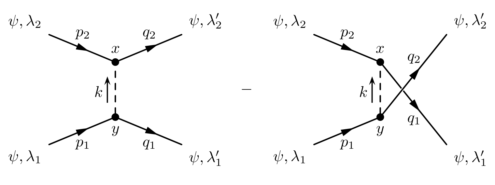

图 6.4: $\mathrm{i}T_2^{(2)}$ 贡献的 $\psi\psi\to\psi\psi$ 散射过程 Feynman 图，包含两个子图，相对符号为负。时间方向自左向右。

第一步花括号中有 4 项，对应于初态和末态各自的 2 种缩并；第 1 项与第 4 项、第 2 项与第 3 项分别具有交换时空坐标 $x$ 和 $y$ 的对称性，贡献相等，因此，在第二步中只保留第 1 项和第 2 项，并消去最前面的 $1/2!$ 因子。第三步将场算符调回 (6.59) 式中的次序，不再出现额外的负号，符合散射矩阵元的缩并规律。根据这个规律，也可以直接写出第三步的结果，接着把纠缠的缩并线解开成第二步的形式，使得花括号中的两项相差一个负号，再往下计算。

这个 $\psi\psi\to\psi\psi$ 散射过程的 Feynman 图如图 6.4 所示，它包含 2 个子图，第 2 个子图可以通过交换第 1 个子图中末态两条费米子外线得到。相应地，这个过程的总不变振幅 $\mathrm{i}\mathcal{M}$ 是 2 个不变振幅的叠加，两者之间相差一个负号，它体现了交换末态全同费米子的反对称性。

如果交换第 1 个子图中初态的两条费米子外线，则得到的图与第 2 个子图基本相同，唯一的差别是两个顶点上的 $x$ 和 $y$ 标签位置相反，实际上就是 (6.78) 式第一步花括号中的第 3 项。同理，交换第 2 个子图中初态两条费米子外线得到的图对应于 (6.78) 式第一步花括号中的第 4 项。如前所述，这两种情况的贡献在前面已经考虑了。可见，图 6.4 中的 2 个子图已经包括了 $\mathrm{i}T_2^{(2)}$ 贡献到 $\psi\psi\to\psi\psi$ 散射过程的全部可能拓扑结构。

由 (6.78) 式第二步的结果得

$$
\begin{aligned}
\langle \mathbf{q}_1^+,\lambda_1';\mathbf{q}_2^+,\lambda_2'|\mathrm{i}T_2^{(2)}|\mathbf{p}_1^+,\lambda_1;\mathbf{p}_2^+,\lambda_2\rangle
&= -(-\mathrm{i}\kappa)^2\int\mathrm{d}^4x\,\mathrm{d}^4y\,[\bar{u}_a(\mathbf{q}_2,\lambda_2')\bar{u}_b(\mathbf{q}_1,\lambda_1')\mathrm{e}^{\mathrm{i}(q_2\cdot x+q_1\cdot y)}-\bar{u}_b(\mathbf{q}_2,\lambda_2')\bar{u}_a(\mathbf{q}_1,\lambda_1')\mathrm{e}^{\mathrm{i}(q_2\cdot y+q_1\cdot x)}]\\
&\quad\times\int\frac{\mathrm{d}^4k}{(2\pi)^4}\frac{\mathrm{i}\mathrm{e}^{-\mathrm{i}k\cdot(x-y)}}{k^2-m_\phi^2+\mathrm{i}\epsilon}u_a(\mathbf{p}_2,\lambda_2)u_b(\mathbf{p}_1,\lambda_1)\mathrm{e}^{-\mathrm{i}(p_1\cdot y+p_2\cdot x)}\\
&= -(-\mathrm{i}\kappa)^2\int\frac{\mathrm{d}^4k}{(2\pi)^4}\Big[\bar{u}(\mathbf{q}_2,\lambda_2')u(\mathbf{p}_2,\lambda_2)\frac{\mathrm{i}}{k^2-m_\phi^2+\mathrm{i}\epsilon}\bar{u}(\mathbf{q}_1,\lambda_1')u(\mathbf{p}_1,\lambda_1)\\
&\qquad\times(2\pi)^4\delta^{(4)}(k+p_2-q_2)(2\pi)^4\delta^{(4)}(p_1-q_1-k)\\
&\qquad -\bar{u}(\mathbf{q}_1,\lambda_1')u(\mathbf{p}_2,\lambda_2)\frac{\mathrm{i}}{k^2-m_\phi^2+\mathrm{i}\epsilon}\bar{u}(\mathbf{q}_2,\lambda_2')u(\mathbf{p}_1,\lambda_1)\\
&\qquad\times(2\pi)^4\delta^{(4)}(k+p_2-q_1)(2\pi)^4\delta^{(4)}(p_1-q_2-k)\Big]\\
&= -(-\mathrm{i}\kappa)^2\Big[\bar{u}(\mathbf{q}_2,\lambda_2')u(\mathbf{p}_2,\lambda_2)\frac{\mathrm{i}}{(p_1-q_1)^2-m_\phi^2+\mathrm{i}\epsilon}\bar{u}(\mathbf{q}_1,\lambda_1')u(\mathbf{p}_1,\lambda_1)\\
&\qquad -\bar{u}(\mathbf{q}_1,\lambda_1')u(\mathbf{p}_2,\lambda_2)\frac{\mathrm{i}}{(p_1-q_2)^2-m_\phi^2+\mathrm{i}\epsilon}\bar{u}(\mathbf{q}_2,\lambda_2')u(\mathbf{p}_1,\lambda_1)\Big]\\
&\quad\times(2\pi)^4\delta^{(4)}(p_1+p_2-q_1-q_2).
\end{aligned}
\tag{6.79}
$$

可见，Feynman 图 6.4 第 1 个子图两个顶点处的能动量守恒关系是 $q_2-p_2 = k = p_1-q_1$，而第 2 个子图的相应关系是 $q_1-p_2 = k = p_1-q_2$。消去 $k$，均得到初末态的能动量守恒关系 $p_1+p_2 = q_1+q_2$。

(3) 接着，讨论一对正反 $\psi$ 粒子湮灭 (annihilation) 成一对 $\phi$ 粒子的过程 $\psi\bar{\psi}\to\phi\phi$，初末态分别为 $|i\rangle = |\mathbf{p}_1^+,\lambda_1;\mathbf{p}_2^-,\lambda_2\rangle$ 和 $\langle f| = \langle \mathbf{k}_1;\mathbf{k}_2|$，$\mathrm{i}T_3^{(2)}$ 和 $\mathrm{i}T_4^{(2)}$ 都会贡献到这个过程。根据 (6.60) 和 (6.61) 式，有

$$
\begin{aligned}
\mathrm{i}T_4^{(2)} &= \frac{(-\mathrm{i}\kappa)^2}{2!}\int\mathrm{d}^4x\,\mathrm{d}^4y\,\mathrm{N}[\phi(x)\overline{\bar{\psi}_a(x)\psi_a(x)}\phi(y)\overline{\bar{\psi}_b(y)\psi_b(y)}]\\
&= \frac{(-\mathrm{i}\kappa)^2}{2!}\int\mathrm{d}^4x\,\mathrm{d}^4y\,\mathrm{N}[\phi(y)\overline{\bar{\psi}_b(y)\psi_b(y)}\phi(x)\overline{\bar{\psi}_a(x)\psi_a(x)}]\\
&= \frac{(-\mathrm{i}\kappa)^2}{2!}\int\mathrm{d}^4y\,\mathrm{d}^4x\,\mathrm{N}[\phi(x)\overline{\bar{\psi}_b(x)\psi_b(x)}\phi(y)\overline{\bar{\psi}_a(y)\psi_a(y)}] = \mathrm{i}T_3^{(2)}.
\end{aligned}
\tag{6.80}
$$

第二步在正规乘积内移动了场算符的位置，第三步交换了时空坐标 $x$ 和 $y$。从而可得

$$
\mathrm{i}T_3^{(2)}+\mathrm{i}T_4^{(2)} = 2\mathrm{i}T_3^{(2)} = (-\mathrm{i}\kappa)^2\int\mathrm{d}^4x\,\mathrm{d}^4y\,\langle \mathbf{k}_1;\mathbf{k}_2|\mathrm{N}[\phi(x)\bar{\psi}(x)\psi(x)\phi(y)\bar{\psi}(y)\psi(y)].
\tag{6.81}
$$

可见，$\mathrm{i}T_3^{(2)}$ 和 $\mathrm{i}T_4^{(2)}$ 具有交换时空坐标的对称性，两项相加刚好抵消 $1/2!$ 因子。于是，散射矩阵元为

$$
\begin{aligned}
\langle \mathbf{k}_1;\mathbf{k}_2|(\mathrm{i}T_3^{(2)}+\mathrm{i}T_4^{(2)})|\mathbf{p}_1^+,\lambda_1;\mathbf{p}_2^-,\lambda_2\rangle
&= (-\mathrm{i}\kappa)^2\int\mathrm{d}^4x\,\mathrm{d}^4y\,\langle \mathbf{k}_1;\mathbf{k}_2|\mathrm{N}[\phi(x)\overline{\bar{\psi}_a(x)\psi_a(x)}\phi(y)\overline{\bar{\psi}_b(y)\psi_b(y)}]|\mathbf{p}_1^+,\lambda_1;\mathbf{p}_2^-,\lambda_2\rangle\\
&= (-\mathrm{i}\kappa)^2\int\mathrm{d}^4x\,\mathrm{d}^4y\,\langle \mathbf{k}_1;\mathbf{k}_2|\mathrm{N}[\phi^{(-)}(x)\phi^{(-)}(y)\overline{\psi_a(x)\psi_b(y)}\bar{\psi}_a^{(+)}(x)\psi_b^{(+)}(y)]|\mathbf{p}_1^+,\lambda_1;\mathbf{p}_2^-,\lambda_2\rangle.
\end{aligned}
\tag{6.82}
$$

这里出现两个负能解标量场算符对全同玻色子末态的作用，作用结果为

$$
\langle \mathbf{k}_1;\mathbf{k}_2|\phi^{(-)}(x)\phi^{(-)}(y)
$$

$$
\begin{aligned}
&=\int\frac{\mathrm{d}^3q_1\,\mathrm{d}^3q_2}{(2\pi)^6\sqrt{4E_{\mathbf{q}_1}E_{\mathbf{q}_2}}}\,\mathrm{e}^{\mathrm{i}(q_1\cdot x+q_2\cdot y)}\sqrt{4E_{\mathbf{k}_1}E_{\mathbf{k}_2}}\,\langle0|a_{\mathbf{k}_1}a_{\mathbf{k}_2}a_{\mathbf{q}_1}^\dagger a_{\mathbf{q}_2}^\dagger\\
&=\int\frac{\mathrm{d}^3q_1\,\mathrm{d}^3q_2}{(2\pi)^6}\sqrt{\frac{E_{\mathbf{k}_1}E_{\mathbf{k}_2}}{E_{\mathbf{q}_1}E_{\mathbf{q}_2}}}\,\mathrm{e}^{\mathrm{i}(q_1\cdot x+q_2\cdot y)}\,\langle0|a_{\mathbf{k}_1}\big[(2\pi)^3\delta^{(3)}(\mathbf{k}_2-\mathbf{q}_1)+a_{\mathbf{q}_1}^\dagger a_{\mathbf{k}_2}\big]a_{\mathbf{q}_2}^\dagger\\
&=\int\frac{\mathrm{d}^3q_1\,\mathrm{d}^3q_2}{(2\pi)^6}\sqrt{\frac{E_{\mathbf{k}_1}E_{\mathbf{k}_2}}{E_{\mathbf{q}_1}E_{\mathbf{q}_2}}}\,\mathrm{e}^{\mathrm{i}(q_1\cdot x+q_2\cdot y)}\\
&\quad\times\langle0|(2\pi)^6\big[\delta^{(3)}(\mathbf{k}_2-\mathbf{q}_1)\delta^{(3)}(\mathbf{k}_1-\mathbf{q}_2)+\delta^{(3)}(\mathbf{k}_1-\mathbf{q}_1)\delta^{(3)}(\mathbf{k}_2-\mathbf{q}_2)\big]\\
&=\langle0|\big[\mathrm{e}^{\mathrm{i}(k_2\cdot x+k_1\cdot y)}+\mathrm{e}^{\mathrm{i}(k_1\cdot x+k_2\cdot y)}\big]=\langle\mathbf{k}_1;\mathbf{k}_2|\mathrm{N}[\phi(x)\phi(y)]+\langle\mathbf{k}_1;\mathbf{k}_2|\mathrm{N}[\phi(y)\phi(x)]\\
&=\langle\mathbf{k}_1;\mathbf{k}_2|\mathrm{N}[\phi(x)\phi(y)]+\langle\mathbf{k}_1;\mathbf{k}_2|\mathrm{N}[\phi(x)\phi(y)],
\end{aligned}\tag{6.83}
$$

对应于场算符与末态的两种可能缩并，倒数第二、三步中第二项前面的正号体现了交换全同玻色子的对称性。另一方面，两个正能解标量场算符对全同玻色子初态的作用结果为

$$
\begin{aligned}
&\phi^{(+)}(x)\phi^{(+)}(y)|\mathbf{k}_1;\mathbf{k}_2\rangle\\
&=\int\frac{\mathrm{d}^3q_1\,\mathrm{d}^3q_2}{(2\pi)^6\sqrt{4E_{\mathbf{q}_1}E_{\mathbf{q}_2}}}\,\mathrm{e}^{-\mathrm{i}(q_1\cdot x+q_2\cdot y)}\sqrt{4E_{\mathbf{k}_1}E_{\mathbf{k}_2}}\,a_{\mathbf{q}_1}a_{\mathbf{q}_2}a_{\mathbf{k}_1}^\dagger a_{\mathbf{k}_2}^\dagger|0\rangle\\
&=\int\frac{\mathrm{d}^3q_1\,\mathrm{d}^3q_2}{(2\pi)^6}\sqrt{\frac{E_{\mathbf{k}_1}E_{\mathbf{k}_2}}{E_{\mathbf{q}_1}E_{\mathbf{q}_2}}}\,\mathrm{e}^{-\mathrm{i}(q_1\cdot x+q_2\cdot y)}a_{\mathbf{q}_1}\big[(2\pi)^3\delta^{(3)}(\mathbf{q}_2-\mathbf{k}_1)+a_{\mathbf{k}_1}^\dagger a_{\mathbf{q}_2}\big]a_{\mathbf{k}_2}^\dagger|0\rangle\\
&=\int\frac{\mathrm{d}^3q_1\,\mathrm{d}^3q_2}{(2\pi)^6}\sqrt{\frac{E_{\mathbf{k}_1}E_{\mathbf{k}_2}}{E_{\mathbf{q}_1}E_{\mathbf{q}_2}}}\,\mathrm{e}^{-\mathrm{i}(q_1\cdot x+q_2\cdot y)}\\
&\quad\times(2\pi)^6\big[\delta^{(3)}(\mathbf{q}_2-\mathbf{k}_1)\delta^{(3)}(\mathbf{q}_1-\mathbf{k}_2)+\delta^{(3)}(\mathbf{q}_1-\mathbf{k}_1)\delta^{(3)}(\mathbf{q}_2-\mathbf{k}_2)\big]|0\rangle\\
&=\big[\mathrm{e}^{-\mathrm{i}(k_2\cdot x+k_1\cdot y)}+\mathrm{e}^{-\mathrm{i}(k_1\cdot x+k_2\cdot y)}\big]|0\rangle=\mathrm{N}[\phi(x)\phi(y)]|\mathbf{k}_1;\mathbf{k}_2\rangle+\mathrm{N}[\phi(y)\phi(x)]|\mathbf{k}_1;\mathbf{k}_2\rangle\\
&=\mathrm{N}[\phi(x)\phi(y)]|\mathbf{k}_1;\mathbf{k}_2\rangle+\mathrm{N}[\phi(x)\phi(y)]|\mathbf{k}_1;\mathbf{k}_2\rangle,
\end{aligned}\tag{6.84}
$$

对应于场算符与初态的两种可能缩并。类似地可以证明，$n$ 个同类型正(负)能解场算符对 $n$ 个相应全同粒子初(末)态的作用等价于这些场算符与初(末)态的 $n!$ 种缩并。

现在，散射矩阵元 (6.82) 化为

$$
\begin{aligned}
&\langle\mathbf{k}_1;\mathbf{k}_2|(\mathrm{i}T_3^{(2)}+\mathrm{i}T_4^{(2)})|\mathbf{p}_1^+,\lambda_1;\mathbf{p}_2^-,\lambda_2\rangle\\
&=(-\mathrm{i}\kappa)^2\int\mathrm{d}^4x\,\mathrm{d}^4y\,\big\{\langle\mathbf{k}_1;\mathbf{k}_2|\mathrm{N}[\phi(x)\phi(y)\psi_a(x)\bar{\psi}_b(y)\bar{\psi}_a(x)\psi_b(y)]|\mathbf{p}_1^+,\lambda_1;\mathbf{p}_2^-,\lambda_2\rangle\\
&\quad+\langle\mathbf{k}_1;\mathbf{k}_2|\mathrm{N}[\phi(y)\phi(x)\psi_a(x)\bar{\psi}_b(y)\bar{\psi}_a(x)\psi_b(y)]|\mathbf{p}_1^+,\lambda_1;\mathbf{p}_2^-,\lambda_2\rangle\big\}\\
&=(-\mathrm{i}\kappa)^2\int\mathrm{d}^4x\,\mathrm{d}^4y\,\big\{\langle\mathbf{k}_1;\mathbf{k}_2|\mathrm{N}[\phi(x)\bar{\psi}(x)\psi(x)\phi(y)\bar{\psi}(y)\psi(y)]|\mathbf{p}_1^+,\lambda_1;\mathbf{p}_2^-,\lambda_2\rangle\\
&\quad+\langle\mathbf{k}_1;\mathbf{k}_2|\mathrm{N}[\phi(x)\bar{\psi}(x)\psi(x)\phi(y)\bar{\psi}(y)\psi(y)]|\mathbf{p}_1^+,\lambda_1;\mathbf{p}_2^-,\lambda_2\rangle\big\}.
\end{aligned}\tag{6.85}
$$

第二步结果符合散射矩阵元的缩并规律。相应的 Feynman 图如图 6.5 所示。它包含 2 个拓扑不等价的子图，相对符号为正，体现了交换末态两个全同玻色子的对称性。拓扑不等价指的是不能通过连续变形相互转换。

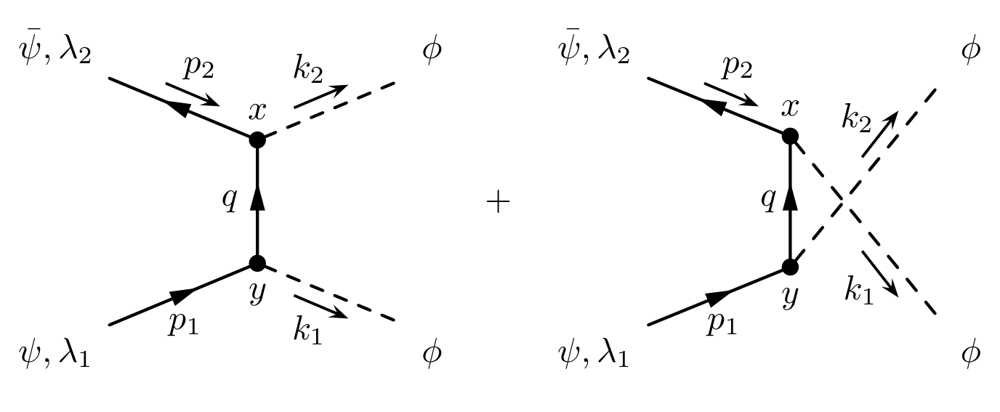

图 6.5: $\mathrm{i}T_3^{(2)}+\mathrm{i}T_4^{(2)}$ 贡献的 $\psi\bar{\psi}\to\phi\phi$ 散射过程 Feynman 图，包含两个子图，相对符号为正。时间方向自左向右。

由 (6.85) 式第一步的结果得

$$
\begin{aligned}
&\langle\mathbf{k}_1;\mathbf{k}_2|(\mathrm{i}T_3^{(2)}+\mathrm{i}T_4^{(2)})|\mathbf{p}_1^+,\lambda_1;\mathbf{p}_2^-,\lambda_2\rangle\\
&=(-\mathrm{i}\kappa)^2\int\mathrm{d}^4x\,\mathrm{d}^4y\,\big[\mathrm{e}^{\mathrm{i}(k_2\cdot x+k_1\cdot y)}+\mathrm{e}^{\mathrm{i}(k_1\cdot x+k_2\cdot y)}\big]\int\frac{\mathrm{d}^4q}{(2\pi)^4}\frac{\mathrm{i}(\not{q}+m_\psi)_{ab}}{q^2-m_\psi^2+\mathrm{i}\epsilon}\,\mathrm{e}^{-\mathrm{i}q\cdot(x-y)}\\
&\quad\times\bar{v}_a(\mathbf{p}_2,\lambda_2)\mathrm{e}^{-\mathrm{i}p_2\cdot x}u_b(\mathbf{p}_1,\lambda_1)\mathrm{e}^{-\mathrm{i}p_1\cdot y}\\
&=(-\mathrm{i}\kappa)^2\int\frac{\mathrm{d}^4q}{(2\pi)^4}\bigg[\bar{v}(\mathbf{p}_2,\lambda_2)\frac{\mathrm{i}(\not{q}+m_\psi)}{q^2-m_\psi^2+\mathrm{i}\epsilon}u(\mathbf{p}_1,\lambda_1)(2\pi)^4\delta^{(4)}(q+p_2-k_2)(2\pi)^4\delta^{(4)}(p_1-k_1-q)\\
&\quad+\bar{v}(\mathbf{p}_2,\lambda_2)\frac{\mathrm{i}(\not{q}+m_\psi)}{q^2-m_\psi^2+\mathrm{i}\epsilon}u(\mathbf{p}_1,\lambda_1)(2\pi)^4\delta^{(4)}(q+p_2-k_1)(2\pi)^4\delta^{(4)}(p_1-k_2-q)\bigg]\\
&=(-\mathrm{i}\kappa)^2\bigg[\bar{v}(\mathbf{p}_2,\lambda_2)\frac{\mathrm{i}(\not{p}_1-\not{k}_1+m_\psi)}{(p_1-k_1)^2-m_\psi^2+\mathrm{i}\epsilon}u(\mathbf{p}_1,\lambda_1)+\bar{v}(\mathbf{p}_2,\lambda_2)\frac{\mathrm{i}(\not{p}_1-\not{k}_2+m_\psi)}{(p_1-k_2)^2-m_\psi^2+\mathrm{i}\epsilon}u(\mathbf{p}_1,\lambda_1)\bigg]\\
&\quad\times(2\pi)^4\delta^{(4)}(p_1+p_2-k_1-k_2).
\end{aligned}\tag{6.86}
$$

可见，Feynman 图 6.5 第 1 个子图两个顶点处的能动量守恒关系是 $k_2-p_2=q=p_1-k_1$，而第 2 个子图的相应关系是 $k_1-p_2=q=p_1-k_2$。消去 $q$，均得到初末态的能动量守恒关系 $p_1+p_2=k_1+k_2$。

(4) 根据 (6.62) 和 (6.63) 式，有

$$
\begin{aligned}
\mathrm{i}T_5^{(2)}&=\frac{(-\mathrm{i}\kappa)^2}{2!}\int\mathrm{d}^4x\,\mathrm{d}^4y\,\mathrm{N}[\phi(x)\bar{\psi}(x)\psi(x)\phi(y)\bar{\psi}(y)\psi(y)]\\
&=\frac{(-\mathrm{i}\kappa)^2}{2!}\int\mathrm{d}^4x\,\mathrm{d}^4y\,\mathrm{N}[\phi(y)\bar{\psi}(y)\psi(y)\phi(x)\bar{\psi}(x)\psi(x)]\\
&=\frac{(-\mathrm{i}\kappa)^2}{2!}\int\mathrm{d}^4y\,\mathrm{d}^4x\,\mathrm{N}[\phi(x)\bar{\psi}(x)\psi(x)\phi(y)\bar{\psi}(y)\psi(y)]=\mathrm{i}T_6^{(2)},
\end{aligned}\tag{6.87}
$$

故

$$
\mathrm{i}T_5^{(2)}+\mathrm{i}T_6^{(2)}=2\mathrm{i}T_5^{(2)}=(-\mathrm{i}\kappa)^2\int\mathrm{d}^4x\,\mathrm{d}^4y\,\mathrm{N}[\phi(x)\bar{\psi}(x)\psi(x)\phi(y)\bar{\psi}(y)\psi(y)].
\tag{6.88}
$$

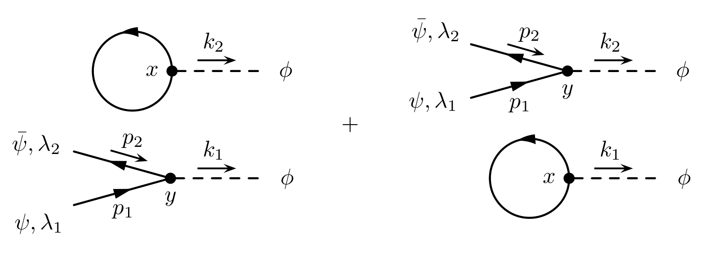

图 6.6: $\mathrm{i}T_5^{(2)}+\mathrm{i}T_6^{(2)}$ 贡献的 Feynman 图。时间方向自左向右。

考虑初态是一对正反费米子，$|i\rangle=|\mathbf{p}_1^+,\lambda_1;\mathbf{p}_2^-,\lambda_2\rangle$，末态是一对全同玻色子，$\langle f|=\langle\mathbf{k}_1;\mathbf{k}_2|$，则 $\mathrm{i}T_5^{(2)}+\mathrm{i}T_6^{(2)}$ 对散射矩阵元的贡献为

$$
\begin{aligned}
&\langle\mathbf{k}_1;\mathbf{k}_2|(\mathrm{i}T_5^{(2)}+\mathrm{i}T_6^{(2)})|\mathbf{p}_1^+,\lambda_1;\mathbf{p}_2^-,\lambda_2\rangle\\
&=(-\mathrm{i}\kappa)^2\int\mathrm{d}^4x\,\mathrm{d}^4y\,\langle\mathbf{k}_1;\mathbf{k}_2|\mathrm{N}[\phi(x)\bar{\psi}(x)\psi(x)\phi(y)\bar{\psi}(y)\psi(y)]|\mathbf{p}_1^+,\lambda_1;\mathbf{p}_2^-,\lambda_2\rangle\\
&=(-\mathrm{i}\kappa)^2\int\mathrm{d}^4x\,\mathrm{d}^4y\,\big\{\langle\mathbf{k}_1;\mathbf{k}_2|\mathrm{N}[\phi(x)\bar{\psi}(x)\psi(x)\phi(y)\bar{\psi}(y)\psi(y)]|\mathbf{p}_1^+,\lambda_1;\mathbf{p}_2^-,\lambda_2\rangle\\
&\quad+\langle\mathbf{k}_1;\mathbf{k}_2|\mathrm{N}[\phi(x)\bar{\psi}(x)\psi(x)\phi(y)\bar{\psi}(y)\psi(y)]|\mathbf{p}_1^+,\lambda_1;\mathbf{p}_2^-,\lambda_2\rangle\big\}.
\end{aligned}\tag{6.89}
$$

在第二步中，我们跳过用正负能解表达的步骤，直接按照前述规律写下场算符与初末态的 2 种可能缩并。图 6.6 是相应的 Feynman 图，包含 2 个子图。每个子图都具有 2 个不相连的部分，这些部分是上一小节讨论过的，它们之间不会相互影响。由于末态中有一个 $\phi$ 粒子没有跟其它粒子连接起来，这种图既不满足能动量守恒定律，也不会贡献到 $\psi\bar{\psi}\to\phi\phi$ 散射过程。

(5) 根据 (6.64) 和 (6.65) 式，有

$$
\begin{aligned}
\mathrm{i}T_7^{(2)}&=\frac{(-\mathrm{i}\kappa)^2}{2!}\int\mathrm{d}^4x\,\mathrm{d}^4y\,\mathrm{N}[\phi(x)\bar{\psi}(x)\psi(x)\phi(y)\bar{\psi}(y)\psi(y)]\\
&=\frac{(-\mathrm{i}\kappa)^2}{2!}\int\mathrm{d}^4x\,\mathrm{d}^4y\,\mathrm{N}[\phi(y)\bar{\psi}(y)\psi(y)\phi(x)\bar{\psi}(x)\psi(x)]\\
&=\frac{(-\mathrm{i}\kappa)^2}{2!}\int\mathrm{d}^4y\,\mathrm{d}^4x\,\mathrm{N}[\phi(x)\bar{\psi}(x)\psi(x)\phi(y)\bar{\psi}(y)\psi(y)]=\mathrm{i}T_8^{(2)},
\end{aligned}\tag{6.90}
$$

故

$$
\mathrm{i}T_7^{(2)}+\mathrm{i}T_8^{(2)}=2\mathrm{i}T_7^{(2)}=(-\mathrm{i}\kappa)^2\int\mathrm{d}^4x\,\mathrm{d}^4y\,\mathrm{N}[\phi(x)\bar{\psi}(x)\psi(x)\phi(y)\bar{\psi}(y)\psi(y)].
\tag{6.91}
$$

考虑初态和末态均是一个动量为 $\mathbf{p}$、螺旋度为 $\lambda$ 的 $\psi$ 粒子，即 $|i\rangle=|\mathbf{p}^+,\lambda\rangle$，$\langle f|=\langle\mathbf{p}^+,\lambda|$，散射矩阵元是

$$
\begin{aligned}
&\langle\mathbf{p}^+,\lambda|(\mathrm{i}T_7^{(2)}+\mathrm{i}T_8^{(2)})|\mathbf{p}^+,\lambda\rangle\\
&=(-\mathrm{i}\kappa)^2\int\mathrm{d}^4x\,\mathrm{d}^4y\,\langle\mathbf{p}^+,\lambda|\mathrm{N}[\phi(x)\bar{\psi}(x)\psi(x)\phi(y)\bar{\psi}(y)\psi(y)]|\mathbf{p}^+,\lambda\rangle\\
&=(-\mathrm{i}\kappa)^2\int\mathrm{d}^4x\,\mathrm{d}^4y\,\langle\mathbf{p}^+,\lambda|\mathrm{N}[\phi(x)\bar{\psi}(x)\psi(x)\phi(y)\bar{\psi}(y)\psi(y)]|\mathbf{p}^+,\lambda\rangle\\
&=(-\mathrm{i}\kappa)^2\int\mathrm{d}^4x\,\mathrm{d}^4y\,\langle\mathbf{p}^+,\lambda|\mathrm{N}[\bar{\psi}(x)\phi(x)\phi(y)\psi(x)\bar{\psi}(y)\psi(y)]|\mathbf{p}^+,\lambda\rangle\\
&=(-\mathrm{i}\kappa)^2\int\mathrm{d}^4x\,\mathrm{d}^4y\,\bar{u}(\mathbf{p},\lambda)\mathrm{e}^{\mathrm{i}p\cdot x}\int\frac{\mathrm{d}^4k}{(2\pi)^4}\frac{\mathrm{i}\mathrm{e}^{-\mathrm{i}k\cdot(x-y)}}{k^2-m_\phi^2+\mathrm{i}\epsilon}\int\frac{\mathrm{d}^4q}{(2\pi)^4}\frac{\mathrm{i}(\not{q}+m_\psi)\mathrm{e}^{-\mathrm{i}q\cdot(x-y)}}{q^2-m_\psi^2+\mathrm{i}\epsilon}u(\mathbf{p},\lambda)\mathrm{e}^{-\mathrm{i}p\cdot y}\\
&=(-\mathrm{i}\kappa)^2\int\frac{\mathrm{d}^4k\,\mathrm{d}^4q}{(2\pi)^8}\,\bar{u}(\mathbf{p},\lambda)\frac{\mathrm{i}}{k^2-m_\phi^2+\mathrm{i}\epsilon}\frac{\mathrm{i}(\not{q}+m_\psi)}{q^2-m_\psi^2+\mathrm{i}\epsilon}u(\mathbf{p},\lambda)\\
&\quad\times(2\pi)^4\delta^{(4)}(q+k-p)(2\pi)^4\delta^{(4)}(p-q-k)\\
&=(-\mathrm{i}\kappa)^2\int\frac{\mathrm{d}^4q}{(2\pi)^4}\,\bar{u}(\mathbf{p},\lambda)\frac{\mathrm{i}}{(p-q)^2-m_\phi^2+\mathrm{i}\epsilon}\frac{\mathrm{i}(\not{q}+m_\psi)}{q^2-m_\psi^2+\mathrm{i}\epsilon}u(\mathbf{p},\lambda)(2\pi)^4\delta^{(4)}(0).
\end{aligned}\tag{6.92}
$$

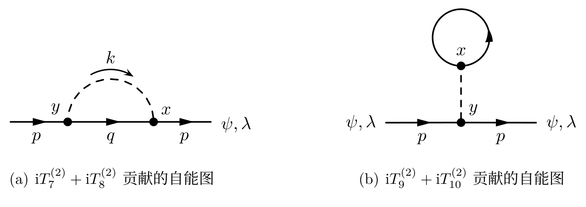

(a) $\mathrm{i}T_7^{(2)}+\mathrm{i}T_8^{(2)}$ 贡献的自能图　　(b) $\mathrm{i}T_9^{(2)}+\mathrm{i}T_{10}^{(2)}$ 贡献的自能图

图 6.7: $\psi$ 粒子的单圈自能图。时间方向自左向右。

相应的 Feynman 图如图 6.7(a) 所示，是一个圈图。这种初末态都是同一个粒子的圈图称为该粒子的自能图 (self-energy diagram)。倒数第二步对时空坐标 $x$ 和 $y$ 积分，得到 2 个相等的四维 $\delta$ 函数，说明 2 个顶点处的能动量守恒关系相同，都是 $p=q+k$。最后一步对 $k$ 积分，剩下 1 个四维 $\delta$ 函数 $\delta^{(4)}(0)=\delta^{(4)}(p-p)$ 以体现初末态满足的能动量守恒定律；此时，还剩下一个未定的圈动量 $q^\mu$，需要对它的所有取值积分。相应的不变振幅是

$$
\mathrm{i}\mathcal{M}=(-\mathrm{i}\kappa)^2\int\frac{\mathrm{d}^4q}{(2\pi)^4}\,\bar{u}(\mathbf{p},\lambda)\frac{\mathrm{i}}{(p-q)^2-m_\phi^2+\mathrm{i}\epsilon}\frac{\mathrm{i}(\not{q}+m_\psi)}{q^2-m_\psi^2+\mathrm{i}\epsilon}u(\mathbf{p},\lambda).
\tag{6.93}
$$

一般地，具有 $n$ 个未定圈动量的圈图称为 $n$ 圈图。1 圈图也称为单圈图。Feynman 图 6.7(a) 以及 6.2(a)、6.2(b) 都是单圈图。在这些图上再连接一条合适的内线，就得到 2 圈图。

(6) 根据 (6.66) 和 (6.67) 式，有

$$
\begin{aligned}
\mathrm{i}T_9^{(2)}&=\frac{(-\mathrm{i}\kappa)^2}{2!}\int\mathrm{d}^4x\,\mathrm{d}^4y\,\mathrm{N}[\phi(x)\bar{\psi}(x)\psi(x)\phi(y)\bar{\psi}(y)\psi(y)]\\
&=\frac{(-\mathrm{i}\kappa)^2}{2!}\int\mathrm{d}^4x\,\mathrm{d}^4y\,\mathrm{N}[\phi(y)\bar{\psi}(y)\psi(y)\phi(x)\bar{\psi}(x)\psi(x)]\\
&=\frac{(-\mathrm{i}\kappa)^2}{2!}\int\mathrm{d}^4y\,\mathrm{d}^4x\,\mathrm{N}[\phi(x)\bar{\psi}(x)\psi(x)\phi(y)\bar{\psi}(y)\psi(y)]=\mathrm{i}T_{10}^{(2)},
\end{aligned}\tag{6.94}
$$

故

$$
\mathrm{i}T_9^{(2)}+\mathrm{i}T_{10}^{(2)}=2\mathrm{i}T_9^{(2)}=(-\mathrm{i}\kappa)^2\int\mathrm{d}^4x\,\mathrm{d}^4y\,\mathrm{N}[\phi(x)\bar{\psi}(x)\psi(x)\phi(y)\bar{\psi}(y)\psi(y)].
\tag{6.95}
$$

$\mathrm{i}T_9^{(2)}+\mathrm{i}T_{10}^{(2)}$ 也会贡献到 $\psi$ 粒子的单圈自能图，对应的散射矩阵元为

$$
\begin{aligned}
&\langle\mathbf{p}^+,\lambda|(\mathrm{i}T_9^{(2)}+\mathrm{i}T_{10}^{(2)})|\mathbf{p}^+,\lambda\rangle\\
&=(-\mathrm{i}\kappa)^2\int\mathrm{d}^4x\,\mathrm{d}^4y\,\langle\mathbf{p}^+,\lambda|\mathrm{N}[\phi(x)\bar{\psi}(x)\psi(x)\phi(y)\bar{\psi}(y)\psi(y)]|\mathbf{p}^+,\lambda\rangle\\
&=(-\mathrm{i}\kappa)^2\int\mathrm{d}^4x\,\mathrm{d}^4y\,\langle\mathbf{p}^+,\lambda|\mathrm{N}[\phi(x)\bar{\psi}(x)\psi(x)\phi(y)\bar{\psi}(y)\psi(y)]|\mathbf{p}^+,\lambda\rangle,
\end{aligned}\tag{6.96}
$$

Feynman 图如图 6.7(b) 所示。

(7) 考虑初态和末态均是一个动量为 $\mathbf{k}$ 的 $\phi$ 粒子，即 $|i\rangle=|\mathbf{k}\rangle$，$\langle f|=\langle\mathbf{k}|$，根据 (6.68) 式，$\mathrm{i}T_{11}^{(2)}$ 对散射矩阵元的贡献是

$$
\begin{aligned}
\langle\mathbf{k}|\mathrm{i}T_{11}^{(2)}|\mathbf{k}\rangle&=\frac{(-\mathrm{i}\kappa)^2}{2!}\int\mathrm{d}^4x\,\mathrm{d}^4y\,\langle\mathbf{k}|\mathrm{N}[\phi(x)\bar{\psi}(x)\psi(x)\phi(y)\bar{\psi}(y)\psi(y)]|\mathbf{k}\rangle\\
&=\frac{(-\mathrm{i}\kappa)^2}{2!}\int\mathrm{d}^4x\,\mathrm{d}^4y\,\big\{\langle\mathbf{k}|\mathrm{N}[\phi(x)\bar{\psi}_a(x)\psi_a(x)\phi(y)\bar{\psi}_b(y)\psi_b(y)]|\mathbf{k}\rangle\\
&\quad+\langle\mathbf{k}|\mathrm{N}[\phi(x)\bar{\psi}_a(x)\psi_a(x)\phi(y)\bar{\psi}_b(y)\psi_b(y)]|\mathbf{k}\rangle\big\}\\
&=-\frac{(-\mathrm{i}\kappa)^2}{2!}\int\mathrm{d}^4x\,\mathrm{d}^4y\,\big\{\langle\mathbf{k}|\mathrm{N}[\phi(x)\psi_a(x)\bar{\psi}_b(y)\psi_b(y)\bar{\psi}_a(x)\phi(y)]|\mathbf{k}\rangle\\
&\quad+\langle\mathbf{k}|\mathrm{N}[\phi(y)\psi_b(y)\bar{\psi}_a(x)\psi_a(x)\bar{\psi}_b(y)\phi(x)]|\mathbf{k}\rangle\big\}\\
&=-(-\mathrm{i}\kappa)^2\int\mathrm{d}^4x\,\mathrm{d}^4y\,\langle\mathbf{k}|\mathrm{N}[\phi(x)\psi_b(y)\bar{\psi}_a(x)\psi_a(x)\bar{\psi}_b(y)\phi(y)]|\mathbf{k}\rangle\\
&=-(-\mathrm{i}\kappa)^2\int\mathrm{d}^4x\,\mathrm{d}^4y\,\mathrm{e}^{\mathrm{i}k\cdot x}S_{F,ba}(y-x)S_{F,ab}(x-y)\mathrm{e}^{-\mathrm{i}k\cdot y}\\
&=-(-\mathrm{i}\kappa)^2\int\mathrm{d}^4x\,\mathrm{d}^4y\,\mathrm{e}^{\mathrm{i}k\cdot x}\int\frac{\mathrm{d}^4p\,\mathrm{d}^4q}{(2\pi)^8}\,\mathrm{tr}\left[\frac{\mathrm{i}(\not{p}+m_\psi)\mathrm{e}^{-\mathrm{i}p\cdot(y-x)}}{p^2-m_\psi^2+\mathrm{i}\epsilon}\frac{\mathrm{i}(\not{q}+m_\psi)\mathrm{e}^{-\mathrm{i}q\cdot(x-y)}}{q^2-m_\psi^2+\mathrm{i}\epsilon}\right]\mathrm{e}^{-\mathrm{i}k\cdot y}\\
&=-(-\mathrm{i}\kappa)^2\int\frac{\mathrm{d}^4p\,\mathrm{d}^4q}{(2\pi)^8}\,\mathrm{tr}\left[\frac{\mathrm{i}(\not{p}+m_\psi)}{p^2-m_\psi^2+\mathrm{i}\epsilon}\frac{\mathrm{i}(\not{q}+m_\psi)}{q^2-m_\psi^2+\mathrm{i}\epsilon}\right](2\pi)^4\delta^{(4)}(q-p-k)(2\pi)^4\delta^{(4)}(k+p-q)\\
&=-(-\mathrm{i}\kappa)^2\int\frac{\mathrm{d}^4p}{(2\pi)^4}\,\mathrm{tr}\left[\frac{\mathrm{i}(\not{p}+m_\psi)}{p^2-m_\psi^2+\mathrm{i}\epsilon}\frac{\mathrm{i}(\not{k}+\not{p}+m_\psi)}{(k+p)^2-m_\psi^2+\mathrm{i}\epsilon}\right](2\pi)^4\delta^{(4)}(0).
\end{aligned}\tag{6.97}
$$

第三步通过调换场算符位置将纠缠的缩并线解开；花括号中两项均需要交换奇数次相邻费米子场算符，因而产生一个额外的负号；这两项具有交换时空坐标 $x$ 和 $y$ 的对称性，因而在第四步中合为一项，消去 $1/2!$ 因子。相应的 Feynman 图如图 6.8 所示，这是 $\phi$ 粒子的单圈自能图。

类似于 Feynman 图 6.2(a) 和 6.2(b)，这里验证了一个普遍的结论：一个封闭的费米子圈贡献一个额外的负号，并且需要对 Dirac 矩阵的乘积求迹。这种负号是重要的，有可能影响观测量。如果一个封闭的费米子圈上有 $n$ 个顶点，则具有 $n$ 条费米子内线，求迹是对 $n$ 个 Feynman 传播子的乘积进行的。我们已经验证了 $n=1$ 和 $n=2$ 的情形。当 $n=3$ 时，场算符的缩并结构为

$$
\begin{aligned}
&\mathrm{N}[\bar{\psi}_a(x)\psi_a(x)\bar{\psi}_b(y)\psi_b(y)\bar{\psi}_c(z)\psi_c(z)]=-\mathrm{N}[\bar{\psi}_c(z)\bar{\psi}_a(x)\psi_a(x)\bar{\psi}_b(y)\psi_b(y)\psi_c(z)]\\
&=-S_{F,ca}(z-x)S_{F,ab}(x-y)S_{F,bc}(y-z)\\
&=-\mathrm{tr}[S_F(z-x)S_F(x-y)S_F(y-z)],
\end{aligned}\tag{6.98}
$$

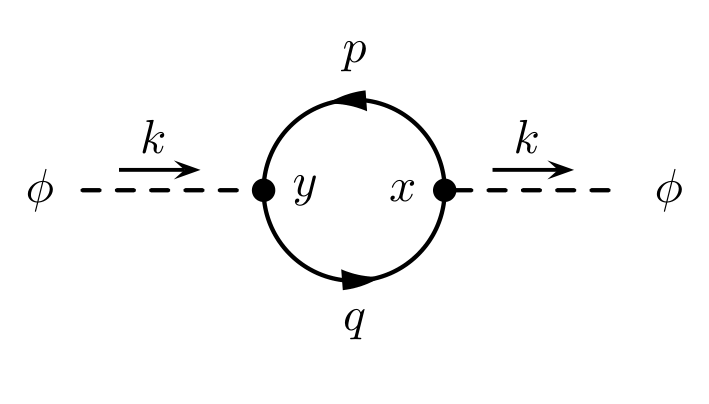

图 6.8: $\mathrm{i}T_{11}^{(2)}$ 贡献的 $\phi$ 粒子单圈自能图。时间方向自左向右。

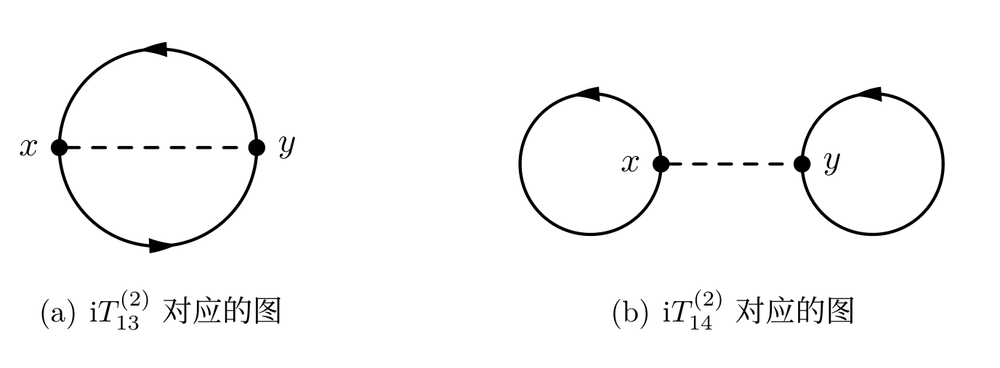

(a) $\mathrm{i}T_{13}^{(2)}$ 对应的图　　(b) $\mathrm{i}T_{14}^{(2)}$ 对应的图

图 6.9: $\mathrm{i}T_{13}^{(2)}$ 和 $\mathrm{i}T_{14}^{(2)}$ 对应的气泡图。

确实出现了负号和求迹。这个结论显然可以推广到任意 $n$ 的情形。

(8) 在这里，我们再次写下 $\mathrm{i}T_{13}^{(2)}$ 和 $\mathrm{i}T_{14}^{(2)}$ 的表达式 (6.70) 和 (6.71)：

$$
\mathrm{i}T_{13}^{(2)}=\frac{(-\mathrm{i}\kappa)^2}{2!}\int\mathrm{d}^4x\,\mathrm{d}^4y\,\mathrm{N}[\phi(x)\bar{\psi}(x)\psi(x)\phi(y)\bar{\psi}(y)\psi(y)],
\tag{6.99}
$$

$$
\mathrm{i}T_{14}^{(2)}=\frac{(-\mathrm{i}\kappa)^2}{2!}\int\mathrm{d}^4x\,\mathrm{d}^4y\,\mathrm{N}[\phi(x)\bar{\psi}(x)\psi(x)\phi(y)\bar{\psi}(y)\psi(y)].
\tag{6.100}
$$

在这两个式子中，正规乘积里面所有场算符都已经参与缩并了，可以直接画出相应的 Feynman 图，分别如图 6.9(a) 和 6.9(b) 所示。这种不包含任何外线的圈图称为气泡图 (bubble diagram)。由于没有余下需要与初末态缩并的场算符，$\mathrm{i}T_{13}^{(2)}$ 和 $\mathrm{i}T_{14}^{(2)}$ 可以贡献到任意初末态的散射矩阵元中。不过，这些气泡图只会产生一些相位因子，没有可观测的物理效应。

## 6.2 动量空间 Feynman 规则

在上一节中，我们利用 Wick 定理计算散射矩阵元 $\langle f|\mathrm{i}T|i\rangle$，将计算过程中的各个部分表达成图形，画出 Feynman 图，并从中归纳出一套位置空间中的 Feynman 规则。理解这些规律之后，反过来，我们可以对各个过程画出所有拓扑不等价的 Feynman 图，然后通过 Feynman 规则写出相应散射矩阵元 $\langle f|\mathrm{i}T|i\rangle$ 的代数表达式。不过，当同一过程存在多个子图且涉及费米子场算符时，需要回到带着缩并的表达式，将缩并线解开，以确定各个子图之间的相对符号。

在位置空间 Feynman 规则中，每个顶点对应于一个时空积分，积分的结果是使得出入顶点的内外线上的四维动量满足能动量守恒关系。最后，我们得到依赖于外线动量、但不依赖于时空坐标的结果，而散射矩阵元 $\langle f|\mathrm{i}T|i\rangle$ 分解为不变振幅 $\mathrm{i}\mathcal{M}$ 与表示能动量守恒定律的因子 $(2\pi)^4\delta^{(4)}(p_i-p_f)$ 之积。利用这个规律，我们将 Feynman 规则改成不依赖于时空坐标的形式，称为动量空间中的 Feynman 规则，然后从 Feynman 图直接给出不变振幅 $\mathrm{i}\mathcal{M}$ 的代数表达式，进一步简化计算。

根据上一节体现的规律，Yukawa 理论在动量空间中的 Feynman 规则如下。

1. Dirac 正费米子入射外线：$\psi,\lambda\ \longrightarrow\ \bullet=u(\mathbf{p},\lambda)$。

2. Dirac 反费米子入射外线：$\bar{\psi},\lambda\ \longleftarrow\ \bullet=\bar{v}(\mathbf{p},\lambda)$。

3. Dirac 正费米子出射外线：$\bullet\ \longrightarrow\ \psi,\lambda=\bar{u}(\mathbf{p},\lambda)$。

4. Dirac 反费米子出射外线：$\bullet\ \longrightarrow\ \bar{\psi},\lambda=v(\mathbf{p},\lambda)$。

5. Dirac 费米子传播子：$\bullet\ \stackrel{p}{\longrightarrow}\ \bullet=\frac{\mathrm{i}(\not{p}+m_\psi)}{p^2-m_\psi^2+\mathrm{i}\epsilon}=\frac{\mathrm{i}}{\not{p}-m_\psi+\mathrm{i}\epsilon}$。

6. 实标量玻色子入射外线：$\phi\ \dashrightarrow\ \bullet=1$。

7. 实标量玻色子出射外线：$\bullet\ \dashrightarrow\ \phi=1$。

8. 实标量玻色子传播子：$\bullet\ \stackrel{p}{\dashrightarrow}\ \bullet=\frac{\mathrm{i}}{p^2-m_\phi^2+\mathrm{i}\epsilon}$。

9. Yukawa 相互作用顶点：[图：原书此处有图示] $=-\mathrm{i}\kappa$。

10. 出入每个顶点的内外线四维动量满足能动量守恒关系。

11. 每个未定的圈动量 $p^\mu$ 贡献一个积分 $\int\frac{\mathrm{d}^4p}{(2\pi)^4}$。

12. 每个封闭的费米子圈贡献一个额外的负号，并需要对费米子传播子的乘积求迹。

除了关于顶点的第 9 条规则具有 Yukawa 相互作用特有的形式之外，其它规则具有一般性。注意，顶点规则与拉氏量中的相互作用项直接对应：将 Yukawa 相互作用项 $\mathcal{L}_Y=-\kappa\phi\bar{\psi}\psi$ 中的场算符 $\phi$、$\psi$ 和 $\bar{\psi}$ 剥离，再乘以 $\mathrm{i}$，就得到顶点规则的表达式 $-\mathrm{i}\kappa$。

对于某个物理过程，我们可以根据这些 Feynman 规则画出微扰论某一阶上所有拓扑不等价的 Feynman 图，再给出不变振幅的表达式。下面举一些上一节中已经出现过的例子予以比较，我们将画出相关过程的所有拓扑不等价 Feynman 图，再根据动量空间中的 Feynman 规则，逆着费米子线上的箭头方向将图形翻译成代数表达式。

(1) $\phi\to\psi\bar{\psi}$ 衰变过程的领头阶不变振幅为

$$
\mathrm{i}\mathcal{M}=\text{[图]}=-\mathrm{i}\kappa\bar{u}(\mathbf{p},\lambda)v(\mathbf{q},\lambda').
\tag{6.101}
$$

对于上式中的 Feynman 图，我们在不引起混淆的情况下省略了顶点上的圆点。这个结果与 (6.42) 式整体相差一个负号，这是因为此处没有像 (6.32) 式的计算过程那样调换旋量场算符的位置以符合末态中湮灭算符的次序。不过，这个过程只有一个 Feynman 图，没有干涉效应，额外的负号不会影响衰变宽度。像这样的整体符号差异无关紧要，它不会改变振幅模方，因而不会影响观测量的计算结果。

(2) 在领头阶，$\psi\bar{\psi}\to\psi\bar{\psi}$ 散射过程具有 2 个拓扑不等价的 Feynman 图，它们之间的相对符号至关重要，不变振幅为

$$
\begin{aligned}
\mathrm{i}\mathcal{M}&=\text{[图]}-\text{[图]}\\
&=(-\mathrm{i}\kappa)^2\bigg[\bar{u}(\mathbf{q}_1,\lambda_1')v(\mathbf{q}_2,\lambda_2')\frac{\mathrm{i}}{(p_1+p_2)^2-m_\phi^2+\mathrm{i}\epsilon}\bar{v}(\mathbf{p}_2,\lambda_2)u(\mathbf{p}_1,\lambda_1)\\
&\quad-\bar{v}(\mathbf{p}_2,\lambda_2)v(\mathbf{q}_2,\lambda_2')\frac{\mathrm{i}}{(p_1-q_1)^2-m_\phi^2+\mathrm{i}\epsilon}\bar{u}(\mathbf{q}_1,\lambda_1')u(\mathbf{p}_1,\lambda_1)\bigg].
\end{aligned}\tag{6.102}
$$

这里利用顶点处的能动量守恒关系，从外线动量决定内线动量。从 Feynman 图本身看不出它们之间的相对符号，我们应当写出缩并表达式进行考察，先保持场算符位置画出 2 种拓扑不等价的缩并方式，再调换场算符位置将缩并线解开：

$$
\begin{aligned}
&\langle\mathbf{q}_1^+,\lambda_1';\mathbf{q}_2^-,\lambda_2'|\mathrm{N}[\phi(x)\bar{\psi}(x)\psi(x)\phi(y)\bar{\psi}(y)\psi(y)]|\mathbf{p}_1^+,\lambda_1;\mathbf{p}_2^-,\lambda_2\rangle\\
&\quad+\langle\mathbf{q}_1^+,\lambda_1';\mathbf{q}_2^-,\lambda_2'|\mathrm{N}[\phi(x)\bar{\psi}(x)\psi(x)\phi(y)\bar{\psi}(y)\psi(y)]|\mathbf{p}_1^+,\lambda_1;\mathbf{p}_2^-,\lambda_2\rangle\\
&=-\langle\mathbf{q}_1^+,\lambda_1';\mathbf{q}_2^-,\lambda_2'|\mathrm{N}[\psi_a(x)\bar{\psi}_a(x)\phi(x)\phi(y)\psi_b(y)\bar{\psi}_b(y)]|\mathbf{p}_1^+,\lambda_1;\mathbf{p}_2^-,\lambda_2\rangle\\
&\quad+\langle\mathbf{q}_1^+,\lambda_1';\mathbf{q}_2^-,\lambda_2'|\mathrm{N}[\psi_a(x)\bar{\psi}_b(y)\phi(x)\phi(y)\bar{\psi}_a(x)\psi_b(y)]|\mathbf{p}_1^+,\lambda_1;\mathbf{p}_2^-,\lambda_2\rangle.
\end{aligned}\tag{6.103}
$$

由此可知，两个子振幅的符号相反，从而确定 (6.102) 式第一步两个子图之间的相对符号为负。最后的 $\mathrm{i}\mathcal{M}$ 表达式与 (6.74) 式在整体上相差一个负号，但不会影响散射截面的计算结果。

(3) $\psi\psi\to\psi\psi$ 散射过程在领头阶具有 2 个拓扑不等价的 Feynman 图，不变振幅为

$$
\begin{aligned}
\mathrm{i}\mathcal{M}&=\text{[图]}-\text{[图]}\\
&=(-\mathrm{i}\kappa)^2\bigg[\bar{u}(\mathbf{q}_2,\lambda_2')u(\mathbf{p}_2,\lambda_2)\frac{\mathrm{i}}{(p_1-q_1)^2-m_\phi^2+\mathrm{i}\epsilon}\bar{u}(\mathbf{q}_1,\lambda_1')u(\mathbf{p}_1,\lambda_1)\\
&\quad-\bar{u}(\mathbf{q}_1,\lambda_1')u(\mathbf{p}_2,\lambda_2)\frac{\mathrm{i}}{(p_1-q_2)^2-m_\phi^2+\mathrm{i}\epsilon}\bar{u}(\mathbf{q}_2,\lambda_2')u(\mathbf{p}_1,\lambda_1)\bigg].
\end{aligned}\tag{6.104}
$$

在这里，画出拓扑不等价 Feynman 图的关键在于注意外线与顶点连接情况的不同：在第一个图中，$p_1$ 外线与 $q_1$ 外线交于同一顶点；在第二个图中，$p_1$ 外线则与 $q_2$ 外线交于同一顶点。相关的缩并表达式为

$$
\begin{aligned}
&\langle\mathbf{q}_1^+,\lambda_1';\mathbf{q}_2^+,\lambda_2'|\mathrm{N}[\phi(x)\bar{\psi}_a(x)\psi_a(x)\phi(y)\bar{\psi}_b(y)\psi_b(y)]|\mathbf{p}_1^+,\lambda_1;\mathbf{p}_2^+,\lambda_2\rangle\\
&\quad+\langle\mathbf{q}_1^+,\lambda_1';\mathbf{q}_2^+,\lambda_2'|\mathrm{N}[\phi(x)\bar{\psi}_a(x)\psi_a(x)\phi(y)\bar{\psi}_b(y)\psi_b(y)]|\mathbf{p}_1^+,\lambda_1;\mathbf{p}_2^+,\lambda_2\rangle\\
&=-\langle\mathbf{q}_1^+,\lambda_1';\mathbf{q}_2^+,\lambda_2'|\mathrm{N}[\bar{\psi}_a(x)\bar{\psi}_b(y)\phi(x)\phi(y)\psi_a(x)\psi_b(y)]|\mathbf{p}_1^+,\lambda_1;\mathbf{p}_2^+,\lambda_2\rangle\\
&\quad+\langle\mathbf{q}_1^+,\lambda_1';\mathbf{q}_2^+,\lambda_2'|\mathrm{N}[\bar{\psi}_b(y)\bar{\psi}_a(x)\phi(x)\phi(y)\psi_a(x)\psi_b(y)]|\mathbf{p}_1^+,\lambda_1;\mathbf{p}_2^+,\lambda_2\rangle.
\end{aligned}\tag{6.105}
$$

可见，两个 Feynman 图的相对符号为负，体现了交换末态全同费米子的反对称性。

(4) 在领头阶，$\psi\bar{\psi}\to\phi\phi$ 湮灭过程具有 2 个拓扑不等价的 Feynman 图，不变振幅为

$$
\begin{aligned}
\mathrm{i}\mathcal{M}&=\text{[图]}+\text{[图]}\\
&=(-\mathrm{i}\kappa)^2\bigg[\bar{v}(\mathbf{p}_2,\lambda_2)\frac{\mathrm{i}(\not{p}_1-\not{k}_1+m_\psi)}{(p_1-k_1)^2-m_\psi^2+\mathrm{i}\epsilon}u(\mathbf{p}_1,\lambda_1)\\
&\quad+\bar{v}(\mathbf{p}_2,\lambda_2)\frac{\mathrm{i}(\not{p}_1-\not{k}_2+m_\psi)}{(p_1-k_2)^2-m_\psi^2+\mathrm{i}\epsilon}u(\mathbf{p}_1,\lambda_1)\bigg].
\end{aligned}\tag{6.106}
$$

这两个 Feynman 图中的费米子线结构相同，因而相对符号为正，体现交换末态全同玻色子的对称性。这里的 $\mathrm{i}\mathcal{M}$ 表达式与 (6.86) 式最后一步的结果完全一致。

(5) 对于 $\mathrm{i}T_7^{(2)}+\mathrm{i}T_8^{(2)}$ 贡献的 $\psi$ 粒子单圈自能图，不变振幅为

$$
\begin{aligned}
\mathrm{i}\mathcal{M}&=\text{[图]}\\
&=(-\mathrm{i}\kappa)^2\int\frac{\mathrm{d}^4q}{(2\pi)^4}\,\bar{u}(\mathbf{p},\lambda)\frac{\mathrm{i}(\not{q}+m_\psi)}{q^2-m_\psi^2+\mathrm{i}\epsilon}u(\mathbf{p},\lambda)\frac{\mathrm{i}}{(p-q)^2-m_\phi^2+\mathrm{i}\epsilon}.
\end{aligned}\tag{6.107}
$$

这个结果与 (6.93) 式相同。

(6) 对于 $\phi$ 粒子的单圈自能图，不变振幅为

$$
\begin{aligned}
\mathrm{i}\mathcal{M}&=\text{[图]}\\
&=-(-\mathrm{i}\kappa)^2\int\frac{\mathrm{d}^4p}{(2\pi)^4}\,\mathrm{tr}\left[\frac{\mathrm{i}(\not{p}+m_\psi)}{p^2-m_\psi^2+\mathrm{i}\epsilon}\frac{\mathrm{i}(\not{k}+\not{p}+m_\psi)}{(k+p)^2-m_\psi^2+\mathrm{i}\epsilon}\right].
\end{aligned}\tag{6.108}
$$

由于这个 Feynman 图包含一个封闭的费米子圈，上式出现了负号和求迹。这个结果与 (6.97) 式最后一步的结果一致。

## 6.3 ϕ⁴ 理论与对称性因子

如果拉氏量的相互作用项中含有多个全同的量子场，那么，在应用 Wick 定理时需要考虑一些等价的缩并方式，涉及到一些组合因子和对称性因子。在本节中，我们以实标量场的 $\phi^4$ 理论为例讨论这种情况。

由 (5.1) 式，$\phi^4$ 理论的相互作用拉氏量为

$$
\mathcal{L}_1=-\frac{\lambda}{4!}\phi^4,
\tag{6.109}
$$

根据 (5.12) 式，相互作用哈密顿量密度是

$$
\mathcal{H}_1=-\mathcal{L}_1=\frac{\lambda}{4!}\phi^4.
\tag{6.110}
$$

(6.4) 式表明，$\mathrm{i}T$ 展开式的第 $n$ 阶通项为

$$
\begin{aligned}
\mathrm{i}T^{(n)}&=\frac{(-\mathrm{i})^n}{n!}\int\mathrm{d}^4x_1\cdots\mathrm{d}^4x_n\,\mathrm{T}[\mathcal{H}_1(x_1)\cdots\mathcal{H}_1(x_n)]\\
&=\frac{1}{n!}\left(\frac{-\mathrm{i}\lambda}{4!}\right)^n\int\mathrm{d}^4x_1\cdots\mathrm{d}^4x_n\,\mathrm{T}[\phi^4(x_1)\cdots\phi^4(x_n)].
\end{aligned}\tag{6.111}
$$

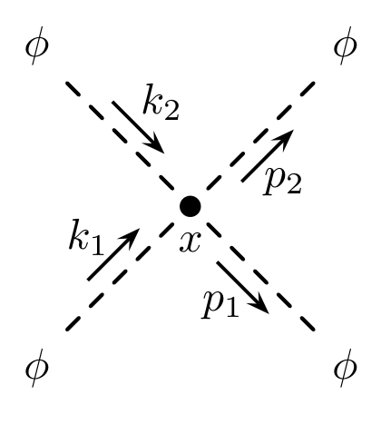

图 6.10: $\mathrm{i}T_1^{(1)}$ 贡献的 $\phi\phi\to\phi\phi$ 散射过程 Feynman 图。时间方向自左向右。

$\mathrm{i}T$ 展开式的第 1 阶 (即 $\lambda^1$ 阶) 涉及 4 个实标量场算符的时序乘积，由 Wick 定理将得到 (5.167) 的形式；这里的 4 个场算符是全同的，具有交换对称性，因此，6 种包含 1 次缩并的项彼此相等，3 种包含 2 次缩并的项也彼此相等，故有

$$
\mathrm{i}T^{(1)}=\frac{-\mathrm{i}\lambda}{4!}\int\mathrm{d}^4x\,\mathrm{T}[\phi(x)\phi(x)\phi(x)\phi(x)]=\sum_{j=1}^{3}\mathrm{i}T_j^{(1)},
\tag{6.112}
$$

其中，

$$
\mathrm{i}T_1^{(1)}=\frac{-\mathrm{i}\lambda}{4!}\int\mathrm{d}^4x\,\mathrm{N}[\phi(x)\phi(x)\phi(x)\phi(x)],
\tag{6.113}
$$

$$
\mathrm{i}T_2^{(1)}=\frac{-\mathrm{i}\lambda}{4!}\,6\int\mathrm{d}^4x\,\mathrm{N}[\phi(x)\phi(x)\phi(x)\phi(x)],
\tag{6.114}
$$

$$
\mathrm{i}T_3^{(1)}=\frac{-\mathrm{i}\lambda}{4!}\,3\int\mathrm{d}^4x\,\mathrm{N}[\phi(x)\phi(x)\phi(x)\phi(x)].
\tag{6.115}
$$

现在，考虑 $\phi\phi\to\phi\phi$ 散射过程，设初态为 $|i\rangle=|\mathbf{k}_1;\mathbf{k}_2\rangle$，末态为 $\langle f|=\langle\mathbf{p}_1;\mathbf{p}_2|$，则 $\mathrm{i}T_1^{(1)}$ 贡献到这个过程的散射矩阵元是

$$
\begin{aligned}
\langle\mathbf{p}_1;\mathbf{p}_2|\mathrm{i}T_1^{(1)}|\mathbf{k}_1;\mathbf{k}_2\rangle&=\frac{-\mathrm{i}\lambda}{4!}\int\mathrm{d}^4x\,\langle\mathbf{p}_1;\mathbf{p}_2|\mathrm{N}[\phi(x)\phi(x)\phi(x)\phi(x)]|\mathbf{k}_1;\mathbf{k}_2\rangle\\
&=\frac{-\mathrm{i}\lambda}{4!}\,4!\int\mathrm{d}^4x\,\langle\mathbf{p}_1;\mathbf{p}_2|\mathrm{N}[\phi(x)\phi(x)\phi(x)\phi(x)]|\mathbf{k}_1;\mathbf{k}_2\rangle\\
&=-\mathrm{i}\lambda\int\mathrm{d}^4x\,\mathrm{e}^{\mathrm{i}(p_1+p_2)\cdot x}\mathrm{e}^{-\mathrm{i}(k_1+k_2)\cdot x}=-\mathrm{i}\lambda(2\pi)^4\delta^{(4)}(k_1+k_2-p_1-p_2).
\end{aligned}\tag{6.116}
$$

第二步根据 (6.83) 和 (6.84) 式让 2 个场算符与全同玻色子初态缩并、另外 2 个场算符与全同玻色子末态缩并，一共有 $4!$ 种缩并方式，因而出现一个组合因子 $4!$，这个因子恰好与前面的 $1/4!$ 因子抵消。第三步用到 (6.15) 和 (6.18) 式。

图 6.10 是相应的 Feynman 图。可以看出，在位置空间中，实标量玻色子入射和出射外线的 Feynman 规则就是 (6.25) 和 (6.31) 式。实际上，外线和内线的 Feynman 规则是由拉氏量中的自由部分决定的，因而不依赖于相互作用理论，具有一般性。(6.39) 式也是 $\phi^4$ 理论中实标量玻色子的内线规则，此时 (6.39) 式中的 $m_\phi$ 就是拉氏量 (5.1) 中的 $m$。$\phi^4$ 理论的顶点 Feynman 规则由拉氏量中的相互作用项 (6.109) 决定，形式为

$$
\text{[图]}=-\mathrm{i}\lambda\int\mathrm{d}^4x.
\tag{6.117}
$$

应用这些规则，可以根据 Feynman 图 6.10 直接写出 (6.116) 式的第三步。

相互作用拉氏量 (6.109) 包含 4 个全同的实标量场 $\phi(x)$ 之积，当它们与初末态缩并时，会出现 $4!$ 种等价的缩并方式，从而产生一个组合因子 $4!$，它恰好与 (6.109) 式中的 $1/4!$ 因子抵消。也就是说，我们在 (6.109) 式中引入一个 $1/4!$ 因子是为了使顶点规则 (6.117) 中不会出现额外的组合因子，方便 Feynman 图的计算。

从 Feynman 图的角度可以清楚地看出组合因子 $4!$ 的来源：由于实标量玻色子是纯中性粒子，它的粒子线上没有箭头 (注意，并非指表示动量方向的箭头)，四条粒子线对顶点而言是不可区分的；第一条外线有 4 种连接顶点的选择，之后第二条外线有 3 种连接选择，而第三条外线只剩 2 种连接选择，第四条外线则只有 1 种连接选择，一共有 $4\cdot3\cdot2\cdot1=4!$ 种连接方式。

由 (6.116) 式的最后一步可以看出，$\phi\phi\to\phi\phi$ 散射过程的领头阶不变振幅为

$$
\mathrm{i}\mathcal{M}=-\mathrm{i}\lambda.
\tag{6.118}
$$

由于初末态四个粒子质量相同，根据 (5.360) 式，质心系中关于立体角的微分散射截面是

$$
\left(\frac{\mathrm{d}\sigma}{\mathrm{d}\Omega}\right)_{\mathrm{CM}}=\frac{|\mathcal{M}|^2}{64\pi^2E_{\mathrm{CM}}^2}=\frac{\lambda^2}{64\pi^2E_{\mathrm{CM}}^2},
\tag{6.119}
$$

它不依赖于 $\mathbf{p}_1$ 的极角 $\theta$ 和方位角 $\phi$。对 $\mathbf{p}_1$ 的立体角 $\Omega$ 积分，就可以得到散射截面。

由于末态两个 $\phi$ 粒子是全同的，末态对称性因子 $\mathcal{S}=2$，计算散射截面时需要除以 $\mathcal{S}$ 来避免量子态的重复计算。具体来说，在质心系中，末态中两个 $\phi$ 粒子的动量大小相等，方向相反；当 $\mathbf{p}_1$ 的方向是 $(\theta,\phi)$ 时，$\mathbf{p}_2$ 的方向是 $(\pi-\theta,\phi+\pi)$；反过来，当 $\mathbf{p}_1$ 的方向是 $(\pi-\theta,\phi+\pi)$ 时，$\mathbf{p}_2$ 的方向则是 $(\theta,\phi)$；然而，由于末态两个 $\phi$ 粒子是全同的，这两个情况实际上对应于同一个量子态。因此，如果我们对 $\Omega$ 作 $4\pi$ 立体角的积分，就会双重计算每个量子态，这是需要除以 $\mathcal{S}=2$ 的原因。于是，$\phi\phi\to\phi\phi$ 的领头阶散射截面为

$$
\sigma=\frac{1}{\mathcal{S}}\int\mathrm{d}\Omega\left(\frac{\mathrm{d}\sigma}{\mathrm{d}\Omega}\right)_{\mathrm{CM}}=\frac{1}{2}4\pi\frac{\lambda^2}{64\pi^2E_{\mathrm{CM}}^2}=\frac{\lambda^2}{32\pi^2E_{\mathrm{CM}}^2}.
\tag{6.120}
$$

接下来，我们讨论 $\mathrm{i}T_2^{(1)}$ 贡献的 $\phi$ 粒子自能图。记初态为 $|i\rangle=|\mathbf{k}\rangle$，末态为 $\langle f|=\langle\mathbf{k}|$，则 $\mathrm{i}T_2^{(1)}$ 对散射矩阵元的贡献为

$$
\begin{aligned}
\langle\mathbf{k}|\mathrm{i}T_2^{(1)}|\mathbf{k}\rangle&=\frac{-\mathrm{i}\lambda}{4!}\,6\int\mathrm{d}^4x\,\langle\mathbf{k}|\mathrm{N}[\phi(x)\phi(x)\phi(x)\phi(x)]|\mathbf{k}\rangle\\
&=\frac{-\mathrm{i}\lambda}{4!}\,6\cdot2\int\mathrm{d}^4x\,\langle\mathbf{k}|\mathrm{N}[\phi(x)\phi(x)\phi(x)\phi(x)]|\mathbf{k}\rangle\\
&=\frac{-\mathrm{i}\lambda}{2}\int\mathrm{d}^4x\,\langle\mathbf{k}|\mathrm{N}[\phi(x)\phi(x)\phi(x)\phi(x)]|\mathbf{k}\rangle.
\end{aligned}\tag{6.121}
$$

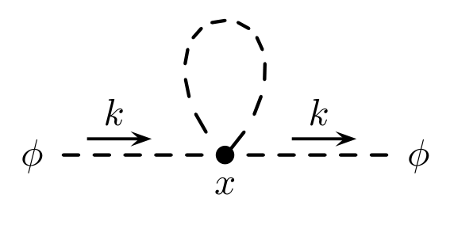

图 6.11: $\mathrm{i}T_2^{(1)}$ 贡献的 $\phi$ 粒子自能图。

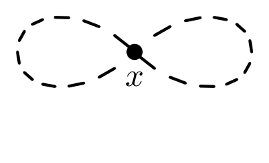

图 6.12: $\mathrm{i}T_3^{(1)}$ 贡献的气泡图。

第一步中的组合因子 6 计算了对 $\phi^4(x)$ 中取 2 个场算符相互缩并的组合数，第二步中的组合因子 2 计算了对余下 2 个场算符与初末态缩并的组合数。这两个组合因子将分母 $4!=24$ 约化为 2，得到第三步的结果，这样剩下的 2 称为 Feynman 图的对称性因子 (symmetry factor)。

Feynman 图如图 6.11 所示，它具有一条开始并结束于同一个顶点的内线，由于实标量玻色子的内线上没有箭头，这条内线的两端对于这个顶点而言是不可分辨的，即是全同的，因而用内线的两端连接顶点时的 2 种连接方式实际上是同一种，在计算时需要除以 2，否则就会双重计算。这就是因子 2 称为 Feynman 图的对称性因子的原因，它体现了 Feynman 图关于全同粒子线的对称性。实际上，分析 Feynman 图对称性得到的因子总是与散射矩阵元计算中剩下的因子相同，下面将继续验证这个规律。如果先画出 Feynman 图，再利用位置空间的 Feynman 规则写出散射矩阵元，则最后必须除以 Feynman 图的对称性因子才能得出正确的结果。

在

$$
\mathrm{i}T_3^{(1)}=\frac{-\mathrm{i}\lambda}{4!}\,3\int\mathrm{d}^4x\,\mathrm{N}[\phi(x)\phi(x)\phi(x)\phi(x)]=\frac{-\mathrm{i}\lambda}{8}\int\mathrm{d}^4x\,\mathrm{N}[\phi(x)\phi(x)\phi(x)\phi(x)]
\tag{6.122}
$$

的表达式中，正规乘积里面所有场算符都已经参与缩并了，因此它的 Feynman 图是气泡图，如图 6.12 所示。由上式中第二步可见，对称性因子为 8。从 Feynman 图的角度看，图中 2 个始末端连接同一顶点的圈各自贡献一个因子 2，而这 2 个圈彼此也是全同的，再贡献一个因子 2，故 Feynman 图的对称性因子为 $2\cdot2\cdot2=8$，验证了上述规律。

在 $\mathrm{i}T$ 展开式的第 2 阶，即 $\lambda^2$ 阶，由 (6.111) 式有

$$
\mathrm{i}T^{(2)}=\frac{1}{2!}\left(\frac{-\mathrm{i}\lambda}{4!}\right)^2\int\mathrm{d}^4x\,\mathrm{d}^4y\,\mathrm{T}[\phi(x)\phi(x)\phi(x)\phi(x)\phi(y)\phi(y)\phi(y)\phi(y)].
\tag{6.123}
$$

通过 Wick 定理可以将上式化为许多个包含正规乘积的项，这里我们只讨论对 $\phi$ 粒子的自能图有贡献的项，有 3 种情况。

第 1 种情况具有如下缩并结构，

$$
\begin{aligned}
\mathrm{i}T_1^{(2)}&=\frac{1}{2!}\left(\frac{-\mathrm{i}\lambda}{4!}\right)^2 4\cdot4\cdot3\cdot3\int\mathrm{d}^4x\,\mathrm{d}^4y\,\mathrm{N}[\phi(x)\phi(x)\phi(x)\phi(x)\phi(y)\phi(y)\phi(y)\phi(y)]\\
&=\frac{1}{2!}\frac{(-\mathrm{i}\lambda)^2}{4}\int\mathrm{d}^4x\,\mathrm{d}^4y\,\mathrm{N}[\phi(x)\phi(x)\phi(x)\phi(x)\phi(y)\phi(y)\phi(y)\phi(y)].
\end{aligned}\tag{6.124}
$$

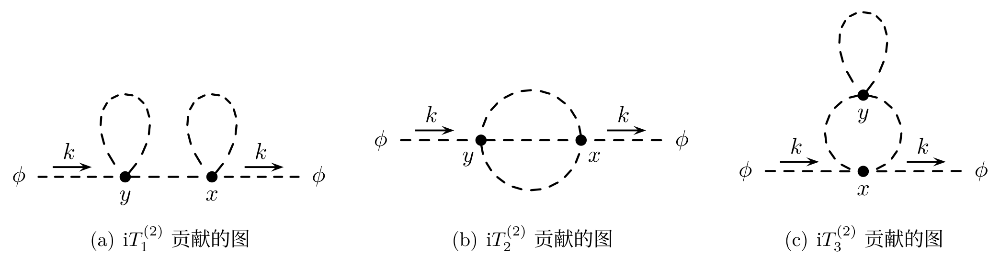

(a) $\mathrm{i}T_1^{(2)}$ 贡献的图　　(b) $\mathrm{i}T_2^{(2)}$ 贡献的图　　(c) $\mathrm{i}T_3^{(2)}$ 贡献的图

图 6.13: $\mathrm{i}T^{(2)}$ 贡献的 $\phi$ 粒子自能图。

在第一步中，从 $\phi^4(x)$ 和 $\phi^4(y)$ 里面分别取 1 个 $\phi(x)$ 和 1 个 $\phi(y)$ 出来缩并的方法有 $4\cdot4$ 种，再从余下的 3 个 $\phi(x)$ [或 $\phi(y)$] 中取 2 个 $\phi(x)$ [或 $\phi(y)$] 出来缩并的方法有 $C_3^2=3$ 种，因而组合因子为 $4\cdot4\cdot3\cdot3$。$\mathrm{i}T_1^{(2)}$ 对散射矩阵元的贡献为

$$
\begin{aligned}
\langle\mathbf{k}|\mathrm{i}T_1^{(2)}|\mathbf{k}\rangle&=\frac{1}{2!}\frac{(-\mathrm{i}\lambda)^2}{4}\int\mathrm{d}^4x\,\mathrm{d}^4y\,\big\{\langle\mathbf{k}|\mathrm{N}[\phi(x)\phi(x)\phi(x)\phi(x)\phi(y)\phi(y)\phi(y)\phi(y)]|\mathbf{k}\rangle\\
&\quad+\langle\mathbf{k}|\mathrm{N}[\phi(x)\phi(x)\phi(x)\phi(x)\phi(y)\phi(y)\phi(y)\phi(y)]|\mathbf{k}\rangle\big\}\\
&=\frac{(-\mathrm{i}\lambda)^2}{4}\int\mathrm{d}^4x\,\mathrm{d}^4y\,\langle\mathbf{k}|\mathrm{N}[\phi(x)\phi(x)\phi(x)\phi(x)\phi(y)\phi(y)\phi(y)\phi(y)]|\mathbf{k}\rangle.
\end{aligned}\tag{6.125}
$$

第一步包含 2 种与初末态缩并的方式，这 2 种方式关于时空坐标 $x$ 和 $y$ 的交换是对称的，因而可以合成一项，贡献一个 $2!$ 因子，恰好与最前面的 $1/2!$ 因子抵消，从而得到第二步的结果，它表明这个过程的对称性因子为 4。图 6.13(a) 是相应的 Feynman 图，具有 2 个始末端连接同一个顶点的圈，各自贡献一个因子 2，故 Feynman 图的对称性因子为 $2\cdot2=4$。

第 2 种情况具有如下缩并结构，

$$
\begin{aligned}
\mathrm{i}T_2^{(2)}&=\frac{1}{2!}\left(\frac{-\mathrm{i}\lambda}{4!}\right)^2 4\cdot4\cdot6\int\mathrm{d}^4x\,\mathrm{d}^4y\,\mathrm{N}[\phi(x)\phi(x)\phi(x)\phi(x)\phi(y)\phi(y)\phi(y)\phi(y)]\\
&=\frac{1}{2!}\frac{(-\mathrm{i}\lambda)^2}{6}\int\mathrm{d}^4x\,\mathrm{d}^4y\,\mathrm{N}[\phi(x)\phi(x)\phi(x)\phi(x)\phi(y)\phi(y)\phi(y)\phi(y)].
\end{aligned}\tag{6.126}
$$

在第一步中，从 $\phi^4(x)$ 和 $\phi^4(y)$ 里面分别取 3 个 $\phi(x)$ 和 3 个 $\phi(y)$ 出来的方法有 $C_4^3C_4^3=4\cdot4$ 种，将这 3 个 $\phi(x)$ 和 3 个 $\phi(y)$ 彼此缩并的排列方法有 $3!=6$ 种，因而组合因子是 $4\cdot4\cdot6$。$\mathrm{i}T_2^{(2)}$ 对散射矩阵元的贡献为

$$
\begin{aligned}
\langle\mathbf{k}|\mathrm{i}T_2^{(2)}|\mathbf{k}\rangle&=\frac{1}{2!}\frac{(-\mathrm{i}\lambda)^2}{6}\int\mathrm{d}^4x\,\mathrm{d}^4y\,\big\{\langle\mathbf{k}|\mathrm{N}[\phi(x)\phi(x)\phi(x)\phi(x)\phi(y)\phi(y)\phi(y)\phi(y)]|\mathbf{k}\rangle\\
&\quad+\langle\mathbf{k}|\mathrm{N}[\phi(x)\phi(x)\phi(x)\phi(x)\phi(y)\phi(y)\phi(y)\phi(y)]|\mathbf{k}\rangle\big\}\\
&=\frac{(-\mathrm{i}\lambda)^2}{6}\int\mathrm{d}^4x\,\mathrm{d}^4y\,\langle\mathbf{k}|\mathrm{N}[\phi(x)\phi(x)\phi(x)\phi(x)\phi(y)\phi(y)\phi(y)\phi(y)]|\mathbf{k}\rangle.
\end{aligned}\tag{6.127}
$$

第一步包含 2 种与初末态缩并的方式，它们关于 $x$ 和 $y$ 的交换是对称的，合为一项之后，抵消掉最前面的 $1/2!$ 因子，结果表明这个过程的对称性因子为 6。图 6.13(b) 是相应的 Feynman 图，有 3 条全同内线连接两个不同的顶点，这 3 条内线有 $3!$ 种排列方法，故 Feynman 图的对称性因子为 $3!=6$。

第 3 种情况包含具有如下缩并结构的两项，

$$
\begin{aligned}
\mathrm{i}T_3^{(2)}&=\frac{1}{2!}\left(\frac{-\mathrm{i}\lambda}{4!}\right)^2 6\cdot 6\cdot 2\int\mathrm{d}^4x\,\mathrm{d}^4y\,\{\mathrm{N}[\phi(x)\phi(x)\phi(x)\phi(x)\phi(y)\phi(y)\phi(y)\phi(y)]\\
&\quad+\mathrm{N}[\phi(x)\phi(x)\phi(x)\phi(x)\phi(y)\phi(y)\phi(y)\phi(y)]\}\\
&=\frac{(-\mathrm{i}\lambda)^2}{8}\int\mathrm{d}^4x\,\mathrm{d}^4y\,\mathrm{N}[\phi(x)\phi(x)\phi(x)\phi(x)\phi(y)\phi(y)\phi(y)\phi(y)].
\end{aligned}\tag{6.128}
$$

在第一步中，花括号内的两项关于 $x$ 和 $y$ 的交换是对称的，合为一项则抵消掉最前面的 $1/2!$ 因子。两项具有相同的组合因子；在每一项中，从 $\phi^4(x)$ 和 $\phi^4(y)$ 里面分别取 2 个 $\phi(x)$ 和 2 个 $\phi(y)$ 出来的方法有 $C_4^2C_4^2=6\cdot 6$ 种，将这 2 个 $\phi(x)$ 和 2 个 $\phi(y)$ 彼此缩并的排列方法有 2 种，因而组合因子为 $6\cdot 6\cdot 2$。$\mathrm{i}T_3^{(2)}$ 对散射矩阵元的贡献为

$$
\begin{aligned}
\langle\mathbf{k}|\,\mathrm{i}T_3^{(2)}|\mathbf{k}\rangle&=\frac{(-\mathrm{i}\lambda)^2}{8}\cdot 2\int\mathrm{d}^4x\,\mathrm{d}^4y\,\langle\mathbf{k}|\mathrm{N}[\phi(x)\phi(x)\phi(x)\phi(x)\phi(y)\phi(y)\phi(y)\phi(y)]|\mathbf{k}\rangle\\
&=\frac{(-\mathrm{i}\lambda)^2}{4}\int\mathrm{d}^4x\,\mathrm{d}^4y\,\langle\mathbf{k}|\mathrm{N}[\phi(x)\phi(x)\phi(x)\phi(x)\phi(y)\phi(y)\phi(y)\phi(y)]|\mathbf{k}\rangle.
\end{aligned}\tag{6.129}
$$

在第一步中，与初末态缩并的方式有 2 种，因而组合因子为 2，结果表明对称性因子为 4。相应的 Feynman 图如图 6.13(c) 所示，图中始末端连接同一顶点的 1 个圈贡献一个因子 2，连接两个不同顶点的 2 条全同内线有 2 种排列方法，故 Feynman 图的对称性因子为 $2\cdot 2=4$。

在动量空间中，除了顶点规则外，6.2 节里面关于实标量场的 Feynman 规则也适用于 $\phi^4$ 理论；具体来说，仍然适用的规则包括实标量玻色子的外线规则 6 和 7，内线规则 8，以及规则 10 和 11。此外，还应该加上以下两条规则。

- $\phi^4$ 相互作用顶点：$\bullet=-\mathrm{i}\lambda$。
- 每个 Feynman 图的表达式要除以它的对称性因子。

注意，将 $\phi^4$ 相互作用项 $\mathcal{L}_1=-\lambda\phi^4/4!$ 中的 4 个场算符 $\phi$ 剥离，乘以 $\mathrm{i}$，还要再乘上 4 个 $\phi$ 的排列数 $4!$，才得到顶点规则的表达式 $-\mathrm{i}\lambda$。

## 6.4 一般内外线 Feynman 规则

上述讨论表明，外线和内线的 Feynman 规则不依赖于相互作用理论，是由拉氏量中的自由部分决定的，具有一般性。在本节中，我们讨论复标量场、有质量实矢量场和无质量实矢量场的一般内外线规则，这些规则适用于各种相关的相互作用理论。

(1) 复标量场 $\phi(x)$ 描述的玻色子有正反之分，引入两种动量为 $\mathbf{p}$ 的单粒子态，

$$
\text{正标量玻色子 }\phi\text{ 的单粒子态}\quad |\mathbf{p}^+\rangle=\sqrt{2E_{\mathbf{p}}}\,a_{\mathbf{p}}^{\dagger}|0\rangle, \tag{6.130}
$$

$$
\text{反标量玻色子 }\bar{\phi}\text{ 的单粒子态}\quad |\mathbf{p}^-\rangle=\sqrt{2E_{\mathbf{p}}}\,b_{\mathbf{p}}^{\dagger}|0\rangle. \tag{6.131}
$$

现在由复标量场的正负能解展开式 (5.213) 和 (5.214) 计算场算符与初末态缩并的结果。$\phi(x)$ 与正标量玻色子初态的缩并为

$$
\begin{aligned}
\overline{\phi(x)|\mathbf{p}^+\rangle}&\equiv\phi^{(+)}(x)|\mathbf{p}^+\rangle=\int\frac{\mathrm{d}^3q}{(2\pi)^3}\frac{1}{\sqrt{2E_{\mathbf{q}}}}a_{\mathbf{q}}\mathrm{e}^{-\mathrm{i}q\cdot x}\sqrt{2E_{\mathbf{p}}}\,a_{\mathbf{p}}^{\dagger}|0\rangle\\
&=\int\frac{\mathrm{d}^3q}{(2\pi)^3}\frac{\sqrt{E_{\mathbf{p}}}}{\sqrt{E_{\mathbf{q}}}}\mathrm{e}^{-\mathrm{i}q\cdot x}[a_{\mathbf{q}},a_{\mathbf{p}}^{\dagger}]|0\rangle=\int\mathrm{d}^3q\,\frac{\sqrt{E_{\mathbf{p}}}}{\sqrt{E_{\mathbf{q}}}}\mathrm{e}^{-\mathrm{i}q\cdot x}\delta^{(3)}(\mathbf{q}-\mathbf{p})|0\rangle=\mathrm{e}^{-\mathrm{i}p\cdot x}|0\rangle.
\end{aligned}\tag{6.132}
$$

第四步用到产生湮灭算符的对易关系 (2.183)。类似地，$\phi^{\dagger}(x)$ 与反标量玻色子初态的缩并为

$$
\overline{\phi^{\dagger}(x)|\mathbf{p}^-\rangle}\equiv\phi^{\dagger(+)}(x)|\mathbf{p}^-\rangle=\int\frac{\mathrm{d}^3q}{(2\pi)^3}\frac{1}{\sqrt{2E_{\mathbf{q}}}}b_{\mathbf{q}}\mathrm{e}^{-\mathrm{i}q\cdot x}\sqrt{2E_{\mathbf{p}}}\,b_{\mathbf{p}}^{\dagger}|0\rangle=\mathrm{e}^{-\mathrm{i}p\cdot x}|0\rangle. \tag{6.133}
$$

另一方面，$\phi^{\dagger}(x)$ 与正标量玻色子末态的缩并为

$$
\begin{aligned}
\overline{\langle\mathbf{p}^+|\phi^{\dagger}(x)}&\equiv\langle\mathbf{p}^+|\phi^{\dagger(-)}(x)=\int\frac{\mathrm{d}^3q}{(2\pi)^3}\langle 0|\sqrt{2E_{\mathbf{p}}}\,a_{\mathbf{p}}\frac{1}{\sqrt{2E_{\mathbf{q}}}}a_{\mathbf{q}}^{\dagger}\mathrm{e}^{\mathrm{i}q\cdot x}\\
&=\int\frac{\mathrm{d}^3q}{(2\pi)^3}\frac{\sqrt{E_{\mathbf{p}}}}{\sqrt{E_{\mathbf{q}}}}\mathrm{e}^{\mathrm{i}q\cdot x}\langle 0|[a_{\mathbf{p}},a_{\mathbf{q}}^{\dagger}]=\int\mathrm{d}^3q\,\frac{\sqrt{E_{\mathbf{p}}}}{\sqrt{E_{\mathbf{q}}}}\mathrm{e}^{\mathrm{i}q\cdot x}\langle 0|\delta^{(3)}(\mathbf{q}-\mathbf{p})=\langle 0|\mathrm{e}^{\mathrm{i}p\cdot x},
\end{aligned}\tag{6.134}
$$

而 $\phi(x)$ 与反标量玻色子末态的缩并为

$$
\overline{\langle\mathbf{p}^-|\phi(x)\rangle}\equiv\langle\mathbf{p}^-|\phi^{(-)}(x)=\int\frac{\mathrm{d}^3q}{(2\pi)^3}\langle 0|\sqrt{2E_{\mathbf{p}}}\,b_{\mathbf{p}}\frac{1}{\sqrt{2E_{\mathbf{q}}}}b_{\mathbf{q}}^{\dagger}\mathrm{e}^{\mathrm{i}q\cdot x}=\langle 0|\mathrm{e}^{\mathrm{i}p\cdot x}. \tag{6.135}
$$

我们用带箭头的虚线表示复标量玻色子的运动，线上的箭头可认为是某种 U(1) 荷流动的方向，或者说是玻色子数流动的方向。根据上述结果及 Feynman 传播子表达式 (5.222)，我们写下位置空间中复标量场的一般内外线规则，

$$
\phi\ \overset{p}{\text{---}\blacktriangleright\text{---}}\ \bullet\ x=\langle 0|\overline{\phi(x)|\mathbf{p}^+\rangle}=\langle 0|\phi^{(+)}(x)|\mathbf{p}^+\rangle=\mathrm{e}^{-\mathrm{i}p\cdot x}, \tag{6.136}
$$

$$
\bar{\phi}\ \overset{p}{\text{---}\blacktriangleleft\text{---}}\ \bullet\ x=\langle 0|\overline{\phi^{\dagger}(x)|\mathbf{p}^-\rangle}=\langle 0|\phi^{\dagger(+)}(x)|\mathbf{p}^-\rangle=\mathrm{e}^{-\mathrm{i}p\cdot x}, \tag{6.137}
$$

$$
x\ \bullet\ \overset{p}{\text{---}\blacktriangleright\text{---}}\ \phi=\overline{\langle\mathbf{p}^+|\phi^{\dagger}(x)}|0\rangle=\langle\mathbf{p}^+|\phi^{\dagger(-)}(x)|0\rangle=\mathrm{e}^{\mathrm{i}p\cdot x}, \tag{6.138}
$$

$$
x\ \bullet\ \overset{p}{\text{---}\blacktriangleleft\text{---}}\ \bar{\phi}=\overline{\langle\mathbf{p}^-|\phi(x)}|0\rangle=\langle\mathbf{p}^-|\phi^{(-)}(x)|0\rangle=\mathrm{e}^{\mathrm{i}p\cdot x}, \tag{6.139}
$$

$$
x\ \bullet\ \overset{p}{\text{---}\blacktriangleright\text{---}}\ \bullet\ y=\overline{\phi(y)\phi^{\dagger}(x)}=D_{\mathrm{F}}(y-x)=\int\frac{\mathrm{d}^4p}{(2\pi)^4}\frac{\mathrm{i}}{p^2-m_\phi^2+\mathrm{i}\epsilon}\mathrm{e}^{-\mathrm{i}p\cdot(y-x)}. \tag{6.140}
$$

其中，$m_\phi$ 是标量玻色子 $\phi$ 的质量。

(2) 有质量实矢量场 $A^\mu(x)$ 描述一种纯中性的矢量玻色子 $A$，具有 3 种螺旋度 $\lambda=\pm,0$。记动量为 $\mathbf{p}$、螺旋度为 $\lambda$ 的 $A$ 单粒子态为 $|\mathbf{p},\lambda\rangle=\sqrt{2E_{\mathbf{p}}}\,a_{\mathbf{p},\lambda}^{\dagger}|0\rangle$。根据有质量矢量场的正负能解展开式 (5.137) 和 (5.138)，$A^\mu(x)$ 与实矢量玻色子初态的缩并为

$$
\begin{aligned}
\overline{A^\mu(x)|\mathbf{p},\lambda\rangle}&\equiv A^{\mu(+)}(x)|\mathbf{p},\lambda\rangle\\
&=\int\frac{\mathrm{d}^3q}{(2\pi)^3}\frac{1}{\sqrt{2E_{\mathbf{q}}}}\sum_{\lambda'=\pm,0}\varepsilon^{\mu}(\mathbf{q},\lambda')a_{\mathbf{q},\lambda'}\mathrm{e}^{-\mathrm{i}q\cdot x}\sqrt{2E_{\mathbf{p}}}\,a_{\mathbf{p},\lambda}^{\dagger}|0\rangle\\
&=\int\frac{\mathrm{d}^3q}{(2\pi)^3}\frac{\sqrt{E_{\mathbf{p}}}}{\sqrt{E_{\mathbf{q}}}}\sum_{\lambda'=\pm,0}\varepsilon^{\mu}(\mathbf{q},\lambda')\mathrm{e}^{-\mathrm{i}q\cdot x}[a_{\mathbf{q},\lambda'},a_{\mathbf{p},\lambda}^{\dagger}]|0\rangle\\
&=\int\mathrm{d}^3q\,\frac{\sqrt{E_{\mathbf{p}}}}{\sqrt{E_{\mathbf{q}}}}\sum_{\lambda'=\pm,0}\varepsilon^{\mu}(\mathbf{q},\lambda')\mathrm{e}^{-\mathrm{i}q\cdot x}\delta_{\lambda'\lambda}\delta^{(3)}(\mathbf{q}-\mathbf{p})|0\rangle=\varepsilon^{\mu}(\mathbf{p},\lambda)\mathrm{e}^{-\mathrm{i}p\cdot x}|0\rangle,
\end{aligned}\tag{6.141}
$$

而 $A^\mu(x)$ 与实矢量玻色子末态的缩并为

$$
\begin{aligned}
\overline{\langle\mathbf{p},\lambda|A^\mu(x)\rangle}&\equiv\langle\mathbf{p},\lambda|A^{\mu(-)}(x)\\
&=\int\frac{\mathrm{d}^3q}{(2\pi)^3}\langle 0|\sqrt{2E_{\mathbf{p}}}\,a_{\mathbf{p},\lambda}\frac{1}{\sqrt{2E_{\mathbf{q}}}}\sum_{\lambda'=\pm,0}\varepsilon^{\mu*}(\mathbf{q},\lambda')a_{\mathbf{q},\lambda'}^{\dagger}\mathrm{e}^{\mathrm{i}q\cdot x}\\
&=\int\frac{\mathrm{d}^3q}{(2\pi)^3}\frac{\sqrt{E_{\mathbf{p}}}}{\sqrt{E_{\mathbf{q}}}}\sum_{\lambda'=\pm,0}\varepsilon^{\mu*}(\mathbf{q},\lambda')\langle 0|[a_{\mathbf{p},\lambda},a_{\mathbf{q},\lambda'}^{\dagger}]\mathrm{e}^{\mathrm{i}q\cdot x}\\
&=\int\mathrm{d}^3q\,\frac{\sqrt{E_{\mathbf{p}}}}{\sqrt{E_{\mathbf{q}}}}\sum_{\lambda'=\pm,0}\varepsilon^{\mu*}(\mathbf{q},\lambda')\langle 0|\delta_{\lambda\lambda'}\delta^{(3)}(\mathbf{p}-\mathbf{q})\mathrm{e}^{\mathrm{i}q\cdot x}=\langle 0|\varepsilon^{\mu*}(\mathbf{p},\lambda)\mathrm{e}^{\mathrm{i}p\cdot x}.
\end{aligned}\tag{6.142}
$$

上面两式的第四步均用到产生湮灭算符的对易关系 (3.267)。我们用波浪线表示有质量实矢量玻色子的运动，根据上述结果写下位置空间中有质量实矢量场的一般外线规则，

$$
A,\lambda;\mu\ \overset{p}{\sim\!\!\sim\!\!\sim}\ \bullet\ x=\langle 0|\overline{A^\mu(x)|\mathbf{p},\lambda\rangle}=\langle 0|A^{\mu(+)}(x)|\mathbf{p},\lambda\rangle=\varepsilon^{\mu}(\mathbf{p},\lambda)\mathrm{e}^{-\mathrm{i}p\cdot x}, \tag{6.143}
$$

$$
x\ \bullet\ \overset{p}{\sim\!\!\sim\!\!\sim}\ A,\lambda;\mu=\overline{\langle\mathbf{p},\lambda|A^\mu(x)}|0\rangle=\langle\mathbf{p},\lambda|A^{\mu(-)}(x)|0\rangle=\varepsilon^{\mu*}(\mathbf{p},\lambda)\mathrm{e}^{\mathrm{i}p\cdot x}. \tag{6.144}
$$

现在讨论有质量实矢量场的内线规则。我们在前面的计算中已经发现，有质量矢量场的 Feynman 传播子表达式 (5.243) 包含一个非协变项。接下来的讨论将表明这个非协变项在微扰论中的贡献恰好被相互作用哈密顿量密度中非协变项 (5.98) 的贡献抵消，因而理论仍然具有 Lorentz 协变性。

与前面一样，假设相互作用拉氏量具有 (5.62) 的形式，那么，由 (5.97) 式可知，相互作用绘景中的相互作用哈密顿量密度为

$$
\mathcal{H}_1(x)=-gJ_\mu(x)A^\mu(x)+\frac{g^2}{2m_A^2}[J^0(x)]^2. \tag{6.145}
$$

其中，$g$ 是耦合常数，$m_A$ 是实矢量玻色子的质量，而上式右边第二项就是非协变项 (5.98)。根据 (6.4) 式，$\mathrm{i}T$ 展开式的前 2 阶为

$$
\mathrm{i}T^{(1)}=-\mathrm{i}\int\mathrm{d}^4x\,\mathrm{T}\left[-gJ_\mu(x)A^\mu(x)+\frac{g^2}{2m_A^2}J^0(x)J^0(x)\right], \tag{6.146}
$$

$$
\begin{aligned}
\mathrm{i}T^{(2)}&=\frac{(-\mathrm{i})^2}{2!}\int\mathrm{d}^4x\,\mathrm{d}^4y\,\mathrm{T}\left\{\left(-gJ_\mu(x)A^\mu(x)+\frac{g^2}{2m_A^2}[J^0(x)]^2\right)\right.\\
&\quad\left.\times\left(-gJ_\nu(y)A^\nu(y)+\frac{g^2}{2m_A^2}[J^0(y)]^2\right)\right\}.
\end{aligned}\tag{6.147}
$$

应用 Wick 定理之后，Feynman 传播子 $\overline{A^\mu(x)A^\nu(y)}=\Delta_{\mathrm{F}}^{\mu\nu}(x-y)$ 出现在 $n\geqslant 2$ 的 $\mathrm{i}T^{(n)}$ 中。比如，$\mathrm{i}T^{(2)}$ 包含一个出现 Feynman 传播子的 $g^2$ 阶的项，

$$
\begin{aligned}
\mathrm{i}T_1^{(2)}&=\frac{(\mathrm{i}g)^2}{2!}\int\mathrm{d}^4x\,\mathrm{d}^4y\,\mathrm{N}[J_\mu(x)\overline{A^\mu(x)J_\nu(y)A^\nu(y)}]\\
&=\frac{(\mathrm{i}g)^2}{2}\int\mathrm{d}^4x\,\mathrm{d}^4y\,\mathrm{N}[J_\mu(x)J_\nu(y)\Delta_{\mathrm{F}}^{\mu\nu}(x-y)]\\
&=\frac{(\mathrm{i}g)^2}{2}\int\mathrm{d}^4x\,\mathrm{d}^4y\,\mathrm{N}\left\{J_\mu(x)J_\nu(y)\right.\\
&\quad\left.\times\left[\int\frac{\mathrm{d}^4p}{(2\pi)^4}\frac{-\mathrm{i}(g^{\mu\nu}-p^\mu p^\nu/m_A^2)}{p^2-m_A^2+\mathrm{i}\epsilon}\mathrm{e}^{-\mathrm{i}p\cdot(x-y)}-\frac{\mathrm{i}}{m_A^2}g^{\mu0}g^{\nu0}\delta^{(4)}(x-y)\right]\right\}.
\end{aligned}\tag{6.148}
$$

第三步用到 (5.243) 式，最后一步方括号中的第二项是非协变项。另一方面，$\mathrm{i}T^{(1)}$ 也包含一个 $g^2$ 阶的项，

$$
\begin{aligned}
\mathrm{i}T_1^{(1)}&=-\mathrm{i}\int\mathrm{d}^4x\,\mathrm{N}\left[\frac{g^2}{2m_A^2}J^0(x)J^0(x)\right]=\frac{(\mathrm{i}g)^2}{2}\int\mathrm{d}^4x\,\mathrm{d}^4y\,\mathrm{N}\left[\frac{\mathrm{i}}{m_A^2}J^0(x)J^0(y)\delta^{(4)}(x-y)\right]\\
&=\frac{(\mathrm{i}g)^2}{2}\int\mathrm{d}^4x\,\mathrm{d}^4y\,\mathrm{N}\left[\frac{\mathrm{i}}{m_A^2}J_\mu(x)J_\nu(y)g^{\mu0}g^{\nu0}\delta^{(4)}(x-y)\right].
\end{aligned}\tag{6.149}
$$

上式是非协变的。在微扰论的 $g^2$ 阶计算中，必须同时考虑 $\mathrm{i}T_1^{(2)}$ 和 $\mathrm{i}T_1^{(1)}$ 的贡献。两者相加，则非协变项恰好相消，得到一个 Lorentz 协变的表达式：

$$
\mathrm{i}T_1^{(2)}+\mathrm{i}T_1^{(1)}=\frac{(\mathrm{i}g)^2}{2}\int\mathrm{d}^4x\,\mathrm{d}^4y\,\mathrm{N}\left\{J_\mu(x)J_\nu(y)\left[\int\frac{\mathrm{d}^4p}{(2\pi)^4}\frac{-\mathrm{i}(g^{\mu\nu}-p^\mu p^\nu/m_A^2)}{p^2-m_A^2+\mathrm{i}\epsilon}\mathrm{e}^{-\mathrm{i}p\cdot(x-y)}\right]\right\}. \tag{6.150}
$$

上式方括号里面的部分是 Feynman 传播子表达式 (5.243) 中的 Lorentz 协变项，在实际计算中，只有这一项有贡献。因此，我们可以将位置空间中有质量实矢量场的一般内线规则设置为

$$
\begin{aligned}
x;\nu\ \bullet\ \overset{p}{\sim\!\!\sim\!\!\sim}\ \bullet\ y;\mu&=\overline{A^\mu(y)A^\nu(x)}\ \text{的 Lorentz 协变项}\\
&=\int\frac{\mathrm{d}^4p}{(2\pi)^4}\frac{-\mathrm{i}(g^{\mu\nu}-p^\mu p^\nu/m_A^2)}{p^2-m_A^2+\mathrm{i}\epsilon}\mathrm{e}^{-\mathrm{i}p\cdot(y-x)}.
\end{aligned}\tag{6.151}
$$

(3) 无质量实矢量场 $A^\mu(x)$ 描述一种纯中性的无质量矢量玻色子 $A$，具有螺旋度 $\lambda=\pm$ 的 2 种物理态。记动量为 $\mathbf{p}$、螺旋度为 $\lambda$ 的 $A$ 粒子态为 $|\mathbf{p},\lambda\rangle=\sqrt{2E_{\mathbf{p}}}\,a_{\mathbf{p},\lambda}^{\dagger}|0\rangle$。由无质量矢量场的平面波展开式 (3.416)，正能量解部分和负能解部分可以表示成

$$
A^{\mu(+)}(x)=\int\frac{\mathrm{d}^3p}{(2\pi)^3}\frac{1}{\sqrt{2E_{\mathbf{p}}}}\mathrm{e}^{-\mathrm{i}p\cdot x}\left[\sum_{\sigma=0,3}\varepsilon^{\mu}(\mathbf{p},\sigma)b_{\mathbf{p},\sigma}+\sum_{\lambda=\pm}\varepsilon^{\mu}(\mathbf{p},\lambda)a_{\mathbf{p},\lambda}\right], \tag{6.152}
$$

$$
A^{\mu(-)}(x)=\int\frac{\mathrm{d}^3p}{(2\pi)^3}\frac{1}{\sqrt{2E_{\mathbf{p}}}}\mathrm{e}^{\mathrm{i}p\cdot x}\left[\sum_{\sigma=0,3}\varepsilon^{\mu}(\mathbf{p},\sigma)b_{\mathbf{p},\sigma}^{\dagger}+\sum_{\lambda=\pm}\varepsilon^{\mu*}(\mathbf{p},\lambda)a_{\mathbf{p},\lambda}^{\dagger}\right]. \tag{6.153}
$$

从而，根据产生湮灭算符的对易关系 (3.412)，$A^\mu(x)$ 与实矢量玻色子初态的缩并为

$$
\begin{aligned}
\overline{A^\mu(x)|\mathbf{p},\lambda\rangle}&\equiv A^{\mu(+)}(x)|\mathbf{p},\lambda\rangle\\
&=\int\frac{\mathrm{d}^3q}{(2\pi)^3}\frac{1}{\sqrt{2E_{\mathbf{q}}}}\mathrm{e}^{-\mathrm{i}q\cdot x}\left[\sum_{\sigma=0,3}\varepsilon^{\mu}(\mathbf{q},\sigma)b_{\mathbf{q},\sigma}+\sum_{\lambda'=\pm}\varepsilon^{\mu}(\mathbf{q},\lambda')a_{\mathbf{q},\lambda'}\right]\sqrt{2E_{\mathbf{p}}}\,a_{\mathbf{p},\lambda}^{\dagger}|0\rangle\\
&=\int\frac{\mathrm{d}^3q}{(2\pi)^3}\frac{\sqrt{E_{\mathbf{p}}}}{\sqrt{E_{\mathbf{q}}}}\mathrm{e}^{-\mathrm{i}q\cdot x}\left\{\sum_{\sigma=0,3}\varepsilon^{\mu}(\mathbf{q},\sigma)[b_{\mathbf{q},\sigma},a_{\mathbf{p},\lambda}^{\dagger}]+\sum_{\lambda'=\pm}\varepsilon^{\mu}(\mathbf{q},\lambda')[a_{\mathbf{q},\lambda'},a_{\mathbf{p},\lambda}^{\dagger}]\right\}|0\rangle\\
&=\int\mathrm{d}^3q\,\frac{\sqrt{E_{\mathbf{p}}}}{\sqrt{E_{\mathbf{q}}}}\sum_{\lambda'=\pm}\varepsilon^{\mu}(\mathbf{q},\lambda')\mathrm{e}^{-\mathrm{i}q\cdot x}\delta_{\lambda'\lambda}\delta^{(3)}(\mathbf{q}-\mathbf{p})|0\rangle=\varepsilon^{\mu}(\mathbf{p},\lambda)\mathrm{e}^{-\mathrm{i}p\cdot x}|0\rangle,
\end{aligned}\tag{6.154}
$$

而 $A^\mu(x)$ 与实矢量玻色子末态的缩并为

$$
\begin{aligned}
\overline{\langle\mathbf{p},\lambda|A^\mu(x)\rangle}&\equiv\langle\mathbf{p},\lambda|A^{\mu(-)}(x)\\
&=\int\frac{\mathrm{d}^3q}{(2\pi)^3}\langle 0|\sqrt{2E_{\mathbf{p}}}\,a_{\mathbf{p},\lambda}\frac{1}{\sqrt{2E_{\mathbf{q}}}}\mathrm{e}^{\mathrm{i}q\cdot x}\left[\sum_{\sigma=0,3}\varepsilon^{\mu}(\mathbf{q},\sigma)b_{\mathbf{q},\sigma}^{\dagger}+\sum_{\lambda'=\pm}\varepsilon^{\mu*}(\mathbf{q},\lambda')a_{\mathbf{q},\lambda'}^{\dagger}\right]\\
&=\int\frac{\mathrm{d}^3q}{(2\pi)^3}\frac{\sqrt{E_{\mathbf{p}}}}{\sqrt{E_{\mathbf{q}}}}\mathrm{e}^{\mathrm{i}q\cdot x}\langle 0|\left\{\sum_{\sigma=0,3}\varepsilon^{\mu}(\mathbf{q},\sigma)[a_{\mathbf{p},\lambda},b_{\mathbf{q},\sigma}^{\dagger}]+\sum_{\lambda'=\pm}\varepsilon^{\mu*}(\mathbf{q},\lambda')[a_{\mathbf{p},\lambda},a_{\mathbf{q},\lambda'}^{\dagger}]\right\}\\
&=\int\mathrm{d}^3q\,\frac{\sqrt{E_{\mathbf{p}}}}{\sqrt{E_{\mathbf{q}}}}\sum_{\lambda'=\pm}\varepsilon^{\mu*}(\mathbf{q},\lambda')\langle 0|\delta_{\lambda\lambda'}\delta^{(3)}(\mathbf{p}-\mathbf{q})\mathrm{e}^{\mathrm{i}q\cdot x}=\langle 0|\varepsilon^{\mu*}(\mathbf{p},\lambda)\mathrm{e}^{\mathrm{i}p\cdot x}.
\end{aligned}\tag{6.155}
$$

我们用波浪线表示无质量实矢量玻色子的运动，根据上述结果及 Feynman 规范下的 Feynman 传播子表达式 (5.251)，写下位置空间中无质量实矢量场的一般内外线规则，

$$
A,\lambda;\mu\ \overset{p}{\sim\!\!\sim\!\!\sim}\ \bullet\ x=\langle 0|\overline{A^\mu(x)|\mathbf{p},\lambda\rangle}=\langle 0|A^{\mu(+)}(x)|\mathbf{p},\lambda\rangle=\varepsilon^{\mu}(\mathbf{p},\lambda)\mathrm{e}^{-\mathrm{i}p\cdot x}, \tag{6.156}
$$

$$
x\ \bullet\ \overset{p}{\sim\!\!\sim\!\!\sim}\ A,\lambda;\mu=\overline{\langle\mathbf{p},\lambda|A^\mu(x)}|0\rangle=\langle\mathbf{p},\lambda|A^{\mu(-)}(x)|0\rangle=\varepsilon^{\mu*}(\mathbf{p},\lambda)\mathrm{e}^{\mathrm{i}p\cdot x}, \tag{6.157}
$$

$$
x;\nu\ \bullet\ \overset{p}{\sim\!\!\sim\!\!\sim}\ \bullet\ y;\mu=\overline{A^\mu(y)A^\nu(x)}=\Delta_{\mathrm{F}}^{\mu\nu}(y-x)=\int\frac{\mathrm{d}^4p}{(2\pi)^4}\frac{-\mathrm{i}g^{\mu\nu}}{p^2+\mathrm{i}\epsilon}\mathrm{e}^{-\mathrm{i}p\cdot(y-x)}. \tag{6.158}
$$

(4) 在动量空间中，上述内外线 Feynman 规则具有如下形式。

1. 正标量玻色子入射外线：$\phi\ \overset{p}{\text{---}\blacktriangleright\text{---}}\ \bullet=1$.
2. 反标量玻色子入射外线：$\bar{\phi}\ \overset{p}{\text{---}\blacktriangleleft\text{---}}\ \bullet=1$.
3. 正标量玻色子出射外线：$\bullet\ \overset{p}{\text{---}\blacktriangleright\text{---}}\ \phi=1$.
4. 反标量玻色子出射外线：$\bullet\ \overset{p}{\text{---}\blacktriangleleft\text{---}}\ \bar{\phi}=1$.
5. 复标量玻色子传播子：$\bullet\ \overset{p}{\text{---}\blacktriangleright\text{---}}\ \bullet=\dfrac{\mathrm{i}}{p^2-m_\phi^2+\mathrm{i}\epsilon}$.
6. 有质量实矢量玻色子入射外线：$A,\lambda;\mu\ \overset{p}{\sim\!\!\sim\!\!\sim}\ \bullet=\varepsilon^{\mu}(\mathbf{p},\lambda)$.
7. 有质量实矢量玻色子出射外线：$\bullet\ \overset{p}{\sim\!\!\sim\!\!\sim}\ A,\lambda;\mu=\varepsilon^{\mu*}(\mathbf{p},\lambda)$.
8. 有质量实矢量玻色子传播子：$\nu\ \bullet\ \overset{p}{\sim\!\!\sim\!\!\sim}\ \bullet\ \mu=\dfrac{-\mathrm{i}(g^{\mu\nu}-p^\mu p^\nu/m_A^2)}{p^2-m_A^2+\mathrm{i}\epsilon}$.
9. 无质量实矢量玻色子入射外线：$A,\lambda;\mu\ \overset{p}{\sim\!\!\sim\!\!\sim}\ \bullet=\varepsilon^{\mu}(\mathbf{p},\lambda)$.
10. 无质量实矢量玻色子出射外线：$\bullet\ \overset{p}{\sim\!\!\sim\!\!\sim}\ A,\lambda;\mu=\varepsilon^{\mu*}(\mathbf{p},\lambda)$.
11. 无质量实矢量玻色子传播子：$\nu\ \bullet\ \overset{p}{\sim\!\!\sim\!\!\sim}\ \bullet\ \mu=\dfrac{-\mathrm{i}g^{\mu\nu}}{p^2+\mathrm{i}\epsilon}$ （Feynman 规范）.

## 习题

6.1 对于 6.1 节讨论的 Yukawa 理论，画出 $\psi\varphi\to\psi\varphi$ 散射过程的所有领头阶 Feynman 图，确定子图之间的相对符号，根据动量空间 Feynman 规则写出不变振幅 $\mathrm{i}\mathcal{M}$ 的表达式。

6.2 在 6.3 节讨论的实标量场 $\phi^4$ 理论中，对于 $\phi\phi\to\phi\phi$ 散射过程，画出所有包含 2 个顶点的单圈 Feynman 图，分析它们的对称性因子。

6.3 考虑拉氏量

$$
\mathcal{L}=\frac{1}{2}(\partial^\mu\chi)\partial_\mu\chi-\frac{1}{2}m_\chi^2\chi^2+(\partial^\mu\phi^{\dagger})\partial_\mu\phi-m_\phi^2\phi^{\dagger}\phi+\lambda\chi\phi^{\dagger}\phi. \tag{6.159}
$$

其中 $\chi(x)$ 是实标量场，相应的玻色子记作 $\chi$。$\phi(x)$ 是复标量场，相应的正反玻色子记作 $\phi$ 和 $\bar{\phi}$。$\lambda$ 是实耦合常数。

(a) $\lambda$ 的量纲是什么？

(b) 写出动量空间中的顶点 Feynman 规则。

(c) 当 $m_\chi>2m_\phi$ 时，画出 $\chi\to\phi\bar{\phi}$ 衰变过程的领头阶 Feynman 图，并计算相应的衰变宽度。

(d) 画出下列散射过程的所有领头阶 Feynman 图。

i. $\phi\phi\to\phi\phi$.

ii. $\phi\bar{\phi}\to\phi\bar{\phi}$.

iii. $\phi\chi\to\phi\chi$.

iv. $\phi\bar{\phi}\to\chi\chi$.

v. $\chi\chi\to\chi\chi$.

6.4 考虑拉氏量

$$
\mathcal{L}=\frac{1}{2}(\partial^\mu\phi)\partial_\mu\phi-\frac{1}{2}m_\phi^2\phi^2-\frac{1}{4}F_{\mu\nu}F^{\mu\nu}+\frac{1}{2}m_A^2A_\mu A^\mu+\frac{\kappa}{2}\phi A_\mu A^\mu, \tag{6.160}
$$

其中 $\phi(x)$ 是实标量场，$A^\mu(x)$ 是实矢量场，相应玻色子分别记作 $\phi$ 和 $A$，$\kappa$ 是实耦合常数。

(a) 写出动量空间中的顶点 Feynman 规则。

(b) 当 $m_\phi>2m_A$ 时，画出 $\phi\to AA$ 衰变过程的领头阶 Feynman 图，计算衰变宽度。

(c) 画出 $AA\to AA$ 散射过程的所有领头阶 Feynman 图。

6.5 对于有质量复矢量场 $A^\mu(x)$，在拉氏量 (3.428) 中加入相互作用项

$$
\mathcal{L}_1=g(J_\mu A^\mu+J_\mu^{\dagger}A^{\mu\dagger}), \tag{6.161}
$$

其中 $g$ 是实耦合常数，$J_\mu(x)$ 是由其它场组成的复流。

(a) 论证 Feynman 传播子 (5.416) 中的非协变项在微扰论的 $g^2$ 阶计算中没有贡献，因而位置空间中有质量复矢量场的内线规则为

$$
\begin{aligned}
x;\nu\ \bullet\ \overset{p}{\sim\!\!\sim\!\!\sim}\ \bullet\ y;\mu&=\overline{A^\mu(y)A^{\nu\dagger}(x)}\ \text{的 Lorentz 协变项}\\
&=\int\frac{\mathrm{d}^4p}{(2\pi)^4}\frac{-\mathrm{i}(g^{\mu\nu}-p^\mu p^\nu/m_A^2)}{p^2-m_A^2+\mathrm{i}\epsilon}\mathrm{e}^{-\mathrm{i}p\cdot(y-x)}.
\end{aligned}\tag{6.162}
$$

这里的 $m_A$ 就是拉氏量 (3.428) 中的 $m$。

(b) 根据平面波展开式 (3.431)，推出位置空间中有质量复矢量场的外线规则为

$$
\begin{aligned}
A,\lambda;\mu\ \overset{p}{\sim\!\!\sim\!\!\sim}\ \bullet\ x&=\langle 0|\overline{A^\mu(x)|\mathbf{p}^+,\lambda\rangle}=\langle 0|A^{\mu(+)}(x)|\mathbf{p}^+,\lambda\rangle\\
&=\varepsilon^{\mu}(\mathbf{p},\lambda)\mathrm{e}^{-\mathrm{i}p\cdot x},
\end{aligned}\tag{6.163}
$$

$$
\begin{aligned}
\bar{A},\lambda;\mu\ \overset{p}{\sim\!\!\sim\!\!\sim}\ \bullet\ x&=\langle 0|\overline{A^{\mu\dagger}(x)|\mathbf{p}^-,\lambda\rangle}=\langle 0|A^{\mu\dagger(+)}(x)|\mathbf{p}^-,\lambda\rangle\\
&=\varepsilon^{\mu}(\mathbf{p},\lambda)\mathrm{e}^{-\mathrm{i}p\cdot x},
\end{aligned}\tag{6.164}
$$

$$
\begin{aligned}
x\ \bullet\ \overset{p}{\sim\!\!\sim\!\!\sim}\ A,\lambda;\mu&=\overline{\langle\mathbf{p}^+,\lambda|A^\mu(x)}|0\rangle=\langle\mathbf{p}^+,\lambda|A^{\mu(-)}(x)|0\rangle\\
&=\varepsilon^{\mu*}(\mathbf{p},\lambda)\mathrm{e}^{\mathrm{i}p\cdot x},
\end{aligned}\tag{6.165}
$$

$$
\begin{aligned}
x\ \bullet\ \overset{p}{\sim\!\!\sim\!\!\sim}\ \bar{A},\lambda;\mu&=\overline{\langle\mathbf{p}^-,\lambda|A^\mu(x)}|0\rangle=\langle\mathbf{p}^-,\lambda|A^{\mu(-)}(x)|0\rangle\\
&=\varepsilon^{\mu*}(\mathbf{p},\lambda)\mathrm{e}^{\mathrm{i}p\cdot x}.
\end{aligned}\tag{6.166}
$$

因此，动量空间中有质量复矢量场的一般内外线规则为

- 有质量正矢量玻色子入射外线：$A,\lambda;\mu\ \overset{p}{\sim\!\!\sim\!\!\sim}\ \bullet=\varepsilon^{\mu}(\mathbf{p},\lambda)$.
- 有质量反矢量玻色子入射外线：$\bar{A},\lambda;\mu\ \overset{p}{\sim\!\!\sim\!\!\sim}\ \bullet=\varepsilon^{\mu}(\mathbf{p},\lambda)$.
- 有质量正矢量玻色子出射外线：$\bullet\ \overset{p}{\sim\!\!\sim\!\!\sim}\ A,\lambda;\mu=\varepsilon^{\mu*}(\mathbf{p},\lambda)$.
- 有质量反矢量玻色子出射外线：$\bullet\ \overset{p}{\sim\!\!\sim\!\!\sim}\ \bar{A},\lambda;\mu=\varepsilon^{\mu*}(\mathbf{p},\lambda)$.
- 有质量复矢量玻色子传播子：$\nu\ \bullet\ \overset{p}{\sim\!\!\sim\!\!\sim}\ \bullet\ \mu=\dfrac{-\mathrm{i}(g^{\mu\nu}-p^\mu p^\nu/m_A^2)}{p^2-m_A^2+\mathrm{i}\epsilon}$.
