# 第 7 章 量子电动力学

除了中微子之外，基本费米子都携带电荷，参与电磁相互作用。表 7.1 列出基本费米子的电荷和质量。对于带电轻子来说，正粒子带负电，记作 $e^-$、$\mu^-$、$\tau^-$；反粒子带正电，记作 $e^+$、$\mu^+$、$\tau^+$。电荷是电磁相互作用的源，单位电荷量 $e$ 表征电磁相互作用强度，光子是传递电磁相互作用的媒介粒子。描述带电费米子如何参与电磁相互作用的量子场理论称为量子电动力学（quantum electrodynamics），简称 QED，于 20 世纪中叶由朝永振一郎 [30]、Julian Schwinger [31, 32]、Richard Feynman [29, 33, 34] 和 Freeman Dyson [26, 27] 建立起来，是第一个自洽的相对论性量子场论。QED 是标准模型的一个组成部分。

## 7.1 U(1) 规范对称性与 QED

记 $f$ 为标准模型中某种带电的基本费米子，它对应于一个 Dirac 旋量场 $\psi_f(x)$。我们可以写下相应的自由场拉氏量，

$$
\mathcal{L}_{\text{free}} = \mathrm{i}\bar{\psi}_f(x)\gamma^\mu\partial_\mu\psi_f(x) - m_f\bar{\psi}_f(x)\psi_f(x).
\tag{7.1}
$$

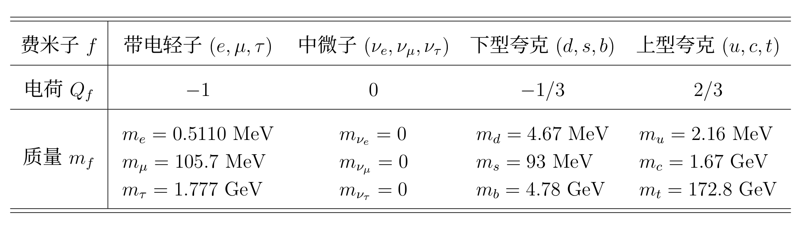

表 7.1: 标准模型中的基本费米子。

| 费米子 $f$ | 带电轻子 $(e,\mu,\tau)$ | 中微子 $(\nu_e,\nu_\mu,\nu_\tau)$ | 下型夸克 $(d,s,b)$ | 上型夸克 $(u,c,t)$ |
| :--- | :---: | :---: | :---: | :---: |
| 电荷 $Q_f$ | $-1$ | $0$ | $-1/3$ | $2/3$ |
| 质量 $m_f$ | $m_e = 0.5110\ \mathrm{MeV}$ $m_\mu = 105.7\ \mathrm{MeV}$ $m_\tau = 1.777\ \mathrm{GeV}$ | $m_{\nu_e} = 0$ $m_{\nu_\mu} = 0$ $m_{\nu_\tau} = 0$ | $m_d = 4.67\ \mathrm{MeV}$ $m_s = 93\ \mathrm{MeV}$ $m_b = 4.78\ \mathrm{GeV}$ | $m_u = 2.16\ \mathrm{MeV}$ $m_c = 1.67\ \mathrm{GeV}$ $m_t = 172.8\ \mathrm{GeV}$ |

注：这里列出的电荷是正费米子电荷。表中 $u$、$d$、$s$ 夸克的质量是 2 GeV 能标处的流夸克质量，$b$、$c$、$t$ 夸克的质量是极点质量。标准模型中 3 代中微子均无质量。1998 年实验发现中微子振荡，表明中微子具有质量，所以需要扩充标准模型才能正确描述中微子物理。

其中 $m_f$ 是费米子 $f$ 的质量。如 4.5.3 小节所述，$\mathcal{L}_{\text{free}}$ 具有 U(1) 整体对称性。具体来说，对 Dirac 旋量场 $\psi_f(x)$ 作 U(1) 整体变换

$$
\psi_f'(x) = \mathrm{e}^{\mathrm{i}Q_f\theta}\psi_f(x),
\tag{7.2}
$$

其中 $Q_f$ 是正费米子 $f$ 的电荷，也看成是场 $\psi_f(x)$ 的电荷，而 $\theta$ 是连续变换参数。于是 $\bar{\psi}_f'(x) = \bar{\psi}_f(x)\mathrm{e}^{-\mathrm{i}Q_f\theta}$，而拉氏量不变：

$$
\mathcal{L}_{\text{free}}' = \mathrm{i}\bar{\psi}_f'\gamma^\mu\partial_\mu\psi_f' - m_f\bar{\psi}_f'\psi_f' = \mathrm{i}\bar{\psi}_f\gamma^\mu\partial_\mu\psi_f - m_f\bar{\psi}_f\psi_f = \mathcal{L}_{\text{free}}.
\tag{7.3}
$$

根据 Noether 定理，电荷守恒定律成立。

如果将上述变换参数 $\theta$ 改为依赖时空坐标 $x^\mu$ 的 Lorentz 标量函数 $\theta(x)$，则相应的变换

$$
\psi_f'(x) = \mathrm{e}^{\mathrm{i}Q_f\theta(x)}\psi_f(x)
\tag{7.4}
$$

称为 U(1) 规范变换。此时，由于

$$
\partial_\mu\psi_f'(x) = \mathrm{e}^{\mathrm{i}Q_f\theta(x)}\partial_\mu\psi_f(x) + \mathrm{i}Q_f\partial_\mu\theta(x)\mathrm{e}^{\mathrm{i}Q_f\theta(x)}\psi_f(x),
\tag{7.5}
$$

我们不会得到 $\mathcal{L}_{\text{free}}' = \mathcal{L}_{\text{free}}$，故不存在相应的对称性。容易看出，原因是上式多出正比于 $\partial_\mu\theta(x)$ 的第二项，导致 $\partial_\mu\psi_f'(x)\neq\mathrm{e}^{\mathrm{i}Q_f\theta(x)}\partial_\mu\psi_f(x)$。

为了得到对称性，可以将作用在 $\psi_f(x)$ 上的时空导数 $\partial_\mu$ 替换为协变导数（covariant derivative）

$$
D_\mu = \partial_\mu - \mathrm{i}Q_feA_\mu(x),
\tag{7.6}
$$

其中 $A_\mu(x)$ 是电磁场，$e$ 是单位电荷量。并要求在 $\psi_f(x)$ 作 U(1) 规范变换 (7.4) 的同时，$A_\mu(x)$ 作规范变换

$$
A_\mu'(x) = A_\mu(x) + \frac{1}{e}\partial_\mu\theta(x).
\tag{7.7}
$$

将上式与 (3.342) 式比较，可知 $\theta(x) = e\chi(x)$，而 $\chi(x)$ 是 3.5.2 小节用到的规范变换函数。这样一来，$D_\mu\psi_f(x)$ 的变换形式就与 (7.4) 式相同：

$$
\begin{aligned}
[D_\mu\psi_f(x)]' &= \partial_\mu\psi_f'(x) - \mathrm{i}Q_feA_\mu'(x)\psi_f'(x) \\
&= \mathrm{e}^{\mathrm{i}Q_f\theta(x)}\partial_\mu\psi_f(x) + \mathrm{i}Q_f\partial_\mu\theta(x)\mathrm{e}^{\mathrm{i}Q_f\theta(x)}\psi_f(x) - \mathrm{i}Q_fe\left[A_\mu(x) + \frac{1}{e}\partial_\mu\theta(x)\right]\mathrm{e}^{\mathrm{i}Q_f\theta(x)}\psi_f(x) \\
&= \mathrm{e}^{\mathrm{i}Q_f\theta(x)}[\partial_\mu - \mathrm{i}Q_feA_\mu(x)]\psi_f(x) = \mathrm{e}^{\mathrm{i}Q_f\theta(x)}D_\mu\psi_f(x).
\end{aligned}
\tag{7.8}
$$

从而，只要将拉氏量修改为

$$
\mathcal{L}_{\text{gauge}} = \mathrm{i}\bar{\psi}_f(x)\gamma^\mu D_\mu\psi_f(x) - m_f\bar{\psi}_f(x)\psi_f(x),
\tag{7.9}
$$

就能得到 $\mathcal{L}_{\text{gauge}}' = \mathcal{L}_{\text{gauge}}$，即 $\mathcal{L}_{\text{gauge}}$ 在同时让 $\psi_f(x)$ 作 U(1) 规范变换 (7.4)、$A_\mu(x)$ 作规范变换 (7.7) 的情况下不变。这种对称性称为 U(1) 规范对称性。

如 3.5.2 小节所述，当电磁场 $A_\mu(x)$ 作规范变换 (7.7) 时，场强张量 $F_{\mu\nu} = \partial_\mu A_\nu - \partial_\nu A_\mu$ 不变，因此电磁场的动能项 $-F_{\mu\nu}F^{\mu\nu}/4$ 是规范对称性所允许的。另一方面，质量项 $m^2A_\mu A^\mu/2$ 不满足规范对称性。换言之，规范对称性禁止光子具有质量。

现在写下量子电动力学的拉氏量，

$$
\mathcal{L}_{\text{QED}} = \sum_f\left(\mathrm{i}\bar{\psi}_f\gamma^\mu D_\mu\psi_f - m_f\bar{\psi}_f\psi_f\right) - \frac{1}{4}F_{\mu\nu}F^{\mu\nu},\quad f = e,\mu,\tau,d_i,s_i,b_i,u_i,c_i,t_i.
\tag{7.10}
$$

其中，$i = 1,2,3$ 是夸克的颜色指标。这个拉氏量具有 U(1) 规范对称性。因此，我们说 QED 是一种 U(1) **规范理论**（gauge theory），而电磁场是一种 U(1) **规范场**（gauge field），光子是一种**规范玻色子**（gauge boson）。$\mathcal{L}_{\text{QED}}$ 包含场的动能项和质量项。除此之外，把协变导数展开，可以发现 $\mathcal{L}_{\text{QED}}$ 还包含相互作用项

$$
\mathcal{L}_{\text{int}} = \sum_f Q_feA_\mu\bar{\psi}_f\gamma^\mu\psi_f,
\tag{7.11}
$$

描述费米子 $f$ 的电磁相互作用。这样的相互作用称为规范相互作用，而单位电荷量 $e$ 是一个**规范耦合常数**。

容易看出，$\mathcal{L}_{\text{QED}}$ 也具有 U(1) 整体对称性。类似于 4.5.3 小节的做法，根据 Noether 定理将相应守恒流定义成

$$
J_{\text{EM}}^\mu = \sum_f Q_fe\bar{\psi}_f\gamma^\mu\psi_f.
\tag{7.12}
$$

$J_{\text{EM}}^\mu$ 称为**电磁流**（electromagnetic current），满足**电磁流守恒方程**

$$
\partial_\mu J_{\text{EM}}^\mu = 0.
\tag{7.13}
$$

于是，$\mathcal{L}_{\text{int}} = A_\mu J_{\text{EM}}^\mu$。注意到 (3.188) 的第一式，推出

$$
\frac{\partial\mathcal{L}_{\text{QED}}}{\partial(\partial_\mu A_\nu)} = -F^{\mu\nu},\quad \frac{\partial\mathcal{L}_{\text{QED}}}{\partial A_\nu} = J_{\text{EM}}^\nu.
\tag{7.14}
$$

从而，Euler-Lagrange 方程 (1.142) 给出

$$
0 = \partial_\mu\frac{\partial\mathcal{L}_{\text{QED}}}{\partial(\partial_\mu A_\nu)} - \frac{\partial\mathcal{L}_{\text{QED}}}{\partial A_\nu} = -\partial_\mu F^{\mu\nu} - J_{\text{EM}}^\nu,
\tag{7.15}
$$

故电磁场的经典运动方程为

$$
\partial_\mu F^{\mu\nu} = -J_{\text{EM}}^\nu.
\tag{7.16}
$$

这是有源的 Maxwell 方程，源为带电费米子的电磁流。

另一方面，由

$$
\frac{\partial\mathcal{L}_{\text{QED}}}{\partial(\partial_\mu\psi_f)} = \mathrm{i}\bar{\psi}_f\gamma^\mu,\quad \frac{\partial\mathcal{L}_{\text{QED}}}{\partial\psi_f} = -m_f\bar{\psi}_f + Q_feA_\mu\bar{\psi}_f\gamma^\mu,
\tag{7.17}
$$

有

$$
0 = \partial_\mu\frac{\partial\mathcal{L}_{\text{QED}}}{\partial(\partial_\mu\psi_f)} - \frac{\partial\mathcal{L}_{\text{QED}}}{\partial\psi_f} = \mathrm{i}(\partial_\mu\bar{\psi}_f)\gamma^\mu + m_f\bar{\psi}_f - Q_feA_\mu\bar{\psi}_f\gamma^\mu.
\tag{7.18}
$$

取厄米共轭，利用 (4.87) 式，得

$$
0 = -\mathrm{i}(\gamma^\mu)^\dagger\gamma^0\partial_\mu\psi_f + m_f\gamma^0\psi_f - Q_feA_\mu(\gamma^\mu)^\dagger\gamma^0\psi_f = -\gamma^0(\mathrm{i}\gamma^\mu\partial_\mu - m_f + Q_feA_\mu\gamma^\mu)\psi_f,
\tag{7.19}
$$

于是推出 $\psi_f$ 的经典运动方程

$$
(\mathrm{i}\gamma^\mu D_\mu - m_f)\psi_f = 0.
\tag{7.20}
$$

也就是说，只要把 Dirac 方程中的普通导数替换成协变导数，就得到 QED 中费米子场的经典运动方程。

对这个方程左乘 $(\mathrm{i}\gamma^\nu D_\nu + m_f)$，得

$$
0 = (\mathrm{i}\gamma^\nu D_\nu + m_f)[(\mathrm{i}\gamma^\mu D_\mu - m_f)\psi_f] = (-\gamma^\nu\gamma^\mu D_\nu D_\mu - m_f^2)\psi_f = -(\not{D}^2 + m_f^2)\psi_f,
\tag{7.21}
$$

其中，

$$
\begin{aligned}
\not{D}^2 &= \gamma^\mu\gamma^\nu D_\mu D_\nu = \frac{1}{2}(\gamma^\mu\gamma^\nu D_\mu D_\nu + \gamma^\nu\gamma^\mu D_\mu D_\nu) = \frac{1}{2}[(2g^{\mu\nu} - \gamma^\nu\gamma^\mu)D_\mu D_\nu + \gamma^\mu\gamma^\nu D_\mu D_\nu] \\
&= D^2 + \frac{1}{2}[\gamma^\mu,\gamma^\nu]D_\mu D_\nu.
\end{aligned}
\tag{7.22}
$$

调整 Lorentz 指标，有

$$
\begin{aligned}
\frac{1}{2}[\gamma^\mu,\gamma^\nu]D_\mu D_\nu &= \frac{1}{4}([\gamma^\mu,\gamma^\nu]D_\mu D_\nu + [\gamma^\nu,\gamma^\mu]D_\nu D_\mu) = \frac{1}{4}([\gamma^\mu,\gamma^\nu]D_\mu D_\nu - [\gamma^\mu,\gamma^\nu]D_\nu D_\mu) \\
&= \frac{1}{4}[\gamma^\mu,\gamma^\nu][D_\mu,D_\nu],
\end{aligned}
\tag{7.23}
$$

根据定义式 (4.43)，$\not{D}^2$ 化为

$$
\not{D}^2 = D^2 - \frac{\mathrm{i}}{2}\sigma^{\mu\nu}[D_\mu,D_\nu].
\tag{7.24}
$$

对 $\psi_f$ 连续作用两次协变导数，得

$$
\begin{aligned}
D_\mu D_\nu\psi_f &= (\partial_\mu - \mathrm{i}Q_feA_\mu)(\partial_\nu\psi_f - \mathrm{i}Q_feA_\nu\psi_f) \\
&= \partial_\mu\partial_\nu\psi_f - \mathrm{i}Q_fe\partial_\mu(A_\nu\psi_f) - \mathrm{i}Q_feA_\mu\partial_\nu\psi_f - Q_f^2e^2A_\mu A_\nu\psi_f,
\end{aligned}
\tag{7.25}
$$

故 $[D_\mu,D_\nu]$ 对 $\psi_f$ 的作用为

$$
\begin{aligned}
[D_\mu,D_\nu]\psi_f &= D_\mu D_\nu\psi_f - D_\nu D_\mu\psi_f = -\mathrm{i}Q_fe[\partial_\mu(A_\nu\psi_f) + A_\mu\partial_\nu\psi_f - \partial_\nu(A_\mu\psi_f) - A_\nu\partial_\mu\psi_f] \\
&= -\mathrm{i}Q_fe[(\partial_\mu A_\nu)\psi_f + A_\nu\partial_\mu\psi_f + A_\mu\partial_\nu\psi_f - (\partial_\nu A_\mu)\psi_f - A_\mu\partial_\nu\psi_f - A_\nu\partial_\mu\psi_f] \\
&= -\mathrm{i}Q_fe(\partial_\mu A_\nu - \partial_\nu A_\mu)\psi_f = -\mathrm{i}Q_feF_{\mu\nu}\psi_f.
\end{aligned}
\tag{7.26}
$$

由 $\psi_f$ 场构型的任意性有

$$
[D_\mu,D_\nu] = -\mathrm{i}Q_feF_{\mu\nu}.
\tag{7.27}
$$

也就是说，协变导数的对易子 $[D_\mu,D_\nu]$ 实际上不包含对 $\psi_f$ 的求导操作，而直接对应于场强张量 $F_{\mu\nu}$。$\not{D}^2$ 进一步化为

$$
\not{D}^2 = D^2 - \frac{Q_fe}{2}F_{\mu\nu}\sigma^{\mu\nu}.
\tag{7.28}
$$

于是，$\psi_f$ 的运动方程 (7.21) 变成

$$
\left(D^2 + m_f^2 - \frac{Q_fe}{2}F_{\mu\nu}\sigma^{\mu\nu}\right)\psi_f = 0.
\tag{7.29}
$$

与自由 Dirac 旋量场满足的 Klein-Gordon 方程 (4.111) 相比，不仅普通导数替换成协变导数，还多出一个正比于 $F_{\mu\nu}\sigma^{\mu\nu}$ 的项。

回顾 (1.108)、(1.106)、(4.77) 和 (4.82) 式，有

$$
F_{ij} = F^{ij} = -\varepsilon^{ijk}B^k,\quad F_{0i} = -F^{0i} = E^i,
\tag{7.30}
$$

$$
\sigma^{ij} = 2S^{ij} = \varepsilon^{ijk}\begin{pmatrix}\sigma^k & \\ & \sigma^k\end{pmatrix},\quad \sigma^{0i} = 2S^{0i} = \mathrm{i}\begin{pmatrix}-\sigma^i & \\ & \sigma^i\end{pmatrix},
\tag{7.31}
$$

故

$$
\begin{aligned}
F_{\mu\nu}\sigma^{\mu\nu} &= F_{ij}\sigma^{ij} + 2F_{0i}\sigma^{0i} = -\varepsilon^{ijk}\varepsilon^{ijl}B^k\begin{pmatrix}\sigma^l & \\ & \sigma^l\end{pmatrix} + 2\mathrm{i}E^i\begin{pmatrix}-\sigma^i & \\ & \sigma^i\end{pmatrix} \\
&= -2\delta^{kl}\begin{pmatrix}B^k\sigma^l & \\ & B^k\sigma^l\end{pmatrix} + 2\begin{pmatrix}-\mathrm{i}E^i\sigma^i & \\ & \mathrm{i}E^i\sigma^i\end{pmatrix} = -2\begin{pmatrix}(\mathbf{B} + \mathrm{i}\mathbf{E})\cdot\boldsymbol{\sigma} & \\ & (\mathbf{B} - \mathrm{i}\mathbf{E})\cdot\boldsymbol{\sigma}\end{pmatrix}.
\end{aligned}
\tag{7.32}
$$

因而电子场 $\psi_e$ 的运动方程可以写成

$$
\left[(\partial_\mu + \mathrm{i}eA_\mu)^2 + m_e^2 - e\begin{pmatrix}(\mathbf{B} + \mathrm{i}\mathbf{E})\cdot\boldsymbol{\sigma} & \\ & (\mathbf{B} - \mathrm{i}\mathbf{E})\cdot\boldsymbol{\sigma}\end{pmatrix}\right]\psi_e = 0.
\tag{7.33}
$$

这里采用缩写 $(\partial_\mu + \mathrm{i}eA_\mu)^2\equiv(\partial_\mu + \mathrm{i}eA_\mu)(\partial^\mu + \mathrm{i}eA^\mu)$，即 Lorentz 矢量的平方指它的自我内积。在非相对论近似下，此方程对应于量子力学里描述电子在电磁场中运动的 Schrödinger-Pauli 方程 [35]

$$
\mathrm{i}\frac{\partial}{\partial t}|\Psi\rangle = \left[\frac{1}{2m_e}(-\mathrm{i}\nabla + e\mathbf{A})^2 - eA^0 + \mu_{\mathrm{B}}\mathbf{B}\cdot\boldsymbol{\sigma}\right]|\Psi\rangle,
\tag{7.34}
$$

其中 $|\Psi\rangle$ 是电子的自旋双重态，而

$$
\mu_{\mathrm{B}} = \frac{e}{2m_e}
\tag{7.35}
$$

是 Bohr 磁子（magneton）。可见，正比于 $F_{\mu\nu}\sigma^{\mu\nu}$ 的项描述费米子的内禀磁偶极矩（magnetic dipole moment），$\pm\mathrm{i}\mathbf{E}\cdot\boldsymbol{\sigma}$ 项是相对论修正。

下面给出 QED 的 Feynman 规则。由于电磁场是无质量矢量场，如 3.5.2 小节所述，对 QED 进行正则量子化时，需要加入规范固定项 $-(2\xi)^{-1}(\partial_\mu A^\mu)^2$，并可采用 Feynman 规范（$\xi = 1$）以得到简单的结果。根据第 6 章的知识，我们写出 QED 的动量空间 Feynman 规则如下。

1. 正费米子 $f$ 入射外线：$f,\lambda\ \longrightarrow\ \bullet = u(\mathbf{p},\lambda)$。

2. 反费米子 $\bar{f}$ 入射外线：$\bar{f},\lambda\ \longrightarrow\ \bullet = \bar{v}(\mathbf{p},\lambda)$。

3. 正费米子 $f$ 出射外线：$\bullet\ \longrightarrow\ f,\lambda = \bar{u}(\mathbf{p},\lambda)$。

4. 反费米子 $\bar{f}$ 出射外线：$\bullet\ \longrightarrow\ \bar{f},\lambda = v(\mathbf{p},\lambda)$。

5. 费米子 $f$ 传播子：$\bullet\ \longrightarrow\ \bullet = \frac{\mathrm{i}(\not{p} + m_f)}{p^2 - m_f^2 + \mathrm{i}\epsilon} = \frac{\mathrm{i}}{\not{p} - m_f + \mathrm{i}\epsilon}$。

6. 光子 $\gamma$ 入射外线：$\gamma,\lambda;\mu\ \rightsquigarrow\ \bullet = \varepsilon_\mu(\mathbf{p},\lambda)$。

7. 光子 $\gamma$ 出射外线：$\bullet\ \rightsquigarrow\ \gamma,\lambda;\mu = \varepsilon_\mu^*(\mathbf{p},\lambda)$。

8. 光子 $\gamma$ 传播子：$\nu\ \bullet\rightsquigarrow\bullet\ \mu = \frac{-\mathrm{i}g_{\mu\nu}}{p^2 + \mathrm{i}\epsilon}$（Feynman 规范）。

9. QED 相互作用顶点：$= \mathrm{i}Q_fe\gamma^\mu$。

注意，我们在这里将光子记作 $\gamma$，但不要与 Dirac 矩阵 $\gamma^\mu$ 混淆。在这些规则中，Lorentz 指标 $\mu$ 和 $\nu$ 既可以写成上标，也可以写成下标，只要在写出不变振幅表达式时保证相同指标上下缩并即可。QED 顶点规则可以这样得到：将相互作用拉氏量 $Q_feA_\mu\bar{\psi}_f\gamma^\mu\psi_f$ 中的场算符 $A_\mu$、$\psi_f$ 和 $\bar{\psi}_f$ 剥离，再乘以 $\mathrm{i}$，就是顶点规则表达式 $\mathrm{i}Q_fe\gamma^\mu$。

## 7.2 正负电子湮灭到正负 μ 子

在本节中，我们讨论一个典型的 QED 散射过程，一对正负电子湮灭成一对正负 $\mu$ 子，即 $e^+e^-\to\mu^+\mu^-$。这个过程的领头阶 Feynman 图是一个包含 2 个 QED 顶点的树图，如图 7.1 所示，只有 1 种拓扑结构。由于 $\mu$ 子质量比电子质量大得多，根据能动量守恒定律，此过程仅当正负电子对的质心能 $E_{\text{CM}} > 2m_\mu$ 时才能发生。

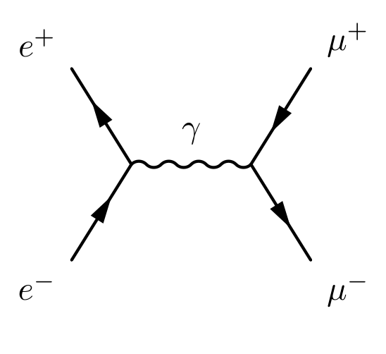

图 7.1: $e^+e^-\to\mu^+\mu^-$ 领头阶 Feynman 图。

### 7.2.1 不变振幅

根据 QED 的 Feynman 规则和 $Q_e = Q_\mu = -1$，$e^+e^-\to\mu^+\mu^-$ 过程的不变振幅为

$$
\begin{aligned}
\mathrm{i}\mathcal{M} &= \bar{v}(\mathbf{k}_2,\lambda_2)(-\mathrm{i}e\gamma^\mu)u(\mathbf{k}_1,\lambda_1)\,\frac{-\mathrm{i}g_{\mu\nu}}{q^2}\,\bar{u}(\mathbf{p}_1,\lambda_1')(-\mathrm{i}e\gamma^\nu)v(\mathbf{p}_2,\lambda_2') \\
&= \frac{\mathrm{i}e^2}{q^2}\bar{v}(\mathbf{k}_2,\lambda_2)\gamma^\mu u(\mathbf{k}_1,\lambda_1)\,\bar{u}(\mathbf{p}_1,\lambda_1')\gamma_\mu v(\mathbf{p}_2,\lambda_2').
\end{aligned}
\tag{7.36}
$$

根据能动量守恒，光子传播子的四维动量 $q^\mu$ 满足

$$
q^\mu = k_1^\mu + k_2^\mu = p_1^\mu + p_2^\mu.
\tag{7.37}
$$

从而，运动学要求

$$
q^2 = (p_1 + p_2)^2 = E_{\text{CM}}^2 > 4m_\mu^2.
\tag{7.38}
$$

于是，这个过程的光子传播子 $\frac{-\mathrm{i}g_{\mu\nu}}{q^2 + \mathrm{i}\epsilon}$ 在运动学允许的区域上没有极点，因此我们在写下不变振幅时可以丢弃无穷小量 $\mathrm{i}\epsilon$。一般来说，**传播子分母上的无穷小量 $\mathrm{i}\epsilon$ 对于圈图计算是必要的，但在树图计算中通常可以忽略**。

根据 $\gamma^0$ 的厄米性和 (4.87) 式，有 $(\gamma^\mu)^\dagger(\gamma^0)^\dagger = (\gamma^\mu)^\dagger\gamma^0 = \gamma^0\gamma^\mu$，故 $\mathrm{i}\mathcal{M}$ 表达式中旋量双线性型 $\bar{v}(\mathbf{k}_2,\lambda_2)\gamma^\mu u(\mathbf{k}_1,\lambda_1)$ 的复共轭为

$$
(\bar{v}\gamma^\mu u)^* = (\bar{v}\gamma^\mu u)^\dagger = (v^\dagger\gamma^0\gamma^\mu u)^\dagger = u^\dagger(\gamma^\mu)^\dagger(\gamma^0)^\dagger v = u^\dagger\gamma^0\gamma^\mu v = \bar{u}\gamma^\mu v.
\tag{7.39}
$$

类似地，$(\bar{u}\gamma_\mu v)^* = \bar{v}\gamma_\mu u$。于是，$\mathrm{i}\mathcal{M}$ 的复共轭为

$$
(\mathrm{i}\mathcal{M})^* = -\frac{\mathrm{i}e^2}{q^2}\bar{u}(\mathbf{k}_1,\lambda_1)\gamma^\nu v(\mathbf{k}_2,\lambda_2)\,\bar{v}(\mathbf{p}_2,\lambda_2')\gamma_\nu u(\mathbf{p}_1,\lambda_1').
\tag{7.40}
$$

从而，不变振幅的模方是

$$
\begin{aligned}
|\mathcal{M}|^2 &= \frac{e^4}{(q^2)^2}\bar{v}(\mathbf{k}_2,\lambda_2)\gamma^\mu u(\mathbf{k}_1,\lambda_1)\,\bar{u}(\mathbf{p}_1,\lambda_1')\gamma_\mu v(\mathbf{p}_2,\lambda_2')\,[\bar{u}(\mathbf{k}_1,\lambda_1)\gamma^\nu v(\mathbf{k}_2,\lambda_2)]\,\bar{v}(\mathbf{p}_2,\lambda_2')\gamma_\nu u(\mathbf{p}_1,\lambda_1') \\
&= \frac{e^4}{E_{\text{CM}}^4}\bar{v}(\mathbf{k}_2,\lambda_2)\gamma^\mu u(\mathbf{k}_1,\lambda_1)\,[\bar{u}(\mathbf{k}_1,\lambda_1)\gamma^\nu v(\mathbf{k}_2,\lambda_2)]\,\bar{u}(\mathbf{p}_1,\lambda_1')\gamma_\mu v(\mathbf{p}_2,\lambda_2')\,\bar{v}(\mathbf{p}_2,\lambda_2')\gamma_\nu u(\mathbf{p}_1,\lambda_1') \\
&= \frac{e^4}{E_{\text{CM}}^4}\mathrm{tr}[v(\mathbf{k}_2,\lambda_2)\bar{v}(\mathbf{k}_2,\lambda_2)\gamma^\mu u(\mathbf{k}_1,\lambda_1)\bar{u}(\mathbf{k}_1,\lambda_1)\gamma^\nu] \\
&\quad\times\mathrm{tr}[u(\mathbf{p}_1,\lambda_1')\bar{u}(\mathbf{p}_1,\lambda_1')\gamma_\mu v(\mathbf{p}_2,\lambda_2')\bar{v}(\mathbf{p}_2,\lambda_2')\gamma_\nu].
\end{aligned}
\tag{7.41}
$$

第二步调换了 $[\bar{u}(\mathbf{k}_1,\lambda_1)\gamma^\nu v(\mathbf{k}_2,\lambda_2)]$ 的位置。第三步采取计算 (6.44) 式时使用过的 *Casimir* 技巧，因而出现求迹运算。

实际实验通常不会控制入射粒子的自旋状态，即采用非极化的入射束流。另一方面，粒子探测器（detector）通常也不能区分出射粒子的自旋状态。因而在计算上述过程的散射截面时，需要对入射正负电子的螺旋度 $\lambda_1$ 和 $\lambda_2$ 取平均，对出射正负 $\mu$ 子的螺旋度 $\lambda_1'$ 和 $\lambda_2'$ 求和。也就是说，应当计算非极化不变振幅模方

$$
\begin{aligned}
\overline{|\mathcal{M}|^2} &\equiv \frac{1}{2}\sum_{\lambda_1=\pm}\frac{1}{2}\sum_{\lambda_2=\pm}\sum_{\lambda_1'=\pm}\sum_{\lambda_2'=\pm}|\mathcal{M}|^2 = \frac{1}{4}\sum_{\lambda_1\lambda_2\lambda_1'\lambda_2'}|\mathcal{M}|^2 \\
&= \frac{e^4}{4E_{\text{CM}}^4}\sum_{\lambda_1\lambda_2\lambda_1'\lambda_2'}\mathrm{tr}[v(\mathbf{k}_2,\lambda_2)\bar{v}(\mathbf{k}_2,\lambda_2)\gamma^\mu u(\mathbf{k}_1,\lambda_1)\bar{u}(\mathbf{k}_1,\lambda_1)\gamma^\nu] \\
&\quad\times\mathrm{tr}[u(\mathbf{p}_1,\lambda_1')\bar{u}(\mathbf{p}_1,\lambda_1')\gamma_\mu v(\mathbf{p}_2,\lambda_2')\bar{v}(\mathbf{p}_2,\lambda_2')\gamma_\nu] \\
&= \frac{e^4}{4E_{\text{CM}}^4}\mathrm{tr}[(\not{k}_2 - m_e)\gamma^\mu(\not{k}_1 + m_e)\gamma^\nu]\,\mathrm{tr}[(\not{p}_1 + m_\mu)\gamma_\mu(\not{p}_2 - m_\mu)\gamma_\nu].
\end{aligned}
\tag{7.42}
$$

最后一步用到自旋求和关系 (4.216)。现在，问题归结为计算 Dirac 矩阵乘积的迹。

### 7.2.2 Dirac 矩阵求迹和缩并技巧

在上一章中，我们计算过 Dirac 矩阵的迹和 2 个 Dirac 矩阵乘积的迹，即 (6.48) 和 (6.51) 式：$\mathrm{tr}(\gamma^\mu) = 0$，$\mathrm{tr}(\gamma^\mu\gamma^\nu) = 4g^{\mu\nu}$。实际上，利用 $(\gamma^5)^2 = \mathbf{1}$、$\gamma^5\gamma^\mu = -\gamma^\mu\gamma^5$ 和 $\mathrm{tr}(AB) = \mathrm{tr}(BA)$，可得

$$
\begin{aligned}
\mathrm{tr}(\text{奇数个 Dirac 矩阵之积}) &= \mathrm{tr}(\text{奇数个 Dirac 矩阵之积}\times\gamma^5\gamma^5) \\
&= -\mathrm{tr}(\gamma^5\times\text{奇数个 Dirac 矩阵之积}\times\gamma^5) \\
&= -\mathrm{tr}(\gamma^5\gamma^5\times\text{奇数个 Dirac 矩阵之积}) \\
&= -\mathrm{tr}(\text{奇数个 Dirac 矩阵之积}).
\end{aligned}
\tag{7.43}
$$

因此，奇数个 Dirac 矩阵乘积的迹为零。这个结论自然包含 $\mathrm{tr}(\gamma^\mu) = 0$。

对于 4 个 Dirac 矩阵乘积的迹，多次利用 $\gamma^\mu\gamma^\nu = 2g^{\mu\nu} - \gamma^\nu\gamma^\mu$，有

$$
\begin{aligned}
\mathrm{tr}(\gamma^\mu\gamma^\nu\gamma^\rho\gamma^\sigma) &= \mathrm{tr}(2g^{\mu\nu}\gamma^\rho\gamma^\sigma - \gamma^\nu\gamma^\mu\gamma^\rho\gamma^\sigma) = \mathrm{tr}(2g^{\mu\nu}\gamma^\rho\gamma^\sigma - 2\gamma^\nu g^{\mu\rho}\gamma^\sigma + \gamma^\nu\gamma^\rho\gamma^\mu\gamma^\sigma) \\
&= \mathrm{tr}(2g^{\mu\nu}\gamma^\rho\gamma^\sigma - 2\gamma^\nu g^{\mu\rho}\gamma^\sigma + 2\gamma^\nu\gamma^\rho g^{\mu\sigma} - \gamma^\nu\gamma^\rho\gamma^\sigma\gamma^\mu) \\
&= 2g^{\mu\nu}\mathrm{tr}(\gamma^\rho\gamma^\sigma) - 2g^{\mu\rho}\mathrm{tr}(\gamma^\nu\gamma^\sigma) + 2g^{\mu\sigma}\mathrm{tr}(\gamma^\nu\gamma^\rho) - \mathrm{tr}(\gamma^\nu\gamma^\rho\gamma^\sigma\gamma^\mu) \\
&= 8g^{\mu\nu}g^{\rho\sigma} - 8g^{\mu\rho}g^{\nu\sigma} + 8g^{\mu\sigma}g^{\nu\rho} - \mathrm{tr}(\gamma^\mu\gamma^\nu\gamma^\rho\gamma^\sigma),
\end{aligned}
\tag{7.44}
$$

故 $\mathrm{tr}(\gamma^\mu\gamma^\nu\gamma^\rho\gamma^\sigma) = 4(g^{\mu\nu}g^{\rho\sigma} - g^{\mu\rho}g^{\nu\sigma} + g^{\mu\sigma}g^{\nu\rho})$。

根据定义，$\gamma^5 = \mathrm{i}\gamma^0\gamma^1\gamma^2\gamma^3$，因而它相当于 4 个 Dirac 矩阵之积。于是，$\gamma^5$ 与奇数个 Dirac 矩阵乘积的迹为零。利用 $(\gamma^0)^2 = \mathbf{1}$ 和 $\gamma^5\gamma^\mu = -\gamma^\mu\gamma^5$，得

$$
\mathrm{tr}(\gamma^5) = \mathrm{tr}(\gamma^5\gamma^0\gamma^0) = -\mathrm{tr}(\gamma^0\gamma^5\gamma^0) = -\mathrm{tr}(\gamma^0\gamma^0\gamma^5) = -\mathrm{tr}(\gamma^5).
\tag{7.45}
$$

可见 $\mathrm{tr}(\gamma^5) = 0$。

由于 $(\gamma^\mu)^2 = \pm\mathbf{1}$ 在 $\mu = 0$ 时取正号、在 $\mu = 1,2,3$ 时取负号，若 $\mu = \nu$，则 $\mathrm{tr}(\gamma^\mu\gamma^\nu\gamma^5) = \pm\mathrm{tr}(\gamma^5) = 0$。若 $\mu\neq\nu$，取 $\alpha\neq\mu,\nu$，再利用 $(\gamma^\alpha)^2 = \pm\mathbf{1}$、$\gamma^\mu\gamma^\alpha = -\gamma^\alpha\gamma^\mu$ 和 $\gamma^\nu\gamma^\alpha = -\gamma^\alpha\gamma^\nu$ 推出

$$
\mathrm{tr}(\gamma^\mu\gamma^\nu\gamma^5) = \pm\mathrm{tr}(\gamma^\mu\gamma^\nu\gamma^5\gamma^\alpha\gamma^\alpha) = \pm\mathrm{tr}(\gamma^\alpha\gamma^\mu\gamma^\nu\gamma^5\gamma^\alpha) = \pm\mathrm{tr}(\gamma^\alpha\gamma^\alpha\gamma^\mu\gamma^\nu\gamma^5) = -\mathrm{tr}(\gamma^\mu\gamma^\nu\gamma^5).
\tag{7.46}
$$

故 $\mathrm{tr}(\gamma^\mu\gamma^\nu\gamma^5) = 0$ 对任意 $\mu$ 和 $\nu$ 成立。

对于 $\mathrm{tr}(\gamma^\mu\gamma^\nu\gamma^\rho\gamma^\sigma\gamma^5)$，只要 $(\mu,\nu,\rho,\sigma)$ 这 4 个指标中有 2 个指标相等，就能够类似地推出 $\mathrm{tr}(\gamma^\mu\gamma^\nu\gamma^\rho\gamma^\sigma\gamma^5) = 0$。因此，仅当 $(\mu,\nu,\rho,\sigma)$ 是 $(0,1,2,3)$ 的某种置换时，才能得到例外的结果；由于 Dirac 矩阵的反对易性质，此时有 $\mathrm{tr}(\gamma^\mu\gamma^\nu\gamma^\rho\gamma^\sigma\gamma^5) = \pm\mathrm{tr}(\gamma^0\gamma^1\gamma^2\gamma^3\gamma^5)$，且偶置换取正号，奇置换取负号。根据四维 Levi-Civita 符号的定义 (1.83)，即得 $\mathrm{tr}(\gamma^\mu\gamma^\nu\gamma^\rho\gamma^\sigma\gamma^5) = \varepsilon^{\mu\nu\rho\sigma}\mathrm{tr}(\gamma^0\gamma^1\gamma^2\gamma^3\gamma^5)$。现在，

$$
\begin{aligned}
\mathrm{tr}(\gamma^0\gamma^1\gamma^2\gamma^3\gamma^5) &= \mathrm{tr}(\mathrm{i}\gamma^0\gamma^1\gamma^2\gamma^3\gamma^0\gamma^1\gamma^2\gamma^3) = -\mathrm{tr}(\mathrm{i}\gamma^1\gamma^2\gamma^3\gamma^1\gamma^2\gamma^3) \\
&= \mathrm{tr}(\mathrm{i}\gamma^2\gamma^3\gamma^2\gamma^3) = \mathrm{tr}(\mathrm{i}\gamma^3\gamma^3) = -\mathrm{tr}(\mathrm{i}) = -4\mathrm{i},
\end{aligned}
\tag{7.47}
$$

因而 $\mathrm{tr}(\gamma^\mu\gamma^\nu\gamma^\rho\gamma^\sigma\gamma^5) = -4\mathrm{i}\varepsilon^{\mu\nu\rho\sigma}$。

总结起来，有下列求迹公式，

$$
\mathrm{tr}(\mathbf{1}) = 4,
\tag{7.48}
$$

$$
\mathrm{tr}(\text{奇数个 Dirac 矩阵之积}) = 0,
\tag{7.49}
$$

$$
\mathrm{tr}(\gamma^\mu\gamma^\nu) = 4g^{\mu\nu},
\tag{7.50}
$$

$$
\mathrm{tr}(\gamma^\mu\gamma^\nu\gamma^\rho\gamma^\sigma) = 4(g^{\mu\nu}g^{\rho\sigma} - g^{\mu\rho}g^{\nu\sigma} + g^{\mu\sigma}g^{\nu\rho}),
\tag{7.51}
$$

$$
\mathrm{tr}(\gamma^5) = 0,
\tag{7.52}
$$

$$
\mathrm{tr}(\gamma^\mu\gamma^\nu\gamma^5) = 0,
\tag{7.53}
$$

$$
\mathrm{tr}(\gamma^\mu\gamma^\nu\gamma^\rho\gamma^\sigma\gamma^5) = -4\mathrm{i}\varepsilon^{\mu\nu\rho\sigma}.
\tag{7.54}
$$

除了求迹，还经常遇到 Lorentz 指标的缩并运算。首先，

$$
\gamma^\mu\gamma_\mu = g_{\mu\nu}\gamma^\mu\gamma^\nu = \frac{1}{2}(g_{\mu\nu}\gamma^\mu\gamma^\nu + g_{\nu\mu}\gamma^\nu\gamma^\mu) = \frac{1}{2}g_{\mu\nu}\{\gamma^\mu,\gamma^\nu\} = g_{\mu\nu}g^{\mu\nu} = 4.
\tag{7.55}
$$

其次，

$$
\gamma^\mu\gamma^\nu\gamma_\mu = 2g^{\mu\nu}\gamma_\mu - \gamma^\nu\gamma^\mu\gamma_\mu = 2\gamma^\nu - 4\gamma^\nu = -2\gamma^\nu.
\tag{7.56}
$$

再次，

$$
\gamma^\mu\gamma^\nu\gamma^\rho\gamma_\mu = 2g^{\mu\nu}\gamma^\rho\gamma_\mu - \gamma^\nu\gamma^\mu\gamma^\rho\gamma_\mu = 2\gamma^\rho\gamma^\nu + 2\gamma^\nu\gamma^\rho = 2\{\gamma^\rho,\gamma^\nu\} = 4g^{\nu\rho}.
\tag{7.57}
$$

最后，

$$
\begin{aligned}
\gamma^\mu\gamma^\nu\gamma^\rho\gamma^\sigma\gamma_\mu &= 2g^{\mu\nu}\gamma^\rho\gamma^\sigma\gamma_\mu - \gamma^\nu\gamma^\mu\gamma^\rho\gamma^\sigma\gamma_\mu = 2\gamma^\rho\gamma^\sigma\gamma^\nu - 4g^{\rho\sigma}\gamma^\nu \\
&= 2\gamma^\rho\gamma^\sigma\gamma^\nu - 2(\gamma^\rho\gamma^\sigma + \gamma^\sigma\gamma^\rho)\gamma^\nu = -2\gamma^\sigma\gamma^\rho\gamma^\nu.
\end{aligned}
\tag{7.58}
$$

另一方面，我们可能会遇到 Levi-Civita 符号的缩并。首先，(1.88) 式告诉我们 $\varepsilon^{\alpha\beta\gamma\delta}\varepsilon_{\alpha\beta\gamma\delta} = -24$。其次，根据 Levi-Civita 符号的性质，$\varepsilon^{\alpha\beta\gamma\mu}\varepsilon_{\alpha\beta\gamma\nu}$ 只在 $\mu = \nu$ 时非零，即 $\varepsilon^{\alpha\beta\gamma\mu}\varepsilon_{\alpha\beta\gamma\nu}\propto\delta^\mu_\nu$。取 $\mu = \nu = 3$，得 $\varepsilon^{\alpha\beta\gamma3}\varepsilon_{\alpha\beta\gamma3} = 3!\,\varepsilon^{0123}\varepsilon_{0123} = -6$，故比例系数为 $-6$。因此 $\varepsilon^{\alpha\beta\gamma\mu}\varepsilon_{\alpha\beta\gamma\nu} = -6\delta^\mu_\nu$。再次，$\varepsilon^{\alpha\beta\mu\nu}\varepsilon_{\alpha\beta\rho\sigma}$ 仅在 $(\mu,\nu) = (\rho,\sigma)$ 或 $(\mu,\nu) = (\sigma,\rho)$ 时非零，而且这两种情况的数值互为相反数，故 $\varepsilon^{\alpha\beta\mu\nu}\varepsilon_{\alpha\beta\rho\sigma}\propto\delta^\mu_\rho\delta^\nu_\sigma - \delta^\mu_\sigma\delta^\nu_\rho$。取 $(\mu,\nu) = (2,3)$，得 $\varepsilon^{\alpha\beta23}\varepsilon_{\alpha\beta23} = 2!\,\varepsilon^{0123}\varepsilon_{0123} = -2$，因而 $\varepsilon^{\alpha\beta\mu\nu}\varepsilon_{\alpha\beta\rho\sigma} = -2(\delta^\mu_\rho\delta^\nu_\sigma - \delta^\mu_\sigma\delta^\nu_\rho)$。

总结起来，有下列缩并公式，

$$
\gamma^\mu\gamma_\mu = 4,
\tag{7.59}
$$

$$
\gamma^\mu\gamma^\nu\gamma_\mu = -2\gamma^\nu,
\tag{7.60}
$$

$$
\gamma^\mu\gamma^\nu\gamma^\rho\gamma_\mu = 4g^{\nu\rho},
\tag{7.61}
$$

$$
\gamma^\mu\gamma^\nu\gamma^\rho\gamma^\sigma\gamma_\mu = -2\gamma^\sigma\gamma^\rho\gamma^\nu,
\tag{7.62}
$$

$$
\varepsilon^{\alpha\beta\gamma\delta}\varepsilon_{\alpha\beta\gamma\delta} = -24,
\tag{7.63}
$$

$$
\varepsilon^{\alpha\beta\gamma\mu}\varepsilon_{\alpha\beta\gamma\nu} = -6\delta^\mu_\nu,
\tag{7.64}
$$

$$
\varepsilon^{\alpha\beta\mu\nu}\varepsilon_{\alpha\beta\rho\sigma} = -2(\delta^\mu_\rho\delta^\nu_\sigma - \delta^\mu_\sigma\delta^\nu_\rho).
\tag{7.65}
$$

在实际计算中，经常遇到四维动量与 Dirac 矩阵的缩并，我们进一步导出下列有用公式。

$$
\gamma^\mu\not{p} = p_\nu\gamma^\mu\gamma^\nu = p_\nu(2g^{\mu\nu} - \gamma^\nu\gamma^\mu) = 2p^\mu - \not{p}\gamma^\mu,
\tag{7.66}
$$

$$
\not{p}\not{k} = p_\mu\gamma^\mu\not{k} = p_\mu(2k^\mu - \not{k}\gamma^\mu) = 2p\cdot k - \not{k}\not{p},
\tag{7.67}
$$

$$
\not{p}\not{p} = \frac{1}{2}(\not{p}\not{p} + \not{p}\not{p}) = \frac{1}{2}2p\cdot p = p^2,
\tag{7.68}
$$

$$
\gamma^\mu\not{p}\gamma_\mu = p_\nu\gamma^\mu\gamma^\nu\gamma_\mu = -2p_\nu\gamma^\nu = -2\not{p},
\tag{7.69}
$$

$$
\gamma^\mu\gamma^\nu\not{p}\gamma_\mu = p_\rho\gamma^\mu\gamma^\nu\gamma^\rho\gamma_\mu = 4p_\rho g^{\nu\rho} = 4p^\nu,
\tag{7.70}
$$

$$
\gamma^\mu\not{p}\not{k}\gamma_\mu = p_\nu\gamma^\mu\gamma^\nu\not{k}\gamma_\mu = 4p_\nu k^\nu = 4p\cdot k,
\tag{7.71}
$$

$$
\mathrm{tr}(\not{p}\not{k}) = p_\mu k_\nu\mathrm{tr}(\gamma^\mu\gamma^\nu) = 4p_\mu k_\nu g^{\mu\nu} = 4p\cdot k,
\tag{7.72}
$$

$$
\begin{aligned}
\mathrm{tr}(\not{p}\not{k}\not{q}\not{l}) &= p_\mu k_\nu q_\rho l_\sigma\mathrm{tr}(\gamma^\mu\gamma^\nu\gamma^\rho\gamma^\sigma) = 4p_\mu k_\nu q_\rho l_\sigma(g^{\mu\nu}g^{\rho\sigma} - g^{\mu\rho}g^{\nu\sigma} + g^{\mu\sigma}g^{\nu\rho}) \\
&= 4[(p\cdot k)(q\cdot l) - (p\cdot q)(k\cdot l) + (p\cdot l)(k\cdot q)],
\end{aligned}
\tag{7.73}
$$

$$
\begin{aligned}
\mathrm{tr}(\not{p}\gamma^\mu\not{k}\gamma^\nu) &= p_\rho k_\sigma\mathrm{tr}(\gamma^\rho\gamma^\mu\gamma^\sigma\gamma^\nu) = 4p_\rho k_\sigma(g^{\rho\mu}g^{\sigma\nu} - g^{\rho\sigma}g^{\mu\nu} + g^{\rho\nu}g^{\mu\sigma}) \\
&= 4(p^\mu k^\nu + p^\nu k^\mu - g^{\mu\nu}p\cdot k),
\end{aligned}
\tag{7.74}
$$

$$
\begin{aligned}
\mathrm{tr}(\not{p}\gamma^\mu\not{k}\gamma^\nu)\mathrm{tr}(\not{q}\gamma_\mu\not{l}\gamma_\nu) &= 16(p^\mu k^\nu + p^\nu k^\mu - g^{\mu\nu}p\cdot k)(q_\mu l_\nu + q_\nu l_\mu - g_{\mu\nu}q\cdot l) \\
&= 32[(p\cdot q)(k\cdot l) + (p\cdot l)(k\cdot q)].
\end{aligned}
\tag{7.75}
$$

当求迹和缩并计算非常复杂时，可利用 Mathematica 程序包 FeynCalc[^1] 辅助计算。

[^1]: 相关网址：https://feyncalc.github.io

### 7.2.3 非极化散射截面

现在，我们回到 $e^+e^-\to\mu^+\mu^-$ 非极化振幅模方的计算。根据上一小节的求迹公式，(7.42) 式的第一个迹化为

$$
\begin{aligned}
\mathrm{tr}[(\not{k}_2 - m_e)\gamma^\mu(\not{k}_1 + m_e)\gamma^\nu] &= \mathrm{tr}(\not{k}_2\gamma^\mu\not{k}_1\gamma^\nu) - m_e^2\mathrm{tr}(\gamma^\mu\gamma^\nu) \\
&= 4[k_2^\mu k_1^\nu + k_2^\nu k_1^\mu - g^{\mu\nu}(k_1\cdot k_2 + m_e^2)],
\end{aligned}
\tag{7.76}
$$

其中第一步丢弃了具有奇数个 Dirac 矩阵乘积的项。同理，第二个迹变成

$$
\begin{aligned}
\mathrm{tr}[(\not{p}_1 + m_\mu)\gamma_\mu(\not{p}_2 - m_\mu)\gamma_\nu] &= \mathrm{tr}(\not{p}_1\gamma_\mu\not{p}_2\gamma_\nu) - m_\mu^2\mathrm{tr}(\gamma_\mu\gamma_\nu) \\
&= 4[p_{1\mu}p_{2\nu} + p_{1\nu}p_{2\mu} - g_{\mu\nu}(p_1\cdot p_2 + m_\mu^2)].
\end{aligned}
\tag{7.77}
$$

于是，(7.42) 式化为

$$
\begin{aligned}
\overline{|\mathcal{M}|^2} &= \frac{4e^4}{E_{\text{CM}}^4}[k_2^\mu k_1^\nu + k_2^\nu k_1^\mu - g^{\mu\nu}(k_1\cdot k_2 + m_e^2)][p_{1\mu}p_{2\nu} + p_{1\nu}p_{2\mu} - g_{\mu\nu}(p_1\cdot p_2 + m_\mu^2)] \\
&= \frac{4e^4}{E_{\text{CM}}^4}\big[2(k_1\cdot p_1)(k_2\cdot p_2) + 2(k_1\cdot p_2)(k_2\cdot p_1) - 2p_1\cdot p_2(k_1\cdot k_2 + m_e^2) \\
&\quad - 2k_1\cdot k_2(p_1\cdot p_2 + m_\mu^2) + 4(k_1\cdot k_2 + m_e^2)(p_1\cdot p_2 + m_\mu^2)\big] \\
&= \frac{8e^4}{E_{\text{CM}}^4}[(k_1\cdot p_1)(k_2\cdot p_2) + (k_1\cdot p_2)(k_2\cdot p_1) + m_e^2(p_1\cdot p_2) + m_\mu^2(k_1\cdot k_2) + 2m_e^2m_\mu^2].
\end{aligned}
\tag{7.78}
$$

现在，非极化振幅模方表达成四维动量内积的函数，具有明显的 Lorentz 不变性。

在质心系中，入射和出射粒子的三维动量如图 7.2 所示，将散射角 $\theta$ 定义为末态 $\mu^-$ 动量 $\mathbf{p}_1$ 与初态 $e^-$ 动量 $\mathbf{k}_1$ 的方向夹角。质心系的总动量为零，即

$$
\mathbf{q} = \mathbf{k}_1 + \mathbf{k}_2 = \mathbf{p}_1 + \mathbf{p}_2 = \mathbf{0},
\tag{7.79}
$$

故有 $|\mathbf{k}_1| = |\mathbf{k}_2|$ 和 $|\mathbf{p}_1| = |\mathbf{p}_2|$。根据 (5.352) 式，质心能 $q^0 = E_{\text{CM}}$ 平分在两个入射粒子上，也平分在两个出射粒子上，

$$
k_1^0 = k_2^0 = p_1^0 = p_2^0 = \frac{E_{\text{CM}}}{2}.
\tag{7.80}
$$

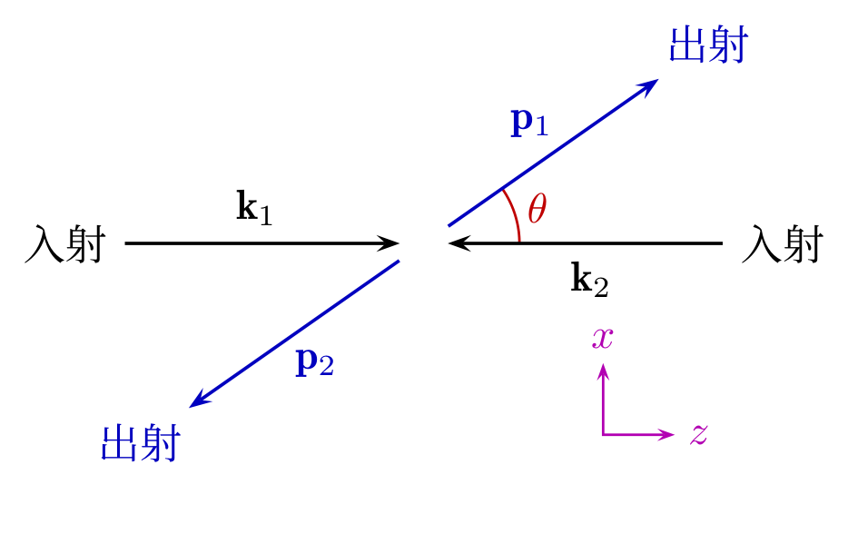

图 7.2: 质心系中 $2\to2$ 散射过程动量示意图。$\mathbf{k}_1$ 和 $\mathbf{k}_2$ 是两个入射粒子的三维动量，$\mathbf{p}_1$ 和 $\mathbf{p}_2$ 是两个出射粒子的三维动量，散射角 $\theta$ 为 $\mathbf{p}_1$ 与 $\mathbf{k}_1$ 方向之间的夹角。

由此推出

$$
|\mathbf{k}_1| = |\mathbf{k}_2| = \sqrt{(k_2^0)^2 - m_e^2} = \sqrt{\frac{E_{\text{CM}}^2}{4} - m_e^2} = \frac{E_{\text{CM}}}{2}\beta_e,
\tag{7.81}
$$

$$
|\mathbf{p}_1| = |\mathbf{p}_2| = \sqrt{(p_2^0)^2 - m_\mu^2} = \sqrt{\frac{E_{\text{CM}}^2}{4} - m_\mu^2} = \frac{E_{\text{CM}}}{2}\beta_\mu,
\tag{7.82}
$$

其中

$$
\beta_e \equiv \sqrt{1 - \frac{4m_e^2}{E_{\text{CM}}^2}} = \frac{|\mathbf{k}_1|}{k_1^0} = \frac{|\mathbf{k}_2|}{k_2^0},\quad \beta_\mu \equiv \sqrt{1 - \frac{4m_\mu^2}{E_{\text{CM}}^2}} = \frac{|\mathbf{p}_1|}{p_1^0} = \frac{|\mathbf{p}_2|}{p_2^0}
\tag{7.83}
$$

分别是电子和 $\mu$ 子在质心系中的运动速率。

现在推导四维动量之间内积的表达式。质心能 $E_{\text{CM}}$ 满足

$$
E_{\text{CM}}^2 = q^2 = (k_1 + k_2)^2 = k_1^2 + k_2^2 + 2k_1\cdot k_2 = 2(m_e^2 + k_1\cdot k_2),
\tag{7.84}
$$

同理有 $E_{\text{CM}}^2 = 2(m_\mu^2 + p_1\cdot p_2)$，故

$$
k_1\cdot k_2 = \frac{E_{\text{CM}}^2}{2} - m_e^2,\quad p_1\cdot p_2 = \frac{E_{\text{CM}}^2}{2} - m_\mu^2.
\tag{7.85}
$$

根据能动量守恒定律，$k_1 + k_2 = p_1 + p_2$，则 $k_1 - p_1 = p_2 - k_2$。从而推出

$$
m_e^2 + m_\mu^2 - 2k_1\cdot p_1 = (k_1 - p_1)^2 = (p_2 - k_2)^2 = m_e^2 + m_\mu^2 - 2k_2\cdot p_2,
\tag{7.86}
$$

所以有

$$
k_2\cdot p_2 = k_1\cdot p_1 = k_1^0p_1^0 - |\mathbf{k}_1||\mathbf{p}_1|\cos\theta = \frac{E_{\text{CM}}^2}{4}(1 - \beta_e\beta_\mu\cos\theta).
\tag{7.87}
$$

另一方面，也有 $k_1 - p_2 = p_1 - k_2$，同理推出

$$
k_2\cdot p_1 = k_1\cdot p_2 = k_1^0p_2^0 + |\mathbf{k}_1||\mathbf{p}_2|\cos\theta = \frac{E_{\text{CM}}^2}{4}(1 + \beta_e\beta_\mu\cos\theta).
\tag{7.88}
$$

由 $\mathbf{q} = \mathbf{0}$ 得 $q\cdot k_1 = q^0k_1^0 = E_{\text{CM}}^2/2$，由此可见

$$
q\cdot k_1 = q\cdot k_2 = q\cdot p_1 = q\cdot p_2 = \frac{E_{\text{CM}}^2}{2}.
\tag{7.89}
$$

利用以上表达式，将非极化振幅模方化为

$$
\begin{aligned}
\overline{|\mathcal{M}|^2} &= \frac{8e^4}{E_{\text{CM}}^4}\left[\frac{E_{\text{CM}}^4}{16}(1 - \beta_e\beta_\mu\cos\theta)^2 + \frac{E_{\text{CM}}^4}{16}(1 + \beta_e\beta_\mu\cos\theta)^2 + m_\mu^2\left(\frac{E_{\text{CM}}^2}{2} - m_e^2\right) + m_e^2\left(\frac{E_{\text{CM}}^2}{2} - m_\mu^2\right) + 2m_e^2m_\mu^2\right] \\
&= \frac{e^4}{E_{\text{CM}}^2}[E_{\text{CM}}^2(1 + \beta_e^2\beta_\mu^2\cos^2\theta) + 4(m_e^2 + m_\mu^2)] \\
&= 16\pi^2\alpha^2\left[1 + \beta_e^2\beta_\mu^2\cos^2\theta + \frac{4(m_e^2 + m_\mu^2)}{E_{\text{CM}}^2}\right],
\end{aligned}
\tag{7.90}
$$

其中精细结构常数定义为

$$
\alpha \equiv \frac{e^2}{4\pi}.
\tag{7.91}
$$

此处 $\overline{|\mathcal{M}|^2}\propto\alpha^2$，因而我们说 $e^+e^-\to\mu^+\mu^-$ 过程的领头阶是 $\alpha^2$ 阶，而 Feynman 图 7.1 包含 2 个 QED 顶点。由此可以推断，包含 $n$ 个 QED 顶点的 Feynman 图对应于 $\alpha^n$ 阶过程。

$\overline{|\mathcal{M}|^2}$ 依赖于 $\theta$，但不依赖于方位角 $\phi$。根据 (5.359) 式，非极化微分散射截面为

$$
\frac{\mathrm{d}\sigma}{\mathrm{d}\Omega} = \frac{\beta_\mu\overline{|\mathcal{M}|^2}}{64\pi^2E_{\text{CM}}^2\beta_e} = \frac{\alpha^2\beta_\mu}{4E_{\text{CM}}^2\beta_e}\left[1 + \beta_e^2\beta_\mu^2\cos^2\theta + \frac{4(m_e^2 + m_\mu^2)}{E_{\text{CM}}^2}\right].
\tag{7.92}
$$

利用

$$
\int_0^\pi\mathrm{d}\theta\,\sin\theta = \int_{-1}^{1}\mathrm{d}\cos\theta = 2,\quad \int_0^\pi\mathrm{d}\theta\,\sin\theta\cos^2\theta = \int_{-1}^{1}\cos^2\theta\,\mathrm{d}\cos\theta = \frac{2}{3},
\tag{7.93}
$$

此过程末态对称性因子 $\mathcal{S} = 1$，对全立体角积分，得到非极化散射截面

$$
\begin{aligned}
\sigma &= \int_0^{2\pi}\mathrm{d}\phi\int_0^\pi\mathrm{d}\theta\,\sin\theta\frac{\mathrm{d}\sigma}{\mathrm{d}\Omega} = \frac{\pi\alpha^2\beta_\mu}{2E_{\text{CM}}^2\beta_e}\left[2 + \frac{2}{3}\beta_e^2\beta_\mu^2 + \frac{8(m_e^2 + m_\mu^2)}{E_{\text{CM}}^2}\right] \\
&= \frac{\pi\alpha^2\beta_\mu}{3E_{\text{CM}}^2\beta_e}\left[3 + \left(1 - \frac{4m_e^2}{E_{\text{CM}}^2}\right)\left(1 - \frac{4m_\mu^2}{E_{\text{CM}}^2}\right) + \frac{12(m_e^2 + m_\mu^2)}{E_{\text{CM}}^2}\right] \\
&= \frac{4\pi\alpha^2\beta_\mu}{3E_{\text{CM}}^2\beta_e}\left[1 + \frac{2(m_e^2 + m_\mu^2)}{E_{\text{CM}}^2} + \frac{4m_e^2m_\mu^2}{E_{\text{CM}}^4}\right] = \frac{4\pi\alpha^2\beta_\mu}{3E_{\text{CM}}^2\beta_e}\left(1 + \frac{2m_e^2}{E_{\text{CM}}^2}\right)\left(1 + \frac{2m_\mu^2}{E_{\text{CM}}^2}\right).
\end{aligned}
\tag{7.94}
$$

图 7.3 根据上式画出散射截面 $\sigma$ 随质心能 $E_{\text{CM}}$ 的变化曲线，同时标注着 PETRA 对撞机上 TASSO 探测器测量到的实验数据 [36]。可以看到，QED 领头阶预言结果与实验数据符合得比较好。

由于 $m_e\ll m_\mu < E_{\text{CM}}/2$，我们可以近似地忽略电子质量，则 $\beta_e\simeq1$，而散射截面近似为

$$
\sigma\simeq\frac{4\pi\alpha^2\beta_\mu}{3E_{\text{CM}}^2}\left(1 + \frac{2m_\mu^2}{E_{\text{CM}}^2}\right).
\tag{7.95}
$$

若 $E_{\text{CM}}\gg m_\mu$，则 $\beta_\mu\simeq1$，散射截面进一步近似为

$$
\sigma\simeq\frac{4\pi\alpha^2}{3E_{\text{CM}}^2}.
\tag{7.96}
$$

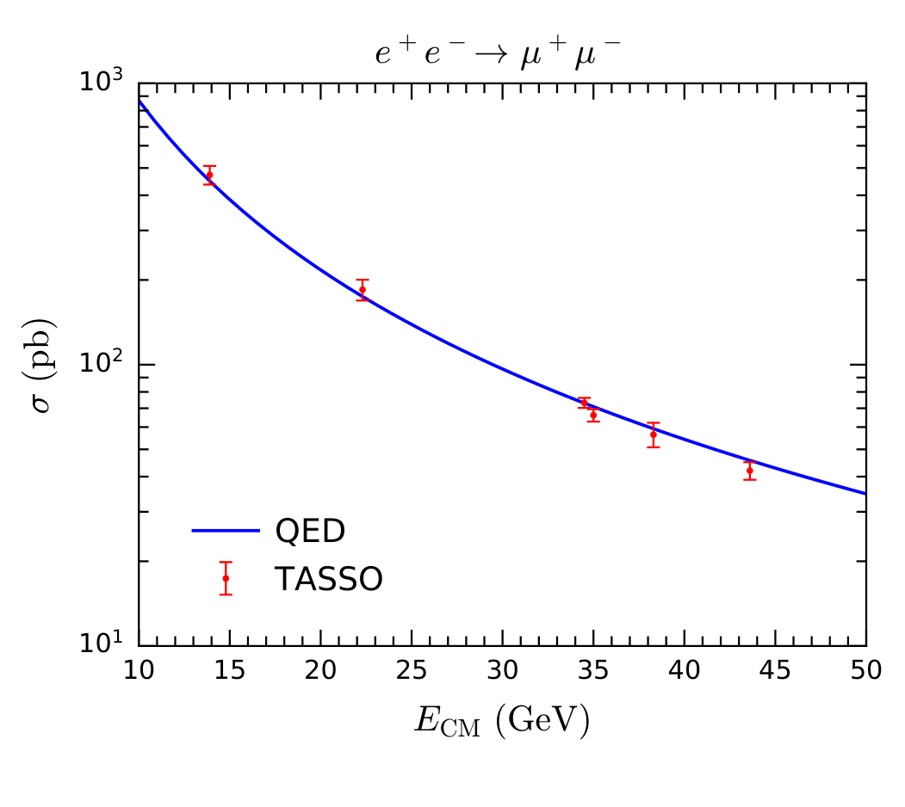

图 7.3: $e^+e^-\to\mu^+\mu^-$ 散射截面。实验数据来自 TASSO 合作组 [36]。

### 7.2.4 极化振幅

根据 (7.36) 式，螺旋度为 $\lambda_1$ 和 $\lambda_2$ 的 $e^-$ 和 $e^+$ 湮灭到螺旋度为 $\lambda_1'$ 和 $\lambda_2'$ 的 $\mu^-$ 和 $\mu^+$ 的过程对应的极化不变振幅为

$$
\mathcal{M}(\lambda_1,\lambda_2,\lambda_1',\lambda_2') = \frac{e^2}{E_{\text{CM}}^2}\bar{v}(\mathbf{k}_2,\lambda_2)\gamma^\mu u(\mathbf{k}_1,\lambda_1)\,\bar{u}(\mathbf{p}_1,\lambda_1')\gamma_\mu v(\mathbf{p}_2,\lambda_2').
\tag{7.97}
$$

其中 $\lambda_1,\lambda_2,\lambda_1',\lambda_2' = \pm$，而 $\bar{v}(\mathbf{k}_2,\lambda_2)\gamma^\mu u(\mathbf{k}_1,\lambda_1)$ 和 $\bar{u}(\mathbf{p}_1,\lambda_1')\gamma_\mu v(\mathbf{p}_2,\lambda_2')$ 都是用旋量双线性型表达的 Lorentz 矢量。在本小节中，我们将探索极化振幅的显明表达式。

依照图 7.2 中空间直角坐标系的定义，$z$ 轴沿 $\mathbf{k}_1$ 方向，初末态四个粒子的动量均位于 $xz$ 平面上，则末态 $\mu^-$ 和 $\mu^+$ 四维动量的分量表达式为

$$
p_1^\mu = \frac{E_{\text{CM}}}{2}(1,\beta_\mu s_\theta,0,\beta_\mu c_\theta),\quad p_2^\mu = \frac{E_{\text{CM}}}{2}(1,-\beta_\mu s_\theta,0,-\beta_\mu c_\theta).
\tag{7.98}
$$

这里我们采用了缩写 $s_\theta\equiv\sin\theta$ 和 $c_\theta\equiv\cos\theta$。根据 (4.160) 式和三角函数倍角公式

$$
s_\theta = 2s_{\theta/2}c_{\theta/2},\quad 1 + c_\theta = 2c_{\theta/2}^2,\quad 1 - c_\theta = 2s_{\theta/2}^2,
\tag{7.99}
$$

得到相应螺旋态 $\xi_{\lambda_1'}(\mathbf{p}_1)$ 和 $\xi_{\lambda_2'}(\mathbf{p}_2)$ 的形式为

$$
\xi_+(\mathbf{p}_1) = \frac{1}{\sqrt{2|\mathbf{p}_1|^2(1 + c_\theta)}}\begin{pmatrix}|\mathbf{p}_1|(1 + c_\theta) \\ |\mathbf{p}_1|s_\theta\end{pmatrix} = \frac{1}{2c_{\theta/2}}\begin{pmatrix}2c_{\theta/2}^2 \\ 2s_{\theta/2}c_{\theta/2}\end{pmatrix} = \begin{pmatrix}c_{\theta/2} \\ s_{\theta/2}\end{pmatrix},
\tag{7.100}
$$

$$
\xi_-(\mathbf{p}_1) = \frac{1}{\sqrt{2|\mathbf{p}_1|^2(1 + c_\theta)}}\begin{pmatrix}-|\mathbf{p}_1|s_\theta \\ |\mathbf{p}_1|(1 + c_\theta)\end{pmatrix} = \begin{pmatrix}-s_{\theta/2} \\ c_{\theta/2}\end{pmatrix},
\tag{7.101}
$$

$$
\xi_+(\mathbf{p}_2) = \frac{1}{\sqrt{2|\mathbf{p}_2|^2(1 - c_\theta)}}\begin{pmatrix}|\mathbf{p}_2|(1 - c_\theta) \\ -|\mathbf{p}_2|s_\theta\end{pmatrix} = \frac{1}{2s_{\theta/2}}\begin{pmatrix}2s_{\theta/2}^2 \\ -2s_{\theta/2}c_{\theta/2}\end{pmatrix} = \begin{pmatrix}s_{\theta/2} \\ -c_{\theta/2}\end{pmatrix},
\tag{7.102}
$$

$$
\xi_-(\mathbf{p}_2) = \frac{1}{\sqrt{2|\mathbf{p}_2|^2(1 - c_\theta)}}\begin{pmatrix}|\mathbf{p}_2|s_\theta \\ |\mathbf{p}_2|(1 - c_\theta)\end{pmatrix} = \begin{pmatrix}c_{\theta/2} \\ s_{\theta/2}\end{pmatrix}.
\tag{7.103}
$$

可以看出，当正负 $\mu$ 子的动量在空间中转动 $\theta$ 角时，旋量空间中的螺旋态只转动 $\theta/2$ 角，这正是自旋 1/2 的特征。

另一方面，初态 $e^-$ 和 $e^+$ 的四维动量分量为

$$
k_1^\mu = \frac{E_{\text{CM}}}{2}(1,0,0,\beta_e),\quad k_2^\mu = \frac{E_{\text{CM}}}{2}(1,0,0,-\beta_e).
\tag{7.104}
$$

与 $\mu^-$ 和 $\mu^+$ 四维动量的差异在于 $\beta_\mu$ 换成 $\beta_e$，且 $\theta = 0$。因此，只要将 $\mu^-$ 和 $\mu^+$ 螺旋态表达式中的 $\theta$ 取为 0，就得到 $e^-$ 和 $e^+$ 螺旋态 $\xi_{\lambda_1}(\mathbf{k}_1)$ 和 $\xi_{\lambda_2}(\mathbf{k}_2)$ 的如下表达式，

$$
\xi_+(\mathbf{k}_1) = \begin{pmatrix}1 \\ 0\end{pmatrix},\quad \xi_-(\mathbf{k}_1) = \begin{pmatrix}0 \\ 1\end{pmatrix},\quad \xi_+(\mathbf{k}_2) = \begin{pmatrix}0 \\ -1\end{pmatrix},\quad \xi_-(\mathbf{k}_2) = \begin{pmatrix}1 \\ 0\end{pmatrix}.
\tag{7.105}
$$

在 Weyl 表象中，

$$
\gamma^0\gamma^\mu = \begin{pmatrix} & \mathbf{1} \\ \mathbf{1} & \end{pmatrix}\begin{pmatrix} & \sigma^\mu \\ \bar{\sigma}^\mu & \end{pmatrix} = \begin{pmatrix} & \bar{\sigma}^\mu \\ \sigma^\mu & \end{pmatrix},
\tag{7.106}
$$

根据 (4.175) 和 (4.193) 式，正负电子贡献的 Lorentz 矢量 $\bar{v}(\mathbf{k}_2,\lambda_2)\gamma^\mu u(\mathbf{k}_1,\lambda_1)$ 化为

$$
\begin{aligned}
\bar{v}(\mathbf{k}_2,\lambda_2)\gamma^\mu u(\mathbf{k}_1,\lambda_1) &= v^\dagger(\mathbf{k}_2,\lambda_2)\gamma^0\gamma^\mu u(\mathbf{k}_1,\lambda_1) \\
&= \begin{pmatrix}\lambda_2\omega_{\lambda_2}(\mathbf{k}_2)\xi_{-\lambda_2}^\dagger(\mathbf{k}_2) & -\lambda_2\omega_{-\lambda_2}(\mathbf{k}_2)\xi_{-\lambda_2}^\dagger(\mathbf{k}_2)\end{pmatrix}\begin{pmatrix} & \bar{\sigma}^\mu \\ \sigma^\mu & \end{pmatrix}\begin{pmatrix}\omega_{-\lambda_1}(\mathbf{k}_1)\xi_{\lambda_1}(\mathbf{k}_1) \\ \omega_{\lambda_1}(\mathbf{k}_1)\xi_{\lambda_1}(\mathbf{k}_1)\end{pmatrix} \\
&= \lambda_2\omega_{\lambda_2}(\mathbf{k}_2)\omega_{-\lambda_1}(\mathbf{k}_1)\xi_{-\lambda_2}^\dagger(\mathbf{k}_2)\sigma^\mu\xi_{\lambda_1}(\mathbf{k}_1) - \lambda_2\omega_{-\lambda_2}(\mathbf{k}_2)\omega_{\lambda_1}(\mathbf{k}_1)\xi_{-\lambda_2}^\dagger(\mathbf{k}_2)\bar{\sigma}^\mu\xi_{\lambda_1}(\mathbf{k}_1).
\end{aligned}
\tag{7.107}
$$

按照定义式 (4.176)，有

$$
\omega_+(\mathbf{k}_2)\omega_+(\mathbf{k}_1) = \sqrt{(k_2^0 + |\mathbf{k}_2|)(k_1^0 + |\mathbf{k}_1|)} = \sqrt{\frac{E_{\text{CM}}(1 + \beta_e)}{2}\frac{E_{\text{CM}}(1 + \beta_e)}{2}} = \frac{E_{\text{CM}}(1 + \beta_e)}{2},
\tag{7.108}
$$

$$
\omega_-(\mathbf{k}_2)\omega_-(\mathbf{k}_1) = \sqrt{(k_2^0 - |\mathbf{k}_2|)(k_1^0 - |\mathbf{k}_1|)} = \sqrt{\frac{E_{\text{CM}}(1 - \beta_e)}{2}\frac{E_{\text{CM}}(1 - \beta_e)}{2}} = \frac{E_{\text{CM}}(1 - \beta_e)}{2}.
\tag{7.109}
$$

再由

$$
\sqrt{1 - \beta_e^2} = \sqrt{1 - \left(1 - \frac{4m_e^2}{E_{\text{CM}}^2}\right)} = \frac{2m_e}{E_{\text{CM}}}
\tag{7.110}
$$

导出

$$
\omega_-(\mathbf{k}_2)\omega_+(\mathbf{k}_1) = \omega_+(\mathbf{k}_2)\omega_-(\mathbf{k}_1) = \sqrt{\frac{E_{\text{CM}}(1 + \beta_e)}{2}\frac{E_{\text{CM}}(1 - \beta_e)}{2}} = \frac{E_{\text{CM}}}{2}\sqrt{1 - \beta_e^2} = m_e.
\tag{7.111}
$$

将 (4.74) 和 (3.46) 式代入，得到 $\xi_{-\lambda_2}^\dagger(\mathbf{k}_2)\sigma^\mu\xi_{\lambda_1}(\mathbf{k}_1)$ 和 $\xi_{-\lambda_2}^\dagger(\mathbf{k}_2)\bar{\sigma}^\mu\xi_{\lambda_1}(\mathbf{k}_1)$（$\mu = 0,1,2,3$）的分量表达式为

$$
\xi_+^\dagger(\mathbf{k}_2)\sigma^\mu\xi_+(\mathbf{k}_1) = \begin{pmatrix}0 & -1\end{pmatrix}\sigma^\mu\begin{pmatrix}1 \\ 0\end{pmatrix} = (0,-1,-\mathrm{i},0) = -\xi_+^\dagger(\mathbf{k}_2)\bar{\sigma}^\mu\xi_+(\mathbf{k}_1),
\tag{7.112}
$$

$$
\xi_-^\dagger(\mathbf{k}_2)\sigma^\mu\xi_-(\mathbf{k}_1) = \begin{pmatrix}1 & 0\end{pmatrix}\sigma^\mu\begin{pmatrix}0 \\ 1\end{pmatrix} = (0,1,-\mathrm{i},0) = -\xi_-^\dagger(\mathbf{k}_2)\bar{\sigma}^\mu\xi_-(\mathbf{k}_1),
\tag{7.113}
$$

$$
\xi_-^\dagger(\mathbf{k}_2)\sigma^\mu\xi_+(\mathbf{k}_1) = \begin{pmatrix}1 & 0\end{pmatrix}\sigma^\mu\begin{pmatrix}1 \\ 0\end{pmatrix} = (1,0,0,1),\qquad \xi_+^\dagger(\mathbf{k}_2)\bar{\sigma}^\mu\xi_+(\mathbf{k}_1) = (1,0,0,-1),
\tag{7.114}
$$

$$
\xi_+^\dagger(\mathbf{k}_2)\sigma^\mu\xi_-(\mathbf{k}_1) = \begin{pmatrix}0 & -1\end{pmatrix}\sigma^\mu\begin{pmatrix}0 \\ 1\end{pmatrix} = (-1,0,0,1),\quad \xi_+^\dagger(\mathbf{k}_2)\bar{\sigma}^\mu\xi_-(\mathbf{k}_1) = (-1,0,0,-1).
\tag{7.115}
$$

从而，初末 Lorentz 矢量 $\bar{v}(\mathbf{k}_2,\lambda_2)\gamma^\mu u(\mathbf{k}_1,\lambda_1)$ 的分量表达式是

$$
\begin{aligned}
\bar{v}(\mathbf{k}_2,-)\gamma^\mu u(\mathbf{k}_1,+) &= -\omega_-(\mathbf{k}_2)\omega_-(\mathbf{k}_1)\xi_+^\dagger(\mathbf{k}_2)\bar{\sigma}^\mu\xi_+(\mathbf{k}_1) + \omega_+(\mathbf{k}_2)\omega_+(\mathbf{k}_1)\xi_+^\dagger(\mathbf{k}_2)\sigma^\mu\xi_+(\mathbf{k}_1) \\
&= -\frac{E_{\text{CM}}(1 - \beta_e)}{2}(0,1,\mathrm{i},0) + \frac{E_{\text{CM}}(1 + \beta_e)}{2}(0,-1,-\mathrm{i},0) \\
&= E_{\text{CM}}(0,-1,-\mathrm{i},0),
\end{aligned}
\tag{7.116}
$$

$$
\begin{aligned}
\bar{v}(\mathbf{k}_2,+)\gamma^\mu u(\mathbf{k}_1,-) &= \omega_+(\mathbf{k}_2)\omega_+(\mathbf{k}_1)\xi_-^\dagger(\mathbf{k}_2)\bar{\sigma}^\mu\xi_-(\mathbf{k}_1) - \omega_-(\mathbf{k}_2)\omega_-(\mathbf{k}_1)\xi_-^\dagger(\mathbf{k}_2)\sigma^\mu\xi_-(\mathbf{k}_1) \\
&= \frac{E_{\text{CM}}(1 + \beta_e)}{2}(0,-1,\mathrm{i},0) - \frac{E_{\text{CM}}(1 - \beta_e)}{2}(0,1,-\mathrm{i},0) \\
&= E_{\text{CM}}(0,-1,\mathrm{i},0),
\end{aligned}
\tag{7.117}
$$

$$
\begin{aligned}
\bar{v}(\mathbf{k}_2,+)\gamma^\mu u(\mathbf{k}_1,+) &= \omega_+(\mathbf{k}_2)\omega_-(\mathbf{k}_1)\xi_-^\dagger(\mathbf{k}_2)\bar{\sigma}^\mu\xi_+(\mathbf{k}_1) - \omega_-(\mathbf{k}_2)\omega_+(\mathbf{k}_1)\xi_-^\dagger(\mathbf{k}_2)\sigma^\mu\xi_+(\mathbf{k}_1) \\
&= m_e(1,0,0,-1) - m_e(1,0,0,1) = 2m_e(0,0,0,-1),
\end{aligned}
\tag{7.118}
$$

$$
\begin{aligned}
\bar{v}(\mathbf{k}_2,-)\gamma^\mu u(\mathbf{k}_1,-) &= -\omega_-(\mathbf{k}_2)\omega_+(\mathbf{k}_1)\xi_+^\dagger(\mathbf{k}_2)\bar{\sigma}^\mu\xi_-(\mathbf{k}_1) + \omega_+(\mathbf{k}_2)\omega_-(\mathbf{k}_1)\xi_+^\dagger(\mathbf{k}_2)\sigma^\mu\xi_-(\mathbf{k}_1) \\
&= -m_e(-1,0,0,-1) + m_e(-1,0,0,1) = 2m_e(0,0,0,1).
\end{aligned}
\tag{7.119}
$$

另一方面，正负 $\mu$ 子贡献的 Lorentz 矢量 $\bar{u}(\mathbf{p}_1,\lambda_1')\gamma_\mu v(\mathbf{p}_2,\lambda_2')$ 化为

$$
\begin{aligned}
\bar{u}(\mathbf{p}_1,\lambda_1')\gamma_\mu v(\mathbf{p}_2,\lambda_2') &= u^\dagger(\mathbf{p}_1,\lambda_1')\gamma^0\gamma_\mu v(\mathbf{p}_2,\lambda_2') \\
&= \begin{pmatrix}\omega_{-\lambda_1'}(\mathbf{p}_1)\xi_{\lambda_1'}^\dagger(\mathbf{p}_1) & \omega_{\lambda_1'}(\mathbf{p}_1)\xi_{\lambda_1'}^\dagger(\mathbf{p}_1)\end{pmatrix}\begin{pmatrix} & \sigma_\mu \\ \bar{\sigma}_\mu & \end{pmatrix}\begin{pmatrix}\lambda_2'\omega_{\lambda_2'}(\mathbf{p}_2)\xi_{-\lambda_2'}(\mathbf{p}_2) \\ -\lambda_2'\omega_{-\lambda_2'}(\mathbf{p}_2)\xi_{-\lambda_2'}(\mathbf{p}_2)\end{pmatrix} \\
&= \lambda_2'\omega_{-\lambda_1'}(\mathbf{p}_1)\omega_{\lambda_2'}(\mathbf{p}_2)\xi_{\lambda_1'}^\dagger(\mathbf{p}_1)\bar{\sigma}_\mu\xi_{-\lambda_2'}(\mathbf{p}_2) - \lambda_2'\omega_{\lambda_1'}(\mathbf{p}_1)\omega_{-\lambda_2'}(\mathbf{p}_2)\xi_{\lambda_1'}^\dagger(\mathbf{p}_1)\sigma_\mu\xi_{-\lambda_2'}(\mathbf{p}_2).
\end{aligned}
\tag{7.120}
$$

此时有

$$
\omega_+(\mathbf{p}_1)\omega_+(\mathbf{p}_2) = \frac{E_{\text{CM}}(1 + \beta_\mu)}{2},\quad \omega_-(\mathbf{p}_1)\omega_-(\mathbf{p}_2) = \frac{E_{\text{CM}}(1 - \beta_\mu)}{2},
\tag{7.121}
$$

$$
\omega_+(\mathbf{p}_1)\omega_-(\mathbf{p}_2) = \omega_-(\mathbf{p}_1)\omega_+(\mathbf{p}_2) = m_\mu.
\tag{7.122}
$$

利用三角函数公式

$$
c_{\theta/2}^2 - s_{\theta/2}^2 = c_\theta,\quad s_{\theta/2}^2 + c_{\theta/2}^2 = 1,
\tag{7.123}
$$

推出 $\xi_{\lambda_1'}^\dagger(\mathbf{p}_1)\sigma_\mu\xi_{-\lambda_2'}(\mathbf{p}_2)$ 和 $\xi_{\lambda_1'}^\dagger(\mathbf{p}_1)\bar{\sigma}_\mu\xi_{-\lambda_2'}(\mathbf{p}_2)$ 的分量为

$$
\xi_+^\dagger(\mathbf{p}_1)\sigma_\mu\xi_+(\mathbf{p}_2) = \begin{pmatrix}c_{\theta/2} & s_{\theta/2}\end{pmatrix}\sigma_\mu\begin{pmatrix}s_{\theta/2} \\ -c_{\theta/2}\end{pmatrix} = (0,c_\theta,-\mathrm{i},-s_\theta) = -\xi_+^\dagger(\mathbf{p}_1)\bar{\sigma}_\mu\xi_+(\mathbf{p}_2),
\tag{7.124}
$$

$$
\xi_-^\dagger(\mathbf{p}_1)\sigma_\mu\xi_-(\mathbf{p}_2) = \begin{pmatrix}-s_{\theta/2} & c_{\theta/2}\end{pmatrix}\sigma_\mu\begin{pmatrix}c_{\theta/2} \\ s_{\theta/2}\end{pmatrix} = (0,-c_\theta,-\mathrm{i},s_\theta) = -\xi_-^\dagger(\mathbf{p}_1)\bar{\sigma}_\mu\xi_-(\mathbf{p}_2),
\tag{7.125}
$$

$$
\xi_+^\dagger(\mathbf{p}_1)\sigma_\mu\xi_-(\mathbf{p}_2) = \begin{pmatrix}c_{\theta/2} & s_{\theta/2}\end{pmatrix}\sigma_\mu\begin{pmatrix}c_{\theta/2} \\ s_{\theta/2}\end{pmatrix} = (1,-s_\theta,0,-c_\theta),
\tag{7.126}
$$

$$
\xi_+^\dagger(\mathbf{p}_1)\bar{\sigma}_\mu\xi_-(\mathbf{p}_2) = (1,s_\theta,0,c_\theta),
\tag{7.127}
$$

$$
\xi_-^\dagger(\mathbf{p}_1)\sigma_\mu\xi_+(\mathbf{p}_2) = \begin{pmatrix}-s_{\theta/2} & c_{\theta/2}\end{pmatrix}\sigma_\mu\begin{pmatrix}s_{\theta/2} \\ -c_{\theta/2}\end{pmatrix} = (-1,-s_\theta,0,-c_\theta),
\tag{7.128}
$$

$$
\xi_-^\dagger(\mathbf{p}_1)\bar{\sigma}_\mu\xi_+(\mathbf{p}_2) = (-1,s_\theta,0,c_\theta).
\tag{7.129}
$$

从而，末态 Lorentz 矢量 $\bar{u}(\mathbf{p}_1,\lambda_1')\gamma_\mu v(\mathbf{p}_2,\lambda_2')$ 的分量是

$$
\begin{aligned}
\bar{u}(\mathbf{p}_1,+)\gamma_\mu v(\mathbf{p}_2,-) &= -\omega_-(\mathbf{p}_1)\omega_-(\mathbf{p}_2)\xi_+^\dagger(\mathbf{p}_1)\bar{\sigma}_\mu\xi_+(\mathbf{p}_2) + \omega_+(\mathbf{p}_1)\omega_+(\mathbf{p}_2)\xi_+^\dagger(\mathbf{p}_1)\sigma_\mu\xi_+(\mathbf{p}_2) \\
&= -\frac{E_{\text{CM}}(1 - \beta_\mu)}{2}(0,c_\theta,\mathrm{i},s_\theta) + \frac{E_{\text{CM}}(1 + \beta_\mu)}{2}(0,c_\theta,-\mathrm{i},-s_\theta) \\
&= E_{\text{CM}}(0,c_\theta,-\mathrm{i},-s_\theta),
\end{aligned}
\tag{7.130}
$$

$$
\begin{aligned}
\bar{u}(\mathbf{p}_1,-)\gamma_\mu v(\mathbf{p}_2,+) &= \omega_+(\mathbf{p}_1)\omega_+(\mathbf{p}_2)\xi_-^\dagger(\mathbf{p}_1)\bar{\sigma}_\mu\xi_-(\mathbf{p}_2) - \omega_-(\mathbf{p}_1)\omega_-(\mathbf{p}_2)\xi_-^\dagger(\mathbf{p}_1)\sigma_\mu\xi_-(\mathbf{p}_2) \\
&= \frac{E_{\text{CM}}(1 + \beta_\mu)}{2}(0,c_\theta,\mathrm{i},-s_\theta) - \frac{E_{\text{CM}}(1 - \beta_\mu)}{2}(0,-c_\theta,-\mathrm{i},s_\theta) \\
&= E_{\text{CM}}(0,c_\theta,\mathrm{i},-s_\theta),
\end{aligned}
\tag{7.131}
$$

$$
\begin{aligned}
\bar{u}(\mathbf{p}_1,+)\gamma_\mu v(\mathbf{p}_2,+) &= \omega_-(\mathbf{p}_1)\omega_+(\mathbf{p}_2)\xi_+^\dagger(\mathbf{p}_1)\bar{\sigma}_\mu\xi_-(\mathbf{p}_2) - \omega_+(\mathbf{p}_1)\omega_-(\mathbf{p}_2)\xi_+^\dagger(\mathbf{p}_1)\sigma_\mu\xi_-(\mathbf{p}_2) \\
&= m_\mu(1,s_\theta,0,c_\theta) - m_\mu(1,-s_\theta,0,-c_\theta) = 2m_\mu(0,s_\theta,0,c_\theta),
\end{aligned}
\tag{7.132}
$$

$$
\begin{aligned}
\bar{u}(\mathbf{p}_1,-)\gamma_\mu v(\mathbf{p}_2,-) &= -\omega_+(\mathbf{p}_1)\omega_-(\mathbf{p}_2)\xi_-^\dagger(\mathbf{p}_1)\bar{\sigma}_\mu\xi_+(\mathbf{p}_2) + \omega_-(\mathbf{p}_1)\omega_+(\mathbf{p}_2)\xi_-^\dagger(\mathbf{p}_1)\sigma_\mu\xi_+(\mathbf{p}_2) \\
&= -m_\mu(-1,s_\theta,0,c_\theta) + m_\mu(-1,-s_\theta,0,-c_\theta) = 2m_\mu(0,-s_\theta,0,-c_\theta).
\end{aligned}
\tag{7.133}
$$

将上述表达式代入 (7.97) 式，就得到极化振幅的显明表达式。下面分 4 类螺旋度构型进行讨论。

(1) 当正负电子具有相反螺旋度（$\lambda_1 = -\lambda_2$）、正负 $\mu$ 子也具有相反螺旋度（$\lambda_1' = -\lambda_2'$）时，极化振幅为

$$
\mathcal{M}(+,-,+,-) = \frac{e^2}{E_{\text{CM}}^2}\bar{v}(\mathbf{k}_2,-)\gamma^\mu u(\mathbf{k}_1,+)\,\bar{u}(\mathbf{p}_1,+)\gamma_\mu v(\mathbf{p}_2,-) = -e^2(1 + \cos\theta),
\tag{7.134}
$$

$$
\mathcal{M}(-,+,-,+) = \frac{e^2}{E_{\text{CM}}^2}\bar{v}(\mathbf{k}_2,+)\gamma^\mu u(\mathbf{k}_1,-)\,\bar{u}(\mathbf{p}_1,-)\gamma_\mu v(\mathbf{p}_2,+) = -e^2(1 + \cos\theta),
\tag{7.135}
$$

$$
\mathcal{M}(+,-,-,+) = \frac{e^2}{E_{\text{CM}}^2}\bar{v}(\mathbf{k}_2,-)\gamma^\mu u(\mathbf{k}_1,+)\,\bar{u}(\mathbf{p}_1,-)\gamma_\mu v(\mathbf{p}_2,+) = e^2(1 - \cos\theta),
\tag{7.136}
$$

$$
\mathcal{M}(-,+,+,-) = \frac{e^2}{E_{\text{CM}}^2}\bar{v}(\mathbf{k}_2,+)\gamma^\mu u(\mathbf{k}_1,-)\,\bar{u}(\mathbf{p}_1,+)\gamma_\mu v(\mathbf{p}_2,-) = e^2(1 - \cos\theta).
\tag{7.137}
$$

我们发现 $\mathcal{M}(+,-,+,-) = \mathcal{M}(-,+,-,+)$ 且 $\mathcal{M}(+,-,-,+) = \mathcal{M}(-,+,+,-)$。实际上，QED 是一个宇称守恒的理论。在宇称变换下，粒子的动量方向反转，角动量方向不变，因而螺旋度

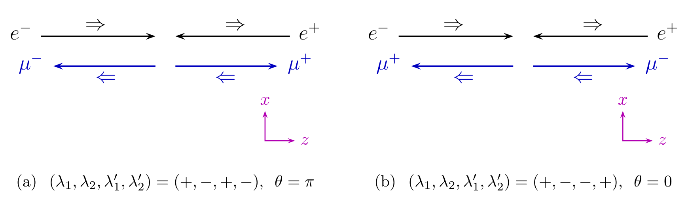

图 7.4: $\lambda_1 = -\lambda_2$ 且 $\lambda_1' = -\lambda_2'$ 时的零振幅构型示意图。

翻转，但 $\theta$ 角不变。于是，对所有螺旋度作翻转变换之后，宇称守恒保证 $e^+e^-\to\mu^+\mu^-$ 微分散射截面 $\mathrm{d}\sigma/\mathrm{d}\Omega$ 不变，故振幅模方 $|\mathcal{M}|^2$ 不变，而振幅至多相差一个相位因子 $\mathrm{e}^{\mathrm{i}\varphi}$，

$$
\mathcal{M}(-\lambda_1,-\lambda_2,-\lambda_1',-\lambda_2') = \mathrm{e}^{\mathrm{i}\varphi}\mathcal{M}(\lambda_1,\lambda_2,\lambda_1',\lambda_2').
\tag{7.138}
$$

对于这里的两种情况，相位因子都是 1。

根据 (5.359) 式，$(\lambda_1,\lambda_2,\lambda_1',\lambda_2') = (+,-,+,-)$ 和 $(-,+,-,+)$ 两种构型对应的极化微分散射截面相等，为

$$
\left.\frac{\mathrm{d}\sigma}{\mathrm{d}\Omega}\right|_{\lambda_1=-\lambda_2=\lambda_1'=-\lambda_2'} = \frac{\beta_\mu e^4(1 + \cos\theta)^2}{64\pi^2E_{\text{CM}}^2\beta_e} = \frac{\alpha^2\beta_\mu(1 + \cos\theta)^2}{4E_{\text{CM}}^2\beta_e}.
\tag{7.139}
$$

$(\lambda_1,\lambda_2,\lambda_1',\lambda_2') = (+,-,-,+)$ 和 $(-,+,+,-)$ 对应的极化微分截面也相等，为

$$
\left.\frac{\mathrm{d}\sigma}{\mathrm{d}\Omega}\right|_{\lambda_1=-\lambda_2=-\lambda_1'=\lambda_2'} = \frac{\alpha^2\beta_\mu(1 - \cos\theta)^2}{4E_{\text{CM}}^2\beta_e}.
\tag{7.140}
$$

可以看到，当 $\theta = \pi$ 时，$\mathcal{M}(+,-,+,-) = 0$。此时，动量和角动量构型如图 7.4(a) 所示，双线箭头 $\Rightarrow$ 表示自旋角动量的方向，与动量方向一致时螺旋度为正，反之为负。$e^+e^-$ 系统的角动量为 1，方向为 $z$ 轴正向，投影在 $z$ 轴上的本征值必定为 $+1$；$\mu^+\mu^-$ 系统的角动量为 1，方向为 $z$ 轴负向，投影在 $z$ 轴上的本征值必定为 $-1$。初末态系统的角动量投影本征值不同，不满足角动量守恒，因此振幅为零。当 $\theta\neq\pi$ 时，$\mu^+\mu^-$ 系统的角动量有一定概率在 $z$ 轴上投影出本征值 $+1$，在振幅上体现为一个 $(1 + \cos\theta)$ 因子。

对图 7.4(b) 可作类似分析，因此 $\theta = 0$ 时有 $\mathcal{M}(+,-,-,+) = 0$，而 $\theta\neq0$ 时振幅上出现一个 $(1 - \cos\theta)$ 因子。

(2) 当正负电子具有相同螺旋度（$\lambda_1 = \lambda_2$）、正负 $\mu$ 子也具有相同螺旋度（$\lambda_1' = \lambda_2'$）时，极化振幅为

$$
\mathcal{M}(+,+,+,+) = \frac{e^2}{E_{\text{CM}}^2}\bar{v}(\mathbf{k}_2,+)\gamma^\mu u(\mathbf{k}_1,+)\,\bar{u}(\mathbf{p}_1,+)\gamma_\mu v(\mathbf{p}_2,+) = -\frac{4e^2m_e m_\mu\cos\theta}{E_{\text{CM}}^2},
\tag{7.141}
$$

$$
\mathcal{M}(-,-,-,-) = \frac{e^2}{E_{\text{CM}}^2}\bar{v}(\mathbf{k}_2,-)\gamma^\mu u(\mathbf{k}_1,-)\,\bar{u}(\mathbf{p}_1,-)\gamma_\mu v(\mathbf{p}_2,-) = -\frac{4e^2m_e m_\mu\cos\theta}{E_{\text{CM}}^2},
\tag{7.142}
$$

$$
\mathcal{M}(+,+,-,-) = \frac{e^2}{E_{\text{CM}}^2}\bar{v}(\mathbf{k}_2,+)\gamma^\mu u(\mathbf{k}_1,+)\,\bar{u}(\mathbf{p}_1,-)\gamma_\mu v(\mathbf{p}_2,-) = \frac{4e^2m_e m_\mu\cos\theta}{E_{\text{CM}}^2},
\tag{7.143}
$$

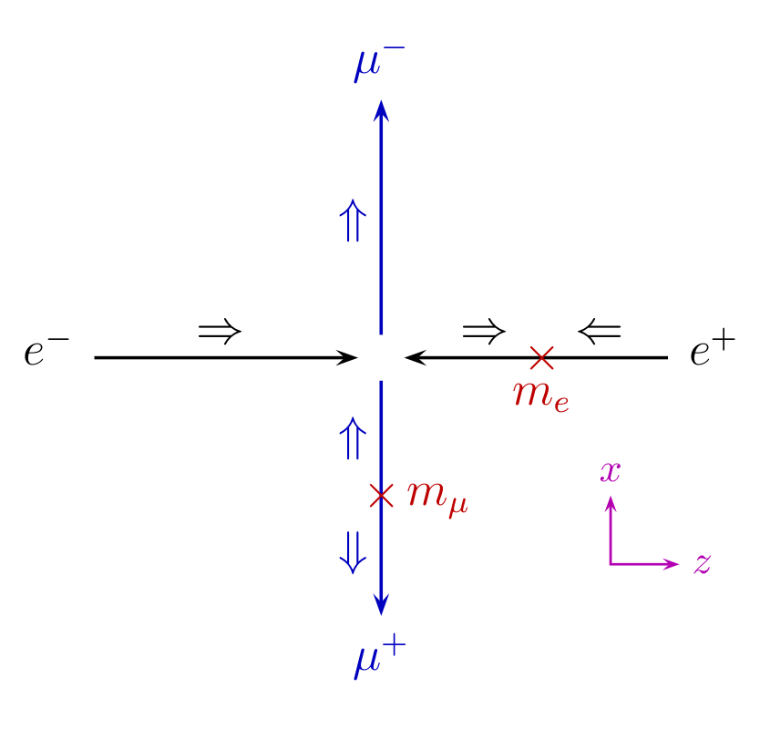

图 7.5: $(\lambda_1,\lambda_2,\lambda_1',\lambda_2') = (+,+,+,+)$ 且 $\theta = \pi/2$ 时的零振幅构型示意图。

$$
\mathcal{M}(-,-,+,+) = \frac{e^2}{E_{\text{CM}}^2}\bar{v}(\mathbf{k}_2,-)\gamma^\mu u(\mathbf{k}_1,-)\,\bar{u}(\mathbf{p}_1,+)\gamma_\mu v(\mathbf{p}_2,+) = \frac{4e^2m_em_\mu\cos\theta}{E_{\text{CM}}^2}.
\tag{7.144}
$$

这些振幅都正比于 $m_em_\mu\cos\theta$，宇称变换引起的相位因子都是 1。这四个振幅对应的极化微分截面相等，为

$$
\left.\frac{\mathrm{d}\sigma}{\mathrm{d}\Omega}\right|_{\lambda_1=\lambda_2,\lambda_1'=\lambda_2'} = \frac{\beta_\mu}{64\pi^2E_{\text{CM}}^2\beta_e}\frac{16e^4m_e^2m_\mu^2\cos^2\theta}{E_{\text{CM}}^4} = \frac{4\alpha^2m_e^2m_\mu^2\beta_\mu\cos^2\theta}{E_{\text{CM}}^6\beta_e}.
\tag{7.145}
$$

光子是 $e^+e^-\to\mu^+\mu^-$ 过程的中间态，它的自旋为 1，因而在质心系中角动量也为 1。不过，具有相同螺旋度的正反粒子对系统在质心系中的角动量为 0，必须翻转其中一个粒子的螺旋度才能得到角动量 1。

实际上，粒子的质量可以翻转螺旋度。对于无质量的自由粒子，螺旋度在任意惯性系中不变。然而，对于有质量的自由粒子，螺旋度在不同惯性系中可以具有不同的值；毕竟，在静止系中粒子动量为零，因而螺旋度不确定。可以将质量看作一种耦合，耦合螺旋度相反的两种状态，效果是翻转粒子的螺旋度。

对于这里的情况，必须翻转 $e^-$ 或 $e^+$ 的螺旋度来得到系统角动量为 1 的态，因此振幅中出现一个 $2m_e/E_{\text{CM}}$ 因子；同时必须翻转 $\mu^-$ 或 $\mu^+$ 的螺旋度，从而出现一个 $2m_\mu/E_{\text{CM}}$ 因子。由于运动学上要求 $E_{\text{CM}}/2 > m_\mu \gg m_e$，这四个振幅受到严重压低，贡献可以忽略。这种效应称为螺旋度压低（helicity suppression）。

当 $\theta = \pi/2$ 时，出现零振幅。对于 $(\lambda_1,\lambda_2,\lambda_1',\lambda_2') = (+,+,+,+)$，零振幅构型如图 7.5 所示。图中 $e^+$ 被质量耦合（用 $\times$ 表示）翻转螺旋度，使得角动量为 0 的 $e^+e^-$ 系统转化成角动量为 1 的光子。随后，光子转化成角动量为 1 的 $\mu^+\mu^-$ 系统。最后，质量耦合将 $\mu^+$ 的螺旋度翻转，从而得到角动量为 0 的 $\mu^+\mu^-$ 系统。但是，光子的角动量沿 $z$ 轴正向，当 $\theta = \pi/2$ 时不可能转化成角动量沿 $x$ 轴正向的 $\mu^+\mu^-$ 系统，因而振幅为零。当 $\theta \neq \pi/2$ 时，光子转化成 $\mu^+\mu^-$ 系统的概率在振幅上体现为一个 $\cos\theta$ 因子。

(3) 当正负电子具有相同螺旋度（$\lambda_1 = \lambda_2$）、正负 $\mu$ 子具有相反螺旋度（$\lambda_1' = -\lambda_2'$）时，极化振幅为

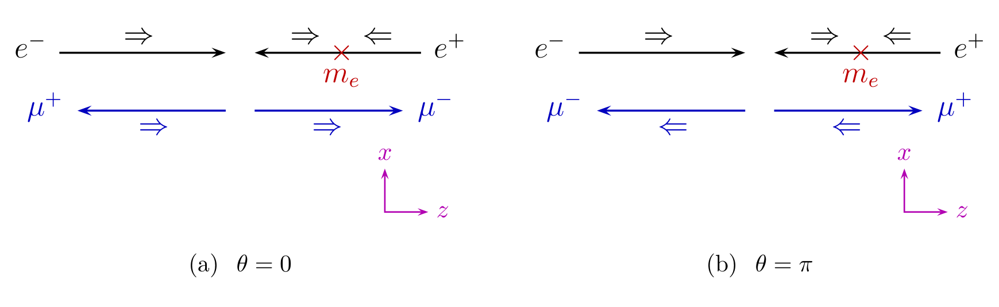

图 7.6: $(\lambda_1,\lambda_2,\lambda_1',\lambda_2') = (+,+,+,-)$ 时的零振幅构型示意图。

$$
\mathcal{M}(+,+,+,-) = \frac{e^2}{E_{\text{CM}}^2}\bar{v}(\mathbf{k}_2,+)\gamma^\mu u(\mathbf{k}_1,+)\,\bar{u}(\mathbf{p}_1,+)\gamma_\mu v(\mathbf{p}_2,-) = \frac{2e^2m_e\sin\theta}{E_{\text{CM}}},
\tag{7.146}
$$

$$
\mathcal{M}(-,-,-,+) = \frac{e^2}{E_{\text{CM}}^2}\bar{v}(\mathbf{k}_2,-)\gamma^\mu u(\mathbf{k}_1,-)\,\bar{u}(\mathbf{p}_1,-)\gamma_\mu v(\mathbf{p}_2,+) = -\frac{2e^2m_e\sin\theta}{E_{\text{CM}}},
\tag{7.147}
$$

$$
\mathcal{M}(+,+,-,+) = \frac{e^2}{E_{\text{CM}}^2}\bar{v}(\mathbf{k}_2,+)\gamma^\mu u(\mathbf{k}_1,+)\,\bar{u}(\mathbf{p}_1,-)\gamma_\mu v(\mathbf{p}_2,+) = \frac{2e^2m_e\sin\theta}{E_{\text{CM}}},
\tag{7.148}
$$

$$
\mathcal{M}(-,-,+,-) = \frac{e^2}{E_{\text{CM}}^2}\bar{v}(\mathbf{k}_2,-)\gamma^\mu u(\mathbf{k}_1,-)\,\bar{u}(\mathbf{p}_1,+)\gamma_\mu v(\mathbf{p}_2,-) = -\frac{2e^2m_e\sin\theta}{E_{\text{CM}}}.
\tag{7.149}
$$

这些振幅都正比于 $m_e\sin\theta$，宇称变换引起的相位因子都是 $-1$。这四个振幅对应的极化微分截面相等，为

$$
\left.\frac{\mathrm{d}\sigma}{\mathrm{d}\Omega}\right|_{\lambda_1=\lambda_2,\lambda_1'=-\lambda_2'} = \frac{\beta_\mu}{64\pi^2E_{\text{CM}}^2\beta_e}\frac{4e^4m_e^2\sin^2\theta}{E_{\text{CM}}^2} = \frac{\alpha^2m_e^2\beta_\mu\sin^2\theta}{E_{\text{CM}}^4\beta_e}.
\tag{7.150}
$$

这里初态 $e^+e^-$ 系统的角动量为 0，必须翻转 $e^-$ 或 $e^+$ 的螺旋度来得到角动量为 1 的态，因而振幅中出现一个 $2m_e/E_{\text{CM}}$ 因子，受到螺旋度压低。由于 $E_{\text{CM}}/2 > m_\mu \gg m_e$，这四个振幅的贡献可以忽略。当 $\theta = 0,\pi$ 时，出现零振幅。对于 $(\lambda_1,\lambda_2,\lambda_1',\lambda_2') = (+,+,+,-)$，零振幅构型如图 7.6(a) 和 7.6(b) 所示。末态 $\mu^+\mu^-$ 系统的角动量为 1，当 $\theta = 0$ 或 $\pi$ 时，它在 $z$ 轴上的投影必定为 $+1$ 或 $-1$，而 $e^+e^-$ 系统角动量的投影为 0，不满足角动量守恒，故振幅为零。当 $\theta \neq 0,\pi$ 时，$\mu^+\mu^-$ 系统的角动量有一定概率在 $z$ 轴上投影出本征值 0，在振幅上体现为一个 $\sin\theta$ 因子。

(4) 当正负电子具有相反螺旋度（$\lambda_1 = -\lambda_2$）、正负 $\mu$ 子具有相同螺旋度（$\lambda_1' = \lambda_2'$）时，极化振幅为

$$
\mathcal{M}(+,-,+,+) = \frac{e^2}{E_{\text{CM}}^2}\bar{v}(\mathbf{k}_2,-)\gamma^\mu u(\mathbf{k}_1,+)\,\bar{u}(\mathbf{p}_1,+)\gamma_\mu v(\mathbf{p}_2,+) = -\frac{2e^2m_\mu\sin\theta}{E_{\text{CM}}},
\tag{7.151}
$$

$$
\mathcal{M}(-,+,-,-) = \frac{e^2}{E_{\text{CM}}^2}\bar{v}(\mathbf{k}_2,+)\gamma^\mu u(\mathbf{k}_1,-)\,\bar{u}(\mathbf{p}_1,-)\gamma_\mu v(\mathbf{p}_2,-) = \frac{2e^2m_\mu\sin\theta}{E_{\text{CM}}},
\tag{7.152}
$$

$$
\mathcal{M}(-,+,+,+) = \frac{e^2}{E_{\text{CM}}^2}\bar{v}(\mathbf{k}_2,+)\gamma^\mu u(\mathbf{k}_1,-)\,\bar{u}(\mathbf{p}_1,+)\gamma_\mu v(\mathbf{p}_2,+) = -\frac{2e^2m_\mu\sin\theta}{E_{\text{CM}}},
\tag{7.153}
$$

$$
\mathcal{M}(+,-,-,-) = \frac{e^2}{E_{\text{CM}}^2}\bar{v}(\mathbf{k}_2,-)\gamma^\mu u(\mathbf{k}_1,+)\,\bar{u}(\mathbf{p}_1,-)\gamma_\mu v(\mathbf{p}_2,-) = \frac{2e^2m_\mu\sin\theta}{E_{\text{CM}}}.
\tag{7.154}
$$

这些振幅都正比于 $m_\mu\sin\theta$，宇称变换引起的相位因子都是 $-1$。这四个振幅对应的极化微分截面相等，为

$$
\left.\frac{\mathrm{d}\sigma}{\mathrm{d}\Omega}\right|_{\lambda_1=-\lambda_2,\lambda_1'=\lambda_2'} = \frac{\beta_\mu}{64\pi^2E_{\text{CM}}^2\beta_e}\frac{4e^4m_\mu^2\sin^2\theta}{E_{\text{CM}}^2} = \frac{\alpha^2m_\mu^2\beta_\mu\sin^2\theta}{E_{\text{CM}}^4\beta_e}.
\tag{7.155}
$$

这里末态 $\mu^+\mu^-$ 系统的角动量为 0，必须翻转 $\mu^-$ 或 $\mu^+$ 的螺旋度来得到角动量为 1 的态，因而振幅中出现一个 $2m_\mu/E_{\text{CM}}$ 因子，受到螺旋度压低。若 $E_{\text{CM}}/2 \gg m_\mu$，则这四个振幅的贡献可以忽略。当 $\theta = 0,\pi$ 时，出现零振幅。理由类似于第 (3) 类情况，振幅同样正比于 $\sin\theta$。

利用上述 16 个极化振幅表达式，我们可以直接计算非极化振幅模方，

$$
\begin{aligned}
\overline{|\mathcal{M}|^2} &= \frac{1}{4}\sum_{\lambda_1\lambda_2\lambda_1'\lambda_2'}|\mathcal{M}(\lambda_1,\lambda_2,\lambda_1',\lambda_2')|^2 \\
&= \frac{e^2}{4}\left[2(1 + \cos\theta)^2 + 2(1 - \cos\theta)^2 + 4\frac{16m_e^2m_\mu^2\cos^2\theta}{E_{\text{CM}}^4} + 4\frac{4m_\mu^2\sin^2\theta}{E_{\text{CM}}^2} + 4\frac{4m_e^2\sin^2\theta}{E_{\text{CM}}^2}\right] \\
&= e^2\left[1 + \cos^2\theta + \frac{16m_e^2m_\mu^2\cos^2\theta}{E_{\text{CM}}^4} + \frac{4(m_e^2 + m_\mu^2)(1 - \cos^2\theta)}{E_{\text{CM}}^2}\right] \\
&= e^2\left[1 + \left(1 - \frac{4m_e^2}{E_{\text{CM}}^2}\right)\left(1 - \frac{4m_\mu^2}{E_{\text{CM}}^2}\right)\cos^2\theta + \frac{4(m_e^2 + m_\mu^2)}{E_{\text{CM}}^2}\right] \\
&= 16\pi^2\alpha^2\left[1 + \beta_e^2\beta_\mu^2\cos^2\theta + \frac{4(m_e^2 + m_\mu^2)}{E_{\text{CM}}^2}\right],
\end{aligned}
\tag{7.156}
$$

结果与通过求迹运算得到的 (7.90) 式一致。

## 7.3 手征性与螺旋度

本节探讨旋量场的手征性（chirality）与自旋 1/2 费米子的螺旋度之间的关系。

在 Weyl 表象 (4.69) 中，利用

$$
\gamma^5 = \begin{pmatrix}-\mathbf{1} & \\ & \mathbf{1}\end{pmatrix},
\tag{7.157}
$$

引入左手投影矩阵 $P_{\mathrm{L}}$ 和右手投影矩阵 $P_{\mathrm{R}}$，

$$
P_{\mathrm{L}} \equiv \frac{1}{2}(1 - \gamma^5) = \begin{pmatrix}\mathbf{1} & \\ & \mathbf{0}\end{pmatrix}, \quad P_{\mathrm{R}} \equiv \frac{1}{2}(1 + \gamma^5) = \begin{pmatrix}\mathbf{0} & \\ & \mathbf{1}\end{pmatrix}.
\tag{7.158}
$$

它们是厄米的，而且具有投影性

$$
P_{\mathrm{L}}^2 = P_{\mathrm{L}}, \quad P_{\mathrm{R}}^2 = P_{\mathrm{R}},
\tag{7.159}
$$

正交性

$$
P_{\mathrm{L}}P_{\mathrm{R}} = P_{\mathrm{R}}P_{\mathrm{L}} = \mathbf{0},
\tag{7.160}
$$

和完备性

$$
P_{\mathrm{L}} + P_{\mathrm{R}} = \mathbf{1}.
\tag{7.161}
$$

另外，由 $\gamma^5\gamma^\mu = -\gamma^\mu\gamma^5$ 有

$$
P_{\mathrm{L}}\gamma^\mu = \gamma^\mu P_{\mathrm{R}}, \quad P_{\mathrm{R}}\gamma^\mu = \gamma^\mu P_{\mathrm{L}}.
\tag{7.162}
$$

回顾 (4.112) 式，Dirac 旋量场 $\psi$ 可分解为左手 Weyl 旋量场 $\eta_{\mathrm{L}}$ 和右手 Weyl 旋量场 $\eta_{\mathrm{R}}$。利用投影矩阵，定义左手的四分量旋量场

$$
\psi_{\mathrm{L}} \equiv P_{\mathrm{L}}\psi = \begin{pmatrix}\mathbf{1} & \\ & \mathbf{0}\end{pmatrix}\begin{pmatrix}\eta_{\mathrm{L}}\\ \eta_{\mathrm{R}}\end{pmatrix} = \begin{pmatrix}\eta_{\mathrm{L}}\\ 0\end{pmatrix},
\tag{7.163}
$$

和右手的四分量旋量场

$$
\psi_{\mathrm{R}} \equiv P_{\mathrm{R}}\psi = \begin{pmatrix}\mathbf{0} & \\ & \mathbf{1}\end{pmatrix}\begin{pmatrix}\eta_{\mathrm{L}}\\ \eta_{\mathrm{R}}\end{pmatrix} = \begin{pmatrix}0\\ \eta_{\mathrm{R}}\end{pmatrix}.
\tag{7.164}
$$

可见，左右手投影矩阵正好挑选出具有相应手征性的分量。

根据定义，左手旋量场 $\psi_{\mathrm{L}}$ 的 Dirac 共轭为

$$
\bar{\psi}_{\mathrm{L}} = (\psi_{\mathrm{L}})^\dagger\gamma^0 = \frac{1}{2}[(1 - \gamma^5)\psi]^\dagger\gamma^0 = \frac{1}{2}\psi^\dagger(1 - \gamma^5)\gamma^0 = \frac{1}{2}\psi^\dagger\gamma^0(1 + \gamma^5) = \bar{\psi}P_{\mathrm{R}}.
\tag{7.165}
$$

注意，上式中 $1 \pm \gamma^5$ 是 $\mathbf{1} \pm \gamma^5$ 的简化写法。同理得右手旋量场 $\psi_{\mathrm{R}}$ 的 Dirac 共轭为

$$
\bar{\psi}_{\mathrm{R}} = \bar{\psi}P_{\mathrm{L}}.
\tag{7.166}
$$

对包含若干个 Dirac 矩阵的旋量场双线性型进行左右手投影分解，得

$$
\bar{\psi}\psi = \bar{\psi}(P_{\mathrm{L}} + P_{\mathrm{R}})\psi = \bar{\psi}(P_{\mathrm{L}}^2 + P_{\mathrm{R}}^2)\psi = \bar{\psi}_{\mathrm{R}}\psi_{\mathrm{L}} + \bar{\psi}_{\mathrm{L}}\psi_{\mathrm{R}},
\tag{7.167}
$$

$$
\bar{\psi}\gamma^\mu\psi = \bar{\psi}\gamma^\mu(P_{\mathrm{L}}^2 + P_{\mathrm{R}}^2)\psi = \bar{\psi}P_{\mathrm{R}}\gamma^\mu P_{\mathrm{L}}\psi + \bar{\psi}P_{\mathrm{L}}\gamma^\mu P_{\mathrm{R}}\psi = \bar{\psi}_{\mathrm{L}}\gamma^\mu\psi_{\mathrm{L}} + \bar{\psi}_{\mathrm{R}}\gamma^\mu\psi_{\mathrm{R}},
\tag{7.168}
$$

$$
\bar{\psi}\gamma^\mu\gamma^\nu\psi = \bar{\psi}\gamma^\mu\gamma^\nu(P_{\mathrm{L}}^2 + P_{\mathrm{R}}^2)\psi = \bar{\psi}_{\mathrm{R}}\gamma^\mu\gamma^\nu\psi_{\mathrm{L}} + \bar{\psi}_{\mathrm{L}}\gamma^\mu\gamma^\nu\psi_{\mathrm{R}},
\tag{7.169}
$$

$$
\bar{\psi}\gamma^\mu\gamma^\nu\gamma^\rho\psi = \bar{\psi}\gamma^\mu\gamma^\nu\gamma^\rho(P_{\mathrm{L}}^2 + P_{\mathrm{R}}^2)\psi = \bar{\psi}_{\mathrm{L}}\gamma^\mu\gamma^\nu\gamma^\rho\psi_{\mathrm{L}} + \bar{\psi}_{\mathrm{R}}\gamma^\mu\gamma^\nu\gamma^\rho\psi_{\mathrm{R}}.
\tag{7.170}
$$

可见，包含偶数（奇数）个 Dirac 矩阵的旋量场双线性型耦合手征性相反（相同）的旋量场。于是，拉氏量 (4.103) 中的 Dirac 旋量场质量项分解为

$$
-m\bar{\psi}\psi = -m(\bar{\psi}_{\mathrm{R}}\psi_{\mathrm{L}} + \bar{\psi}_{\mathrm{L}}\psi_{\mathrm{R}}),
\tag{7.171}
$$

也就是说，质量 $m$ 将左手旋量场 $\psi_{\mathrm{L}}$ 与右手旋量场 $\psi_{\mathrm{R}}$ 耦合起来。

在高能极限下，忽略旋量场的质量 $m$，则 $E_{\mathbf{p}} \simeq |\mathbf{p}|$，故

$$
\omega_+(\mathbf{p}) = \sqrt{E_{\mathbf{p}} + |\mathbf{p}|} \simeq \sqrt{2E_{\mathbf{p}}}, \quad \omega_-(\mathbf{p}) = \sqrt{E_{\mathbf{p}} - |\mathbf{p}|} \simeq 0.
\tag{7.172}
$$

按照平面波旋量系数 $u$ 和 $v$ 的螺旋态表达式 (4.175) 和 (4.193)，有

$$
u(\mathbf{p},+) = \begin{pmatrix}\omega_-(\mathbf{p})\xi_+(\mathbf{p})\\ \omega_+(\mathbf{p})\xi_+(\mathbf{p})\end{pmatrix} \simeq \sqrt{2E_{\mathbf{p}}}\begin{pmatrix}0\\ \xi_+(\mathbf{p})\end{pmatrix},
\tag{7.173}
$$

$$
u(\mathbf{p},-) = \begin{pmatrix}\omega_+(\mathbf{p})\xi_-(\mathbf{p})\\ \omega_-(\mathbf{p})\xi_-(\mathbf{p})\end{pmatrix} \simeq \sqrt{2E_{\mathbf{p}}}\begin{pmatrix}\xi_-(\mathbf{p})\\ 0\end{pmatrix},
\tag{7.174}
$$

$$
v(\mathbf{p},+) = \begin{pmatrix}\omega_+(\mathbf{p})\xi_-(\mathbf{p})\\ -\omega_-(\mathbf{p})\xi_-(\mathbf{p})\end{pmatrix} \simeq \sqrt{2E_{\mathbf{p}}}\begin{pmatrix}\xi_-(\mathbf{p})\\ 0\end{pmatrix},
\tag{7.175}
$$

$$
v(\mathbf{p},-) = \begin{pmatrix}-\omega_-(\mathbf{p})\xi_+(\mathbf{p})\\ \omega_+(\mathbf{p})\xi_+(\mathbf{p})\end{pmatrix} \simeq \sqrt{2E_{\mathbf{p}}}\begin{pmatrix}0\\ \xi_+(\mathbf{p})\end{pmatrix}.
\tag{7.176}
$$

此时，螺旋度不同的 $u$ 和 $v$ 显示出不同的手征性，$u(\mathbf{p},+)$ 和 $v(\mathbf{p},-)$ 是右手的，$u(\mathbf{p},-)$ 和 $v(\mathbf{p},+)$ 是左手的。可见，高能极限下手征性等价于螺旋度。回顾 4.4.2 小节，$u(\mathbf{p},\lambda)$ 是本征值为 $\lambda$ 的螺旋度本征态，与螺旋度为 $\lambda$ 的正费米子相关；而 $v(\mathbf{p},\lambda)$ 是本征值为 $-\lambda$ 的螺旋度本征态，却与螺旋度为 $\lambda$ 的反费米子相关。用投影矩阵作用，有

$$
u_{\mathrm{L}}(\mathbf{p},-) = P_{\mathrm{L}}u(\mathbf{p},-) \simeq u(\mathbf{p},-), \quad u_{\mathrm{R}}(\mathbf{p},+) = P_{\mathrm{R}}u(\mathbf{p},+) \simeq u(\mathbf{p},+),
\tag{7.177}
$$

$$
u_{\mathrm{L}}(\mathbf{p},+) = P_{\mathrm{L}}u(\mathbf{p},+) \simeq 0, \quad u_{\mathrm{R}}(\mathbf{p},-) = P_{\mathrm{R}}u(\mathbf{p},-) \simeq 0,
\tag{7.178}
$$

$$
v_{\mathrm{L}}(\mathbf{p},+) = P_{\mathrm{L}}v(\mathbf{p},+) \simeq v(\mathbf{p},+), \quad v_{\mathrm{R}}(\mathbf{p},-) = P_{\mathrm{R}}v(\mathbf{p},-) \simeq v(\mathbf{p},-),
\tag{7.179}
$$

$$
v_{\mathrm{L}}(\mathbf{p},-) = P_{\mathrm{L}}v(\mathbf{p},-) \simeq 0, \quad v_{\mathrm{R}}(\mathbf{p},+) = P_{\mathrm{R}}v(\mathbf{p},+) \simeq 0.
\tag{7.180}
$$

相应的 Dirac 共轭满足

$$
\bar{u}_{\mathrm{L}}(\mathbf{p},-) = \bar{u}(\mathbf{p},-)P_{\mathrm{R}} \simeq \bar{u}(\mathbf{p},-), \quad \bar{u}_{\mathrm{R}}(\mathbf{p},+) = \bar{u}(\mathbf{p},+)P_{\mathrm{L}} \simeq u(\mathbf{p},+),
\tag{7.181}
$$

$$
\bar{u}_{\mathrm{L}}(\mathbf{p},+) = \bar{u}(\mathbf{p},+)P_{\mathrm{R}} \simeq 0, \quad \bar{u}_{\mathrm{R}}(\mathbf{p},-) = \bar{u}(\mathbf{p},-)P_{\mathrm{L}} \simeq 0,
\tag{7.182}
$$

$$
\bar{v}_{\mathrm{L}}(\mathbf{p},+) = \bar{v}(\mathbf{p},+)P_{\mathrm{R}} \simeq v(\mathbf{p},+), \quad \bar{v}_{\mathrm{R}}(\mathbf{p},-) = \bar{v}(\mathbf{p},-)P_{\mathrm{L}} \simeq v(\mathbf{p},-),
\tag{7.183}
$$

$$
\bar{v}_{\mathrm{L}}(\mathbf{p},-) = \bar{v}(\mathbf{p},-)P_{\mathrm{R}} \simeq 0, \quad \bar{v}_{\mathrm{R}}(\mathbf{p},+) = \bar{v}(\mathbf{p},+)P_{\mathrm{L}} \simeq 0.
\tag{7.184}
$$

据此，将投影矩阵作用到 $\psi(x)$ 平面波解 (4.217) 上，得到左右手旋量场的平面波解

$$
\psi_{\mathrm{L}}(x) = P_{\mathrm{L}}\psi(x) \simeq \int\frac{\mathrm{d}^3p}{(2\pi)^3}\frac{1}{\sqrt{2E_{\mathbf{p}}}}\left[u(\mathbf{p},-)a_{\mathbf{p},-}\mathrm{e}^{-\mathrm{i}p\cdot x} + v(\mathbf{p},+)b_{\mathbf{p},+}^\dagger\mathrm{e}^{\mathrm{i}p\cdot x}\right],
\tag{7.185}
$$

$$
\psi_{\mathrm{R}}(x) = P_{\mathrm{R}}\psi(x) \simeq \int\frac{\mathrm{d}^3p}{(2\pi)^3}\frac{1}{\sqrt{2E_{\mathbf{p}}}}\left[u(\mathbf{p},+)a_{\mathbf{p},+}\mathrm{e}^{-\mathrm{i}p\cdot x} + v(\mathbf{p},-)b_{\mathbf{p},-}^\dagger\mathrm{e}^{\mathrm{i}p\cdot x}\right].
\tag{7.186}
$$

相应的 Dirac 共轭为

$$
\begin{aligned}
\bar{\psi}_{\mathrm{L}}(x) &= [\psi_{\mathrm{L}}(x)]^\dagger\gamma^0 \simeq \int\frac{\mathrm{d}^3p}{(2\pi)^3}\frac{1}{\sqrt{2E_{\mathbf{p}}}}\left[\bar{u}(\mathbf{p},-)a_{\mathbf{p},-}^\dagger\mathrm{e}^{\mathrm{i}p\cdot x} + \bar{v}(\mathbf{p},+)b_{\mathbf{p},+}\mathrm{e}^{-\mathrm{i}p\cdot x}\right],\\
\bar{\psi}_{\mathrm{R}}(x) &= [\psi_{\mathrm{R}}(x)]^\dagger\gamma^0 \simeq \int\frac{\mathrm{d}^3p}{(2\pi)^3}\frac{1}{\sqrt{2E_{\mathbf{p}}}}\left[\bar{u}(\mathbf{p},+)a_{\mathbf{p},+}^\dagger\mathrm{e}^{\mathrm{i}p\cdot x} + \bar{v}(\mathbf{p},-)b_{\mathbf{p},-}\mathrm{e}^{-\mathrm{i}p\cdot x}\right].
\end{aligned}
\tag{7.187}
$$

也就是说，在高能极限下，忽略质量，左手旋量场 $\psi_{\mathrm{L}}(x)$ 描述左旋极化的正费米子和右旋极化的反费米子，右手旋量场 $\psi_{\mathrm{R}}(x)$ 描述右旋极化的正费米子和左旋极化的反费米子，$\psi_{\mathrm{L}}(x)$ 和 $\psi_{\mathrm{R}}(x)$ 成为两个相互独立的场。

在高能极限下，由投影矩阵性质推出

$$
\bar{u}(\mathbf{q},-)u(\mathbf{p},-) \simeq \bar{u}(\mathbf{q},-)P_{\mathrm{R}}P_{\mathrm{L}}u(\mathbf{p},-) = 0, \quad \bar{u}(\mathbf{q},+)u(\mathbf{p},+) \simeq \bar{u}(\mathbf{q},+)P_{\mathrm{L}}P_{\mathrm{R}}u(\mathbf{p},+) = 0,
\tag{7.188}
$$

$$
\bar{v}(\mathbf{q},-)v(\mathbf{p},-) \simeq \bar{v}(\mathbf{q},-)P_{\mathrm{L}}P_{\mathrm{R}}v(\mathbf{p},-) = 0, \quad \bar{v}(\mathbf{q},+)v(\mathbf{p},+) \simeq \bar{v}(\mathbf{q},+)P_{\mathrm{R}}P_{\mathrm{L}}v(\mathbf{p},+) = 0.
\tag{7.189}
$$

此时两个平面波旋量系数之间夹着零个 Dirac 矩阵，不能耦合相同螺旋度，只能耦合相反螺旋度，这是左右手投影分解式 (7.167) 在平面波旋量系数上的体现。一般地，有

$$
\bar{u}(\mathbf{q},\lambda)u(\mathbf{p},\lambda) \simeq 0, \quad \bar{v}(\mathbf{q},\lambda)v(\mathbf{p},\lambda) \simeq 0,
\tag{7.190}
$$

$$
\bar{u}(\mathbf{q},-\lambda)\gamma^\mu u(\mathbf{p},\lambda) \simeq 0, \quad \bar{v}(\mathbf{q},-\lambda)\gamma^\mu v(\mathbf{p},\lambda) \simeq 0,
\tag{7.191}
$$

$$
\bar{u}(\mathbf{q},\lambda)\gamma^\mu\gamma^\nu u(\mathbf{p},\lambda) \simeq 0, \quad \bar{v}(\mathbf{q},\lambda)\gamma^\mu\gamma^\nu v(\mathbf{p},\lambda) \simeq 0,
\tag{7.192}
$$

$$
\bar{u}(\mathbf{q},-\lambda)\gamma^\mu\gamma^\nu\gamma^\rho u(\mathbf{p},\lambda) \simeq 0, \quad \bar{v}(\mathbf{q},-\lambda)\gamma^\mu\gamma^\nu\gamma^\rho v(\mathbf{p},\lambda) \simeq 0.
\tag{7.193}
$$

对于 $u$ 和 $v$ 一起构成的旋量双线性型，则有

$$
\bar{u}(\mathbf{q},-\lambda)v(\mathbf{p},\lambda) \simeq 0, \quad \bar{v}(\mathbf{q},-\lambda)u(\mathbf{p},\lambda) \simeq 0,
\tag{7.194}
$$

$$
\bar{u}(\mathbf{q},\lambda)\gamma^\mu v(\mathbf{p},\lambda) \simeq 0, \quad \bar{v}(\mathbf{q},\lambda)\gamma^\mu u(\mathbf{p},\lambda) \simeq 0,
\tag{7.195}
$$

$$
\bar{u}(\mathbf{q},-\lambda)\gamma^\mu\gamma^\nu v(\mathbf{p},\lambda) \simeq 0, \quad \bar{v}(\mathbf{q},-\lambda)\gamma^\mu\gamma^\nu u(\mathbf{p},\lambda) \simeq 0,
\tag{7.196}
$$

$$
\bar{u}(\mathbf{q},\lambda)\gamma^\mu\gamma^\nu\gamma^\rho v(\mathbf{p},\lambda) \simeq 0, \quad \bar{v}(\mathbf{q},\lambda)\gamma^\mu\gamma^\nu\gamma^\rho u(\mathbf{p},\lambda) \simeq 0.
\tag{7.197}
$$

容易看出，在高能极限下，忽略质量，只有 $\lambda_1 = -\lambda_2$ 且 $\lambda_1' = -\lambda_2'$ 的螺旋度构型对 $e^+e^-\to\mu^+\mu^-$ 极化振幅 (7.97) 的贡献非零，与上一小节的计算结果一致。如果不忽略质量，则其它螺旋度构型的贡献正比于质量，表现出螺旋度压低效应。

## 7.4 Coulomb 散射

### 7.4.1 e⁻μ⁻ 散射

现在，我们讨论与 $e^+e^-\to\mu^+\mu^-$ 湮灭过程关系密切的 $e^-\mu^-\to e^-\mu^-$ 散射过程。这个过程对应于电子受 $\mu$ 子 Coulomb 电场影响而发生的 Coulomb 散射。它的领头阶费曼图与图 7.1 类似，但线的方向不同，相应的不变振幅为

$$
\begin{aligned}
\mathrm{i}\mathcal{M} &= \bar{u}(p_1')(-\mathrm{i}e\gamma^\mu)u(k_1')\frac{-\mathrm{i}g_{\mu\nu}}{q'^2}\bar{u}(p_2')(-\mathrm{i}e\gamma^\nu)u(k_2')\\
&= \frac{\mathrm{i}e^2}{q'^2}\bar{u}(p_1')\gamma^\mu u(k_1')\,\bar{u}(p_2')\gamma_\mu u(k_2').
\end{aligned}
\tag{7.198}
$$

为简便起见，这里我们将平面波旋量系数 $u$ 和 $\bar{u}$ 写成在壳四维动量的函数，而且没有显明写出对螺旋度的依赖。虚光子的四维动量 $q'^\mu$ 满足

$$
q'^\mu = k_1'^\mu - p_1'^\mu = p_2'^\mu - k_2'^\mu.
\tag{7.199}
$$

$\mathrm{i}\mathcal{M}$ 的复共轭是

$$
(\mathrm{i}\mathcal{M})^* = -\frac{\mathrm{i}e^2}{q'^2}\bar{u}(k_1')\gamma^\nu u(p_1')\,\bar{u}(k_2')\gamma_\nu u(p_2'),
\tag{7.200}
$$

非极化振幅模方为

$$
\begin{aligned}
\overline{|\mathcal{M}|^2} &= \frac{1}{4}\sum_{\text{spins}}|\mathcal{M}|^2 = \frac{e^4}{4(q'^2)^2}\sum_{\text{spins}}\bar{u}(p_1')\gamma^\mu u(k_1')\,\bar{u}(k_1')\gamma^\nu u(p_1')\,\bar{u}(p_2')\gamma_\mu u(k_2')\,\bar{u}(k_2')\gamma_\nu u(p_2')\\
&= \frac{e^4}{4(q'^2)^2}\sum_{\text{spins}}\mathrm{tr}[u(p_1')\bar{u}(p_1')\gamma^\mu u(k_1')\bar{u}(k_1')\gamma^\nu]\,\mathrm{tr}[u(p_2')\bar{u}(p_2')\gamma_\mu u(k_2')\bar{u}(k_2')\gamma_\nu]\\
&= \frac{e^4}{4(q'^2)^2}\mathrm{tr}[(\not{p}_1' + m_e)\gamma^\mu(\not{k}_1' + m_e)\gamma^\nu]\,\mathrm{tr}[(\not{p}_2' + m_\mu)\gamma_\mu(\not{k}_2' + m_\mu)\gamma_\nu].
\end{aligned}
\tag{7.201}
$$

其中，$\sum_{\text{spins}}$ 表示对自旋求和，即对螺旋度求和。容易看出，这个结果等价于对 $e^+e^-\to\mu^+\mu^-$ 非极化振幅模方 (7.42) 作以下动量替换，

$$
k_1^\mu \to k_1'^\mu, \quad k_2^\mu \to -p_1'^\mu, \quad p_1^\mu \to p_2'^\mu, \quad p_2^\mu \to -k_2'^\mu.
\tag{7.202}
$$

注意这样的替换正好使得 $q^\mu \to q'^\mu$。可见，这两个过程确实具有密切的关系，这种关系称为交叉对称性（crossing symmetry）。通过动量替换，我们可以从 (7.78) 式直接得到 $e^-\mu^-\to e^-\mu^-$ 非极化振幅模方的表达式

$$
\overline{|\mathcal{M}|^2} = \frac{8e^4}{(q'^2)^2}\left[(k_1'\cdot p_2')(p_1'\cdot k_2') + (k_1'\cdot k_2')(p_1'\cdot p_2') - m_e^2(p_2'\cdot k_2') - m_\mu^2(k_1'\cdot p_1') + 2m_e^2m_\mu^2\right].
\tag{7.203}
$$

在质心系中，根据 5.5.3 小节关于两体散射运动学的讨论，初末态粒子的动量满足

$$
|\mathbf{k}_1'| = |\mathbf{k}_2'| = |\mathbf{p}_1'| = |\mathbf{p}_2'| = \frac{E_{\text{CM}}}{2}\lambda^{1/2}\left(1,\frac{m_e^2}{E_{\text{CM}}^2},\frac{m_\mu^2}{E_{\text{CM}}^2}\right) \equiv Q.
\tag{7.204}
$$

也就是说，初末态四个粒子的动量大小都是 $Q$。另一方面，它们的能量是

$$
k_1'^0 = p_1'^0 = \frac{E_{\text{CM}}^2 + m_e^2 - m_\mu^2}{2E_{\text{CM}}} \equiv E_e, \quad k_2'^0 = p_2'^0 = \frac{E_{\text{CM}}^2 + m_\mu^2 - m_e^2}{2E_{\text{CM}}} \equiv E_\mu,
\tag{7.205}
$$

其中 $E_e$ 是初末态电子的能量，$E_\mu$ 是初末态 $\mu$ 子的能量。设散射角 $\theta$ 为 $\mathbf{k}_1'$ 与 $\mathbf{p}_1'$ 方向的夹角，则四维动量的内积表达为

$$
k_1'\cdot p_1' = k_1'^0p_1'^0 - |\mathbf{k}_1'||\mathbf{p}_1'|\cos\theta = E_e^2 - Q^2\cos\theta,
\tag{7.206}
$$

$$
k_1'\cdot p_2' = k_1'^0p_2'^0 + |\mathbf{k}_1'||\mathbf{p}_2'|\cos\theta = E_eE_\mu + Q^2\cos\theta,
\tag{7.207}
$$

$$
k_2'\cdot p_2' = k_2'^0p_2'^0 - |\mathbf{k}_2'||\mathbf{p}_2'|\cos\theta = E_\mu^2 - Q^2\cos\theta,
\tag{7.208}
$$

$$
k_2'\cdot p_1' = k_2'^0p_1'^0 + |\mathbf{k}_2'||\mathbf{p}_1'|\cos\theta = E_eE_\mu + Q^2\cos\theta,
\tag{7.209}
$$

$$
k_1'\cdot k_2' = k_1'^0k_2'^0 + |\mathbf{k}_1'||\mathbf{k}_2'| = E_eE_\mu + Q^2,
\tag{7.210}
$$

$$
p_1'\cdot p_2' = p_1'^0p_2'^0 + |\mathbf{p}_1'||\mathbf{p}_2'| = E_eE_\mu + Q^2,
\tag{7.211}
$$

$$
q'^2 = (k_1' - p_1')^2 = 2m_e^2 - 2k_1'\cdot p_1' = 2(m_e^2 - E_e^2 + Q^2\cos\theta) = -2Q^2(1 - \cos\theta).
\tag{7.212}
$$

对任意 $\theta > 0$，有 $q'^2 < 0$，即虚光子是类空的。

于是，$\overline{|\mathcal{M}|^2}$ 化为

$$
\begin{aligned}
\overline{|\mathcal{M}|^2} &= \frac{8e^4}{4Q^4(1 - \cos\theta)^2}\left[(E_eE_\mu + Q^2\cos\theta)^2 + (E_eE_\mu + Q^2)^2 \right. \\
&\qquad\qquad \left. - m_e^2(E_\mu^2 - Q^2\cos\theta) - m_\mu^2(E_e^2 - Q^2\cos\theta) + 2m_e^2m_\mu^2\right] \\
&= \frac{32\pi^2\alpha^2}{Q^4(1 - \cos\theta)^2}\left\{2E_e^2E_\mu^2 - m_\mu^2E_e^2 - m_e^2E_\mu^2 + 2m_e^2m_\mu^2 + Q^4(1 + \cos^2\theta)\right.\\
&\qquad\qquad \left. + Q^2[2E_eE_\mu(1 + \cos\theta) + (m_e^2 + m_\mu^2)\cos\theta]\right\}.
\end{aligned}
\tag{7.213}
$$

接着按照 (5.338) 式计算微分散射截面，式中的入射流因子

$$
E_AE_B|\mathbf{v}_A - \mathbf{v}_B| = E_eE_\mu\left(\frac{Q}{E_e} + \frac{Q}{E_\mu}\right) = E_eE_\mu\frac{Q(E_\mu + E_e)}{E_eE_\mu} = QE_{\text{CM}},
\tag{7.214}
$$

故微分截面为

$$
\begin{aligned}
\frac{\mathrm{d}\sigma}{\mathrm{d}\Omega} &= \frac{1}{64\pi^2}\frac{1}{E_AE_B|\mathbf{v}_A - \mathbf{v}_B|}\frac{|\mathbf{p}_1'|}{E_{\text{CM}}}\overline{|\mathcal{M}|^2} = \frac{1}{64\pi^2}\frac{1}{QE_{\text{CM}}}\frac{Q}{E_{\text{CM}}}\overline{|\mathcal{M}|^2}\\
&= \frac{\alpha^2}{2E_{\text{CM}}^2Q^4(1 - \cos\theta)^2}\left\{2E_e^2E_\mu^2 - m_\mu^2E_e^2 - m_e^2E_\mu^2 + 2m_e^2m_\mu^2 \right.\\
&\qquad\qquad \left. + Q^4(1 + \cos^2\theta) + Q^2[2E_eE_\mu(1 + \cos\theta) + (m_e^2 + m_\mu^2)\cos\theta]\right\}.
\end{aligned}
\tag{7.215}
$$

由于分母上的 $(1 - \cos\theta)^2$ 因子，微分截面对于向前散射（$\theta\to0$）具有奇性，这是 Coulomb 散射的一个普遍特征。当散射角 $\theta$ 很小时，$\cos\theta \simeq 1 - \theta^2/2 + \mathcal{O}(\theta^4)$，有

$$
\frac{\mathrm{d}\sigma}{\mathrm{d}\Omega} \propto \frac{1}{\theta^4}, \quad \theta \to 0.
\tag{7.216}
$$

$(1 - \cos\theta)^2$ 因子来源于光子传播子贡献的 $q'^2 = -2Q^2(1 - \cos\theta)$，故奇性来自接近质壳的虚光子（$q'^2 \simeq 0$）。

当 $E_{\text{CM}} \gg m_e$ 时，忽略电子质量，有 $E_e \simeq Q \simeq \sqrt{E_\mu^2 - m_\mu^2}$，微分截面化为

$$
\begin{aligned}
\frac{\mathrm{d}\sigma}{\mathrm{d}\Omega} &\simeq \frac{\alpha^2}{2E_{\text{CM}}^2Q^2(1 - \cos\theta)^2}[2E_\mu^2 - m_\mu^2 + Q^2 + Q^2\cos^2\theta + 2QE_\mu + 2QE_\mu\cos\theta + m_\mu^2\cos\theta]\\
&= \frac{\alpha^2}{2E_{\text{CM}}^2Q^2(1 - \cos\theta)^2}[(E_\mu + Q)^2 + (E_\mu + Q\cos\theta)^2 - m_\mu^2(1 - \cos\theta)].
\end{aligned}
\tag{7.217}
$$

在高能极限（$E_{\text{CM}} \gg m_\mu > m_e$）下，$Q \simeq E_e \simeq E_\mu \simeq E_{\text{CM}}/2$，则微分截面变成

$$
\frac{\mathrm{d}\sigma}{\mathrm{d}\Omega} \simeq \frac{\alpha^2[4 + (1 + \cos\theta)^2]}{2E_{\text{CM}}^2(1 - \cos\theta)^2} = \frac{\alpha^2[1 + \cos^4(\theta/2)]}{2E_{\text{CM}}^2\sin^4(\theta/2)}.
\tag{7.218}
$$

第二步用到三角函数倍角公式 (7.99)。

### 7.4.2 e⁻p 散射

质子（proton）$p$ 是自旋为 1/2 的稳定费米子，质量为 $m_p = 938.3\ \mathrm{MeV}$。它是一种复合粒子，具有内部结构，可以看作由 2 个 $u$ 夸克和 1 个 $d$ 夸克组成的束缚态。质子携带的电荷 $Q_p$ 是这些夸克的电荷之和，即 $Q_p = 2Q_u + Q_d = +1$。像这样能够贡献到质子的相加性量子数（如电荷）的夸克称为价夸克（valence quark）。由于量子涨落，质子参与相互作用时有一定概率出现一对正反夸克 $q\bar{q}$，$q$ 与 $\bar{q}$ 携带的相加性量子数正好相互抵消，这样的夸克称为海夸克（sea quark）。

一个相互作用过程通常涉及一个典型的能量或动量大小，比如质心能 $E_{\text{CM}}$ 或上一小节用到的动量 $Q$，这样的量称为能标（energy scale）。当能标远小于 $m_p$ 时，质子在相互作用过程中就像没有结构的点粒子一样。此时，我们可以用一个 Dirac 旋量场来描述质子，并使用 $Q_p = +1$ 的 QED 相互作用顶点。

下面讨论电子与质子的 Coulomb 散射 $e^-p\to e^-p$。在非相对论性经典物理学中，假设入射电子的动量远小于质子质量 $m_p$，从而可取 $m_p\to\infty$ 的极限，则质子在散射前后都是静止的，初末态电子的运动速率相同，记为 $v$，运动方向相差散射角 $\theta$，那么，Coulomb 力引起的微分散射截面为

$$
\frac{\mathrm{d}\sigma}{\mathrm{d}\Omega} = \frac{\alpha^2}{4m_p^2v^4\sin^4(\theta/2)}.
\tag{7.219}
$$

这个式子就是 Rutherford 公式 [37]。可见，$\theta\to0$ 时 $\mathrm{d}\sigma/\mathrm{d}\Omega \propto \theta^{-4}$ 的奇性在经典物理层面就已经出现了。

在 QED 中，$e^-p\to e^-p$ 散射过程的领头阶不变振幅为

$$
\begin{aligned}
\mathrm{i}\mathcal{M} &= \bar{u}(p_1)(-\mathrm{i}e\gamma^\mu)u(k_1)\frac{-\mathrm{i}g_{\mu\nu}}{q^2}\bar{u}(p_2)(+\mathrm{i}e\gamma^\nu)u(k_2)\\
&= -\frac{\mathrm{i}e^2}{q^2}\bar{u}(p_1)\gamma^\mu u(k_1)\,\bar{u}(p_2)\gamma_\mu u(k_2).
\end{aligned}
\tag{7.220}
$$

相比于 (7.198) 式，这个结果多出一个负号，这是因为 $Q_p = -Q_\mu = +1$。由于这里只有一幅 Feynman 图，这个符号差异不会影响振幅模方。类比 (7.203) 式，$e^-p\to e^-p$ 非极化振幅模方为

$$
\overline{|\mathcal{M}|^2} = \frac{8e^4}{(q^2)^2}\left[(k_1\cdot p_2)(p_1\cdot k_2) + (k_1\cdot k_2)(p_1\cdot p_2) - m_e^2(p_2\cdot k_2) - m_p^2(k_1\cdot p_1) + 2m_e^2m_p^2\right].
\tag{7.221}
$$

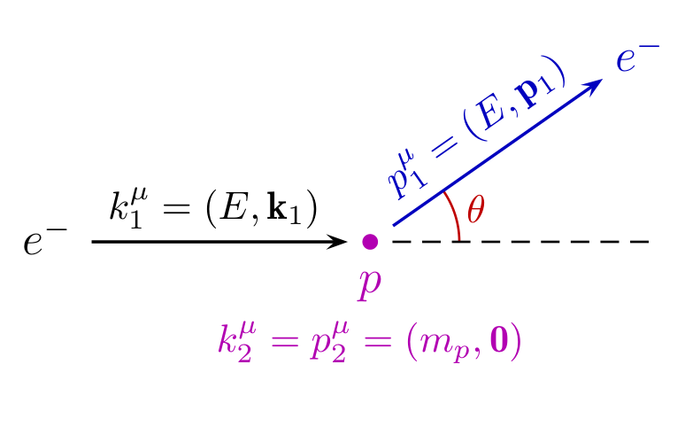

图 7.7: 当入射电子动量远小于 $m_p$ 时，$e^-p\to e^-p$ 过程的动量示意图。

现在，我们在入射电子动量远小于 $m_p$ 的极限下推导 Rutherford 公式的 QED 相对论性修正。如图 7.7 所示，此时散射前后的质子是静止的，初末态电子的能量都是 $E$，四维动量分解为

$$
k_1^\mu = (E,\mathbf{k}_1), \quad k_2^\mu = (m_p,\mathbf{0}), \quad p_1^\mu = (E,\mathbf{p}_1), \quad p_2^\mu = (m_p,\mathbf{0}).
\tag{7.222}
$$

初末态电子的动量大小相等，记为

$$
Q \equiv |\mathbf{k}_1| = |\mathbf{p}_1| = \sqrt{E^2 - m_e^2}.
\tag{7.223}
$$

根据狭义相对论中的定义，初末态电子的运动速率为

$$
v = \frac{Q}{E} = \sqrt{1 - \frac{m_e^2}{E^2}},
\tag{7.224}
$$

因而

$$
m_e^2 = E^2 - Q^2 = E^2(1 - v^2).
\tag{7.225}
$$

四维动量的内积可以表达成

$$
k_1\cdot p_1 = E^2 - Q^2\cos\theta = E^2(1 - v^2\cos\theta), \quad k_2\cdot p_2 = m_p^2,
\tag{7.226}
$$

$$
k_1\cdot p_2 = k_2\cdot p_1 = k_1\cdot k_2 = p_1\cdot p_2 = m_pE,
\tag{7.227}
$$

$$
q^2 = (k_1 - p_1)^2 = 2m_e^2 - 2E^2 + 2Q^2\cos\theta = -2Q^2(1 - \cos\theta).
\tag{7.228}
$$

从而，非极化振幅模方化为

$$
\begin{aligned}
\overline{|\mathcal{M}|^2} &= \frac{8e^4}{4Q^4(1 - \cos\theta)^2}[m_p^2E^2 + m_p^2E^2 - m_e^2m_p^2 - m_p^2E^2(1 - v^2\cos\theta) + 2m_e^2m_p^2]\\
&= \frac{32\pi^2\alpha^2}{Q^4(1 - \cos\theta)^2}(m_p^2E^2 + m_p^2E^2v^2\cos\theta + m_e^2m_p^2)\\
&= \frac{32\pi^2\alpha^2}{Q^4(1 - \cos\theta)^2}[m_p^2E^2 + m_p^2E^2v^2\cos\theta + m_p^2E^2(1 - v^2)]\\
&= \frac{32\pi^2\alpha^2m_p^2}{v^2Q^2(1 - \cos\theta)^2}[2 - v^2(1 - \cos\theta)] = \frac{16\pi^2\alpha^2m_p^2}{v^2Q^2\sin^4(\theta/2)}\left(1 - v^2\sin^2\frac{\theta}{2}\right).
\end{aligned}
\tag{7.229}
$$

末态两体不变相空间积分是

$$
\begin{aligned}
\int\mathrm{d}\Pi_2 &= \int\frac{\mathrm{d}^3p_1}{(2\pi)^32p_1^0}\frac{\mathrm{d}^3p_2}{(2\pi)^32p_2^0}(2\pi)^4\delta^{(4)}(k_1 + k_2 - p_1 - p_2) = \int\frac{\mathrm{d}^3p_1}{(2\pi)^24p_1^0p_2^0}\delta(k_1^0 + k_2^0 - p_1^0 - p_2^0)\\
&= \int\frac{\mathrm{d}\Omega\,\mathrm{d}Q\,Q^2}{16\pi^2Em_p}\delta\left(E + m_p - \sqrt{Q^2 + m_e^2} - m_p\right) = \int\frac{\mathrm{d}\Omega\,Q^2}{16\pi^2Em_p}\left|\frac{\mathrm{d}(E - \sqrt{Q^2 + m_e^2})}{\mathrm{d}Q}\right|^{-1}\\
&= \int\mathrm{d}\Omega\frac{Q^2}{16\pi^2Em_p}\left|\frac{2Q}{2\sqrt{Q^2 + m_e^2}}\right|^{-1} = \int\mathrm{d}\Omega\frac{Q}{16\pi^2m_p}.
\end{aligned}
\tag{7.230}
$$

第四步用到 (2.61) 式。入射流因子

$$
E_AE_B|\mathbf{v}_A - \mathbf{v}_B| = Em_p\frac{Q}{E} = Qm_p.
\tag{7.231}
$$

此过程末态对称性因子 $\mathcal{S} = 1$，根据 (5.325) 式，散射截面是

$$
\sigma = \frac{1}{4E_AE_B|\mathbf{v}_A - \mathbf{v}_B|}\int\mathrm{d}\Pi_2\overline{|\mathcal{M}|^2} = \frac{1}{4Qm_p}\int\mathrm{d}\Omega\frac{Q\overline{|\mathcal{M}|^2}}{16\pi^2m_p} = \frac{1}{64\pi^2m_p^2}\int\mathrm{d}\Omega\overline{|\mathcal{M}|^2},
\tag{7.232}
$$

微分截面为

$$
\frac{\mathrm{d}\sigma}{\mathrm{d}\Omega} = \frac{\overline{|\mathcal{M}|^2}}{64\pi^2m_p^2} = \frac{\alpha^2}{4v^2Q^2\sin^4(\theta/2)}\left(1 - v^2\sin^2\frac{\theta}{2}\right), \quad Q \ll m_p.
\tag{7.233}
$$

上式是 QED 对 Rutherford 公式 (7.219) 的修正，称为 Mott 公式。Mott 公式跟 Rutherford 公式一样不依赖于 $m_p$，因而 $m_p\to\infty$ 的极限是存在的。在低速极限下，$v \ll 1$，$Q \simeq m_ev$，则 Mott 公式退化成 Rutherford 公式。

### 7.4.3 Coulomb 势能和 Yukawa 势能

从前面两个小节可以看到，QED 中带电粒子通过交换虚光子发生 Coulomb 散射。在非相对论极限下，Mott 公式退化为 Rutherford 公式，因而光子传播子的效应应该等价于电动力学中的 Coulomb 电势。这是接下来要论证的观点。

考虑两种带电费米子 $f$ 和 $f'$，电荷分别为 $Q_f$ 和 $Q_{f'}$，讨论 Coulomb 散射过程 $ff'\to ff'$。记初态四维动量为 $k_1$ 和 $k_2$，末态四维动量为 $p_1$ 和 $p_2$。在非相对论极限下，$|\mathbf{k}_i|, |\mathbf{p}_i| \ll m_f, m_{f'}$，粒子能量近似为质量，即

$$
k_1^\mu \simeq (m_f,\mathbf{k}_1), \quad k_2^\mu \simeq (m_{f'},\mathbf{k}_2), \quad p_1^\mu \simeq (m_f,\mathbf{p}_1), \quad p_2^\mu \simeq (m_{f'},\mathbf{p}_2).
\tag{7.234}
$$

在此极限下，可将正费米子的平面波旋量系数 $u$ 表达为

$$
u(\mathbf{p},s) \simeq \sqrt{m}\begin{pmatrix}\zeta_s\\ \zeta_s\end{pmatrix},
\tag{7.235}
$$

其中 $\mathbf{p}$ 是动量，而不依赖于 $\mathbf{p}$ 的 $\zeta_s$ 是某个固定方向上的二分量自旋本征态，本征值为 $s = \pm1/2$，满足正交归一关系和完备性关系，

$$
\zeta_{s'}^\dagger\zeta_s = \delta_{s's}, \quad \sum_{s=\pm1/2}\zeta_s\zeta_s^\dagger = \mathbf{1}.
\tag{7.236}
$$

例如，在 $z$ 轴方向上，自旋矩阵 $\sigma^3/2 = \mathrm{diag}(1/2,-1/2)$ 的本征态为

$$
\zeta_{+1/2} = \begin{pmatrix}1\\ 0\end{pmatrix}, \quad \zeta_{-1/2} = \begin{pmatrix}0\\ 1\end{pmatrix}.
\tag{7.237}
$$

这样的 $u(\mathbf{p},s)$ 在 $\mathbf{p}\to\mathbf{0}$ 极限下满足运动方程 (4.144)，

$$
(\not{p} - m)u(\mathbf{p},s) = \begin{pmatrix}-m & \sigma^\mu p_\mu\\ \bar{\sigma}^\mu p_\mu & -m\end{pmatrix}u(\mathbf{p},s) \simeq m^{3/2}\begin{pmatrix}-\mathbf{1} & \mathbf{1}\\ \mathbf{1} & -\mathbf{1}\end{pmatrix}\begin{pmatrix}\zeta_s\\ \zeta_s\end{pmatrix} = 0,
\tag{7.238}
$$

也满足正交归一关系 (4.139)，

$$
u^\dagger(\mathbf{p},s')u(\mathbf{p},s) \simeq m\begin{pmatrix}\zeta_{s'}^\dagger & \zeta_{s'}^\dagger\end{pmatrix}\begin{pmatrix}\zeta_s\\ \zeta_s\end{pmatrix} = 2m\zeta_{s'}^\dagger\zeta_s \simeq 2E_{\mathbf{p}}\delta_{s's}.
\tag{7.239}
$$

于是，$ff'\to ff'$ 散射过程的 QED 领头阶不变振幅为

$$
\begin{aligned}
\mathrm{i}\mathcal{M} &= \bar{u}(\mathbf{p}_1,s_1')(\mathrm{i}Q_fe\gamma^\mu)u(\mathbf{k}_1,s_1)\frac{-\mathrm{i}g_{\mu\nu}}{q^2}\bar{u}(\mathbf{p}_2,s_2')(\mathrm{i}Q_{f'}e\gamma^\nu)u(\mathbf{k}_2,s_2)\\
&= \frac{\mathrm{i}Q_fQ_{f'}e^2}{q^2}\bar{u}(\mathbf{p}_1,s_1')\gamma^\mu u(\mathbf{k}_1,s_1)\,\bar{u}(\mathbf{p}_2,s_2')\gamma_\mu u(\mathbf{k}_2,s_2).
\end{aligned}
\tag{7.240}
$$

由

$$
u(\mathbf{k}_1,s_1) \simeq \sqrt{m_f}\begin{pmatrix}\zeta_{s_1}\\ \zeta_{s_1}\end{pmatrix}, \quad \bar{u}(\mathbf{p}_1,s_1') \simeq \sqrt{m_f}\begin{pmatrix}\zeta_{s_1'}^\dagger & \zeta_{s_1'}^\dagger\end{pmatrix},
\tag{7.241}
$$

得

$$
\bar{u}(\mathbf{p}_1,s_1')\gamma^0u(\mathbf{k}_1,s_1) \simeq m_f\begin{pmatrix}\zeta_{s_1'}^\dagger & \zeta_{s_1'}^\dagger\end{pmatrix}\begin{pmatrix}\mathbf{1} & \\ & -\mathbf{1}\end{pmatrix}\begin{pmatrix}\zeta_{s_1}\\ \zeta_{s_1}\end{pmatrix} = 2m_f\zeta_{s_1'}^\dagger\zeta_{s_1} = 2m_f\delta_{s_1's_1},
\tag{7.242}
$$

$$
\bar{u}(\mathbf{p}_1,s_1')\gamma^iu(\mathbf{k}_1,s_1) \simeq m_f\begin{pmatrix}\zeta_{s_1'}^\dagger & \zeta_{s_1'}^\dagger\end{pmatrix}\begin{pmatrix} & \sigma^i\\ -\sigma^i & \end{pmatrix}\begin{pmatrix}\zeta_{s_1}\\ \zeta_{s_1}\end{pmatrix} = 0.
\tag{7.243}
$$

同理有

$$
\bar{u}(\mathbf{p}_2,s_2')\gamma_0u(\mathbf{k}_2,s_2) \simeq 2m_{f'}\delta_{s_2's_2}, \quad \bar{u}(\mathbf{p}_2,s_2')\gamma_iu(\mathbf{k}_2,s_2) \simeq 0,
\tag{7.244}
$$

因此在非相对论极限下只有时间分量 $\bar{u}\gamma^0u$ 的贡献。再注意到 $q^0 = k_1^0 - p_1^0 \simeq m_f - m_f = 0$，则

$$
q^2 = (q^0)^2 - |\mathbf{q}|^2 \simeq -|\mathbf{q}|^2,
\tag{7.245}
$$

将不变振幅化为

$$
\mathrm{i}\mathcal{M} \simeq -\frac{\mathrm{i}Q_fQ_{f'}e^2}{|\mathbf{q}|^2}(2m_f\delta_{s_1's_1})(2m_{f'}\delta_{s_2's_2}).
\tag{7.246}
$$

上式只在 $s_1' = s_1$ 且 $s_2' = s_2$ 时非零，也就是说，非相对论性的 Coulomb 散射不改变费米子的自旋状态。

上式 $2m_f$ 和 $2m_{f'}$ 因子跟归一化取法有关。依照 4.5.4 小节的相对论性归一化取法，正费米子态定义为 $|\mathbf{p}^+,s\rangle \equiv \sqrt{2E_{\mathbf{p}}}a_{\mathbf{p},s}^\dagger|0\rangle$，满足 $\langle\mathbf{k}^+,s'|\mathbf{p}^+,s\rangle = 2E_{\mathbf{p}}(2\pi)^3\delta_{ss'}\delta^{(3)}(\mathbf{p} - \mathbf{k})$。在非相对论性量子力学中，通常将正费米子态定义为

$$
|\mathbf{p}^+,s\rangle_{\mathrm{NR}} \equiv a_{\mathbf{p},s}^\dagger|0\rangle = \frac{1}{\sqrt{2E_{\mathbf{p}}}}|\mathbf{p}^+,s\rangle,
\tag{7.247}
$$

满足内积关系

$$
_{\mathrm{NR}}\langle\mathbf{k}^+,s'|\mathbf{p}^+,s\rangle_{\mathrm{NR}} = (2\pi)^3\delta_{ss'}\delta^{(3)}(\mathbf{p} - \mathbf{k}),
\tag{7.248}
$$

相应地，外线规则变成

$$
f,s\ \longrightarrow\ \bullet = \frac{1}{\sqrt{2E_{\mathbf{p}}}}u(\mathbf{p},s), \qquad \bullet\ \longrightarrow\ f,s = \frac{1}{\sqrt{2E_{\mathbf{p}}}}\bar{u}(\mathbf{p},\lambda).
\tag{7.249}
$$

因此，非相对论性归一化不变振幅是

$$
\mathrm{i}\mathcal{M}_{\mathrm{NR}} \simeq -\frac{\mathrm{i}Q_fQ_{f'}e^2}{|\mathbf{q}|^2}\delta_{s_1's_1}\delta_{s_2's_2},
\tag{7.250}
$$

其中 $\mathbf{q} = \mathbf{k}_1 - \mathbf{p}_1$。相应的散射矩阵元为

$$
_{\mathrm{NR}}\langle\mathbf{p}_2^+,s_2';\mathbf{p}_1^+,s_1'|\mathrm{i}T|\mathbf{k}_1^+,s_1;\mathbf{k}_2^+,s_2\rangle_{\mathrm{NR}} = \mathrm{i}\mathcal{M}_{\mathrm{NR}}(2\pi)^4\delta^{(4)}(k_1 + k_2 - p_1 - p_2).
\tag{7.251}
$$

另一方面，对于 $f$ 粒子进入势场 $V(\mathbf{x})$ 发生的散射过程，非相对论性量子力学的 Born 近似给出散射矩阵元

$$
_{\mathrm{NR}}\langle\mathbf{p}_1^+,s_1|\mathrm{i}T|\mathbf{k}_1^+,s_1\rangle_{\mathrm{NR}} = -\mathrm{i}\tilde{V}(\mathbf{q})\cdot2\pi\delta(E_{\mathbf{p}_1} - E_{\mathbf{k}_1}),
\tag{7.252}
$$

其中 $\tilde{V}(\mathbf{q})$ 是 $V(\mathbf{x})$ 的 Fourier 变换，

$$
\tilde{V}(\mathbf{q}) \equiv \int\mathrm{d}^3x\,V(\mathbf{x})\mathrm{e}^{-\mathrm{i}\mathbf{q}\cdot\mathbf{x}}.
\tag{7.253}
$$

这里相当于对引起势场 $V(\mathbf{x})$ 的 $f'$ 粒子的动量作积分，因而没有相关的三维动量 $\delta$ 函数因子。

比较这两个理论的散射矩阵元，我们得到

$$
\tilde{V}(\mathbf{q}) = \frac{Q_fQ_{f'}e^2}{|\mathbf{q}|^2}.
\tag{7.254}
$$

对它求 Fourier 逆变换，推出 Coulomb 势能

$$
\begin{aligned}
V(\mathbf{x}) &= \int\frac{\mathrm{d}^3q}{(2\pi)^3}\tilde{V}(\mathbf{q})\mathrm{e}^{\mathrm{i}\mathbf{q}\cdot\mathbf{x}} = \frac{Q_fQ_{f'}e^2}{(2\pi)^3}\int|\mathbf{q}|^2\mathrm{d}|\mathbf{q}|\mathrm{d}\Omega\frac{\mathrm{e}^{\mathrm{i}\mathbf{q}\cdot\mathbf{x}}}{|\mathbf{q}|^2}\\
&= \frac{Q_fQ_{f'}e^2}{(2\pi)^3}\int_0^\infty\mathrm{d}|\mathbf{q}|\int_0^{2\pi}\mathrm{d}\phi\int_{-1}^1\mathrm{d}\cos\theta\,\mathrm{e}^{\mathrm{i}|\mathbf{q}||\mathbf{x}|\cos\theta} = \frac{Q_fQ_{f'}e^2}{4\pi^2}\int_0^\infty\mathrm{d}|\mathbf{q}|\frac{\mathrm{e}^{\mathrm{i}|\mathbf{q}||\mathbf{x}|} - \mathrm{e}^{-\mathrm{i}|\mathbf{q}||\mathbf{x}|}}{\mathrm{i}|\mathbf{q}||\mathbf{x}|}\\
&= \frac{Q_fQ_{f'}e^2}{4\mathrm{i}\pi^2r}\left(\int_0^\infty\mathrm{d}|\mathbf{q}|\frac{\mathrm{e}^{\mathrm{i}|\mathbf{q}|r}}{|\mathbf{q}|} - \int_0^\infty\mathrm{d}|\mathbf{q}|\frac{\mathrm{e}^{-\mathrm{i}|\mathbf{q}|r}}{|\mathbf{q}|}\right),
\end{aligned}
\tag{7.255}
$$

其中 $r \equiv |\mathbf{x}|$。作变量替换 $Q = -|\mathbf{q}|$，将第二个积分化为

$$
-\int_0^\infty\mathrm{d}|\mathbf{q}|\frac{\mathrm{e}^{-\mathrm{i}|\mathbf{q}|r}}{|\mathbf{q}|} = \int_0^{-\infty}\mathrm{d}Q\frac{\mathrm{e}^{\mathrm{i}Qr}}{-Q} = \int_{-\infty}^0\mathrm{d}Q\frac{\mathrm{e}^{\mathrm{i}Qr}}{Q} = \int_{-\infty}^0\mathrm{d}|\mathbf{q}|\frac{\mathrm{e}^{\mathrm{i}|\mathbf{q}|r}}{|\mathbf{q}|},
\tag{7.256}
$$

最后一步作了变量替换 $|\mathbf{q}| = Q$。因而可将 $V(\mathbf{x})$ 表达成

$$
V(r) = \frac{Q_fQ_{f'}e^2}{4\mathrm{i}\pi^2r}\int_{-\infty}^{+\infty}\mathrm{d}|\mathbf{q}|\frac{\mathrm{e}^{\mathrm{i}|\mathbf{q}|r}}{|\mathbf{q}|}
\tag{7.257}
$$

利用留数定理计算这个积分，被积函数在 $|\mathbf{q}| = 0$ 处存在单极点，在 $|\mathbf{q}|$ 复平面上沿实轴和上半圆周积分，得

$$
\int_{-\infty}^{+\infty}\mathrm{d}|\mathbf{q}|\frac{\mathrm{e}^{\mathrm{i}|\mathbf{q}|r}}{|\mathbf{q}|} = \mathrm{i}\pi\operatorname{Res}_{|\mathbf{q}|=0}\frac{\mathrm{e}^{\mathrm{i}|\mathbf{q}|r}}{|\mathbf{q}|} = \mathrm{i}\pi.
\tag{7.258}
$$

于是 Coulomb 势能化为

$$
V(r) = \frac{Q_fQ_{f'}e^2}{4\pi r}.
\tag{7.259}
$$

从而，$f'$ 粒子引起的 Coulomb 势为

$$
\Phi(r) = \frac{V(r)}{Q_fe} = \frac{Q_{f'}e}{4\pi r}.
\tag{7.260}
$$

这正是电动力学中点电荷电势的形式。

Coulomb 势是长程势，以 $r^{-1}$ 规律衰减。Coulomb 势能 $V(r)$ 的符号由电荷 $Q_f$ 和 $Q_{f'}$ 的符号决定。当 $Q_f$ 与 $Q_{f'}$ 同号时，$V(r) > 0$，$r$ 越小，势能越大，Coulomb 势是排斥势。当 $Q_f$ 与 $Q_{f'}$ 异号时，$V(r) < 0$，$r$ 越小，势能越小，Coulomb 势是吸引势。

我们已经看到，光子传播子在非相对论极限下的效应等价于 Coulomb 势。类似地，Yukawa 理论中标量玻色子 $\phi$ 的传播子应该等价于一种 Yukawa 势。与光子不同的是，$\phi$ 具有质量 $m_\phi$。下面推导 Yukawa 势能的形式。

假设存在两种参与 Yukawa 相互作用的费米子 $f$ 和 $f'$，相应的 Yukawa 耦合常数均为 $\kappa$。根据 6.2 节的 Feynman 规则，$ff'\to ff'$ 散射过程的领头阶不变振幅为

$$
\begin{aligned}
\mathrm{i}\mathcal{M} &= \bar{u}(\mathbf{p}_1,s_1')(-\mathrm{i}\kappa)u(\mathbf{k}_1,s_1)\frac{\mathrm{i}}{q^2 - m_\phi^2}\bar{u}(\mathbf{p}_2,s_2')(-\mathrm{i}\kappa)u(\mathbf{k}_2,s_2)\\
&= -\frac{\mathrm{i}\kappa^2}{q^2 - m_\phi^2}\bar{u}(\mathbf{p}_1,s_1')u(\mathbf{k}_1,s_1)\,\bar{u}(\mathbf{p}_2,s_2')u(\mathbf{k}_2,s_2).
\end{aligned}
\tag{7.261}
$$

由于

$$
\bar{u}(\mathbf{p}_1,s_1')u(\mathbf{k}_1,s_1) \simeq m_f\begin{pmatrix}\zeta_{s_1'}^\dagger & \zeta_{s_1'}^\dagger\end{pmatrix}\begin{pmatrix}\zeta_{s_1}\\ \zeta_{s_1}\end{pmatrix} = 2m_f\delta_{s_1's_1}, \quad \bar{u}(\mathbf{p}_2,s_2')u(\mathbf{k}_2,s_2) \simeq 2m_{f'}\delta_{s_2's_2},
\tag{7.262}
$$

振幅化为

$$
\mathrm{i}\mathcal{M} = \frac{\mathrm{i}\kappa^2}{|\mathbf{q}|^2 + m_\phi^2}(2m_f\delta_{s_1's_1})(2m_{f'}\delta_{s_2's_2}).
\tag{7.263}
$$

类比前面 Coulomb 散射的计算，即得 Yukawa 势场 $V(\mathbf{x})$ 的 Fourier 变换

$$
\tilde{V}(\mathbf{q}) = -\frac{\kappa^2}{|\mathbf{q}|^2 + m_\phi^2}.
\tag{7.264}
$$

于是，$\phi$ 传播子对应的 Yukawa 势能为

$$
\begin{aligned}
V(\mathbf{x}) &= -\kappa^2\int\frac{\mathrm{d}^3q}{(2\pi)^3}\frac{\mathrm{e}^{\mathrm{i}\mathbf{q}\cdot\mathbf{x}}}{|\mathbf{q}|^2 + m_\phi^2} = -\frac{\kappa^2}{4\pi^2}\int_0^\infty\mathrm{d}|\mathbf{q}|\int_{-1}^1\mathrm{d}\cos\theta\frac{|\mathbf{q}|^2\mathrm{e}^{\mathrm{i}|\mathbf{q}|r\cos\theta}}{|\mathbf{q}|^2 + m_\phi^2}\\
&= -\frac{\kappa^2}{4\pi^2}\int_0^\infty\mathrm{d}|\mathbf{q}|\frac{|\mathbf{q}|^2}{|\mathbf{q}|^2 + m_\phi^2}\frac{\mathrm{e}^{\mathrm{i}|\mathbf{q}|r} - \mathrm{e}^{-\mathrm{i}|\mathbf{q}|r}}{\mathrm{i}|\mathbf{q}|r} = -\frac{\kappa^2}{4\mathrm{i}\pi^2r}\int_{-\infty}^{+\infty}\mathrm{d}|\mathbf{q}|\frac{|\mathbf{q}|\mathrm{e}^{\mathrm{i}|\mathbf{q}|r}}{|\mathbf{q}|^2 + m_\phi^2}.
\end{aligned}
\tag{7.265}
$$

现在，被积函数在上半复平面 $|\mathbf{q}| = \mathrm{i}m_\phi$ 处存在单极点，沿实轴和上半圆周积分，得

$$
\int_{-\infty}^{+\infty}\mathrm{d}|\mathbf{q}|\frac{|\mathbf{q}|\mathrm{e}^{\mathrm{i}|\mathbf{q}|r}}{|\mathbf{q}|^2 + m_\phi^2} = 2\mathrm{i}\pi\operatorname{Res}_{|\mathbf{q}|=\mathrm{i}m_\phi}\frac{|\mathbf{q}|\mathrm{e}^{\mathrm{i}|\mathbf{q}|r}}{|\mathbf{q}|^2 + m_\phi^2} = 2\mathrm{i}\pi\left.\frac{|\mathbf{q}|\mathrm{e}^{\mathrm{i}|\mathbf{q}|r}}{|\mathbf{q}| + \mathrm{i}m_\phi}\right|_{|\mathbf{q}|=\mathrm{i}m_\phi} = \mathrm{i}\pi\mathrm{e}^{-m_\phi r}.
\tag{7.266}
$$

因此，Yukawa 势能的形式是

$$
V(r) = -\frac{\kappa^2}{4\pi r}\mathrm{e}^{-m_\phi r}.
\tag{7.267}
$$

由于 $V(r) < 0$，$r$ 越小，势能越小，Yukawa 势是吸引势。在长矩离处，指数因子 $\mathrm{e}^{-m_\phi r}$ 使 Yukawa 势迅速衰减，因而它是短程势。$r_0 = 1/m_\phi$ 是 Yukawa 势的特征长度，即 Yukawa 相互作用的力程。若标量玻色子 $\phi$ 没有质量，则 Yukawa 势能与 Coulomb 势能形式类似。

## 7.5 交叉对称性和 Mandelstam 变量

在上一节中我们看到，$e^+e^-\to\mu^+\mu^-$ 与 $e^-\mu^-\to e^-\mu^-$ 过程具有交叉对称性，利用相应的动量替换规则 (7.202)，可以从前者的计算结果直接得到后者的非极化振幅模方。

交叉对称性的一般表述如下。如果一个过程的初态包含一个四维动量为 $p^\mu$ 的粒子 $\Phi$，从初态中移除 $\Phi$ 并在末态中添加一个四维动量为 $k^\mu$ 的反粒子 $\bar{\Phi}$ 而得到另一个过程，则这两个过程的不变振幅可以通过动量替换 $k^\mu = -p^\mu$ 联系起来，

$$
\mathcal{M}(\Phi(p) + \cdots \to \cdots) = \mathcal{M}(\cdots \to \bar{\Phi}(k) + \cdots).
\tag{7.268}
$$

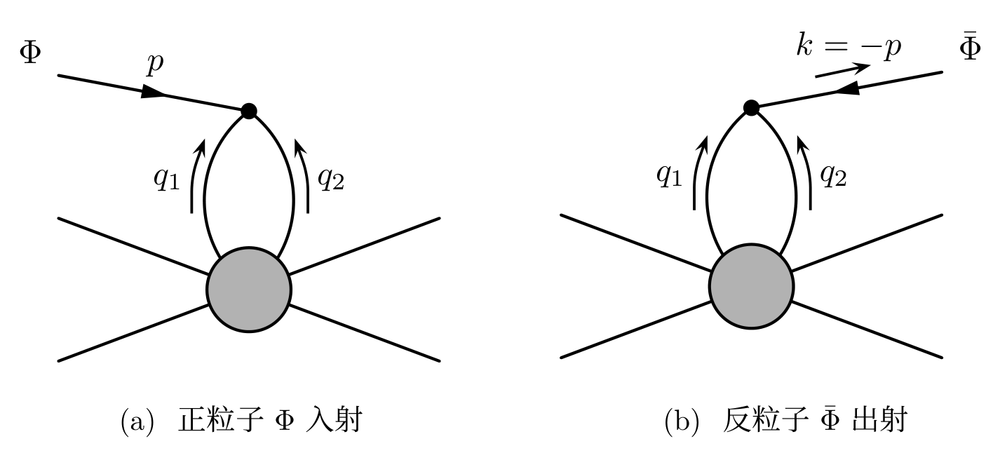

图 7.8: 交叉对称性示意图。

物理的初末态粒子必须具有正能量，但 $k^\mu = -p^\mu$ 意味着 $\Phi$ 和 $\bar{\Phi}$ 不可能同时具有正能量，因而看起来有一个过程是非物理的。实际上，应当将这个等式看成一个重复利用振幅计算的数学技巧：对第一个过程的振幅作动量替换 $p^\mu \to -k^\mu$，再解析延拓到物理区域就得到第二个过程的振幅。可以这样想象交叉对称性：一个粒子沿着时间方向运动等价于它的反粒子逆着时间方向运动，这样的反粒子具有负能量和相反动量。

把 $e^+e^-\to\mu^+\mu^-$ 交叉成 $e^-\mu^-\to e^-\mu^-$，需要先将初态 $e^+$（动量为 $k_2$）换成末态 $e^-$（动量为 $p_1'$），引起动量替换 $k_2^\mu \to -p_1'^\mu$；再将末态 $\mu^+$（动量为 $p_2$）换成初态 $\mu^-$（动量为 $k_2'$），引起动量替换 $p_2^\mu \to -k_2'^\mu$；初态 $e^-$ 和末态 $\mu^-$ 不需要交叉，可以直接修改相应的动量记号。这样就得到替换规则 (7.202)。

交叉一个粒子的典型 Feynman 图如图 7.8 所示，灰色圆形象征一些 Feynman 图结构，图 7.8(a) 中有一个正粒子 $\Phi$ 进入顶点，图 7.8(b) 相应地替换成一个反粒子 $\bar{\Phi}$ 离开顶点，两幅图的其余部分完全相同。由于顶点处能动量守恒，图 7.8(a) 中四维动量满足 $q_1^\mu + q_2^\mu + p^\mu = 0$，图 7.8(b) 则满足 $q_1^\mu + q_2^\mu - k^\mu = 0$。因此，只要 $k^\mu = -p^\mu$，两幅图在振幅上的差异就仅仅是 $\Phi(p)$ 与 $\bar{\Phi}(k)$ 的外线因子（即极化矢量、平面波旋量系数等）之间的差异。

如果 $\Phi$ 是标量玻色子，则 $\Phi(p)$ 和 $\bar{\Phi}(k)$ 的外线因子都是 1，两个振幅没有差异，(7.268) 式成立。如果 $\Phi$ 是正矢量玻色子，则 $\Phi(p)$ 的外线因子为 $\varepsilon_\mu(p,\lambda)$。观察极化矢量表达式 (3.243)，可知 $\varepsilon_\mu(-p,\lambda) = \varepsilon_\mu^*(p,\lambda)$ 对 $\lambda = 0,\pm$ 成立。因此，当 $k^\mu = -p^\mu$ 时，有

$$
\varepsilon_\mu(p,\lambda) = \varepsilon_\mu(-k,\lambda) = \varepsilon_\mu^*(k,\lambda).
\tag{7.269}
$$

最右边正是 $\bar{\Phi}(k)$ 的外线因子，故 (7.268) 式成立。

如果 $\Phi$ 是 Dirac 正费米子，则 $\Phi(p)$ 和 $\bar{\Phi}(k)$ 的外线因子分别为平面波旋量系数 $u(p)$ 和 $v(k)$。在计算自旋求和时将 $p$ 替换成 $-k$，可得

$$
\sum_{\text{spins}}u(p)\bar{u}(p) = \not{p} + m = -(\not{k} - m) = -\sum_{\text{spins}}v(k)\bar{v}(k),
\tag{7.270}
$$

因而两个过程的非极化振幅模方 $\overline{|\mathcal{M}|^2}$ 相差一个整体负号。可见，交叉一个费米子时，除了作动量替换 $p^\mu\to-k^\mu$，还要去除一个整体负号才能得到正确的 $\overline{|\mathcal{M}|^2}$。当我们将 $e^+e^-\to\mu^+\mu^-$ 交叉成 $e^-\mu^-\to e^-\mu^-$ 时，交叉了两个费米子，产生了两个整体负号，它们正好相互抵消。

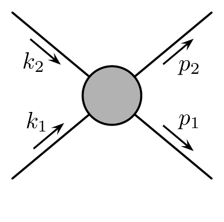

图 7.9: $2\to2$ 散射过程四维动量示意图。

如果想让振幅层面上的 (7.268) 式在交叉费米子时成立，则需要对平面波旋量系数采取特殊的定义。我们依然按照 (4.175) 式将平面波旋量系数 $u(p,\lambda)$ 定义为

$$
u(p,\lambda) = \begin{pmatrix}\sqrt{p^0 - \lambda|\mathbf{p}|}\,\xi_\lambda(\mathbf{p})\\ \sqrt{p^0 + \lambda|\mathbf{p}|}\,\xi_\lambda(\mathbf{p})\end{pmatrix}.
\tag{7.271}
$$

由螺旋态的本征值方程 (4.159) 得 $-(\hat{\mathbf{p}}\cdot\boldsymbol{\sigma})\xi_\lambda(-\mathbf{p}) = \lambda\xi_\lambda(-\mathbf{p})$，故

$$
(\hat{\mathbf{p}}\cdot\boldsymbol{\sigma})\xi_\lambda(-\mathbf{p}) = -\lambda\xi_\lambda(-\mathbf{p}).
\tag{7.272}
$$

可见，$\xi_\lambda(-\mathbf{p})$ 是螺旋度为 $-\lambda$ 的本征态。从而，我们可以将 $v(p,\lambda)$ 定义成

$$
v(p,\lambda) = \begin{pmatrix}\mathrm{i}\sqrt{p^0 + \lambda|\mathbf{p}|}\,\xi_\lambda(-\mathbf{p})\\ -\mathrm{i}\sqrt{p^0 - \lambda|\mathbf{p}|}\,\xi_\lambda(-\mathbf{p})\end{pmatrix}.
\tag{7.273}
$$

与 (4.182) 式比较，有 $\tilde{f}_\lambda(\mathbf{p}) = \mathrm{i}\sqrt{p^0 + \lambda|\mathbf{p}|}\,\xi_\lambda(-\mathbf{p})$，$\tilde{g}_\lambda(\mathbf{p}) = -\mathrm{i}\sqrt{p^0 - \lambda|\mathbf{p}|}\,\xi_\lambda(-\mathbf{p})$。利用 $m = \sqrt{(p^0)^2 - |\mathbf{p}|^2} = \sqrt{(p^0 + \lambda|\mathbf{p}|)(p^0 - \lambda|\mathbf{p}|)}$，推出

$$
\begin{aligned}
-\frac{p\cdot\bar{\sigma}}{m}\tilde{f}_\lambda(\mathbf{p}) &= -\frac{\mathrm{i}}{m}\sqrt{p^0 + \lambda|\mathbf{p}|}(p^0 + \boldsymbol{\sigma}\cdot\mathbf{p})\xi_\lambda(-\mathbf{p}) = -\frac{\mathrm{i}}{m}\sqrt{p^0 + \lambda|\mathbf{p}|}(p^0 - \lambda|\mathbf{p}|)\xi_\lambda(-\mathbf{p})\\
&= -\mathrm{i}\sqrt{p^0 - \lambda|\mathbf{p}|}\,\xi_\lambda(-\mathbf{p}) = \tilde{g}_\lambda(\mathbf{p}),
\end{aligned}
\tag{7.274}
$$

符合 (4.186) 式。因此，这样定义的 $v(p,\lambda)$ 满足运动方程 (4.181)，也可以验证它满足正交归一关系 (4.201)、(4.209) 和自旋求和关系 (4.216)。如此，当 $k^\mu = -p^\mu$ 时，可以推出

$$
\begin{aligned}
u(p,\lambda) &= u(-k,\lambda) = \begin{pmatrix}\sqrt{-k^0 - \lambda|\mathbf{k}|}\,\xi_\lambda(-\mathbf{k})\\ \sqrt{-k^0 + \lambda|\mathbf{k}|}\,\xi_\lambda(-\mathbf{k})\end{pmatrix} = \begin{pmatrix}[\mathrm{e}^{\mathrm{i}\pi}(k^0 + \lambda|\mathbf{k}|)]^{1/2}\xi_\lambda(-\mathbf{k})\\ [\mathrm{e}^{-\mathrm{i}\pi}(k^0 - \lambda|\mathbf{k}|)]^{1/2}\xi_\lambda(-\mathbf{k})\end{pmatrix}\\
&= \begin{pmatrix}\mathrm{e}^{\mathrm{i}\pi/2}(k^0 + \lambda|\mathbf{k}|)^{1/2}\xi_\lambda(-\mathbf{k})\\ \mathrm{e}^{-\mathrm{i}\pi/2}(k^0 - \lambda|\mathbf{k}|)^{1/2}\xi_\lambda(-\mathbf{k})\end{pmatrix} = \begin{pmatrix}\mathrm{i}\sqrt{k^0 + \lambda|\mathbf{k}|}\,\xi_\lambda(-\mathbf{k})\\ -\mathrm{i}\sqrt{k^0 - \lambda|\mathbf{k}|}\,\xi_\lambda(-\mathbf{k})\end{pmatrix} = v(k,\lambda),
\end{aligned}
\tag{7.275}
$$

则 $\Phi(p)$ 和 $\bar{\Phi}(k)$ 的外线因子相等，(7.268) 式成立。注意，平方根函数是多值函数，在上式推导过程中，我们利用 $\mathrm{e}^{\pm\mathrm{i}\pi} = -1$ 对两个平方根函数采用了不同的取值方式。

进一步，我们可以定义一些便于应用交叉关系的物理量。对于 $2\to2$ 散射，按照图 7.9 表示的四维动量，定义三个 Lorentz 不变的 Mandelstam 变量 [38]：

$$
s \equiv (k_1 + k_2)^2 = (p_1 + p_2)^2,
\tag{7.276}
$$

$$
t \equiv (k_1 - p_1)^2 = (k_2 - p_2)^2,
\tag{7.277}
$$

$$
u \equiv (k_1 - p_2)^2 = (k_2 - p_1)^2.
\tag{7.278}
$$

第二步均用到能动量守恒关系 $k_1^\mu + k_2^\mu = p_1^\mu + p_2^\mu$。

记这些四维动量对应的质量为 $m_1$、$m_2$、$m_1'$、$m_2'$，满足

$$
k_1^2 = m_1^2, \quad k_2^2 = m_2^2, \quad p_1^2 = m_1'^2, \quad p_2^2 = m_2'^2.
\tag{7.279}
$$

于是，四维动量的两两内积可以用 Mandelstam 变量和质量表示为

$$
k_1\cdot k_2 = \frac{1}{2}(s - k_1^2 - k_2^2) = \frac{1}{2}(s - m_1^2 - m_2^2), \quad p_1\cdot p_2 = \frac{1}{2}(s - m_1'^2 - m_2'^2),
\tag{7.280}
$$

$$
k_1\cdot p_1 = -\frac{1}{2}(t - k_1^2 - p_1^2) = -\frac{1}{2}(t - m_1^2 - m_1'^2), \quad k_2\cdot p_2 = -\frac{1}{2}(t - m_2^2 - m_2'^2),
\tag{7.281}
$$

$$
k_1\cdot p_2 = -\frac{1}{2}(u - k_1^2 - p_2^2) = -\frac{1}{2}(u - m_1^2 - m_2'^2), \quad k_2\cdot p_1 = -\frac{1}{2}(u - m_2^2 - m_1'^2).
\tag{7.282}
$$

此外，能够推出

$$
\begin{aligned}
s + t + u &= (k_1 + k_2)^2 + (k_1 - p_1)^2 + (k_1 - p_2)^2 = 3k_1^2 + k_2^2 + p_1^2 + p_2^2 + 2k_1\cdot(k_2 - p_1 - p_2)\\
&= 3k_1^2 + k_2^2 + p_1^2 + p_2^2 - 2k_1^2 = k_1^2 + k_2^2 + p_1^2 + p_2^2,
\end{aligned}
\tag{7.283}
$$

故

$$
s + t + u = m_1^2 + m_2^2 + m_1'^2 + m_2'^2,
\tag{7.284}
$$

即 Mandelstam 变量之和是初末态粒子质量平方和。

$t$ 和 $u$ 均定义为某个初态动量与某个末态动量之差的平方，看起来它们可以互换定义。在实际应用中，通常用初末态中两个性质相近的粒子来定义 $t$。比如，对于 7.4.1 小节的 $e^-\mu^-\to e^-\mu^-$ 散射过程，通常用初态电子动量 $k_1'$ 与末态电子动量 $p_1'$ 定义 $t = (k_1' - p_1')^2$，从而虚光子动量满足 $q'^2 = t$。

在质心系中，$\mathbf{k}_1 + \mathbf{k}_2 = \mathbf{0}$，有

$$
s = (k_1^0 + k_2^0)^2 = E_{\text{CM}}^2,
\tag{7.285}
$$

故 $\sqrt{s} = E_{\text{CM}}$ 就是质心能。对于任意 $2\to n$ 散射过程，将 $s$ 定义成所有初态或末态四维动量之和的平方，

$$
s = (k_1 + k_2)^2 = \left(\sum_ip_i\right)^2,
\tag{7.286}
$$

则 $\sqrt{s}$ 就是这个过程的质心能。

可以用 Mandelstam 变量表达任意 $2\to2$ 散射过程的 $\overline{|\mathcal{M}|^2}$。对于 7.2 节的 $e^+e^-\to\mu^+\mu^-$ 过程，非极化振幅模方 (7.78) 可化为

$$
\overline{|\mathcal{M}(e^+e^-\to\mu^+\mu^-)|^2} = \frac{8e^4}{s^2}\left[(k_1\cdot p_1)(k_2\cdot p_2) + (k_1\cdot p_2)(k_2\cdot p_1) + m_\mu^2(k_1\cdot k_2) + m_e^2(p_1\cdot p_2) + 2m_e^2m_\mu^2\right]
$$

$$
\begin{aligned}
&= \frac{8e^4}{s^2}\left[\frac{1}{4}(t-m_e^2-m_\mu^2)^2+\frac{1}{4}(u-m_e^2-m_\mu^2)^2+\frac{1}{2}m_\mu^2(s-2m_e^2)+\frac{1}{2}m_e^2(s-2m_\mu^2)+2m_e^2m_\mu^2\right]\\
&= \frac{8e^4}{s^2}\left[\frac{t^2+u^2}{4}-\frac{t+u}{2}(m_e^2+m_\mu^2)+\frac{1}{2}(m_e^2+m_\mu^2)^2+\frac{s}{2}(m_e^2+m_\mu^2)\right].
\end{aligned}
\tag{7.287}
$$

由 (7.284) 式得 $s+t+u=2m_e^2+2m_\mu^2$，即 $t+u=2(m_e^2+m_\mu^2)-s$，故

$$
\begin{aligned}
& \overline{|\mathcal{M}(e^+e^-\to\mu^+\mu^-)|^2}\\
&= \frac{8e^4}{s^2}\left[\frac{t^2+u^2}{4}-\frac{2(m_e^2+m_\mu^2)-s}{2}(m_e^2+m_\mu^2)+\frac{1}{2}(m_e^2+m_\mu^2)^2+\frac{s}{2}(m_e^2+m_\mu^2)\right]\\
&= \frac{2e^4}{s^2}[t^2+u^2+4s(m_e^2+m_\mu^2)-2(m_e^2+m_\mu^2)^2].
\end{aligned}
\tag{7.288}
$$

现在，将 $e^+e^-\to\mu^+\mu^-$ 交叉成 $e^-\mu^-\to e^-\mu^-$。根据动量替换规则 (7.202)，有

$$
(k_1+k_2)^2\to(k_1'-p_1')^2,\quad (k_1-p_1)^2\to(k_1'-p_2')^2,\quad (k_1-p_2)^2\to(k_1'+k_2')^2,
\tag{7.289}
$$

即 Mandelstam 变量的替换规则为

$$
s\to t,\quad t\to u,\quad u\to s.
\tag{7.290}
$$

可见，交叉对称性对应于 Mandelstam 变量的调换，这样的调换保持 (7.284) 式不变。据此，我们从 (7.288) 式直接得到 $e^-\mu^-\to e^-\mu^-$ 过程的非极化振幅模方

$$
\overline{|\mathcal{M}(e^-\mu^-\to e^-\mu^-)|^2}=\frac{2e^4}{t^2}[u^2+s^2+4t(m_e^2+m_\mu^2)-2(m_e^2+m_\mu^2)^2].
\tag{7.291}
$$

容易验证，这个结果与 (7.203) 式一致。

$e^+e^-\to\mu^+\mu^-$ 过程的虚光子动量满足 $q^2=s$，交叉成 $e^-\mu^-\to e^-\mu^-$ 过程之后，虚光子动量满足 $q^2=t$。一般来说，当 $2\to2$ 散射 Feynman 图只含一条内线时，内线动量的内积等于一个 Mandelstam 变量 $s$、$t$ 或 $u$，我们称这种图为 $s$ 通道（channel）、$t$ 通道或 $u$ 通道的 Feynman 图。$e^+e^-\to\mu^+\mu^-$ 和 $e^-\mu^-\to e^-\mu^-$ 的领头阶 Feynman 图分别对应于 $s$ 通道和 $t$ 通道。

以 Yukawa 理论为例，三种通道具有如下特点。

$s$ 通道：

$$
\text{[图]}\propto\frac{1}{(k_1+k_2)^2-m_\phi^2}=\frac{1}{s-m_\phi^2}
\tag{7.292}
$$

$t$ 通道：

$$
\text{[图]}\propto\frac{1}{(k_1-p_1)^2-m_\phi^2}=\frac{1}{t-m_\phi^2}
\tag{7.293}
$$

$u$ 通道：

$$
\text{[图]}\propto\frac{1}{(k_1-p_2)^2-m_\phi^2}=\frac{1}{u-m_\phi^2}
\tag{7.294}
$$

一个散射过程可以包含多个通道的 Feynman 图。在 QED 中，Bhabha 散射 $e^+e^-\to e^+e^-$ 在领头阶具有 1 个 $s$ 通道和 1 个 $t$ 通道的 Feynman 图，如下。

$$
\text{[图]}-\text{[图]}
\tag{7.295}
$$

Møller 散射 $e^-e^-\to e^-e^-$ 在领头阶具有 1 个 $t$ 通道和 1 个 $u$ 通道的 Feynman 图，如下。

$$
\text{[图]}-\text{[图]}
\tag{7.296}
$$

在质心系中，假设初末态四个粒子的质量都是 $m$，动量如图 7.2 所示，则有

$$
k_1^0=k_2^0=p_1^0=p_2^0=\frac{E_{\text{CM}}}{2}=\frac{\sqrt{s}}{2},
\tag{7.297}
$$

$$
|\mathbf{k}_1|=|\mathbf{k}_2|=|\mathbf{p}_1|=|\mathbf{p}_2|=\frac{\sqrt{s}}{2}\sqrt{1-\frac{4m^2}{s}}\equiv Q.
\tag{7.298}
$$

从而得到

$$
t=(k_1-p_1)^2=k_1^2+p_1^2-2k_1\cdot p_1=2m^2-2k_1^0p_1^0+2|\mathbf{k}_1||\mathbf{p}_1|\cos\theta=-2Q^2(1-\cos\theta),
\tag{7.299}
$$

$$
u=(k_1-p_2)^2=k_1^2+p_2^2-2k_1\cdot p_2=2m^2-2k_1^0p_2^0-2|\mathbf{k}_1||\mathbf{p}_2|\cos\theta=-2Q^2(1+\cos\theta).
\tag{7.300}
$$

于是，$\theta\to0$ 时 $t\to0$，$\theta\to\pi$ 时 $u\to0$。另一方面，$s=E_{\text{CM}}^2$ 与散射角 $\theta$ 无关。三种通道的传播子对散射角 $\theta$ 的依赖截然不同。

## 7.6 Compton 散射

电子与光子的散射过程 $e^-\gamma\to e^-\gamma$ 称为 Compton 散射 [39]。1923 年，Arthur Compton 用 X 射线照射核外电子，发现 X 射线因失去能量而波长变长。他使用的 X 射线光子能量约为 17 keV，远大于原子结合能，因而核外电子可以看成是自由的。根据相对论运动学，Compton 推导出光子的波长变化 $\Delta\lambda$ 与散射角 $\theta$ 的关系

$$
\Delta\lambda=\frac{2\pi}{m_e}(1-\cos\theta).
\tag{7.301}
$$

他的实验结果证实了这条公式，从而为光的粒子性提供了直接证据。

另一方面，对于低能电磁辐射与电子散射的过程，Joseph Thomson 根据经典电磁学推导出微分散射截面

$$
\frac{\mathrm{d}\sigma}{\mathrm{d}\cos\theta}=\pi r_e^2(1+\cos^2\theta)=\frac{\pi\alpha^2}{m_e^2}(1+\cos^2\theta),
\tag{7.302}
$$

其中 $r_e\equiv\alpha/m_e$ 是电子的经典半径。在 QED 中，我们应该能够得到这条微分截面公式的相对论修正。

Compton 散射在 QED 领头阶具有 1 个 $s$ 通道和 1 个 $u$ 通道² 的 Feynman 图，不变振幅为

$$
\begin{aligned}
\mathrm{i}\mathcal{M} &= \text{[图]}+\text{[图]}\\
&= \varepsilon_\mu^*(p_2)\bar{u}(p_1)(-\mathrm{i}e\gamma^\mu)\frac{\mathrm{i}(\not{k}_1+\not{k}_2+m_e)}{(k_1+k_2)^2-m_e^2}(-\mathrm{i}e\gamma^\nu)u(k_1)\varepsilon_\nu(k_2)\\
&\quad +\varepsilon_\nu(k_2)\bar{u}(p_1)(-\mathrm{i}e\gamma^\nu)\frac{\mathrm{i}(\not{k}_1-\not{p}_2+m_e)}{(k_1-p_2)^2-m_e^2}(-\mathrm{i}e\gamma^\mu)u(k_1)\varepsilon_\mu^*(p_2)\\
&= -\mathrm{i}e^2\varepsilon_\mu^*(p_2)\varepsilon_\nu(k_2)\bar{u}(p_1)\left[\frac{\gamma^\mu(\not{k}_1+\not{k}_2+m_e)\gamma^\nu}{(k_1+k_2)^2-m_e^2}+\frac{\gamma^\nu(\not{k}_1-\not{p}_2+m_e)\gamma^\mu}{(k_1-p_2)^2-m_e^2}\right]u(k_1).
\end{aligned}
\tag{7.303}
$$

两幅图的电子线具有相同的拓扑结构，可通过连续变形相互转换，因而相对符号为正。这里我们没有显明写出振幅对螺旋度的依赖。

根据质壳条件 $k_1^2=m_e^2$ 和 $k_2^2=p_2^2=0$，传播子的分母化为

$$
(k_1+k_2)^2-m_e^2=2k_1\cdot k_2,\quad (k_1-p_2)^2-m_e^2=-2k_1\cdot p_2.
\tag{7.304}
$$

由 (7.66) 式得 $\not{k}_1\gamma^\nu=2k_1^\nu-\gamma^\nu\not{k}_1$，再利用运动方程 (4.144)，推出

$$
(\not{k}_1+m_e)\gamma^\nu u(k_1)=(2k_1^\nu-\gamma^\nu\not{k}_1+m_e\gamma^\nu)u(k_1)=2k_1^\nu u(k_1)-\gamma^\nu(\not{k}_1-m_e)u(k_1)=2k_1^\nu u(k_1).
\tag{7.305}
$$

从而将振幅化简成

$$
\mathrm{i}\mathcal{M}=-\mathrm{i}e^2\varepsilon_\mu^*(p_2)\varepsilon_\nu(k_2)\bar{u}(p_1)\left(\frac{\gamma^\mu\not{k}_2\gamma^\nu+2\gamma^\mu k_1^\nu}{2k_1\cdot k_2}+\frac{\gamma^\nu\not{p}_2\gamma^\mu-2\gamma^\nu k_1^\mu}{2k_1\cdot p_2}\right)u(k_1).
\tag{7.306}
$$

[脚注] 有些书称其为 $t$ 通道。

### 7.6.1 光子极化求和与 Ward 恒等式

接下来需要对初态自旋状态取平均、末态自旋状态求和以计算非极化振幅模方。除了涉及对电子的螺旋度求和之外，还涉及对光子的螺旋度求和，即对光子的极化状态求和，亦即计算

$$
\sum_{\text{spins}}\varepsilon_\mu^*(p)\varepsilon_\nu(p)=\sum_{\lambda=\pm}\varepsilon_\mu^*(\mathbf{p},\lambda)\varepsilon_\nu(\mathbf{p},\lambda)=-g_{\mu\nu}-\frac{p_\mu p_\nu}{(p\cdot n)^2}+\frac{p_\mu n_\nu+p_\nu n_\mu}{p\cdot n}.
\tag{7.307}
$$

第二步用到极化矢量求和关系 (3.338)。本小节讨论光子极化求和的简化方法。

考虑出射一个动量为 $p^\mu$ 的光子的任意 QED 过程，不变振幅为

$$
\text{[图]}=\mathrm{i}\mathcal{M}(p)=\mathrm{i}M^\mu(p)\varepsilon_\mu^*(p).
\tag{7.308}
$$

这里我们将出射光子的极化矢量 $\varepsilon_\mu^*(p)$ 提出来，振幅的余下部分记作 $M^\mu(p)$。对光子极化求和，振幅模方变成

$$
\begin{aligned}
\sum_{\text{spins}}|\mathcal{M}(p)|^2 &= \sum_{\lambda=\pm}\varepsilon_\mu^*(\mathbf{p},\lambda)\varepsilon_\nu(\mathbf{p},\lambda)M^\mu(p)M^{\nu*}(p)\\
&= \left[-g_{\mu\nu}-\frac{p_\mu p_\nu}{(p\cdot n)^2}+\frac{p_\mu n_\nu+p_\nu n_\mu}{p\cdot n}\right]M^\mu(p)M^{\nu*}(p).
\end{aligned}
\tag{7.309}
$$

根据 (7.11) 和 (7.12) 式，QED 的相互作用项可以写成 $\mathcal{L}_{\text{int}}=A_\mu J_{\text{EM}}^\mu$，因此上述过程的散射矩阵元具有以下形式，

$$
\begin{aligned}
\langle f|\mathrm{i}T|i\rangle &\propto \int\mathrm{d}^4x_1\cdots\mathrm{d}^4x_n\,\langle\cdots;\mathbf{p},\lambda|\mathrm{N}[A_\mu(x_1)J_{\text{EM}}^\mu(x_1)\cdots]|i\rangle\\
&= \int\mathrm{d}^4x_1\cdots\mathrm{d}^4x_n\,\varepsilon_\mu^*(\mathbf{p},\lambda)\mathrm{e}^{\mathrm{i}p\cdot x_1}\langle\cdots|\mathrm{N}[J_{\text{EM}}^\mu(x_1)\cdots]|i\rangle.
\end{aligned}
\tag{7.310}
$$

可见，

$$
M^\mu(p)\propto\int\mathrm{d}^4x_1\cdots\mathrm{d}^4x_n\,\mathrm{e}^{\mathrm{i}p\cdot x_1}\langle\cdots|\mathrm{N}[J_{\text{EM}}^\mu(x_1)\cdots]|i\rangle.
\tag{7.311}
$$

在经典层面上，电磁流 $J_{\text{EM}}^\mu$ 满足守恒流方程 $\partial_\mu J_{\text{EM}}^\mu=0$。如果我们假设 $\partial_\mu J_{\text{EM}}^\mu=0$ 在量子层面上也成立，就可以推出

$$
\begin{aligned}
0 &= \int\mathrm{d}^4x_1\cdots\mathrm{d}^4x_n\,\mathrm{e}^{\mathrm{i}p\cdot x_1}\langle\cdots|\mathrm{N}[\partial_\mu J_{\text{EM}}^\mu(x_1)\cdots]|i\rangle\\
&= -\int\mathrm{d}^4x_1\cdots\mathrm{d}^4x_n\,(\partial_\mu\mathrm{e}^{\mathrm{i}p\cdot x_1})\langle\cdots|\mathrm{N}[J_{\text{EM}}^\mu(x_1)\cdots]|i\rangle\\
&= -\mathrm{i}p_\mu\int\mathrm{d}^4x_1\cdots\mathrm{d}^4x_n\,\mathrm{e}^{\mathrm{i}p\cdot x_1}\langle\cdots|\mathrm{N}[J_{\text{EM}}^\mu(x_1)\cdots]|i\rangle\propto p_\mu M^\mu(p),
\end{aligned}
\tag{7.312}
$$

第二步用到部分积分。于是得到

$$
p_\mu M^\mu(p)=0.
\tag{7.313}
$$

这个表达式称为 Ward 恒等式 [40]，它对于入射光子的情况同样成立。Ward 恒等式告诉我们，只要将不变振幅中任何一个入射或出射光子的极化矢量替换成相应的四维动量，则结果为零。

虽然这里我们利用了经典的守恒流方程，但实际上可以在量子场论中严格地证明 Ward 恒等式，相关证明留待后文叙述。Ward 恒等式是电磁流守恒在量子层面上的体现，与 QED 的规范对称性密切相关。规范变换 $A_\mu\to A_\mu+\partial_\mu\chi$ 在动量空间中体现为 $\varepsilon_\mu^*(p)\to\varepsilon_\mu^*(p)-\mathrm{i}p_\mu$，因此振幅 $\varepsilon_\mu^*(p)M^\mu(p)$ 的规范不变性等价于 Ward 恒等式 $p_\mu M^\mu(p)=0$。

应用 Ward 恒等式，我们发现 (7.309) 式方括号中后两项都没有贡献，从而得到

$$
\sum_{\lambda=\pm}\varepsilon_\mu^*(\mathbf{p},\lambda)\varepsilon_\nu(\mathbf{p},\lambda)M^\mu(p)M^{\nu*}(p)=-g_{\mu\nu}M^\mu(p)M^{\nu*}(p).
\tag{7.314}
$$

也就是说，在 QED 计算中可以使用替换关系

$$
\sum_{\text{spins}}\varepsilon_\mu^*(p)\varepsilon_\nu(p)\to-g_{\mu\nu}.
\tag{7.315}
$$

这就是处理光子极化求和的简化方法。

现在用 Compton 散射振幅 (7.303) 验证 Ward 恒等式。将振幅表达为

$$
\mathrm{i}\mathcal{M}=\mathrm{i}\varepsilon_\mu^*(p_2)\varepsilon_\nu(k_2)M^{\mu\nu},
\tag{7.316}
$$

则

$$
M^{\mu\nu}=-e^2\bar{u}(p_1)\left[\frac{\gamma^\mu(\not{k}_1+\not{k}_2+m_e)\gamma^\nu}{(k_1+k_2)^2-m_e^2}+\frac{\gamma^\nu(\not{k}_1-\not{p}_2+m_e)\gamma^\mu}{(k_1-p_2)^2-m_e^2}\right]u(k_1).
\tag{7.317}
$$

运动方程 (4.144) 表明

$$
\not{k}_1u(k_1)=m_eu(k_1),
\tag{7.318}
$$

两边取厄米共轭，右乘 $\gamma^0$，得

$$
\bar{u}(k_1)\not{k}_1=\bar{u}(k_1)m_e.
\tag{7.319}
$$

再利用 $k_1^\mu+k_2^\mu=p_1^\mu+p_2^\mu$，有

$$
\not{p}_2u(k_1)=-(\not{k}_1-\not{p}_2-\not{k}_1)u(k_1)=-(\not{k}_1-\not{p}_2-m_e)u(k_1),
\tag{7.320}
$$

$$
\bar{u}(p_1)\not{p}_2=\bar{u}(p_1)(\not{k}_1+\not{k}_2-\not{p}_1)=\bar{u}(p_1)(\not{k}_1+\not{k}_2-m_e).
\tag{7.321}
$$

从而

$$
\begin{aligned}
p_{2\mu}M^{\mu\nu} &= -e^2\bar{u}(p_1)\left[\frac{\not{p}_2(\not{k}_1+\not{k}_2+m_e)\gamma^\nu}{(k_1+k_2)^2-m_e^2}+\frac{\gamma^\nu(\not{k}_1-\not{p}_2+m_e)\not{p}_2}{(k_1-p_2)^2-m_e^2}\right]u(k_1)\\
&= -e^2\bar{u}(p_1)\left[\frac{(\not{k}_1+\not{k}_2-m_e)(\not{k}_1+\not{k}_2+m_e)\gamma^\nu}{(k_1+k_2)^2-m_e^2}-\frac{\gamma^\nu(\not{k}_1-\not{p}_2+m_e)(\not{k}_1-\not{p}_2-m_e)}{(k_1-p_2)^2-m_e^2}\right]u(k_1)\\
&= -e^2\bar{u}(p_1)\left[\frac{(\not{k}_1+\not{k}_2)^2-m_e^2}{(k_1+k_2)^2-m_e^2}\gamma^\nu-\gamma^\nu\frac{(\not{k}_1-\not{p}_2)^2-m_e^2}{(k_1-p_2)^2-m_e^2}\right]u(k_1),
\end{aligned}
\tag{7.322}
$$

由 (7.68) 式得 $(\not{k}_1+\not{k}_2)^2=(k_1+k_2)^2$ 和 $(\not{k}_1-\not{p}_2)^2=(k_1-p_2)^2$，故 $p_{2\mu}M^{\mu\nu}=0$。同理可以验证 $k_{2\mu}M^{\mu\nu}=0$。

其实，Ward 恒等式不仅对光子外线成立，对光子内线也成立。设光子传播子的四维动量为 $p^\mu$，则 $p^\mu$ 流入或流出的振幅 $M^\mu(p)$ 满足 Ward 恒等式 (7.313)。

以 $e^+e^-\to\mu^+\mu^-$ 过程为例，根据 (7.36) 式，光子传播子的四维动量为 $q^\mu=k_1^\mu+k_2^\mu$，电子线部分的振幅为 $M^\mu(q)=-\mathrm{i}e\bar{v}(k_2)\gamma^\mu u(k_1)$。运动方程 (4.181) 表明

$$
\not{k}_2v(k_2)=-m_ev(k_2),
\tag{7.323}
$$

两边取厄米共轭，右乘 $\gamma^0$，得

$$
\bar{v}(k_2)\not{k}_2=-\bar{v}(k_2)m_e.
\tag{7.324}
$$

再利用 $\not{k}_1u(k_1)=m_eu(k_1)$ 即可推出 Ward 恒等式

$$
q_\mu M^\mu(q)=-\mathrm{i}e\bar{v}(k_2)\not{q}u(k_1)=-\mathrm{i}e\bar{v}(k_2)(\not{k}_1+\not{k}_2)u(k_1)=-\mathrm{i}e\bar{v}(k_2)(m_e-m_e)u(k_1)=0.
\tag{7.325}
$$

同理可验证 $\mu$ 子线部分的振幅也满足 Ward 恒等式。

### 7.6.2 非极化振幅模方和 Klein-Nishina 公式

利用

$$
\begin{aligned}
[\bar{u}(p_1)\gamma^\mu\gamma^\rho\gamma^\nu u(k_1)]^* &= u^\dagger(k_1)(\gamma^\nu)^\dagger(\gamma^\rho)^\dagger(\gamma^\mu)^\dagger\gamma^0u(p_1) = u^\dagger(k_1)\gamma^0\gamma^\nu\gamma^\rho\gamma^\mu u(p_1)\\
&= \bar{u}(k_1)\gamma^\nu\gamma^\rho\gamma^\mu u(p_1),
\end{aligned}
\tag{7.326}
$$

对 (7.306) 式取复共轭，得

$$
(\mathrm{i}\mathcal{M})^*=\mathrm{i}e^2\varepsilon_\rho(p_2)\varepsilon_\sigma^*(k_2)\bar{u}(k_1)\left(\frac{\gamma^\sigma\not{k}_2\gamma^\rho+2\gamma^\rho k_1^\sigma}{2k_1\cdot k_2}+\frac{\gamma^\rho\not{p}_2\gamma^\sigma-2\gamma^\sigma k_1^\rho}{2k_1\cdot p_2}\right)u(p_1).
\tag{7.327}
$$

于是，非极化振幅模方为

$$
\begin{aligned}
\overline{|\mathcal{M}|^2} &= \frac{1}{4}\sum_{\text{spins}}|\mathcal{M}|^2\\
&= \frac{e^4}{4}\sum_{\text{spins}}\varepsilon_\mu^*(p_2)\varepsilon_\rho(p_2)\varepsilon_\nu(k_2)\varepsilon_\sigma^*(k_2)\mathrm{tr}\left[u(p_1)\bar{u}(p_1)\left(\frac{\gamma^\mu\not{k}_2\gamma^\nu+2\gamma^\mu k_1^\nu}{2k_1\cdot k_2}+\frac{\gamma^\nu\not{p}_2\gamma^\mu-2\gamma^\nu k_1^\mu}{2k_1\cdot p_2}\right)\right.\\
&\quad\left.\times u(k_1)\bar{u}(k_1)\left(\frac{\gamma^\sigma\not{k}_2\gamma^\rho+2\gamma^\rho k_1^\sigma}{2k_1\cdot k_2}+\frac{\gamma^\rho\not{p}_2\gamma^\sigma-2\gamma^\sigma k_1^\rho}{2k_1\cdot p_2}\right)\right]\\
&= \frac{e^4}{4}(-g_{\mu\rho})(-g_{\nu\sigma})\mathrm{tr}\left[(\not{p}_1+m_e)\left(\frac{\gamma^\mu\not{k}_2\gamma^\nu+2\gamma^\mu k_1^\nu}{2k_1\cdot k_2}+\frac{\gamma^\nu\not{p}_2\gamma^\mu-2\gamma^\nu k_1^\mu}{2k_1\cdot p_2}\right)\right.\\
&\quad\left.\times(\not{k}_1+m_e)\left(\frac{\gamma^\sigma\not{k}_2\gamma^\rho+2\gamma^\rho k_1^\sigma}{2k_1\cdot k_2}+\frac{\gamma^\rho\not{p}_2\gamma^\sigma-2\gamma^\sigma k_1^\rho}{2k_1\cdot p_2}\right)\right]\\
&= \frac{e^4}{16}\mathrm{tr}\left[(\not{p}_1+m_e)\left(\frac{\gamma^\mu\not{k}_2\gamma^\nu+2\gamma^\mu k_1^\nu}{k_1\cdot k_2}+\frac{\gamma^\nu\not{p}_2\gamma^\mu-2\gamma^\nu k_1^\mu}{k_1\cdot p_2}\right)\right.\\
&\quad\left.\times(\not{k}_1+m_e)\left(\frac{\gamma_\nu\not{k}_2\gamma_\mu+2\gamma_\mu k_{1\nu}}{k_1\cdot k_2}+\frac{\gamma_\mu\not{p}_2\gamma_\nu-2\gamma_\nu k_{1\mu}}{k_1\cdot p_2}\right)\right]\\
&= \frac{e^4}{16}\left[\frac{A}{(k_1\cdot k_2)^2}+\frac{B+C}{(k_1\cdot k_2)(k_1\cdot p_2)}+\frac{D}{(k_1\cdot p_2)^2}\right],
\end{aligned}
\tag{7.328}
$$

其中，

$$
A\equiv\mathrm{tr}[(\not{p}_1+m_e)(\gamma^\mu\not{k}_2\gamma^\nu+2\gamma^\mu k_1^\nu)(\not{k}_1+m_e)(\gamma_\nu\not{k}_2\gamma_\mu+2\gamma_\mu k_{1\nu})],
\tag{7.329}
$$

$$
B\equiv\mathrm{tr}[(\not{p}_1+m_e)(\gamma^\mu\not{k}_2\gamma^\nu+2\gamma^\mu k_1^\nu)(\not{k}_1+m_e)(\gamma_\mu\not{p}_2\gamma_\nu-2\gamma_\nu k_{1\mu})],
\tag{7.330}
$$

$$
C\equiv\mathrm{tr}[(\not{p}_1+m_e)(\gamma^\nu\not{p}_2\gamma^\mu-2\gamma^\nu k_1^\mu)(\not{k}_1+m_e)(\gamma_\nu\not{k}_2\gamma_\mu+2\gamma_\mu k_{1\nu})],
\tag{7.331}
$$

$$
D\equiv\mathrm{tr}[(\not{p}_1+m_e)(\gamma^\nu\not{p}_2\gamma^\mu-2\gamma^\nu k_1^\mu)(\not{k}_1+m_e)(\gamma_\mu\not{p}_2\gamma_\nu-2\gamma_\nu k_{1\mu})].
\tag{7.332}
$$

这里 $A$ 来自 $s$ 通道 Feynman 图，$D$ 来自 $u$ 通道 Feynman 图，而 $B$ 和 $C$ 是两个通道的交叉项。

把 $A$ 展开，会得到 16 项，其中有 8 项包含奇数个 Dirac 矩阵之积，相应的迹为零。$A$ 中余下的 8 项为

$$
\begin{aligned}
A = {}& \mathrm{tr}(\not{p}_1\gamma^\mu\not{k}_2\gamma^\nu\not{k}_1\gamma_\nu\not{k}_2\gamma_\mu)+2\mathrm{tr}(\not{p}_1\gamma^\mu\not{k}_1\not{k}_1\not{k}_2\gamma_\mu)+2\mathrm{tr}(\not{p}_1\gamma^\mu\not{k}_2\not{k}_1\not{k}_1\gamma_\mu)+4k_1^2\mathrm{tr}(\not{p}_1\gamma^\mu\not{k}_1\gamma_\mu)\\
&+m_e^2\mathrm{tr}(\gamma^\mu\not{k}_2\gamma^\nu\gamma_\nu\not{k}_2\gamma_\mu)+2m_e^2\mathrm{tr}(\gamma^\mu\not{k}_1\not{k}_2\gamma_\mu)+2m_e^2\mathrm{tr}(\gamma^\mu\not{k}_2\not{k}_1\gamma_\mu)+4m_e^2k_1^2\mathrm{tr}(\gamma^\mu\gamma_\mu).
\end{aligned}
\tag{7.333}
$$

利用 7.2.2 小节提供的求迹和缩并公式化简这些项，得

$$
\begin{aligned}
\mathrm{tr}(\not{p}_1\gamma^\mu\not{k}_2\gamma^\nu\not{k}_1\gamma_\nu\not{k}_2\gamma_\mu) &= \mathrm{tr}(\gamma_\mu\not{p}_1\gamma^\mu\not{k}_2\gamma^\nu\not{k}_1\gamma_\nu\not{k}_2) = \mathrm{tr}[(-2\not{p}_1)\not{k}_2(-2\not{k}_1)\not{k}_2]\\
&= 4\mathrm{tr}[\not{p}_1\not{k}_2(2k_1\cdot k_2-\not{k}_2\not{k}_1)] = 8k_1\cdot k_2\mathrm{tr}(\not{p}_1\not{k}_2)-4k_2^2\mathrm{tr}(\not{p}_1\not{k}_1)\\
&= 32(k_1\cdot k_2)(p_1\cdot k_2),
\end{aligned}
\tag{7.334}
$$

$$
2\mathrm{tr}(\not{p}_1\gamma^\mu\not{k}_1\not{k}_1\not{k}_2\gamma_\mu)=2k_1^2\mathrm{tr}(\not{p}_1\gamma^\mu\not{k}_2\gamma_\mu)=-4m_e^2\mathrm{tr}(\not{p}_1\not{k}_2)=-16m_e^2p_1\cdot k_2,
\tag{7.335}
$$

$$
2\mathrm{tr}(\not{p}_1\gamma^\mu\not{k}_2\not{k}_1\not{k}_1\gamma_\mu)=2k_1^2\mathrm{tr}(\not{p}_1\gamma^\mu\not{k}_2\gamma_\mu)=-16m_e^2p_1\cdot k_2,
\tag{7.336}
$$

$$
4k_1^2\mathrm{tr}(\not{p}_1\gamma^\mu\not{k}_1\gamma_\mu)=-8m_e^2\mathrm{tr}(\not{p}_1\not{k}_1)=-32m_e^2p_1\cdot k_1,
\tag{7.337}
$$

$$
m_e^2\mathrm{tr}(\gamma^\mu\not{k}_2\gamma^\nu\gamma_\nu\not{k}_2\gamma_\mu)=4m_e^2\mathrm{tr}(\gamma^\mu\not{k}_2\not{k}_2\gamma_\mu)=4m_e^2k_2^2\mathrm{tr}(\gamma^\mu\gamma_\mu)=0,
\tag{7.338}
$$

$$
2m_e^2\mathrm{tr}(\gamma^\mu\not{k}_1\not{k}_2\gamma_\mu)=8m_e^2k_1\cdot k_2\mathrm{tr}(\mathbf{1})=32m_e^2k_1\cdot k_2,
\tag{7.339}
$$

$$
2m_e^2\mathrm{tr}(\gamma^\mu\not{k}_2\not{k}_1\gamma_\mu)=32m_e^2k_1\cdot k_2,
\tag{7.340}
$$

$$
4m_e^2k_1^2\mathrm{tr}(\gamma^\mu\gamma_\mu)=16m_e^4\mathrm{tr}(\mathbf{1})=64m_e^4.
\tag{7.341}
$$

从而将 $A$ 化作

$$
A=32(k_1\cdot k_2)(p_1\cdot k_2)-32m_e^2p_1\cdot k_2-32m_e^2p_1\cdot k_1+64m_e^2k_1\cdot k_2+64m_e^4.
\tag{7.342}
$$

根据 7.5 节知识，此处四维动量和 Mandelstam 变量满足以下关系。

$$
k_1\cdot k_2=p_1\cdot p_2=\frac{1}{2}(s-m_e^2),\quad k_1\cdot p_1=-\frac{1}{2}(t-2m_e^2),\quad k_2\cdot p_2=-\frac{t}{2},
\tag{7.343}
$$

$$
k_1\cdot p_2=k_2\cdot p_1=-\frac{1}{2}(u-m_e^2),\quad s+t+u=2m_e^2.
\tag{7.344}
$$

我们进而用 Mandelstam 变量将 $A$ 表达为

$$
\begin{aligned}
A &= 8[-(s-m_e^2)(u-m_e^2)+2m_e^2(u-m_e^2)+2m_e^2(t-2m_e^2)+4m_e^2(s-m_e^2)+8m_e^4]\\
&= 8[-(s-m_e^2)(u-m_e^2)+2m_e^2(2s+t+u)-2m_e^4] = 8[-(s-m_e^2)(u-m_e^2)+2m_e^2s+2m_e^4]\\
&= 8[-(s-m_e^2)(u-m_e^2)+2m_e^2(s-m_e^2)+4m_e^4].
\end{aligned}
\tag{7.345}
$$

为了下面计算方便，这里消去 $t$，保留 $s$ 和 $u$。毕竟，$e^-\gamma\to e^-\gamma$ 是 $s$ 和 $u$ 通道的过程。

容易看出，对 (7.329) 式作动量替换 $k_2^\mu\leftrightarrow-p_2^\mu$，就得到 (7.332) 式。注意到光子的反粒子是它自己，将 $e^-\gamma\to e^-\gamma$ 过程 $s$ 通道 Feynman 图的初态和末态光子相互交叉，就得到 $u$ 通道 Feynman 图，因而动量替换规则是 $k_2^\mu\leftrightarrow-p_2^\mu$。据此，对 $A$ 的以上表达式作替换 $(k_1+k_2)^2=s\leftrightarrow u=(k_1-p_2)^2$，就得到 $D$ 的表达式

$$
D=8[-(s-m_e^2)(u-m_e^2)+2m_e^2(u-m_e^2)+4m_e^4].
\tag{7.346}
$$

类似地，把 $B$ 展开，余下 8 项，

$$
\begin{aligned}
B = {}& \mathrm{tr}(\not{p}_1\gamma^\mu\not{k}_2\gamma^\nu\not{k}_1\gamma_\mu\not{p}_2\gamma_\nu)+2\mathrm{tr}(\not{p}_1\gamma^\mu\not{k}_1\gamma_\mu\not{p}_2\not{k}_1)-2\mathrm{tr}(\not{p}_1\not{k}_1\not{k}_2\gamma^\nu\not{k}_1\gamma_\nu)-4\mathrm{tr}(\not{p}_1\not{k}_1\not{k}_1\not{k}_1)\\
&+m_e^2\mathrm{tr}(\gamma^\mu\not{k}_2\gamma^\nu\gamma_\mu\not{p}_2\gamma_\nu)+2m_e^2\mathrm{tr}(\gamma^\mu\gamma_\mu\not{p}_2\not{k}_1)-2m_e^2\mathrm{tr}(\not{k}_1\not{k}_2\gamma^\nu\gamma_\nu)-4m_e^2\mathrm{tr}(\not{k}_1\not{k}_1).
\end{aligned}
\tag{7.347}
$$

对各项作缩并并求迹运算，得

$$
\begin{aligned}
\mathrm{tr}(\not{p}_1\gamma^\mu\not{k}_2\gamma^\nu\not{k}_1\gamma_\mu\not{p}_2\gamma_\nu) &= \mathrm{tr}[\not{p}_1\gamma^\mu\not{k}_2(2k_1^\nu-\not{k}_1\gamma^\nu)\gamma_\mu\not{p}_2\gamma_\nu]\\
&= 2\mathrm{tr}(\not{p}_1\gamma^\mu\not{k}_2\gamma_\mu\not{p}_2\not{k}_1)-\mathrm{tr}(\not{p}_1\gamma^\mu\not{k}_2\not{k}_1\gamma^\nu\gamma_\mu\not{p}_2\gamma_\nu)\\
&= -4\mathrm{tr}(\not{p}_1\not{k}_2\not{p}_2\not{k}_1)-4\mathrm{tr}(\not{p}_1\not{p}_2\not{k}_2\not{k}_1)\\
&= -16[(p_1\cdot k_2)(p_2\cdot k_1)-(p_1\cdot p_2)(k_1\cdot k_2)+(p_1\cdot k_1)(p_2\cdot k_2)]\\
&\quad -16[(p_1\cdot p_2)(k_1\cdot k_2)-(p_1\cdot k_2)(p_2\cdot k_1)+(p_1\cdot k_1)(p_2\cdot k_2)]\\
&= -32(p_1\cdot k_1)(p_2\cdot k_2),
\end{aligned}
\tag{7.348}
$$

$$
\begin{aligned}
2\mathrm{tr}(\not{p}_1\gamma^\mu\not{k}_1\gamma_\mu\not{p}_2\not{k}_1) &= -4\mathrm{tr}(\not{p}_1\not{k}_1\not{p}_2\not{k}_1) = -16[(p_1\cdot k_1)(p_2\cdot k_1)-(p_1\cdot p_2)k_1^2+(p_1\cdot k_1)(p_2\cdot k_1)]\\
&= -32(p_1\cdot k_1)(p_2\cdot k_1)+16m_e^2p_1\cdot p_2,
\end{aligned}
\tag{7.349}
$$

$$
-2\mathrm{tr}(\not{p}_1\not{k}_1\not{k}_2\gamma^\nu\not{k}_1\gamma_\nu)=4\mathrm{tr}(\not{p}_1\not{k}_1\not{k}_2\not{k}_1)=32(p_1\cdot k_1)(k_1\cdot k_2)-16m_e^2p_1\cdot k_2,
\tag{7.350}
$$

$$
-4\mathrm{tr}(\not{p}_1\not{k}_1\not{k}_1\not{k}_1)=-4k_1^2\mathrm{tr}(\not{p}_1\not{k}_1)=-16m_e^2p_1\cdot k_1,
\tag{7.351}
$$

$$
m_e^2\mathrm{tr}(\gamma^\mu\not{k}_2\gamma^\nu\gamma_\mu\not{p}_2\gamma_\nu)=4m_e^2\mathrm{tr}(\gamma^\mu\not{k}_2\not{p}_2\gamma_\mu)=4m_e^2\mathrm{tr}(\not{p}_2\not{k}_2)=16m_e^2p_2\cdot k_2,
\tag{7.352}
$$

$$
2m_e^2\mathrm{tr}(\gamma^\mu\gamma_\mu\not{p}_2\not{k}_1)=8m_e^2\mathrm{tr}(\not{p}_2\not{k}_1)=32m_e^2p_2\cdot k_1,
\tag{7.353}
$$

$$
-2m_e^2\mathrm{tr}(\not{k}_1\not{k}_2\gamma^\nu\gamma_\nu)=-8m_e^2\mathrm{tr}(\not{k}_1\not{k}_2)=-32m_e^2k_1\cdot k_2,
\tag{7.354}
$$

$$
-4m_e^2\mathrm{tr}(\not{k}_1\not{k}_1)=-16m_e^2k_1^2=-16m_e^4.
\tag{7.355}
$$

代入到 $B$ 中，并用 Mandelstam 变量表达，有

$$
\begin{aligned}
B &= -32(p_1\cdot k_1)(p_2\cdot k_2)-32(p_1\cdot k_1)(p_2\cdot k_1)+32(p_1\cdot k_1)(k_1\cdot k_2)+16m_e^2p_1\cdot p_2\\
&\quad -16m_e^2p_1\cdot k_2-16m_e^2p_1\cdot k_1+16m_e^2p_2\cdot k_2+32m_e^2p_2\cdot k_1-32m_e^2k_1\cdot k_2-16m_e^4\\
&= -8[t(t-2m_e^2)+(t-2m_e^2)(u-m_e^2)+(t-2m_e^2)(s-m_e^2)-m_e^2(s-m_e^2)-m_e^2(u-m_e^2)\\
&\quad -m_e^2(t-2m_e^2)+m_e^2t+2m_e^2(u-m_e^2)+2m_e^2(s-m_e^2)+2m_e^4]\\
&= -8[t(t+u+s)-m_e^2(4t+s+u)+6m_e^4] = -8(-m_e^2t+4m_e^4)\\
&= -8[-m_e^2(2m_e^2-s-u)+4m_e^4] = -8[m_e^2(s-m_e^2)+m_e^2(u-m_e^2)+4m_e^4].
\end{aligned}
\tag{7.356}
$$

同样，这里消去 $t$，保留 $s$ 和 $u$。

对 (7.330) 式作动量替换 $k_2^\mu\leftrightarrow-p_2^\mu$，即 $s\leftrightarrow u$，将得到 (7.331) 式。故

$$
C=-8[m_e^2(u-m_e^2)+m_e^2(s-m_e^2)+4m_e^4]=B.
\tag{7.357}
$$

$s$ 与 $u$ 通道的交叉项 $B$ 和 $C$ 恰好相等。

现在，我们将 $A$、$B$、$C$、$D$ 重新用四维动量内积表达成

$$
A=32[(k_1\cdot k_2)(k_1\cdot p_2)+m_e^2k_1\cdot k_2+m_e^4],
\tag{7.358}
$$

$$
B=C=16(-m_e^2k_1\cdot k_2+m_e^2k_1\cdot p_2-2m_e^4),
\tag{7.359}
$$

$$
D=32[(k_1\cdot k_2)(k_1\cdot p_2)-m_e^2k_1\cdot p_2+m_e^4].
\tag{7.360}
$$

代入到 (7.328) 式中，得

$$
\begin{aligned}
\overline{|\mathcal{M}|^2} &= \frac{e^4}{16}\left[\frac{A}{(k_1\cdot k_2)^2}+\frac{2B}{(k_1\cdot k_2)(k_1\cdot p_2)}+\frac{D}{(k_1\cdot p_2)^2}\right]\\
&= 2e^4\left[\frac{k_1\cdot p_2}{k_1\cdot k_2}+\frac{m_e^2}{k_1\cdot k_2}+\frac{m_e^4}{(k_1\cdot k_2)^2}-\frac{m_e^2}{k_1\cdot p_2}+\frac{m_e^2}{k_1\cdot k_2}-\frac{2m_e^4}{(k_1\cdot k_2)(k_1\cdot p_2)}\right.\\
&\quad\left.+\frac{k_1\cdot k_2}{k_1\cdot p_2}-\frac{m_e^2}{k_1\cdot p_2}+\frac{m_e^4}{(k_1\cdot p_2)^2}\right]\\
&= 2e^4\left[\frac{k_1\cdot p_2}{k_1\cdot k_2}+\frac{k_1\cdot k_2}{k_1\cdot p_2}+2m_e^2\left(\frac{1}{k_1\cdot k_2}-\frac{1}{k_1\cdot p_2}\right)+m_e^4\left(\frac{1}{k_1\cdot k_2}-\frac{1}{k_1\cdot p_2}\right)^2\right].
\end{aligned}
\tag{7.361}
$$

考虑实验室参考系，初态电子静止，初态光子通过 Compton 散射将能动量传递给末态电子，如图 7.10 所示。在自然单位制中，$\hbar=c=1$，光子的能量 $E$ 等于它的角频率 $\omega$，即 $E=\hbar\omega=\omega$，而波长 $\lambda$ 与角频率的关系为 $\lambda=2\pi c/\omega=2\pi/\omega$。因此，我们用角频率 $\omega$ 和 $\omega'$ 分别表示初末态光子的能量。初末态四维动量表示为

$$
k_1^\mu=(m_e,\mathbf{0}),\quad k_2^\mu=(\omega,\mathbf{k}_2),\quad p_1^\mu=(p_1^0,\mathbf{p}_1),\quad p_2^\mu=(\omega',\mathbf{p}_2),
\tag{7.362}
$$

其中

$$
\omega=|\mathbf{k}_2|,\quad \omega'=|\mathbf{p}_2|.
\tag{7.363}
$$

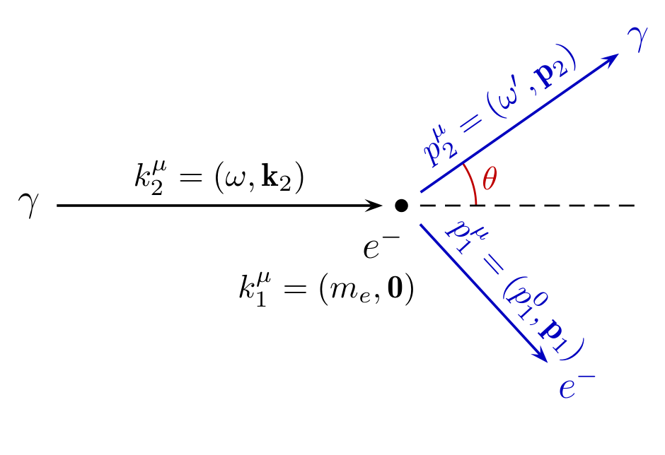

图 7.10: 实验室系中 Compton 散射过程动量示意图。

利用质壳条件和能动量守恒，有

$$
\begin{aligned}
m_e^2 &= p_1^2=(k_1+k_2-p_2)^2=k_1^2+2k_1\cdot(k_2-p_2)-2k_2\cdot p_2\\
&= m_e^2+2m_e(\omega-\omega')-2\omega\omega'(1-\cos\theta),
\end{aligned}
\tag{7.364}
$$

$$
(p_1^0)^2=m_e^2+|\mathbf{p}_1|^2=m_e^2+|\mathbf{k}_2-\mathbf{p}_2|^2=m_e^2+\omega^2+\omega'^2-2\omega\omega'\cos\theta,
\tag{7.365}
$$

故

$$
m_e(\omega-\omega')=\omega\omega'(1-\cos\theta),
\tag{7.366}
$$

$$
p_1^0=\sqrt{m_e^2+\omega^2+\omega'^2-2\omega\omega'\cos\theta}.
\tag{7.367}
$$

因此，由

$$
\frac{1}{\omega'}-\frac{1}{\omega}=\frac{\omega-\omega'}{\omega'\omega}=\frac{1-\cos\theta}{m_e}
\tag{7.368}
$$

得到出射光子与入射光子的波长之差

$$
\Delta\lambda=\lambda'-\lambda=2\pi\left(\frac{1}{\omega'}-\frac{1}{\omega}\right)=\frac{2\pi}{m_e}(1-\cos\theta).
\tag{7.369}
$$

这就是 Arthur Compton 得到的关系式 (7.301)。据此，我们用入射光子角频率 $\omega$ 和散射角 $\theta$ 将出射光子角频率表达成

$$
\omega'=\left(\frac{1-\cos\theta}{m_e}+\frac{1}{\omega}\right)^{-1}=\frac{\omega}{1+\frac{\omega}{m_e}(1-\cos\theta)}.
\tag{7.370}
$$

再利用

$$
k_1\cdot k_2=m_e\omega,\quad k_1\cdot p_2=m_e\omega',
\tag{7.371}
$$

将非极化振幅模方化为

$$
\begin{aligned}
\overline{|\mathcal{M}|^2} &= 2e^4\left[\frac{\omega'}{\omega}+\frac{\omega}{\omega'}+2m_e\left(\frac{1}{\omega}-\frac{1}{\omega'}\right)+m_e^2\left(\frac{1}{\omega}-\frac{1}{\omega'}\right)^2\right]\\
&= 2e^4\left[\frac{\omega'}{\omega}+\frac{\omega}{\omega'}-2m_e\frac{1-\cos\theta}{m_e}+m_e^2\frac{(1-\cos\theta)^2}{m_e^2}\right] = 2e^4\left(\frac{\omega'}{\omega}+\frac{\omega}{\omega'}-\sin^2\theta\right).
\end{aligned}
\tag{7.372}
$$

对末态两体不变相空间积分，得

$$
\begin{aligned}
\int\mathrm{d}\Pi_2 &= \int\frac{\mathrm{d}^3p_1}{(2\pi)^32p_1^0}\frac{\mathrm{d}^3p_2}{(2\pi)^32p_2^0}(2\pi)^4\delta^{(4)}(k_1+k_2-p_1-p_2) = \int\frac{\mathrm{d}^3p_2}{(2\pi)^24p_1^0p_2^0}\delta(m_e+\omega-p_1^0-\omega')\\
&= \int\frac{\mathrm{d}\phi\,\mathrm{d}\cos\theta\,\mathrm{d}\omega'\,\omega'^2}{16\pi^2\omega'p_1^0}\delta\left(m_e+\omega-\sqrt{m_e^2+\omega^2+\omega'^2-2\omega\omega'\cos\theta}-\omega'\right)\\
&= \int\frac{\mathrm{d}\cos\theta\,\omega'}{8\pi p_1^0}\left|\frac{\partial(\sqrt{m_e^2+\omega^2+\omega'^2-2\omega\omega'\cos\theta}+\omega')}{\partial\omega'}\right|^{-1}\\
&= \int\frac{\mathrm{d}\cos\theta\,\omega'}{8\pi p_1^0}\left|\frac{2\omega'-2\omega\cos\theta}{2p_1^0}+1\right|^{-1} = \int\frac{\mathrm{d}\cos\theta}{8\pi}\frac{\omega'}{\omega'+p_1^0-\omega\cos\theta}\\
&= \int\frac{\mathrm{d}\cos\theta}{8\pi}\frac{\omega'}{m_e+\omega(1-\cos\theta)} = \int\frac{\mathrm{d}\cos\theta}{8\pi}\frac{\omega'}{m_e+m_e(\omega-\omega')/\omega'}\\
&= \int\mathrm{d}\cos\theta\frac{\omega'^2}{8\pi m_e\omega}.
\end{aligned}
\tag{7.373}
$$

倒数第三步用到能量守恒关系 $p_1^0+\omega'=m_e+\omega$，倒数第二步用到 (7.366) 式。于是，散射截面表达为

$$
\begin{aligned}
\sigma &= \frac{1}{4E_AE_B|\mathbf{v}_A-\mathbf{v}_B|}\int\mathrm{d}\Pi_2\overline{|\mathcal{M}|^2} = \frac{1}{4k_1^0k_2^0|\mathbf{k}_2|/k_2^0}\int\mathrm{d}\cos\theta\frac{\omega'^2}{8\pi m_e\omega}\overline{|\mathcal{M}|^2}\\
&= \int\mathrm{d}\cos\theta\frac{\omega'^2}{32\pi m_e^2\omega^2}\overline{|\mathcal{M}|^2}.
\end{aligned}
\tag{7.374}
$$

微分散射截面是

$$
\frac{\mathrm{d}\sigma}{\mathrm{d}\cos\theta}=\frac{\omega'^2}{32\pi m_e^2\omega^2}\overline{|\mathcal{M}|^2}=\frac{2e^4\omega'^2}{32\pi m_e^2\omega^2}\left(\frac{\omega'}{\omega}+\frac{\omega}{\omega'}-\sin^2\theta\right),
\tag{7.375}
$$

即

$$
\frac{\mathrm{d}\sigma}{\mathrm{d}\cos\theta}=\frac{\pi\alpha^2\omega'^2}{m_e^2\omega^2}\left(\frac{\omega'}{\omega}+\frac{\omega}{\omega'}-\sin^2\theta\right).
\tag{7.376}
$$

上式称为 Klein-Nishina 公式 [41]，它是 Thomson 微分截面 (7.302) 的 QED 修正。

在非相对论极限下，入射光子能量 $\omega\to0$，则

$$
\frac{\omega'}{\omega}=\frac{1}{1+\frac{\omega}{m_e}(1-\cos\theta)}\to1,
\tag{7.377}
$$

从而得到

$$
\frac{\mathrm{d}\sigma}{\mathrm{d}\cos\theta}\simeq\frac{\pi\alpha^2}{m_e^2}(1+\cos^2\theta).
\tag{7.378}
$$

此时 Klein-Nishina 公式退化到 Thomson 微分截面公式，而截面近似为

$$
\sigma\simeq\int_{-1}^{1}\mathrm{d}\cos\theta\frac{\pi\alpha^2}{m_e^2}(1+\cos^2\theta)=\frac{8\pi\alpha^2}{3m_e^2}.
\tag{7.379}
$$

### 7.6.3 高能行为和极化振幅

下面讨论 Compton 散射的高能极限。

在质心系中，动量如图 7.2 所示，散射角 $\theta$ 定义为初末态电子动量 $\mathbf{k}_1$ 与 $\mathbf{p}_1$ 方向之间的夹角。根据 5.5.3 小节知识，粒子能量为

$$
k_1^0=p_1^0=\frac{s+m_e^2}{2\sqrt{s}}\equiv E_e,\quad k_2^0=p_2^0=\frac{s-m_e^2}{2\sqrt{s}}\equiv\omega,
\tag{7.380}
$$

动量大小为

$$
|\mathbf{k}_1|=|\mathbf{k}_2|=|\mathbf{p}_1|=|\mathbf{p}_2|=\omega.
\tag{7.381}
$$

于是

$$
k_1\cdot k_2=k_1^0k_2^0-\mathbf{k}_1\cdot\mathbf{k}_2=\omega(E_e+\omega),\quad k_1\cdot p_2=k_1^0p_2^0-\mathbf{k}_1\cdot\mathbf{p}_2=\omega(E_e+\omega\cos\theta),
\tag{7.382}
$$

故

$$
\frac{k_1\cdot p_2}{k_1\cdot k_2}=\frac{E_e+\omega\cos\theta}{E_e+\omega}.
\tag{7.383}
$$

在高能极限下，$\sqrt{s}\gg m_e$，或者说，$\omega\gg m_e$，因而可以忽略电子质量，得到

$$
E_e\simeq\omega\simeq\frac{\sqrt{s}}{2}.
\tag{7.384}
$$

只保留非极化振幅模方 (7.361) 方括号中前两项，有

$$
\begin{aligned}
\overline{|\mathcal{M}|^2} &\simeq 2e^4\left(\frac{k_1\cdot p_2}{k_1\cdot k_2}+\frac{k_1\cdot k_2}{k_1\cdot p_2}\right) = 2e^4\left(\frac{E_e+\omega\cos\theta}{E_e+\omega}+\frac{E_e+\omega}{E_e+\omega\cos\theta}\right)\\
&\simeq 4e^4\left(\frac{1+\cos\theta}{4}+\frac{1}{1+\cos\theta}\right).
\end{aligned}
\tag{7.385}
$$

对于向后散射，$\theta=\pi$，而 $\cos\theta=-1$，上式发散，奇性来自圆括号中的第二项。

若要避免发散，则在奇性项分母处不能忽略 $m_e$。将 $E_e$ 展开到 $m_e^2/\omega^2$ 阶，得

$$
E_e=\sqrt{m_e^2+\omega^2}=\omega\sqrt{1+\frac{m_e^2}{\omega^2}}\simeq\omega\left(1+\frac{m_e^2}{2\omega^2}\right)+\mathcal{O}\left(\frac{m_e^4}{\omega^4}\right),
\tag{7.386}
$$

奇性项分母化为

$$
E_e+\omega\cos\theta\simeq\omega\left(1+\cos\theta+\frac{m_e^2}{2\omega^2}\right)+\mathcal{O}\left(\frac{m_e^4}{\omega^4}\right).
\tag{7.387}
$$

因此，不发散的表达式是

$$
\overline{|\mathcal{M}|^2}\simeq4e^4\left[\frac{1+\cos\theta}{4}+\frac{1}{1+\cos\theta+m_e^2/(2\omega^2)}\right].
\tag{7.388}
$$

根据 (5.338) 式，微分截面

$$
\frac{\mathrm{d}\sigma}{\mathrm{d}\cos\theta}\simeq\frac{2\pi}{64\pi^2}\frac{1}{2\omega^2}\frac{\omega}{2\omega}\overline{|\mathcal{M}|^2}\simeq\frac{\pi\alpha^2}{2\omega^2}\left[\frac{1+\cos\theta}{4}+\frac{1}{1+\cos\theta+m_e^2/(2\omega^2)}\right].
\tag{7.389}
$$

当 $\omega\gg m_e$ 时，微分截面虽然在 $\theta=\pi$ 处没有发散，但数值非常大。

接下来分析 Compton 散射的极化振幅。不变振幅 (7.303) 按 Feynman 图分解为 $s$ 和 $u$ 通道分别贡献的两个部分，$\mathcal{M}=\mathcal{M}_s+\mathcal{M}_u$。将螺旋度依赖明显写出来，两个通道的极化振幅为

$$
\begin{aligned}
\mathcal{M}_s(\lambda_1,\lambda_2,\lambda_1',\lambda_2') &= -\frac{e^2}{s-m_e^2}\varepsilon_\mu^*(\mathbf{p}_2,\lambda_2')\varepsilon_\nu(\mathbf{k}_2,\lambda_2)\bar{u}(\mathbf{p}_1,\lambda_1')\gamma^\mu(\not{k}_1+\not{k}_2+m_e)\gamma^\nu u(\mathbf{k}_1,\lambda_1)\\
&\simeq -\frac{e^2}{4\omega^2}\bar{u}(\mathbf{p}_1,\lambda_1')\not{\varepsilon}^*(\mathbf{p}_2,\lambda_2')(\not{k}_1+\not{k}_2)\not{\varepsilon}(\mathbf{k}_2,\lambda_2)u(\mathbf{k}_1,\lambda_1),
\end{aligned}
\tag{7.390}
$$

$$
\begin{aligned}
\mathcal{M}_u(\lambda_1,\lambda_2,\lambda_1',\lambda_2') &= -\frac{e^2}{u-m_e^2}\varepsilon_\mu^*(\mathbf{p}_2,\lambda_2')\varepsilon_\nu(\mathbf{k}_2,\lambda_2)\bar{u}(\mathbf{p}_1,\lambda_1')\gamma^\nu(\not{k}_1-\not{p}_2+m_e)\gamma^\mu u(\mathbf{k}_1,\lambda_1)\\
&\simeq \frac{e^2}{4\omega^2c_{\theta/2}^2}\bar{u}(\mathbf{p}_1,\lambda_1')\not{\varepsilon}(\mathbf{k}_2,\lambda_2)(\not{k}_1-\not{p}_2)\not{\varepsilon}^*(\mathbf{p}_2,\lambda_2')u(\mathbf{k}_1,\lambda_1).
\end{aligned}
\tag{7.391}
$$

第二步在高能极限下忽略电子质量，并利用了

$$
s-m_e^2=(k_1+k_2)^2-m_e^2=2k_1\cdot k_2=2\omega(E_e+\omega)\simeq4\omega^2,
\tag{7.392}
$$

$$
u-m_e^2=(k_1-p_2)^2-m_e^2=-2k_1\cdot p_2=-2\omega(E_e+\omega\cos\theta)\simeq-4\omega^2\cos^2\frac{\theta}{2}.
\tag{7.393}
$$

容易看出，$\theta=\pi$ 处的奇性来自 $u$ 通道。不过，$\mathcal{M}_u$ 中的因子 $(2c_{\theta/2}^2)^{-1}=(1+\cos\theta)^{-1}$ 在模方 $|\mathcal{M}_u|^2$ 中变成 $(1+\cos\theta)^{-2}$，这样的奇性看起来强于非极化振幅模方 (7.385) 中 $\sim(1+\cos\theta)^{-1}$ 的奇性。我们将通过下面的计算看到奇性是如何减弱的。

为计算极化振幅，我们先导出振幅中各个因子的显明表达式。在高能极限下，初末态电子四维动量近似为

$$
k_1^\mu\simeq\omega(1,0,0,1),\quad p_1^\mu\simeq\omega(1,s_\theta,0,c_\theta),
\tag{7.394}
$$

参照 7.2.4 小节，相应的螺旋态为

$$
\xi_+(\mathbf{k}_1)=\begin{pmatrix}1\\0\end{pmatrix},\quad \xi_-(\mathbf{k}_1)=\begin{pmatrix}0\\1\end{pmatrix},\quad \xi_+(\mathbf{p}_1)=\begin{pmatrix}c_{\theta/2}\\s_{\theta/2}\end{pmatrix},\quad \xi_-(\mathbf{p}_1)=\begin{pmatrix}-s_{\theta/2}\\c_{\theta/2}\end{pmatrix}.
\tag{7.395}
$$

根据 7.3 节，高能极限下的平面波旋量系数为

$$
u(\mathbf{k}_1,+)\simeq\sqrt{2\omega}\begin{pmatrix}0\\\xi_+(\mathbf{k}_1)\end{pmatrix}=\sqrt{2\omega}\begin{pmatrix}0\\0\\1\\0\end{pmatrix},\qquad u(\mathbf{k}_1,-)\simeq\sqrt{2\omega}\begin{pmatrix}\xi_-(\mathbf{k}_1)\\0\end{pmatrix}=\sqrt{2\omega}\begin{pmatrix}0\\1\\0\\0\end{pmatrix},
\tag{7.396}
$$

$$
\begin{aligned}
u(\mathbf{p}_1,+) &\simeq \sqrt{2\omega}\begin{pmatrix}0\\\xi_+(\mathbf{p}_1)\end{pmatrix} = \sqrt{2\omega}\begin{pmatrix}0\\0\\c_{\theta/2}\\s_{\theta/2}\end{pmatrix},\\
u(\mathbf{p}_1,-) &\simeq \sqrt{2\omega}\begin{pmatrix}\xi_-(\mathbf{p}_1)\\0\end{pmatrix} = \sqrt{2\omega}\begin{pmatrix}0\\-s_{\theta/2}\\c_{\theta/2}\\0\end{pmatrix}.
\end{aligned}
\tag{7.397}
$$

$u(\mathbf{p}_1,\lambda_1')$ 的 Dirac 共轭是

$$
\begin{aligned}
\bar{u}(\mathbf{p}_1,+) &= u^\dagger(\mathbf{p}_1,+)\gamma^0 \simeq \sqrt{2\omega}\begin{pmatrix}0 & \xi_+^\dagger(\mathbf{p}_1)\end{pmatrix}\begin{pmatrix} & \mathbf{1}\\ \mathbf{1} & \end{pmatrix}\\
&= \sqrt{2\omega}\begin{pmatrix}\xi_+^\dagger(\mathbf{p}_1) & 0\end{pmatrix} \simeq \sqrt{2\omega}\begin{pmatrix}c_{\theta/2} & s_{\theta/2} & 0 & 0\end{pmatrix},
\end{aligned}
\tag{7.398}
$$

$$
\bar{u}(\mathbf{p}_1,-)\simeq\sqrt{2\omega}\begin{pmatrix}0 & \xi_-^\dagger(\mathbf{p}_1)\end{pmatrix}\simeq\sqrt{2\omega}\begin{pmatrix}0 & 0 & -s_{\theta/2} & c_{\theta/2}\end{pmatrix}.
\tag{7.399}
$$

另一方面，初末态光子的四维动量是

$$
k_2^\mu=\omega(1,0,0,-1),\quad p_2^\mu=\omega(1,-s_\theta,0,-c_\theta).
\tag{7.400}
$$

根据 (3.243) 式，末态光子极化矢量表达为

$$
\varepsilon^\mu(\mathbf{p}_2,+)=\frac{\omega^2}{\sqrt{2\omega^2}s_\theta}(0,-s_\theta c_\theta,\mathrm{i}s_\theta,s_\theta^2)=\frac{1}{\sqrt{2}}(0,-c_\theta,\mathrm{i},s_\theta),
\tag{7.401}
$$

$$
\varepsilon^\mu(\mathbf{p}_2,-)=\frac{\omega^2}{\sqrt{2\omega^2}s_\theta}(0,s_\theta c_\theta,\mathrm{i}s_\theta,-s_\theta^2)=\frac{1}{\sqrt{2}}(0,c_\theta,\mathrm{i},-s_\theta).
\tag{7.402}
$$

令 $\theta=0$，即得初态光子极化矢量

$$
\varepsilon^\mu(\mathbf{k}_2,+)=\frac{1}{\sqrt{2}}(0,-1,\mathrm{i},0),\quad \varepsilon^\mu(\mathbf{k}_2,-)=\frac{1}{\sqrt{2}}(0,1,\mathrm{i},0).
\tag{7.403}
$$

极化矢量与 Dirac 矩阵的缩并为

$$
\begin{aligned}
\not{\varepsilon}(\mathbf{k}_2,+) &= \gamma^\mu\varepsilon_\mu(\mathbf{k}_2,+) = \frac{1}{\sqrt{2}}(\gamma^1-\mathrm{i}\gamma^2)\\
&= \frac{1}{\sqrt{2}}\begin{pmatrix} & \sigma^1-\mathrm{i}\sigma^2\\ -\sigma^1+\mathrm{i}\sigma^2 & \end{pmatrix} = \sqrt{2}\begin{pmatrix} & & & 0\\ & & 1 &\\ & 0 & &\\ -1 & & & \end{pmatrix},
\end{aligned}
\tag{7.404}
$$

$$
\begin{aligned}
\not{\varepsilon}(\mathbf{k}_2,-) &= \gamma^\mu\varepsilon_\mu(\mathbf{k}_2,-) = \frac{1}{\sqrt{2}}(-\gamma^1-\mathrm{i}\gamma^2)\\
&= \frac{1}{\sqrt{2}}\begin{pmatrix} & -\sigma^1-\mathrm{i}\sigma^2\\ \sigma^1+\mathrm{i}\sigma^2 & \end{pmatrix} = \sqrt{2}\begin{pmatrix} & & & -1\\ & & 0 &\\ & 1 & &\\ 0 & & & \end{pmatrix},
\end{aligned}
\tag{7.405}
$$

$$
\begin{aligned}
\not{\varepsilon}^*(\mathbf{p}_2,+) &= \gamma^\mu\varepsilon_\mu^*(\mathbf{p}_2,+) = \frac{1}{\sqrt{2}}(c_\theta\gamma^1+\mathrm{i}\gamma^2-s_\theta\gamma^3)\\
&= \frac{1}{\sqrt{2}}\begin{pmatrix} & c_\theta\sigma^1+\mathrm{i}\sigma^2-s_\theta\sigma^3\\ -c_\theta\sigma^1-\mathrm{i}\sigma^2+s_\theta\sigma^3 & \end{pmatrix}\\
&= \sqrt{2}\begin{pmatrix} & & -s_{\theta/2}c_{\theta/2} & c_{\theta/2}^2\\ & & -s_{\theta/2}^2 & s_{\theta/2}c_{\theta/2}\\ s_{\theta/2}c_{\theta/2} & -c_{\theta/2}^2 & &\\ s_{\theta/2}^2 & -s_{\theta/2}c_{\theta/2} & & \end{pmatrix},
\end{aligned}
\tag{7.406}
$$

$$
\begin{aligned}
\not{\epsilon}^*(\mathbf{p}_2,-) &= \gamma^\mu\varepsilon_\mu^*(\mathbf{p}_2,-) = \frac{1}{\sqrt{2}}(-c_\theta\gamma^1 + \mathrm{i}\gamma^2 + s_\theta\gamma^3)\\
&= \frac{1}{\sqrt{2}}\begin{pmatrix} & -c_\theta\sigma^1 + \mathrm{i}\sigma^2 + s_\theta\sigma^3\\ c_\theta\sigma^1 - \mathrm{i}\sigma^2 - s_\theta\sigma^3 & \end{pmatrix}\\
&= \sqrt{2}\begin{pmatrix} 0 & 0 & s_{\theta/2}c_{\theta/2} & s_{\theta/2}^2\\ 0 & 0 & -c_{\theta/2}^2 & -s_{\theta/2}c_{\theta/2}\\ -s_{\theta/2}c_{\theta/2} & -s_{\theta/2}^2 & 0 & 0\\ c_{\theta/2}^2 & s_{\theta/2}c_{\theta/2} & 0 & 0\end{pmatrix}.
\end{aligned}
\tag{7.407}
$$

第一步，按照 (7.390) 式计算 $s$ 通道极化振幅 $\mathcal{M}_s$。$\bar{u}(\mathbf{p}_1,\lambda_1')\not{\epsilon}^*(\mathbf{p}_2,\lambda_2')$ 化为

$$
\bar{u}(\mathbf{p}_1,+)\not{\epsilon}^*(\mathbf{p}_2,+)\simeq 2\sqrt{\omega}\begin{pmatrix}0&0&-s_{\theta/2}&c_{\theta/2}\end{pmatrix},\quad \bar{u}(\mathbf{p}_1,+)\not{\epsilon}^*(\mathbf{p}_2,-)\simeq\begin{pmatrix}0&0&0&0\end{pmatrix},
\tag{7.408}
$$

$$
\bar{u}(\mathbf{p}_1,-)\not{\epsilon}^*(\mathbf{p}_2,-)\simeq 2\sqrt{\omega}\begin{pmatrix}c_{\theta/2}&s_{\theta/2}&0&0\end{pmatrix},\quad \bar{u}(\mathbf{p}_1,-)\not{\epsilon}^*(\mathbf{p}_2,+)\simeq\begin{pmatrix}0&0&0&0\end{pmatrix}.
\tag{7.409}
$$

可见，当末态中电子与光子具有相反螺旋度时，贡献为零。这是因为螺旋度相反的电子和光子组成一个角动量为 $3/2$ 的系统，而 $s$ 通道电子传播子对应于一个自旋为 $1/2$ 的类时虚粒子，违背角动量守恒。如果不忽略电子质量，则会出现受到螺旋度压低的非零贡献。$(k_1+k_2)^\mu\simeq(2\omega,0,0,0)$ 与 Dirac 矩阵的缩并表达成

$$
\not{k}_1+\not{k}_2 = (k_1+k_2)_\mu\begin{pmatrix} & \sigma^\mu\\ \bar{\sigma}^\mu & \end{pmatrix}\simeq 2\omega\begin{pmatrix} & \mathbf{1}\\ \mathbf{1} & \end{pmatrix} = 2\omega\begin{pmatrix}0&0&1&0\\0&0&0&1\\1&0&0&0\\0&1&0&0\end{pmatrix}.
\tag{7.410}
$$

乘到 $\bar{u}(\mathbf{p}_1,\lambda_1')\not{\epsilon}^*(\mathbf{p}_2,\lambda_2')$ 后面，得

$$
\bar{u}(\mathbf{p}_1,+)\not{\epsilon}^*(\mathbf{p}_2,+)(\not{k}_1+\not{k}_2)\simeq 4\omega^{3/2}\begin{pmatrix}-s_{\theta/2}&c_{\theta/2}&0&0\end{pmatrix},
\tag{7.411}
$$

$$
\bar{u}(\mathbf{p}_1,-)\not{\epsilon}^*(\mathbf{p}_2,-)(\not{k}_1+\not{k}_2)\simeq 4\omega^{3/2}\begin{pmatrix}0&0&c_{\theta/2}&s_{\theta/2}\end{pmatrix},
\tag{7.412}
$$

$$
\bar{u}(\mathbf{p}_1,+)\not{\epsilon}^*(\mathbf{p}_2,-)(\not{k}_1+\not{k}_2)\simeq\begin{pmatrix}0&0&0&0\end{pmatrix},
\tag{7.413}
$$

$$
\bar{u}(\mathbf{p}_1,-)\not{\epsilon}^*(\mathbf{p}_2,+)(\not{k}_1+\not{k}_2)\simeq\begin{pmatrix}0&0&0&0\end{pmatrix}.
\tag{7.414}
$$

$\mathcal{M}_s$ 表达式 (7.390) 最后两个因子 $\not{\epsilon}(\mathbf{k}_2,\lambda_2)u(\mathbf{k}_1,\lambda_1)$ 的表达式是

$$
\begin{aligned}
\not{\epsilon}(\mathbf{k}_2,+)u(\mathbf{k}_1,+)&\simeq 2\sqrt{\omega}\begin{pmatrix}0\\1\\0\\0\end{pmatrix},\quad \not{\epsilon}(\mathbf{k}_2,+)u(\mathbf{k}_1,-)\simeq\begin{pmatrix}0\\0\\0\\0\end{pmatrix},\\
\not{\epsilon}(\mathbf{k}_2,-)u(\mathbf{k}_1,-)&\simeq 2\sqrt{\omega}\begin{pmatrix}0\\0\\1\\0\end{pmatrix},\quad \not{\epsilon}(\mathbf{k}_2,-)u(\mathbf{k}_1,+)\simeq\begin{pmatrix}0\\0\\0\\0\end{pmatrix}.
\end{aligned}
\tag{7.415}
$$

当初态中电子与光子具有相反螺旋度时，贡献也为零，理由同上。

将这些因子乘起来，就得到 $\mathcal{M}_s$ 的计算结果。由于 $\mathcal{M}_s$ 的初末态平面波旋量系数之间夹着 3 个 Dirac 矩阵，我们从 (7.193) 式推断螺旋度相反的初末态电子在高能极限下没有贡献，即

$$
\bar{u}(\mathbf{p}_1,-\lambda)\not{\epsilon}^*(\mathbf{p}_2,\lambda_2')(\not{k}_1+\not{k}_2)\not{\epsilon}(\mathbf{k}_2,\lambda_2)u(\mathbf{k}_1,\lambda)\simeq 0,\quad \lambda=\pm.
\tag{7.416}
$$

对于初末态电子螺旋度相同的情况，非零结果只有

$$
\bar{u}(\mathbf{p}_1,+)\not{\epsilon}^*(\mathbf{p}_2,+)(\not{k}_1+\not{k}_2)\not{\epsilon}(\mathbf{k}_2,+)u(\mathbf{k}_1,+)\simeq 8\omega^2c_{\theta/2},
\tag{7.417}
$$

$$
\bar{u}(\mathbf{p}_1,-)\not{\epsilon}^*(\mathbf{p}_2,-)(\not{k}_1+\not{k}_2)\not{\epsilon}(\mathbf{k}_2,-)u(\mathbf{k}_1,-)\simeq 8\omega^2c_{\theta/2}.
\tag{7.418}
$$

相应的极化振幅为

$$
\mathcal{M}_s(+,+,+,+)=\mathcal{M}_s(-,-,-,-)\simeq -2e^2c_{\theta/2}.
\tag{7.419}
$$

可见，在高能极限下，$s$ 通道贡献只来自四个粒子全部右旋极化和全部左旋极化的螺旋度构型。这两种构型在宇称变换下相互转换，由于宇称守恒，它们的振幅至多相差一个相位因子，此处相位因子为 1。

第二步，按照 (7.391) 式计算 $u$ 通道极化振幅 $\mathcal{M}_u$。$\bar{u}(\mathbf{p}_1,\lambda_1')\not{\epsilon}(\mathbf{k}_2,\lambda_2)$ 化为

$$
\bar{u}(\mathbf{p}_1,+)\not{\epsilon}(\mathbf{k}_2,+)\simeq 2\sqrt{\omega}\begin{pmatrix}0&0&s_{\theta/2}&0\end{pmatrix},\quad \bar{u}(\mathbf{p}_1,+)\not{\epsilon}(\mathbf{k}_2,-)\simeq -2\sqrt{\omega}\begin{pmatrix}0&0&0&c_{\theta/2}\end{pmatrix},
\tag{7.420}
$$

$$
\bar{u}(\mathbf{p}_1,-)\not{\epsilon}(\mathbf{k}_2,+)\simeq -2\sqrt{\omega}\begin{pmatrix}c_{\theta/2}&0&0&0\end{pmatrix},\quad \bar{u}(\mathbf{p}_1,-)\not{\epsilon}(\mathbf{k}_2,-)\simeq -2\sqrt{\omega}\begin{pmatrix}0&s_{\theta/2}&0&0\end{pmatrix}.
\tag{7.421}
$$

$(k_1-p_2)^\mu\simeq\omega(0,s_\theta,0,1+c_\theta)=2\omega(0,s_{\theta/2}c_{\theta/2},0,c_{\theta/2}^2)$ 与 Dirac 矩阵的缩并是

$$
\begin{aligned}
\not{k}_1-\not{p}_2 &= (k_1-p_2)_\mu\begin{pmatrix} & \sigma^\mu\\ \bar{\sigma}^\mu & \end{pmatrix}\simeq 2\omega\begin{pmatrix} & -s_{\theta/2}c_{\theta/2}\sigma^1 - c_{\theta/2}^2\sigma^3\\ s_{\theta/2}c_{\theta/2}\sigma^1 + c_{\theta/2}^2\sigma^3 & \end{pmatrix}\\
&= 2\omega\begin{pmatrix} 0 & 0 & -c_{\theta/2}^2 & -s_{\theta/2}c_{\theta/2}\\ 0 & 0 & -s_{\theta/2}c_{\theta/2} & c_{\theta/2}^2\\ c_{\theta/2}^2 & s_{\theta/2}c_{\theta/2} & 0 & 0\\ s_{\theta/2}c_{\theta/2} & -c_{\theta/2}^2 & 0 & 0\end{pmatrix}.
\end{aligned}
\tag{7.422}
$$

乘到 $\bar{u}(\mathbf{p}_1,\lambda_1')\not{\epsilon}(\mathbf{k}_2,\lambda_2)$ 后面，得

$$
\bar{u}(\mathbf{p}_1,+)\not{\epsilon}(\mathbf{k}_2,+)(\not{k}_1-\not{p}_2)\simeq 4\omega^{3/2}\begin{pmatrix}s_{\theta/2}c_{\theta/2}^2&s_{\theta/2}^2c_{\theta/2}&0&0\end{pmatrix},
\tag{7.423}
$$

$$
\bar{u}(\mathbf{p}_1,-)\not{\epsilon}(\mathbf{k}_2,-)(\not{k}_1-\not{p}_2)\simeq 4\omega^{3/2}\begin{pmatrix}0&0&s_{\theta/2}^2c_{\theta/2}&-s_{\theta/2}c_{\theta/2}^2\end{pmatrix},
\tag{7.424}
$$

$$
\bar{u}(\mathbf{p}_1,+)\not{\epsilon}(\mathbf{k}_2,-)(\not{k}_1-\not{p}_2)\simeq 4\omega^{3/2}\begin{pmatrix}-s_{\theta/2}c_{\theta/2}^2&c_{\theta/2}^3&0&0\end{pmatrix},
\tag{7.425}
$$

$$
\bar{u}(\mathbf{p}_1,-)\not{\epsilon}(\mathbf{k}_2,+)(\not{k}_1-\not{p}_2)\simeq 4\omega^{3/2}\begin{pmatrix}0&0&c_{\theta/2}^3&s_{\theta/2}c_{\theta/2}^2\end{pmatrix}.
\tag{7.426}
$$

$\mathcal{M}_u$ 表达式 (7.391) 最后两个因子 $\not{\epsilon}^*(\mathbf{p}_2,\lambda_2')u(\mathbf{k}_1,\lambda_1)$ 的表达式是

$$
\not{\epsilon}^*(\mathbf{p}_2,+)u(\mathbf{k}_1,+)\simeq 2\sqrt{\omega}\begin{pmatrix}-s_{\theta/2}c_{\theta/2}\\-s_{\theta/2}^2\\0\\0\end{pmatrix},\quad \not{\epsilon}^*(\mathbf{p}_2,+)u(\mathbf{k}_1,-)\simeq 2\sqrt{\omega}\begin{pmatrix}0\\0\\-c_{\theta/2}^2\\-s_{\theta/2}c_{\theta/2}\end{pmatrix},
\tag{7.427}
$$

$$
\not{\epsilon}^*(\mathbf{p}_2,-)u(\mathbf{k}_1,+)\simeq 2\sqrt{\omega}\begin{pmatrix}s_{\theta/2}c_{\theta/2}\\-c_{\theta/2}^2\\0\\0\end{pmatrix},\quad \not{\epsilon}^*(\mathbf{p}_2,-)u(\mathbf{k}_1,-)\simeq 2\sqrt{\omega}\begin{pmatrix}0\\0\\-s_{\theta/2}^2\\s_{\theta/2}c_{\theta/2}\end{pmatrix}.
\tag{7.428}
$$

同样根据 (7.193) 式，我们知道螺旋度相反的初末态电子没有贡献，即

$$
\bar{u}(\mathbf{p}_1,-\lambda)\not{\epsilon}(\mathbf{k}_2,\lambda_2)(\not{k}_1-\not{p}_2)\not{\epsilon}^*(\mathbf{p}_2,\lambda_2')u(\mathbf{k}_1,\lambda)\simeq 0,\quad \lambda=\pm.
\tag{7.429}
$$

对于初末态电子螺旋度相同的情况，非零结果只有

$$
\bar{u}(\mathbf{p}_1,+)\not{\epsilon}(\mathbf{k}_2,+)(\not{k}_1-\not{p}_2)\not{\epsilon}^*(\mathbf{p}_2,+)u(\mathbf{k}_1,+)\simeq -8\omega^2s_{\theta/2}^2c_{\theta/2},
\tag{7.430}
$$

$$
\bar{u}(\mathbf{p}_1,-)\not{\epsilon}(\mathbf{k}_2,-)(\not{k}_1-\not{p}_2)\not{\epsilon}^*(\mathbf{p}_2,-)u(\mathbf{k}_1,-)\simeq -8\omega^2s_{\theta/2}^2c_{\theta/2},
\tag{7.431}
$$

$$
\bar{u}(\mathbf{p}_1,+)\not{\epsilon}(\mathbf{k}_2,-)(\not{k}_1-\not{p}_2)\not{\epsilon}^*(\mathbf{p}_2,-)u(\mathbf{k}_1,+)\simeq -8\omega^2c_{\theta/2}^3,
\tag{7.432}
$$

$$
\bar{u}(\mathbf{p}_1,-)\not{\epsilon}(\mathbf{k}_2,+)(\not{k}_1-\not{p}_2)\not{\epsilon}^*(\mathbf{p}_2,+)u(\mathbf{k}_1,-)\simeq -8\omega^2c_{\theta/2}^3.
\tag{7.433}
$$

相应的极化振幅为

$$
\mathcal{M}_u(+,+,+,+)=\mathcal{M}_u(-,-,-,-)\simeq -\frac{2e^2s_{\theta/2}^2}{c_{\theta/2}},
\tag{7.434}
$$

$$
\mathcal{M}_u(+,-,+,-)=\mathcal{M}_u(-,+,-,+)\simeq -2e^2c_{\theta/2}.
\tag{7.435}
$$

这些表达式再次体现 QED 中的宇称守恒。可见，$\theta=\pi$ 处的奇性来自全部粒子螺旋度相同的 $u$ 通道振幅 $\mathcal{M}_u(\pm,\pm,\pm,\pm)$，而 $\bar{u}(\mathbf{p}_1,\pm)\not{\epsilon}(\mathbf{k}_2,\pm)(\not{k}_1-\not{p}_2)\not{\epsilon}^*(\mathbf{p}_2,\pm)u(\mathbf{k}_1,\pm)$ 包含一个 $c_{\theta/2}$ 因子，将振幅中原本 $\sim c_{\theta/2}^{-2}$ 的奇性减弱成 $\sim c_{\theta/2}^{-1}$ 的奇性。

现在，将 $s$ 和 $u$ 通道的贡献加起来，$\mathcal{M}=\mathcal{M}_s+\mathcal{M}_u$，得到非零极化振幅

$$
\mathcal{M}(+,+,+,+)=\mathcal{M}(-,-,-,-)\simeq -2e^2c_{\theta/2}-\frac{2e^2s_{\theta/2}^2}{c_{\theta/2}}=-\frac{2e^2}{c_{\theta/2}},
\tag{7.436}
$$

$$
\mathcal{M}(+,-,+,-)=\mathcal{M}(-,+,-,+)\simeq -2e^2c_{\theta/2}.
\tag{7.437}
$$

于是，非极化振幅模方为

$$
\begin{aligned}
\overline{|\mathcal{M}|^2} &= \frac{1}{4}\sum_{\text{spins}}|\mathcal{M}|^2\simeq \frac{1}{4}\left[2|\mathcal{M}(+,-,+,-)|^2 + 2|\mathcal{M}(+,+,+,+)|^2\right]\\
&\simeq \frac{1}{2}\left(4e^4c_{\theta/2}^2 + \frac{4e^4}{c_{\theta/2}^2}\right) = 4e^4\left(\frac{1+c_\theta}{4} + \frac{1}{1+c_\theta}\right),
\end{aligned}
\tag{7.438}
$$

与 (7.385) 式一致。

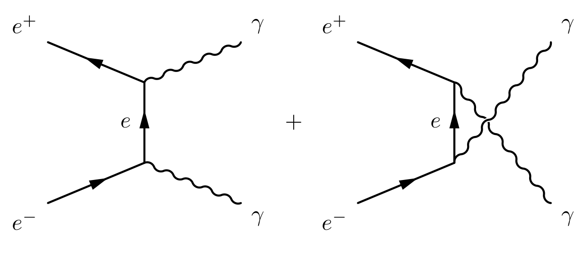

图 7.11: $e^+e^-\to\gamma\gamma$ 领头阶 Feynman 图。

### 7.6.4 正负电子湮灭到双光子

在 QED 领头阶，正负电子湮灭到双光子过程 $e^+e^-\to\gamma\gamma$ 的 Feynman 图如图 7.11 所示，它与 Compton 散射过程具有交叉对称性。

设初态 $e^-$ 和 $e^+$ 的动量分别为 $k_1'$ 和 $k_2'$，末态两个光子的动量为 $p_1'$ 和 $p_2'$。对比 (7.303) 式可以发现，将 $e^-\gamma\to e^-\gamma$ 交叉成 $e^+e^-\to\gamma\gamma$ 时，需要把初态 $\gamma$（动量为 $k_2$）换成末态 $\gamma$（动量为 $p_1'$），并把末态 $e^-$（动量为 $p_1$）换成初态 $e^+$（动量为 $k_2'$），引起动量替换规则

$$
k_1^\mu\to k_1'^\mu,\quad k_2^\mu\to -p_1'^\mu,\quad p_1^\mu\to -k_2'^\mu,\quad p_2^\mu\to p_2'^\mu.
\tag{7.439}
$$

对 (7.361) 式应用这个替换规则，由于只交叉一个费米子，需要移除一个整体负号，从而得到 $e^+e^-\to\gamma\gamma$ 非极化振幅模方

$$
\overline{|\mathcal{M}|^2}=2e^4\left[\frac{k_1'\cdot p_2'}{k_1'\cdot p_1'}+\frac{k_1'\cdot p_1'}{k_1'\cdot p_2'}+2m_e^2\left(\frac{1}{k_1'\cdot p_1'}+\frac{1}{k_1'\cdot p_2'}\right)-m_e^4\left(\frac{1}{k_1'\cdot p_1'}+\frac{1}{k_1'\cdot p_2'}\right)^2\right].
\tag{7.440}
$$

在质心系中，记 $\mathbf{k}_1'$ 与 $\mathbf{p}_1'$ 之间的夹角为 $\theta$，则

$$
k_1'\cdot p_1' = k_1'^0p_1'^0 - |\mathbf{k}_1'||\mathbf{p}_1'|\cos\theta = \frac{s}{4}(1-\beta_e\cos\theta),
\tag{7.441}
$$

$$
k_1'\cdot p_2' = k_1'^0p_2'^0 + |\mathbf{k}_1'||\mathbf{p}_2'|\cos\theta = \frac{s}{4}(1+\beta_e\cos\theta),
\tag{7.442}
$$

其中 $\beta_e=\sqrt{1-4m_e^2/s}$。从而，

$$
\frac{k_1'\cdot p_2'}{k_1'\cdot p_1'}+\frac{k_1'\cdot p_1'}{k_1'\cdot p_2'} = \frac{1+\beta_e\cos\theta}{1-\beta_e\cos\theta}+\frac{1-\beta_e\cos\theta}{1+\beta_e\cos\theta}=\frac{2(1+\beta_e^2\cos^2\theta)}{1-\beta_e^2\cos^2\theta},
\tag{7.443}
$$

$$
\frac{1}{k_1'\cdot p_1'}+\frac{1}{k_1'\cdot p_2'}=\frac{4}{s}\left(\frac{1}{1-\beta_e\cos\theta}+\frac{1}{1+\beta_e\cos\theta}\right)=\frac{8}{s(1-\beta_e^2\cos^2\theta)}.
\tag{7.444}
$$

于是得到

$$
\overline{|\mathcal{M}|^2}=32\pi^2\alpha^2\left[\frac{2(1+\beta_e^2\cos^2\theta)}{1-\beta_e^2\cos^2\theta}+\frac{16m_e^2}{s(1-\beta_e^2\cos^2\theta)}-\frac{64m_e^4}{s^2(1-\beta_e^2\cos^2\theta)^2}\right].
\tag{7.445}
$$

由 (5.359) 式得相应的微分散射截面为

$$
\frac{\mathrm{d}\sigma}{\mathrm{d}\Omega}=\frac{\overline{|\mathcal{M}|^2}}{64\pi^2s\beta_e}=\frac{\alpha^2}{s\beta_e}\left[\frac{1+\beta_e^2\cos^2\theta}{1-\beta_e^2\cos^2\theta}+\frac{8m_e^2}{s(1-\beta_e^2\cos^2\theta)}-\frac{32m_e^4}{s^2(1-\beta_e^2\cos^2\theta)^2}\right].
\tag{7.446}
$$

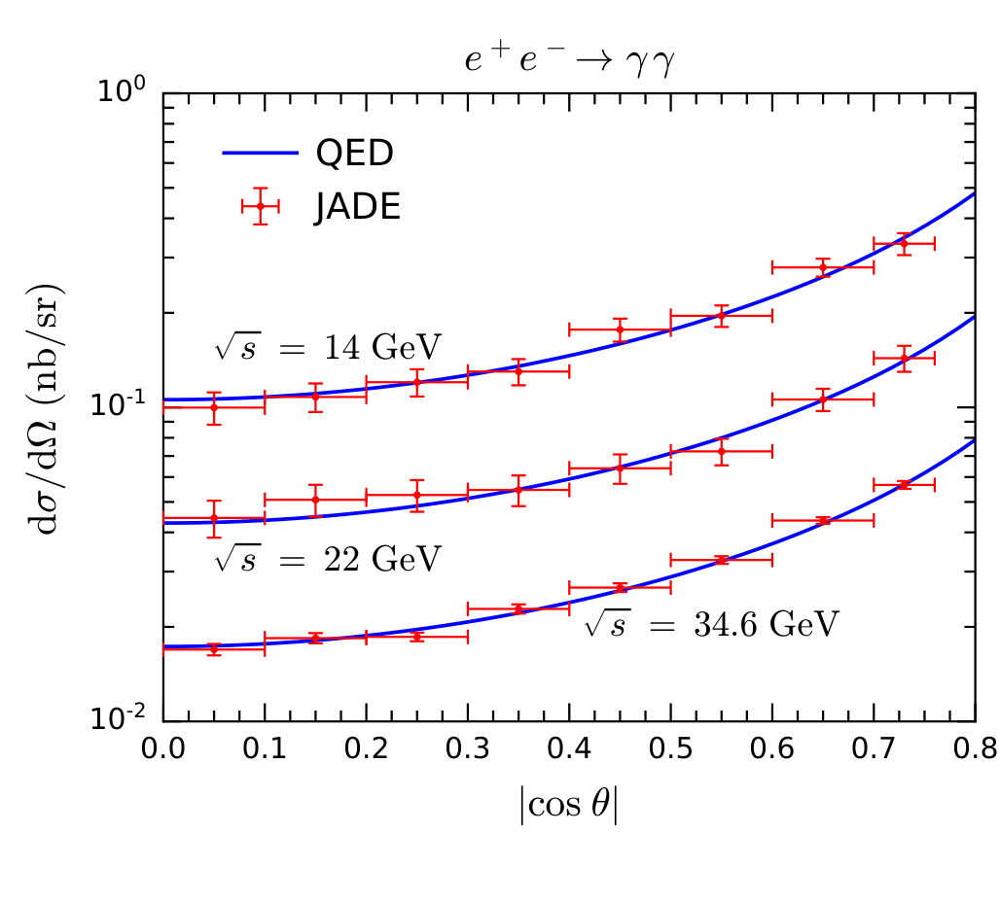

图 7.12: $e^+e^-\to\gamma\gamma$ 微分散射截面。实验数据来自 JADE 合作组 [42]。

对上式积分计算散射截面 $\sigma$ 时，应当注意此过程的末态对称性因子 $\mathcal{S}=2$。

PETRA 对撞机上的 JADE 探测器测量了质心能 $\sqrt{s}=14, 22, 34.6$ GeV 的 $e^+e^-\to\gamma\gamma$ 微分散射截面 [42]，数据如图 7.12 所示。根据 (7.446) 式计算的 QED 预言值用实线画在图上，与实验数据基本吻合。

## 习题

7.1 在 QED 领头阶，Bhabha 散射 $e^+e^-\to e^+e^-$ 和 Møller 散射 $e^-e^-\to e^-e^-$ 的 Feynman 图分别如 (7.295) 和 (7.296) 所示。

(a) 忽略电子质量，证明 Bhabha 散射的非极化振幅模方为

$$
\overline{|\mathcal{M}_{\mathrm{B}}|^2}=32\pi^2\alpha^2\left[u^2\left(\frac{1}{s}+\frac{1}{t}\right)^2+\frac{t^2}{s^2}+\frac{s^2}{t^2}\right].
\tag{7.447}
$$

(b) 利用交叉对称性，求出 Møller 散射的非极化振幅模方 $\overline{|\mathcal{M}_{\mathrm{M}}|^2}$。

7.2 考虑另一种形式的 Yukawa 理论，拉氏量为

$$
\mathcal{L}=\frac{1}{2}(\partial^\mu\phi)\partial_\mu\phi-\frac{1}{2}m_\phi^2\phi^2+\mathrm{i}\bar{\psi}\gamma^\mu\partial_\mu\psi-m_\psi\bar{\psi}\psi-\kappa\phi\bar{\psi}\mathrm{i}\gamma^5\psi,
\tag{7.448}
$$

其中 $\phi$ 是实标量场，$\psi$ 是 Dirac 旋量场，$\kappa$ 是实耦合常数。

(a) 写出动量空间中的顶点 Feynman 规则。

(b) 设 $m_\phi>2m_\psi$，画出衰变过程 $\phi\to\psi\bar{\psi}$ 的领头阶 Feynman 图，计算非极化振幅模方 $\overline{|\mathcal{M}|^2}$ 和衰变宽度 $\Gamma$。

(c) 画出湮灭过程 $\psi\bar{\psi}\to\phi\phi$ 的领头阶 Feynman 图。设 $m_\psi=m_\phi=0$，计算非极化振幅模方 $\overline{|\mathcal{M}|^2}$，并在质心系中求出微分散射截面 $\mathrm{d}\sigma/\mathrm{d}\Omega$。

7.3 考虑四费米子相互作用理论，拉氏量为

$$
\begin{aligned}
\mathcal{L} &= \sum_{f=\mu,e,\nu_\mu,\nu_e}(\mathrm{i}\bar{\psi}_f\gamma^\mu\partial_\mu\psi_f-m_f\bar{\psi}_f\psi_f)\\
&\quad -\frac{G_{\mathrm{F}}}{\sqrt{2}}\left[\bar{\psi}_{\nu_\mu}\gamma^\rho(1-\gamma^5)\psi_\mu\bar{\psi}_e\gamma_\rho(1-\gamma^5)\psi_{\nu_e}+\bar{\psi}_{\nu_\mu}\gamma^\rho(1-\gamma^5)\psi_\mu\bar{\psi}_{\nu_e}\gamma_\rho(1-\gamma^5)\psi_e\right],
\end{aligned}
\tag{7.449}
$$

其中 Dirac 旋量场 $\psi_\mu$、$\psi_e$、$\psi_{\nu_\mu}$ 和 $\psi_{\nu_e}$ 分别描述 $\mu$ 子、电子、$\mu$ 子型中微子和电子型中微子，Fermi 常数 $G_{\mathrm{F}}=1.166\times10^{-5}$ GeV$^{-2}$，方括号中两项互为厄米共轭。

(a) 写出动量空间中所有顶点的 Feynman 规则。

(b) 画出三体衰变过程 $\mu^-\to e^-\bar{\nu}_e\nu_\mu$ 的 Feynman 图。设 $m_e=m_{\nu_e}=m_{\nu_\mu}=0$，计算非极化振幅模方 $\overline{|\mathcal{M}|^2}$ 和衰变宽度 $\Gamma$。

(c) 计算 $\mu$ 子寿命 $\tau=1/\Gamma$ 的数值，以秒为单位。

7.4 考虑标准模型里面电中性矢量玻色子 $Z$ 和带电矢量玻色子 $W^\pm$ 与第一代轻子的相互作用，拉氏量为

$$
\begin{aligned}
\mathcal{L} &= -\frac{1}{4}Z_{\mu\nu}Z^{\mu\nu}+\frac{1}{2}m_Z^2Z_\mu Z^\mu-\frac{1}{2}W^-_{\mu\nu}W^{+,\mu\nu}+m_W^2W^-_\mu W^{+,\mu}\\
&\quad +\mathrm{i}\bar{\psi}_e\gamma^\mu\partial_\mu\psi_e-m_e\bar{\psi}_e\psi_e+\mathrm{i}\bar{\psi}_{\nu_e}\gamma^\mu\partial_\mu\psi_{\nu_e}\\
&\quad +\frac{g}{2\cos\theta_{\mathrm{W}}}Z_\mu\left[\bar{\psi}_e\gamma^\mu(g^{\mathrm{e}}_{\mathrm{V}}-g^{\mathrm{e}}_{\mathrm{A}}\gamma^5)\psi_e+\bar{\psi}_{\nu_e}\gamma^\mu(g^{\nu_e}_{\mathrm{V}}-g^{\nu_e}_{\mathrm{A}}\gamma^5)\psi_{\nu_e}\right]\\
&\quad +\frac{g}{\sqrt{2}}\left(W^+_\mu\bar{\psi}_{\nu_e}\gamma^\mu P_{\mathrm{L}}\psi_e+\text{H.c.}\right).
\end{aligned}
\tag{7.450}
$$

其中，实矢量场 $Z^\mu$ 描述质量为 $m_Z=91.19$ GeV 的 $Z$ 玻色子；复矢量场 $W^{+,\mu}$ 描述质量为 $m_W=80.38$ GeV 的 $W^\pm$ 玻色子，且 $W^{-,\mu}\equiv(W^{+,\mu})^\dagger$，相应的内外线 Feynman 规则见习题 6.5。场强张量 $Z_{\mu\nu}\equiv\partial_\mu Z_\nu-\partial_\nu Z_\mu$，$W^\pm_{\mu\nu}\equiv\partial_\mu W^\pm_\nu-\partial_\nu W^\pm_\mu$。Dirac 旋量场 $\psi_e$ 和 $\psi_{\nu_e}$ 分别描述电子和电子型中微子。$g$ 是实的弱耦合常数，$\theta_{\mathrm{W}}$ 是弱混合角。$g^{\mathrm{e}}_{\mathrm{V}}$、$g^{\mathrm{e}}_{\mathrm{A}}$、$g^{\nu_e}_{\mathrm{V}}$、$g^{\nu_e}_{\mathrm{A}}$ 都是实的无量纲常数。H.c. 代表厄米共轭。

(a) 写出动量空间中所有顶点的 Feynman 规则。

(b) 画出衰变过程 $Z\to e^+e^-$ 和 $Z\to\nu_e\bar{\nu}_e$ 的 Feynman 图。计算 $Z\to e^+e^-$ 的非极化振幅模方 $\overline{|\mathcal{M}|^2}$ 和衰变分宽度 $\Gamma(Z\to e^+e^-)$。类比给出衰变分宽度 $\Gamma(Z\to\nu_e\bar{\nu}_e)$。

(c) 画出衰变过程 $W^+\to e^+\nu_e$ 的 Feynman 图，计算非极化振幅模方 $\overline{|\mathcal{M}|^2}$ 和衰变分宽度 $\Gamma(W^+\to e^+\nu_e)$。

(d) 已知

$$
\cos^2\theta_{\mathrm{W}}=\frac{m_W^2}{m_Z^2},\quad g=\frac{e}{\sin\theta_{\mathrm{W}}},\quad g^{\mathrm{e}}_{\mathrm{V}}=-\frac{1}{2}+2\sin^2\theta_{\mathrm{W}},\quad g^{\mathrm{e}}_{\mathrm{A}}=-\frac{1}{2},\quad g^{\nu_e}_{\mathrm{V}}=g^{\nu_e}_{\mathrm{A}}=\frac{1}{2}.
\tag{7.451}
$$

计算上述三个衰变分宽度的数值，以 GeV 为单位。
