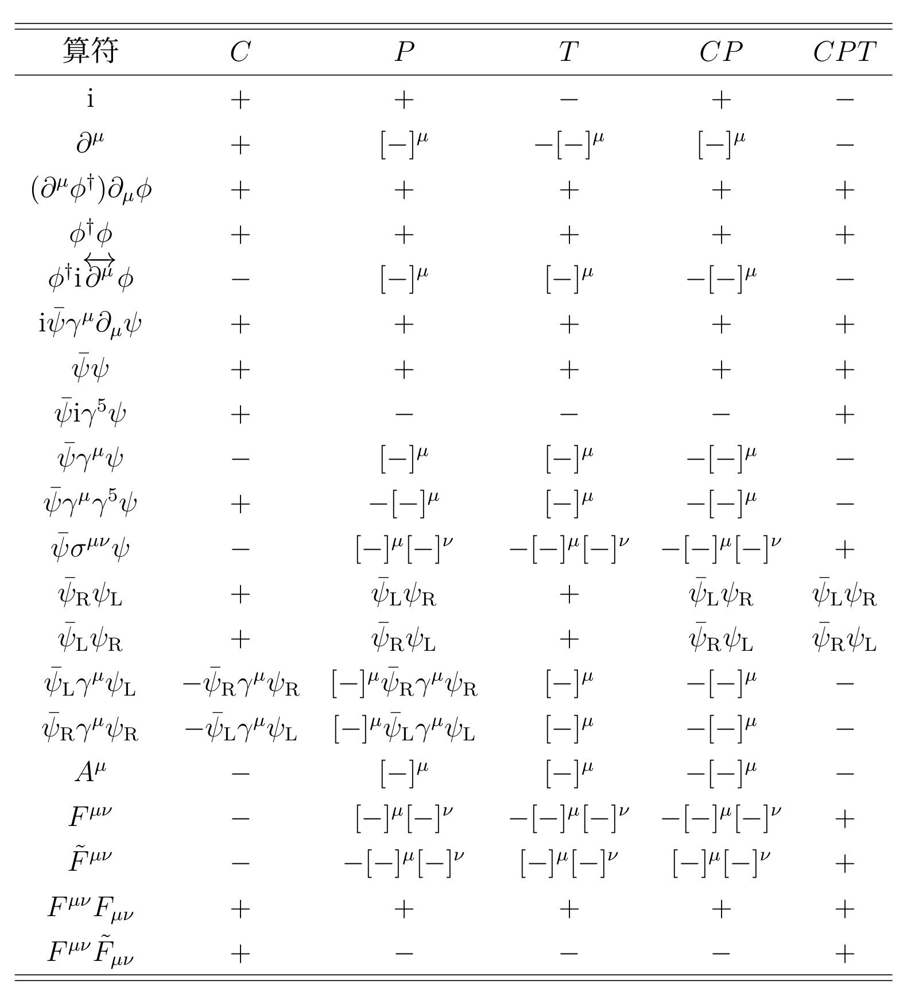
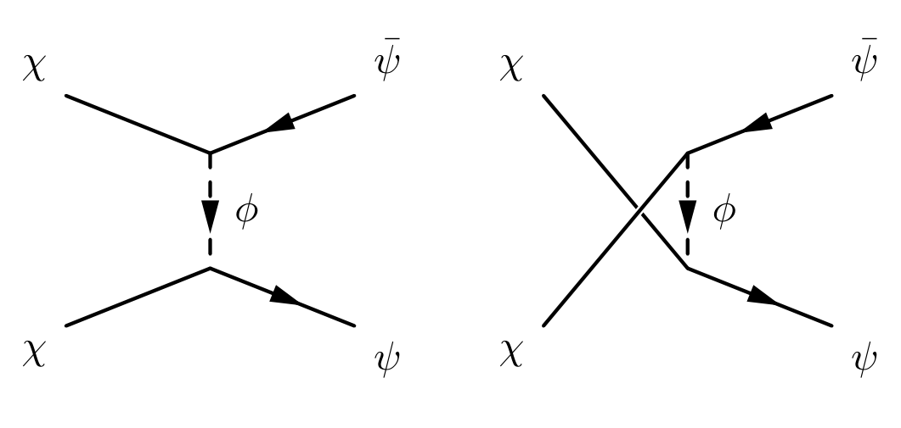

# 第 8 章 分立对称性和 Majorana 旋量场

相对于连续变换，不能用连续变化的参数描述的对称变换称为分立（discrete）变换，也称为离散变换。如果系统的作用量在一种分立变换下不变，则系统具有相应的分立对称性（discrete symmetry）。1.3 节末提到的宇称变换和时间反演变换是两种重要的分立变换。本章讨论量子场的分立变换和分立对称性，顺便介绍 Majorana 旋量场。

## 8.1 标量场的分立变换

### 8.1.1 标量场的 $P$ 变换

时空坐标 $x^\mu=(t,\mathbf{x})$ 的宇称变换由 (1.57) 式给出，即

$$
\mathcal{P}^\mu{}_\nu=(\mathcal{P}^{-1})^\mu{}_\nu=\mathrm{diag}(+1,-1,-1,-1).
\tag{8.1}
$$

这是一种非固有保时向 Lorentz 变换，将 $x^\mu$ 变换为 $x'^\mu=\mathcal{P}^\mu{}_\nu x^\nu=(\mathcal{P}x)^\mu=(t,-\mathbf{x})$，将时空导数 $\partial_\mu$ 变换为 $\partial'_\mu=(\mathcal{P}^{-1})^\nu{}_\mu\partial_\nu$，将四维动量 $p^\mu=(E,\mathbf{p})$ 变换为 $p'^\mu=(\mathcal{P}p)^\mu=(E,-\mathbf{p})$，但同时保持时空体积元不变，$\mathrm{d}^4x'=|\det(\mathcal{P})|\mathrm{d}^4x=\mathrm{d}^4x$。如果系统的作用量 $S=\int\mathrm{d}^4x\,\mathcal{L}(x)$ 在宇称变换下不变，则运动方程的形式也在宇称变换下不变，此时称系统是宇称守恒的，即具有空间反射对称性。在宇称守恒的理论中，拉氏量 $\mathcal{L}(x)$ 的宇称变换应当满足 $\mathcal{L}'(x')=\mathcal{L}(x)$，从而使得 $S'=\int\mathrm{d}^4x'\,\mathcal{L}'(x')=\int\mathrm{d}^4x\,\mathcal{L}(x)=S$。

类似于 3.1.1 小节的讨论，在宇称守恒的量子理论中，宇称变换在 Hilbert 空间中诱导出态矢 $|\Psi\rangle$ 的线性幺正变换

$$
|\Psi'\rangle=U(\mathcal{P})|\Psi\rangle=P|\Psi\rangle,
\tag{8.2}
$$

称为 $P$ 变换，其中 $P\equiv U(\mathcal{P})$ 是一个线性幺正算符。根据同态关系和 $\mathcal{P}^{-1}=\mathcal{P}$，有

$$
P^{-1}=U^{-1}(\mathcal{P})=U(\mathcal{P}^{-1})=U(\mathcal{P})=P,
\tag{8.3}
$$

即 $P$ 是自身的逆变换算符。从而 $P^2=P^{-1}P=1$，故相继两次 $P$ 变换的作用等同于恒等变换。由 $P$ 的幺正性得

$$
P^\dagger=P^{-1}=P,
\tag{8.4}
$$

因而 $P$ 是厄米算符。此时，由量子场算符构成的拉氏量在宇称变换下不变意味着 $\mathcal{L}'(x')=P^{-1}\mathcal{L}(x')P=\mathcal{L}(x)$。作替换 $x'\to x$，$x\to\mathcal{P}^{-1}x=\mathcal{P}x$，将这个式子等价地写成

$$
P^{-1}\mathcal{L}(x)P=+\mathcal{L}(\mathcal{P}x).
\tag{8.5}
$$

使拉氏量满足上式，也就是说，让拉氏量具有偶宇称（指上式右边的 $+$ 号），就能得到宇称守恒的量子场论。

现在讨论量子 Poincaré 变换 $U(\Lambda,a)$ 的生成元算符 $J^{\mu\nu}$ 和 $P^\mu$ 在宇称守恒理论中的 $P$ 变换。同态关系 (3.7) 对一般的 Lorentz 变换 $\Lambda$ 成立，可用于宇称变换 $\mathcal{P}$，故

$$
P^{-1}U(\Lambda,a)P=U^{-1}(\mathcal{P})U(\Lambda,a)U(\mathcal{P})=U(\mathcal{P}^{-1}\Lambda\mathcal{P},\mathcal{P}^{-1}a),
\tag{8.6}
$$

相应的无穷小变换为

$$
P^{-1}U(1+\omega,\varepsilon)P=U(1+\mathcal{P}^{-1}\omega\mathcal{P},\mathcal{P}^{-1}\varepsilon).
\tag{8.7}
$$

上式与 (3.15) 式类似，因而可以推出类似于 (3.23) 和 (3.24) 式的 $P$ 变换规则

$$
P^{-1}J^{\mu\nu}P=\mathcal{P}^\mu{}_\rho\mathcal{P}^\nu{}_\sigma J^{\rho\sigma},\qquad P^{-1}P^\mu P=\mathcal{P}^\mu{}_\nu P^\nu.
\tag{8.8}
$$

从而，由 (3.35) 式定义的 $J^i$ 和 $K^i$ 在 $P$ 变换下变成

$$
P^{-1}J^iP=\frac{1}{2}\varepsilon^{ijk}P^{-1}J^{jk}P=\frac{1}{2}\varepsilon^{ijk}\mathcal{P}^j{}_l\mathcal{P}^k{}_mJ^{lm}=\frac{1}{2}\varepsilon^{ijk}(-\delta^j{}_l)(-\delta^k{}_m)J^{lm}=+J^i,
\tag{8.9}
$$

$$
P^{-1}K^iP=P^{-1}J^{0i}P=\mathcal{P}^0{}_0\mathcal{P}^i{}_jJ^{0j}=-\delta^i{}_jJ^{0j}=-K^i,
\tag{8.10}
$$

即

$$
P^{-1}\mathbf{J}P=+\mathbf{J},\qquad P^{-1}\mathbf{K}P=-\mathbf{K}.
\tag{8.11}
$$

总角动量算符 $\mathbf{J}$ 具有偶宇称，体现了它作为三维轴矢量的变换性质，因此角动量在宇称变换下不变。将四维动量算符分解为 $P^\mu=(H,\mathbf{P})$，就得到

$$
P^{-1}HP=+H,\qquad P^{-1}\mathbf{P}P=-\mathbf{P}.
\tag{8.12}
$$

动量算符 $\mathbf{P}$ 具有奇宇称，体现了它作为三维极矢量的变换性质，而动量方向在宇称变换下反转。哈密顿量算符 $H$ 的宇称为偶，而 $P^{-1}HP=+H$ 等价于 $[H,P]=0$，后者在量子理论中意味着宇称算符 $P$ 是一个守恒量。

通常来说，我们希望一个物理理论包含比较多的对称性，从而具有比较优良的性质。为了得到一个宇称守恒的量子场论，首先，需要让拉氏量中的自由部分在宇称变换下不变，这是容易做到的；其次，还得要求拉氏量中的相互作用部分也在宇称变换下不变，这一点并不是平庸的。实际上，尽管宇称在电磁相互作用和强相互作用中守恒，在弱相互作用中却遭到极大的破坏。这个出乎意料的现象是 1956 年李政道和杨振宁对当时的实验结果进行理论分析时发现的 [43]。为了分析量子场论中的宇称守恒情况，我们需要知道各种量子场在 $P$ 变换下的性质。

下面先讨论自由的复标量场 $\phi(x)$，拉氏量为 (2.169) 式，$\phi(x)$ 的运动方程是 Klein-Gordon 方程 $(\partial^2+m^2)\phi(x)=0$。宇称变换翻转了动量的方向，因而 $P$ 变换对正标量玻色子 $\phi$ 的单粒子态 $|\mathbf{p}^+\rangle=\sqrt{2E_{\mathbf{p}}}a^\dagger_{\mathbf{p}}|0\rangle$ 的作用为

$$
P|\mathbf{p}^+\rangle=\eta_P|-\mathbf{p}^+\rangle,
\tag{8.13}
$$

其中 $\eta_P$ 是一个复的相位因子，满足 $|\eta_P|=1$。出现 $\eta_P$ 的原因是相差一个相位因子的态矢描述相同的物理。

真空态在 $P$ 变换下不变，故 $P|0\rangle=|0\rangle$。从而，

$$
P|\mathbf{p}^+\rangle=P^{-1}|\mathbf{p}^+\rangle=\sqrt{2E_{\mathbf{p}}}P^{-1}a^\dagger_{\mathbf{p}}P|0\rangle,
\tag{8.14}
$$

与 $P|\mathbf{p}^+\rangle=\eta_P|-\mathbf{p}^+\rangle=\sqrt{2E_{\mathbf{p}}}\eta_Pa^\dagger_{-\mathbf{p}}|0\rangle$ 比较，推出

$$
P^{-1}a^\dagger_{\mathbf{p}}P=\eta_Pa^\dagger_{-\mathbf{p}},\qquad P^{-1}a_{\mathbf{p}}P=\eta_P^*a_{-\mathbf{p}},
\tag{8.15}
$$

其中第二式由第一式取厄米共轭得到，注意 $(P^{-1}a^\dagger_{\mathbf{p}}P)^\dagger=(P^\dagger a^\dagger_{\mathbf{p}}P)^\dagger=P^\dagger a_{\mathbf{p}}P=P^{-1}a_{\mathbf{p}}P$。这是产生湮灭算符的 $P$ 变换形式。另一方面，$P$ 变换对反标量玻色子 $\bar{\phi}$ 的单粒子态 $|\mathbf{p}^-\rangle=\sqrt{2E_{\mathbf{p}}}b^\dagger_{\mathbf{p}}|0\rangle$ 的作用为 $P|\mathbf{p}^-\rangle=\tilde{\eta}_P|-\mathbf{p}^-\rangle$，出现另一个相位因子 $\tilde{\eta}_P$，同理推出

$$
P^{-1}b^\dagger_{\mathbf{p}}P=\tilde{\eta}_Pb^\dagger_{-\mathbf{p}},\qquad P^{-1}b_{\mathbf{p}}P=\tilde{\eta}_P^*b_{-\mathbf{p}}.
\tag{8.16}
$$

于是，复标量场 $\phi(x)$ 的平面波展开式 (2.177) 在 $P$ 变换下化为

$$
\begin{aligned}
P^{-1}\phi(x)P&=\int\frac{\mathrm{d}^3p}{(2\pi)^3}\frac{1}{\sqrt{2E_{\mathbf{p}}}}\left(P^{-1}a_{\mathbf{p}}P\mathrm{e}^{-\mathrm{i}p\cdot x}+P^{-1}b^\dagger_{\mathbf{p}}P\mathrm{e}^{\mathrm{i}p\cdot x}\right)\\
&=\int\frac{\mathrm{d}^3p}{(2\pi)^3}\frac{1}{\sqrt{2E_{\mathbf{p}}}}\left(\eta_P^*a_{-\mathbf{p}}\mathrm{e}^{-\mathrm{i}p\cdot x}+\tilde{\eta}_Pb^\dagger_{-\mathbf{p}}\mathrm{e}^{\mathrm{i}p\cdot x}\right)\\
&=\int\frac{\mathrm{d}^3p}{(2\pi)^3}\frac{1}{\sqrt{2E_{\mathbf{p}}}}\left[\eta_P^*a_{\mathbf{p}}\mathrm{e}^{-\mathrm{i}p\cdot(\mathcal{P}x)}+\tilde{\eta}_Pb^\dagger_{\mathbf{p}}\mathrm{e}^{\mathrm{i}p\cdot(\mathcal{P}x)}\right],
\end{aligned}
\tag{8.17}
$$

最后一步作了变量替换 $\mathbf{p}\to-\mathbf{p}$，并利用 $(\mathcal{P}p)\cdot x=p\cdot(\mathcal{P}x)$。为了保持 $\phi(x)$ 的运动方程形式不变，我们必须要求 $\eta_P$ 和 $\tilde{\eta}_P$ 满足关系式

$$
\eta_P^*=\tilde{\eta}_P,
\tag{8.18}
$$

使得 $\phi(x)$ 和 $\phi^\dagger(x)$ 的 $P$ 变换为

$$
P^{-1}\phi(x)P=\eta_P^*\phi(\mathcal{P}x),\qquad P^{-1}\phi^\dagger(x)P=\eta_P\phi^\dagger(\mathcal{P}x),
\tag{8.19}
$$

即 $P^{-1}\phi(x)P$ 与 $\phi(\mathcal{P}x)$ 只相差一个常数因子 $\eta_P^*$。从而，作宇称变换后，$\phi'(x')=P^{-1}\phi(x')P=\eta_P^*\phi(\mathcal{P}x')=\eta_P^*\phi(x)$ 也满足 Klein-Gordon 方程，

$$
(\partial'^2+m^2)\phi'(x')=\eta_P^*(\partial^2+m^2)\phi(x)=0.
\tag{8.20}
$$

这样的话，$b^\dagger_{\mathbf{p}}$ 和 $b_{\mathbf{p}}$ 的 $P$ 变换 (8.16) 变成

$$
P^{-1}b^\dagger_{\mathbf{p}}P=\eta_Pb^\dagger_{-\mathbf{p}},\qquad P^{-1}b_{\mathbf{p}}P=\eta_Pb_{-\mathbf{p}}.
\tag{8.21}
$$

现在讨论拉氏量 (2.169) 的宇称变换性质。这会涉及时空导数的宇称变换 $\partial'_\mu=(\mathcal{P}^{-1})^\nu{}_\mu\partial_\nu$，为便于表述，我们在形式上以时空导数的宇称变换定义 $P$ 变换，

$$
P^{-1}\partial_\mu P\equiv\partial'_\mu=(\mathcal{P}^{-1})^\nu{}_\mu\partial_\nu,\qquad P^{-1}\partial^\mu P=\partial'^\mu=\mathcal{P}^\mu{}_\nu\partial^\nu.
\tag{8.22}
$$

于是，拉氏量中动能项算符 $(\partial^\mu\phi^\dagger)\partial_\mu\phi$ 的 $P$ 变换为

$$
\begin{aligned}
P^{-1}\partial^\mu\phi^\dagger(x)\partial_\mu\phi(x)P&=P^{-1}\partial^\mu PP^{-1}\phi^\dagger(x)PP^{-1}\partial_\mu PP^{-1}\phi(x)P\\
&=|\eta_P|^2\mathcal{P}^\mu{}_\nu(\mathcal{P}^{-1})^\rho{}_\mu\partial^\nu\phi^\dagger(\mathcal{P}x)\partial_\rho\phi(\mathcal{P}x)=+\partial^\mu\phi^\dagger(\mathcal{P}x)\partial_\mu\phi(\mathcal{P}x),
\end{aligned}
\tag{8.23}
$$

质量项算符 $\phi^\dagger\phi$ 的 $P$ 变换为

$$
P^{-1}\phi^\dagger(x)\phi(x)P=P^{-1}\phi^\dagger(x)PP^{-1}\phi(x)P=|\eta_P|^2\phi^\dagger(\mathcal{P}x)\phi(\mathcal{P}x)=+\phi^\dagger(\mathcal{P}x)\phi(\mathcal{P}x).
\tag{8.24}
$$

以上两式最右边表达式中的 $+$ 号表明算符 $(\partial^\mu\phi^\dagger)\partial_\mu\phi$ 和 $\phi^\dagger\phi$ 都具有偶宇称。因此，自由复标量场的拉氏量 (2.169) 满足 (8.5) 式，即拉氏量在宇称变换下不变。

在 $P$ 变换下，(2.199) 式中的 U(1) 守恒流算符 $\phi^\dagger\mathrm{i}\overleftrightarrow{\partial^\mu}\phi$ 变成

$$
P^{-1}\phi^\dagger(x)\mathrm{i}\overleftrightarrow{\partial^\mu}\phi(x)P=P^{-1}\phi^\dagger(x)PP^{-1}\mathrm{i}\overleftrightarrow{\partial^\mu}PP^{-1}\phi(x)P=\mathcal{P}^\mu{}_\nu\phi^\dagger(\mathcal{P}x)\mathrm{i}\overleftrightarrow{\partial^\nu}\phi(\mathcal{P}x),
\tag{8.25}
$$

符合 $\phi^\dagger\mathrm{i}\overleftrightarrow{\partial^\mu}\phi$ 作为极矢量的变换规则。

在质心系中考虑一对正反标量玻色子 $\phi\bar{\phi}$ 组成的态

$$
|\phi\bar{\phi}\rangle=\int\mathrm{d}^3p\,\Phi(\mathbf{p})a^\dagger_{\mathbf{p}}b^\dagger_{-\mathbf{p}}|0\rangle,
\tag{8.26}
$$

其中 $\Phi(\mathbf{p})$ 是动量空间中的波函数。当轨道角动量的量子数为 $L$ 时，$\Phi(\mathbf{p})$ 正比于球谐函数 $Y_{LM}(\theta,\phi)$，其中 $\theta$ 和 $\phi$ 分别是球坐标系中动量 $\mathbf{p}$ 的极角和方位角。$-\mathbf{p}$ 的极角为 $\pi-\theta$，方位角为 $\pi+\phi$，由 $Y_{LM}(\pi-\theta,\pi+\phi)=(-)^LY_{LM}(\theta,\phi)$ 得

$$
\Phi(-\mathbf{p})=(-)^L\Phi(\mathbf{p}).
\tag{8.27}
$$

于是，$|\phi\bar{\phi}\rangle$ 的 $P$ 变换为

$$
\begin{aligned}
P|\phi\bar{\phi}\rangle&=\int\mathrm{d}^3p\,\Phi(\mathbf{p})P^{-1}a^\dagger_{\mathbf{p}}PP^{-1}b^\dagger_{-\mathbf{p}}P|0\rangle=|\eta_P|^2\int\mathrm{d}^3p\,\Phi(\mathbf{p})a^\dagger_{-\mathbf{p}}b^\dagger_{\mathbf{p}}|0\rangle\\
&=\int\mathrm{d}^3p\,\Phi(-\mathbf{p})a^\dagger_{\mathbf{p}}b^\dagger_{-\mathbf{p}}|0\rangle=(-)^L\int\mathrm{d}^3p\,\Phi(\mathbf{p})a^\dagger_{\mathbf{p}}b^\dagger_{-\mathbf{p}}|0\rangle=(-)^L|\phi\bar{\phi}\rangle.
\end{aligned}
\tag{8.28}
$$

第三步作了变量替换 $\mathbf{p}\to-\mathbf{p}$。这个结果表明 $|\phi\bar{\phi}\rangle$ 是 $P$ 算符的本征态，本征值 $(-)^L$ 是可观测量，称作 $|\phi\bar{\phi}\rangle$ 的宇称。宇称是一种相乘性量子数（multiplicative quantum number），态矢的总宇称是各部分贡献的宇称之积。波函数 $\Phi(\mathbf{p})$ 对 $|\phi\bar{\phi}\rangle$ 宇称的贡献为 $(-)^L$，这部分称为轨道宇称（orbital parity）。扣除轨道宇称之后，剩下的部分称为内禀宇称（intrinsic parity）。$|\phi\bar{\phi}\rangle$ 的内禀宇称为 $+$，因此我们说一对正反标量玻色子的内禀宇称为偶。

接下来讨论自由的实标量场 $\phi(x)$，拉氏量为 (2.77) 式。比较它的平面波展开式 (2.101) 与 (2.177) 式，可以看出，实标量场的情况相当于要求以上讨论在 $b_{\mathbf{p}}=a_{\mathbf{p}}$ 的条件下进行，由此推出

$$
\eta_P=\tilde{\eta}_P=\eta_P^*.
\tag{8.29}
$$

于是，相位因子 $\eta_P$ 是实数，满足 $\eta_P^2=|\eta_P|^2=1$，故

$$
\eta_P=\pm1.
\tag{8.30}
$$

若 $\eta_P=+1$，则实标量场 $\phi(x)$ 是狭义的标量场，$P$ 变换为

$$
P^{-1}\phi(x)P=+\phi(\mathcal{P}x),
\tag{8.31}
$$

宇称为偶。若 $\eta_P=-1$，则称它是赝标量场，$P$ 变换为

$$
P^{-1}\phi(x)P=-\phi(\mathcal{P}x),
\tag{8.32}
$$

宇称为奇。容易看出，无论实标量场 $\phi(x)$ 具有哪种宇称，拉氏量 (2.77) 都在宇称变换下不变。不过，与旋量场发生宇称守恒的相互作用时，宇称不同的实标量场 $\phi(x)$ 具有不同的性质，可以通过实验来分辨。

对于复标量场 $\phi(x)$，宇称变换相位因子的取值实际上是任意的。如 2.4.3 小节所述，自由的复标量场具有 U(1) 整体对称性 $\phi'(x)=\mathrm{e}^{\mathrm{i}q\theta}\phi(x)$，相应的守恒荷算符 $Q$ 由 (2.202) 式给出，满足 (2.217) 式，即 $[Q,\phi]=-q\phi$。由此得到多重对易子表达式

$$
[\phi,Q^{(1)}]=q\phi,\qquad[\phi,Q^{(2)}]=[[\phi,Q^{(1)}],Q]=q[\phi,Q]=q^2\phi,\qquad\cdots,\qquad[\phi,Q^{(n)}]=q^n\phi,
\tag{8.33}
$$

再利用 (4.23) 式，推出

$$
\begin{aligned}
\mathrm{e}^{\mathrm{i}\theta Q}\phi\mathrm{e}^{-\mathrm{i}\theta Q}&=\sum_{n=0}^{\infty}\frac{1}{n!}[\phi,(-\mathrm{i}\theta Q)^{(n)}]=\sum_{n=0}^{\infty}\frac{(-\mathrm{i}\theta)^n}{n!}[\phi,Q^{(n)}]\\
&=\sum_{n=0}^{\infty}\frac{(-\mathrm{i}q\theta)^n}{n!}\phi=\mathrm{e}^{-\mathrm{i}q\theta}\phi.
\end{aligned}
\tag{8.34}
$$

用 $Q$ 和 $P$ 定义一个新的幺正算符

$$
P'\equiv\mathrm{e}^{-\mathrm{i}\theta Q}P,
\tag{8.35}
$$

满足 $P'^{-1}=P'^\dagger=P^\dagger\mathrm{e}^{\mathrm{i}\theta Q}=P^{-1}\mathrm{e}^{\mathrm{i}\theta Q}$，则复标量场 $\phi(x)$ 的 $P'$ 变换为

$$
P'^{-1}\phi(x)P'=P^{-1}\mathrm{e}^{\mathrm{i}\theta Q}\phi(x)\mathrm{e}^{-\mathrm{i}\theta Q}P=\mathrm{e}^{-\mathrm{i}q\theta}P^{-1}\phi(x)P=\mathrm{e}^{-\mathrm{i}q\theta}\eta_P^*\phi(\mathcal{P}x)=\eta_P'^*\phi(\mathcal{P}x),
\tag{8.36}
$$

其中

$$
\eta_P'\equiv\mathrm{e}^{\mathrm{i}q\theta}\eta_P.
\tag{8.37}
$$

是 $P'$ 算符的相位因子。尽管 $P'$ 算符不是厄米的，它的作用与 $P$ 算符的作用在实质上是相同的，能够将 $\phi(x)$ 变换成 $\phi(\mathcal{P}x)$，只相差一个相位因子 $\eta_P'$。因此，我们可以用 $P'$ 取代 $P$ 作为宇称变换算符，而相位因子 $\eta_P'$ 将取代原来的 $\eta_P$。由于 U(1) 变换参数 $\theta$ 是任意的，$\eta_P'$ 的取值也是任意的。

另一方面，实标量场 $\phi(x)$ 不具备 U(1) 整体对称性，因而相应宇称变换相位因子不具有这样的任意性。可以认为，实标量场的 U(1) 荷 $q=0$，守恒荷算符 $Q=0$，因而用 (8.35) 式定义的 $P'$ 与 $P$ 相同。

这个结论可以推广到其它分立对称性和其它量子场：分立变换的相位因子对于像复标量场这样的复场是任意的，对于像实标量场这样的自共轭场则是确定的。

### 8.1.2 标量场的 $T$ 变换

$x^\mu$ 的时间反演变换由 (1.58) 式给出，即

$$
\mathcal{T}^\mu{}_\nu=(\mathcal{T}^{-1})^\mu{}_\nu=\mathrm{diag}(-1,+1,+1,+1).
\tag{8.38}
$$

这是一种非固有反时向 Lorentz 变换，将 $x^\mu=(t,\mathbf{x})$ 变换为 $x'^\mu=(\mathcal{T}x)^\mu=(-t,\mathbf{x})$，将 $\partial_\mu$ 变换为 $\partial'_\mu=(\mathcal{T}^{-1})^\nu{}_\mu\partial_\nu$，将 $p^\mu=(E,\mathbf{p})$ 变换为 $p'^\mu=(\mathcal{T}p)^\mu=(-E,\mathbf{p})$，同时保持时空体积元不变，$\mathrm{d}^4x'=|\det(\mathcal{T})|\mathrm{d}^4x=\mathrm{d}^4x$。于是，只要拉氏量在时间反演变换下不变，满足 $\mathcal{L}'(x')=\mathcal{L}(x)$，系统就具有时间反演对称性。

在具有时间反演对称性的量子理论中，时间反演变换在 Hilbert 空间中诱导出态矢 $|\Psi\rangle$ 的 $T$ 变换

$$
|\Psi'\rangle=U(\mathcal{T})|\Psi\rangle=T|\Psi\rangle,
\tag{8.39}
$$

其中 $T\equiv U(\mathcal{T})$。$T$ 是自身的逆变换算符，$T^{-1}=T$。仿照上面关于 $P$ 变换的讨论，根据同态关系 (3.7)，量子 Poincaré 变换 $U(\Lambda,a)$ 满足

$$
T^{-1}U(\Lambda,a)T=U^{-1}(\mathcal{T})U(\Lambda,a)U(\mathcal{T})=U(\mathcal{T}^{-1}\Lambda\mathcal{T},\mathcal{T}^{-1}a),
\tag{8.40}
$$

由此推出类似于 (3.21) 和 (3.22) 式的 $T$ 变换规则

$$
T^{-1}\mathrm{i}J^{\mu\nu}T=\mathrm{i}\mathcal{T}^\mu{}_\rho\mathcal{T}^\nu{}_\sigma J^{\rho\sigma},\qquad T^{-1}\mathrm{i}P^\mu T=\mathrm{i}\mathcal{T}^\mu{}_\nu P^\nu.
\tag{8.41}
$$

这里我们保留了推导过程中的虚数 $\mathrm{i}$。

如果时间反演算符 $T$ 与宇称算符 $P$ 一样是线性幺正算符，那么，

$$
T^{-1}HT=T^{-1}P^0T=\mathcal{T}^0{}_0P^0=-H.
\tag{8.42}
$$

这意味着哈密顿量算符 $H$ 在 $T$ 变换下发生改变，导致理论不具有时间反演对称性，与我们的假设矛盾。因此，$T$ 不可能是线性幺正算符。不过，对称变换在量子力学中不一定要用线性幺正算符表述，也可以用反线性（antilinear）反幺正（antiunitary）算符描述。

一般地，在反线性反幺正算符 $U$ 的作用下，态矢 $|\Psi_1\rangle$ 和 $|\Psi_2\rangle$ 满足

$$
U(a|\Psi_1\rangle+b|\Psi_2\rangle)=a^*U|\Psi_1\rangle+b^*U|\Psi_2\rangle,\qquad\langle U\Psi_1|U\Psi_2\rangle=\langle\Psi_1|\Psi_2\rangle^*,
\tag{8.43}
$$

其中 $a$ 和 $b$ 是任意复数。第一个等式代表反线性，第二个等式代表反幺正。反线性意味着

$$
-\mathrm{i}|\Psi_1\rangle=U^{-1}U(-\mathrm{i}|\Psi_1\rangle)=U^{-1}\mathrm{i}U|\Psi_1\rangle,
\tag{8.44}
$$

即

$$
U^{-1}\mathrm{i}U=-\mathrm{i}.
\tag{8.45}
$$

对任意复数 $a$，则有 $U^{-1}aU=a^*$。反线性反幺正算符 $U$ 的厄米共轭算符 $U^\dagger$ 通过下式定义，

$$
\langle\Psi_1|U^\dagger\Psi_2\rangle\equiv\langle U\Psi_1|\Psi_2\rangle^*=\langle\Psi_2|U\Psi_1\rangle.
\tag{8.46}
$$

因而反幺正意味着

$$
\langle\Psi_1|U^{-1}U\Psi_2\rangle=\langle\Psi_1|\Psi_2\rangle=\langle U\Psi_1|U\Psi_2\rangle^*=\langle\Psi_1|U^\dagger U\Psi_2\rangle,
\tag{8.47}
$$

故

$$
U^{-1}=U^\dagger.
\tag{8.48}
$$

这个等式与线性幺正算符满足的等式相同。

现在，我们将 $T$ 算符定义为反线性反幺正算符，满足

$$
T^{-1}\mathrm{i}T=-\mathrm{i},\qquad T^{-1}=T^\dagger.
\tag{8.49}
$$

那么，(8.41) 式表明生成元算符 $J^{\mu\nu}$ 和 $P^\mu$ 的 $T$ 变换为

$$
T^{-1}J^{\mu\nu}T=-\mathcal{T}^\mu{}_\rho\mathcal{T}^\nu{}_\sigma J^{\rho\sigma},\qquad T^{-1}P^\mu T=-\mathcal{T}^\mu{}_\nu P^\nu,
\tag{8.50}
$$

即

$$
T^{-1}\mathbf{J}T=-\mathbf{J},\qquad T^{-1}\mathbf{K}T=+\mathbf{K},\qquad T^{-1}HT=+H,\qquad T^{-1}\mathbf{P}T=-\mathbf{P}.
\tag{8.51}
$$

从而，哈密顿量算符 $H$ 在时间反演变换下不变，满足 $[H,T]=0$，符合理论具有时间反演对称性的假设。此外，动量算符 $\mathbf{P}$ 和总角动量算符 $\mathbf{J}$ 在 $T$ 变换下分别反转成 $-\mathbf{P}$ 和 $-\mathbf{J}$。时间反演变换相当于逆着时间方向进行观察，因而动量和角动量的方向都会反转。

下面讨论自由的复标量场 $\phi(x)$。$T$ 变换会翻转粒子态对应的动量方向，因而产生湮灭算符的 $T$ 变换为

$$
T^{-1}a^\dagger_{\mathbf{p}}T=\eta_Ta^\dagger_{-\mathbf{p}},\qquad T^{-1}a_{\mathbf{p}}T=\eta_T^*a_{-\mathbf{p}},\qquad T^{-1}b^\dagger_{\mathbf{p}}T=\tilde{\eta}_Tb^\dagger_{-\mathbf{p}},\qquad T^{-1}b_{\mathbf{p}}T=\tilde{\eta}_T^*b_{-\mathbf{p}},
\tag{8.52}
$$

其中 $\eta_T$ 和 $\tilde{\eta}_T$ 是两个模为 1 的相位因子。于是，平面波展开式的 $T$ 变换为

$$
\begin{aligned}
T^{-1}\phi(x)T&=\int\frac{\mathrm{d}^3p}{(2\pi)^3}\frac{1}{\sqrt{2E_{\mathbf{p}}}}\left(T^{-1}a_{\mathbf{p}}TT^{-1}\mathrm{e}^{-\mathrm{i}p\cdot x}T+T^{-1}b^\dagger_{\mathbf{p}}TT^{-1}\mathrm{e}^{\mathrm{i}p\cdot x}T\right)\\
&=\int\frac{\mathrm{d}^3p}{(2\pi)^3}\frac{1}{\sqrt{2E_{\mathbf{p}}}}\left(\eta_T^*a_{-\mathbf{p}}\mathrm{e}^{\mathrm{i}p\cdot x}+\tilde{\eta}_Tb^\dagger_{-\mathbf{p}}\mathrm{e}^{-\mathrm{i}p\cdot x}\right)\\
&=\int\frac{\mathrm{d}^3p}{(2\pi)^3}\frac{1}{\sqrt{2E_{\mathbf{p}}}}\left[\eta_T^*a_{\mathbf{p}}\mathrm{e}^{-\mathrm{i}p\cdot(\mathcal{T}x)}+\tilde{\eta}_Tb^\dagger_{\mathbf{p}}\mathrm{e}^{\mathrm{i}p\cdot(\mathcal{T}x)}\right],
\end{aligned}
\tag{8.53}
$$

最后一步作了变量替换 $\mathbf{p}\to-\mathbf{p}$，并利用 $(\mathcal{P}p)\cdot x=p\cdot(\mathcal{P}x)=-p\cdot(\mathcal{T}x)$。为了保持 $\phi(x)$ 的运动方程形式不变，$T^{-1}\phi(x)T$ 与 $\phi(\mathcal{T}x)$ 最多只能相差一个常数因子，因此必须要求

$$
\eta_T^*=\tilde{\eta}_T,
\tag{8.54}
$$

使得 $\phi(x)$ 和 $\phi^\dagger(x)$ 的 $T$ 变换为

$$
T^{-1}\phi(x)T=\eta_T^*\phi(\mathcal{T}x),\qquad T^{-1}\phi^\dagger(x)T=\eta_T\phi^\dagger(\mathcal{T}x).
\tag{8.55}
$$

为方便表述，在形式上以时空导数的时间反演变换定义 $T$ 变换，

$$
T^{-1}\partial_\mu T\equiv\partial'_\mu=(\mathcal{T}^{-1})^\nu{}_\mu\partial_\nu,\qquad T^{-1}\partial^\mu T=\partial'^\mu=\mathcal{T}^\mu{}_\nu\partial^\nu.
\tag{8.56}
$$

那么算符 $(\partial^\mu\phi^\dagger)\partial_\mu\phi$、$\phi^\dagger\phi$ 和 $\phi^\dagger\mathrm{i}\overleftrightarrow{\partial^\mu}\phi$ 的 $T$ 变换是

$$
T^{-1}\partial^\mu\phi^\dagger(x)\partial_\mu\phi(x)T=|\eta_T|^2\mathcal{T}^\mu{}_\nu(\mathcal{T}^{-1})^\rho{}_\mu\partial^\nu\phi^\dagger(\mathcal{T}x)\partial_\rho\phi(\mathcal{T}x)=+\partial^\mu\phi^\dagger(\mathcal{T}x)\partial_\mu\phi(\mathcal{T}x),
\tag{8.57}
$$

$$
T^{-1}\phi^\dagger(x)\phi(x)T=|\eta_T|^2\phi^\dagger(\mathcal{T}x)\phi(\mathcal{T}x)=+\phi^\dagger(\mathcal{T}x)\phi(\mathcal{T}x),
\tag{8.58}
$$

$$
T^{-1}\phi^\dagger(x)\mathrm{i}\overleftrightarrow{\partial^\mu}\phi(x)T=-|\eta_T|^2\mathcal{T}^\mu{}_\nu\phi^\dagger(\mathcal{T}x)\mathrm{i}\overleftrightarrow{\partial^\nu}\phi(\mathcal{T}x)=-\mathcal{T}^\mu{}_\nu\phi^\dagger(\mathcal{T}x)\mathrm{i}\overleftrightarrow{\partial^\nu}\phi(\mathcal{T}x).
\tag{8.59}
$$

可见，自由复标量场的拉氏量 (2.169) 在时间反演变换下不变，满足

$$
T^{-1}\mathcal{L}(x)T=+\mathcal{L}(\mathcal{T}x).
\tag{8.60}
$$

令 $b_{\mathbf{p}}=a_{\mathbf{p}}$，就得到自由实标量场 $\phi(x)$ 的情况，此时 $\eta_T=\tilde{\eta}_T=\eta_T^*$，故 $\eta_T^2=|\eta_T|^2=1$，有

$$
\eta_T=\pm1.
\tag{8.61}
$$

因此，存在两类实标量场，一类具有 $\eta_T=+1$，相应的 $T$ 变换为

$$
T^{-1}\phi(x)T=+\phi(\mathcal{T}x);
\tag{8.62}
$$

另一类具有 $\eta_T=-1$，相应的 $T$ 变换为

$$
T^{-1}\phi(x)T=-\phi(\mathcal{T}x).
\tag{8.63}
$$

无论哪一类实标量场 $\phi(x)$，自由拉氏量 (2.77) 都具有时间反演不变性。

### 8.1.3 标量场的 $C$ 变换

除了宇称和时间反演，另一种重要的分立变换是电荷共轭（charge conjugation）。电荷共轭变换将正反粒子互相转换，不只转换正反电荷，也转换所有其它正反 U(1) 守恒荷，但对时空坐标、四维动量、角动量和螺旋度没有影响。

在具有电荷共轭对称性的量子理论中，电荷共轭变换在 Hilbert 空间中诱导出态矢 $|\Psi\rangle$ 的线性幺正变换

$$
|\Psi'\rangle=C|\Psi\rangle,
\tag{8.64}
$$

称为 $C$ 变换。$C$ 是自身的逆变换算符，满足

$$
C^\dagger=C^{-1}=C,
\tag{8.65}
$$

因而是厄米的。

对于自由的复标量场 $\phi(x)$，$C$ 变换将正粒子态转化成反粒子态，形式为

$$
C|\mathbf{p}^+\rangle=\eta_C|\mathbf{p}^-\rangle,
\tag{8.66}
$$

其中 $\eta_C$ 是相位因子。真空态在 $C$ 变换下不变，满足 $C|0\rangle=|0\rangle$，从而

$$
\sqrt{2E_{\mathbf{p}}}C^{-1}a^\dagger_{\mathbf{p}}C|0\rangle=C\sqrt{2E_{\mathbf{p}}}a^\dagger_{\mathbf{p}}|0\rangle=C|\mathbf{p}^+\rangle=\eta_C|\mathbf{p}^-\rangle=\sqrt{2E_{\mathbf{p}}}\eta_Cb^\dagger_{\mathbf{p}}|0\rangle,
\tag{8.67}
$$

即

$$
C^{-1}a^\dagger_{\mathbf{p}}C=\eta_Cb^\dagger_{\mathbf{p}},\qquad C^{-1}a_{\mathbf{p}}C=\eta_C^*b_{\mathbf{p}}.
\tag{8.68}
$$

第一个等式等价于 $a^\dagger_{\mathbf{p}}=\eta_CCb^\dagger_{\mathbf{p}}C^{-1}$，因而 $\eta_C^*a^\dagger_{\mathbf{p}}=|\eta_C|^2Cb^\dagger_{\mathbf{p}}C^{-1}=Cb^\dagger_{\mathbf{p}}C^{-1}$，即

$$
C^{-1}b^\dagger_{\mathbf{p}}C=\eta_C^*a^\dagger_{\mathbf{p}},\qquad C^{-1}b_{\mathbf{p}}C=\eta_Ca_{\mathbf{p}}.
\tag{8.69}
$$

于是，复标量场 $\phi(x)$ 的 $C$ 变换为

$$
\begin{aligned}
C^{-1}\phi(x)C&=\int\frac{\mathrm{d}^3p}{(2\pi)^3}\frac{1}{\sqrt{2E_{\mathbf{p}}}}\left(C^{-1}a_{\mathbf{p}}C\mathrm{e}^{-\mathrm{i}p\cdot x}+C^{-1}b^\dagger_{\mathbf{p}}C\mathrm{e}^{\mathrm{i}p\cdot x}\right)\\
&=\int\frac{\mathrm{d}^3p}{(2\pi)^3}\frac{1}{\sqrt{2E_{\mathbf{p}}}}\left(\eta_C^*b_{\mathbf{p}}\mathrm{e}^{-\mathrm{i}p\cdot x}+\eta_C^*a^\dagger_{\mathbf{p}}\mathrm{e}^{\mathrm{i}p\cdot x}\right),
\end{aligned}
\tag{8.70}
$$

故

$$
C^{-1}\phi(x)C=\eta_C^*\phi^\dagger(x),\qquad C^{-1}\phi^\dagger(x)C=\eta_C\phi(x).
\tag{8.71}
$$

可见，$C$ 变换使 $\phi(x)$ 与其厄米共轭场 $\phi^\dagger(x)$ 相互转换。注意到等时对易关系 (2.182)，算符 $(\partial^\mu\phi^\dagger)\partial_\mu\phi$、$\phi^\dagger\phi$ 和 $\phi^\dagger\mathrm{i}\overleftrightarrow{\partial^\mu}\phi$ 的 $C$ 变换是

$$
C^{-1}\partial^\mu\phi^\dagger(x)\partial_\mu\phi(x)C=|\eta_C|^2\partial^\mu\phi(x)\partial_\mu\phi^\dagger(x)=+\partial^\mu\phi^\dagger(x)\partial_\mu\phi(x),
\tag{8.72}
$$

$$
C^{-1}\phi^\dagger(x)\phi(x)C=|\eta_C|^2\phi(x)\phi^\dagger(x)=+\phi^\dagger(x)\phi(x),
\tag{8.73}
$$

$$
C^{-1}\phi^\dagger(x)\mathrm{i}\overleftrightarrow{\partial^\mu}\phi(x)C=|\eta_C|^2\phi(x)\mathrm{i}\overleftrightarrow{\partial^\mu}\phi^\dagger(x)=-\phi^\dagger(x)\mathrm{i}\overleftrightarrow{\partial^\mu}\phi(x).
\tag{8.74}
$$

因此，自由复标量场的拉氏量 (2.169) 在电荷共轭变换下不变，满足

$$
C^{-1}\mathcal{L}(x)C=+\mathcal{L}(x).
\tag{8.75}
$$

对正反标量玻色子态 (8.26) 作 $C$ 变换，得

$$
\begin{aligned}
C|\phi\bar{\phi}\rangle&=\int\mathrm{d}^3p\,\Phi(\mathbf{p})C^{-1}a^\dagger_{\mathbf{p}}CC^{-1}b^\dagger_{-\mathbf{p}}C|0\rangle=|\eta_C|^2\int\mathrm{d}^3p\,\Phi(\mathbf{p})b^\dagger_{\mathbf{p}}a^\dagger_{-\mathbf{p}}|0\rangle\\
&=\int\mathrm{d}^3p\,\Phi(\mathbf{p})a^\dagger_{-\mathbf{p}}b^\dagger_{\mathbf{p}}|0\rangle=\int\mathrm{d}^3p\,\Phi(-\mathbf{p})a^\dagger_{\mathbf{p}}b^\dagger_{-\mathbf{p}}|0\rangle\\
&=(-)^L\int\mathrm{d}^3p\,\Phi(\mathbf{p})a^\dagger_{\mathbf{p}}b^\dagger_{-\mathbf{p}}|0\rangle=(-)^L|\phi\bar{\phi}\rangle.
\end{aligned}
\tag{8.76}
$$

第三步交换两个产生算符，第四步作了变量替换 $\mathbf{p}\to-\mathbf{p}$，第五步用了 (8.27) 式。可见，$|\phi\bar{\phi}\rangle$ 是 $C$ 算符的本征态，本征值 $(-)^L$ 是可观测量，称为 $C$ 宇称（$C$-parity）。扣除波函数 $\Phi(\mathbf{p})$ 贡献的 $(-)^L$ 因子之后，剩下的 $C$ 宇称称为 $+$，即一对正反标量玻色子的内禀 $C$ 宇称为偶。

对于自由的实标量场，$\phi^\dagger(x)=\phi(x)$，(8.71) 中两个等式表明 $\eta_C=\eta_C^*$，故 $\eta_C^2=|\eta_C|^2=1$，有

$$
\eta_C=\pm1,
\tag{8.77}
$$

这是 $C$ 宇称的两种取值。也就是说，存在两类实标量场，一类具有偶的 $C$ 宇称，$\eta_C=+1$，相应的 $C$ 变换为

$$
C^{-1}\phi(x)C=+\phi(x);
\tag{8.78}
$$

另一类具有奇的 $C$ 宇称，$\eta_C=-1$，相应的 $C$ 变换为

$$
C^{-1}\phi(x)C=-\phi(x).
\tag{8.79}
$$

无论实标量场 $\phi(x)$ 具有哪种 $C$ 宇称，自由拉氏量 (2.77) 都具有电荷共轭不变性。

## 8.2 旋量场的分立变换

### 8.2.1 旋量场的 $C$ 变换

首先，讨论自由 Dirac 旋量场 $\psi(x)$ 的 $C$ 变换。因为电荷共轭变换在互换正反粒子的同时，不改变动量 $\mathbf{p}$ 和螺旋度 $\lambda=\pm$，所以 $C$ 变换将正费米子态 $|\mathbf{p}^+,\lambda\rangle=\sqrt{2E_{\mathbf{p}}}a^\dagger_{\mathbf{p},\lambda}|0\rangle$ 转化成反费米子态 $|\mathbf{p}^-,\lambda\rangle=\sqrt{2E_{\mathbf{p}}}b^\dagger_{\mathbf{p},\lambda}|0\rangle$，满足

$$
C|\mathbf{p}^+,\lambda\rangle=\zeta_C|\mathbf{p}^-,\lambda\rangle,
\tag{8.80}
$$

其中 $\zeta_C$ 是相位因子。由此推出

$$
C^{-1}a^\dagger_{\mathbf{p},\lambda}C=\zeta_Cb^\dagger_{\mathbf{p},\lambda},\qquad C^{-1}a_{\mathbf{p},\lambda}C=\zeta_C^*b_{\mathbf{p},\lambda},\qquad C^{-1}b^\dagger_{\mathbf{p},\lambda}C=\zeta_C^*a^\dagger_{\mathbf{p},\lambda},\qquad C^{-1}b_{\mathbf{p},\lambda}C=\zeta_Ca_{\mathbf{p},\lambda}.
\tag{8.81}
$$

从而，平面波展开式 (4.217) 的 $C$ 变换为

$$
\begin{aligned}
C^{-1}\psi(x)C&=\int\frac{\mathrm{d}^3p}{(2\pi)^3}\frac{1}{\sqrt{2E_{\mathbf{p}}}}\sum_\lambda\left[u(\mathbf{p},\lambda)C^{-1}a_{\mathbf{p},\lambda}C\mathrm{e}^{-\mathrm{i}p\cdot x}+v(\mathbf{p},\lambda)C^{-1}b^\dagger_{\mathbf{p},\lambda}C\mathrm{e}^{\mathrm{i}p\cdot x}\right]\\
&=\int\frac{\mathrm{d}^3p}{(2\pi)^3}\frac{1}{\sqrt{2E_{\mathbf{p}}}}\sum_\lambda\left[\zeta_C^*u(\mathbf{p},\lambda)b_{\mathbf{p},\lambda}\mathrm{e}^{-\mathrm{i}p\cdot x}+\zeta_C^*v(\mathbf{p},\lambda)a^\dagger_{\mathbf{p},\lambda}\mathrm{e}^{\mathrm{i}p\cdot x}\right].
\end{aligned}
\tag{8.82}
$$

为了得到 $\psi(x)$ 的电荷共轭场，我们需要探讨平面波旋量系数 $u(\mathbf{p},\lambda)$ 和 $v(\mathbf{p},\lambda)$ 之间的关系。在 Weyl 表象 (4.69) 中，对螺旋态表达式 (4.203) 和 (4.204) 进行转置，得

$$
\bar{u}^{\mathrm{T}}(\mathbf{p},\lambda)=\begin{pmatrix}\omega_\lambda(\mathbf{p})\xi_\lambda^*(\mathbf{p})\\\omega_{-\lambda}(\mathbf{p})\xi_\lambda^*(\mathbf{p})\end{pmatrix},\qquad\bar{v}^{\mathrm{T}}(\mathbf{p},\lambda)=\begin{pmatrix}-\lambda\omega_{-\lambda}(\mathbf{p})\xi_{-\lambda}^*(\mathbf{p})\\\lambda\omega_\lambda(\mathbf{p})\xi_{-\lambda}^*(\mathbf{p})\end{pmatrix}.
\tag{8.83}
$$

另一方面，按照螺旋态的具体形式 (4.160)，$\mathrm{i}\sigma^2$ 对 $\xi_\lambda^*(\mathbf{p})$ 的作用为

$$
\mathrm{i}\sigma^2\xi_+^*(\mathbf{p})=N\begin{pmatrix}&1\\-1&\end{pmatrix}\begin{pmatrix}|\mathbf{p}|+p^3\\p^1-\mathrm{i}p^2\end{pmatrix}=N\begin{pmatrix}p^1-\mathrm{i}p^2\\-(|\mathbf{p}|+p^3)\end{pmatrix}=-\xi_-(\mathbf{p}),
\tag{8.84}
$$

$$
\mathrm{i}\sigma^2\xi_-^*(\mathbf{p})=N\begin{pmatrix}&1\\-1&\end{pmatrix}\begin{pmatrix}-p^1-\mathrm{i}p^2\\|\mathbf{p}|+p^3\end{pmatrix}=N\begin{pmatrix}|\mathbf{p}|+p^3\\p^1+\mathrm{i}p^2\end{pmatrix}=+\xi_+(\mathbf{p}),
\tag{8.85}
$$

其中归一化因子 $N\equiv[2|\mathbf{p}|(|\mathbf{p}|+p^3)]^{-1/2}$。归纳起来，得

$$
\mathrm{i}\sigma^2\xi_\lambda^*(\mathbf{p})=-\lambda\xi_{-\lambda}(\mathbf{p}),\qquad\mathrm{i}\sigma^2\xi_{-\lambda}^*(\mathbf{p})=\lambda\xi_\lambda(\mathbf{p}).
\tag{8.86}
$$

引入旋量空间中的电荷共轭矩阵

$$
\mathcal{C}\equiv\mathrm{i}\gamma^0\gamma^2=\mathrm{i}\begin{pmatrix}&\mathbf{1}\\\mathbf{1}&\end{pmatrix}\begin{pmatrix}&\sigma^2\\-\sigma^2&\end{pmatrix}=\begin{pmatrix}-\mathrm{i}\sigma^2&\\&\mathrm{i}\sigma^2\end{pmatrix},
\tag{8.87}
$$

就可以导出平面波旋量系数的关系式

$$
\mathcal{C}\bar{u}^{\mathrm{T}}(\mathbf{p},\lambda)=\begin{pmatrix}-\omega_\lambda(\mathbf{p})\mathrm{i}\sigma^2\xi_\lambda^*(\mathbf{p})\\\omega_{-\lambda}(\mathbf{p})\mathrm{i}\sigma^2\xi_\lambda^*(\mathbf{p})\end{pmatrix}=\begin{pmatrix}\lambda\omega_\lambda(\mathbf{p})\xi_{-\lambda}(\mathbf{p})\\-\lambda\omega_{-\lambda}(\mathbf{p})\xi_{-\lambda}(\mathbf{p})\end{pmatrix}=v(\mathbf{p},\lambda),
\tag{8.88}
$$

$$
\mathcal{C}\bar{v}^{\mathrm{T}}(\mathbf{p},\lambda)=\begin{pmatrix}\lambda\omega_{-\lambda}(\mathbf{p})\mathrm{i}\sigma^2\xi_{-\lambda}^*(\mathbf{p})\\\lambda\omega_\lambda(\mathbf{p})\mathrm{i}\sigma^2\xi_{-\lambda}^*(\mathbf{p})\end{pmatrix}=\begin{pmatrix}\omega_{-\lambda}(\mathbf{p})\xi_\lambda(\mathbf{p})\\\omega_\lambda(\mathbf{p})\xi_\lambda(\mathbf{p})\end{pmatrix}=u(\mathbf{p},\lambda).
\tag{8.89}
$$

于是，$\psi(x)$ 的 $C$ 变换化为

$$
C^{-1}\psi(x)C=\int\frac{\mathrm{d}^3p}{(2\pi)^3}\frac{1}{\sqrt{2E_{\mathbf{p}}}}\sum_\lambda\left[\zeta_C^*\mathcal{C}\bar{v}^{\mathrm{T}}(\mathbf{p},\lambda)b_{\mathbf{p},\lambda}\mathrm{e}^{-\mathrm{i}p\cdot x}+\zeta_C^*\mathcal{C}\bar{u}^{\mathrm{T}}(\mathbf{p},\lambda)a^\dagger_{\mathbf{p},\lambda}\mathrm{e}^{\mathrm{i}p\cdot x}\right]=\zeta_C^*\psi^C(x),
\tag{8.90}
$$

其中

$$
\psi^C(x)\equiv\mathcal{C}\bar{\psi}^{\mathrm{T}}(x)
\tag{8.91}
$$

便是 $\psi(x)$ 的电荷共轭场。

现在研究电荷共轭矩阵 $\mathcal{C}$ 的性质。利用 $(\sigma^2)^{\mathrm{T}}=-\sigma^2$、$\gamma^0$ 的厄米性、$\gamma^2$ 的反厄米性和 $\gamma^2\gamma^0=-\gamma^0\gamma^2$，有

$$
\mathcal{C}^{\mathrm{T}}=\begin{pmatrix}-\mathrm{i}(\sigma^2)^{\mathrm{T}}&\\&\mathrm{i}(\sigma^2)^{\mathrm{T}}\end{pmatrix}=\begin{pmatrix}\mathrm{i}\sigma^2&\\&-\mathrm{i}\sigma^2\end{pmatrix}=-\mathcal{C},
\tag{8.92}
$$

$$
\mathcal{C}^\dagger=-\mathrm{i}(\gamma^2)^\dagger(\gamma^0)^\dagger=\mathrm{i}\gamma^2\gamma^0=-\mathrm{i}\gamma^0\gamma^2=-\mathcal{C},
\tag{8.93}
$$

$$
\mathcal{C}^\dagger\mathcal{C}=\gamma^0\gamma^2\gamma^0\gamma^2=-(\gamma^0)^2(\gamma^2)^2=\mathbf{1},
\tag{8.94}
$$

也就是说，

$$
\mathcal{C}^{\mathrm{T}}=\mathcal{C}^\dagger=\mathcal{C}^{-1}=-\mathcal{C}.
\tag{8.95}
$$

可见 $\mathcal{C}$ 是幺正矩阵。根据 Pauli 矩阵 (3.46) 的定义和性质，有 $\sigma^2\sigma^1\sigma^2=\mathrm{i}\sigma^2\sigma^3=-\sigma^1=-(\sigma^1)^{\mathrm{T}}$、$\sigma^2\sigma^2\sigma^2=\sigma^2=-(\sigma^2)^{\mathrm{T}}$ 和 $\sigma^2\sigma^3\sigma^2=\mathrm{i}\sigma^1\sigma^2=-\sigma^3=-(\sigma^3)^{\mathrm{T}}$，归纳得到

$$
\sigma^2\mathbf{1}\sigma^2=\mathbf{1}^{\mathrm{T}},\qquad\sigma^2\boldsymbol{\sigma}\sigma^2=-\boldsymbol{\sigma}^{\mathrm{T}},
\tag{8.96}
$$

因此

$$
\sigma^2\sigma^\mu\sigma^2=(\bar{\sigma}^\mu)^{\mathrm{T}},\qquad\sigma^2\bar{\sigma}^\mu\sigma^2=(\sigma^\mu)^{\mathrm{T}}.
\tag{8.97}
$$

进而推出

$$
\begin{aligned}
\mathcal{C}^{-1}\gamma^\mu\mathcal{C}&=\begin{pmatrix}&\mathrm{i}\sigma^2\\-\mathrm{i}\sigma^2&\end{pmatrix}\begin{pmatrix}&\sigma^\mu\\\bar{\sigma}^\mu&\end{pmatrix}\begin{pmatrix}&-\mathrm{i}\sigma^2\\\mathrm{i}\sigma^2&\end{pmatrix}=-\begin{pmatrix}\sigma^2\sigma^\mu\sigma^2&\\&\sigma^2\bar{\sigma}^\mu\sigma^2\end{pmatrix}\\
&=-\begin{pmatrix}(\bar{\sigma}^\mu)^{\mathrm{T}}&\\&(\sigma^\mu)^{\mathrm{T}}\end{pmatrix},
\end{aligned}
\tag{8.98}
$$

$$
\mathcal{C}^{-1}\gamma^5\mathcal{C}=\begin{pmatrix}&\mathrm{i}\sigma^2\\-\mathrm{i}\sigma^2&\end{pmatrix}\begin{pmatrix}-\mathbf{1}&\\&\mathbf{1}\end{pmatrix}\begin{pmatrix}&-\mathrm{i}\sigma^2\\\mathrm{i}\sigma^2&\end{pmatrix}=\begin{pmatrix}-(\sigma^2)^2&\\&(\sigma^2)^2\end{pmatrix}=\begin{pmatrix}-\mathbf{1}&\\&\mathbf{1}\end{pmatrix},
\tag{8.99}
$$

即得 $\gamma^\mu$ 和 $\gamma^5$ 关于 $\mathcal{C}$ 的相似变换性质

$$
\mathcal{C}^{-1}\gamma^\mu\mathcal{C}=-(\gamma^\mu)^{\mathrm{T}},\qquad\mathcal{C}^{-1}\gamma^5\mathcal{C}=\gamma^5.
\tag{8.100}
$$

由于 $\mathcal{C}^{-1}=-\mathcal{C}$，这两个式子等价于

$$
\mathcal{C}^{-1}(\gamma^\mu)^{\mathrm{T}}\mathcal{C}=-\gamma^\mu,\qquad\mathcal{C}^{-1}(\gamma^5)^{\mathrm{T}}\mathcal{C}=\gamma^5.
\tag{8.101}
$$

如果 Dirac 旋量场 $\psi(x)$ 携带电荷 $Q$，那么，根据 (7.20) 式，相应的运动方程是

$$
[\gamma^\mu(\mathrm{i}\partial_\mu+QeA_\mu)-m]\psi=0.
\tag{8.102}
$$

对上式取厄米共轭，再右乘 $\gamma^0$，得

$$
0=\psi^\dagger[(\gamma^\mu)^\dagger(-\mathrm{i}\partial_\mu+QeA_\mu)-m]\gamma^0=\bar{\psi}[-\gamma^\mu(\mathrm{i}\partial_\mu-QeA_\mu)-m],
\tag{8.103}
$$

转置，推出

$$
[-(\gamma^\mu)^{\mathrm{T}}(\mathrm{i}\partial_\mu-QeA_\mu)-m]\bar{\psi}^{\mathrm{T}}=0.
\tag{8.104}
$$

利用 (8.100) 式将上式化为

$$
0=[\mathcal{C}^{-1}\gamma^\mu\mathcal{C}(\mathrm{i}\partial_\mu-QeA_\mu)-m\mathcal{C}^{-1}\mathcal{C}]\bar{\psi}^{\mathrm{T}}=\mathcal{C}^{-1}[\gamma^\mu(\mathrm{i}\partial_\mu-QeA_\mu)-m]\mathcal{C}\bar{\psi}^{\mathrm{T}},
\tag{8.105}
$$

从而得到电荷共轭场 $\psi^C(x)$ 的运动方程

$$
[\gamma^\mu(\mathrm{i}\partial_\mu-QeA_\mu)-m]\psi^C=0.
\tag{8.106}
$$

对比 $\psi(x)$ 的运动方程 (8.102)，可以看出 $\psi^C(x)$ 确实携带相反的电荷 $-Q$。同理，$\psi^C(x)$ 携带的任何 U(1) 守恒荷都与 $\psi(x)$ 相反。

根据 (8.95) 和 (8.101) 式，电荷共轭场 $\psi^C(x)$ 的 Dirac 共轭为

$$
\begin{aligned}
\bar{\psi}^C&=(\psi^C)^\dagger\gamma^0=(\mathcal{C}\bar{\psi}^{\mathrm{T}})^\dagger\gamma^0=[(\gamma^0)^{\mathrm{T}}(\bar{\psi}\mathcal{C}^{\mathrm{T}})^\dagger]^{\mathrm{T}}=[(\gamma^0)^{\mathrm{T}}(\psi^\dagger\gamma^0\mathcal{C}^\dagger)^{\mathrm{T}}]^{\mathrm{T}}=[(\gamma^0)^{\mathrm{T}}\mathcal{C}\gamma^0\psi]^{\mathrm{T}}\\
&=[\mathcal{C}\mathcal{C}^{-1}(\gamma^0)^{\mathrm{T}}\mathcal{C}\gamma^0\psi]^{\mathrm{T}}=-(\mathcal{C}\gamma^0\gamma^0\psi)^{\mathrm{T}}=(\mathcal{C}^{\mathrm{T}}\psi)^{\mathrm{T}},
\end{aligned}
\tag{8.107}
$$

即

$$
\bar{\psi}^C(x)=\psi^{\mathrm{T}}(x)\mathcal{C},
\tag{8.108}
$$

于是

$$
C^{-1}\bar{\psi}C=C^\dagger\psi^\dagger C\gamma^0=(C^{-1}\psi C)^\dagger\gamma^0=(\zeta_C^*\psi^C)^\dagger\gamma^0=\zeta_C\bar{\psi}^C=\zeta_C\psi^{\mathrm{T}}\mathcal{C}.
\tag{8.109}
$$

也就是说，Dirac 旋量场 $\psi(x)$ 及其 Dirac 共轭场 $\bar{\psi}(x)$ 的 $C$ 变换是

$$
C^{-1}\psi(x)C=\zeta_C^*\psi^C(x)=\zeta_C^*\mathcal{C}\bar{\psi}^{\mathrm{T}}(x),\qquad C^{-1}\bar{\psi}(x)C=\zeta_C\bar{\psi}^C(x)=\zeta_C\psi^{\mathrm{T}}(x)\mathcal{C}.
\tag{8.110}
$$

仿照 (8.107) 式的推导，由 (8.88) 和 (8.89) 式推出

$$
\bar{v}(\mathbf{p},\lambda)=u^{\mathrm{T}}(\mathbf{p},\lambda)\mathcal{C},\qquad\bar{u}(\mathbf{p},\lambda)=v^{\mathrm{T}}(\mathbf{p},\lambda)\mathcal{C}.
\tag{8.111}
$$

考虑一般的旋量双线性型 $\bar{\psi}(x)\Gamma\psi(x)$，其中 $\Gamma$ 是旋量空间中的任意 $4\times4$ 矩阵，则

$$
C^{-1}\bar{\psi}\Gamma\psi C=C^{-1}\bar{\psi}\mathcal{C}\Gamma\mathcal{C}^{-1}\psi C=|\zeta_C|^2\psi^{\mathrm{T}}\mathcal{C}\Gamma\mathcal{C}\bar{\psi}^{\mathrm{T}}=\psi^{\mathrm{T}}\mathcal{C}\Gamma\mathcal{C}\bar{\psi}^{\mathrm{T}}=-\bar{\psi}\mathcal{C}^{\mathrm{T}}\Gamma^{\mathrm{T}}\mathcal{C}^{\mathrm{T}}\psi.
\tag{8.112}
$$

最后一步进行了转置。需要注意的是，转置两个旋量场会交换两者的位置，为了与反对易关系相匹配，必须引进一个额外的负号。从而，由 (8.95) 式得到 $\bar{\psi}\Gamma\psi$ 的 $C$ 变换

$$
C^{-1}\bar{\psi}(x)\Gamma\psi(x)C=\bar{\psi}(x)\mathcal{C}^{-1}\Gamma^{\mathrm{T}}\mathcal{C}\psi(x)=\bar{\psi}(x)\Gamma^C\psi(x),
\tag{8.113}
$$

其中

$$
\Gamma^C\equiv\mathcal{C}^{-1}\Gamma^{\mathrm{T}}\mathcal{C}
\tag{8.114}
$$

可视为矩阵 $\Gamma$ 的电荷共轭变换。根据 (8.101) 式，有

$$
\mathbf{1}^C=\mathcal{C}^{-1}\mathbf{1}^{\mathrm{T}}\mathcal{C}=+\mathbf{1},\qquad(\mathrm{i}\gamma^5)^C=\mathcal{C}^{-1}(\mathrm{i}\gamma^5)^{\mathrm{T}}\mathcal{C}=+\mathrm{i}\gamma^5,
\tag{8.115}
$$

$$
(\gamma^\mu)^C=\mathcal{C}^{-1}(\gamma^\mu)^{\mathrm{T}}\mathcal{C}=-\gamma^\mu,\qquad(\gamma^\mu\gamma^5)^C=\mathcal{C}^{-1}(\gamma^\mu\gamma^5)^{\mathrm{T}}\mathcal{C}=+\gamma^\mu\gamma^5,
\tag{8.116}
$$

$$
(\gamma^\mu\gamma^\nu)^C=\mathcal{C}^{-1}(\gamma^\mu\gamma^\nu)^{\mathrm{T}}\mathcal{C}=+\gamma^\nu\gamma^\mu,\qquad(\sigma^{\mu\nu})^C=\mathcal{C}^{-1}(\sigma^{\mu\nu})^{\mathrm{T}}\mathcal{C}=-\sigma^{\mu\nu}.
\tag{8.117}
$$

于是，各种旋量双线性型的 $C$ 变换为

$$
C^{-1}\bar{\psi}(x)\psi(x)C=+\bar{\psi}(x)\psi(x),
\tag{8.118}
$$

$$
C^{-1}\bar{\psi}(x)\mathrm{i}\gamma^5\psi(x)C=+\bar{\psi}(x)\mathrm{i}\gamma^5\psi(x),
\tag{8.119}
$$

$$
C^{-1}\bar{\psi}(x)\gamma^\mu\psi(x)C=-\bar{\psi}(x)\gamma^\mu\psi(x),
\tag{8.120}
$$

$$
C^{-1}\bar{\psi}(x)\gamma^\mu\gamma^5\psi(x)C=+\bar{\psi}(x)\gamma^\mu\gamma^5\psi(x),
\tag{8.121}
$$

$$
C^{-1}\bar{\psi}(x)\sigma^{\mu\nu}\psi(x)C=-\bar{\psi}(x)\sigma^{\mu\nu}\psi(x).
\tag{8.122}
$$

拉氏量 (4.103) 中的动能项算符 $\mathrm{i}\bar{\psi}\gamma^\mu\partial_\mu\psi$ 在 $C$ 变换下化为

$$
\begin{aligned}
C^{-1}\mathrm{i}\bar{\psi}\gamma^\mu\partial_\mu\psi C&=\mathrm{i}\psi^{\mathrm{T}}\mathcal{C}\gamma^\mu\mathcal{C}\partial_\mu\bar{\psi}^{\mathrm{T}}=-\mathrm{i}\psi^{\mathrm{T}}\mathcal{C}^{-1}\gamma^\mu\mathcal{C}\partial_\mu\bar{\psi}^{\mathrm{T}}=\mathrm{i}\psi^{\mathrm{T}}(\gamma^\mu)^{\mathrm{T}}\partial_\mu\bar{\psi}^{\mathrm{T}}\\
&=-\mathrm{i}(\partial_\mu\bar{\psi})\gamma^\mu\psi=-\mathrm{i}\partial_\mu(\bar{\psi}\gamma^\mu\psi)+\mathrm{i}\bar{\psi}\gamma^\mu\partial_\mu\psi.
\end{aligned}
\tag{8.123}
$$

最后的表达式中第一项是全散度，全时空积分后对作用量没有贡献，可以丢弃，因而上式表明动能项算符在 $C$ 变换下不变。所以，自由 Dirac 旋量场的拉氏量 (4.103) 具有电荷共轭不变性。

对于 7.3 节讨论的手征旋量场 $\psi_{\mathrm{L}}(x)$ 和 $\psi_{\mathrm{R}}(x)$，算符 $\bar{\psi}_{\mathrm{R}}\psi_{\mathrm{L}}=\bar{\psi}P_{\mathrm{L}}\psi=\bar{\psi}(1-\gamma^5)\psi/2$ 和 $\bar{\psi}_{\mathrm{L}}\psi_{\mathrm{R}}=\bar{\psi}P_{\mathrm{R}}\psi=\bar{\psi}(1+\gamma^5)\psi/2$ 在 $C$ 变换下不变，满足

$$
C^{-1}\bar{\psi}_{\mathrm{R}}(x)\psi_{\mathrm{L}}(x)C=+\bar{\psi}_{\mathrm{R}}(x)\psi_{\mathrm{L}}(x),
\tag{8.124}
$$

$$
C^{-1}\bar{\psi}_{\mathrm{L}}(x)\psi_{\mathrm{R}}(x)C=+\bar{\psi}_{\mathrm{L}}(x)\psi_{\mathrm{R}}(x).
\tag{8.125}
$$

另一方面，左手流算符

$$
\bar{\psi}_{\mathrm{L}}\gamma^\mu\psi_{\mathrm{L}}=\bar{\psi}\gamma^\mu P_{\mathrm{L}}\psi=\frac{1}{2}\bar{\psi}\gamma^\mu(1-\gamma^5)\psi
\tag{8.126}
$$

和右手流算符

$$
\bar{\psi}_{\mathrm{R}}\gamma^\mu\psi_{\mathrm{R}}=\bar{\psi}\gamma^\mu P_{\mathrm{R}}\psi=\frac{1}{2}\bar{\psi}\gamma^\mu(1+\gamma^5)\psi
\tag{8.127}
$$

的 $C$ 变换为

$$
C^{-1}\bar{\psi}_{\mathrm{L}}(x)\gamma^\mu\psi_{\mathrm{L}}(x)C=-\bar{\psi}_{\mathrm{R}}(x)\gamma^\mu\psi_{\mathrm{R}}(x),
\tag{8.128}
$$

$$
C^{-1}\bar{\psi}_{\mathrm{R}}(x)\gamma^\mu\psi_{\mathrm{R}}(x)C=-\bar{\psi}_{\mathrm{L}}(x)\gamma^\mu\psi_{\mathrm{L}}(x),
\tag{8.129}
$$

两者在 $C$ 变换下相互转化，并出现一个负号。在弱相互作用中，左手流算符和右手流算符参与不同的规范相互作用，因而电荷共轭对称性遭到破坏。

在质心系中考虑一对正反费米子 $\psi\bar{\psi}$ 组成的系统，当轨道角动量和总自旋角动量的量子数分别为 $L$ 和 $S$ 时，态矢表达为

$$
|\psi\bar{\psi}\rangle_{L,S}=\sum_{\lambda\lambda'}\int\mathrm{d}^3p\,\Phi(\mathbf{p},\lambda,\lambda')a^\dagger_{\mathbf{p},\lambda}b^\dagger_{-\mathbf{p},\lambda'}|0\rangle,
\tag{8.130}
$$

波函数 $\Phi(\mathbf{p},\lambda,\lambda')$ 满足

$$
\Phi(-\mathbf{p},\lambda',\lambda)=(-)^L(-)^{S+1}\Phi(\mathbf{p},\lambda,\lambda'),
\tag{8.131}
$$

其中 $(-)^{S+1}$ 因子来自交换 $\lambda$ 和 $\lambda'$ 时 Clebsch-Gordan 系数的性质。$|\psi\bar{\psi}\rangle_{L,S}$ 的 $C$ 变换为

$$
\begin{aligned}
C|\psi\bar{\psi}\rangle_{L,S}&=\sum_{\lambda\lambda'}\int\mathrm{d}^3p\,\Phi(\mathbf{p},\lambda,\lambda')C^{-1}a^\dagger_{\mathbf{p},\lambda}CC^{-1}b^\dagger_{-\mathbf{p},\lambda'}C|0\rangle\\
&=|\zeta_C|^2\sum_{\lambda\lambda'}\int\mathrm{d}^3p\,\Phi(\mathbf{p},\lambda,\lambda')b^\dagger_{\mathbf{p},\lambda}a^\dagger_{-\mathbf{p},\lambda'}|0\rangle=-\sum_{\lambda\lambda'}\int\mathrm{d}^3p\,\Phi(\mathbf{p},\lambda,\lambda')a^\dagger_{-\mathbf{p},\lambda'}b^\dagger_{\mathbf{p},\lambda}|0\rangle\\
&=-\sum_{\lambda\lambda'}\int\mathrm{d}^3p\,\Phi(-\mathbf{p},\lambda',\lambda)a^\dagger_{\mathbf{p},\lambda}b^\dagger_{-\mathbf{p},\lambda'}|0\rangle=(-)^{L+S}\sum_{\lambda\lambda'}\int\mathrm{d}^3p\,\Phi(\mathbf{p},\lambda,\lambda')a^\dagger_{\mathbf{p},\lambda}b^\dagger_{-\mathbf{p},\lambda'}|0\rangle\\
&=(-)^{L+S}|\psi\bar{\psi}\rangle_{L,S}.
\end{aligned}
\tag{8.132}
$$

第三步利用反对易关系 (4.247) 交换了两个产生算符，第四步作了变量替换 $\mathbf{p}\to-\mathbf{p}$ 和 $\lambda\leftrightarrow\lambda'$。可见，$|\psi\bar{\psi}\rangle_{L,S}$ 的 $C$ 宇称为 $(-)^{L+S}$，扣除波函数 $\Phi(\mathbf{p},\lambda,\lambda')$ 对 $C$ 宇称的贡献 $(-)^{L+S+1}$ 之后，我们发现一对正反费米子的内禀 $C$ 宇称为奇。

### 8.2.2 Majorana 旋量场

如果 $\psi(x)$ 与它的电荷共轭场相同，$\psi(x)=\psi^C(x)$，即满足自共轭条件

$$
\psi(x)=\mathcal{C}\bar{\psi}^{\mathrm{T}}(x),
\tag{8.133}
$$

那么，$\psi(x)$ 就是一种中性的场，不携带任何 U(1) 守恒荷，称为 Majorana 旋量场 [44]。上式称为 Majorana 条件。于是，Majorana 旋量场满足 $\bar{\psi}(x)=\bar{\psi}^C(x)$，根据 (8.108) 式，Majorana 条件等价于

$$
\bar{\psi}(x)=\psi^{\mathrm{T}}(x)\mathcal{C}.
\tag{8.134}
$$

这个等式右边没有出现 $\psi^\dagger(x)$，而出现 $\psi^{\mathrm{T}}(x)$，表明 $\bar{\psi}(x)$ 与 $\psi(x)$ 线性相关。因此，$\bar{\psi}(x)$ 并不是独立于 $\psi(x)$ 的场变量，这一点与 Dirac 旋量场不同。

由 (8.82) 和 (8.90) 式得 $\psi^C(x)$ 的平面波展开式为

$$
\psi^C(x)=\zeta_CC^{-1}\psi(x)C=\int\frac{\mathrm{d}^3p}{(2\pi)^3}\frac{1}{\sqrt{2E_{\mathbf{p}}}}\sum_\lambda\left[u(\mathbf{p},\lambda)b_{\mathbf{p},\lambda}\mathrm{e}^{-\mathrm{i}p\cdot x}+v(\mathbf{p},\lambda)a^\dagger_{\mathbf{p},\lambda}\mathrm{e}^{\mathrm{i}p\cdot x}\right].
\tag{8.135}
$$

与 (4.217) 式比较，可知 Majorana 条件 (8.133) 意味着

$$
b_{\mathbf{p},\lambda}=a_{\mathbf{p},\lambda}.
\tag{8.136}
$$

因此，Majorana 旋量场 $\psi(x)$ 的平面波展开式是

$$
\psi(x)=\int\frac{\mathrm{d}^3p}{(2\pi)^3}\frac{1}{\sqrt{2E_{\mathbf{p}}}}\sum_{\lambda=\pm}\left[u(\mathbf{p},\lambda)a_{\mathbf{p},\lambda}\mathrm{e}^{-\mathrm{i}p\cdot x}+v(\mathbf{p},\lambda)a^\dagger_{\mathbf{p},\lambda}\mathrm{e}^{\mathrm{i}p\cdot x}\right],
\tag{8.137}
$$

产生湮灭算符满足反对易关系

$$
\{a_{\mathbf{p},\lambda},a^\dagger_{\mathbf{q},\lambda'}\}=(2\pi)^3\delta_{\lambda\lambda'}\delta^{(3)}(\mathbf{p}-\mathbf{q}),\qquad\{a_{\mathbf{p},\lambda},a_{\mathbf{q},\lambda'}\}=\{a^\dagger_{\mathbf{p},\lambda},a^\dagger_{\mathbf{q},\lambda'}\}=0.
\tag{8.138}
$$

类似于实标量场，Majorana 旋量场描述一种纯中性费米子，正费米子与反费米子相同，称为 Majorana 费米子。(8.81) 式表明 $\zeta_C=\zeta_C^*$，故

$$
\zeta_C=\pm1.
\tag{8.139}
$$

也就是说，Majorana 旋量场的 $C$ 宇称要么为偶，要么为奇。

对于 Majorana 旋量场 $\psi(x)$，$C$ 变换关系 (8.110) 化为

$$
C^{-1}\psi(x)C=\zeta_C\psi(x),\qquad C^{-1}\bar{\psi}(x)C=\zeta_C\bar{\psi}(x).
\tag{8.140}
$$

进而，在 $C$ 变换下，由 Majorana 旋量场组成的一般旋量双线性型 $\bar{\psi}(x)\Gamma\psi(x)$ 变成

$$
C^{-1}\bar{\psi}(x)\Gamma\psi(x)C=C^{-1}\bar{\psi}(x)\mathcal{C}\Gamma\mathcal{C}^{-1}\psi(x)C=\zeta_C^2\bar{\psi}(x)\Gamma\psi(x)=+\bar{\psi}(x)\Gamma\psi(x),
\tag{8.141}
$$

即非平庸的 $\bar{\psi}\Gamma\psi$ 算符的 $C$ 宇称必须为偶。这表明 Majorana 旋量场不能构成 $C$ 宇称为奇的算符 $\bar{\psi}\gamma^\mu\psi$ 和 $\bar{\psi}\sigma^{\mu\nu}\psi$，即

$$
\bar{\psi}(x)\gamma^\mu\psi(x)=0,\qquad\bar{\psi}(x)\sigma^{\mu\nu}\psi(x)=0.
\tag{8.142}
$$

由 Majorana 旋量场构成的非平庸双线性型则具有与 Dirac 旋量场相同的 $C$ 变换规则。

自由 Majorana 旋量场 $\psi(x)$ 的 Lorentz 不变拉氏量为

$$
\mathcal{L}=\frac{\mathrm{i}}{2}\bar{\psi}\gamma^\mu\partial_\mu\psi-\frac{1}{2}m\bar{\psi}\psi=\frac{\mathrm{i}}{2}\psi^{\mathrm{T}}\mathcal{C}\gamma^\mu\partial_\mu\psi-\frac{1}{2}m\psi^{\mathrm{T}}\mathcal{C}\psi,
\tag{8.143}
$$

需要注意的是，应用 Euler-Lagrange 方程求经典运动方程时，拉氏量中的 $\psi^{\mathrm{T}}$ 扮演的角色跟 $\psi$ 相同。如果将前后两个旋量场分别标记为 $\psi_1$ 和 $\psi_2$，动量项算符可化为

$$
\psi_1^{\mathrm{T}}\mathcal{C}\gamma^\mu\partial_\mu\psi_2=(\psi_1^{\mathrm{T}}\mathcal{C}\gamma^\mu\partial_\mu\psi_2)^{\mathrm{T}}=-(\partial_\mu\psi_2^{\mathrm{T}})(\gamma^\mu)^{\mathrm{T}}\mathcal{C}^{\mathrm{T}}\psi_1=(\partial_\mu\psi_2^{\mathrm{T}})\mathcal{C}\mathcal{C}^{-1}(\gamma^\mu)^{\mathrm{T}}\mathcal{C}\psi_1=-(\partial_\mu\psi_2^{\mathrm{T}})\mathcal{C}\gamma^\mu\psi_1,
\tag{8.144}
$$

质量项算符可化为

$$
\psi_1^{\mathrm{T}}\mathcal{C}\psi_2=(\psi_1^{\mathrm{T}}\mathcal{C}\psi_2)^{\mathrm{T}}=-\psi_2^{\mathrm{T}}\mathcal{C}^{\mathrm{T}}\psi_1=\psi_2^{\mathrm{T}}\mathcal{C}\psi_1,
\tag{8.145}
$$

则

$$
\frac{\partial\mathcal{L}}{\partial\psi_1}=-\frac{\mathrm{i}}{2}(\partial_\mu\psi_2^{\mathrm{T}})\mathcal{C}\gamma^\mu-\frac{1}{2}m\psi_2^{\mathrm{T}}\mathcal{C},\qquad\frac{\partial\mathcal{L}}{\partial\psi_2}=-\frac{1}{2}m\psi_1^{\mathrm{T}}\mathcal{C}.
\tag{8.146}
$$

由于 $\psi_1$ 和 $\psi_2$ 都是 $\psi$，我们得到

$$
\frac{\partial\mathcal{L}}{\partial(\partial_\mu\psi)}=\frac{\mathrm{i}}{2}\psi^{\mathrm{T}}\mathcal{C}\gamma^\mu,\qquad\frac{\partial\mathcal{L}}{\partial\psi}=\frac{\partial\mathcal{L}}{\partial\psi_1}+\frac{\partial\mathcal{L}}{\partial\psi_2}=-\frac{\mathrm{i}}{2}(\partial_\mu\psi^{\mathrm{T}})\mathcal{C}\gamma^\mu-m\psi^{\mathrm{T}}\mathcal{C},
\tag{8.147}
$$

Euler-Lagrange 方程 (1.142) 给出

$$
0=\partial_\mu\frac{\partial\mathcal{L}}{\partial(\partial_\mu\psi)}-\frac{\partial\mathcal{L}}{\partial\psi}=\mathrm{i}(\partial_\mu\psi^{\mathrm{T}})\mathcal{C}\gamma^\mu+m\psi^{\mathrm{T}}\mathcal{C}.
\tag{8.148}
$$

对上式转置，并利用 $(\gamma^\mu)^{\mathrm{T}}\mathcal{C}^{\mathrm{T}}=-\mathcal{C}\mathcal{C}^{-1}(\gamma^\mu)^{\mathrm{T}}\mathcal{C}=\mathcal{C}\gamma^\mu=-\mathcal{C}^{\mathrm{T}}\gamma^\mu$，推出

$$
0=\mathrm{i}(\gamma^\mu)^{\mathrm{T}}\mathcal{C}^{\mathrm{T}}\partial_\mu\psi+m\mathcal{C}^{\mathrm{T}}\psi=\mathcal{C}^{\mathrm{T}}(-\mathrm{i}\gamma^\mu\partial_\mu\psi+m\psi).
\tag{8.149}
$$

可见，自由的 Majorana 旋量场 $\psi(x)$ 也满足 Dirac 方程

$$
(\mathrm{i}\gamma^\mu\partial_\mu-m)\psi(x)=0.
\tag{8.150}
$$

这与平面波展开式 (8.137) 相容。

### 8.2.3 旋量场的 $P$ 变换

接着，讨论自由 Dirac 旋量场 $\psi(x)$ 的 $P$ 变换。宇称变换反转动量方向，但保持角动量不变，因而会翻转螺旋度 $\lambda$ 的符号。平面波展开式 (4.217) 中的旋量系数 $u(\mathbf{p},\lambda)$ 和 $v(\mathbf{p},\lambda)$ 都是用螺旋态 $\xi_\lambda(\mathbf{p})$ 表达出来的，而宇称变换联系着螺旋态 $\xi_\lambda(\mathbf{p})$ 和 $\xi_{-\lambda}(-\mathbf{p})$。(4.198) 式表明，$\xi_{-\lambda}(-\mathbf{p})$ 和 $\xi_\lambda(\mathbf{p})$ 是同一个本征值方程 (4.159) 的归一化解，因而两者至多相差一个模为 1 的相位因子。下面求出这个相位因子的形式。

利用 $(|\mathbf{p}|+p^3)(|\mathbf{p}|-p^3)=|\mathbf{p}|^2-(p^3)^2=(p^1)^2+(p^2)^2=(p^1+\mathrm{i}p^2)(p^1-\mathrm{i}p^2)$，将螺旋态表达式 (4.160) 化为

$$
\begin{aligned}
\xi_+(\mathbf{p})&=\frac{1}{\sqrt{2|\mathbf{p}|(|\mathbf{p}|+p^3)}}\begin{pmatrix}|\mathbf{p}|+p^3\\p^1+\mathrm{i}p^2\end{pmatrix}=\frac{1}{\sqrt{2|\mathbf{p}|(|\mathbf{p}|+p^3)}}\begin{pmatrix}\frac{|\mathbf{p}|+p^3}{p^1-\mathrm{i}p^2}(p^1-\mathrm{i}p^2)\\\frac{p^1+\mathrm{i}p^2}{|\mathbf{p}|-p^3}(|\mathbf{p}|-p^3)\end{pmatrix}\\
&=\frac{1}{\sqrt{2|\mathbf{p}|(|\mathbf{p}|+p^3)}}\begin{pmatrix}\frac{(|\mathbf{p}|+p^3)(p^1+\mathrm{i}p^2)}{(p^1)^2+(p^2)^2}(p^1-\mathrm{i}p^2)\\\frac{p^1+\mathrm{i}p^2}{|\mathbf{p}|-p^3}(|\mathbf{p}|-p^3)\end{pmatrix}=\frac{1}{\sqrt{2|\mathbf{p}|(|\mathbf{p}|+p^3)}}\frac{p^1+\mathrm{i}p^2}{|\mathbf{p}|-p^3}\begin{pmatrix}p^1-\mathrm{i}p^2\\|\mathbf{p}|-p^3\end{pmatrix}\\
&=\frac{1}{\sqrt{2|\mathbf{p}|(|\mathbf{p}|-p^3)}}\frac{p^1+\mathrm{i}p^2}{\sqrt{(p^1)^2+(p^2)^2}}\begin{pmatrix}p^1-\mathrm{i}p^2\\|\mathbf{p}|-p^3\end{pmatrix}=\kappa_{\mathbf{p},+}\xi_-(-\mathbf{p}),
\end{aligned}
\tag{8.151}
$$

其中 $\kappa_{\mathbf{p},+}$ 是相位因子

$$
\kappa_{\mathbf{p},\lambda}\equiv\frac{\lambda p^1+\mathrm{i}p^2}{\sqrt{(p^1)^2+(p^2)^2}}
\tag{8.152}
$$

在 $\lambda=+$ 时的特例。再由 $|\kappa_{\mathbf{p},\lambda}|^2=\kappa_{\mathbf{p},+}^*\kappa_{\mathbf{p},+}=1$ 推出 $\xi_-(-\mathbf{p})=\kappa_{\mathbf{p},+}^*\xi_+(\mathbf{p})$，故

$$
\xi_-(\mathbf{p})=\kappa_{\mathbf{p},+}^*\xi_+(-\mathbf{p})=\frac{-p^1+\mathrm{i}p^2}{\sqrt{(p^1)^2+(p^2)^2}}\xi_+(-\mathbf{p})=\kappa_{\mathbf{p},-}\xi_+(-\mathbf{p}).
\tag{8.153}
$$

归纳起来，有

$$
\xi_\lambda(\mathbf{p})=\kappa_{\mathbf{p},\lambda}\xi_{-\lambda}(-\mathbf{p}).
\tag{8.154}
$$

可见 $\kappa_{\mathbf{p},\lambda}$ 就是想要得到的相位因子。它的具体形式与我们对螺旋态 $\xi_\lambda(\mathbf{p})$ 的约定有关。

于是，在 Weyl 表象中，(4.175) 和 (4.193) 式表达的平面波旋量系数 $u(\mathbf{p},\lambda)$ 和 $v(\mathbf{p},\lambda)$ 满足

$$
\gamma^0u(\mathbf{p},\lambda)=\begin{pmatrix}&\mathbf{1}\\\mathbf{1}&\end{pmatrix}\begin{pmatrix}\omega_{-\lambda}(\mathbf{p})\xi_\lambda(\mathbf{p})\\\omega_\lambda(\mathbf{p})\xi_\lambda(\mathbf{p})\end{pmatrix}=\begin{pmatrix}\omega_\lambda(\mathbf{p})\xi_\lambda(\mathbf{p})\\\omega_{-\lambda}(\mathbf{p})\xi_\lambda(\mathbf{p})\end{pmatrix}=\kappa_{\mathbf{p},\lambda}\begin{pmatrix}\omega_\lambda(-\mathbf{p})\xi_{-\lambda}(-\mathbf{p})\\\omega_{-\lambda}(-\mathbf{p})\xi_{-\lambda}(-\mathbf{p})\end{pmatrix},
\tag{8.155}
$$

$$
\gamma^0v(\mathbf{p},\lambda)=\begin{pmatrix}&\mathbf{1}\\\mathbf{1}&\end{pmatrix}\begin{pmatrix}-\lambda\omega_\lambda(\mathbf{p})\xi_{-\lambda}(\mathbf{p})\\\lambda\omega_{-\lambda}(\mathbf{p})\xi_{-\lambda}(\mathbf{p})\end{pmatrix}=\begin{pmatrix}\lambda\omega_{-\lambda}(\mathbf{p})\xi_{-\lambda}(\mathbf{p})\\-\lambda\omega_\lambda(\mathbf{p})\xi_{-\lambda}(\mathbf{p})\end{pmatrix}=\kappa_{\mathbf{p},-\lambda}\begin{pmatrix}\lambda\omega_{-\lambda}(-\mathbf{p})\xi_\lambda(-\mathbf{p})\\-\lambda\omega_\lambda(-\mathbf{p})\xi_\lambda(-\mathbf{p})\end{pmatrix}.
\tag{8.156}
$$

注意到

$$
\kappa_{\mathbf{p},-\lambda}=\frac{-\lambda p^1+\mathrm{i}p^2}{\sqrt{(p^1)^2+(p^2)^2}}=-\frac{\lambda p^1-\mathrm{i}p^2}{\sqrt{(p^1)^2+(p^2)^2}}=-\kappa_{\mathbf{p},\lambda}^*,
\tag{8.157}
$$

我们有

$$
\gamma^0u(\mathbf{p},\lambda)=\kappa_{\mathbf{p},\lambda}u(-\mathbf{p},-\lambda),\qquad\gamma^0v(\mathbf{p},\lambda)=-\kappa_{\mathbf{p},\lambda}^*v(-\mathbf{p},-\lambda).
\tag{8.158}
$$

为了得到自洽的宇称变换结果，我们将正反费米子态 $|\mathbf{p}^+,\lambda\rangle$ 和 $|\mathbf{p}^-,\lambda\rangle$ 的 $P$ 变换表达成

$$
P|\mathbf{p}^+,\lambda\rangle=\zeta_P\kappa_{\mathbf{p},-\lambda}^*|-\mathbf{p}^+,-\lambda\rangle,\qquad P|\mathbf{p}^-,\lambda\rangle=\tilde{\zeta}_P\kappa_{\mathbf{p},-\lambda}^*|-\mathbf{p}^-,-\lambda\rangle,
\tag{8.159}
$$

其中 $\zeta_P$ 和 $\tilde{\zeta}_P$ 是两个相位因子。从而推出 $a^\dagger_{\mathbf{p},\lambda}$ 和 $a_{\mathbf{p},\lambda}$ 的 $P$ 变换

$$
P^{-1}a^\dagger_{\mathbf{p},\lambda}P=\zeta_P\kappa_{\mathbf{p},-\lambda}^*a^\dagger_{-\mathbf{p},-\lambda},\qquad P^{-1}a_{\mathbf{p},\lambda}P=\zeta_P^*\kappa_{\mathbf{p},-\lambda}a_{-\mathbf{p},-\lambda},
\tag{8.160}
$$

以及 $b^\dagger_{\mathbf{p},\lambda}$ 和 $b_{\mathbf{p},\lambda}$ 的 $P$ 变换

$$
P^{-1}b^\dagger_{\mathbf{p},\lambda}P=\tilde{\zeta}_P\kappa_{\mathbf{p},-\lambda}^*b^\dagger_{-\mathbf{p},-\lambda},\qquad P^{-1}b_{\mathbf{p},\lambda}P=\tilde{\zeta}_P^*\kappa_{\mathbf{p},-\lambda}b_{-\mathbf{p},-\lambda}.
\tag{8.161}
$$

据此，Dirac 旋量场平面波展开式 (4.217) 的 $P$ 变换为

$$
\begin{aligned}
P^{-1}\psi(x)P&=\int\frac{\mathrm{d}^3p}{(2\pi)^3}\frac{1}{\sqrt{2E_{\mathbf{p}}}}\sum_\lambda\left[u(\mathbf{p},\lambda)P^{-1}a_{\mathbf{p},\lambda}P\mathrm{e}^{-\mathrm{i}p\cdot x}+v(\mathbf{p},\lambda)P^{-1}b^\dagger_{\mathbf{p},\lambda}P\mathrm{e}^{\mathrm{i}p\cdot x}\right]\\
&=\int\frac{\mathrm{d}^3p}{(2\pi)^3}\frac{1}{\sqrt{2E_{\mathbf{p}}}}\sum_\lambda\left[\zeta_P^*\kappa_{\mathbf{p},-\lambda}u(\mathbf{p},\lambda)a_{-\mathbf{p},-\lambda}\mathrm{e}^{-\mathrm{i}p\cdot x}+\tilde{\zeta}_P\kappa_{\mathbf{p},-\lambda}^*v(\mathbf{p},\lambda)b^\dagger_{-\mathbf{p},-\lambda}\mathrm{e}^{\mathrm{i}p\cdot x}\right]\\
&=\int\frac{\mathrm{d}^3p}{(2\pi)^3}\frac{1}{\sqrt{2E_{\mathbf{p}}}}\sum_\lambda\left[\zeta_P^*\kappa_{\mathbf{p},\lambda}u(-\mathbf{p},-\lambda)a_{\mathbf{p},\lambda}\mathrm{e}^{-\mathrm{i}p\cdot(\mathcal{P}x)}+\tilde{\zeta}_P\kappa_{\mathbf{p},\lambda}^*v(-\mathbf{p},-\lambda)b^\dagger_{\mathbf{p},\lambda}\mathrm{e}^{\mathrm{i}p\cdot(\mathcal{P}x)}\right]\\
&=\int\frac{\mathrm{d}^3p}{(2\pi)^3}\frac{1}{\sqrt{2E_{\mathbf{p}}}}\sum_\lambda\left[\zeta_P^*\gamma^0u(\mathbf{p},\lambda)a_{\mathbf{p},\lambda}\mathrm{e}^{-\mathrm{i}p\cdot(\mathcal{P}x)}-\tilde{\zeta}_P\gamma^0v(\mathbf{p},\lambda)b^\dagger_{\mathbf{p},\lambda}\mathrm{e}^{\mathrm{i}p\cdot(\mathcal{P}x)}\right].
\end{aligned}
\tag{8.162}
$$

第三步作了变量替换 $\mathbf{p}\to-\mathbf{p}$ 和 $\lambda\to-\lambda$，第四步用到 (8.158) 式。

为了保持 $\psi(x)$ 的运动方程形式不变，我们必须要求

$$
\zeta_P^*=-\tilde{\zeta}_P,
\tag{8.163}
$$

使 $b^\dagger_{\mathbf{p},\lambda}$ 和 $b_{\mathbf{p},\lambda}$ 的 $P$ 变换化为

$$
P^{-1}b^\dagger_{\mathbf{p},\lambda}P=-\zeta_P^*\kappa_{\mathbf{p},-\lambda}^*b^\dagger_{-\mathbf{p},-\lambda},\qquad P^{-1}b_{\mathbf{p},\lambda}P=-\zeta_P\kappa_{\mathbf{p},-\lambda}b_{-\mathbf{p},-\lambda},
\tag{8.164}
$$

而 $\psi(x)$ 的 $P$ 变换为

$$
P^{-1}\psi(x)P=D(\mathcal{P})\psi(\mathcal{P}x),
\tag{8.165}
$$

其中

$$
D(\mathcal{P})\equiv\zeta_P^*\gamma^0
\tag{8.166}
$$

是旋量空间中的宇称变换矩阵。$D(\mathcal{P})$ 在 4.1 节中已经出现，与 (4.47) 式比较，有 $\zeta_P^*=\zeta$。于是，作宇称变换后，$\psi'(x')=P^{-1}\psi(x')P=D(\mathcal{P})\psi(\mathcal{P}x')=D(\mathcal{P})\psi(x)$ 也满足 Dirac 方程，

$$
\begin{aligned}
(\mathrm{i}\gamma^\mu\partial'_\mu-m)\psi'(x')&=[\mathrm{i}\gamma^\mu(\mathcal{P}^{-1})^\nu{}_\mu\partial_\nu-m]D(\mathcal{P})\psi(x)\\
&=D(\mathcal{P})[\mathrm{i}D^{-1}(\mathcal{P})\gamma^\mu D(\mathcal{P})(\mathcal{P}^{-1})^\nu{}_\mu\partial_\nu-m]\psi(x)\\
&=D(\mathcal{P})[\mathrm{i}\mathcal{P}^\mu{}_\rho\gamma^\rho(\mathcal{P}^{-1})^\nu{}_\mu\partial_\nu-m]\psi(x)=D(\mathcal{P})(\mathrm{i}\gamma^\mu\partial_\mu-m)\psi(x)=0.
\end{aligned}
\tag{8.167}
$$

第三步用到 (4.50) 式。

宇称变换矩阵 $D(\mathcal{P})$ 是幺正的，满足

$$
D^{-1}(\mathcal{P})=D^\dagger(\mathcal{P})=\zeta_P\gamma^0.
\tag{8.168}
$$

由 $P^{-1}\psi^\dagger(x)P=[P^{-1}\psi(x)P]^\dagger=[\zeta_P^*\gamma^0\psi(\mathcal{P}x)]^\dagger=\zeta_P\psi^\dagger(\mathcal{P}x)\gamma^0$ 得

$$
P^{-1}\bar{\psi}(x)P=P^{-1}\psi^\dagger(x)P\gamma^0=\zeta_P\psi^\dagger(\mathcal{P}x)\gamma^0\gamma^0=\bar{\psi}(\mathcal{P}x)\zeta_P\gamma^0,
\tag{8.169}
$$

即 $\bar{\psi}(x)$ 的 $P$ 变换为

$$
P^{-1}\bar{\psi}(x)P=\bar{\psi}(\mathcal{P}x)D^{-1}(\mathcal{P}).
\tag{8.170}
$$

从而，一般旋量双线性型 $\bar{\psi}(x)\Gamma\psi(x)$ 的 $P$ 变换为

$$
P^{-1}\bar{\psi}(x)\Gamma\psi(x)P=P^{-1}\bar{\psi}(x)P\Gamma P^{-1}\psi(x)P=\bar{\psi}(\mathcal{P}x)D^{-1}(\mathcal{P})\Gamma D(\mathcal{P})\psi(\mathcal{P}x).
\tag{8.171}
$$

在 4.1 节已经推导出以下结果，

$$
D^{-1}(\mathcal{P})\mathbf{1}D(\mathcal{P})=+\mathbf{1},\qquad D^{-1}(\mathcal{P})\mathrm{i}\gamma^5D(\mathcal{P})=-\mathrm{i}\gamma^5,
\tag{8.172}
$$

$$
D^{-1}(\mathcal{P})\gamma^\mu D(\mathcal{P})=\mathcal{P}^\mu{}_\nu\gamma^\nu,\qquad D^{-1}(\mathcal{P})\gamma^\mu\gamma^5D(\mathcal{P})=-\mathcal{P}^\mu{}_\nu\gamma^\nu\gamma^5,
\tag{8.173}
$$

$$
D^{-1}(\mathcal{P})\sigma^{\mu\nu}D(\mathcal{P})=\mathcal{P}^\mu{}_\rho\mathcal{P}^\nu{}_\sigma\sigma^{\rho\sigma}.
\tag{8.174}
$$

由此得到各种旋量双线性型的 $P$ 变换，

$$
P^{-1}\bar{\psi}(x)\psi(x)P=+\bar{\psi}(\mathcal{P}x)\psi(\mathcal{P}x),
\tag{8.175}
$$

$$
P^{-1}\bar{\psi}(x)\mathrm{i}\gamma^5\psi(x)P=-\bar{\psi}(\mathcal{P}x)\mathrm{i}\gamma^5\psi(\mathcal{P}x),
\tag{8.176}
$$

$$
P^{-1}\bar{\psi}(x)\gamma^\mu\psi(x)P=\mathcal{P}^\mu{}_\nu\bar{\psi}(\mathcal{P}x)\gamma^\nu\psi(\mathcal{P}x),
\tag{8.177}
$$

$$
P^{-1}\bar{\psi}(x)\gamma^\mu\gamma^5\psi(x)P=-\mathcal{P}^\mu{}_\nu\bar{\psi}(\mathcal{P}x)\gamma^\nu\gamma^5\psi(\mathcal{P}x),
\tag{8.178}
$$

$$
P^{-1}\bar{\psi}(x)\sigma^{\mu\nu}\psi(x)P=\mathcal{P}^\mu{}_\rho\mathcal{P}^\nu{}_\sigma\bar{\psi}(\mathcal{P}x)\sigma^{\rho\sigma}\psi(\mathcal{P}x),
\tag{8.179}
$$

$$
P^{-1}\bar{\psi}_{\mathrm{R}}(x)\psi_{\mathrm{L}}(x)P=\bar{\psi}_{\mathrm{L}}(\mathcal{P}x)\psi_{\mathrm{R}}(\mathcal{P}x),
\tag{8.180}
$$

$$
P^{-1}\bar{\psi}_{\mathrm{L}}(x)\psi_{\mathrm{R}}(x)P=\bar{\psi}_{\mathrm{R}}(\mathcal{P}x)\psi_{\mathrm{L}}(\mathcal{P}x),
\tag{8.181}
$$

$$
P^{-1}\bar{\psi}_{\mathrm{L}}(x)\gamma^\mu\psi_{\mathrm{L}}(x)P=\mathcal{P}^\mu{}_\nu\bar{\psi}_{\mathrm{R}}(\mathcal{P}x)\gamma^\nu\psi_{\mathrm{R}}(\mathcal{P}x),
\tag{8.182}
$$

$$
P^{-1}\bar{\psi}_{\mathrm{R}}(x)\gamma^\mu\psi_{\mathrm{R}}(x)P=\mathcal{P}^\mu{}_\nu\bar{\psi}_{\mathrm{L}}(\mathcal{P}x)\gamma^\nu\psi_{\mathrm{L}}(\mathcal{P}x).
\tag{8.183}
$$

根据以上宇称变换性质，$\bar{\psi}\psi$ 是狭义的标量算符，$\bar{\psi}\mathrm{i}\gamma^5\psi$ 是赝标量算符，$\bar{\psi}\gamma^\mu\psi$ 是极矢量算符，$\bar{\psi}\gamma^\mu\gamma^5\psi$ 是轴矢量算符。另一方面，左手流算符 $\bar{\psi}_{\mathrm{L}}\gamma^\mu\psi_{\mathrm{L}}$ 和右手流算符 $\bar{\psi}_{\mathrm{R}}\gamma^\mu\psi_{\mathrm{R}}$ 在 $P$ 变换下相互转化。在弱相互作用中，左手流算符和右手流算符参与不同的规范相互作用，因而空间反射对称性遭到破坏。动能项算符 $\mathrm{i}\bar{\psi}\gamma^\mu\partial_\mu\psi$ 的 $P$ 变换为

$$
\begin{aligned}
P^{-1}\mathrm{i}\bar{\psi}(x)\gamma^\mu\partial_\mu\psi(x)P&=\mathrm{i}\bar{\psi}(\mathcal{P}x)D^{-1}(\mathcal{P})\gamma^\mu D(\mathcal{P})(\mathcal{P}^{-1})^\nu{}_\mu\partial_\nu\psi(\mathcal{P}x)\\
&=\mathrm{i}\bar{\psi}(\mathcal{P}x)\mathcal{P}^\mu{}_\rho\gamma^\rho(\mathcal{P}^{-1})^\nu{}_\mu\partial_\nu\psi(\mathcal{P}x)=+\mathrm{i}\bar{\psi}(\mathcal{P}x)\gamma^\mu\partial_\mu\psi(\mathcal{P}x),
\end{aligned}
\tag{8.184}
$$

因此，自由 Dirac 旋量场的拉氏量 (4.103) 在宇称变换下不变。

在质心系中考虑一对正反费米子 $\psi\bar{\psi}$ 组成的系统，设两个粒子的螺旋度相反，轨道角动量量子数为 $L$ 的态矢为

$$
|\psi\bar{\psi}\rangle=\sum_\lambda\int\mathrm{d}^3p\,\Phi(\mathbf{p})a^\dagger_{\mathbf{p},\lambda}b^\dagger_{-\mathbf{p},-\lambda}|0\rangle,\qquad \Phi(-\mathbf{p})=(-)^L\Phi(\mathbf{p}),
\tag{8.185}
$$

相应的 $P$ 变换是

$$
\begin{aligned}
P|\psi\bar{\psi}\rangle&=\sum_\lambda\int\mathrm{d}^3p\,\Phi(\mathbf{p})P^{-1}a^\dagger_{\mathbf{p},\lambda}PP^{-1}b^\dagger_{-\mathbf{p},-\lambda}P|0\rangle\\
&=-|\zeta_P|^2\sum_\lambda\int\mathrm{d}^3p\,\Phi(\mathbf{p})\kappa^*_{\mathbf{p},\lambda}\kappa^*_{-\mathbf{p},-\lambda}a^\dagger_{-\mathbf{p},-\lambda}b^\dagger_{\mathbf{p},\lambda}|0\rangle\\
&\quad=-\sum_\lambda\int\mathrm{d}^3p\,\Phi(-\mathbf{p})\kappa^*_{\mathbf{p},\lambda}\kappa^*_{-\mathbf{p},-\lambda}a^\dagger_{\mathbf{p},\lambda}b^\dagger_{-\mathbf{p},-\lambda}|0\rangle\\
&=-(-)^L\sum_\lambda\int\mathrm{d}^3p\,\Phi(\mathbf{p})a^\dagger_{\mathbf{p},\lambda}b^\dagger_{-\mathbf{p},-\lambda}|0\rangle=(-)^{L+1}|\psi\bar{\psi}\rangle.
\end{aligned}
\tag{8.186}
$$

第三步作了变量替换 $\mathbf{p}\to-\mathbf{p}$ 和 $\lambda\to-\lambda$，第四步用到

$$
\kappa^*_{\mathbf{p},\lambda}\kappa^*_{-\mathbf{p},-\lambda}=\frac{\lambda p^1-\mathrm{i}p^2}{\sqrt{(p^1)^2+(p^2)^2}}\frac{\lambda p^1+\mathrm{i}p^2}{\sqrt{(p^1)^2+(p^2)^2}}=1.
\tag{8.187}
$$

可见，$|\psi\bar{\psi}\rangle$ 的总宇称为 $(-)^{L+1}$，包含轨道宇称 $(-)^L$ 和内禀宇称 $-1$。也就是说，一对正反费米子的内禀宇称为奇。

对于自由的 Majorana 旋量场 $\psi(x)$，$b_{\mathbf{p},\lambda}=a_{\mathbf{p},\lambda}$，则 $\tilde{\zeta}_P=\zeta_P$，从而 $\zeta_P^*=-\tilde{\zeta}_P=-\zeta_P$，因此

$$
\zeta_P=\pm\mathrm{i},
\tag{8.188}
$$

故 Majorana 旋量场的宇称是虚数。

### 8.2.4 旋量场的 $T$ 变换

下面讨论自由 Dirac 旋量场 $\psi(x)$ 的 $T$ 变换。时间反演变换同时反转动量和角动量的方向，因而会保持螺旋度 $\lambda$ 不变。另一方面，$T$ 变换是反幺正的，将一个复数变换成它的复共轭。因此 $T$ 变换联系着螺旋态 $\xi_\lambda(\mathbf{p})$ 和 $\xi_\lambda^*(-\mathbf{p})$，它们都出现在 (8.86) 式中。对 (8.86) 式取复共轭，利用 (8.154) 式，得

$$
\mathrm{i}\sigma^2\xi_\lambda(\mathbf{p})=-\lambda\xi^*_{-\lambda}(\mathbf{p})=-\lambda\kappa^*_{\mathbf{p},-\lambda}\xi^*_\lambda(-\mathbf{p}),
\tag{8.189}
$$

故

$$
\mathrm{i}\sigma^2\xi_{-\lambda}(\mathbf{p})=\lambda\kappa^*_{\mathbf{p},\lambda}\xi^*_{-\lambda}(-\mathbf{p}).
\tag{8.190}
$$

$\mathrm{i}\sigma^2$ 出现在矩阵

$$
\mathcal{C}\gamma^5=\begin{pmatrix}&-\mathrm{i}\sigma^2\\\mathrm{i}\sigma^2&\end{pmatrix}\begin{pmatrix}-\mathbf{1}&\\&\mathbf{1}\end{pmatrix}=\begin{pmatrix}\mathrm{i}\sigma^2&\\&\mathrm{i}\sigma^2\end{pmatrix}
\tag{8.191}
$$

中，它对平面波旋量系数的作用是

$$
\mathcal{C}\gamma^5u(\mathbf{p},\lambda)=\begin{pmatrix}\mathrm{i}\sigma^2&\\&\mathrm{i}\sigma^2\end{pmatrix}\begin{pmatrix}\omega_{-\lambda}(\mathbf{p})\xi_\lambda(\mathbf{p})\\\omega_\lambda(\mathbf{p})\xi_\lambda(\mathbf{p})\end{pmatrix}=-\lambda\kappa^*_{\mathbf{p},-\lambda}\begin{pmatrix}\omega_{-\lambda}(-\mathbf{p})\xi^*_\lambda(-\mathbf{p})\\\omega_\lambda(-\mathbf{p})\xi^*_\lambda(-\mathbf{p})\end{pmatrix},
\tag{8.192}
$$

$$
\mathcal{C}\gamma^5v(\mathbf{p},\lambda)=\begin{pmatrix}\mathrm{i}\sigma^2&\\&\mathrm{i}\sigma^2\end{pmatrix}\begin{pmatrix}\lambda\omega_\lambda(\mathbf{p})\xi_{-\lambda}(\mathbf{p})\\-\lambda\omega_{-\lambda}(\mathbf{p})\xi_{-\lambda}(\mathbf{p})\end{pmatrix}=\lambda\kappa^*_{\mathbf{p},\lambda}\begin{pmatrix}\lambda\omega_\lambda(-\mathbf{p})\xi^*_{-\lambda}(-\mathbf{p})\\-\lambda\omega_{-\lambda}(-\mathbf{p})\xi^*_{-\lambda}(-\mathbf{p})\end{pmatrix}.
\tag{8.193}
$$

由 (8.157) 式得 $\kappa^*_{\mathbf{p},-\lambda}=-\kappa_{\mathbf{p},\lambda}$，从而推出

$$
\mathcal{C}\gamma^5u(\mathbf{p},\lambda)=\lambda\kappa_{\mathbf{p},\lambda}u^*(-\mathbf{p},\lambda),\qquad \mathcal{C}\gamma^5v(\mathbf{p},\lambda)=\lambda\kappa^*_{\mathbf{p},\lambda}v^*(-\mathbf{p},\lambda).
\tag{8.194}
$$

为了得到自洽的时间反演变换结果，我们将正反费米子态 $|\mathbf{p}^+,\lambda\rangle$ 和 $|\mathbf{p}^-,\lambda\rangle$ 的 $T$ 变换表达为

$$
T|\mathbf{p}^+,\lambda\rangle=\zeta_T\lambda\kappa^*_{-\mathbf{p},\lambda}|-\mathbf{p}^+,-\lambda\rangle,\qquad T|\mathbf{p}^-,\lambda\rangle=\tilde{\zeta}_T\lambda\kappa^*_{-\mathbf{p},\lambda}|-\mathbf{p}^-,-\lambda\rangle,
\tag{8.195}
$$

其中 $\zeta_T$ 和 $\tilde{\zeta}_T$ 是两个相位因子。由此得到 $a^\dagger_{\mathbf{p},\lambda}$ 和 $a_{\mathbf{p},\lambda}$ 的 $T$ 变换

$$
T^{-1}a^\dagger_{\mathbf{p},\lambda}T=\zeta_T\lambda\kappa^*_{-\mathbf{p},\lambda}a^\dagger_{-\mathbf{p},\lambda},\qquad T^{-1}a_{\mathbf{p},\lambda}T=\zeta_T^*\lambda\kappa_{-\mathbf{p},\lambda}a_{-\mathbf{p},\lambda},
\tag{8.196}
$$

和 $b^\dagger_{\mathbf{p},\lambda}$ 和 $b_{\mathbf{p},\lambda}$ 的 $T$ 变换

$$
T^{-1}b^\dagger_{\mathbf{p},\lambda}T=\tilde{\zeta}_T\lambda\kappa^*_{-\mathbf{p},\lambda}b^\dagger_{-\mathbf{p},\lambda},\qquad T^{-1}b_{\mathbf{p},\lambda}T=\tilde{\zeta}_T^*\lambda\kappa_{-\mathbf{p},\lambda}b_{-\mathbf{p},\lambda}.
\tag{8.197}
$$

注意到 $T^{-1}\mathrm{i}T=-\mathrm{i}$，Dirac 旋量场平面波展开式 (4.217) 的 $T$ 变换是

$$
\begin{aligned}
T^{-1}\psi(x)T&=\int\frac{\mathrm{d}^3p}{(2\pi)^3}\frac{1}{\sqrt{2E_{\mathrm{p}}}}\sum_\lambda T^{-1}\left[u(\mathbf{p},\lambda)a_{\mathbf{p},\lambda}\mathrm{e}^{-\mathrm{i}p\cdot x}+v(\mathbf{p},\lambda)b^\dagger_{\mathbf{p},\lambda}\mathrm{e}^{\mathrm{i}p\cdot x}\right]T\\
&=\int\frac{\mathrm{d}^3p}{(2\pi)^3}\frac{1}{\sqrt{2E_{\mathrm{p}}}}\sum_\lambda\left[\zeta_T^*\lambda\kappa_{-\mathbf{p},\lambda}u^*(\mathbf{p},\lambda)a_{-\mathbf{p},\lambda}\mathrm{e}^{\mathrm{i}p\cdot x}+\tilde{\zeta}_T\lambda\kappa^*_{-\mathbf{p},\lambda}v^*(\mathbf{p},\lambda)b^\dagger_{-\mathbf{p},\lambda}\mathrm{e}^{-\mathrm{i}p\cdot x}\right]\\
&=\int\frac{\mathrm{d}^3p}{(2\pi)^3}\frac{1}{\sqrt{2E_{\mathrm{p}}}}\sum_\lambda\left[\zeta_T^*\lambda\kappa_{\mathbf{p},\lambda}u^*(-\mathbf{p},\lambda)a_{\mathbf{p},\lambda}\mathrm{e}^{-\mathrm{i}p\cdot(\mathcal{T}x)}+\tilde{\zeta}_T\lambda\kappa^*_{\mathbf{p},\lambda}v^*(-\mathbf{p},\lambda)b^\dagger_{\mathbf{p},\lambda}\mathrm{e}^{\mathrm{i}p\cdot(\mathcal{T}x)}\right]\\
&=\int\frac{\mathrm{d}^3p}{(2\pi)^3}\frac{1}{\sqrt{2E_{\mathrm{p}}}}\sum_\lambda\left[\zeta_T^*\mathcal{C}\gamma^5u(\mathbf{p},\lambda)a_{\mathbf{p},\lambda}\mathrm{e}^{-\mathrm{i}p\cdot(\mathcal{T}x)}+\tilde{\zeta}_T\mathcal{C}\gamma^5v(\mathbf{p},\lambda)b^\dagger_{\mathbf{p},\lambda}\mathrm{e}^{\mathrm{i}p\cdot(\mathcal{T}x)}\right].
\end{aligned}
\tag{8.198}
$$

第三步作了变量替换 $\mathbf{p}\to-\mathbf{p}$，第四步用到 (8.194) 式。

为了让 $\psi(x)$ 的运动方程具有时间反演对称性，$T^{-1}\psi(x)T$ 与 $\psi(\mathcal{T}x)$ 最多只能相差一个常数矩阵，因而必须要求

$$
\zeta_T^*=\tilde{\zeta}_T,
\tag{8.199}
$$

使得

$$
T^{-1}b^\dagger_{\mathbf{p},\lambda}T=\zeta_T^*\lambda\kappa^*_{-\mathbf{p},\lambda}b^\dagger_{-\mathbf{p},\lambda},\qquad T^{-1}b_{\mathbf{p},\lambda}T=\zeta_T\lambda\kappa_{-\mathbf{p},\lambda}b_{-\mathbf{p},\lambda},
\tag{8.200}
$$

且 $\psi(x)$ 的 $T$ 变换为

$$
T^{-1}\psi(x)T=D(\mathcal{T})\psi(\mathcal{T}x),
\tag{8.201}
$$

其中

$$
D(\mathcal{T})\equiv\zeta_T^*\mathcal{C}\gamma^5
\tag{8.202}
$$

是旋量空间中的时间反演矩阵。

由 $D^\dagger(\mathcal{T})D(\mathcal{T})=\zeta_T\gamma^5\mathcal{C}^\dagger\zeta_T^*\mathcal{C}\gamma^5=|\zeta_T|^2\gamma^5\mathcal{C}^{-1}\mathcal{C}\gamma^5=\mathbf{1}$ 可知，时间反演矩阵 $D(\mathcal{T})$ 是幺正的，满足

$$
D^{-1}(\mathcal{T})=D^\dagger(\mathcal{T})=\zeta_T\gamma^5\mathcal{C}^{-1}.
\tag{8.203}
$$

对 (8.201) 式取厄米共轭，得 $T^{-1}\psi^\dagger(x)T=\psi^\dagger(\mathcal{T}x)D^\dagger(\mathcal{T})=\psi^\dagger(\mathcal{T}x)\zeta_T\gamma^5\mathcal{C}^{-1}$。由 $\gamma^0$ 的厄米性有 $(\gamma^0)^*=(\gamma^0)^{\mathrm{T}}$，由 (8.101) 式得 $\mathcal{C}^{-1}(\gamma^0)^{\mathrm{T}}=-\gamma^0\mathcal{C}^{-1}$，再利用 $\gamma^5\gamma^0=-\gamma^0\gamma^5$ 推出

$$
T^{-1}\bar{\psi}(x)T=T^{-1}\psi^\dagger(x)T(\gamma^0)^*=\psi^\dagger(\mathcal{T}x)\zeta_T\gamma^5\mathcal{C}^{-1}(\gamma^0)^{\mathrm{T}}=\psi^\dagger(\mathcal{T}x)\gamma^0\zeta_T\gamma^5\mathcal{C}^{-1},
\tag{8.204}
$$

即 $\bar{\psi}(x)$ 的 $T$ 变换为

$$
T^{-1}\bar{\psi}(x)T=\bar{\psi}(\mathcal{T}x)D^{-1}(\mathcal{T}).
\tag{8.205}
$$

据此，一般旋量双线性型 $\bar{\psi}(x)\Gamma\psi(x)$ 的 $T$ 变换是

$$
T^{-1}\bar{\psi}(x)\Gamma\psi(x)T=T^{-1}\bar{\psi}(x)TT^{-1}\Gamma TT^{-1}\psi(x)T=\bar{\psi}(\mathcal{T}x)D^{-1}(\mathcal{T})\Gamma^*D(\mathcal{T})\psi(\mathcal{T}x),
\tag{8.206}
$$

即问题归结为计算 $D^{-1}(\mathcal{T})\Gamma^*D(\mathcal{T})$。

根据 $\gamma^5$ 的厄米性、$\gamma^i$ 的反厄米性和 (8.101) 式，有

$$
D^{-1}(\mathcal{T})(\gamma^5)^*D(\mathcal{T})=\gamma^5\mathcal{C}^{-1}(\gamma^5)^{\mathrm{T}}\mathcal{C}\gamma^5=(\gamma^5)^3=\gamma^5,
\tag{8.207}
$$

$$
D^{-1}(\mathcal{T})(\gamma^0)^*D(\mathcal{T})=\gamma^5\mathcal{C}^{-1}(\gamma^0)^{\mathrm{T}}\mathcal{C}\gamma^5=-\gamma^5\gamma^0\gamma^5=\gamma^0,
\tag{8.208}
$$

$$
D^{-1}(\mathcal{T})(\gamma^i)^*D(\mathcal{T})=-\gamma^5\mathcal{C}^{-1}(\gamma^i)^{\mathrm{T}}\mathcal{C}\gamma^5=\gamma^5\gamma^i\gamma^5=-\gamma^i.
\tag{8.209}
$$

进而得到

$$
D^{-1}(\mathcal{T})\mathbf{1}^*D(\mathcal{T})=+\mathbf{1},\qquad D^{-1}(\mathcal{T})(\mathrm{i}\gamma^5)^*D(\mathcal{T})=-\mathrm{i}\gamma^5,
\tag{8.210}
$$

$$
D^{-1}(\mathcal{T})(\gamma^\mu)^*D(\mathcal{T})=-\mathcal{T}^\mu{}_\nu\gamma^\nu,
\tag{8.211}
$$

$$
D^{-1}(\mathcal{T})(\gamma^\mu\gamma^5)^*D(\mathcal{T})=D^{-1}(\mathcal{T})(\gamma^\mu)^*D(\mathcal{T})D^{-1}(\mathcal{T})(\gamma^5)^*D(\mathcal{T})=-\mathcal{T}^\mu{}_\nu\gamma^\nu\gamma^5,
\tag{8.212}
$$

$$
\begin{aligned}
D^{-1}(\mathcal{T})(\sigma^{\mu\nu})^*D(\mathcal{T})&=-\frac{\mathrm{i}}{2}D^{-1}(\mathcal{T})[(\gamma^\mu)^*(\gamma^\nu)^*-(\gamma^\nu)^*(\gamma^\mu)^*]D(\mathcal{T})\\
&=-\frac{\mathrm{i}}{2}\mathcal{T}^\mu{}_\rho\mathcal{T}^\nu{}_\sigma(\gamma^\rho\gamma^\sigma-\gamma^\sigma\gamma^\rho)=-\mathcal{T}^\mu{}_\rho\mathcal{T}^\nu{}_\sigma\sigma^{\rho\sigma}.
\end{aligned}
\tag{8.213}
$$

于是，各种旋量双线性型的 $T$ 变换为

$$
T^{-1}\bar{\psi}(x)\psi(x)T=+\bar{\psi}(\mathcal{T}x)\psi(\mathcal{T}x),
\tag{8.214}
$$

$$
T^{-1}\bar{\psi}(x)\mathrm{i}\gamma^5\psi(x)T=-\bar{\psi}(\mathcal{T}x)\mathrm{i}\gamma^5\psi(\mathcal{T}x),
\tag{8.215}
$$

$$
T^{-1}\bar{\psi}(x)\gamma^\mu\psi(x)T=-\mathcal{T}^\mu{}_\nu\bar{\psi}(\mathcal{T}x)\gamma^\nu\psi(\mathcal{T}x),
\tag{8.216}
$$

$$
T^{-1}\bar{\psi}(x)\gamma^\mu\gamma^5\psi(x)T=-\mathcal{T}^\mu{}_\nu\bar{\psi}(\mathcal{T}x)\gamma^\nu\gamma^5\psi(\mathcal{T}x),
\tag{8.217}
$$

$$
T^{-1}\bar{\psi}(x)\sigma^{\mu\nu}\psi(x)T=-\mathcal{T}^\mu{}_\rho\mathcal{T}^\nu{}_\sigma\bar{\psi}(\mathcal{T}x)\sigma^{\rho\sigma}\psi(\mathcal{T}x),
\tag{8.218}
$$

$$
T^{-1}\bar{\psi}_{\mathrm{R}}(x)\psi_{\mathrm{L}}(x)T=+\bar{\psi}_{\mathrm{R}}(\mathcal{T}x)\psi_{\mathrm{L}}(\mathcal{T}x),
\tag{8.219}
$$

$$
T^{-1}\bar{\psi}_{\mathrm{L}}(x)\psi_{\mathrm{R}}(x)T=+\bar{\psi}_{\mathrm{L}}(\mathcal{T}x)\psi_{\mathrm{R}}(\mathcal{T}x),
\tag{8.220}
$$

$$
T^{-1}\bar{\psi}_{\mathrm{L}}(x)\gamma^\mu\psi_{\mathrm{L}}(x)T=-\mathcal{T}^\mu{}_\nu\bar{\psi}_{\mathrm{L}}(\mathcal{T}x)\gamma^\nu\psi_{\mathrm{L}}(\mathcal{T}x),
\tag{8.221}
$$

$$
T^{-1}\bar{\psi}_{\mathrm{R}}(x)\gamma^\mu\psi_{\mathrm{R}}(x)T=-\mathcal{T}^\mu{}_\nu\bar{\psi}_{\mathrm{R}}(\mathcal{T}x)\gamma^\nu\psi_{\mathrm{R}}(\mathcal{T}x).
\tag{8.222}
$$

动能项算符 $\mathrm{i}\bar{\psi}\gamma^\mu\partial_\mu\psi$ 的 $T$ 变换为

$$
\begin{aligned}
T^{-1}\mathrm{i}\bar{\psi}(x)\gamma^\mu\partial_\mu\psi(x)T&=-\mathrm{i}\bar{\psi}(\mathcal{T}x)D^{-1}(\mathcal{T})(\gamma^\mu)^*D(\mathcal{T})(\mathcal{T}^{-1})^\nu{}_\mu\partial_\nu\psi(\mathcal{T}x)\\
&=\mathrm{i}\bar{\psi}(\mathcal{T}x)\mathcal{T}^\mu{}_\rho\gamma^\rho(\mathcal{T}^{-1})^\nu{}_\mu\partial_\nu\psi(\mathcal{T}x)=+\mathrm{i}\bar{\psi}(\mathcal{T}x)\gamma^\mu\partial_\mu\psi(\mathcal{T}x).
\end{aligned}
\tag{8.223}
$$

因此，自由 Dirac 旋量场的拉氏量 (4.103) 在时间反演变换下不变。由于 $T$ 变换是反线性的，Dirac 方程 $(\mathrm{i}\gamma^\mu\partial_\mu-m)\psi(x)=0$ 的时间反演对称性意味着运动方程 $[-\mathrm{i}(\gamma^\mu)^*\partial'_\mu-m]\psi'(x')=0$ 成立，这一点在下面的推导中得到验证：

$$
\begin{aligned}
[-\mathrm{i}(\gamma^\mu)^*\partial'_\mu-m]\psi'(x')&=[-\mathrm{i}(\gamma^\mu)^*(\mathcal{T}^{-1})^\nu{}_\mu\partial_\nu-m]T^{-1}\psi(x')T\\
&=D(\mathcal{T})[-\mathrm{i}D^{-1}(\mathcal{T})(\gamma^\mu)^*D(\mathcal{T})(\mathcal{T}^{-1})^\nu{}_\mu\partial_\nu-m]\psi(\mathcal{T}x')\\
&=D(\mathcal{T})[\mathrm{i}\mathcal{T}^\mu{}_\rho\gamma^\rho(\mathcal{T}^{-1})^\nu{}_\mu\partial_\nu-m]\psi(x)\\
&=D(\mathcal{T})(\mathrm{i}\gamma^\mu\partial_\mu-m)\psi(x)=0.
\end{aligned}
\tag{8.224}
$$

对于自由的 Majorana 旋量场 $\psi(x)$，$b_{\mathbf{p},\lambda}=a_{\mathbf{p},\lambda}$，则 $\zeta_T=\tilde{\zeta}_T=\zeta_T^*$，故

$$
\zeta_T=\pm1.
\tag{8.225}
$$

## 8.3 矢量场的分立变换

### 8.3.1 有质量矢量场的 $C$、$P$、$T$ 变换

接下来讨论自由有质量复矢量场 $A^\mu(x)$ 的 $C$、$P$、$T$ 变换，拉氏量为 (3.428) 式，平面波展开式 (3.431) 用极化矢量 $\varepsilon^\mu(\mathbf{p},\lambda)$（$\lambda=\pm,0$）表达。宇称变换联系着 $\varepsilon^\mu(\mathbf{p},\lambda)$ 和 $\varepsilon^\mu(-\mathbf{p},-\lambda)$，根据极化矢量的具体形式 (3.243)，有

$$
\begin{aligned}
\varepsilon^\mu(-\mathbf{p},+)&=\frac{1}{\sqrt{2}|\mathbf{p}||\mathbf{p}_{\mathrm{T}}|}\begin{pmatrix}0\\-p^1p^3-\mathrm{i}p^2|\mathbf{p}|\\-p^2p^3+\mathrm{i}p^1|\mathbf{p}|\\|\mathbf{p}_{\mathrm{T}}|^2\end{pmatrix}=-\frac{1}{\sqrt{2}|\mathbf{p}||\mathbf{p}_{\mathrm{T}}|}\begin{pmatrix}0\\p^1p^3+\mathrm{i}p^2|\mathbf{p}|\\p^2p^3-\mathrm{i}p^1|\mathbf{p}|\\-|\mathbf{p}_{\mathrm{T}}|^2\end{pmatrix}\\
&=-\varepsilon^\mu(\mathbf{p},-)=\mathcal{P}^\mu{}_\nu\varepsilon^\nu(\mathbf{p},-),
\end{aligned}
\tag{8.226}
$$

$$
\varepsilon^\mu(-\mathbf{p},-)=-\varepsilon^\mu(\mathbf{p},+)=\mathcal{P}^\mu{}_\nu\varepsilon^\nu(\mathbf{p},+),
\tag{8.227}
$$

$$
\begin{aligned}
\varepsilon^\mu(-\mathbf{p},0)&=\frac{1}{m|\mathbf{p}|}\begin{pmatrix}|\mathbf{p}|^2\\-p^0p^1\\-p^0p^2\\-p^0p^3\end{pmatrix}=\frac{1}{m|\mathbf{p}|}\begin{pmatrix}1&&&\\&-1&&\\&&-1&\\&&&-1\end{pmatrix}\begin{pmatrix}|\mathbf{p}|^2\\p^0p^1\\p^0p^2\\p^0p^3\end{pmatrix}\\
&=\mathcal{P}^\mu{}_\nu\varepsilon^\nu(\mathbf{p},0).
\end{aligned}
\tag{8.228}
$$

因此宇称变换与极化矢量的关系为

$$
\varepsilon^\mu(-\mathbf{p},-\lambda)=\mathcal{P}^\mu{}_\nu\varepsilon^\nu(\mathbf{p},\lambda).
\tag{8.229}
$$

时间反演变换联系着 $\varepsilon^\mu(\mathbf{p},\lambda)$ 和 $\varepsilon^{\mu*}(-\mathbf{p},\lambda)$，由

$$
\varepsilon^{\mu*}(-\mathbf{p},+)=\frac{1}{\sqrt{2}|\mathbf{p}||\mathbf{p}_{\mathrm{T}}|}\begin{pmatrix}0\\-p^1p^3+\mathrm{i}p^2|\mathbf{p}|\\-p^2p^3-\mathrm{i}p^1|\mathbf{p}|\\|\mathbf{p}_{\mathrm{T}}|^2\end{pmatrix}=\mathcal{T}^\mu{}_\nu\varepsilon^\nu(\mathbf{p},+),
\tag{8.230}
$$

$$
\varepsilon^{\mu*}(-\mathbf{p},-)=\frac{1}{\sqrt{2}|\mathbf{p}||\mathbf{p}_{\mathrm{T}}|}\begin{pmatrix}0\\p^1p^3+\mathrm{i}p^2|\mathbf{p}|\\p^2p^3-\mathrm{i}p^1|\mathbf{p}|\\-|\mathbf{p}_{\mathrm{T}}|^2\end{pmatrix}=\mathcal{T}^\mu{}_\nu\varepsilon^\nu(\mathbf{p},-),
\tag{8.231}
$$

$$
\begin{aligned}
\varepsilon^{\mu*}(-\mathbf{p},0)&=\frac{1}{m|\mathbf{p}|}\begin{pmatrix}|\mathbf{p}|^2\\-p^0p^1\\-p^0p^2\\-p^0p^3\end{pmatrix}=\frac{1}{m|\mathbf{p}|}\begin{pmatrix}1&&&\\&-1&&\\&&-1&\\&&&-1\end{pmatrix}\begin{pmatrix}|\mathbf{p}|^2\\p^0p^1\\p^0p^2\\p^0p^3\end{pmatrix}\\
&=-\mathcal{T}^\mu{}_\nu\varepsilon^\nu(\mathbf{p},0),
\end{aligned}
\tag{8.232}
$$

推出时间反演变换与极化矢量的关系

$$
(-)^{1+\lambda}\varepsilon^{\mu*}(-\mathbf{p},\lambda)=\mathcal{T}^\mu{}_\nu\varepsilon^\nu(\mathbf{p},\lambda).
\tag{8.233}
$$

类似于标量场和旋量场的 $C$、$P$、$T$ 变换规律，$C^{-1}A^\mu(x)C$、$P^{-1}A^\mu(x)P$ 和 $T^{-1}A^\mu(x)T$ 应当分别正比于 $A^{\mu\dagger}(x)$、$\mathcal{P}^\mu{}_\nu A^\nu(\mathcal{P}x)$ 和 $\mathcal{T}^\mu{}_\nu A^\nu(\mathcal{T}x)$，为此，将产生湮灭算符的 $C$、$P$、$T$ 变换表达成

$$
C^{-1}a^\dagger_{\mathbf{p},\lambda}C=\xi_Cb^\dagger_{\mathbf{p},\lambda},\qquad C^{-1}a_{\mathbf{p},\lambda}C=\xi_C^*b_{\mathbf{p},\lambda},
\tag{8.234}
$$

$$
C^{-1}b^\dagger_{\mathbf{p},\lambda}C=\xi_C^*a^\dagger_{\mathbf{p},\lambda},\qquad C^{-1}b_{\mathbf{p},\lambda}C=\xi_Ca_{\mathbf{p},\lambda},
\tag{8.235}
$$

$$
P^{-1}a^\dagger_{\mathbf{p},\lambda}P=\xi_Pa^\dagger_{-\mathbf{p},-\lambda},\qquad P^{-1}a_{\mathbf{p},\lambda}P=\xi_P^*a_{-\mathbf{p},-\lambda},
\tag{8.236}
$$

$$
P^{-1}b^\dagger_{\mathbf{p},\lambda}P=\xi_P^*b^\dagger_{-\mathbf{p},-\lambda},\qquad P^{-1}b_{\mathbf{p},\lambda}P=\xi_Pb_{-\mathbf{p},-\lambda},
\tag{8.237}
$$

$$
T^{-1}a^\dagger_{\mathbf{p},\lambda}T=\xi_T(-)^{1+\lambda}a^\dagger_{-\mathbf{p},\lambda},\qquad T^{-1}a_{\mathbf{p},\lambda}T=\xi_T^*(-)^{1+\lambda}a_{-\mathbf{p},\lambda},
\tag{8.238}
$$

$$
T^{-1}b^\dagger_{\mathbf{p},\lambda}T=\xi_T^*(-)^{1+\lambda}b^\dagger_{-\mathbf{p},\lambda},\qquad T^{-1}b_{\mathbf{p},\lambda}T=\xi_T(-)^{1+\lambda}b_{-\mathbf{p},\lambda},
\tag{8.239}
$$

其中 $\xi_C$、$\xi_P$ 和 $\xi_T$ 是相位因子。从而推出

$$
\begin{aligned}
C^{-1}A^\mu(x)C&=\int\frac{\mathrm{d}^3p}{(2\pi)^3}\frac{1}{\sqrt{2E_{\mathrm{p}}}}\sum_\lambda\left[\varepsilon^\mu(\mathbf{p},\lambda)C^{-1}a_{\mathbf{p},\lambda}C\mathrm{e}^{-\mathrm{i}p\cdot x}+\varepsilon^{\mu*}(\mathbf{p},\lambda)C^{-1}b^\dagger_{\mathbf{p},\lambda}C\mathrm{e}^{\mathrm{i}p\cdot x}\right]\\
&=\xi_C^*\int\frac{\mathrm{d}^3p}{(2\pi)^3}\frac{1}{\sqrt{2E_{\mathrm{p}}}}\sum_\lambda\left[\varepsilon^\mu(\mathbf{p},\lambda)b_{\mathbf{p},\lambda}\mathrm{e}^{-\mathrm{i}p\cdot x}+\varepsilon^{\mu*}(\mathbf{p},\lambda)a^\dagger_{\mathbf{p},\lambda}\mathrm{e}^{\mathrm{i}p\cdot x}\right],
\end{aligned}
\tag{8.240}
$$

$$
\begin{aligned}
P^{-1}A^\mu(x)P&=\int\frac{\mathrm{d}^3p}{(2\pi)^3}\frac{1}{\sqrt{2E_{\mathrm{p}}}}\sum_\lambda\left[\varepsilon^\mu(\mathbf{p},\lambda)P^{-1}a_{\mathbf{p},\lambda}P\mathrm{e}^{-\mathrm{i}p\cdot x}+\varepsilon^{\mu*}(\mathbf{p},\lambda)P^{-1}b^\dagger_{\mathbf{p},\lambda}P\mathrm{e}^{\mathrm{i}p\cdot x}\right]\\
&=\xi_P^*\int\frac{\mathrm{d}^3p}{(2\pi)^3}\frac{1}{\sqrt{2E_{\mathrm{p}}}}\sum_\lambda\left[\varepsilon^\mu(\mathbf{p},\lambda)a_{-\mathbf{p},-\lambda}\mathrm{e}^{-\mathrm{i}p\cdot x}+\varepsilon^{\mu*}(\mathbf{p},\lambda)b^\dagger_{-\mathbf{p},-\lambda}\mathrm{e}^{\mathrm{i}p\cdot x}\right]\\
&=\xi_P^*\int\frac{\mathrm{d}^3p}{(2\pi)^3}\frac{1}{\sqrt{2E_{\mathrm{p}}}}\sum_\lambda\left[\varepsilon^\mu(-\mathbf{p},-\lambda)a_{\mathbf{p},\lambda}\mathrm{e}^{-\mathrm{i}p\cdot(\mathcal{P}x)}+\varepsilon^{\mu*}(-\mathbf{p},-\lambda)b^\dagger_{\mathbf{p},\lambda}\mathrm{e}^{\mathrm{i}p\cdot(\mathcal{P}x)}\right]\\
&=\xi_P^*\mathcal{P}^\mu{}_\nu\int\frac{\mathrm{d}^3p}{(2\pi)^3}\frac{1}{\sqrt{2E_{\mathrm{p}}}}\sum_\lambda\left[\varepsilon^\nu(\mathbf{p},\lambda)a_{\mathbf{p},\lambda}\mathrm{e}^{-\mathrm{i}p\cdot(\mathcal{P}x)}+\varepsilon^{\nu*}(\mathbf{p},\lambda)b^\dagger_{\mathbf{p},\lambda}\mathrm{e}^{\mathrm{i}p\cdot(\mathcal{P}x)}\right],
\end{aligned}
\tag{8.241}
$$

$$
\begin{aligned}
T^{-1}A^\mu(x)T&=\int\frac{\mathrm{d}^3p}{(2\pi)^3}\frac{1}{\sqrt{2E_{\mathrm{p}}}}\sum_\lambda T^{-1}\left[\varepsilon^\mu(\mathbf{p},\lambda)a_{\mathbf{p},\lambda}\mathrm{e}^{-\mathrm{i}p\cdot x}+\varepsilon^{\mu*}(\mathbf{p},\lambda)b^\dagger_{\mathbf{p},\lambda}\mathrm{e}^{\mathrm{i}p\cdot x}\right]T\\
&=\xi_T^*\int\frac{\mathrm{d}^3p}{(2\pi)^3}\frac{1}{\sqrt{2E_{\mathrm{p}}}}\sum_\lambda\left[(-)^{1+\lambda}\varepsilon^{\mu*}(\mathbf{p},\lambda)a_{-\mathbf{p},\lambda}\mathrm{e}^{\mathrm{i}p\cdot x}+(-)^{1+\lambda}\varepsilon^\mu(\mathbf{p},\lambda)b^\dagger_{-\mathbf{p},\lambda}\mathrm{e}^{-\mathrm{i}p\cdot x}\right]\\
&=\xi_T^*\int\frac{\mathrm{d}^3p}{(2\pi)^3}\frac{1}{\sqrt{2E_{\mathrm{p}}}}\sum_\lambda\left[(-)^{1+\lambda}\varepsilon^{\mu*}(-\mathbf{p},\lambda)a_{\mathbf{p},\lambda}\mathrm{e}^{-\mathrm{i}p\cdot(\mathcal{T}x)}+(-)^{1+\lambda}\varepsilon^\mu(-\mathbf{p},\lambda)b^\dagger_{\mathbf{p},\lambda}\mathrm{e}^{\mathrm{i}p\cdot(\mathcal{T}x)}\right]\\
&=\xi_T^*\mathcal{T}^\mu{}_\nu\int\frac{\mathrm{d}^3p}{(2\pi)^3}\frac{1}{\sqrt{2E_{\mathrm{p}}}}\sum_\lambda\left[\varepsilon^\nu(\mathbf{p},\lambda)a_{\mathbf{p},\lambda}\mathrm{e}^{-\mathrm{i}p\cdot(\mathcal{T}x)}+\varepsilon^{\nu*}(\mathbf{p},\lambda)b^\dagger_{\mathbf{p},\lambda}\mathrm{e}^{\mathrm{i}p\cdot(\mathcal{T}x)}\right],
\end{aligned}
\tag{8.242}
$$

因此，有质量复矢量场 $A^\mu(x)$ 的分立变换为

$$
C^{-1}A^\mu(x)C=\xi_C^*A^{\mu\dagger}(x),\qquad C^{-1}A^{\mu\dagger}(x)C=\xi_CA^\mu(x),
\tag{8.243}
$$

$$
P^{-1}A^\mu(x)P=\xi_P^*\mathcal{P}^\mu{}_\nu A^\nu(\mathcal{P}x),\qquad P^{-1}A^{\mu\dagger}(x)P=\xi_P\mathcal{P}^\mu{}_\nu A^{\nu\dagger}(\mathcal{P}x),
\tag{8.244}
$$

$$
T^{-1}A^\mu(x)T=\xi_T^*\mathcal{T}^\mu{}_\nu A^\nu(\mathcal{T}x),\qquad T^{-1}A^{\mu\dagger}(x)T=\xi_T\mathcal{T}^\mu{}_\nu A^{\nu\dagger}(\mathcal{T}x).
\tag{8.245}
$$

利用 (8.22) 和 (8.56) 式，场强张量 $F^{\mu\nu}=\partial^\mu A^\nu-\partial^\nu A^\mu$ 的 $C$、$P$、$T$ 变换为

$$
C^{-1}F^{\mu\nu}(x)C=\xi_C^*[\partial^\mu A^{\nu\dagger}(x)-\partial^\nu A^{\mu\dagger}(x)]=\xi_C^*F^{\mu\nu\dagger}(x),
\tag{8.246}
$$

$$
P^{-1}F^{\mu\nu}(x)P=\xi_P^*\mathcal{P}^\mu{}_\rho\mathcal{P}^\nu{}_\sigma[\partial^\rho A^\sigma(\mathcal{P}x)-\partial^\sigma A^\rho(\mathcal{P}x)]=\xi_P^*\mathcal{P}^\mu{}_\rho\mathcal{P}^\nu{}_\sigma F^{\rho\sigma}(\mathcal{P}x),
\tag{8.247}
$$

$$
T^{-1}F^{\mu\nu}(x)T=\xi_T^*\mathcal{T}^\mu{}_\rho\mathcal{T}^\nu{}_\sigma[\partial^\rho A^\sigma(\mathcal{T}x)-\partial^\sigma A^\rho(\mathcal{T}x)]=\xi_T^*\mathcal{T}^\mu{}_\rho\mathcal{T}^\nu{}_\sigma F^{\rho\sigma}(\mathcal{T}x).
\tag{8.248}
$$

由 (1.94) 式得

$$
\begin{aligned}
\varepsilon^{\mu\nu\rho\sigma}(\mathcal{P}^{-1})^\alpha{}_\rho(\mathcal{P}^{-1})^\beta{}_\sigma&=-\mathcal{P}^\mu{}_\gamma\mathcal{P}^\nu{}_\delta\mathcal{P}^\rho{}_\tau\mathcal{P}^\sigma{}_\phi\varepsilon^{\gamma\delta\tau\phi}(\mathcal{P}^{-1})^\alpha{}_\rho(\mathcal{P}^{-1})^\beta{}_\sigma\\
&=-\mathcal{P}^\mu{}_\gamma\mathcal{P}^\nu{}_\delta\delta^\alpha_\tau\delta^\beta_\phi\varepsilon^{\gamma\delta\tau\phi}=-\mathcal{P}^\mu{}_\rho\mathcal{P}^\nu{}_\sigma\varepsilon^{\rho\sigma\alpha\beta}.
\end{aligned}
\tag{8.249}
$$

同理有

$$
\varepsilon^{\mu\nu\rho\sigma}(\mathcal{T}^{-1})^\alpha{}_\rho(\mathcal{T}^{-1})^\beta{}_\sigma=-\mathcal{T}^\mu{}_\rho\mathcal{T}^\nu{}_\sigma\varepsilon^{\rho\sigma\alpha\beta}.
\tag{8.250}
$$

从而，对偶场强张量 $\tilde{F}^{\mu\nu}=\varepsilon^{\mu\nu\rho\sigma}F_{\rho\sigma}/2$ 的 $C$、$P$、$T$ 变换是

$$
C^{-1}\tilde{F}^{\mu\nu}(x)C=\frac{1}{2}\varepsilon^{\mu\nu\rho\sigma}C^{-1}F_{\rho\sigma}(x)C=\xi_C^*\tilde{F}^{\mu\nu\dagger}(x),
\tag{8.251}
$$

$$
\begin{aligned}
P^{-1}\tilde{F}^{\mu\nu}(x)P&=\frac{1}{2}\varepsilon^{\mu\nu\rho\sigma}P^{-1}F_{\rho\sigma}(x)P=\frac{1}{2}\xi_P^*\varepsilon^{\mu\nu\rho\sigma}F_{\alpha\beta}(\mathcal{P}x)(\mathcal{P}^{-1})^\alpha{}_\rho(\mathcal{P}^{-1})^\beta{}_\sigma\\
&=-\frac{1}{2}\xi_P^*\mathcal{P}^\mu{}_\rho\mathcal{P}^\nu{}_\sigma\varepsilon^{\rho\sigma\alpha\beta}F_{\alpha\beta}(\mathcal{P}x)=-\xi_P^*\mathcal{P}^\mu{}_\rho\mathcal{P}^\nu{}_\sigma\tilde{F}^{\rho\sigma}(\mathcal{P}x),
\end{aligned}
\tag{8.252}
$$

$$
\begin{aligned}
T^{-1}\tilde{F}^{\mu\nu}(x)T&=\frac{1}{2}\varepsilon^{\mu\nu\rho\sigma}T^{-1}F_{\rho\sigma}(x)T=\frac{1}{2}\xi_T^*\varepsilon^{\mu\nu\rho\sigma}F_{\alpha\beta}(\mathcal{T}x)(\mathcal{T}^{-1})^\alpha{}_\rho(\mathcal{T}^{-1})^\beta{}_\sigma\\
&=-\frac{1}{2}\xi_T^*\mathcal{T}^\mu{}_\rho\mathcal{T}^\nu{}_\sigma\varepsilon^{\rho\sigma\alpha\beta}F_{\alpha\beta}(\mathcal{T}x)=-\xi_T^*\mathcal{T}^\mu{}_\rho\mathcal{T}^\nu{}_\sigma\tilde{F}^{\rho\sigma}(\mathcal{T}x).
\end{aligned}
\tag{8.253}
$$

可见，$\tilde{F}^{\mu\nu}$ 的 $P$、$T$ 变换性质与 $F^{\mu\nu}$ 不同，相差一个负号。

于是，动能项算符 $F^\dagger_{\mu\nu}F^{\mu\nu}$ 的 $C$、$P$、$T$ 变换为

$$
C^{-1}F^\dagger_{\mu\nu}(x)F^{\mu\nu}(x)C=|\xi_C|^2F_{\mu\nu}(x)F^{\mu\nu\dagger}(x)=+F^\dagger_{\mu\nu}(x)F^{\mu\nu}(x),
\tag{8.254}
$$

$$
P^{-1}F^\dagger_{\mu\nu}(x)F^{\mu\nu}(x)P=|\xi_P|^2F^\dagger_{\alpha\beta}(\mathcal{P}x)(\mathcal{P}^{-1})^\alpha{}_\mu(\mathcal{P}^{-1})^\beta{}_\nu\mathcal{P}^\mu{}_\rho\mathcal{P}^\nu{}_\sigma F^{\rho\sigma}(\mathcal{P}x)=+F^\dagger_{\mu\nu}(\mathcal{P}x)F^{\mu\nu}(\mathcal{P}x),
\tag{8.255}
$$

$$
T^{-1}F^\dagger_{\mu\nu}(x)F^{\mu\nu}(x)T=|\xi_T|^2F^\dagger_{\alpha\beta}(\mathcal{T}x)(\mathcal{T}^{-1})^\alpha{}_\mu(\mathcal{T}^{-1})^\beta{}_\nu\mathcal{T}^\mu{}_\rho\mathcal{T}^\nu{}_\sigma F^{\rho\sigma}(\mathcal{T}x)=+F^\dagger_{\mu\nu}(\mathcal{T}x)F^{\mu\nu}(\mathcal{T}x).
\tag{8.256}
$$

另一方面，质量项算符 $A^\dagger_\mu A^\mu$ 的 $C$、$P$、$T$ 变换是

$$
C^{-1}A^\dagger_\mu(x)A^\mu(x)C=|\xi_C|^2A_\mu(x)A^{\mu\dagger}(x)=+A^\dagger_\mu(x)A^\mu(x),
\tag{8.257}
$$

$$
P^{-1}A^\dagger_\mu(x)A^\mu(x)P=|\xi_P|^2A^\dagger_\rho(\mathcal{P}x)(\mathcal{P}^{-1})^\rho{}_\mu\mathcal{P}^\mu{}_\nu A^\nu(\mathcal{P}x)=+A^\dagger_\mu(\mathcal{P}x)A^\mu(\mathcal{P}x),
\tag{8.258}
$$

$$
T^{-1}A^\dagger_\mu(x)A^\mu(x)T=|\xi_T|^2A^\dagger_\rho(\mathcal{T}x)(\mathcal{T}^{-1})^\rho{}_\mu\mathcal{T}^\mu{}_\nu A^\nu(\mathcal{T}x)=+A^\dagger_\mu(\mathcal{T}x)A^\mu(\mathcal{T}x).
\tag{8.259}
$$

因此，拉氏量 (3.428) 在 $C$、$P$、$T$ 变换下都是不变的。

对于自由的有质量实矢量场，$A^{\mu\dagger}(x)=A^\mu(x)$，(8.243)、(8.244) 和 (8.245) 式意味着 $\xi_C=\xi_C^*$、$\xi_P=\xi_P^*$ 和 $\xi_T=\xi_T^*$，故

$$
\xi_C=\pm1,\qquad \xi_P=\pm1,\qquad \xi_T=\pm1.
\tag{8.260}
$$

当 $\xi_P=+1$ 时，$A^\mu(x)$ 是极矢量场，满足 $P^{-1}A^\mu(x)P=\mathcal{P}^\mu{}_\nu A^\nu(\mathcal{P}x)$；当 $\xi_P=-1$ 时，$A^\mu(x)$ 是轴矢量场，满足 $P^{-1}A^\mu(x)P=-\mathcal{P}^\mu{}_\nu A^\nu(\mathcal{P}x)$。无论 $\xi_C$、$\xi_P$ 和 $\xi_T$ 取 $\pm1$ 中的哪些值，自由有质量实矢量场的拉氏量 (3.186) 在 $C$、$P$、$T$ 变换下都是不变的。

### 8.3.2 电磁场的 $C$、$P$、$T$ 变换

相比于有质量矢量场，无质量矢量场只有两个物理的极化矢量 $\varepsilon^\mu(\mathbf{p},+)$ 和 $\varepsilon^\mu(\mathbf{p},-)$，但 $C$、$P$、$T$ 变换性质是类似的。自由无质量复矢量场 $A^\mu(x)$ 的 $C$、$P$、$T$ 变换形式同样由 (8.243)、(8.244)、(8.245) 式给出（习题 8.3）。对于自由无质量实矢量场，$\xi_C$、$\xi_P$ 和 $\xi_T$ 的取值只能是 $\pm1$。电磁场是一种无质量实矢量场，可以通过 QED 相互作用来确定 $\xi_C$、$\xi_P$ 和 $\xi_T$ 的取值。

在相互作用绘景中，参与相互作用的量子场与自由场具有形式相同的平面波展开式，因此前面推导出来的量子场 $C$、$P$、$T$ 变换性质照样成立。于是，理论的 $C$、$P$、$T$ 对称性由拉氏量中相互作用项的 $C$、$P$、$T$ 变换性质所决定。

在 QED 理论中，相互作用项的算符形式为 $A_\mu\bar{\psi}\gamma^\mu\psi$。根据 $\bar{\psi}\gamma^\mu\psi$ 算符的 $C$ 变换 (8.120)、$P$ 变换 (8.177) 和 $T$ 变换 (8.216)，电磁场 $A^\mu(x)$ 的 $C$、$P$、$T$ 变换必须是

$$
C^{-1}A^\mu(x)C=-A^\mu(x),
\tag{8.261}
$$

$$
P^{-1}A^\mu(x)P=\mathcal{P}^\mu{}_\nu A^\nu(\mathcal{P}x),
\tag{8.262}
$$

$$
T^{-1}A^\mu(x)T=-\mathcal{T}^\mu{}_\nu A^\nu(\mathcal{T}x),
\tag{8.263}
$$

才能使 QED 相互作用项分别在 $C$、$P$、$T$ 变换下不变。也就是说，必须取

$$
\xi_C=-1,\qquad \xi_P=+1,\qquad \xi_T=-1.
\tag{8.264}
$$

这样的取法是做得到的，因此我们说 QED 理论同时具有 $C$、$P$、$T$ 对称性，即具有电荷共轭对称性、空间反射对称性和时间反演对称性。

从而，电磁场是 $C$ 宇称为奇的极矢量场。相应场强张量 $F^{\mu\nu}$ 和对偶场强张量 $\tilde{F}^{\mu\nu}$ 的 $C$、$P$、$T$ 变换是

$$
C^{-1}F^{\mu\nu}(x)C=-F^{\mu\nu}(x),
\tag{8.265}
$$

$$
P^{-1}F^{\mu\nu}(x)P=\mathcal{P}^\mu{}_\rho\mathcal{P}^\nu{}_\sigma F^{\rho\sigma}(\mathcal{P}x),
\tag{8.266}
$$

$$
T^{-1}F^{\mu\nu}(x)T=-\mathcal{T}^\mu{}_\rho\mathcal{T}^\nu{}_\sigma F^{\rho\sigma}(\mathcal{T}x),
\tag{8.267}
$$

$$
C^{-1}\tilde{F}^{\mu\nu}(x)C=-\tilde{F}^{\mu\nu}(x),
\tag{8.268}
$$

$$
P^{-1}\tilde{F}^{\mu\nu}(x)P=-\mathcal{P}^\mu{}_\rho\mathcal{P}^\nu{}_\sigma\tilde{F}^{\rho\sigma}(\mathcal{P}x),
\tag{8.269}
$$

$$
T^{-1}\tilde{F}^{\mu\nu}(x)T=\mathcal{T}^\mu{}_\rho\mathcal{T}^\nu{}_\sigma\tilde{F}^{\rho\sigma}(\mathcal{T}x).
\tag{8.270}
$$

$F^{\mu\nu}$ 和 $\tilde{F}^{\mu\nu}$ 的 $C$ 宇称均为奇。$F^{\mu\nu}$ 与 $\tilde{F}^{\mu\nu}$ 的 $P$、$T$ 变换都相差一个负号。于是，算符 $F^{\mu\nu}F_{\mu\nu}$ 和 $\tilde{F}^{\mu\nu}F_{\mu\nu}$ 的 $C$、$P$、$T$ 变换为

$$
C^{-1}F^{\mu\nu}(x)F_{\mu\nu}(x)C=+F^{\mu\nu}(x)F_{\mu\nu}(x),
\tag{8.271}
$$

$$
P^{-1}F^{\mu\nu}(x)F_{\mu\nu}(x)P=+F^{\mu\nu}(\mathcal{P}x)F_{\mu\nu}(\mathcal{P}x),
\tag{8.272}
$$

$$
T^{-1}F^{\mu\nu}(x)F_{\mu\nu}(x)T=+F^{\mu\nu}(\mathcal{T}x)F_{\mu\nu}(\mathcal{T}x),
\tag{8.273}
$$

$$
C^{-1}\tilde{F}^{\mu\nu}(x)F_{\mu\nu}(x)C=+\tilde{F}^{\mu\nu}(x)F_{\mu\nu}(x),
\tag{8.274}
$$

$$
P^{-1}\tilde{F}^{\mu\nu}(x)F_{\mu\nu}(x)P=-\tilde{F}^{\mu\nu}(\mathcal{P}x)F_{\mu\nu}(\mathcal{P}x),
\tag{8.275}
$$

$$
T^{-1}\tilde{F}^{\mu\nu}(x)F_{\mu\nu}(x)T=-\tilde{F}^{\mu\nu}(\mathcal{T}x)F_{\mu\nu}(\mathcal{T}x).
\tag{8.276}
$$

可见，$F^{\mu\nu}F_{\mu\nu}$ 的 $C$ 宇称和宇称均为偶，而 $\tilde{F}^{\mu\nu}F_{\mu\nu}$ 的 $C$ 宇称为偶，宇称为奇。

## 8.4 $CP$ 变换

$C$ 变换和 $P$ 变换相继作用，就形成 $CP$ 变换。$CP$ 变换既反转动量的方向，又将正反粒子互换，但保持角动量不变。在弱相互作用中，左手流算符 $\bar{\psi}_{\mathrm{L}}\gamma^\mu\psi_{\mathrm{L}}$ 和右手流算符 $\bar{\psi}_{\mathrm{R}}\gamma^\mu\psi_{\mathrm{R}}$ 参与不同的规范相互作用，导致电荷共轭对称性和空间反射对称性都遭到极大的破坏，但 $CP$ 对称性却近似成立，只受到微小的破坏。另一方面，实验上还没有迹象表明电磁和强相互作用的 $CP$ 对称性受到破坏。

对于复标量场 $\phi(x)$，根据 (8.15)、(8.21)、(8.68) 和 (8.69) 式，产生湮灭算符的 $CP$ 变换是

$$
(CP)^{-1}a^\dagger_{\mathbf{p}}CP=\eta_CP^{-1}b^\dagger_{\mathbf{p}}P=\eta_C\eta_P^*b^\dagger_{-\mathbf{p}},\qquad (CP)^{-1}a_{\mathbf{p}}CP=\eta_C^*P^{-1}b_{\mathbf{p}}P=\eta_C^*\eta_Pb_{-\mathbf{p}},
\tag{8.277}
$$

$$
(CP)^{-1}b^\dagger_{\mathbf{p}}CP=\eta_C^*P^{-1}a^\dagger_{\mathbf{p}}P=\eta_C^*\eta_Pa^\dagger_{-\mathbf{p}},\qquad (CP)^{-1}b_{\mathbf{p}}CP=\eta_CP^{-1}a_{\mathbf{p}}P=\eta_C\eta_P^*a_{-\mathbf{p}}.
\tag{8.278}
$$

由 (8.19) 和 (8.71) 式得到 $\phi(x)$ 和 $\phi^\dagger(x)$ 的 $CP$ 变换

$$
(CP)^{-1}\phi(x)CP=\eta_C^*\eta_P\phi^\dagger(\mathcal{P}x),\qquad (CP)^{-1}\phi^\dagger(x)CP=\eta_C\eta_P^*\phi(\mathcal{P}x).
\tag{8.279}
$$

由 (8.24)、(8.25)、(8.73)、(8.74) 式推出算符 $\phi^\dagger\phi$ 和 $\phi^\dagger\mathrm{i}\overleftrightarrow{\partial^\mu}\phi$ 的 $CP$ 变换

$$
(CP)^{-1}\phi^\dagger(x)\phi(x)CP=+\phi^\dagger(\mathcal{P}x)\phi(\mathcal{P}x),
\tag{8.280}
$$

$$
(CP)^{-1}\phi^\dagger(x)\mathrm{i}\overleftrightarrow{\partial^\mu}\phi(x)CP=-\mathcal{P}^\mu{}_\nu\phi^\dagger(\mathcal{P}x)\mathrm{i}\overleftrightarrow{\partial^\nu}\phi(\mathcal{P}x).
\tag{8.281}
$$

可见，$\phi^\dagger\phi$ 的 $CP$ 宇称为偶。

对于 Dirac 旋量场 $\psi(x)$，根据 $C$ 变换关系 (8.118)–(8.122)、(8.124)、(8.125)、(8.128)、(8.129) 和 $P$ 变换关系 (8.175)–(8.183)，各种旋量双线性型的 $CP$ 变换是

$$
(CP)^{-1}\bar{\psi}(x)\psi(x)CP=+\bar{\psi}(\mathcal{P}x)\psi(\mathcal{P}x),
\tag{8.282}
$$

$$
(CP)^{-1}\bar{\psi}(x)\mathrm{i}\gamma^5\psi(x)CP=-\bar{\psi}(\mathcal{P}x)\mathrm{i}\gamma^5\psi(\mathcal{P}x),
\tag{8.283}
$$

$$
(CP)^{-1}\bar{\psi}(x)\gamma^\mu\psi(x)CP=-\mathcal{P}^\mu{}_\nu\bar{\psi}(\mathcal{P}x)\gamma^\nu\psi(\mathcal{P}x),
\tag{8.284}
$$

$$
(CP)^{-1}\bar{\psi}(x)\gamma^\mu\gamma^5\psi(x)CP=-\mathcal{P}^\mu{}_\nu\bar{\psi}(\mathcal{P}x)\gamma^\nu\gamma^5\psi(\mathcal{P}x),
\tag{8.285}
$$

$$
(CP)^{-1}\bar{\psi}(x)\sigma^{\mu\nu}\psi(x)CP=-\mathcal{P}^\mu{}_\rho\mathcal{P}^\nu{}_\sigma\bar{\psi}(\mathcal{P}x)\sigma^{\rho\sigma}\psi(\mathcal{P}x),
\tag{8.286}
$$

$$
(CP)^{-1}\bar{\psi}_{\mathrm{R}}(x)\psi_{\mathrm{L}}(x)CP=\bar{\psi}_{\mathrm{L}}(\mathcal{P}x)\psi_{\mathrm{R}}(\mathcal{P}x),
\tag{8.287}
$$

$$
(CP)^{-1}\bar{\psi}_{\mathrm{L}}(x)\psi_{\mathrm{R}}(x)CP=\bar{\psi}_{\mathrm{R}}(\mathcal{P}x)\psi_{\mathrm{L}}(\mathcal{P}x),
\tag{8.288}
$$

$$
(CP)^{-1}\bar{\psi}_{\mathrm{L}}(x)\gamma^\mu\psi_{\mathrm{L}}(x)CP=-\mathcal{P}^\mu{}_\nu\bar{\psi}_{\mathrm{L}}(\mathcal{P}x)\gamma^\nu\psi_{\mathrm{L}}(\mathcal{P}x),
\tag{8.289}
$$

$$
(CP)^{-1}\bar{\psi}_{\mathrm{R}}(x)\gamma^\mu\psi_{\mathrm{R}}(x)CP=-\mathcal{P}^\mu{}_\nu\bar{\psi}_{\mathrm{R}}(\mathcal{P}x)\gamma^\nu\psi_{\mathrm{R}}(\mathcal{P}x).
\tag{8.290}
$$

可以看到，$\bar{\psi}\psi$ 的 $CP$ 宇称为偶，$\bar{\psi}\mathrm{i}\gamma^5\psi$ 的 $CP$ 宇称为奇。$\bar{\psi}_{\mathrm{R}}\psi_{\mathrm{L}}$ 与 $\bar{\psi}_{\mathrm{L}}\psi_{\mathrm{R}}$ 在 $CP$ 变换下相互转化。左手流算符 $\bar{\psi}_{\mathrm{L}}\gamma^\mu\psi_{\mathrm{L}}$ 和右手流算符 $\bar{\psi}_{\mathrm{R}}\gamma^\mu\psi_{\mathrm{R}}$ 在 $CP$ 变换后分别回到自身。

对于有质量复矢量场 $A^\mu(x)$，由 (8.243) 和 (8.244) 式得到 $A^\mu(x)$ 和 $A^{\mu\dagger}(x)$ 的 $CP$ 变换

$$
(CP)^{-1}A^\mu(x)CP=\xi_C^*\xi_P\mathcal{P}^\mu{}_\nu A^\nu(\mathcal{P}x),\qquad (CP)^{-1}A^{\mu\dagger}(x)CP=\xi_C\xi_P^*\mathcal{P}^\mu{}_\nu A^{\nu\dagger}(\mathcal{P}x).
\tag{8.291}
$$

由 (8.246)、(8.247)、(8.251)、(8.252) 式推出 $F^{\mu\nu}$ 和 $\tilde{F}^{\mu\nu}$ 的 $CP$ 变换

$$
(CP)^{-1}F^{\mu\nu}(x)CP=\xi_C^*\xi_P\mathcal{P}^\mu{}_\rho\mathcal{P}^\nu{}_\sigma F^{\rho\sigma\dagger}(\mathcal{P}x),
\tag{8.292}
$$

$$
(CP)^{-1}\tilde{F}^{\mu\nu}(x)CP=-\xi_C^*\xi_P\mathcal{P}^\mu{}_\rho\mathcal{P}^\nu{}_\sigma\tilde{F}^{\rho\sigma\dagger}(\mathcal{P}x).
\tag{8.293}
$$

另一方面，自共轭场的 $CP$ 宇称是其 $C$ 宇称与宇称之积。实标量场 $\phi(x)$ 的 $CP$ 宇称是 $\eta_C\eta_P$，取值为 $\pm1$。Majorana 旋量场 $\psi(x)$ 的 $CP$ 宇称是 $\zeta_C\zeta_P$，取值为 $\pm\mathrm{i}$。有质量实矢量场 $A^\mu(x)$ 的 $CP$ 宇称是 $\xi_C\xi_P$，取值为 $\pm1$。

电磁场 $A^\mu(x)$ 的 $CP$ 宇称是 $\xi_C\xi_P=-1$，$CP$ 变换为

$$
(CP)^{-1}A^\mu(x)CP=-\mathcal{P}^\mu{}_\nu A^\nu(\mathcal{P}x),
\tag{8.294}
$$

场强张量 $F^{\mu\nu}$ 和对偶场强张量 $\tilde{F}^{\mu\nu}$ 的 $CP$ 变换是

$$
(CP)^{-1}F^{\mu\nu}(x)CP=-\mathcal{P}^\mu{}_\rho\mathcal{P}^\nu{}_\sigma F^{\rho\sigma}(\mathcal{P}x),
\tag{8.295}
$$

$$
(CP)^{-1}\tilde{F}^{\mu\nu}(x)CP=\mathcal{P}^\mu{}_\rho\mathcal{P}^\nu{}_\sigma\tilde{F}^{\rho\sigma}(\mathcal{P}x).
\tag{8.296}
$$

算符 $F^{\mu\nu}F_{\mu\nu}$ 和 $\tilde{F}^{\mu\nu}F_{\mu\nu}$ 的 $CP$ 变换为

$$
(CP)^{-1}F^{\mu\nu}(x)F_{\mu\nu}(x)CP=+F^{\mu\nu}(\mathcal{P}x)F_{\mu\nu}(\mathcal{P}x),
\tag{8.297}
$$

$$
(CP)^{-1}\tilde{F}^{\mu\nu}(x)F_{\mu\nu}(x)CP=-\tilde{F}^{\mu\nu}(\mathcal{P}x)F_{\mu\nu}(\mathcal{P}x).
\tag{8.298}
$$

可见，$F^{\mu\nu}F_{\mu\nu}$ 的 $CP$ 宇称为偶，$\tilde{F}^{\mu\nu}F_{\mu\nu}$ 的 $CP$ 宇称为奇。

## 8.5 $C$、$P$、$T$ 对称性

前文讨论的所有自由量子场理论都同时具有 $C$、$P$、$T$ 对称性。一个相互作用理论是否具有 $C$、$P$、$T$ 对称性，则取决于拉氏量中的相互作用项是否在 $C$、$P$、$T$ 变换下不变。由于 $C$、$P$、$T$ 相位因子的任意性，我们可以对它们取合适的值，使理论具有尽可能多的分立对称性。在一些由量子场构成的算符的分立变换中，相位因子被抵消掉了，使得这些算符具有明确的 $C$、$P$、$T$ 变换性质，这些性质在分析分立对称性的过程中起着重要作用。为便于应用，表 8.1 总结了由复标量场 $\phi(x)$、Dirac 旋量场 $\psi(x)$ 和电磁场 $A^\mu(x)$ 构成的一些算符的 $C$、$P$、$T$ 变换性质，里面用到的 $[-]^\mu$ 符号定义为

$$
[-]^\mu=\begin{cases}+1,&\mu=0,\\ -1,&\mu=1,2,3.\end{cases}
\tag{8.299}
$$

表 8.1: 一些算符的 $C$、$P$、$T$ 变换性质。

| 算符 | $C$ | $P$ | $T$ | $CP$ | $CPT$ |
| :---: | :---: | :---: | :---: | :---: | :---: |
| $\mathrm{i}$ | $+$ | $+$ | $-$ | $+$ | $-$ |
| $\partial^\mu$ | $+$ | $[-]^\mu$ | $-[-]^\mu$ | $[-]^\mu$ | $-$ |
| $(\partial^\mu\phi^\dagger)\partial_\mu\phi$ | $+$ | $+$ | $+$ | $+$ | $+$ |
| $\phi^\dagger\phi$ | $+$ | $+$ | $+$ | $+$ | $+$ |
| $\phi^\dagger\mathrm{i}\overleftrightarrow{\partial^\mu}\phi$ | $-$ | $[-]^\mu$ | $[-]^\mu$ | $-[-]^\mu$ | $-$ |
| $\mathrm{i}\bar{\psi}\gamma^\mu\partial_\mu\psi$ | $+$ | $+$ | $+$ | $+$ | $+$ |
| $\bar{\psi}\psi$ | $+$ | $+$ | $+$ | $+$ | $+$ |
| $\bar{\psi}\mathrm{i}\gamma^5\psi$ | $+$ | $-$ | $-$ | $-$ | $+$ |
| $\bar{\psi}\gamma^\mu\psi$ | $-$ | $[-]^\mu$ | $[-]^\mu$ | $-[-]^\mu$ | $-$ |
| $\bar{\psi}\gamma^\mu\gamma^5\psi$ | $+$ | $-[-]^\mu$ | $[-]^\mu$ | $-[-]^\mu$ | $-$ |
| $\bar{\psi}\sigma^{\mu\nu}\psi$ | $-$ | $[-]^\mu[-]^\nu$ | $-[-]^\mu[-]^\nu$ | $-[-]^\mu[-]^\nu$ | $+$ |
| $\bar{\psi}_{\mathrm{R}}\psi_{\mathrm{L}}$ | $+$ | $\bar{\psi}_{\mathrm{L}}\psi_{\mathrm{R}}$ | $+$ | $\bar{\psi}_{\mathrm{L}}\psi_{\mathrm{R}}$ | $\bar{\psi}_{\mathrm{L}}\psi_{\mathrm{R}}$ |
| $\bar{\psi}_{\mathrm{L}}\psi_{\mathrm{R}}$ | $+$ | $\bar{\psi}_{\mathrm{R}}\psi_{\mathrm{L}}$ | $+$ | $\bar{\psi}_{\mathrm{R}}\psi_{\mathrm{L}}$ | $\bar{\psi}_{\mathrm{R}}\psi_{\mathrm{L}}$ |
| $\bar{\psi}_{\mathrm{L}}\gamma^\mu\psi_{\mathrm{L}}$ | $-\bar{\psi}_{\mathrm{R}}\gamma^\mu\psi_{\mathrm{R}}$ | $[-]^\mu\bar{\psi}_{\mathrm{R}}\gamma^\mu\psi_{\mathrm{R}}$ | $[-]^\mu$ | $-[-]^\mu$ | $-$ |
| $\bar{\psi}_{\mathrm{R}}\gamma^\mu\psi_{\mathrm{R}}$ | $-\bar{\psi}_{\mathrm{L}}\gamma^\mu\psi_{\mathrm{L}}$ | $[-]^\mu\bar{\psi}_{\mathrm{L}}\gamma^\mu\psi_{\mathrm{L}}$ | $[-]^\mu$ | $-[-]^\mu$ | $-$ |
| $A^\mu$ | $-$ | $[-]^\mu$ | $[-]^\mu$ | $-[-]^\mu$ | $-$ |
| $F^{\mu\nu}$ | $-$ | $[-]^\mu[-]^\nu$ | $-[-]^\mu[-]^\nu$ | $-[-]^\mu[-]^\nu$ | $+$ |
| $\tilde{F}^{\mu\nu}$ | $-$ | $-[-]^\mu[-]^\nu$ | $[-]^\mu[-]^\nu$ | $[-]^\mu[-]^\nu$ | $+$ |
| $F^{\mu\nu}F_{\mu\nu}$ | $+$ | $+$ | $+$ | $+$ | $+$ |
| $F^{\mu\nu}\tilde{F}_{\mu\nu}$ | $+$ | $-$ | $-$ | $-$ | $+$ |

注：这里 $\phi(x)$ 是复标量场，$\psi(x)$ 是 Dirac 旋量场，$A^\mu(x)$ 是电磁场，$F^{\mu\nu}$ 和 $\tilde{F}^{\mu\nu}$ 是电磁场的场强张量和对偶场强张量。

在拉氏量 (5.5) 描述的 Yukawa 理论中，实标量场 $\phi(x)$ 与 Dirac 旋量场 $\psi(x)$ 的相互作用算符是 $\phi\bar{\psi}\psi$，那么，$C$、$P$、$T$ 对称性要求 $\phi(x)$ 的相位因子为

$$
\eta_C=\eta_P=\eta_T=+1,
\tag{8.300}
$$

则 $\phi(x)$ 是狭义的标量场，$C$ 宇称和宇称均为偶。

在拉氏量 (7.448) 描述的另一种 Yukawa 理论中，实标量场 $\phi(x)$ 与 Dirac 旋量场 $\psi(x)$ 的相互作用算符是 $\phi\bar{\psi}\mathrm{i}\gamma^5\psi$，那么，$C$、$P$、$T$ 对称性要求 $\phi(x)$ 的相位因子为

$$
\eta_C=+1,\qquad \eta_P=\eta_T=-1,
\tag{8.301}
$$

则 $\phi(x)$ 是赝标量场，$C$ 宇称为偶，宇称为奇。

将 $C$、$P$、$T$ 变换相继作用，就得到 $CPT$ 变换，相应的变换算符记作

$$
\Theta\equiv CPT.
\tag{8.302}
$$

由 $\Theta^\dagger\Theta=T^\dagger P^\dagger C^\dagger CPT=1$ 得

$$
\Theta^{-1}=\Theta^\dagger=T^\dagger P^\dagger C^\dagger=T^{-1}P^{-1}C^{-1},
\tag{8.303}
$$

而且

$$
\Theta^{-1}\mathrm{i}\Theta=T^{-1}P^{-1}C^{-1}\mathrm{i}CPT=T^{-1}\mathrm{i}T=-\mathrm{i}.
\tag{8.304}
$$

可见，$\Theta$ 跟 $T$ 一样是反线性反幺正算符。

从表 8.1 可以看到，像 $\phi^\dagger\mathrm{i}\overleftrightarrow{\partial^\mu}\phi$、$\bar{\psi}\gamma^\mu\psi$、$\bar{\psi}\gamma^\mu\gamma^5\psi$、$A^\mu$ 这样具有 1 个未缩并 Lorentz 指标的厄米算符，在 $CPT$ 变换下得到一个负号，即 $CPT$ 相位因子为奇；另一方面，像 $(\partial^\mu\phi^\dagger)\partial_\mu\phi$、$\phi^\dagger\phi$、$\mathrm{i}\bar{\psi}\gamma^\mu\partial_\mu\psi$、$\bar{\psi}\psi$、$\bar{\psi}\mathrm{i}\gamma^5\psi$、$\bar{\psi}\sigma^{\mu\nu}\psi$、$F^{\mu\nu}$、$F^{\mu\nu}F_{\mu\nu}$ 这样具有 0 个或 2 个未缩并 Lorentz 指标的厄米算符，在 $CPT$ 变换下得到一个正号，即 $CPT$ 相位因子为偶。

这种情况是普遍的，我们可以对量子场选取适当的 $C$、$P$、$T$ 相位因子，使得由各种量子场和时空导数构成的厄米算符在 $CPT$ 变换下的奇偶性与算符中未缩并 Lorentz 指标个数的奇偶性相同，即具有奇（偶）数个未缩并 Lorentz 指标的厄米算符的 $CPT$ 相位因子为奇（偶）。在相对论性的局域量子场论里，拉氏量 $\mathcal{L}(x)$ 是一个厄米的 Lorentz 标量，必须由不携带未缩并 Lorentz 指标的厄米算符构成，因此 $\mathcal{L}(x)$ 的 $CPT$ 相位因子为偶，即 $\mathcal{L}(x)$ 在 $CPT$ 变换下不变。这就是 $CPT$ 定理，它的准确表述如下：

如果一个局域量子场论由一个在固有保时向 Lorentz 变换下不变的厄米拉氏量 $\mathcal{L}(x)$ 描述，而且场的量子化遵循自旋-统计定理，那么 $\mathcal{L}(x)$ 在 $CPT$ 变换下不变，满足

$$
\Theta^{-1}\mathcal{L}(x)\Theta=+\mathcal{L}(-x).
\tag{8.305}
$$

拉氏量的 $CPT$ 不变性意味着作用量、场的运动方程和哈密顿量 $H$ 都在 $CPT$ 变换下不变，有

$$
\Theta^{-1}H(t)\Theta=+H(-t),
\tag{8.306}
$$

因而理论具有 $CPT$ 对称性。

在相互作用绘景中，$CPT$ 对称性意味着相互作用部分的哈密顿量 $H_1$ 满足

$$
\Theta^{-1}H_1(t)\Theta=+H_1(-t),
\tag{8.307}
$$

则时间演化算符 (5.124) 的 $CPT$ 变换为

$$
\begin{aligned}
\Theta^{-1}U(t,t_0)\Theta&=\Theta^{-1}\mathrm{T}\exp\left[-\mathrm{i}\int_{t_0}^t\mathrm{d}t\,H_1(t)\right]\Theta=\mathrm{T}\exp\left[\mathrm{i}\int_{t_0}^t\mathrm{d}t\,\Theta^{-1}H_1(t)\Theta\right]\\
&=\mathrm{T}\exp\left[\mathrm{i}\int_{t_0}^t\mathrm{d}t\,H_1(-t)\right]=\mathrm{T}\exp\left[-\mathrm{i}\int_{-t_0}^{-t}\mathrm{d}t\,H_1(t)\right]=U(-t,-t_0),
\end{aligned}
\tag{8.308}
$$

倒数第二步作了变量替换 $t\to-t$。从而 $S$ 算符 (5.130) 的 $CPT$ 变换是

$$
\Theta^{-1}S\Theta=\Theta^{-1}U(+\infty,-\infty)\Theta=U(-\infty,+\infty)=U^\dagger(+\infty,-\infty)=S^\dagger,
\tag{8.309}
$$

第三步用到 (5.106) 式。

$CPT$ 定理的证明可追溯到 1954 年 Gerhart Lüders 和 Wolfgang Pauli 的工作 [45]。由于 $CPT$ 定理成立的条件在量子场论中普遍得到满足，因而 $CPT$ 对称性被认为是一个广泛存在的对称性。实验上尚未发现破坏 $CPT$ 对称性的现象。$CPT$ 对称性保证正粒子和反粒子的质量和寿命完全相同，电荷等守恒荷的大小相等，符号相反。这些结论在电荷共轭对称性遭到破坏时仍然成立，因而并不平庸。

现在证明 $CPT$ 对称性保证正反粒子的质量相同。一个静止的 $A$ 粒子对应的态矢是哈密顿量 $H$（可包含相互作用项）、自旋角动量平方 $\mathbf{S}^2$ 和自旋角动量第 3 分量 $S^3$ 的共同本征态，本征值为 $A$ 粒子质量 $m_A$、$s(s+1)$ 和 $\sigma$。由于 $CPT$ 变换不改变自旋量子数 $s$，下面的讨论与 $s$ 无关，我们将这个态矢记作 $|A,\sigma\rangle$，满足 $\langle A,\sigma|A,\sigma\rangle=1$ 和

$$
H|A,\sigma\rangle=m_A|A,\sigma\rangle.
\tag{8.310}
$$

$CPT$ 对称性意味着 (8.306) 式成立，利用它将 $A$ 粒子质量表达为

$$
m_A=\langle A,\sigma|H|A,\sigma\rangle=\langle A,\sigma|\Theta^{-1}H\Theta|A,\sigma\rangle.
\tag{8.311}
$$

作为 $C$、$P$ 和 $T$ 的联合变换，$CPT$ 变换将正反粒子互换，反转角动量的方向，同时保持动量不变。从而，$CPT$ 变换将 $S^3$ 本征值为 $\sigma$ 的 $A$ 粒子转化为 $S^3$ 本征值为 $-\sigma$ 的反粒子 $\bar{A}$，相应的量子态是

$$
|A,\sigma\rangle_\Theta\equiv\Theta|A,\sigma\rangle=\chi_A|\bar{A},-\sigma\rangle,
\tag{8.312}
$$

其中 $\chi_A$ 是相位因子。利用 (8.303) 和 (8.46) 式，将 (8.311) 式化为

$$
m_A=\langle A,\sigma|\Theta^\dagger H|A,\sigma\rangle_\Theta={}_\Theta\langle A,\sigma|H|A,\sigma\rangle_\Theta^*={}_\Theta\langle A,\sigma|H|A,\sigma\rangle_\Theta.
\tag{8.313}
$$

另一方面，$|\bar{A},-\sigma\rangle$ 是静止的 $\bar{A}$ 粒子的哈密顿量本征态，本征值为 $\bar{A}$ 粒子质量 $m_{\bar{A}}$，故

$$
m_{\bar{A}}=\langle\bar{A},-\sigma|H|\bar{A},-\sigma\rangle=|\chi_A|^2{}_\Theta\langle A,\sigma|H|A,\sigma\rangle_\Theta={}_\Theta\langle A,\sigma|H|A,\sigma\rangle_\Theta=m_A.
\tag{8.314}
$$

这样就证明了反粒子 $\bar{A}$ 的质量与正粒子 $A$ 相同。

接下来在微扰论最低阶证明 $CPT$ 对称性保证正反粒子的寿命相同 [46]。考虑哈密顿量的相互作用部分包含两个成分，其中主要成分 $H_{\mathrm{s}}$ 描述较强的相互作用，如强相互作用，而微扰成分 $H_{\mathrm{w}}$ 描述引起衰变的较弱相互作用，如电磁或弱相互作用。$CPT$ 对称性意味着

$$
\Theta^{-1}H_{\mathrm{s}}(t)\Theta=H_{\mathrm{s}}(-t),\qquad \Theta^{-1}H_{\mathrm{w}}(t)\Theta=H_{\mathrm{w}}(-t).
\tag{8.315}
$$

考虑在 $t=0$ 时刻静止的 $A$ 粒子发生衰变过程 $A\to f$，其中 $f$ 代表所有可能的衰变末态。描述 $A$ 粒子的态矢 $|A,\sigma\rangle$ 是 $H_{\mathrm{s}}$ 的本征态。在 $H_{\mathrm{w}}$ 的最低阶，$A$ 粒子的衰变宽度表达为

$$
\Gamma_A=2\pi\sum_f\delta(E_A-E_f)|\langle f|U(+\infty,0)H_{\mathrm{w}}(0)|A,\sigma\rangle|^2,
\tag{8.316}
$$

其中 $E_A=m_A$，$E_f$ 是末态 $f$ 中所有粒子的能量之和，时间演化算符 $U(+\infty,0)$ 只用 $H_{\mathrm{s}}$ 定义。相应地，反粒子 $\bar{A}$ 的衰变过程是 $\bar{A}\to\bar{f}$，末态 $\bar{f}$ 中的粒子都是 $f$ 中的反粒子，态矢 $|\bar{A},\sigma\rangle$ 也是 $H_{\mathrm{s}}$ 的本征态，$CPT$ 变换式 (8.312) 成立。$\bar{A}$ 粒子的衰变宽度为

$$
\Gamma_{\bar{A}}=2\pi\sum_{\bar{f}}\delta(E_A-E_{\bar{f}})|\langle\bar{f}|U(+\infty,0)H_{\mathrm{w}}(0)|\bar{A},\sigma\rangle|^2.
\tag{8.317}
$$

注意 $A$ 和 $\bar{A}$ 的衰变宽度都不依赖于 $\sigma$ 的取值。

对 $|f\rangle$ 作 $CPT$ 变换，得

$$
|f\rangle_\Theta\equiv\Theta|f\rangle=\chi_f|\bar{f}\rangle,
\tag{8.318}
$$

其中 $\chi_f$ 是相位因子。由 (8.308) 和 (8.315) 式推出

$$
\begin{aligned}
\langle f|U(+\infty,0)H_{\mathrm{w}}(0)|A,\sigma\rangle&=\langle f|\Theta^{-1}U(-\infty,0)\Theta\Theta^{-1}H_{\mathrm{w}}(0)\Theta|A,\sigma\rangle\\
&={}_\Theta\langle f|U(-\infty,0)H_{\mathrm{w}}(0)|A,\sigma\rangle_\Theta^*,
\end{aligned}
\tag{8.319}
$$

$$
\begin{aligned}
|\langle f|U(+\infty,0)H_{\mathrm{w}}(0)|A,\sigma\rangle|^2&=|{}_\Theta\langle f|U(-\infty,0)H_{\mathrm{w}}(0)|A,\sigma\rangle_\Theta^*|^2\\
&=|\langle\bar{f}|U(-\infty,0)H_{\mathrm{w}}(0)|\bar{A},-\sigma\rangle|^2.
\end{aligned}
\tag{8.320}
$$

再利用 $U(-\infty,0)=U(-\infty,+\infty)U(+\infty,0)=S^\dagger U(+\infty,0)$，将 (8.316) 式化为

$$
\begin{aligned}
\Gamma_A&=2\pi\sum_{\bar{f}}\delta(E_A-E_{\bar{f}})|\langle\bar{f}|S^\dagger U(+\infty,0)H_{\mathrm{w}}(0)|\bar{A},-\sigma\rangle|^2\\
&=2\pi\sum_{\bar{f}}\delta(E_A-E_{\bar{f}})\left|\sum_{\bar{f}'}\langle\bar{f}|S^\dagger|\bar{f}'\rangle\langle\bar{f}'|U(+\infty,0)H_{\mathrm{w}}(0)|\bar{A},-\sigma\rangle\right|^2\\
&=2\pi\sum_{f,\bar{f}',\bar{f}''}\delta(E_A-E_f)\langle\bar{f}|S^\dagger|\bar{f}'\rangle\langle\bar{f}'|U(+\infty,0)H_{\mathrm{w}}(0)|\bar{A},-\sigma\rangle\\
&\quad\times\langle\bar{f}|S^\dagger|\bar{f}''\rangle^*\langle\bar{f}''|U(+\infty,0)H_{\mathrm{w}}(0)|\bar{A},-\sigma\rangle^*
\end{aligned}
\tag{8.321}
$$

第二步插入了一组完备集

$$
\sum_{\bar{f}}|\bar{f}\rangle\langle\bar{f}|=1.
\tag{8.322}
$$

注意到 $S$ 矩阵元只在初末态能量相等时非零，且 $SS^\dagger=1$，对 $\bar{f}$ 求和的部分化为

$$
\begin{aligned}
\sum_{\bar{f}}\delta(E_A-E_{\bar{f}})\langle\bar{f}|S^\dagger|\bar{f}'\rangle\langle\bar{f}|S^\dagger|\bar{f}''\rangle^*&=\sum_{\bar{f}}\delta(E_A-E_{\bar{f}})(\langle\bar{f}'|S|\bar{f}\rangle\langle\bar{f}|S^\dagger|\bar{f}''\rangle)^*\\
&=\delta(E_A-E_{\bar{f}'})\langle\bar{f}'|SS^\dagger|\bar{f}''\rangle^*=\delta(E_A-E_{\bar{f}'})\delta_{\bar{f}'\bar{f}''},
\end{aligned}
\tag{8.323}
$$

从而推出

$$
\begin{aligned}
\Gamma_A&=2\pi\sum_{\bar{f}',\bar{f}''}\delta(E_A-E_{\bar{f}'})\delta_{\bar{f}'\bar{f}''}\langle\bar{f}'|U(+\infty,0)H_{\mathrm{w}}(0)|\bar{A},-\sigma\rangle\langle\bar{f}''|U(+\infty,0)H_{\mathrm{w}}(0)|\bar{A},-\sigma\rangle^*\\
&=2\pi\sum_{\bar{f}'}\delta(E_A-E_{\bar{f}'})|\langle\bar{f}'|U(+\infty,0)H_{\mathrm{w}}(0)|\bar{A},-\sigma\rangle|^2=\Gamma_{\bar{A}}.
\end{aligned}
\tag{8.324}
$$

于是，正粒子 $A$ 与反粒子 $\bar{A}$ 的衰变宽度相等，因而寿命相同。

## 8.6 Weyl、Dirac 和 Majorana 旋量

### 8.6.1 左手和右手 Weyl 旋量

Dirac 旋量场和 Majorana 旋量场都可以分解为左手和右手的 Weyl 旋量场，为了更深刻地认识旋量场，我们在本节进一步研究 Weyl 旋量。

用 (4.74) 式引入的 $\sigma^\mu$ 和 $\bar{\sigma}^\mu$ 定义 $2\times2$ 矩阵

$$
s^{\mu\nu}\equiv\frac{\mathrm{i}}{4}(\sigma^\mu\bar{\sigma}^\nu-\sigma^\nu\bar{\sigma}^\mu),
\tag{8.325}
$$

由 $(\sigma^\mu)^\dagger=\sigma^\mu$ 和 $(\bar{\sigma}^\mu)^\dagger=\bar{\sigma}^\mu$ 推出

$$
(s^{\mu\nu})^\dagger=-\frac{\mathrm{i}}{4}[(\bar{\sigma}^\nu)^\dagger(\sigma^\mu)^\dagger-(\bar{\sigma}^\mu)^\dagger(\sigma^\nu)^\dagger]=-\frac{\mathrm{i}}{4}(\bar{\sigma}^\nu\sigma^\mu-\bar{\sigma}^\mu\sigma^\nu)=\frac{\mathrm{i}}{4}(\sigma^\mu\bar{\sigma}^\nu-\sigma^\nu\bar{\sigma}^\mu),
\tag{8.326}
$$

从而将 Weyl 表象中的旋量表示生成元 (4.76) 化为

$$
S^{\mu\nu}=\frac{\mathrm{i}}{4}\begin{pmatrix}\sigma^\mu\bar{\sigma}^\nu-\sigma^\nu\bar{\sigma}^\mu&\\&\bar{\sigma}^\mu\sigma^\nu-\bar{\sigma}^\nu\sigma^\mu\end{pmatrix}=\begin{pmatrix}s^{\mu\nu}&\\&(s^{\mu\nu})^\dagger\end{pmatrix}.
\tag{8.327}
$$

也就是说，$4\times4$ 矩阵 $S^{\mu\nu}$ 是 $2\times2$ 矩阵 $s^{\mu\nu}$ 和 $(s^{\mu\nu})^\dagger$ 的直和，因而 $s^{\mu\nu}$ 和 $(s^{\mu\nu})^\dagger$ 是两个 Lorentz 群 2 维表示的生成元。

对于 Lorentz 变换 $\Lambda$ 的一组变换参数 $\omega_{\mu\nu}$，用 $s^{\mu\nu}$ 生成固有保时向的有限变换

$$
d(\Lambda)\equiv\exp\left(-\frac{\mathrm{i}}{2}\omega_{\mu\nu}s^{\mu\nu}\right),
\tag{8.328}
$$

它属于左手 Weyl 旋量所处的 2 维表示。相应的逆变换矩阵为

$$
d^{-1}(\Lambda)=\exp\left(\frac{\mathrm{i}}{2}\omega_{\mu\nu}s^{\mu\nu}\right),
\tag{8.329}
$$

取厄米共轭，得

$$
d^{-1\dagger}(\Lambda)=\exp\left[-\frac{\mathrm{i}}{2}\omega_{\mu\nu}(s^{\mu\nu})^\dagger\right].
\tag{8.330}
$$

这其实是用 $(s^{\mu\nu})^\dagger$ 生成的固有保时向有限变换，属于右手 Weyl 旋量所处的 2 维表示。于是，旋量表示的 $4\times4$ 变换矩阵 (4.13) 分解为

$$
D(\Lambda)=\exp\left(-\frac{\mathrm{i}}{2}\omega_{\mu\nu}S^{\mu\nu}\right)=\begin{pmatrix}\exp(-\mathrm{i}\omega_{\mu\nu}s^{\mu\nu}/2)&\\&\exp[-\mathrm{i}\omega_{\mu\nu}(s^{\mu\nu})^\dagger/2]\end{pmatrix}=\begin{pmatrix}d(\Lambda)&\\&d^{-1\dagger}(\Lambda)\end{pmatrix}.
\tag{8.331}
$$

因此，4 维旋量表示 $\{D(\Lambda)\}$ 是 2 维表示 $\{d(\Lambda)\}$ 和 $\{d^{-1\dagger}(\Lambda)\}$ 的直和。

利用 (8.97) 式推出

$$
\sigma^2s^{\mu\nu}\sigma^2=\frac{\mathrm{i}}{4}(\sigma^2\sigma^\mu\sigma^2\sigma^2\bar{\sigma}^\nu\sigma^2-\sigma^2\sigma^\nu\sigma^2\sigma^2\bar{\sigma}^\mu\sigma^2)=\frac{\mathrm{i}}{4}[(\bar{\sigma}^\mu)^{\mathrm{T}}(\sigma^\nu)^{\mathrm{T}}-(\bar{\sigma}^\nu)^{\mathrm{T}}(\sigma^\mu)^{\mathrm{T}}]=-(s^{\mu\nu})^{\mathrm{T}},
\tag{8.332}
$$

故

$$
\begin{aligned}
\sigma^2d(\Lambda)\sigma^2&=\exp\left(-\frac{\mathrm{i}}{2}\omega_{\mu\nu}\sigma^2s^{\mu\nu}\sigma^2\right)=\exp\left[\frac{\mathrm{i}}{2}\omega_{\mu\nu}(s^{\mu\nu})^{\mathrm{T}}\right]\\
&=\left[\exp\left(\frac{\mathrm{i}}{2}\omega_{\mu\nu}s^{\mu\nu}\right)\right]^{\mathrm{T}}=d^{-1\mathrm{T}}(\Lambda).
\end{aligned}
\tag{8.333}
$$

将 Pauli 矩阵 $\sigma^2$ 看作一个幺正变换矩阵，满足

$$
(\sigma^2)^{-1}=(\sigma^2)^\dagger=\sigma^2,
\tag{8.334}
$$

则 (8.333) 式意味着 $d(\Lambda)$ 与 $d^{-1\mathrm{T}}(\Lambda)$ 由一个相似变换联系起来，相似变换矩阵为 $\sigma^2$。根据 1.4 节定义，线性表示 $\{d(\Lambda)\}$ 和 $\{d^{-1\mathrm{T}}(\Lambda)\}$ 是等价的。由于 $(\sigma^2)^*=-\sigma^2$，(8.333) 式的复共轭为

$$
\sigma^2d^*(\Lambda)\sigma^2=d^{-1\dagger}(\Lambda).
\tag{8.335}
$$

线性表示 $\{d^*(\Lambda)\}$ 是 $\{d(\Lambda)\}$ 的复共轭表示，而线性表示 $\{d^{-1\dagger}(\Lambda)\}$ 与 $\{d^*(\Lambda)\}$ 等价。

于是，左手 Weyl 旋量

$$
\eta_a=\begin{pmatrix}\eta_1\\ \eta_2\end{pmatrix}
\tag{8.336}
$$

的固有保时向 Lorentz 变换为

$$
\eta'_a=[d(\Lambda)]_a{}^b\eta_b,\qquad a,b=1,2.
\tag{8.337}
$$

$\eta_a$ 是表示 $\{d(\Lambda)\}$ 中的态。引入反对称的二维 Levi-Civita 符号 $\varepsilon^{ab}$，定义为

$$
\varepsilon^{12}=-\varepsilon^{21}=1,\qquad \varepsilon^{11}=\varepsilon^{22}=0,
\tag{8.338}
$$

它与 Pauli 矩阵 $\sigma^2$ 的关系是

$$
\varepsilon^{ab}=\begin{pmatrix}&1\\-1&\end{pmatrix}=(\mathrm{i}\sigma^2)^{ab}.
\tag{8.339}
$$

通过 $\varepsilon^{ab}$ 定义

$$
\eta^a\equiv\varepsilon^{ab}\eta_b=\begin{pmatrix}&1\\-1&\end{pmatrix}\begin{pmatrix}\eta_1\\ \eta_2\end{pmatrix}=\begin{pmatrix}\eta_2\\-\eta_1\end{pmatrix},
\tag{8.340}
$$

则

$$
\eta^1=\eta_2,\qquad \eta^2=-\eta_1.
\tag{8.341}
$$

(8.333) 式等价于 $\sigma^2d(\Lambda)=d^{-1\mathrm{T}}(\Lambda)\sigma^2$，故 $\eta^a$ 的 Lorentz 变换为

$$
\eta'^a=\varepsilon^{ab}\eta'_b=\varepsilon^{ab}[d(\Lambda)]_b{}^c\eta_c=\mathrm{i}[\sigma^2d(\Lambda)]^{ac}\eta_c=\mathrm{i}[d^{-1\mathrm{T}}(\Lambda)\sigma^2]^{ac}\eta_c=[d^{-1\mathrm{T}}(\Lambda)]^a{}_b\varepsilon^{bc}\eta_c,
\tag{8.342}
$$

即

$$
\eta'^a=[d^{-1\mathrm{T}}(\Lambda)]^a{}_b\eta^b.
\tag{8.343}
$$

可见 $\eta^a$ 是表示 $\{d^{-1\mathrm{T}}(\Lambda)\}$ 中的态。由于这个表示等价于 $\{d(\Lambda)\}$，$\eta^a$ 也是左手 Weyl 旋量。

两种左手 Weyl 旋量 $\eta_a$ 与 $\eta^a$ 是等价的，它们的关系类似于 Lorentz 逆变矢量 $A^\mu$ 与协变矢量 $A_\mu=g_{\mu\nu}A^\nu$ 之间的关系，而 $\varepsilon^{ab}$ 的作用类似于度规 $g_{\mu\nu}$，相当于 2 维旋量空间的度规。$\varepsilon^{ab}$ 用于提升旋量指标。用

$$
\varepsilon_{12}=-\varepsilon_{21}=-1,\qquad \varepsilon_{11}=\varepsilon_{22}=0
\tag{8.344}
$$

定义 $\varepsilon_{ab}$，则

$$
\varepsilon_{ab}=\begin{pmatrix}&-1\\1&\end{pmatrix}=(-\mathrm{i}\sigma^2)_{ab},
\tag{8.345}
$$

满足

$$
\varepsilon_{ab}\varepsilon^{bc}=\begin{pmatrix}&-1\\1&\end{pmatrix}\begin{pmatrix}&1\\-1&\end{pmatrix}=\begin{pmatrix}1&\\&1\end{pmatrix}=\delta_a{}^c,
\tag{8.346}
$$

即 $\varepsilon_{ab}$ 是 $\varepsilon^{ab}$ 的逆矩阵。于是 (8.341) 式表明

$$
\eta_a=\begin{pmatrix}\eta_1\\ \eta_2\end{pmatrix}=\begin{pmatrix}-\eta^2\\ \eta^1\end{pmatrix}=\begin{pmatrix}&-1\\1&\end{pmatrix}\begin{pmatrix}\eta^1\\ \eta^2\end{pmatrix}=\varepsilon_{ab}\eta^b,
\tag{8.347}
$$

也就是说，$\varepsilon_{ab}$ 用于下降旋量指标。

任意两个左手 Weyl 旋量 $\eta_a$ 和 $\zeta_a$ 的内积

$$
\eta^a\zeta_a=\varepsilon^{ab}\eta_b\zeta_a=\varepsilon_{ab}\eta^a\zeta^b
\tag{8.348}
$$

在固有保时向 Lorentz 变换下不变，满足

$$
\eta'^a\zeta'_a=[d^{-1\mathrm{T}}(\Lambda)]^a{}_b\eta^b[d(\Lambda)]_a{}^c\zeta_c=\eta^b[d^{-1}(\Lambda)]_b{}^a[d(\Lambda)]_a{}^c\zeta_c=\eta^b\delta_b{}^c\zeta_c=\eta^a\zeta_a.
\tag{8.349}
$$

第二步用了转置性质 $[d^{-1\mathrm{T}}(\Lambda)]^a{}_b=[d^{-1}(\Lambda)]_b{}^a$。可见 $\eta^a\zeta_a$ 是 Lorentz 标量。由 (8.341) 式得

$$
\eta^a\zeta_a=\eta^1\zeta_1+\eta^2\zeta_2=\eta_2\zeta_1-\eta_1\zeta_2=-\eta_2\zeta^2-\eta_1\zeta^1=-\eta_a\zeta^a,
\tag{8.350}
$$

即参与缩并的旋量指标一升一降会多出一个负号。这种性质与 Lorentz 矢量内积 $A^\mu B_\mu=A_\mu B^\mu$ 截然不同，原因在于我们使用的旋量空间度规 $\varepsilon^{ab}$ 是反对称的。

上式的特例

$$
\eta^a\eta_a=-\eta_a\eta^a
\tag{8.351}
$$

表明，如果 $\eta_a$ 和 $\eta^a$ 是通常的复数，则 $\eta^a\eta_a=0$。为了使 $\eta^a\eta_a\neq0$，必须要求左手 Weyl 旋量 $\eta^a$ 与 $\eta_a$ 反对易，即它们是 Grassmann 数。任意两个 Grassmann 数都是反对易的。若干个 Grassmann 数的线性组合也是 Grassmann 数，因此，$\eta_a$ 是 Grassmann 数意味着 $\eta^a=\varepsilon^{ab}\eta_b$ 也是 Grassmann 数。虽然如此，Grassmann 数是反对易的 $c$ 数，不是算符。对 Grassmann 数表达的旋量场进行量子化，才得到旋量场算符，而 Grassmann 数的反对易性质与旋量场算符的反对易关系相匹配。

假设 $\eta_a$ 和 $\zeta^a$ 都是 Grassmann 数，则 $\eta_a\zeta^a=-\zeta^a\eta_a$，相应地，我们将省略旋量指标的内积写成

$$
\eta\zeta\equiv\eta^a\zeta_a=-\eta_a\zeta^a=\zeta^a\eta_a=\zeta\eta.
\tag{8.352}
$$

这样一来，内积 $\eta\zeta$ 和 $\zeta\eta$ 是相等的。内积 $\eta^a\eta_a$ 有以下等价表达式，

$$
\eta\eta=\eta^a\eta_a=\varepsilon_{ab}\eta^a\eta^b=-\eta^1\eta^2+\eta^2\eta^1=-2\eta^1\eta^2=2\eta_2\eta_1=\eta_2\eta_1-\eta_1\eta_2=-\varepsilon^{ab}\eta_a\eta_b=-\eta_a\eta^a.
\tag{8.353}
$$

将左手 Weyl 旋量 $\eta_a$ 的复共轭记为

$$
\eta_a^\dagger=\begin{pmatrix}\eta_1^\dagger\\\eta_2^\dagger\end{pmatrix}.
\tag{8.354}
$$

量子化之后，算符 $\eta_a$ 和 $\eta_a^\dagger$ 互为厄米共轭。对 (8.337) 式两边取复共轭，得到 $\eta_a^\dagger$ 的 Lorentz 变换

$$
\eta_a^{\dagger\prime}=[d^*(\Lambda)]_a{}^b\eta_b^\dagger.
\tag{8.355}
$$

引进指标上带着点号的二维 Levi-Civita 符号

$$
\varepsilon^{\dot a\dot b}=\begin{pmatrix}&1\\-1&\end{pmatrix}=(\mathrm{i}\sigma^2)^{\dot a\dot b},\quad \varepsilon_{\dot a\dot b}=\begin{pmatrix}&-1\\1&\end{pmatrix}=(-\mathrm{i}\sigma^2)_{\dot a\dot b},
\tag{8.356}
$$

其分量数值与 $\varepsilon^{ab}$ 和 $\varepsilon_{ab}$ 分别相同。定义

$$
\eta^{\dagger\dot a}\equiv\varepsilon^{\dot a\dot b}\eta_b^\dagger=\begin{pmatrix}&1\\-1&\end{pmatrix}\begin{pmatrix}\eta_1^\dagger\\\eta_2^\dagger\end{pmatrix}=\begin{pmatrix}\eta_2^\dagger\\-\eta_1^\dagger\end{pmatrix},
\tag{8.357}
$$

则

$$
\eta^{\dagger\dot 1}=\eta_2^\dagger,\quad \eta^{\dagger\dot 2}=-\eta_1^\dagger.
\tag{8.358}
$$

(8.335) 式等价于 $\sigma^2d^*(\Lambda)=d^{-1\dagger}(\Lambda)\sigma^2$，故 $\eta^{\dagger\dot a}$ 的 Lorentz 变换为

$$
\eta^{\dagger\dot a\prime}=\varepsilon^{\dot a\dot b}\eta_b^{\dagger\prime}=\varepsilon^{\dot a\dot b}[d^*(\Lambda)]_b{}^c\eta_c^\dagger=\mathrm{i}[\sigma^2d^*(\Lambda)]^{\dot a\dot c}\eta_{\dot c}^\dagger=\mathrm{i}[d^{-1\dagger}(\Lambda)\sigma^2]^{\dot a\dot c}\eta_{\dot c}^\dagger=[d^{-1\dagger}(\Lambda)]^{\dot a}{}_{\dot b}\varepsilon^{\dot b\dot c}\eta_{\dot c}^\dagger,
\tag{8.359}
$$

即

$$
\eta^{\dagger\dot a\prime}=[d^{-1\dagger}(\Lambda)]^{\dot a}{}_{\dot b}\eta^{\dagger\dot b}.
\tag{8.360}
$$

可见，$\eta^{\dagger\dot a}$ 是线性表示 $\{d^{-1\dagger}(\Lambda)\}$ 中的态，因而是右手 Weyl 旋量。由于表示 $\{d^*(\Lambda)\}$ 等价于 $\{d^{-1\dagger}(\Lambda)\}$，$\eta_a^\dagger$ 也是右手 Weyl 旋量。因此，在这套符号约定中，不带点的旋量指标对应于左手 Weyl 旋量及其表示，而带点的旋量指标对应于右手 Weyl 旋量及其表示。

任意两个右手 Weyl 旋量 $\eta^{\dagger\dot a}$ 和 $\zeta^{\dagger\dot a}$ 的内积

$$
\eta_{\dot a}^\dagger\zeta^{\dagger\dot a}=\varepsilon_{\dot a\dot b}\eta^{\dagger\dot b}\zeta^{\dagger\dot a}=\varepsilon^{\dot a\dot b}\eta_{\dot a}^\dagger\zeta_{\dot b}^\dagger
\tag{8.361}
$$

在固有保时向 Lorentz 变换下不变，满足

$$
\eta_a^{\dagger\prime}\zeta^{\dagger\dot a\prime}=[d^*(\Lambda)]_a{}^b\eta_b^\dagger[d^{-1\dagger}(\Lambda)]^{\dot a}{}_{\dot c}\zeta^{\dagger\dot c}=\eta_b^\dagger[d^\dagger(\Lambda)]^{\dot b}{}_{\dot a}[d^{-1\dagger}(\Lambda)]^{\dot a}{}_{\dot c}\zeta^{\dagger\dot c}=\eta_b^\dagger\delta_{\dot c}^{\dot b}\zeta^{\dagger\dot c}=\eta_a^\dagger\zeta^{\dagger\dot a}.
\tag{8.362}
$$

第二步用了转置性质 $[d^*(\Lambda)]_a{}^b=[d^\dagger(\Lambda)]^{\dot b}{}_{\dot a}$。可见 $\eta_a^\dagger\zeta^{\dagger\dot a}$ 是 Lorentz 标量。由 (8.358) 式得

$$
\eta_a^\dagger\zeta^{\dagger\dot a}=\eta_1^\dagger\zeta^{\dagger\dot 1}+\eta_2^\dagger\zeta^{\dagger\dot 2}=-\eta^{\dagger\dot 2}\zeta_2^\dagger-\eta^{\dagger\dot 1}\zeta_1^\dagger=-\eta^{\dagger\dot a}\zeta_{\dot a}^\dagger,
\tag{8.363}
$$

即参与缩并的带点旋量指标一升一降会多出一个负号。假设右手 Weyl 旋量 $\eta^{\dagger\dot a}$ 和 $\zeta_a^\dagger$ 都是 Grassmann 数，则 $\eta^{\dagger\dot a}\zeta_a^\dagger=-\zeta_a^\dagger\eta^{\dagger\dot a}$。将省略带点旋量指标的内积写成

$$
\eta^\dagger\zeta^\dagger\equiv\eta_a^\dagger\zeta^{\dagger\dot a}=-\eta^{\dagger\dot a}\zeta_a^\dagger=\zeta_a^\dagger\eta^{\dagger\dot a}=\zeta^\dagger\eta^\dagger,
\tag{8.364}
$$

则内积 $\eta^\dagger\zeta^\dagger$ 和 $\zeta^\dagger\eta^\dagger$ 相等。

可以看到，只要将不带点和带点的旋量指标分别缩并完毕，就得到 Lorentz 标量。另一方面，缩并一个不带点的指标和一个带点的指标并不能得到 Lorentz 不变量，比如，$\eta^a\zeta_a^\dagger$ 和 $\eta^{\dagger\dot a}\zeta_a$ 都不是 Lorentz 标量。对于 Weyl 旋量算符 $\eta_a$ 和 $\zeta_a$，有

$$
(\eta\zeta)^\dagger=(\eta^a\zeta_a)^\dagger=(\zeta_a)^\dagger(\eta^a)^\dagger=\zeta_a^\dagger\eta^{\dagger\dot a}=\zeta^\dagger\eta^\dagger,
\tag{8.365}
$$

即 $\zeta^\dagger\eta^\dagger$ 是 $\eta\zeta$ 的厄米共轭算符，而厄米共轭操作将左手和右手 Weyl 旋量算符相互转换。

### 8.6.2 Dirac 和 Majorana 旋量场的分解

依照上一小节关于旋量指标的约定，将 Dirac 旋量场 $\psi(x)$ 分解成左手 Weyl 旋量场 $\eta_a(x)$ 和右手 Weyl 旋量场 $\zeta^{\dagger\dot a}(x)$，形式为

$$
\psi(x)=\begin{pmatrix}\eta_a(x)\\\zeta^{\dagger\dot a}(x)\end{pmatrix}.
\tag{8.366}
$$

在量子化之前，$\eta_a(x)$ 和 $\zeta^{\dagger\dot a}(x)$ 是 Grassmann 数，因而 $\psi(x)$ 也是 Grassmann 数。这是在第 8.2.1 小节中转置两个旋量场必须添加一个额外负号的原因。

根据 (8.331) 式，$\psi(x)$ 的固有保时向 Lorentz 变换 (4.58) 表达成

$$
\begin{pmatrix}\eta_a'(x')\\\zeta^{\dagger\dot a\prime}(x')\end{pmatrix}=\psi'(x')=D(\Lambda)\psi(x)=\begin{pmatrix}[d(\Lambda)]_a{}^b\eta_b(x)\\ {}[d^{-1\dagger}(\Lambda)]^{\dot a}{}_{\dot b}\zeta^{\dagger\dot b}(x)\end{pmatrix}.
\tag{8.367}
$$

$\psi(x)$ 的 Dirac 共轭是

$$
\bar\psi=\psi^\dagger\gamma^0=\begin{pmatrix}\eta_{\dot a}^\dagger&\zeta^a\end{pmatrix}\begin{pmatrix}&\delta^{\dot b}{}_{\dot a}\\\delta_b{}^a&\end{pmatrix}=\begin{pmatrix}\zeta^a&\eta_{\dot a}^\dagger\end{pmatrix}.
\tag{8.368}
$$

保持旋量指标平衡，则 Dirac 方程 (4.113) 化为

$$
\begin{pmatrix}-m\delta_a{}^b&\mathrm{i}(\sigma^\mu)_{a\dot b}\partial_\mu\\\mathrm{i}(\bar\sigma^\mu)^{\dot a b}\partial_\mu&-m\delta^{\dot a}{}_{\dot b}\end{pmatrix}\begin{pmatrix}\eta_b\\\zeta^{\dagger\dot b}\end{pmatrix}=0,
\tag{8.369}
$$

因而 Dirac 矩阵的指标形式是

$$
\gamma^\mu=\begin{pmatrix}&(\sigma^\mu)_{a\dot b}\\(\bar\sigma^\mu)^{\dot a b}&\end{pmatrix}.
\tag{8.370}
$$

注意，$\gamma^\mu$ 中的 $\gamma^0$ 与 (8.368) 式中用于定义 Dirac 共轭的 $\gamma^0$ 具有不同的指标结构，两者本质不同，有些书将后者记为 $\beta$ 以示区别。

于是，$\gamma^\mu$ 的 Lorentz 变换规则 (4.27) 左边变成

$$
\begin{aligned}
D^{-1}(\Lambda)\gamma^\mu D(\Lambda)&=\begin{pmatrix}[d^{-1}(\Lambda)]_a{}^c&\\&[d^\dagger(\Lambda)]^{\dot a}{}_{\dot c}\end{pmatrix}\begin{pmatrix}&(\sigma^\mu)_{c\dot d}\\(\bar\sigma^\mu)^{\dot c d}&\end{pmatrix}\begin{pmatrix}[d(\Lambda)]_d{}^b&\\&[d^{-1\dagger}(\Lambda)]^{\dot d}{}_{\dot b}\end{pmatrix}\\
&=\begin{pmatrix}&[d^{-1}(\Lambda)]_a{}^c(\sigma^\mu)_{c\dot d}[d^{-1\dagger}(\Lambda)]^{\dot d}{}_{\dot b}\\ {}[d^\dagger(\Lambda)]^{\dot a}{}_{\dot c}(\bar\sigma^\mu)^{\dot c d}[d(\Lambda)]_d{}^b&\end{pmatrix},
\end{aligned}
\tag{8.371}
$$

右边化为

$$
\Lambda^\mu{}_\nu\gamma^\nu=\begin{pmatrix}&\Lambda^\mu{}_\nu(\sigma^\nu)_{a\dot b}\\\Lambda^\mu{}_\nu(\bar\sigma^\nu)^{\dot a\dot b}&\end{pmatrix}.
\tag{8.372}
$$

两相比较，推出

$$
[d^{-1}(\Lambda)]_a{}^c(\sigma^\mu)_{c\dot d}[d^{-1\dagger}(\Lambda)]^{\dot d}{}_{\dot b}=\Lambda^\mu{}_\nu(\sigma^\nu)_{a\dot b},\quad [d^\dagger(\Lambda)]^{\dot a}{}_{\dot c}(\bar\sigma^\mu)^{\dot c d}[d(\Lambda)]_d{}^b=\Lambda^\mu{}_\nu(\bar\sigma^\nu)^{\dot a\dot b}.
\tag{8.373}
$$

这分别是 $\sigma^\mu$ 和 $\bar\sigma^\mu$ 的 Lorentz 变换规则。

对于任意 Weyl 旋量 $\eta$ 和 $\zeta$，定义

$$
\eta\sigma^\mu\zeta^\dagger\equiv\eta^a(\sigma^\mu)_{a\dot b}\zeta^{\dagger\dot b},\quad \eta^\dagger\bar\sigma^\mu\zeta\equiv\eta_{\dot a}^\dagger(\bar\sigma^\mu)^{\dot a b}\zeta_b,
\tag{8.374}
$$

则相应的固有保时向 Lorentz 变换为

$$
\begin{aligned}
\eta'\sigma^\mu\zeta^{\dagger\prime}&=[d^{-1\mathrm T}(\Lambda)]_a{}^c\eta^c(\sigma^\mu)_{c\dot d}[d^{-1\dagger}(\Lambda)]^{\dot d}{}_{\dot b}\zeta^{\dagger\dot b}=\eta^c[d^{-1}(\Lambda)]_c{}^a(\sigma^\mu)_{a\dot b}[d^{-1\dagger}(\Lambda)]^{\dot b}{}_{\dot d}\zeta^{\dagger\dot d}\\
&=\eta^c\Lambda^\mu{}_\nu(\sigma^\nu)_{c\dot d}\zeta^{\dagger\dot d}=\Lambda^\mu{}_\nu\eta\sigma^\nu\zeta^\dagger,
\end{aligned}
\tag{8.375}
$$

$$
\begin{aligned}
\eta^{\dagger\prime}\bar\sigma^\mu\zeta'&=[d^*(\Lambda)]_{\dot a}{}^{\dot c}\eta_{\dot c}^\dagger(\bar\sigma^\mu)^{\dot a b}[d(\Lambda)]_b{}^d\zeta_d=\eta_{\dot c}^\dagger[d^\dagger(\Lambda)]^{\dot c}{}_{\dot a}(\bar\sigma^\mu)^{\dot a b}[d(\Lambda)]_b{}^d\zeta_d\\
&=\eta_{\dot c}^\dagger\Lambda^\mu{}_\nu(\bar\sigma^\nu)^{\dot c d}\zeta_d=\Lambda^\mu{}_\nu\eta^\dagger\bar\sigma^\mu\zeta.
\end{aligned}
\tag{8.376}
$$

这意味着 $\eta\sigma^\mu\zeta^\dagger$ 和 $\eta^\dagger\bar\sigma^\mu\zeta$ 都是 Lorentz 矢量。

(8.97) 第一式给出 $(\mathrm{i}\sigma^2)\sigma^\mu(\mathrm{i}\sigma^2)=-(\bar\sigma^\mu)^{\mathrm T}$，相应的指标形式为

$$
\varepsilon^{ac}(\sigma^\mu)_{c\dot d}\varepsilon^{\dot d\dot b}=-[(\bar\sigma^\mu)^{\mathrm T}]^{\dot a\dot b}=-(\bar\sigma^\mu)^{\dot b\dot a}.
\tag{8.377}
$$

对于 Weyl 旋量场 $\eta_a(x)$ 和 $\zeta^{\dagger\dot a}(x)$，有

$$
\begin{aligned}
[\eta^a(\sigma^\mu)_{a\dot b}\zeta^{\dagger\dot b}]^\dagger&=\zeta^b(\sigma^\mu)_{b\dot a}\eta^{\dagger\dot a}=-\eta^{\dagger\dot a}(\sigma^\mu)_{b\dot a}\zeta^b=-\varepsilon^{\dot a\dot c}\eta_{\dot c}^\dagger(\sigma^\mu)_{b\dot a}\varepsilon^{bd}\zeta_d\\
&=\eta_{\dot c}^\dagger\varepsilon^{db}(\sigma^\mu)_{b\dot a}\varepsilon^{\dot a\dot c}\zeta_d=-\eta_{\dot c}^\dagger(\bar\sigma^\mu)^{\dot c d}\zeta_d=-[\zeta_{\dot d}^\dagger(\bar\sigma^\mu)^{\dot d c}\eta_c]^\dagger,
\end{aligned}
\tag{8.378}
$$

第二步用到 Grassmann 数的性质。于是

$$
(\eta\sigma^\mu\zeta^\dagger)^\dagger=\zeta\sigma^\mu\eta^\dagger=-\eta^\dagger\bar\sigma^\mu\zeta=-(\zeta^\dagger\bar\sigma^\mu\eta)^\dagger.
\tag{8.379}
$$

类似地，$\eta\sigma^\mu\bar\sigma^\nu\zeta\equiv\eta^a(\sigma^\mu)_{a\dot b}(\bar\sigma^\nu)^{\dot b c}\zeta_c$ 和 $\eta^\dagger\bar\sigma^\mu\sigma^\nu\zeta^\dagger\equiv\eta_{\dot a}^\dagger(\bar\sigma^\mu)^{\dot a b}(\sigma^\nu)_{b\dot c}\zeta^{\dagger\dot c}$ 都是二阶 Lorentz 张量。(8.97) 第二式给出 $(-\mathrm{i}\sigma^2)\bar\sigma^\mu(-\mathrm{i}\sigma^2)=-(\sigma^\mu)^{\mathrm T}$，相应的指标形式为

$$
\varepsilon_{\dot a\dot c}(\bar\sigma^\mu)^{\dot c d}\varepsilon_{d\dot b}=-[(\sigma^\mu)^{\mathrm T}]_{\dot a\dot b}=-(\sigma^\mu)_{\dot b\dot a}.
\tag{8.380}
$$

利用 (8.346) 式推出

$$
\begin{aligned}
\varepsilon_{\dot a\dot c}(\bar\sigma^\nu)^{\dot c d}(\sigma^\mu)_{d\dot e}\varepsilon^{\dot e\dot b}&=\varepsilon_{\dot a\dot c}(\bar\sigma^\nu)^{\dot c d}\delta_d{}^f(\sigma^\mu)_{f\dot e}\varepsilon^{\dot e\dot b}=\varepsilon_{\dot a\dot c}(\bar\sigma^\nu)^{\dot c d}\varepsilon_{d\dot g}\varepsilon^{\dot g f}(\sigma^\mu)_{f\dot e}\varepsilon^{\dot e\dot b}\\
&=(-\sigma^\nu)_{\dot a\dot g}(-\bar\sigma^\mu)^{\dot g b}=(\bar\sigma^\mu)^{\dot b g}(\sigma^\nu)_{g\dot a},
\end{aligned}
\tag{8.381}
$$

故

$$
\begin{aligned}
[\eta^a(\sigma^\mu)_{a\dot b}(\bar\sigma^\nu)^{\dot b c}\zeta_c]^\dagger&=\zeta_{\dot c}^\dagger(\bar\sigma^\nu)^{\dot c b}(\sigma^\mu)_{b\dot a}\eta^{\dagger\dot a}=-\eta^{\dagger\dot a}(\bar\sigma^\nu)^{\dot c b}(\sigma^\mu)_{b\dot a}\zeta_{\dot c}^\dagger=-\varepsilon^{\dot a\dot d}\eta_{\dot d}^\dagger(\bar\sigma^\nu)^{\dot c b}(\sigma^\mu)_{b\dot a}\varepsilon_{\dot c\dot e}\zeta^{\dagger\dot e}\\
&=\eta_{\dot d}^\dagger\varepsilon_{\dot e\dot c}(\bar\sigma^\nu)^{\dot c b}(\sigma^\mu)_{b\dot a}\varepsilon^{\dot a\dot d}\zeta^{\dagger\dot e}=\eta_{\dot d}^\dagger(\bar\sigma^\mu)^{\dot d g}(\sigma^\nu)_{g\dot e}\zeta^{\dagger\dot e}=[\zeta^e(\sigma^\nu)_{e\dot g}(\bar\sigma^\mu)^{\dot g d}\eta_d]^\dagger,
\end{aligned}
\tag{8.382}
$$

即

$$
(\eta\sigma^\mu\bar\sigma^\nu\zeta)^\dagger=\zeta^\dagger\bar\sigma^\nu\sigma^\mu\eta^\dagger=\eta^\dagger\bar\sigma^\mu\sigma^\nu\zeta^\dagger=(\zeta\sigma^\nu\bar\sigma^\mu\eta)^\dagger.
\tag{8.383}
$$

将各种 Dirac 旋量双线性型分解成 Weyl 旋量的组合，得到

$$
\bar\psi\psi=\begin{pmatrix}\zeta^a&\eta_{\dot a}^\dagger\end{pmatrix}\begin{pmatrix}\eta_a\\\zeta^{\dagger\dot a}\end{pmatrix}=\zeta^a\eta_a+\eta_{\dot a}^\dagger\zeta^{\dagger\dot a}=\zeta\eta+\eta^\dagger\zeta^\dagger,
\tag{8.384}
$$

$$
\bar\psi\gamma^5\psi=\begin{pmatrix}\zeta^a&\eta_{\dot a}^\dagger\end{pmatrix}\begin{pmatrix}&-\delta_a{}^b\\\delta^{\dot a}{}_{\dot b}&\end{pmatrix}\begin{pmatrix}\eta_b\\\zeta^{\dagger\dot b}\end{pmatrix}=-\zeta^a\eta_a+\eta_{\dot a}^\dagger\zeta^{\dagger\dot a}=-\zeta\eta+\eta^\dagger\zeta^\dagger,
\tag{8.385}
$$

$$
\begin{aligned}
\bar\psi\gamma^\mu\psi&=\begin{pmatrix}\zeta^a&\eta_{\dot a}^\dagger\end{pmatrix}\begin{pmatrix}&(\sigma^\mu)_{a\dot b}\\(\bar\sigma^\mu)^{\dot a b}&\end{pmatrix}\begin{pmatrix}\eta_b\\\zeta^{\dagger\dot b}\end{pmatrix}=\zeta^a(\sigma^\mu)_{a\dot b}\zeta^{\dagger\dot b}+\eta_{\dot a}^\dagger(\bar\sigma^\mu)^{\dot a b}\eta_b\\
&=\zeta\sigma^\mu\zeta^\dagger+\eta^\dagger\bar\sigma^\mu\eta,
\end{aligned}
\tag{8.386}
$$

$$
\begin{aligned}
\bar\psi\gamma^\mu\gamma^5\psi&=\begin{pmatrix}\zeta^a&\eta_{\dot a}^\dagger\end{pmatrix}\begin{pmatrix}&(\sigma^\mu)_{a\dot b}\\(\bar\sigma^\mu)^{\dot a b}&\end{pmatrix}\begin{pmatrix}&-\delta_b{}^c\\\delta^{\dot b}{}_{\dot c}&\end{pmatrix}\begin{pmatrix}\eta_c\\\zeta^{\dagger\dot c}\end{pmatrix}\\
&=\begin{pmatrix}\zeta^a&\eta_{\dot a}^\dagger\end{pmatrix}\begin{pmatrix}&(\sigma^\mu)_{a\dot b}\\(\bar\sigma^\mu)^{\dot a b}&\end{pmatrix}\begin{pmatrix}-\eta_b\\\zeta^{\dagger\dot b}\end{pmatrix}=\zeta^a(\sigma^\mu)_{a\dot b}\zeta^{\dagger\dot b}-\eta_{\dot a}^\dagger(\bar\sigma^\mu)^{\dot a b}\eta_b\\
&=\zeta\sigma^\mu\zeta^\dagger-\eta^\dagger\bar\sigma^\mu\eta,
\end{aligned}
\tag{8.387}
$$

$$
\begin{aligned}
\bar\psi\sigma^{\mu\nu}\psi&=\frac{\mathrm{i}}{2}\begin{pmatrix}\zeta^a&\eta_{\dot a}^\dagger\end{pmatrix}\begin{pmatrix}(\sigma^\mu\bar\sigma^\nu-\sigma^\nu\bar\sigma^\mu)_a{}^b&\\&(\bar\sigma^\mu\sigma^\nu-\bar\sigma^\nu\sigma^\mu)^{\dot a}{}_{\dot b}\end{pmatrix}\begin{pmatrix}\eta_b\\\zeta^{\dagger\dot b}\end{pmatrix}\\
&=\frac{\mathrm{i}}{2}\zeta^a(\sigma^\mu\bar\sigma^\nu-\sigma^\nu\bar\sigma^\mu)_a{}^b\eta_b+\frac{\mathrm{i}}{2}\eta_{\dot a}^\dagger(\bar\sigma^\mu\sigma^\nu-\bar\sigma^\nu\sigma^\mu)^{\dot a}{}_{\dot b}\zeta^{\dagger\dot b}\\
&=\frac{\mathrm{i}}{2}\zeta(\sigma^\mu\bar\sigma^\nu-\sigma^\nu\bar\sigma^\mu)\eta+\frac{\mathrm{i}}{2}\eta^\dagger(\bar\sigma^\mu\sigma^\nu-\bar\sigma^\nu\sigma^\mu)\zeta^\dagger.
\end{aligned}
\tag{8.388}
$$

这些双线性型分别被分解成两项，每一项都是由 Weyl 旋量表达的 Lorentz 张量。进一步推出

$$
\bar\psi_{\mathrm R}\psi_{\mathrm L}=\frac{1}{2}\bar\psi(1-\gamma^5)\psi=\zeta\eta,\qquad \bar\psi_{\mathrm L}\psi_{\mathrm R}=\frac{1}{2}\bar\psi(1+\gamma^5)\psi=\eta^\dagger\zeta^\dagger,
\tag{8.389}
$$

$$
\bar\psi_{\mathrm L}\gamma^\mu\psi_{\mathrm L}=\frac{1}{2}\bar\psi(\gamma^\mu-\gamma^\mu\gamma^5)\psi=\eta^\dagger\bar\sigma^\mu\eta,\qquad \bar\psi_{\mathrm L}\gamma^\mu\psi_{\mathrm R}=\frac{1}{2}\bar\psi(\gamma^\mu+\gamma^\mu\gamma^5)\psi=\zeta\sigma^\mu\zeta^\dagger.
\tag{8.390}
$$

另一方面，自由 Dirac 旋量场的拉氏量 (4.103) 分解为

$$
\begin{aligned}
\mathcal L&=\bar\psi(\mathrm{i}\gamma^\mu\partial_\mu-m)\psi=\begin{pmatrix}\zeta^a&\eta_{\dot a}^\dagger\end{pmatrix}\begin{pmatrix}-m\delta_a{}^b&\mathrm{i}(\sigma^\mu)_{a\dot b}\partial_\mu\\\mathrm{i}(\bar\sigma^\mu)^{\dot a b}\partial_\mu&-m\delta^{\dot a}{}_{\dot b}\end{pmatrix}\begin{pmatrix}\eta_b\\\zeta^{\dagger\dot b}\end{pmatrix}\\
&=-m\zeta^a\eta_a+\mathrm{i}\zeta^a(\sigma^\mu)_{a\dot b}\partial_\mu\zeta^{\dagger\dot b}+\mathrm{i}\eta_{\dot a}^\dagger(\bar\sigma^\mu)^{\dot a b}\partial_\mu\eta_b-m\eta_{\dot a}^\dagger\zeta^{\dagger\dot a}\\
&=\mathrm{i}\eta^\dagger\bar\sigma^\mu\partial_\mu\eta+\mathrm{i}\zeta\sigma^\mu\partial_\mu\zeta^\dagger-m(\zeta\eta+\eta^\dagger\zeta^\dagger).
\end{aligned}
\tag{8.391}
$$

如果质量 $m=0$，则

$$
\mathcal L_{\mathrm L}=\mathrm{i}\eta^\dagger\bar\sigma^\mu\partial_\mu\eta\quad\text{和}\quad \mathcal L_{\mathrm R}=\mathrm{i}\zeta\sigma^\mu\partial_\mu\zeta^\dagger
\tag{8.392}
$$

分别描述自由的左手 Weyl 旋量场 $\eta_a(x)$ 和右手 Weyl 旋量场 $\zeta^{\dagger\dot a}(x)$，相应的运动方程是 Weyl 方程 (4.115)，即

$$
\mathrm{i}\bar\sigma^\mu\partial_\mu\eta=0,\quad \mathrm{i}\sigma^\mu\partial_\mu\zeta^\dagger=0.
\tag{8.393}
$$

接下来讨论 Weyl 旋量场的分立变换。首先，电荷共轭矩阵 (8.87) 的指标形式为

$$
\mathcal C=\begin{pmatrix}-\mathrm{i}\sigma^2&\\&\mathrm{i}\sigma^2\end{pmatrix}=\begin{pmatrix}\varepsilon_{ab}&\\&\varepsilon^{\dot a\dot b}\end{pmatrix}.
\tag{8.394}
$$

将 $\psi(x)$ 的电荷共轭场 (8.91) 分解成 Weyl 旋量场，得到

$$
\psi^{\mathrm C}(x)=\mathcal C\bar\psi^{\mathrm T}(x)=\mathcal C\begin{pmatrix}\zeta^b(x)&\eta_b^\dagger(x)\end{pmatrix}^{\mathrm T}=\begin{pmatrix}\varepsilon_{ab}&\\&\varepsilon^{\dot a\dot b}\end{pmatrix}\begin{pmatrix}\zeta^b(x)\\\eta_b^\dagger(x)\end{pmatrix}=\begin{pmatrix}\zeta_a(x)\\\eta^{\dagger\dot a}(x)\end{pmatrix}.
\tag{8.395}
$$

从而，Dirac 旋量场 $\psi(x)$ 的 $C$ 变换 (8.90) 化为

$$
\begin{pmatrix}C^{-1}\eta_a(x)C\\C^{-1}\zeta^{\dagger\dot a}(x)C\end{pmatrix}=C^{-1}\psi(x)C=\zeta_C^*\psi^{\mathrm C}(x)=\begin{pmatrix}\zeta_C^*\zeta_a(x)\\\zeta_C^*\eta^{\dagger\dot a}(x)\end{pmatrix},
\tag{8.396}
$$

即左右手 Weyl 旋量场的 $C$ 变换是

$$
C^{-1}\eta_a(x)C=\zeta_C^*\zeta_a(x),\quad C^{-1}\zeta^{\dagger\dot a}(x)C=\zeta_C^*\eta^{\dagger\dot a}(x).
\tag{8.397}
$$

可见，电荷共轭变换将 $\eta$ 和 $\zeta$ 相互转换。对上面两式取厄米共轭，得到 $C^{-1}\eta_b^\dagger(x)C=\zeta_C\zeta_b^\dagger(x)$ 和 $C^{-1}\zeta^b(x)C=\zeta_C\eta^b(x)$，分别与 $\varepsilon^{\dot a\dot b}$ 和 $\varepsilon_{ab}$ 缩并，推出

$$
C^{-1}\eta^{\dagger\dot a}(x)C=\zeta_C\zeta^{\dagger\dot a}(x),\quad C^{-1}\zeta_a(x)C=\zeta_C\eta_a(x).
\tag{8.398}
$$

其次，Dirac 旋量场 $\psi(x)$ 的 $P$ 变换 (8.165) 表达为

$$
\begin{pmatrix}P^{-1}\eta_a(x)P\\P^{-1}\zeta^{\dagger\dot a}(x)P\end{pmatrix}=P^{-1}\psi(x)P=\zeta_P^*\gamma^0\psi(\mathcal Px)=\zeta_P^*\begin{pmatrix}&\delta^{\dot a}{}_b\\\delta_a{}^b&\end{pmatrix}\begin{pmatrix}\eta_b(\mathcal Px)\\\zeta^{\dagger\dot b}(\mathcal Px)\end{pmatrix}=\begin{pmatrix}\zeta_P^*\zeta^{\dagger\dot a}(\mathcal Px)\\\zeta_P^*\eta_a(\mathcal Px)\end{pmatrix},
\tag{8.399}
$$

注意此处 $\gamma^0$ 的指标结构与 (8.368) 式中一样。于是得到左右手 Weyl 旋量场的 $P$ 变换

$$
P^{-1}\eta_a(x)P=\zeta_P^*\zeta^{\dagger\dot a}(\mathcal Px),\quad P^{-1}\zeta^{\dagger\dot a}(x)P=\zeta_P^*\eta_a(\mathcal Px),
\tag{8.400}
$$

也就是说，宇称变换将左手和右手 Weyl 旋量场相互转换。取厄米共轭得 $P^{-1}\eta_b^\dagger(x)P=\zeta_P\zeta^b(\mathcal Px)$ 和 $P^{-1}\zeta^b(x)P=\zeta_P\eta_b^\dagger(\mathcal Px)$，两边与 $\mathrm{i}\sigma^2=\varepsilon^{\dot a\dot b}=-\varepsilon_{ab}$ 缩并，推出

$$
P^{-1}\eta^{\dagger\dot a}(x)P=-\zeta_P\zeta_a(\mathcal Px),\quad P^{-1}\zeta_a(x)P=-\zeta_P\eta^{\dagger\dot a}(\mathcal Px).
\tag{8.401}
$$

最后，矩阵 (8.191) 的指标形式是

$$
\mathcal C\gamma^5=\begin{pmatrix}\mathrm{i}\sigma^2&\\&\mathrm{i}\sigma^2\end{pmatrix}=\begin{pmatrix}\varepsilon^{ab}&\\&-\varepsilon_{\dot a\dot b}\end{pmatrix},
\tag{8.402}
$$

而 Dirac 旋量场 $\psi(x)$ 的 $T$ 变换 (8.201) 化为

$$
\begin{pmatrix}T^{-1}\eta_a(x)T\\T^{-1}\zeta^{\dagger\dot a}(x)T\end{pmatrix}=T^{-1}\psi(x)T=\zeta_T^*\mathcal C\gamma^5\psi(\mathcal Tx)=\zeta_T^*\begin{pmatrix}\varepsilon^{ab}&\\&-\varepsilon_{\dot a\dot b}\end{pmatrix}\begin{pmatrix}\eta_b(\mathcal Tx)\\\zeta^{\dagger\dot b}(\mathcal Tx)\end{pmatrix}=\begin{pmatrix}\zeta_T^*\eta^a(\mathcal Tx)\\-\zeta_T^*\zeta_{\dot a}^\dagger(\mathcal Tx)\end{pmatrix},
\tag{8.403}
$$

则左右手 Weyl 旋量场的 $T$ 变换是

$$
T^{-1}\eta_a(x)T=\zeta_T^*\eta^a(\mathcal Tx),\quad T^{-1}\zeta^{\dagger\dot a}(x)T=-\zeta_T^*\zeta_{\dot a}^\dagger(\mathcal Tx).
\tag{8.404}
$$

取厄米共轭，有 $T^{-1}\eta_b^\dagger(x)T=\zeta_T\eta^{\dagger b}(\mathcal Tx)$ 和 $T^{-1}\zeta^b(x)T=-\zeta_T\zeta_b(\mathcal Tx)$，与 $\mathrm{i}\sigma^2=\varepsilon^{\dot a\dot b}=-\varepsilon_{\dot a\dot b}=-\varepsilon_{ab}=\varepsilon^{ab}$ 缩并，得

$$
T^{-1}\eta^{\dagger\dot a}(x)T=-\zeta_T\eta_{\dot a}^\dagger(\mathcal Tx),\quad T^{-1}\zeta_a(x)T=\zeta_T\zeta^a(\mathcal Tx).
\tag{8.405}
$$

下面讨论 Majorana 旋量场。根据 (8.395) 式，Majorana 条件 (8.133) 意味着

$$
\begin{pmatrix}\eta_a\\\zeta^{\dagger\dot a}\end{pmatrix}=\psi=\mathcal C\bar\psi^{\mathrm T}=\begin{pmatrix}\zeta_a\\\eta^{\dagger\dot a}\end{pmatrix},
\tag{8.406}
$$

即 $\eta=\zeta$，这表明 Majorana 旋量场中的左手和右手 Weyl 旋量场是相关的。因此，可以将 Majorana 旋量场 $\psi(x)$ 分解成

$$
\psi(x)=\begin{pmatrix}\eta_a(x)\\\eta^{\dagger\dot a}(x)\end{pmatrix},
\tag{8.407}
$$

而自由 Majorana 旋量场的拉氏量 (8.143) 分解为

$$
\begin{aligned}
\mathcal L&=\frac{1}{2}\bar\psi(\mathrm{i}\gamma^\mu\partial_\mu-m)\psi=\frac{1}{2}\begin{pmatrix}\eta^a&\eta_{\dot a}^\dagger\end{pmatrix}\begin{pmatrix}-m\delta_a{}^b&\mathrm{i}(\sigma^\mu)_{a\dot b}\partial_\mu\\\mathrm{i}(\bar\sigma^\mu)^{\dot a b}\partial_\mu&-m\delta^{\dot a}{}_{\dot b}\end{pmatrix}\begin{pmatrix}\eta_b\\\eta^{\dagger\dot b}\end{pmatrix}\\
&=\frac{1}{2}[\mathrm{i}\eta^\dagger\bar\sigma^\mu\partial_\mu\eta+\mathrm{i}\eta\sigma^\mu\partial_\mu\eta^\dagger-m(\eta\eta+\eta^\dagger\eta^\dagger)].
\end{aligned}
\tag{8.408}
$$

(8.379) 式意味着 $(\partial_\mu\eta)\sigma^\mu\eta^\dagger=-\eta^\dagger\bar\sigma^\mu\partial_\mu\eta$，可将上式方括号中第二项化为

$$
\mathrm{i}\eta\sigma^\mu\partial_\mu\eta^\dagger=\mathrm{i}\partial_\mu(\eta\sigma^\mu\eta^\dagger)-\mathrm{i}(\partial_\mu\eta)\sigma^\mu\eta^\dagger=\mathrm{i}\partial_\mu(\eta\sigma^\mu\eta^\dagger)+\mathrm{i}\eta^\dagger\bar\sigma^\mu\partial_\mu\eta.
\tag{8.409}
$$

扔掉全散度项 $\mathrm{i}\partial_\mu(\eta\sigma^\mu\eta^\dagger)$，拉氏量变成

$$
\mathcal L=\mathrm{i}\eta^\dagger\bar\sigma^\mu\partial_\mu\eta-\frac{1}{2}m(\eta\eta+\eta^\dagger\eta^\dagger).
\tag{8.410}
$$

(8.379) 和 (8.383) 式表明，$\eta\sigma^\mu\eta^\dagger=-\eta^\dagger\bar\sigma^\mu\eta$，$\eta\sigma^\mu\bar\sigma^\nu\eta=\eta\sigma^\nu\bar\sigma^\mu\eta$，$\eta^\dagger\bar\sigma^\mu\sigma^\nu\eta^\dagger=\eta^\dagger\bar\sigma^\nu\sigma^\mu\eta^\dagger$。对于 Majorana 旋量场，(8.386) 和 (8.388) 式化为

$$
\bar\psi\gamma^\mu\psi=\eta\sigma^\mu\eta^\dagger+\eta^\dagger\bar\sigma^\mu\eta=-\eta^\dagger\bar\sigma^\mu\eta+\eta^\dagger\bar\sigma^\mu\eta=0,
\tag{8.411}
$$

$$
\bar\psi\sigma^{\mu\nu}\psi=\frac{\mathrm{i}}{2}(\eta\sigma^\mu\bar\sigma^\nu\eta-\eta\sigma^\nu\bar\sigma^\mu\eta)+\frac{\mathrm{i}}{2}(\eta^\dagger\bar\sigma^\mu\sigma^\nu\eta^\dagger-\eta^\dagger\bar\sigma^\nu\sigma^\mu\eta^\dagger)=0,
\tag{8.412}
$$

这样就验证了 (8.142) 式。

## 8.7 Majorana 旋量场相关 Feynman 规则

6.1.1 小节提到，由于 Dirac 旋量场可以携带某种 U(1) 荷，相应费米子线上的箭头代表 $U(1)$ 荷流动的方向，或者说费米子数流动的方向。另一方面，Majorana 旋量场不能携带任何 U(1) 荷，不存在费米子数流动的方向，相应的费米子线则不应该具备箭头。如果相互作用过程涉及到 Majorana 旋量场与 Dirac 旋量场的耦合，带箭头与不带箭头的费米子线将在顶点处交汇，导致费米子数破坏（fermion-number violation），我们需要研究适用于这种情况的 Feynman 规则。本节讨论一个简单例子，更一般的情况可参考文献 [47]。

### 8.7.1 拉氏量和 $CP$ 对称性

考虑由复标量场 $\phi(x)$、Dirac 旋量场 $\psi(x)$ 和 Majorana 旋量场 $\chi(x)$ 构成的拉氏量

$$
\mathcal L=(\partial^\mu\phi^\dagger)\partial_\mu\phi-m_\phi^2\phi^\dagger\phi+\bar\psi(\mathrm{i}\gamma^\mu\partial_\mu-m_\psi)\psi+\frac{1}{2}\bar\chi(\mathrm{i}\gamma^\mu\partial_\mu-m_\chi)\chi+\mathcal L_{\mathrm{int}},
\tag{8.413}
$$

其中相互作用拉氏量为

$$
\mathcal L_{\mathrm{int}}=\kappa\,\phi^\dagger\bar\chi P_{\mathrm R}\psi+\kappa^*\phi\bar\psi P_{\mathrm L}\chi,
\tag{8.414}
$$

$\kappa$ 是一个复耦合常数。$\mathcal L_{\mathrm{int}}$ 中两项互为厄米共轭，

$$
(\kappa\,\phi^\dagger\bar\chi P_{\mathrm R}\psi)^\dagger=\kappa^*\psi^\dagger P_{\mathrm R}\gamma^0\chi=\kappa^*\psi^\dagger\gamma^0P_{\mathrm L}\chi=\kappa^*\phi\bar\psi P_{\mathrm L}\chi,
\tag{8.415}
$$

因而 $\mathcal L_{\mathrm{int}}$ 是厄米的。这样的相互作用涉及一个标量场和两个旋量场，属于 Yukawa 相互作用。作 U(1) 整体变换

$$
\phi'(x)=\mathrm{e}^{\mathrm{i}q\theta}\phi(x),\quad \psi'(x)=\mathrm{e}^{\mathrm{i}q\theta}\psi(x),
\tag{8.416}
$$

则拉氏量 $\mathcal L$ 不变。可见，这个理论具有一个 U(1) 整体对称性，而复标量场 $\phi(x)$ 和 Dirac 旋量场 $\psi(x)$ 的 U(1) 荷相同，均为 $q$。将耦合常数分解为实部和虚部，$\kappa=\kappa_{\mathrm R}+\mathrm{i}\kappa_{\mathrm I}$，则相互作用拉氏量化为

$$
\mathcal L_{\mathrm{int}}=\kappa_{\mathrm R}(\phi^\dagger\bar\chi P_{\mathrm R}\psi+\phi\bar\psi P_{\mathrm L}\chi)+\kappa_{\mathrm I}(\mathrm{i}\phi^\dagger\bar\chi P_{\mathrm R}\psi-\mathrm{i}\phi\bar\psi P_{\mathrm L}\chi).
\tag{8.417}
$$

设三个量子场的 $C$、$P$ 变换为

$$
C^{-1}\phi(x)C=\eta_C^*\phi^\dagger(x),\quad C^{-1}\psi(x)C=\zeta_C^*\mathcal C\bar\psi^{\mathrm T}(x),\quad C^{-1}\chi(x)C=\tilde\zeta_C^*\chi(x),
\tag{8.418}
$$

$$
P^{-1}\phi(x)P=\eta_P^*\phi(\mathcal Px),\quad P^{-1}\psi(x)P=\zeta_P^*\gamma^0\psi(\mathcal Px),\quad P^{-1}\chi(x)P=\tilde\zeta_P^*\gamma^0\chi(\mathcal Px),
\tag{8.419}
$$

则算符 $\phi^\dagger\bar\chi P_{\mathrm R}\psi$ 的 $C$、$P$ 变换是

$$
\begin{aligned}
C^{-1}\phi^\dagger(x)\bar\chi(x)P_{\mathrm R}\psi(x)C&=\eta_C\zeta_C^*\tilde\zeta_C\phi(x)\chi^{\mathrm T}(x)\mathcal C P_{\mathrm R}\mathcal C\bar\psi^{\mathrm T}(x)=-\eta_C\zeta_C^*\tilde\zeta_C\phi(x)\bar\psi(x)\mathcal C^{\mathrm T}P_{\mathrm R}^{\mathrm T}\mathcal C^{\mathrm T}\chi(x)\\
&=\eta_C\zeta_C^*\tilde\zeta_C\phi(x)\bar\psi(x)\mathcal C^{-1}P_{\mathrm R}^{\mathrm T}\mathcal C\chi(x)=\eta_C\zeta_C^*\tilde\zeta_C\phi(x)\bar\psi(x)P_{\mathrm R}\chi(x),
\end{aligned}
\tag{8.420}
$$

$$
\begin{aligned}
P^{-1}\phi^\dagger(x)\bar\chi(x)P_{\mathrm R}\psi(x)P&=\eta_P\zeta_P^*\tilde\zeta_P\phi^\dagger(\mathcal Px)\bar\chi(\mathcal Px)\gamma^0P_{\mathrm R}\gamma^0\psi(\mathcal Px)\\
&=\eta_P\zeta_P^*\tilde\zeta_P\phi^\dagger(\mathcal Px)\bar\chi(\mathcal Px)P_{\mathrm L}\psi(\mathcal Px).
\end{aligned}
\tag{8.421}
$$

同理推出算符 $\phi\bar\psi P_{\mathrm L}\chi$ 的 $C$、$P$ 变换

$$
C^{-1}\phi(x)\bar\psi(x)P_{\mathrm L}\chi(x)C=\eta_C^*\zeta_C\tilde\zeta_C\phi^\dagger(x)\bar\chi(x)P_{\mathrm L}\psi(x),
\tag{8.422}
$$

$$
P^{-1}\phi(x)\bar\psi(x)P_{\mathrm L}\chi(x)P=\eta_P^*\zeta_P\tilde\zeta_P\phi(\mathcal Px)\bar\psi(\mathcal Px)P_{\mathrm R}\chi(\mathcal Px).
\tag{8.423}
$$

可以看到，无论在 $C$ 变换下还是在 $P$ 变换下，相互作用拉氏量 $\mathcal L_{\mathrm{int}}$ 都不能保持不变，因此理论不具有电荷共轭对称性和空间反射对称性。换言之，这个理论既是 $C$ 破坏（$C$-violation）的，又是 $P$ 破坏（$P$-violation）的。

进一步，算符 $\phi^\dagger\bar\chi P_{\mathrm R}\psi$ 和 $\phi\bar\psi P_{\mathrm L}\chi$ 的 $CP$ 变换为

$$
(CP)^{-1}\phi^\dagger(x)\bar\chi(x)P_{\mathrm R}\psi(x)CP=\eta_{CP}\,\phi(\mathcal Px)\bar\psi(\mathcal Px)P_{\mathrm L}\chi(\mathcal Px),
\tag{8.424}
$$

$$
(CP)^{-1}\phi(x)\bar\psi(x)P_{\mathrm L}\chi(x)CP=\eta_{CP}^*\,\phi^\dagger(\mathcal Px)\bar\chi(\mathcal Px)P_{\mathrm R}\psi(\mathcal Px),
\tag{8.425}
$$

其中 $\eta_{CP}\equiv\eta_C\eta_P\zeta_C^*\tilde\zeta_C\zeta_P\tilde\zeta_P$。如果我们适当选取相位因子的值，使得 $\eta_{CP}=\eta_{CP}^*=+1$，则算符 $\phi^\dagger\bar\chi P_{\mathrm R}\psi+\phi\bar\psi P_{\mathrm L}\chi$ 在 $CP$ 变换下不变，而相互作用拉氏量 (8.417) 中 $\kappa_{\mathrm R}$ 对应的项具有 $CP$ 对称性，$\kappa_{\mathrm I}$ 对应的项引起 $CP$ 破坏（$CP$-violation）。如果相位因子的取值使得 $\eta_{CP}=\eta_{CP}^*=-1$，则算符 $\mathrm{i}\phi^\dagger\bar\chi P_{\mathrm R}\psi-\mathrm{i}\phi\bar\psi P_{\mathrm L}\chi$ 在 $CP$ 变换下不变，而 $\kappa_{\mathrm I}$ 对应的项具有 $CP$ 对称性，$\kappa_{\mathrm R}$ 对应的项引起 $CP$ 破坏。因此，当 $\kappa_{\mathrm R}\neq0$ 且 $\kappa_{\mathrm I}\neq0$ 时，相互作用拉氏量 $\mathcal L_{\mathrm{int}}$ 看起来会破坏 $CP$ 对称性。

不过，Dirac 旋量场 $\psi(x)$ 是复场，它的相位具有任意性，可用于吸收耦合常数 $\kappa\equiv|\kappa|\mathrm{e}^{-\mathrm{i}\varphi}$ 的相位 $\varphi$。如果将 Dirac 旋量场重新定义为 $\psi'(x)=\mathrm{e}^{-\mathrm{i}\varphi}\psi(x)$，则 $\bar\psi'(x)=\mathrm{e}^{\mathrm{i}\varphi}\bar\psi(x)$，于是

$$
\mathcal L_{\mathrm{int}}=|\kappa|\mathrm{e}^{-\mathrm{i}\varphi}\phi^\dagger\bar\chi P_{\mathrm R}\psi+|\kappa|\mathrm{e}^{\mathrm{i}\varphi}\phi\bar\psi P_{\mathrm L}\chi=|\kappa|(\phi^\dagger\bar\chi P_{\mathrm R}\psi'+\phi\bar\psi'P_{\mathrm L}\chi)
\tag{8.426}
$$

描述同一个理论。但此时耦合常数 $|\kappa|$ 是实数，不会引起 $CP$ 破坏。因此，这个理论实际上是具有 $CP$ 对称性的。一般来说，当一个理论中所有复耦合常数的相位不能完全被复场吸收时，才会出现 $CP$ 破坏。

在接下来的讨论中，不失一般性，将耦合常数 $\kappa$ 取为实数，相互作用拉氏量表达为

$$
\mathcal L_{\mathrm{int}}=\kappa(\phi^\dagger\bar\chi\Gamma_1\psi+\phi\bar\psi\Gamma_2\chi),
\tag{8.427}
$$

这里引入了

$$
\Gamma_1=P_{\mathrm R},\quad \Gamma_2=P_{\mathrm L}.
\tag{8.428}
$$

下面许多结论具有一般性，与 $\Gamma_1$ 和 $\Gamma_2$ 的具体形式无关。

### 8.7.2 Feynman 规则

现在讨论这个理论的 Feynman 规则。将 Dirac 旋量场 $\psi(x)$、复标量场 $\phi(x)$ 和 Majorana 旋量场 $\chi(x)$ 的平面波展开式表达为

$$
\psi(x)=\int\frac{\mathrm{d}^3p}{(2\pi)^3}\frac{1}{\sqrt{2E_{\mathbf p}}}\sum_\lambda[u(\mathbf p,\lambda)a_{\mathbf p,\lambda}\mathrm{e}^{-\mathrm{i}p\cdot x}+v(\mathbf p,\lambda)b_{\mathbf p,\lambda}^\dagger\mathrm{e}^{\mathrm{i}p\cdot x}],
\tag{8.429}
$$

$$
\phi(x)=\int\frac{\mathrm{d}^3p}{(2\pi)^3}\frac{1}{\sqrt{2E_{\mathbf p}}}(c_{\mathbf p}\mathrm{e}^{-\mathrm{i}p\cdot x}+d_{\mathbf p}^\dagger\mathrm{e}^{\mathrm{i}p\cdot x}),
\tag{8.430}
$$

$$
\chi(x)=\int\frac{\mathrm{d}^3p}{(2\pi)^3}\frac{1}{\sqrt{2E_{\mathbf p}}}\sum_\lambda[u(\mathbf p,\lambda)f_{\mathbf p,\lambda}\mathrm{e}^{-\mathrm{i}p\cdot x}+v(\mathbf p,\lambda)f_{\mathbf p,\lambda}^\dagger\mathrm{e}^{\mathrm{i}p\cdot x}].
\tag{8.431}
$$

相应地，引入以下单粒子态，

$$
\text{Dirac 正费米子 }\psi\text{ 的单粒子态}\quad |\mathbf p^+,\lambda\rangle=\sqrt{2E_{\mathbf p}}\,a_{\mathbf p,\lambda}^\dagger|0\rangle,
\tag{8.432}
$$

$$
\text{Dirac 反费米子 }\bar\psi\text{ 的单粒子态}\quad |\mathbf p^-,\lambda\rangle=\sqrt{2E_{\mathbf p}}\,b_{\mathbf p,\lambda}^\dagger|0\rangle,
\tag{8.433}
$$

$$
\text{正标量玻色子 }\phi\text{ 的单粒子态}\quad |\mathbf p^+\rangle=\sqrt{2E_{\mathbf p}}\,c_{\mathbf p}^\dagger|0\rangle,
\tag{8.434}
$$

$$
\text{反标量玻色子 }\bar\phi\text{ 的单粒子态}\quad |\mathbf p^-\rangle=\sqrt{2E_{\mathbf p}}\,d_{\mathbf p}^\dagger|0\rangle,
\tag{8.435}
$$

$$
\text{Majorana 费米子 }\chi\text{ 的单粒子态}\quad |\mathbf p,\lambda\rangle=\sqrt{2E_{\mathbf p}}\,f_{\mathbf p,\lambda}^\dagger|0\rangle.
\tag{8.436}
$$

注意，Majorana 费米子 $\chi$ 是纯中性的，动量记号的右上角没有正负号，以此与 Dirac 费米子相区分。Dirac 旋量场与初末态的缩并见 (6.23)、(6.24)、(6.29) 和 (6.30) 式，复标量场的见 (6.136)–(6.139) 式。Majorana 旋量场与初末态的缩并定义为

$$
\langle0|\overline{\chi(x)}|\mathbf p,\lambda\rangle \equiv \langle0|\chi^{(+)}(x)|\mathbf p,\lambda\rangle = u(\mathbf p,\lambda)\mathrm e^{-\mathrm i p\cdot x},
\tag{8.437}
$$

$$
\langle0|\overline{\bar\chi(x)}|\mathbf p,\lambda\rangle \equiv \langle0|\bar\chi^{(+)}(x)|\mathbf p,\lambda\rangle = \bar v(\mathbf p,\lambda)\mathrm e^{-\mathrm i p\cdot x},
\tag{8.438}
$$

$$
\langle\overline{\mathbf p,\lambda}|\bar\chi(x)|0\rangle \equiv \langle\mathbf p,\lambda|\bar\chi^{(-)}(x)|0\rangle = \bar u(\mathbf p,\lambda)\mathrm e^{\mathrm i p\cdot x},
\tag{8.439}
$$

$$
\langle\overline{\mathbf p,\lambda}|\chi(x)|0\rangle \equiv \langle\mathbf p,\lambda|\chi^{(-)}(x)|0\rangle = v(\mathbf p,\lambda)\mathrm e^{\mathrm i p\cdot x}.
\tag{8.440}
$$

由于相互作用哈密顿量密度 $\mathcal H_1 = -\mathcal L_{\text{int}}$，从 (6.4) 式得到 $S$ 算符展开式中 $n=1$ 的项

$$
\begin{aligned}
\mathrm i T^{(1)} &= -\mathrm i \int \mathrm d^4 x \,\mathsf T[\mathcal H_1(x)] = \mathrm i \int \mathrm d^4 x \,\mathsf T[\mathcal L_{\text{int}}(x)] \\
&= \mathrm i \kappa \int \mathrm d^4 x \,\mathsf T[\phi^\dagger(x)\bar\chi(x)\Gamma_1\psi(x) + \phi(x)\bar\psi(x)\Gamma_2\chi(x)].
\end{aligned}
\tag{8.441}
$$

根据 Wick 定理 (5.166)，$\mathrm i T^{(1)}$ 只包含下面两项，

$$
\mathrm i T^{(1)}_1 = \mathrm i\kappa \int \mathrm d^4 x \,\mathsf N[\phi^\dagger(x)\bar\chi(x)\Gamma_1\psi(x)], \qquad \mathrm i T^{(1)}_2 = \mathrm i\kappa \int \mathrm d^4 x \,\mathsf N[\phi(x)\bar\psi(x)\Gamma_2\chi(x)].
\tag{8.442}
$$

考虑 $\psi \to \chi\phi$ 衰变过程，初态为 $|\mathbf p^+,\lambda\rangle$，末态为 $|\mathbf q,\lambda';\mathbf k^+\rangle$，$\mathrm i T^{(1)}_1$ 贡献的散射矩阵元是

$$
\begin{aligned}
\langle\mathbf q,\lambda';\mathbf k^+|\mathrm i T^{(1)}_1|\mathbf p^+,\lambda\rangle &= \mathrm i\kappa \int \mathrm d^4 x \,\langle\mathbf q,\lambda';\mathbf k^+|\mathsf N[\phi^\dagger(x)\bar\chi(x)\Gamma_1\psi(x)]|\mathbf p^+,\lambda\rangle \\
&= \mathrm i\kappa \int \mathrm d^4 x \,\langle\overline{\mathbf q,\lambda';\mathbf k^+}|\,\mathsf N[\overline{\phi^\dagger(x)}\,\overline{\bar\chi(x)}\,\Gamma_1\,\overline{\psi(x)}]\,|\overline{\mathbf p^+,\lambda}\rangle \\
&= \mathrm i\kappa \int \mathrm d^4 x \,\bar u(\mathbf q,\lambda')\Gamma_1 u(\mathbf p,\lambda)\mathrm e^{-\mathrm i(p-q-k)\cdot x} \\
&= \mathrm i\kappa\,\bar u(\mathbf q,\lambda')\Gamma_1 u(\mathbf p,\lambda)\,(2\pi)^4\delta^{(4)}(p-q-k).
\end{aligned}
\tag{8.443}
$$

这是计算散射矩阵元的**第一种方法**，与 6.1 节介绍的方法一样。

利用电荷共轭变换，可以引进**第二种**计算方法。将相互作用算符 $\bar\chi\Gamma_1\psi$ 化为

$$
\bar\chi\Gamma_1\psi = (\bar\chi\Gamma_1\psi)^{\mathrm T} = -\psi^{\mathrm T}\Gamma_1^{\mathrm T}\bar\chi^{\mathrm T} = -\psi^{\mathrm T}\mathcal C^{-1}\mathcal C\Gamma_1^{\mathrm T}\mathcal C^{-1}\mathcal C\bar\chi^{\mathrm T} = \psi^{\mathrm T}\mathcal C\mathcal C\Gamma_1^{\mathrm T}\mathcal C^{-1}\mathcal C\bar\chi^{\mathrm T} = \bar\psi^{\mathrm C}\Gamma_1^{\mathrm C}\chi^{\mathrm C},
\tag{8.444}
$$

最后一步用到 (8.91)、(8.108) 和 (8.114) 式。同理推出 $\bar\psi\Gamma_2\chi = \chi^{\mathrm T}\Gamma_2^{\mathrm C}\psi^{\mathrm C}$。再由 Majorana 条件 $\chi = \chi^{\mathrm C}$ 得

$$
\bar\chi\Gamma_1\psi = \bar\psi^{\mathrm C}\Gamma_1^{\mathrm C}\chi, \qquad \bar\psi\Gamma_2\chi = \bar\chi\Gamma_2^{\mathrm C}\psi^{\mathrm C}.
\tag{8.445}
$$

从而将 (8.442) 式改写为

$$
\mathrm i T^{(1)}_1 = \mathrm i\kappa \int \mathrm d^4 x \,\mathsf N[\phi^\dagger(x)\bar\psi^{\mathrm C}(x)\Gamma_1^{\mathrm C}\chi(x)], \qquad \mathrm i T^{(1)}_2 = \mathrm i\kappa \int \mathrm d^4 x \,\mathsf N[\phi(x)\bar\chi(x)\Gamma_2^{\mathrm C}\psi^{\mathrm C}(x)].
\tag{8.446}
$$

注意，此时旋量场算符排列的次序与原来相反。现在，$\mathrm i T^{(1)}_1$ 贡献的 $\psi \to \chi\phi$ 散射矩阵元也可以表达成

$$
\begin{aligned}
\langle\mathbf q,\lambda';\mathbf k^+|\mathrm i T^{(1)}_1|\mathbf p^+,\lambda\rangle &= \mathrm i\kappa \int \mathrm d^4 x \,\langle\mathbf q,\lambda';\mathbf k^+|\mathsf N[\phi^\dagger(x)\bar\psi^{\mathrm C}_a(x)(\Gamma_1^{\mathrm C})_{ab}\chi_b(x)]|\mathbf p^+,\lambda\rangle \\
&= -\mathrm i\kappa \int \mathrm d^4 x \,\langle\mathbf q,\lambda';\mathbf k^+|\phi^{\dagger(-)}(x)\chi^{(-)}_b(x)(\Gamma_1^{\mathrm C})_{ab}\bar\psi^{\mathrm C(+)}_a(x)|\mathbf p^+,\lambda\rangle.
\end{aligned}
\tag{8.447}
$$

根据 (8.88)–(8.90) 式，电荷共轭场 $\psi^{\mathrm C}(x)$ 的平面波展开式是

$$
\begin{aligned}
\psi^{\mathrm C}(x) &= \mathcal C\bar\psi^{\mathrm T} = \int\frac{\mathrm d^3p}{(2\pi)^3}\frac{1}{\sqrt{2E_{\mathbf p}}}\sum_\lambda\left[\mathcal C\bar v^{\mathrm T}(\mathbf p,\lambda)b_{\mathbf p,\lambda}\mathrm e^{-\mathrm i p\cdot x} + \mathcal C\bar u^{\mathrm T}(\mathbf p,\lambda)a^\dagger_{\mathbf p,\lambda}\mathrm e^{\mathrm i p\cdot x}\right] \\
&= \int\frac{\mathrm d^3p}{(2\pi)^3}\frac{1}{\sqrt{2E_{\mathbf p}}}\sum_\lambda[u(\mathbf p,\lambda)b_{\mathbf p,\lambda}\mathrm e^{-\mathrm i p\cdot x} + v(\mathbf p,\lambda)a^\dagger_{\mathbf p,\lambda}\mathrm e^{\mathrm i p\cdot x}],
\end{aligned}
\tag{8.448}
$$

跟 (8.429) 式的差异只在于 $a$ 与 $b$ 互换。相应 Dirac 共轭的展开式为

$$
\bar\psi^{\mathrm C}(x) = \int\frac{\mathrm d^3p}{(2\pi)^3}\frac{1}{\sqrt{2E_{\mathbf p}}}\sum_\lambda[\bar u(\mathbf p,\lambda)b^\dagger_{\mathbf p,\lambda}\mathrm e^{\mathrm i p\cdot x} + \bar v(\mathbf p,\lambda)a_{\mathbf p,\lambda}\mathrm e^{-\mathrm i p\cdot x}].
\tag{8.449}
$$

据此，将电荷共轭场 $\psi^{\mathrm C}(x)$ 和 $\bar\psi^{\mathrm C}(x)$ 与初末态的缩并定义成

$$
\langle0|\overline{\psi^{\mathrm C}(x)}|\mathbf p^-,\lambda\rangle \equiv \langle0|\psi^{\mathrm C(+)}(x)|\mathbf p^-,\lambda\rangle = u(\mathbf p,\lambda)\mathrm e^{-\mathrm i p\cdot x},
\tag{8.450}
$$

$$
\langle0|\overline{\bar\psi^{\mathrm C}(x)}|\mathbf p^+,\lambda\rangle \equiv \langle0|\bar\psi^{\mathrm C(+)}(x)|\mathbf p^+,\lambda\rangle = \bar v(\mathbf p,\lambda)\mathrm e^{-\mathrm i p\cdot x},
\tag{8.451}
$$

$$
\langle\overline{\mathbf p^-,\lambda}|\bar\psi^{\mathrm C}(x)|0\rangle \equiv \langle\mathbf p^-,\lambda|\bar\psi^{\mathrm C(-)}(x)|0\rangle = \bar u(\mathbf p,\lambda)\mathrm e^{\mathrm i p\cdot x},
\tag{8.452}
$$

$$
\langle\overline{\mathbf p^+,\lambda}|\psi^{\mathrm C}(x)|0\rangle \equiv \langle\mathbf p^+,\lambda|\psi^{\mathrm C(-)}(x)|0\rangle = v(\mathbf p,\lambda)\mathrm e^{\mathrm i p\cdot x}.
\tag{8.453}
$$

散射矩阵元 (8.447) 变成

$$
\begin{aligned}
\langle\mathbf q,\lambda';\mathbf k^+|\mathrm i T^{(1)}_1|\mathbf p^+,\lambda\rangle &= -\mathrm i\kappa \int \mathrm d^4 x \,\langle\overline{\mathbf q,\lambda';\mathbf k^+}|\,\mathsf N[\overline{\phi^\dagger(x)}\,\overline{\chi_b(x)}\,(\Gamma_1^{\mathrm C})_{ab}\,\overline{\bar\psi^{\mathrm C}_a(x)}]\,|\overline{\mathbf p^+,\lambda}\rangle \\
&= -\mathrm i\kappa \int \mathrm d^4 x \,v_b(\mathbf q,\lambda')(\Gamma_1^{\mathrm C})_{ab}\bar v_a(\mathbf p,\lambda)\mathrm e^{-\mathrm i(p-q-k)\cdot x} \\
&= -\mathrm i\kappa \int \mathrm d^4 x \,\bar v(\mathbf p,\lambda)\Gamma_1^{\mathrm C}v(\mathbf q,\lambda')\mathrm e^{-\mathrm i(p-q-k)\cdot x} \\
&= -\mathrm i\kappa\,\bar v(\mathbf p,\lambda)\Gamma_1^{\mathrm C}v(\mathbf q,\lambda')\,(2\pi)^4\delta^{(4)}(p-q-k) \\
&= \mathrm i\kappa \int \mathrm d^4 x \,\langle\overline{\mathbf q,\lambda';\mathbf k^+}|\,\mathsf N[\overline{\phi^\dagger(x)}\,\overline{\bar\psi^{\mathrm C}(x)}\,\Gamma_1^{\mathrm C}\,\overline{\chi(x)}]\,|\overline{\mathbf p^+,\lambda}\rangle.
\end{aligned}
\tag{8.454}
$$

最后一步将第一步里面的场算符移回相互作用拉氏量中的次序。倒数第二行是第二种方法的计算结果。根据 (8.88)、(8.111) 和 (8.114) 式，有

$$
\begin{aligned}
-\bar v(\mathbf p,\lambda)\Gamma_1^{\mathrm C}v(\mathbf q,\lambda') &= -u^{\mathrm T}(\mathbf p,\lambda)\mathcal C\Gamma_1^{\mathrm C}\mathcal C\bar u^{\mathrm T}(\mathbf q,\lambda') = u^{\mathrm T}(\mathbf p,\lambda)\mathcal C\mathcal C^{-1}\Gamma_1^{\mathrm C}\mathcal C\mathcal C^{-1}\bar u^{\mathrm T}(\mathbf q,\lambda') \\
&= [u^{\mathrm T}(\mathbf p,\lambda)\Gamma_1^{\mathrm T}\bar u^{\mathrm T}(\mathbf q,\lambda')]^{\mathrm T} = \bar u(\mathbf q,\lambda')\Gamma_1 u(\mathbf p,\lambda).
\end{aligned}
\tag{8.455}
$$

由此可见，第二种方法的结果与第一种方法的结果 (8.443) 相等。

另一方面，考虑 $\bar\psi \to \chi\bar\phi$ 衰变过程，初态为 $|\mathbf p^-,\lambda\rangle$，末态为 $|\mathbf q,\lambda';\mathbf k^-\rangle$。根据 (8.442) 式按第一种方法计算，$\mathrm i T^{(1)}_2$ 贡献的散射矩阵元是

$$
\begin{aligned}
\langle\mathbf q,\lambda';\mathbf k^-|\mathrm i T^{(1)}_2|\mathbf p^-,\lambda\rangle &= \mathrm i\kappa \int \mathrm d^4 x \,\langle\mathbf q,\lambda';\mathbf k^-|\mathsf N[\phi(x)\bar\psi(x)\Gamma_2\chi(x)]|\mathbf p^-,\lambda\rangle \\
&= \mathrm i\kappa \int \mathrm d^4 x \,\langle\overline{\mathbf q,\lambda';\mathbf k^-}|\,\mathsf N[\overline{\phi(x)}\,\overline{\bar\psi_a(x)}\,(\Gamma_2)_{ab}\,\overline{\chi_b(x)}]\,|\overline{\mathbf p^-,\lambda}\rangle \\
&= -\mathrm i\kappa \int \mathrm d^4 x \,\langle\overline{\mathbf q,\lambda';\mathbf k^-}|\,\mathsf N[\overline{\phi(x)}\,\overline{\chi_b(x)}\,(\Gamma_2)_{ab}\,\overline{\bar\psi_a(x)}]\,|\overline{\mathbf p^-,\lambda}\rangle \\
&= -\mathrm i\kappa \int \mathrm d^4 x \,v_b(\mathbf q,\lambda')(\Gamma_2)_{ab}\bar v_a(\mathbf p,\lambda)\mathrm e^{-\mathrm i(p-q-k)\cdot x} \\
&= -\mathrm i\kappa\,\bar v(\mathbf p,\lambda)\Gamma_2 v(\mathbf q,\lambda')\,(2\pi)^4\delta^{(4)}(p-q-k).
\end{aligned}
\tag{8.456}
$$

根据 (8.446) 式按第二种方法计算，$\mathrm i T^{(1)}_2$ 贡献的散射矩阵元为

$$
\begin{aligned}
\langle\mathbf q,\lambda';\mathbf k^-|\mathrm i T^{(1)}_2|\mathbf p^-,\lambda\rangle &= \mathrm i\kappa \int \mathrm d^4 x \,\langle\mathbf q,\lambda';\mathbf k^-|\mathsf N[\phi(x)\bar\chi(x)\Gamma_2^{\mathrm C}\psi^{\mathrm C}(x)]|\mathbf p^-,\lambda\rangle \\
&= \mathrm i\kappa \int \mathrm d^4 x \,\langle\overline{\mathbf q,\lambda';\mathbf k^-}|\,\mathsf N[\overline{\phi(x)}\,\overline{\bar\chi(x)}\,\Gamma_2^{\mathrm C}\,\overline{\psi^{\mathrm C}(x)}]\,|\overline{\mathbf p^-,\lambda}\rangle \\
&= \mathrm i\kappa \int \mathrm d^4 x \,\bar u(\mathbf q,\lambda')\Gamma_2^{\mathrm C}u(\mathbf p,\lambda)\mathrm e^{-\mathrm i(p-q-k)\cdot x} \\
&= \mathrm i\kappa\,\bar u(\mathbf q,\lambda')\Gamma_2^{\mathrm C}u(\mathbf p,\lambda)\,(2\pi)^4\delta^{(4)}(p-q-k).
\end{aligned}
\tag{8.457}
$$

利用 (8.89)、(8.111) 和 (8.114) 式，有

$$
\begin{aligned}
\bar u(\mathbf q,\lambda')\Gamma_2^{\mathrm C}u(\mathbf p,\lambda) &= v^{\mathrm T}(\mathbf q,\lambda')\mathcal C\Gamma_2^{\mathrm C}\mathcal C\bar v^{\mathrm T}(\mathbf p,\lambda) = -v^{\mathrm T}(\mathbf q,\lambda')\mathcal C\mathcal C^{-1}\Gamma_2^{\mathrm C}\mathcal C\mathcal C^{-1}\bar v^{\mathrm T}(\mathbf p,\lambda) \\
&= -[v^{\mathrm T}(\mathbf q,\lambda')\Gamma_2^{\mathrm T}\bar v^{\mathrm T}(\mathbf p,\lambda)]^{\mathrm T} = -\bar v(\mathbf p,\lambda)\Gamma_2 v(\mathbf q,\lambda'),
\end{aligned}
\tag{8.458}
$$

故两种方法的计算结果相等。

以上计算表明，这两种方法都是有效的，在实际计算中可采用任意一种方法。现在需要归纳出一套与这两种方法同时相容的 Feynman 规则，这样的规则将特别适用于处理**费米子数破坏**过程。

为此，在每条连续费米子线附近添加一条带箭头的点划线，表示费米子流 (fermion flow) 的方向。费米子流的两种方向分别对应于上述两种计算方法。当费米子流方向与 Dirac 费米子线上箭头方向相同时，采用第一种计算方法；当费米子流方向与 Dirac 费米子线上箭头方向相反时，采用与电荷共轭场有关的第二种计算方法。这样一来，两种费米子流方向是等价的，对每条连续费米子线可采取任意一种方向进行计算。于是，位置空间中费米子的外线规则如下。

1. Dirac 正费米子 $\psi$ 入射外线：$\underbrace{\psi,\lambda\ \xrightarrow{\ p\ }\ \bullet\,x}_{\text{费米子流}\ \rightarrow} = \langle0|\overline{\psi(x)}|\mathbf p^+,\lambda\rangle = u(\mathbf p,\lambda)\mathrm e^{-\mathrm i p\cdot x},$

$\underbrace{\psi,\lambda\ \xrightarrow{\ p\ }\ \bullet\,x}_{\text{费米子流}\ \leftarrow} = \langle0|\overline{\bar\psi^{\mathrm C}(x)}|\mathbf p^+,\lambda\rangle = \bar v(\mathbf p,\lambda)\mathrm e^{-\mathrm i p\cdot x}.$

2. Dirac 反费米子 $\bar\psi$ 入射外线：$\underbrace{\bar\psi,\lambda\ \xrightarrow{\ p\ }\ \bullet\,x}_{\text{费米子流}\ \leftarrow} = \langle0|\overline{\bar\psi(x)}|\mathbf p^-,\lambda\rangle = \bar v(\mathbf p,\lambda)\mathrm e^{-\mathrm i p\cdot x},$

$\underbrace{\bar\psi,\lambda\ \xrightarrow{\ p\ }\ \bullet\,x}_{\text{费米子流}\ \rightarrow} = \langle0|\overline{\psi^{\mathrm C}(x)}|\mathbf p^-,\lambda\rangle = u(\mathbf p,\lambda)\mathrm e^{-\mathrm i p\cdot x}.$

3. Dirac 正费米子 $\psi$ 出射外线：$\underbrace{x\,\bullet\ \xrightarrow{\ p\ }\ \psi,\lambda}_{\text{费米子流}\ \rightarrow} = \langle\overline{\mathbf p^+,\lambda}|\bar\psi(x)|0\rangle = \bar u(\mathbf p,\lambda)\mathrm e^{\mathrm i p\cdot x},$

$\underbrace{x\,\bullet\ \xrightarrow{\ p\ }\ \psi,\lambda}_{\text{费米子流}\ \leftarrow} = \langle\overline{\mathbf p^+,\lambda}|\psi^{\mathrm C}(x)|0\rangle = v(\mathbf p,\lambda)\mathrm e^{\mathrm i p\cdot x}.$

4. Dirac 反费米子 $\bar\psi$ 出射外线：$\underbrace{x\,\bullet\ \xrightarrow{\ p\ }\ \bar\psi,\lambda}_{\text{费米子流}\ \leftarrow} = \langle\overline{\mathbf p^-,\lambda}|\psi(x)|0\rangle = v(\mathbf p,\lambda)\mathrm e^{\mathrm i p\cdot x},$

$\underbrace{x\,\bullet\ \xrightarrow{\ p\ }\ \bar\psi,\lambda}_{\text{费米子流}\ \rightarrow} = \langle\overline{\mathbf p^-,\lambda}|\bar\psi^{\mathrm C}(x)|0\rangle = \bar u(\mathbf p,\lambda)\mathrm e^{\mathrm i p\cdot x}.$

5. Majorana 费米子 $\chi$ 入射外线：$\underbrace{\chi,\lambda\ \xrightarrow{\ p\ }\ \bullet\,x}_{\text{费米子流}\ \rightarrow} = \langle0|\overline{\chi(x)}|\mathbf p,\lambda\rangle = u(\mathbf p,\lambda)\mathrm e^{-\mathrm i p\cdot x},$

$\underbrace{\chi,\lambda\ \xrightarrow{\ p\ }\ \bullet\,x}_{\text{费米子流}\ \leftarrow} = \langle0|\overline{\bar\chi(x)}|\mathbf p,\lambda\rangle = \bar v(\mathbf p,\lambda)\mathrm e^{-\mathrm i p\cdot x}.$

6. Majorana 费米子 $\chi$ 出射外线：$\underbrace{x\,\bullet\ \xrightarrow{\ p\ }\ \chi,\lambda}_{\text{费米子流}\ \rightarrow} = \langle\overline{\mathbf p,\lambda}|\bar\chi(x)|0\rangle = \bar u(\mathbf p,\lambda)\mathrm e^{\mathrm i p\cdot x},$

$\underbrace{x\,\bullet\ \xrightarrow{\ p\ }\ \chi,\lambda}_{\text{费米子流}\ \leftarrow} = \langle\overline{\mathbf p,\lambda}|\chi(x)|0\rangle = v(\mathbf p,\lambda)\mathrm e^{\mathrm i p\cdot x}.$

Majorana 费米子上没有箭头，Feynman 规则依赖于费米子流方向与动量方向之间的异同。从每条连续费米子线写出散射振幅时，总是逆着费米子流方向逐项写下费米子的贡献。

对于上述 $\psi \to \chi\phi$ 和 $\bar\psi \to \chi\bar\phi$ 过程，第一种计算方法对应于

$$
\langle\mathbf q,\lambda';\mathbf k^+|\mathrm i T^{(1)}_1|\mathbf p^+,\lambda\rangle = \underbrace{\psi,\lambda\ \xrightarrow{\ p\ }\ \bullet\,x}_{\text{费米子流}\ \rightarrow}\ \text{[图：顶角图，费米子流}\ \rightarrow\ \text{]} = \mathrm i\kappa \int \mathrm d^4 x \,\bar u(\mathbf q,\lambda')\Gamma_1 u(\mathbf p,\lambda)\mathrm e^{-\mathrm i(p-q-k)\cdot x},
\tag{8.459}
$$

$$
\langle\mathbf q,\lambda';\mathbf k^-|\mathrm i T^{(1)}_2|\mathbf p^-,\lambda\rangle = \underbrace{\bar\psi,\lambda\ \xrightarrow{\ p\ }\ \bullet\,x}_{\text{费米子流}\ \leftarrow}\ \text{[图：顶角图，费米子流}\ \leftarrow\ \text{]} = -\mathrm i\kappa \int \mathrm d^4 x \,\bar v(\mathbf p,\lambda)\Gamma_2 v(\mathbf q,\lambda')\mathrm e^{-\mathrm i(p-q-k)\cdot x}.
\tag{8.460}
$$

第二种计算方法对应于

$$
\langle\mathbf q,\lambda';\mathbf k^+|\mathrm i T^{(1)}_1|\mathbf p^+,\lambda\rangle = \underbrace{\psi,\lambda\ \xrightarrow{\ p\ }\ \bullet\,x}_{\text{费米子流}\ \leftarrow}\ \text{[图：顶角图，费米子流}\ \leftarrow\ \text{]} = -\mathrm i\kappa \int \mathrm d^4 x \,\bar v(\mathbf p,\lambda)\Gamma_1^{\mathrm C}v(\mathbf q,\lambda')\mathrm e^{-\mathrm i(p-q-k)\cdot x},
\tag{8.461}
$$

$$
\langle\mathbf q,\lambda';\mathbf k^-|\mathrm i T^{(1)}_2|\mathbf p^-,\lambda\rangle = \underbrace{\bar\psi,\lambda\ \xrightarrow{\ p\ }\ \bullet\,x}_{\text{费米子流}\ \rightarrow}\ \text{[图：顶角图，费米子流}\ \rightarrow\ \text{]} = \mathrm i\kappa \int \mathrm d^4 x \,\bar u(\mathbf q,\lambda')\Gamma_2^{\mathrm C}u(\mathbf p,\lambda)\mathrm e^{-\mathrm i(p-q-k)\cdot x}.
\tag{8.462}
$$

两种方法在 Feynman 图上的差异只是费米子流的方向不同，即点划线的箭头方向不同。额外的负号来自两个费米子场算符的交换。观察各个 Feynman 图元素与振幅表达式的关系，归纳出位置空间中的顶点 Feynman 规则，

$$
\text{[图：顶角图，}\ \phi\ \text{出、}\ \psi\ \text{入、}\ \chi\ \text{出，费米子流}\ \rightarrow\ \text{]} = \mathrm i\kappa \int \mathrm d^4 x \,\Gamma_1, \qquad \text{[图：顶角图，}\ \phi\ \text{入、}\ \psi\ \text{出、}\ \chi\ \text{入，费米子流}\ \leftarrow\ \text{]} = \mathrm i\kappa \int \mathrm d^4 x \,\Gamma_2,
\tag{8.463}
$$

$$
\text{[图：顶角图，}\ \phi\ \text{出、}\ \psi\ \text{入、}\ \chi\ \text{出，费米子流}\ \leftarrow\ \text{]} = \mathrm i\kappa \int \mathrm d^4 x \,\Gamma_1^{\mathrm C}, \qquad \text{[图：顶角图，}\ \phi\ \text{入、}\ \psi\ \text{出、}\ \chi\ \text{入，费米子流}\ \rightarrow\ \text{]} = \mathrm i\kappa \int \mathrm d^4 x \,\Gamma_2^{\mathrm C}.
\tag{8.464}
$$

研究 $\mathrm i T^{(2)}$ 对散射矩阵元的贡献时，可能遇到像 $\mathsf N[\bar\chi(y)\Gamma_1\overline{\psi(y)\bar\psi(x)}\Gamma_2\chi(x)]$ 这样的表达式。如果采用第一种方法进行计算，则 Dirac 旋量场 Feynman 传播子在位置空间中的 Feynman 规则与 (6.38) 式类似，表达为

$$
\underbrace{x\,\bullet\ \xrightarrow{\ p\ }\ \bullet\,y}_{\text{费米子流}\ \rightarrow} = \overline{\psi(y)\bar\psi(x)} = S_{\mathrm F}(y-x) = \int\frac{\mathrm d^4p}{(2\pi)^4}\frac{\mathrm i(\psi\!\!\!/+m_\psi)}{p^2-m_\psi^2+\mathrm i\epsilon}\mathrm e^{-\mathrm i p\cdot(y-x)}.
\tag{8.465}
$$

由 (8.445) 式推出

$$
\mathsf N[\bar\chi(y)\Gamma_1\overline{\psi(y)\bar\psi(x)}\Gamma_2\chi(x)] = \mathsf N[\overline{\bar\psi^{\mathrm C}(y)\Gamma_1^{\mathrm C}\chi(y)\bar\chi(x)\Gamma_2^{\mathrm C}\psi^{\mathrm C}(x)}] = \mathsf N[\bar\chi(x)\Gamma_2^{\mathrm C}\overline{\psi^{\mathrm C}(x)\bar\psi^{\mathrm C}(y)}\Gamma_1^{\mathrm C}\chi(y)],
\tag{8.466}
$$

根据场算符缩并的定义 (5.163)，如果采用第二种方法进行计算，则相应的 Feynman 传播子是

$$
\begin{aligned}
\underbrace{x\,\bullet\ \xrightarrow{\ p\ }\ \bullet\,y}_{\text{费米子流}\ \leftarrow} &= \overline{\psi^{\mathrm C}(x)\bar\psi^{\mathrm C}(y)} = \langle0|\mathsf T[\psi^{\mathrm C}(x)\bar\psi^{\mathrm C}(y)]|0\rangle = \langle0|\mathsf T[\mathcal C\bar\psi^{\mathrm T}(x)\psi^{\mathrm T}(y)\mathcal C]|0\rangle \\
&= -\mathcal C\{\langle0|\mathsf T[\psi(y)\bar\psi(x)]|0\rangle\}^{\mathrm T}\mathcal C = \mathcal C^{-1}[\psi(y)\bar\psi(x)]^{\mathrm T}\mathcal C \\
&= \mathcal C^{-1}S_{\mathrm F}^{\mathrm T}(y-x)\mathcal C = \int\frac{\mathrm d^4p}{(2\pi)^4}\frac{\mathcal C^{-1}\mathrm i(\psi\!\!\!/+m_\psi)^{\mathrm T}\mathcal C}{p^2-m_\psi^2+\mathrm i\epsilon}\mathrm e^{-\mathrm i p\cdot(y-x)} \\
&= \int\frac{\mathrm d^4p}{(2\pi)^4}\frac{\mathrm i(-\psi\!\!\!/+m_\psi)}{p^2-m_\psi^2+\mathrm i\epsilon}\mathrm e^{-\mathrm i p\cdot(y-x)}.
\end{aligned}
\tag{8.467}
$$

最后一步用到 (8.101) 式。另一方面，Majorana 旋量场的 Feynman 传播子为

$$
\underbrace{x\,\bullet\ \xrightarrow{\ p\ }\ \bullet\,y}_{\text{费米子流}\ \rightarrow} = \overline{\chi(y)\bar\chi(x)} = S_{\mathrm F}(y-x) = \int\frac{\mathrm d^4p}{(2\pi)^4}\frac{\mathrm i(\psi\!\!\!/+m_\chi)}{p^2-m_\chi^2+\mathrm i\epsilon}\mathrm e^{-\mathrm i p\cdot(y-x)}.
\tag{8.468}
$$

转换到动量空间，我们推出以下 Feynman 规则。

1. Dirac 正费米子 $\psi$ 入射外线：$\underbrace{\psi,\lambda\ \xrightarrow{\ p\ }\ \bullet}_{\text{费米子流}\ \rightarrow} = u(\mathbf p,\lambda), \qquad \underbrace{\psi,\lambda\ \xrightarrow{\ p\ }\ \bullet}_{\text{费米子流}\ \leftarrow} = \bar v(\mathbf p,\lambda).$

2. Dirac 反费米子 $\bar\psi$ 入射外线：$\underbrace{\bar\psi,\lambda\ \xrightarrow{\ p\ }\ \bullet}_{\text{费米子流}\ \leftarrow} = \bar v(\mathbf p,\lambda), \qquad \underbrace{\bar\psi,\lambda\ \xrightarrow{\ p\ }\ \bullet}_{\text{费米子流}\ \rightarrow} = u(\mathbf p,\lambda).$

3. Dirac 正费米子 $\psi$ 出射外线：$\underbrace{\bullet\ \xrightarrow{\ p\ }\ \psi,\lambda}_{\text{费米子流}\ \rightarrow} = \bar u(\mathbf p,\lambda), \qquad \underbrace{\bullet\ \xrightarrow{\ p\ }\ \psi,\lambda}_{\text{费米子流}\ \leftarrow} = v(\mathbf p,\lambda).$

4. Dirac 反费米子 $\bar\psi$ 出射外线：$\underbrace{\bullet\ \xrightarrow{\ p\ }\ \bar\psi,\lambda}_{\text{费米子流}\ \leftarrow} = v(\mathbf p,\lambda), \qquad \underbrace{\bullet\ \xrightarrow{\ p\ }\ \bar\psi,\lambda}_{\text{费米子流}\ \rightarrow} = \bar u(\mathbf p,\lambda).$

5. Majorana 费米子 $\chi$ 入射外线：$\underbrace{\chi,\lambda\ \xrightarrow{\ p\ }\ \bullet}_{\text{费米子流}\ \rightarrow} = u(\mathbf p,\lambda), \qquad \underbrace{\chi,\lambda\ \xrightarrow{\ p\ }\ \bullet}_{\text{费米子流}\ \leftarrow} = \bar v(\mathbf p,\lambda).$

6. Majorana 费米子 $\chi$ 出射外线：$\underbrace{\bullet\ \xrightarrow{\ p\ }\ \chi,\lambda}_{\text{费米子流}\ \rightarrow} = \bar u(\mathbf p,\lambda), \qquad \underbrace{\bullet\ \xrightarrow{\ p\ }\ \chi,\lambda}_{\text{费米子流}\ \leftarrow} = v(\mathbf p,\lambda).$

7. Dirac 费米子传播子：$\underbrace{\bullet\ \xrightarrow{\ p\ }\ \bullet}_{\text{费米子流}\ \rightarrow} = \frac{\mathrm i(\psi\!\!\!/+m_\psi)}{p^2-m_\psi^2+\mathrm i\epsilon}, \qquad \underbrace{\bullet\ \xrightarrow{\ p\ }\ \bullet}_{\text{费米子流}\ \leftarrow} = \frac{\mathrm i(-\psi\!\!\!/+m_\psi)}{p^2-m_\psi^2+\mathrm i\epsilon}.$

8. Majorana 费米子传播子：$\underbrace{\bullet\ \xrightarrow{\ p\ }\ \bullet}_{\text{费米子流}\ \rightarrow} = \frac{\mathrm i(\psi\!\!\!/+m_\chi)}{p^2-m_\chi^2+\mathrm i\epsilon}.$

注意，Majorana 费米子是纯中性粒子，如果末态包含超过 1 个全同的 Majorana 费米子，计算散射截面或衰变宽度时需要考虑末态对称性因子 $\mathcal S$。假如拉氏量的某个相互作用项包含 2 个或以上全同的 Majorana 旋量场，类似于 6.3 节的讨论，在导出顶点 Feynman 规则时需要考虑组合因子，计算时还需要留意 Feynman 图的对称性因子。

### 8.7.3 应用

下面应用上一小节推导出来的 Feynman 规则进行计算。考虑 $\chi\chi \to \psi\bar\psi$ 湮灭过程，领头阶 Feynman 图如图 8.1 所示，包含一个 $t$ 通道和一个 $u$ 通道的 Feynman 图。现在，费米子流方向有多种取法，但各种取法的计算结果应该是等价的。

设初态两个 Majorana 费米子 $\chi$ 的四维动量为 $k_1^\mu$ 和 $k_2^\mu$，末态 Dirac 费米子 $\psi$ 和 $\bar\psi$ 的四
图 8.1: $\chi\chi \to \psi\bar\psi$ 领头阶 Feynman 图，左图为 $t$ 通道，右图为 $u$ 通道。

维动量为 $p_1^\mu$ 和 $p_2^\mu$，令 $t = (k_1-p_1)^2$，$u = (k_1-p_2)^2$。添加带箭头的点划线表示费米子流方向，应用动量空间 Feynman 规则，$t$ 和 $u$ 通道 Feynman 图贡献的不变振幅分别是

$$
\begin{aligned}
\mathrm i\mathcal M_t &= \text{[图：}t\text{ 通道 Feynman 图，带费米子流点划线]} = \bar u(\mathbf p_1)(\mathrm i\kappa\Gamma_2)u(\mathbf k_1)\ \frac{\mathrm i}{(p_1-k_1)^2-m_\phi^2}\ \bar v(\mathbf k_2)(\mathrm i\kappa\Gamma_1)v(\mathbf p_2)\\
&= -\frac{\mathrm i\kappa^2}{t-m_\phi^2}\ \bar u(\mathbf p_1)\Gamma_2 u(\mathbf k_1)\bar v(\mathbf k_2)\Gamma_1 v(\mathbf p_2),
\end{aligned}
\tag{8.469}
$$

$$
\begin{aligned}
\mathrm i\mathcal M_u &= \text{[图：}u\text{ 通道 Feynman 图，带费米子流点划线]} = \bar v(\mathbf k_1)(\mathrm i\kappa\Gamma_1)v(\mathbf p_2)\ \frac{\mathrm i}{(k_1-p_2)^2-m_\phi^2}\ \bar u(\mathbf p_1)(\mathrm i\kappa\Gamma_2)u(\mathbf k_2)\\
&= -\frac{\mathrm i\kappa^2}{u-m_\phi^2}\ \bar v(\mathbf k_1)\Gamma_1 v(\mathbf p_2)\bar u(\mathbf p_1)\Gamma_2 u(\mathbf k_2).
\end{aligned}
\tag{8.470}
$$

这里省略了螺旋度指标。根据

$$
\begin{aligned}
&\langle\overline{\mathbf p_1^+;\ \mathbf p_2^-}|\,\mathsf N[\overline{\phi(x)\bar\psi_a(x)}\,(\Gamma_2)_{ab}\,\overline{\chi_b(x)\phi^\dagger(y)}\,\overline{\bar\chi_c(y)(\Gamma_1)_{cd}\psi_d(y)}]\,|\overline{\mathbf k_1;\ \mathbf k_2}\rangle\\
&+\langle\overline{\mathbf p_1^+};\ \overline{\mathbf p_2^-}|\,\mathsf N[\overline{\phi(x)\bar\psi_a(x)(\Gamma_2)_{ab}\chi_b(x)\phi^\dagger(y)\bar\chi_c(y)}\,(\Gamma_1)_{cd}\psi_d(y)]\,|\overline{\mathbf k_1;\ \mathbf k_2}\rangle\\
=\,&\langle\overline{\mathbf p_1^+;\ \mathbf p_2^-}|\,\mathsf N[\overline{\psi_d(y)\bar\psi_a(x)}\,(\Gamma_2)_{ab}\,\overline{\phi(x)\phi^\dagger(y)}\,(\Gamma_1)_{cd}\,\overline{\bar\chi_c(y)\chi_b(x)}]\,|\overline{\mathbf k_1;\ \mathbf k_2}\rangle\\
-\,&\langle\overline{\mathbf p_1^+;\ \mathbf p_2^-}|\,\mathsf N[\overline{\psi_d(y)\bar\psi_a(x)}\,(\Gamma_2)_{ab}\,\overline{\phi(x)\phi^\dagger(y)}\,(\Gamma_1)_{cd}\,\overline{\chi_b(x)\bar\chi_c(y)}]\,|\overline{\mathbf k_1;\ \mathbf k_2}\rangle,
\end{aligned}
\tag{8.471}
$$

这两个 Feynman 图的相对符号为负，因而总振幅是

$$
\mathrm i\mathcal M = \mathrm i\mathcal M_t - \mathrm i\mathcal M_u.
\tag{8.472}
$$

当然，我们也可以选择其它费米子流方向进行计算。比如，同时反转 (8.469) 式中 Feynman 图上两条点划线的方向，则 $t$ 通道振幅变成

$$
\mathrm i\tilde{\mathcal M}_t = \text{[图：}t\text{ 通道 Feynman 图，费米子流点划线同时反转]} = \bar v(\mathbf k_1)(\mathrm i\kappa\Gamma_2^{\mathrm C})v(\mathbf p_1)\ \frac{\mathrm i}{(p_1-k_1)^2-m_\phi^2}\ \bar u(\mathbf p_2)(\mathrm i\kappa\Gamma_1^{\mathrm C})u(\mathbf k_2)

\\
= -\frac{\mathrm i\kappa^2}{t-m_\phi^2}\ \bar v(\mathbf k_1)\Gamma_2^{\mathrm C}v(\mathbf p_1)\bar u(\mathbf p_2)\Gamma_1^{\mathrm C}u(\mathbf k_2).
\tag{8.473}
$$

反转 (8.470) 式中 Feynman 图上一条点划线的方向，$u$ 通道振幅化为

$$
\begin{aligned}
\mathrm i\tilde{\mathcal M}_u &= \text{[图：}u\text{ 通道 Feynman 图，反转一条点划线方向]} = \bar v(\mathbf k_1)(\mathrm i\kappa\Gamma_1)v(\mathbf p_2)\ \frac{\mathrm i}{(k_1-p_2)^2-m_\phi^2}\ \bar v(\mathbf k_2)(\mathrm i\kappa\Gamma_2^{\mathrm C})v(\mathbf p_1)\\
&= -\frac{\mathrm i\kappa^2}{u-m_\phi^2}\ \bar v(\mathbf k_1)\Gamma_1 v(\mathbf p_2)\bar v(\mathbf k_2)\Gamma_2^{\mathrm C}v(\mathbf p_1).
\end{aligned}
\tag{8.474}
$$

根据

$$
\begin{aligned}
&\langle\overline{\mathbf p_1^+};\ \overline{\mathbf p_2^-}|\,\mathsf N[\overline{\phi(x)}\,\overline{\bar\chi_a(x)(\Gamma_2^{\mathrm C})_{ab}\psi_b^{\mathrm C}(x)\phi^\dagger(y)}\,\overline{\bar\psi_c^{\mathrm C}(y)(\Gamma_1^{\mathrm C})_{cd}\chi_d(y)}]\,|\overline{\mathbf k_1;\ \mathbf k_2}\rangle\\
&+\langle\overline{\mathbf p_1^+;\ \mathbf p_2^-}|\,\mathsf N[\overline{\phi(x)\bar\chi_a(x)}\,\overline{(\Gamma_2^{\mathrm C})_{ab}\psi_b^{\mathrm C}(x)\phi^\dagger(y)\bar\chi_c(y)(\Gamma_1^{\mathrm C})_{cd}\chi_d(y)}]\,|\overline{\mathbf k_1;\ \mathbf k_2}\rangle\\
=\,&\langle\overline{\mathbf p_1^+;\ \mathbf p_2^-}|\,\mathsf N[\overline{\bar\psi_c^{\mathrm C}(y)\psi_b^{\mathrm C}(x)}\,(\Gamma_2^{\mathrm C})_{ab}\,\overline{\phi(x)\phi^\dagger(y)}\,\overline{(\Gamma_1^{\mathrm C})_{cd}\chi_d(y)\bar\chi_a(x)}]\,|\overline{\mathbf k_1;\ \mathbf k_2}\rangle\\
&+\langle\overline{\mathbf p_1^+};\ \overline{\mathbf p_2^-}|\,\mathsf N[\overline{\psi_d(y)}\,\overline{\psi_b^{\mathrm C}(x)(\Gamma_2^{\mathrm C})_{ab}\phi(x)\phi^\dagger(y)}\,\bar\chi_a(x)\,\overline{\bar\chi_c(y)(\Gamma_1^{\mathrm C})_{cd}}]\,|\overline{\mathbf k_1;\ \mathbf k_2}\rangle,
\end{aligned}
\tag{8.475}
$$

这两个 Feynman 图的相对符号为正，因而总振幅是

$$
\mathrm i\tilde{\mathcal M} = \mathrm i\tilde{\mathcal M}_t + \mathrm i\tilde{\mathcal M}_u.
\tag{8.476}
$$

利用 (8.88)、(8.89)、(8.111) 和 (8.114) 式，有

$$
\begin{aligned}
\bar v(\mathbf k_1)\Gamma_2^{\mathrm C}v(\mathbf p_1)\bar u(\mathbf p_2)\Gamma_1^{\mathrm C}u(\mathbf k_2) &= u^{\mathrm T}(k_1)\mathcal C\mathcal C^{-1}\Gamma_2^{\mathrm T}\mathcal C\mathcal C\bar u^{\mathrm T}(p_1)v^{\mathrm T}(p_2)\mathcal C\mathcal C^{-1}\Gamma_1^{\mathrm T}\mathcal C\mathcal C\bar v^{\mathrm T}(k_2)\\
&= [u^{\mathrm T}(k_1)\Gamma_2^{\mathrm T}\bar u^{\mathrm T}(p_1)v^{\mathrm T}(p_2)\Gamma_1^{\mathrm T}\bar v^{\mathrm T}(k_2)]^{\mathrm T}\\
&= \bar v(\mathbf k_2)\Gamma_1 v(\mathbf p_2)\bar u(\mathbf p_1)\Gamma_2 u(\mathbf k_1),
\end{aligned}
\tag{8.477}
$$

$$
\begin{aligned}
\bar v(\mathbf k_1)\Gamma_1 v(\mathbf p_2)\bar v(\mathbf k_2)\Gamma_2^{\mathrm C}v(\mathbf p_1) &= \bar v(\mathbf k_1)\Gamma_1 v(\mathbf p_2)u^{\mathrm T}(k_2)\mathcal C\mathcal C^{-1}\Gamma_2^{\mathrm T}\mathcal C\mathcal C\bar u^{\mathrm T}(p_1)\\
&= -\bar v(\mathbf k_1)\Gamma_1 v(\mathbf p_2)[u^{\mathrm T}(k_2)\Gamma_2^{\mathrm T}\bar u^{\mathrm T}(p_1)]^{\mathrm T}\\
&= -\bar v(\mathbf k_1)\Gamma_1 v(\mathbf p_2)\bar u(\mathbf p_1)\Gamma_2 u(\mathbf k_2),
\end{aligned}
\tag{8.478}
$$

故 $\mathrm i\tilde{\mathcal M}_t = \mathrm i\mathcal M_t$，$\mathrm i\tilde{\mathcal M}_u = -\mathrm i\mathcal M_u$，因此

$$
\mathrm i\tilde{\mathcal M} = \mathrm i\tilde{\mathcal M}_t + \mathrm i\tilde{\mathcal M}_u = \mathrm i\mathcal M_t - \mathrm i\mathcal M_u = \mathrm i\mathcal M.
\tag{8.479}
$$

可见，根据费米子流方向的不同取法计算出来的结果确实是等价的。

接下来计算 $\chi\chi \to \psi\bar\psi$ 的非极化振幅模方 $\overline{|\mathcal M|^2}$。使用 $\Gamma_1$ 和 $\Gamma_2$ 的具体形式 (8.428)，得

$$
\begin{aligned}
\mathrm i\mathcal M_t = -\frac{\mathrm i\kappa^2}{t-m_\phi^2}\bar u(\mathbf p_1)P_{\mathrm L}u(\mathbf k_1)\bar v(\mathbf k_2)P_{\mathrm R}v(\mathbf p_2),\qquad (\mathrm i\mathcal M_t)^* = \frac{\mathrm i\kappa^2}{t-m_\phi^2}\bar u(\mathbf k_1)P_{\mathrm R}u(\mathbf p_1)\bar v(\mathbf p_2)P_{\mathrm L}v(\mathbf k_2),
\end{aligned}
\tag{8.480}
$$

$$
\begin{aligned}
\mathrm i\mathcal M_u = -\frac{\mathrm i\kappa^2}{u-m_\phi^2}\bar v(\mathbf k_1)P_{\mathrm R}v(\mathbf p_2)\bar u(\mathbf p_1)P_{\mathrm L}u(\mathbf k_2),\qquad (\mathrm i\mathcal M_u)^* = \frac{\mathrm i\kappa^2}{u-m_\phi^2}\bar v(\mathbf p_2)P_{\mathrm L}v(\mathbf k_1)\bar u(\mathbf k_2)P_{\mathrm R}u(\mathbf p_1).
\end{aligned}
\tag{8.481}
$$

从而，单纯 $t$ 通道对非极化振幅模方的贡献是

$$
\begin{aligned}
\overline{|\mathcal M_t|^2} &= \frac{1}{4}\sum_{\text{spins}}|\mathcal M_t|^2 = \frac{\kappa^4}{4(t-m_\phi^2)^2}\sum_{\text{spins}}\bar u(\mathbf p_1)P_{\mathrm L}u(\mathbf k_1)\bar u(\mathbf k_1)P_{\mathrm R}u(\mathbf p_1)\bar v(\mathbf k_2)P_{\mathrm R}v(\mathbf p_2)\bar v(\mathbf p_2)P_{\mathrm L}v(\mathbf k_2)\\
&= \frac{\kappa^4}{4(t-m_\phi^2)^2}\operatorname{tr}[(\not p_1+m_\psi)P_{\mathrm L}(\not k_1+m_\chi)P_{\mathrm R}]\operatorname{tr}[(\not k_2-m_\chi)P_{\mathrm R}(\not p_2-m_\psi)P_{\mathrm L}],
\end{aligned}
\tag{8.482}
$$

根据左右手投影矩阵的性质 (7.162)、(7.159) 和 (7.160)，有

$$
\begin{aligned}
\operatorname{tr}[(\not p_1+m_\psi)P_{\mathrm L}(\not k_1+m_\chi)P_{\mathrm R}] &= \operatorname{tr}[(\not p_1+m_\psi)(\not k_1 P_{\mathrm R}+m_\chi P_{\mathrm L})P_{\mathrm R}] = \operatorname{tr}[(\not p_1+m_\psi)\not k_1 P_{\mathrm R}]\\
&= \frac{1}{2}\operatorname{tr}[(\not p_1+m_\psi)\not k_1(1+\gamma^5)] = \frac{1}{2}\operatorname{tr}(\not p_1\not k_1) = 2k_1\cdot p_1,
\end{aligned}
\tag{8.483}
$$

$$
\operatorname{tr}[(\not k_2-m_\chi)P_{\mathrm R}(\not p_2-m_\psi)P_{\mathrm L}] = \frac{1}{2}\operatorname{tr}[(\not k_2-m_\chi)\not p_2(1-\gamma^5)] = 2k_2\cdot p_2,
\tag{8.484}
$$

故

$$
\overline{|\mathcal M_t|^2} = \frac{\kappa^4(k_1\cdot p_1)(k_2\cdot p_2)}{(t-m_\phi^2)^2}.
\tag{8.485}
$$

另一方面，单纯 $u$ 通道的贡献为

$$
\begin{aligned}
\overline{|\mathcal M_u|^2} &= \frac{1}{4}\sum_{\text{spins}}|\mathcal M_u|^2 = \frac{\kappa^4}{4(u-m_\phi^2)^2}\sum_{\text{spins}}\bar v(\mathbf k_1)P_{\mathrm R}v(\mathbf p_2)\bar v(\mathbf p_2)P_{\mathrm L}v(\mathbf k_1)\bar u(\mathbf p_1)P_{\mathrm L}u(\mathbf k_2)\bar u(\mathbf k_2)P_{\mathrm R}u(\mathbf p_1)\\
&= \frac{\kappa^4}{4(u-m_\phi^2)^2}\operatorname{tr}[(\not k_1-m_\chi)P_{\mathrm R}(\not p_2-m_\psi)P_{\mathrm L}]\operatorname{tr}[(\not p_1+m_\psi)P_{\mathrm L}(\not k_2+m_\chi)P_{\mathrm R}]\\
&= \frac{\kappa^4(k_1\cdot p_2)(k_2\cdot p_1)}{(u-m_\phi^2)^2}.
\end{aligned}
\tag{8.486}
$$

而 $t$ 和 $u$ 通道的交叉贡献是

$$
\begin{aligned}
\overline{\mathcal M_t^*\mathcal M_u} &= \frac{1}{4}\sum_{\text{spins}}\mathcal M_t^*\mathcal M_u\\
&= \frac{\kappa^4}{4(t-m_\phi^2)(u-m_\phi^2)}\sum_{\text{spins}}\bar u(\mathbf k_1)P_{\mathrm R}u(\mathbf p_1)\bar u(\mathbf p_1)P_{\mathrm L}u(\mathbf k_2)\bar v(\mathbf p_2)P_{\mathrm L}v(\mathbf k_2)\bar v(\mathbf k_1)P_{\mathrm R}v(\mathbf p_2),
\end{aligned}
\tag{8.487}
$$

其中

$$
\sum_{\text{spins}}\bar u(\mathbf k_1)P_{\mathrm R}u(\mathbf p_1)\bar u(\mathbf p_1)P_{\mathrm L}u(\mathbf k_2)\bar v(\mathbf p_2)P_{\mathrm L}v(\mathbf k_2)\bar v(\mathbf k_1)P_{\mathrm R}v(\mathbf p_2)

= \sum_{\text{spins}}\bar u(k_1)P_{\mathrm R}u(p_1)\bar u(p_1)P_{\mathrm L}u(k_2)[u^{\mathrm T}(p_2)\mathcal C P_{\mathrm L}\mathcal C\bar u^{\mathrm T}(k_2)]^{\mathrm T}[u^{\mathrm T}(k_1)\mathcal C P_{\mathrm R}\mathcal C\bar u^{\mathrm T}(p_2)]^{\mathrm T}\\
\sum_{\text{spins}}\bar u(k_1)P_{\mathrm R}u(p_1)\bar u(p_1)P_{\mathrm L}u(k_2)\bar u(k_2)\mathcal C^{\mathrm T}P_{\mathrm L}^{\mathrm T}\mathcal C^{\mathrm T}u(p_2)\bar u(p_2)\mathcal C^{\mathrm T}P_{\mathrm R}^{\mathrm T}\mathcal C^{\mathrm T}u(k_1)\\
\operatorname{tr}[(\not k_1+m_\chi)P_{\mathrm R}(\not p_1+m_\psi)P_{\mathrm L}(\not k_2+m_\chi)\mathcal C^{-1}P_{\mathrm L}^{\mathrm T}\mathcal C(\not p_2+m_\psi)\mathcal C^{-1}P_{\mathrm R}^{\mathrm T}\mathcal C]\\
\operatorname{tr}[(\not k_1+m_\chi)\not p_1 P_{\mathrm L}(\not k_2+m_\chi)P_{\mathrm L}(\not p_2+m_\psi)P_{\mathrm R}] = m_\chi\operatorname{tr}[(\not k_1+m_\chi)\not p_1 P_{\mathrm L}(\not p_2+m_\psi)P_{\mathrm R}]\\
m_\chi\operatorname{tr}[(\not k_1+m_\chi)\not p_1\not p_2 P_{\mathrm R}] = \frac{m_\chi}{2}\operatorname{tr}[(\not k_1+m_\chi)\not p_1\not p_2(1+\gamma^5)]\\
\frac{m_\chi^2}{2}\operatorname{tr}(\not p_1\not p_2) = 2m_\chi^2(p_1\cdot p_2),
\tag{8.488}
$$

则

$$
\overline{\mathcal M_t^*\mathcal M_u} + \text{H.c.} = \frac{\kappa^4m_\chi^2(p_1\cdot p_2)}{2(t-m_\phi^2)(u-m_\phi^2)} + \text{H.c.} = \frac{\kappa^4m_\chi^2(p_1\cdot p_2)}{(t-m_\phi^2)(u-m_\phi^2)}.
\tag{8.489}
$$

于是，$\chi\chi \to \psi\bar\psi$ 的非极化振幅模方为

$$
\begin{aligned}
\overline{|\mathcal M|^2} = \overline{|\mathcal M_t-\mathcal M_u|^2} &= \overline{|\mathcal M_t|^2} + \overline{|\mathcal M_u|^2} - (\overline{\mathcal M_t^*\mathcal M_u} + \text{H.c.})\\
&= \kappa^4\left[\frac{(k_1\cdot p_1)(k_2\cdot p_2)}{(t-m_\phi^2)^2} + \frac{(k_1\cdot p_2)(k_2\cdot p_1)}{(u-m_\phi^2)^2} - \frac{m_\chi^2(p_1\cdot p_2)}{(t-m_\phi^2)(u-m_\phi^2)}\right].
\end{aligned}
\tag{8.490}
$$

## 习题

8.1 利用 (8.11) 和 (8.12) 式，证明算符 $\mathbf J\cdot\mathbf P \equiv J^iP^i$ 满足

$$
P^{-1}(\mathbf J\cdot\mathbf P)P = -\mathbf J\cdot\mathbf P.
\tag{8.491}
$$

设 $|E,\mathbf p,\sigma\rangle$ 是哈密顿量算符 $H$、动量算符 $\mathbf P$ 和算符 $\mathbf J\cdot\mathbf P$ 的共同本征态，满足

$$
H|E,\mathbf p,\sigma\rangle = E|E,\mathbf p,\sigma\rangle,\qquad \mathbf P|E,\mathbf p,\sigma\rangle = \mathbf p|E,\mathbf p,\sigma\rangle,\qquad \mathbf J\cdot\mathbf P|E,\mathbf p,\sigma\rangle = \sigma|E,\mathbf p,\sigma\rangle.
\tag{8.492}
$$

用 $P$ 变换定义 $|E,\mathbf p,\sigma\rangle' \equiv P|E,\mathbf p,\sigma\rangle$，证明

$$
H|E,\mathbf p,\sigma\rangle' = |E,\mathbf p,\sigma\rangle',\qquad \mathbf P|E,\mathbf p,\sigma\rangle' = -\mathbf p|E,\mathbf p,\sigma\rangle',\qquad \mathbf J\cdot\mathbf P|E,\mathbf p,\sigma\rangle' = -\sigma|E,\mathbf p,\sigma\rangle'.
\tag{8.493}
$$

8.2 根据 (8.36) 式，证明

$$
P'^{-1}|\phi\bar\phi\rangle = (-)^L|\phi\bar\phi\rangle,
\tag{8.494}
$$

其中 $|\phi\bar\phi\rangle$ 是一对正反标量玻色子 $\phi\bar\phi$ 组成的态 (8.26)，$L$ 是它的轨道角动量量子数。

8.3 类似于 (3.416) 式，无质量复矢量场 $A^\mu(x)$ 的平面波展开式为

$$
A^\mu(x) = \int\frac{\mathrm d^3p}{(2\pi)^3}\frac{1}{\sqrt{2E_{\mathbf p}}}\sum_{\lambda=\pm}\left[\varepsilon^\mu(\mathbf p,\lambda)a_{\mathbf p,\lambda}\mathrm e^{-\mathrm i p\cdot x} + \varepsilon^{\mu*}(\mathbf p,\lambda)a_{\mathbf p,\lambda}^\dagger\mathrm e^{\mathrm i p\cdot x}\right]

+ \int\frac{\mathrm d^3p}{(2\pi)^3}\frac{1}{\sqrt{2E_{\mathbf p}}}\sum_{\sigma=0,3}e^\mu(\mathbf p,\sigma)\left(b_{\mathbf p,\sigma}\mathrm e^{-\mathrm i p\cdot x} + d_{\mathbf p,\sigma}^\dagger\mathrm e^{\mathrm i p\cdot x}\right).
\tag{8.495}
$$

其中极化矢量 $\varepsilon^\mu(\mathbf p,\lambda)$ ($\lambda = \pm$) 的表达式由 (3.243) 式给出，极化矢量 $e^\mu(\mathbf p,\sigma)$ ($\sigma = 0,3$) 的表达式是 (3.326) 和 (3.329) 式。

(a) 证明

$$
e^\mu(-\mathbf p,\sigma) = \mathcal P^\mu{}_\nu e^\nu(\mathbf p,\sigma),\qquad \sigma = 0,3.
\tag{8.496}
$$

(b) 根据产生湮灭算符的 $C$、$P$、$T$ 变换

$$
C^{-1}a_{\mathbf p,\lambda}C = \xi_C^*c_{\mathbf p,\lambda},\qquad C^{-1}c_{\mathbf p,\lambda}^\dagger C = \xi_C^*a_{\mathbf p,\lambda}^\dagger,
\tag{8.497}
$$

$$
C^{-1}b_{\mathbf p,\sigma}C = \xi_C^*d_{\mathbf p,\sigma},\qquad C^{-1}d_{\mathbf p,\sigma}^\dagger C = \xi_C^*b_{\mathbf p,\sigma}^\dagger,
\tag{8.498}
$$

$$
P^{-1}a_{\mathbf p,\lambda}P = \xi_P^*a_{-\mathbf p,-\lambda},\qquad P^{-1}c_{\mathbf p,\lambda}^\dagger P = \xi_P^*c_{-\mathbf p,-\lambda}^\dagger,
\tag{8.499}
$$

$$
P^{-1}b_{\mathbf p,\sigma}P = \xi_P^*b_{-\mathbf p,\sigma},\qquad P^{-1}d_{\mathbf p,\sigma}^\dagger P = \xi_P^*d_{-\mathbf p,\sigma}^\dagger,
\tag{8.500}
$$

$$
T^{-1}a_{\mathbf p,\lambda}T = \xi_T^*a_{-\mathbf p,\lambda},\qquad T^{-1}c_{\mathbf p,\lambda}^\dagger T = \xi_T^*c_{-\mathbf p,\lambda}^\dagger,
\tag{8.501}
$$

$$
T^{-1}b_{\mathbf p,\sigma}T = -\xi_T^*b_{-\mathbf p,\sigma},\qquad T^{-1}d_{\mathbf p,\sigma}^\dagger T = -\xi_T^*d_{-\mathbf p,\sigma}^\dagger,
\tag{8.502}
$$

推出 $A^\mu(x)$ 的 $C$、$P$、$T$ 变换 (8.243)、(8.244)、(8.245)。
